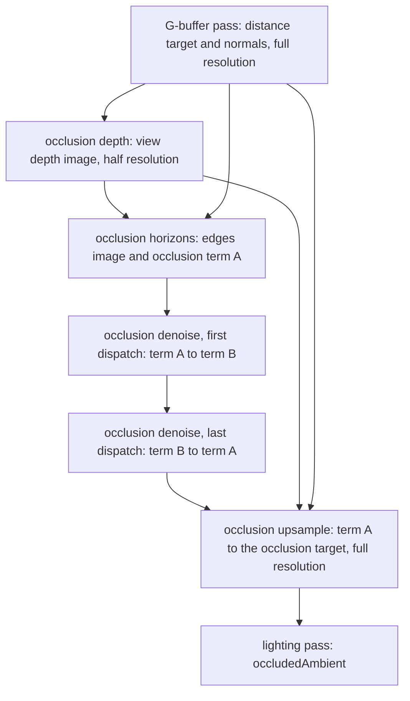

# Tertius architecture

Tertius is an engine for immersive sims and space sims. It combines a Caves of Qud style entity model with nested reference frames, double-precision physics and a deferred Vulkan renderer. This document records the design decisions. Each module must follow it. If a module must break a rule here, the change goes into this document first.

## Scope

These features are out of scope. Do not design for them.

- Multiplayer of any kind.
- Time warp. Every frame steps at the same fixed rate.
- Mods. The design keeps them possible, but no mod loading exists yet.
- The tidal gravity of a parent. The contents of a frame feel the frame's own field, minus the frame's proper acceleration, and in a turning frame its rotation terms (see "Turning frames" under "Physics"). They do not feel how the parent's field changes across the frame.

## Toolchain

| Item | Choice |
|---|---|
| Language | C# 15 preview on .NET 11 (`LangVersion` `preview`) |
| Dev shell | `nix develop` (see `flake.nix`) |
| Physics | Jolt 5.6.0 through JoltPhysicsSharp 2.23.0, double-precision build `libjoltc_double` |
| Graphics | Vulkan 1.3 through Silk.NET 2.23.0, MoltenVK on macOS |
| Windowing and input | Silk.NET.Windowing and Silk.NET.Input (GLFW) |
| Shaders | GLSL 4.60, compiled to SPIR-V with `glslc` at build time |
| Anti-aliasing | The SMAA reference files of iryoku/smaa, commit `71c806a`, under the MIT license: the shader header `SMAA.hlsl` and the two tables, in `src/Tertius.Rendering/ThirdParty/Smaa` with their `LICENSE.txt` and `README.md` (see "Anti-aliasing") |
| Tests | xUnit v3 on Microsoft.Testing.Platform, with AwesomeAssertions. Coverage uses Microsoft.Testing.Extensions.CodeCoverage. Every test project also loads the extension in `tools/Tertius.TestRecord`, which records a passed full run for the pre-commit hook (tools/README.md, "The test record"). |
| Images | StbImageWriteSharp writes the PNG captures, in `PngCaptureSink`. The tests read PNG files with StbImageSharp, and write the approved reference images and the failure files of snapshot tests with StbImageWriteSharp. |
| Video | ffmpeg 9.0.1 (`ffmpeg-headless` in the dev shell), a separate process that encodes the frames of a headless run with `--video`. `FfmpegVideoSink` finds it on the search path. The Host tests read the videos with its `ffmpeg` and `ffprobe`. |
| Benchmarks | BenchmarkDotNet 0.15.8 |
| Union generator and analyzer | `analyzers/Tertius.Unions`, a Roslyn incremental source generator and a diagnostic analyzer on Microsoft.CodeAnalysis.CSharp 4.14.0. Every project references it as an analyzer. Its tests run both in process on Microsoft.CodeAnalysis.CSharp 5.9.0, because 4.14.0 does not parse a built-in `union`. |
| Style analyzer | `analyzers/Tertius.Style`, a diagnostic analyzer and its code fixes on Microsoft.CodeAnalysis.CSharp and Microsoft.CodeAnalysis.CSharp.Workspaces 4.14.0. Every project but the union generator references it as an analyzer (see "Style analyzer"). Its tests run it in process on 5.9.0, as the union tests do. |
| Slop metrics | `tools/Tertius.Slop`, a console program that measures the erosion and the verbosity of `src` from the syntax alone, on Microsoft.CodeAnalysis.CSharp 5.9.0, which parses C# 15. The verbosity also runs jscpd for the clone lines. It prints JSON for the tools that read it (tools/README.md, "Slop metrics"). The git hooks keep the metrics of each commit in git notes under `refs/notes/slop`, and its `history` command prints them as CSV. Its tests are in `tests/Tertius.Slop.Tests`. |
| Code cleanup | `tools/cleanup.sh` (tools/README.md, "Code cleanup"). `dotnet format` from the SDK applies the IDE rules of Roslyn and the rules of Roslynator.Analyzers 5.0.1 that `.editorconfig` turns on. Then CSharpier 1.3.0, from nixpkgs in the dev shell, formats the code at 120 columns. |
| Platforms | The flake supports `aarch64-darwin`, `x86_64-linux` and `aarch64-linux`. |

The dev shell builds the double-precision Jolt library with Nix from `native/joltc.nix`. That file pins the joltc commit and the Jolt tag by hash. The dev shell sets `TERTIUS_JOLTC_DIR` to the folder of the library. The script `native/build-joltc.sh` is a fallback. It builds the same sources without a hash check, into `native/osx-arm64` or `native/linux-x64`, and it supports only these two platforms. Both builds apply two patches to joltc. joltc keeps a temp allocator for system and character updates, a stack allocator that is not thread-safe, and `native/joltc-thread-temp-allocator.patch` makes it one per calling thread instead of one per process. So several backends in one process, such as parallel tests, step at the same time on different threads. joltc also keeps one map for the whole process from each Jolt physics system to its joltc wrapper, which every create and destroy of a system changes, and `native/joltc-system-map-lock.patch` guards it with one mutex. So several backends create and destroy frame systems at the same time; without the lock, the map breaks and a create loops forever or crashes. The other process-wide state of joltc is written once, in `Foundation.Init` and the binding's static constructors, which `JoltRuntime` runs once under its own lock. Each backend serializes its own native work and state with its own lock (`JoltPhysicsBackend.Gate`).

`Directory.Build.targets` copies the Jolt library next to the output of every project that sets `<UsesJolt>true</UsesJolt>`. It takes the library from `TERTIUS_JOLTC_DIR`. When that variable is not set, it takes the library from the folder of the script. It also copies the Vulkan loader from `TERTIUS_VULKAN_DIR` next to the output of every project that sets `<UsesVulkan>true</UsesVulkan>`. It defines `TERTIUS_CONTRACTS` in Debug and Checked builds, so the contract checks compile out of Release builds. Checked has the contracts of Debug and the optimized code of Release, and the test runs use it (`tools/test-all.sh` runs Checked and Release). Debug stays unoptimized for the debugger. `Directory.Build.props` turns tiered compilation off in every project whose name ends in `.Tests`, so a test process compiles each method fully optimized from the start. With tiering on, hot code such as `World.Tick` stayed unoptimized for most of a Physics run, because the runtime waits for a pause in new compiles that a test run seldom has. In this document, a Debug build means a build with contracts: Debug or Checked.

## Projects and dependency rules

```
src/Tertius.Core        math, handles, messages, contracts, TripleBuffer, PoseTree, FrameTree with the numeric
                        frame rules, the rails library (Kepler and spin math), the motion intent union,
                        gravity fields and media beside them, the loose-body step, physics and render seams
src/Tertius.Simulation  World, entities, components, rails components, chunked gameplay runs, router, sync point,
                        snapshots, spatial index, render snapshot builder, blueprints
src/Tertius.Physics     Jolt backend: one PhysicsSystem per frame, intents, gravity, hand-off, ghosts
src/Tertius.Rendering   Vulkan deferred renderer: G-buffer, depth ranges, lighting, shadows, impostors, the PNG
                        capture sink
src/Tertius.Host        threads, window, input, tick pacing, scripted and headless runs, state dumps,
                        the video capture sink, wiring of all modules
src/Tertius.Demo        the vertical slice game: its scenes and components (its scripts are in scripts/)
tests/Tertius.*.Tests   one test project per engine module, and Tertius.Host.Tests also tests the Demo;
                        Tertius.Rendering.Tests also holds FLIP and the snapshot test check
tests/Tertius.Testing   shared test helpers: FaultInjectingBackend, WorldTesting, Scenes, test components
benchmarks/             BenchmarkDotNet benchmarks
```

- `Tertius.Core` depends on nothing but the base library.
- `Tertius.Simulation`, `Tertius.Physics` and `Tertius.Rendering` depend only on `Tertius.Core`. They never reference each other. The test projects are the exception. `Tertius.Testing` and the Simulation, Physics and Host test projects reference several modules together. The reason is that every physics test runs the real World on the real Jolt backend.
- `Tertius.Host` references all modules and connects them through the seams in `Tertius.Core`.
- `Tertius.Demo` references `Tertius.Host`.

## Threads and the tick

The simulation runs at a fixed 60 ticks per second. Physics steps once per tick with the same time step.

| Thread | Work |
|---|---|
| Main | The window and input. macOS requires this. |
| Gameplay workers | Entity runs, in chunks of 64 entities, through `Parallel.For`. In a large world, also four pieces of the sync point (see below). |
| Physics | One Jolt step for every active frame. Jolt uses its own job threads. |
| Simulation | Runs the ticks and their sync points, and a scripted run's steps. In the window, it paces the ticks by the wall clock. |
| Render | Draws the latest render snapshot and interpolates between the last two. |

The Main, Simulation and Render threads exist only in the window. A headless run has none of them. Its calling thread runs the ticks, the steps of the script and the captures (see "Host and scripted runs").

One tick has three parts. First, one thread prepares the tick. Then, during the parallel part, gameplay and physics run at the same time. Both read only state that is fixed for the tick: the front snapshot of tick N-1 and the frame tree. Last, during the sync part, one thread merges the results.

In a large world, the sync thread hands four pieces of the sync part to the gameplay workers, as independent work items. Each one runs on the workers only when `WorldOptions.MaxDegreeOfParallelism` is not 1 and the piece has at least a threshold of work. One `Parallel.For` costs about 5 us and 2 KB, so a small world runs every piece on the sync thread and pays nothing. The thresholds of steps 8 and 10 were measured on an Apple M1 Max with all workers (ter-sn28), and the comment on each constant gives its measurement. Step 8 also ends each change that a game makes outside a tick, through the same method, with the same pieces and thresholds.

| Step | Piece on the workers | Threshold | Work item |
|---|---|---|---|
| 8 | Copy the rows that gameplay wrote | 8,192 rows that gameplay wrote | One chunk of 64 slots |
| 8 | Find the new grid cell of each moved entity | 65,536 moved entities | One of 32 equal ranges of the moved list |
| 10 | Join the outboxes, expand the targets, sort the pairs by recipient | 6,000 messages | A block of chunks, then a slot range |
| 11 | Build the render snapshot | 8,192 slots | 1,024 slots |

Each piece ends in the same state, bit for bit, as on the sync thread, in every run. A work item writes only its own chunks, slots or range of a list. What it gives to state that items share waits in a per-item list, and the sync thread joins those lists in chunk, slot or range order, never in the order in which the workers finish. The outboxes of the gameplay chunks join in the same way. Each step below gives its own ordering rule. Tests compare each piece on the workers with its path on one thread. Each subsystem with a piece takes the workers, or none when the world has one thread, and keeps its threshold in an internal property that refuses a value below 1. The tests of all four pieces force the threshold down to 1, so that a small world runs the piece on the workers, and a test of the render snapshot also builds a world of more than 8,192 slots at the default threshold.

The engine's part of a tick follows the rule that hot paths allocate nothing after warm-up, with one accepted exception: the bookkeeping of each `Parallel.For` call, about 2 KB of short-lived garbage. The gameplay part makes one call in every tick of a world with more than one chunk, when there is more than one worker. In a large world, the sync part adds one call for each piece in the table above, and two for the routing, one for each phase. So a tick of a large world on all workers allocates about 12 KB, under 1 MB per second at 60 ticks per second, which the garbage collector frees in its cheapest generation. A set of worker threads that the world keeps for its whole life would remove this garbage. But it would replace the .NET task scheduler in every parallel part of the tick, so it waits until a measurement shows that the garbage costs time. With one worker, or below its threshold, a piece runs in a plain loop on the sync thread and adds nothing to this garbage. A test checks that a routing on the sync thread allocates nothing after warm-up.

The preparation does these steps in this order:

- If a change outside a tick made the numeric update due, run it, derive the attachments and swap the snapshot. So a body that a spawn outside a tick made joins its numeric frame before physics creates it.
- Hand physics the batch of spawns and destroys made outside the tick, before the step that can touch them.
- Update the frame tree. Fix the accelerations of the falling numeric frames for the step. Give each following frame its step plan and the acceleration that lands it on the plan. The step plan is the step record of the anchor's motion intent in the intents of the step, or without one the record of a kinematic body that holds still (see "Numeric frames"). Physics reads them, and the sync point follows them.
- Apply the queued changes of the indexes that entity queries start from, so that the workers only read them.
- Reserve a pool of free slots for each chunk that has live entities, in chunk order. A pool holds the larger of `WorldOptions.SpawnPoolSize` (8 by default) and twice the spawns of its chunk in the last tick, up to 1,024. When the pools need more slots, the tables grow here. A spawn during the tick takes its slot from the pool of its chunk, so spawned handles are the same in every run.

The sync point does these steps in this order:

1. Wait for all gameplay chunks and for the physics step. Grow the tables over the slots that spawns took after the pool of their chunk ran dry. Such a spawn takes a slot with an atomic increment. Its slot then depends on thread timing, so the world logs a note that the run is no longer deterministic.
2. Move the falling numeric frames over the step, with the acceleration that physics used. Then check the physics output before any of it lands. If an output can only come from a bug in the backend, skip the physics update of each entity that it names. "Output that only a bug produces" under "Physics" gives the checks. Then move each handed-off frame under its new parent in the frame tree, and put each following frame on its anchor's step plan when its anchor ended the step at the frame's origin: a hull, whose frame's record says so, or a plain kinematic body, whose front intent did not teleport it. Copy body poses, velocities and hand-offs into the back transform table. A body state of a hull writes no row. Keep whether physics stood each character. Then every frame takes its step record, in one pass of the frame tree (`FrameTree.TakeStepRecords`, called from `FollowOwners`, see "Rails components and motion intents"). The pass decides where each frame's record comes from, writes the frame's row and derives its proper acceleration from the record (see "How a frame moves"). It asks the World, through a struct (`IFrameOwnerFacts`), only what the tree does not know: the record that physics released for a hull, whether the output check skipped the owner's update, and a write of the owner's transform. Before it writes, it copies every frame's proper acceleration, and the rule reads the copy (`FieldTheStepFound`). So each frame reads its parent's value as the step found it, in any order of the visits. Then the float view of each frame entity, its transform row, is filled from its exact table, its row in the frame tree. The frame entity also moves to the member set of its frame's parent there. So the owner of a frame that a hand-off or the game moved under another parent changes topic and hears one `FrameChanged`. Each of the two passes is one walk over the frame tree's own storage, in dense order (`FrameTree.TakeStepRecords` and `FrameTree.VisitOwnerViews`), with no handle check. In a Debug build, a contract checks after each frame that the World's struct moved no frame, or changed nothing that an owner view reads. A record from physics is relative to the frame's parent after its hand-off. So it must come after the hand-offs, and before step 5 destroys any frame. A frame without a body takes its owner's write of its transform here too, so a write in the tick in which the frame's parent dies converts with the frame. Then each entity without body or frame takes the step record of its motion intent on its transform row (`FollowFramelessEntities`). This comes before step 5 converts the rows out of dying frames, and before step 7 derives the attached children from their roots. Then each plain body that a hand-off moved changes topic and hears one `FrameChanged`. Send the contacts that started as `Collision` events last, and then the contacts that ended as `CollisionEnded` events. So a contact that starts and ends in one step reaches each entity in that order.
   - 2b. Step every puff over the step that ended (`PuffTable.Step`, see "Puffs"), by the rule of motion of its frame, and remove the puffs whose age reached their life. Every frame took its step record in step 2, so the frame tree describes the end of the step, and the frame's loose-body step still holds the gravity that physics read. It must come before step 5 converts the contents of dying frames, because a puff that still held its place of the step before would land off by its frame's move over the step. It reads nothing of the physics output, so it also runs when the sync point drops that output, and in a World without a physics backend.
3. Make sure that no entity with a body wrote its own transform. In every build, such a write throws `InvalidOperationException`, so none gets through. When `WorldOptions.DebugChecks` is on, this step checks every invariant of the entity table, this one included. That check costs time in proportion to the slots in use, not to the capacity of the table. A slot that was never used must be clear in every column, and the table checks that when it first takes the slot, because a scan of every unused slot made the check read about 2 MB per call at the default capacity.
4. The step applied the intents of the last tick. So their collision groups and masks become the back collision rows of the bodies, which step 8 publishes, and their changes of motion become the stored motions of the hulls in the frame tree (`FrameTree.HullMotion`), also without a physics backend. Both describe the step that ended, as all the state that the next tick reads does. Then each owner that wrote a change of motion in this tick gets its frame planned for the next step, which applies the change: the frame and the intent drop what the new motion refuses (see "Changes of motion"). The entity table lists the owners that wrote a change in each chunk, and the swap hands that list on with the intents, so step 4 visits only them, not every body that wrote a force or a velocity. Then swap the physics intent buffers. The entity table also lists the parts that pushed in each chunk, apart from the intent writers (see "Parts"). The swap hands that list on as the front pushers, as it hands on the owners that wrote a change of motion, and it keeps the parts out of the intent list, because a part's push is no input of physics: step 5 carries it to the part's chain root. The swap clears the old front entries and exchanges the two buffers, so physics gets this tick's forces and motion intents in the next step. With no physics backend, the swap keeps only the changes of motion and the motion intents, and clears the other fields of each intent in place (`PhysicsIntent.KeepOnlyMotion`). It also clears the push of each part and lists no part, so step 5 carries nothing. The sync point moves an entity without a body by its motion intents, with or without a backend.
5. Apply the subscribe and unsubscribe requests of the chunks, in chunk order, while every entity that asked is still live. Then the destroy batch grows to the attached children of each dying entity. It also grows to the members of each dying frame that has no surviving ancestor. Then carry the push of each part to the body of its chain root, in one choke-point method (`Attachments.CarryPushes`, see "Parts"). The flow writes the front intents, so it comes after the swap of step 4. It comes after the growth of the batch, so that a part that dies here gives no push: a part that is not live in the next step does not act in it, as the intent of a body that dies goes with the body. It comes before the batch moves or frees anything, and before step 7b, so that the intents of each part and of its root still name the front frame of the chain, and the sum needs no relation between frames. The sum then converts once, as part of the root's intent, by the rule that converts every force. It comes before step 6c, whose thrust clock reads the force and the impulse of each body's front intent, so the clock counts the pushes of the parts. Then free dead entities. The survivors in a dying frame move into the nearest ancestor frame that survives. Increment the generation of each freed slot and return the slot to the free list. Queue the destroys of their bodies for physics, which gets the batch in step 6c. Before the dying frames go, convert each intent of the next step that names one of them into its entity's new frame. "Ownership of transforms" tells how. Step 7b cannot relate a frame that is gone. The motion intent converts with the rest of the intent, by its case. Then the puffs of each dying frame move into its heir, or die with it when no ancestor survives (`PuffTable.MoveOutOfDyingFrames`, see "Destroying a frame"). This comes before the frames die, because the frame tree refuses a dead frame.
6. Make new entities live, in chunk order. Each spawn reserved its slot during the tick, so no table grows here. The world drops a spawn into a frame that step 5 destroyed, and it records an error. Queue the new bodies for physics. An attached entity becomes live in the frame of its parent at this moment, after steps 2 and 5 moved the parent. A spawn's first motion intent goes into the new entity's front intent here, after the swap of step 4 (`EntityTable.SetFirstMove`). So the next step applies it (see "Creation and destruction"). A new frame stands at the pose of its spawn description. Without a first motion intent, it holds still there for its first step.
   - 6c. Run the numeric update (`FrameTree.UpdateNumericFrames`, see "Numeric frames"), after the physics output, the destroys and the spawns, so that it clusters every live body where it is at the end of the tick. Every frame took its step record in step 2, so the rows of the bodies and the frames both hold the end of the step, and the update tests the bodies against bubbles of the same moment. (Before the review of ter-2gg0, the frames on rails moved after the update, and the update placed the bubble of a station that orbits at 7.5 km/s 126 m behind the bodies beside it.) A new following frame starts at its anchor's place, with the chord of its anchor's motion over the step that ended, which it derives from the anchor's frame tree row for a hull, and from the anchor's transform row for a plain body (see "Numeric frames"). First the update lets go each following frame whose anchor is no body in it. Then hand this sync point's changes to physics. The update before this one can name a home for the ghost of an anchor. Then physics gets the changes even when there are none, so that it drops the ghosts whose home this update stops naming. The update gathers the bodies in slot order from a bit per slot, which the entity table sets while the slot holds a live entity with a body. It takes each body's bounding radii as the table kept them at the spawn.
7. The float view of each frame entity is filled from its exact table again, after the numeric update, which can move a frame among numeric frames. A nesting frame that jumps moves no frame and writes no row, but it changes the sum that gives the place of each frame below it in its semantic frame, which can round to another double. This pass runs only when something wrote the frame tree since the pass of step 2. The tree keeps a stamp, `FrameTree.OwnerViewStamp`, that every write of a frame's local pose, velocities or parent changes, and the world compares it with the stamp at the end of the pass of step 2. A change of a hull's motion at step 4 writes none of these: a hull that leaves its following frame leaves it falling, and a falling frame is still a numeric frame, so no owner view changes. With frames on rails and nothing else, nothing writes the tree between the two passes, and the second pass found every row equal. When `WorldOptions.DebugChecks` is on, the world checks at the end of every sync point that the float view of every frame entity, its transform row, equals what its exact table gives, bit for bit. So a write of the frame tree that does not change the stamp fails a test. Then every attached entity takes its frame, pose and velocities from the root of its chain.
   - 7b. Each intent that the next step applies and that names another frame than its entity's converts into the entity's frame (see "Ownership of transforms"). This comes after steps 2 and 5, which move entities between frames, and after step 7, so that every entity is in its frame for the next tick. It comes after step 2, so that every frame stands where the next step starts, the moment at which a velocity of the intent applies. The motion intent converts with the rest of the intent. A plain kinematic body can hand off in a step, so its next motion intent converts here. The entity table counts the writes of a back row that move it to another frame (`EntityTable.RowFrameChanges`). While the count is the one of the last pass of 7b, no entity is in another frame than its intent names, because each intent names the frame of its entity's front row, which step 8 copied after that pass. Then 7b skips its visit of every intent writer, as in a scene of frames on rails that write a motion intent in every tick.
   - 7c. The emitters of the step that ended make their newborns (`PuffTable.AddNewborns`, see "Puffs"). Then the cap drops the oldest puffs, and the rebuild puts each frame's newborns at the end of its range. Only here does every input of a birth describe the step that ended: the front render row still holds the emitter of that step, which step 8 replaces, and the back transform row holds the emitter's place and velocity at the end of the step, which step 7 derives for an attached jet.
8. Swap the snapshot. The back tables become the front tables. Copy only dirty slots forward: first the rows that gameplay wrote, in chunk order, then the rows that the sync point wrote. With 8,192 or more rows that gameplay wrote, the workers copy them, one chunk per work item. A chunk's dirty list holds only its own slots, so the items write disjoint rows. Each chunk keeps its moved entities and its changed component flags in its own lists, and the sync thread joins those lists in chunk order after the workers finish. Then it copies the rows that the sync point wrote, and the component index takes the changed flags, on the sync thread, in the order of the copy on one thread. Then the frame tree and the spatial grids catch up with the new front rows (see "Snapshots").
9. Run the physics queries that components asked for during the tick, the ray casts, shape casts and overlap queries, in entity order. Jolt is at the end of the step, with the destroys and spawns of steps 5 and 6, and the new front snapshot describes the same moment: its component flags, collision groups, poses and frames. Queue each answer as an engine event.
10. Route the outboxes, and the answers of step 9, into inboxes (see "Outboxes, routing and order"). A routing of 6,000 messages or more runs on the workers.
11. Build the render snapshot and publish it to the render thread through a triple buffer. A build of 8,192 slots or more runs on the workers. After the instances, the builder places the puffs of the puff table, on the calling thread (see "The render snapshot").
12. Start the next tick.

Gameplay intents written during tick N reach physics in step N+1. That is one tick of latency, and it is acceptable.

## Entities

An entity is a 64-bit handle: a 32-bit slot index and a 32-bit generation. The generation increments every time the slot is freed. A handle with an old generation is stale, and every lookup must reject it.

Each live entity has a row in three parallel tables, indexed by the slot index:

- Transform: the frame that the entity is in, a frame-local `DPose`, and linear and angular velocity. Positions are double, because Jolt gives double positions and a planet frame is millions of meters across.
- Physics: an optional body description and the double-buffered `PhysicsIntent`. The cold record of a body also keeps, from the spawn, the bounding radii of its shapes and the center of mass of its shape, which the backend computes (see "Physics"). The lever of a part is measured from that center (see "Parts"). The intent also holds the entity's motion intent for the next step (`PhysicsIntent.Move`). An entity without a body writes one too (see "Rails components and motion intents"). Every slot holds the field, so an intent is about 380 bytes. With 100,000 entities that each write a motion intent in every tick, step 4 takes 1.8 ms of a sync point of 16 ms, so the field has no sparse store (docs/plans/rails-components.md, "The measured cost").
- Render: mesh, material, scale, bounding radius, render flags, an optional light (a `LightData`: a point light, a spot light or none) and an optional puff emitter (a `PuffEmitter`, see "Puffs"). The emitter adds 44 bytes to the row.

Each entity also has a list of components, which are classes that implement `IComponent`. The list is sorted by `Priority`. Components with the same priority keep the order in which they were added.

A frame is an entity that also has a row in the frame tree. `FrameHandle` holds the entity handle plus the frame index and generation. It converts to `Entity` implicitly.

### Component rules

- A component changes only its own state and the tables of its own entity.
- An entity never changes another entity. It sends a message.
- A part, an attached entity that pushes, changes only its own intent too. The engine carries its push to the body of its chain's root at the sync point, as physics carries a contact from one body to another. The root's components do not see the push, and no message carries it (see "Parts").
- An entity reads other entities only through the front snapshot of the previous tick. It never reads another entity's components. The snapshot publishes each entity's component flags, the types of the components that it had, and each body's collision groups, so a component can ask whether another entity has a component, or find entities with an entity query (see docs/plans/queries-and-sensors.md). `Snapshot.BodyOf` gives the physics facts of another entity's body: its motion, mass, shape kind, bounding radius, center of mass, collision groups and mask, and whether it is a sensor. It gives null for a stale entity and for an entity without a body. A body's description does not change after spawn, so only the collision groups and mask, which an intent can change, have double-buffered rows. The motion of a frame's hull can change too, with the intent `self.Body.SetMotion`, but the frame tree stores it (`FrameTree.HullMotion`), and it changes only at step 4 of a sync point, so it is the same for the whole tick. Like the collision groups, the facts show the last finished step, so a change shows from the second tick after the one that writes it. The entity reads the motion of the step that applies its own writes with `self.Body.NextStepMotion` (see "Changes of motion").
- A component never stores a `ref`, a span, an `EventList`, an `Outbox` or a `Self` beyond the call that received it. The compiler enforces this for ref structs.
- `Handle` never awaits. For a delay, a component sends a message to itself with a delay.

### Ownership of transforms

If an entity has a physics body, physics owns its transform. Gameplay moves it only through its intent: forces, impulses, velocity changes and teleports through `self.Body`, and motion intents (see "Rails components and motion intents"). These go into the entity's `PhysicsIntent` slot. Forces and impulses add up during the tick. Velocity changes and the motion intent keep the last value written. Each kind of body takes its own requests:

- A dynamic body, hull or plain, takes forces, impulses, velocity changes, teleports and the steer target of `self.Body.SteerTo`: physics gives the body the velocities that carry it to the target over the step, and contacts and gravity still act on it.
- A kinematic body, hull or plain, moves only by its motion intents and its teleports. Its motion intents are the end poses of `self.MoveKinematic` and the full samples of `self.MoveOnRails`. It holds still in a step without one. `SetVelocity` and `SetAngularVelocity` throw an `InvalidOperationException` for it. (User, 2026-10-18)
- The owner of a static hull moves it only by a teleport: physics moves the hull at the start of the next step, and the frame takes the teleport's pose at the next sync point.
- A static body and a character take no motion intent. A character moves by its walk, its jump, forces and impulses.

An attached entity has no body, but it can push the body of its chain's root as a part (see "Parts"). Only the additive intents flow from a part to the root: the force, the torque, the impulse and the angular impulse, which compose by a sum. The exclusive intents stay with the root alone, because two writers of one would need someone to decide: a velocity, a teleport, a motion intent, a character's walk and jump, a change of collision groups and a change of motion. A part's push needs a root with a body: `AddForce`, `AddTorque`, `AddImpulse` and `AddAngularImpulse` throw an `InvalidOperationException` for an entity that has no body and is not part of a chain whose root has one, and every other member of `self.Body` throws for a part as for any entity without a body.

The guards judge each write by the motion of the step that applies it (see "Changes of motion"). The owner of a hull changes the hull's motion with `self.Body.SetMotion` (see "Changes of motion").

An intent is relative to `self.Frame` during the tick in which gameplay writes it, and it names that frame (`PhysicsIntent.Frame`). Physics applies it in the next step, and the sync point between can move the entity to another frame: the step that ran during the same tick hands the body into a bubble or out of one, or the destroy batch moves it out of a frame that dies. The sync point then converts the intent into the entity's new frame, so physics always applies an intent in the entity's frame. An intent that names a dying frame converts at step 5, before the frame dies, and every other intent converts at step 7b (see "Rails components and motion intents"). The conversion uses the motion of the old frame in the new one over the step that applies the intent (`FrameTree.MotionRelativeInStep`): one relation where that step starts, and one where it ends. Each part of the intent converts by the moment that it describes. The velocities of `SetVelocity` and `SetAngularVelocity` apply where the step starts, so they convert by the relation there, with the motion of one frame relative to the other. A teleport converts as a pose by the same relation, and forces, torques, impulses and a character's walk convert as directions by it. The motion of `SetMotion`, the collision groups and the jump speed do not depend on a frame, so they stay as they are. A motion intent converts by its case (`MotionIntent.Converted`). An end pose and a steer target are poses at the end of the step, so they convert as poses by the relation where the step ends. A full sample converts its pose, its velocities and its accelerations by the relation where the step ends, and its chord by the frame's poses at both ends of the step (`MotionSample.Converted`). In the relation where the step ends, a frame whose owner has an end pose or a full sample stands where that motion intent puts it. A frame that holds still stands where the step starts. A numeric frame stands where the numeric update moves it. So a kinematic body that hands off out of a ship that moves on end poses gets its end pose where the ship ends the step, to the rounding of the composed poses. Four kinds of frame on the path make the conversion miss. A falling frame moves with the step acceleration of the step that ended, and the next step fixes its own anew from nearly the same field. So the conversion misses the frame's end position by the change of that acceleration from one step to the next, times the square of the step. A frame with a dynamic hull stands where physics predicts from its row: the row's velocities, and the proper acceleration and the angular acceleration of the last step. So a steady thrust, a steady torque or a resting contact is in the prediction, and the conversion misses by how the step differs from the last step. A change of force, torque or contact misses the frame's end position by about half the change of acceleration times the square of the step. A velocity change, an impulse or a steer target in the step, linear or angular, changes the hull's velocity where the step starts, so it misses the frame's end pose by that change times the step. Physics measures the proper acceleration from the whole change of the hull's linear velocity over the step, so the prediction also repeats a linear velocity change, impulse or steer of the last step as an acceleration over this step. The owner of a frame without a hull can write the frame's transform in the next tick. That write wins over the frame's motion for the step, from a motion intent or from holding still, and the conversion cannot know it. So the conversion misses by how far the write moves the frame from where the relation puts it. A frame that dies at step 5 keeps its relation at the moment of its death at both ends of the step, the relation by which the rehome moves its contents. So a motion intent that converts through it misses by the frame's motion over one step. (Before ter-dhkf, physics applied the intent in the new frame as it was. A kinematic door that gameplay moved in every tick entered a passing pod's bubble, got the target of the station's frame in the pod's frame, jumped out of the bubble, came back in the next tick, and changed frames in every tick.)

If an entity has no body, gameplay owns its transform, unless the entity is attached. It moves the entity in two ways, both relative to `self.Frame`. `self.SetTransform` writes the pose, and leaves the entity at rest. An end pose or a full sample moves it over the next step. At step 2 of the sync point after that step, the sync point puts the motion intent's step record into the entity's exact table. That is the frame tree row for the owner of a frame, and the transform row for an entity without a frame. Such an entity holds still in a step without a motion intent. A transform write comes after the motion intent of the same tick, so the write wins for one tick. The next motion intent puts an entity on rails back on its rails. The owner of a root frame takes end poses and full samples too, with or without a body, because its body is only the frame's static interior. The sync point moves its frame as a frame without a hull.

### Creation and destruction

`self.Spawn(...)` takes a slot at once from the spawn pool of its chunk and returns the new handle. The preparation of the tick reserves the pools in chunk order, so a spawn gets the same handle in every run. If a pool runs dry, the spawn takes a new slot with an atomic increment, and the run is no longer deterministic. The new entity starts to run on the next tick. The tables never grow during the parallel part of a tick. They grow in two places. The preparation of the tick grows them to fill the pools. Step 1 of the sync point grows them over the slots that dry pools gave out. An entity can destroy itself with `self.Destroy()`. To destroy another entity, send it a `Destroy` message. Both take effect at the sync point.

No other operation is deferred. There is no general command buffer.

A spawn can attach the new entity to a parent entity with `SpawnDesc.AttachTo`. The attached entity follows its parent with a fixed offset in the parent's axes. It has no body, it cannot be a frame, and it dies with its parent. It can still push the body of its chain's root with the additive intents, as a part, and its push acts at its place (see "Parts"). Its chain root never changes, because an entity is attached only at its spawn and dies with its parent. A chain of attached entities is always in the frame of its root, the one entity of the chain that is not attached. In step 7 of the sync point, each attached entity takes its frame, pose and velocities from that root. So an attached spawn becomes live in the frame of its parent at that moment, and the frame that its description names does not count. A component that spawns during a tick saw the parent in the front snapshot. In the same tick, physics can hand the parent into another frame, or the parent's frame can die and move the parent to an ancestor frame. The component cannot know that, so it is not a bug: the new entity becomes live in the parent's new frame. A parent that is not live at the sync point, or that owns a root frame and so is in no frame, cannot take the new entity. The world then drops the spawn and records an error in `World.Errors`. Outside a tick, `World.Spawn` throws for such a parent instead.

A spawn description can carry the new entity's first motion intent, `SpawnDesc.FirstMove`: the motion intent that the entity writes for its first step, as if it ran in the spawn's tick, relative to `SpawnDesc.Frame`. (User, 2026-10-18) Step 6 of the sync point puts it into the new entity's front intent, or the call of `World.Spawn` does outside a tick. So the step after the spawn applies it, as a motion intent that the entity wrote. Without one, a new frame on rails holds still for its first step, because its components first run in the tick after it goes live. The spawner computes the end of the entity's first step with `self.TimeAt(self.Tick + 2)` in a tick, and with `World.TimeAt(World.TickNumber + 1)` outside a tick. `World.TimeAt` is public for this, the same read as `Self.TimeAt`. A spawn refuses two kinds of first motion intent, with an `ArgumentException`. The first is a case that the entity refuses, by the guard of every motion intent (`MotionIntent.ProblemFor`) with the facts of the description. The second has a number that is not finite, or a zero rotation. A blueprint holds none, because the motion depends on the time of the spawn.

A spawn velocity, `SpawnDesc.LinearVelocity` or `SpawnDesc.AngularVelocity`, is the first velocity of a body that physics integrates: a dynamic body, hull or plain, or a character. A kinematic hull takes one too. It keeps it as its frame's velocity until its first sync point. From it, the numeric update gives a fast hull its following frame at spawn. Every other entity moves by something else, so a spawn refuses a velocity on it with an `ArgumentException` (`World.SpawnVelocityProblem`). These entities are an attached entity, an entity without a body, the owner of a root frame, a static body, hull or plain, and a kinematic body that owns no frame. The spawner of such an entity gives it a first motion intent instead.

### Parts

A part is an attached entity that pushes the body of its chain's root (docs/plans/parts.md). (User, 2026-10-21) So the shuttle's main engine, each of its jets and the person's back jet can each be a separate entity, attached to the hull or to the person, with one particle emitter each. A part writes only its own intent, with the same members as a body: `self.Body.AddForce`, `AddTorque`, `AddImpulse` and `AddAngularImpulse`, in the axes of its frame, which is the frame of its chain root. `World.WritablePush` takes these writes. For an entity with a body it gives the entity's own intent. For an attached entity whose chain root has a body it gives the part's own back intent, and the part's first push of the tick lists it among its chunk's pushers. The guard reads the part's link and the root's body description, which nothing writes during a tick, so the part's worker may read them while the root runs on another worker. `self.Body.Pending` of a root shows only its own writes, never its parts' pushes, which join at step 5.

At step 5 of the sync point, `Attachments.CarryPushes` visits the front pushers, chunk by chunk, each chunk in the order of the first push of its parts. It skips a part of the destroy batch and empties its front intent. For each other part, a force at the part's place gives the root's body the same force and the torque of its lever about the body's center of mass, and an impulse gives the same impulse and the angular impulse of its lever. A torque and an angular impulse are free vectors, so they stay as they are. In doubles:

```
lever   = q.Rotate(placeInBody - centerOfMass)
force  += F
torque += T + Cross(lever, F)
impulse += J
angular += L + Cross(lever, J)
```

Here `placeInBody` is the offsets of the chain from the root down to the part, composed with the writes of the tick, which is where step 7 puts the part in the root's axes. `centerOfMass` is the one that the entity table kept at the root's spawn. `q` is the rotation of the root's front transform row, the pose from which the part's component wrote its push. So a jet that pushes along its own nozzle gives the push that the root's own component would write for the same jet from the front snapshot. `F`, `T`, `J` and `L` are the part's four fields, widened from floats. The sum of each root starts from the root's own four fields and adds its parts' contributions in the order of the front pushers. It narrows to floats once, into the root's front intent (`EntityTable.AddPush`), so two jets whose forces are exact negatives cancel to exactly zero and leave the root's own force exact. A root that wrote nothing in the tick gets an intent that names its front frame, and it joins the end of the intent list in the order of its first part. The pure part of the flow is the value type `Push`. The flow runs on the sync thread. With 10,000 parts that push in every tick, it takes about 0.36 ms of the sync point on one worker and on all workers, and with no part it reads nothing measurable. It allocates nothing after warm-up.

What physics does with the sum is the rule that it already has for the root's own push. A dynamic body or hull takes it all, and a turning frame turns it as the root's own. A kinematic or static root keeps the sum in its intent, and physics ignores it. A character takes the force and the impulse, and reads no torque. A part whose root has no body cannot push. A part that dies at the sync point gives no push, and neither does a part whose parent or root dies. A part that the game destroys outside a tick, after the sync point that carried its push, still pushes in the next step, because its push is part of the root's intent by then.

The state that parts add, with its invariants, which `AssertInvariants` of each module checks:

- `EntityTable` keeps each chunk's pushers and the front pushers. A live pusher is listed once, has no body, has a written intent, and is no intent writer. A live front pusher is listed once, has no body, is not in the intent list, and holds an empty front intent. A record without a body has a zero center of mass, and a record with a body a finite one.
- `Attachments` keeps the chain root of each link, which never changes. The root of every link is the one that a walk up the parents finds, and it is live. Each live pusher and front pusher is attached, and its root has a body. The scratch of the flow is empty outside it.
- `World`: no live attached entity is in the intent list, and its front intent is empty. The front row of every live attached entity names the frame of its root's front row, which step 7 keeps and the flow relies on. With a backend, each body's kept center of mass is the one that the backend gives its shape.

A part whose push names another frame than its root's front row comes only from a bug. A build with contracts fails the contract of `CarryPushes`. Any other build skips the part and records the bug in `World.Errors`.

## Messages

### The event envelope

```csharp
public struct Event
{
    public Target Target;         // [Union]: Entity | Topic | Broadcast
    public Entity Sender;
    public int Type;              // EventType<T>.Id of the payload struct
    public PayloadBytes Payload;  // 48 bytes, holds one unmanaged payload struct
    public object? Extra;         // rare managed data
}
```

A payload is an `unmanaged` struct that implements `IEventPayload` and is at most 48 bytes. `EventType<T>.Id` gives each payload type a dense integer the first time the type is used. The engine supports 512 event types. `EventMask` is a 512-bit set of event types.

`Target` is a union with three cases: `Entity`, `Topic` and `Broadcast`, whose members the union generator writes (see "Unions"). Its `HasValue` and `TryGetValue` let pattern matching run without boxing. It is 16 bytes: the entity's index and generation and the topic's id and generation share three 4-byte slots, beside the kind byte.

### Delivery

There are three delivery modes:

- Direct: to one entity handle.
- Topic: to every subscriber of a topic. Every frame is a topic. An entity subscribes to its frame's topic automatically, and the subscription moves with it on hand-off.
- Broadcast: to every live entity.

A radius query is not a delivery mode. A component queries the spatial index of the snapshot and then sends direct messages.

Every message between entities arrives on the next tick. A question and its answer take two ticks.

### Outboxes, routing and order

Each chunk of 64 entities owns an outbox for the tick. Outboxes belong to chunks, not to worker threads, because the chunk-to-thread assignment changes from run to run. At the sync point, the router does these steps:

1. Join the outboxes in chunk order.
2. Expand each target into recipients: one for direct, the subscribers for a topic, every live entity for broadcast.
3. If the event type is not in a recipient's entity mask, drop that recipient.
4. Write `(recipient, eventIndex)` pairs. The payload is stored once.
5. Sort the pairs with a stable counting sort by recipient index.

Each inbox then has the same order in every run with the same inputs. Delayed messages wait in a timer queue keyed by tick, and they join the routing on the tick that they are due.

A routing of 6,000 messages or more runs on the workers, in two phases of work items. In the first phase, each block of chunks copies its outboxes into the routed list and expands its messages. A block keeps its pairs in one cell per slot range, which is a run of entity slots. In the second phase, each slot range sorts its cells into the inboxes of its slots. A smaller routing runs the same phases with one block and one slot range on the sync thread. Both give the same inboxes bit for bit, because no order depends on the threads:

- Each outbox goes to an offset in the routed list that a serial pass computes in chunk order.
- Every message of a block comes before every message of the next block.
- A slot range reads its cells in block order, so each inbox lists its messages in routing order, as one stable sort of the whole list does.
- Each slot range writes its pairs from an offset that a serial pass computes in slot order.

### The component pipeline

```csharp
public interface IComponent
{
    int Priority { get; }
    EventMask Wants { get; }
    void Handle(Self self, scoped ref EventList events, scoped ref Outbox outbox);
}
```

When an entity runs, the worker copies the entity's inbox into a scratch `EventList`. The worker then calls `Handle` on each component in priority order. Components edit the list in place: change payloads, remove events and add events. An event that a component adds is visible only to the components after it. Messages for other entities go into `outbox`, not into the list.

If a component's `Wants` mask has no type in common with the current list, the worker skips that component. Each entity caches the OR of the `Wants` masks of its components. After a component is added or removed, the entity recomputes the cache. After a component is attached, it must not change `Wants`.

An entity runs in a tick only in two cases: its inbox is not empty, or its mask contains the engine `Tick` event. In the second case, the scheduler adds a `Tick` event to the start of the list.

`EventList` has a small query API that reads like LINQ but allocates nothing and edits in place:

```csharp
foreach (ref var damage in events.Of<Damage>())
    damage.Amount = MathF.Max(0, damage.Amount - rating);
events.Of<Damage>().Where(static (ref Damage d) => d.Amount == 0).Remove();
```

Use normal LINQ outside hot paths.

### Containers

Events do not move to inventory or equipment automatically. A `Container` component can forward an event on purpose.

### Engine events

The engine defines these payload types in `Tertius.Core`:

| Event | Sent on |
|---|---|
| `Tick` | Every tick, to entities whose mask contains it |
| `Spawned` | On the first tick of a new entity |
| `Destroy` | A request to destroy the recipient |
| `FrameChanged` | After the entity's frame changed: a hand-off moved it to another frame, its frame died and it moved to the nearest ancestor that survives, the game moved the frame that it owns under another parent, or its attachment chain's root changed frame. Once for each change. Not for the frame that a new entity spawns into, and not for a move between numeric frames |
| `Collision` | Physics reported a contact that started |
| `CollisionEnded` | Physics reported that a contact which started ended |
| `RayHit` | The answer to a ray cast that the entity asked for in the previous tick: the entity hit, or a miss |
| `ShapeHit` | The answer to a shape cast that the entity asked for in the previous tick: the first entity that the shape touched, or a miss |
| `OverlapHit` | One answer to an overlap query that the entity asked for in the previous tick: one entity that overlaps the shape, or no entity when none does |
| `InputEvent` | The host forwards input to the entities that subscribe to the input topic, between two ticks (see "Host and scripted runs"). It is a custom C# 15 union of four cases: `KeyChanged(Code, IsDown)`, `MouseButtonChanged(Code, IsDown)`, `MouseMoved(Delta)` and `Scrolled(Delta)`. A code is the integer value of the Silk.NET `Key` or `MouseButton`, because Core does not reference Silk.NET. The default value holds no case, and a component that matches the cases ignores it |

## Snapshots

The transform, render, component flag and collision rows are double-buffered. During a tick, everyone reads the front rows. Each entity writes only its own back rows. In step 8 of the sync point, the back rows become the front rows. That step copies forward only the slots that changed. An entity that did not run costs nothing. The physics intents are double-buffered too, but step 4 swaps them instead of copying them forward.

The world also keeps one spatial grid per frame for radius queries. `SpatialIndex` owns the grids, and `Snapshot.QueryRadius` and entity queries read them. Each grid is a sparse hash grid of 32 m cubes with 64-bit cell coordinates. The owner of a root frame is in no grid. In step 8, the index moves only the entities whose front transform changed, from their old cell to their new one. It first finds the new cell of each moved entity, and then changes the cells in the order of the moved list. Finding a cell reads only that entity's rows, so with more than one worker and at least 65,536 moved entities, the workers find the cells, each in its own range of the list. The sync thread then applies the ranges in order, and the grids end as they do on one thread.

## Reference frames

### The frame tree

Frames form a tree. Each frame has a double-precision `DPose` relative to its parent. `FrameTree` stores frames in a `PoseTree<DPose>` plus parallel arrays:

| Array | Meaning |
|---|---|
| `Owner` | The entity that is the frame |
| `Bounds` | The ellipsoid radii of the bubble, in frame axes |
| `HullMotion` | The stored `BodyMotion` of the frame's hull, the motion that it had in the last finished step, or null for a frame without a hull (see "Changes of motion") |
| `HullMotionInStep` | The `BodyMotion` of the frame's hull in the step that applies the given intents, derived from the owner's change of motion there or else from `HullMotion` (see "Changes of motion") |
| `Gravity` | The gravity field of the frame, a `GravityField` union (see "Gravity") |
| `Velocity` | Linear and angular velocity relative to the parent |
| `ProperAcceleration` | What an accelerometer at the frame origin read over the last finished step, in frame axes. Step 2 derives it (see "How a frame moves"). |
| `FeltGravity` | Derived from the stored values, with no array of its own: the gravity that a body at rest at a place in the frame felt over the last finished step, in frame axes, with the rotation terms of the frame's turn (see "Gravity") |
| `Followed` | The follow kind: what made the step record that the frame took at the last sync point (see "Rails components and motion intents") |
| `Turns` | V1 and V2: the turn of the frame's axes over the step in flight and over the step that ended, each with the frame's inertial angular velocity, in doubles (`FrameTurns`). `BeginStep` fixes them before each step. A numeric frame keeps none and reads its semantic frame's (see "Turning frames" under "Physics"). |
| `AngularAcceleration` | V3: the angular acceleration of the frame's last step record relative to its tree parent, in the parent's axes, in doubles. Step 2 writes it, zero for a frame that holds still. `BeginStep` predicts the turn of a dynamic hull from it. |

The bubble of a frame never changes after the frame is created. The simulation alone changes the hull motion, the gravity field and the proper acceleration of a frame: the stored hull motion at step 4 of a sync point, from the intent of its owner that the step that ended applied (see "Changes of motion"), the gravity field through `World.SetFrameGravity` (see "Gravity"), and the proper acceleration at step 2. `FrameTree.Gravity`, `FrameTree.Bounds` and `FrameTree.ProperAcceleration` return copies, so no other code can change them. The tree keeps no orbit, no spin and no motion sample. The orbit and the spin live on the rails components of the frame's entity, and a motion intent lives in its owner's intent (see "Rails components and motion intents"). After step 2, the tree row keeps three values of the step record: the pose, the instant velocity and the angular velocity. It also keeps the proper acceleration derived from the record, and the follow kind. (User, 2026-10-18) Since spin gravity it keeps the record's angular acceleration too (V3), because the turn of a dynamic hull's frame in the next step is predicted from it. The record's chord and acceleration are not kept.

`PoseTree<TPose>` is packed. Its arrays have no gaps. Each parent comes before its children, so one linear pass computes all poses. A reparent can break that order. The tree then marks itself dirty and restores the order before the next pass.

The scene graph inside a frame uses the same `PoseTree`, with the float `Pose`.

The rotation of every local pose in the frame tree is a unit quaternion: the square of its length is within `1E-12` of 1. `FrameTree.AssertInvariants` checks it. The world normalizes a rotation that a caller gives it, in a spawn description or in a write to the transform of the owner of a frame without a body, and it does not refuse it. A rotation that is off by `1E-7` in the square of its length would put a parent that is `6.8E6` m away about a meter off, as seen from the frame.

### How a frame moves

A frame follows its owner, the entity that is the frame, at every sync point (see "Rails components and motion intents"):

- A frame whose owner has a dynamic hull follows the hull, which physics moves. Its pose and velocity come from that body after each step.
- A frame whose owner has a kinematic hull, or no hull, follows its owner's motion intents: the full samples of a rails component, `KeplerMotion` or `SpinMotion`, or the end poses of `self.MoveKinematic`. The owner of a root frame has no hull.
- A frame without a step record holds still in its tree parent: a frame with a static hull, and a frame whose owner has no motion intent for the step. It keeps its pose, and it has no velocity there, so it moves with its tree parent. Its owner can still move it: an owner without a body writes its transform, and the owner of a hull that is not dynamic teleports it (see "Ownership of transforms").

Every frame takes its proper acceleration from its step record by one rule (User, 2026-10-18). The proper acceleration is the frame's acceleration over the step minus the gravity at its place where the step started. The tree turns it into the frame's own axes (`FrameTree.ProperAccelerationFrom`). The gravity at the frame's place is its semantic parent's field there minus the parent's own proper acceleration. In a parent that turns, it also holds the parent's centrifugal and Euler terms at that place and its Coriolis term on the record's chord, from the parent's turns of the step (docs/plans/spin-gravity.md, "The proper acceleration of a frame"). So a frame feels what a body at its origin feels. A root frame feels no gravity. A frame without a record is at rest in its tree parent. Under a numeric tree parent, the rule reads the frame's record in the semantic parent. That record adds the places, velocities and step accelerations of the numeric frames between (`FrameTree.HomeAcceleration` for the accelerations). For the hull that anchors a following frame, the record in the semantic parent is its step plan (see "Numeric frames"). Physics measures a dynamic hull's value by the same rule: Jolt's whole change of velocity over the step, minus the gravity that physics applied at the hull's centre of mass, turned into the hull's axes. It releases the value beside the hull's record (`FrameStepRecord.ProperAcceleration`). A value from the record leaves out the velocity that the step's intents set, such as an impulse. It also keeps the float rounding of Jolt's velocities, and the cargo of a ship in orbit then drifts. So:

- A frame that holds still in a gravity field feels that gravity reversed. So the contents of a parked cabin have weight with no field of the cabin's own, and so do those of a turntable that holds its place on the ground.
- A frame on a Kepler orbit, in a parent that falls freely and does not turn, reads exactly zero, not zero to rounding. The rule finds the place where the step started from the sample's place and chord, as `KeplerOrbit.Sample` does. It evaluates the parent's point field there with the expression of `KeplerOrbit.Acceleration`.
- A frame at rest in a ship that thrusts reads the ship's value, turned into its axes.
- A frame that an end pose moves reads the gravity where the step starts, reversed, because an end pose has no acceleration.
- A ship that parks reads the gravity at its place, reversed: its cargo has weight on the ground, and no thrust stays in free space.
- A room at rest in a spinning station reads ω² R toward the axis. Its contents feel that reversed, plus the room's own rotation terms, so ω² (R + r) in all. A frame on a Kepler orbit in a turning parent does not read zero, because its orbit turns with the parent: orbits belong in a frame that does not turn.

The rule reads the parent's value as stored before step 2, the value that physics used for the parent's bodies during the step (User, 2026-10-18). So a dynamic child and every other child of the same parent agree in every step. A change moves one level down a chain of frames in each step. A frame that the pass of step 2 skips, after a failed step or for output that the check refused, keeps its value. A new frame reads zero during its first step, and takes the rule's value from the first step 2 after its spawn on (User, 2026-10-18). The rotation terms do not wait for that: they come from the parent's turns of the step, which `FrameTree.BeginStep` fixed before it, so a room at rest in a spinning station reads ω² R from the step 2 after the station's first turning step. A room spawned in a spinning station reads zero in its first step, as every new frame does, so its contents feel only the room's own field and rotation terms in that step. `FrameTree.ProperAcceleration` is a value read, and no gameplay writes it.

The rails components are in `src/Tertius.Simulation/Components/`. Each moves any entity that takes a full sample: the owner of a frame, which carries the frame, a plain kinematic body, or an entity without body or frame. Each holds an exact description of its motion as a function of time, and no integration state, so no error builds up, and a save needs only the description.

- `KeplerMotion`: the pose is a function of time, computed in doubles from the orbital elements and the attitude. The attitude `Spin` turns the frame by its axial tilt and a steady spin about its own +Y, as a planet turns. The attitude `FacesParent` points the frame's belly (-Y) at its parent and its nose (-Z) along its motion across the horizon, as a station in low orbit flies. It turns with the true anomaly, so it is exact on an oval orbit too. The frame is in free fall, so the rule gives it a proper acceleration of exactly zero in a parent that falls freely. The orbit holds no G·M. The component takes μ from the point gravity of the parent frame in the front snapshot (`KeplerOrbit.MuFrom`), so a Kepler frame and the loose bodies in its parent fall on the same G·M. (User) G·M lives in one place only, so the two can never differ. The Kepler math is the struct `KeplerOrbit`, with `KeplerAttitude`, in the namespace `Tertius.Frames.Rails`. Each `KeplerOrbit` member that needs the G·M takes it as a parameter. Two-body math that takes no orbit elements is a static method of `KeplerOrbit` (User). `KeplerOrbit.Chord` and `KeplerOrbit.Acceleration` take a state and a G·M. `KeplerOrbit.Propagate(position, velocity, mu, time)` gives the state after a time on the two-body path from a state, for any conic and a time of either sign, by the universal variable with Stumpff's functions and Newton's method. The method keeps bounds on the solution and halves them where a step of Newton's method leaves them or gains too little, as on a long hyperbola. It refuses a hyperbola over more than about 1e28 s, where it does not converge. A body on Kepler rails moves on exactly such a path, so the propagation of its measured state equals its rails to the rounding. `KeplerOrbit.Lambert(from, to, timeOfFlight, mu, normal)` gives the velocities at both ends of the path from one point to another in a time of flight, of less than one revolution, turning about the normal through the angle from 0 to 2π between the points. It is the universal-variable method of Bate, Mueller and White (Curtis, algorithm 5.2), with bisection on its variable z. It refuses a transfer angle within 1 degree of 0 or 180 degrees, where the path has no plane, and a time faster than its search covers: a hyperbola whose anomaly turns by more than 2π, far faster than the escape speed. Both are pure, allocate nothing, and check their arguments with guards that throw. The demo's rendezvous guidance (`TransferGuidance`) calls both.
- `SpinMotion`: the frame stays at its place in its parent and turns in place, as the ground of a planet does. Its `FrameSpin` (in `Tertius.Frames.Rails`) gives the rotation as a function of time: a tilt, then a steady turn about the frame's own +Y. The same math gives the Kepler attitude `Spin`. A sample holds no proper acceleration, and `SpinMotion` has no such property. A turntable that holds its place on the ground gives its cargo the ground's gravity, reversed, by the rule above. So a landed ship that starts to turn keeps its cargo's weight with no value to copy. The frame's contents feel its rotation terms too (see "Turning frames" under "Physics"). The spin starts where the entity starts its next step (`self.PoseAtNextStepStartIn`). That is where the motion before it leaves the entity, such as the last sample of a component that it replaced. In a step without a motion intent, a kinematic body holds still in its home, hull or not, so for one in a numeric home the read moves its pose now with the home over the step (`FrameTree.HomeMoveOver`). For a dynamic body the read is its pose now.

The components check their own rules, and a mod's own component follows the same rules. A property setter refuses an orbit or a spin that is not valid, with an `ArgumentException`. A valid orbit is closed, with a positive semi-major axis, and each of its elements is finite. A valid spin has finite values. A `KeplerMotion` whose parent has no point gravity with a G·M above 0 holds its entity still and logs once. A rails component asks the guard of every motion intent first (`self.TakesMotionIntent`, see "Rails components and motion intents"). If the entity refuses a full sample in the next step, the step that applies it, the component writes nothing and logs the guard's reason once (`self.MotionIntentProblem`). The component asks in every tick, and the reason is a string that allocates, so it words the reason only for that one log line. These logs go to `World.Log`, never to `World.Errors`. If the body is kinematic in the step of its first sample (`self.Body.NextStepMotion`), a component teleports the body to the rails pose at the start of that step. An entity without a body, and the owner of a root frame, need no teleport.

A Kepler orbit is in the axes of its parent, so in a parent that turns, the orbit turns with it. A planet that turns therefore has two frames, as real spaceflight has an Earth-centered inertial frame and an Earth-fixed one. The planet's frame does not turn: it goes round its star and holds the orbits of ships and moons. A Spin frame at its center turns and holds the ground. The orbit scene of the vertical slice is built this way.

### Changes of motion

A frame has no driver. Every frame follows its owner, and the owner's components move it (see "How a frame moves"). The motion of a frame's hull is its body's `BodyMotion`. At spawn it comes from `BodyDesc.Motion`. After spawn, the owner's components change it in a tick with the intent `self.Body.SetMotion(BodyMotion)`, for example to park a ship. (User) The frame tree stores the motion of the hull in one place, `FrameTree.HullMotion`, and no entity-table row keeps it beside the tree. The stored motion is the motion of the last finished step (see below). It is null for a frame without a hull: a root frame, a frame whose owner has no body, and a numeric frame. In the World, a frame never becomes a root after its spawn: when a root frame dies, everything in it dies too, the frames inside it included (see "Destroying a frame"). The body description keeps the motion of the spawn. Only a hull can change its motion. Until ter-ru5u, a `MotionDriver` enum in the frame tree chose the motion of the hull. A second value beside the body's motion can disagree with it, so the enum went.

Step k is the physics step that runs beside tick k. A `SetMotion` written in tick k is in the intents that step k + 1 applies. Physics gives the Jolt body the new motion at the start of step k + 1, after the reconcile and before anything reads the body's motion. At step 4 of the sync point after step k + 1, the tree stores the change, from the intents that the step applied, where the collision rows take their groups from the same intents. So the stored motion lags physics by one step, like the collision rows: the tick beside step k + 1 still reads the old motion in the tree and in the body facts of the snapshot, and the tick after it reads the new one. The state that a tick reads describes the last finished step. (User, 2026-10-18)

The motion of a step that has not finished is derived, never stored. Each question has one read over the same data (the intents written in the tick, the front intents and the stored motion), named by the step that it answers. No reader combines the intents and the store on its own.

| Read | The step that it answers | Its value | Readers |
|---|---|---|---|
| `FrameTree.HullMotion` | The last finished step | The stored motion | The body facts of the snapshot (`Snapshot.BodyOf`), the World's invariants |
| `FrameTree.HullMotionInStep(frame, stepIntents)` | The step that applies `stepIntents`, the step after the last finished step. With the front intents during a tick, and at the sync point until step 4, that is the running step: the step beside the tick, whose output the sync point reads. After step 4 stores the changes and swaps the intents, the front intents are those of the next step | The change of motion in the owner's intent there, or else the stored motion | Physics at the start of each step (`FollowHullMotions`), the check of the step's output and the kind of each frame's step record at step 2 (`FollowOwners`, so the `follows` of a state dump), and the tree's invariants, with the intents of the step that the numeric frames are planned for |
| `World.NextStepHullMotion(frame)`, and `self.Body.NextStepMotion` for a component | The next step, which applies the intents written in this tick | The change that the owner wrote in this tick so far, or else the motion in the step that applies the front intents: the running step during a tick, and the next step itself after step 4 swaps the intents | The guard of every motion intent (`World.MotionIntentProblem`, which reads `World.NextStepMotion`) and of `SetVelocity` and `SetAngularVelocity`, so the checks of `KeplerMotion` and `SpinMotion` and the drops of step 4, the numeric update of step 6c, which plans the next step, and the body that a rehome in step 5 creates for the next step |

So the motion that Jolt uses in each step, and every rule that acts on that step, takes the change at once. The first hand-off of a hull that the step made dynamic is no bug, and its frame follows its step record as a move of physics. `KeplerMotion` finds its hull kinematic in the tick after "Into orbit". Physics follows the derived motion at every step, as the reconcile follows the tree's structure. The tree stores a change also when the step that applied it failed, so a step that fails loses no change: the next step that runs takes it from the stored motion. Without a physics backend the World still counts its steps: the swap keeps the changes of motion in the front intents, and the tree stores each one at the same sync point as with a backend. The last `SetMotion` in a tick wins, and a change to the motion that the hull has changes nothing, in the tree or in Jolt.

At step 4 of the sync point of the tick that writes a change, before the intents swap, the World keeps the frame and the intent coherent with the motion of the next step (`World.ApplyMotionChanges`). The frame tree plans the following frame (`FrameTree.PlanHullMotion`). These drops follow the motion of the next step, whatever the motion of the step that ended. The guards of a tick judge each write by the motion at its moment, and a later change in the same tick can turn that motion:

- The hull can drop the motion intent that its owner wrote in the tick. If the guard of every motion intent refuses its case under the hull's motion in the next step (`World.MotionIntentProblem`), the hull drops it, and no step applies it. So a hull that is not kinematic drops an end pose or a full sample, and a hull that is not dynamic drops a steer target. The motion intent that the running step applies stays: the frame follows it at the next sync point.
- A hull that is kinematic in the next step also drops the velocities of the tick (`SetVelocity` and `SetAngularVelocity`). A kinematic hull moves only by its motion intents and its teleports. Its forces and impulses stay, because physics applies them only to a dynamic body.
- A frame that hangs at the origin of its following frame and is not kinematic in the next step leaves that frame falling. The numeric update of step 6c moves the hull with its frame into the home that its new motion gives it (see "Numeric frames").
- The change sets no velocity of the frame. So a parked frame keeps its old velocity in the tree for one tick, while its static hull holds still and its pose stays where the step left it. At the next sync point, in step 2, a static hull without a step record holds still, and the frame's velocity becomes zero. Its proper acceleration becomes the gravity at its place, reversed, by the rule of "How a frame moves". So the cargo of a ship that is parked on the ground has weight. A ship that is parked in free space keeps no thrust.

In physics, the hull keeps its body ID and its system through every change. It takes the frame's pose and velocity from the tree. So a hull whose engines come on coasts on with the velocity of its last sample. The interior follows the hull: it is static while the hull is static, and kinematic and at rest while the hull can move (see "Physics"). Every pair of the owner's bodies follows the new motion at once (ter-imi5). Physics makes each ghost of the hull again with the new motion, and it ends each started pair of the hull and of the interior that a body of the new motion cannot make (see "Ghosts"). A pair that both motions allow goes on. So a static sensor beside a ship reports `Left` when the ship parks, and `Entered` when the ship moves again. A lander that parks on a static pad hears `CollisionEnded` from the pad, because a static body touches no static body, and `Collision` again when it is unparked. A crate that rests on the interior hears nothing, because a dynamic body meets the interior in either motion. When several hulls change their motion in one step, every hull takes its new motion before physics judges any pair, so the order of the owners does not matter: a lander that parks on a platform that starts to move in the same step keeps its touch. A kinematic hull carries the frame hulls that rest on it, for example a small ship on a turntable whose bubble is small. Loose bodies never touch a hull: they enter its frame's bubble first.

So a change of motion is a swap of components plus a change of the body's motion, in one tick:

| Change | What gameplay does in one tick | What happens |
|---|---|---|
| Park | `SetMotion(Static)` | The hull holds still where the step leaves it, and its frame stops in its semantic parent. |
| Unpark | `SetMotion(Dynamic)` | The hull falls or coasts from rest. |
| Engines on, Kepler to dynamic | Remove `KeplerMotion`, then `SetMotion(Dynamic)` | The hull coasts on with the velocity of its last sample. Its following frame falls on. |
| Into orbit, dynamic to Kepler | Add `KeplerMotion`, then `SetMotion(Kinematic)` | The hull holds still in its physics home for one step, as a kinematic hull without a motion intent does. Then the component's first run teleports it onto its orbit. |
| Kepler to static | Remove `KeplerMotion`, then `SetMotion(Static)` | The frame stops. The numeric update moves the hull out of its following frame into the semantic frame's own system. |
| A new orbit or spin | Replace the rails component | The new component's first run teleports the hull onto its rails at the start of the step. So physics never sweeps the hull across the gap. A hull in a following frame jumps with that frame, and the frame's other contents keep their places in the semantic frame. |

A swap of rails components has no gap: the old component's last sample covers the step before the new component's first sample, which starts where the last one leaves the entity. Outside a tick, a game adds and removes components with `World.AddComponent` and `World.RemoveComponent`.

`SetMotion` checks its call with always-on guards. It throws an `InvalidOperationException` for a body that is no hull: an entity without a body, one that owns no frame, and the owner of a root frame. It throws an `ArgumentException` for a motion that the hull cannot take. `BodyDesc.Problem` with the role `BodyRole.Hull` holds these rules, and the world checks the same rules at spawn. A hull is not a character and not a sensor. A dynamic hull has mass. A body whose shape is or holds a mesh is always static, so only its ghosts move. A root frame has no parent, so its owner has no hull. The body of its owner is only the static interior of the frame (`BodyRole.OwnsRootFrame`). So the rules of motion and mass for a hull do not apply to it.

A motion that the hull cannot take comes only from a bug, because the world checks the motion at spawn and when the owner writes it. Physics then breaks a contract in a Debug build. A Release build keeps the motion of the hull and records the bug in `World.Errors`, in every step that finds that motion. "Output that only a bug produces" under "Physics" tells how. Physics gives the body of each hull the motion of each step at the start of that step. A body that the World creates between two steps, at a spawn or a rehome, starts with the motion of the next step, which it runs first.

### Rails components and motion intents

In each tick, a component can say how its own entity moves in the next step. That is the step in which the tick's intents act, and it ends at `self.TimeAt(self.Tick + 2)`. The component writes one motion intent into the entity's intent, the field `PhysicsIntent.Move`, beside the force, the impulse and the velocity. (User, 2026-10-18) `MotionIntent` (in `Tertius`) is a generated union, as `Target` is, with three cases:

| Case | Writer | What it gives | Who takes it |
|---|---|---|---|
| `EndPose` | `self.MoveKinematic(endPose)` | Only the pose at the end of the step. The entity moves at a constant velocity from where it stands to that pose. | A kinematic body, hull or plain, an entity without a body, and the owner of a root frame |
| `MotionSample`, a full sample (in `Tertius.Frames.Rails`) | `self.MoveOnRails(sample)` | The pose at the end of the step, and all the motion that goes with it, in doubles: the chord velocity over the step, the instant velocity at its end, the acceleration over the step, the angular velocity and the angular acceleration. It has no proper acceleration, because the frame tree derives that (see "How a frame moves"). | The same as an end pose |
| `SteerTarget` | `self.Body.SteerTo(target)` | A pose that physics steers a dynamic body toward over the step | A dynamic body, hull or plain |

The default union holds no case: the entity has no motion intent in the step. Each case is relative to `self.Frame`, in its axes, and the last write in a tick wins, whatever its case. The rails components `KeplerMotion` and `SpinMotion` write full samples. `Self.TimeAt` gives the same double that `World.Time` holds in that tick, so a place on an orbit matches the World's time to the last bit. The engine never calls into a component at the sync point: the solve runs in the parallel part of the tick, and the sync point only reads intents. A sample is a pure function of the component's description, the time, the step, the entity's place and the parent's gravity in the front snapshot. So the result does not depend on the order of the chunks. The design is in `docs/plans/rails-components.md`, "Rails motion for every entity". Before ter-xdt8, a sample table with three buffers kept the samples of frames beside the intents. Only the owner of a frame wrote a sample then.

An end pose and a full sample are the motion itself, for a kinematic body or an entity without a body. A force, an impulse and a steer target are inputs that physics integrates for a dynamic body. One guard keeps the two apart, `World.MotionIntentProblem(entity, intent)` (`self.MotionIntentProblem` for a component), which gives the reason of a refusal. `World.TakesMotionIntent(entity, intent)` (`self.TakesMotionIntent`) asks the same rules and builds no reason, so it allocates nothing, for a reader that asks in every tick and for the drops of step 4. It reads the motion of the entity's body in the next step, and checks these rules in this order:

1. An attached entity refuses every case.
2. A character refuses every case.
3. An end pose or a full sample needs a body that is kinematic in the next step, or no body. The owner of a root frame passes too, because its body is only the frame's static interior, which physics does not move.
4. A steer target needs a body that is dynamic in the next step.

So a static body refuses every case. One internal pure function holds the rules, `MotionIntent.RefusalFor`, which returns the rule that refuses a case (`MotionIntentRefusal`) and allocates nothing. `MotionIntent.ProblemFor` words that refusal. The writers, the drops of step 4 and the check of a spawn's first motion intent use them. Physics checks each step with them too. So they never disagree. The three writers throw an `ArgumentException` for a number that is not finite or a zero rotation, then an `InvalidOperationException` with the guard's reason. The World makes the rotation unit length. The rails components ask the guard first, with `self.TakesMotionIntent`, which builds no reason. If it refuses, they log the reason once and write nothing.

The step that applies an end pose or a full sample moves the entity onto it. That move is the entity's step record, a `MotionSample`: its motion over the step that just ended. One function turns a motion intent into a record, `PhysicsIntent.StepRecord`. `PhysicsIntent.StepRecordOrStill` is its total form for a kinematic body, which gives the record of a body that holds still where the step starts when there is no end pose or full sample. A full sample is its own record. An end pose gives the motion at a constant velocity from the pose where the step starts to the end pose, with zero accelerations. If the same intent teleports, the step starts at the teleport's pose. Else it starts where the entity stands. A steer target gives no record: physics measures a dynamic body's motion as for every dynamic body. Each kind of entity takes its record in its own exact table:

| Entity | Who makes the record, and from which pose | Where it lands |
|---|---|---|
| Kinematic hull | Physics, in the step, from the hull's pose in the frame tree | Physics releases it (`FrameStepRecord`). Step 2 puts it into the frame tree row, and fills the owner's transform row from that row. |
| Plain kinematic body | Physics, in the step, from the body's Jolt pose | The body state and the hand-off of the step carry the record's pose and instant velocities. Step 2 writes them into the transform row. |
| Frame owner without a hull | The sync point, at step 2 (`FrameTree.TakeStepRecords`), by the rule of `FrameTree.StepRecordInStep` (`FrameTree.StepRecordOfIntent`), from the frame's tree pose, which still stands where the step started | The frame tree row, then the transform row |
| Entity without body or frame | The sync point, at step 2 (`FollowFramelessEntities`), from the transform row's pose | The transform row: the pose, and the velocities narrowed to floats |

Every kind that takes an end pose or a full sample holds still in a step without a motion intent. Physics stops a body in the step after its last end pose, full sample or steer target, unless that step gives it a velocity. `FrameTree.TakeStepRecords` holds a frame without a record still. `FollowFramelessEntities` gives an entity without body or frame zero velocities after its last record. A transform write of the tick comes after the motion intent, and wins for one tick.

The motion intent has the life of the rest of the intent:

- Tick k writes it. Step 4 of the sync point of tick k swaps it into the front intents, also without a physics backend. Step k + 1 applies it. A spawn's first motion intent enters the front intents at step 6 instead (see "Creation and destruction"). Step 4 of the next sync point clears it.
- Physics, in step k + 1: one branch of `ApplyBodyIntent` serves every body that takes a motion intent, after the teleport of the same intent, so that the teleport applies first. It aims each kinematic body at the pose of its end pose or full sample at the end of the step. A hull at the origin of its following frame aims at that origin. Right after the Jolt update, physics puts each body that it aimed exactly on its target (`SnapKinematicBodies`). It uses `SetRPositionAndRotation`, without a change of activation. This snap comes before the contacts, the hand-offs and the ghosts read the end of the step. Jolt reaches a kinematic target only to the float rounding of the body's velocity, about 4 µm per step at 7.6 km/s. With the snap, a place on an orbit stays exact. For a dynamic body, the same branch sets the velocities that carry the centre of mass to the steer target over the step. They also turn the body to the target's rotation. Contacts and gravity still act on it. Physics skips the intent of an entity without a body.
- Physics predicts every frame at the end of the step from its step record: a ghost moves with the record's chord velocity, converted by the frame's poses at both ends of the step when a frame on the way turns (see "Instant velocities and chords"), and a hand-off carries its instant velocity. A frame whose owner has a kinematic hull or no hull derives its record from its owner's motion intent. It uses `FrameTree.StepRecordInStep`, whose rule step 2 shares (`FrameTree.StepRecordOfIntent`), so the two agree to the last bit. A frame without a record predicts its tree pose with no velocity. A plain kinematic body's record stays on its physics record for the step, for its body state and its hand-off.
- Step 2: one pass of the frame tree, `FrameTree.TakeStepRecords`, is where every frame takes its step record. It runs in the tree's dense order, whatever the owner of each frame is. Whether a frame has a hull is its stored hull motion. Physics releases the record of every hull that moved. A dynamic hull's record comes from Jolt's state right after the update, with the proper acceleration that physics measured beside it. A hull that handed off in the step has its record relative to its new parent, in the new parent's axes. A kinematic hull's record is the record of its motion intent, with every field exact. A static hull, or a kinematic hull without a motion intent, that teleported has a record at the teleport's pose, at rest in its home. A kinematic hull without a motion intent that anchors a following frame has a record in every step, at the frame's origin and at rest, because physics aims it at its frame's still plan (`AimStillAnchors`). In the step of a teleport that record stands at the teleport's pose instead. A frame without a hull takes the record of its owner's motion intent. Then it takes its owner's write of its transform in the tick, as a record at rest, which wins for one tick. A frame without a record holds still in its tree parent. Each frame takes the proper acceleration that its record gives (see "How a frame moves"). It also takes its follow kind (`FrameTree.Followed`), which a state dump reports as `follows`:

  | Follow kind | The frame's record came from | Dump string |
  |---|---|---|
  | `Rails` | Its owner's full sample | `rails` |
  | `Kinematic` | Its owner's end pose | `kinematic` |
  | `Physics` | Physics, for a hull that was dynamic in the step, with or without a steer target | `physics` |
  | `Static` | A teleport, a transform write, or no record: the frame held still | `static` |

  The tree keeps the record's instant velocity for every frame. Under a numeric home, it keeps it relative to the home's frame velocity, which is the chord of the step. So a read in the semantic parent gives the instant velocity. Physics keeps a velocity relative to the home's instant velocity. One term converts between the two: the home's instant velocity past its frame velocity at the end of the step (`FrameTree.HomeInstantVelocityOverChord`, zero in a semantic home). Every record that physics releases adds it. An awake dynamic hull takes its home's linear gravity, which holds minus the home's step acceleration, so Jolt's chord plus half a step of its acceleration is relative to the home's instant velocity in Jolt's stepping: the frame velocity after the step plus half a step of the step acceleration. Physics adds the difference of the two excesses to its record first (`HomeSteppedVelocityOverPlan`, ter-zsku). A frame that holds still in a numeric home keeps it (`FrameTree.TakeStepRecords`). A velocity that gameplay gives a rigid body or a character loses the same term where the step starts as physics makes the body's chord: half a step of the home's step acceleration (`FrameTree.HomeInstantVelocityOverChordAtStepStart`, ter-zsku). In a turning frame, the chord rule acts on top of both terms: the turn's part of the chord of a dynamic body is computed on its semantic place and velocity, so it composes with them by addition (see "Instant velocities and chords"). A falling frame's term is half a step of its acceleration. A following frame keeps the plan's instant velocity less the plan's chord as its term, exactly (`FrameTree.BeginStep`). Half a step of the orbit's pull misses the change of the pull over the step. A hull at the origin of its following frame rests there, so its record is that term alone. Every other frame in the following frame whose hull moves with the frame, a kinematic hull or a dynamic hull that sleeps, reads its velocity in the semantic parent relative to the anchor's. A frame whose hull is awake reads its velocity as Jolt moves the hull in the semantic frame's own system, as without numeric frames. On the fast test orbit of 2 km/s round a point gravity of 800 m/s², that is 3 cm/s off the station's exact velocity for a ship that floats beside it, with numeric frames as without. Then `FollowFramelessEntities` gives each entity without body or frame the record of its motion intent.
- Step 4: a hull whose owner wrote a change of motion can drop the written motion intent. If the guard refuses its case under the hull's motion in the next step, the hull drops it (see "Changes of motion"). Then the intent buffers swap.
- Step 5: before a frame dies, each intent that names it converts into its entity's new frame, its motion intent by its case (`MotionIntent.Converted`). The conversion uses the motion of the old frame in the new one over the step that applies the intent (`FrameTree.MotionRelativeInStep`), which gives two relations: `Start`, where that step starts, and `End`, where it ends. It composes the motion of every level on the path through the two frames' common ancestor, by the rules of `FrameMotion`, which hold the rotation terms of every level that turns. At `Start` each level stands at its tree pose, or at the pose of a teleport in the step's intents, with its row's velocities and no accelerations. At `End` a level whose owner has an end pose or a full sample takes the record of its motion intent. A level with a dynamic hull takes what physics predicts from its row: its proper acceleration read backward through the accelerometer rule, the rate of its last record plus its angular acceleration times the step, and Jolt's scheme. A numeric level moves as the numeric update moves it. A level that holds still ends where it starts, and a level that dies at this step keeps its relation at the moment of its death at both ends. Each part of the intent converts by the moment that it describes. An end pose and a steer target are poses at the end of the step, so they convert by `End`'s pose and keep their case. A full sample converts its pose, its velocities and its accelerations by `End`, and its chord by the frame's poses at both ends (`MotionSample.Converted`, see "Instant velocities and chords"). The velocities of `SetVelocity` and `SetAngularVelocity`, the teleport, the forces, the impulses and a character's walk convert by `Start`. Without a teleport on the path, `Start`'s pose is the tree's relative pose, to the bit, and `Start` is the tree's relation, so the velocity of `SetVelocity` converts through the tree level by level (`FrameTree.ConvertVelocity`), which rounds as before the rotation terms. A relation composed over two levels or more rounds otherwise. The World computes every relation of the destroy batch before it converts any intent, because a surviving frame whose parent dies moves with its owner, whose intent converts here too (docs/plans/spin-gravity.md, "V7, the relative motion of two frames" and "The two conversion rules").
- Step 7b: the motion intent converts with the rest of the intent into the entity's frame, by the same relations. A hand-off or a rehome of this sync point can move the entity to another frame (see "Ownership of transforms").

A new frame stands at the pose of its spawn description. Without a first motion intent, it holds still there for its first step, as a frame without a motion intent does. The first run of its rails component writes its first sample. It also teleports a kinematic hull to the rails pose at the start of the step that applies the sample. So such a frame stands on its rails from the second sync point after its spawn. A spawn that carries the first motion intent of its rails is on its rails from its first step (see "Creation and destruction"). So a station spawned in orbit gives its contents exactly zero proper acceleration from the start. The Demo's frames on rails carry theirs. A swap of rails components leaves no step without a sample.

### Gravity

Each frame has one gravity field. `GravityField` is a custom C# 15 union, as `Target` is, so a field holds the values of its own case and nothing else. (User) The cases are `UniformGravity(Acceleration, Region)`, which is artificial gravity with an optional region box, and `PointGravity(Mu)`, which is a planet. The empty union is no gravity, and it is the default. So a uniform field cannot carry a G·M, and a point field cannot carry an acceleration. The factories `GravityField.None`, `GravityField.Uniform` and `GravityField.Point` make a field. Code reads a field with a `switch` over the cases or with `TryGetValue`, and neither boxes. An object feels only the field of the frame that it is in. This is the one-dominant-body rule.

The linear gravity on a body inside a frame is the frame's own field minus the frame's proper acceleration, rotated into frame axes (`FrameTree.LinearGravity`). As a result, loose objects inside an accelerating ship slide toward the stern. The effective gravity adds the centrifugal term −ω × (ω × r) and the Euler term −α × r of a turning frame at the body's place, from the frame's turns of the step (`FrameTree.EffectiveGravity`). It takes no velocity, so it holds no Coriolis term. It is the one value for the readers that need one: the form, the standing and the weight of a character, the sleep threshold, and what a sleeping hull rests against. Physics moves a free body by the linear gravity and the two-turn update instead (see "Turning frames" under "Physics"). In a frame that does not turn, and before a frame's first `BeginStep`, the effective gravity is the linear gravity, to the bit. Both reads return a `Double3` and are internal, because they read the turns and the home's acceleration of the step in flight. Game code reads `FrameTree.FeltGravity(frame, position)` instead, which describes the last finished step, as `ProperAcceleration` does: the frame's field at the place, minus its proper acceleration, minus ω × (ω × r) and α × r, with ω and α the frame's angular velocity and angular acceleration relative to the virtual root above the roots, from the tree rows and V3, turned into the frame's axes. It returns a `Double3`, allocates nothing, and in a frame that does not turn it is the field minus the proper acceleration, to the bit. The demo's `Clip` reads it, so it lets its pen go only once the cabin's turn stops changing. The demo's `Passenger` reads it too, because its belt pushes against the gravity that physics applies to the person, and physics applies the rotation terms to a walking character as to a dynamic body. A frame that holds still in a gravity field has that gravity, reversed, as its proper acceleration (see "How a frame moves"). So its bodies feel the gravity at its place with no field of the frame's own. A frame whose own field copies its parent's gravity doubles it.

A game gives a frame a new gravity field between ticks with `World.SetFrameGravity`. The sleeping bodies of the frame wake at the next step. The world refuses a field that is not valid, at this call and at spawn. Such a field has a value that is not finite. A negative G·M is not valid either. `FrameTree.SetGravity` is internal to the simulation. The `KeplerMotion` of a child frame reads the G·M of the new field in its next tick. So a new G·M moves the child from its next sample on. A field without a G·M holds the child still.

### Media

A frame can hold a medium: the gas that fills it, at rest in the frame's axes (docs/plans/particles.md, "The frame's medium"). `MediumField` is a custom C# 15 union, built as `GravityField` is. (User) Its cases are `UniformMedium(Density, Drag, Region)`, one density in kg/m³ everywhere in the frame or only inside an optional box, such as the air of a cabin, and `PlanetMedium(Radius, SurfaceDensity, ScaleHeight, Drag)`, the air of a planet at the frame's origin, whose density falls by the factor e per scale height above the radius and stays at the surface density below it. The drag is in 1/s. The empty union is no medium, which is vacuum, and it is the default. The factories `MediumField.None`, `MediumField.Uniform` and `MediumField.Planet` make a medium. Three members read one: `Fills(place)` says whether the medium has gas at a place, `DensityAt(place)` gives its density there, and `Drag` gives its drag. Each case matches a case of the gravity field: the uniform medium has the same optional box as the uniform field, and the planet medium is centred where the point mass is.

The medium matches the gravity field point by point. The frame tree keeps one per frame in an array beside the fields, and a numeric frame has none, by the same invariant. The spawn gives it from `FrameSpec.Medium`. The game changes it between ticks with `World.SetFrameMedium`, which throws `InvalidOperationException` during a tick. The World refuses a frame that is gone and a medium that is not valid, at this call and at spawn, with an `ArgumentException`, and the frame keeps its old medium. A medium that is not valid has a number that is not finite, a negative density, drag or radius, or a scale height that is not above 0. `FrameTree.SetMedium` is internal to the simulation. Game code reads `FrameTree.Medium(frame)`. No tick changes a medium, so the value stored when a step starts is the value of that step, as for the field, and it needs no derived read for a step in flight. A frame keeps its medium when it hands off or when the game reparents it, so the air of a cabin goes with the ship. When a frame dies, its contents feel the heir's medium from the next step on.

Only puffs read a medium. (User) Physics reads none, and each body keeps its own damping, so a body moves bit for bit the same with and without a medium in its frame (`FrameMediumPhysicsTests`). A game that wants air drag on a body sets that body's damping itself. The store stays the same when a later ticket lets bodies read the medium.

`FrameTree.LastLooseBodyStep(frame)` gives a `LooseBodyStep`: what the last finished step of a semantic frame does to a loose body in it. It holds the frame's field, its proper acceleration as the step found it, its turns, the length of the step of the turns and its medium. It is valid from step 2 of a sync point to the `BeginStep` of the next tick. Its `LinearGravity(place)` is the linear gravity that physics read during the step, to the bit, because step 2 writes a new proper acceleration but the loose-body step keeps the one that the step found. Its `EffectiveGravity(place, linear)` adds the centrifugal and the Euler term and equals the frame tree's effective gravity of the frame, to the bit. Its `ChordAhead(place, chord, lift, drag, dt)` is the rule of a loose body. The push is the linear gravity less the lift share times the effective gravity. In a turning frame the two-turn update carries the chord and the turn of the step carries the push, and in a frame that does not turn the push adds to the chord. The drag then keeps 1 / (1 + drag · dt) of the chord, the implicit step, which is stable at any drag. With a lift share of 0, which is vacuum, the push is the linear gravity itself, so the rule is the expression of physics for a free body with no numeric home, to the bit. With a lift share of 1, a body at rest in a turning medium stays at rest. The medium lifts by Archimedes' law against the effective gravity, not the linear gravity, because the effective gravity holds the medium at rest in the frame: hot gas in a spinning station rises toward the axis.

### Bubbles and nesting

A frame's bounds are an ellipsoid or a sphere. No other shape is allowed. The bubble decides ownership: which frame an object belongs to. The physical shape of a frame in its parent frame is its real hull. This lets a ship land on a planet with its real hull.

A frame that fits inside a sibling frame enters it, like any other object. A frame fits inside another frame in one case: its largest bubble radius is less than half of the smallest radius of the other bubble. A fighter that flies into a carrier's bubble becomes a child of the carrier. Two frames that do not fit inside each other stay siblings. Their real hulls collide in the parent frame. If their bubbles overlap, objects in the overlap stay in the frame that they were in, and each frame's hull is ghosted into the other.

Docking two frames of similar size merges them explicitly into one frame, and undocking splits them again.

### Destroying a frame

When a frame dies, its contents move to the nearest ancestor frame that survives. Pose and velocity convert through the tree, each moved entity gets `FrameChanged`, and its body moves to the new frame's physics system. Child frames move up the same way. If no ancestor survives, as with a root frame, the contents die with it. The motion intents of the moved entities convert into their new frames with them. The puffs of the frame move too, in the same destroy path (`PuffTable.MoveOutOfDyingFrames`). A place converts by the pose of the dying frame in the heir, and a chord as a velocity, with the frame's velocity and its ω × r term, as an entity's row converts. From the next step on, the puffs move by the heir's field, turns and medium. When no ancestor survives, they die with the frame. The `KeplerMotion` of a child frame orbits the point gravity of the new parent from its next tick on. If the new parent has none, the component has no G·M to orbit, so it holds the frame still and logs once. The game caused it by destroying the parent, so it is not an error.

### Hand-off

An object belongs to the deepest frame whose bubble it is in. These rules control its moves between frames:

1. The first contact of its bounding sphere with a child's bubble moves it into the child frame. The hull is inside the bubble. So the object is in the child frame before any part of it can reach the child's real hull.
2. It leaves a frame only after its bounding sphere is fully outside the bubble, plus a margin. The margin is the larger of 2% of the bubble radius and the object's radius. This gap stops the object from moving back and forth every tick.
3. If it touches two sibling bubbles at once, it enters the one that it penetrates more deeply.
4. Physics checks after each step, on the physics thread.
5. The pose converts in double precision. Velocity converts as `v' = R⁻¹(v − v_frame − ω × r)` on entry, and the reverse on exit. The conversion keeps the ω × r term, and in a turning frame physics keeps a free body on its straight line in inertial space (see "Turning frames" under "Physics"), so an object thrown out of a spinning station leaves on that line. The hand-off carries the instant velocity at the end of the step, which physics reads from Jolt's chord by the turn of that step (see "Instant velocities and chords"). Angular velocity converts as `ω' = R⁻¹(ω_body − ω)`. `FrameMotion` holds these rules, and steps 5 and 7b of the sync point convert a full sample with the same type. Its fields `Acceleration` and `AngularAcceleration` hold the frame's acceleration `a_frame` and angular acceleration `α_frame` in the parent, in the parent's axes, and every producer states both: the motion of a frame at the start of a step states zero for each. On entry, the acceleration `a` of a point converts as `a' = R⁻¹(a − a_frame − α_frame × r − ω × (ω × r) − 2 ω × u)`, with `u = v − v_frame − ω × r` the point's velocity relative to the frame (`AccelerationFromParent`). The angular acceleration of a body, the change of its angular velocity over time, converts as `α' = R⁻¹(α − α_frame − ω × ω_body)` (`AngularAccelerationFromParent`). The rules on exit are their inverses (docs/plans/spin-gravity.md, "V7, the relative motion of two frames"). The hand-off converts the angular acceleration of a dynamic hull over the step by this rule, with the frame's motion from its step record and the hull's instant angular velocity at the end of the step. In a turning frame the term `ω × ω_body` is what remains of a free spin's turn in the frame's axes: a cube that keeps its spin in inertial space and leaves a station that turns across its spin takes zero angular acceleration in the parent, where the rule that only turned the vector gave it `|ω| |ω_body|`.
6. The entity handle does not change. The body moves from one physics system to the other. The entity moves to the new frame's topic and gets a `FrameChanged` event.

A numeric frame (see "Numeric frames" below) has no bubble. A body whose system is a numeric frame enters and leaves bubbles as a body in the system of the numeric frame's semantic frame does, at the same places and into the same frames. A crate thrown at 1,000 m/s inside a ship, beyond the merge test's reach of the interior, falls in a numeric frame below the ship. When it is fully outside the ship's bubble plus the margin, it moves into the ship's parent in the tree and gets a `FrameChanged` event. (ter-kz89)

Physics follows the frame tree, and the tree is the authority. Each hand-off is a proposal that the sync point checks and applies in step 2. A correct backend never proposes a hand-off that the tree refuses, so a refusal comes only from a bug. "Output that only a bug produces" under "Physics" tells what the sync point does then.

At the start of every step, physics reconciles with the tree. First it drops every hand-off of a frame from the last step, whether the tree took it or not. Then it puts the hull of each frame into the physics system of the frame's parent in the tree. A hull that changes systems this way restarts from the frame's pose and velocity in the tree. So after a refused hand-off, the hull loses the motion of the refused step. The same reconcile follows the changes that the game makes to the tree between ticks, such as a reparent that docks a ship. A change of a hull's motion changes no structure of the tree: right after the reconcile, physics gives each hull the motion that it has in the step, from the change in the step's intents or else from the stored motion (see "Changes of motion"). An edit of a frame's pose with `FrameTree.SetLocalPose` changes no version of the tree, so the reconcile does not see it. So at the start of each step, physics compares each static hull with its frame's pose in the tree, and puts a hull that differs at that pose. This check runs before the intents. So it never moves a hull back from its owner's teleport, which the tree learns only at the next sync point. Physics also reconciles each time that the simulation gives it a batch of structural changes. The numeric update hands physics its last batch at every sync point, also an empty one, so physics follows the tree at the end of every sync point.

If the system of the parent is full, that system grows first. "Physics systems that grow" under "Physics" tells how. So every hull gets its body in the system that the tree names.

### Ghosts

Jolt makes a contact only between two bodies of one system. So while a body can touch the bodies of another frame's system, that system holds a ghost of the body. A ghost is a Jolt body with the real body's shape. At the end of every step, the ghost pass puts it at the real body's pose, with the real body's velocity relative to its system. So Jolt moves it with the real body during the next step. Bodies in the other system collide with the ghost, but the ghost does not push back on the real body. A body has at most one ghost in each system. When the body can no longer touch the bodies of a system, physics removes its ghost there. A ghost stands in for its real body as fully as Jolt allows (ter-imi5, `docs/plans/complete-ghosts.md`). A contact with a ghost is a contact of the two entities, and so is a contact of two ghosts (see "Contacts").

A ghost is of one of three kinds, by the system that holds it:

- A child ghost is in the system of a child frame that the body reaches (see below). The child frame is a semantic child of the semantic frame of the body's system.
- A stick-out ghost is the ghost of a body that can move and that sticks out of its frame's bubble. It is in the frame's tree parent, and in each sibling frame that the body reaches.
- An anchor ghost is the ghost of the anchor of a following frame, a hull or a plain kinematic body, in a home that the numeric update names in `FrameTree.AnchorGhosts` (see "Numeric frames").

| Body | Child ghosts | Stick-out ghosts | Anchor ghosts | What it reaches |
|---|---|---|---|---|
| Static plain body, the body of an entity that owns no frame | Yes | Not yet | No | The content |
| Kinematic plain body | Yes | Yes | No | The content |
| Dynamic plain body, and a character in either form | Yes | Yes | No | The bubble |
| Static hull | Yes | No | No | The content |
| Kinematic or dynamic hull | Yes | Yes | When the numeric update names a home for it | The content |
| Interior | Not yet | No | No | Nothing |

A sensor has the ghosts of a body of its motion.

The content of a frame is its bubble, grown until it holds the bounding sphere of every member of the frame's systems that can move. A body of the frame stays in the frame until its center is its radius plus its exit margin outside the bubble. So it can stick out by about twice its radius plus the margin. The excess of the content is how far, in meters, the content reaches beyond the bubble. A first pass of the ghost pass measures the excess of each frame, before any ghost is placed. A static member does not count. The second pass reuses the position that the first pass read of each member that can move. The reach of a body is its radius, and for a hull the larger of its radius and its own bubble's largest radius. Take the signed distance of the body's center from a child's bubble. For a body that reaches the content, the body reaches the child while that distance is at most its reach plus the child's excess. For a body that reaches only the bubble, the distance must be at most its reach. The test of a stick-out ghost for a sibling frame grows by the sibling's excess in the same way. So a crate that sticks out of a ship's bubble stops at a static rock of the parent beyond the bubble's edge. Jolt makes no contact between a kinematic pusher and the kinematic stick-out ghost of a crate that the pusher pushes into a frame. But the pusher has a child ghost in that frame, which pushes the crate on. A dynamic body or a character reaches only the bubble (`BodyRecord.GhostsReachContent`). (User, 2026-10-18) The reason is the stick-out ghost. A member that sticks out of its frame has a stick-out ghost in the frame's tree parent. That ghost meets a dynamic body or a character there. A second ghost, of that body in the content, makes a mirror pair. A mirror pair is a contact that each of two systems holds between one real body and the other body's kinematic ghost. In a mirror pair, each real body meets the other as an immovable body. Take a ball of 1 kg that flies at 5 m/s at a crate of 10 kg that sticks out of a bubble. The ball stops at the crate's stick-out ghost, and the crate stays where it is. In a mirror pair, the ball's ghost also meets the crate as an immovable body, and shoves it into its bubble at about 5 m/s.

A ghost is only in the system of a frame next to the body's frame, the semantic frame of the frame whose system holds the body: its parent in the tree, a sibling or a child. The siblings and the children are semantic frames, wherever they hang among numeric frames. Numeric frames have no bubbles, so they do not change which bubbles a body, a hull or an anchor touches, and each gets the same ghosts in semantic frames as it gets without numeric frames. So a crate that falls in a numeric frame below a ship and sticks out of the ship's bubble has a ghost in the ship's parent, and in each sibling of the ship whose bubble it touches (ter-kz89). A hull that is not dynamic, such as the hull of a parked station, never enters a bubble. But it has a child ghost in each child frame whose content its own bubble reaches. The home of a group that links the anchor of a following frame, a hull or a plain kinematic body, and an anchor at rest, or an earlier such anchor, keeps an anchor ghost of it (see "Numeric frames" below). The ghost of a body that sticks out of a frame is in the frame's tree parent, the home of the frame's hull. The numeric update links each body that can touch that ghost to the hull, so that body lives in the same home. So no other system needs a ghost of the body that sticks out (ter-4psc). The one exception is a frame whose Kepler hull lives apart from its group. Each home that keeps a ghost of that hull also keeps a ghost of each body that sticks out of the frame. The numeric update can stop naming a home for the ghost of an anchor without a change of the tree. Physics then removes the ghosts that the tree no longer allows there, at the same sync point (`JoltPhysicsBackend.DropWithdrawnAnchorGhosts`), in the update's last batch, which goes also when it is empty. A frame that leaves the tree takes these homes with it, and so does a following frame that loses its anchor. The ghost of a hull is never in the hull's own frame. When the tree changes, the next reconcile removes each ghost that the new tree does not allow. The ghost pass at the end of the next step adds the ghosts that the new tree needs. A move of a numeric update that takes a frame's hull into another home takes the ghosts of the bodies that stick out of the frame along at once, because the frame's tree parent is the hull's home (review of ter-4psc).

Each ghost has the role, the Jolt motion and the contact motion of its kind. The role is one of the four engine bits of an object layer (see "Physics"). The contact motion decides what the ghost meets (see below).

| Ghost | Role | Jolt motion | Contact motion |
|---|---|---|---|
| Child ghost of a static plain body | The body's own layer: `Static`, with the body's groups and mask | Static while it holds still in its system, kinematic while it moves | Static |
| Child ghost of a hull | The interior's layer: `Static`, with the owner's groups and mask | As a ghost of a static body for a static hull, or else kinematic | The hull's motion |
| Child ghost of a plain body that can move | `Ghost` | Kinematic | The body's motion |
| Stick-out ghost in a sibling frame | The role of the body's child ghost: the interior's layer for a hull, `Ghost` for a plain body | Kinematic | The body's motion |
| Stick-out ghost in the frame's tree parent, and a ghost beside a Kepler hull that lives apart from its group | `Ghost` | Kinematic | The body's motion |
| Anchor ghost | `FrameHull` | As a ghost of a static body for a static hull, or else kinematic | The hull's motion |

A ghost meets what its real body meets in the ghost's system, with one exception. It never meets the hull of a frame that holds its real body, or the body pushes the hull of its own frame. Only a stick-out ghost in the frame's tree parent can be in the system of such a hull, and so can a ghost beside a Kepler hull that lives apart from its group, in a home whose bodies the merge test links to that hull. So these ghosts have the `Ghost` role, which meets no hull. A child ghost of a static body or of a hull has the `Static` role, and so does the stick-out ghost of a hull in a sibling frame. The system of a child or of a sibling holds that frame's interior and the hulls of that frame's own children, and none of those frames holds the real body. So a dynamic hull of a frame inside a ship lands on the ghost of the parent's static slab, as it lands on the slab. A pod in a dock stops at the ghost of a shuttle that sticks out of a bay beside the dock into the dock, as it stops at the shuttle's child ghost when the shuttle lives in the dock's parent. One hull has one layer in a frame, wherever the hull lives (`NumericBody.GhostsMeetHulls` in the numeric update). A child ghost of a hull takes the interior's layer, not the hull's. In another frame, the ghost is the surface of the owner that the bodies of that frame meet. In the owner's own frame, the interior is that surface. An anchor ghost has the hull's own `FrameHull` layer, so it meets there only what the hull meets: static bodies and other hulls. A ghost keeps its role. If a ghost needs another role, physics makes it again. An example is a frame that enters a sibling frame. A hull in it that sticks out has a ghost in that sibling, in the role of a child ghost. The sibling becomes the frame's tree parent, so that ghost becomes a stick-out ghost in the tree parent, in the `Ghost` role. No frame gets two ghosts of one body, so a ghost pass wants each ghost once. A second want of one ghost in another role before the next pass comes only from a bug, which physics reports and skips (`World.Errors`).

A ghost of a static body is static while it holds still in its system, as its real body is. An example is the ghost of the slab under a parked shuttle, in the shuttle's bubble. Another example is the ghost of a parked station's hull in a parked ship beside it. Jolt never simulates a static body, so the bodies that rest on such a ghost sleep. A system with no other awake body does not step. With 100 boxes asleep on the ghost of a station's floor, a tick took 37 µs with a static ghost. With a kinematic ghost, it took 116 µs (`MeshGhostBenchmarks`). When the ghost starts to move in its system, it turns kinematic, and when it holds still again, static again. So Jolt creates it to allow that, and gives it a mass. The mass is the body's own, or Jolt's mass of the shape for a body without mass. A mesh gets 1 kg, because Jolt cannot compute its mass. Jolt reads the mass only of a dynamic body, but it needs a finite mass to move a kinematic body. (ter-dq92) A ghost of a body that can move is kinematic. Physics sets the pose and velocity of each kinematic ghost in every step. Jolt resets the sleep timer of a body whose pose is set, so such a ghost never falls asleep. Jolt puts an awake kinematic body in the island of each dynamic body that it touches. So a body that rests on such a ghost never falls asleep either. In return, Jolt finds every contact of the ghost in every step. So a held pair with the ghost never ends while the two touch.

The contact motion of a real body is its Jolt motion, and the inner body of a character counts as a character. The contact motion of a ghost is the motion of its real body. The system of the ghost keeps it in a table (`FrameWorld.GhostContactMotion`). Take two bodies whose layers meet. Jolt's rule is that Jolt makes a contact of them only in two cases: one of them is dynamic, or one is kinematic and the other is a sensor. A character counts as dynamic. The contact filter (`FrameWorld.OnContactAdded`) applies the same rule to the contact motions of each pair with a ghost. So the moving ghost of a static body, which is kinematic in Jolt, meets only what the static body meets. A kinematic sensor never detects it, as it never detects the static body. So numeric frames, whose anchors have such ghosts, change nothing. The filter acts only on a pair that Jolt adds. Where Jolt calls no filter, physics asks the pair test (`FrameWorld.CanTouch`). The pair test asks three questions: do the layers meet, does Jolt's rule pass on the Jolt motions, and does it pass on the contact motions? The carry of a contact into a system (see "Contacts") and the check after a change of motion use it. A ghost without a contact motion comes only from a bug. The filter runs on Jolt's worker threads and cannot report it, so it judges the ghost by its Jolt motion, and `AssertInvariants` finds the missing entry. The pair test runs on the physics thread, so it reports the ghost (`World.Errors`) and judges it by its Jolt motion too.

A sensor detects the owner of a frame as a body of the hull's motion, in every frame. (User, 2026-10-18) It detects the hull in the frame's tree parent, the interior in the frame itself, and the hull's ghosts in other frames. So a static or a kinematic sensor detects a ship that moves, and only a dynamic sensor detects a parked ship. The interior gets this from its Jolt motion. It is kinematic and at rest while the hull can move, and static while the hull is static. A kinematic interior at rest falls asleep as any body does. A static sensor that appears beside a sleeping interior then waits for the interior to wake, as it waits for any sleeping body. In the frame's tree parent, a sensor that can move never meets the hull's layer. But the hull lies inside the frame's bubble. So the sensor enters the frame before it can reach the hull, and it meets the interior there.

A hull can change its motion. Then every pair of the owner's bodies follows the new motion at the start of the step that applies the change (see "Changes of motion"). Physics removes each ghost of the hull, which loosens its contacts. At once it makes a new ghost at the old ghost's pose and velocity. The new ghost has the Jolt motion and the contact motion of the new motion. Jolt offers every pair of a new body to the filter. The carry at the end of the step keeps each loosened contact that the new ghost can make. The new ghost lags the hull by one step, as every ghost lags an intent that the step applies. The ghost pass at the end of the step puts it where the hull is. The hull and the interior keep their bodies. Physics ends each of their started pairs that the pair test refuses under the new motion (`JoltPhysicsBackend.EndPairsThatCannotTouch`). Jolt drops a pair that it can no longer make only in a step that simulates one of the two bodies. Without this check, a parked ship and a static sensor beside it keep their touch, because Jolt simulates neither of them. Jolt keeps a pair that the check ends in its cache until an update of the system no longer finds it. That update never comes while the system holds no awake body. So the check puts a pair that Jolt still holds back among the pairs that Jolt found without a touch. When the ship moves again, the pair starts again at its first touch.

These limits stay:

- Jolt makes no contact between a kinematic body and a static one. So the ghost of a dynamic body never meets a static body. The static body's child ghost carries that contact instead.
- The ghost of a dynamic sensor detects the child ghost of a static body only while that ghost moves in Jolt.
- A static body has no stick-out ghost yet, and an interior has no ghost in the frames inside its owner's frame. These wait for a follow-up ticket, with the carry of contacts between an interior and its ghosts.
- Two dynamic bodies or characters can stick out of two sibling frames and touch where neither one's sphere reaches the other's bubble. Then they pass through each other. Their stick-out ghosts in the parent are both kinematic, and neither body has a ghost in the other's frame.
- Two dynamic bodies that stick out of two sibling frames, each into the other's frame, meet each other's ghost in both frames: a mirror pair. Two hulls do so too, since a hull's ghost in a sibling meets hulls. Each real body meets the other as an immovable body.

The child ghosts of static plain bodies have a cost. In a system whose semantic frame has a child bubble, the ghost pass reads the position of each static member once per step. It measures the member's distance to each child bubble. A system whose semantic frame has no child bubble skips its static members. Take a station with 2,000 static props and three docked ships, with every body at rest. There, that work costs about 196 µs per step, about 98 ns for each prop, and allocates nothing. A tick takes 344 µs, against 146 µs without the ships (`StaticBodyGhostBenchmarks`). The 144 µs that the props cost without a ship is mostly the numeric update, which gathers every body.

### Numeric frames

The engine makes and removes frames of its own around groups of bodies, only for precision. These numeric frames keep Jolt's float velocities and float bounds small. Near a ship in orbit, every body moves at about 7.7 km/s in the frame of the planet, and a float velocity there steps by 0.0005 m/s. The design is in `docs/plans/numeric-frames.md`.

| Question | Rule |
|---|---|
| Where a numeric frame lives | In the frame tree, with the `NumericMode` `Falling`, `Resting`, `Nesting` or `Following`, and a Jolt system of its own. It has no owner, no bubble, no gravity of its own and no rotation. It never turns: it keeps its semantic frame's axes, and its members feel the semantic frame's rotation terms at their semantic places. |
| What gameplay sees | Nothing. `Self.Frame`, `World.Frames`, `Snapshot`, `FrameChanged`, the topics, `QueryRadius`, the state dumps and the render snapshot's camera frame show only semantic frames, the frames that content or gameplay made. The public members of `FrameTree` answer relative to `Parent`, the semantic parent, and list frames in an order that numeric frames do not change. The members that show the tree as it is stored are internal. The frame outlines of the render snapshot (see "Frame outlines" under "Rendering") show numeric frames too, so that a capture can show them. Gameplay cannot read the render snapshot. |
| The entity row | `Frame` is the semantic frame. `PhysicsHome` is the frame whose Jolt system holds the body. `Pose` is in `Frame`, `HomePosition` is the position in `PhysicsHome`, and `LinearVelocity` is a float relative to `PhysicsHome`. |
| Reads | Every read of a position or velocity names its frame. A read in another frame starts from the physics home and composes through the lowest common ancestor. |
| Writes and directions | Relative to `self.Frame`, in its axes. Physics converts a write when it applies it. |
| Velocity | Jolt's float local velocity plus the double frame velocity of the home, added in doubles. |
| Who gets one | A group of free bodies only gets a falling frame from a common speed of 1,000 m/s, and keeps it down to 400 m/s. Free bodies coast, collide, push each other or fall together. A group with a body that thrusts gets a falling frame from 50 m/s and keeps it down to 20 m/s. Every character thrusts. Any other body thrusts after 0.5 s of ticks whose force and impulse intents ask for at least 1e-3/60 m/s². These intents include the pushes of the body's parts (see "Parts"), so a pair of opposite jets gives no thrust. So a single impulse never counts. Such a body keeps thrusting for 20 s after its last such tick. A slow group 2^23 m (8,389 km) or more from its semantic frame's origin gets a resting frame. It keeps the frame down to 2^22 m (4,194 km). Below the speed and the distance to give up its frame, a group goes back to the semantic frame's own system. (ter-3xs6) |
| How a falling frame moves | It falls freely in the semantic frame's field, integrated in doubles. Each member feels the field at its true position minus the frame's acceleration, so the tidal gravity stays. In a turning semantic frame, `FrameTree.BeginStep` gives the origin the two-turn update at its semantic place and chord, with the field turned by the step's turn as for a body (see "Turning frames" under "Physics"). So the members feel only the difference of their rotation terms and the origin's, and a falling group keeps small local velocities. A following frame whose anchor has no motion intent in the step does not fall: it lands on the still plan, which holds it at rest in the turning axes where the step starts, and its origin takes no term. |
| Membership | At each sync point, in entity order, in `FrameTree.UpdateNumericFrames`, the only code that makes, shifts, moves or destroys numeric frames. Two bodies that can touch within 2 s share a frame. Two bodies of one system, a numeric frame's or the semantic frame's own, stay linked 10 m farther. Members split only after 1 s apart, and a body that the semantic frame's own system keeps leaves it for a new resting frame only after 1 s. The group with the most mass in a frame keeps it, and the smaller groups move. The merge test measures two bodies from their places in their homes, through the homes' lowest common ancestor. |
| Anchors | An anchor is a static body, a hull that is not dynamic, the interior of a frame owner, or a kinematic body that lives in a following frame of its own (`NumericFrameRules.IsAnchor`). Physics keeps the interior at rest in the frame's own system: static while the hull is static, and kinematic otherwise. The numeric update counts the interior as a static body that no update moves (`NumericBody.Fixed`) in either motion, because the interior and every place that it can meet are fixed in the frame's own system. The merge test links every pair of bodies, an anchor to every group, also to one that falls, and the group takes the anchor's home: an anchor counts as infinitely heavy (ter-dhkf, `docs/plans/numeric-frames.md`, "Anchors"). A group with a static body never falls, and it gets the mode, the center and the frame of its static bodies alone: their resting frame when they lie far out, or else the semantic frame's own system. A group with a static hull, or with a slow kinematic hull near its semantic frame's origin, or with the interior of a frame owner, stays in the semantic frame's own system. So a fast body within the merge test's reach of its frame's interior runs in the frame's own system. A kinematic body that does not follow is no anchor, but it counts as infinitely heavy too: a group with a kinematic body and no static one has the velocity and the center of its kinematic bodies alone, so a still door keeps a fast crate's group from falling. A kinematic body, a hull or a plain body, that its motion intents move fast or far lives in a following frame of its own, and it is that frame's anchor (see the next row, and ter-zg77). Fast or far means from 1,000 m/s or 2^23 m, the thresholds of free bodies, because a kinematic body never thrusts. Below them a plain kinematic body takes the speeds of its frame's other bodies, as any body does. A group without an anchor at rest takes that following frame. So the anchor is a real body of the group's system, and Jolt sweeps a fast body against it: before, the anchor kept a kinematic ghost in the group's falling frame, which has no linear cast, and a crate at 60 m/s passed through a thin wall (ter-ykqs). A frame that holds a static body of a group, or the following frame of its anchor, has the mass +∞, which only comparisons read, so no sum gives NaN. A group lets go of an anchor when the merge test no longer links them. The split cooldown holds only the members of a numeric frame that are not anchors. Two anchors whose homes are at rest in the semantic frame share the home that the group takes. Two anchors that move differently, the anchor of a following frame and an anchor at rest, such as the place of a ghost fixed in the semantic frame's own system (see the row "Ghosts in the merge test"), or the anchor of another following frame, cannot share a home: the anchor at rest wins, and among following frames the one of the first anchor in entity order. Each other anchor stays in its following frame, and the group's home keeps an anchor ghost of it (`FrameTree.AnchorGhosts`). The ghost of a hull has the hull's own layer, so it meets only what the hull meets, and the ghost of a plain kinematic body has the body's own layer and collision groups. So a fast plain kinematic body that passes a static body keeps its following frame, and the static body's home keeps its ghost for the encounter. For a hull, that home also keeps a ghost of each body that sticks out of the hull's frame, with the ghost layer. A kinematic body that follows in the following frame of another anchor gets one of its own. |
| Following frames | A following frame (`NumericMode.Following`, ter-dhkf rule 3, ter-zg77) holds one fast or far kinematic body at rest at its origin, its anchor, and follows the anchor's motion intents. It lies in the anchor's semantic frame and never rotates. The anchor is a hull, whose frame hangs at the origin with the rotation of the hull's motion intent, or a plain kinematic body, a member of the frame's system at its origin. The tree keeps the anchor by entity (`FrameTree.Anchors`), and nothing of the anchor's own state: a hull's frame has its own row in the tree, and a plain body its transform row and its body in Jolt. Before ter-zg77 the frame was an orbit frame, `NumericMode.Orbiting`, and only a hull could anchor one. Before each step, `FrameTree.BeginStep` derives the anchor's step plan: the step record of its motion intent in the intents of the step, from where the anchor stands, the frame's origin, with its frame's rotation for a hull and the rotation of the intent's aim for a plain body, whose rotation the tree does not keep. No reader of a plan reads its angular velocity. The tree keeps the plan for the step, because an end pose needs the place where the step starts, and step 2 moves the frame before it reads the plan. The frame takes the acceleration that lands it on the plan: the plan's chord minus the frame's velocity, divided by the step. An end pose has no acceleration of its own that lands the frame, because its velocity changes at the start of the step. For a full sample, the landing acceleration equals the sample's acceleration to about 3e-10 m/s² in low orbit. In a step the frame falls with that acceleration, as a falling frame falls, and so ends the step on the plan's place. Physics aims the anchor at the frame's origin and snaps it there. At each sync point, in step 2, the frame takes the plan's place, to the last bit, with the plan's chord over the step as its velocity (`FrameTree.PlaceFollowingFrame`), when the anchor ended the step at the origin. When its anchor has no motion intent in the step, or a steer target, the plan is the record of a kinematic body without a motion intent: it holds still where the step starts, at the place of a teleport in the step or else at the origin, with no velocity (`FrameTree.StepPlanOfIntent`, ter-zsku). In a turning semantic frame that is rest in its turning axes. The frame lands on that plan by the same rule and holds still in its semantic frame, and physics aims the anchor at the plan as for any plan (`JoltPhysicsBackend.AimStillAnchors`). The tree and physics take the plan from one total read, `PhysicsIntent.StepRecordOrStill`: the record of an end pose or a full sample, or else the record of a body that holds still where the step starts. So the frame and its anchor agree to the last bit. So a kinematic body without a motion intent holds still in its semantic frame whatever numeric frame holds it, also far out, and the free members of the frame still feel the full field. Before ter-zsku such a frame fell by its semantic frame's field, the rule of hulls since ter-6r8c. The sleeping members of a following frame wake when its push changes, as the bodies of every frame do (see the sleep rules under "Physics"). The chord is the velocity that Jolt gives a body that moves as the plan says, so the bodies in the frame move as they do in the semantic frame's own system. Jolt and the numeric frames use one scheme: the velocity gains the acceleration, then the place gains the velocity. So the frame's acceleration cancels out of the motion of its contents in the semantic frame, and changes only where the frame lands. It never drains, moves its origin or nests, and only its anchor's group keeps it. The anchor's velocity relative to it is the rest of the plan's instant velocity, kept by the tree row of a hull's frame and by the transform row of a plain body, so that a read in the semantic parent gives the plan's velocity. A new following frame (`FrameTree.CreateFollowingFrame`, at step 6c) lies at its anchor's place. Its velocity is the chord of its anchor's motion over the step that ended, because the velocity of a numeric frame is a chord. No row keeps a chord, so the frame derives it: the anchor's instant velocity less half a step of its acceleration. For a hull, that acceleration is the gravity at the anchor's place plus the proper acceleration of its frame, the rule of the proper acceleration read backward. In a turning semantic frame the gravity holds the frame's centrifugal, Euler and Coriolis terms, as the rule adds them. The gravity takes the semantic parent's proper acceleration as the step that ended found it, the value that the rule of the anchor's own value read, because step 2 may have given the parent a new value. The tree keeps every frame's value as the step found it from one step 2 to the next for that (`FrameTree.FieldTheStepFound`). A plain body owns no frame, so the tree keeps no proper acceleration of it, and its frame starts with the chord of a free fall. So the first plan lands the new frame as every later plan does: on a Kepler orbit the start is the orbit's chord, to within the orbit's jerk term, and a hull that moves on end poses at a steady velocity starts with that velocity. A character at rest beside a new fast hull keeps the rigid form in every step. A limit: a spawned hull has no proper acceleration in its first step, so the rule takes it for a free fall there, as for every plain body. An anchor that does not fall, such as one whose motion intents are end poses in a gravity field, takes half the field in its first planned step only. A plain kinematic body takes no spawn velocity, so it gets its following frame at the sync point after its first step. The frame lets its anchor go, and falls on as a falling frame (`FrameTree.LeaveFollowingFrame`), when the numeric update moves the anchor out, when a hull changes its motion, a hull's frame moves out or dies, or the frame itself goes, and when the update finds that a plain anchor is no body in it any more, because it died or handed off into a bubble in the step (`FrameTree.DropLostAnchors`). When the anchor teleports, as with the first sample of a new rails component, the frame jumps with it at the next sync point (`FrameTree.JumpFollowingFrame`): to the plan's place, which after a teleport without a motion intent is the teleport's place. The other bodies and frames in it keep their places in the semantic frame. |
| Ghosts in the merge test | Everything that a group cannot move counts as infinitely heavy, ghosts included (ter-4psc, `docs/plans/numeric-frames.md`, "Ghosts as infinitely heavy"). The update of a semantic frame P takes the places of the ghosts in P's frames as inputs (`GhostPlace`). A body of a semantic child C that can stick out of C's bubble before the next update leaves a place in C's tree parent. That tree parent is the home of C's hull. A body of P's semantic parent that can reach P before the next update leaves a place fixed in P's own system. Since ter-imi5, a static body leaves one too. A body of a sibling of P that can stick out of its own bubble and reach P leaves such a place too. A static body, a kinematic body or a hull reaches P's content. That is P's bubble, grown by how far a body of P that can move can reach beyond it before the next update (`NumericFrameRules.ContentExcess`). A dynamic body or a character reaches only P's bubble (`NumericBody.GhostsReachContent`), as physics has it (see "Ghosts"). The interior of the parent's owner leaves no place, because it has no ghost in a child frame yet. These tests grow each body by 2 s of its speed, and by at least the split margin of 10 m, so a crate that rests 1 mm inside its bubble gives a place whether it sleeps or not. A first test on distances alone skips each body of P's parent and each whole sibling that cannot reach P's content. The merge test links a body of P to each place that it can touch, as it links two bodies. A body linked to a place in C's tree parent joins the group of C's hull. A body linked to a fixed place keeps its group in P's own system. The fixed place counts as an anchor at rest there: a body linked to it that lives in a following frame of its own stays there, apart from its group, and P's own system keeps an anchor ghost of it, also when every member of the group lives apart (review of ter-zg77). Before, the update dropped the flag of such a body, and a far plain kinematic body passed the fixed ghost of a static sensor without a contact. The ghost lives in the hull's home wherever the update moves the hull, so the body meets the ghost there. Only a body that meets the ghost is linked to its place, as physics has it. A frame hull meets only a place of a ghost of a static body or of a hull in a child frame or a sibling (`NumericBody.GhostsMeetHulls`, `GhostPlace.MeetsHulls`), because the mask of a hull names the static role and not the ghost role. A dynamic body or a character always meets the place's ghost. A static or kinematic body meets it only when one of the two is a sensor, and the ghost of a static body meets only what that body meets. A body in the place's system stays linked 10 m farther. Before, a numeric frame of P kept a ghost of each body that sticks out of a child near its members (ter-2gg0). That ghost came at the members fast, with no linear cast. A body that sticks out of a frame whose tree parent is numeric also had a ghost in the semantic parent's own system (ter-wllb). Both are gone. |
| Drain and recenter | A frame takes over its members' common velocity above 1 m/s, and moves its origin to their center of mass beyond 1 km. Both are uniform shifts, so Jolt keeps its contact cache. The ghosts in the frame's system shift too, and wake nothing. A static ghost, of a static body that held still in the frame, moves after a drain. So the drain turns it kinematic, and Jolt moves it in the next step. Each velocity loses the shift in doubles before it narrows to a float. |
| Moves between systems | A whole touching group moves at once, with no `FrameChanged` and no topic change. A sleeping body stays asleep unless the move changes its velocity. A body that physics has not created yet, such as a spawn, is created in its numeric frame, with its state converted in doubles. A moved body keeps its ghosts in the systems of other frames, because every frame where a ghost can be depends only on the body's semantic frame, which a move does not change. So a fast ship that joins the system of a station's hull while their bubbles overlap keeps its ghost in the station. A moved hull takes along the ghost of each body that sticks out of its frame, which lives in the hull's home, with the ghost's place and velocity in the semantic frame. So a rock that meets a crate's ghost in the step after a ship starts to fall stops at it, as without numeric frames. |
| Frame owners | A hull that joins a numeric frame takes its frame under that numeric frame in the tree. The frame's semantic parent does not change. A frame with a static hull or without a body lies in its semantic parent, and a frame with a kinematic hull lies in its semantic parent or at the origin of its following frame. When the frame hangs in another numeric frame and its owner writes a change of motion, the numeric update of step 6c of that tick's sync point plans the next step with the new motion, and moves the hull with its frame into the home that the new motion gives it. The frame keeps its place, so the merge test sees the hull where it is. The move carries the old home's velocity into the frame. So a parked frame keeps that velocity in the tree while its static hull holds still, and the velocity becomes zero at the next sync point (see "Changes of motion"). A semantic frame that dies takes its numeric frames with it, and the frames in them move to its parent. Every frame that moves up this way goes to the dying frame's semantic parent, whatever the motion of its hull, where the World also moves the frame's hull. The next numeric update moves the hull and its frame into a numeric frame when the group needs one, so only a frame with a hull hangs in a numeric frame. A room without a body in a station on rails that dies in its following frame holds still in the station's semantic parent, and so does a room without a body in a dynamic ship that dies in a falling frame. No numeric update moves such a room. Before the review of ter-4psc, a frame that the engine marked as moved by physics went to the dying frame's tree parent, and such a room fell on in the numeric frame. |
| Vast distances | A numeric frame more than 10^9 m from its tree parent's origin moves under a nesting frame. A nesting frame rests on a grid of 2^20 m in its semantic frame, so its position is exact in a double, and nearby frames share it. It jumps by whole grid steps after its frames, and they shift back by the same exact amount. |
| Render snapshot | It places everything relative to the camera's physics home, which has the axes of the camera's frame. |
| Thresholds | `NumericFrameOptions`, through `WorldOptions.NumericFrames`. The precision measurements of ter-kugq set the speeds, the thrust clock and the distances (`docs/plans/numeric-frames.md`, "Thresholds from measured precision"). Bodies that move together keep their gaps nearly exact up to 1,000 m/s. A body that thrusts drifts from its neighbors by about 2 mm/s per minute of thrust at 50 m/s. Distance added no error up to 9,000 km. |

A read in a distant frame, such as the frame of a star, rounds at that distance. The merge test does not: it measures two bodies from their homes, so two bodies a light-year out keep millimeter steps relative to each other.

## Physics

Tertius uses Jolt in double-precision mode. Each frame that contains bodies has its own `PhysicsSystem`. A frame with no awake bodies is not stepped.

The backend owns each native Jolt object that it creates, and it frees each one in the order that Jolt needs. For example, it frees a character before the system of the character. JoltPhysicsSharp does not mark every native object as owned, so the backend marks each one itself. The C API of Jolt frees the layer filter tables of a system with the system, so each system has its own tables.

Object layers:

| Layer | Collides with | Bodies in the layer |
|---|---|---|
| `Static` | `Moving`, `FrameHull` | Static bodies, the interior of each frame, the child ghosts of static bodies and of hulls, and the stick-out ghosts of hulls in sibling frames |
| `Moving` | `Static`, `Moving`, `Ghost` | Bodies that can move, and characters |
| `FrameHull` | `Static`, `FrameHull` | Hulls, and anchor ghosts |
| `Ghost` | `Moving` | The child ghosts of plain bodies that can move, and stick-out ghosts |

A body takes the layer of its description, `BodyDesc.Layer`, whose default is `Moving`. A static body on the `Moving` layer takes the `Static` layer, and a character always has the `Moving` layer. The last column gives the layers of bodies with the default. "Ghosts" under "Reference frames" gives the layer of each kind of ghost.

Collision groups refine this table (`docs/plans/queries-and-sensors.md`, "Collision groups and masks"). Each Jolt object layer holds 16 group bits and 16 mask bits, which Jolt's `ObjectLayerPairFilterMask` tests both ways. Bits 0 to 11 are content's collision groups, and bits 12 to 15 are the four layers above, which the engine calls roles. A body's groups are its role and its collision groups. Its mask is the any-of set of its collision mask, plus the `FrameHull` role for a static body. So two bodies that are not hulls collide only when each body's mask matches the other body's groups. A hull is in the `FrameHull` role alone, with the `Static` and `FrameHull` roles as its mask, so it ignores collision groups. The interior of a frame carries the groups and the mask of its entity. So do the inner body and the movement of a character, and each ghost but an anchor ghost. An anchor ghost has the layer of every hull. Every body starts in the group `Solid` with the mask `InAny(Solid)`, which gives the table above for every pair in which a body can be dynamic. Two bodies that are never dynamic, such as a ghost and a static body, can pass the filter, but Jolt makes no contact between them. A component changes its entity's groups and mask with `BodyHandle.SetCollision`, and physics applies the change at the start of the next step. Each role has its own broad-phase layer.

A frame entity has two bodies. In the parent system, its hull is a body on the `FrameHull` layer. In its own system, its interior is a body on the `Static` layer at the frame's origin, with the hull's shape or `BodyDesc.InteriorShape`. This includes the exterior surfaces, so that a person on a spacewalk can stand on the hull. Objects inside do not push the interior. The interior is static while the hull is static, and kinematic and at rest while the hull can move (ter-imi5). So a sensor in the frame detects the owner as a body of the hull's motion (see "Ghosts"). The interior of a root frame is always static, because the owner of a root frame has no hull. The World never makes a frame a root after its spawn, but the frame tree does when a frame's root parent dies. Physics then removes the frame's hull, turns the interior static, and ends each started pair of the interior that a static body cannot make, as when a ship parks.

Spawn refuses every body that physics cannot create, before anything changes. `BodyDesc.Problem` and `ShapeDesc.Problem` in `Tertius.Core` hold these rules, and the World and the backend use the same ones. `IPhysicsBackend.ShapeProblem` adds what only the backend can tell, for example a convex hull whose points coincide. So a change batch holds only bodies that physics can create.

`IPhysicsBackend.ShapeCenterOfMass` gives the center of mass of a shape, in meters, in the axes of the body that the shape describes, with the body's origin at zero. It is a pure answer: the same description gives the same vector bit for bit. It is thread-safe, so a spawn during a tick can ask. `JoltPhysicsBackend` reads it from the native shape that it builds and keeps for the description, as `ShapeProblem` does, and keeps the answer, so a later question costs one lookup. Jolt keeps the center as a float vector, so it widens to doubles exactly. The World asks it at the spawn of each body and keeps it in the body's cold record. The lever of a part is measured from it (see "Parts"), and `BodyFacts.CenterOfMass` publishes it. A box, a sphere and a capsule have their center at their origin. A compound or a convex hull can have it elsewhere.

A box and a convex hull carry a convex radius in their description, `BoxShapeDesc.ConvexRadius` and `ConvexHullShapeDesc.ConvexRadius`. It is the largest rounding, in m, that physics may give the edges of the shape. Jolt shrinks such a shape by its convex radius and rounds it back out, so every edge is a curve. Two rounded shapes side by side in a compound leave a groove at their joint: a ball of 0.25 m radius sinks 4.2 mm into the joint of two hulls with the default radius. So a ring or a torus, a compound of one hull per segment, uses the radius 0, and so does a compound of boxes whose flat faces must line up. The default is `ShapeDesc.DefaultConvexRadius`, 5 cm. Core holds it in that one constant, and physics keeps no second copy, so a description that names no radius keeps today's shape. Physics can round a shape by less than the radius that its description names. A box never rounds by more than its smallest half extent. Jolt clamps the radius so, and the shape cache does the same clamp to make it explicit. Jolt also never rounds a box contact by more than 5 cm, whatever larger radius the box keeps, so a box radius above 5 cm has the effect of 5 cm. A hull passes the radius to Jolt as the maximum convex radius, and Jolt reduces it when it builds the hull: to half the thinnest width of the hull at most, and so that the rounded hull stays within 5 cm of the true hull at every corner. Where three faces meet at right angles, as at the corners of a slab, that allows 6.83 cm. At the rim of a cylinder hull of many segments, where two faces meet almost flat and the cap crosses them, it allows about 12 cm. Every radius below those limits changes a contact. In the tests, a ball of 0.25 m radius across the joint of two slabs sinks about 0.3 mm for a radius of 1 cm, 4.2 mm for 5 cm, and 7.4 mm for a hull radius of 10 cm, which Jolt reduces to 6.83 cm. `ShapeDesc.Problem` refuses a radius that is negative or not finite, and it allows zero. The shape cache keys by the reference of the description, so two descriptions that differ only in the radius give two native shapes.

Every Jolt body whose own shape is made of sharp pieces, a ghost and a frame's interior included, sets Jolt's enhanced internal edge removal, and so does every character for its own contact query (ter-fb3w, `EdgeRemovalBenchmarks`). `ShapeDesc.IsMadeOfSharpPieces` names such a shape: a mesh, or a compound whose every child is a box or a convex hull of convex radius 0, a mesh, or such a compound. It checks only what the pieces are, not that they meet, because where no pieces meet the flag drops nothing. The flag drops the contact with the edge of a neighbor piece at a joint beyond about 5 mm from a flat joint and 10 mm from a concave crease, so that a ball that lands near a joint is not pushed sideways, a box slides across the joints of a compound without tripping, and a character walks across them without being lifted. In `EdgeRemovalBenchmarks`, the flag of a floor costs nothing measurable in the scenes whose bodies move alike with and without it, balls on a ring's hulls and balls and boxes on its mesh, and the flag of a character adds about 2 % to the tick of 100 characters that walk across the joints of a ring's hulls. Jolt uses the flag of either body of a pair, but it removes only the internal edges of the pair's second body: the static or kinematic body of a pair with a dynamic one, or of two dynamic bodies the one with the higher Jolt body ID. So a static or kinematic surface removes its edges for every dynamic body that touches it, but a dynamic compound only for a dynamic body of a lower ID: a ball that lands 10 mm from the joint of a dynamic raft of sharp planks spawned before it moves 14.7 mm away from the joint. A compound with a rounded child, a sphere or a capsule does not set the flag, because the groove at its joints is real, and the flag would keep only one of the groove's two contacts. A character's flag still acts on every floor that its query touches, rounded grooves and meshes included, because Jolt's character query reads only its own flag. A character that stands in the middle of the groove between two boxes of the default convex radius keeps one of the two contacts, and it moves 1.1 mm aside and rests 0.15 mm higher, while one that walks across the groove walks as without the flag. On a ring's mesh, which needs no flag, a character that walks at 3 m/s dips up to 1.0 mm into the crease at a joint, against 0.6 mm without it. The engine accepts both, because each is about 1 mm and a character's walk sets its own speed. The rigid form of a character is a body, which follows the floor's flag, so it keeps both contacts of a groove.

Physics turns some values into NaN in its first step, so spawn refuses them too, for every entity. A position or a velocity must be finite. A rotation must be finite and not zero. A mass must be 0 or a finite positive number of at least 1.2E-38, because Jolt divides by it. Friction, restitution and damping must be finite. `new DPose { Position = p }` has the identity rotation. Only `default(DPose)` has the zero rotation, and spawn refuses it. Two gaps remain, tracked by ticket `ter-d0t6`. Spawn tests a rotation in double precision, but physics normalizes it in single precision. So a rotation whose single-precision length rounds to 0 or to infinity still passes. A mass above about 3.5E+37 kg also passes, and its gravity force overflows.

Gravity is a force that physics applies to each awake dynamic body before each step. The Jolt system gravity is zero. The force does not wake a sleeping body, and it does not reset the sleep timer of an awake body.

If three points of a body stay in a small sphere for 0.5 s, Jolt puts the body to sleep. The radius of the sphere is the sleep threshold, a speed, times 0.5 s. Jolt's own threshold is 0.03 m/s.

Take a body that a net acceleration moves from rest. If the body does not cross the sphere in its first 0.5 s, Jolt puts it to sleep. To stay awake, the net acceleration must be more than 8 per second times the threshold. With Jolt's own threshold, that is 0.24 m/s², which is more than all of a weak gravity.

So each physics system has a sleep threshold that follows the weakest effective gravity on its awake dynamic bodies. In a turning frame, that gravity holds the centrifugal and the Euler term (see "Gravity"). At standard gravity (9.81 m/s²) and above, the threshold is Jolt's own 0.03 m/s. Below standard gravity, it falls in proportion to the gravity, down to 3.1 µm/s at 0.001 m/s². It does not fall further. So a body whose net acceleration is more than 2.4 % of the gravity stays awake, in every gravity up to standard gravity.

This keeps a ball on a ramp moving, and a box that tips over a ledge. It also keeps cargo moving that slides on the deck of a thrusting ship, and a body that falls slowly against its damping. A body at rest on something falls asleep, and it costs nothing until something wakes it. A falling body stays awake, and so does a stack of bodies that falls together. Without gravity, a body that drifts keeps drifting until it moves slower than 6 µm/s.

The sleep rule has these limits:

- A body that a net acceleration below 2.4 % of the gravity moves from rest can fall asleep, and it stays there. Above standard gravity, the limit is 0.24 m/s². An example is a ball on a ramp of 0.5° in 9.81 m/s², whose net acceleration is 0.6 % of the gravity.
- A body whose motion turns around under a net acceleration below 9.8 % of the gravity can fall asleep at the turning point. An example is a ball that rolls up a ramp of 5°, whose net acceleration is 6.2 % of the gravity.
- Below 0.001 m/s², the threshold does not fall further. There, a body that a net acceleration below 0.000024 m/s² moves from rest can fall asleep.
- One system has one threshold, which its weakest gravity sets. An example is one awake body far out in the frame of a planet, where the gravity is weak. It lowers the threshold for every body of that frame, so bodies at rest there take longer to fall asleep. An awake body near the axis of a spinning station, where the centrifugal term is weak, does the same to the station's system.
- Jolt puts a group of bodies that touch to sleep only all at once. In the benchmark, a heap of 400 boxes that fell and tumbled in 9.81 m/s² took about 25 s to fall asleep. Before round eight it took about 57 s.
- In weak gravity the threshold is lower, so a heap that tumbles takes longer to fall asleep. The same heap took about 125 s in 1.62 m/s², the gravity of the Moon. Before round eight, it took 76 s there.

If a body that Jolt simulates touches a sleeping body, Jolt wakes the sleeping body. Nothing else wakes it. So before physics removes a body, teleports it, or moves it without a simulated step, physics wakes the bodies around it. Examples of such a move are a static hull that the game moves through the frame tree, and a static hull that its owner teleports. Others are a hull that the reconcile puts in another place, and a ghost.

Physics wakes each body that is near the moved body and can touch it. Near means in the bounds of the moved body, plus 0.05 m. Can touch means that the two layers collide. If Jolt does not simulate the body at its new place either, physics wakes the bodies there too. This is the case for a static body and for a character. So if the table under a sleeping box goes, the box falls, and the bodies farther away sleep on.

If the world destroys a character, or if the character moves to another frame, the character takes its inner body out of its old system. So a box that sleeps on the head of a character that the world destroys falls. A character that walks into another frame leaves nothing behind that a body can hit.

If the gravity field of a frame changes, the sleeping bodies of the frame wake. They also wake when the acceleration that they feel relative to the frame may have changed by more than `WakeAccelerationThreshold` since their last wake. A sleeping body has no local velocity, so it moves with its frame, and that is right only while what it would feel there stays the same. One cause changes that acceleration, a change of how the frame moves against a free body, and one test bounds it (`JoltPhysicsBackend.FeltChangeWakes`, docs/plans/spin-gravity.md, "The wake"). The bound adds two parts. The first part is the change of the frame's push since the last wake (`FrameWorld.WakePush`). The push is what an accelerometer at the frame's origin reads in the step in flight, apart from the frame's own field (`FrameTree.PushInStep`). The push of a semantic frame is its proper acceleration, so if the thrust of a ship changes, even slowly, its cargo wakes. The push of a numeric frame is its acceleration relative to its semantic frame, less the acceleration of a free body at its origin: zero for a falling frame, the field reversed for a resting frame, and for a following frame the acceleration that lands it on its anchor's step plan, less the free body's. In a turning semantic frame the free body's acceleration holds the rotation terms at the origin, so a falling frame's push stays zero there too. So when the anchor of a following frame speeds up, the frame's sleeping members wake in the first step of the speed-up and keep their motion in the semantic frame (ter-zg77). Before, they moved with the frame. The field of a numeric frame takes in its semantic frame's proper acceleration, so when that proper acceleration moves past the threshold, the sleeping members of a resting frame wake at the step at which the bodies of the semantic frame's own system wake. Before ter-zg77, they slept on and moved with the frame. The second part is the change of the turn of a turning frame, which changes the centrifugal and the Euler acceleration from place to place. Physics bounds it by `(|ω| + |ω_wake|) |ω − ω_wake| B + |α − α_wake| B`, with ω and α the semantic frame's inertial angular velocity and angular acceleration of the step from its turns, and the same at the system's last wake (`FrameWorld.WakeAngularVelocity` and `WakeAngularAcceleration`). B is the reach of the system: the largest distance from the semantic frame's origin to a point of one of its dynamic bodies, each bounded by its bounding sphere, with the home's offset in a numeric home. Physics tests the push's part alone first, as the float square of its change against the float square of the threshold, as before the rotation terms. It measures the reach only when that does not wake the system and the turn changed, so in a frame that does not turn the test is the push test from before the rotation terms, to the bit. So a station that spins up at 0.01 rad/s² wakes its sleepers at once, and a frame that faces its planet on an oval orbit, whose rate changes a little in every step, lets them sleep.

These Jolt settings differ from the Jolt defaults:

| Setting | Value | Reason |
|---|---|---|
| Penetration slop | 0.005 m | Jolt uses 0.02 m, which is visible on small props. |
| Maximum linear velocity | 30 km/s | Orbital speeds reach about 8 km/s, and Jolt clamps at 500 m/s. |
| Motion quality | Linear cast | Fast bodies must not tunnel through thin walls. |
| Bodies per frame system | 4,096 at first | Jolt sizes its buffers up front. A full system grows to twice the size. |

The proper acceleration that physics measures for a dynamic hull has a dead band. A component below the float resolution of the hull velocity, divided by the time step, reads as zero. Without it, cargo in an orbiting ship drifts on float noise. Physics releases the value beside the hull's step record (`FrameStepRecord.ProperAcceleration`). The frame tree derives the value of every other frame from its record (see "How a frame moves").

A dynamic hull in orbit is integrated with float velocities, so its orbit drifts slowly. A frame that coasts for a long time uses a kinematic hull and a `KeplerMotion` instead.

Jolt keeps rotations as float quaternions, and the square of the length of one is up to `2E-7` away from 1. So the backend normalizes every rotation in double precision where it leaves Jolt, because the hull's rotation becomes the local pose of its frame.

The character controller is a capsule. It uses the frame's effective gravity. Physics stands a character only on walkable ground under gravity. That is, the effective gravity is at least `FrameTree.ZeroGravityThreshold`, 0.05 m/s², Jolt found ground under the character that is not too steep, and the character does not move away from that ground along the ground's normal. The ground's normal is the normal of the walkable face that holds the character up: of the faces that the character touched in its last update, the one nearest its up, as Jolt chooses the contact that supports a character, and up when that face is steeper than `CharacterMaxSlopeDegrees`. Jolt's own ground normal is the mean of every face that the character touched, which at the rounded edge of a stair leaned 68 degrees toward the riser. A standing character inherits the velocity of the surface under it, walks with the part of its desired velocity across its up, turned into the ground plane at the same speed, so that on a slope and on a faceted floor it walks along the face (ticket ter-1b21, fork F6 of the spin gravity design), and can jump. Jolt reads the system gravity to press a character's weight onto a dynamic body that it touches. That input is the effective gravity plus the Coriolis term on the character's velocity in the semantic frame, and for a standing character its part along up acts along the ground's normal. So on a flat face in a station a person weighs m (ω² r ± 2 ω v), and the turns of a curved floor's faces add m v² / r. On a static floor the input changes nothing. A character that does not stand is weightless, in any frame and any gravity, because it falls freely or no gravity acts on it. (User) It keeps its momentum, and gravity, forces and impulses change its velocity. In a turning frame the rotation terms change it too, so it moves on its inertial line. Walking and jumping do not move it. The ground holds a standing character against gravity, and in a turning frame against the whole acceleration of its frame, so neither gravity nor the rotation terms change the velocity of a standing character, except in the step in which it jumps, and a character that stands still on a floor has no velocity. Gravity in that velocity would press the character into its ground in every step. Jolt then reported a false velocity of one step of gravity, and it pushed each dynamic body that the character leaned on a little in every step, so a stack that a character stood against woke each time it fell asleep. Forces and impulses change the velocity of every character. The velocity rule goes by what the character's velocity means at the start of its update, a closed set of three cases, the generated union `CharacterStartVelocity` (ticket ter-1b21, docs/plans/spin-gravity.md, "Characters"). `HeldStart` is the ground's velocity plus the walk of a character that stands and does not jump, and it takes no gravity. `InstantStart` is an instant velocity: the ground's velocity plus the walk plus the jump along up, or a velocity that the game gave since the last update. The chord rule turns it into the chord behind it, and it gains a whole step of gravity. A jump is relative to the ground, so to the home's instant velocity. A velocity that the game gave is relative to the home's frame velocity, and the case carries the home's instant velocity past its frame velocity as its excess (`InstantStart.Over`), so that the float rule takes the excess off in the same subtraction as the half step of gravity, as it did before the rotation terms. `ChordStart` is Jolt's chord of a character that does not stand, and it gains a whole step of gravity. In a turning frame the two last cases take the two-turn update of a dynamic body, with the field part turned by V1's turn, and the change of an impulse or a force enters as `FrameTurn.ChangeBehind` of it with V2 (see "Turning frames"). A held character takes the change as it is. In a frame that does not turn, every case keeps the float rule of before, to the bit. Physics keeps the desired velocity of a walk, which applies once the character stands. After each step in which a character in the walking form (see below) did not stand, it loses the part of its velocity that goes into each static or kinematic surface that it hit. So a character that jumps into a low ceiling falls back at once. That part is relative to the surface, so a wall that moves into the character gives it the wall's velocity. Against a dynamic body the walking form keeps its momentum and pushes the body with Jolt's push, which is capped at `CharacterMaxStrength` and takes no reaction from the character (ticket ter-w7cw). The direction into a surface is the face's own normal if Jolt's contact normal lies within 10 degrees of it, and Jolt's contact normal otherwise, because Jolt's contact normal can lean several degrees on a flat face, while at an edge or a corner the face's normal would cancel motion that nothing blocks. Jolt pushes a character out of a surface that it sank into by moving it, so that push gives the character no velocity.

A character has two forms (ticket ter-1w06). In the walking form it is a Jolt `CharacterVirtual`, as the paragraph above describes. When the effective gravity at it falls below `FrameTree.ZeroGravityThreshold`, physics replaces it with the rigid form. The effective gravity holds the centrifugal and the Euler term of a turning frame, so near the axis of a spinning station a person takes the rigid form: in a station whose floor 100 m out gives 9.81 m/s², at 0.3 m from the axis, where ω² r is 0.029 m/s², and not at 2 m, where it is 0.20 m/s² (`SpinStationCharacterTests.APersonNearTheHubOfTheStationTakesTheRigidForm`). The rigid form is a dynamic Jolt body with the character's material, its mass and no damping, whose rotation is locked. Jolt's solver handles every contact of the rigid form as it does for any rigid body, with friction. So a weightless push conserves momentum and has no strength cap: a weightless person who presses into a crate moves the crate and the person together, and a person and a crate that drift together keep their places. Forces and impulses act on the rigid form. A walk and a jump do not move it, as they do not move any character that does not stand, and a spin does nothing to it. A character takes no motion intent, in either form (see "Rails components and motion intents"). The rigid form keeps the character's up and rotation. It never stands. When the effective gravity reaches twice the threshold, 0.1 m/s², physics turns it back into the walking form. Between the two values a rigid character that touches nothing keeps its form, so a floating character whose gravity hovers near the threshold switches once. The band is wider than the noise of a frame's proper acceleration, which physics measures from float velocities. A rigid character that touches something, as one that lies on a floor does, walks again from the threshold on, because only the walking form stands, and in free flight the two forms move alike. So between the two values a character that touches something has the walking form, whether it came from a weaker or a stronger gravity: a person who lies weightless on a floor when a weak drive starts stands and walks, as one who spawned there does. A ship whose thrust dips below the threshold makes its standing crew rigid for that step. Physics decides the form of every character at the start of each step, from the gravity at it, before it applies intents and gravity, so each step acts on one form. A switch keeps the frame, the pose, the velocity, the up and the contacts: the contacts of the old body carry over to the new one, as in a hand-off, and both forms end a held contact by one contact list (see the contacts of a character below), so no `Collision` or `CollisionEnded` comes from a switch. The rigid form's capsule reaches as far as the walking form. It is 0.02 m wider, the gap that a Jolt character keeps from a wall at its side, and its cylinder is as much shorter, because a standing Jolt character rests its capsule on a floor. So a switch moves nothing. The rigid form takes the path of every dynamic body: gravity, hand-offs, moves between numeric frames, shifts, growth, ghosts, collision groups, sensors, contacts, queries and reports. Only the end of a held contact follows the character's contact list, as for the walking form. A character in the air under gravity keeps the walking form, but Jolt's plain update moves it, not the extended update that a standing character gets, which cancels the velocity into each steep surface that the character touched in its last update and sticks the character to the floor when it loses a touch.

Under gravity, the up of a walking character turns against the semantic gravity, with the centrifugal and the Euler term of a turning frame, whether the character touches anything or not (ticket ter-1b21, fork F5 of the spin gravity design). A character that touches anything turns its up at once. That is, Jolt's ground state from the last update of the character is anything but "in the air": walkable ground, steep ground, or a contact that does not support the character. So a character that lands on its side or on its head turns upright, and then it can stand. A character that touches nothing turns its up at most at the air rate, `JoltBackendOptions.CharacterAirUpTurnRate`, 1 rad/s by default, on the great circle toward the up against the gravity. So a flip of the felt gravity for one step, such as a hull's jolt, turns a floating person's up by less than a degree, and a person who jumps across a spinning station comes down feet first on the far floor. A person who drifts out of a ship in orbit turns its feet toward the planet only where it walks under the planet's field, which is so only without numeric frames. With the default numeric frames its home outside the ship is a falling frame, where the effective gravity is about zero, so it takes the rigid form and keeps its last up (`CharacterOrbitHandOffTests`). Where the gravity is below `FrameTree.ZeroGravityThreshold`, the character keeps its last up. Up is the body's +Y, so a teleport sets the up to the +Y of its rotation, in either form, as a spawn does. A teleport to a tilted rotation in the air then turns upright at the air rate, with its rotation along. At a hand-off, a character that stood in its last step takes its up from the gravity of its new frame. Any other character keeps its up and its rotation, turned into the axes of its new frame. The hand-off reports the rotation that the character got in its new frame.

In each step, physics reports for each character whether it stood. A character that a hand-off moved has not stood in its new frame yet. Physics looks up the contacts of that character in its new frame at once, so a character that walks on across the boundary stands again in the next step. Components read the report as `self.Body.Standing`, and other code as `Snapshot.IsStanding`. Tick N sees the step that ran during tick N - 1. So the components that steer a character agree with physics on where weightlessness begins.

### Turning frames

A frame turns when the thing that moves it turns it: its owner's motion intent, physics for a dynamic hull, or a teleport. It also turns with every frame above it. A free body moves on a straight line in inertial space. In axes that turn, that line bends, and the rotation terms (Coriolis −2 ω × v, centrifugal −ω × (ω × r) and Euler −α × r) are the shape of the bent line. So physics has one rule for every turning frame: it keeps each free body on its inertial line, as the frame's axes see it (User, 2026-10-16; docs/plans/spin-gravity.md). Before spin gravity, no rotation term acted, and the scope of the engine said so.

The turns. Before each step, in `PrepareTick`, `FrameTree.BeginStep` fixes two turns for every semantic frame, in one pass in the tree's dense order, parents first. A turn of a step is how the coordinates of a direction that is fixed in inertial space change in the frame's axes over the step, with the frame's inertial angular velocity at the step's end, in doubles (`FrameTurn`). V1 is the turn of the step in flight, and V2 is the turn of the step that ended, which the pass copies from the old V1. The pass composes V1 as `end⁻¹ · parentTurn · start` from the parent's V1 and the frame's own rotation relative to its parent at the two ends of the step. The rotation at the start is the tree rotation, or the rotation of a teleport in the step's intents. The rotation at the end comes from the frame's level, chosen as the follow kind is:

- An end pose or a full sample of the owner gives the rotation and the angular velocity of its record, exactly.
- A dynamic hull is predicted from its last record: the rate is the row's angular velocity plus V3 times the step, and the hull turns by that rate as Jolt turns a body. So the contents of a hull that spins up feel the Euler force one step late, the same lag as the hull's proper acceleration. When Jolt puts a hull to sleep in a step, it sets the hull's angular velocity to zero, which is no motion of the step, so the hull's record of that step has no angular acceleration (`ComputeProperAccelerations`). The tree then predicts no turn, and the frame of a sleeping hull does not turn back by its last rate.
- Any other frame holds still.

When no level of the chain turns, V1 is exactly the identity. A turning frame is one whose V1 or V2 is not the identity (`FrameTurns.Turns`), with no list of kinds. A frame whose V2 is not the turn that the chords of its bodies came from takes its new V1 as its V2, so that its step assumes a steady turn: a new frame, a frame that a teleport or a transform write turned, every frame below such a frame, and every frame after a failed step (the frames without a last turn). A numeric frame never turns and reads its semantic frame's turns. The pass allocates nothing and checks no handle.

The update. In a system whose semantic frame turns, `ApplyGravity` gives every awake dynamic body and every rigid character the two-turn update, `x_(n+1) = 2 R_n x_n − R_n R_(n−1) x_(n−1)`, with `R_n` V1's turn and `R_(n−1)` V2's, as the change of the body's chord over the step (`FrameTurns.FreeChange`). It acts on the body's semantic place and chord, so in a numeric home it adds the home's offset and frame velocity. It holds all three rotation terms exactly, at any step length, and it needs no rate. The force adds the linear gravity, in doubles, and narrows once. A push that is fixed in the frame's axes acts at the start of the step, in the axes then, so the turn of the step carries it into the axes at the end:

- The field part of the linear gravity, which is the linear gravity plus the home's acceleration, gives `R_n g dt²`. The home's acceleration is motion in the semantic frame's coordinates, which takes no turn.
- A force of the intent gives `R_n F / m · dt`. Jolt adds `F / m · dt`, unturned, so the update adds the difference. The force and the torque of a body's intent include the pushes of its parts (see "Parts"), which the update turns as the body's own.
- A torque of the intent changes the inertial angular velocity at the start of the step, as an angular impulse does. Jolt adds `I⁻¹ τ dt`, unturned, so the angular form takes that change as a change at the start of the step and leaves Jolt's own addition out.

Left unturned, each of these pushes a body sideways by ω |a| `dt`. Inside a room at rest in a spinning station the linear gravity is the room's push reversed, ω² R, so a free crate left its line by 2.9 cm in 1.5 s. A ship that thrust at 4.9 m/s² left the path of its thrust by 0.11 m in 3 s, and a ball under a torque of 1 N m turned 5.2 mrad off in 5 s. With the turns, the three stay within 1e-4 m, 5e-5 m and 7e-6 rad.

The angular velocity follows the angular form: Jolt's angular velocity is set so that `exp(Ω_J dt) = R_n · exp(Ω dt)`, with Ω the body's inertial angular velocity at the start of the step (`FrameTurns.AngularChordAhead`). So a body keeps its inertial angular velocity, as Jolt keeps it in a frame that does not turn. The rigid form of a character cannot turn, so it gets no angular part.

An impulse changes Jolt's velocity at the start of the step, in the frame's axes then, but the update reads Jolt's velocity as the chord of the step that ended. So `ApplyBodyIntent` measures the change from Jolt's velocities before and after, the update takes it out of Jolt's velocity, and puts back `FrameTurn.ChangeBehind` of it with V2, which the update carries by `R_n` alone. An angular impulse's change goes to the angular form as the change at the start of the step. A dynamic body that a steer target moves takes no update in that step, only the linear gravity, because its steering velocities are already the chord of the step in the frame's coordinates. A kinematic body moves in the frame's coordinates and takes no turn. A static body takes nothing. A walking character takes the update in its own update, by the case of its start velocity (see the character paragraphs above): a character that its ground holds takes none, and one in the air or in the step of its jump takes the two-turn update, with its field and its velocity change turned as a dynamic body's are. Its weight input is the effective gravity plus the Coriolis term on its velocity in the semantic frame. In a frame that does not turn, physics skips all of this, and every result stays as before, to the bit.

The velocity shadow. Jolt keeps float velocities, and their rounding would pile up over many steps where a step turns by much. So each dynamic body in a system whose semantic frame turns keeps a shadow (`BodyRecord.Shadow`, a generated union, `VelocityShadow`): the double chord and place that its update gave it, and the float velocity that physics expects Jolt to hold at the end of the step, computed with Jolt's own float operations: the update's force, the intent's force and Jolt's damping factor `max(0, 1 − c dt)`. When the shadow is from the last step and Jolt's velocity is within 1e-6 (|target| + 1 m/s) of the expected one, the next update starts from the shadow's chord and place, and its force also takes back Jolt's rounding of the velocity and of the place. When Jolt's velocity differs by more, a contact changed it. Jolt applied the contact in the frame's axes at the start of the step that ended, while that step's chord is in its axes at its end, so the update starts from Jolt's velocity with the contact's change turned by V2's turn: the contact turn. In every other case the update starts from Jolt's velocity and place. A spawn, a hand-off, a switch of a character's form, a teleport, a `SetVelocity`, a motion intent, an impulse, a body that falls asleep and a system whose frame stops turning end the shadow. The shifts and moves of numeric frames carry it into the new home. The shadow lives only in turning frames (User, 2026-10-18), and it expects Jolt's damping, so it serves damped bodies too (User, 2026-10-18). An undamped crate at rest in inertial space stays within 0.04 µm of its place over 10 minutes in the spike's station. Without the shadow it moved 24 mm.

Jolt damps a velocity relative to the frame's axes, as air that turns with the station would. So a damped body leaves its inertial line. A damped body that touches nothing in a station drifts outward, and it leaves the bubble of the spike's station within minutes.

The acceleration that the frame gave a body. `BodyRecord.FrameAcceleration`, an `AppliedFrameAcceleration(Field, Turning)`, holds the acceleration of the force that the frame gave a dynamic body in the last step, in the home's axes. `Field` is the linear gravity. `Turning` is the rest of the force's acceleration: the rotation part of the update, the turns of the field and of the intent's force, the move of an impulse's change, the take-back of the shadow and the contact turn. `Total` is their sum. `ComputeProperAccelerations` measures a dynamic hull's proper acceleration as its change of velocity over the step minus `Total`, and `InstantVelocity` reads `Field`. The contact turn belongs in `Total`: a body at rest on a floor gets an update that leans across the floor by ω³ r `dt`, and the contact turn takes that lean out again, so a total without it reads a push of the floor across itself. A ship on the floor of the spike's station read 0.0507 m/s² across the floor without it, and 4.4e-5 m/s² with it. A sleeping hull takes the linear gravity as `Field` and the effective gravity minus the linear gravity as `Turning`, so its `Total` is the effective gravity, which it rests against. A walking character that its ground holds writes zero for both. One that the update moves writes the linear gravity as `Field` and the rest of its update beyond the rule without turns as `Turning`, as a dynamic body does. A frame that does not turn writes `Turning` as zero, so its total is the field, as before.

What the rule gives, in the spike's station, which spins at 0.31321 rad/s, 9.81 m/s² at its floor of radius 100 m (tests in `SpinStation*Tests.cs`):

- A crate dropped from rest relative to the station lands at 0.5607786 s and 0.176458 m antispinward, as its inertial line says.
- A ship on the floor reads ω² R toward the axis, awake and asleep, and its cargo weighs ω² (R + r). A ship that holds its radius by thrust reads its thrust.
- Sleepers wake when the station spins up and stay at rest in inertial space. A stack on the floor rests and falls asleep.
- The same scene gives the same events and the same state, bit for bit, with one thread and with four.

The cost, from `SpinStationBenchmarks.cs` in `benchmarks/Tertius.Benchmarks` (Release, on an arm64 Mac):

| What | Measured |
|---|---|
| The two-turn update, the angular form and the shadow | A tick with 1,000 awake crates took 1,044 µs in the spinning station and 770 µs at a spin rate of 0, about 0.27 µs per awake dynamic body per step. |
| The reach of the wake test | A ship with a dynamic hull that spins at 0.3 rad/s, with 1,000 awake crates in its bubble (`DampedSpinningShipBenchmarks`): 911 µs per tick when the hull keeps its rate, and 976 µs with an angular damping of 0.05 per second, whose turn changes in every step, so the wake test reads the place of every crate for the reach. Without that read the damped case took 926 µs, so the reach costs about 50 ns per dynamic member per step in a frame whose turn changes. The damped case allocated 195 bytes per tick against 94, and the 101 more went away without the read. Their source is not known: the code of the walk allocates nothing. |
| `BeginStep` over 1,000 frames, a root and 333 chains of 3 levels | 47 µs when every level turns, 23 µs when none does, with no allocation. `ter-sn28` measured 44 µs for a pass over 1,000 frames before. |
| The character update | 100 people who stand on a flat floor took 177 to 180 µs per tick in the spinning station and 162 to 166 µs in a frame with the same gravity that does not turn, over three runs (`SpinStationCharacterBenchmarks`), so the update of a turning frame costs about 0.15 µs more per standing character per step. Every person stands in both cases, its feet within 0.2 mm of the floor. Before ticket ter-1b21 the people of the station floated 5 cm above the floor, and the two cases did different work. |
| Memory | V1 and V2: 144 bytes per frame (`FrameTurns`, with the product of the two turns). V3: 24 bytes per frame, and a flag per frame for the frames without a last turn. V4: 24 bytes per body, 12 more than `GravityApplied`. The shadow: 80 bytes per body. The impulse's step and changes: 56 bytes per body. |

These limits stay:

- The contents of a dynamic hull that spins up feel the Euler force one step late. A crate in a ship spun up at 1 rad/s² misses its place at rest in inertial space by α r `dt`², 5.6 mm, for that reason.
- The chord rule cannot follow the jerk of a frame's origin (see "Instant velocities and chords").
- The step record of a dynamic hull keeps Jolt's angular velocity, the angular chord of the step, as the frame's angular velocity. In a parent that turns across the hull's spin, the chord differs from the instant angular velocity relative to the parent by about `dt` |Ω × ω| / 2, with Ω the parent's angular velocity and ω the hull's. A body that hands off out of the hull's frame carries ω × r off by that much times r: 2.6e-3 rad/s for a ship that tumbles at 1 rad/s across the axis of the spike's station at 60 Hz, 2.6 cm/s at 10 m from the ship's center.
- A read of a body's velocity in another frame keeps the instant rule on the row's chord, which is off in direction by up to ω `dt` |v| / 2 in a turning frame: 8 cm/s at the spike's floor at 31.3 m/s and 60 Hz, the order of the half step by which every velocity that a tick reads lags.
- A frame on a Kepler orbit in a turning parent turns with the parent, so it reads no zero proper acceleration. Orbits belong in a frame that does not turn.

### Instant velocities and chords

A velocity has one of two meanings (ticket ter-ediu):

| Meaning | What it is | Who uses it |
|---|---|---|
| Instant velocity | The velocity at one moment | Every velocity that gameplay sets: a spawn velocity, `SetVelocity`, the rest after a teleport, a jump. Also the velocity that a hand-off carries into another frame, and the instant velocity of a frame's step record. |
| Chord velocity | The change of a body's place over the last step, divided by the step | Jolt. Every velocity that physics reports for a body is Jolt's, so it is a chord. |

Jolt steps a body with semi-implicit Euler: the velocity gains the acceleration times the step, and then the place gains the new velocity times the step. So the velocity that Jolt keeps after a step is the chord of that step. Under a steady acceleration, it is the velocity half a step before the end of the step. If Jolt took an instant velocity as its stored velocity, a body would move as if the velocity had been given half a step earlier: in the spike of the spin gravity epic, a thrown crate landed 2.5 cm off at 60 Hz.

So physics gives Jolt the chord that matches each instant velocity, the chord behind it: the chord of a step that ends at the instant of the velocity, which is the instant velocity minus the body's acceleration times half a step. Jolt then adds a whole step of the acceleration. The chord of the coming step is then the instant velocity plus half a step of the acceleration, and a body under a steady acceleration moves exactly as its instant velocity says. The engine corrects Jolt's convention for every body, not only in turning frames. (User, 2026-10-16)

The acceleration is the one that the step gives the body relative to its home. For a dynamic body it is the home's linear gravity minus Jolt's linear damping times the velocity. A kinematic body has none, because Jolt does not accelerate it. For an angular velocity, the only acceleration is Jolt's angular damping, because Jolt applies no gyroscopic torque. So the angular chord is the instant angular velocity times 1 plus half a step of the angular damping rate.

Where physics turns an instant velocity into a chord (`src/Tertius.Physics/JoltPhysicsBackend.Chords.cs`):

| Place | When | What |
|---|---|---|
| `ApplyBodyIntent` | At the start of a step | A `SetVelocity`, a `SetAngularVelocity`, and the rest after a teleport (`LinearChord`, `AngularChord`) |
| `ConvertSpawnVelocities` | At the start of the first step after a spawn | The spawn velocities of a dynamic rigid body. Physics creates a body between two steps, when it does not know the length of the next step, so the body keeps its instant velocities until the start of that step. |
| `UpdateCharacter` | In the character's update | A character makes its chord in its own update: a jump, and a velocity that the game gave since the last update, lose half a step of the linear gravity. A character that the ground holds and that does not jump gets no gravity in its velocity, so its chord is its instant velocity. In a turning frame the instant velocity also takes the turn's part of the chord rule, with V2 (`InstantStart`). |
| `HandedOffVelocities` | At a hand-off, after the Jolt update | The chords behind the instant velocities in the new frame, which Jolt's next step carries on. A character that stood keeps its instant velocity as its chord, because the ground holds it there too. One that did not stand loses half a step of the new frame's linear gravity, and in a turning frame it takes the turn's part with the new frame's V1, as a dynamic body does. |

Where physics needs the instant velocity of a body at the end of a step, for a hand-off, it adds half a step of the acceleration that the step gave the body to Jolt's chord (`InstantVelocity`, `InstantAngularVelocity`). The step record of a dynamic hull's frame does the same for its linear velocity, but it keeps Jolt's angular velocity, the angular chord, as its angular velocity, because the frame tree predicts the hull's turn in the next step from the rate that Jolt turns it by (see the limits under "Turning frames"). That acceleration is the linear gravity that physics applied (the field of `BodyRecord.FrameAcceleration`) and the damping. A sleeping body got none, and neither did a character that the ground held (`BodyRecord.Held`). A body that got the gravity also got minus its home's step acceleration, so it moved in the semantic frame as Jolt moves it in the semantic frame's own system, and its instant velocity is relative to the home's instant velocity in Jolt's stepping: the home's frame velocity after the step plus half a step of its step acceleration. A hand-off adds the home's instant velocity of the convention below (`InstantHomeVelocity`), so physics adds the difference first (`HomeSteppedVelocityOverPlan`, ter-zsku). The difference is zero for a falling frame. For a following frame it is the plan's jerk on a smooth plan, and half the frame's change of velocity when the plan changes the frame's velocity at the start of the step: 1 km/s when a hull at 2 km/s stops. Before that conversion, a crate that entered the bubble of such a hull in the step in which it stopped entered at 3 km/s. A body that got no gravity moved with its home, so its velocity is relative to the home itself.

In a turning frame (see "Turning frames"), the chord behind is the chord, over the step that ends at the instant, of the inertial line through the body's state, and its exact inverse gives the instant velocity at the end of a step:

```
ChordBehind(x, v)  = (x − R⁻¹ (x − (v + ω × x) dt)) / dt
InstantAtEnd(x, c) = (x − R (x − c dt)) / dt − ω × x
```

where `x` is the body's semantic place at the instant, `v` its instant velocity and `c` its chord, `R` the turn of the step that ends at the instant and `ω` the frame's inertial angular velocity at the instant (`FrameTurn.ChordBehind` and `InstantAtEnd`). The sites at the start of a step, `ApplyBodyIntent` and `ConvertSpawnVelocities`, take V2. `InstantVelocity`, `InstantAngularVelocity`, `HandedOffVelocities` and the step record of a dynamic hull's frame (`HullRecordOf`) take V1 of the step that just ended, in the new frame for a hand-off. The record of an awake hull that stayed in its home takes `InstantAtEnd` on the chord of the frame's origin, in place of half a step of the rotation terms that the update gave the hull (ter-vja8). The two agree only to first order in `dt`: half a step of the rotation terms misses the instant velocity by the jerk of the hull's path times `dt`² / 3, so a free ship at rest in inertial space 100 m from the axis of the spike's station read 2.9e-4 m/s in its frame's velocity, and every hand-off out of the ship carried that. With the exact inverse it reads 3.7e-6 m/s, two float steps at 31 m/s. A hull that handed off in the step (`BodyRecord.HandOffStep`) has the acceleration of its hand-off, which holds the turn's part already. The angular pair is `AngularChordBehind` and `InstantAngularAtEnd`, on the inertial angular velocity. The field acts in the frame's axes at the start of a step, so the chord behind takes the half step of the field part of the linear gravity turned back by the turn, `R⁻¹ g dt / 2`. The instant read at the end of a step keeps the half step unturned: the field at the end of the step, in the axes then, is the frame's field itself. A crate at rest in inertial space that a room sweeps over kept 8.8e-6 m/s through both hand-offs, where a turned instant read left it at 2.1e-4 m/s. A dynamic body takes the turn, and so does the linear part of a rigid character. A kinematic body takes none, because it moves in the frame's coordinates. A walking character takes the rule in its own update, by what its velocity means at the start of the update (`CharacterStartVelocity`, see docs/plans/spin-gravity.md, "Characters"). One that its ground did not hold in the step, in the air or in the step of its jump, also takes the inverse in `InstantVelocity`, and one that did not stand takes the chord behind in `HandedOffVelocities`, as a dynamic body does. One that stood, also in the step of its jump, keeps its instant velocity as its chord at a hand-off, as in a frame that does not turn. The turn's part acts on the body's semantic place and velocity, so it adds to the terms of a numeric home: the chord at the start of a step converts by `FrameTree.HomeInstantVelocityOverChordAtStepStart` and then takes the turn's part, and the instant velocity at the end of a step takes both the turn's part and `HomeSteppedVelocityOverPlan`. In a frame that does not turn, every site keeps its formula, to the bit.

The rule cannot follow the jerk of the origin of a frame that lies off the axis of a turning parent, ω³ R for a room at the distance R. So a crate spawned at rest in such a room drifts at ω³ R `dt`² / 6: 7.1e-5 m/s at 50 m from the axis of the spike's station. On the ground of Earth the jerk is 2.5e-6 m/s³, which is negligible.

A velocity relative to a numeric home has two forms. The home's frame velocity is a chord too, because the numeric update steps the home the way that Jolt steps a body (see "Numeric frames"). So the home's instant velocity lies further on: half a step of a falling frame's acceleration, or, for a following frame, the plan's instant velocity past its chord (`FrameTree.HomeInstantVelocityOverChord`). A velocity that gameplay gives is relative to the home's frame velocity, as `LocalVelocity` gives it. Only the velocity relative to the home's instant velocity is the body's local instant velocity, whose chord Jolt needs. A velocity that a body gets at the start of a step, from a spawn, gameplay or a hand-off, converts by the home's instant velocity past its chord where the step starts: half a step of the step acceleration of each numeric frame up to the semantic frame (`FrameTree.HomeInstantVelocityOverChordAtStepStart`). Only then does the home's step acceleration cancel out of the body's motion in the semantic frame. It equals the value at the end of the step for a falling frame, and for a following frame on a smooth plan to the plan's jerk, but not when the plan changes the frame's velocity at the start of the step, as for an anchor that stops (ter-zsku). With the value at the end of the step, a body spawned beside a following frame that stops was 3.8 km off its orbit.

Some paths carry a chord on as a chord, so they need no conversion. They are a move between the systems of one semantic frame, a shift of a numeric frame, the growth of a system, and a ghost, which is a kinematic copy that follows the chord of its real body or of its frame's step record. When the frame or its parent turns over the step, a ghost's chord converts by the frame's poses at both ends of the step, `c' = (P_end x_end − P_start (x_end − c dt)) / dt`, and its angular chord by `exp(Ω' dt) = P_end.Rotation · exp(Ω dt) · P_start.Rotation⁻¹` (`StepPoses`). At the spike's floor, at 31.3 m/s and 60 Hz, the instant rule put a ghost's velocity off by about 8 cm/s in direction. Otherwise a ghost keeps the instant rule, to the bit. In the first two, both homes' velocities are chords, and the body's acceleration in the semantic frame stays the same. A frame's hull that takes the tree's velocity takes the frame's instant velocity of its last record, half a step of the hull's acceleration past the chord. A kinematic hull takes no velocity from the tree. The step record of a frame holds both velocities, its chord and its instant velocity.

The tests are in `tests/Tertius.Physics.Tests/InstantVelocityTests.cs`: a thrown crate lands where and when its instant velocity says, and bodies and characters that get a velocity at spawn, in flight or by a jump move on the parabola of that velocity. The tests of turning frames are in `tests/Tertius.Physics.Tests/SpinStationChordTests.cs`: a drop, throws at 60 and 120 Hz, a spawn and a teleport to rest, and a ball that leaves the station with its ghost (docs/plans/spin-gravity.md, "The chord rule and the two conversion rules"). `tests/Tertius.Physics.Tests/SpinStationCharacterTests.cs` has the people of the spinning station: one that falls onto the floor and stands for 600 of 600 ticks, a jump that lands where the inertial line of its takeoff says, a velocity that the game gives in the air, a person in the air of a room at rest in the station, an impulse in the air, the weight of a person who walks spinward and antispinward on a dynamic plank, a jump across the station that lands upright on the far floor and stands, the rigid form near the hub, a person who leaves the station into space with the velocity of its inertial line, and one who leaves it into a parent that spins up and keeps its line. `CharacterStandingTests` has the walk along a slope in the ground plane, the press along a dynamic face's normal, the climb of a stair by its height only, and the turn of up in the air at the air rate.

### Physics queries

A physics query that a component asks for becomes a `PhysicsRequest` in its chunk's list of physics requests, and the sync point runs it. A request holds what every request has: the asker, the frame that the asker was in, the entity query that says what may be hit, and the tag of the answer. It also holds a `PhysicsQuestion`, which says what the request asks. `PhysicsQuestion` is a generated union (see "Unions"), and its cases are `RayQuestion(Origin, Direction, Length, Kind)`, `ShapeCastQuestion(Shape, Start, Direction, Length)` and `OverlapQuestion(Shape, Pose)`. The kind of a ray is `RayCastKind.Nearest` for `CastRay` or `RayCastKind.All` for `CastRayAll`. The World checks every argument and makes the direction a unit vector before it builds the question, so a request with the default question, which holds no case, comes only from a bug: a Debug build breaks a contract at the sync point, and a Release build gives it no answer and records the state in `World.Errors`. Every question has the same sweep, which the runner walks through the frames: a ball of radius `Reach` moves from `Origin` along `Direction` for `Length` meters. A ray reaches 0 sideways, and an overlap moves nowhere (its direction and length are zero) and reaches as far as its shape's bounding radius. `FirstHitOnly` is true for the nearest hit of a ray and for a shape cast. These sweep properties are `switch` expressions over the cases with no discard arm, so a new case breaks the build until it answers them. The runner reads the rest of what each case decides with a `switch` over the cases too: the line along which the walk tests the bubbles (an overlap, which moves nowhere, takes any line through its center), the Jolt call, whether an entity counts once however many of its bodies are hit (only for an overlap), and the answer event.

A shape cast and an overlap query take a `QueryShape`. It is a custom C# 15 union, as `Target` is, and its cases are `QuerySphere(Radius)`, `QueryBox(HalfExtents)` and `QueryCapsule(HalfHeight, Radius)`. The factories `QueryShape.Sphere`, `Box` and `Capsule` build them. A constructor does not check sizes. `QueryShape.Problem()` says why no query can use a shape, and the World refuses such a query at once, in the call that asks. The default value holds no case (`HasValue` is false), so `Problem()` refuses it, and its bounding radius is 0. The backend's `QueryShapeCache` makes one native Jolt shape for each shape value, with a `switch` over the cases. A capsule with a half height of 0 becomes a sphere there, because Jolt does not accept a capsule without a cylinder part.

### Contacts

If two bodies start to touch, physics reports the contact once, as a `Collision` to each of the two entities. A contact starts at a real touch: the first step in which the two bodies are at most 1 mm apart, or approach fast enough to close their gap within the step, so that the solver pushes them apart. Jolt finds a pair earlier, as soon as the bodies are within its speculative contact distance of 0.02 m. Such a pair can touch many steps later or never, so it starts no contact. (User) Each contact that starts ends later with exactly one `CollisionEnded` to each of the two entities. Physics reports the contact again only after it ended. Jolt finds contacts only for the bodies that it simulates, and it does not simulate a sleeping or a static body. A body can fall asleep on something static or asleep, or a hull can become static on a floor. If the rest of the system keeps stepping then, Jolt drops the contact. After the body wakes or moves, Jolt finds the contact again.

A bounce leaves Jolt's speculative contact distance (User). When a landing step begins within that distance, Jolt gives a bouncing body its rebound at once, from where it is. So a small bounce from a step that began near the surface stayed within the distance, while the same bounce from a step that began near its edge left it: one drop reported one landing or two, by where its landing step began. Physics therefore applies a minimum rebound. A contact does not bounce when the bounce that Jolt would give it rises less than 4 cm, twice the distance. Jolt applies the accumulated forces at the start of a step, so it takes the speed that they added off a rebound: the rebound is the combined restitution (the larger of its two bodies') times the approach speed before the solver runs, less the pull toward the surface along the contact's normal times the step. The pull comes from the forces and inverse masses of the dynamic bodies, and gravity is one of those forces. A numeric frame falls with its semantic frame's gravity, so its bodies get only the gravity that it leaves, and a ghost or kinematic body there comes at them at the frame's acceleration, which Jolt does not see. So in a numeric frame the rule counts each body that is not dynamic as accelerating at the frame's acceleration backward, which gives the pull of the semantic frame, and numeric frames change no decision. Under that pull the bounce rises the rebound squared over twice the pull, so the limit grows with the pull: at 1 g the slowest rebound that remains is about 0.89 m/s, and with no pull toward the surface every bounce remains, because it never comes back. The rule reads what Jolt simulates: Jolt's own velocities, in which every ghost moves as its real body does (ter-dq92), and the contact point that approaches fastest, because Jolt decides restitution at each point and a report sets one restitution for the whole manifold. Jolt computes the settings of each contact again in every step, so both of Jolt's reports of a contact, a new one and one found again, set the combined restitution of such a contact to 0 in every step. Jolt's linear cast of a fast body calls the same reports and uses the settings that they leave. The cast does not take the forces off its rebound, so the rule judges a cast's bounce a little short. A landing whose bounce is just below the minimum in its first step of touch can still bounce in the next step: the speculative contact lets the body reach the surface at almost its full speed, and the gravity of the next step raises the approach above the minimum. That bounce leaves the distance too. The first version of the rule asked for a rebound of 1 m/s without the pull at any gravity, which kept bounces inside the distance at 2 g and more and stopped slow bounces in zero gravity (review of ter-ejx9). The default restitution of a body is 0, as in Jolt, so a body bounces only when its content names a restitution. (ter-4kaa)

Physics holds each contact that Jolt drops. If Jolt finds a held contact again, the contact continues, and physics does not report it. A held contact ends at the first step that simulates one of its two bodies without finding the contact. So sleep and wake end nothing. For example, the game can lift a sleeping box off the floor. Its contact with the floor ends, and the box reports the floor again at its landing. In each step of a system, physics visits every held contact of that system.

A contact between the body of one entity and the ghost of another entity's body is a contact of the two entities, and it can start through the ghost. (User) A ghost stands for its real body, so the impulse of such a contact uses the masses of both real bodies, and it does not depend on which system reports the contact. Jolt moves every ghost with its real body's velocity, and a ghost of a static body is static only while it holds still (see "Ghosts"), so the test of a touch and the impulse read Jolt's velocity of the ghost, which is the real body's. (Before ter-dq92, the ghost of a mesh was always static, and physics put it at its real body's place after each step, so Jolt neither stopped nor bounced a body by the mesh's motion.) A contact of two ghosts is a contact of their entities too (ter-imi5). No ghost is dynamic in Jolt, so Jolt makes such a contact only for a pair with a sensor. An example is a sensor and a body that stick out of two sibling frames. If they overlap only in the parent, outside both bubbles, they touch only through their two stick-out ghosts there. The two entities of a contact can touch in several systems at once. For example, a body that sticks out of a child frame has a ghost in the parent, and a body in the parent touches that ghost, while that body touches the child's bubble and has a ghost in the child, which the first body touches. Physics counts, for each pair of entities, the body pairs that hold their contact as started, in every system. The contact starts when the count goes from 0 to 1, and it ends when the count goes back to 0. So the two entities hear one `Collision` and one `CollisionEnded`, however many systems hold the contact in between. When several systems start the contact in one step, the system of the frame with the lowest index gives the point, the normal and the frame of the `Collision`, so that the order of the systems does not matter. In each step, the body pairs that end count down after the ones that start, so a contact that one system drops while another system starts it goes on. (ter-ejx9)

A contact also ends when one of its bodies is destroyed. The other entity hears it, and the end names the entity that is gone. A body that leaves its system, by a hand-off, a move between numeric frames or a destroy and create at one sync point, keeps each contact in every system that holds a body of each of the two entities, real or ghost, that can touch each other by the pair test (see "Ghosts"). That is the new system when the other entity has its body or a ghost there, and the old system when the body sticks out of its new frame's bubble and leaves a ghost there. Two touching bodies that move together keep their contact, and so does a body that enters a frame ahead of a body that it touches. A ghost that physics removes takes its contacts along in the same way. Physics settles these contacts after the hand-offs and the ghosts of the step, so the new ghost of a body that left can carry them. A move between numeric frames happens at the sync point, and the ghost pass puts the moved body's ghosts at its new state, and makes the ones that its new place wants, only at the end of the next step, so its contacts wait until then. In each system that takes a contact over, the contact is held, and it ends as a held contact does. Every other contact of the body ends, with one exception. A hand-off happens in the step, and the numeric update of the last sync point chose the numeric frames for the bodies' places before the step. So after a hand-off, a contact with a body or a ghost in a numeric frame can be in no system, where without numeric frames one system takes it over. This happens in two ways. A body can enter a frame while it touches a body of the semantic parent. Among the frames of the semantic parent, its ghost is then only in the frame's tree parent, the home of the frame's hull. That tree parent can be a numeric frame. The last update linked the other body to the body that entered, not to the hull. So the other body can live in another frame of the semantic parent: a numeric frame, or the semantic parent's own system while the ghost is in a numeric frame. A body that leaves a frame whose kinematic hull lives apart from its group leaves into the hull's following frame. It drops its ghost in the group's home, where the bodies that the merge test linked to the hull live. The next sync point's numeric update links the touching bodies, or names the group's home for the ghost of the hull. So the rule is: a contact that no system takes over waits with its count until the end of the next step, as the contacts of a move do, when a hand-off of the step moved one of its bodies and one of its bodies, or a ghost of one, is in a numeric frame. A contact that really ended at the hand-off ends one step late. Without numeric frames, no body and no ghost is in a numeric frame, and the system that takes the contact over is the semantic parent's own, so the two entities hear the same events either way. (reviews of ter-ejx9 and ter-2gg0, and ter-4psc) A system takes a contact over only for two bodies that Jolt and the contact filter can make a contact of, which the pair test asks. Their layers meet, so a hull never takes over a contact with a body that moves. Jolt's rule passes on their Jolt motions. When one of them is a ghost, Jolt's rule passes on their contact motions too. A character's own collisions find every body. A held pair that Jolt can never find ends a step late, or never while both its bodies sleep. So no system takes one over. A crate that slides on a static floor into a bubble keeps its contact with the floor: the floor's child ghost in the bubble takes it over. An interior never takes over a contact of its owner's hull: the hull lies inside its frame's bubble, so a body is in the frame before it can touch the hull.

Jolt reports the contact of a pair that it found before in every step, which is a call from Jolt into C# for every contact of every simulated body. Only a pair that Jolt found without a touch needs these reports. So physics hears Jolt's contacts through its own contact listener of the C API, whose callbacks are C# functions that Jolt calls directly, and not through the contact events of JoltPhysicsSharp. Those events look up a C# object for each of the two bodies, in a table behind a lock, which made each tick of a heap of 300 awake boxes about 15 % slower while one pair waited for its touch. The callback for a contact that Jolt found again leaves at once while no pair waits for its touch and the contact's restitution is 0. When a pair waits, it reads the two body IDs and leaves after one set lookup, unless the pair is the one that waits. When the contact can bounce, it also reads the approach speed of each contact point for the minimum rebound, and the bodies' accumulated forces only when a point approaches faster than Jolt's 1 m/s for restitution. The C API keeps one table of contact callbacks for the whole process, so this table replaces the one of JoltPhysicsSharp: its contact events never fire, and the backend replaces the listener that JoltPhysicsSharp gives each new system before the system first steps. (ter-pnco) The impulse of a `Collision` is an estimate from the approach speed. Jolt's C API cannot read the impulse that the solver applied.

Jolt never simulates the inner body of a character. A character also keeps a gap of 0.02 m from what it touches, which is Jolt's speculative contact distance. So Jolt loses and finds the contact of a character and a box again and again while the character pushes the box. For this reason, the character's own contact list decides the end of a held contact of a character. This list holds each body within 0.1 m of the character, asleep or awake. If the list no longer has the other body, the held contact ends. A character in the rigid form has the same rule. Physics gives it the list that its walking form would have, by Jolt's query for the contacts of a character at its pose, after each update of its system. Without that, a switch to the rigid form would end each contact with a body between 0.02 m and 0.1 m away, which the walking form still held, though nothing moved. A character's contacts that Jolt holds end as those of any body do.

The gap of 0.02 m puts the contact of the inner body at the edge of Jolt's speculative contact distance, so Jolt can miss it, and Jolt never finds a contact of the inner body with a static body. So the character's own collisions start a contact too, also with a ghost. A hit is a real touch. If the character hits a body in its update, and the contact of the pair has not started, physics reports the contact. If Jolt does not hold the pair, physics holds it. The list then ends it, as above. If Jolt finds the contact later, the contact continues. The impulse of such a contact is the speed with which the character moved into the body along the contact's normal, times the reduced mass of the two. So physics reports the contact of a character that walks into a box, pushes it slowly, or lands on a box or on a floor. A body that moves into a character that stands still starts a contact only when Jolt finds it for the inner body.

### Physics systems that grow

Jolt creates each physics system with buffers of a fixed size. So a system holds a fixed number of bodies. Ghosts and the inner bodies of characters count too. Physics never refuses a body for lack of room. It adds a body or a character to a full system in three steps. First, it builds a new system with twice the limits for bodies, body pairs and contact constraints. Then it moves every body of the old system into the new one, and it frees the old system. Last, it adds the new body. A character in the walking form moves as a new native character in the new system, and one in the rigid form moves as a rigid body. A native character that physics frees takes its inner body out of its system. So physics frees the old native character before the old system. This happens in one place, so every path that adds a body gets it: a new body, an interior, a ghost, a hand-off, and a hull that the reconcile moves.

The move keeps the state of each body. A rigid body keeps its ID, its shape, motion type, layer, mass, material and user data, its pose and velocities, and whether it sleeps. A character keeps its form, pose, velocity and up direction, and a walking one finds its ground again. Each pair of bodies that touches stays in contact, so physics does not report the contact again. The new system starts with no contacts, so physics holds each pair, as it holds a contact that Jolt drops (see "Contacts"). This holds for any number of growths. Two things stay behind, because the C API of Jolt cannot save them. The first step in the new system solves its contacts without the impulses of the last step. Also, the sleep timer of each body starts again.

The bodies move in the order of their IDs, and the characters after them. So two runs that grow at the same tick stay the same, bit for bit. A growth costs one pause, in proportion to the number of bodies in the frame, each time that the frame doubles. Physics writes a warning each time. A frame that is known to be large can start larger: raise `MaxBodiesPerFrame` in the backend options.

### Output that only a bug produces

A state that only a bug can produce breaks a contract in a Debug build. A Release build skips it and records it in `World.Errors`. A contract that the physics backend breaks is a bug too. It escapes `World.Tick` on the ticking thread, with the stack of the physics thread, and the world does not record it as a failed step.

The physics backend reports each such state that it finds in the `Errors` list of the change batch or of the step output. Examples are a motion that the hull cannot take, a motion intent whose case the body's motion in the step refuses, and a change that the backend cannot apply. Another is a started pair that is no contact of two entities, which the check after a change of a hull's motion finds (see "Ghosts"). A Release build drops that pair. The World records each message in `World.Errors`. Spawn refuses every body that physics cannot create, so a change that fails in the backend comes only from a bug. The backend leaves nothing of that change behind, and it applies the rest of the batch.

For physics output, the facts below define a correct backend. Entities and frames die only in step 5 of the sync point or outside a tick. Physics hears of each death before its next step. An entity keeps its body for its whole life, because a full physics system grows. Each hull starts a step in the system of its frame's parent. So its frame can only enter a sibling or leave for the parent's parent. Physics moves a frame only through its hull: a dynamic hull by the update, a kinematic hull by the motion intent that it applied or its owner's teleport, and a static hull by its owner's teleport. Only a dynamic hull hands off. Physics and the check of its output derive the motion of a hull in a step from the same intents, the ones that the step applied, or else from the stored motion (`FrameTree.HullMotionInStep`). So a hull is dynamic in a step exactly when that read gives `Dynamic` for the step, and physics never hands off a hull whose motion in the step is static or kinematic. A root frame has no parent, so its owner has no hull.

So step 2 of the sync point checks each output before any state lands:

1. A body state names a live entity that has a body, and a live frame.
2. A hand-off names a live entity that has a body, and a live target frame. It leaves the frame that the entity is in at the start of the step. For the owner of a frame, that is the frame's parent in the tree. The owner of a root frame is in no frame, so it never hands off. If the entity owns a frame, that frame's hull has the motion `Dynamic` in the step (`FrameTree.HullMotionInStep` with the intents that the step applied). The target is a different frame. Each entity has at most one hand-off in a step.
3. The hand-offs of a step, applied in their order, never put a frame under itself or under a frame inside it.
4. A step record names a live frame with a parent. The owner of that frame has a body, which is the hull. So a step record never names a root frame.
5. A contact names two different live entities that have a body, and a live frame. An ended contact names two different entities. One of them can be gone or have no body, because destroying a body ends its contacts, and physics hears of the destroy before its next step.
6. A character state names a live entity whose body is a character. Each entity has at most one character state in a step.

The class `PhysicsOutputCheck` in `Tertius.Core` holds these checks. The sync point uses it. The physics tests use it too, in the class that stands in for the sync point. So the tests apply the same rules as the engine.

A broken character state is the one exception to the rule below. It changes only whether its character stands, so a Release build records one error and skips only that state. The character state of an entity whose update the sync point skips is part of that update, so it is skipped too.

If an output fails a check, a Release build skips the whole physics update of each entity that the output names, for that step. For a step record, the entity is the owner of the frame. The whole update of an entity is its body state, its hand-off, the step record of its own frame, and its contacts. The sync point records exactly one error for each output that fails. An output that fails more than one check still records one error. An output whose entities another failed output skipped already still records its own error.

The skip does not change physics. At the next reconcile, a frame hull goes back to where the tree says. A plain body that physics moved into a frame that is gone stays in that system. When physics finds that the frame is gone, it removes the body with a warning.

Physics also checks each motion intent at the start of the step, before it applies it, with the guard of every motion intent (`MotionIntent.ProblemFor`, see "Rails components and motion intents") and the body's motion in the step. A case that this motion refuses comes only from a bug: an end pose or a full sample on a body that is not kinematic, a steer target on a body that is not dynamic, or any case on a character. The guard of the writers, the drops of step 4 and the check of a spawn give a body only a case that its motion in the step takes. A Debug build breaks a contract. A Release build ignores the motion intent for that step, applies the rest of the intent, and records the bug in `World.Errors`.

## Rendering

The renderer is a deferred Vulkan renderer. It gets a flat list of instances, each relative to the render origin, and it knows nothing about frames, except that each frame outline of the snapshot names the kind of its frame, for its color (see "Frame outlines" below). The overlay pass draws them (see "The overlay pass" below).

### The order of a rendered frame

The renderer records each rendered frame in this order. `FrameGraph.Stage` fixes the order of the passes.

1. Uploads of new meshes, textures and materials. The first frame also uploads the BRDF tables (see "Shading") and, with SMAA on, the SMAA tables (see "Anti-aliasing"), and seeds the exposure buffer with the setting's first exposure (see "Exposure"). The first frame after a creation of the render targets also clears the occlusion target to 1 (see "Ambient occlusion").
2. The exposure readback: a copy of the exposure buffer into the frame slot's readback buffer, before any pass reads the exposure. So the reading is the exposure that the passes of this frame use.
3. Batching on the CPU (`SceneBatcher`): interpolation by alpha, frustum culling, depth ranges, sorting and indirect commands. With the map on, `EnvironmentChain.Serve` first takes the served chain from the snapshot's chain, and `EnvironmentMap.FacesFor` grows the map images when the chain is longer than ever before and chooses the faces of each map. The batcher then prepares one culled view per drawn face of each map, with the lights of every view (see "The environment map" below, and docs/plans/environment-maps-per-frame.md, "Which faces a frame draws"). The impostor manager takes its impostors out of the batch and chooses the captures of the rendered frame. The batcher also collects the puffs of the snapshot at the render age and sorts them with the transparent instances (see "Puffs in the renderer" below).
4. The shadow maps of the sun.
5. The environment faces, under `SceneEnvironmentMap`: the sky, then the far, middle and near ranges of each face that the frame draws, map by map, into level 0 of its map's layers of the radiance map. They come after the shadow maps, because a face samples this frame's cascades.
6. The environment prefilter, under `SceneEnvironmentMap`: for each map with a drawn face, the radiance map's mips, the specular levels and the irradiance, then the readback copy of every served map's irradiance. It comes after the faces, because it reads the faces of this frame, and before the impostor captures and every other reader of the map.
7. Impostor captures.
8. The G-buffer pass: the far, middle and near ranges. Each range draws the impostor billboards in it after its geometry.
9. The depth pyramid, under `ConeTracedReflections`: one dispatch for each level down to the tail and one for the tail's small mips (`DepthPyramidTail`), from the distance target that step 8 finished (see "Screen-space reflections"). The occlusion passes do not read it.
10. The occlusion passes, under `GroundTruthOcclusion`: occlusion depth, occlusion horizons, occlusion denoise (two dispatches) and occlusion upsample. They read the distance and normals targets that step 8 finished, and write the occlusion target (see "Ambient occlusion").
11. The lighting pass, into the HDR target. It reads the occlusion target.
12. The radiance pyramid, under `ConeTracedReflections`: the mip chain of the lit image from step 11. It comes after the lighting pass, because the rays read this frame's lit image.
13. The reflections, under `ConeTracedReflections`: at the default `TraceResolution.Half`, the reflection trace, one ray for each block of 2 × 2 pixels, then the upsample, which adds each glossy pixel's share of the rays to the HDR image; at `Full`, one ray for each glossy pixel, whose result is added to the HDR image. Where a ray misses, they fall back to the ambient specular term, the map's while it is on. They come before the transparent pass, so that glass and puffs neither show in reflections nor lose them.
14. The transparent forward pass: the transparent instances, with the glass blend (see "Transparent objects" below), and the puffs, added, in one order from back to front.
15. The exposure pass, under `AutoExposure`: the meter of the HDR image and the adapt step, which writes the exposure of the next frame (see "Exposure"). `FixedExposure` adds no exposure pass. The meter sees the reflections, which the viewer sees.
16. Bloom, when `RendererOptions.Bloom` is on: the glow of the light brighter than white, in the bloom levels (see "Bloom" below). It comes after the last pass that writes the HDR image, so that every bright thing glows, the transparent ones and the puffs too. It comes after the exposure pass because both only read the HDR image, and this order changes the image's use once, from the meter's compute read to the fragment reads of the bloom and the tone map.
17. Tone mapping: the glow added by its strength, then the tone curve of `RendererOptions.ToneCurve` (see "Tone mapping" below), then the sRGB encoding. The shading passes pre-expose the light that they write, so the tone map multiplies by no exposure. With SMAA on, it writes the SMAA tone-mapped image, and otherwise the output.
18. Anti-aliasing, with SMAA on: edge detection, blending weights and neighborhood blending, three full-screen passes that write the output (see "Anti-aliasing" below).
19. The overlay: the frame outlines of the snapshot, blended over the output image, which is anti-aliased with SMAA on (see "The overlay pass" below).
20. The readback of a requested capture. After the GPU finishes the frame, `Render` hands the pixels to the capture's sink. The readback comes after the overlay, so a capture includes the outlines.

One call of `Render` normally draws one frame. A headless renderer under `AutoExposure` draws two when the step since the frame before is long enough to need a metering draw first (see "Exposure"). The metering draw takes no capture, and the shown draw takes it.

A pass is a `RenderPass` in one stage of the `FrameGraph`. Shadows and impostors use three hooks:

- A `RenderPass` in a stage.
- An `IRangeDrawer`, which draws inside each depth range of the G-buffer pass.
- An `IInstanceProcessor`, which gets the culled instances before batching.

A capture is a one-shot request. `IRenderer.CaptureNextFrame(sink)` takes an `ICaptureSink`, and any thread can call it. The next `Render` call that draws a frame waits for that frame on the GPU. Then it calls the sink's `Take` with a `CapturedImage`, on the thread that called `Render`, before it returns. The image holds width × height × 4 bytes, rows from the top, each pixel red, green, blue with sRGB encoding, then a fourth byte with no defined value. The bytes are in the renderer's readback buffer, so they are valid only during the call. A BGRA output, such as a window swapchain, swaps red and blue in place in that buffer first, so every sink gets one pixel order. A window whose swapchain images do not allow transfer reads, or whose surface offers none of the four 8-bit RGBA and BGRA formats, refuses a capture: `CaptureNextFrame` throws `NotSupportedException`. A frame that the output skips, such as one of a minimized window, keeps the request for the next frame that draws. The renderer knows nothing about files. `PngCaptureSink`, in Rendering, copies the pixels, makes every pixel opaque, and writes a PNG file before `Take` returns. `FfmpegVideoSink`, in Host, writes the pixels straight into the input of an ffmpeg process as the next frame of a video (see "Host and scripted runs").

### Tone mapping

`ToneMapPass` (`Shaders/tonemap.frag`) reads the HDR target, adds the glow of the bloom when it is on (`Shaders/tonemap_bloom.frag`, see "Bloom"), and maps each pixel to the output's range [0, 1] with one of two curves, the `ToneCurve` enum in `RendererOptions.ToneCurve`. The setting carries no data per curve, because each curve keeps its published constants (User, 2026-10-25). The HDR target holds pre-exposed light (see "Exposure"), so the pass applies no exposure of its own: the model is radiance, then the exposure, then the tone curve, then the sRGB encoding. (User)

| Curve | What it does |
|---|---|
| `AcesFitted` (default) | Stephen Hill's fit of the ACES RRT and ODT: into ACES AP1 with the RRT's saturation, a rational fit of the RRT and ODT, and back to linear sRGB. It mixes the channels. |
| `Hable` | John Hable's filmic curve from Uncharted 2 (GDC 2010), per channel: f(x) = (x (A x + C B) + D E) / (x (A x + B) + D F) − E / F, and the color f(2 x) / f(W), with A = 0.15, B = 0.50, C = 0.10, D = 0.20, E = 0.02, F = 0.30 and the white point W = 11.2. His exposure bias of 2 is part of the curve, so an HDR value of W / 2 = 5.6 shows white. |

Each curve clamps its result to [0, 1]. Then an sRGB output format encodes it in hardware, and a UNORM output in the shader. The pass gets the curve as a push constant, so both curves share one pipeline. The default stays ACES until the user picks one from captures of both. At 1920x1080 on the development Mac, the pass takes about 0.09 ms with either curve (`scripts/demo-exit.json`, 2026-10-25). `ToneCurveTests` compare emissive squares on the GPU with each published formula.

### Bloom

Bloom adds a glow around light that is brighter than white after the exposure, so that the sun and other very bright things glow. It is the design that the user chose on 2026-10-25 (ticket `ter-63wr`): only bright light glows, through a soft threshold, and the glow is added on top of the image by a strength. Dark areas stay clean, which keeps the contrast. Nothing treats the sun as special: its disc keeps its true size, which the eclipse math uses, and its glow comes from its brightness alone.

The setting is `RendererOptions.Bloom`, a `[GeneratedUnion]` struct `BloomSetting` of the record structs `NoBloom` and `Bloom(Threshold, Knee, Strength, Levels)`, with `NoBloom` as its zero case, so the default value of the setting is a valid one. `BloomSetting.Problem` names the first value that the renderer cannot use, and `VulkanRenderer.CheckOptions` turns it into an `ArgumentOutOfRangeException`. The check refuses a threshold below 0, a knee outside 0 to 1, a strength that is not above 0, a value that is not finite, and levels outside 1 to 14. Fourteen levels halve a 16,384 px side, the largest image, to 1 px. Past 1 px, each level would add only the image's mean glow everywhere, a flat veil.

| Value | Default | Meaning |
|---|---|---|
| `Threshold` | 1 | The brightness after the exposure at the center of the soft knee. Above the knee's top, (1 + Knee) × Threshold, the glow is the light above the threshold. The brightness of a pixel is its largest channel. |
| `Knee` | 0.5 | The half-width of the soft knee, as a fraction of the threshold. Light from (1 − Knee) × Threshold glows a little, and the glow grows smoothly to the light above the threshold at (1 + Knee) × Threshold, so nothing pops on or off. At the threshold itself, the glow is Threshold × Knee / 4. |
| `Strength` | 0.25 | The glow's energy, as a fraction of the light above the threshold. The prefilter divides the light by the levels, so a change of the levels spreads the glow differently but keeps its energy. |
| `Levels` | 6 | How many images the glow spreads through, each half the size of the one before. Each level doubles the glow's reach. |

The default strength comes from captures of the sun in orbit and of the cabin lamps, with bloom off and on (2026-10-25). At 0.25, the sun shows a halo several times its disc. At 0.5, the halo is larger, but the cabin, which the fixed exposure of 1 shows brighter than white over large areas, washes out.

`BloomPass` (`Passes/BloomPass.cs`) is one pass in the stage `Bloom` of the frame graph, between the transparent pass and the tone map, so the GPU timings report it as one line, `bloom`. It draws fullscreen triangles into the bloom levels, `RenderTargets.Glow`: HDR images, the first half the output's size, each next one half the one before, rounded up. They are made and remade with the other targets. Each draw reads one image through a glow source set (`RenderTargets.GlowSources`), with the shared linear clamp-to-edge sampler, `DescriptorLayouts.LinearClampSampler`, which the BRDF tables also use.

1. The prefilter (`Shaders/bloom_prefilter.frag`) writes level 0. It applies the soft threshold to each HDR texel, before any averaging, so a star, a glint or the 6 px sun glows by its own brightness. The threshold is the quadratic soft knee of Unity's post-processing stack (PostProcessing v2, `QuadraticThreshold`): the texel's color times max(soft, b − T) / b, where b is the brightness of the pre-exposed HDR texel, T the threshold, w = T × Knee, and soft = clamp(b − T + w, 0, 2w)² / 4w. Then it filters the thresholded texels with Jimenez's 13-tap downsample (Call of Duty: Advanced Warfare, SIGGRAPH 2014). Each bilinear tap of that filter averages the four texels around a texel corner, so the filter is a fixed weight for each of the 6x6 texels under it, and the draw sums the 36 weighted texels itself. No image holds the thresholded light. The prefilter takes each texel as it is, with no clamp and no test for a NaN: the passes that write the HDR image keep every value finite, from 0 to 64,512: `MaxRadiance`, 32,256, for the surfaces and as much again for the rounded sum of the puffs, whose budget is half of it (see "Portable Vulkan"). A clamp would not catch a NaN on every driver, because the Vulkan spec leaves a clamp of a NaN undefined. The prefilter then divides its result by the levels, so each level holds at most 64,512 over the levels, and their sum in level 0 stays at most 64,512. Each level stores half floats, which round, and the room of 992 below the largest half float, 65,504, takes the rounding of up to 14 levels. `PortableFloatTests` sums the levels of light at 64,512 in half floats that round to nearest on the CPU, because this Mac's blends round toward zero, and the GPU test of the levels over a surface at its cap shows only that they stay finite.
2. The downsamples (`bloom_down.frag`) write each next level from the one before, with the 13 bilinear taps.
3. The upsamples (`bloom_up.frag`), from the smallest level up, add each level into the one before with a 3x3 tent filter of bilinear taps one texel apart, through an additive blend. So level 0 ends holding every level summed.

The tone map reads level 0 with the same tent filter, multiplies it by Strength, adds it to the HDR value, and then applies the tone curve. The glow lives only in the bloom levels, so a later exposure meter measures the scene and not the glare.

No weighting by brightness, such as Karis's average, dims the first downsample, so the smallest bright points glow faithfully. A glint that jumps between pixels can make its glow flicker, until anti-aliasing calms it. (User)

The threshold applies to the light after the exposure. The shading passes write pre-exposed light into the HDR image (docs/plans/auto-exposure.md, "Pre-exposure"), so the prefilter compares the HDR value with the threshold directly, and the exposure enters the bloom nowhere.

With `NoBloom`, the renderer makes no bloom levels, no glow source sets and no bloom pass, and the tone map runs `tonemap.frag`, which never reads the glow. So a frame without bloom is the frame from before bloom, pixel for pixel.

Cost, at 1920x1080 on the development Mac (Apple M1 Max), over the 3,877 frames of `scripts/demo-exit.json`, two runs each with bloom on and off (2026-10-25): the bloom pass takes 0.46 ms (95th percentile 0.53 to 0.56 ms), and the tone map grows from 0.09 ms to 0.26 ms, for its nine taps of the glow. Two more passes differ by more than the spread between two runs of one build (docs/plans/rendering-upgrade.md, "Measuring the cost of a feature"): the transparent pass by 0.05 ms (0.33 ms against 0.38 to 0.39 ms) and the outline pass by 0.01 ms. The timings do not show why. No pass's time holds the bloom's work, because each timestamp waits for all the commands before it. The lighting pass reports 0.03 ms more, which is less than the 0.04 ms between the two runs with bloom on, so the cost leaves it out. So bloom costs about 0.7 ms per frame. Its six levels take about 5.5 MB. A first prefilter that kept the 6x6 texels in arrays took 1.4 ms, and the sum of weighted texels replaced it.

The tests run with bloom off unless they test it (`BloomTests`, `BloomSettingTests`). `BloomTests` draws emissive squares of an exact size in pixels in front of a black wall that no light reaches.

### Anti-aliasing

`RendererOptions.AntiAliasing` chooses `None` or `Smaa`, an enum with no data per case, as `ToneCurve` is. The default is `Smaa`: SMAA 1x, subpixel morphological anti-aliasing with one sample per pixel, chosen by the user over FXAA on the condition that it stays cheap. The design and its decisions are in `docs/plans/anti-aliasing.md`.

SMAA runs after the tone map and before the overlay, as the three passes of the stage `AntiAliasing` of the `FrameGraph`, one `SmaaPass` for each `SmaaStep`. The GPU timer times each under its own name: `SMAA edges`, `SMAA weights` and `SMAA blending`.

1. Edge detection (`Shaders/smaa_edges.*`) compares the Rec. 709 luma of each pixel with its left and top neighbors and writes an edge image. It reads display-encoded values, as the reference requires.
2. The blending-weight pass (`Shaders/smaa_weights.*`) follows each edge in the edge image, reads the area table and the search table, and writes a weight image. SMAA 1x passes zero subsample indices.
3. Neighborhood blending (`Shaders/smaa_blending.*`) mixes each pixel with the neighbor that its weights name, through bilinear filtering, and writes the output. It reads linear values, so it blends linear light. On an output that stores linear values, the shader applies the sRGB curve, as the tone map does.

The stage files are thin GLSL 4.60 files around the unchanged reference header, which `Shaders/smaa.glsl` includes with `SMAA_GLSL_4`, `SMAA_PRESET_HIGH` and `SMAA_RT_METRICS` from a push constant. The high preset is fixed: a threshold of 0.1, 16 search steps, 8 diagonal search steps and corner rounding of 25 %. The edge detection uses luma and no predication.

`SmaaTargets`, which `RenderTargets` owns when SMAA is on, holds the screen-sized images and a reference to the two tables, and `RenderTargets.Resize` makes the images again at the new size. Whether `RenderTargets.Smaa` is null is the one store of whether SMAA is on: the tone map's target, the three passes and the upload of the tables all follow from it.

| Image | Format | Use |
|---|---|---|
| tone-mapped | R8G8B8A8_SRGB, mutable format | The tone map writes it through its sRGB view. The edge pass reads it through a second, R8G8B8A8_UNORM view, which gives the stored display-encoded values. The blending pass reads it through the sRGB view, which gives linear values. |
| edges | R8G8_UNORM | An edge on the left side of the pixel in r, on the top side in g. |
| weights | R8G8B8A8_UNORM | The blending weights of the pixel's four sides. |

The edge and weight passes clear their image to zero first. The edge shader discards the pixels with no edge, so its image needs the clear. The weight shader writes every pixel, but the header asks for both clears, so that a stencil mask can later skip the pixels with no edge in the weight pass. The three images take 10 bytes per output pixel: about 21 MB at 1920 × 1080 and 83 MB at 3840 × 2160. `SmaaTables` uploads the two tables from the embedded reference files in the first frame, as `BrdfTableImages` does: the area table, R8G8_UNORM, 160 × 560 texels, and the search table, R8_UNORM, 64 × 16 texels, each in memory order, top row first, as Vulkan's top-left texture origin reads them.

The SMAA descriptor set holds six combined image samplers with immutable samplers. The edge pass reads its color with point sampling, which the header allows as an option at its `SMAASamplePoint` reads. It reads only texel centers, where point and linear sampling give the same values. Every other input uses the linear, clamp-to-edge `DescriptorLayouts.LinearClampSampler`, as the header asks. With SMAA off, the tone map writes the output, and the graph holds no SMAA pass, image or table.

At 1920 × 1080 on the development Mac, the three passes take about 0.29 ms per frame together, and the tone map pass takes 0.035 ms less when it writes the SMAA image than when it writes the output. At 3840 × 2160 they take about 0.91 ms (`scripts/demo-exit.json`, 2026-10-25, `docs/plans/anti-aliasing.md`, "Measured cost").

The test fixtures turn SMAA off, because the deterministic switch of the snapshot tests does not exist yet, so the pixel tests keep their values. `AntiAliasingTests` check SMAA on the GPU with a hard diagonal edge and no reference image.

### GPU timings

`RenderStats.GpuTimings` gives the GPU time of each pass of the last frame whose GPU work finished: a `GpuTimings` with that frame's number, one `PassTiming` per pass, in recording order, and the frame's GPU span. A pass's name is its `RenderPass.Name`, such as `G-buffer`, the same name that its debug label carries. A frame skipped by the output still reports the timings that its wait found.

- `FrameGraph.Record` is the one place that writes timestamps: one before the first pass, and one after each pass. So a new pass is timed with no work of its own. Each timestamp waits for all commands before it (`vkCmdWriteTimestamp2` at all commands), so the passes split the GPU time from the end of the uploads to the end of the last pass. A pass's time is the time from the end of the work before it to the end of its own work: any idle time before it, such as a drain or a barrier, plus its own work that the pass before it does not overlap. In a window, the first pass that writes color can also include the wait for the swapchain image on some drivers, because the output waits for the image at the color attachment output stage, so only a headless run measures the cost of a pass.
- `GpuTimings.SpanMilliseconds` is the frame's GPU span: the time from the stamp before the first pass to the stamp after the last pass. `TimestampClock.Fill` returns it with the pass times, and returns null when a result is not available, so no reader can get a span without the check. It needs no stamp of its own. Each pass time is the difference of two neighbouring stamps, so the pass times add up to the span, up to rounding, whatever the stamps wait for. Because each stamp waits for all commands before it, the barriers and the gaps between passes are inside the pass times. So the mean span is the sum of the mean pass times. The span gives the frame's own median and 95th percentile, which no sum of the passes' figures gives, and it is the number that the GPU budget holds (`docs/plans/rendering-performance.md`). The uploads and the exposure's readback copy before the first stamp, and the output's last barrier after the last stamp, are outside the span. On the development Mac, the Apple GPU overlaps the work of one pass with the next, so a pass's stamp time can be less than its own work, and the idle time before a pass can make its stamp time several times its own work. The span agrees with a Metal System Trace to about 1 %. `tools/gpu-trace.sh` gives each pass's own GPU time and its limiters (tools/README.md, "GPU trace"). A profile reads both times of a pass: a stamp time above the trace's time is the idle time before the pass, which is a real cost to the frame that the trace's pass times leave out.
- A pass that records nothing in a frame still reports its time, which is nearly 0. That is the honest cost: a mean over many frames counts the frames in which the pass did nothing.
- `GpuTimer` owns one timestamp query pool per frame in flight, of `GpuTimer.MaxPasses` + 1 queries. A frame graph holds at most 31 passes, and `FrameGraph.Add` refuses one more. Recording resets the slot's queries first (`vkCmdResetQueryPool`) and keeps the names of the passes that it records beside the slot's pool. Those names match the stamps in the pool once the frame is submitted. A slot that has not submitted a frame yet is never read, because Vulkan forbids reading a query that was never reset.
- `Render` reads the slot's results right after each wait on the slot's fence, with `vkGetQueryPoolResults` and no wait flag, so the read never stalls. It waits on a slot before the slot records again, and a capture waits on its own frame. So a captured frame reports itself, any other frame n reports frame n − `FramesInFlight`, and the first `FramesInFlight` frames report null when none is captured. The timer keeps only a newer frame, so the wait on an older slot after a capture does not take the timings back, and that older frame is never read. A result that is not available is no timing for that frame, never a time of 0: the timings of an earlier frame stay. The last `FramesInFlight` frames of a run are never read, unless they are captured.
- `TimestampClock` (on `VulkanDevice.Timestamps`) is the queue's clock: `timestampValidBits` of the graphics queue family and the device's `timestampPeriod`. A queue with 0 valid bits, or a period that is not above 0, cannot time the passes. Then `VulkanRenderer.TimesPasses` is false, the timer makes no pools and records no queries, and `GpuTimings` stays null. A difference of two ticks wraps at the valid bits, as the counter does.
- The timings allocate nothing per frame. The timer reuses one array, so a later frame rewrites the passes of an earlier `RenderStats` in place, and a reader copies what it keeps.
- On the development Mac (Apple M1 Max, MoltenVK 1.4.2), the graphics queue has 64 valid bits and a period of 1 ns, and the passes report real times.
- The passes "environment faces" and "environment prefilter" appear in the timings only under `SceneEnvironmentMap` (see "The environment map").
- The passes "depth pyramid", "radiance pyramid" and "reflections" appear in the timings only under `ConeTracedReflections`, and "reflection trace" between the last two only at `TraceResolution.Half`, the default (see "Screen-space reflections"). The graph holds at most 31 passes (`GpuTimer.MaxPasses`), the environment map adds two, and the reflections add four at half resolution and three at full resolution.
- The pass "exposure" appears in the timings only under `AutoExposure`. The exposure that the passes used is a second reading of the same kind: the copy of the exposure buffer is collected right after each wait on the slot's fence, with the timings and by the same rules, so `RenderStats.Exposure` is also a few frames late, except for a captured frame (see "Exposure").
- A headless run writes the summary of the timings to `gpu-timings.json` in its output folder (see "Host and scripted runs"). `docs/plans/rendering-upgrade.md`, "Rules for every member", gives the commands to measure a feature's cost at 1080p.

### The render snapshot

The snapshot builder runs at the sync point, in step 11. It computes the pose of every frame relative to the camera's physics home (see "Numeric frames"). It computes in doubles, along the path through the lowest common ancestor. The home has the axes of the camera's frame, and it is near the camera. So positions near the camera stay exact far from the origin of the camera's frame. The builder then writes each instance relative to the render origin, which is the camera position at the current tick. Each instance has a current and a previous transform relative to the same origin, so that the render thread can interpolate.

The builder interpolates only between two consecutive builds of the same camera in the same frame. In any other build, the previous transform is the current one. The previous pose of a frame uses the tree of this build with the local poses of the last build. So a frame that moved between the builds carries its contents along. The builder keeps the last pose of each entity and the frame that the pose was in, in the `PoseMemory` column of the entity table. So an entity that a hand-off moved to another frame interpolates smoothly.

The snapshot also carries:

- The camera: its current and previous position and rotation, and its vertical field of view.
- The sun: its direction from the render origin toward the origin of `World.SunFrame`, and its angular radius, atan(r / d). Here r is the bounding radius of the owner of the sun's frame, and d is its distance.
- The ambient light, and one `RenderLight` for each light that an entity carries: a `PointRenderLight` or a `SpotRenderLight` (see "Shading"). A light sits at the pose of its entity composed with the offset of its `LightData`.
- `OriginInFrame`: the render origin in the camera's frame. The shadow texel grid uses it with `OriginFrameId`.
- `Chain`: the camera's chain, a list of `RenderChainFrame(FrameId, Rotation, PreviousRotation)`, the camera's semantic frame first and the root of its tree last. `FrameId` is the frame's id, its generation in the high 32 bits and its index in the low 32 bits. `Rotation` is the frame's axes in the axes of the camera's frame, the identity for the camera's frame, and `PreviousRotation` the same at the previous build, by the rule of the previous transforms. `Clear` empties it, and a snapshot without a camera has none. Three read-only properties derive from it, so no second store holds them: `OriginFrameId`, the camera frame's id (0 for an empty chain), and `RootRotation` and `PreviousRootRotation`, the root's entry, for the star field (see "Shading"), the identity for an empty chain.
- `ChainDepth` on each instance, light and puff: the depth of the object's chain frame, counted from the camera, 0 for the camera's frame and N − 1 for the root of a chain of N frames. An object's chain frame is the nearest chain frame at or above the semantic frame that holds it, or that it owns. An object in another frame tree takes the root's depth. `RenderSnapshotBuilder.BuildChain` runs after `PrepareFramePoses` and before the instances. It walks `FrameTree.Parent` from the camera's frame, writes the chain, and gives each frame a depth by dense index in one pass in dense order: a frame on the chain has its own depth, and any other frame its tree parent's, or N − 1 for a root of another tree. The tree keeps each parent before its children, and a numeric frame passes its semantic frame's depth on to its children. The chunks then read each object's depth from the dense frame that already places it, so a parallel build gives the depths of a serial one. A depth above 65,535 is written as 65,535. `RenderInstance` keeps its size, because `ChainDepth` takes the padding after `Part`. `RenderInstance.Create` takes it as a required argument, and the light cases as their last positional member (see "The environment map").
- `Outlines`: with `World.ShowFrameOutlines` on, one `FrameOutline` for each frame that has a parent (see "Frame outlines" below).
- `Puffs`, `PuffLooks` and `PuffAgeStep`: the live puffs, their looks and the age that every puff gained since the previous build (see "Puffs in the snapshot" below).

A build of 8,192 or more slots runs on the gameplay workers when the world has more than one, in chunks of 1,024 slots. The chunks join in slot order, so the order of the instances does not depend on threads.

#### Puffs in the snapshot

After the instances, the builder places the puffs of the puff table (see "Puffs"), in `RenderSnapshotBuilder.BuildPuffs`. It reads a `PuffView` of the table: the live rows, packed from row 0, one range of rows per frame, the look table, and the length of the step that the rows describe. A puff is not an entity, so it has no `PoseMemory`. The snapshot gets three members, which `Clear` empties:

| Member | Type | Meaning |
|---|---|---|
| `Puffs` | `List<RenderPuff>` | The live puffs, in the order of the rows of the puff table |
| `PuffLooks` | `List<PuffLook>` | The look table at the build, by index, with its free entries |
| `PuffAgeStep` | `float` | The age, in s, that every puff gained since the previous build: the step when this build interpolates and the previous build was of the tick before, and 0 otherwise |

A `RenderPuff` is 36 bytes. `Position` and `PreviousPosition` are relative to the render origin, in the axes of the camera's frame, in m. `Age` is the age at the snapshot's tick, in s. `Look` is the index of its look in `PuffLooks`. `ChainDepth` is the chain depth of its range's frame (see "The render snapshot"). The previous age of a puff is `Age − PuffAgeStep`, which is below 0 for a newborn.

For each range, the builder reads the pose of the range's frame relative to the camera's physics home once, at this build and at the previous one. These are the poses that place the instances. Then, for each row:

- `Position` is the current pose of the frame applied to the row's place, less the render origin.
- `PreviousPosition` is the previous pose of the frame applied to the place one chord back, `Place − Chord · step`, less the render origin. That is the puff's place at the end of the step before, in the same frame. This holds only when the build interpolates and the previous build was of the tick before. Otherwise `PreviousPosition` is `Position`: in the first build, after a camera cut, in a second build at the same tick, such as a headless capture, and after a build that skipped ticks. The builder keeps the tick of its last build with a camera for that check.

The rows are doubles, and the poses compose in doubles from the camera's home. So a puff near the camera is exact however far it is from its frame's origin. A snapshot without a camera has no puffs and no looks. A range in a frame that the build did not place adds no puffs. After a sync point every range is in a live frame, so this only guards against a broken table, as for an entity. The placement runs on the calling thread, after the chunks of the instances join, and it keeps the order of the rows. Placing the same view twice in one build gives the same snapshot.

`RenderSnapshotBenchmarks.PlacePuffs` measures the placement alone (ter-4zt6, Release, one thread). It places 4,096 puffs, the default capacity, in two ranges, after a build that follows the build of the tick before, so each puff also takes its previous place. It takes 7.7 to 8.0 ns per puff in the three scenes, so about 33 µs for 4,096 puffs. The 1-minute load of the machine was 13 when the run began and 6.4 when it ended, so these numbers are an upper bound. The placement allocates nothing.

#### Frame outlines

A frame outline shows the region that the rule of its frame covers. `World.ShowFrameOutlines` turns them on. It is a view setting, as `World.Camera` is: the builder reads it through `RenderView` at each build, so the first snapshot that is built after a change shows it. It is off by default, and then the builder does no outline work. A scene can turn it on at its build, and the `outlines` step of a script changes it between ticks (see "Host and scripted runs"). `FrameOutline` is a custom union, as `RenderLight` is, with one case for each kind of frame that has an outline:

| Kind of frame | Outline | Case |
|---|---|---|
| Root frame | None. Nothing enters or leaves a root frame, so its rule covers no region. | None |
| Semantic frame with a parent | Its bubble: the ellipsoid of `FrameTree.Bounds`, centred on its origin, in its axes. | `SemanticOutline(Center, Rotation, Radii)` |
| Falling, resting, nesting and following frame | Its contents sphere | `FallingOutline`, `RestingOutline`, `NestingOutline` and `FollowingOutline`, each `(Center, Radius)` |

A numeric frame has no bubble. Its members are a group of bodies, not the bodies in a region, so its outline shows what it holds. Its contents sphere is the smallest sphere centred on its origin that holds these:

- The bounding sphere of each body whose physics home it is: at the body's `HomePosition`, with the radius that the entity table kept at the spawn.
- The outline sphere of each frame whose parent in the tree, as the tree stores it, is this frame. The outline sphere of a frame is the smallest sphere centred on its origin that holds its outline: the largest radius of the bubble for a semantic frame, and the contents sphere for a numeric frame.

So the sphere of a falling frame holds the bubble of the ship that falls in it, and the sphere of a following frame holds the bubble of the station whose hull anchors it. The sphere is centred on the frame's origin, as a bubble is, so it also shows how far the members drift from that origin before the frame moves its origin to them.

With the setting on, the builder adds the outlines after the instances and the sun, on the calling thread, after the chunks join. It first makes one pass over the live bodies in slot order. Each numeric physics home keeps the largest value of |`HomePosition`| + the bounding radius. Then it walks the frames from the last dense index to the first, so that it reaches each child before its parent, and grows each numeric parent to |the child's local position| + the child's outline sphere. A semantic frame's outline sphere is its bubble, so a body or a frame that reaches out of a bubble grows nothing. It computes in doubles and narrows each radius to a float at the end. Then it adds one outline for each frame that has a parent, in the dense order of the tree. The list keeps that order, so it is the same in every run and on any number of threads. The center and the rotation of an outline are its frame's pose relative to the camera's physics home, which also places the instances, less the render origin, in the axes of the camera's frame. A frame of another tree gets an outline too, placed through the shared root, as its instances are. An outline is not interpolated: in a capture, at alpha 1, an outline and the instances of its frame agree exactly. In the window, an outline can lag the objects of its frame by one tick of their motion relative to the camera.

`RenderSnapshotBenchmarks` measures the build with the outlines off and on (ter-84iw, Release, one thread). With them off, a build takes the time that it took before the outlines, within the noise. With them on, a world of 1,000 frames and 20,000 bodies in 100 resting frames builds in about 1,165 µs instead of 950 µs, and its 1,000 outlines take 48,000 bytes. The orbit scene, with 15 frames, builds in 1.95 µs instead of 1.5 µs. No build allocates.

### Puffs

A puff is a loose body without a shape (docs/plans/particles.md). It is born in the frame of its emitter's entity and lives in that frame for its whole life. It moves as a loose body in that frame moves, and the frame's medium lifts it and drags it (see "Media"). It touches nothing, and gameplay and physics read nothing of it. It dies at the end of its life, or with its frame when no ancestor of the frame survives. The simulation owns the puffs and steps them in every tick, in doubles, so a headless run and the window see the same puffs. (User) The snapshot carries them to the renderer (see "Puffs in the snapshot" and "Puffs in the renderer").

#### The emitter and the look

A component writes the emitter of its own entity into its render row, `self.Render.Emitter`, as it writes its light. `PuffEmitter` (`src/Tertius.Simulation/Entities/PuffEmitter.cs`) holds four values:

| Field | Unit and range | Meaning |
|---|---|---|
| `Rate` | puffs per s, above 0 | How many puffs the emitter makes in each second |
| `Speed` | m/s, 0 or more | A newborn's ejection speed relative to the emitter |
| `Spread` | rad, 0 to π | The half-angle of the cone of ejection directions about the entity's local −Z |
| `Look` | | A `PuffLook`: what the emitter's puffs share |

The emitter has no offset. Puffs leave the origin of the entity along its local −Z, as a spot light points. An entity that needs a nozzle away from its origin attaches a part there. `PuffEmitter.CanMakePuffs` is true when the rate is finite and above 0, the speed is finite and 0 or more, the spread is from 0 to π, and the look is valid. The default emitter makes no puffs. An emitter that is not valid is left out without an error, as a light is.

`PuffLook` is a record struct in Core (`src/Tertius.Core/Seams/PuffSeam.cs`), because the look table and the render snapshot hold it with the same fields. It holds the `Life` in s, the `StartRadius` and `EndRadius` in m, the `TemperatureRatio`, which is the temperature of the puff's own gas over the medium's, and the `Shading`. `PuffShading` is a custom union, as `HemisphereUp` is, with the cases `GlowPuffs(Radiance)` and `LitPuffs(Albedo)`. A look is valid when every number is finite, the life and the temperature ratio are above 0, both radii are 0 or more, and the shading holds a case whose color channels are finite and 0 or more.

#### The store

`PuffTable` (`src/Tertius.Simulation/Internal/Puffs/PuffTable.cs`) is internal to the simulation, and the World owns it. Puffs are not entities: they have no handle, no components, no messages, no render row and no body. Only the sync point and the destroy path write the table, each through one method that the World calls once: `Step` at step 2b, `MoveOutOfDyingFrames` in the destroy path, and `AddNewborns` at step 7c (see "Threads and the tick").

A row, `Puff`, is 56 bytes:

| Field | Meaning |
|---|---|
| `Place` | The puff's place at the end of the last step, in m, in its frame's axes |
| `Chord` | Its move over the last step divided by the step, in m/s, in its frame's axes |
| `Age` | Its age at the end of the last step, in s, from 0 up to its life |
| `Look` | The index of its look in the look table |

The chord stands for the place of the step before. The two-turn update needs the last two places, and the place and the chord hold the same information. But far from a frame's origin, the chord keeps the small change that gravity adds in one step, which a second place would round away. In the sun's frame at 1 AU, the two-place form drifts 0.30 m in 10 s, and the chord form drifts 4.2e-5 m.

The rows of one frame lie together in one range, `PuffRange(Frame, Start, Count)`, so no row holds a frame. A range names a semantic frame, never a numeric one, because a puff takes its emitter's row frame. `PuffTable.View` gives a `PuffView` of the live rows, the ranges, the look table and the length of the step, for the render snapshot.

The order of the rows is the order of the step, of the snapshot and of the draws, so it is the same in every run:

- Each frame keeps the place of its first range in the list of ranges. A frame that gets its first puffs takes a new range at the end, in the order of its first newborn.
- Inside a range, the survivors keep their order, and the newborns come last, in slot order and in each emitter's order of birth. The puffs that a frame's death moves in follow the heir's own puffs when the heir's range came first in the list, and come before them otherwise.
- A death removes rows, and the rest keep their order. A range that empties leaves the list.

The step only removes rows, so it compacts the survivors toward row 0 in place. Births and a frame's death add rows, so the table rebuilds. It writes the rows into a second array, `spare`, in the new order, and swaps the two. Then each frame has one range again. The newborns of a step wait in a third array until the rebuild at the end of the same step 7c.

#### The looks

`PuffLooks` (`src/Tertius.Simulation/Internal/Puffs/PuffLooks.cs`) holds each look that live puffs use once. It keeps a count of the rows that name each entry, a dictionary from each look in use to its index, and a stack of free indices. Emitters with equal looks share one entry. A puff keeps the look of its birth when its emitter changes its look, and the newborns take the entry of the new look. An entry is freed with its last puff, and the next new look takes the index that was freed last. The order of births and deaths alone gives the indices, so they are the same in every run. The dictionary's hash codes change from process to process, but they only find entries. A component that writes a new look in every tick makes one entry per tick while its puffs live.

#### The rule of motion

`Puff.Stepped` moves a puff over the step by its frame's `LooseBodyStep` (see "Media"), which the step reads once per range:

- The lift share β is 1 + w (θ − 1) where the frame's medium fills the puff's place, and 0 elsewhere. Here w = 1 − age / life is the share of the puff's own gas, by mass, and θ is the look's temperature ratio. So the puff cools from θ toward the medium's temperature as it mixes. At the end of its life it neither rises nor sinks.
- The drag is the medium's drag times β.
- The new chord is `LooseBodyStep.ChordAhead(place, chord, β, drag, dt)`. The place moves by the new chord times the step, and the age grows by the World's float step.
- A puff whose new age reaches its look's life dies.

In vacuum β is 0, so the rule is the expression of physics for a free body, to the bit. A puff beside a coasting ship stays beside it, and a puff in a spinning station curves as an inertial line does in the turning axes. In air, hot exhaust rises and cold gas sinks, and both come to rest in the frame. The lift share is a temperature ratio, not a density of the puff's own gas. (User) So a puff's lift and drag are the same at every height of a planet medium. The cost is that they stop at once where the frame's medium ends. In the demo, that is at the bubble of `earth-surface`, at 50 km.

#### Births

The emitters of a step are the live entities whose emitter bit is set. The entity table keeps one bit per slot, which is set exactly when the slot is live and its front render row holds an emitter that can make puffs. The copy of a render row at step 8 sets or clears it, and the release of a slot clears it. A spawn writes its front render row itself, so its slot waits in a list until the next copy sets its bit. So an entity that step 6 made live makes no puffs at step 7c of the same sync point, because it was not in the step. An entity that dies in a tick makes no puffs for the last step of its life.

Each entity has a birth phase in [0, 1), a column of the entity table that the release of a slot clears. In a step of length dt, an emitter at rate r with phase p makes n = floor(p + r · dt) puffs, and keeps p + r · dt − n as its new phase. Puff j, from 1 to n, is born at the share s = (j − p) / (r · dt) of the step, so its age at the end of the step is (1 − s) · dt. So the births lie evenly in time at the emitter's rate, across tick boundaries.

A newborn starts from its emitter's place x and velocity v at the end of the step, from the back transform row. Its ejection velocity u has the emitter's speed, along a direction in the cone of the spread. The direction comes from a seed that folds the entity handle, the tick and j through a SplitMix64 finalizer, so it depends on nothing else. With τ the newborn's age and k its drag at its birth, its instant velocity is (v + u) / (1 + k τ). Its place is x − v τ, where the emitter was at the birth, plus τ times the instant velocity. Its chord is that velocity less half a step of its push and its drag. In a turning frame, the frame's turn of the step then makes it a chord (`ChordBehind`). So in a medium the puffs of a moving emitter lie along its path instead of in beads at each step. A newborn whose age would reach its look's life is not made.

#### The cap

When the survivors and the newborns pass the capacity, step 7c drops the oldest puffs first. If the newborns alone reach the capacity, it keeps only the last newborns up to the capacity, in slot order, and drops every survivor. Only the newborns that live at the end of the step count: a look that lives less than a step makes newborns that are already dead, and those never take the place of one that lives. It skips the other newborns without computing them, but every phase still gathers the whole rate. Otherwise it drops as many of the oldest survivors as the excess, and among equal ages the first in the rows. Every step adds the same float step to every age, so the order of the ages is the order of the births. The cap finds the age at the edge by a sort of the ages in a scratch array, only when it binds. `WorldOptions.PuffCapacity` is the capacity (see "Switches").

#### Invariants and determinism

`PuffTable.AssertInvariants`, which the World's own check calls, holds these:

- The live puffs number at most the capacity.
- Every range names a live semantic frame, no two ranges name the same frame, the ranges lie packed from row 0, and no range is empty.
- Every row's place and chord are finite, its age is 0 or more and below its look's life, and its look index names an entry in use.
- Each look's count equals the number of rows that name it. The dictionary holds exactly the entries in use, and the free stack holds exactly the other indices.
- Every look in use is valid, no newborn waits outside step 7c, and every birth phase is in [0, 1).

The entity table's own check holds the emitter bit of each slot to its front render row. A range in a frame that is not live comes only from a bug, because the destroy path moves every puff of a dying frame. A Debug build fails a contract. A Release build drops the range and records the error in `World.Errors`.

The same run gives the same puffs, bit for bit, in Debug and in Release. The table runs at fixed places in the sync point, in a fixed order. The seeds depend only on the entity, the tick and the index of the birth, and the look indices depend only on the order of births and deaths. The drag is a division and the lift share a multiply and an add, so the step calls no `Math.Exp`. A test pins a hash of the rows, the ranges and the looks after 300 ticks, and `tools/test-all.sh` runs it in both builds. A World with puffs off reaches the same state of every entity as a World with puffs on, bit for bit.

#### Costs

The sync profile has a lap for each of the two steps, "2 (end) puffs: PuffTable.Step" and "7 (end) puffs: PuffTable.AddNewborns". `PuffTableBenchmarks` measures the table on one thread (ter-4zt6, Release, on an Apple M1 Max). The 1-minute load of the machine was between 12.7 and 14.6, so these numbers are an upper bound.

| Puffs | Step in `earth` | Step in `earth-surface` | Step in a spinning station |
|---|---|---|---|
| 100 | 2.0 µs | 5.4 µs | 4.4 µs |
| 1,024 | 20.1 µs | 55.4 µs | 44.3 µs |
| 4,096 | 80.4 µs | 224 µs | 178 µs |

`earth` is a root frame with Earth's point field and no medium. `earth-surface` turns with Earth and holds its planet medium. So the step costs about 20 ns per puff in a frame that does not turn, and 43 to 55 ns in a turning frame. 64 births and the rebuild of 4,096 live puffs add about 8.5 µs in `earth`: about 45 ns per birth and 1.4 ns per live puff for the rebuild. No step and no birth allocates after warm-up, by test. `rows`, `spare` and the newborns' array grow by doubling up to the capacity. At 4,096 live puffs, `rows` and `spare` take 448 KiB together, and the newborns' array at most 224 KiB more. The render row's 44 bytes of emitter changed the time of `RenderSnapshotBenchmarks` by less than 1 percent in every scene.

#### From the table to the screen

A puff passes through four stages on its way to the screen. Each stage reads what the one before it wrote, and none writes back:

1. Step 2b of the sync point steps the old puffs in the table, by the loose-body step of each range's frame. The destroy path of step 5 moves the puffs of each dying frame into its heir. Step 7c adds the newborns of the step that just ended and applies the cap.
2. Step 11 builds the render snapshot. `World.BuildRenderSnapshot` passes the table's view, `PuffTable.View`, to `RenderSnapshotBuilder.Build(snapshot, view, puffs)`. After the instances, the sun and the frame outlines, `Build` places the puffs with the frame poses of the same build (see "Puffs in the snapshot"). So the snapshot shows the puffs of the same step as its instances. A build without a camera returns before it places anything, so its snapshot has no puffs.
3. The triple buffer publishes the snapshot to the render thread, as for every other part of it.
4. The batcher interpolates each puff by the frame's alpha, culls it and writes its `GpuPuff`, and the transparent pass draws it (see "Puffs in the renderer").

The table holds doubles in the frame of each puff. The snapshot holds floats relative to the render origin, in the axes of the camera's frame. The renderer knows no frames. So a time-lapse film, a skipped snapshot or a snapshot that the window draws twice changes no puff, because the simulation stepped every puff in every step before any of them.

`WorldHash.OfPuffs(snapshot)` (`tests/Tertius.Testing/WorldHash.cs`) hashes the puffs of a snapshot: each puff's position, previous position, age and look index in order, the age step, and each field of each look. `WorldHash.Of` leaves the puffs out, so a test compares a World with puffs and one without through it. `PuffSnapshotTests` checks that the snapshot of a World shows each row of the table where the frame tree places it relative to the camera, within 0.1 mm, with a jet in a hull's frame and the camera in space. It also pins a hash of the snapshot's puffs after 300 ticks of a busy scene whose cap binds, and `tools/test-all.sh` runs it in Debug and in Release.

The demo's scene `puff-yard` (`src/Tertius.Demo/DemoScenes.Puffs.cs`) and its script `scripts/puff-yard.json` show glow puffs through the real renderer. In air under gravity, an orange flame rises in a column, a blue jet bends up from its slant, faint green gas that is colder than the air stops about a meter up and spreads into a low dome, and a tossed box leaves an arc of puffs that marks its path. `PuffScriptCostMeasurement` (`tests/Tertius.Host.Tests`, explicit) runs that script headless at 1280 × 720 with its four captures, with the default capacity and with a capacity of 0 (ter-4zt6, Release, on an Apple M1 Max, at a 1-minute load of 3.6). The median of 7 runs was 347.3 ms with puffs, about 760 of them alive at once, and 337.3 ms without. So the puffs of that scene cost about 33 µs per tick of 300, from the table to the screen.

### The overlay pass

The overlay pass, `OutlinePass`, draws the frame outlines of the snapshot. It is the one pass of the stage `Overlay` of the `FrameGraph`, after tone mapping and anti-aliasing and before the readback, so SMAA never blends the outlines. The renderer always builds it. With no outline in the snapshot, it writes no record and records no command.

On the CPU, in its `Prepare`, the pass switches on the case of each `FrameOutline`, as `SceneBatcher` does for each `RenderLight`. It writes one `GpuOutline` of 48 bytes for the case: the center relative to the interpolated eye, the rotation, the radii, the color of the kind of frame, and a flag for a sphere. A contents sphere has no axes of its own, so its rings lie in the axes of the camera's frame. The pass leaves out an outline whose outline sphere has a radius of 0 or less, or is outside the view frustum. The frustum starts at the near plane, 5 cm ahead, so an outline round the camera stays, unless all of it ahead of the eye is nearer than that. The records keep the order of the snapshot. They go into a storage buffer of the frame set, which grows on demand, as the instance buffer does.

On the GPU, the pass makes one instanced draw of 1,536 vertices for each record. The vertex shader makes four rings of 64 segments from the vertex index:

- The three ellipses in the principal planes of the frame.
- For a sphere seen from outside, its rim as seen from the eye: the circle where the lines of view from the eye touch the sphere. A sphere is the contents sphere of a numeric frame, or a semantic bubble whose three radii are equal, by the rule of `FrameBounds.IsSphere`, such as the bubble of Earth in the demo. The pass sets the sphere flag of the record for both. An ellipsoid, and a sphere round the eye, have no rim, and the 384 vertices of that ring collapse to one point.

Each segment is a quad 2 pixels wide on the screen, made of two triangles. A line list would draw lines 1 pixel wide on MoltenVK, because Metal has no wide lines. The two quads that meet at a corner of a ring compute its two vertices from the same three points of the ring. So they share one edge exactly, mitered across the bend, and no pixel draws twice there. A miter is at most 2 half widths long, so a ring seen almost edge-on ends at its tip without a spike. The vertex shader cuts each segment at the near plane, 5 cm ahead of the eye, as the geometry passes cut a triangle. So a camera inside a bubble sees the parts of its rings in front of it.

The fragment shader compares its distance from the eye with the distance target of the G-buffer. A fragment behind geometry draws at 30 % alpha. A fragment in front of geometry or against the sky draws at full alpha. The pass blends into the output, which it loads. The headless output has an sRGB format, so the hardware applies the sRGB curve, and the pass blends in linear light. On an output that stores linear values, the shader applies the curve itself, as the pass that writes the output does. There the hardware blends a dimmed ring on encoded values, not in linear light, so a ring behind geometry looks a little different in the window than in a capture.

Each kind of frame has one fixed color, from the frame bubble colors of the editor palette (`docs/plans/editor.md`). The engine draws no text, so a title card of the video gives the legend.

| Case | Color |
|---|---|
| `SemanticOutline` | `#7AA7FA`, blue |
| `FallingOutline` | `#E58FB4`, pink |
| `RestingOutline` | `#4FC1B6`, teal |
| `NestingOutline` | `#B58CF0`, purple |
| `FollowingOutline` | `#C9B458`, gold |

`RenderStats.Outlines` counts the outlines that a frame drew.

`OutlineRenderBenchmarks` measures the wall time of one headless `Render` at 1280 × 720 (ter-p51r, Release, validation off). The renderer keeps one frame in flight, so each call waits for the frame before it, and one call takes the CPU and the GPU time of a frame. The scene has a ground and 100 boxes. With no outline, a frame takes 1.26 to 1.41 ms without the pass and 1.28 to 1.43 ms with it, over several runs. So the outlines cost nothing while they are off. With 10, 100 and 1,000 outlines, a frame takes 1.64, 1.82 and 2.50 ms. So the first 10 outlines add about 0.3 ms, and each outline after them adds about 0.9 µs. As soon as the pass has an outline, it begins a render pass that loads and stores the whole output image, which is the probable cause of the step. No frame allocates. The GPU time of the pass alone waits for the GPU timer of ticket `ter-yiii`.

### Instances and draws

All instances of a rendered frame go into one instance array, shadow casters and impostor billboards included. The array goes into one storage buffer for each frame in flight. Textures live in one bindless array. The batcher sorts the opaque instances by depth range and mesh. It writes one indirect command for each run of instances with the same range and mesh. It sorts the transparent instances and the puffs together by range and then back to front, so a transparent command usually holds one object. At equal keys an instance comes first, and puffs keep the order of the snapshot, so the order is fixed. Each depth range and each shadow cascade issue one `vkCmdDrawIndexedIndirect` over their part of the commands. The transparent pass draws each range run by run, as the next paragraph says. MoltenVK does not support `drawIndirectCount`, so the CPU sets the draw count.

The batcher cuts the sorted transparent list of each range into runs. A run is a `TransparentRun`, a generated union of two cases: `MeshCommands(Commands)`, a stretch of transparent instances, with one indirect command per stretch of equal mesh, and `PuffSprites(First, Count)`, a stretch of puffs. `PreparedScene.Transparent` holds the ordered list of runs of each range. The transparent pass pushes the matrix of each range once, then draws its runs in order: a `MeshCommands` run with the transparent pipeline and one `vkCmdDrawIndexedIndirect` over its commands, and a `PuffSprites` run with the puff pipeline and one `vkCmdDraw` over its puffs, with 6 vertices and one instance for each puff. Both pipelines have the scene layout, so the sets and the push constants stay bound between runs. Puffs between two panes of the same mesh split the panes into two commands.

### Depth ranges

There are three depth ranges, drawn from far to near into the same G-buffer. Each range is a slab of view depth that reaches 1% past its nominal boundaries in the table below, so neighbor slabs overlap. The batcher puts an opaque instance in each slab that its bounding sphere overlaps, from near to far. It stops at the first slab that holds the far side of the sphere. So an object that straddles a boundary draws twice, and an object that fits in one slab draws once. A transparent instance or a puff draws once, in the range that holds its center, with depth clamping on.

| Range | Nominal view depth |
|---|---|
| Far | 2,000 km to infinity (infinite reversed-Z) |
| Middle | 2 km to 2,000 km |
| Near | 5 cm to 2 km |

Each range uses an infinite reversed-Z projection. Before a range draws, the depth buffer is cleared to the depth of the range's far boundary, so the GREATER test rejects anything beyond it. A finite far plane is simpler, but on MoltenVK a triangle clipped against both the near and the far plane gets the wrong depth.

The G-buffer stores the distance from the eye in an R32F target, so one lighting pass serves all three ranges. The depth pyramid of the reflections (see "Screen-space reflections") also serves all three: it holds inverse depth 1/z, in 32-bit floats, which keep the same relative precision at 5 cm and at 10,000 km.

### Shading

The lighting model is a physically based BRDF with the metallic-roughness parameters of glTF. A BRDF (bidirectional reflectance distribution function) says how much of the light that arrives from one direction a surface sends toward another. The design is `docs/plans/pbr-brdf.md`, which holds the reasons and the formulas. Lighting is in linear color space, into an HDR target, with tone mapping at the end. Lighting works in world axes centered on the camera. At one surface point, after the maps, the inputs are the base color b, the metallic m, the roughness r₀ and the reflectance ρ. The derived values are:

- The roughness r = clamp(r₀, 0.045, 1). The floor is applied in one place in each copy of the BRDF: `flooredRoughness` in `brdf.glsl` and the constructor of `GgxLobe` in C#. The G-buffer stores r₀, not r. (User)
- α = r².
- The diffuse color c_diff = b · (1 − m). A metal has no diffuse color.
- The Fresnel F0 = (1 − m) · 0.16 ρ² + m · b. A reflectance of 0.5 gives 0.04. (User)

The BRDF is f(l, v) = c_diff / π + D · Vis · F · c, with these terms:

- Diffuse: Lambert. (User)
- D: the GGX distribution of microfacet normals. (User)
- Vis: the height-correlated Smith visibility term of Heitz 2014, which includes the 1 / (4 (n·l) (n·v)) factor. (User)
- F: Schlick's Fresnel term. It reaches 1 at a grazing angle for every F0. (User)
- c: the energy compensation, c = 1 + F0 · (1 / E₁ − 1) per channel, after Filament. E₁ is the lobe albedo of the DFG table below. A white metal then loses no light at any angle or roughness, and c is 1 for a non-metal with F0 = 0. (User)

The diffuse and the specular parts add with no coupling, so there is no factor (1 − F) on the diffuse part. The direct lights and the ambient light share one model. The sun and each point and spot light add f(l, v) · E · (n·l), where E is the light that `sunReaches` or `lightReaches` gives. The sun still adds nothing where the geometric normal faces away from it.

The renderer uses two tables, computed by the C# copy of the BRDF (`BrdfTables`) and uploaded in the first frame. (User)

| Table | Size | Format | Across | Down | Holds |
|---|---|---|---|---|---|
| DFG | 32 × 32 | R16G16_SFLOAT | μ = n·v | r | R the Schlick part S, G the lobe albedo E₁ |
| Lobe-sky | 64 × 32 | R16_SFLOAT | (cos + 1) / 2, with cos = d·up | r | The share of the GGX lobe that points above the horizon of the up |

A table has the texel i hold the value i / (size − 1) on each axis, so the ends are exact. The shaders read a table at the coordinate ((size − 1) · x + 0.5) / size, `BrdfTables.TexelCoordinate` in C# and `tableCoordinate` in `brdf.glsl`, with linear filtering and clamping at the edge. `BrdfTables.Compute` integrates the GGX lobe with `SamplesPerTexel` = 16,384 Hammersley samples per texel, in doubles. Each texel sums its samples in the order of the sample index and writes only its own slot, so the tables are the same bits on every run, and the rows run in parallel. `BrdfTables.Shared` computes them once per process, on first use, because a test process makes many renderers.

Every shading pass takes its ambient light from one place, `ambientTerms` in `lighting.glsl`, an ambient source that returns the diffuse term T_d and the specular term T_s as `AmbientTerms`: `environmentAmbient` while the environment map is on (see "The environment map" below), and `hemisphereAmbient` while it is off. The shader constant `environmentMapOn` picks the source, fixed when the renderer makes its pipelines. The rest of this section, down to the G-buffer, describes the hemisphere, the light of a renderer whose map is off.

The hemisphere ambient light has a specular part:

ambient = c_diff · mix(ground, sky, s_n) + E(μ, r) · c(μ, r) · mix(ground, sky, s_l)

where s_n is the normal's sky share, as before, and E(μ, r) = S + F0 · (E₁ − S) is the specular albedo from the DFG table. s_l is the lobe's sky share, read from the lobe-sky table at d·up, where d is the specular dominant direction of Lagarde and de Rousiers 2014. `ambientLight` in `lighting.glsl` computes the sum of the two terms that `ambientTerms` gives, the one function through which every reader takes the ambient light. `ambientTerms` works in two steps: an ambient source returns the two terms as `AmbientTerms` (`environmentAmbient` while the environment map is on, `hemisphereAmbient` while it is off), each specular term weighted by `specularWeight`, E · c, and `occludedAmbient` scales the diffuse term by the occlusion V and the specular term by the specular occlusion V_s (see "Ambient occlusion"). (User) Only the G-buffer pass knows the up of the instance, so it computes s_l and stores it in the alpha of the specular target. The transparent pass and the impostor capture compute both shares themselves. With the even mix, both shares are one half. With the map on, the G-buffer pass writes 0 into both alphas, and the transparent pass and the impostor capture skip both shares, because only the hemisphere reads them. Screen-space reflections replace the ambient specular term where a ray hits, and fall back to it elsewhere: the map and its reflected stars with the map on, this specular part with it off (see "Screen-space reflections"). `ambientTerms` is the one place where the shaders read the ambient light, and `surfaceAt` in `gbuffer_surface.glsl` is the one place where they read a lit pixel's surface from the G-buffer, so the reflections' trace reads the same light and the same surface as the lighting pass.

`surfaceRadiance` in `lighting.glsl` returns pre-exposed light: min(min(ambient + sun + lights, 32,256 / k) · k + emission, 32,256) per channel, where k is the scale of the frame's exposure (see "Exposure"). The inner cap comes before the product, so the product stays a finite single float for every radiance and exposure that the renderer allows (see "Portable Vulkan"). The emission term is already pre-exposed by the caller. The lighting pass and the impostor capture write its result, and the impostor capture passes a k of 1, so the atlas stores radiance (see "Exposure"). The transparent pass writes the same pre-exposed sum with its diffuse part scaled, through `lobesRadiance`, which takes the lobes as an argument, and caps it lower, so that the blend stays finite (see "Transparent objects" below). 32,256 is `MaxRadiance` in `exposure.glsl`, the surfaces' share of the HDR image's range: the puffs share half as much, `ShaderInput.PuffBudget`, which a rounded blend at most doubles, so a pixel stays at or below 64,512, below the largest finite half float, 65,504 (see "Portable Vulkan"). GGX can reflect far more than that at the mirror image of a lamp, and the HDR target would store infinity on a GPU that is not Metal. (User)

The G-buffer has these targets:

| Target | Format | Contents |
|---|---|---|
| Base color | RGBA8 sRGB | The base color b. The alpha is the map code of a lit pixel, which names its environment map, 1.0 for map 0 and always 1.0 with the map off (see "The environment map", "The map code"). Alpha 0 marks an unlit impostor pixel. |
| Normals | RGBA16 SNORM | The shading normal and the geometric normal, both octahedral-encoded, in world axes. Shadow biasing uses the geometric normal. |
| Specular | RGBA8 UNORM | R metallic, G roughness r₀, B reflectance, A the lobe's sky share s_l, 0 with the environment map on. An impostor billboard writes zero. |
| Emissive | RGBA16F | Pre-exposed emitted light: the emission times the frame's exposure scale, clamped to 32,256. For a lit pixel, alpha is the share of the hemisphere ambient light that comes from the sky, 0 with the environment map on. Impostors write their baked radiance here, pre-exposed by the billboard. |
| Distance | R32F | Distance from the eye. Zero is sky. |

The G-buffer set has a binding 7 beside these five targets: the occlusion target, R8, the share V of the ambient hemisphere that nothing hides. The occlusion passes write it (cleared to 1 under `NoAmbientOcclusion`), and the lighting pass reads it.

The material is a `MaterialDesc` with the fields `BaseColor` (linear RGBA, alpha is opacity for transparent objects), `Roughness` (required), `Metallic` (default 0), `Reflectance` (default 0.5), `Emissive`, `BaseColorMap`, `NormalMap` and `MetallicRoughnessMap`. `Roughness` is required because no roughness is neutral. `MaterialDesc.Color(color, roughness)` makes a plain material. The default material, which `MaterialId.None` resolves to, is a white non-metal of roughness 0.5. The metallic-roughness map has glTF's layout: roughness in G, metallic in B, and each channel multiplies its factor. The reflectance has no map. `MaterialStore.ToGpu` reads the base color, the factors and the emission into their ranges (see "Portable Vulkan") and writes a `GpuMaterial` of 64 bytes in std430: 52 bytes of fields (`baseColor`, `emissive`, `metallic`, `roughness`, `reflectance` and the three map indices) padded to the alignment of 16. A base color map or a metallic-roughness map left at its default resolves to one of the built-in textures of `TextureStore`: `White` (slot 0, sRGB) and `DefaultMetallicRoughness` (slot 1, all white, so both factors stay as they are). A metallic-roughness map must be created with `TextureData.Srgb` false. A normal map has glTF's encoding, RGB = xyz × 0.5 + 0.5 in tangent space, and `sampleMaterial` decodes it as xyz × 2 − 1. A material without a normal map has no default texture for it: its `normalMap` is `GpuMaterial.NoMap`, and `sampleMaterial` takes the interpolated vertex normal as the shading normal, exactly. A flat texel could not stand in for it, because no 8-bit UNORM value decodes to 0: (128, 128, 255) decodes to (0.0039, 0.0039, 1), which tilted every such surface by 0.32° and moved a mirror's reflection by twice that. An authored normal map keeps that half step of its format. The choice of the branch comes from the flat material index, so every invocation of a quad takes the same side, and the implicit derivatives of the normal map's sample stay defined. The tables go into the frame set (set 0), because the impostor capture binds only sets 0 and 1: binding 8 is the DFG table, binding 9 the lobe-sky table, binding 10 an immutable sampler with linear filtering, clamping and one level, and binding 11 the exposure buffer (see "Exposure"). Bindings 12 to 14 belong to the environment maps: 12 the specular maps, one cube array view whose cube i is map i, 13 their immutable sampler `DescriptorLayouts.EnvironmentSampler`, and 14 the irradiance buffer, nine coefficients per map. Bindings 12 and 14 are partially bound and stay empty with the map off (see "The environment map"). The frame constants hold `mapAxes`, 42 quaternions, the axes of each served map's frame in world axes, root first, which the readers turn a direction by. They grew from 720 to 1,392 bytes. The `params.x` of the frame constants holds the most light that one puff adds to a pixel (see "Puffs in the renderer"). It once held a copy of the exposure that no shader read, which went, because a second store can disagree with the first.

Dynamic point and spot lights are shaded in the deferred lighting pass. The sun is a directional light.

An entity carries its light as `RenderData.Light`, a `LightData`. It is a generated union (see "Unions"). Its cases are `PointLightData(Offset, Color, Intensity, Range)` and `SpotLightData(Offset, Color, Intensity, Range, InnerConeAngle, OuterConeAngle)`. The empty union holds no light, so there is no `Enabled` flag: an entity whose light is the default carries none, and a component that switches a light off and on keeps the light value and writes the default over it. The light sits at the pose of the entity composed with `Offset`, and a spot light points along the local -Z axis of that pose.

The snapshot gives each light as a `RenderLight`, a second custom union. Its cases are `PointRenderLight(Position, Color, Intensity, Range, ChainDepth)` and `SpotRenderLight(Position, Direction, Color, Intensity, Range, InnerConeAngle, OuterConeAngle, ChainDepth)`. `ChainDepth` is the chain depth of the light's carrier (see "The render snapshot"). The two unions have their own case types and do not share them. The snapshot builder switches on the case of the `LightData` and makes the matching case of the `RenderLight`, with the position relative to the render origin and, for a spot light, the direction in the axes of the camera's frame. `SceneBatcher` switches on the case again and writes one `GpuLight`. It leaves out a light of either case whose range or intensity is zero or less, or whose sphere of reach is outside the frustum. `GpuLight` keeps its std430 layout of 64 bytes. A point light writes kind 0 and leaves its direction and cone fields zero, because the shader and the impostor lighting read them only for a spot light. A spot light writes kind 1, a unit direction (straight down when the direction is zero), the cosine of the outer angle, and the cosine of the inner angle, `cosInner`, which is never less than the outer cosine plus 1e-4, so that the shader's smoothstep has a non-empty interval. Both cases write `map`, the light's environment map, which the faces of the maps filter by (see "The environment map").

The sky is a procedural star field, fixed to the axes of the root frame of the camera's frame tree. The render snapshot carries the root's axes in the axes of the camera's frame, as `RenderSnapshot.RootRotation`, and the renderer interpolates them as it interpolates the camera. So the stars do not turn with a ship that the camera rides in, and a switch of the camera to another frame does not move them. `sky.glsl` holds the sky's light, and `StarField` is the C# copy of its star code. A sky pixel shows `skyRadiance(direction) + starRadiance(direction)`. `skyRadiance` is the sky without the stars, black until the atmosphere ticket (`ter-6vhj`), and the environment map draws it behind each face. `starRadiance` evaluates the one cell of a grid of cells 1/150 wide that holds the direction, one cell in 50 holding a star, each star a Gaussian one main-view pixel wide, `frame.params.z`. `starOfCell` defines each star once, for the sky pixels and for the reflected stars of the map (see "The environment map").

The hemisphere ambient light needs an up, and with the map off each instance takes it from the gravity field of its own frame, at its place. (User) Up points against a uniform field, inside the field's region, and away from the frame's origin in a point field. In a frame without gravity, every surface gets the mean of the sky and the ground color. A frame owner, such as a ship's hull, takes its own frame's field at the frame's origin. Only the field counts, not the frame's proper acceleration, so thrust never turns the up. (User) The ambient light of a surface therefore does not depend on the frame that the camera rides in, a planet sees the sky on every side, and an empty frame in space mixes evenly by itself.

The snapshot gives each instance its up as a `HemisphereUp`. It is a custom C# 15 union, as `GravityField` is. (User) Its cases are `UpAlong(Direction)`, a direction in the axes of the camera's frame, and `UpAwayFrom(Center)`, a point given relative to the instance, so that a planet's own center moves with it exactly. The empty union is the even mix. It takes 16 bytes, one vector and a tag, because a value holds one case. `GpuInstance` still packs it into one `Vector4` for the shaders: the direction with `w` 1, the point with `w` 2, and zero for the even mix. The G-buffer pass stores the sky's share in the alpha of the emissive target. The up is not interpolated between ticks. The impostor manager keeps each capture's up in object space in its record of the light, so an object that turns against its up is captured again.

The up costs about 5 ns per instance in the snapshot build. On one thread, `RenderSnapshotBenchmarks` builds a snapshot of 20,000 visible entities in 784 µs, against 675 µs without the up. Each GPU instance grows from 64 to 80 bytes. The maps per frame grew it again, to 96 bytes, for its environment map (see "The environment map").

#### Transparent objects

Transparent objects use one forward pass after the lighting pass, sorted back to front across ranges. They test occlusion against the distance target, not the depth buffer. The opacity is the alpha of the base color, clamped to [0, 1].

The rule for glass is Filament's transparent mode, with a transmittance that follows the reflection (user, 2026-10-25). The reflection happens at the surface, whatever the glass lets through, so the specular part of every light and of the ambient light adds in full, and so does the emission. Only the opacity's share of the light enters the material and scatters, so only the diffuse part scales by the opacity: `transparent.frag` multiplies the lobes' diffuse color by it before `lobesRadiance`. The glass lets through what it neither reflects nor scatters:

T = clamp((1 − opacity) · (1 − E(μ, r) · c(μ, r)), 0, 1) per channel

where E · c is the compensated specular albedo that weights the ambient specular term (`specularWeight` in `lighting.glsl`, which every ambient source uses). So glass of opacity 0 and reflectance 1 (F0 = 0.16) lets through about 84 % head-on, and turns into a mirror at grazing angles. An opacity of 1 hides what lies behind.

The blend is dual-source, `BlendMode.Transmittance`: the shader writes the radiance to output 0 (location 0, index 0) and T to output 1 (index 1), and the target becomes output 0 · One + target · Src1Color. The target's alpha stays as it is, because nothing reads it. The renderer requires the device feature `dualSrcBlend`, which Metal provides, and refuses a device without it. Output 0 is the pre-exposed radiance (see "Pre-exposure") clamped to 32,256 · (1 − T) per channel, `MaxRadiance` times what the pane does not let through. Over a target v the blend gives at most 32,256 · (1 − T) + T · v, so a pane keeps the surfaces' share of a pixel at 32,256 and only dims the puffs behind it. The blend may compute in half floats, which round, and the room below 65,504 takes that rounding. Past 65,504 a device that is not Metal stores infinity (see "Portable Vulkan"). 1 − T is at least the larger of the opacity and E · c, so for the demo's glass of opacity 0.2 the cap binds only on pre-exposed light above 6,450, which tone-maps to white either way. The exposure applies to output 0, as to every pass's radiance, and never to T, which is a fraction. `MaterialSample.Transmittance` is the C# copy of T, and `GlassRenderTests` pins the shader to it. A transparent object never becomes an impostor, so the capture has no glass.

The glass blend costs nothing that the GPU timers (see "GPU timings") can see. On `demo-exit.json` at 1920 × 1080 in Release, two runs per build, with the 1-minute load from 5.2 to 7.1, the transparent pass took a mean of 0.335 and 0.334 ms (p95 1.322 and 1.322 ms) before, and 0.334 and 0.336 ms (p95 1.326 and 1.330 ms) after. The difference of the means is no larger than the difference between two runs of one build.

#### Cost of the BRDF

The GPU timers (see "GPU timings") measured the switch in Release, at 1920 × 1080, with one run at a time and the 1-minute load of the machine from 6.6 to 7.4. "Before" is main with Blinn-Phong, "after" is the branch. Each build ran each script twice, and the two runs of one build agree to 0.001 to 0.003 ms on the means. The script `demo-exit.json` times 3,877 frames:

| Pass | Mean before | Mean after | Change of the mean | p95 before | p95 after |
|---|---|---|---|---|---|
| Shadow maps | 0.199 ms | 0.198 ms | 0 | 0.240 ms | 0.239 ms |
| G-buffer | 0.853 ms | 0.898 ms | +0.045 ms | 1.04 ms | 1.13 ms |
| Lighting | 1.544 ms | 1.797 ms | +0.254 ms | 1.99 ms | 2.30 ms |
| Transparent | 0.311 ms | 0.334 ms | +0.023 ms | 1.22 ms | 1.32 ms |
| Tone map | 0.088 ms | 0.084 ms | within the spread | 0.133 ms | 0.133 ms |
| Outlines | 0.025 ms | 0.023 ms | about 0 | 0.04 ms | 0.04 ms |
| Capture | 0.021 ms | 0.022 ms | 0 | 0.05 ms | 0.05 ms |

The BRDF costs about 0.32 ms per frame, summed over the G-buffer, lighting and transparent passes. The lighting pass is the main cost: +16 % on the mean and +15 % on the p95. The new code adds no pass. The script `demo-surface.json` times only 5 frames per run, so its figures are noisy. Its direction is the same: the lighting pass rises by about 0.15 ms and the transparent pass by about 0.03 ms, both more than the spread between runs, and the G-buffer pass rises by about 0.12 ms, which is only about the size of the spread. The script `pbr-spheres.json` is new, films 20 ticks and prints no GPU timings, so it has no cost figure. The time of `BrdfTables.Compute` was not measured in this run. The design doc measured 130 ms with parallel rows once per process, at a load of 8.4.

The memory changes are small. The specular target grows from RG8 to RGBA8, which is 4.1 MB more at 1920 × 1080. The tables take 4 KB each. A material takes 64 bytes, not 48.

#### Puffs in the renderer

The renderer draws each puff of the snapshot (see "Puffs in the snapshot") as a camera-facing sprite. It keeps no puff state, so a snapshot that the window draws twice, or one that it skips, changes nothing. For each `RenderPuff`, with the alpha of the frame and its look L = `PuffLooks[Look]`, `SceneBatcher` computes:

- The render age: `Age − (1 − alpha) · PuffAgeStep`. A puff whose render age is below 0, or at L's life or more, is not drawn. So a newborn appears at the moment of its birth in the step, and a headless capture, at alpha 1, draws each puff at its age.
- With t the render age over the life, the radius lerp(L.StartRadius, L.EndRadius, t), and the own share 1 − t. The light of a puff falls linearly to nothing at the end of its life.
- The position: lerp(`PreviousPosition`, `Position`, alpha) less the interpolated eye, as for an instance.
- The color: the own share times the radiance of a `GlowPuffs` or the albedo of a `LitPuffs`.

The batcher leaves out a puff whose look index is outside `PuffLooks`, whose look holds no shading (a free entry of the look table holds none), whose position or radius is not finite, whose radius is 0 or less, or whose sphere is outside the frustum. It writes one `GpuPuff` of 48 bytes for each puff that it keeps, in the order of the runs: `positionRadius`; `colorKind`, whose `w` holds the case, 0 for glow and 1 for lit, as `GpuInstance` packs the case of `HemisphereUp`; and `map`, the puff's environment map, whose mean radiance is a lit puff's ambient light with the map on. The records go into a storage buffer of the frame set, binding 7, which grows by doubling as the instance buffer does. `RenderStats.Puffs` counts the drawn puffs.

The puff pipeline is `puff.vert` and `puff.frag`, with no vertex input, no face culling, depth clamping on, and `BlendMode.Additive`. `GraphicsPipelineDesc.Blend` is an enum, `BlendMode`, with the cases `None`, `Alpha`, `Additive` and `Transmittance`, because no case carries a field. The outlines use `Alpha`, and the transparent instances `Transmittance`. `Additive` adds the source color to the HDR target, with the factors One and One, and keeps the target's alpha. The vertex shader builds a square from the vertex index, centered on the puff, across the line of sight from the eye, with the radius as half its side. The fragment shader adds

color × (1 − ρ²)² × clamp((D − d) / r, 0, 1) × clamp(d / r, 0, 1)

where ρ is the distance of the fragment's point from the puff's center over the radius r, d is the distance of the point from the eye, and D is the G-buffer distance at the pixel. Sky, with D = 0, counts as no surface, so its factor is 1. So a puff fades within one radius of anything opaque, and the eye counts as an opaque point at distance 0. A puff behind a wall draws nothing, a puff that cuts into a wall or a floor shows no hard line, and a puff around the eye fades. The fade is one radius along the line of sight, so on a floor seen at a low angle it is shorter on the screen: a floor seen at 17° fades a puff of 1.2 m over 5 to 8 px at 10 m. Additive blending commutes up to the rounding of the target, so the puffs of one run need no order among themselves, and glass dims only the puffs behind it.

A glow puff emits its color and takes no light. A lit puff is lit once, at its center, in the vertex shader (`docs/plans/particles.md`, "Lit puffs"). It has no surface and no normal. It scatters the light that reaches its center equally in every direction, which is the mean over every facing of a matte surface lit by the same lights. That surface is the Lambert part of the BRDF, so the formula did not change when the renderer switched to the PBR BRDF. The mean of the cosine over every facing is 1/4, and the mean of the sky's share of the ambient light is one half. So `scatteredLight` in `lighting.glsl` gives

L = color × (mean ambient + (E_sun · V_sun + Σ E_light) / (4π))

where color is the own share times the albedo, mean ambient is the mean of the sky and the ground color with the environment map off, and the mean radiance of the puff's map without the stars, `environmentMeanRadiance(map)`, the first coefficient of that map's irradiance, with it on, E_sun is the sun's radiance, V_sun is the sun's visibility at the center, and E_light is the radiance of a point or spot light times its distance attenuation and its cone at the center. V_sun is the far shadows times the cascades, as for a surface, with the sun's direction as the normal, which needs no normal offset and no receiver-plane slope. The surfaces and the puffs share the two functions that say how much of a light reaches a point: `sunReaches` for the sun and `lightReaches` for a point or spot light. The cascades sample with zero gradients, which works in a vertex shader. So the G-buffer set lets the vertex stage read the cascades and their sampler (bindings 5 and 6), and the transparent pass prepares the cascades with the image use `SampledVertexFragment`, which makes the shadow pass's writes visible to the vertex shader too. Each of the six vertices of a lit puff computes the same light. `LitPuffRenderTests` checks the model: each lit puff must look exactly as a glow puff whose radiance is the light that the formula gives it, for the ambient light, the sun, a point light, a spot light inside and outside its cone, the shadow of a box in the cascades, a far shadow and a puff halfway through its life. Puffs cast no shadow and never become impostors. They glow through the bloom as any bright light does.

The puffs over a pixel add in the blend unit, and no cap on one puff bounds the sum of many. So the puffs of a frame share one budget, `ShaderInput.PuffBudget`, 16,128, half of `MaxRadiance`, which all the puffs over a pixel add at most in all, before the blend rounds (user, 2026-10-25, see "Portable Vulkan"). The batcher counts the N puffs that the frame draws and writes each one's share, `ShaderInput.PuffRadianceCap(N)`, 16,128 / max(N, 1), into the frame constants' `params.x`. The vertex shader pre-exposes the light of each puff, whether glow or lit, with `exposed(light, k, params.x)` (see "Exposure"), which caps each channel at the share before it multiplies by the exposure scale k. The batcher reads a glow puff's light as a radiance and a lit puff's albedo as a fraction (see "Portable Vulkan"). The fragment shader multiplies the light by factors of 1 or less, and clamps each distance of its fades to [0, r] before it divides by the radius r. The share costs a bright puff light only in a frame of many puffs: at 4,096 puffs it is 3.9375. The demo's brightest exhaust look, of radiance 1.2 at birth, reaches that only above +1.7 stops of exposure, and at +2.8 stops such a puff keeps about half its light. In the Blue Danube film (`scripts/blue-danube.json`, 23,814 frames at 640 × 360, every 10th frame read back, 2026-10-25, before the share), the HDR image's largest value was 8,296 in a frame without puffs, 1,178 in a frame with puffs, and 616 in a frame with more than 1,000 puffs, at exposures up to +2.8 stops.

`PuffRenderBenchmarks` measures one headless `Render` at 1280 × 720, as `OutlineRenderBenchmarks` does (ter-4zt6, Release, validation off), with the ground and the 100 boxes of that scene. Small puffs have radii from 0.2 m to 1 m, from 5 m to 100 m ahead. Puffs that fill the screen have a radius of 8 m, 3 m to 4 m ahead, so each one covers every pixel. The 1-minute load of the machine was 7.7 when the run began and 6.0 when it ended.

| Puffs | Small | Filling the screen |
|---|---|---|
| 0 | 1.28 ms | 1.29 ms |
| 100 | 1.33 ms | 3.5 ms |
| 1,000 | 1.46 ms | 20.0 ms |
| 4,096 | 1.99 ms | 79 ms |

Before the renderer drew puffs, the same scene took 1.28 to 1.38 ms, at a load of 8.6. So a frame with no puff costs what it cost before. Small puffs cost about 0.17 µs each. A puff that fills the screen costs about 19 µs, the fill of 0.9 million pixels, so the cost of puffs is the pixels that they cover. No frame allocates. The GPU time of the pass alone waits for the GPU timer of ticket `ter-yiii`.

`LitPuffRenderBenchmarks` measures the same frame with the small puffs and eight point and spot lights of range 30 m among the near puffs, with lit puffs against glow puffs (ter-4zt6, Release, validation off, 20 iterations). The 1-minute load of the machine was 2.9 when the run began and 7.7 when it ended.

| Puffs | Glow | Lit |
|---|---|---|
| 0 | 1.72 ms | 1.80 ms |
| 100 | 1.67 ms | 1.74 ms |
| 1,000 | 1.79 ms | 2.07 ms |
| 4,096 | 2.16 ms | 2.30 ms |

With no puff, the two cases are the same frame, and they differ by 0.08 ms, about the noise of the run. At 1,000 puffs the lighting adds 0.28 ms, about 0.3 µs per lit puff for its six vertices. At 4,096 the lit run's spread was 0.34 ms, so its difference of 0.15 ms is within the noise. No frame allocates.

### The environment map

Under `SceneEnvironmentMap`, the renderer keeps a cube map of what surrounds the camera for each semantic frame on the camera's chain. Every surface takes its ambient light from the map of its own frame: the diffuse light, the reflections of chrome, steel and glass along their lobe, and the stars in near mirrors. The design, its derivations and the reasons of its decisions are in `docs/plans/environment-map.md`, and the maps per frame in `docs/plans/environment-maps-per-frame.md`. These terms hold in this section:

- A map: the light that reaches the camera's eye from every direction, without the stars, in six square faces, with some objects left out by the draw rule below.
- The chain: the camera's semantic frame, its semantic parent, and so on up to the root of its tree, N frames, as `RenderSnapshot.Chain` holds them (see "The render snapshot"). A chain frame's depth is 0 for the camera's frame and N − 1 for the root.
- M: the number of served maps, N clamped to 1 to `EnvironmentChain.MaxMaps`, 42. The served chain is the M chain frames nearest the camera. Each has a map. A map's index counts root first: map 0 is the outermost served frame and map M − 1 the camera's frame. The frame below map i is the frame of map i + 1.
- An object's map: M − 1 − min(its chain depth, M − 1), `EnvironmentChain.MapOf`. An object is an instance, a light or a puff.
- W: the face size, `SceneEnvironmentMap.FaceSize`, 128 by default. F: `FacesPerFrame`, 1 by default.
- The radiance map: the cube that the faces are drawn into, with a mip chain weighted by solid angle. The specular map: the cube of the GGX-prefiltered levels. L: its number of levels, log2(W / 4) + 1, 6 at W = 128.
- The open-sky share: the share of a texel's directions through which the sky shows past every opaque surface. The alpha of both cubes holds it.
- The irradiance: nine RGB coefficients E_lm of real spherical harmonics up to band 2, convolved with the clamped cosine.
- p: the angle that one pixel of the main view spans, `frame.params.z`. c: the width of a star cell, 1/150 rad.

#### Maps per frame on the camera's chain

One map at the eye lights a lit cabin and the ground seen through its windows alike, so the cabin's lamps fill in the ground's shadows. The frame tree already says where the walls are: a ship's interior is its own semantic frame, and the ground outside is its parent. So the maps follow the chain (user, 2026-10-26):

- Each served chain frame has a map, and no other frame has one. With the camera in a root frame there is one map, and the frame draws the same faces, reads the same texels and writes the same pixels as before the maps per frame.
- An object takes the map of its chain frame. The owner of a frame takes the map of the frame that it owns, so from inside, a ship's hull takes the cabin's map. An object in a frame off the chain takes the map of its nearest chain ancestor, and an object in another frame tree takes map 0.
- Every map is captured at the eye. The draw rule (`EnvironmentChain.Draws`): map i draws the objects whose map is at most i. So the camera's frame's map draws everything, and each other map leaves out the subtree of the frame below it, its lights included. The planet's map is what the eye sees with the ship and its contents removed.
- Each map lies in the axes of its own frame, R_i, interpolated from the chain by the batcher into `PreparedScene.MapAxes` and the frame constants' `mapAxes`. The camera's frame's map has the identity. So a turn of the ship does not age its ancestors' maps, and a change of the camera's frame keeps every map whose frame and frame below did not change.

The chain of the cabin camera in `demo-surface`:

| Map | Its frame | It draws | It lights |
|---|---|---|---|
| 0 | sun, the root | The Sun's sphere | The Sun's sphere |
| 1 | earth | The Sun and the Moon | The Moon, which is off the chain under earth |
| 2 | earth-surface | Everything but the shuttle and its contents, its lamps included | Earth's sphere, the slab, the terminal, the tower and the pad |
| 3 | shuttle, the camera's frame | Everything | The hull, the seat, the lamps' panels and the person |

The sun's shadow maps and far shadows stay one set for the frame, so a map that leaves out the shuttle still shows its shadow on the apron.

#### The faces

Each map's six faces look out from the eye, in the axes of the map's frame. Their layer order is Vulkan's: +X, −X, +Y, −Y, +Z, −Z, and map i holds layers 6i to 6i + 5. Each face follows Vulkan's table of cube map face selection (`cube_faces.glsl`), turned by the map's axes: `CubeFaces.Basis(face, R_i)` gives its forward, right and up in world axes, and the batcher's cull and sort and the face pass's view-projection and sky push constants all read that one basis, `EnvironmentFaceDraw.Basis`. The identity gives the table's bits exactly. So turning the camera changes no face. The maps hold no stars, so the camera's frame turning against the root frame changes no face either. Each face is a mirror image of a right-handed camera, so the face pipeline's front face is clockwise. A face's projection for depth range i is `DepthRanges.RangeProjection(i, π / 2, 1)`.

`EnvironmentFacePass` draws each face of the frame into level 0 of the radiance map, with a D32 depth target of W × W. First a fullscreen triangle (`environment_sky.frag`) writes `vec4(skyRadiance(direction), 1)` into every texel, with no depth test. The far, middle and near ranges then draw over it, as in the G-buffer pass. Each range loads the color, clears the depth, and draws the face's opaque commands of that range. A face sorts its instances by their depth along its own forward axis.

| Thing | In a face |
|---|---|
| Opaque instances with `Visible`, the planets and the sun's sphere included | Yes, as geometry |
| Objects that the main view draws as impostors | Yes, as geometry. A face draws no billboard. |
| Emission | Yes |
| The sky, `skyRadiance` | Yes, as background, with an open-sky share of 1 |
| The stars | No: the readers add them for each pixel |
| Transparent instances and puffs | No, so the map shows what SSR's rays will show |
| Frame outlines | No |

`CubeFaces.Culls` culls a sphere behind the near plane, 5 cm ahead, or outside one of the four side planes of the 90° face. A face has no level of detail and culls no small object, because a texel's center point-samples the object as the screen does. The batcher interpolates each instance of a face by the frame's alpha, once for every face of the frame. A face of map i keeps only the opaque instances whose map is at most i. It writes the face's `GpuInstance` rows and commands after the main view's, into the same arrays, so the main view's instances and commands keep the places that they have without the map. `PreparedScene.EnvironmentFaces` holds an `EnvironmentFaceDraw(Map, Face, Basis, Far, Middle, Near)` per drawn face, map by map and each map's in layer order. The face pass pushes the face's map in `DrawPushConstants.Map`, which grew the push range from 80 to 84 bytes.

`environment_face.frag` is `impostor_capture.frag` without the ambient light. Its surfaces get the sun, the far and map shadows, the point and spot lights and their emission through `directRadiance`. The result is plain radiance, capped at `MaxRadiance`, 32,256 (see "Portable Vulkan"), with an alpha of 0. V is the direction toward the eye, which every face shares, so a face's highlights are those that the eye sees. The capture takes no ambient light. So the main view's surfaces get one bounce of the light of the sun and the lamps, and a face depends only on the frame that draws it. In a room, the parts that only bounced light reaches are black in the map. A face picks the sun's cascade by the finest box that holds the point (see "Shadows").

One light list serves every view of a frame. `SceneBatcher.CollectLights` keeps a light in the snapshot's order when its reach touches a view of the frame: the main view's frustum, or the frustum of a drawn face of a map at or above the light's map. Each `GpuLight` carries its map, and `localLights(..., lastMap)` adds only the lights whose map is at most `lastMap`: the face shader passes its face's map, so a map leaves out the lights of the subtree that it leaves out, and every other caller passes `EveryMap`, 0xFFFFFFFF. A light that only a face keeps adds exactly nothing to the main view's pixels. So they stay bit for bit as without the map. On a refresh of map i, every light of positive range and intensity whose map is at most i is kept.

#### Which faces a frame draws

`VulkanRenderer.EnvironmentDrawFor` takes the served chain from the snapshot, `EnvironmentChain.Serve`: the frame ids of the M chain frames nearest the camera, root first. An empty chain, in a snapshot without a camera, serves one map of id 0. `EnvironmentMap.FacesFor(frame, served, longStep)` is then the one choke point of the maps' automatic machinery. It runs on the CPU for each drawn frame, before batching, and returns one `FaceMask` for each served map:

1. When M is above `Capacity`, the number of maps that the images hold, it grows the images (see "Images, sets and barriers").
2. `EnvironmentFaces.InTurn(frame, F, faces)` clears the masks, then sets the slots (frame · F + k) mod 6M for k from 0 to F − 1. Slot s is face s mod 6 of map ⌊s / 6⌋. So the slots run map by map, and the six faces of one map are drawn within ⌈6 / F⌉ frames of each other. It is a pure function of the drawn frame's number, metering draws included. So no cursor needs a reset, and a film draws the same faces on every run. While M stays the same, every face is at most ⌈6M / F⌉ − 1 frames old. When M changes, a face of a kept map waits for its slot in the new schedule, so it can be up to ⌈6M_old / F⌉ + ⌈6M_new / F⌉ − 2 frames old: at F = 1, up to 35 frames when the camera walks from the apron into the cabin, M from 3 to 4, where the bound for a constant M gives 23.
3. For each map, `EnvironmentFaces.RefreshesAll(drawnFor, served, map, longStep)`: true when the map is not kept, `!EnvironmentChain.Keeps(drawnFor, served, map)`, or the draw has a long step. Then the map draws all six faces, a refresh. A map is kept when its frame and the frame below it, or the lack of one, are the same in the served chain as in `DrawnFor`, the served chain that the stored faces were drawn for. `DrawnFor` is empty before the first submitted frame and after a growth, so those frames refresh every map.

`FacesFor` stores nothing but a growth, which empties `DrawnFor`. `DrawFrame` calls `EnvironmentMap.Drew(served, slot)` after `SubmitAndPresent`: it stores the served chain as `DrawnFor`, and the number of served maps as the count that the slot's readback holds. So both describe the last submitted frame. A frame that throws after `FacesFor` and before its submission leaves them as they were: the next frame draws again every face that it would have refreshed, and the slot's next `Collect` reads only the maps that its last submitted frame copied. Before, a face that no submitted frame drew held the image's undefined content, which can be a NaN or an infinity on a Linux driver, and the prefilter spread it into every level and the irradiance.

| Change, for the cabin's chain of four and F = 1 | Faces | Prefilters |
|---|---|---|
| A frame of a film or a window | 1 | 1 |
| A headless still after a long step | 24 | 4 |
| The camera enters a child frame | 12: the new camera frame's map, and the old one's, whose frame below is new | 2 |
| The camera leaves for its parent | 6: the parent's map, which now has no frame below | 1 |
| The camera's frame hands off to its grandparent with the camera in it | 12: the two maps at and below the change | 2 |
| The camera jumps to another tree | 6M | M |

Before the maps per frame, a change of the camera's frame redrew the one map. Every map lies in its own frame's axes, so the maps that this rule keeps hold their own content, drawn at the eye in the frame that drew it, as a face that the in-turn rule has not reached yet does.

A long step is a headless draw whose clock step in `Render` is 0, or at least `MeteringStepSeconds`, 0.09 s. A step of 0 is a still at the tick of the frame before. Under `AutoExposure` the metering draw has the long step, so its meter measures the scene lit by a fresh map. The shown draw after it draws F faces of the same snapshot. A frame of a film draws F faces. A window never refreshes for a step, because a refresh makes a slow frame slower still. A window camera that cuts within one frame mixes old and new faces until each is drawn again: up to ⌈6M / F⌉ − 1 frames, 83 ms at 60 Hz for one map and 383 ms for four.

#### The prefilter

`EnvironmentPrefilterPass` is one compute pass after the faces and before every reader. It rebuilds each map that has a drawn face in the frame, in index order, and leaves every other map's levels and coefficients as they are. For a map, it reads only level 0 of the map's six faces, never its own earlier output. So a map's mips, specular levels and irradiance are a pure function of its six stored faces, and the same faces give the same bits. With F = 1, a frame prefilters one map. Each dispatch picks its map's layers, 6 · Map + face, and coefficients, 9 · Map to 9 · Map + 8, by the push constant `Map` of `EnvironmentDownsamplePushConstants` and `EnvironmentPrefilterPushConstants`. The pass runs every drawn map's step 1 first, then every drawn map's steps 2 and 3 (see "Images, sets and barriers" for why). For each map, in order:

1. The radiance map's mips, from level 0 down to 1 × 1, one dispatch of `environment_downsample.comp` per level. Each texel is the mean of its four children, weighted by their solid angles, in all four channels. So a texel of any level holds the mean radiance and the open-sky share of its own solid angle. A box filter loses about half the light of a spot at a face's center at roughness 1.
2. The specular levels. Level 0 copies the radiance map's level 0. Level k from 1 to L − 1 holds roughness k / (L − 1), linear in perceptual roughness, as Filament maps its levels. `environment_prefilter.comp` prefilters it by Karis's split sum with n = v = r. Each texel takes `PrefilterLevels.SamplesPerTexel`, 64, Hammersley samples of the GGX lobe, weighted by n·l, in all four channels. Each sample reads the mip level that filtered importance sampling gives (Křivánek and Colbert 2008). So the alpha of level k is the open-sky share along the lobe of roughness k / (L − 1). Level L − 1 has faces of 4 texels, `PrefilterLevels.SmallestFaceSize`. The first sample's half vector is n, so the weight sum is at least 1.
3. The irradiance (`environment_irradiance.comp`): the projection of level 0 onto the nine harmonics Y_lm, with each texel's exact solid angle. The clamped cosine's coefficients, π, 2π/3 and π/4, multiply the bands (Ramamoorthi and Hanrahan 2001). One workgroup of 128 invocations sums the texels in layer, row and column order. A tree in 13,824 B of shared memory then sums the partial sums in a fixed order. `Irradiance` is the C# copy, which evaluates the solid angle of Driscoll 2012 in double. The shader evaluates the same angle as two spherical triangles by Van Oosterom and Strackee 1983. In float, Driscoll's difference of four arc tangents loses most of its bits toward a face's corner, and the triangles keep them.
4. Once, after the last map: the copy of the first M maps' irradiance into the frame slot's readback buffer. `EnvironmentMap.Collect` reads it after the slot's fence into one `IrradianceReading` per map, for the M maps of the slot's last submitted frame, which `Drew` records, and `EnvironmentMap.ReadingsOf(M)` gives them, root first, null for a map before a frame that served it finished. So frame n knows the irradiance of frame n − `FramesInFlight`, as with the exposure's reading.

Each texel sums its samples in a fixed order and writes only its own slot, and each map writes only its own layers and coefficients. So the maps are the same bits on every run on one GPU.

#### Reading the map

`environmentAmbient` in `lighting.glsl` is the map as an ambient source (see "Shading"), and `environment.glsl` holds its reads. Each read names its map, `ShadingInput.map`, and turns its direction into the map's axes first, `inMapAxes(map, v)`: the inverse of R_i, `frame.mapAxes[map]`, by the quaternion sandwich with the conjugate.

```
T_d = c_diff · D(n)            D(n) = max(Σ E_lm Y_lm(R⁻¹ n), 0) / π            environmentDiffuse(map, n)
T_s = E(μ, r) · c(μ, r) · S(d, r)      S(d, r) = C(R⁻¹ d, r) + a(R⁻¹ d, r) · stars(d, r, f)      environmentSpecular(map, d, r, f)
```

where

- `R⁻¹` = the turn from world axes into the axes of the map's frame. The identity turns a vector to itself exactly.
- `E_lm` = the map's nine coefficients, from 9 · map on in the irradiance buffer.
- `C`, `a` = the color and the alpha of a trilinear read of the specular cube array at layer `float(map)`, an integer, at the turned direction and the level r · (L − 1). Vulkan filters a cube across its faces.
- `d` = the specular dominant direction. `r` = the floored roughness.
- `E · c` = the compensated specular albedo of the DFG table.
- `stars` = the reflected stars, below. They stay in world axes at d.

`environmentDiffuse` reads the nine coefficients at a map that is uniform over the subgroup, not at each invocation's own map (`ter-51gq`):

```glsl
for (;;)
{
    uint subgroupMap = subgroupBroadcastFirst(map);
    if (subgroupMap == map)
    {
        uint first = 9u * subgroupMap;
        for (uint i = 0u; i < 9u; i++)
            irradiance += environmentIrradiance[first + i].xyz * basis[i];
        break;
    }
}
```

where

- `map` = the invocation's own map, `ShadingInput.map`, which varies per pixel.
- `subgroupBroadcastFirst(map)` = the map of the subgroup's first active invocation, the same value in every active invocation.
- `subgroupMap` = that map. The invocations whose map it is read their coefficients in this turn and leave the loop. The others take the next turn.

Each turn serves at least the first active invocation, so the loop ends for every invocation. A subgroup whose pixels share one map, which is nearly every subgroup, takes one turn, and the sum is the same per invocation as a read at its own map, so the image does not change. With the map uniform, the GPU holds the coefficients once per subgroup. Read at each invocation's own map, they took registers per invocation, and on the M1 Max the lighting pass ran at a fragment occupancy of 13 % against 17 % with the uniform read (see "Cost"). The specular read keeps each invocation's own layer: a probe that fixed the layer at 0 saved nothing, and the loop around the specular read as well cost as much as the per-invocation read. The device requires the ballot operations in the fragment and compute stages (see "Required device features").

`occludedAmbient` then applies the occlusion to both terms, the reflected stars included (see "Ambient occlusion").

The reflected stars (`reflectedStars` in `sky.glsl`) are the stars of the sky pixels as a lobe reflects them. `starOfCell` defines each star once, so the sky and the mirrors hold the same stars.

- A star of peak radiance b reflects with the width w = √(f² + 4α²) and the peak b · (p / w)². So it keeps its light b · π p².
- f is the reflection's footprint: how far d moves to a neighboring pixel, at least p, in `ShadingInput.reflectionFootprint`. The lighting pass and the reflections both read a lit pixel through `surfaceAt`, which sets f by `reflectionFootprintAt` from the G-buffer: along x and along y, the smaller of the steps of d from the pixel to its next and to its previous pixel, and the larger of the two axes. In the image's first or last column or row, both steps go to the one neighbor there. A sky neighbor's d is its view ray. The smaller step keeps f at the rate of the pixel's own surface where a crease, a seam or a silhouette lies on one side (ticket `ter-cuf9`): the step across it measures the jump from one surface to another, which widened the reflections' cone (see "Screen-space reflections", "The cone") to the radiance pyramid's top level along every crease and seam of a mirror. So the reflections' delta, in a compute shader, takes away the very term that the lighting pass added, where a curved mirror's ray hits a neighbor on the screen but the map, seen from the eye, sees open sky along d. The pass that adds the delta reads f at the pixel that takes it: the full-resolution trace at its own pixel, and at half resolution the upsample at each pixel, not at the representative pixel of the texels whose rays it mixes, because the term to take away is the one that the lighting pass added at that pixel. This f needs no derivatives, so it is the same on every driver. The transparent pass and the impostor capture take f from the screen derivatives of d, `reflectionFootprint`, at the top of `main`, in uniform control flow.
- The reflection reads the 27 cells around the cell that holds d. It skips each cell that no direction of the sky reads.
- The kernel K(θ) = exp(−θ² / w²) · (1 − θ² / c²)² cuts each star's Gaussian off smoothly at c. So the sum does not depend on where d lies in its cell. `starKeptShare` gives k(w) = 1 − 2 / a + 2 (1 − e^(−a)) / a², with a = c² / w²: the share of the star's light that K keeps.
- Single stars fade into their mean as w grows. With t = smoothstep(c, 2c, w), the stars are (1 − t) · Σ b_s · (p / w)² · K(θ_s) + (1 − (1 − t) · k) · M. `starMeanRadiance` gives M(ω) = 450 · |ω_root|₁ · E[brightness] · E[tint] · π p², the mean star radiance near ω.
- The mean of the whole term is M at every width. So the fade keeps the light that a map with the stars in it gives each lobe. Past the fade, at t = 1, the shader adds M alone and computes no k.
- On a flat mirror at 1080p, single stars show up to roughness 0.058 and are gone by 0.082. A curved mirror has a larger f, so its stars fade at a lower roughness.
- The open-sky share masks the stars. So a surface in the map hides the stars behind it, with an edge about one texel wide on a near mirror.
- A reflected star stays steady while the camera's frame turns. Its direction is fixed in root axes, and its width is at least the step of d between two pixels. Under open sky the share is 1 in every face.

| Pass | Reads | Its map |
|---|---|---|
| Lighting, a lit pixel | D at the shading normal, S at d with the reflected stars | The map code of the pixel, through `surfaceAt` |
| Reflections' fallback (`reflectionDelta` in `reflection_pixel.glsl`, run by the full-resolution trace or, at half resolution, the upsample) | S at d with the reflected stars | The map code of the pixel that the delta lights, through `surfaceAt`. The half-resolution trace stores only the rays' results, which read no map, so the upsample reads each pixel's own code |
| Transparent, a mesh | The same as lighting: glass reflects its map and the stars | The instance's, through `mesh.vert` |
| Impostor capture | The same, with V from the main view's eye: the capture bakes its map's light | The instance's, through `mesh.vert` |
| Lit puffs (`scatteredLight`) | The mean radiance `environmentMeanRadiance(map)`, E_00 · Y_00 / π, without the stars, which no turn changes | `GpuPuff.map` |
| Environment faces | Nothing | None: its push constant `Map` filters the lights |
| Sky pixels, impostor billboards | Nothing: the sky shows `skyRadiance` plus `starRadiance` | None |

So from the cabin's seat, the canopy reflects the cabin, and the apron behind it takes earth-surface's map, which leaves out the shuttle and its lamps. On the CPU, `MapAmbient` holds one irradiance reading per served map, and an impostor's signature reads the reading of its instance's map, so a change of another map's light leaves it fresh.

The stars stay out of the diffuse term and the lit puffs. Their diffuse light is at most M, about 6 · 10⁻⁴ at 1080p. With the map on, `World.Ambient` still reaches the snapshot, because the snapshot builder cannot see the renderer's options. The batcher writes 0 into the frame constants `ambientSky` and `ambientGround`. `HemisphereUp` stays in each `GpuInstance`, unread, and the lobe-sky table stays uploaded and unread.

#### The map code

The deferred passes learn a pixel's map from the G-buffer (user, 2026-10-26). `mesh.vert` passes the instance's map, `GpuInstance.map`, with its material as `flat out uvec2 outMaterialAndMap` at location 4, x the material and y the map, because `environment_face.frag` reads only the material and a location that no input consumes draws the validation warning `WARNING-Shader-OutputNotConsumed`. `gbuffer.frag` writes the map code into the base color's alpha, and `surfaceAt` (`gbuffer_surface.glsl`) decodes it:

```glsl
float mapCode(uint map) { return min((255.5 - 2.0 * float(map)) / 255.0, 1.0); }
uint mapOfCode(float alpha) { return (256u - uint(round(alpha * 255.0))) >> 1; }
```

where

- `map` = the map index, below M ≤ 42.
- `alpha` = the fetched alpha, c / 255 for the stored 8-bit code c.

The base color target is `R8G8B8A8_SRGB`, whose alpha Vulkan stores as plain UNORM. The spec lets a conversion from float to UNORM return either of the two codes nearest the value, so map i owns the two codes 255 − 2i and 256 − 2i, and writes the value between them. Map 0 writes exactly 1.0, as every lit pixel wrote before the maps per frame, which converts to 255 exactly. The code names 128 maps with codes 1 to 255, and the renderer uses at most 42, codes 173 to 255. Code 0 stays the mark of an unlit impostor pixel, and `lighting.frag`, and `reflectingPixel` (`reflection_pixel.glsl`) in the full-resolution trace, the half-resolution trace and the upsample, return for it before `surfaceAt`. `MapCode.Of` and `MapCode.MapOf` are the C# twins, and a GPU test pins the shaders to them.

#### Exposure

The map stores plain radiance, as the impostor atlas does. The faces write `directRadiance` and `skyRadiance` with no exposure. The readers multiply the reflected light by the frame's exposure in `surfaceRadiance`, the reflected stars included. The reason: the readers read a face for up to ⌈6M / F⌉ − 1 frames while the exposure moves, and the prefilter mixes faces of different frames into one lobe. Pre-exposed faces then hold six different units.

#### The setting

`RendererOptions.EnvironmentMap` is an `EnvironmentMapSetting`, a generated union. Its cases are `NoEnvironmentMap`, its zero case, and `SceneEnvironmentMap(FaceSize, FacesPerFrame)`. `SceneEnvironmentMap.Default` is `(128, 1)`, the default of `RendererOptions`, so callers start from `SceneEnvironmentMap.Default with { ... }`. `VulkanRenderer.CheckOptions` turns the setting's `Problem` into `ArgumentOutOfRangeException`. `Problem` refuses a `FaceSize` that is not a power of two from 16 to 1024, and a `FacesPerFrame` outside 1 to 6. `CheckOptionsOnDevice` also refuses a `FaceSize` above the device's `maxImageDimensionCube`.

The setting is fixed for the renderer's life. The renderer makes the shading pipelines and the reflections' passes (the trace at either resolution and the upsample) with the specialization constant `environmentMapOn` (`ShaderConstants`, through `GraphicsPipelineDesc.Constants` and `ComputePipelineDesc.Constants`), so the driver drops the dead path. A headless run takes `--environment-map on|off`. `SceneEnvironmentMap(128, 6)` draws every face in the frame that reads it, so the map then carries nothing from earlier frames.

With `NoEnvironmentMap`, the renderer makes no `EnvironmentMap`, no images, no sets, no passes and no readback. Its pipelines have `environmentMapOn` false, and bindings 12 and 14 stay empty. `FacesFor` never runs. The snapshot still carries the chain and the chain depths, because the snapshot builder cannot see the renderer's options, but the batcher serves one map that draws no face and writes map 0 for every object, so the G-buffer writes 1.0 into the base color's alpha. The batcher prepares no face and keeps the main view's lights only, and the impostor signature takes the hemisphere's case. So the frame is the frame from before the map, pixel for pixel, and the six reference images show it.

#### Images, sets and barriers

`EnvironmentMap` (`Frame/EnvironmentMap.cs`) owns the images and buffers, made at creation for one map. One set of maps serves every frame in flight. Frames run in submission order on one queue, and the barriers order each frame's writes after the earlier frame's reads.

| Image or buffer | Format and size | Views | Memory at W = 128 |
|---|---|---|---|
| The radiance map | RGBA16F cube array, W × W, 6 × capacity layers, log2(W) + 1 levels | A 2D view of level 0 of each layer, a 2D-array view of all layers of each level | 1.0 MB per map |
| The specular map | RGBA16F cube array, W × W, 6 × capacity layers, L levels | A 2D-array view of all layers of each level, and a cube array view for the readers | 1.0 MB per map |
| The face depth | D32, W × W, one for every map, because the faces draw one after another | | 64 KB |
| The irradiance buffer | 42 × 9 `vec4`, xyz E_lm and w 0, map i's from 9i on | | 6,048 B |
| A readback buffer per frame slot | 42 × 9 `vec4`, of which each copy fills the first M maps | | 6,048 B each |

The images take about 2.1 MB per map at W = 128, 8.4 MB for the cabin's chain of four, and about 134 MB per map at W = 1024. RGBA16F holds up to 65,504, and every Vulkan device can write it as a storage image. The irradiance and readback buffers hold `MaxMaps` maps from creation, so they never grow and their bindings are written once.

The capacity grows in `FacesFor`, before batching, when M passes it, and never shrinks. `EnvironmentMap.Grow` waits for the device to be idle, as a resize does, makes the two cube arrays and their views anew for M maps, and only then disposes the old ones, so that a growth that throws, for example out of device memory, leaves the old images whole and the next frame of a longer chain tries again. It rewrites the map's own sets, empties `DrawnFor`, so that every map refreshes in that frame, and adds one to `ImagesVersion`. `FrameResources.UpdateSharedDescriptors` rewrites binding 12 of a slot's frame set when its version differs. After the wait, no frame set is in use, so each slot's rewrite at its next frame is legal. The first growth comes before anything is in flight. A camera that goes back and forth between a cabin and the ground grows once.

The frame set holds the specular maps' cube array view, their sampler and the irradiance buffer at bindings 12 to 14 (see "Shading"). `EnvironmentPrefilterLayout` has three sets:

- Set 0, the prefilter set: the radiance map's cube array view, the sampler and the irradiance buffer.
- Sets 1 and 2, level sets (`EnvironmentLevelSet`): one storage image each. Each level of each image has a level set of its own, whose view spans every map's layers, written at creation and at each growth. So the number of level sets is that of one map, and the descriptor pool does not change. A dispatch binds the level that it reads as set 1 and the level that it writes as set 2, and picks its map's layers by its push constant `Map`.

The descriptor pool holds the level sets of the largest map, 11 + 9 at W = 1024. The face pass binds sets 0 to 2 of the scene layout, because it samples the cascades in set 2.

`FrameGraph.Stage` has `EnvironmentFaces` and `EnvironmentPrefilter` between `ShadowMaps` and `ImpostorCaptures` (see "The order of a rendered frame"). Each barrier goes through `BarrierBatch`:

- A drawn face's level 0 goes from the last prefilter's read to a color attachment, discarding its old content, and back to a compute read.
- A storage image's layout must hold for every layer of its view (VUID-vkCmdDispatch-imageLayout-00344), and a level view spans every map. So while a level view is bound, every map's layers of that image are in `General`: a drawn map's levels go there discarding, and the other maps' levels keep their texels through the transitions. That is why the pass makes every drawn map's mips first, then every drawn map's specular levels and irradiance.
- The mips move the radiance map through `General` storage reads and writes, level by level. Then the whole image goes to `SampledCompute`.
- The specular map goes from the fragment reads of the frame before to `ImageUse.StorageCompute`. It then goes to `SampledFragment` for the impostor capture, the lighting and the transparent pass.
- The synchronization validation tracks a whole view and a whole buffer binding, so a barrier separates two maps' writes, though their layers and coefficients do not overlap. Under `ConeTracedReflections`, the pass that adds the reflections' delta, the full-resolution trace or, at half resolution, the upsample, adds the compute stage to the specular map's reads and to the irradiance buffer's, for its fallback.
- The irradiance buffer goes from the readers of the frame before to a compute write, then to a transfer source for the readback copy, then to the readers.

The map's images do not depend on the output's size, so a resize changes nothing.

The map follows the Vulkan specification, so it runs on NVIDIA, RADV, ANV and lavapipe as on MoltenVK (docs/plans/environment-map.md, "Portable Vulkan"):

- The specification requires RGBA16F as a filtered sampled image, as a color attachment, and as a storage image that the shader declares `rgba16f`. It also requires D32 depth, and an image with 2D and 2D-array views of its layers.
- A cube array view and `samplerCubeArray` need the device feature `imageCubeArray`, which `VulkanDevice` requires (see "Portable Vulkan"). One cube array image serves every map, so the stage's sampled images do not grow past the spec's least, 16. `MaxMaps` is 42, because 6 × 42 = 252 layers fit the spec's least `maxImageArrayLayers`, 256. A chain of more than 42 frames merges its outermost frames into map 0.
- The specification's least limits cover the rest: a `maxImageDimensionCube` of 4096, four storage images per stage, a workgroup of 128 invocations and 16,384 B of shared memory.
- The partially bound bindings need `descriptorBindingPartiallyBound`, which the bindless texture set already requires.
- No pass of the map blends into a half-float target.
- No value relies on a clamp to turn a NaN into a number. The faces clamp with `min`, and the prefilter's weight sum is at least 1. The shader computes k only where a ≥ 0.25, and w is at least p > 0.

#### Cost

The GPU timers measured the map in Release at 1920 × 1080 on the development Mac (Apple M1 Max), by the recipe of `docs/plans/rendering-upgrade.md`, "Measuring the cost of a feature" (2026-10-25). Each build ran each script twice, one run at a time, with no other demo run beside it, and the 1-minute load from 2.2 to 7.8 at each start. The base is the branch's merge base, without the map. `demo-exit.json` times 3,878 frames:

| Pass | Base | Map off | Map on, `(128, 1)` | Map on, `(128, 6)` |
|---|---|---|---|---|
| Environment faces | | | 0.400 to 0.410 ms (p95 0.67 ms) | 2.30 to 2.35 ms (p95 2.78 ms) |
| Environment prefilter | | | 1.23 to 1.27 ms (p95 1.34 to 1.37 ms) | 1.16 to 1.20 ms (p95 1.34 to 1.37 ms) |
| Lighting | 1.661 to 1.663 ms | 1.645 to 1.647 ms | 1.66 to 1.80 ms | 2.05 to 2.11 ms |
| Every pass | 5.997 to 6.002 ms | 5.968 to 5.969 ms | 7.53 to 7.83 ms | 9.45 to 9.72 ms |

- The map costs about 1.6 ms per frame at the default: 0.4 ms for one face and 1.25 ms for the prefilter. The other passes sum to within 0.15 ms of the base, which is the spread between the two runs with the map on. Some move by more, because each timestamp waits for the commands before it, and because their work depends on the image. The exposure pass falls from 0.33 to 0.165 ms, and the transparent pass rises from 0.344 to 0.435 ms.
- The prefilter takes 1.2 to 1.35 ms in every scene, about six times the 0.1 to 0.2 ms that the design expected. It does the same work in every drawn frame: the mips, the 2.1 million samples of the specular levels and the irradiance.
- A face's cost follows the geometry in it. One face takes 0.4 ms on `demo-exit.json` and 0.16 ms on `mirror-balls`. Six faces per frame take 2.3 ms on `demo-exit.json`, 5.7 times one face.
- With six faces per frame the lighting pass also grows by about 0.4 ms. Then every light of the scene is kept in every frame, and each light that only a face keeps adds a distance test to every lit pixel of the main view.
- With the map off, the passes match the base within 0.016 ms each, and their sum within 0.03 ms.
- `demo-surface.json` times 6 frames per run, and its stills refresh all six faces in their metering draws. The face pass takes a mean of 0.17 to 0.18 ms and at most 0.29 to 0.30 ms. The prefilter takes a mean of 0.99 to 1.04 ms and at most 1.30 to 1.32 ms. The sum of the passes rises from 4.29 to 4.30 ms to 5.37 to 5.49 ms.
- On `mirror-balls`, a film of 600 frames of each of its first two views, the lighting pass grows from 0.21 to 0.23 ms to 0.42 to 0.44 ms with the map on. Its smooth balls and its plate at the roughness floor read the 27 star cells in many pixels. The transparent pass, which draws the shuttle's panes, grows from 0.21 to 0.27 ms.

The CPU cost of the faces' views: `SceneBatcherBenchmarks` times one `SceneBatcher.Prepare` of 20,000 instances on one thread, with no allocation in any case. The 1-minute load was 7.7 at the start and 6.2 at the end.

| Map | Median |
|---|---|
| Off | 813 µs |
| One face, -Z, which keeps all 20,000 instances | 1,598 µs |
| Six faces | 2,566 µs |

A face loops over the snapshot's instances and interpolates each that it keeps. So a face that keeps every instance costs about as much as the main view, 0.79 ms, not the third that the design expected, and a refresh adds 1.75 ms, about twice the main view.

The images take about 2.1 MB per map at the default (see "Images, sets and barriers").

The maps per frame (`ter-uy7y`, 2026-10-26) were measured by the same recipe against their base, main at `dfa3a9eb`, with one map. Each build ran each script twice at 1920 × 1080, one run at a time, with the 1-minute load from 4.9 to 9.6. `demo-exit.json` times 3,879 frames. The second run of the base was disturbed: its shadow maps and G-buffer took twice their time in the other three runs, so its sum is not used.

| Pass | Base | Maps per frame |
|---|---|---|
| Environment faces | 0.397 to 0.402 ms (p95 0.61 to 0.62 ms) | 0.392 ms (p95 0.60 ms) |
| Environment prefilter | 1.06 to 1.25 ms (p95 1.29 to 1.39 ms) | 1.07 to 1.08 ms (p95 1.30 to 1.31 ms) |
| Lighting | 1.721 to 1.766 ms (p95 2.55 to 2.66 ms) | 2.239 to 2.252 ms (p95 3.17 ms) |
| Transparent | 0.226 to 0.232 ms (p95 0.89 to 0.91 ms) | 0.304 to 0.306 ms (p95 1.18 to 1.19 ms) |
| Every pass, the frame span | 14.63 ms (p95 18.24 ms) | 15.05 to 15.16 ms (p95 18.51 to 18.67 ms) |

- A frame of a film draws one face and prefilters one map, as before, and the face pass and the prefilter cost what they cost with one map.
- The lighting pass grows by about 0.49 ms, ten times the 0.05 ms that the design expected, and the transparent pass by about 0.075 ms. The frame span grows by 0.4 to 0.5 ms. Two probes, each one run, located the lighting pass's growth. With every pixel's map fixed at 0 in `surfaceAt`, the pass took 1.803 ms, the base's time. With the turn into the map's axes left out and the map read from the G-buffer, it took 2.200 ms. So the cost follows the map that varies per pixel, not the two quaternion turns. `ter-51gq` found the cause and removed most of the cost, below.

`ter-51gq` (2026-10-26) measured on the same script and machine, under the load of other agents' builds and GPU tests, with the 1-minute load from 11 to 71. The load makes every pass slower than in the table above, so only runs taken close together compare:

| Probe, one change to the maps per frame | Lighting pass | Base runs beside it |
|---|---|---|
| The coefficients read at map 0, the specular layer at each pixel's map | 1.896 to 2.154 ms, 4 runs | 2.356 to 2.578 ms |
| The specular layer at 0, the coefficients at each pixel's map | 2.453 to 2.607 ms, 2 runs | |
| The coefficients at a map uniform over the subgroup (the fix) | 1.964 to 2.154 ms, 6 runs | |
| The specular read inside the same loop as well | 2.422 to 2.472 ms, 2 runs | |

- The cost was the read of the nine irradiance coefficients at each pixel's own map. The specular layer per pixel and the turns cost almost nothing. A Metal System Trace of 120 frames of the deck (`tools/gpu-trace.sh --start 399`) shows why: the lighting pass took 3.53 ms of its own work before the fix and 2.96 ms after, at loads of 33 and 11, and its fragment occupancy rose from 13.2 % to 17.2 % while its buffer reads stayed at about 2 % of the GPU's limit. The coefficients read per invocation took registers per invocation, which let fewer pixels run at once. Its ALU limiter rose from 41 % to 52 %, because the same work ran in less time.
- The fix reads the coefficients at a map uniform over the subgroup (see "Reading the map"). In two pairs of runs taken in turn, at a 1-minute load from 17 to 24, the lighting pass fell from 2.539 and 2.543 ms to 2.154 and 2.081 ms, about 0.42 ms of the 0.49 ms, and the transparent pass from 0.285 and 0.268 ms to 0.212 and 0.225 ms. The frame span fell from 12.10 ms to 12.00 and 11.68 ms, and the other base run, at 16.3 ms, was disturbed. The fix costs what the probe with every coefficient at map 0 costs, so the rest of the 0.49 ms is the specular layer and the turns, within the noise of the runs.
- `cabin-light.json`, whose views show several maps, captures the same bytes before and after the fix.
- The other passes match the base within the spread of the runs, which is up to 0.1 ms for some passes because each timestamp waits for the commands before it.
- `demo-surface.json` times only 7 frames per run, and which of a still's two draws the run collects depends on which finished last, so its numbers are too noisy to compare. On the branch, the face pass took at most 0.26 to 0.34 ms, the prefilter at most 1.13 to 1.26 ms, and the largest frame span of its stills was 12.9 to 13.1 ms. The two base runs were disturbed by the machine's load, with largest spans of 18.3 and 28.0 ms.

`SceneBatcherBenchmarks` gained two cases with four maps: a chain of four frames in the root's axes, with every instance in the root, so that it takes map 0 and every map draws it, the dearest place for it. One face of the camera's frame's map, -Z, keeps every instance, and a refresh draws all 24 faces, of which the four -Z faces each keep every instance. The medians of two runs on the branch, and one on the base, with the 1-minute load from 6 to 8:

| Map | Base | Maps per frame |
|---|---|---|
| Off | 951 µs | 935 to 937 µs |
| One face | 1,853 µs | 1,801 to 1,813 µs |
| Six faces | 2,750 µs | 1,998 to 2,094 µs |
| Four maps, one face | | 1,799 to 1,800 µs |
| Four maps, 24 faces | | 4,548 to 4,568 µs |

So the 16 bytes that `GpuInstance` grew by cost nothing that the benchmark shows, and four maps with one face cost what one map with one face costs. A refresh of four maps whose every face keeps every instance costs about 3.6 ms more than the main view. Nothing allocates.

#### Known limits

- Each map is captured at the eye, and each object takes the map of its chain frame. So a surface far from the camera takes the light of the eye's surroundings within its own frame. In open space the error is small. Before the maps per frame, a lit room lit the ground seen through its windows: in `demo-surface`, the cabin's lamps light its walls to a radiance of about 2, and the apron through the canopy took several times its sunlight of 0.1 to 0.2 as ambient light. Now the apron takes earth-surface's map, which leaves out the shuttle and its lamps.
- (User) From inside, the ship's outer hull is in the cabin's frame and takes the cabin's map. From outside, a lit interior takes the outside's map, and its lamps still light it directly. The shuttle's own hull is missing from the apron's map, so the apron beside it takes sky light where the hull stands.
- A map keeps the scene's sun shadows, so the apron in earth-surface's map keeps the shuttle's shadow, which the real apron has too.
- The faces of all maps share F faces per frame (User). So a face is up to ⌈6M / F⌉ − 1 frames old while M stays the same: 23 frames, 383 ms at 60 Hz, for the cabin's four maps at F = 1. Across a change of M, a face of a kept map can be up to ⌈6M_old / F⌉ + ⌈6M_new / F⌉ − 2 frames old: up to 35 frames, 583 ms, from three maps to four. The ancestors' maps lie in their own axes, so a turn of the ship does not age them.
- An off-chain frame takes its chain ancestor's map, which leaves out the chain frame below. Seen from Earth's surface, the Moon takes earth's map, which leaves out Earth, so its night side loses the ground light from around the camera that the single map gave it.
- The map images never shrink, and a chain longer than ever before waits for the device once, at the frame of the growth. More than 42 frames on a chain merge their outermost frames into map 0.
- The map's sky is black until the atmosphere ticket (`ter-6vhj`). So with the map on, the ground and the shadows of the buildings and of a planet lose the hemisphere's sky fill, 0.08 on demo-surface (User). The atmosphere changes the body of `skyRadiance` alone, and the map carries its color into the ambient light.
- The reflected stars read 27 cells, so single stars fade out between roughness 0.058 and 0.082 on a flat mirror. A block of 125 cells keeps them to about roughness 0.12, at 4.6 times the cost per smooth pixel.

### Ambient occlusion

Ambient occlusion darkens the ambient light where nearby geometry hides the sky. The design is `docs/plans/ambient-occlusion.md` (ticket `ter-b3h5`), which holds the reasons and the formulas. The user chose the method on 2026-10-25: ground-truth ambient occlusion, GTAO (Jimenez and others 2016), in Intel's XeGTAO port to GLSL, at half resolution, in compute passes. (User)

**The model.** The occlusion V of a surface point is the share of the cosine-weighted hemisphere above it, around its shading normal, that no geometry within the radius R hides: V = (1/π) ∫ v(ω) (n·ω)⁺ dω. 1 means that nothing hides the hemisphere. Only geometry that the screen shows counts. The occlusion scales only the ambient light: the ambient diffuse term by V, and the ambient specular term by the specular occlusion V_s, Lagarde and de Rousiers's fit, V_s = clamp((μ + V)^(2^(−16α − 1)) − 1 + V, 0, 1), with μ the view cosine and α the floored roughness squared. The sun, the point and spot lights and emission do not change. There is no multi-bounce brightening. (User)

**The setting.** `RendererOptions.AmbientOcclusion` is an `AmbientOcclusionSetting`, a generated union of `NoAmbientOcclusion` and `GroundTruthOcclusion(RadiusMeters, Slices, StepsPerSide)`. Its zero case is `NoAmbientOcclusion`, today's look. The default in `RendererOptions` is `GroundTruthOcclusion.Default`: a radius of 1 m, 3 slices and 3 steps on each side (XeGTAO's default quality). The radius default stays until the user picks one from captures. `VulkanRenderer.CheckOptions` refuses a radius that is not above 0 or is above 10⁶ m, and slices or steps outside 1 to 16, with `ArgumentOutOfRangeException`. The setting is fixed for the renderer's life. The test helpers set `NoAmbientOcclusion`, as they set `FixedExposure(0)`.

**The passes.** Four compute passes, in the stage `FrameGraph.Stage.AmbientOcclusion` between the G-buffer pass and the lighting pass. Each is a `RenderPass`, so the GPU timings report each one. Every shader has a local size of 8 × 8. The inputs are the distance target and the G-buffer normals, so one set of passes serves all three depth ranges.



1. Occlusion depth (`occlusion_depth.comp`). A half-resolution texel (i, j) stands for the 2 × 2 block of pixels from (2i, 2j) to (2i + 1, 2j + 1), and its representative pixel is (2i, 2j), so its depth and its normal describe one surface point. The pass writes the view depth z = d / |r|, where d is the distance of the representative pixel and r its view ray in XeGTAO's view space (x right, y up, z forward). Sky gets `SkyDepth`, 10¹⁸ m, beyond every radius. Sky hides nothing, and the horizons pass tests a sample's depth before it measures the sample, because a sky texel's view position, `SkyDepth` times a long view ray, squares past the single float range at a wide field of view or in a wide image (see "Portable Vulkan").
2. Occlusion horizons (`occlusion_horizons.comp`, `gtao.glsl`). XeGTAO's main pass at its physical constants, with exact `acos` and `sqrt`. For each texel it writes the packed depth edges and the estimate. The slice directions come from XeGTAO's Hilbert-curve index driving the R2 sequence, at temporal index 0, computed in the shader. A slice takes `StepsPerSide` steps on each side, each reading the exact depth of the texel it lands on. A step outside the screen, or farther than R from the center, hides nothing. The integral uses the shading normal. Each slice adds the cosine-weighted arc between its two horizons, weighted by the length of the projected normal. The pass fades the estimate to 1 as the radius spans from two to one half-resolution texels: with R = 1 m at 1080p and a vertical field of view of 60°, the fade starts at 234 m and ends at 468 m. Beyond 468 m the pass writes 1 and takes no slices.
3. Occlusion denoise (`occlusion_denoise.comp`). XeGTAO's 3 × 3 edge-aware blur, run twice, from term A to term B and back. Fixed spatial noise and this blur are the whole filter: nothing accumulates over frames. (User) XeGTAO's default of one pass assumes temporal accumulation, which this design does not have.
4. Occlusion upsample (`occlusion_upsample.comp`). A joint bilateral upsample of term A to full resolution. The weight of each of the up to four texels is the bilinear weight times max(0, 1 − h / p), where h is the distance of the texel's position from the pixel's tangent plane (by the geometric normal) and p the width of one half-resolution texel at the pixel's depth. If every weight is 0, the texel nearest the plane gives the value. The result is clamped to [0, 1]. The half-resolution terms stay unclamped, because one slice of an open tilted surface can exceed 1 and the mean comes back to 1.

The heuristics of XeGTAO all stay at the physical constants (design doc, "XeGTAO's heuristics"): a radius factor of 1, a hard edge at R, even steps, no final power, no thin-occluder compensation, no depth chain, no floor. The user chose GTAO so that creases darken by the physical amount. The 1 m radius and the constants wait for the user's look at captures.

**The images.** `OcclusionImages` owns four half-resolution storage images in the `General` layout, ⌈W / 2⌉ × ⌈H / 2⌉: the view depth image (R32F, because the middle and far ranges hold depths beyond the largest half float), the edges image (R8), and occlusion terms A and B (R16F). `RenderTargets` owns the occlusion target, R8 at full size. Under `GroundTruthOcclusion` they take 6.74 MB at 1920 × 1080, and under `NoAmbientOcclusion` only the target, 2.07 MB. The device must support storage images of these formats (`shaderStorageImageExtendedFormats`); the renderer throws `NotSupportedException` naming the format otherwise. All four pipelines share `DescriptorLayouts.OcclusionLayout`: set 0 holds the distance and normals targets and the four storage images, set 1 the source and destination terms of one denoise dispatch, and the push constants (`OcclusionPushConstants`, 64 bytes) carry the camera and the setting, because a compute pipeline cannot bind the frame set. The G-buffer set gains binding 7, the occlusion target, for the lighting pass.

**The barriers.** Every use goes through `BarrierBatch`. `ImageUse.StorageCompute` (General, compute stage, storage read and write, and sampled read) puts a barrier between any two storage uses, which each pass needs. The sampled read is for the builds of the reflections' pyramids, each of which samples the mip that the dispatch before it wrote. A pass that overwrites an image declares the use with `discard`. The denoise pass flushes between its two dispatches, because the last dispatch writes term A only after the first has read it.

**The lighting pass.** `lighting.frag` reads a lit pixel's surface through `surfaceAt` in `gbuffer_surface.glsl`, which reads V with `texelFetch` from the occlusion target and passes it in `ShadingInput.occlusion`. `lighting.glsl` splits the ambient light into an ambient source that returns the two terms (`AmbientTerms`: `environmentAmbient` while the environment map is on, `hemisphereAmbient` while it is off) and `occludedAmbient`, the one function that applies V and V_s to them, both inside `ambientTerms`. It reads nothing about the source, so the map's terms, the reflected stars included, are occluded exactly as the hemisphere's are. The transparent pass and the impostor capture pass V = 1: transparent objects are not in the G-buffer, and a capture has no screen around it.

**The occlusion target in both cases.** The target exists under `NoAmbientOcclusion` too. The first frame after each creation clears it to 1 (`RenderTargets.RecordOcclusionClear`, before the frame graph), and under `GroundTruthOcclusion` the upsample writes it in every frame, so the lighting shader has one path. Under `NoAmbientOcclusion` the renderer makes no `OcclusionImages` and no occlusion pass, and the lighting pass multiplies by exactly 1. The analogue is the exposure buffer under `FixedExposure`. A resize (`VulkanRenderer.ResizeTargets`) recreates the target and the four images and rewrites their sets.

**The flow of each kind of pixel.**

| Kind | Occlusion estimate | What the lighting pass does |
|---|---|---|
| Opaque mesh within the fade, about 234 m at 1080p | Computed from its representative pixel | Scales the ambient diffuse term by V and the ambient specular term by V_s |
| Opaque mesh beyond about 468 m, middle and far ranges | The fade writes 1 | Scales by 1 |
| Emissive surface | As an opaque mesh | Emission is not ambient light and keeps its value |
| Impostor billboard | Estimated from its distance, which has the object's shape, so it darkens the ground around it | Passes the captured light, which holds no occlusion, as it holds no shadow-map shadows |
| Sky | `SkyDepth` hides nothing; the pass writes 1 | Draws the star field and reads no occlusion |
| Transparent object, puff | None | The transparent pass uses V = 1 |

**Determinism.** Each value describes the frame that the G-buffer pass of this frame finished. The noise is a fixed function of the texel's coordinates, no pass uses atomics, and every sum runs in a fixed order. So a still scene gives the same image in every frame, and one GPU gives the same bits on every run.

**Cost.** At 1920 × 1080 on the development Mac (Apple M1 Max), Release, over the 3,877 frames of `scripts/demo-exit.json`, one run at a time, each run started with the machine's one-minute load below 8 (2026-10-25, ticket `ter-b3h5`). The four occlusion passes appear only in the branch. Mean time per pass in ms, run 1 / run 2 of each setting, with the load before each run:

| Pass | 0.5 m | 1 m (default) | 2 m |
|---|---|---|---|
| Occlusion depth | 0.171 / 0.129 | 0.137 / 0.129 | 0.139 / 0.129 |
| Occlusion horizons | 0.601 / 0.659 | 0.695 / 0.698 | 0.701 / 0.707 |
| Occlusion denoise | 0.157 / 0.161 | 0.154 / 0.154 | 0.156 / 0.157 |
| Occlusion upsample | 0.752 / 0.783 | 0.780 / 0.803 | 0.768 / 0.777 |
| The four together | 1.681 / 1.732 | 1.766 / 1.784 | 1.764 / 1.770 |
| Load before the run | 5.69 / 5.89 | 5.07 / 4.42 | 5.13 / 7.30 |

Two more runs with the default setting gave 1.793 and 1.636 ms together (load 3.65 and 3.92). So the occlusion passes cost about 1.7 ms per frame at 1080p, 1.6 to 1.8 ms between runs. The medians are 0.12 ms (depth), 0.61 to 0.70 ms (horizons), 0.15 to 0.17 ms (denoise) and 0.64 to 0.69 ms (upsample). The 95th percentiles are 0.29 to 0.49 ms (depth), 0.82 to 0.91 ms (horizons), 0.19 ms (denoise) and 1.0 to 2.2 ms (upsample) (the upsample's worst frames take about three times its median). The radius moves the cost little in this script: the horizons pass at 0.5 m is about 0.05 ms cheaper than at 1 m and 2 m, and the other passes do not depend on it. The measurement does not show why. The four passes together take more than the design's limit of 1 ms. The user chose to merge and then profile the four passes, the upsample first, because XeGTAO's depth chain would speed up only the horizons pass (`ter-izsu`).

The lighting pass takes 1.64 to 1.67 ms with occlusion on, and 1.62 and 1.86 ms with `NoAmbientOcclusion`. The two runs of the base before the ticket gave 1.67 and 1.54 ms. So its extra R8 read and `pow` per lit pixel stay within the spread between runs of one build. The G-buffer pass varied from 0.54 to 1.02 ms between runs of the same build, so only its large spread is a result: this script's GPU times are noisy while other work shares the machine. Memory: 6.74 MB under `GroundTruthOcclusion` and 2.07 MB under `NoAmbientOcclusion`.

The tests: `tests/Tertius.Rendering.Tests` holds CPU tests of the C# copy of the math (`Shading/HorizonSlice`, `HorizonSearch`, `OcclusionNoise`, `OcclusionUpsample`, `AmbientTerms`) and GPU pixel tests of the acceptance criteria: an inner corner darker than an open floor, an open floor unchanged, and no dark halo beside a near silhouette. No reference images exist (`ter-rtxu`).

The code of the port carries XeGTAO's MIT notice (`Shaders/gtao.glsl`), and the game carries `THIRD-PARTY-NOTICES.md` (see `src/Tertius.Rendering/ThirdParty/XeGTAO/README.md`).

### Screen-space reflections

Screen-space reflections (SSR) show the objects on the screen in glossy surfaces. The design is `docs/plans/screen-space-reflections.md` (ticket `ter-jxv9`), which holds the reasons and the formulas. The user chose the method on 2026-10-25: Hi-Z tracing over a min-max pyramid of depth, rays that read this frame's lit HDR image before the transparent pass, a cone over a mip chain of that image sized by the roughness, no noise, and full resolution. (User) On 2026-10-25 the user allowed half-resolution reflections for the profile ticket `ter-ff6y`, and that ticket made a trace at half resolution the default. Full resolution stays a setting. (User) On 2026-10-26 the user saw the 2× crops of the mirror spheres, whose reflected edges step by 2 pixels, and the cabin at both resolutions side by side, and kept the half-resolution trace as the default. (User) The same day the user chose full-resolution rays at the outlines of reflected objects only, over keeping their steps of 2 pixels and over full-resolution rays on every mirror pixel (ticket `ter-cuf9`, see "Rays at outlines"). (User)

**The model.** For each pixel of a lit surface, the trace follows one ray along the specular dominant direction d of Lagarde and de Rousiers 2014 (for a smooth surface, the mirror direction). Where the ray hits a pixel of the screen, the radiance of that pixel replaces the ambient specular term T_s of the origin pixel, with the same weight W = E · c, the compensated specular albedo from the BRDF tables (`specularWeight`). Where the ray leaves the screen, passes behind an object, reaches the sky or runs out of steps, the pixel keeps T_s. Every transition between the two is smooth, with one exception: two neighbor rays where one hits an object and the other passes beside it. That edge is the reflected silhouette of the object. The lighting pass has already written k · T_s into the pixel, where k is the exposure scale, so the trace adds the difference:

```glsl
vec3 delta = fade * (specularWeight(lobes) * traced.rgb - traced.a * ambientSpecular);
imageStore(hdrImage, pixel, vec4(clamp(lit.rgb + delta, 0.0, MaxRadiance), lit.a));
```

where

- `fade` = f, the product of four factors from 0 to 1: the roughness fade, the surface fade, the edge fade and 1 − q.
- `specularWeight(lobes)` = W, the specular albedo times the energy compensation, per color channel.
- `traced.rgb` = C, the pre-exposed radiance of the hit, premultiplied by the surface coverage, read from the radiance pyramid at the hit and the cone level.
- `traced.a` = a, the surface coverage at the same read: 1 for a cone over surfaces only, less where the cone's footprint covers sky.
- `ambientSpecular` = k · T_s, the ambient specular term as the lighting pass wrote it, pre-exposed (`preExposed(ambientTerms(...).specular)`, the one place where the shaders read the ambient light).
- `MaxRadiance` = 32,256, the surfaces' share of the HDR image, so that the stored sum stays inside that share and finite under the puffs (see "Portable Vulkan").

**The setting.** `RendererOptions.Reflections` is a `ReflectionSetting`, a generated union of `NoReflections` and `ConeTracedReflections(MaxRoughness, MaxSteps, Resolution)`, in the form of the other settings with an off case. Its zero case is `NoReflections`, the look from before the reflections. The default in `RendererOptions` is `ConeTracedReflections.Default`: a maximum roughness of 0.6 (Unreal Engine 4's default), 128 steps and a trace at half resolution. `Resolution` is a `TraceResolution`: `Half`, one ray for each block of 2 × 2 pixels, or `Full`, one ray for each pixel. It is an enum because the choice carries no data, and `Problem` refuses a value that the enum does not name. The record's constructor gives `Resolution` no default value, so `ConeTracedReflections.Default` is the one place that chooses `Half`. `MaxRoughness` is the floored roughness at which reflections have faded out, above 0.045 and at most 1, and a surface reflects in full up to half of it. `MaxSteps` is the most cells that one ray examines, 1 to 1,024. `VulkanRenderer.CheckOptions` throws the setting's `Problem` as an `ArgumentOutOfRangeException`, and so it does for a screen side above `ReflectionTargets.MaxSide`, 16,384 px. The user chose the maximum roughness from the captures of ticket `ter-jxv9` (2026-10-25), and the profile ticket `ter-ff6y` takes its cost. The step count is the fewest steps whose difference from 512 steps does not show to the naked eye, the user's condition (2026-10-25): see "The cost" below. The headless flag is `--reflections on|off`. The test helpers set `NoReflections`.

**The images.** `ReflectionTargets` owns two pyramids in the `General` layout, made with the other targets and remade on a resize. The depth pyramid image is RG32F (R the largest inverse depth w_near of a cell, G the smallest w_far), padded to 1024 × 1024 at 1080p, with mip m holding level m + 1. Level 0 is the distance target itself, read through one function that converts the distance to inverse depth, so no copy of it exists. The radiance pyramid is RGBA16F at the screen's size with the full chain of mips: level 0 is the lit image times the surface coverage in RGB with the coverage in A, and each level is the 13-tap downsample of Jimenez 2014, the filter of the bloom (`downsample.glsl`). The HDR image gains the storage usage only while reflections are on. At 1920 × 1080 the pyramids take 11.2 MB and 22.1 MB, 33.3 MB in all, and nothing under `NoReflections`. `ReflectionTargets.Trace` holds the trace's own images as a `ReflectionTrace`, a built-in union of `FullTrace`, which has none, and `HalfTrace(Traced, HitDepths)`. At `TraceResolution.Half`, `Traced` is the half-resolution trace: RGBA16F of ⌈W / 2⌉ × ⌈H / 2⌉ texels, with the storage and transfer source usages, 4.1 MB at 1080p. `HitDepths` holds the view depth of each texel's hit in m, 0 for a miss or no ray: R32F of the same size and usages, 2.1 MB at 1080p (`ReflectionTargets.HitDepthFormat`; see "Rays at outlines"). So the reflections take 39.5 MB in all at half resolution. A resize remakes the images in the same case, so the trace keeps its resolution.

**The passes.** Three compute passes, four at half resolution, with a local size of 8 × 8, each in its own `RenderPass`, so the GPU timings report each one: "depth pyramid" (stage `FrameGraph.Stage.DepthPyramid`, right after the G-buffer pass, because it describes the G-buffer's distance and every screen-space reader after it can use it), then "radiance pyramid" and "reflections" (stage `Reflections`, after the lighting pass and before the transparent pass). The pyramid passes dispatch once for each level, each dispatch reading the level before it, except the depth pyramid's tail (ticket `ter-ff6y`): `DepthPyramidTail` builds every mip from the first of at most 512 texels to 1 × 1 in one workgroup of 16 × 16, which keeps each mip's bounds in shared memory and waits at a barrier of the workgroup between two mips. The small mips' work is less than the drain of a barrier between dispatches, so one dispatch for all of them saves the drains. The merges are exact, so the tail gives the bits of a dispatch per mip. At 1080p the depth image is 1024 × 1024, and the tail builds mips 6 to 10 (levels 7 to 11). The trace binds sets 0 to 2 of the scene layout (the frame set, the textures and the G-buffer) at the compute bind point, so it calls the lighting functions that the lighting pass calls, and adds its own set 3: the two pyramids, a sampler, the HDR image as a storage image and, at half resolution, the trace image and the hit depth image as storage images at bindings 4 and 5. The barriers go through `BarrierBatch` with three uses: `ImageUse.StorageCompute` (gains the sampled read, because a build reads one mip while it writes the next), `ImageUse.SampledComputeGeneral` (the pyramids in the trace) and `ImageUse.SampledFragmentCompute` (the BRDF tables, which the lighting reads in fragment shaders and the trace in a compute shader). The exposure buffer is read with `BufferUse.ComputeRead`.

**The half-resolution trace.** At `TraceResolution.Half` (ticket `ter-ff6y`), the renderer adds two `ReflectionPass`es in place of the full-resolution trace, the steps `Trace` and `Upsample`. A pass reads the case of `ReflectionTargets.Trace`: `Trace` traces at that resolution, and the constructor refuses `Upsample` over a `FullTrace` with an `ArgumentException`. "reflection trace" (`reflection_half_trace.comp`) runs one invocation for each texel (i, j) of the trace image. It traces the ray of the texel's representative pixel (2i, 2j), the top-left pixel of its block, with the gates and the trace of the full-resolution pass (`reflection_pixel.glsl` and `reflection_ray.glsl`, which both passes include). It stores the ray's result (C, a) times the ray's own fades, 0 for a miss, or a coverage of −1 when the pixel starts no ray, and the view depth of the ray's hit, 0 for a miss or no ray. A hit whose coverage lies below 2^−14, the smallest normal half float, such as one that meets a slab from behind (q = 1), stores as a miss: a driver may flush a smaller value to 0 in the RGBA16F image, or the conversion's rounding may make it negative, so each texel holds −1, an exact 0 or at least 2^−14, and every driver classes it alike (`EachTexelOfTheHalfTraceHoldsNoRayOrAMissOfZerosOrAHitAtItsDepthWhoseCoverageAHalfFloatHoldsAsANormal`). Then "reflections" (`reflection_upsample.comp`) runs one invocation for each pixel. It applies the per-pixel gates, takes the mean of the rays of the up to four texels around the pixel under the weights of a joint bilateral upsample, as SSAO's upsample does, and adds the delta of the full-resolution pass with that mean in place of the pixel's own ray. Where those texels' rays hit different surfaces, the pixel traces its own ray instead (see "Rays at outlines"). The delta's fallback T_s is the pixel's own ambient specular term, the map's while it is on, at the pixel's own footprint, so the upsample takes away the term that the lighting pass added at that pixel:

```glsl
float offPlane = abs(dot(p.s.geometricNormal, tilePositions[i] - position));
float facing = max(0.0, dot(p.s.geometricNormal, tileNormals[i]));
float weight = bilinear * max(0.0, 1.0 - offPlane / texelWidth) * normalWeight(facing);
```

where

- `p.s.geometricNormal` = the geometric normal of the pixel, a unit vector in world axes, as the G-buffer stores it.
- `tilePositions[i]` = the position of the representative pixel of texel i relative to the camera, in world axes, in m.
- `position` = the position of the pixel relative to the camera, in world axes, in m.
- `offPlane` = how far texel i lies from the pixel's tangent plane, in m.
- `tileNormals[i]` = the geometric normal of the representative pixel of texel i, in world axes.
- `facing` = the cosine between the two geometric normals, 0 for a turn of 90° or more.
- `bilinear` = the bilinear weight of texel i, a product over the two axes: on an axis where the pixel's coordinate is even, 1 for the pixel's own texel and 0 for the next one, and where it is odd, 0.5 for each of the two texels on either side.
- `texelWidth` = the width of one texel at the pixel's distance, in m: 2 pixel footprints.
- `normalWeight(facing)` = `facing` to the power 8 (`ReflectionUpsample.NormalPower`): a turn of 10° keeps 0.89 of the weight, 45° keeps 0.06.

A texel whose representative pixel started no ray gets no weight. A weight below the smallest normal float, 2^−126, counts as none, because a GPU may flush it to 0, so every driver blends the same texels, and the sum of the weights is 0 or at least 2^−126, the smallest divisor for which Vulkan bounds a division's error (see "Portable Vulkan"). If no texel keeps a weight, the pixel keeps the ambient specular term, as for a ray that finds nothing. So a texel across a silhouette, which lies off the pixel's plane, and a texel across a crease, which faces another way, give the pixel nothing, and a pixel beside a texel with no ray takes only its other texels. `normalWeight` squares three times instead of calling `pow`, because `pow` is `exp2` of a `log2`, which is infinite at 0, and fast math can assume finite values. Each workgroup of 8 × 8 pixels first reads its 5 × 5 texels, with their rays, hit depths, positions and normals, into shared memory, and waits at a barrier of the workgroup before any return, so each texel is read from the images once instead of by four to nine pixels. The weights need no view axes, because a dot product does not depend on the axes; SSAO's upsample converts to view axes with `toViewAxes`, and this one does not. `ReflectionUpsample` in `Shading` is the C# copy of the weights. A GPU test pins the shader to it pixel by pixel, on a mirror sphere's rim, a crease of 20° and a step of about one texel width: the color that the upsample adds to a white mirror is the color of the C# mean of the texels' rays, read back from the GPU's trace image, hit depths, distance and normals, and a pixel for which the C# copy chooses its own ray shows what a full-resolution render of the scene shows.

**Rays at outlines.** The cone softens a reflection inside a reflected surface, but at the outline of a reflected object neighboring rays hit different surfaces, and no blend of their results places an edge between two different hits (ticket `ter-cuf9`). So the upsample traces a pixel's own ray, exactly as the full-resolution trace does (`reflectingPixel`, `traceReflection` with s = 1, `reflectionDelta`), when the rays of the texels that it blends disagree:

```glsl
bool hit = ray.a > 0.0;
nearest = hit ? (anyHit ? min(nearest, depth) : depth) : nearest;
farthest = hit ? max(farthest, depth) : farthest;
...
bool raysDisagree = (anyHit && anyMiss) || farthest > (1.0 + ThicknessShare) * nearest;
```

where

- `ray.a` = a, the coverage of a blended texel's ray: at least 2^−14 for a hit, an exact 0 for a miss. The texel's ray is left out at −1, by the test `ray.a < -0.5`, which keeps a margin from each stored value.
- `hit` = whether that texel's ray hit.
- `depth` = the view depth of the texel's hit, in m, from the hit depth image.
- `nearest`, `farthest` = the smallest and the largest view depth of the blended texels' hits, in m.
- `anyHit`, `anyMiss` = whether a blended texel's ray hit, and whether one missed.
- `ThicknessShare` = 0.1, the share of the depth that the trace's slab adds behind a surface (`ScreenRay.ThicknessShare`): a surface at depth z fills z to 1.1 z.
- `raysDisagree` = a hit beside a miss, or two hits on different surfaces by the slab's measure.

Otherwise the pixel keeps the blend, so a color edge on one surface, such as a stripe on a wall, keeps the mean of its texels and the cone's softness. A pixel whose own ray misses keeps the ambient specular term. The trace stores the hit's view depth, `hitDistance / length(viewRayThrough(hit))`, because the slab measures view depth: a distance from the eye differs between two hits on one wall that faces the eye. The depths take a second image and not a change of the trace image's format, because RGBA16F holds (C, a) in all four channels, and RGBA32F would double the trace image. They take R32F and not R16F, because a half float overflows past 65,504 m, and a hit can lie on a far planet. `ReflectionUpsample.Ray` returns an `UpsampledRay`, a generated union of `TexelMean(Mean)`, `NoTexelOfWeight` and `OwnRay`, over texels whose ray is a `TexelRay` of `TexelHit(Result, HitDepth)`, `TexelMiss` or `NoRay`, and `ReflectionUpsample.RaysDisagree` is the rule's pure predicate. The upsample's own rays read both pyramids, so it declares them `SampledComputeGeneral` too. At half resolution the reflected outline of a box 12 m ahead before a wall 15 m ahead matches the full-resolution trace within 5 % (`AtHalfResolutionTheReflectedOutlineOfABoxBeforeAFartherWallMatchesTheFullResolutionTrace`), where a pixel differed by 1.69 of a radiance of 4 before, and a color edge on the wall keeps its mean (`AtHalfResolutionAColorEdgeOnOneReflectedSurfaceKeepsTheMeanOfItsTexelsRays`).

**The depth pyramid and the trace.** A cell of level k covers 2^k × 2^k pixels. Its bounds hold the inverse depth of its surface pixels, and a cell with no surface holds the empty bounds (0, 10^30), a large finite number and not infinity, so that no driver sees an infinity. Inverse depth is used because it is an affine function of the screen position along a ray's image, so the trace tests a whole cell against the ray exactly. The ray's image is a straight segment on the screen. The trace walks it from cell to cell (Uludag 2014): it examines a cell at level k, goes one level up after a miss of the cell's slab, and one level down after an overlap, until an overlap at level 0 is a hit. The slab of a cell is the range of inverse depth that its surfaces fill, with a thickness of 10 % of the view depth (a surface at depth z fills z to 1.1 z, so one share serves every range). A ray that passes behind an object by more than that crosses it. A ray that enters a slab at share q (0 at the front, 1 at the back) hits it with the weight 1 − q, so the weight falls to 0 as the ray passes deeper behind the surface. The trace never reads outside a level: a cell outside its level has the empty bounds. The ray starts off its surface along the geometric normal, by two pixel footprints and at most half the view depth, so that its origin stays at least half as deep as the surface in a window a few pixels tall or at a field of view near a half turn. A ray whose origin or second point the floats put far nearer the eye than that, as the rounding of a view ray longer than about 10^7 can, gets an empty segment (see "Portable Vulkan"). The C# copy of the pyramid, the ray's image, the trace and the cone is production code in `src/Tertius.Rendering/Shading` (`DepthPyramid`, `ScreenRay`, `ReflectionCone`), as the BRDF's copy is. CPU tests check it against a pixel-by-pixel march, and GPU tests pin the shader to it.

**The cone.** One trilinear read of the radiance pyramid at the hit, at the level log₂ of the cone's radius at the hit in pixels (the user's choice of the simple mechanism; Uludag's march of inscribed circles can follow if the captures show front and back surfaces blending across depth edges). The cone's half angle follows Uludag's rule translated to GGX: tan θ_c = α · √((1 − ξ) / ξ) = 1.7602 α, with ξ = 0.244 and α the floored roughness squared. The radius grows with the length of the ray from the origin to the hit, so a reflection is sharp where an object touches the floor and blurs with the distance from it. The radiance pyramid is premultiplied by the surface coverage, so sky in a footprint counts as a miss for its share, and the star field of space stays out of blurred reflections.

The cone also covers the gap between neighboring rays (ticket `ter-cuf9`; the user chose soft mirrors at half resolution over full-resolution rays on 2026-10-26). (User) Its tangent is the larger of the lobe's spread, 1.7602 α, and the spread to the next ray, f · s: f is the pixel's reflection footprint (see "Environment map"), the chord from d to the d of the nearer neighbor along each axis, and s is the side of the trace's texel in pixels, 1 for the full-resolution trace and 2 at half resolution. Both spreads are lengths at the hit per metre of ray: the lobe's is the cone's radius, and f · s is the distance between this ray's point and the next ray's point at the same length. Each trace passes its own s as a constant to the one `traceReflection` (`reflection_ray.glsl`), so the code has one path and no choice per pixel. `ReflectionCone.Of` is the C# copy. A mirror's point read skipped the stretch of the hit's neighborhood between its ray and the next one, so at half resolution a reflected edge snapped to the grid of 2 pixels. Now a slanted edge in a mirror floor at half resolution lies within 0.26 px of a straight line, against 0.74 px before and 0.71 px at full resolution (`AtHalfResolutionAMirrorFloorReflectsASlantedEdgeAlongAStraightLineWithNoSteps`). The new term covers the spread of the rays' directions, not of their origins, which lie s pixels apart on the surface. A flat mirror has f = p, so its cone covers s · t / D_hit pixels of a gap of about s · (D_O + t) / D_hit, where D_O is the origin's distance from the eye: the reflections of far objects soften, and a reflection near the contact keeps its sharp read. A curved mirror's f is many times p, so its cone covers the gap, and its full-resolution reflections soften too. The cone cannot cover a gap where neighboring rays hit different surfaces, such as the outline of an object in front of a farther one in the reflection: the two hits lie far apart on the screen, and each cone blurs only its own surroundings. There the upsample traces each pixel's own ray (see "Rays at outlines").

**The fades.** The roughness fade clamp(2 − 2 r / MaxRoughness, 0, 1) (Unreal Engine 4), the surface fade clamp(d · n_g / 0.05, 0, 1) for a ray that points into its own geometric surface n_g, the edge fade, a smoothstep across a band of a tenth of the shorter side of the screen at each edge, multiplied over the two axes (Uludag 2014), and the entry fade 1 − q. A pixel starts no ray if it is sky, an impostor billboard (its light is baked into the atlas), or has a roughness fade or surface fade of 0.

**Where it meets the rest.** SSAO's specular occlusion multiplies the ambient specular term T_s, never the traced radiance, because a reflection that hits already holds the visibility that the occlusion estimates. `occludedAmbient` returns the occluded terms, so the trace takes the occluded T_s. `ambientTerms` takes its source terms from the environment map while it is on and from the hemisphere while it is off (see "The environment map"), so the fallback of a miss is the map's specular term, its reflected stars included, while the map is on. The pass that adds the delta, the full-resolution trace or the upsample, reads the map through bindings 12 to 14 of the frame set, and every reflection pass is made with the map's specialization constant. Transparent surfaces and puffs get no reflection from the trace: they are not in the G-buffer, and they draw after the trace, so they are not in the lit image that the rays read. The exposure meter, bloom and the tone map see the reflections.

**Determinism.** Each invocation of the trace reads only images that no invocation of its dispatch writes, and writes only its own pixel of the HDR image or its own texel of the trace image. The upsample reads the trace image, the hit depth image and the pyramids, which its dispatch does not write, and writes only its own pixel. There is no noise and no history, so the same frame gives the same bits on every run on one GPU. The shaders keep NaN and infinity from arising: the empty bound is finite, every `texelFetch` is in range, and the cap goes through `MaxRadiance`. The device requirements are `shaderStorageImageExtendedFormats` (the `rg32f` storage format), linear filtering on RGBA16F and a `maxPerStageDescriptorStorageImages` of at least 10, the mips of the depth pyramid's tail (see "Required device features"), which the desktop Linux drivers offer. `RenderTargets.CheckFormats` refuses a device without them, with a `NotSupportedException`.

**The cost.** At 1920 × 1080 on the development Mac (Apple M1 Max, MoltenVK 1.4.2), in a Release build, on `scripts/demo-exit.json` (3,878 frames in each run), by the recipe of `docs/plans/rendering-upgrade.md`, "Measuring the cost of a feature". Each build ran twice, one run at a time, each started with the machine's 1-minute load below 8. The branch ran with a maximum roughness of 0.6 and 64 steps, the defaults then. The load before each run is in the last row. The times are mean / median / p95 in ms.

| Pass | Branch, run 1 | Branch, run 2 | Base, run 1 | Base, run 2 | Branch, `--reflections off`, run 1 | Branch, `--reflections off`, run 2 |
|---|---|---|---|---|---|---|
| Depth pyramid | 0.29 / 0.25 / 0.47 | 0.30 / 0.26 / 0.48 | none | none | none | none |
| Radiance pyramid | 0.93 / 0.94 / 1.11 | 0.92 / 0.91 / 1.11 | none | none | none | none |
| Reflections | 5.86 / 5.74 / 7.87 | 5.76 / 5.66 / 7.81 | none | none | none | none |
| Lighting | 1.31 / 1.27 / 1.88 | 1.27 / 1.23 / 1.86 | 1.63 / 1.70 / 2.25 | 1.58 / 1.67 / 2.16 | 1.27 / 1.21 / 1.90 | 1.68 / 1.72 / 2.26 |
| Transparent | 0.20 / 0.02 / 0.85 | 0.21 / 0.02 / 0.86 | 0.34 / 0.07 / 1.31 | 0.33 / 0.07 / 1.32 | 0.24 / 0.07 / 0.92 | 0.34 / 0.07 / 1.33 |
| Tone map | 0.19 / 0.19 / 0.24 | 0.18 / 0.18 / 0.23 | 0.22 / 0.23 / 0.25 | 0.22 / 0.23 / 0.25 | 0.19 / 0.16 / 0.29 | 0.22 / 0.23 / 0.25 |
| Sum of the means of all passes | 12.00 | 11.86 | 5.88 | 5.80 | 5.31 | 5.98 |
| Load before the run | 7.95 | 7.43 | 6.26 | 6.58 | 7.02 | 7.72 |

At the default of 128 steps, two more runs of the branch, after its merge of main on 2026-10-25 (3,879 frames in each run, by the same recipe):

| Pass | 128 steps, run 1 | 128 steps, run 2 |
|---|---|---|
| Depth pyramid | 0.31 / 0.28 / 0.48 | 0.30 / 0.27 / 0.48 |
| Radiance pyramid | 0.91 / 0.89 / 1.11 | 0.91 / 0.90 / 1.10 |
| Reflections | 6.52 / 6.43 / 8.41 | 6.52 / 6.51 / 8.33 |
| Sum of the means of all passes | 12.42 | 12.42 |
| Load before the run | 7.67 | 5.42 |

- At 64 steps the three passes cost about 7.0 ms per frame together, 6.1 ms more than the base in the sum of all passes. The design expected 0.1 ms for the depth pyramid, 0.2 ms for the radiance pyramid and 1 to 3 ms for the reflections. The measured 0.29 ms, 0.93 ms and 5.8 ms are above those, and the reflections are above the 3 ms that the design set as the limit for the default maximum roughness. The 95th percentile of the reflections is 7.8 ms.
- The demo's painted surfaces have a roughness of 0.38, under the default maximum of 0.6, so nearly every surface pixel traces a ray. With the maximum at 0.3 (a scratch change, not committed), nearly no pixel traces, and the reflections take 0.25 and 0.28 ms (means of two runs; load 6.00 and 7.04). With the maximum at 0.05, where no pixel traces, they take 0.27 ms. So the pass costs about 0.27 ms with no ray, and about 5.5 ms for the rays of nearly every pixel. At 0.3, the demo's surfaces show no reflection at all: the captures of `demo-surface` are identical to the captures with reflections off.
- Lighting, transparent and tone map: the branch's times are as low as or lower than the base's, and the two runs of the branch with `--reflections off` differ from each other by as much as the branch differs from the base (the lighting in those two runs: 1.27 and 1.68 ms). So the HDR image's storage usage costs these passes nothing that this measurement can see. The spread between runs of one build is up to 0.4 ms for a pass.
- `--reflections off` against the base: no new pass appears, and every pass lies within the spread between runs of the base and of the branch with the switch off. So the switch off is the frame from before.
- At 128 steps the reflections take 6.52 ms in both runs, 0.71 ms more than the 5.81 ms of the two runs at 64 steps, and their 95th percentile is 8.4 ms. The pyramids do not depend on the steps, and they take what they took before. So the three passes cost about 7.7 ms per frame together at the default. The sum of all passes, 12.42 ms, also holds main's changes since the runs at 64 steps, such as the exposure meter at one pixel of each 2 by 2 block.
- The memory is 33.3 MB at 1920 × 1080, by arithmetic: 11.2 MB for the depth pyramid image and 22.1 MB for the radiance pyramid.
- `MaxSteps`: the three views of the `reflections` scene at 64, 128 and 256 steps against 512, as the largest difference of any pixel in levels of 255: at 64 steps 36 (front), 57 (low) and 41 (edge); at 128 steps 10, 39 and 1; at 256 steps 0, 0 and 0. At 64 steps the edge view's glossy box face has horizontal streaks at actual size, where rays run out of steps and their neighbors hit: 3,935 pixels differ by more than 10 levels. At 128 steps the streaks are gone: no pixel of the front and the edge views differs by more than 10 levels, and 50 pixels in a strip at the low view's horizon do. The design's rule of 2 levels would give 256. The user wants the fewest steps whose difference does not show to the naked eye (2026-10-25), so the default is 128.

**The profile (ticket `ter-ff6y`).** `tools/gpu-trace.sh` traced 120 frames of `scripts/demo-exit.json` from frame 399, the deck, at 1920 × 1080 in Release, with the Metal System Trace's counters. Before the ticket, at the defaults (0.6 and 128 steps, full resolution), two traces of one build gave the reflections 6.080 and 5.955 ms and the three passes 7.129 and 7.024 ms (`ff6y-base`, and `ff6y-base-exit` with the counters). The second trace's GPU busy times, two top limiters, compute occupancy and causes were:

| Pass | Trace time (ms) | Top limiter | Second limiter | Compute occupancy | What makes it slow |
|---|---|---|---|---|---|
| Depth pyramid | 0.263 | ALU, 35 % | Last-level cache, 22 % | 40 % | One dispatch for each of 11 mips, each after a barrier. The small mips do less work than the drain of the barrier before them. |
| Radiance pyramid | 0.806 | Last-level cache, 43 % | Texture cache, 34 % | 24 % | The 13 taps of the downsample. Level 0 alone costs 0.10 ms, and level 1 0.36 ms with 13 taps but 0.06 ms with 1 tap. |
| Reflections | 5.955 | ALU, 92 % | Texture sample, 10 % | 28 % | The trace's loop: about 21 steps per pixel, each with divisions and a branch between a cell's crossing and a descent into it, and a SIMD efficiency of 80 to 84 %. With 1 step the pass takes 0.52 ms, and with 16 steps 2.1 ms. |

Four changes followed, each measured on its own by a trace of the same frames. Each saving is against the mean of the two traces before the ticket: 6.018 ms for the reflections and 7.077 ms for the three passes. Two traces of one build differ by up to 0.12 ms in the reflections. The first three change no pixel of the captures of `reflections`, `pbr-spheres` and `demo-surface` by more than 1 level of 255. Each helps on any GPU, because each removes work that every GPU does or, for change 2, divergence that every SIMD GPU has, rather than relying on a property of one GPU:

1. Each ray takes the reciprocals of its steps once, divides cells by an exact power of two, and tests a cell against the screen in pixels. The reflections fell to 5.777 ms, 0.24 ms below the mean before the ticket. This change rests on one trace, so its saving is about twice the spread between two traces of one build. A division and an image size query cost more ALU cycles than a multiplication on every GPU.
2. Each step computes both outcomes, the crossing and the descent, and picks one with selects. The reflections fell from 5.777 to 5.511 and 5.625 ms (two traces). The selects trade work for divergence: every lane computes both outcomes, the slab entry and the descent's updates among them, where a branch computes only the outcomes that the lanes of its wave take. A wave whose lanes disagree runs both outcomes under a branch on every SIMD GPU, NVIDIA's, AMD's and Intel's included, so for it the selects add no work and save the branch's control and reconvergence. A wave whose lanes agree pays for the outcome that it does not take, a few ALU operations per step. The trace's waves mostly disagree: each ray takes its own steps and levels, so neighbors fall out of phase after a few steps, and the SIMD efficiency was 80 to 84 % before the change. On a GPU whose compiler already flattens a branch this short into selects, as NVIDIA's and AMD's compilers often do, the change gives the code that the compiler gave, and saves nothing. So it keeps its saving only where the compiler kept the branch, as Apple's did, and costs a divergent wave nothing on any GPU.
3. One workgroup builds the depth pyramid's mips from the first of at most 512 texels to 1 × 1 (`DepthPyramidTail`). The depth pyramid fell from 0.262 to 0.230 and 0.232 ms. A barrier between dispatches drains the GPU on every Vulkan driver, and a barrier of a workgroup does not.
4. The trace at half resolution with its upsample (see "The half-resolution trace"). The reflections fell from 5.66 ms to 2.26 and 2.24 ms (the trace 1.693 and 1.678, the upsample 0.565 and 0.553). A quarter of the rays is a quarter of the trace's work on any GPU, and the upsample reads each texel once through shared memory, which every Vulkan device has.

The traces of the three passes in all: 7.13 and 7.02 ms before the ticket, 6.76 ms after changes 1 to 3, and 3.29 and 3.25 ms after change 4, 3.27 ms in the mean. The design expected 3 ms at most, so the default is about 0.27 ms above it. The user decided on 2026-10-26 that the 0.27 ms gets no more work: the frame span of `demo-exit` is 9.76 ms at the default, under the budget of 12 ms, and the coda's part for the whole frame (ticket `ter-3g1g`) shares out the budget among the passes. (User)

**The profile of the mirror scene.** `tools/gpu-trace.sh` also traced `scripts/reflections.json`, 120 frames of its front camera's film from frame 3, at 1920 × 1080 in Release, at the default and at `TraceResolution.Full` (a scratch change of the default, not committed). Its floors and boxes are mirrors, so every surface pixel traces. Each build was traced twice, once with the counters and once with `--no-counters`, each trace started with the 1-minute load below 6 (4.80 to 5.74). The trace times are the GPU busy times of the two traces in ms, and the limiters and the compute occupancy come from the trace with the counters.

| Scene and build | Pass | Trace times (ms) | Top limiter | Second limiter | Compute occupancy |
|---|---|---|---|---|---|
| `reflections`, Half | Depth pyramid | 0.240, 0.240 | ALU, 35 % | Last-level cache, 25 % | 46 % |
| | Radiance pyramid | 0.790, 0.785 | Last-level cache, 43 % | Texture cache, 33 % | 23 % |
| | Reflection trace | 0.629, 0.632 | ALU, 89 % | Texture sample, 10 % | 34 % |
| | Reflections (the upsample) | 0.526, 0.517 | ALU, 78 % | Last-level cache, 20 % | 33 % |
| `reflections`, Full | Depth pyramid | 0.235, 0.243 | ALU, 35 % | Texture sample, 26 % | 46 % |
| | Radiance pyramid | 0.759, 0.832 | Last-level cache, 43 % | Texture cache, 34 % | 23 % |
| | Reflections | 2.232, 2.637 | ALU, 86 % | Texture sample, 11 % | 26 % |

- The mirror scene costs less than demo-exit's deck: at full resolution the reflections take 2.2 and 2.6 ms there, against about 5.7 ms on the deck after changes 1 to 3, and at the default the three passes take 2.2 ms against 3.27 ms. So on these two scripts, the mirror floors are not the worst case of the trace. A trace exports no count of steps per ray, so this profile cannot say how the rays of the two scenes differ.
- Every trace pass is bound by the ALU at a compute occupancy of 26 to 34 %, below the 40 to 46 % of the depth pyramid and of the occlusion horizons. A shader's occupancy falls with the registers that it holds, but the headless export gives no register count (tools/README.md, "GPU trace"), so this profile cannot name the register pressure. The upsample's limiter is the ALU too, at 78 %: its weights and the delta of each pixel, which calls the lighting functions for the ambient specular term.
- The two traces of the full-resolution build differ by 0.4 ms in the reflections, with medians of 1.95 and 2.90 ms. That is more than two traces of demo-exit's deck differ, and this profile does not explain it.

The cost after the ticket, by the recipe of "Measuring the cost of a feature": `scripts/demo-exit.json`, 3,879 frames in each run, each build twice, one run at a time, each started with the 1-minute load below 6. The full-resolution build is the branch with the default set to `TraceResolution.Full` (a scratch change, not committed). The GPU timer's time of a pass also holds waits that the trace does not count as busy time, so its pass times run above the traces' times. The frame span compares the builds as a whole. The times are mean / median / p95 in ms. These runs predate the merge of the environment map (ticket `ter-nl5u`) into the branch, so they ran under the hemisphere. Since that merge, the pass that adds the delta also reads the map's specular term for its fallback while the map is on, its default, and the map's own passes cost about 1.6 ms per frame (see "The environment map"). The reflections' passes have not been timed again with the map on.

| Pass | Half, run 1 | Half, run 2 | Full, run 1 | Full, run 2 |
|---|---|---|---|---|
| Depth pyramid | 0.21 / 0.20 / 0.29 | 0.21 / 0.20 / 0.27 | 0.18 / 0.17 / 0.24 | 0.18 / 0.17 / 0.22 |
| Radiance pyramid | 1.06 / 1.10 / 1.12 | 1.06 / 1.09 / 1.12 | 0.91 / 0.86 / 1.11 | 0.90 / 0.86 / 1.11 |
| Reflection trace | 2.04 / 2.07 / 2.56 | 2.04 / 2.07 / 2.56 | none | none |
| Reflections | 0.84 / 0.80 / 1.10 | 0.84 / 0.80 / 1.10 | 6.23 / 6.13 / 8.06 | 6.25 / 6.17 / 8.05 |
| Sum of the means of the reflection passes | 4.16 | 4.14 | 7.32 | 7.33 |
| Frame span | 9.76 / 9.62 / 11.27 | 9.76 / 9.61 / 11.29 | 12.05 / 11.79 / 14.85 | 12.07 / 11.92 / 14.75 |
| Load before the run | 5.35 | 5.04 | 5.01 | 5.42 |

- The half-resolution trace shortens the frame span by 2.3 ms in the mean and 3.5 ms in the 95th percentile.
- The half-resolution trace changes the image where a reflection holds an edge finer than a block of 2 × 2 pixels. Against the full-resolution captures, the reflected edges in the mirror spheres of `pbr-spheres` stepped by 2 pixels, with differences up to 167 levels of 255 at those edges. The captures of `demo-surface` differed by up to 63 levels, at the edges of reflected objects. Ticket `ter-cuf9` widened the cone to the gap between neighboring rays (see "The cone"). The captures of `pbr-spheres` at half resolution changed in 127 pixels of the front view and 167 of the low view by more than 2 %, by up to 136 and 169 levels, all in the mirror balls' reflections, which became softer. The outlines of the red balls reflected in the gold mirror ball still stepped by 2 pixels, because there neighboring rays hit different surfaces. The rays at outlines of the same ticket changed 1,263 pixels of the front view and 1,393 of the low view by more than 5 levels of 255 against those captures, by up to 168 and 140 levels, all in the mirror balls.

The cost of the rays at outlines (ticket `ter-cuf9`): `scripts/demo-surface.json` (7 frames) and `scripts/pbr-spheres.json` (2 frames), headless at 1920 × 1080 in Release, the base the commit before (the cone) and the branch with the rays at outlines. The machine was shared with other agents' builds: the 1-minute load was 10 to 16 at each start, above the recipe's 6, and so the two passes that the change does not touch, the depth pyramid and the radiance pyramid, varied by up to 3 times between runs of one build. The times are means in ms.

| Run | Load | demo-surface: reflection trace | demo-surface: reflections (upsample) | pbr-spheres: reflection trace | pbr-spheres: reflections (upsample) |
|---|---|---|---|---|---|
| Base, run 1 | 15.7, 15.1 | 0.97 | 0.99 | 0.48 | 0.75 |
| Base, run 2 | 14.5, 14.0 | 1.06 | 0.98 | 0.61 | 0.75 |
| Base, run 3 | 10.4, 10.0 | 1.01 | 0.99 | 0.60 | 0.65 |
| Branch, run 1 | 13.1, 12.7 | 2.20 | 1.31 | 1.05 | 0.53 |
| Branch, run 2 | 12.6, 11.9 | 1.97 | 1.42 | 0.62 | 1.25 |
| Branch, run 3 | 10.2, 9.9 | 1.09 | 1.68 | 1.00 | 1.04 |

- On demo-surface the upsample took 0.98 to 0.99 ms in each base run and 1.31 to 1.68 ms in each branch run, so the own rays cost it about 0.5 ms there. Its trace, whose only change is the store of the hit depth, varied from 1.09 to 2.20 ms in the branch, which is the machine's load, not the change. On pbr-spheres, 2 frames per run, the spread between runs is as large as the difference.
- A temporary counter (not committed) marked each reflecting pixel of the upsample and counted the own rays: on demo-surface 0.30 % to 2.29 % of the reflecting pixels per frame (5,128 to 41,145 of about 1.7 to 2.1 million), on pbr-spheres 1.41 % and 1.40 % (13,177 of 931,606 and 12,504 of 895,549). The cost is larger than that share of the trace's work.

The review split the cost on 2026-10-26 with two scratch builds (not committed), by the same scripts in Release at 1920 × 1080, three runs of each build, with the 1-minute load from 4.1 to 5.5 at each start, below the recipe's 6. The gated build keeps the own-ray branch in the code but never takes it, because its condition also asks for a push constant `maxSteps` above 10^6. The bare build has no branch. The times are the upsample's means in ms, one per run.

| Build | demo-surface: reflections (upsample) | pbr-spheres: reflections (upsample) |
|---|---|---|
| Own rays | 1.55, 1.62, 1.60 | 1.00, 1.25, 0.90 |
| Gated, never taken | 1.05, 1.03, 1.12 | 0.93, 0.92, 0.75 |
| Bare | 0.92, 0.91, 0.87 | 0.77, 0.73, 0.75 |

- On demo-surface, the branch's presence costs about 0.17 ms, and the rays that it traces about 0.5 ms. The first is likely the registers that the inlined trace needs, which lower the occupancy of every invocation. The second is likely the waves whose few traced pixels run at the speed of their slowest lane. No profile has confirmed either cause.
- On pbr-spheres, 2 frames per run, the spread between runs is about as large as the differences.

### Exposure

The design is `docs/plans/auto-exposure.md`, which holds the reasons and the derivations. The renderer has one model: radiance, then the exposure, then the tone curve, then the sRGB encoding. (User) The exposure in stops, S, is a number, and one stop doubles the image's brightness. The scale k = 2^S is the factor by which every pass multiplies radiance.

#### The setting

`RendererOptions.Exposure` is an `ExposureSetting`, a generated union with two cases. (User) It is fixed for the renderer's life. `CheckOptions` refuses a setting with a value outside the ranges below.

| Case | Meaning |
|---|---|
| `FixedExposure(Stops)` | Every pass multiplies radiance by 2^Stops. The renderer adds no exposure pass, and nothing writes the exposure buffer after the seed. This is the zero case of the union, so the empty setting is `FixedExposure(0)`, which multiplies by exactly 1. Tests use it. |
| `AutoExposure(MinStops, MaxStops, CompensationStops, DarkShare, BrightShare, IntoDarkSeconds, IntoLightSeconds)` | The exposure follows the surfaces in view. The default is `AutoExposure.Default`. |

Every stops value (`Stops`, `MinStops`, `MaxStops` and `CompensationStops`) is finite and lies from −64 to 64. 2^64 is about 1.8 × 10^19, so a radiance below about 10^19 stays finite in a 32-bit float after the multiply, before the clamp. `MinStops` is not above `MaxStops`. The two trim shares and the two time constants are finite and 0 or more, and the two shares add up to at most 0.99, so the meter always keeps some pixels: the adapt step computes the two ends of the trim in single floats, and for shares that add up to just below 1 they can round to one value, which keeps none. The defaults of `AutoExposure.Default`:

| Field | Default | Reason |
|---|---|---|
| `MinStops` | −8 | The brightest view of the demo, a wall 2 m from a lamp of intensity 100, wants about −5 stops. |
| `MaxStops` | +8 | The darkest view, the orbit scene's night side, wants about +4 stops. In total darkness the exposure stops at +8, 256 times the scale of 0 stops. |
| `CompensationStops` | 0 | The target is middle gray, as the user asked. |
| `DarkShare`, `BrightShare` | 0.1 each | The deepest shadows show no detail at any exposure, and a lamp panel or a glint covers less than a tenth of the surface pixels in the demo's views. |
| `IntoDarkSeconds` | 3 | The time constant while the exposure rises because the view got darker. (User) |
| `IntoLightSeconds` | 1 | The time constant while the exposure falls because the view got brighter. (User) |

The lights plan moves the scenes to SI units and sets the clamp's defaults again then (`docs/plans/local-light-shadows.md`).

#### The exposure buffer

`ExposureResources` owns the buffers. The exposure buffer is the one store of S: 16 bytes in device-local memory, whose first float, `exposureStops`, holds S in stops, not the scale. It is a storage buffer at binding 11 of every frame set, because the CPU never knows the value, so the frame constants, which the CPU writes for each slot, cannot carry it. There is one exposure buffer for the renderer, not one for each frame in flight, because each frame passes the exposure to the next.

| When | Who | What |
|---|---|---|
| The first drawn frame, in the uploads | `RecordSeed` | `vkCmdFillBuffer` writes the first exposure: `FixedExposure.Stops`, or 0 stops clamped into the `AutoExposure` range. A first call whose output skips the frame seeds in the next call that draws. |
| The start of every drawn frame, before the first pass | `RecordReadback` | Copies the exposure buffer into the readback buffer of the frame's slot. |
| The G-buffer, lighting and transparent passes | `gbuffer.frag`, `impostor.frag`, `lighting.frag`, `transparent.frag` and `puff.vert` | Read `exposureStops`. |
| The exposure pass, under `AutoExposure` | The adapt step | Reads `exposureStops`, the S that the frame used, and writes the S of the next frame. |
| After each wait on a slot's fence, in `Render`: the wait before the slot records again, and a capture's wait for its own frame | `Collect` | Reads the slot's readback buffer into `ExposureResources.Latest`, which `RenderStats.Exposure` reports. It keeps only a newer frame. |

The exposure buffer is on the GPU timeline only. `RenderStats.Exposure` is an `ExposureReading(Frame, Stops)`: the exposure that the passes of the last finished frame used, as the GPU timings are. A capture waits until its frame has finished, so a captured frame reports its own exposure. Any other frame reports one a few frames late. The reading keeps only a newer frame, so the wait on an older slot after a capture does not take it back. It is for tests and debugging. The decision stays on the GPU. A frame that the output skips keeps the reading that its wait found.

#### Pre-exposure

Every pass that writes the HDR image or the emissive target writes pre-exposed light: min(L, c / k) · k per color channel, where L is radiance, which is min(k · L, c) with the cap c before the product. The cap c is `MaxRadiance`, 32,256, for every writer but a puff, and the puff's share of the puffs' budget, 16,128, for a puff (see "Portable Vulkan"). `exposure.glsl` holds `exposureScale()`, which is `exp2(exposureStops)`, one instruction per invocation, `exposed(radiance, k, c)`, which caps and multiplies, `exposed(radiance, k)`, which is `exposed` with the cap `MaxRadiance`, and `preExposed(radiance)`, which is that at this frame's scale. The cap comes first because the brightest radiance that the renderer reads, 2^64, times the largest exposure, 2^64, is past the largest single float, and a driver may assume that no operand of `min` is an infinity. The writers:

| Pass | Writes | Pre-exposed by |
|---|---|---|
| G-buffer | The emissive target: the material's emission | `preExposed(s.emissive)` |
| G-buffer, the billboards | The emissive target: the capture's radiance | `preExposed` in `impostor.frag` |
| Impostor captures | The atlas | Nothing: a scale of 1, so the atlas stores radiance |
| Lighting | The HDR image: the reflected light, the sky, and the emission | `surfaceRadiance(..., exposureScale())` for a lit pixel, `preExposed(skyRadiance(direction) + starRadiance(direction))` for sky, and nothing more for an impostor pixel, which the billboard pre-exposed |
| Transparent, a mesh | The HDR image, with the glass blend: output 0, never the transmittance T | `lobesRadiance(..., exposed(s.emissive, k), ..., k)`, then the cap at 32,256 · (1 − T) |
| Transparent, a puff | The HDR image, added | `exposed(light, k, params.x)`: the puff's light at most its share, in `puff.vert` |
| Bloom | The bloom levels, from the pre-exposed HDR image | Nothing: the threshold compares the pre-exposed value directly |
| Tone map | The output | Nothing |
| Overlay | The output, after the tone map | Nothing: display colors |
| Shadow maps | Depth only | Nothing |

#### The meter and the adapt step

Under `AutoExposure`, the exposure pass (`ExposurePass`, the only pass of `FrameGraph.Stage.Exposure`) comes after the transparent pass and before bloom. It measures what the viewer sees: glass and puffs in front of surfaces count, and the bloom has not yet added glare. `ExposureMeter` is the C# copy of the math, and `ExposureShaderTests` pin the shaders to it.

The pass records:

1. A fill that clears the histogram, so after a frame the histogram holds that frame's counts.
2. The meter, `exposure_meter.comp`, one invocation for each 2 × 2 block of the image, in workgroups of 16 by 16 blocks. Each invocation reads one pixel, the block's top-left pixel, and when it is a surface pixel adds 1 to a bin of a histogram of the pixel's pre-exposed luminance. A surface pixel is a pixel whose G-buffer distance is above 0. A pixel at distance 0 is sky, and glass or a puff in front of the sky has distance 0 too, so no sky pixel counts at any exposure.
3. The adapt step, `exposure_adapt.comp`, one workgroup of 256 invocations. It reads the histogram, computes the target and moves S toward it.

The metered pixels. The meter reads the top-left pixel of each 2 × 2 block, so that the pass costs under 0.2 ms at 1920 × 1080 (see "Memory and cost"). The pixel's luminance and its distance come from one pixel, so they describe one surface point, as the occlusion's half resolution takes its depth and its normal from one pixel. An average of four pixels would mix a surface with the sky beside it. The top-left pixel lies inside the image exactly when its block does, so the meter's test `pixel < size` keeps every fetch in range:

```glsl
ivec2 pixel = 2 * ivec2(gl_GlobalInvocationID.xy);
ivec2 size = textureSize(hdrImage, 0);
if (pixel.x < size.x && pixel.y < size.y && texelFetch(distanceImage, pixel, 0).r > 0.0)
    atomicAdd(localBins[binOf(luminance(texelFetch(hdrImage, pixel, 0).rgb))], 1u);
```

where

- `gl_GlobalInvocationID.xy` = the block's column and row, from 0 to ceil(width / 2) − 1 and ceil(height / 2) − 1 inside the image. `ExposurePass` dispatches ceil(ceil(width / 2) / 16) by ceil(ceil(height / 2) / 16) workgroups, so the invocations of the last workgroups past the image read nothing.
- `pixel` = the block's top-left pixel, in pixels from the image's top-left corner.
- `size` = the HDR image's width and height in pixels.
- `localBins` = the workgroup's histogram in shared memory, which the workgroup adds into the histogram at its end.

An image of odd width or height keeps its last column or row: the block of that column or row holds only it, and its top-left pixel is in it. So a count is one metered pixel, and the histogram holds ceil(width / 2) · ceil(height / 2) counts for a view that only surfaces fill. Each count stands for its block, 4 pixels, or 2 or 1 at an odd image's last column or row. The trim's shares and the bright edge are shares of the counts, which sample the shares of the image's surface pixels. The sample has a small bias: the top-left pixel lies half a pixel up and to the left of its block's center. On a ramp that falls by 0.05 stops per pixel, at 160 × 90, the target moves by about 0.016 stops, and `ExposureShaderTests` hold it within 0.05 stops of a meter of every pixel.

The luminance is Y = 0.2126 R + 0.7152 G + 0.0722 B of the linear Rec. 709 values of the pre-exposed light. The histogram has 256 bins of an eighth of a stop, from 2^−16 to 2^16 of pre-exposed luminance. The code of `meter.glsl` and `ExposureMeter` is:

```glsl
uint binOf(float y)
{
    float stops = log2(max(y, exp2(LowestStops)));
    return uint(clamp(floor((stops - LowestStops) * BinsPerStop), 0.0, float(HistogramBins - 1u)));
}
```

where

- `y` = the pre-exposed luminance of one pixel.
- `LowestStops` = −16, the log2 of the lowest luminance that has a bin of its own.
- `BinsPerStop` = 8.
- `HistogramBins` = 256.

A luminance at or below 2^−16, black included, falls in the first bin. So a fully dark view drives the exposure up to `MaxStops`. A pre-exposed value never reaches 2^16, because the surfaces' cap and the puffs' budget keep every pixel at or below 64,512, and the meter's `max(y, 2^−16)` keeps the log2 of a black pixel finite.

The trim. With N the number of counts, the metered surface pixels, the adapt step keeps the pixels from `DarkShare` · N to (1 − `BrightShare`) · N of the sorted order. A bin that straddles an edge counts only its share inside. The trimmed mean M is the mean of the bin centers, in stops, weighted by those shares. So a lamp or a glint alone does not set the exposure.

The bright edge. E is the pre-exposed luminance, in stops, at the upper end of the trim: the (1 − `BrightShare`) · N quantile. The one bin whose cumulative counts run from `start` < (1 − `BrightShare`) · N to `end` ≥ it holds the edge, and E lies inside that bin by the share of the bin's count below the edge. That is the trim's own rule for a bin that straddles an edge, so E moves smoothly through a bin as M does, and does not jump by an eighth of a stop at a bin's boundary.

The target, with highlight priority (User, 2026-10-25). The frame was shaded with S, so its pre-exposed log luminance is the radiance's plus S. The adapt step divides S out and takes the lower of two exposures: the average target, which maps the mean to middle gray, 0.18, and the highlight target, which maps the bright edge to 1.0 before the tone curve. Then it adds the compensation C and clamps:

```glsl
float averageTarget = log2(MiddleGray) - (mean - used);
float highlightTarget = -(brightEdge - used);
float compensated = min(averageTarget, highlightTarget) + adapt.compensationStops;
target = clamp(compensated, adapt.minStops, adapt.maxStops);
```

where

- `mean` = M, the trimmed mean in stops of pre-exposed luminance.
- `brightEdge` = E, the bright edge in stops of pre-exposed luminance.
- `used` = S, the `exposureStops` that the frame used. It is read before it is written, and nothing writes the buffer between the frame's start and the adapt step.
- `MiddleGray` = 0.18.
- `adapt.compensationStops` = C, the `CompensationStops` of the setting.
- `adapt.minStops`, `adapt.maxStops` = the clamp of the setting.

The highlight target is the lower one when the bright edge lies more than −log2(0.18), about 2.47 stops, above the mean. Then a bright area that covers `BrightShare` or more of the metered surface pixels sits at the start of the tone curve's shoulder and keeps its detail, and the dark part of the view falls into deep shadow, as the eye sees it. Over Earth's night side, the sunlit hull no longer clips to white. A view with no large bright area keeps the average target. At a steady view, M − S and E − S are the same for every S, so the target does not depend on the exposure that the frame used. That is why the meter can read pre-exposed values. The compensation applies after the lower of the two is taken and before the clamp, so S never leaves the clamp, and the lights plan's `E_cut` can take the highest exposure that any frame can use. When no pixel counts, the target is S, so a view with no surface keeps its exposure.

The approach. With Δt the step in seconds (see "The clock"), and τ the time constant of the direction:

S' = S + (target − S) · (1 − exp(−Δt / τ))

τ is `IntoDarkSeconds` when the target is above S, because the view got darker and the exposure rises, and `IntoLightSeconds` otherwise. Two steps of Δt/2 toward one target give the same S' as one step of Δt, so the curve of S over time does not depend on the frame rate. The CPU computes the two factors 1 − exp(−Δt / τ) in doubles (`ExposureMeter.ApproachFactor`) and pushes them with the setting's other fields as `ExposureAdaptPushConstants`, 32 bytes. So the GPU computes no exponential. A step of 0 gives a factor of 0, and an endless step or a time constant of 0 gives 1.

The first frame. The seed is the first exposure. The clock's first step is endless, so the first frame's adapt step reaches its target at once. A window's first frame is still shaded with the seed. A headless first frame is a metering draw (see below), so it already shows its target.

Determinism. The integer atomic adds commute, so the histogram does not depend on the order of the workgroups. The scan and the sum of the adapt step run in one workgroup over a fixed tree, and the CPU computes the factors. So the same frames give the same bits in every run on one GPU. Counts are exact as floats up to 2^24 counts. An 8K image, 7680 × 4320, gives about 8.3 million.

#### The clock

The step Δt is the time between two drawn frames. `FrameClock` is a union of two kinds, and the renderer picks the kind from its output:

| Kind | Made by | Reads |
|---|---|---|
| `WallClock` | `CreateForWindow` | `Stopwatch.GetTimestamp()` at each drawn frame |
| `FilmClock` | `CreateOffscreen`, which `CreateHeadless` calls | `RenderSnapshot.Time` |

So a headless film gives the same images every run. (User) The host needs to know nothing about exposure, and `IRenderer.Render` keeps its signature. The step is the time now minus the time of the last drawn frame. Before the first drawn frame it is endless. It is 0 when the time did not move forward, such as two captures at one tick or a NaN. A frame that the output skips records nothing, so the next drawn frame steps from the last one that drew. The step reaches the exposure pass as `FrameContext.ExposureStep`.

#### The metering draw

A frame is shaded with the exposure that the frame before it decided. In a window or a film, the step is a frame time, and a lag of one frame does not show. A headless still can come after a long step, such as a capture after a camera step and a run of seconds. Its own view's exposure would show only in the next frame, which a still never has. So a headless renderer under `AutoExposure` draws such a frame twice. (User)

```csharp
bool atTheTickBefore = step == 0;
bool metering = exposureSetting is AutoExposure && headless && (atTheTickBefore || step >= MeteringStepSeconds);
```

where

- `step` = the seconds from the last drawn frame to this frame, by the clock above.
- `atTheTickBefore` = true when this frame lies at the tick of the frame before it, such as a still right after a camera cut.
- `MeteringStepSeconds` = 0.09, in seconds.
- `headless` = true for a renderer made with `CreateHeadless` or `CreateOffscreen`.

The first draw, the metering draw, takes no capture. Its step is the whole step, or endless for a frame at the tick of the frame before. Its adapt step moves S toward the target of its own view. The second draw, the shown draw, has a step of 0, so it uses that S and keeps it. Each draw takes its own frame slot and frame number, and `RenderStats` describes the shown draw. The metering draw runs the batcher, the impostor manager and every pass, so its impostor captures count, and the shown draw finds them made. A window never draws twice.

0.09 s is 5.4 ticks at 60 Hz. It is longer than the longest step of the demo's real-time films (4 ticks), and shorter than the shortest step of its time-lapse films (6 ticks) and than the shortest run before a capture (30 ticks). It lies between two whole ticks, so no step of whole ticks lies on it. A time-lapse film draws twice at each frame, so each frame adapts toward its own view. A view more than about 13 stops darker than the exposure before it puts many pixels in the first bin in the metering draw, so the shown draw can still be short of the target, and later frames finish the approach.

#### Compute pipelines and sets

The exposure pass brought the first compute pipelines. `ComputePipelineDesc` is the analogue of `GraphicsPipelineDesc`: a name, a shader and a layout. The build compiles `Shaders/*.comp` with glslc beside the vertex and fragment shaders, and `ShaderLibrary.Get` loads them. A compute pass is a `RenderPass`: it binds its pipelines and sets at the compute bind point and records `vkCmdDispatch`. The GPU timer times it with no work of its own. The device must offer a queue family with both graphics and compute, because one command buffer on one queue holds both kinds of work. `VulkanDevice` chooses such a family, and refuses a device with none.

Both pipelines use one layout, `DescriptorLayouts.ExposureLayout`, which holds two sets and a push constant range for the compute stage:

| Set | Binding | Holds | Owner |
|---|---|---|---|
| 0, the meter set | 0 | The HDR image, sampled | `RenderTargets.MeterSet`, rewritten at creation and on every resize |
| 0, the meter set | 1 | The G-buffer distance, sampled | The same |
| 1, the exposure set | 0 | The histogram, a storage buffer | `ExposureResources.Set`, written once |
| 1, the exposure set | 1 | The exposure buffer, a storage buffer | The same |

#### Synchronization

Every use of the buffers goes through `BarrierBatch`, with three new uses: `ImageUse.SampledCompute`, `BufferUse.ComputeRead` and `BufferUse.ComputeWrite`. `ComputeWrite` carries the read bit too, because the meter's atomic adds and the adapt step both read what they write. One queue runs the submissions in order, and the first scope of a barrier covers every command earlier in submission order, also in earlier frames. So the uses of the exposure buffer form one chain in submission order, for any number of frames in flight, and the CPU never maps the buffer. Each barrier, with its reason:

| Resource | From | To | Reason |
|---|---|---|---|
| Exposure buffer | The seed (transfer write) | The readback copy (transfer read) | The copy must see the seed. |
| Exposure buffer | The adapt step of frame n (compute write) | The readback copy of frame n+1 (transfer read) | Frame n+1 uses what frame n decided. |
| Exposure buffer | The readback copy (transfer read) | The G-buffer pass (vertex and fragment read) | A chain that carries the write's visibility to the shading stages. |
| Exposure buffer | The shading reads | The adapt step (compute read and write) | The adapt step must not change S while a pass of the same frame still reads it. |
| Readback buffer of the slot | The readback copy (transfer write) | The host read | The CPU reads the copy after the slot's fence. |
| Histogram | The adapt step of frame n (compute read) | The fill of frame n+1 (transfer write) | The fill must not clear counts that the adapt step still reads. |
| Histogram | The fill (transfer write) | The meter (compute read and write) | The atomic adds start from zeros. |
| Histogram | The meter (compute write) | The adapt step (compute read) | The adapt step reads every count. |
| HDR image | The transparent pass (color attachment write) | The meter (`SampledCompute`) | The meter reads the finished image. |
| G-buffer distance | The lighting and transparent passes (fragment read) | The meter (`SampledCompute`) | A chain to the compute stage. |
| HDR image | The meter (`SampledCompute`) | The bloom and tone map (fragment read) | A chain back to the fragment stage. |

The readback buffers need no barrier between frames. Each belongs to one slot: the slot's frame writes it, and the CPU reads it after the slot's fence, before the slot records again.

#### The impostor atlas

A capture is baked once and drawn in later frames, while the exposure moves. So the atlas stores radiance, clamped to 32,256, and the billboard multiplies by the scale of the frame that draws it. The image of a capture follows the exposure with no recapture and no record of the exposure at the capture. A pre-exposed atlas with the capture's exposure for each tile would keep the values near display range, but it costs a buffer, a copy at each capture and a binding. The half float's range makes it unnecessary. At the top, 32,256 is about 75 times a sunlit white surface in SI units. At the bottom, a half float keeps 11 bits down to 6.1 × 10^−5, which shows at about 7 of 255 at +8 stops. If a later ticket raises `MaxStops` above about +12, it checks the second point again.

#### Memory and cost

| Item | Size |
|---|---|
| The exposure buffer | 16 B |
| The histogram | 1 KiB |
| The readback buffers | 16 B for each frame in flight |
| Two descriptor sets and two compute pipelines | Small |

The HDR image, the G-buffer and the atlas keep their formats and sizes.

The GPU timers (see "GPU timings") measured the cost in Release, at 1920 × 1080, on the Apple M1 Max, with `scripts/demo-exit.json` (3,877 frames for each pass). "Base" is main before the feature, "branch" is the branch. Each build ran twice, interleaved, one run at a time. The 1-minute load of the machine before the four runs was 5.9, 6.9, 8.7 and 7.1. The base run with the load of 8.7 agrees with the first base run to 0.013 ms on every mean, so the numbers are sound. The table gives the mean of the two runs of a build:

| Pass | Mean base | Mean branch | Change of the mean |
|---|---|---|---|
| Exposure | none | 0.311 ms | +0.311 ms |
| Shadow maps | 0.198 ms | 0.285 ms | +0.087 ms |
| G-buffer | 0.886 ms | 1.005 ms | +0.120 ms, about 2.5 times the spread of the branch runs |
| Lighting | 1.854 ms | 1.611 ms | −0.242 ms |
| Transparent | 0.387 ms | 0.332 ms | −0.054 ms |
| Bloom | 0.459 ms | 0.478 ms | +0.018 ms |
| Tone map | 0.267 ms | 0.289 ms | +0.021 ms |
| Outlines | 0.038 ms | 0.024 ms | −0.013 ms |
| Capture | 0.017 ms | 0.032 ms | +0.015 ms |

- The exposure pass costs a mean of 0.311 ms, a median of 0.320 ms and a p95 of 0.422 ms. That is above the 0.2 ms line of the design doc, which says that a meter on every second pixel in each axis then becomes a ticket. That meter, on one pixel of each 2 × 2 block, is the meter today, and its cost is below.
- The sum of the pass means is about 4.12 ms on the base and about 4.14 ms on the branch. So the whole feature costs about 0 ms within the noise. The lighting pass (−0.24 ms) and the transparent pass (−0.05 ms) got cheaper by about as much as the exposure pass costs. Why they did, and why the shadow maps and the G-buffer got dearer, is not explained. The timestamps may shift work between neighbors, because the exposure pass sits after the transparent pass.
- The p95 of the G-buffer pass doubles in both branch runs, from 1.14 ms to about 2.24 ms, more than the spread. It is an unexplained cost of the worst frames.
- The tone map costs 0.02 ms more, where it was expected to cost a multiply less. The change is within what the other passes show.
- The cost of the metering draws, one more frame of GPU time for each still of a headless run and for each frame of a time-lapse film, was not measured.

The meter on one pixel of each 2 × 2 block was measured the same way: Release, 1920 × 1080, `scripts/demo-exit.json`, 3,878 frames of the exposure pass in each run. "Every pixel" is main before the change, and "one of four" is the change. Each build ran twice, one run at a time: every pixel, every pixel, one of four, one of four. The 1-minute load of the machine before the four runs was 4.8, 3.4, 4.9 and 6.3. The exposure pass in each run:

| Meter | Run | Mean | Median | p95 |
|---|---|---|---|---|
| Every pixel | 1 | 0.296 ms | 0.301 ms | 0.383 ms |
| Every pixel | 2 | 0.300 ms | 0.303 ms | 0.408 ms |
| One of four | 1 | 0.170 ms | 0.119 ms | 0.497 ms |
| One of four | 2 | 0.131 ms | 0.118 ms | 0.218 ms |

- The mean falls from 0.298 ms to 0.150 ms, the mean of the two runs of each build, and the median from 0.302 ms to 0.118 ms. Both are below the 0.2 ms line. The change of the mean, −0.148 ms, is about 4 times the spread between the two runs of one of four, 0.039 ms.
- The median falls to about 0.39 of what it was, not to a quarter. A likely reason, not measured: the meter still fetches every second row in cache lines that also hold the odd columns, and the fill and the adapt step do not shrink.
- The p95 of the first run of one of four, 0.497 ms, is above both runs of every pixel, and the p95 of the second run is 0.218 ms. The medians of the two runs agree to 0.001 ms. So some frames of the first run were slow for a cause outside the pass, such as other work on the GPU. The p95 is not reliable at this spread.

### Shadows

Shadow casters are selected by distance from the camera, not by frame, so an object shadows objects in any frame. Every caster has the `CastsShadow` flag, and the sun has none. The renderer lets an instance cast a shadow without the `Visible` flag. But the snapshot builder emits only visible instances, so today an entity without `Visible` casts no shadow. A caster casts two kinds of shadow:

- Map shadows. Cascaded shadow maps for the sun cover receivers in the first 2 km of view depth, with four cascades and blending at the seams. They draw every caster whose bounding sphere comes within 2 km of the camera, however big it is, for example a ground plane or a planet under the camera. Map shadows have the caster's real shape.
- Far shadows. Every caster is also a sphere of its bounding radius, tested analytically in the lighting shader against the sun's disc, so the edge is soft. A sphere never shadows a point inside it, so a caster never shadows its own surface, and a planet's ground needs no such shadow: it faces away from the sun at night. A caster that the maps draw counts as a sphere only beyond the maps' reach, faded in over the last cascade's blend, so no receiver gets both shadows from one caster. A long or flat caster shadows as a rough sphere there.

A far shadow counts only while the sun lights the scene. It must also be big enough to notice. A caster beyond the maps must cover a pixel, or a fifth of the sun's angular radius, seen from the camera. A caster in the maps must hide 4% of the sun, seen from where its far receivers start. They start 2 km from the camera. So the distance is 2 km minus the distance of the caster from the camera, and at least the radius of the caster. A 50 m ship 500 m away qualifies, and a crate or a person does not. So the cost per pixel grows only with the shadows that can show. The sun is still the one light with shadows. Making every far light work the same way belongs to the point and spot light shadows epic, which is planned (ticket `ter-s9cv`, `docs/plans/local-light-shadows.md`).

The cascades are fitted to the main view, and the lighting pass, the transparent pass and the lit puffs pick a cascade by the view depth along the camera's forward axis, with blend bands (`SunShadowsMainView` in `lighting.glsl`). That rule holds only for points in the main view's frustum. The faces of the environment map pick the finest cascade whose box holds the point, with the margin of the filter (`SunShadowsHolding`). So at a 60° field of view every point within about 9 m of the camera, in any direction, gets cascade 0. In the outer tenth of the coarsest box the map shadow fades into the far shadows by the same weight as the main view's last blend band, and beyond every box the far shadows alone decide (docs/plans/environment-map.md, "The sun's shadow maps in a face"). The shadow pass culls its casters against every cascade's box, so a caster behind the camera is in the maps when its shadow falls into a box.

The texel grid of each cascade snaps to a world-fixed anchor: the origin of the camera's frame. As a result, shadows do not shimmer as the camera moves. On MoltenVK, a steep caster clipped at the edge of the shadow map gets a flat, wrong depth plane. To avoid it, each cascade box is 16 times deeper than it is wide, with a D32 shadow map. When the device cannot filter D32, the map uses D16, which has less precision to spare. The box is then 4 times deeper than it is wide.

### Impostors

- The projected height h of an object is the diameter in pixels of the image of its bounding sphere at the center of the screen. Below 200 px, an object becomes an impostor. Above 300 px, it returns to geometry.
- An instance with the `NoImpostor`, `Celestial` or `Transparent` flag never becomes an impostor. Neither does an instance with a bounding radius of 0, or with the eye closer than 1.05 bounding radii to its center.
- The impostor is captured on demand, into a 512 px tile of the impostor atlas, which has `RendererOptions.ImpostorTiles` tiles. A first capture takes a free tile. If none is free, it takes the least recently used tile whose object is out of view or back to geometry. Without such a tile, the first capture waits. Until it has a capture, an impostor draws as geometry.
- A capture records the view direction, the sun direction, the light that reaches the object and the scale, in object space. It also records r / d, the bounding radius over the distance of the eye. The error of a capture is the largest of these changes since the capture:
  - The angle between the current and the captured view direction.
  - The change of r / d, the parallax between the front and the back of the sphere.
  - The angle between the current and the captured sun direction.
  - The relative change of the light that reaches the object. That light counts the radiance of the sun times its visibility past the far shadows. It also counts its ambient part, an `AmbientSignature`: with the environment map off, both ambient colors and the hemisphere up in object space, and with it on, the nine coefficients of the latest irradiance reading of the instance's map, zero before the first. The change of either is the sum of the changes of its parts as a share of the larger total, and a change from one case to the other changes all the light. The reading is `FramesInFlight` frames late, so a change of the map recaptures that late, and the first reading recaptures every impostor captured before it. A change of another map's light leaves the impostor fresh, and an ancestor's map lies in its own frame's axes, so a turn of the ship that the camera rides in does not recapture the impostors outside. It also counts the irradiance of the point and spot lights, with its direction.
  - How far the scale has become non-uniform.
- If error × h is more than 2, about one pixel, the capture is stale. For the view direction, that is a change of more than 2 / h radians.
- Each rendered frame makes the 4 captures of highest priority. They come from two binary heaps, one of recaptures and one of first captures, merged by priority. A recapture of an impostor that the last rendered frame drew has the priority error × h. That impostor draws its stale capture until the recapture. Any other capture has the priority π × h, the error of the worst view. Its object draws as geometry until the capture.
- A capture uses a perspective camera at the real eye position, fitted to the bounding sphere. An orthographic capture looked wrong at the switch distance.
- A capture bakes the sun, the ambient light with its specular part (from the environment map of its instance, its reflected stars included, while the map is on), far shadows and point and spot lights, but not shadow-map shadows and not ambient occlusion: the capture passes V = 1, because it has no screen around it. So an object loses its own crease darkening when it becomes an impostor. The billboard's distance still hides the ground around it in the occlusion passes (see "Ambient occlusion"). Nothing bakes occlusion into a capture, because nothing needs it yet (fork 3 of `docs/plans/ambient-occlusion.md`).
- The atlas stores radiance, clamped to 32,256, not pre-exposed light: a capture passes a scale of 1 to `surfaceRadiance`. The billboard (`impostor.frag`) pre-exposes the atlas's color with the exposure of the frame that draws it, when it writes the emissive target. So a capture follows the exposure with no recapture, and the impostor's signature of the light holds no exposure (see "Exposure").
- A billboard writes its per-pixel depth, so impostors intersect the ground like the real object.
- The renderer keys impostor state on the entity index, the render part, the mesh and the resolved material slot (`ImpostorKey`). So a part that changes its mesh or its material gets a new key, and it never draws an old capture.

### Portable Vulkan

The renderer runs on regular Vulkan on Linux, not only on MoltenVK (user, 2026-10-25), so its shaders rely on no result that the Vulkan spec leaves undefined. Without the execution mode `SignedZeroInfNanPreserve` of `VK_KHR_shader_float_controls`, which the renderer does not require, the spec lets a driver assume that no operand and no result of a float instruction is a NaN or an infinity. SPIR-V's `FMin`, `FMax` and `FClamp` give an undefined result for a NaN operand. So a test such as `isnan(x)`, or a clamp that turns a NaN into 0, works on Metal and not on every driver. Metal also stops a half float blend at 65,504, where another GPU stores infinity. The rule (2026-10-25) is to keep a NaN and an infinity from arising, at their sources, and never to detect them in a shader. It has three parts.

1. The CPU boundary. `ShaderInput` (`Scene/ShaderInput.cs`) reads every value from the CPU once, where it is cheap. A radiance (the sun's color times its intensity, the ambient colors times theirs, a light's color times its intensity, a material's emission, a glow puff's light) is read per channel as its nearest value from 0 to `ShaderInput.RadianceLimit`, 2^64, and a NaN as 0. A fraction (a base color with its opacity, the metallic, roughness and reflectance factors, a lit puff's albedo) is read from 0 to 1, a NaN as 0. Below 2^64, no product of a light with the BRDF, the distance attenuation and the exposure leaves the single float's range before the cap. At the lowest exposure, −64 stops, 2^64 pre-exposes to 1. The table lists what the renderer leaves out instead.
2. The domain of each operation. Every division, `sqrt`, `log2`, `pow`, `inversesqrt`, `normalize`, `acos`, `asin` and `atan` that can see a zero, a negative or an out-of-domain operand gets an operand that cannot, with a comment that names the input that would break it. `normalizedOr(v, fallback)` in `vectors.glsl` gives a vector at unit length, or the fallback when its squared length is below the smallest normal float, which a driver may flush to 0.
3. The half float images. Every pass keeps every value that it writes into a half float image, and every sum that its blend makes, at or below 65,504. The HDR image's range has two shares (user, 2026-10-25). The surfaces take `MaxRadiance`, 32,256 (`exposure.glsl`, `ShaderInput.MaxRadiance`): every writer of the HDR image but the puffs, and the writers of the emissive target and the impostor atlas, cap their light there. The puffs share `ShaderInput.PuffBudget`, 16,128, half of it, and the rounding of their blends takes as much again: each puff caps its light at 16,128 / max(N, 1), where N is the number of puffs that the frame draws (`ShaderInput.PuffRadianceCap`, in the frame constants' `params.x`, see "Puffs in the renderer"). The puffs' budget is half the surfaces' share, not a third of the range for each, so that the surfaces keep their strong highlights (2026-10-25).

The bound on a pixel of the HDR image:

- The lighting pass writes at most 32,256.
- A puff's blend turns a sum S into the half float of S + x, where x is the puff's light. A blend that rounds to nearest or toward zero gives at most S + 2x: S is itself a half float, and so lies within x of the exact sum, and the rounded sum lies no farther from it than S does. So the N puffs over a pixel, which add at most 16,128 in exact sums, add at most 2 · 16,128 = 32,256 in rounded sums, for any N.
- A pane over a value v writes at most 32,256 · (1 − T) + T · v. With v at most 32,256 + p, where p is what the puffs behind the pane added, that is at most 32,256 + T · p. So a pane keeps the surfaces' share and only dims the puffs behind it.
- So every pixel holds at most 32,256 + 32,256 = 64,512, for any number of puffs and either rounding. That is 992 below 65,504, 31 steps of the half float at that size. The room of 992 takes the rounding of the glass blend and of the bloom's summed levels.

The Vulkan spec does not fix how a blend rounds. The bound holds for a blend that rounds to nearest or toward zero. A blend that rounds toward +∞ is not covered. Metal on this Mac rounds the blend toward zero, so no GPU test here shows the rounding to nearest: `PortableFloatTests` sums half floats on the CPU instead, with .NET's `Half`, which rounds each sum to nearest, ties to even. Under the old budget of 32,256 for the puffs, that sum gave infinity at 106 puffs fully overlapping at their share over a surface at the cap.

| Input from the CPU | What the renderer does with it |
|---|---|
| A radiance or a fraction | Reads it into its range, as above |
| The sun's angular radius | Reads it from 0 to π, a NaN as 0: a point sun |
| A point or spot light with a number that is not finite (position, color, intensity, range, a spot's axis or cone angles) | Leaves it out, as a light that reaches nothing |
| A light's range above `ShaderInput.RangeLimit`, 2^63 m, such as `float.MaxValue` for a light without a window | Reads it as 2^63 (`ShaderInput.Range`): the shaders square the range, and no distance between two points within the position limit is longer |
| An instance, a puff, an outline or a far shadow whose sphere reaches more than `ShaderInput.PositionLimit`, 2^62 m, from the eye, or a light past it, with finite numbers | Leaves it out (`ShaderInput.InPositionRange`): the shaders square the distance between two such points, at most 2^63. An instance's sphere takes the larger of its bounding radius and its mesh's scaled extent |
| A vertical field of view above 0 and below 10^−6 rad | Reads it as 10^−6 rad: the shaders normalize the camera's up and right axes, whose lengths are tan(fov / 2) and that times the aspect, and their squares must stay normal single floats |
| A vertical field of view of 0 or less, of π or more, or NaN | Reads it as `DefaultVerticalFov`, π/3 (`SceneBatcher.InterpolateCamera`). So every field of view that the shaders see lies from 10^−6 rad to below π, which the site rows that say "for every field of view below π" need |
| The environment map's face size and faces per frame | Refused outside a power of two from 16 to 1024 and 1 to 6, and above the device's cube limit (`VulkanRenderer.CheckOptions` and `CheckOptionsOnDevice`) |
| A quaternion whose squared length is not finite, such as one with an infinite part | Counts it as unset, as a zero quaternion (`SceneBatcher.Interpolate`) |
| An instance whose scale has an axis that is not finite or whose magnitude lies outside 2^−60 to 2^60 | Leaves it out (`SceneBatcher.HasVolume`): the normal transform's 1 / scale² stays a normal single float, and so does the squared length of the transformed normal |
| An instance whose mesh, scaled, reaches past the single float's range | Leaves it out, also when its bounding radius is set |
| A hemisphere up that is not finite | Mixes the sky and the ground evenly, as no hemisphere does |
| A puff whose radius is below the smallest normal float | Leaves it out: the puff's fades divide by the radius |
| An outline whose rotation is not finite | Leaves it out |
| A mesh vertex with a number that is not finite | `CreateMesh` throws `ArgumentException` |
| A mesh's normals and tangents | The upload stages them at unit length, or zero (`GeometryStore.Staged`), so no shader squares a long normal past the float range. A zero normal stays zero, and the shaders give it a direction |

The sites in the shaders, with their verdicts:

| Site | The input that would break it | Verdict |
|---|---|---|
| `sampleMaterial` (`material.glsl`), the geometric normal of the G-buffer, transparent and capture passes | A zero interpolated normal: a zero vertex normal, or the normals of a triangle's corners that cancel | Fixed: `normalizedOr(normal, V)`, a surface that faces the eye |
| V in the G-buffer, transparent and capture passes (`towardEye` in `draw.glsl`) | A surface point at the eye | Fixed: `normalizedOr`, with the view's backward axis. The transparent pass divided by `max(distance, 1e-6)` before, which gives no unit vector |
| `specularDominantDirection` (`brdf.glsl`) | A surface seen straight from behind its normal, at the roughness where the mix of N and R is zero | Fixed: `normalizedOr(mix, N)` |
| `preExposed`, `lobesRadiance`, the pane's emission (`transparent.frag`) | A radiance times an exposure past the single float's range | Fixed: the cap before the product (`exposed`), for the reflected light and for every emission |
| The bloom prefilter's clamp of the HDR texel | A NaN or an infinity in the HDR image | Fixed at the sources: the clamp is gone, because every writer keeps the image finite |
| The bloom's summed levels | Light at 65,504, divided by the levels and rounded in each level | Fixed: the surfaces' cap and the puffs' budget keep the HDR image at or below 64,512, which leaves the room |
| The glass blend | A pane over light at the cap, rounded in a half float blend | Fixed: the pane's cap of 32,256 · (1 − T) keeps the surfaces' share, and the bound of 64,512 leaves the room |
| The puff fades (`puff.frag`) | A radius small enough that a distance over it passes the single float's range | Fixed: each distance is clamped to [0, r] before the division, and the CPU leaves out a radius below the smallest normal float |
| `impostor.frag`, the depth z / w | A point at or behind the drawing view's eye, after the captured depth moves it | Fixed: the test of w comes before the division |
| The puffs' additive blend | Many bright puffs over one pixel, whose sum passes 65,504, also through the rounding of each blend | Fixed: the puffs share a budget of 16,128, which a blend that rounds to nearest or toward zero at most doubles (see above) |
| `binOf` in `meter.glsl` | `log2` of a black pixel | Safe: `max(y, 2^−16)` covers every pixel, and the HDR image holds no NaN for `max` to meet |
| `exposure_adapt.comp`, the mean and the bright edge | A histogram with no count inside the trim | Fixed: the setting keeps the two shares at most 0.99 in sum, so the trim keeps a share of the pixels that the rounding of its two ends in single floats cannot close, and the mean's divisor is above 0 whenever the histogram has a count. For shares of 0.56934994 and 0.43065, which sum below 1, the two ends over a frame of 160 by 90 round to one value in IEEE single floats, and the mean divides 0 by 0. The bright edge divides by the count of the bin that holds the edge, which is above 0 |
| `discCoverage`, `sunVisibility` (`lighting.glsl`) | A sun of radius 0, two discs at one center, `asin` and `acos` of a ratio past 1. A point on a planet's own ground lies within 2 ULP of its sphere, where the test `distanceToCenter <= radius` passes and a division off by 2.5 ULP can put the ratio of `asin` at 1 + 1 ULP | Fixed: the `asin` operand is capped at 1, in `Eclipse.SunVisibility` too. Safe: the radius is at least 10^−5, each `acos` operand is clamped, and the lens formula runs only for discs apart |
| `distanceAttenuation`, `lightReaches` | A point at a light, a range of 0, a range or a distance whose square passes the single float's range | Safe: the divisors have floors, a point at or past the range returns before the division, and the CPU keeps the range at most 2^63 and every point within 2^62 of the eye |
| `smithVisibility`, `ggxDistribution`, `schlickFresnel` (`brdf.glsl`) | A cosine of 0, a roughness of 0 | Safe: μ is at least 10^−4, the roughness at least 0.045, and the `pow` base is clamped to [0, 1] |
| `lobesOf`, 1 / E₁ | A DFG table entry of 0 | Safe: the table's E₁ is positive |
| `hemisphereUp`, `octEncode`, `octDecode`, the star field, the shadow cascades | A point at the hemisphere's center, a zero normal, a cell of zero | Safe: `inversesqrt` has a floor, the normals are unit, the octahedral vector has a length of at least 1/√3, a star's cell has a part of at least 86, and the cascades' divisors are positive constants |
| `outline.vert`, the rim | A sphere's center within 2 ULP outside it, where `ringExists` passes and a division off by 2.5 ULP can put r² / d² at 1 + 1 ULP, under `sqrt(1 − r² / d²)` | Fixed: the operand of `sqrt` has a floor of 0 |
| `outline.vert`, `puff.vert` | A puff at the eye, a camera axis too short to normalize | Safe: w is at least the near plane after the cut, the puff's forward axis has a fallback, its cross products are of unit vectors whose cosine is at most 0.999, and the CPU keeps the field of view at 10^−6 rad or more, so the camera's up and right axes have squared lengths above the smallest normal float |
| The tone curves, `linearToSrgb`, `srgbToLinear`, SMAA | A negative or a NaN input | Safe: the inputs are finite, the curves' denominators are positive for inputs of 0 or more, and every `pow` base lies in [0, 1] |
| `gtaoSampleHorizon` (`gtao.glsl`), the length of a sample's offset from the center | A sky sample: its view position is `SkyDepth`, 10¹⁸ m, times its view ray, whose length passes about 18 at a vertical field of view above about 167° in 16:9, or at 60° in a window wider than about 32:1, and the square of the offset passes the single float's range | Fixed: the sample's depth decides before its position, and sky hides nothing (`HorizonSearch.SamplePosition`). Every other sample is a surface within 2^62 m of the eye, and so is the center, so the offset is at most 2^63 m and its square stays finite |
| `gtaoSampleHorizon`, the division by the sample's distance, and `acos` of the horizon cosines | A sample at the center; a cosine that rounding puts past ±1 | Safe: the nearest step lies 1.3 texels from the center, so the sample is another pixel at another position. Fixed by GTAO's own review: every `acos` operand is clamped to [−1, 1] |
| `gtaoEstimate`, the step offset's conversion to an int | A step of ρ texels, up to 10^10 or more, past the range of an int | Fixed by GTAO's own review: the offset is clamped to one texel past the image's longer side |
| `gtaoEstimate`, `normalize` of the view vector and of the slice axis, the division by the projected normal's length | A center at the eye; a slice direction along the view vector; a normal with no part in the slice plane | Safe: a surface's view depth is at least the near plane, 0.05 m. The view vector's z part is 1 / \|r\|, above 10^−12 for every field of view below π and image size, so the slice's direction keeps at least that much at right angles to it, and the axis's squared length stays a normal float. The projected normal's divisor has GTAO's floor of 10^−6, and its `acos` operand is clamped |
| `occlusion_depth.comp`, z = d / \|r\|, and the upsample's `normalize` of the ray | A ray of length 0 or past the float range | Safe: the ray's z is 1, so its length is at least 1, and its squared length is below 10^24 for every field of view below π and image size |
| `texelWidth`, ρ = R / p(z), the edges' division by 0.011 z, the upsample's division by the footprint | A view depth or a tangent of 0 | Safe: a surface's view depth is at least 0.05 m, sky's 10¹⁸ m, the tangents are above 0 because the CPU keeps the field of view at 10^−6 rad or more, and R is at most 10⁶ m, so ρ and each quotient stay finite |
| The denoise's sum / weight, the upsample's sum / weights | A weight sum of 0 | Safe: the denoise's weight sum is at least the center's weight, β / 5 = 0.24, and the upsample divides only by a sum above 0, whose positive weights are at least a quarter of 2^−24 |
| The R16F terms A and B, the R8 edges and occlusion target | A term past 65,504 or out of [0, 1] in an R8 image | Safe: a slice adds at most \|n_p\| times two arcs of at most (2 + 2π) / 4 each, so a term lies within about ±5, and the blur averages terms. The edges and the target are clamped to [0, 1] before the store |
| `specularOcclusion`, `occludedAmbient` (`lighting.glsl`) | A `pow` base of 0; occluded ambient light past the cap | Safe: the base is μ + V with μ at least 10^−4 and V from 0 to 1. V and V_s lie in [0, 1] and scale only the ambient terms inside `lobesRadiance`, before `exposed` and its one cap at `MaxRadiance` on the whole sum. The transparent pass and the capture pass V = 1 |
| The reflections' origin offset (`originOffset` in `reflection.glsl`, called by `traceReflection` in `reflection_ray.glsl`, which both traces and the upsample include), with `screenRayOf`'s 1 / z₀ and `pixelOf`'s division by the depth (`reflection.glsl`, `screen.glsl`) | A surface that faces the eye where the offset of two pixel footprints, 2 · `params.z` · z with `params.z` = 2 tan(fov / 2) / height, reaches the view depth z. `params.z` is 0.58 in a window 2 px tall at the default 60°, and 0.64 at 179° in 640 × 360. The origin then lies on or behind the eye's plane, 1 / z₀ divides by 0 or by a number near it, and positions past the int range reach `ivec2` | Fixed: the offset is at most half the view depth, min(2 · `params.z`, 0.5) · z (`ScreenRay.OriginOffset` and `MostOriginOffsetShare` in the C# copy). So z₀ ≥ z / 2 ≥ 0.025 m, the second point lies at least z₀ / 2 deep, and the origin projects within 2 (1 + 4 / side) of the screen's center in NDC |
| `screenRayOf`, z₀ = origin · forward and the second point's depth | A view ray longer than about 10^7: a vertical field of view within about 6 · 10^−7 rad of π in 16:9, or above about 179.8° in a window thousands of times wider than tall. The rounding of `viewRayThrough` and of the dot, about \|r\| · 10^−7, passes the forward part of 1, so a computed depth can be 0 or below | Fixed: `screenRayOf` takes the surface's view depth, d / \|r\|, and gives the ray an empty segment (end −1, `SegmentEnd.NoSegment` in the C# copy), before the reciprocals, when the computed z₀ is below a quarter of that view depth or the second point's depth is below an eighth of it |
| `screenRayOf`, the second point's z₀ / (2 (−dz)) | A ray parallel to the view plane, dz = 0 | Safe: the division runs only for dz < −1/2. GLSL evaluates only the chosen operand of ?:, and glslang compiles that operand into a branch, not an `OpSelect` (checked in the compiled `reflection_trace.comp.spv`) |
| `parameterAt`, `segmentEnd`, `cellExit`, `pixelEntry`, `slabEntry` (`reflection.glsl`) | An image coordinate or an inverse depth that does not change along the ray: ΔS or Δw of 0, for a ray parallel to the view plane or along its own view ray. Or a step that a driver flushes as a denormal | Safe: a zero divisor becomes 1 before the division, and the result becomes the fallback (`NoEnd`, finite). A nonzero step is a normal float: two different pixel positions differ by at least about 2^−25 · side, and two different inverse depths of at least 2^−63 /m differ by at least 2^−86 /m. So every quotient stays below about 10^28 |
| `entryShareOf`, (high − w) / (high − low) | A slab of zero thickness, or a cell with no surface | Safe: it runs only for a hit at level 0, whose cell is one surface pixel with high = w and low = w / 1.1. So high − low ≥ 0.09 w ≥ 2 · 10^−20 /m for every surface within 2^62 m, even where a driver evaluates the quotient beside the branches. A cell with no surface, (0, 10^30), never passes the overlap test |
| `traceRay`, the overlap test, clamp(w_in, low, high) and the hit's clamp to its cell | low above high, or an entry that rounds past the exit | Safe: every bound is finite (`EmptyFar` is 10^30, not ∞). The overlap test passes only when low ≤ high, so that clamp is defined. The entry uses min and max, not clamp, where the exit can lie a rounding below s |
| `traceRay` and `cellBounds`: `ivec2(floor(·))` of the image position, `1u << level`, the level − 1 of a fetch, and the hit's fetch of the distance | A position past the int range, a shift past 31, level −1, or a hit pixel outside the image or in the sky | Safe once the origin offset is capped: s < s_end keeps the position inside [0, width] × [0, height], or between the origin and the screen. The level is at most 14 (`ReflectionTargets.MaxSide` is 2^14). Level − 1 is read only in the branch for level ≥ 1 (a branch in SPIR-V). A hit needs surface bounds of a cell inside its level, so its pixel lies inside the image and has a distance of 0.05 m or more |
| `cellBounds`, `depth_pyramid_first.comp`, `depth_pyramid_down.comp`: `textureSize` and `texelFetch` of a level | A cell beside the screen, the padding, or a mip of size 1 | Safe: the range test against the padded mip's size keeps every fetch inside its image. The builds dispatch over the whole padded mip and write the empty bounds there. The merges are max and min of finite values |
| `pixelBounds` (`depth_pyramid.glsl`), \|r\| / D | Sky, D = 0 | Safe: sky returns the empty bounds before the division. A surface's D is at least the near plane, 0.05 m, and \|r\| ≥ 1, so w lies from 2^−62 to 20 /m |
| `reflectingPixel` (`reflection_pixel.glsl`, in both traces and the upsample), the roughness fade's 2 r / MaxRoughness | A MaxRoughness of 0 or NaN | Safe: `ReflectionSetting.Problem` refuses a MaxRoughness outside (0.045, 1], and NaN, before `ReflectionPushConstants` is written |
| `reflectingPixel` and `traceReflection` (`reflection_pixel.glsl`, `reflection_ray.glsl`), `normalize(ray)`, D / \|ray\| and `normalize(viewRayThrough(hit))` | A ray of length 0 | Safe: the view ray's forward part is 1, so its length is at least 1, and its squared length is below 10^24 for every field of view below π and every image size |
| The surface fade and the edge fade (`reflection.glsl`, `reflectingPixel`, `traceReflection`) | A screen side of 0 | Safe: the divisors are the constant 0.05 and 0.1 · min(width, height) ≥ 0.1, and both fades clamp finite values |
| `coneLevel`, the spread max(1.7602 α, f · s), R / (D_hit · `params.z`) and `log2` | A hit at the origin (a ray length of 0), a hit distance of 0, or a roughness at the floor | Safe: the hit is a surface pixel, so D_hit ≥ 0.05 m. `params.z` ≥ 6 · 10^−11 for a field of view of at least 10^−6 rad and a height of at most 16,384, so the divisor is at least 3 · 10^−12. Both arguments of the `max` are finite and not NaN: α ≥ 0.045², f lies in [p, 2] (see `reflectionFootprintAt`) and s is the constant 1 or 2, so the spread lies in [0.0036, 4]. The ray's length is at most 2^63 m, so R stays below 2^65 m and R / (D_hit · `params.z`) below 10^31. The floor of 10^−6 keeps `log2` finite, and the clamp's ends are 0 and the radiance pyramid's top level, which is at least 0 |
| The reflection delta f · (W · C − a · k · T_s) and its store into the HDR image (rgba16f storage) | Light past the surfaces' share, or a negative sum | Safe: C ≤ 32,256, because the radiance pyramid averages the lighting pass's lit image with weights that sum to 1, and every writer of that image caps at 32,256. W = E · c ≤ 1, because it is convex in F0 with the ends S and 1. f and a lie in [0, 1], and k · T_s goes through `exposed`. So the sum is finite, and clamp(·, 0, 32,256) is defined. At half resolution the upsample adds the delta, and its C and a are a weighted mean of the trace image's texels, which lie in [0, 32,256] × [0, 1], so they lie in the same ranges up to the division's 2.5 ULP (see the upsample's rows), and the same clamp catches any C that the rounding puts above 32,256. The pass that adds the delta, the full-resolution trace or the upsample, runs after the lighting pass and before the transparent pass and the puffs (`FrameGraph.Stage.Reflections`), so the bound of 64,512 holds as before |
| `reflection_half_trace.comp`: the store of the ray's result (C, a), or of a coverage of −1, into the RGBA16F trace image | A value past 65,504 | Safe: C ≤ 32,256 and a in [0, 1], as in the delta's row, times the ray's own fades in [0, 1], so every stored value lies in [−1, 32,256]. The half float's spacing is 16 from 16,384 to 32,768, so its rounding moves a value by at most 8, far below 65,504 |
| `traceReflection` (`reflection_ray.glsl`): the hit's view depth `hitDistance / length(viewRayThrough(hit))` | A view ray of length 0, or a hit distance past the float range | Safe: the view ray's forward part is 1, so its length is at least 1 and below 10^12 (see `normalize(ray)`), and the hit is a surface pixel, so its distance lies in [0.05, about 2^62] m and the quotient in [about 5 · 10^−14, 2^62] m |
| `reflection_half_trace.comp`: the store of the hit's view depth, or 0, into the R32F hit depth image | A value past the format's range | Safe: an R32F texel holds every finite single float, and the depth is finite (see the row above). A half float would overflow past 65,504 m, short of a far planet, so the image is R32F (ticket `ter-cuf9`) |
| `reflection_upsample.comp`: the rule of the rays at outlines, farthest > (1 + `ThicknessShare`) · nearest | A product past the float range, or a comparison with a NaN | Safe: nearest and farthest are finite depths of at most about 2^62 m, or 0 when no blended texel hit, so the product is finite and the comparison is false for 0. No `min` or `max` sees a NaN, and the first hit sets nearest through a select, so no sentinel such as 10^30 enters |
| `reflection_upsample.comp`: the own ray, `traceReflection` with s = 1 and `reflectionDelta` | As in the full-resolution trace's rows | Safe: the upsample calls the very functions of the full-resolution trace with the same `ReflectingPixel` and s, so their rows hold. It reads the pyramids through the trace set's bindings 0 to 2, which `ReflectionTargets` writes for both resolutions |
| `reflection_upsample.comp`: offPlane / texelWidth, with texelWidth = 2 · `frame.params.z` · D | A texelWidth of 0, or a quotient past the single float's range | Safe: the upsample divides only for a pixel that `reflectingPixel` lets through, a surface, so D ≥ 0.05 m, and `params.z` ≥ 6 · 10^−11 (see `coneLevel`), so texelWidth ≥ 6 · 10^−12 m. D is at most about 2^62 m and `params.z` below about 10^8, so texelWidth stays below 2^126, inside the range where Vulkan bounds a division's error. offPlane is at most about 2^63 m, so the quotient stays below 10^31, and max(0, 1 − ·) lies in [0, 1] |
| `reflection_upsample.comp`: sum / weights, the mean of the texels' rays | A weight sum of 0, or of a denormal, which a GPU may flush to 0 and for which Vulkan bounds no division's error | Fixed in the merge review: the normal weight facing^8 is 2^−128 for a turn of a right angle less 2^−16 rad, below the smallest normal float, unlike SSAO's upsample, whose positive weights are at least a quarter of 2^−24. The upsample divides only by a sum of at least `SmallestNormal`, 2^−126: since ticket `ter-cuf9` each weight below it counts as none, as in `ReflectionUpsample.Ray`, so the sum is 0, and the pixel returns, or at least 2^−126. Each part of sum is a sum of weight times a value in [0, 32,256] or [0, 1], so the mean lies in those ranges up to the division's 2.5 ULP |
| `radiance_pyramid_first.comp`, the lit image times the coverage | Sky in a cone's footprint | Safe: the select writes 0 at sky. The HDR image is finite at its sources (sky is `preExposed`, at most 32,256), so the select keeps sky's light out of the cones and is not a guard against infinity |
| `radiance_pyramid_down.comp` and `jimenez13` (`downsample.glsl`), also in `bloom_down.frag` | A mip of size 1, or the alpha of a bloom level | Safe: every size is at least 1, and the early return covers a size of 0. The 13 taps' weights sum to 1, so each RGBA16F level keeps radiance ≤ 32,256 and coverage ≤ 1. The bloom's alpha is computed per channel and dropped |
| The reflections' calls of `specularDominantDirection`, `lobesOf`, `ambientTerms`, `preExposed` and `octDecode`, in the traces and the upsample | As in their own rows | Safe: they call them with the G-buffer's unit normals, μ clamped to 10^−4, roughness floored at 0.045, and the frame's k, as the lighting pass does |
| `environment_face.frag`: V, the geometric normal, and `sampleMaterial`'s fallback normal | A face point at the face's eye, which is the camera's eye at the origin (draw.eye is 0). A zero interpolated vertex normal | Fixed in the merge: `towardEye` gives `normalizedOr(-position, -cameraForward)`, and the normals use `normalizedOr(inNormal, V)` and `sampleMaterial(..., V)`, as in the G-buffer, transparent and capture passes |
| `directRadiance` (`lighting.glsl`): a face's light into the RGBA16F radiance map | The sun's sphere or a lamp of radiance up to 2^64, many lights, the BRDF at the roughness and N·V floors | Safe: each light's BRDF term stays below about 5 · 10^7 per unit radiance, the distance attenuation below 10^4, and each light below 2^64, so the sum is a finite single float. min(sum + emission, MaxRadiance) acts only on finite operands, so a texel holds at most 32,256 plain radiance. The faces do not blend, and nothing relies on half float saturation |
| `environment_face.frag`: the `ShadingInput` fields that `directRadiance` does not read: the two sky shares and the footprint, which the shader sets to 0, 0 and p, and `occlusion`, which it leaves unset | A read of the unset field | Safe: `directRadiance` reads only the base color, the two normals, metallic, roughness and reflectance, through `lobesOf`, `brdf`, `sunLight` and `localLights` |
| `environment_sky.frag`: `normalize` of the face ray, and the store of `skyRadiance` | A texel at a face's corner, or a sky past 65,504 | Safe: the forward part is ±1, so the ray's length is at least 1. `skyRadiance` is 0 until the atmosphere ticket (ter-6vhj), which must cap its result at MaxRadiance, as `directRadiance` does |
| `environment_sky.frag`: st = gl_FragCoord.xy · `face.forward.w`, with forward.w = `1f / FaceSize` from `EnvironmentFacePass.DrawSky` | A face size W of 0, or a W whose inverse is not exact | Safe: before the map exists, `SceneEnvironmentMap.Problem` (through `VulkanRenderer.CheckOptions`) refuses any W that is not a power of two from 16 to 1024. So 1/W is an exact power of two, and st lies in (0, 1) at every pixel center |
| `triangleSolidAngle` and `texelSolidAngle` (`cube_faces.glsl`): atan(twiceArea / divisor) | A texel at the corner of a face of W = 1024, or the children of the 1 × 1 mip (a face of size 2) | Safe: every face size is a power of two of at least 2, so 0 is a texel boundary, and the corners of one texel share the sign of each coordinate. So each dot product of the vectors (a, 1) and (b, 1) is at least 1, and the divisor is at least 4. twiceArea is (2 / size)², at least 3.8 · 10^−6. The smallest texel angle, about 7 · 10^−7 sr at the corner of a face of 1024, is a normal float |
| `faceBasis`, `faceRay` (`cube_faces.glsl`) in the downsample, the prefilter and the irradiance | A face index past 5 | Safe: the downsample and the prefilter dispatch z = `CubeFaces.Count`, 6, with `local_size_z` 1, and the irradiance's layer is at most 5. Any other index would take the default case, −Z. `faceRay` has no division. `faceDirection` has no caller |
| `environment_downsample.comp`: light / solidAngle, and the store | A sum of solid angles of 0, a mip of size 1, a read past the level above | Safe: the sum adds four positive angles. The mean is at most the largest child, 32,256 plus rounding, so the RGBA16F store needs no saturation, and the alpha stays in [0, 1]. The range test keeps every child below 2 × levelSize, and levelSize is at least 1 |
| `environment_downsample.comp`: childSize = 2 · `levelSize`, as `EnvironmentPrefilterPass.RecordMips` pushes it | A level size of 0, a shift past 31, a child outside level k − 1 | Safe: the pass pushes max(1, W >> k) for k from 1 to log2 W, a shift of at most 10. W is a power of two, so level k − 1 has exactly 2 · W_k texels on a side, and the range test keeps every child inside it |
| `ggxHalfVector` (`environment_prefilter.comp`): √((1 − u) / (1 + (α² − 1) u)), sinTheta, normalize(cross(helper, n)) | u = 1, α = 0, n along the helper axis | Safe: for 64 samples, u = radicalInverse(i) is at most 63/64. For level k ≥ 1, α is at least (1 / (L − 1))², which is at least 1/64. So the denominator is at least 1 − u + α² u > 0, and the ratio lies in [0, 1]. sinTheta takes max(..., 0). The helper switches at \|n.z\| = 0.999, so the cross product's length is at least 0.044, and n = normalize(faceRay) has a length of at least 1 before the division |
| `prefiltered` (`environment_prefilter.comp`): pdf = D / 4, 1 / (N pdf), log2 of the lod, sum / weight | A pdf of 0 for a grazing half vector, N = 0, a weight of 0 | Safe: NdotL > 0 holds only for NdotH > 0.707. There D's denominator NdotH² (α² − 1) + 1 is at least α² > 0, so the pdf is positive and finite, and the operand of log2 is positive. N is `PrefilterLevels.SamplesPerTexel`, the constant 64. The first point, (0, 0), gives h = l = n, so the weight is at least about 1. Each level stores a weighted mean of texels of at most 32,256 into RGBA16F |
| `environment_prefilter.comp`: Ω_p = 4π / (6 W²), st = (id + 0.5) / W_k, i / N, and a sample's lod past the radiance map's last level | W or W_k of 0, N = 0, a lod above log2 W | Safe: W from `textureSize` is 16 to 1024, so Ω_p lies from 2.0 · 10^−6 to 8.2 · 10^−3 sr. W_k = W >> k is at least 4 for every level k < L (`EnvironmentPrefilterPass.DispatchLevel`, `PrefilterLevels.SmallestFaceSize`). i / N runs only inside the loop, and N is `PrefilterLevels.SamplesPerTexel`, the constant 64, in the push constants. The lod is finite (see the `prefiltered` row). The sampler's maxLod is `VK_LOD_CLAMP_NONE` and its view holds every level, so Vulkan clamps the lod to log2 W |
| `environment_prefilter.comp`: the copy test `prefilter.roughness == 0.0`, and r_k = k / (L − 1) (`PrefilterLevels.Roughness`) | L = 1. Then r_0 = 0 / 0 is a NaN, which fails the test and prefilters level 0 with α = NaN | Safe: L = log2(W / 4) + 1 (`PrefilterLevels.Count`) is 3 to 9 for W from 16 to 1024. So L − 1 ≥ 2, r_0 is exactly 0 and takes the copy, and r_k ≥ 1/8 for k ≥ 1, which the `ggxHalfVector` row needs. The test has one value over the whole dispatch |
| `environment_irradiance.comp`: the sums, the shared tree and the store | A blinding map at 32,256 in every texel, W = 1024 | Safe: \|E_lm\| ≤ A_l × 32,256 × 4π × max \|Y_lm\|, with A_l = π, 2π/3 and π/4 and max \|Y_lm\| on the unit sphere = 0.282, 0.489 and 0.631 for the bands 0, 1 and 2. The largest is band 1's, 2π/3 × 0.489 × 32,256 × 4π, about 4.2 · 10^5, and the coefficients sit in an std430 buffer of single floats, not half floats. One workgroup of 128 invocations and 27 × 128 × 4 = 13,824 B of shared memory lie within the spec's least limits of 128 invocations, 128 in x, and 16,384 B. Each barrier() runs in uniform control flow, because the strides are the same in every invocation |
| `environment_irradiance.comp`: texels = 6 W², t / W², inLayer % W, inLayer / W, (texel + 0.5) / W, and the layer that `faceBasis` takes | W of 0, 6 W² past 2^32, a layer past 5 | Safe: W from `textureSize` is 16 to 1024, so 6 W² ≤ 6,291,456 and every divisor is at least 16. t < 6 W² keeps layer = t / W² ≤ 5 |
| `shBasis`, `shBand` and `ShClampedCosine` (`spherical_harmonics.glsl`), called from `environment_irradiance.comp` and `environmentDiffuse` | A zero or long direction, a band past 2 | Safe: `shBasis` only multiplies the direction's parts by constants. It has no division, no root and no transcendental, so for a unit direction each \|Y_lm\| ≤ 1.093. The irradiance passes `normalize(ray)` of a face ray whose forward part is ±1, so it divides by at least 1. `environmentDiffuse` passes the shading normal, which is unit through `normalizedOr` and `normalMapped` in `sampleMaterial` or through `octDecode` in `surfaceAt`, turned into its map's axes by `inMapAxes`, which keeps a unit vector unit. `shBand(j)` ≤ 2 for the nine invocations j < 9 that read it |
| `environmentDiffuse` (`environment.glsl`): max(Σ E_lm Y_lm(n), 0) / π, read in a loop over the subgroup's maps | A black map, ringing that makes the sum negative, a blinding map. A loop that never ends | Safe: the coefficients are finite, so max sees no NaN. The division is by the constant π. D is at most about 32,256, which `exposed` caps after the product. Each turn of the loop serves the first active invocation, whose map `subgroupBroadcastFirst` returns, so every invocation leaves it after at most as many turns as the subgroup has invocations, on any driver and with any set of active invocations |
| `environmentSpecular` (`environment.glsl`): the lod r (L − 1) and the trilinear cube read | Roughness at the floor or at 1, d at a face's edge or corner | Safe: the floored r lies in [0.045, 1], and L is at least 3 for W ≥ 16. d is unit, because `specularDominantDirection` falls back to N. The read is a weighted mean of texels of at most 32,256, and its alpha lies in [0, 1]. Vulkan filters a cube across its faces |
| `starWidth` (`sky.glsl`): √(f² + 4α²) | f at p, f at a silhouette, a field of view near π | Safe: α = r² with r ≥ 0.045, so w is at least 0.004. d is unit, so each step of it is at most 2, and f is at most max(p, 2). p stays below about 10^8 for every field of view below π, so f² is a finite single float |
| `reflectedStars` and `starKernel` (`sky.glsl`): p² / w² and exp(−θ² / w²) | A footprint below the sky's p floor of 10^−5, a star far from d | Safe: every caller floors f at p = `frame.params.z` (`reflectionFootprint` and `reflectionFootprintAt`, and p itself in the face shader), and w = √(f² + 4α²) ≥ max(f, 2α) ≥ max(p, 0.004). So w ≥ max(p, 10^−5) = `starPixelAngle()`, and the peak scale p'² / w² is at most 1. A window of 0 or less returns 0 before the exponential, which only underflows. The 27 cells add at most 27 × 3.05 |
| `starKeptShare` (`sky.glsl`): 2 / a and 2 (1 − e^−a) / a², with a = c² / w² | A small a at a large width | Safe: it runs only for t < 1, behind a real branch (`if (fade >= 1.0) return mean;`). There w < 2c and a > 0.25, so the quotients stay below 8 and 32, and k lies in (0.078, 1). So (1 − (1 − t) k) M ≥ 0 |
| `starMeanRadiance` (`sky.glsl`), `environmentMeanRadiance` (`environment.glsl`) | A field of view near π, a black or a blinding map | Safe: M = 22,500 × \|ω\|₁ × 0.02 × E[b] × π p'² is finite. It is about 6 · 10^−4 at 1080p, and below 10^19 at the largest p. E_00 is at least 0, because the map's radiance is at least 0, and its mean is at most 32,256. The lit puffs cap it through `exposed` with their share |
| `starOfCell` from `reflectedStars`: normalize(cell + jitter) over the 27 cells | A cell near the origin of the grid | Safe: `rootAxesOf` turns a unit d by a normalized quaternion (`SceneBatcher.Interpolate` normalizes it), so the home cell has a part of at least 86 in magnitude, and each neighbor a part of at least 85 |
| `starOfCell` (`sky.glsl`): `pow(h.y, 8.0)`, and `hash33` of a cell | h.y = 0, a cell that is not finite | Safe: `pow` is defined for a base of 0 with a positive exponent. h.y = fract(·) lies in [0, 1), so the brightness lies from 0.05 to 3.05. `hash33` has no division, and its cells are integers of magnitude at most 169 (a home cell of at most 151, one neighbor step, and the offset of 17) |
| `rootAxesOf`, `skyReadsCell` (`sky.glsl`) | A root rotation that is not a unit quaternion, a cell that is not finite | Safe: `SceneBatcher.Interpolate` gives the root rotation at unit length. It gives the identity for a quaternion whose squared length is not finite or is at most 10^−12. So a unit d stays unit. `skyReadsCell` takes the min, the max and dot products of integer corners of magnitude at most 152 |
| `starPixelAngle` (`sky.glsl`), and p = `frame.params.z` = `CameraView.PixelAngle`, which the reflected stars, `starRadiance` and the footprints read | A field of view of 0 or less, of π or more, or NaN; an output height of 0 | Safe: `SceneBatcher.InterpolateCamera` reads a field of view outside (0, π), NaN included, as π/3, floors it at 10^−6 rad, and divides by max(height, 1). So p is a positive, finite float from about 6 · 10^−11 (16,384 px tall) to 2.7 · 10^7 (the tangent of half the largest float below π is 1.3 · 10^7). The max with 10^−5 only raises a small p, and it never meets a NaN |
| `reflectionFootprint` (`reflection_footprint.glsl`), in the transparent pass and the impostor capture: the derivatives of d | A helper lane outside the triangle | Safe: the meshes' d comes through `normalizedOr` from the interpolants, so every d is unit, or zero in a helper lane whose interpolants overflow the squared length, and each derivative is at most 2. Each shader computes f at the top of `main`, in uniform control flow, before any discard or return |
| `reflectionFootprintAt` (`gbuffer_surface.glsl`), in the lighting pass and the reflections' passes (through `reflectingPixel`): the steps of d to the next and the previous pixels | The image's first or last column or row, a sky neighbor beside a lit pixel, a helper invocation of `lighting.frag` past the image | Safe: the next neighbor steps back at the last column or row, the previous one steps forward at the first, and both stay inside the image, and `lighting.frag` clamps its pixel to the image. A sky pixel's d is its normalized view ray, whose length is at least 1 before the division, and a surface's d comes through `normalizedOr` in `specularDominantDirection`. So every d is unit, each step is at most 2, and f lies in [p, 2] |
| `reflectionDelta` (`reflection_pixel.glsl`), in the full-resolution trace and the upsample: the fallback's footprint | A compute shader, which has no derivatives | Fixed in the merge review: the trace passed f = p, a different footprint from the lighting pass's, so it took away single reflected stars where the lighting pass had added their mean, which left dips on a curved mirror's hits. Now `surfaceAt` sets f by `reflectionFootprintAt` in both passes, so the trace takes away the very term that the lighting pass added. The upsample reads f at its own pixel, so the half-resolution trace keeps this (`ReflectionRenderTests`, at both resolutions) |
| `lighting.frag`: a sky pixel's skyRadiance + starRadiance | The sky's brightest star | Safe: a star's peak is at most 3.05, and `preExposed` caps the result |
| `beyondShadowMapsHolding`, `sunShadowHolding`, `acrossBox`, `coarsestBoxFade` (`shadows.glsl`): the division by 1 − 6 / size, `counts.z - 1u`, the clip of a face point | A shadow map of 6 texels or fewer, a frame with no cascade, a face point far behind the camera | Safe: `ShadowMap.MinimumSize` is 256, so the divisor is at least 0.976. A count of 0 returns 1 before `counts.z - 1u`. The box projection is orthographic, and a point within 2^62 m gives a finite clip position |
| The map's light in `lobesRadiance` and in the delta's `preExposed(ambientTerms(...).specular)` (`reflectionDelta`, in the full-resolution trace and the upsample) | A map at 32,256 times an exposure of 2^64, plus the stars at the largest p | Safe: T_d and T_s are plain radiance below about 10^19, so their sum with the direct light is finite. `exposed` caps the radiance before the product, once, at MaxRadiance. The faces' cap of 32,256 is a storage bound on plain radiance. It leaves room for the rounding of the means, and it is not a second cap of the pre-exposed value |
| The specialization constant `environmentMapOn` and the partially bound bindings 12 and 14 with the map off | An access of an empty descriptor, which is undefined on every driver | Safe: each reader's map code sits in a branch on the constant. The compiled lighting.frag, transparent.frag, impostor_capture.frag, puff.vert, reflection_trace.comp and reflection_upsample.comp each hold an OpBranchConditional on the OpSpecConstantFalse, not an OpSelect, so with the constant false no access runs. reflection_half_trace.comp reads no ambient light, and its compiled code holds no access of the map |
| `mapCode` (`gbuffer.frag`): the base color's alpha, converted to an 8-bit UNORM code | A conversion that returns either of the two codes nearest the value, which the spec allows ("should round to nearest") | Safe: map i owns two codes and writes the value between them, so either code decodes to i. Map 0 writes 1.0, which the spec converts to 255 exactly. Map 41, the last, writes codes 173 or 174, so no lit pixel writes the unlit code 0 |
| `mapOfCode` (`gbuffer_surface.glsl`): round(alpha · 255) and (256 − c) >> 1 | A code of 0, which gives 128, past the maps | Safe: `lighting.frag`, and `reflectingPixel` (`reflection_pixel.glsl`) in the full-resolution trace, the half-resolution trace and the upsample, return for an alpha of 0 before `surfaceAt`. A lit pixel holds a code from 173 to 255, which the G-buffer pass wrote, so the map is at most 41. The round of a finite value in [0, 255] is an integer in range |
| `inMapAxes` (`environment.glsl`): a quaternion turns a direction | A quaternion that is not unit or not finite | Safe: `SceneBatcher.Interpolate` normalizes it, and counts one whose squared length is not finite as unset, as for the root rotation. A turn by a unit quaternion keeps a unit vector unit. The identity turns a vector to itself exactly, because its vector part is 0 |
| The cube array's layer `float(map)`, and the irradiance at 9 · map + i (`environment.glsl`) | A map past the served maps | Safe: every map index comes from the batcher, below M ≤ 42, or from a code of a lit pixel. The buffer holds 42 maps. Vulkan rounds a layer coordinate to the nearest integer and clamps it to the layers |
| The prefilter shaders' layer 6 · Map + face and coefficient 9 · Map + i | A map past the capacity | Safe: the pass dispatches only the maps that the frame drew a face of, which lie below M, and the growth makes the capacity at least M before batching |
| `localLights` (`lighting.glsl`), `light.map <= lastMap` | None: no float takes part | Safe: a comparison of unsigned integers |
| The C# numbers of the map: `SceneEnvironmentMap(FaceSize, FacesPerFrame)`, L = `PrefilterLevels.Count`, `PrefilterLevels.RadianceLevels`, the level sizes W >> k, and the slots (frame · F + k) mod 6M (`EnvironmentFaces.InTurn`) | W of 0, of 4 or less, not a power of two, or past the device's cube limit; F of 0 or above 6; a negative face index | Safe: before the map exists, `VulkanRenderer.CheckOptions` throws `ArgumentOutOfRangeException` for W outside the powers of two from 16 to 1024, or F outside 1 to 6. `CheckOptionsOnDevice` throws for W above `maxImageDimensionCube`, which the spec keeps at 4096 or more. So L is 3 to 9, log2 W + 1 is 5 to 11, no `BitOperations.Log2` sees 0, and no shift passes 10. The frame number is a nonnegative long and M lies from 1 to 42, so a slot lies in [0, 6M − 1], and its face, the slot mod 6, in [0, 5] |
| Level 0 of a face that no frame has drawn, read by the mips, the specular levels and the irradiance | A frame that throws after `FacesFor` and before its submission. If `FacesFor` stored the served chain as `DrawnFor`, the next frame would draw only F faces in turn. The other faces would keep the image's undefined content, where a Linux driver may hold NaN or infinity half floats, and the prefilter would spread it into every level and the irradiance | Fixed in ter-uhls, and kept for many maps: `FacesFor` stores nothing but a growth, which empties `DrawnFor`, and `DrawFrame` calls `EnvironmentMap.Drew(served, slot)` after `SubmitAndPresent`. A frame that throws therefore leaves `DrawnFor` and the slot's count of maps as they were, and the next frame refreshes every face that it would have refreshed. Tests: `EnvironmentMapPlumbingTests` (a frame that was never submitted leaves the next frame to draw every face; a frame that grew the maps and was never submitted leaves the next frame to draw every face of every map; after a submitted frame the next frame of the same chain draws its faces in turn; a collect reads only the maps that the slot's last submitted frame copied) |

`PortableFloatTests` feeds the zero normals, the exposure past the float range for an opaque surface and a pane, the glass blend and the bloom's sum at the cap, a puff of light −∞, and 63 or 4,096 puffs at their share over a surface at the cap to the renderer, and reads the half floats of the HDR image or of a bloom level back (`VulkanRenderer.ReadHdr`, `ReadGlowLevel`). On this Mac, Metal saturates a half float blend and returns a number from a `min` of an infinity, where the spec promises neither, so some of these tests cannot fail here for the fault that they guard: the order of the cap and the product in `exposed`, the bloom's sum, the glass blend and the puffs' sum. Those tests assert the caps instead: 32,256 for a surface, and 64,512 for a pixel under puffs. For the puffs' sum a CPU test also sums half floats that round to nearest, for 1 to 4,096 puffs at their share over a surface at the cap, and asserts at most 64,512. For the bloom's sum a CPU test sums 1 to 14 levels of light at 64,512, each level's share rounded up to a half float, in half floats that round to nearest, and asserts a finite sum. The sites at the eye (V, `impostor.frag`'s w), the dominant direction seen straight from behind, the puff fades, and the ratios that a division rounds past 1 (`sunVisibility`'s `asin`, the outline's rim) have no GPU test: no fragment lands exactly at the eye, the zero mix needs an exact half in floats, a puff radius small enough to overflow a fade makes its distances underflow to 0 first, and Metal's division and clamps hide a ratio past 1. `GgxLobeTests` pins the C# copy of the dominant direction to the shader's fallback, and `HorizonSearchTests` the C# copy of the sky sample, `HorizonSearch.SamplePosition`, which gives sky no position: on Metal the length of the sky's offset is +∞ and fails the hard edge at the radius, the right answer, so no GPU test here sees the fault. `ShaderInputTests` checks the CPU boundary and each puff's share, and `DeviceFeatureTests` the refusal of a device without a required feature. `ScreenRayTests` checks the C# copy of the reflections' origin offset, at most half the view depth, and of the empty segment of a ray whose computed depths the rounding of a long view ray puts near the eye. No GPU test here sees either fault: on Metal an origin behind the eye gives negative inverse depths, which meet no slab, and an origin on the eye's plane an infinite one, whose NaN ends the walk at once. `ReflectionRenderTests` shows that a mirror that faces the eye reflects nothing in a window 4 px tall at 90° and at 179° in 640 × 360, where the capped origin's ray now runs.

#### Required device features

The renderer requires these, and `VulkanDevice` refuses a device without them. The desktop Linux drivers, NVIDIA's, RADV (AMD) and ANV (Intel), and lavapipe, Mesa's software driver, offer each one.

| Requirement | Why the renderer needs it | Why the Linux drivers offer it |
|---|---|---|
| Vulkan 1.3 | The core API | NVIDIA, RADV and ANV report 1.3 or later on every GPU that they support with Vulkan 1.3 drivers, and lavapipe reports 1.3 or 1.4 |
| `dynamicRendering`, `synchronization2`, `shaderDemoteToHelperInvocation` | Rendering without render pass objects, the barriers, and glslc's `discard` for SPIR-V 1.6 | The Vulkan 1.3 spec requires all three of every 1.3 device |
| `multiDrawIndirect`, `drawIndirectFirstInstance` | One indirect draw per range and cascade over many commands | Vulkan 1.0 features that every desktop driver offers. lavapipe sets both (`lvp_device.c`, llvmpipe's `multi_draw_indirect` cap) |
| `depthClamp` | Puffs and transparent objects in one depth range | Every desktop driver. lavapipe sets it from llvmpipe's `depth_clip_disable` cap, which is on |
| `dualSrcBlend` | The glass blend's transmittance (see "Transparent objects") | Every desktop driver, for the blend of D3D and OpenGL. lavapipe sets it from llvmpipe's one dual-source render target |
| `samplerAnisotropy` | The material sampler | Every desktop driver. lavapipe sets it. The device now checks it before it creates the device, as it checks the others |
| Descriptor indexing: `descriptorIndexing`, `runtimeDescriptorArray`, `descriptorBindingPartiallyBound`, `descriptorBindingVariableDescriptorCount`, `descriptorBindingSampledImageUpdateAfterBind`, `shaderSampledImageArrayNonUniformIndexing` | The bindless texture array of 4,096 slots. The device enables `descriptorIndexing`, and only that feature, not its five parts, guarantees the limits of at least 500,000 sampled images per stage after bind, so the device checks it too | NVIDIA, RADV and ANV offer them, as vkd3d-proton needs them for Direct3D 12. lavapipe sets all six |
| `shaderStorageImageExtendedFormats` | The occlusion passes' storage images in R8 (the edges, the occlusion target) and R16F (terms A and B): only this feature makes the spec require storage use of those formats. The reflections' depth pyramid in RG32F: the spec requires storage use of the format, but a shader that declares `rg32f` needs SPIR-V's `StorageImageExtendedFormats` capability, which this feature enables. R32F, the view depth, and RGBA16F, the radiance pyramid and the HDR image that the trace writes, need no feature | NVIDIA, RADV and ANV report it on every GPU that they support, as it carries the typed storage formats of Direct3D 11 and 12 that DXVK and vkd3d-proton use. lavapipe sets it |
| `imageCubeArray` | The environment maps: one cube array image holds the maps of the served chain, 6 × M layers, and the shaders read it as a `textureCubeArray` (see "The environment map") | NVIDIA, RADV and ANV offer it on every GPU that they support with Vulkan 1.3, as the D3D11 feature level requires cube arrays. lavapipe sets it from llvmpipe's cube map array cap |
| Subgroup ballot in the fragment and compute stages: `BALLOT` in `subgroupSupportedOperations`, and `FRAGMENT` and `COMPUTE` in `subgroupSupportedStages` (`VkPhysicalDeviceVulkan11Properties`) | `environmentDiffuse` reads the map's coefficients at a map that `subgroupBroadcastFirst` makes uniform over the subgroup (see "The environment map", "Reading the map"). The lighting, transparent and impostor capture passes call it in fragment shaders, and the reflections' trace and upsample keep the call in compute shaders. These are properties, not features, so the device enables nothing. The spec guarantees subgroup operations only in the compute stage, and only the basic ones | NVIDIA, RADV and ANV report every stage and the ballot operations on every GPU that they support, as vkd3d-proton needs them for the wave operations of Direct3D 12's Shader Model 6 in pixel shaders. lavapipe reports the fragment and compute stages with the ballot operations (`lvp_device.c`) |
| `maxPerStageDescriptorStorageImages` of at least 10, under `ConeTracedReflections` | The depth pyramid's tail binds its 10 mips as one array of storage images in one compute stage (`DepthPyramidTail.Mips`). The spec guarantees only 4. `RenderTargets.CheckFormats` refuses a device below 10 with reflections on | NVIDIA, RADV and ANV report a million or more, which vkd3d-proton needs for Direct3D 12's highest resource binding tier. lavapipe reports its descriptor maximum (`MAX_DESCRIPTORS` in `lvp_device.c`), far above 10 |
| One queue family with graphics and compute | The exposure's compute pass in the frame's one command buffer | The Vulkan spec requires such a family of a device that has graphics |
| Not required: `shaderSignedZeroInfNanPreserve`, `drawIndirectCount` | The shaders keep NaN and infinity out instead, and the CPU sets the draw count | |

The extensions, and their uses:

| Extension | Use | Why the Linux drivers offer it |
|---|---|---|
| `VK_KHR_surface` and the window system's surface extension, which the window names: `VK_KHR_xcb_surface` or `VK_KHR_xlib_surface` on X11, `VK_KHR_wayland_surface` on Wayland (instance) | A window's surface. A headless renderer enables none | The Vulkan loader and every driver's window system integration offer them: Mesa's for RADV, ANV and lavapipe, and NVIDIA's own |
| `VK_KHR_swapchain` (device) | A window's swapchain. A headless renderer enables none | Every driver that presents offers it. lavapipe presents through Mesa's X11 and Wayland code |
| Not required: `VK_KHR_portability_enumeration`, `VK_KHR_portability_subset` | MoltenVK, a portability implementation, must be enabled with them. The device enables each only where the driver offers it, and no Linux driver does | |
| Not required: `VK_EXT_debug_utils`, `VK_EXT_layer_settings` | The validation switch only. The validation layer offers both | |

The formats, and their uses:

| Format | Use | Why the Linux drivers offer it |
|---|---|---|
| R16G16B16A16_SFLOAT | The HDR image, the emissive target, the bloom levels, the impostor atlas: sampled, color attachment, blended | The spec's table of required formats requires sampling with linear filtering, color attachment and blending |
| R32_SFLOAT | The G-buffer distance: sampled, color attachment | Required by the spec's table |
| R16G16_SFLOAT, R16_SFLOAT | The BRDF tables (sampled, filtered), the atlas's depth offset (color attachment) | Required by the spec's table |
| R8G8B8A8_SRGB, R8G8B8A8_UNORM, R8G8_UNORM, R8_UNORM | The base color, the specular target, the SMAA images and tables, the textures | Required by the spec's table, with blending for the color attachments |
| R16G16B16A16_SNORM | The G-buffer normals: sampled, color attachment, never blended | Not in the spec's required table as a color attachment. NVIDIA and RADV render to it. ANV renders to it on every generation (Mesa's `isl_format.c`). lavapipe renders to every plain RGB format. `RenderTargets.CheckFormats` refuses a device without it |
| D32_SFLOAT | The depth of the G-buffer and of the captures, and the shadow maps, with linear depth comparison | All four offer it. The spec requires one of D32_SFLOAT and X8_D24. The shadow map falls back to D16_UNORM when D32 cannot be filtered |
| The swapchain: B8G8R8A8_SRGB, R8G8B8A8_SRGB, B8G8R8A8_UNORM, R8G8B8A8_UNORM, A2B10G10R10_UNORM_PACK32 | The output of a window | Mesa's X11 and Wayland surfaces and NVIDIA's offer B8G8R8A8_SRGB and B8G8R8A8_UNORM. A capture also needs the transfer source usage of the swapchain image, and a window without it refuses a capture |
| R32_SFLOAT, R16_SFLOAT, R8_UNORM, R32G32_SFLOAT, R16G16B16A16_SFLOAT as storage images | The occlusion passes: the view depth (R32F), terms A and B (R16F), the edges and the occlusion target (R8), which the lighting pass also samples. The reflections: the depth pyramid (RG32F), the radiance pyramid and the HDR image (RGBA16F), which the trace samples with linear filtering. The exposure's compute pass writes storage buffers only | The spec's table requires storage use of R32_SFLOAT and R16G16B16A16_SFLOAT, and linear filtering of R16G16B16A16_SFLOAT. It requires storage use of R32G32_SFLOAT, and of R16_SFLOAT and R8_UNORM on a device with `shaderStorageImageExtendedFormats`, which the device checks. `OcclusionImages` and `RenderTargets.CheckReflectionFormats` also refuse each of their formats where it cannot be a storage image |

### Switches

`RendererOptions` holds the switches of the renderer.

| Option | Default | Effect |
|---|---|---|
| `Validation` | Off | The layer `VK_LAYER_KHRONOS_validation`, with synchronization checks. It costs CPU time. |
| `FramesInFlight` | 2 | How many frames the CPU records while the GPU works on earlier ones, from 1 to 4. |
| `VSync` | On | FIFO presentation. A headless renderer ignores it. |
| `Width`, `Height` | 0 | The output size in pixels. A headless renderer needs both. For a window, 0 means the framebuffer size. |
| `ShadowMapSize` | 2048 | The side of each of the four shadow cascades, in texels. The maps take size² × 16 bytes, 64 MB at the default. |
| `Impostors` | On | Draws small objects as impostors. |
| `ImpostorTiles` | 64 | The number of 512 px tiles in the impostor atlas. Each tile takes about 3.3 MB, so the default takes about 213 MB. |
| `Exposure` | `AutoExposure.Default` | How the renderer chooses the exposure: `AutoExposure(...)` follows the surfaces in view over time, and `FixedExposure(Stops)` never moves (see "Exposure"). It is fixed for the renderer's life, so the lights plan's one constant `E_cut` stays one constant. The test helpers `Gpu.Headless` and `GpuTesting.Headless` set `FixedExposure(0)`, as they turn impostors off, so that a pixel does not depend on the frames before it. A deterministic switch that overrode the setting would be a second store of it. |
| `ToneCurve` | `AcesFitted` | The curve of the tone map pass: ACES fitted or Hable's (see "Tone mapping"). |
| `AmbientOcclusion` | `GroundTruthOcclusion.Default` | The ambient occlusion of the ambient light: `GroundTruthOcclusion(RadiusMeters, Slices, StepsPerSide)`, by default 1 m, 3 and 3, or `NoAmbientOcclusion` (see "Ambient occlusion"). The test helpers `Gpu.Headless` and `GpuTesting.Headless` set `NoAmbientOcclusion`. It costs about 1.7 ms per frame at 1080p and 6.74 MB. |
| `Bloom` | On | The glow around light brighter than white after the exposure: `Bloom(Threshold, Knee, Strength, Levels)`, by default a threshold of 1, a knee of 0.5, a strength of 0.25 and 6 levels, or `NoBloom` (see "Bloom"). It costs about 0.7 ms per frame at 1080p and 5.5 MB. |
| `Reflections` | `ConeTracedReflections.Default` | Reflections of what is on the screen in glossy surfaces: `ConeTracedReflections(MaxRoughness, MaxSteps, Resolution)`, by default 0.6, 128 and `TraceResolution.Half`, or `NoReflections` (see "Screen-space reflections"). The test helpers `Gpu.Headless` and `GpuTesting.Headless` set `NoReflections`. It takes 39.5 MB at 1080p at the default and 33.3 MB at `TraceResolution.Full`. Before the environment map's merge, its passes took about 4.15 ms per frame by the GPU timer at 1080p on `demo-exit` at the default, and about 7.32 ms at `Full`, where the frame span was 2.3 ms longer. With `NoReflections`, the renderer makes no image, no set and no pass, and the HDR image has no storage usage. |
| `EnvironmentMap` | `SceneEnvironmentMap(128, 1)` | The ambient light: `SceneEnvironmentMap(FaceSize, FacesPerFrame)`, a cube map of the scene around the camera, by default 128 texels per face and one face redrawn per frame, or `NoEnvironmentMap` for the hemisphere of `World.Ambient` (see "The environment map"). The test helpers `Gpu.Headless` and `GpuTesting.Headless` set `NoEnvironmentMap`. It takes about 2.1 MB at the default and costs about 1.6 ms of GPU time per frame at 1080p on the development Mac, most of it the prefilter. |
| `AntiAliasing` | `Smaa` | SMAA 1x after the tone map, or `None`. SMAA takes 10 bytes per output pixel and three full-screen passes (see "Anti-aliasing"). |

The frame outlines are a view setting, `World.ShowFrameOutlines`, not a renderer switch, because a run turns them on and off between captures, and the snapshot builder cannot see the options of the renderer. The renderer always builds the overlay pass, and with no outline in the snapshot the pass records nothing.

The BRDF has no switch back to the earlier Blinn-Phong model, because the material model changes with it. (User)

The puffs have one switch, `WorldOptions.PuffCapacity`: the most puffs that live at once, 4,096 by default. A capacity of 0 turns puffs off. No emitter makes a puff, the snapshot holds none, and the renderer draws none. It is a world option, not a renderer switch, because the simulation owns the puffs and steps them in every tick, also in a headless rehearsal without a renderer. A second switch beside it could disagree with it. A negative capacity throws `ArgumentOutOfRangeException` when the World is made.

A switch that makes rendering deterministic for snapshot tests is planned, not built (ticket `ter-rtxu`, `docs/plans/renderer-snapshot-tests.md`).

### Snapshot tests

A snapshot test renders a scene headlessly and compares the image with its approved reference image through FLIP, a perceptual image difference from NVIDIA (Andersson et al. 2020, in its form for display-encoded images). FLIP gives each pixel a value from 0 to 1: how much the pixel seems to change when a viewer flips between the two images. It blurs both images as the eye does at a given viewing distance, measures the color difference of the blurred images in CIELAB, and makes that difference count more where an edge or a point changed. The tests use the paper's default viewer, who sees 67 pixels in each degree of view. `Flip` in `tests/Tertius.Rendering.Tests` is a C# port, written from the paper, so the project needs no native build and no package for it. It uses no code from NVIDIA's reference implementation. Tests on hand-made images pin its values, each derived by hand from the paper: black against white, green against blue, two close grays, a checker of one-pixel squares at two viewing distances, a step edge and a line.

`ReferenceImages.Verify` renders a scene with the headless capture and checks the image. The scenes render with bloom, SMAA, ambient occlusion and reflections off, because the test renderer `Gpu.Headless` turns all four off, so no reference image depends on the glow, on SMAA, on the occlusion or on the reflections. The reference image of a test is `tests/Tertius.Rendering.Tests/ReferenceImages/<name>.png`.

- The check fails when any pixel's FLIP value is above the tolerance of the test. The default tolerance is 0.1, and a test can name its own. In a flat area, 0.1 is the value of a CIELAB lightness step of about 2.2, about one just noticeable difference. So a change of one level in every pixel passes, and one changed pixel that anyone can see fails. A rule on the mean FLIP value would let a small object disappear without a failure, because the object hardly moves the mean.
- When the check fails, it writes the actual image as `<name>.actual.png` and the FLIP heat map as `<name>.flip.png`, beside the reference. Git ignores both files, and a passing check removes them. The heat map is black where nothing changed, and it grows brighter, through purple, red and orange to pale yellow, as the change grows.
- With the environment variable `TERTIUS_APPROVE_SNAPSHOTS` set to 1, the check makes the image the reference and passes. A snapshot proves only that nothing changed. So the first approval of each reference image is a real review against the description of its scene.
- The references come from one machine with MoltenVK. On that machine, two headless renders of one scene give the same bytes. Tolerance across GPUs is out of scope.

The test renderers set `FixedExposure(0)` (see "Switches"), so no reference image depends on the frames before it, and 0 stops multiply radiance by exactly 1. A scene that tests another exposure sets its own `FixedExposure`.

The first reference image is `frame-outlines.png`, of the overlay pass (`OutlineRenderTests`). It shows a turned box in its semantic bubble, a falling frame's sphere partly behind a wall, and one sphere of each other kind of numeric frame, over a gray ground. Four reference images of glow puffs come from `PuffRenderTests`, and one of lit puffs from `LitPuffRenderTests` (ter-4zt6). Each test also renders its scene without its puffs and measures what the puffs add.

| Image | Scene |
|---|---|
| `puffs-glow.png` | A trail of nine glow puffs that rises from a dark ground into the sky, young and small at one end, old, large and faint at the other. No pixel gets darker. |
| `puffs-glass.png` | Puffs behind and in front of a pane of alpha 0.2. The puff behind the pane is dimmed, and the one in front of it is not. |
| `puffs-soft.png` | A puff that cuts into a wall and a floor, and a puff around the eye. No hard line, and the part of a puff behind the floor draws nothing. |
| `puffs-far.png` | A trail 2.5 km away, in the middle range, at its true size: its first puff of 20 m covers 2.5 px, and nothing shows beyond its radius. |
| `puffs-lit.png` | Three pale lit puffs over a gray ground, below and beside a roof. The puff in the sun is pale gray, the puff in the roof's shadow takes only the faint ambient light, and the puff under a warm lamp below the roof is warm. |

More scenes come with ticket `ter-rtxu`, which also adds the switch for deterministic rendering.

## Blueprints

A blueprint is a name, a list of component types with optional field values, optional body, render and frame data, and an optional parent. It has no pose. The spawn call gives the frame and the pose (`Blueprints.CreateSpawnDesc`). Frame data, a `FrameSpec`, makes the new entity the owner of a frame.

A blueprint with a parent starts from the resolved blueprint of its parent, which must be registered first. A component type that the parent also lists keeps its place in the list of the parent. Its field values merge, and the values of the child win. The other types of the child come after the types of the parent.

Reflection runs only in `Blueprints.Register`, which C# code calls. For each component type and set of field names, it compiles one factory delegate, which every registry shares. Spawning then costs one delegate call per component. No loader reads blueprint files yet. The file formats and the loader are planned (ticket `ter-jwzd`, `docs/plans/content-formats.md`).

## Host and scripted runs

`Tertius.Host` wires the modules into a program. `ScriptCommand.Run` reads the command line and starts one of three runs. The design is in `docs/plans/host-and-scripted-runs.md`.

| Run | Command line | What it does |
|---|---|---|
| Headless script | `--script <file> --headless --out <folder> [--video <file.mkv> [--fps <rate>]] [--size <width>x<height>] [--tone-curve aces\|hable] [--ambient-occlusion off\|<meters>] [--bloom on\|off] [--reflections on\|off] [--anti-aliasing off\|smaa] [--environment-map on\|off]` | No window and no threads of its own. The calling thread runs the steps of the script, with the ticks back to back. It makes a headless renderer only for a script with a capture or film step. So a script with dumps only runs on a machine with no GPU. With `--video`, every capture becomes the next frame of one video, at `--fps` frames per second (1 to 240, 30 without the option). The dumps still go into the output folder. |
| Script in the window | `--script <file> --out <folder> [--speed <factor>] [--size <width>x<height>]` | The same script in a window. The simulation thread paces the ticks by the wall clock, times the speed factor. |
| Free play | `--scene <name> [--speed <factor>] [--record <file>]` | The scene in a window, until the window closes. With `--record`, the host writes the session to the file as a script that replays it. |

- A scene is a named C# function (`Scene`). It fills a new `World` and gives scene ids to some of its entities (`SceneInstance`). The table `DemoScenes.All` lists the scenes of the Demo. A script names its scene. The scene `spin-station` (`DemoScenes.SpinStation.cs`, script `scripts/spin-station.json`) shows the turning frames: a ring station turns about its axis, and a person stands, walks, jumps and throws a crate on its floor.
- A script is a JSON file of steps, which run in file order: `run`, `post`, `dump`, `capture`, `camera`, `film` and `outlines`. Only a `run` step and a `film` step advance time. The ticks run in lock-step with the steps, not with the wall clock.
- The closed sets of the script format are built-in C# 15 unions, such as `public union MessageTarget(ToEntity, ToTopic, ToFrame, ToEveryone)`, because their cases are classes (docs/plans/union-tooling.md, decision 1). `ScriptStep` has the cases `RunStep`, `PostStep`, `DumpStep`, `CaptureStep`, `CameraStep`, `FilmStep` and `OutlinesStep`. `MessageTarget` has the cases `ToEntity`, `ToTopic`, `ToFrame` and `ToEveryone`. The runner's private `ReadyStep` has one case for each step after its checks. A case is a sealed record, so a union is a struct around one reference, and `Value` does not box. Code tests a case with a pattern, such as `step is RunStep run`, and the empty value with `step is null`. The compiler writes the constructors and `Value`. Each union writes its own `ToString`, which gives the text of the case, and `ScriptStep`, `MessageTarget` and `CaptureTarget` write their equality by the case, because the compiler gives only the equality of `ValueType` and no `==`. The default value of a union holds no case: it is the JSON `null`. A built-in union lets no constructor refuse a null case (error CS9374), so a null case makes the default value too. The nullable analysis reports a case that may be null at build time, and the checks below refuse the default value at run time. `Script.CheckSteps` refuses a step that holds no case, and a post step whose target holds no case, with its step number, before the first tick. JSON refuses a `null` target when it reads it.
- A JSON converter for each of the two unions (`ScriptStepJsonConverter` and `MessageTargetJsonConverter`, in `UnionJson.cs`) reads and writes the `do` key of a step and the `kind` key of a target, as `InputEventJsonConverter` does for an input event. Reading finds the key in a copy of the reader. Then it gives the whole object to System.Text.Json as the record of that case, with the same strict options. `ScriptJson` gives the contract of each case record the key as one more member. So reading accepts the key in any place of the object, and writing puts it first. An unknown member, a duplicate member, a missing member and a wrong value are errors, with the words of System.Text.Json. A key that is missing, given twice, not a string or unknown is an error with the words of the converter. The message for a missing or unknown key lists the kinds. A key that is given twice or is not a string gets its own short message. The path in a message about a member is relative to the record of the case, such as `$.ticks`, because System.Text.Json reads that record in a call of its own. The line and the byte position in the line are those of the whole text. The JSON of scripts, recordings and dumps is the same as before the unions, byte for byte.
- A `dump` step writes a JSON state dump: poses, frames, routed events and errors. The routed events of a dump are those since the dump before it. So the runner records the routed events of a tick only while a dump step lies ahead. After the last dump step, or in a script with none, it records nothing, because no dump reads those records. Before the first tick, the runner finds the index of the last dump step, and the arms that tick (`run` and `film`) compare their own index with it.
- A `capture` step renders the current state at the size of the window of the script, and gives the image to the run's capture target by the name of the step.
- `--size <width>x<height>`, such as `--size 1920x1080`, replaces the size of the script's window in either run of a script, so any script can render at the size of a measurement. Each side is a whole number from 1 to 16,384. The command refuses `--size` in free play.
- `--tone-curve aces|hable` sets `RendererOptions.ToneCurve` of the headless renderer, so a headless run can capture either curve. Without it the renderer keeps its default. The command refuses it without `--headless`.
- `--ambient-occlusion off|<meters>` sets `RendererOptions.AmbientOcclusion` of the headless renderer: `off` gives `NoAmbientOcclusion`, and a number above 0 gives `GroundTruthOcclusion.Default with { RadiusMeters = number }`. Without it the renderer keeps its default. The command refuses it without `--headless`. A headless run also turns impostors off (`Impostors = false`), so a scripted run shows no impostors.
- `--bloom off` sets `RendererOptions.Bloom` of the headless renderer to `NoBloom`, so a headless run can capture a frame without the glow. `--bloom on`, like no option, keeps the renderer's default bloom. The command refuses it without `--headless`.
- `--reflections off` sets `RendererOptions.Reflections` of the headless renderer to `NoReflections`, so a headless run can capture a frame without reflections, or time a frame without their passes. `--reflections on`, like no option, keeps the renderer's default `ConeTracedReflections.Default`. The command refuses it without `--headless`, and a value other than `on` or `off`.
- `--anti-aliasing off|smaa` sets `RendererOptions.AntiAliasing` of the headless renderer, so a headless run can capture with and without SMAA. Without it the renderer keeps its default, SMAA. The command refuses it without `--headless`.
- `--environment-map off` sets `RendererOptions.EnvironmentMap` of the headless renderer to `NoEnvironmentMap`, so a headless run can capture a frame lit by the hemisphere (see "The environment map"). `--environment-map on`, like no option, keeps the renderer's default map. The command refuses it without `--headless`.
- A headless run whose renderer times its passes (see "GPU timings") collects `RenderStats.GpuTimings` after each capture, once per finished frame, and writes `gpu-timings.json` into the output folder after its last step (`ScriptCommand.WriteGpuTimings`). The file names the device and the size of the frames. Its entry `frame` gives the frames that the run timed and the mean, median and 95th percentile (by nearest rank) of their GPU spans in milliseconds, and its entry `passes` gives the same figures for each pass. The command then writes the file's path, one line for each pass, such as `GPU G-buffer: mean 0.859 ms, median 0.861 ms, p95 1.086 ms over 3877 frames`, and one line for the span, `GPU frame span: mean ...`. A headless run never turns on the validation layers, so its times are those of the renderer alone. A headless renderer made with the default options runs `AutoExposure`, so the file also holds the pass "exposure", and a still after a long step draws twice (see "Exposure").
- Every headless run with a renderer writes `exposure.json` (`ScriptCommand.ExposureFile`) into the output folder after its last step (`ScriptCommand.WriteExposures`), then the file's path. The file is a JSON list with one entry per shown frame, in the order shown: `{ "frame": 3, "capture": "climb-000003", "stops": -1.42 }`. `frame` counts the run's captures from 0, so it is the frame's number in a video. `capture` is the capture's name, so it names the PNG file. `stops` is `RenderStats.Exposure.Stops` after the capture: the exposure that the passes of that frame used, because a capture waits until its frame has finished (see "Exposure"). So an exposure film shows its adaptation as numbers, under `AutoExposure` and `FixedExposure` alike.
- A run has one capture target for its whole life. `CaptureTarget` is a built-in C# 15 union with two cases, built as `ScriptStep` is, and the headless playback refuses its default value. `PngFolder` writes the capture named `name` into `<folder>/<name>.png` (`PngFolder.PathOf`). `VideoFile` makes each capture the next frame of one video, in the order taken, and drops the names. The playback holds the target, and the runner gives it only the name of each capture (`IPlayback.Capture(world, name)`). So the runner builds no paths, and `RunResult.Captures` lists the names, in the order taken. A capture needs a live camera and a playback before the first tick. It needs no check for its folder, because a `PngFolder` cannot exist without one. The command writes the path of each dump, then the path of each PNG file, or the path of the video.
- A `film` step, `{ "do": "film", "name": "climb", "frames": 18000, "every": 2 }`, captures every Nth tick. It is defined as its expansion: `frames` repetitions of a `run` step of `every` ticks followed by a `capture`. So it runs frames × every ticks, its first capture comes after its first `every` ticks, and two films in a row with the same `every` give evenly spaced frames. Frame k, counted from 0, is the capture `<name>-<k>` with k in six digits (`FilmStep.FrameName`), such as `climb-000000`, which fits ffmpeg's `%06d` pattern. The runner's arm for it calls the same code as the arms of `run` and `capture`, so its images are byte-identical to those of its expansion.
- `Script.CheckSteps` refuses `frames` outside 1 to 1,000,000, `every` below 1, and a name that is not a scene id or that has more than 57 characters, so that every frame name is a scene id of at most 64 characters. The frame names count as capture names. A frame name is its film's name with seven characters more, so two films clash only when they have one name, and a capture clashes with a film when its name is the film's name, a dash and six digits below the film's `frames` (`FilmStep.HasFrameNamed`). The check makes no list of frame names, and its message names both steps. A film has the checks of a capture before the first tick: a live camera and a renderer. If the camera dies during a film, the next frame fails with a message that names the step, the frame and the tick, and the frames before it stay on disk.
- An `outlines` step, `{ "do": "outlines", "show": true }`, sets the view setting `World.ShowFrameOutlines` between ticks (see "Frame outlines"). `"show": false` turns it off again. As after a `camera` step, the first render snapshot that is built after the step shows the change. A capture builds its snapshot at that moment, in the window as well as headless, so the snapshot of the next capture carries the outlines, or none. The step needs no camera and no renderer.
- Each capture hands its pixels to a capture sink (see "The order of a rendered frame"). For a `PngFolder`, a new `PngCaptureSink` writes the file. A headless capture builds the render snapshot at that moment. It draws the snapshot on the calling thread at interpolation alpha 1, with impostors off, and the sink takes the pixels before the capture returns. In the window, the simulation thread gives the sink to the render thread through `CaptureMailbox`. Then it waits until the render thread has drawn the capture and the sink has written the file. The window takes only a `PngFolder`: the command refuses `--video` without `--headless`.
- For a `VideoFile`, `HeadlessPlayback` owns one `FfmpegVideoSink` for the whole run. It starts ffmpeg (`ffmpeg-headless` in the dev shell) when it is made, before the scene builds, and then makes the folder of the video. ffmpeg opens its output only when the first frame reaches it, so the folder is there in time. The sink writes the raw pixels of each capture straight into ffmpeg's standard input, on the calling thread, with no copy and no allocation: `-f rawvideo -pixel_format rgb0`, so ffmpeg ignores the fourth byte of each pixel. ffmpeg encodes them losslessly, with `libx264rgb -qp 0 -preset veryfast`, into a Matroska file, which stays readable when ffmpeg stops early. `-y` replaces an older file. A thread-pool callback keeps the last 20 lines of ffmpeg's error output, so that ffmpeg never blocks on a full error pipe. A run that reaches its end calls `HeadlessPlayback.Finish`, which closes ffmpeg's input and waits until ffmpeg has written the end of the file. Every way out of the command disposes the playback, which ends the video too, so after a failure at a step the video plays and holds one frame for each capture before it. A video that holds no frame, after a script that fails before the first tick, is deleted.
- If ffmpeg cannot start, the command exits with code 5 before the scene builds: no tick runs, and nothing is written, not even the folder of the video. If the folder cannot be made, for example because a file has its name, the sink kills ffmpeg, which has opened nothing yet, and the command exits with code 2, a file problem. If ffmpeg stops during the run (killed, disk full), the next frame's write fails with a broken pipe. The sink waits for ffmpeg to exit and throws `VideoStreamException`, an `IOException` with ffmpeg's exit code, the number of frames written and ffmpeg's last error lines. ffmpeg that exits with a code other than 0 at the end is the same exception. The command reports it as a file problem, exit code 2.
- The measurement of ticket ter-mln3, in a Release build on the development Mac: 600 frames of the orbit scene, 2 ticks apart, take 3.5 ms each into a video at 1280x720 and 5.2 ms at 1920x1080. Into PNG files they take 80 ms and 177 ms, nearly all in the PNG encode. The pipe write takes 1.0 ms and 2.3 ms of each frame, and ffmpeg keeps up: at the end of the 600 frames, it needs 36 ms or less for the frames still in its queue. A writer thread would save at most the time of the write, about 18 s at 720p and 41 s at 1080p over 18,000 frames. So the write stays on the calling thread. `docs/plans/blue-danube-demo.md`, change 1, "Measured", has the whole report.
- A `post` step reads its payload into the fields of the payload type by their camelCase names. `InputEvent` is the exception, because it is a union: it has its own JSON form, in scripts, in recordings and in dumps. A key or a mouse button is `{"kind":"keyDown","code":87}`, and a move or a scroll is `{"kind":"mouseMove","delta":[3,-4]}`. The kinds are `keyDown`, `keyUp`, `mouseDown`, `mouseUp`, `mouseMove` and `scroll`. Reading refuses a kind that is missing or unknown, a member that its kind needs and lacks, and a member that its kind does not have (`delta` on a key, `code` on a move). The one exception is that member with its zero value (`"delta":[0, 0]` on a key, `"code":0` on a move), which reading ignores: the recorder wrote it into every input post before `InputEvent` was a union, so recordings from then still play. A delta reads and writes in the form of every other vector of a script or a dump, because the converter of `InputEvent` and the vector converters of the host call the same methods (`JsonVectors`).
- During a script, live input reaches no entity, so a script runs the same with or without a person at the keyboard.
- In free play, the main thread decides where each input event goes (`InputRouter`). Esc closes the window, F1 switches the debug fly camera on and off, and V makes the next view of the scene the camera. The game sees none of these keys. The window host queues every other event. The simulation thread posts the queued events to the `input` topic before its next tick. So each event joins a known tick, and a recording replays it exactly.
- The command returns an exit code (`ScriptCommand`). 0 is success, 1 a wrong command line, 2 a file problem, 3 a script problem and 4 a bug. 5 (`ToolError`) means that a tool that the run needs cannot start: the renderer, the window or ffmpeg. The command refuses, with code 1, `--size` without `--script` or with a side outside 1 to 16,384, `--video` without `--headless`, `--fps` without `--video` or outside 1 to 240, a `--video` file whose name does not end in `.mkv`, `--video` for a script with no capture or film step, `--tone-curve` without `--headless` or with a name other than `aces` or `hable`, `--bloom` without `--headless` or with a value other than `on` or `off`, `--reflections` without `--headless` or with a value other than `on` or `off`, and `--anti-aliasing` without `--headless` or with a name other than `off` or `smaa`.

## Rules for references

- A `ref` into a table never lives past one `Handle` call.
- Tables grow only outside the parallel part of a tick, so a `ref` taken during a tick is always valid for that tick.
- A component that needs another entity later stores its `Entity` handle and checks it on use.
- Mod support will need a registry that drops every reference to mod types before unloading. That work is deferred.

## Unions

A union of struct cases is a partial struct marked `[GeneratedUnion(typeof(A), typeof(B), ...)]`. The generator in `analyzers/Tertius.Unions` writes its members: a constructor and an implicit conversion per case, `HasValue`, `Value`, a `TryGetValue` per case, equality and `ToString`. It stores the cases in private slots that the cases share by type: the k-th value of a type in a case goes into the k-th slot of that type. A positional record struct case gives its parameters as values, and any other struct case is one value. So a union is as large as its slots and a kind byte, and its fields stay plain fields that the JIT can keep in registers. The all-zero value holds no case, unless the attribute names a `ZeroCase`: then the all-zero value holds that case, the union has no empty value, and its `Value` is never null. A union of class cases is a built-in `union` declaration, which does not box them. `docs/plans/union-tooling.md` has the design. Every union that came before the generator now uses it. `Result<T, TProblem>` in Core is the one hand-written custom union, because the generator does not support type parameters, so it suppresses TU0001 with that reason. It holds a value or a problem, with a kind byte beside one field of each type, and its extension properties `Ok` and `Problem` give each as a nullable value. STYLE.md, "Expected failures", says when a method returns it.

The analyzer in the same project steers each closed set to its form. Its rules, and the refusals of the generator (`TU1001` to `TU1007`), are warnings, errors through `TreatWarningsAsErrors`, as the style analyzer's are:

| Rule | Reports | Fix |
|---|---|---|
| `TU0001` | A struct that carries `[Union]` and is not marked `[GeneratedUnion]`. The generator adds `[Union]` in its generated part, so a generated union does not count. | `[GeneratedUnion]` |
| `TU0002` | A built-in `union` declaration with a struct case, which the built-in union boxes. Its cases are the parameters of the constructors that the compiler declares for it. | `[GeneratedUnion]` |
| `TU0004` | An abstract class or record of the assembly, not `closed`, that has at least one subtype in the assembly, and only sealed ones. A base that declares an abstract or virtual member is an open set used through virtual dispatch, so the rule skips it. The virtual members that the compiler writes for a record do not count, and neither does an override. It is reported at the end of the compilation, because it needs every subtype. | `closed record`, or a union |
| `TU0005` | A struct or class with an instance field or property named `Kind` of an enum type, beside another instance field. The backing field of a `Kind` property is not another field. | A union of one case per kind |

The generator's own refusal `TU1002`, a class case of a `[GeneratedUnion]`, is the one report of that mistake, so the analyzer has no rule for it. `TU0004` and `TU0005` can report a set that is open, or a kind that every field shares. Such a type suppresses the rule with `[SuppressMessage("Tertius.Unions", "TU000n", Justification = ...)]` that says why. Today four types do: the test fixture base `CheckedInRun` and the test component `Flag` are open sets that code uses through an interface or asks for by type, never through a switch (`TU0004`), and in `PhysicsOutputFault` and `RayQuestion` every field means something for every kind (`TU0005`).

## Switches over closed sets

A closed set is an enum, a custom `[Union]` struct, a built-in `union` declaration such as `ScriptStep`, or a `closed` record hierarchy such as `ShapeDesc`. A new member of a closed set fails the build at every switch expression that dispatches on it. Three settings give this rule:

- `CS8524` is off (`Directory.Build.props`). That warning reports an enum switch expression that names every member but not the unnamed values, such as `(BodyMotion)9`. Without it, an enum switch expression names every member and has no discard arm, and `CS8509` reports a missing member. An unnamed value throws `SwitchExpressionException`. Public inputs keep their `Enum.IsDefined` guards.
- A switch expression over a union ends in a `null` arm for the empty value, never in a discard arm. A guarded arm does not count toward exhaustiveness, so a guarded case also gets an arm without a guard.
- The build runs `IDE0010` as an error. It reports an enum switch statement that does not name every member, and any switch statement without a default case. The other IDE rules that the build runs are warnings: `IDE0063`, a `using` block that can be a `using` declaration, and the rules against unused code, `IDE0051`, `IDE0052` and `IDE0060` (see "Style analyzer").

A switch that chooses a value is a switch expression. A switch statement stays only where statements are more natural: arms that run their own loops, return early or change several locals. The compiler does not check a switch statement for a missing case, and `IDE0010` checks only an enum, so the style analyzer's `TS0015` checks a switch statement over a union or a `closed` hierarchy. Such a statement names every case in a label without a guard, the cases that do nothing too. A union without a `ZeroCase` also names `null`, its empty value. The default case only throws `UnreachableException`, so a new case fails the build at the statement. A switch expression over a union struct copies the whole union first: C# keeps the input in a hidden local, and the hidden path for no matching arm throws it boxed, so the JIT keeps the copy. For `MotionIntent`, 184 bytes, a measurement on .NET 11 RC 1 found about 2 to 5 ns per call. Hot members still use a switch, so that a new case fails the build. A member gets a form without a switch only when a profile shows that the copy costs time. (User, 2026-10-24) TS0016 enforces that rule for a switch expression: it reports a discard arm over a union, a `closed` hierarchy or an enum that the compilation declares, and its code fix deletes the arm `_ => throw new UnreachableException()`. The cleanup turns a switch statement into a switch expression (`IDE0066`), and that fix removes the arm that the conversion leaves behind. An enum of another assembly is an open set, because the library adds members. Open sets keep a discard arm: strings, numbers, the keys of Silk.NET, the transitions of a flat state machine, and the private kind tag inside each union struct.

## Style analyzer

The analyzer in `analyzers/Tertius.Style` checks the rules of `STYLE.md` that a tool can check. Each rule is a warning, an error through `TreatWarningsAsErrors` (`Directory.Build.props`), as a compiler warning is, so a hit fails every build, and each message names the section of `STYLE.md` that gives the reason. The analyzer never analyzes generated code. `.editorconfig` turns three rules off in some folders: `TS0003` outside `src`, so the tests, the benchmarks and the analyzers may use `!`; `TS0006` in `benchmarks`, because BenchmarkDotNet derives a class from each benchmark class and takes only classes that are not sealed; and `TS0009` in `tests`, because a test helper or a fake may keep the shape that the Try methods of .NET have.

Some rules need to know which types the solution declares. A build sees the other projects as metadata, so a type of the solution is a type of the compilation, or of an assembly whose name starts with `Tertius` (`SolutionTypes`).

| Rule | Reports | Scope |
|---|---|---|
| `TS0001` | A tuple type with an element that has no name. The rule looks at every tuple type that the code writes, such as a field, a parameter, a return type, a local with a written type, a type argument (`Dictionary<(int, int), X>`) or an array creation (`new (int, double)[n]`), and at every declaration whose type the compiler infers: a `var` local, a `foreach` variable, a variable that a pattern or an `out var` declares, and a lambda parameter without a type. A deconstruction such as `var (a, b) = ...` declares no tuple, and a tuple literal takes the names of the type that receives it, so neither is reported. A name that C# infers from the literal, such as `count` in `(count, total)`, counts as a name. | `src` and `tests` |
| `TS0002` | A call whose target takes more than 3 parameters, with an argument that binds to a parameter by its position and has no name. A call is a method call, a delegate invocation, `new`, a target-typed `new`, a `base(...)` or `this(...)` initializer, a primary constructor's base call or an attribute. The `params` parameter does not count toward the 3, and the arguments that bind to it need no name, because every value of the list has the same role: `Log(a, b, c, params rest)` needs no names, and `Sum(a, b, c, d, params rest)` names `a` to `d` and leaves the list positional. An attribute's assignments to its properties carry their names already. The receiver of an extension method is not an argument. A call through a function pointer, where C# allows no name, and a dynamic call, which binds at run time, bind to no method symbol, so the rule does not see them. | `src` and `tests` |
| `TS0003` | The null-forgiving operator `!`. Code tests for null once at the outer shell, in a form that the flow analysis understands: a pattern, a `[MemberNotNullWhen]` property such as `BodyRecord.HasPrimary`, or a contract (`Contract.Requires` and `Contract.Assert` carry `[DoesNotReturnIf(false)]`, so a contract on a state that only a bug produces narrows the type, as before, without a check in Release). Where `!` cannot go, `#pragma warning disable TS0003` with a comment says why. Today one place does: the four values of each frame on `FrameContext`, which the renderer sets before the frame graph runs. | `src` |
| `TS0004` | A read of a type of the solution by the position of its fields: a positional pattern with more than one element, and a deconstruction, in an assignment or a `foreach`, that calls a `Deconstruct` method, also inside a tuple deconstruction. A tuple and a framework type such as `KeyValuePair` are not types of the solution: a tuple has no names to bind by, and a framework type never reorders its fields, which is the misbehavior that the rule prevents. A positional pattern with one element, such as `EndPose(var pose)`, has no order to break. | `src` and `tests` |
| `TS0005` | A default method of an interface, without `[MethodImpl(MethodImplOptions.AggressiveInlining)]`, when a type parameter constrained to `struct` or `unmanaged` names the interface, or an interface that inherits it, anywhere in the compilation. A default method is an instance method of an interface with a body, other than a private one. The rule needs every constraint, so it reports at the end of the compilation. A constraint in another assembly is out of its sight. | `src` and `tests` |
| `TS0006` | A class or record class that is neither sealed, abstract, static nor `closed`, and that no class of the compilation derives from. The class that the compiler declares for top-level statements is not reported. It reports at the end of the compilation, because it needs every subtype. A base for another assembly is abstract, so the rule never sees a base whose subtypes are elsewhere. | `src`, `tests` and `analyzers` |
| `TS0007` | A class more than 2 levels below the root of its hierarchy, counting only the classes of the solution. The first base from outside the solution, such as `JsonConverter<T>` or `Exception`, is the root, as `object` is: the framework asks for that base to plug the class in, and the levels above it are not a hierarchy that the code builds. Each class past the second level is reported, with its chain. | `src` and `tests` |
| `TS0008` | A finalizer. | `src` and `tests` |
| `TS0009` | A method or a local function, whatever its name, that returns `bool` and has at least one `out` parameter: the Try shape. The message says to return `T?`, or `Result<T, TProblem>` if the caller needs the reason (`STYLE.md`, "Expected failures"). Three kinds of method are not reported: `TryGetValue` on a type marked `[Union]` or `[GeneratedUnion]`, which the compiler calls by name for pattern matching; an override, an explicit implementation and an implicit implementation of an interface member, which take their shape from the member that they implement, so only that member is reported (an interface of the framework is declared outside the solution, so nothing is reported for it); and a method whose comment before the declaration holds the word "benchmark" in any case, the comment that `STYLE.md` asks for where a benchmark shows that the nullable form costs real time. | `src` |
| `TS0010` | A local declared without `using` whose initializer makes an `IDisposable` with `new`, and that the code uses only through its members: `x.Member`, `x?.Member` or `x[i]`. Every other use hands the object on, to a return, a field or a property, an argument, another local or a lambda that captures it, so the rule leaves the object to its new owner. A local that the code never uses is reported too. An explicit `Dispose` is a member use, so a `try` and `finally` around it is reported: a `using` declaration says the same. | `src` and `tests` |
| `TS0011` | A conditional expression with a branch that is, inside its parentheses, another conditional expression. Each chain is reported once, at its outer conditional. A conditional inside a call, a lambda or the condition of another is not a branch. | `src` and `tests` |
| `TS0012` | A call of an instance method or property on a `readonly` field, an `in` parameter or a `ref readonly` parameter whose type is a type parameter constrained to `struct` (or `unmanaged`) and an interface. The call copies the struct first. The rule reports the call, which pays the copy, not the declaration: a payload that the code only copies, such as the `in T payload` of `Outbox.Send`, costs nothing more. | `src` and `tests` |
| `TS0013` | A conversion of such a type parameter to an interface type, which boxes the struct. | `src` and `tests` |
| `TS0014` | A static class whose name ends in `Helper`, `Helpers`, `Util`, `Utils` or `Extensions`, with no extension method and no `extension` block. | `src` and `tests` |
| `TS0015` | A switch statement over a closed set that does not name every case, at its `switch` keyword, with the missing cases in the message. A closed set is a union or a `closed` hierarchy. A union is a type marked `[Union]`, as a `[GeneratedUnion]` struct and a built-in union of another assembly are, or a type declared with the `union` keyword. Its cases are the parameter types of its public constructors with one parameter, as the compiler reads them. A union without a `ZeroCase` in its `[GeneratedUnion]` has one more case, `null`. The cases of a `closed` class are its direct subtypes. A label names a case when it has no guard and its pattern is the case's type, alone or in an `or` pattern: a type pattern, a declaration pattern, or a property or positional pattern whose subpatterns match every value. Such a subpattern is a `var`, a discard, or a type pattern of its input's own type when the input cannot be null, such as `int ticks`, or `string name` for a `string` that is not nullable. The rule also reports, at its `default` label, a default section that does more than throw a new `UnreachableException`. Microsoft.CodeAnalysis 4.14 cannot tell that a class of another assembly is closed, so a `closed` hierarchy of another assembly is out of its sight. | `src` and `tests` |
| `TS0016` | A switch expression over a closed set that has a discard arm, at the pattern of the arm. A closed set is what `TS0015` counts, a union or a `closed` hierarchy, and an enum that the compilation declares. An enum of another assembly, such as `Key` of Silk.NET or Roslyn's `SpecialType`, is an open set. A discard arm is an arm without a guard whose pattern is `_`, `var _` or `var x`. A guarded arm is not one. The message says that a discard arm hides a new case from the compiler. | `src` and `tests` |

The code fix of `TS0002` (`NameArgumentsFix`) names exactly the arguments that the rule asks for, with the names of their parameters, and keeps their order, so each named argument stays in its position, before the positional values of a `params` list. The name goes before an `out`, `ref` or `in` modifier and takes the comments and the line break in front of the argument. A parameter named by a keyword gets an `@`. Its fix-all rewrites each document at once, so the calls in the arguments of a call are named too. `dotnet format analyzers Tertius.slnx --diagnostics TS0002 --severity warn` applies it to the whole solution (`tools/README.md`).

Four more rules have code fixes, each with a fix-all that rewrites a document at once:

- `PropertyPatternFix` (`TS0004`) turns a positional pattern into a property pattern. Each element gets the name of the property or field that its `Deconstruct` parameter reads, found by name with case ignored, and the fix offers nothing when a name finds no member. It drops each discard, keeps the type, the designation and the properties that the pattern names already, and writes the pattern on one line. A deconstruction in an assignment or a `foreach` has no property pattern to become, so it has no fix.
- `InlineDefaultMethodFix` (`TS0005`) puts `[MethodImpl(MethodImplOptions.AggressiveInlining)]` on its own line after the method's attributes, or first after its doc comment, and adds `using System.Runtime.CompilerServices;` when the file has none.
- `SealClassFix` (`TS0006`) adds `sealed` after the access modifiers and `new`, before every other modifier, such as `unsafe` or `partial`.
- `DiscardArmFix` (`TS0016`) deletes a discard arm whose expression is only `throw new UnreachableException(...)`, with or without a message. It offers nothing for any other discard arm, because the value of that arm is behavior, and nothing for the only arm of a switch expression. It keeps the trailing comma style of the arms that stay.

`.editorconfig` raises `IDE0063` to a warning, so the build also fails at a `using` block that can be a `using` declaration (STYLE.md, "Disposal and ownership"), and `tools/cleanup.sh` applies its fix. It raises `IDE0033` to a warning too, so the build fails at `Item1` on a tuple whose elements have names (STYLE.md, "Name a type only when it earns a name").

Unused code fails the build too. `.editorconfig` raises four IDE rules to warnings: `IDE0051`, a private member that nothing uses, `IDE0052`, a private member that is written but never read, `IDE0059`, a value that the code assigns and never reads, and `IDE0060`, a parameter that its method never reads. `IDE0060` does not report a parameter that an interface, an override, an event handler or a delegate shape requires. It does not see every delegate shape, so a method whose signature a delegate type fixes names an unused parameter `_`, as the demo's check panels do. A member that only code in `#if TERTIUS_CONTRACTS` or in its `#else` uses sits in the same branch, because Debug and Checked compile one branch and Release the other. The compiler already reports unused locals (`CS0168`, `CS0219`). Unused internal and public types and members across projects are the work of the slop tool (`tools/Tertius.Slop`), not of these rules.
