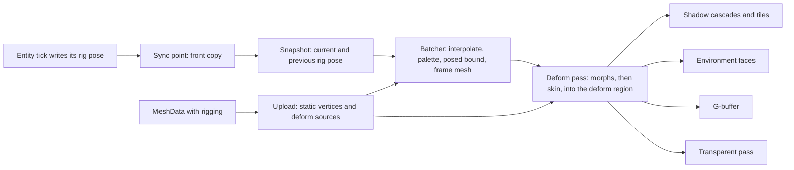

# Tertius architecture

Tertius is an engine for immersive sims and space sims. It combines a Caves of Qud style entity model with nested reference frames, double-precision physics and a deferred Vulkan renderer. This document records the design decisions. Each module must follow it. If a module must break a rule here, the change goes into this document first.

## Scope

These features are out of scope. Do not design for them.

- Multiplayer of any kind.
- Time warp. Every frame steps at the same fixed rate.
- Mods. The design keeps them possible, but no mod loading exists yet.
- The tidal gravity of a parent. The contents of a frame feel the frame's own field, minus the frame's proper acceleration, and in a turning frame its rotation terms (see "Turning frames" under "Physics"). They do not feel how the parent's field changes across the frame.

## Toolchain

| Item | Choice |
|---|---|
| Language | C# 15 preview on .NET 11 (`LangVersion` `preview`) |
| Dev shell | `nix develop` (see `flake.nix`) |
| Physics | Jolt 5.6.0 through JoltPhysicsSharp 2.23.0, double-precision build `libjoltc_double` |
| Graphics | Vulkan 1.3 through Silk.NET 2.23.0, MoltenVK on macOS |
| Windowing and input | Silk.NET.Windowing and Silk.NET.Input (GLFW) |
| Shaders | GLSL 4.60, compiled to SPIR-V with `glslc` at build time |
| Temporal upscaling | AMD FidelityFX FSR 3.1.4, pinned under `src/Tertius.Rendering/ThirdParty/Fsr3`; its README records the source, licenses, storage-format correction and optional RCAS wrapper (see "FSR 3.1 in the frame") |
| Tests | xUnit v3 on Microsoft.Testing.Platform, with AwesomeAssertions. Coverage uses Microsoft.Testing.Extensions.CodeCoverage. Every test project also loads the extension in `tools/Tertius.TestRecord`, which records a passed full run for the pre-commit hook (tools/README.md, "The test record"). |
| Images | StbImageWriteSharp writes the PNG captures, in `PngCaptureSink`. The tests read PNG files with StbImageSharp, and write the approved reference images and the failure files of snapshot tests with StbImageWriteSharp. |
| Video | ffmpeg 9.0.1 (`ffmpeg-headless` in the dev shell), a separate process that encodes the frames of a headless run with `--video`. `FfmpegVideoSink` finds it on the search path. The Host tests read the videos with its `ffmpeg` and `ffprobe`. |
| Benchmarks | BenchmarkDotNet 0.15.8 |
| Union generator and analyzer | `analyzers/Tertius.Unions`, a Roslyn incremental source generator and a diagnostic analyzer on Microsoft.CodeAnalysis.CSharp 4.14.0. Every project references it as an analyzer. Its tests run both in process on Microsoft.CodeAnalysis.CSharp 5.9.0, because 4.14.0 does not parse a built-in `union`. |
| Style analyzer | `analyzers/Tertius.Style`, a diagnostic analyzer and its code fixes on Microsoft.CodeAnalysis.CSharp and Microsoft.CodeAnalysis.CSharp.Workspaces 4.14.0. Every project but the union generator references it as an analyzer (see "Style analyzer"). Its tests run it in process on 5.9.0, as the union tests do. |
| Slop metrics | `tools/Tertius.Slop`, a console program that measures the erosion and the verbosity of `src` from the syntax alone, on Microsoft.CodeAnalysis.CSharp 5.9.0, which parses C# 15. The verbosity also runs jscpd for the clone lines. It prints JSON for the tools that read it (tools/README.md, "Slop metrics"). The git hooks keep the metrics of each commit in git notes under `refs/notes/slop`, and its `history` command prints them as CSV. Its tests are in `tests/Tertius.Slop.Tests`. |
| Code cleanup | `tools/cleanup.sh` (tools/README.md, "Code cleanup"). `dotnet format` from the SDK applies the IDE rules of Roslyn and the rules of Roslynator.Analyzers 5.0.1 that `.editorconfig` turns on. Then CSharpier 1.3.0, from nixpkgs in the dev shell, formats the code at 120 columns. |
| Platforms | The flake supports `aarch64-darwin`, `x86_64-linux` and `aarch64-linux`. On Linux, the shell finds NVIDIA's Vulkan driver of the host (`native/host-nvidia-vulkan.sh`, tools/README.md, "Linux NVIDIA machines"). The demo and the tests first ran on `x86_64-linux` on 2026-11-12 (ter-libf), on an RTX 2000 Ada and an L4 with NVIDIA's driver 595.91.07. The deck rendered the same image as on the Mac, with the same passes, and its GPU frame span without the headless readback was 10.3 ms on the RTX 2000 Ada against 24.3 ms on the Mac. The Linux test failures are tickets under `ter-89xq`. |

The dev shell builds the double-precision Jolt library with Nix from `native/joltc.nix`. That file pins the joltc commit and the Jolt tag by hash. The dev shell sets `TERTIUS_JOLTC_DIR` to the folder of the library. The script `native/build-joltc.sh` is a fallback. It builds the same sources without a hash check, into `native/osx-arm64` or `native/linux-x64`, and it supports only these two platforms. Both builds apply two patches to joltc. joltc keeps a temp allocator for system and character updates, a stack allocator that is not thread-safe, and `native/joltc-thread-temp-allocator.patch` makes it one per calling thread instead of one per process. So several backends in one process, such as parallel tests, step at the same time on different threads. joltc also keeps one map for the whole process from each Jolt physics system to its joltc wrapper, which every create and destroy of a system changes, and `native/joltc-system-map-lock.patch` guards it with one mutex. So several backends create and destroy frame systems at the same time; without the lock, the map breaks and a create loops forever or crashes. The other process-wide state of joltc is written once, in `Foundation.Init` and the binding's static constructors, which `JoltRuntime` runs once under its own lock. Each backend serializes its own native work and state with its own lock (`JoltPhysicsBackend.Gate`).

`Directory.Build.targets` copies the Jolt library next to the output of every project that sets `<UsesJolt>true</UsesJolt>`. It takes the library from `TERTIUS_JOLTC_DIR`. When that variable is not set, it takes the library from the folder of the script. It also copies the Vulkan loader from `TERTIUS_VULKAN_DIR` next to the output of every project that sets `<UsesVulkan>true</UsesVulkan>`. It defines `TERTIUS_CONTRACTS` in Debug and Checked builds, so the contract checks compile out of Release builds. Checked has the contracts of Debug and the optimized code of Release, and the test runs use it (`tools/test-all.sh` runs Checked and Release). Debug stays unoptimized for the debugger. `Directory.Build.props` turns tiered compilation off in every project whose name ends in `.Tests`, so a test process compiles each method fully optimized from the start. With tiering on, hot code such as `World.Tick` stayed unoptimized for most of a Physics run, because the runtime waits for a pause in new compiles that a test run seldom has. In this document, a Debug build means a build with contracts: Debug or Checked.

## Projects and dependency rules

```
src/Tertius.Core        math, handles, messages, contracts, TripleBuffer, PoseTree, FrameTree with the numeric
                        frame rules, the rails library (Kepler and spin math), the motion intent union,
                        gravity fields and media beside them, the loose-body step, physics and render seams
src/Tertius.Simulation  World, entities, components, rails components, chunked gameplay runs, router, sync point,
                        snapshots, spatial index, render snapshot builder, blueprints
src/Tertius.Physics     Jolt backend: one PhysicsSystem per frame, intents, gravity, hand-off, ghosts
src/Tertius.Rendering   Vulkan deferred renderer: G-buffer, depth ranges, lighting, shadows, impostors, the PNG
                        capture sink
src/Tertius.Host        threads, window, input, tick pacing, scripted and headless runs, state dumps,
                        the video capture sink, wiring of all modules
src/Tertius.Demo        the vertical slice game: its scenes and components (its scripts are in scripts/)
tests/Tertius.*.Tests   one test project per engine module, and Tertius.Host.Tests also tests the Demo;
                        Tertius.Rendering.Tests also holds FLIP and the snapshot test check
tests/Tertius.Testing   shared test helpers: FaultInjectingBackend, WorldTesting, Scenes, test components
benchmarks/             BenchmarkDotNet benchmarks
```

- `Tertius.Core` depends on nothing but the base library.
- `Tertius.Simulation`, `Tertius.Physics` and `Tertius.Rendering` depend only on `Tertius.Core`. They never reference each other. The test projects are the exception. `Tertius.Testing` and the Simulation, Physics and Host test projects reference several modules together. The reason is that every physics test runs the real World on the real Jolt backend.
- `Tertius.Host` references all modules and connects them through the seams in `Tertius.Core`.
- `Tertius.Demo` references `Tertius.Host`.

## Threads and the tick

The simulation runs at a fixed 60 ticks per second. Physics steps once per tick, by the float nearest the tick (see the seam rule below).

The one store of the tick length is `WorldOptions.TickRate`. Time comes from whole ticks: the time of tick N is `StartTime + N / (double)TickRate`, exactly as that division rounds (`World.TimeAt`), and `World.Time` holds that double during the tick. So 60 ticks at 60 ticks per second last exactly one second, and the clock gains nothing over a day. A sum of tick lengths would round at every tick, and a tick length rounded to a float gained 4.5 ms per simulated day (ter-xshi). The tick length, `World.DeltaTime`, `Self.DeltaTime`, `Tick.DeltaTime` and `PhysicsStepContext.DeltaTime`, is the double `1.0 / TickRate`, and no float tick length is stored beside it. A reader that computes in floats narrows it once at its own site. A clock that counts time in ticks stores a whole count, and compares the count against a time in seconds as `count / (double)TickRate`, exactly as `TimeAt` divides (`World.Seconds`, and `Self.Seconds` for a component such as the demo's `Clip`), never as a sum of tick lengths: 30 sums of 1.0 / 60 give 0.49999999999999994 s. The clocks of numeric frames work this way (see "Who gets one" and "Membership" under "Numeric frames").

Jolt steps by a float, the float nearest the tick. It differs from the tick: at 60 ticks per second it is 5.2e-8 of a tick longer, and at 50 it is 2.2e-8 of a tick shorter. The seam rule: every computation that feeds Jolt's step or predicts what Jolt does in it takes Jolt's float step. That is a velocity that must carry a body a displacement over Jolt's step (a steer target's velocities, `MoveKinematic`, the velocity that the two-turn update gives Jolt), a force or a damping factor that Jolt integrates, an acceleration read back from Jolt's change of velocity (the proper acceleration of a dynamic hull), and the prediction of a dynamic hull's move and turn in the step (`FrameTree.HullPrediction`, `FrameTree.BeginTurn`), because its frame takes the hull's pose from Jolt at the sync point. Every computation of a frame's motion, of an inertial line, of a Kepler place or of the time takes the double tick. The two-turn update moves a body along its inertial line over the tick, so the velocity that Jolt holds for a dynamic body in a turning frame is its chord over the tick times the tick over Jolt's step, and the update reads Jolt's velocity back the same way (see "Turning frames" under "Physics"). Elsewhere a body keeps Jolt's velocity as its chord, so at 60 ticks per second its motion relative to its home runs 5.2e-8 of its speed farther in each step than the double tick would: 6.6 µm in a step at 7.66 km/s. That excess is systematic, with the same sign in every step, so it does not average out. It is of the order of a float velocity's own representation error, not below it: half an ulp of 7,656 m/s is 2.4e-4 m/s, 3.2e-8 of the speed.

| Thread | Work |
|---|---|
| Main | The window and input. macOS requires this. |
| Gameplay workers | Entity runs, in chunks of 64 entities, through `Parallel.For`. In a large world, also five pieces of the sync point (see below). |
| Physics | One Jolt step for every active frame. Jolt uses its own job threads. |
| Simulation | Runs the ticks and their sync points, and a scripted run's steps. In the window, it paces the ticks by the wall clock. |
| Render | Draws the latest render snapshot and interpolates between the last two. |

Each backend runs a Jolt job system with `JoltBackendOptions.WorkerThreadsFor(Environment.ProcessorCount)` worker threads. That is `JoltBackendOptions.WorkerThreads` when it is positive. The default of 0 gives one worker per processor that the runtime reports, minus one, and at least one. The runtime takes that count from `DOTNET_PROCESSOR_COUNT` when it is set, so the variable sets the number of Jolt's workers, as it sets the processor count of the .NET thread pool. On a machine of 10 cores without the variable, the window's backend runs 9 workers. A headless run sets 1 (`JoltBackendOptions.Unpaced`). A step ends in the same bits with any number of workers, because Jolt's determinism depends on the order of the API calls and on the binary, not on its job system. `WorkerThreadsTests` steps a pyramid of 91 cubes with 1 worker, 2 workers and the default count, and compares the hashes. The pyramid is one island of more than 128 contact constraints, so Jolt's large island splitter hands its constraints to the workers in batches.

The Main, Simulation and Render threads exist only in the window. A headless run has none of them. Its calling thread runs the ticks, the steps of the script and the captures (see "Host and scripted runs").

One tick has three parts. First, one thread prepares the tick. Then, during the parallel part, gameplay and physics run at the same time. Both read only state that is fixed for the tick: the front snapshot of tick N-1 and the frame tree. Last, during the sync part, one thread merges the results.

In a large world, the sync thread hands five pieces of the sync part to the gameplay workers, as independent work items. Each one runs on the workers only when `WorldOptions.MaxDegreeOfParallelism` is not 1 and the piece has at least a threshold of work. One `Parallel.For` costs about 5 us and 2 KB, so a small world runs every piece on the sync thread and pays nothing. The thresholds of steps 8 and 10 were measured on an Apple M1 Max with all workers (ter-sn28), that of step 2b on the same machine (ter-fwsy), and the comment on each constant gives its measurement. Step 8 also ends each change that a game makes outside a tick, through the same method, with the same pieces and thresholds.

| Step | Piece on the workers | Threshold | Work item |
|---|---|---|---|
| 2b | Step the puffs | 3,072 live puffs | One of 16 equal slices of the rows |
| 8 | Copy the rows that gameplay wrote | 8,192 rows that gameplay wrote | One chunk of 64 slots |
| 8 | Find the new grid cell of each moved entity | 65,536 moved entities | One of 32 equal ranges of the moved list |
| 10 | Join the outboxes, expand the targets, sort the pairs by recipient | 6,000 messages | A block of chunks, then a slot range |
| 11 | Build the render snapshot | 8,192 slots | 1,024 slots |

The puffs have three parts that could run on the workers by the same rules (docs/plans/particles.md, "The parallel pieces"). The step is the first row of the table above. The births and the placement of the puffs stay on the sync thread, because they would pay on the workers only past what the default capacity allows. The table below gives the measurements (ter-fwsy, Release, on the M1 Max at a 1-minute load of 5.4 to 16, and 6 to 10 for the runs on the workers, so every number is an upper bound). The costs on the sync thread come from BenchmarkDotNet. The hand-off of the step to the workers costs about 20 µs there, more than an empty `Parallel.For` back to back, because the workers start to sleep in the sync steps before it (`PuffTableBenchmarks.Workers`, run with `--puffstep`). The row copy of step 8 found the same 20 µs. The workers ran the step about 2.5 times as fast as the sync thread, so a piece on the workers pays only above about 33 µs of work on the sync thread.

| Step | Part of the puffs | Its cost on the sync thread | Where the workers pay |
|---|---|---|---|
| 2b | Step the puffs | 24 to 57 ns per puff, from `earth` to `earth-surface` in one run of `PuffTableBenchmarks.Step`: 18.0 to 43.0 µs at the 760 puffs of `puff-yard`, 34.3 to 81.5 µs at the 1,440 of the demo's main engine at full throttle (a headless run of `blue-danube` peaks at 1,516 live puffs, when jets fire beside it), 97.6 to 233.0 µs at the default capacity of 4,096, 392.5 to 936.9 µs at 16,384 | By the medians, in a table whose oldest puffs die in each step, they tie at 2,048 puffs in `earth` and win from 3,072 in both frames, by 8 to 30 percent there and 25 to 45 percent at 4,096. The join moves 15 of the 16 slices on the sync thread, which costs 1 to 5 µs up to 4,096 puffs but about 110 µs at 8,192, where the workers lose by 5 percent in `earth` |
| 7c | The births, in chunks of slots (stay on the sync thread) | About 70 ns per birth in vacuum and about 145 ns in a medium | Above about 230 to 480 births per step, 14,000 to 29,000 puffs per second. The demo makes about 4 per step from its main engine at full throttle and less than 1 per firing jet, and at the default capacity such a rate keeps only puffs that live less than 0.3 s |
| 11 | Place the snapshot puffs, by range (stays on the sync thread) | 7.9 ns per puff: 6 µs for `puff-yard`, 11 µs for the main engine, 32 µs at 4,096 | Above about 4,200 puffs, more than the default capacity holds |

Each piece ends in the same state, bit for bit, as on the sync thread, in every run. A work item writes only its own chunks, slots or range of a list. What it gives to state that items share waits in a per-item list, and the sync thread joins those lists in chunk, slot or range order, never in the order in which the workers finish. The outboxes of the gameplay chunks join in the same way. Each step below gives its own ordering rule. Tests compare each piece on the workers with its path on one thread. Each subsystem with a piece takes the workers, or none when the world has one thread, and keeps its threshold in an internal property that refuses a value below 1. The tests of all five pieces force the threshold down to 1, so that a small world runs the piece on the workers, and a test of the render snapshot also builds a world of more than 8,192 slots at the default threshold.

The engine's part of a tick follows the rule that hot paths allocate nothing after warm-up, with one accepted exception: the bookkeeping of each `Parallel.For` call, about 2 KB of short-lived garbage. The gameplay part makes one call in every tick of a world with more than one chunk, when there is more than one worker. In a large world, the sync part adds one call for each piece in the table above, and two for the routing, one for each phase. So a tick of a large world on all workers allocates about 14 KB, under 1 MB per second at 60 ticks per second, which the garbage collector frees in its cheapest generation. A set of worker threads that the world keeps for its whole life would remove this garbage. But it would replace the .NET task scheduler in every parallel part of the tick, so it waits until a measurement shows that the garbage costs time. With one worker, or below its threshold, a piece runs in a plain loop on the sync thread and adds nothing to this garbage. A test checks that a routing on the sync thread allocates nothing after warm-up.

The preparation does these steps in this order:

- If a change outside a tick made the numeric update due, run it, derive the attachments and swap the snapshot. So a body that a spawn outside a tick made joins its numeric frame before physics creates it.
- Hand physics the batch of spawns and destroys made outside the tick, before the step that can touch them.
- Update the frame tree. Fix the accelerations of the falling numeric frames for the step. Give each following frame its step plan and the acceleration that lands it on the plan. The step plan is the step record of the anchor's motion intent in the intents of the step, or without one the record of a kinematic body that holds still (see "Numeric frames"). Physics reads them, and the sync point follows them.
- Apply the queued changes of the indexes that entity queries start from, so that the workers only read them.
- Reserve a pool of free slots for each chunk that has live entities, in chunk order. A pool holds the larger of `WorldOptions.SpawnPoolSize` (8 by default) and twice the spawns of its chunk in the last tick, up to 1,024. When the pools need more slots, the tables grow here. A spawn during the tick takes its slot from the pool of its chunk, so spawned handles are the same in every run.

The sync point does these steps in this order:

1. Wait for all gameplay chunks and for the physics step. Grow the tables over the slots that spawns took after the pool of their chunk ran dry. Such a spawn takes a slot with an atomic increment. Its slot then depends on thread timing, so the world logs a note that the run is no longer deterministic.
2. Move the falling numeric frames over the step, with the acceleration that physics used. Then check the physics output before any of it lands. If an output can only come from a bug in the backend, skip the physics update of each entity that it names. "Output that only a bug produces" under "Physics" gives the checks. Then move each handed-off frame under its new parent in the frame tree, and put each following frame on its anchor's step plan when its anchor ended the step at the frame's origin: a hull, whose frame's record says so, or a plain kinematic body, whose front intent did not teleport it. Copy body poses, velocities and hand-offs into the back transform table. A body state of a hull writes no row. Keep whether physics stood each character. Then every frame takes its step record, in one pass of the frame tree (`FrameTree.TakeStepRecords`, called from `FollowOwners`, see "Rails components and motion intents"). The pass decides where each frame's record comes from, writes the frame's row and derives its proper acceleration from the record (see "How a frame moves"). It asks the World, through a struct (`IFrameOwnerFacts`), only what the tree does not know: the record that physics released for a hull, whether the output check skipped the owner's update, and a write of the owner's transform. Before it writes, it copies every frame's proper acceleration, and the rule reads the copy (`FieldTheStepFound`). So each frame reads its parent's value as the step found it, in any order of the visits. Then the float view of each frame entity, its transform row, is filled from its exact table, its row in the frame tree. The frame entity also moves to the member set of its frame's parent there. So the owner of a frame that a hand-off or the game moved under another parent changes topic and hears one `FrameChanged`. Each of the two passes is one walk over the frame tree's own storage, in dense order (`FrameTree.TakeStepRecords` and `FrameTree.VisitOwnerViews`), with no handle check. In a Debug build, a contract checks after each frame that the World's struct moved no frame, or changed nothing that an owner view reads. A record from physics is relative to the frame's parent after its hand-off. So it must come after the hand-offs, and before step 5 destroys any frame. A frame without a body takes its owner's write of its transform here too, so a write in the tick in which the frame's parent dies converts with the frame. Then each entity without body or frame takes the step record of its motion intent on its transform row (`FollowFramelessEntities`). This comes before step 5 converts the rows out of dying frames, and before step 7 derives the attached children from their roots. Then each plain body that a hand-off moved changes topic and hears one `FrameChanged`. Send the contacts that started as `Collision` events last, and then the contacts that ended as `CollisionEnded` events. So a contact that starts and ends in one step reaches each entity in that order.
   - 2b. Step every puff over the step that ended (`PuffTable.Step`, see "Puffs"), by the rule of motion of its frame, and remove the puffs whose age reached their life. With 3,072 or more live puffs, the workers step them, in 16 equal slices of the rows. Each slice steps only its own rows, compacts its survivors toward its first row and keeps the looks of its dead rows. Then the sync thread joins the slices in slice order, which is row order: each slice's survivors move up behind those of the slice before, so the survivors keep their order, and the looks of the dead rows are freed in row order, as on one thread, so the free stack of the look table and every later look index are the same. On one thread the step is one slice, which the join does not move. Every frame took its step record in step 2, so the frame tree describes the end of the step, and the frame's loose-body step still holds the gravity that physics read. It must come before step 5 converts the contents of dying frames, because a puff that still held its place of the step before would land off by its frame's move over the step. It reads nothing of the physics output, so it also runs when the sync point drops that output, and in a World without a physics backend.
3. Make sure that no entity with a body wrote its own transform. In every build, such a write throws `InvalidOperationException`, so none gets through. When `WorldOptions.DebugChecks` is on, this step checks every invariant of the entity table, this one included. That check costs time in proportion to the slots in use, not to the capacity of the table. A slot that was never used must be clear in every column, and the table checks that when it first takes the slot, because a scan of every unused slot made the check read about 2 MB per call at the default capacity.
4. The step applied the intents of the last tick. So their collision groups and masks become the back collision rows of the bodies, which step 8 publishes, and their changes of motion become the stored motions of the hulls in the frame tree (`FrameTree.HullMotion`), also without a physics backend. Both describe the step that ended, as all the state that the next tick reads does. Then each owner that wrote a change of motion in this tick gets its frame planned for the next step, which applies the change: the frame and the intent drop what the new motion refuses (see "Changes of motion"). The entity table lists the owners that wrote a change in each chunk, and the swap hands that list on with the intents, so step 4 visits only them, not every body that wrote a force or a velocity. Then swap the physics intent buffers. The entity table also lists the parts that pushed in each chunk, apart from the intent writers (see "Parts"). The swap hands that list on as the front pushers, as it hands on the owners that wrote a change of motion, and it keeps the parts out of the intent list, because a part's push is no input of physics: step 5 carries it to the part's chain root. The swap clears the old front entries and exchanges the two buffers, so physics gets this tick's forces and motion intents in the next step. With no physics backend, the swap keeps only the changes of motion and the motion intents, and clears the other fields of each intent in place (`PhysicsIntent.KeepOnlyMotion`). It also clears the push of each part and lists no part, so step 5 carries nothing. The sync point moves an entity without a body by its motion intents, with or without a backend.
5. Apply the subscribe and unsubscribe requests of the chunks, in chunk order, while every entity that asked is still live. Then the destroy batch grows to the attached children of each dying entity. It also grows to the members of each dying frame that has no surviving ancestor. Then carry the push of each part to the body of its chain root, in one choke-point method (`Attachments.CarryPushes`, see "Parts"). The flow writes the front intents, so it comes after the swap of step 4. It comes after the growth of the batch, so that a part that dies here gives no push: a part that is not live in the next step does not act in it, as the intent of a body that dies goes with the body. It comes before the batch moves or frees anything, and before step 7b, so that the intents of each part and of its root still name the front frame of the chain, and the sum needs no relation between frames. The sum then converts once, as part of the root's intent, by the rule that converts every force. It comes before step 6c, whose thrust clock reads the force and the impulse of each body's front intent, so the clock counts the pushes of the parts. Then free dead entities. The survivors in a dying frame move into the nearest ancestor frame that survives. Increment the generation of each freed slot and return the slot to the free list. Queue the destroys of their bodies for physics, which gets the batch in step 6c. Before the dying frames go, convert each intent of the next step that names one of them into its entity's new frame. "Ownership of transforms" tells how. Step 7b cannot relate a frame that is gone. The motion intent converts with the rest of the intent, by its case. Then the puffs of each dying frame move into its heir, or die with it when no ancestor survives (`PuffTable.MoveOutOfDyingFrames`, see "Destroying a frame"). This comes before the frames die, because the frame tree refuses a dead frame.
6. Make new entities live, in chunk order. Each spawn reserved its slot during the tick, so no table grows here. The world drops a spawn into a frame that step 5 destroyed, and it records an error. Queue the new bodies for physics. An attached entity becomes live in the frame of its parent at this moment, after steps 2 and 5 moved the parent. A spawn's first motion intent goes into the new entity's front intent here, after the swap of step 4 (`EntityTable.SetFirstMove`). So the next step applies it (see "Creation and destruction"). A new frame stands at the pose of its spawn description. Without a first motion intent, it holds still there for its first step.
   - 6c. Run the numeric update (`FrameTree.UpdateNumericFrames`, see "Numeric frames"), after the physics output, the destroys and the spawns, so that it clusters every live body where it is at the end of the tick. Every frame took its step record in step 2, so the rows of the bodies and the frames both hold the end of the step, and the update tests the bodies against bubbles of the same moment. (Before the review of ter-2gg0, the frames on rails moved after the update, and the update placed the bubble of a station that orbits at 7.5 km/s 126 m behind the bodies beside it.) A new following frame starts at its anchor's place, with the chord of its anchor's motion over the step that ended, which it derives from the anchor's frame tree row for a hull, and from the anchor's transform row for a plain body (see "Numeric frames"). First the update lets go each following frame whose anchor is no body in it. Then hand this sync point's changes to physics. The update before this one can name a home for the ghost of an anchor. Then physics gets the changes even when there are none, so that it drops the ghosts whose home this update stops naming. The update gathers the bodies in slot order from a bit per slot, which the entity table sets while the slot holds a live entity with a body. It takes each body's bounding radii as the table kept them at the spawn.
7. The float view of each frame entity is filled from its exact table again, after the numeric update, which can move a frame among numeric frames. A nesting frame that jumps moves no frame and writes no row, but it changes the sum that gives the place of each frame below it in its semantic frame, which can round to another double. This pass runs only when something wrote the frame tree since the pass of step 2. The tree keeps a stamp, `FrameTree.OwnerViewStamp`, that every write of a frame's local pose, velocities or parent changes, and the world compares it with the stamp at the end of the pass of step 2. A change of a hull's motion at step 4 writes none of these: a hull that leaves its following frame leaves it falling, and a falling frame is still a numeric frame, so no owner view changes. With frames on rails and nothing else, nothing writes the tree between the two passes, and the second pass found every row equal. When `WorldOptions.DebugChecks` is on, the world checks at the end of every sync point that the float view of every frame entity, its transform row, equals what its exact table gives, bit for bit. So a write of the frame tree that does not change the stamp fails a test. Then every attached entity takes its frame, pose and velocities from the root of its chain.
   - 7b. Each intent that the next step applies and that names another frame than its entity's converts into the entity's frame (see "Ownership of transforms"). This comes after steps 2 and 5, which move entities between frames, and after step 7, so that every entity is in its frame for the next tick. It comes after step 2, so that every frame stands where the next step starts, the moment at which a velocity of the intent applies. The motion intent converts with the rest of the intent. A plain kinematic body can hand off in a step, so its next motion intent converts here. The entity table counts the writes of a back row that move it to another frame (`EntityTable.RowFrameChanges`). While the count is the one of the last pass of 7b, no entity is in another frame than its intent names, because each intent names the frame of its entity's front row, which step 8 copied after that pass. Then 7b skips its visit of every intent writer, as in a scene of frames on rails that write a motion intent in every tick.
   - 7c. The emitters of the step that ended make their newborns (`PuffTable.AddNewborns`, see "Puffs"). Then the cap drops the oldest puffs, and the rebuild puts each frame's newborns at the end of its range. Only here does every input of a birth describe the step that ended: the front render row still holds the emitter of that step, which step 8 replaces, and the back transform row holds the emitter's place and velocity at the end of the step, which step 7 derives for an attached jet.
8. Swap the snapshot. The back tables become the front tables. Copy only dirty slots forward: first the rows that gameplay wrote, in chunk order, then the rows that the sync point wrote. With 8,192 or more rows that gameplay wrote, the workers copy them, one chunk per work item. A chunk's dirty list holds only its own slots, so the items write disjoint rows. Each chunk keeps its moved entities and its changed component flags in its own lists, and the sync thread joins those lists in chunk order after the workers finish. Then it copies the rows that the sync point wrote, and the component index takes the changed flags, on the sync thread, in the order of the copy on one thread. Then the frame tree and the spatial grids catch up with the new front rows (see "Snapshots").
9. Run the physics queries that components asked for during the tick, the ray casts, shape casts and overlap queries, in entity order. Jolt is at the end of the step, with the destroys and spawns of steps 5 and 6, and the new front snapshot describes the same moment: its component flags, collision groups, poses and frames. Queue each answer as an engine event.
10. Route the outboxes, and the answers of step 9, into inboxes (see "Outboxes, routing and order"). A routing of 6,000 messages or more runs on the workers.
11. Build the render snapshot and publish it to the render thread through a triple buffer. A build of 8,192 slots or more runs on the workers. After the instances, the builder places the puffs of the puff table, on the calling thread (see "The render snapshot").
12. Start the next tick.

Gameplay intents written during tick N reach physics in step N+1. That is one tick of latency, and it is acceptable.

## Entities

An entity is a 64-bit handle: a 32-bit slot index and a 32-bit generation. The generation increments every time the slot is freed. A handle with an old generation is stale, and every lookup must reject it.

Each live entity has a row in three parallel tables, indexed by the slot index:

- Transform: the frame that the entity is in, a frame-local `DPose`, and linear and angular velocity. Positions are double, because Jolt gives double positions and a planet frame is millions of meters across.
- Physics: an optional body description and the double-buffered `PhysicsIntent`. The cold record of a body also keeps, from the spawn, the bounding radii of its shapes and the center of mass of its shape, which the backend computes (see "Physics"). The lever of a part is measured from that center (see "Parts"). The intent also holds the entity's motion intent for the next step (`PhysicsIntent.Move`). An entity without a body writes one too (see "Rails components and motion intents"). Every slot holds the field, so an intent is about 380 bytes. With 100,000 entities that each write a motion intent in every tick, step 4 takes 1.8 ms of a sync point of 16 ms, so the field has no sparse store (docs/plans/rails-components.md, "The measured cost").
- Render: mesh, material, scale, bounding radius, render flags, an optional light (a `LightData`: a point light, a spot light or none) and an optional puff emitter (a `PuffEmitter`, see "Puffs"). The emitter adds 44 bytes to the row.

An entity that spawns with a rig pose, `SpawnDesc.RigPose`, also has a `RigPoseBlock` in its slot (`EntityTable.RigPoses.cs`, docs/plans/skinning-and-morphs.md, "The rig pose in the simulation"). A rig pose is a joint pose, a `Pose` relative to the parent joint or to the model's origin, for each joint of the entity's rig, and a weight for each morph (see "Skinning and morph targets"). The block holds three copies of it, each of the shape that the spawn fixed:

| Copy | Written by | When | Read by |
|---|---|---|---|
| Back | The entity, through `Self.RigPose`, a `RigPoseWriter` over its spans | Its tick | The entity, and step 8 |
| Front | Step 8 of the sync point, from the back, with the render row | The sync point | The snapshot builder |
| Placed | The snapshot builder, from the front, with the stamp of the build | Step 11 | The snapshot builder in the next build, for the previous rig pose |

A write through `Self.RigPose` marks the slot's `RenderDirty`, as a write of the render row does, so step 8 copies the render row and the rig pose together. `SlotFlags` has no bit left, and few slots are posed (decision 19). A spawn takes a block of its shape from the table's pool, or makes one, and writes the spawn's rig pose into all three copies. A destruction returns the block to the pool. The shape is fixed at the spawn (decision 31). The spawn throws `ArgumentException` for a rig pose without a render row, a default array, more than `Rig.MaxJoints` joint poses, a number that is not finite, or a rotation whose squared length is not finite or is at most 10^−12. A tick can still write any value into the spans, and the renderer's guards catch it. `Self.RigPose` throws `InvalidOperationException` for an entity without a rig pose. The rig pose is relative to the entity, so a hand-off changes nothing in it, and only its entity writes it. `EntityTable.AssertInvariants` checks that only a live slot has a block, that no block belongs to two slots or to a slot and the pool, that each pooled block lies in the stack of its shape, that every block's copies have its shape, and that a slot whose render row is clean has equal front and back rig poses.

Each entity also has a list of components, which are classes that implement `IComponent`. The list is sorted by `Priority`. Components with the same priority keep the order in which they were added.

A frame is an entity that also has a row in the frame tree. `FrameHandle` holds the entity handle plus the frame index and generation. It converts to `Entity` implicitly.

### Component rules

- A component changes only its own state and the tables of its own entity.
- An entity never changes another entity. It sends a message.
- A part, an attached entity that pushes, changes only its own intent too. The engine carries its push to the body of its chain's root at the sync point, as physics carries a contact from one body to another. The root's components do not see the push, and no message carries it (see "Parts").
- An entity reads other entities only through the front snapshot of the previous tick. It never reads another entity's components. The snapshot publishes each entity's component flags, the types of the components that it had, and each body's collision groups, so a component can ask whether another entity has a component, or find entities with an entity query (see docs/plans/queries-and-sensors.md). `Snapshot.BodyOf` gives the physics facts of another entity's body: its motion, mass, shape kind, bounding radius, center of mass, collision groups and mask, and whether it is a sensor. It gives null for a stale entity and for an entity without a body. A body's description does not change after spawn, so only the collision groups and mask, which an intent can change, have double-buffered rows. The motion of a frame's hull can change too, with the intent `self.Body.SetMotion`, but the frame tree stores it (`FrameTree.HullMotion`), and it changes only at step 4 of a sync point, so it is the same for the whole tick. Like the collision groups, the facts show the last finished step, so a change shows from the second tick after the one that writes it. The entity reads the motion of the step that applies its own writes with `self.Body.NextStepMotion` (see "Changes of motion").
- A component never stores a `ref`, a span, an `EventList`, an `Outbox` or a `Self` beyond the call that received it. The compiler enforces this for ref structs.
- `Handle` never awaits. For a delay, a component sends a message to itself with a delay.

### Ownership of transforms

If an entity has a physics body, physics owns its transform. Gameplay moves it only through its intent: forces, impulses, velocity changes and teleports through `self.Body`, and motion intents (see "Rails components and motion intents"). These go into the entity's `PhysicsIntent` slot. Forces and impulses add up during the tick. Velocity changes and the motion intent keep the last value written. Each kind of body takes its own requests:

- A dynamic body, hull or plain, takes forces, impulses, velocity changes, teleports and the steer target of `self.Body.SteerTo`: physics gives the body the velocities that carry it to the target over the step, and contacts and gravity still act on it.
- A kinematic body, hull or plain, moves only by its motion intents and its teleports. Its motion intents are the end poses of `self.MoveKinematic` and the full samples of `self.MoveOnRails`. It holds still in a step without one. `SetVelocity` and `SetAngularVelocity` throw an `InvalidOperationException` for it. (User, 2026-10-18)
- The owner of a static hull moves it only by a teleport: physics moves the hull at the start of the next step, and the frame takes the teleport's pose at the next sync point.
- A static body and a character take no motion intent. A character moves by its walk, its jump, forces and impulses.

An attached entity has no body, but it can push the body of its chain's root as a part (see "Parts"). Only the additive intents flow from a part to the root: the force, the torque, the impulse and the angular impulse, which compose by a sum. The exclusive intents stay with the root alone, because two writers of one would need someone to decide: a velocity, a teleport, a motion intent, a character's walk and jump, a change of collision groups and a change of motion. A part's push needs a root with a body: `AddForce`, `AddTorque`, `AddImpulse` and `AddAngularImpulse` throw an `InvalidOperationException` for an entity that has no body and is not part of a chain whose root has one, and every other member of `self.Body` throws for a part as for any entity without a body.

The guards judge each write by the motion of the step that applies it (see "Changes of motion"). The owner of a hull changes the hull's motion with `self.Body.SetMotion` (see "Changes of motion").

An intent is relative to `self.Frame` during the tick in which gameplay writes it, and it names that frame (`PhysicsIntent.Frame`). Physics applies it in the next step, and the sync point between can move the entity to another frame: the step that ran during the same tick hands the body into a bubble or out of one, or the destroy batch moves it out of a frame that dies. The sync point then converts the intent into the entity's new frame, so physics always applies an intent in the entity's frame. An intent that names a dying frame converts at step 5, before the frame dies, and every other intent converts at step 7b (see "Rails components and motion intents"). The conversion uses the motion of the old frame in the new one over the step that applies the intent (`FrameTree.MotionRelativeInStep`): one relation where that step starts, and one where it ends. Each part of the intent converts by the moment that it describes. The velocities of `SetVelocity` and `SetAngularVelocity` apply where the step starts, so they convert by the relation there, with the motion of one frame relative to the other. A teleport converts as a pose by the same relation, and forces, torques, impulses and a character's walk convert as directions by it. The motion of `SetMotion`, the collision groups and the jump speed do not depend on a frame, so they stay as they are. A motion intent converts by its case (`MotionIntent.Converted`). An end pose and a steer target are poses at the end of the step, so they convert as poses by the relation where the step ends. A full sample converts its pose, its velocities and its accelerations by the relation where the step ends, and its chord by the frame's poses at both ends of the step (`MotionSample.Converted`). In the relation where the step ends, a frame whose owner has an end pose or a full sample stands where that motion intent puts it. A frame that holds still stands where the step starts. A numeric frame stands where the numeric update moves it. So a kinematic body that hands off out of a ship that moves on end poses gets its end pose where the ship ends the step, to the rounding of the composed poses. Four kinds of frame on the path make the conversion miss. A falling frame moves with the step acceleration of the step that ended, and the next step fixes its own anew from nearly the same field. So the conversion misses the frame's end position by the change of that acceleration from one step to the next, times the square of the step. A frame with a dynamic hull stands where physics predicts from its row: the row's velocities, and the proper acceleration and the angular acceleration of the last step. So a steady thrust, a steady torque or a resting contact is in the prediction, and the conversion misses by how the step differs from the last step. A change of force, torque or contact misses the frame's end position by about half the change of acceleration times the square of the step. A velocity change, an impulse or a steer target in the step, linear or angular, changes the hull's velocity where the step starts, so it misses the frame's end pose by that change times the step. Physics measures the proper acceleration from the whole change of the hull's linear velocity over the step, so the prediction also repeats a linear velocity change, impulse or steer of the last step as an acceleration over this step. The owner of a frame without a hull can write the frame's transform in the next tick. That write wins over the frame's motion for the step, from a motion intent or from holding still, and the conversion cannot know it. So the conversion misses by how far the write moves the frame from where the relation puts it. A frame that dies at step 5 keeps its relation at the moment of its death at both ends of the step, the relation by which the rehome moves its contents. So a motion intent that converts through it misses by the frame's motion over one step. (Before ter-dhkf, physics applied the intent in the new frame as it was. A kinematic door that gameplay moved in every tick entered a passing pod's bubble, got the target of the station's frame in the pod's frame, jumped out of the bubble, came back in the next tick, and changed frames in every tick.)

If an entity has no body, gameplay owns its transform, unless the entity is attached. It moves the entity in two ways, both relative to `self.Frame`. `self.SetTransform` writes the pose, and leaves the entity at rest. An end pose or a full sample moves it over the next step. At step 2 of the sync point after that step, the sync point puts the motion intent's step record into the entity's exact table. That is the frame tree row for the owner of a frame, and the transform row for an entity without a frame. Such an entity holds still in a step without a motion intent. A transform write comes after the motion intent of the same tick, so the write wins for one tick. The next motion intent puts an entity on rails back on its rails. The owner of a root frame takes end poses and full samples too, with or without a body, because its body is only the frame's static interior. The sync point moves its frame as a frame without a hull.

### Creation and destruction

`self.Spawn(...)` takes a slot at once from the spawn pool of its chunk and returns the new handle. The preparation of the tick reserves the pools in chunk order, so a spawn gets the same handle in every run. If a pool runs dry, the spawn takes a new slot with an atomic increment, and the run is no longer deterministic. The new entity starts to run on the next tick. The tables never grow during the parallel part of a tick. They grow in two places. The preparation of the tick grows them to fill the pools. Step 1 of the sync point grows them over the slots that dry pools gave out. An entity can destroy itself with `self.Destroy()`. To destroy another entity, send it a `Destroy` message. Both take effect at the sync point.

No other operation is deferred. There is no general command buffer.

A spawn can attach the new entity to a parent entity with `SpawnDesc.AttachTo`. The attached entity follows its parent with a fixed offset in the parent's axes. It has no body, it cannot be a frame, and it dies with its parent. It can still push the body of its chain's root with the additive intents, as a part, and its push acts at its place (see "Parts"). Its chain root never changes, because an entity is attached only at its spawn and dies with its parent. A chain of attached entities is always in the frame of its root, the one entity of the chain that is not attached. In step 7 of the sync point, each attached entity takes its frame, pose and velocities from that root. So an attached spawn becomes live in the frame of its parent at that moment, and the frame that its description names does not count. A component that spawns during a tick saw the parent in the front snapshot. In the same tick, physics can hand the parent into another frame, or the parent's frame can die and move the parent to an ancestor frame. The component cannot know that, so it is not a bug: the new entity becomes live in the parent's new frame. A parent that is not live at the sync point, or that owns a root frame and so is in no frame, cannot take the new entity. The world then drops the spawn and records an error in `World.Errors`. Outside a tick, `World.Spawn` throws for such a parent instead.

A spawn description can carry the new entity's first motion intent, `SpawnDesc.FirstMove`: the motion intent that the entity writes for its first step, as if it ran in the spawn's tick, relative to `SpawnDesc.Frame`. (User, 2026-10-18) Step 6 of the sync point puts it into the new entity's front intent, or the call of `World.Spawn` does outside a tick. So the step after the spawn applies it, as a motion intent that the entity wrote. Without one, a new frame on rails holds still for its first step, because its components first run in the tick after it goes live. The spawner computes the end of the entity's first step with `self.TimeAt(self.Tick + 2)` in a tick, and with `World.TimeAt(World.TickNumber + 1)` outside a tick. `World.TimeAt` is public for this, the same read as `Self.TimeAt`. A spawn refuses two kinds of first motion intent, with an `ArgumentException`. The first is a case that the entity refuses, by the guard of every motion intent (`MotionIntent.ProblemFor`) with the facts of the description. The second has a number that is not finite, or a zero rotation. A blueprint holds none, because the motion depends on the time of the spawn.

A spawn velocity, `SpawnDesc.LinearVelocity` or `SpawnDesc.AngularVelocity`, is the first velocity of a body that physics integrates: a dynamic body, hull or plain, or a character. A kinematic hull takes one too. It keeps it as its frame's velocity until its first sync point. From it, the numeric update gives a fast kinematic hull its following frame at spawn, and a fast dynamic body, hull or plain, or a character a falling frame whose velocity is the chord behind the spawn velocity (see "A frame's velocity from its group" under "Numeric frames"). Every other entity moves by something else, so a spawn refuses a velocity on it with an `ArgumentException` (`World.SpawnVelocityProblem`). These entities are an attached entity, an entity without a body, the owner of a root frame, a static body, hull or plain, and a kinematic body that owns no frame. The spawner of such an entity gives it a first motion intent instead.

### Parts

A part is an attached entity that pushes the body of its chain's root (docs/plans/parts.md). (User, 2026-10-21) So the shuttle's main engine, each of its jets and the person's back jet can each be a separate entity, attached to the hull or to the person, with one particle emitter each. A part writes only its own intent, with the same members as a body: `self.Body.AddForce`, `AddTorque`, `AddImpulse` and `AddAngularImpulse`, in the axes of its frame, which is the frame of its chain root. `World.WritablePush` takes these writes. For an entity with a body it gives the entity's own intent. For an attached entity whose chain root has a body it gives the part's own back intent, and the part's first push of the tick lists it among its chunk's pushers. The guard reads the part's link and the root's body description, which nothing writes during a tick, so the part's worker may read them while the root runs on another worker. `self.Body.Pending` of a root shows only its own writes, never its parts' pushes, which join at step 5.

At step 5 of the sync point, `Attachments.CarryPushes` visits the front pushers, chunk by chunk, each chunk in the order of the first push of its parts. It skips a part of the destroy batch and empties its front intent. For each other part, a force at the part's place gives the root's body the same force and the torque of its lever about the body's center of mass, and an impulse gives the same impulse and the angular impulse of its lever. A torque and an angular impulse are free vectors, so they stay as they are. In doubles:

```
lever   = q.Rotate(placeInBody - centerOfMass)
force  += F
torque += T + Cross(lever, F)
impulse += J
angular += L + Cross(lever, J)
```

Here `placeInBody` is the offsets of the chain from the root down to the part, composed with the writes of the tick, which is where step 7 puts the part in the root's axes. `centerOfMass` is the one that the entity table kept at the root's spawn. `q` is the rotation of the root's front transform row, the pose from which the part's component wrote its push. So a jet that pushes along its own nozzle gives the push that the root's own component would write for the same jet from the front snapshot. `F`, `T`, `J` and `L` are the part's four fields, widened from floats. The sum of each root starts from the root's own four fields and adds its parts' contributions in the order of the front pushers. It narrows to floats once, into the root's front intent (`EntityTable.AddPush`), so two jets whose forces are exact negatives cancel to exactly zero and leave the root's own force exact. A root that wrote nothing in the tick gets an intent that names its front frame, and it joins the end of the intent list in the order of its first part. The pure part of the flow is the value type `Push`. The flow runs on the sync thread. With 10,000 parts that push in every tick, it takes about 0.36 ms of the sync point on one worker and on all workers, and with no part it reads nothing measurable. It allocates nothing after warm-up.

What physics does with the sum is the rule that it already has for the root's own push. A dynamic body or hull takes it all, and a turning frame turns it as the root's own. A kinematic or static root keeps the sum in its intent, and physics ignores it. A character takes the force and the impulse, and reads no torque. A part whose root has no body cannot push. A part that dies at the sync point gives no push, and neither does a part whose parent or root dies. A part that the game destroys outside a tick, after the sync point that carried its push, still pushes in the next step, because its push is part of the root's intent by then.

The state that parts add, with its invariants, which `AssertInvariants` of each module checks:

- `EntityTable` keeps each chunk's pushers and the front pushers. A live pusher is listed once, has no body, has a written intent, and is no intent writer. A live front pusher is listed once, has no body, is not in the intent list, and holds an empty front intent. A record without a body has a zero center of mass, and a record with a body a finite one.
- `Attachments` keeps the chain root of each link, which never changes. The root of every link is the one that a walk up the parents finds, and it is live. Each live pusher and front pusher is attached, and its root has a body. The scratch of the flow is empty outside it.
- `World`: no live attached entity is in the intent list, and its front intent is empty. The front row of every live attached entity names the frame of its root's front row, which step 7 keeps and the flow relies on. With a backend, each body's kept center of mass is the one that the backend gives its shape.

A part whose push names another frame than its root's front row comes only from a bug. A build with contracts fails the contract of `CarryPushes`. Any other build skips the part and records the bug in `World.Errors`.

## Messages

### The event envelope

```csharp
public struct Event
{
    public Target Target;         // [Union]: Entity | Topic | Broadcast
    public Entity Sender;
    public int Type;              // EventType<T>.Id of the payload struct
    public PayloadBytes Payload;  // 48 bytes, holds one unmanaged payload struct
    public object? Extra;         // rare managed data
}
```

A payload is an `unmanaged` struct that implements `IEventPayload` and is at most 48 bytes. `EventType<T>.Id` gives each payload type a dense integer the first time the type is used. The engine supports 512 event types. `EventMask` is a 512-bit set of event types.

`Target` is a union with three cases: `Entity`, `Topic` and `Broadcast`, whose members the union generator writes (see "Unions"). Its `HasValue` and `TryGetValue` let pattern matching run without boxing. It is 16 bytes: the entity's index and generation and the topic's id and generation share three 4-byte slots, beside the kind byte.

### Delivery

There are three delivery modes:

- Direct: to one entity handle.
- Topic: to every subscriber of a topic. Every frame is a topic. An entity subscribes to its frame's topic automatically, and the subscription moves with it on hand-off.
- Broadcast: to every live entity.

A radius query is not a delivery mode. A component queries the spatial index of the snapshot and then sends direct messages.

Every message between entities arrives on the next tick. A question and its answer take two ticks.

### Outboxes, routing and order

Each chunk of 64 entities owns an outbox for the tick. Outboxes belong to chunks, not to worker threads, because the chunk-to-thread assignment changes from run to run. At the sync point, the router does these steps:

1. Join the outboxes in chunk order.
2. Expand each target into recipients: one for direct, the subscribers for a topic, every live entity for broadcast.
3. If the event type is not in a recipient's entity mask, drop that recipient.
4. Write `(recipient, eventIndex)` pairs. The payload is stored once.
5. Sort the pairs with a stable counting sort by recipient index.

Each inbox then has the same order in every run with the same inputs. Delayed messages wait in a timer queue keyed by tick, and they join the routing on the tick that they are due.

A routing of 6,000 messages or more runs on the workers, in two phases of work items. In the first phase, each block of chunks copies its outboxes into the routed list and expands its messages. A block keeps its pairs in one cell per slot range, which is a run of entity slots. In the second phase, each slot range sorts its cells into the inboxes of its slots. A smaller routing runs the same phases with one block and one slot range on the sync thread. Both give the same inboxes bit for bit, because no order depends on the threads:

- Each outbox goes to an offset in the routed list that a serial pass computes in chunk order.
- Every message of a block comes before every message of the next block.
- A slot range reads its cells in block order, so each inbox lists its messages in routing order, as one stable sort of the whole list does.
- Each slot range writes its pairs from an offset that a serial pass computes in slot order.

### The component pipeline

```csharp
public interface IComponent
{
    int Priority { get; }
    EventMask Wants { get; }
    void Handle(Self self, scoped ref EventList events, scoped ref Outbox outbox);
}
```

When an entity runs, the worker copies the entity's inbox into a scratch `EventList`. The worker then calls `Handle` on each component in priority order. Components edit the list in place: change payloads, remove events and add events. An event that a component adds is visible only to the components after it. Messages for other entities go into `outbox`, not into the list.

If a component's `Wants` mask has no type in common with the current list, the worker skips that component. Each entity caches the OR of the `Wants` masks of its components. After a component is added or removed, the entity recomputes the cache. After a component is attached, it must not change `Wants`.

An entity runs in a tick only in two cases: its inbox is not empty, or its mask contains the engine `Tick` event. In the second case, the scheduler adds a `Tick` event to the start of the list.

`EventList` has a small query API that reads like LINQ but allocates nothing and edits in place:

```csharp
foreach (ref var damage in events.Of<Damage>())
    damage.Amount = MathF.Max(0, damage.Amount - rating);
events.Of<Damage>().Where(static (ref Damage d) => d.Amount == 0).Remove();
```

Use normal LINQ outside hot paths.

### Containers

Events do not move to inventory or equipment automatically. A `Container` component can forward an event on purpose.

### Engine events

The engine defines these payload types in `Tertius.Core`:

| Event | Sent on |
|---|---|
| `Tick` | Every tick, to entities whose mask contains it |
| `Spawned` | On the first tick of a new entity |
| `Destroy` | A request to destroy the recipient |
| `FrameChanged` | After the entity's frame changed: a hand-off moved it to another frame, its frame died and it moved to the nearest ancestor that survives, the game moved the frame that it owns under another parent, or its attachment chain's root changed frame. Once for each change. Not for the frame that a new entity spawns into, and not for a move between numeric frames |
| `Collision` | Physics reported a contact that started |
| `CollisionEnded` | Physics reported that a contact which started ended |
| `RayHit` | The answer to a ray cast that the entity asked for in the previous tick: the entity hit, or a miss |
| `ShapeHit` | The answer to a shape cast that the entity asked for in the previous tick: the first entity that the shape touched, or a miss |
| `OverlapHit` | One answer to an overlap query that the entity asked for in the previous tick: one entity that overlaps the shape, or no entity when none does |
| `InputEvent` | The host forwards input to the entities that subscribe to the input topic, between two ticks (see "Host and scripted runs"). It is a custom C# 15 union of four cases: `KeyChanged(Code, IsDown)`, `MouseButtonChanged(Code, IsDown)`, `MouseMoved(Delta)` and `Scrolled(Delta)`. A code is the integer value of the Silk.NET `Key` or `MouseButton`, because Core does not reference Silk.NET. The default value holds no case, and a component that matches the cases ignores it |

## Snapshots

The transform, render, component flag and collision rows are double-buffered. During a tick, everyone reads the front rows. Each entity writes only its own back rows. In step 8 of the sync point, the back rows become the front rows. That step copies forward only the slots that changed. An entity that did not run costs nothing. The physics intents are double-buffered too, but step 4 swaps them instead of copying them forward.

The world also keeps one spatial grid per frame for radius queries. `SpatialIndex` owns the grids, and `Snapshot.QueryRadius` and entity queries read them. Each grid is a sparse hash grid of 32 m cubes with 64-bit cell coordinates. The owner of a root frame is in no grid. In step 8, the index moves only the entities whose front transform changed, from their old cell to their new one. It first finds the new cell of each moved entity, and then changes the cells in the order of the moved list. Finding a cell reads only that entity's rows, so with more than one worker and at least 65,536 moved entities, the workers find the cells, each in its own range of the list. The sync thread then applies the ranges in order, and the grids end as they do on one thread.

## Reference frames

### The frame tree

Frames form a tree. Each frame has a double-precision `DPose` relative to its parent. `FrameTree` stores frames in a `PoseTree<DPose>` plus parallel arrays:

| Array | Meaning |
|---|---|
| `Owner` | The entity that is the frame |
| `Bounds` | The ellipsoid radii of the bubble, in frame axes |
| `HullMotion` | The stored `BodyMotion` of the frame's hull, the motion that it had in the last finished step, or null for a frame without a hull (see "Changes of motion") |
| `HullMotionInStep` | The `BodyMotion` of the frame's hull in the step that applies the given intents, derived from the owner's change of motion there or else from `HullMotion` (see "Changes of motion") |
| `Gravity` | The gravity field of the frame, a `GravityField` union (see "Gravity") |
| `Velocity` | Linear and angular velocity relative to the parent |
| `ProperAcceleration` | What an accelerometer at the frame origin read over the last finished step, in frame axes. Step 2 derives it (see "How a frame moves"). |
| `FeltGravity` | Derived from the stored values, with no array of its own: the gravity that a body at rest at a place in the frame felt over the last finished step, in frame axes, with the rotation terms of the frame's turn (see "Gravity") |
| `Followed` | The follow kind: what made the step record that the frame took at the last sync point (see "Rails components and motion intents") |
| `Turns` | V1 and V2: the turn of the frame's axes over the step in flight and over the step that ended, each with the frame's inertial angular velocity, in doubles (`FrameTurns`). `BeginStep` fixes them before each step. A numeric frame keeps none and reads its semantic frame's (see "Turning frames" under "Physics"). |
| `AngularAcceleration` | V3: the angular acceleration of the frame's last step record relative to its tree parent, in the parent's axes, in doubles. Step 2 writes it, zero for a frame that holds still. `BeginStep` predicts the turn of a dynamic hull from it. |

The bubble of a frame never changes after the frame is created. The simulation alone changes the hull motion, the gravity field and the proper acceleration of a frame: the stored hull motion at step 4 of a sync point, from the intent of its owner that the step that ended applied (see "Changes of motion"), the gravity field through `World.SetFrameGravity` (see "Gravity"), and the proper acceleration at step 2. `FrameTree.Gravity`, `FrameTree.Bounds` and `FrameTree.ProperAcceleration` return copies, so no other code can change them. The tree keeps no orbit, no spin and no motion sample. The orbit and the spin live on the rails components of the frame's entity, and a motion intent lives in its owner's intent (see "Rails components and motion intents"). After step 2, the tree row keeps three values of the step record: the pose, the instant velocity and the angular velocity. It also keeps the proper acceleration derived from the record, and the follow kind. (User, 2026-10-18) Since spin gravity it keeps the record's angular acceleration too (V3), because the turn of a dynamic hull's frame in the next step is predicted from it. The record's chord and acceleration are not kept.

`PoseTree<TPose>` is packed. Its arrays have no gaps. Each parent comes before its children, so one linear pass computes all poses. A reparent can break that order. The tree then marks itself dirty and restores the order before the next pass.

The scene graph inside a frame uses the same `PoseTree`, with the float `Pose`.

The rotation of every local pose in the frame tree is a unit quaternion: the square of its length is within `1E-12` of 1. `FrameTree.AssertInvariants` checks it. The world normalizes a rotation that a caller gives it, in a spawn description or in a write to the transform of the owner of a frame without a body, and it does not refuse it. A rotation that is off by `1E-7` in the square of its length would put a parent that is `6.8E6` m away about a meter off, as seen from the frame.

### How a frame moves

A frame follows its owner, the entity that is the frame, at every sync point (see "Rails components and motion intents"):

- A frame whose owner has a dynamic hull follows the hull, which physics moves. Its pose and velocity come from that body after each step.
- A frame whose owner has a kinematic hull, or no hull, follows its owner's motion intents: the full samples of a rails component, `KeplerMotion` or `SpinMotion`, or the end poses of `self.MoveKinematic`. The owner of a root frame has no hull.
- A frame without a step record holds still in its tree parent: a frame with a static hull, and a frame whose owner has no motion intent for the step. It keeps its pose, and it has no velocity there, so it moves with its tree parent. Its owner can still move it: an owner without a body writes its transform, and the owner of a hull that is not dynamic teleports it (see "Ownership of transforms").

Every frame takes its proper acceleration from its step record by one rule (User, 2026-10-18). The proper acceleration is the frame's acceleration over the step minus the gravity at its place where the step started. The tree turns it into the frame's own axes (`FrameTree.ProperAccelerationFrom`). The gravity at the frame's place is its semantic parent's field there minus the parent's own proper acceleration. In a parent that turns, it also holds the parent's centrifugal and Euler terms at that place and its Coriolis term on the record's chord, from the parent's turns of the step (docs/plans/spin-gravity.md, "The proper acceleration of a frame"). So a frame feels what a body at its origin feels. A root frame feels no gravity. A frame without a record is at rest in its tree parent. Under a numeric tree parent, the rule reads the frame's record in the semantic parent. That record adds the places, velocities and step accelerations of the numeric frames between (`FrameTree.HomeAcceleration` for the accelerations). For the hull that anchors a following frame, the record in the semantic parent is its step plan (see "Numeric frames"). Physics measures a dynamic hull's value by the same rule: Jolt's whole change of velocity over the step, minus the gravity that physics applied at the hull's centre of mass, turned into the hull's axes. It releases the value beside the hull's record (`FrameStepRecord.ProperAcceleration`). A value from the record leaves out the velocity that the step's intents set, such as an impulse. It also keeps the float rounding of Jolt's velocities, and the cargo of a ship in orbit then drifts. So:

- A frame that holds still in a gravity field feels that gravity reversed. So the contents of a parked cabin have weight with no field of the cabin's own, and so do those of a turntable that holds its place on the ground.
- A frame on a Kepler orbit, in a parent that falls freely and does not turn, reads exactly zero, not zero to rounding. The rule finds the place where the step started from the sample's place and chord, as `KeplerOrbit.Sample` does. It evaluates the parent's point field there with the expression of `KeplerOrbit.Acceleration`.
- A frame at rest in a ship that thrusts reads the ship's value, turned into its axes.
- A frame that an end pose moves reads the gravity where the step starts, reversed, because an end pose has no acceleration.
- A ship that parks reads the gravity at its place, reversed: its cargo has weight on the ground, and no thrust stays in free space.
- A room at rest in a spinning station reads ω² R toward the axis. Its contents feel that reversed, plus the room's own rotation terms, so ω² (R + r) in all. A frame on a Kepler orbit in a turning parent does not read zero, because its orbit turns with the parent: orbits belong in a frame that does not turn.

The rule reads the parent's value as stored before step 2, the value that physics used for the parent's bodies during the step (User, 2026-10-18). So a dynamic child and every other child of the same parent agree in every step. A change moves one level down a chain of frames in each step. A frame that the pass of step 2 skips, after a failed step or for output that the check refused, keeps its value. A new frame reads zero during its first step, and takes the rule's value from the first step 2 after its spawn on (User, 2026-10-18). The rotation terms do not wait for that: they come from the parent's turns of the step, which `FrameTree.BeginStep` fixed before it, so a room at rest in a spinning station reads ω² R from the step 2 after the station's first turning step. A room spawned in a spinning station reads zero in its first step, as every new frame does, so its contents feel only the room's own field and rotation terms in that step. `FrameTree.ProperAcceleration` is a value read, and no gameplay writes it.

The rails components are in `src/Tertius.Simulation/Components/`. Each moves any entity that takes a full sample: the owner of a frame, which carries the frame, a plain kinematic body, or an entity without body or frame. Each holds an exact description of its motion as a function of time, and no integration state, so no error builds up, and a save needs only the description.

- `KeplerMotion`: the pose is a function of time, computed in doubles from the orbital elements and the attitude. The attitude `KeplerAttitude` is a generated union (see "Unions") of two cases, so each case holds only its own values. `Spin(AxialTilt, Rate, PhaseAtEpoch)` turns the frame by its axial tilt and a steady spin about its own +Y, with the spin angle `PhaseAtEpoch` at the orbit's epoch, as a planet turns. `FacesParent` holds no values. It points the frame's belly (-Y) at its parent and its nose (-Z) along its motion across the horizon, as a station in low orbit flies. It turns with the true anomaly, so it is exact on an oval orbit too. The frame is in free fall, so the rule gives it a proper acceleration of exactly zero in a parent that falls freely. The orbit holds no G·M. The component takes μ from the point gravity of the parent frame in the front snapshot (`KeplerOrbit.MuFrom`), so a Kepler frame and the loose bodies in its parent fall on the same G·M. (User) G·M lives in one place only, so the two can never differ. The Kepler math is the struct `KeplerOrbit`, with `KeplerAttitude`, in the namespace `Tertius.Frames.Rails`. Each `KeplerOrbit` member that needs the G·M takes it as a parameter. Two-body math that takes no orbit elements is a static method of `KeplerOrbit` (User). `KeplerOrbit.Chord` and `KeplerOrbit.Acceleration` take a state and a G·M. `KeplerOrbit.Propagate(position, velocity, mu, time)` gives the state after a time on the two-body path from a state, for any conic and a time of either sign, by the universal variable with Stumpff's functions and Newton's method. The method keeps bounds on the solution and halves them where a step of Newton's method leaves them or gains too little, as on a long hyperbola. It refuses a hyperbola over more than about 1e28 s, where it does not converge. A body on Kepler rails moves on exactly such a path, so the propagation of its measured state equals its rails to the rounding. `KeplerOrbit.Lambert(from, to, timeOfFlight, mu, normal)` gives the velocities at both ends of the path from one point to another in a time of flight, of less than one revolution, turning about the normal through the angle from 0 to 2π between the points. It is the universal-variable method of Bate, Mueller and White (Curtis, algorithm 5.2), with bisection on its variable z. It refuses a transfer angle within 1 degree of 0 or 180 degrees, where the path has no plane, and a time faster than its search covers: a hyperbola whose anomaly turns by more than 2π, far faster than the escape speed. Both are pure, allocate nothing, and check their arguments with guards that throw. The demo's rendezvous guidance (`TransferGuidance`) calls both.
- `SpinMotion`: the frame stays at its place in its parent and turns in place, as the ground of a planet does. Its `FrameSpin` (in `Tertius.Frames.Rails`) gives the rotation as a function of time: a tilt, then a steady turn about the frame's own +Y. The same math gives the Kepler attitude `Spin`. A sample holds no proper acceleration, and `SpinMotion` has no such property. A turntable that holds its place on the ground gives its cargo the ground's gravity, reversed, by the rule above. So a landed ship that starts to turn keeps its cargo's weight with no value to copy. The frame's contents feel its rotation terms too (see "Turning frames" under "Physics"). The spin starts where the entity starts its next step (`self.PoseAtNextStepStartIn`). That is where the motion before it leaves the entity, such as the last sample of a component that it replaced. In a step without a motion intent, a kinematic body holds still in its semantic frame, hull or not, whatever numeric frame holds it, so the read is its pose now. A kinematic hull's frame hangs in its semantic parent or at the origin of its own following frame, whose plan holds it still in its semantic parent in such a step (`FrameTree.AssertInvariants`). For a dynamic body the read is its pose now.

The components check their own rules, and a mod's own component follows the same rules. A property setter refuses an orbit or a spin that is not valid, with an `ArgumentException`. A valid orbit is closed, with a positive semi-major axis, and each of its elements is finite. It has an attitude, whose values are finite: the empty `KeplerAttitude` is no attitude, so every producer of an orbit names the attitude that it means. A valid spin has finite values. A `KeplerMotion` whose parent has no point gravity with a G·M above 0 holds its entity still and logs once. A rails component asks the guard of every motion intent first (`self.TakesMotionIntent`, see "Rails components and motion intents"). If the entity refuses a full sample in the next step, the step that applies it, the component writes nothing and logs the guard's reason once (`self.MotionIntentProblem`). The component asks in every tick, and the reason is a string that allocates, so it words the reason only for that one log line. These logs go to `World.Log`, never to `World.Errors`. If the body is kinematic in the step of its first sample (`self.Body.NextStepMotion`), a component teleports the body to the rails pose at the start of that step. An entity without a body, and the owner of a root frame, need no teleport.

A Kepler orbit is in the axes of its parent, so in a parent that turns, the orbit turns with it. A planet that turns therefore has two frames, as real spaceflight has an Earth-centered inertial frame and an Earth-fixed one. The planet's frame does not turn: it goes round its star and holds the orbits of ships and moons. A Spin frame at its center turns and holds the ground. The orbit scene of the vertical slice is built this way.

### Changes of motion

A frame has no driver. Every frame follows its owner, and the owner's components move it (see "How a frame moves"). The motion of a frame's hull is its body's `BodyMotion`. At spawn it comes from `BodyDesc.Motion`. After spawn, the owner's components change it in a tick with the intent `self.Body.SetMotion(BodyMotion)`, for example to park a ship. (User) The frame tree stores the motion of the hull in one place, `FrameTree.HullMotion`, and no entity-table row keeps it beside the tree. The stored motion is the motion of the last finished step (see below). It is null for a frame without a hull: a root frame, a frame whose owner has no body, and a numeric frame. In the World, a frame never becomes a root after its spawn: when a root frame dies, everything in it dies too, the frames inside it included (see "Destroying a frame"). The body description keeps the motion of the spawn. Only a hull can change its motion. Until ter-ru5u, a `MotionDriver` enum in the frame tree chose the motion of the hull. A second value beside the body's motion can disagree with it, so the enum went.

Step k is the physics step that runs beside tick k. A `SetMotion` written in tick k is in the intents that step k + 1 applies. Physics gives the Jolt body the new motion at the start of step k + 1, after the reconcile and before anything reads the body's motion. At step 4 of the sync point after step k + 1, the tree stores the change, from the intents that the step applied, where the collision rows take their groups from the same intents. So the stored motion lags physics by one step, like the collision rows: the tick beside step k + 1 still reads the old motion in the tree and in the body facts of the snapshot, and the tick after it reads the new one. The state that a tick reads describes the last finished step. (User, 2026-10-18)

The motion of a step that has not finished is derived, never stored. Each question has one read over the same data (the intents written in the tick, the front intents and the stored motion), named by the step that it answers. No reader combines the intents and the store on its own.

| Read | The step that it answers | Its value | Readers |
|---|---|---|---|
| `FrameTree.HullMotion` | The last finished step | The stored motion | The body facts of the snapshot (`Snapshot.BodyOf`), the World's invariants |
| `FrameTree.HullMotionInStep(frame, stepIntents)` | The step that applies `stepIntents`, the step after the last finished step. With the front intents during a tick, and at the sync point until step 4, that is the running step: the step beside the tick, whose output the sync point reads. After step 4 stores the changes and swaps the intents, the front intents are those of the next step | The change of motion in the owner's intent there, or else the stored motion | Physics at the start of each step (`FollowHullMotions`), the check of the step's output and the kind of each frame's step record at step 2 (`FollowOwners`, so the `follows` of a state dump), and the tree's invariants, with the intents of the step that the numeric frames are planned for |
| `World.NextStepHullMotion(frame)`, and `self.Body.NextStepMotion` for a component | The next step, which applies the intents written in this tick | The change that the owner wrote in this tick so far, or else the motion in the step that applies the front intents: the running step during a tick, and the next step itself after step 4 swaps the intents | The guard of every motion intent (`World.MotionIntentProblem`, which reads `World.NextStepMotion`) and of `SetVelocity` and `SetAngularVelocity`, so the checks of `KeplerMotion` and `SpinMotion` and the drops of step 4, the numeric update of step 6c, which plans the next step, and the body that a rehome in step 5 creates for the next step |

So the motion that Jolt uses in each step, and every rule that acts on that step, takes the change at once. The first hand-off of a hull that the step made dynamic is no bug, and its frame follows its step record as a move of physics. `KeplerMotion` finds its hull kinematic in the tick after "Into orbit". Physics follows the derived motion at every step, as the reconcile follows the tree's structure. The tree stores a change also when the step that applied it failed, so a step that fails loses no change: the next step that runs takes it from the stored motion. Without a physics backend the World still counts its steps: the swap keeps the changes of motion in the front intents, and the tree stores each one at the same sync point as with a backend. The last `SetMotion` in a tick wins, and a change to the motion that the hull has changes nothing, in the tree or in Jolt.

At step 4 of the sync point of the tick that writes a change, before the intents swap, the World keeps the frame and the intent coherent with the motion of the next step (`World.ApplyMotionChanges`). The frame tree plans the following frame (`FrameTree.PlanHullMotion`). These drops follow the motion of the next step, whatever the motion of the step that ended. The guards of a tick judge each write by the motion at its moment, and a later change in the same tick can turn that motion:

- The hull can drop the motion intent that its owner wrote in the tick. If the guard of every motion intent refuses its case under the hull's motion in the next step (`World.MotionIntentProblem`), the hull drops it, and no step applies it. So a hull that is not kinematic drops an end pose or a full sample, and a hull that is not dynamic drops a steer target. The motion intent that the running step applies stays: the frame follows it at the next sync point.
- A hull that is kinematic in the next step also drops the velocities of the tick (`SetVelocity` and `SetAngularVelocity`). A kinematic hull moves only by its motion intents and its teleports. Its forces and impulses stay, because physics applies them only to a dynamic body.
- A frame that hangs at the origin of its following frame and is not kinematic in the next step leaves that frame falling. The numeric update of step 6c moves the hull with its frame into the home that its new motion gives it (see "Numeric frames").
- The change sets no velocity of the frame. So a parked frame keeps its old velocity in the tree for one tick, while its static hull holds still and its pose stays where the step left it. At the next sync point, in step 2, a static hull without a step record holds still, and the frame's velocity becomes zero. Its proper acceleration becomes the gravity at its place, reversed, by the rule of "How a frame moves". So the cargo of a ship that is parked on the ground has weight. A ship that is parked in free space keeps no thrust.

In physics, the hull keeps its body ID and its system through every change. It takes the frame's pose and velocity from the tree. So a hull whose engines come on coasts on with the velocity of its last sample. The interior follows the hull: it is static while the hull is static, and kinematic and at rest while the hull can move (see "Physics"). Every pair of the owner's bodies follows the new motion at once (ter-imi5). Physics makes each ghost of the hull again with the new motion, and it ends each started pair of the hull and of the interior that a body of the new motion cannot make (see "Ghosts"). A pair that both motions allow goes on. So a static sensor beside a ship reports `Left` when the ship parks, and `Entered` when the ship moves again. A lander that parks on a static pad hears `CollisionEnded` from the pad, because a static body touches no static body, and `Collision` again when it is unparked. A crate that rests on the interior hears nothing, because a dynamic body meets the interior in either motion. When several hulls change their motion in one step, every hull takes its new motion before physics judges any pair, so the order of the owners does not matter: a lander that parks on a platform that starts to move in the same step keeps its touch. A kinematic hull carries the frame hulls that rest on it, for example a small ship on a turntable whose bubble is small. Loose bodies never touch a hull: they enter its frame's bubble first.

So a change of motion is a swap of components plus a change of the body's motion, in one tick:

| Change | What gameplay does in one tick | What happens |
|---|---|---|
| Park | `SetMotion(Static)` | The hull holds still where the step leaves it, and its frame stops in its semantic parent. |
| Unpark | `SetMotion(Dynamic)` | The hull falls or coasts from rest. |
| Engines on, Kepler to dynamic | Remove `KeplerMotion`, then `SetMotion(Dynamic)` | The hull coasts on with the velocity of its last sample. Its following frame falls on. |
| Into orbit, dynamic to Kepler | Add `KeplerMotion`, then `SetMotion(Kinematic)` | The hull holds still in its physics home for one step, as a kinematic hull without a motion intent does. Then the component's first run teleports it onto its orbit. |
| Kepler to static | Remove `KeplerMotion`, then `SetMotion(Static)` | The frame stops. The numeric update moves the hull out of its following frame into the semantic frame's own system. |
| A new orbit or spin | Replace the rails component | The new component's first run teleports the hull onto its rails at the start of the step. So physics never sweeps the hull across the gap. A hull in a following frame jumps with that frame, and the frame's other contents keep their places in the semantic frame. |

A swap of rails components has no gap: the old component's last sample covers the step before the new component's first sample, which starts where the last one leaves the entity. Outside a tick, a game adds and removes components with `World.AddComponent` and `World.RemoveComponent`.

`SetMotion` checks its call with always-on guards. It throws an `InvalidOperationException` for a body that is no hull: an entity without a body, one that owns no frame, and the owner of a root frame. It throws an `ArgumentException` for a motion that the hull cannot take. `BodyDesc.Problem` with the role `BodyRole.Hull` holds these rules, and the world checks the same rules at spawn. A hull is not a character and not a sensor. A dynamic hull has mass. A body whose shape is or holds a mesh is always static, so only its ghosts move. A root frame has no parent, so its owner has no hull. The body of its owner is only the static interior of the frame (`BodyRole.OwnsRootFrame`). So the rules of motion and mass for a hull do not apply to it.

A motion that the hull cannot take comes only from a bug, because the world checks the motion at spawn and when the owner writes it. Physics then breaks a contract in a Debug build. A Release build keeps the motion of the hull and records the bug in `World.Errors`, in every step that finds that motion. "Output that only a bug produces" under "Physics" tells how. Physics gives the body of each hull the motion of each step at the start of that step. A body that the World creates between two steps, at a spawn or a rehome, starts with the motion of the next step, which it runs first.

### Rails components and motion intents

In each tick, a component can say how its own entity moves in the next step. That is the step in which the tick's intents act, and it ends at `self.TimeAt(self.Tick + 2)`. The component writes one motion intent into the entity's intent, the field `PhysicsIntent.Move`, beside the force, the impulse and the velocity. (User, 2026-10-18) `MotionIntent` (in `Tertius`) is a generated union, as `Target` is, with three cases:

| Case | Writer | What it gives | Who takes it |
|---|---|---|---|
| `EndPose` | `self.MoveKinematic(endPose)` | Only the pose at the end of the step. The entity moves at a constant velocity from where it stands to that pose. | A kinematic body, hull or plain, an entity without a body, and the owner of a root frame |
| `MotionSample`, a full sample (in `Tertius.Frames.Rails`) | `self.MoveOnRails(sample)` | The pose at the end of the step, and all the motion that goes with it, in doubles: the chord velocity over the step, the instant velocity at its end, the acceleration over the step, the angular velocity and the angular acceleration. It has no proper acceleration, because the frame tree derives that (see "How a frame moves"). | The same as an end pose |
| `SteerTarget` | `self.Body.SteerTo(target)` | A pose that physics steers a dynamic body toward over the step | A dynamic body, hull or plain |

The default union holds no case: the entity has no motion intent in the step. Each case is relative to `self.Frame`, in its axes, and the last write in a tick wins, whatever its case. The rails components `KeplerMotion` and `SpinMotion` write full samples. `Self.TimeAt` gives the same double that `World.Time` holds in that tick, so a place on an orbit matches the World's time to the last bit. The engine never calls into a component at the sync point: the solve runs in the parallel part of the tick, and the sync point only reads intents. A sample is a pure function of the component's description, the time, the step, the entity's place and the parent's gravity in the front snapshot. So the result does not depend on the order of the chunks. The design is in `docs/plans/rails-components.md`, "Rails motion for every entity". Before ter-xdt8, a sample table with three buffers kept the samples of frames beside the intents. Only the owner of a frame wrote a sample then.

An end pose and a full sample are the motion itself, for a kinematic body or an entity without a body. A force, an impulse and a steer target are inputs that physics integrates for a dynamic body. One guard keeps the two apart, `World.MotionIntentProblem(entity, intent)` (`self.MotionIntentProblem` for a component), which gives the reason of a refusal. `World.TakesMotionIntent(entity, intent)` (`self.TakesMotionIntent`) asks the same rules and builds no reason, so it allocates nothing, for a reader that asks in every tick and for the drops of step 4. It reads the motion of the entity's body in the next step, and checks these rules in this order:

1. An attached entity refuses every case.
2. A character refuses every case.
3. An end pose or a full sample needs a body that is kinematic in the next step, or no body. The owner of a root frame passes too, because its body is only the frame's static interior, which physics does not move.
4. A steer target needs a body that is dynamic in the next step.

So a static body refuses every case. One internal pure function holds the rules, `MotionIntent.RefusalFor`, which returns the rule that refuses a case (`MotionIntentRefusal`) and allocates nothing. `MotionIntent.ProblemFor` words that refusal. The writers, the drops of step 4 and the check of a spawn's first motion intent use them. Physics checks each step with them too. So they never disagree. The three writers throw an `ArgumentException` for a number that is not finite or a zero rotation, then an `InvalidOperationException` with the guard's reason. The World makes the rotation unit length. The rails components ask the guard first, with `self.TakesMotionIntent`, which builds no reason. If it refuses, they log the reason once and write nothing.

The step that applies an end pose or a full sample moves the entity onto it. That move is the entity's step record, a `MotionSample`: its motion over the step that just ended. One function turns a motion intent into a record, `PhysicsIntent.StepRecord`. `PhysicsIntent.StepRecordOrStill` is its total form for a kinematic body, which gives the record of a body that holds still where the step starts when there is no end pose or full sample. A full sample is its own record. An end pose gives the motion at a constant velocity from the pose where the step starts to the end pose, with zero accelerations. If the same intent teleports, the step starts at the teleport's pose. Else it starts where the entity stands. A steer target gives no record: physics measures a dynamic body's motion as for every dynamic body. Each kind of entity takes its record in its own exact table:

| Entity | Who makes the record, and from which pose | Where it lands |
|---|---|---|
| Kinematic hull | Physics, in the step, from the hull's pose in the frame tree | Physics releases it (`FrameStepRecord`). Step 2 puts it into the frame tree row, and fills the owner's transform row from that row. |
| Plain kinematic body | Physics, in the step, from the body's Jolt pose | The body state and the hand-off of the step carry the record's pose and instant velocities. Step 2 writes them into the transform row. |
| Frame owner without a hull | The sync point, at step 2 (`FrameTree.TakeStepRecords`), by the rule of `FrameTree.StepRecordInStep` (`FrameTree.StepRecordOfIntent`), from the frame's tree pose, which still stands where the step started | The frame tree row, then the transform row |
| Entity without body or frame | The sync point, at step 2 (`FollowFramelessEntities`), from the transform row's pose | The transform row: the pose, and the velocities narrowed to floats |

Every kind that takes an end pose or a full sample holds still in a step without a motion intent. Physics stops a body at the start of each step, before it applies the step's intents, so a teleport, a motion intent or an impulse of the step acts on the stopped body (`JoltPhysicsBackend.StopBodies`). Physics stops a dynamic body in the step after its last steer target, and a kinematic body in every step without a motion intent. A body stops in its semantic frame, whatever numeric frame holds it, as without numeric frames (ticket ter-unpc). Physics gives it the velocity in its home that moves it in its semantic frame as a velocity of zero moves it in that frame's own system (`JoltPhysicsBackend.RestChord`): the home's velocity reversed, which is zero in a semantic home. For a kinematic body it is the home's velocity at the end of the step, so the body holds still in its semantic frame, because Jolt gives a kinematic body no acceleration. For a dynamic body it is the home's velocity now, because the linear gravity of a body in a numeric home already takes away the home's acceleration (`FrameTree.LinearGravity`). So a dynamic body starts to fall from rest in its semantic frame, as it does there without numeric frames. The home's velocity at the end of the step would hold it still for one step and leave it one step of the field behind for good: 10 steps of 0.1 m/s² later, 0.28 mm and 1.7 mm/s (`StoppedBodyInNumericHomeTests`). A limit: Jolt damps a body's velocity in its home, so after the stop a damped dynamic body relaxes toward the home's velocity, not toward rest in its semantic frame (docs/plans/numeric-frames.md, "Limits", ticket ter-u75o). A hull's frame stands where physics stops the hull. A dynamic hull's frame takes its record from the hull. A kinematic hull lives in its semantic frame, or as the anchor of a following frame of its own, which physics aims still after the stop (`AimStillAnchors`). A change of motion that sets a hull's velocity in the step keeps it. `FrameTree.TakeStepRecords` holds a frame without a record still. `FollowFramelessEntities` gives an entity without body or frame zero velocities after its last record. A transform write of the tick comes after the motion intent, and wins for one tick.

The motion intent has the life of the rest of the intent:

- Tick k writes it. Step 4 of the sync point of tick k swaps it into the front intents, also without a physics backend. Step k + 1 applies it. A spawn's first motion intent enters the front intents at step 6 instead (see "Creation and destruction"). Step 4 of the next sync point clears it.
- Physics, in step k + 1: one branch of `ApplyBodyIntent` serves every body that takes a motion intent, after the teleport of the same intent, so that the teleport applies first. It aims each kinematic body at the pose of its end pose or full sample at the end of the step. A hull at the origin of its following frame aims at that origin. Right after the Jolt update, physics puts each body that it aimed exactly on its target (`SnapKinematicBodies`). It uses `SetRPositionAndRotation`, without a change of activation. This snap comes before the contacts, the hand-offs and the ghosts read the end of the step. Jolt reaches a kinematic target only to the float rounding of the body's velocity, about 4 µm per step at 7.6 km/s. With the snap, a place on an orbit stays exact. For a dynamic body, the same branch sets the velocities that carry the centre of mass to the steer target over the step. They also turn the body to the target's rotation. Contacts and gravity still act on it. Physics skips the intent of an entity without a body.
- Physics predicts every frame at the end of the step from its step record: a ghost moves with the record's chord velocity, converted by the frame's poses at both ends of the step when a frame on the way turns (see "Instant velocities and chords"), and a hand-off carries its instant velocity. A frame whose owner has a kinematic hull or no hull derives its record from its owner's motion intent. It uses `FrameTree.StepRecordInStep`, whose rule step 2 shares (`FrameTree.StepRecordOfIntent`), so the two agree to the last bit. A frame without a record predicts its tree pose with no velocity. A plain kinematic body's record stays on its physics record for the step, for its body state and its hand-off.
- Step 2: one pass of the frame tree, `FrameTree.TakeStepRecords`, is where every frame takes its step record. It runs in the tree's dense order, whatever the owner of each frame is. Whether a frame has a hull is its stored hull motion. Physics releases the record of every hull that moved. A dynamic hull's record comes from Jolt's state right after the update, with the proper acceleration that physics measured beside it. A hull that handed off in the step has its record relative to its new parent, in the new parent's axes. A kinematic hull's record is the record of its motion intent, with every field exact. A static hull, or a kinematic hull without a motion intent, that teleported has a record at the teleport's pose, at rest in its home. A kinematic hull without a motion intent that anchors a following frame has a record in every step, at the frame's origin and at rest, because physics aims it at its frame's still plan (`AimStillAnchors`). In the step of a teleport that record stands at the teleport's pose instead. A frame without a hull takes the record of its owner's motion intent. Then it takes its owner's write of its transform in the tick, as a record at rest, which wins for one tick. A frame without a record holds still in its tree parent. Each frame takes the proper acceleration that its record gives (see "How a frame moves"). It also takes its follow kind (`FrameTree.Followed`), which a state dump reports as `follows`:

  | Follow kind | The frame's record came from | Dump string |
  |---|---|---|
  | `Rails` | Its owner's full sample | `rails` |
  | `Kinematic` | Its owner's end pose | `kinematic` |
  | `Physics` | Physics, for a hull that was dynamic in the step, with or without a steer target | `physics` |
  | `Static` | A teleport, a transform write, or no record: the frame held still | `static` |

  The tree keeps the record's instant velocity for every frame. Under a numeric home, it keeps it relative to the home's frame velocity, which is the chord of the step. So a read in the semantic parent gives the instant velocity. Physics keeps a velocity relative to the home's instant velocity. One term converts between the two: the home's instant velocity past its frame velocity at the end of the step (`FrameTree.HomeInstantVelocityOverChord`, zero in a semantic home). Every record that physics releases adds it. An awake dynamic hull takes its home's linear gravity, which holds minus the home's step acceleration, so Jolt's chord plus half a step of its acceleration is relative to the home's instant velocity in Jolt's stepping: the frame velocity after the step plus half a step of the step acceleration. Physics adds the difference of the two excesses to its record first (`HomeSteppedVelocityOverPlan`, ter-zsku). A frame that holds still in a numeric home keeps it (`FrameTree.TakeStepRecords`). A velocity that gameplay gives a rigid body or a character loses the same term where the step starts as physics makes the body's chord: half a step of the home's step acceleration (`FrameTree.HomeInstantVelocityOverChordAtStepStart`, ter-zsku). In a turning frame, the chord rule acts on top of both terms: the turn's part of the chord of a dynamic body is computed on its semantic place and velocity, so it composes with them by addition (see "Instant velocities and chords"). A falling frame's term is half a step of its acceleration. A following frame keeps the plan's instant velocity less the plan's chord as its term, exactly (`FrameTree.BeginStep`). Half a step of the orbit's pull misses the change of the pull over the step. A hull at the origin of its following frame rests there, so its record is that term alone. Every other frame in the following frame whose hull moves with the frame, a kinematic hull or a dynamic hull that sleeps, reads its velocity in the semantic parent relative to the anchor's. A frame whose hull is awake reads its velocity as Jolt moves the hull in the semantic frame's own system, as without numeric frames. On the fast test orbit of 2 km/s round a point gravity of 800 m/s², that is 3 cm/s off the station's exact velocity for a ship that floats beside it, with numeric frames as without. Then `FollowFramelessEntities` gives each entity without body or frame the record of its motion intent.
- Step 4: a hull whose owner wrote a change of motion can drop the written motion intent. If the guard refuses its case under the hull's motion in the next step, the hull drops it (see "Changes of motion"). Then the intent buffers swap.
- Step 5: before a frame dies, each intent that names it converts into its entity's new frame, its motion intent by its case (`MotionIntent.Converted`). The conversion uses the motion of the old frame in the new one over the step that applies the intent (`FrameTree.MotionRelativeInStep`), which gives two relations: `Start`, where that step starts, and `End`, where it ends. It composes the motion of every level on the path through the two frames' common ancestor, by the rules of `FrameMotion`, which hold the rotation terms of every level that turns. At `Start` each level stands at its tree pose, or at the pose of a teleport in the step's intents, with its row's velocities and no accelerations. At `End` a level whose owner has an end pose or a full sample takes the record of its motion intent. A level with a dynamic hull takes what physics predicts from its row: its proper acceleration read backward through the accelerometer rule, the rate of its last record plus its angular acceleration times the step, and Jolt's scheme. A numeric level moves as the numeric update moves it. A level that holds still ends where it starts, and a level that dies at this step keeps its relation at the moment of its death at both ends. Each part of the intent converts by the moment that it describes. An end pose and a steer target are poses at the end of the step, so they convert by `End`'s pose and keep their case. A full sample converts its pose, its velocities and its accelerations by `End`, and its chord by the frame's poses at both ends (`MotionSample.Converted`, see "Instant velocities and chords"). The velocities of `SetVelocity` and `SetAngularVelocity`, the teleport, the forces, the impulses and a character's walk convert by `Start`. Without a teleport on the path, `Start`'s pose is the tree's relative pose, to the bit, and `Start` is the tree's relation, so the velocity of `SetVelocity` converts through the tree level by level (`FrameTree.ConvertVelocity`), which rounds as before the rotation terms. A relation composed over two levels or more rounds otherwise. The World computes every relation of the destroy batch before it converts any intent, because a surviving frame whose parent dies moves with its owner, whose intent converts here too (docs/plans/spin-gravity.md, "V7, the relative motion of two frames" and "The two conversion rules").
- Step 7b: the motion intent converts with the rest of the intent into the entity's frame, by the same relations. A hand-off or a rehome of this sync point can move the entity to another frame (see "Ownership of transforms").

A new frame stands at the pose of its spawn description. Without a first motion intent, it holds still there for its first step, as a frame without a motion intent does. The first run of its rails component writes its first sample. It also teleports a kinematic hull to the rails pose at the start of the step that applies the sample. So such a frame stands on its rails from the second sync point after its spawn. A spawn that carries the first motion intent of its rails is on its rails from its first step (see "Creation and destruction"). So a station spawned in orbit gives its contents exactly zero proper acceleration from the start. The Demo's frames on rails carry theirs. A swap of rails components leaves no step without a sample.

### Gravity

Each frame has one gravity field. `GravityField` is a custom C# 15 union, as `Target` is, so a field holds the values of its own case and nothing else. (User) The cases are `UniformGravity(Acceleration, Region)`, which is artificial gravity with an optional region box, and `PointGravity(Mu)`, which is a planet. The empty union is no gravity, and it is the default. So a uniform field cannot carry a G·M, and a point field cannot carry an acceleration. The factories `GravityField.None`, `GravityField.Uniform` and `GravityField.Point` make a field. Code reads a field with a `switch` over the cases or with `TryGetValue`, and neither boxes. An object feels only the field of the frame that it is in. This is the one-dominant-body rule.

The linear gravity on a body inside a frame is the frame's own field minus the frame's proper acceleration, rotated into frame axes (`FrameTree.LinearGravity`). As a result, loose objects inside an accelerating ship slide toward the stern. The effective gravity adds the centrifugal term −ω × (ω × r) and the Euler term −α × r of a turning frame at the body's place, from the frame's turns of the step (`FrameTree.EffectiveGravity`). It takes no velocity, so it holds no Coriolis term. It is the one value for the readers that need one: the form, the standing and the weight of a character, the sleep threshold, and what a sleeping hull rests against. Physics moves a free body by the linear gravity and the two-turn update instead (see "Turning frames" under "Physics"). In a frame that does not turn, and before a frame's first `BeginStep`, the effective gravity is the linear gravity, to the bit. Both reads return a `Double3` and are internal, because they read the turns and the home's acceleration of the step in flight. Game code reads `FrameTree.FeltGravity(frame, position)` instead, which describes the last finished step, as `ProperAcceleration` does: the frame's field at the place, minus its proper acceleration, minus ω × (ω × r) and α × r, with ω and α the frame's angular velocity and angular acceleration relative to the virtual root above the roots, from the tree rows and V3, turned into the frame's axes. It returns a `Double3`, allocates nothing, and in a frame that does not turn it is the field minus the proper acceleration, to the bit. The demo's `Clip` reads it, so it lets its pen go only once the cabin's turn stops changing. The demo's `Passenger` reads it too, because its belt pushes against the gravity that physics applies to the person, and physics applies the rotation terms to a walking character as to a dynamic body. A frame that holds still in a gravity field has that gravity, reversed, as its proper acceleration (see "How a frame moves"). So its bodies feel the gravity at its place with no field of the frame's own. A frame whose own field copies its parent's gravity doubles it.

A game gives a frame a new gravity field between ticks with `World.SetFrameGravity`. The sleeping bodies of the frame wake at the next step. The world refuses a field that is not valid, at this call and at spawn. Such a field has a value that is not finite. A negative G·M is not valid either. `FrameTree.SetGravity` is internal to the simulation. The `KeplerMotion` of a child frame reads the G·M of the new field in its next tick. So a new G·M moves the child from its next sample on. A field without a G·M holds the child still.

### Media

A frame can hold a medium: the gas that fills it, at rest in the frame's axes (docs/plans/particles.md, "The frame's medium"). `MediumField` is a custom C# 15 union, built as `GravityField` is. (User) Its cases are `UniformMedium(Density, Drag, Region)`, one density in kg/m³ everywhere in the frame or only inside an optional box, such as the air of a cabin, and `PlanetMedium(Radius, SurfaceDensity, ScaleHeight, Drag, SkyRadiance, Haze, SunTint)`, the air of a planet at the frame's origin, whose density falls by the factor e per scale height above the radius and stays at the surface density below it. The last three fields are the air's painted look, which only the renderer reads (see "The atmosphere"). Each defaults to none: a black sky, no `PlanetHaze` and no tint. The drag is in 1/s. The empty union is no medium, which is vacuum, and it is the default. The factories `MediumField.None`, `MediumField.Uniform` and `MediumField.Planet` make a medium. Three members read one: `Fills(place)` says whether the medium has gas at a place, `DensityAt(place)` gives its density there, and `Drag` gives its drag. Each case matches a case of the gravity field: the uniform medium has the same optional box as the uniform field, and the planet medium is centred where the point mass is.

The medium matches the gravity field point by point. The frame tree keeps one per frame in an array beside the fields, and a numeric frame has none, by the same invariant. The spawn gives it from `FrameSpec.Medium`. The game changes it between ticks with `World.SetFrameMedium`, which throws `InvalidOperationException` during a tick. The World refuses a frame that is gone and a medium that is not valid, at this call and at spawn, with an `ArgumentException`, and the frame keeps its old medium. A medium that is not valid has a number that is not finite, a negative density, drag or radius, or a scale height that is not above 0. Its look is not valid with a negative channel of the sky or of the haze's light, a haze distance that is not above 0, or a channel of the tint outside 0 to 1. `FrameTree.SetMedium` is internal to the simulation. Game code reads `FrameTree.Medium(frame)`. No tick changes a medium, so the value stored when a step starts is the value of that step, as for the field, and it needs no derived read for a step in flight. A frame keeps its medium when it hands off or when the game reparents it, so the air of a cabin goes with the ship. When a frame dies, its contents feel the heir's medium from the next step on.

Only puffs read a medium's density and drag. (User) The renderer reads a planet medium's look, through the snapshot's atmosphere record (see "The atmosphere"). Physics reads none, and each body keeps its own damping, so a body moves bit for bit the same with and without a medium in its frame (`FrameMediumPhysicsTests`). A game that wants air drag on a body sets that body's damping itself. The store stays the same when a later ticket lets bodies read the medium.

`FrameTree.LastLooseBodyStep(frame)` gives a `LooseBodyStep`: what the last finished step of a semantic frame does to a loose body in it. It holds the frame's field, its proper acceleration as the step found it, its turns, the length of the step of the turns and its medium. It is valid from step 2 of a sync point to the `BeginStep` of the next tick. Its `LinearGravity(place)` is the linear gravity that physics read during the step, to the bit, because step 2 writes a new proper acceleration but the loose-body step keeps the one that the step found. Its `EffectiveGravity(place, linear)` adds the centrifugal and the Euler term and equals the frame tree's effective gravity of the frame, to the bit. Its `ChordAhead(place, chord, lift, drag, dt)` is the rule of a loose body. The push is the linear gravity less the lift share times the effective gravity. In a turning frame the two-turn update carries the chord and the turn of the step carries the push, and in a frame that does not turn the push adds to the chord. The drag then keeps 1 / (1 + drag · dt) of the chord, the implicit step, which is stable at any drag. With a lift share of 0, which is vacuum, the push is the linear gravity itself, so the rule is the expression of physics for a free body with no numeric home, to the bit. With a lift share of 1, a body at rest in a turning medium stays at rest. The medium lifts by Archimedes' law against the effective gravity, not the linear gravity, because the effective gravity holds the medium at rest in the frame: hot gas in a spinning station rises toward the axis.

### Bubbles and nesting

A frame's bounds are an ellipsoid or a sphere. No other shape is allowed. The bubble decides ownership: which frame an object belongs to. The physical shape of a frame in its parent frame is its real hull. This lets a ship land on a planet with its real hull.

A frame that fits inside a sibling frame enters it, like any other object. A frame fits inside another frame in one case: its largest bubble radius is less than half of the smallest radius of the other bubble. A fighter that flies into a carrier's bubble becomes a child of the carrier. Two frames that do not fit inside each other stay siblings. Their real hulls collide in the parent frame. If their bubbles overlap, objects in the overlap stay in the frame that they were in, and each frame's hull is ghosted into the other.

Docking two frames of similar size merges them explicitly into one frame, and undocking splits them again.

### Destroying a frame

When a frame dies, its contents move to the nearest ancestor frame that survives. Pose and velocity convert through the tree, each moved entity gets `FrameChanged`, and its body moves to the new frame's physics system. Child frames move up the same way. If no ancestor survives, as with a root frame, the contents die with it. The motion intents of the moved entities convert into their new frames with them. The puffs of the frame move too, in the same destroy path (`PuffTable.MoveOutOfDyingFrames`). A place converts by the pose of the dying frame in the heir, and a chord as a velocity, with the frame's velocity and its ω × r term, as an entity's row converts. From the next step on, the puffs move by the heir's field, turns and medium. When no ancestor survives, they die with the frame. The `KeplerMotion` of a child frame orbits the point gravity of the new parent from its next tick on. If the new parent has none, the component has no G·M to orbit, so it holds the frame still and logs once. The game caused it by destroying the parent, so it is not an error.

### Hand-off

An object belongs to the deepest frame whose bubble it is in. These rules control its moves between frames:

1. The first contact of its bounding sphere with a child's bubble moves it into the child frame. The hull is inside the bubble. So the object is in the child frame before any part of it can reach the child's real hull.
2. It leaves a frame only after its bounding sphere is fully outside the bubble, plus a margin. The margin is the larger of 2% of the bubble radius and the object's radius. This gap stops the object from moving back and forth every tick.
3. If it touches two sibling bubbles at once, it enters the one that it penetrates more deeply.
4. Physics checks after each step, on the physics thread.
5. The pose converts in double precision. Velocity converts as `v' = R⁻¹(v − v_frame − ω × r)` on entry, and the reverse on exit. The conversion keeps the ω × r term, and in a turning frame physics keeps a free body on its straight line in inertial space (see "Turning frames" under "Physics"), so an object thrown out of a spinning station leaves on that line. The hand-off carries the instant velocity at the end of the step, which physics reads from Jolt's chord by the turn of that step (see "Instant velocities and chords"). Angular velocity converts as `ω' = R⁻¹(ω_body − ω)`. `FrameMotion` holds these rules, and steps 5 and 7b of the sync point convert a full sample with the same type. Its fields `Acceleration` and `AngularAcceleration` hold the frame's acceleration `a_frame` and angular acceleration `α_frame` in the parent, in the parent's axes, and every producer states both: the motion of a frame at the start of a step states zero for each. On entry, the acceleration `a` of a point converts as `a' = R⁻¹(a − a_frame − α_frame × r − ω × (ω × r) − 2 ω × u)`, with `u = v − v_frame − ω × r` the point's velocity relative to the frame (`AccelerationFromParent`). The angular acceleration of a body, the change of its angular velocity over time, converts as `α' = R⁻¹(α − α_frame − ω × ω_body)` (`AngularAccelerationFromParent`). The rules on exit are their inverses (docs/plans/spin-gravity.md, "V7, the relative motion of two frames"). The hand-off converts the angular acceleration of a dynamic hull over the step by this rule, with the frame's motion from its step record and the hull's instant angular velocity at the end of the step. In a turning frame the term `ω × ω_body` is what remains of a free spin's turn in the frame's axes: a cube that keeps its spin in inertial space and leaves a station that turns across its spin takes zero angular acceleration in the parent, where the rule that only turned the vector gave it `|ω| |ω_body|`.
6. The entity handle does not change. The body moves from one physics system to the other. The entity moves to the new frame's topic and gets a `FrameChanged` event.

A numeric frame (see "Numeric frames" below) has no bubble. A body whose system is a numeric frame enters and leaves bubbles as a body in the system of the numeric frame's semantic frame does, at the same places and into the same frames. A crate thrown at 1,000 m/s inside a ship, beyond the merge test's reach of the interior, falls in a numeric frame below the ship. When it is fully outside the ship's bubble plus the margin, it moves into the ship's parent in the tree and gets a `FrameChanged` event. (ter-kz89)

Physics follows the frame tree, and the tree is the authority. Each hand-off is a proposal that the sync point checks and applies in step 2. A correct backend never proposes a hand-off that the tree refuses, so a refusal comes only from a bug. "Output that only a bug produces" under "Physics" tells what the sync point does then.

At the start of every step, physics reconciles with the tree. First it drops every hand-off of a frame from the last step, whether the tree took it or not. Then it puts the hull of each frame into the physics system of the frame's parent in the tree. A hull that changes systems this way restarts from the frame's pose and velocity in the tree. So after a refused hand-off, the hull loses the motion of the refused step. The same reconcile follows the changes that the game makes to the tree between ticks, such as a reparent that docks a ship. A change of a hull's motion changes no structure of the tree: right after the reconcile, physics gives each hull the motion that it has in the step, from the change in the step's intents or else from the stored motion (see "Changes of motion"). An edit of a frame's pose with `FrameTree.SetLocalPose` changes no version of the tree, so the reconcile does not see it. So at the start of each step, physics compares each static hull with its frame's pose in the tree, and puts a hull that differs at that pose. This check runs before the intents. So it never moves a hull back from its owner's teleport, which the tree learns only at the next sync point. Physics also reconciles each time that the simulation gives it a batch of structural changes. The numeric update hands physics its last batch at every sync point, also an empty one, so physics follows the tree at the end of every sync point.

If the system of the parent is full, that system grows first. "Physics systems that grow" under "Physics" tells how. So every hull gets its body in the system that the tree names.

### Ghosts

Jolt makes a contact only between two bodies of one system. So while a body can touch the bodies of another frame's system, that system holds a ghost of the body. A ghost is a Jolt body with the real body's shape. At the end of every step, the ghost pass puts it at the real body's pose, with the real body's velocity relative to its system. So Jolt moves it with the real body during the next step. Bodies in the other system collide with the ghost, but the ghost does not push back on the real body. A body has at most one ghost in each system. When the body can no longer touch the bodies of a system, physics removes its ghost there. A ghost stands in for its real body as fully as Jolt allows (ter-imi5, `docs/plans/complete-ghosts.md`). A contact with a ghost is a contact of the two entities, and so is a contact of two ghosts (see "Contacts").

A ghost is of one of three kinds, by the system that holds it:

- A child ghost is in the system of a child frame that the body reaches (see below). The child frame is a semantic child of the semantic frame of the body's system.
- A stick-out ghost is the ghost of a body that can move and that sticks out of its frame's bubble. It is in the frame's tree parent, and in each sibling frame that the body reaches.
- An anchor ghost is the ghost of the anchor of a following frame, a hull or a plain kinematic body, in a home that the numeric update names in `FrameTree.AnchorGhosts` (see "Numeric frames").

| Body | Child ghosts | Stick-out ghosts | Anchor ghosts | What it reaches |
|---|---|---|---|---|
| Static plain body, the body of an entity that owns no frame | Yes | Not yet | No | The content |
| Kinematic plain body | Yes | Yes | No | The content |
| Dynamic plain body, and a character in either form | Yes | Yes | No | The bubble |
| Static hull | Yes | No | No | The content |
| Kinematic or dynamic hull | Yes | Yes | When the numeric update names a home for it | The content |
| Interior | Not yet | No | No | Nothing |

A sensor has the ghosts of a body of its motion.

The content of a frame is its bubble, grown until it holds the bounding sphere of every member of the frame's systems that can move. A body of the frame stays in the frame until its center is its radius plus its exit margin outside the bubble. So it can stick out by about twice its radius plus the margin. The excess of the content is how far, in meters, the content reaches beyond the bubble. A first pass of the ghost pass measures the excess of each frame, before any ghost is placed. A static member does not count. The second pass reuses the position that the first pass read of each member that can move. The reach of a body is its radius, and for a hull the larger of its radius and its own bubble's largest radius. Take the signed distance of the body's center from a child's bubble. For a body that reaches the content, the body reaches the child while that distance is at most its reach plus the child's excess. For a body that reaches only the bubble, the distance must be at most its reach. The test of a stick-out ghost for a sibling frame grows by the sibling's excess in the same way. So a crate that sticks out of a ship's bubble stops at a static rock of the parent beyond the bubble's edge. Jolt makes no contact between a kinematic pusher and the kinematic stick-out ghost of a crate that the pusher pushes into a frame. But the pusher has a child ghost in that frame, which pushes the crate on. A dynamic body or a character reaches only the bubble (`BodyRecord.GhostsReachContent`). (User, 2026-10-18) The reason is the stick-out ghost. A member that sticks out of its frame has a stick-out ghost in the frame's tree parent. That ghost meets a dynamic body or a character there. A second ghost, of that body in the content, makes a mirror pair. A mirror pair is a contact that each of two systems holds between one real body and the other body's kinematic ghost. In a mirror pair, each real body meets the other as an immovable body. Take a ball of 1 kg that flies at 5 m/s at a crate of 10 kg that sticks out of a bubble. The ball stops at the crate's stick-out ghost, and the crate stays where it is. In a mirror pair, the ball's ghost also meets the crate as an immovable body, and shoves it into its bubble at about 5 m/s.

A ghost is only in the system of a frame next to the body's frame, the semantic frame of the frame whose system holds the body: its parent in the tree, a sibling or a child. The siblings and the children are semantic frames, wherever they hang among numeric frames. Numeric frames have no bubbles, so they do not change which bubbles a body, a hull or an anchor touches, and each gets the same ghosts in semantic frames as it gets without numeric frames. So a crate that falls in a numeric frame below a ship and sticks out of the ship's bubble has a ghost in the ship's parent, and in each sibling of the ship whose bubble it touches (ter-kz89). A hull that is not dynamic, such as the hull of a parked station, never enters a bubble. But it has a child ghost in each child frame whose content its own bubble reaches. The home of a group that links the anchor of a following frame, a hull or a plain kinematic body, and an anchor at rest, or an earlier such anchor, keeps an anchor ghost of it (see "Numeric frames" below). The ghost of a body that sticks out of a frame is in the frame's tree parent, the home of the frame's hull. The numeric update links each body that can touch that ghost to the hull, so that body lives in the same home. So no other system needs a ghost of the body that sticks out (ter-4psc). The one exception is a frame whose Kepler hull lives apart from its group. Each home that keeps a ghost of that hull also keeps a ghost of each body that sticks out of the frame. The numeric update can stop naming a home for the ghost of an anchor without a change of the tree. Physics then removes the ghosts that the tree no longer allows there, at the same sync point (`JoltPhysicsBackend.DropWithdrawnAnchorGhosts`), in the update's last batch, which goes also when it is empty. A frame that leaves the tree takes these homes with it, and so does a following frame that loses its anchor. The ghost of a hull is never in the hull's own frame. When the tree changes, the next reconcile removes each ghost that the new tree does not allow. The ghost pass at the end of the next step adds the ghosts that the new tree needs. A move of a numeric update that takes a frame's hull into another home takes the ghosts of the bodies that stick out of the frame along at once, because the frame's tree parent is the hull's home (review of ter-4psc).

Each ghost has the role, the Jolt motion and the contact motion of its kind. The role is one of the four engine bits of an object layer (see "Physics"). The contact motion decides what the ghost meets (see below).

| Ghost | Role | Jolt motion | Contact motion |
|---|---|---|---|
| Child ghost of a static plain body | The body's own layer: `Static`, with the body's groups and mask | Static while it holds still in its system, kinematic while it moves | Static |
| Child ghost of a hull | The interior's layer: `Static`, with the owner's groups and mask | As a ghost of a static body for a static hull, or else kinematic | The hull's motion |
| Child ghost of a plain body that can move | `Ghost` | Kinematic | The body's motion |
| Stick-out ghost in a sibling frame | The role of the body's child ghost: the interior's layer for a hull, `Ghost` for a plain body | Kinematic | The body's motion |
| Stick-out ghost in the frame's tree parent, and a ghost beside a Kepler hull that lives apart from its group | `Ghost` | Kinematic | The body's motion |
| Anchor ghost | `FrameHull` | As a ghost of a static body for a static hull, or else kinematic | The hull's motion |

A ghost meets what its real body meets in the ghost's system, with one exception. It never meets the hull of a frame that holds its real body, or the body pushes the hull of its own frame. Only a stick-out ghost in the frame's tree parent can be in the system of such a hull, and so can a ghost beside a Kepler hull that lives apart from its group, in a home whose bodies the merge test links to that hull. So these ghosts have the `Ghost` role, which meets no hull. A child ghost of a static body or of a hull has the `Static` role, and so does the stick-out ghost of a hull in a sibling frame. The system of a child or of a sibling holds that frame's interior and the hulls of that frame's own children, and none of those frames holds the real body. So a dynamic hull of a frame inside a ship lands on the ghost of the parent's static slab, as it lands on the slab. A pod in a dock stops at the ghost of a shuttle that sticks out of a bay beside the dock into the dock, as it stops at the shuttle's child ghost when the shuttle lives in the dock's parent. One hull has one layer in a frame, wherever the hull lives (`NumericBody.GhostsMeetHulls` in the numeric update). A child ghost of a hull takes the interior's layer, not the hull's. In another frame, the ghost is the surface of the owner that the bodies of that frame meet. In the owner's own frame, the interior is that surface. An anchor ghost has the hull's own `FrameHull` layer, so it meets there only what the hull meets: static bodies and other hulls. A ghost keeps its role. If a ghost needs another role, physics makes it again. An example is a frame that enters a sibling frame. A hull in it that sticks out has a ghost in that sibling, in the role of a child ghost. The sibling becomes the frame's tree parent, so that ghost becomes a stick-out ghost in the tree parent, in the `Ghost` role. No frame gets two ghosts of one body, so a ghost pass wants each ghost once. A second want of one ghost in another role before the next pass comes only from a bug, which physics reports and skips (`World.Errors`).

A ghost of a static body is static while it holds still in its system, as its real body is. An example is the ghost of the slab under a parked shuttle, in the shuttle's bubble. Another example is the ghost of a parked station's hull in a parked ship beside it. Jolt never simulates a static body, so the bodies that rest on such a ghost sleep. A system with no other awake body does not step. With 100 boxes asleep on the ghost of a station's floor, a tick took 37 µs with a static ghost. With a kinematic ghost, it took 116 µs (`MeshGhostBenchmarks`). When the ghost starts to move in its system, it turns kinematic, and when it holds still again, static again. So Jolt creates it to allow that, and gives it a mass. The mass is the body's own, or Jolt's mass of the shape for a body without mass. A mesh gets 1 kg, because Jolt cannot compute its mass. Jolt reads the mass only of a dynamic body, but it needs a finite mass to move a kinematic body. (ter-dq92) A ghost of a body that can move is kinematic. Physics sets the pose and velocity of each kinematic ghost in every step. Jolt resets the sleep timer of a body whose pose is set, so such a ghost never falls asleep. Jolt puts an awake kinematic body in the island of each dynamic body that it touches. So a body that rests on such a ghost never falls asleep either. In return, Jolt finds every contact of the ghost in every step. So a held pair with the ghost never ends while the two touch.

The contact motion of a real body is its Jolt motion, and the inner body of a character counts as a character. The contact motion of a ghost is the motion of its real body. The system of the ghost keeps it in a table (`FrameWorld.GhostContactMotion`). Take two bodies whose layers meet. Jolt's rule is that Jolt makes a contact of them only in two cases: one of them is dynamic, or one is kinematic and the other is a sensor. A character counts as dynamic. The contact filter (`FrameWorld.OnContactAdded`) applies the same rule to the contact motions of each pair with a ghost. So the moving ghost of a static body, which is kinematic in Jolt, meets only what the static body meets. A kinematic sensor never detects it, as it never detects the static body. So numeric frames, whose anchors have such ghosts, change nothing. The filter acts only on a pair that Jolt adds. Where Jolt calls no filter, physics asks the pair test (`FrameWorld.CanTouch`). The pair test asks three questions: do the layers meet, does Jolt's rule pass on the Jolt motions, and does it pass on the contact motions? The carry of a contact into a system (see "Contacts") and the check after a change of motion use it. A ghost without a contact motion comes only from a bug. The filter runs on Jolt's worker threads and cannot report it, so it judges the ghost by its Jolt motion, and `AssertInvariants` finds the missing entry. The pair test runs on the physics thread, so it reports the ghost (`World.Errors`) and judges it by its Jolt motion too.

A sensor detects the owner of a frame as a body of the hull's motion, in every frame. (User, 2026-10-18) It detects the hull in the frame's tree parent, the interior in the frame itself, and the hull's ghosts in other frames. So a static or a kinematic sensor detects a ship that moves, and only a dynamic sensor detects a parked ship. The interior gets this from its Jolt motion. It is kinematic and at rest while the hull can move, and static while the hull is static. A kinematic interior at rest falls asleep as any body does. A static sensor that appears beside a sleeping interior then waits for the interior to wake, as it waits for any sleeping body. In the frame's tree parent, a sensor that can move never meets the hull's layer. But the hull lies inside the frame's bubble. So the sensor enters the frame before it can reach the hull, and it meets the interior there.

A hull can change its motion. Then every pair of the owner's bodies follows the new motion at the start of the step that applies the change (see "Changes of motion"). Physics removes each ghost of the hull, which loosens its contacts. At once it makes a new ghost at the old ghost's pose and velocity. The new ghost has the Jolt motion and the contact motion of the new motion. Jolt offers every pair of a new body to the filter. The carry at the end of the step keeps each loosened contact that the new ghost can make. The new ghost lags the hull by one step, as every ghost lags an intent that the step applies. The ghost pass at the end of the step puts it where the hull is. The hull and the interior keep their bodies. Physics ends each of their started pairs that the pair test refuses under the new motion (`JoltPhysicsBackend.EndPairsThatCannotTouch`). Jolt drops a pair that it can no longer make only in a step that simulates one of the two bodies. Without this check, a parked ship and a static sensor beside it keep their touch, because Jolt simulates neither of them. Jolt keeps a pair that the check ends in its cache until an update of the system no longer finds it. That update never comes while the system holds no awake body. So the check puts a pair that Jolt still holds back among the pairs that Jolt found without a touch. When the ship moves again, the pair starts again at its first touch.

These limits stay:

- Jolt makes no contact between a kinematic body and a static one. So the ghost of a dynamic body never meets a static body. The static body's child ghost carries that contact instead.
- The ghost of a dynamic sensor detects the child ghost of a static body only while that ghost moves in Jolt.
- A static body has no stick-out ghost yet, and an interior has no ghost in the frames inside its owner's frame. These wait for a follow-up ticket, with the carry of contacts between an interior and its ghosts.
- Two dynamic bodies or characters can stick out of two sibling frames and touch where neither one's sphere reaches the other's bubble. Then they pass through each other. Their stick-out ghosts in the parent are both kinematic, and neither body has a ghost in the other's frame.
- Two dynamic bodies that stick out of two sibling frames, each into the other's frame, meet each other's ghost in both frames: a mirror pair. Two hulls do so too, since a hull's ghost in a sibling meets hulls. Each real body meets the other as an immovable body.

The child ghosts of static plain bodies have a cost. In a system whose semantic frame has a child bubble, the ghost pass reads the position of each static member once per step. It measures the member's distance to each child bubble. A system whose semantic frame has no child bubble skips its static members. Take a station with 2,000 static props and three docked ships, with every body at rest. There, that work costs about 196 µs per step, about 98 ns for each prop, and allocates nothing. A tick takes 344 µs, against 146 µs without the ships (`StaticBodyGhostBenchmarks`). The 144 µs that the props cost without a ship is mostly the numeric update, which gathers every body.

### Numeric frames

The engine makes and removes frames of its own around groups of bodies, only for precision. These numeric frames keep Jolt's float velocities and float bounds small. Near a ship in orbit, every body moves at about 7.7 km/s in the frame of the planet, and a float velocity there steps by 0.0005 m/s. The design is in `docs/plans/numeric-frames.md`.

| Question | Rule |
|---|---|
| Where a numeric frame lives | In the frame tree, with the `NumericMode` `Falling`, `Resting`, `Nesting` or `Following`, and a Jolt system of its own. It has no owner, no bubble, no gravity of its own and no rotation. It never turns: it keeps its semantic frame's axes, and its members feel the semantic frame's rotation terms at their semantic places. |
| What gameplay sees | Nothing. `Self.Frame`, `World.Frames`, `Snapshot`, `FrameChanged`, the topics, `QueryRadius`, the state dumps and the render snapshot's camera frame show only semantic frames, the frames that content or gameplay made. The public members of `FrameTree` answer relative to `Parent`, the semantic parent, and list frames in an order that numeric frames do not change. The members that show the tree as it is stored are internal. The frame outlines of the render snapshot (see "Frame outlines" under "Rendering") show numeric frames too, so that a capture can show them. Gameplay cannot read the render snapshot. |
| The entity row | `Frame` is the semantic frame. `PhysicsHome` is the frame whose Jolt system holds the body. `Pose` is in `Frame`, `HomePosition` is the position in `PhysicsHome`, and `LinearVelocity` is a float relative to `PhysicsHome`. |
| Reads | Every read of a position or velocity names its frame. A read in another frame starts from the physics home and composes through the lowest common ancestor. |
| Writes and directions | Relative to `self.Frame`, in its axes. Physics converts a write when it applies it. |
| Velocity | Jolt's float local velocity plus the double frame velocity of the home, added in doubles. A frame owner's velocity is its frame origin's, all from the frame tree, not from its row, whose float and frame's parent wait for the next mirror. A body that physics has not created yet, such as a spawn before the first tick, has the velocity of its creation, in doubles. So a read of a frame owner or of a pending body never narrows its velocity, and a state dump before the first tick holds each spawn velocity exactly. An attached part's velocity still comes from its chain root's row, a float (ter-kijn). |
| Who gets one | A group of free bodies only gets a falling frame from a common speed of 1,000 m/s, and keeps it down to 400 m/s. Free bodies coast, collide, push each other or fall together. A group with a body that thrusts gets a falling frame from 50 m/s and keeps it down to 20 m/s. Every character thrusts. Any other body thrusts after 0.5 s of ticks whose force and impulse intents ask for at least 1e-3/60 m/s²: its thrust clock counts those ticks, and 30 ticks at 60 ticks per second are 0.5 s. These intents include the pushes of the body's parts (see "Parts"), so a pair of opposite jets gives no thrust. So a single impulse never counts. Such a body keeps thrusting for 20 s after its last such tick, which its clock counts as quiet ticks. Each clock counts whole ticks and reads a count as `count / (double)TickRate` seconds (`NumericFrameRules.Seconds`, see "Threads and the tick"). A slow group 2^23 m (8,389 km) or more from its semantic frame's origin gets a resting frame. It keeps the frame down to 2^22 m (4,194 km). Below the speed and the distance to give up its frame, a group goes back to the semantic frame's own system. (ter-3xs6) |
| How a falling frame moves | It falls freely in the semantic frame's field, integrated in doubles. Each member feels the field at its true position minus the frame's acceleration, so the tidal gravity stays. In a turning semantic frame, `FrameTree.BeginStep` gives the origin the two-turn update at its semantic place and chord, with the field turned by the step's turn as for a body (see "Turning frames" under "Physics"). So the members feel only the difference of their rotation terms and the origin's, and a falling group keeps small local velocities. A following frame whose anchor has no motion intent in the step does not fall: it lands on the still plan, which holds it at rest in the turning axes where the step starts, and its origin takes no term. |
| Membership | At each sync point, in entity order, in `FrameTree.UpdateNumericFrames`, the only code that makes, shifts, moves or destroys numeric frames. Two bodies that can touch within 2 s share a frame. Two bodies of one system, a numeric frame's or the semantic frame's own, stay linked 10 m farther. Members split only after 1 s apart, and a body that the semantic frame's own system keeps leaves it for a new resting frame only after 1 s. The split clock and the leave clock count those ticks as whole ticks, as the thrust clock does. The group with the most mass in a frame keeps it, and the smaller groups move. The merge test measures two bodies from their places in their homes, through the homes' lowest common ancestor. |
| Anchors | An anchor is a static body, a hull that is not dynamic, the interior of a frame owner, or a kinematic body that lives in a following frame of its own (`NumericFrameRules.IsAnchor`). Physics keeps the interior at rest in the frame's own system: static while the hull is static, and kinematic otherwise. The numeric update counts the interior as a static body that no update moves (`NumericBody.Fixed`) in either motion, because the interior and every place that it can meet are fixed in the frame's own system. The merge test links every pair of bodies, an anchor to every group, also to one that falls, and the group takes the anchor's home: an anchor counts as infinitely heavy (ter-dhkf, `docs/plans/numeric-frames.md`, "Anchors"). A group with a static body never falls, and it gets the mode, the center and the frame of its static bodies alone: their resting frame when they lie far out, or else the semantic frame's own system. A group with a static hull, or with a slow kinematic hull near its semantic frame's origin, or with the interior of a frame owner, stays in the semantic frame's own system. So a fast body within the merge test's reach of its frame's interior runs in the frame's own system. A kinematic body that does not follow is no anchor, but it counts as infinitely heavy too: a group with a kinematic body and no static one has the chord and the center of its kinematic bodies alone, so a still door keeps a fast crate's group from falling. A kinematic body, a hull or a plain body, that its motion intents move fast or far lives in a following frame of its own, and it is that frame's anchor (see the next row, and ter-zg77). Fast or far means from 1,000 m/s or 2^23 m, the thresholds of free bodies, because a kinematic body never thrusts. Below them a plain kinematic body takes the speeds of its frame's other bodies, as any body does. A group without an anchor at rest takes that following frame. So the anchor is a real body of the group's system, and Jolt sweeps a fast body against it: before, the anchor kept a kinematic ghost in the group's falling frame, which has no linear cast, and a crate at 60 m/s passed through a thin wall (ter-ykqs). A frame that holds a static body of a group, or the following frame of its anchor, has the mass +∞, which only comparisons read, so no sum gives NaN. A group lets go of an anchor when the merge test no longer links them. The split cooldown holds only the members of a numeric frame that are not anchors. Two anchors whose homes are at rest in the semantic frame share the home that the group takes. Two anchors that move differently, the anchor of a following frame and an anchor at rest, such as the place of a ghost fixed in the semantic frame's own system (see the row "Ghosts in the merge test"), or the anchor of another following frame, cannot share a home: the anchor at rest wins, and among following frames the one of the first anchor in entity order. Each other anchor stays in its following frame, and the group's home keeps an anchor ghost of it (`FrameTree.AnchorGhosts`). The ghost of a hull has the hull's own layer, so it meets only what the hull meets, and the ghost of a plain kinematic body has the body's own layer and collision groups. So a fast plain kinematic body that passes a static body keeps its following frame, and the static body's home keeps its ghost for the encounter. For a hull, that home also keeps a ghost of each body that sticks out of the hull's frame, with the ghost layer. A kinematic body that follows in the following frame of another anchor gets one of its own. |
| Following frames | A following frame (`NumericMode.Following`, ter-dhkf rule 3, ter-zg77) holds one fast or far kinematic body at rest at its origin, its anchor, and follows the anchor's motion intents. It lies in the anchor's semantic frame and never rotates. The anchor is a hull, whose frame hangs at the origin with the rotation of the hull's motion intent, or a plain kinematic body, a member of the frame's system at its origin. The tree keeps the anchor by entity (`FrameTree.Anchors`), and nothing of the anchor's own state: a hull's frame has its own row in the tree, and a plain body its transform row and its body in Jolt. Before ter-zg77 the frame was an orbit frame, `NumericMode.Orbiting`, and only a hull could anchor one. Before each step, `FrameTree.BeginStep` derives the anchor's step plan: the step record of its motion intent in the intents of the step, from where the anchor stands, the frame's origin, with its frame's rotation for a hull and the rotation of the intent's aim for a plain body, whose rotation the tree does not keep. No reader of a plan reads its angular velocity. The tree keeps the plan for the step, because an end pose needs the place where the step starts, and step 2 moves the frame before it reads the plan. The frame takes the acceleration that lands it on the plan: the plan's chord minus the frame's velocity, divided by the step. An end pose has no acceleration of its own that lands the frame, because its velocity changes at the start of the step. For a full sample, the landing acceleration equals the sample's acceleration to about 3e-10 m/s² in low orbit. In a step the frame falls with that acceleration, as a falling frame falls, and so ends the step on the plan's place. Physics aims the anchor at the frame's origin and snaps it there. At each sync point, in step 2, the frame takes the plan's place, to the last bit, with the plan's chord over the step as its velocity (`FrameTree.PlaceFollowingFrame`), when the anchor ended the step at the origin. When its anchor has no motion intent in the step, or a steer target, the plan is the record of a kinematic body without a motion intent: it holds still where the step starts, at the place of a teleport in the step or else at the origin, with no velocity (`FrameTree.StepPlanOfIntent`, ter-zsku). In a turning semantic frame that is rest in its turning axes. The frame lands on that plan by the same rule and holds still in its semantic frame, and physics aims the anchor at the plan as for any plan (`JoltPhysicsBackend.AimStillAnchors`). The tree and physics take the plan from one total read, `PhysicsIntent.StepRecordOrStill`: the record of an end pose or a full sample, or else the record of a body that holds still where the step starts. So the frame and its anchor agree to the last bit. So a kinematic body without a motion intent holds still in its semantic frame whatever numeric frame holds it, also far out, and the free members of the frame still feel the full field. Before ter-zsku such a frame fell by its semantic frame's field, the rule of hulls since ter-6r8c. The sleeping members of a following frame wake when its push changes, as the bodies of every frame do (see the sleep rules under "Physics"). The chord is the velocity that Jolt gives a body that moves as the plan says, so the bodies in the frame move as they do in the semantic frame's own system. Jolt and the numeric frames use one scheme: the velocity gains the acceleration, then the place gains the velocity. So the frame's acceleration cancels out of the motion of its contents in the semantic frame, and changes only where the frame lands. It never drains, moves its origin or nests, and only its anchor's group keeps it. The anchor's velocity relative to it is the rest of the plan's instant velocity, kept by the tree row of a hull's frame and by the transform row of a plain body, so that a read in the semantic parent gives the plan's velocity. A new following frame (`FrameTree.CreateFollowingFrame`, at step 6c) lies at its anchor's place. Its velocity is the chord of its anchor's motion over the step that ended, because the velocity of a numeric frame is a chord. No row keeps a chord, so the frame derives it: the anchor's instant velocity less half a step of its acceleration. For a hull, that acceleration is the gravity at the anchor's place plus the proper acceleration of its frame, the rule of the proper acceleration read backward. In a turning semantic frame the gravity holds the frame's centrifugal, Euler and Coriolis terms, as the rule adds them. The gravity takes the semantic parent's proper acceleration as the step that ended found it, the value that the rule of the anchor's own value read, because step 2 may have given the parent a new value. The tree keeps every frame's value as the step found it from one step 2 to the next for that (`FrameTree.FieldTheStepFound`). A plain body owns no frame, so the tree keeps no proper acceleration of it, and its frame starts with the chord of a free fall. So the first plan lands the new frame as every later plan does: on a Kepler orbit the start is the orbit's chord, to within the orbit's jerk term, and a hull that moves on end poses at a steady velocity starts with that velocity. A character at rest beside a new fast hull keeps the rigid form in every step. A limit: a spawned hull has no proper acceleration in its first step, so the rule takes it for a free fall there, as for every plain body. An anchor that does not fall, such as one whose motion intents are end poses in a gravity field, takes half the field in its first planned step only. A plain kinematic body takes no spawn velocity, so it gets its following frame at the sync point after its first step. The frame lets its anchor go, and falls on as a falling frame (`FrameTree.LeaveFollowingFrame`), when the numeric update moves the anchor out, when a hull changes its motion, a hull's frame moves out or dies, or the frame itself goes, and when the update finds that a plain anchor is no body in it any more, because it died or handed off into a bubble in the step (`FrameTree.DropLostAnchors`). When the anchor teleports, as with the first sample of a new rails component, the frame jumps with it at the next sync point (`FrameTree.JumpFollowingFrame`): to the plan's place, which after a teleport without a motion intent is the teleport's place. The other bodies and frames in it keep their places in the semantic frame. |
| Ghosts in the merge test | Everything that a group cannot move counts as infinitely heavy, ghosts included (ter-4psc, `docs/plans/numeric-frames.md`, "Ghosts as infinitely heavy"). The update of a semantic frame P takes the places of the ghosts in P's frames as inputs (`GhostPlace`). A body of a semantic child C that can stick out of C's bubble before the next update leaves a place in C's tree parent. That tree parent is the home of C's hull. A body of P's semantic parent that can reach P before the next update leaves a place fixed in P's own system. Since ter-imi5, a static body leaves one too. A body of a sibling of P that can stick out of its own bubble and reach P leaves such a place too. A static body, a kinematic body or a hull reaches P's content. That is P's bubble, grown by how far a body of P that can move can reach beyond it before the next update (`NumericFrameRules.ContentExcess`). A dynamic body or a character reaches only P's bubble (`NumericBody.GhostsReachContent`), as physics has it (see "Ghosts"). The interior of the parent's owner leaves no place, because it has no ghost in a child frame yet. These tests grow each body by 2 s of its speed, and by at least the split margin of 10 m, so a crate that rests 1 mm inside its bubble gives a place whether it sleeps or not. A first test on distances alone skips each body of P's parent and each whole sibling that cannot reach P's content. The merge test links a body of P to each place that it can touch, as it links two bodies. A body linked to a place in C's tree parent joins the group of C's hull. A body linked to a fixed place keeps its group in P's own system. The fixed place counts as an anchor at rest there: a body linked to it that lives in a following frame of its own stays there, apart from its group, and P's own system keeps an anchor ghost of it, also when every member of the group lives apart (review of ter-zg77). Before, the update dropped the flag of such a body, and a far plain kinematic body passed the fixed ghost of a static sensor without a contact. The ghost lives in the hull's home wherever the update moves the hull, so the body meets the ghost there. Only a body that meets the ghost is linked to its place, as physics has it. A frame hull meets only a place of a ghost of a static body or of a hull in a child frame or a sibling (`NumericBody.GhostsMeetHulls`, `GhostPlace.MeetsHulls`), because the mask of a hull names the static role and not the ghost role. A dynamic body or a character always meets the place's ghost. A static or kinematic body meets it only when one of the two is a sensor, and the ghost of a static body meets only what that body meets. A body in the place's system stays linked 10 m farther. Before, a numeric frame of P kept a ghost of each body that sticks out of a child near its members (ter-2gg0). That ghost came at the members fast, with no linear cast. A body that sticks out of a frame whose tree parent is numeric also had a ghost in the semantic parent's own system (ter-wllb). Both are gone. |
| Drain and recenter | A frame takes over its members' common velocity, the mass-weighted mean chord of their centers of mass (see the next row), above 1 m/s, and moves its origin to their center of mass beyond 1 km. Both are uniform shifts, so Jolt keeps its contact cache. The ghosts in the frame's system shift too, and wake nothing. A static ghost, of a static body that held still in the frame, moves after a drain. So the drain turns it kinematic, and Jolt moves it in the next step. Each velocity loses the shift in doubles before it narrows to a float. |
| A frame's velocity from its group | The velocity of a numeric frame is a chord (see "Instant velocities and chords" under "Physics"). So a new falling frame, and a frame that drains or starts to fall, takes its group's chord over the step that ended (`NumericGroup.Chord`): the mass-weighted mean chord of the centers of mass of the members (`NumericBody.Chord`). The speed rules of the group read the same chord. A body that physics stepped reports Jolt's chord, except a dynamic hull: its velocity comes from its frame's tree row, which keeps its record's instant velocity, half a step of its acceleration ahead of its chord, and its group takes that (ter-5pd7). The tree's proper acceleration of the hull holds the jump of a `SetVelocity`, a teleport or an impulse, which the record's acceleration leaves out, so a chord derived from it would be off by half that jump. A body that physics creates at this sync point has an instant velocity, which physics turns into a chord where the next step starts (`ConvertSpawnVelocities`). The World marks each such body (`NumericBody.Spawned`): a spawn, or a body that `World.Rehome` moves out of a dying frame, which physics creates anew in its new frame. The update derives the chord of a marked dynamic body or character as a new following frame derives its own (`FrameTree.InstantVelocityOverChord`, ter-2cmo): the instant velocity less half a step of the acceleration. That acceleration is the gravity as the step that ended found it, plus the centrifugal, Euler and Coriolis terms of a semantic parent that turns. A body that physics has not created has no proper acceleration yet. A static or kinematic body keeps its velocity as its chord: a group with a static body takes the chord zero, a kinematic hull fixes its group or anchors a following frame, which derives its own chord, and a plain kinematic body takes no spawn velocity. So a body spawned fast in a gravity field stays at rest in its new falling frame, and its path in the semantic frame is the same as before. Before ter-2cmo the frame took the spawn velocity as its chord, and the body drifted in it at g `dt` / 2, 72 mm/s in low orbit at 60 Hz, until a drain. Physics converts a spawn velocity by the coming step's acceleration, so a spawn's chord and its new frame's differ by half a step of the change that step 2 made to the semantic parent's proper acceleration, which is zero for a parent that falls freely. |
| Moves between systems | A whole touching group moves at once, with no `FrameChanged` and no topic change. A sleeping body stays asleep unless the move changes its velocity. A body that physics has not created yet, such as a spawn, is created in its numeric frame, with its state converted in doubles. A moved body keeps its ghosts in the systems of other frames, because every frame where a ghost can be depends only on the body's semantic frame, which a move does not change. So a fast ship that joins the system of a station's hull while their bubbles overlap keeps its ghost in the station. A moved hull takes along the ghost of each body that sticks out of its frame, which lives in the hull's home, with the ghost's place and velocity in the semantic frame. So a rock that meets a crate's ghost in the step after a ship starts to fall stops at it, as without numeric frames. |
| Frame owners | A hull that joins a numeric frame takes its frame under that numeric frame in the tree. The frame's semantic parent does not change. A frame with a static hull or without a body lies in its semantic parent, and a frame with a kinematic hull lies in its semantic parent or at the origin of its following frame. When the frame hangs in another numeric frame and its owner writes a change of motion, the numeric update of step 6c of that tick's sync point plans the next step with the new motion, and moves the hull with its frame into the home that the new motion gives it. The frame keeps its place, so the merge test sees the hull where it is. The move carries the old home's velocity into the frame. So a parked frame keeps that velocity in the tree while its static hull holds still, and the velocity becomes zero at the next sync point (see "Changes of motion"). A semantic frame that dies takes its numeric frames with it, and the frames in them move to its parent. Every frame that moves up this way goes to the dying frame's semantic parent, whatever the motion of its hull, where the World also moves the frame's hull. The next numeric update moves the hull and its frame into a numeric frame when the group needs one, so only a frame with a hull hangs in a numeric frame. A room without a body in a station on rails that dies in its following frame holds still in the station's semantic parent, and so does a room without a body in a dynamic ship that dies in a falling frame. No numeric update moves such a room. Before the review of ter-4psc, a frame that the engine marked as moved by physics went to the dying frame's tree parent, and such a room fell on in the numeric frame. |
| Vast distances | A numeric frame more than 10^9 m from its tree parent's origin moves under a nesting frame. A nesting frame rests on a grid of 2^20 m in its semantic frame, so its position is exact in a double, and nearby frames share it. It jumps by whole grid steps after its frames, and they shift back by the same exact amount. |
| Render snapshot | It places everything relative to the camera's physics home, which has the axes of the camera's frame. |
| Thresholds | `NumericFrameOptions`, through `WorldOptions.NumericFrames`. The precision measurements of ter-kugq set the speeds, the thrust clock and the distances (`docs/plans/numeric-frames.md`, "Thresholds from measured precision"). Bodies that move together keep their gaps nearly exact up to 1,000 m/s. A body that thrusts drifts from its neighbors by about 2 mm/s per minute of thrust at 50 m/s. Distance added no error up to 9,000 km. |

A read in a distant frame, such as the frame of a star, rounds at that distance. The merge test does not: it measures two bodies from their homes, so two bodies a light-year out keep millimeter steps relative to each other.

## Physics

Tertius uses Jolt in double-precision mode. Each frame that contains bodies has its own `PhysicsSystem`. A frame with no awake bodies is not stepped.

The backend owns each native Jolt object that it creates, and it frees each one in the order that Jolt needs. For example, it frees a character before the system of the character. JoltPhysicsSharp does not mark every native object as owned, so the backend marks each one itself. The C API of Jolt frees the layer filter tables of a system with the system, so each system has its own tables.

Object layers:

| Layer | Collides with | Bodies in the layer |
|---|---|---|
| `Static` | `Moving`, `FrameHull` | Static bodies, the interior of each frame, the child ghosts of static bodies and of hulls, and the stick-out ghosts of hulls in sibling frames |
| `Moving` | `Static`, `Moving`, `Ghost` | Bodies that can move, and characters |
| `FrameHull` | `Static`, `FrameHull` | Hulls, and anchor ghosts |
| `Ghost` | `Moving` | The child ghosts of plain bodies that can move, and stick-out ghosts |

A body takes the layer of its description, `BodyDesc.Layer`, whose default is `Moving`. A static body on the `Moving` layer takes the `Static` layer, and a character always has the `Moving` layer. The last column gives the layers of bodies with the default. "Ghosts" under "Reference frames" gives the layer of each kind of ghost.

Collision groups refine this table (`docs/plans/queries-and-sensors.md`, "Collision groups and masks"). Each Jolt object layer holds 16 group bits and 16 mask bits, which Jolt's `ObjectLayerPairFilterMask` tests both ways. Bits 0 to 11 are content's collision groups, and bits 12 to 15 are the four layers above, which the engine calls roles. A body's groups are its role and its collision groups. Its mask is the any-of set of its collision mask, plus the `FrameHull` role for a static body. So two bodies that are not hulls collide only when each body's mask matches the other body's groups. A hull is in the `FrameHull` role alone, with the `Static` and `FrameHull` roles as its mask, so it ignores collision groups. The interior of a frame carries the groups and the mask of its entity. So do the inner body and the movement of a character, and each ghost but an anchor ghost. An anchor ghost has the layer of every hull. Every body starts in the group `Solid` with the mask `InAny(Solid)`, which gives the table above for every pair in which a body can be dynamic. Two bodies that are never dynamic, such as a ghost and a static body, can pass the filter, but Jolt makes no contact between them. A component changes its entity's groups and mask with `BodyHandle.SetCollision`, and physics applies the change at the start of the next step. Each role has its own broad-phase layer.

A frame entity has two bodies. In the parent system, its hull is a body on the `FrameHull` layer. In its own system, its interior is a body on the `Static` layer at the frame's origin, with the hull's shape or `BodyDesc.InteriorShape`. This includes the exterior surfaces, so that a person on a spacewalk can stand on the hull. Objects inside do not push the interior. The interior is static while the hull is static, and kinematic and at rest while the hull can move (ter-imi5). So a sensor in the frame detects the owner as a body of the hull's motion (see "Ghosts"). The interior of a root frame is always static, because the owner of a root frame has no hull. The World never makes a frame a root after its spawn, but the frame tree does when a frame's root parent dies. Physics then removes the frame's hull, turns the interior static, and ends each started pair of the interior that a static body cannot make, as when a ship parks.

Spawn refuses every body that physics cannot create, before anything changes. `BodyDesc.Problem` and `ShapeDesc.Problem` in `Tertius.Core` hold these rules, and the World and the backend use the same ones. `IPhysicsBackend.ShapeProblem` adds what only the backend can tell, for example a convex hull whose points coincide. So a change batch holds only bodies that physics can create.

`IPhysicsBackend.ShapeCenterOfMass` gives the center of mass of a shape, in meters, in the axes of the body that the shape describes, with the body's origin at zero. It is a pure answer: the same description gives the same vector bit for bit. It is thread-safe, so a spawn during a tick can ask. `JoltPhysicsBackend` reads it from the native shape that it builds and keeps for the description, as `ShapeProblem` does, and keeps the answer, so a later question costs one lookup. Jolt keeps the center as a float vector, so it widens to doubles exactly. The World asks it at the spawn of each body and keeps it in the body's cold record. The lever of a part is measured from it (see "Parts"), and `BodyFacts.CenterOfMass` publishes it. A box, a sphere and a capsule have their center at their origin. A compound or a convex hull can have it elsewhere.

Every linear velocity of a body on the physics seam is the velocity of the body's origin, the point that its pose names, in both directions: a spawn velocity, a `SetVelocity`, a body state and a hand-off (ticket ter-jkqr). Jolt keeps the velocity of the center of mass. So the backend adds the angular velocity times the offset of the origin from the center of mass to each velocity that it reports (`BodySnapshot.OriginVelocity`), and the angular velocity times the offset of the center of mass from the origin to each velocity that it gets. A `SetVelocity` converts with the angular velocity that the same intent sets, or else with the body's angular velocity in Jolt. A `SetAngularVelocity` alone keeps Jolt's velocity of the center of mass, as an angular impulse does. The paths inside the backend keep Jolt's velocity of the center of mass, and a character, which never turns in Jolt, has its center of mass at its origin. The World reads every body velocity as its origin's. The parts of a chain take their velocities from the root's origin (`Attachments.Derive`), and a move into another frame converts the velocity at the origin (`World.Rehome`). The numeric update alone needs the center of mass: it sums each body at its center of mass, with the chord of its center of mass (`NumericBody.CenterOfMass` and `NumericBody.CenterOfMassChord`), so that a group's momentum and center are true mass sums, and a falling frame does not drain each time the origin of a spinning body swings past the drain speed. The places are listed in docs/plans/real-physics-in-tests.md, "The velocity point". The tests are in `tests/Tertius.Physics.Tests/OriginVelocityTests.cs`.

A box and a convex hull carry a convex radius in their description, `BoxShapeDesc.ConvexRadius` and `ConvexHullShapeDesc.ConvexRadius`. It is the largest rounding, in m, that physics may give the edges of the shape. Jolt shrinks such a shape by its convex radius and rounds it back out, so every edge is a curve. Two rounded shapes side by side in a compound leave a groove at their joint: a ball of 0.25 m radius sinks 4.2 mm into the joint of two hulls with the default radius. So a ring or a torus, a compound of one hull per segment, uses the radius 0, and so does a compound of boxes whose flat faces must line up. The default is `ShapeDesc.DefaultConvexRadius`, 5 cm. Core holds it in that one constant, and physics keeps no second copy, so a description that names no radius keeps today's shape. Physics can round a shape by less than the radius that its description names. A box never rounds by more than its smallest half extent. Jolt clamps the radius so, and the shape cache does the same clamp to make it explicit. Jolt also never rounds a box contact by more than 5 cm, whatever larger radius the box keeps, so a box radius above 5 cm has the effect of 5 cm. A hull passes the radius to Jolt as the maximum convex radius, and Jolt reduces it when it builds the hull: to half the thinnest width of the hull at most, and so that the rounded hull stays within 5 cm of the true hull at every corner. Where three faces meet at right angles, as at the corners of a slab, that allows 6.83 cm. At the rim of a cylinder hull of many segments, where two faces meet almost flat and the cap crosses them, it allows about 12 cm. Every radius below those limits changes a contact. In the tests, a ball of 0.25 m radius across the joint of two slabs sinks about 0.3 mm for a radius of 1 cm, 4.2 mm for 5 cm, and 7.4 mm for a hull radius of 10 cm, which Jolt reduces to 6.83 cm. `ShapeDesc.Problem` refuses a radius that is negative or not finite, and it allows zero. The shape cache keys by the reference of the description, so two descriptions that differ only in the radius give two native shapes.

Every Jolt body whose own shape is made of sharp pieces, a ghost and a frame's interior included, sets Jolt's enhanced internal edge removal, and so does every character for its own contact query (ter-fb3w, `EdgeRemovalBenchmarks`). `ShapeDesc.IsMadeOfSharpPieces` names such a shape: a mesh, or a compound whose every child is a box or a convex hull of convex radius 0, a mesh, or such a compound. It checks only what the pieces are, not that they meet, because where no pieces meet the flag drops nothing. The flag drops the contact with the edge of a neighbor piece at a joint beyond about 5 mm from a flat joint and 10 mm from a concave crease, so that a ball that lands near a joint is not pushed sideways, a box slides across the joints of a compound without tripping, and a character walks across them without being lifted. In `EdgeRemovalBenchmarks`, the flag of a floor costs nothing measurable in the scenes whose bodies move alike with and without it, balls on a ring's hulls and balls and boxes on its mesh, and the flag of a character adds about 2 % to the tick of 100 characters that walk across the joints of a ring's hulls. Jolt uses the flag of either body of a pair, but it removes only the internal edges of the pair's second body: the static or kinematic body of a pair with a dynamic one, or of two dynamic bodies the one with the higher Jolt body ID. So a static or kinematic surface removes its edges for every dynamic body that touches it, but a dynamic compound only for a dynamic body of a lower ID: a ball that lands 10 mm from the joint of a dynamic raft of sharp planks spawned before it moves 14.7 mm away from the joint. A compound with a rounded child, a sphere or a capsule does not set the flag, because the groove at its joints is real, and the flag would keep only one of the groove's two contacts. A character's flag still acts on every floor that its query touches, rounded grooves and meshes included, because Jolt's character query reads only its own flag. A character that stands in the middle of the groove between two boxes of the default convex radius keeps one of the two contacts, and it moves 1.1 mm aside and rests 0.15 mm higher, while one that walks across the groove walks as without the flag. On a ring's mesh, which needs no flag, a character that walks at 3 m/s dips up to 1.0 mm into the crease at a joint, against 0.6 mm without it. The engine accepts both, because each is about 1 mm and a character's walk sets its own speed. The rigid form of a character is a body, which follows the floor's flag, so it keeps both contacts of a groove.

Physics turns some values into NaN in its first step, so spawn refuses them too, for every entity. A position or a velocity must be finite. A rotation must be finite and not zero. A mass must be 0 or a finite positive number of at least 1.2E-38, because Jolt divides by it. Friction, restitution and damping must be finite. `new DPose { Position = p }` has the identity rotation. Only `default(DPose)` has the zero rotation, and spawn refuses it. Two gaps remain, tracked by ticket `ter-d0t6`. Spawn tests a rotation in double precision, but physics normalizes it in single precision. So a rotation whose single-precision length rounds to 0 or to infinity still passes. A mass above about 3.5E+37 kg also passes, and its gravity force overflows.

Gravity is a force that physics applies to each awake dynamic body before each step. The Jolt system gravity is zero. The force does not wake a sleeping body, and it does not reset the sleep timer of an awake body. So the gravity pass adds the force to the body under a write lock, not through the body interface. It reads and writes the locked body through the body's pointer in the lock, with direct calls to the C API (`JoltNative`), as the contact callbacks and the ray casts do. JoltPhysicsSharp's own `Body` object for a locked body comes from a table that a garbage collection empties, so after each collection the pass would make one object for every awake body again: about 10 KB per collection for 100 bodies. Through the pointers the pass allocates nothing, also in a turning frame, which tests check with a full collection before every tick. (ter-fij5)

If three points of a body stay in a small sphere for 0.5 s, Jolt puts the body to sleep. The radius of the sphere is the sleep threshold, a speed, times 0.5 s. Jolt's own threshold is 0.03 m/s.

Take a body that a net acceleration moves from rest. If the body does not cross the sphere in its first 0.5 s, Jolt puts it to sleep. To stay awake, the net acceleration must be more than 8 per second times the threshold. With Jolt's own threshold, that is 0.24 m/s², which is more than all of a weak gravity.

So each physics system has a sleep threshold that follows the weakest effective gravity on its awake dynamic bodies. In a turning frame, that gravity holds the centrifugal and the Euler term (see "Gravity"). At standard gravity (9.81 m/s²) and above, the threshold is Jolt's own 0.03 m/s. Below standard gravity, it falls in proportion to the gravity, down to 3.1 µm/s at 0.001 m/s². It does not fall further. So a body whose net acceleration is more than 2.4 % of the gravity stays awake, in every gravity up to standard gravity.

This keeps a ball on a ramp moving, and a box that tips over a ledge. It also keeps cargo moving that slides on the deck of a thrusting ship, and a body that falls slowly against its damping. A body at rest on something falls asleep, and it costs nothing until something wakes it. A falling body stays awake, and so does a stack of bodies that falls together. Without gravity, a body that drifts keeps drifting until it moves slower than 6 µm/s.

The sleep rule has these limits:

- A body that a net acceleration below 2.4 % of the gravity moves from rest can fall asleep, and it stays there. Above standard gravity, the limit is 0.24 m/s². An example is a ball on a ramp of 0.5° in 9.81 m/s², whose net acceleration is 0.6 % of the gravity.
- A body whose motion turns around under a net acceleration below 9.8 % of the gravity can fall asleep at the turning point. An example is a ball that rolls up a ramp of 5°, whose net acceleration is 6.2 % of the gravity.
- Below 0.001 m/s², the threshold does not fall further. There, a body that a net acceleration below 0.000024 m/s² moves from rest can fall asleep.
- One system has one threshold, which its weakest gravity sets. An example is one awake body far out in the frame of a planet, where the gravity is weak. It lowers the threshold for every body of that frame, so bodies at rest there take longer to fall asleep. An awake body near the axis of a spinning station, where the centrifugal term is weak, does the same to the station's system.
- Jolt puts a group of bodies that touch to sleep only all at once. In the benchmark, a heap of 400 boxes that fell and tumbled in 9.81 m/s² took about 25 s to fall asleep. Before round eight it took about 57 s.
- In weak gravity the threshold is lower, so a heap that tumbles takes longer to fall asleep. The same heap took about 125 s in 1.62 m/s², the gravity of the Moon. Before round eight, it took 76 s there.

If a body that Jolt simulates touches a sleeping body, Jolt wakes the sleeping body. Nothing else wakes it. So before physics removes a body, teleports it, or moves it without a simulated step, physics wakes the bodies around it. Examples of such a move are a static hull that the game moves through the frame tree, and a static hull that its owner teleports. Others are a hull that the reconcile puts in another place, and a ghost.

Physics wakes each body that is near the moved body and can touch it. Near means in the bounds of the moved body, plus 0.05 m. Can touch means that the two layers collide. If Jolt does not simulate the body at its new place either, physics wakes the bodies there too. This is the case for a static body and for a character. So if the table under a sleeping box goes, the box falls, and the bodies farther away sleep on.

If the world destroys a character, or if the character moves to another frame, the character takes its inner body out of its old system. So a box that sleeps on the head of a character that the world destroys falls. A character that walks into another frame leaves nothing behind that a body can hit.

If the gravity field of a frame changes, the sleeping bodies of the frame wake. They also wake when the acceleration that they feel relative to the frame may have changed by more than `WakeAccelerationThreshold` since their last wake. A sleeping body has no local velocity, so it moves with its frame, and that is right only while what it would feel there stays the same. One cause changes that acceleration, a change of how the frame moves against a free body, and one test bounds it (`JoltPhysicsBackend.FeltChangeWakes`, docs/plans/spin-gravity.md, "The wake"). The bound adds two parts. The first part is the change of the frame's push since the last wake (`FrameWorld.WakePush`). The push is what an accelerometer at the frame's origin reads in the step in flight, apart from the frame's own field (`FrameTree.PushInStep`). The push of a semantic frame is its proper acceleration, so if the thrust of a ship changes, even slowly, its cargo wakes. The push of a numeric frame is its acceleration relative to its semantic frame, less the acceleration of a free body at its origin: zero for a falling frame, the field reversed for a resting frame, and for a following frame the acceleration that lands it on its anchor's step plan, less the free body's. In a turning semantic frame the free body's acceleration holds the rotation terms at the origin, so a falling frame's push stays zero there too. So when the anchor of a following frame speeds up, the frame's sleeping members wake in the first step of the speed-up and keep their motion in the semantic frame (ter-zg77). Before, they moved with the frame. The field of a numeric frame takes in its semantic frame's proper acceleration, so when that proper acceleration moves past the threshold, the sleeping members of a resting frame wake at the step at which the bodies of the semantic frame's own system wake. Before ter-zg77, they slept on and moved with the frame. The second part is the change of the turn of a turning frame, which changes the centrifugal and the Euler acceleration from place to place. Physics bounds it by `(|ω| + |ω_wake|) |ω − ω_wake| B + |α − α_wake| B`, with ω and α the semantic frame's inertial angular velocity and angular acceleration of the step from its turns, and the same at the system's last wake (`FrameWorld.WakeAngularVelocity` and `WakeAngularAcceleration`). B is the reach of the system: the largest distance from the semantic frame's origin to a point of one of its dynamic bodies, each bounded by its bounding sphere, with the home's offset in a numeric home. Physics tests the push's part alone first, as the float square of its change against the float square of the threshold, as before the rotation terms. It measures the reach only when that does not wake the system and the turn changed, so in a frame that does not turn the test is the push test from before the rotation terms, to the bit. So a station that spins up at 0.01 rad/s² wakes its sleepers at once, and a frame that faces its planet on an oval orbit, whose rate changes a little in every step, lets them sleep.

These Jolt settings differ from the Jolt defaults:

| Setting | Value | Reason |
|---|---|---|
| Penetration slop | 0.005 m | Jolt uses 0.02 m, which is visible on small props. |
| Maximum linear velocity | 30 km/s | Orbital speeds reach about 8 km/s, and Jolt clamps at 500 m/s. |
| Motion quality | Linear cast | Fast bodies must not tunnel through thin walls. |
| Bodies per frame system | 4,096 at first | Jolt sizes its buffers up front. A full system grows to twice the size. |

The proper acceleration that physics measures for a dynamic hull has a dead band. A component below the float resolution of the hull velocity, divided by the time step, reads as zero. Without it, cargo in an orbiting ship drifts on float noise. Physics releases the value beside the hull's step record (`FrameStepRecord.ProperAcceleration`). The frame tree derives the value of every other frame from its record (see "How a frame moves").

A dynamic hull in orbit is integrated with float velocities, so its orbit drifts slowly. A frame that coasts for a long time uses a kinematic hull and a `KeplerMotion` instead.

Jolt keeps rotations as float quaternions, and the square of the length of one is up to `2E-7` away from 1. So the backend normalizes every rotation in double precision where it leaves Jolt, because the hull's rotation becomes the local pose of its frame.

The character controller is a capsule. It uses the frame's effective gravity. Physics stands a character only on walkable ground under gravity. That is, the effective gravity is at least `FrameTree.ZeroGravityThreshold`, 0.05 m/s², Jolt found ground under the character that is not too steep, and the character does not move away from that ground along the ground's normal. Jolt finds the ground in the last update of the character, or where the character looks up its contacts at a new place: after a hand-off, a move between numeric frames, a growth of its system, a switch to the walking form, and a teleport (ticket ter-1924). A teleported character looks up its contacts once every intent of the step is applied, because a teleport moves a body in Jolt at once. So it finds each body that teleports in the same step at that body's new place, whatever the order in which the entities wrote their intents. A character that the game teleports into the air does not stand on the ground of its old place, and it falls from rest in the step of the teleport, as one that spawned there does. One that the game teleports onto walkable ground, at the height at which a character stands there, stands in that step. A spawned character looks up no contacts before its first update, so it does not stand in that update, also on ground (ticket ter-0rur). A teleport that leaves a gap under the capsule puts the character in the air there, and it falls from rest and lands as a character spawned there does. The ground's normal is the normal of the walkable face that holds the character up: of the faces that the character touched in its last update, the one nearest its up, as Jolt chooses the contact that supports a character, and up when that face is steeper than `CharacterMaxSlopeDegrees`. Jolt's own ground normal is the mean of every face that the character touched, which at the rounded edge of a stair leaned 68 degrees toward the riser. A standing character inherits the velocity of the surface under it, walks with the part of its desired velocity across its up, turned into the ground plane at the same speed, so that on a slope and on a faceted floor it walks along the face (ticket ter-1b21, fork F6 of the spin gravity design), and can jump. Jolt reads the system gravity to press a character's weight onto a dynamic body that it touches. That input is the effective gravity plus the Coriolis term on the character's velocity in the semantic frame, and for a standing character its part along up acts along the ground's normal. So on a flat face in a station a person weighs m (ω² r ± 2 ω v), and the turns of a curved floor's faces add m v² / r. On a static floor the input changes nothing. A character that does not stand is weightless, in any frame and any gravity, because it falls freely or no gravity acts on it. (User) It keeps its momentum, and gravity, forces and impulses change its velocity. In a turning frame the rotation terms change it too, so it moves on its inertial line. Walking and jumping do not move it. The ground holds a standing character against gravity, and in a turning frame against the whole acceleration of its frame, so neither gravity nor the rotation terms change the velocity of a standing character, except in the step in which it jumps, and a character that stands still on a floor has no velocity. Gravity in that velocity would press the character into its ground in every step. Jolt then reported a false velocity of one step of gravity, and it pushed each dynamic body that the character leaned on a little in every step, so a stack that a character stood against woke each time it fell asleep. Forces and impulses change the velocity of every character. The velocity rule goes by what the character's velocity means at the start of its update, a closed set of three cases, the generated union `CharacterStartVelocity` (ticket ter-1b21, docs/plans/spin-gravity.md, "Characters"). `HeldStart` is the ground's velocity plus the walk of a character that stands and does not jump, and it takes no gravity. `InstantStart` is an instant velocity: the ground's velocity plus the walk plus the jump along up, or a velocity that the game gave since the last update. The chord rule turns it into the chord behind it, and it gains a whole step of gravity. A jump is relative to the ground, so to the home's instant velocity. A velocity that the game gave is relative to the home's frame velocity, and the case carries the home's instant velocity past its frame velocity as its excess (`InstantStart.Over`), so that the float rule takes the excess off in the same subtraction as the half step of gravity, as it did before the rotation terms. `ChordStart` is Jolt's chord of a character that does not stand, and it gains a whole step of gravity. In a turning frame the two last cases take the two-turn update of a dynamic body, with the field part turned by V1's turn, and the change of an impulse or a force enters as `FrameTurn.ChangeBehind` of it with V2 (see "Turning frames"). A held character takes the change as it is. In a frame that does not turn, every case keeps the float rule of before, to the bit. Physics keeps the desired velocity of a walk, which applies once the character stands. After each step in which a character in the walking form (see below) did not stand, it loses the part of its velocity that goes into each static or kinematic surface that it hit. So a character that jumps into a low ceiling falls back at once. That part is relative to the surface, so a wall that moves into the character gives it the wall's velocity. Against a dynamic body the walking form keeps its momentum and pushes the body with Jolt's push, which is capped at `CharacterMaxStrength` and takes no reaction from the character (ticket ter-w7cw). The direction into a surface is the face's own normal if Jolt's contact normal lies within 10 degrees of it, and Jolt's contact normal otherwise, because Jolt's contact normal can lean several degrees on a flat face, while at an edge or a corner the face's normal would cancel motion that nothing blocks. Jolt pushes a character out of a surface that it sank into by moving it, so that push gives the character no velocity.

A character has two forms (ticket ter-1w06). In the walking form it is a Jolt `CharacterVirtual`, as the paragraph above describes. When the effective gravity at it falls below `FrameTree.ZeroGravityThreshold`, physics replaces it with the rigid form. The effective gravity holds the centrifugal and the Euler term of a turning frame, so near the axis of a spinning station a person takes the rigid form: in a station whose floor 100 m out gives 9.81 m/s², at 0.3 m from the axis, where ω² r is 0.029 m/s², and not at 2 m, where it is 0.20 m/s² (`SpinStationCharacterTests.APersonNearTheHubOfTheStationTakesTheRigidForm`). The rigid form is a dynamic Jolt body with the character's material, its mass and no damping, whose rotation is locked. Jolt's solver handles every contact of the rigid form as it does for any rigid body, with friction. So a weightless push conserves momentum and has no strength cap: a weightless person who presses into a crate moves the crate and the person together, and a person and a crate that drift together keep their places. Forces and impulses act on the rigid form. A walk and a jump do not move it, as they do not move any character that does not stand, and a spin does nothing to it. A character takes no motion intent, in either form (see "Rails components and motion intents"). The rigid form keeps the character's up and rotation. It never stands. When the effective gravity reaches twice the threshold, 0.1 m/s², physics turns it back into the walking form. Between the two values a rigid character that touches nothing keeps its form, so a floating character whose gravity hovers near the threshold switches once. The band is wider than the noise of a frame's proper acceleration, which physics measures from float velocities. A rigid character that touches something, as one that lies on a floor does, walks again from the threshold on, because only the walking form stands, and in free flight the two forms move alike. So between the two values a character that touches something has the walking form, whether it came from a weaker or a stronger gravity: a person who lies weightless on a floor when a weak drive starts stands and walks, as one who spawned there does. A ship whose thrust dips below the threshold makes its standing crew rigid for that step. Physics decides the form of every character at the start of each step, from the gravity at it, before it applies intents and gravity, so each step acts on one form. A switch keeps the frame, the pose, the velocity, the up and the contacts: the contacts of the old body carry over to the new one, as in a hand-off, and both forms end a held contact by one contact list (see the contacts of a character below), so no `Collision` or `CollisionEnded` comes from a switch. The rigid form's capsule reaches as far as the walking form. It is 0.02 m wider, the gap that a Jolt character keeps from a wall at its side, and its cylinder is as much shorter, because a standing Jolt character rests its capsule on a floor. So a switch moves nothing. The rigid form takes the path of every dynamic body: gravity, hand-offs, moves between numeric frames, shifts, growth, ghosts, collision groups, sensors, contacts, queries and reports. Only the end of a held contact follows the character's contact list, as for the walking form. A character in the air under gravity keeps the walking form, but Jolt's plain update moves it, not the extended update that a standing character gets, which cancels the velocity into each steep surface that the character touched in its last update and sticks the character to the floor when it loses a touch.

Under gravity, the up of a walking character turns against the semantic gravity, with the centrifugal and the Euler term of a turning frame, whether the character touches anything or not (ticket ter-1b21, fork F5 of the spin gravity design). A character that touches anything turns its up at once. That is, Jolt's ground state, from the last update of the character or from its last look-up of contacts at a new place, is anything but "in the air": walkable ground, steep ground, or a contact that does not support the character. So a character that lands on its side or on its head turns upright, and then it can stand. A character that touches nothing turns its up at most at the air rate, `JoltBackendOptions.CharacterAirUpTurnRate`, 1 rad/s by default, on the great circle toward the up against the gravity. So a flip of the felt gravity for one step, such as a hull's jolt, turns a floating person's up by less than a degree, and a person who jumps across a spinning station comes down feet first on the far floor. A person who drifts out of a ship in orbit turns its feet toward the planet only where it walks under the planet's field, which is so only without numeric frames. With the default numeric frames its home outside the ship is a falling frame, where the effective gravity is about zero, so it takes the rigid form and keeps its last up (`CharacterOrbitHandOffTests`). Where the gravity is below `FrameTree.ZeroGravityThreshold`, the character keeps its last up. Up is the body's +Y, so a teleport sets the up to the +Y of its rotation, in either form, as a spawn does. A teleport to a tilted rotation in the air then turns upright at the air rate, with its rotation along. At a hand-off, a character that stood in its last step takes its up from the gravity of its new frame. Any other character keeps its up and its rotation, turned into the axes of its new frame. The hand-off reports the rotation that the character got in its new frame.

In each step, physics reports for each character whether it stood. A character that a hand-off moved has not stood in its new frame yet. Physics looks up the contacts of that character in its new frame at once, so a character that walks on across the boundary stands again in the next step. Components read the report as `self.Body.Standing`, and other code as `Snapshot.IsStanding`. Tick N sees the step that ran during tick N - 1. So the components that steer a character agree with physics on where weightlessness begins.

### Turning frames

A frame turns when the thing that moves it turns it: its owner's motion intent, physics for a dynamic hull, or a teleport. It also turns with every frame above it. A free body moves on a straight line in inertial space. In axes that turn, that line bends, and the rotation terms (Coriolis −2 ω × v, centrifugal −ω × (ω × r) and Euler −α × r) are the shape of the bent line. So physics has one rule for every turning frame: it keeps each free body on its inertial line, as the frame's axes see it (User, 2026-10-16; docs/plans/spin-gravity.md). Before spin gravity, no rotation term acted, and the scope of the engine said so.

The turns. Before each step, in `PrepareTick`, `FrameTree.BeginStep` fixes two turns for every semantic frame, in one pass in the tree's dense order, parents first. A turn of a step is how the coordinates of a direction that is fixed in inertial space change in the frame's axes over the step, with the frame's inertial angular velocity at the step's end, in doubles (`FrameTurn`). V1 is the turn of the step in flight, and V2 is the turn of the step that ended, which the pass copies from the old V1. The pass composes V1 as `end⁻¹ · parentTurn · start` from the parent's V1 and the frame's own rotation relative to its parent at the two ends of the step. The rotation at the start is the tree rotation, or the rotation of a teleport in the step's intents. The rotation at the end comes from the frame's level, chosen as the follow kind is:

- An end pose or a full sample of the owner gives the rotation and the angular velocity of its record, exactly.
- A dynamic hull is predicted from its last record: the rate is the row's angular velocity plus V3 times Jolt's step, and the hull turns by that rate over Jolt's step, as Jolt turns a body (the seam rule, see "Threads and the tick"). So the contents of a hull that spins up feel the Euler force one step late, the same lag as the hull's proper acceleration. When Jolt puts a hull to sleep in a step, it sets the hull's angular velocity to zero, which is no motion of the step, so the hull's record of that step has no angular acceleration (`ComputeProperAccelerations`). The tree then predicts no turn, and the frame of a sleeping hull does not turn back by its last rate.
- Any other frame holds still.

When no level of the chain turns, V1 is exactly the identity. A turning frame is one whose V1 or V2 is not the identity (`FrameTurns.Turns`), with no list of kinds. A frame whose V2 is not the turn that the chords of its bodies came from takes its new V1 as its V2, so that its step assumes a steady turn: a new frame, a frame that a teleport or a transform write turned, every frame below such a frame, and every frame after a failed step (the frames without a last turn). A numeric frame never turns and reads its semantic frame's turns. The pass allocates nothing and checks no handle.

The update. In a system whose semantic frame turns, `ApplyGravity` gives every awake dynamic body and every rigid character the two-turn update, `x_(n+1) = 2 R_n x_n − R_n R_(n−1) x_(n−1)`, with `R_n` V1's turn and `R_(n−1)` V2's, as the change of the body's chord over the step (`FrameTurns.FreeChange`). It acts on the body's semantic place and chord, so in a numeric home it adds the home's offset and frame velocity. It holds all three rotation terms exactly, at any step length, and it needs no rate. The force adds the linear gravity, in doubles, and narrows once. A push that is fixed in the frame's axes acts at the start of the step, in the axes then, so the turn of the step carries it into the axes at the end:

- The field part of the linear gravity, which is the linear gravity plus the home's acceleration, gives `R_n g dt²`. The home's acceleration is motion in the semantic frame's coordinates, which takes no turn.
- A force of the intent gives `R_n F / m · dt`. Jolt adds `F / m · dt`, unturned, so the update adds the difference. The force and the torque of a body's intent include the pushes of its parts (see "Parts"), which the update turns as the body's own.
- A torque of the intent changes the inertial angular velocity at the start of the step, as an angular impulse does. Jolt adds `I⁻¹ τ dt`, unturned, so the angular form takes that change as a change at the start of the step and leaves Jolt's own addition out.

Left unturned, each of these pushes a body sideways by ω |a| `dt`. Inside a room at rest in a spinning station the linear gravity is the room's push reversed, ω² R, so a free crate left its line by 2.9 cm in 1.5 s. A ship that thrust at 4.9 m/s² left the path of its thrust by 0.11 m in 3 s, and a ball under a torque of 1 N m turned 5.2 mrad off in 5 s. With the turns, the three stay within 1e-4 m, 5e-5 m and 7e-6 rad.

The angular velocity follows the angular form: Jolt's angular velocity is set so that `exp(Ω_J dt) = R_n · exp(Ω dt)`, with Ω the body's inertial angular velocity at the start of the step (`FrameTurns.AngularChordAhead`). So a body keeps its inertial angular velocity, as Jolt keeps it in a frame that does not turn. The rigid form of a character cannot turn, so it gets no angular part.

The update runs over the tick, in doubles, and Jolt over its float step (the seam rule, see "Threads and the tick"). So the update gives Jolt the velocity that moves the body as far over Jolt's step as the chord moves it over the tick, the chord times the tick over Jolt's step, and the force that carries Jolt's velocity there divides by Jolt's step. It reads Jolt's velocity, an impulse's change of it and the angular velocity back by the inverse factor, and the shadow's place moves by its chord over the tick. A walking character's update keeps Jolt's velocity as its chord, as outside turning frames.

An impulse changes Jolt's velocity at the start of the step, in the frame's axes then, but the update reads Jolt's velocity as the chord of the step that ended. So `ApplyBodyIntent` measures the change from Jolt's velocities before and after, the update takes it out of Jolt's velocity, and puts back `FrameTurn.ChangeBehind` of it with V2, which the update carries by `R_n` alone. An angular impulse's change goes to the angular form as the change at the start of the step. A dynamic body that a steer target moves takes no update in that step, only the linear gravity, because its steering velocities are already the chord of the step in the frame's coordinates. A kinematic body moves in the frame's coordinates and takes no turn. A static body takes nothing. A walking character takes the update in its own update, by the case of its start velocity (see the character paragraphs above): a character that its ground holds takes none, and one in the air or in the step of its jump takes the two-turn update, with its field and its velocity change turned as a dynamic body's are. Its weight input is the effective gravity plus the Coriolis term on its velocity in the semantic frame. In a frame that does not turn, physics skips all of this, and every result stays as before, to the bit.

The velocity shadow. Jolt keeps float velocities, and their rounding would pile up over many steps where a step turns by much. So each dynamic body in a system whose semantic frame turns keeps a shadow (`BodyRecord.Shadow`, a generated union, `VelocityShadow`): the double chord and place that its update gave it, and the float velocity that physics expects Jolt to hold at the end of the step, computed with Jolt's own float operations and Jolt's float step: the update's force, the intent's force and Jolt's damping factor `max(0, 1 − c dt)`. When the shadow is from the last step and Jolt's velocity is within 1e-6 (|target| + 1 m/s) of the expected one, the next update starts from the shadow's chord and place, and its force also takes back Jolt's rounding of the velocity and of the place. When Jolt's velocity differs by more, a contact changed it. Jolt applied the contact in the frame's axes at the start of the step that ended, while that step's chord is in its axes at its end, so the update starts from Jolt's velocity with the contact's change turned by V2's turn: the contact turn. In every other case the update starts from Jolt's velocity and place. A spawn, a hand-off, a switch of a character's form, a teleport, a `SetVelocity`, a motion intent, an impulse, a body that falls asleep and a system whose frame stops turning end the shadow. The shifts and moves of numeric frames carry it into the new home. The shadow lives only in turning frames (User, 2026-10-18), and it expects Jolt's damping, so it serves damped bodies too (User, 2026-10-18). An undamped crate at rest in inertial space stays within 0.04 µm of its place over 10 minutes in the spike's station. Without the shadow it moved 24 mm.

Jolt damps a velocity relative to the frame's axes, as air that turns with the station would. So a damped body leaves its inertial line. A damped body that touches nothing in a station drifts outward, and it leaves the bubble of the spike's station within minutes.

The acceleration that the frame gave a body. `BodyRecord.FrameAcceleration`, an `AppliedFrameAcceleration(Field, Turning)`, holds the acceleration of the force that the frame gave a dynamic body in the last step, in the home's axes. `Field` is the linear gravity. `Turning` is the rest of the force's acceleration: the rotation part of the update, the turns of the field and of the intent's force, the move of an impulse's change, the take-back of the shadow and the contact turn. `Total` is their sum. `ComputeProperAccelerations` measures a dynamic hull's proper acceleration as its change of velocity over the step minus `Total`, and `InstantVelocity` reads `Field`. The contact turn belongs in `Total`: a body at rest on a floor gets an update that leans across the floor by ω³ r `dt`, and the contact turn takes that lean out again, so a total without it reads a push of the floor across itself. A ship on the floor of the spike's station read 0.0507 m/s² across the floor without it, and 4.4e-5 m/s² with it. A sleeping hull takes the linear gravity as `Field` and the effective gravity minus the linear gravity as `Turning`, so its `Total` is the effective gravity, which it rests against. When Jolt puts a hull to sleep in a step, it sets the hull's velocity to zero, which is no motion of the step, as for the angular velocity (see V3 above), so the hull reads as one that rests in its home over that step (ter-2cmo). Before that, a ship at rest at the origin of its falling frame read 7.6e-8 m/s² in the step in which it fell asleep. Since ter-2cmo such a ship rests there, where its spawn velocity used to keep it moving at g `dt` / 2 and awake. A walking character that its ground holds writes zero for both. One that the update moves writes the linear gravity as `Field` and the rest of its update beyond the rule without turns as `Turning`, as a dynamic body does. A frame that does not turn writes `Turning` as zero, so its total is the field, as before.

What the rule gives, in the spike's station, which spins at 0.31321 rad/s, 9.81 m/s² at its floor of radius 100 m (tests in `SpinStation*Tests.cs`):

- A crate dropped from rest relative to the station lands at 0.5607786 s and 0.176458 m antispinward, as its inertial line says.
- A ship on the floor reads ω² R toward the axis, awake and asleep, and its cargo weighs ω² (R + r). A ship that holds its radius by thrust reads its thrust.
- Sleepers wake when the station spins up and stay at rest in inertial space. A stack on the floor rests and falls asleep.
- The same scene gives the same events and the same state, bit for bit, with one thread and with four.

The cost, from `SpinStationBenchmarks.cs` in `benchmarks/Tertius.Benchmarks` (Release, on an arm64 Mac):

| What | Measured |
|---|---|
| The two-turn update, the angular form and the shadow | A tick with 1,000 awake crates took 1,044 µs in the spinning station and 770 µs at a spin rate of 0, about 0.27 µs per awake dynamic body per step. |
| The reach of the wake test | A ship with a dynamic hull that spins at 0.3 rad/s, with 1,000 awake crates in its bubble (`DampedSpinningShipBenchmarks`): 911 µs per tick when the hull keeps its rate, and 976 µs with an angular damping of 0.05 per second, whose turn changes in every step, so the wake test reads the place of every crate for the reach. Without that read the damped case took 926 µs, so the reach costs about 50 ns per dynamic member per step in a frame whose turn changes. The damped case allocated 195 bytes per tick against 94, and the 101 more went away without the read. Their source is not known: the code of the walk allocates nothing. |
| `BeginStep` over 1,000 frames, a root and 333 chains of 3 levels | 47 µs when every level turns, 23 µs when none does, with no allocation. `ter-sn28` measured 44 µs for a pass over 1,000 frames before. |
| The character update | 100 people who stand on a flat floor took 177 to 180 µs per tick in the spinning station and 162 to 166 µs in a frame with the same gravity that does not turn, over three runs (`SpinStationCharacterBenchmarks`), so the update of a turning frame costs about 0.15 µs more per standing character per step. Every person stands in both cases, its feet within 0.2 mm of the floor. Before ticket ter-1b21 the people of the station floated 5 cm above the floor, and the two cases did different work. |
| Memory | V1 and V2: 144 bytes per frame (`FrameTurns`, with the product of the two turns). V3: 24 bytes per frame, and a flag per frame for the frames without a last turn. V4: 24 bytes per body, 12 more than `GravityApplied`. The shadow: 80 bytes per body. The impulse's step and changes: 56 bytes per body. |

These limits stay:

- The contents of a dynamic hull that spins up feel the Euler force one step late. A crate in a ship spun up at 1 rad/s² misses its place at rest in inertial space by α r `dt`², 5.6 mm, for that reason.
- The chord rule cannot follow the jerk of a frame's origin (see "Instant velocities and chords").
- The step record of a dynamic hull keeps Jolt's angular velocity, the angular chord of the step, as the frame's angular velocity. In a parent that turns across the hull's spin, the chord differs from the instant angular velocity relative to the parent by about `dt` |Ω × ω| / 2, with Ω the parent's angular velocity and ω the hull's. A body that hands off out of the hull's frame carries ω × r off by that much times r: 2.6e-3 rad/s for a ship that tumbles at 1 rad/s across the axis of the spike's station at 60 Hz, 2.6 cm/s at 10 m from the ship's center.
- A read of a body's velocity in another frame keeps the instant rule on the row's chord, which is off in direction by up to ω `dt` |v| / 2 in a turning frame: 8 cm/s at the spike's floor at 31.3 m/s and 60 Hz, the order of the half step by which every velocity that a tick reads lags.
- A frame on a Kepler orbit in a turning parent turns with the parent, so it reads no zero proper acceleration. Orbits belong in a frame that does not turn.

### Instant velocities and chords

A velocity has one of two meanings (ticket ter-ediu):

| Meaning | What it is | Who uses it |
|---|---|---|
| Instant velocity | The velocity at one moment | Every velocity that gameplay sets: a spawn velocity, `SetVelocity`, the rest after a teleport, a jump. Also the velocity that a hand-off carries into another frame, and the instant velocity of a frame's step record. |
| Chord velocity | The change of the place of a body's center of mass over the last step, divided by the step | Jolt. Every velocity that physics reports for a body is Jolt's chord of its center of mass, carried to the body's origin with the angular velocity and the lever at the end of the step (see the velocity of a body's origin under "Physics"). That is not the origin's own chord: the two differ by ω² r dt / 2 for a spin ω and a lever r. |

Jolt steps a body with semi-implicit Euler: the velocity gains the acceleration times the step, and then the place gains the new velocity times the step. So the velocity that Jolt keeps after a step is the chord of that step. Under a steady acceleration, it is the velocity half a step before the end of the step. If Jolt took an instant velocity as its stored velocity, a body would move as if the velocity had been given half a step earlier: in the spike of the spin gravity epic, a thrown crate landed 2.5 cm off at 60 Hz.

So physics gives Jolt the chord that matches each instant velocity, the chord behind it: the chord of a step that ends at the instant of the velocity, which is the instant velocity minus the body's acceleration times half a step. Jolt then adds a whole step of the acceleration. The chord of the coming step is then the instant velocity plus half a step of the acceleration, and a body under a steady acceleration moves exactly as its instant velocity says. The engine corrects Jolt's convention for every body, not only in turning frames. (User, 2026-10-16)

The acceleration is the one that the step gives the body relative to its home. For a dynamic body it is the home's linear gravity minus Jolt's linear damping times the velocity. A kinematic body has none, because Jolt does not accelerate it. For an angular velocity, the only acceleration is Jolt's angular damping, because Jolt applies no gyroscopic torque. So the angular chord is the instant angular velocity times 1 plus half a step of the angular damping rate.

Where physics turns an instant velocity into a chord (`src/Tertius.Physics/JoltPhysicsBackend.Chords.cs`):

| Place | When | What |
|---|---|---|
| `ApplyBodyIntent` | At the start of a step | A `SetVelocity`, a `SetAngularVelocity`, and the rest after a teleport (`LinearChord`, `AngularChord`) |
| `ConvertSpawnVelocities` | At the start of the first step after a spawn | The spawn velocities of a dynamic rigid body. Physics creates a body between two steps, when it does not know the length of the next step, so the body keeps its instant velocities until the start of that step. |
| `UpdateCharacter` | In the character's update | A character makes its chord in its own update: a jump, and a velocity that the game gave since the last update, lose half a step of the linear gravity. A character that the ground holds and that does not jump gets no gravity in its velocity, so its chord is its instant velocity. In a turning frame the instant velocity also takes the turn's part of the chord rule, with V2 (`InstantStart`). |
| `HandedOffVelocities` | At a hand-off, after the Jolt update | The chords behind the instant velocities in the new frame, which Jolt's next step carries on. A character that stood keeps its instant velocity as its chord, because the ground holds it there too. One that did not stand loses half a step of the new frame's linear gravity, and in a turning frame it takes the turn's part with the new frame's V1, as a dynamic body does. |

Where physics needs the instant velocity of a body at the end of a step, for a hand-off, it adds half a step of the acceleration that the step gave the body to Jolt's chord (`InstantVelocity`, `InstantAngularVelocity`). The step record of a dynamic hull's frame does the same for its linear velocity, but it keeps Jolt's angular velocity, the angular chord, as its angular velocity, because the frame tree predicts the hull's turn in the next step from the rate that Jolt turns it by (see the limits under "Turning frames"). That acceleration is the linear gravity that physics applied (the field of `BodyRecord.FrameAcceleration`) and the damping. A sleeping body got none, and neither did a character that the ground held (`BodyRecord.Held`). A body that got the gravity also got minus its home's step acceleration, so it moved in the semantic frame as Jolt moves it in the semantic frame's own system, and its instant velocity is relative to the home's instant velocity in Jolt's stepping: the home's frame velocity after the step plus half a step of its step acceleration. A hand-off adds the home's instant velocity of the convention below (`InstantHomeVelocity`), so physics adds the difference first (`HomeSteppedVelocityOverPlan`, ter-zsku). The difference is zero for a falling frame. For a following frame it is the plan's jerk on a smooth plan, and half the frame's change of velocity when the plan changes the frame's velocity at the start of the step: 1 km/s when a hull at 2 km/s stops. Before that conversion, a crate that entered the bubble of such a hull in the step in which it stopped entered at 3 km/s. A body that got no gravity moved with its home, so its velocity is relative to the home itself.

In a turning frame (see "Turning frames"), the chord behind is the chord, over the step that ends at the instant, of the inertial line through the body's state, and its exact inverse gives the instant velocity at the end of a step:

```
ChordBehind(x, v)  = (x − R⁻¹ (x − (v + ω × x) dt)) / dt
InstantAtEnd(x, c) = (x − R (x − c dt)) / dt − ω × x
```

where `x` is the body's semantic place at the instant, `v` its instant velocity and `c` its chord, `R` the turn of the step that ends at the instant and `ω` the frame's inertial angular velocity at the instant (`FrameTurn.ChordBehind` and `InstantAtEnd`). The sites at the start of a step, `ApplyBodyIntent` and `ConvertSpawnVelocities`, take V2. `InstantVelocity`, `InstantAngularVelocity`, `HandedOffVelocities` and the step record of a dynamic hull's frame (`HullRecordOf`) take V1 of the step that just ended, in the new frame for a hand-off. The record of an awake hull that stayed in its home takes `InstantAtEnd` on the chord of the frame's origin, in place of half a step of the rotation terms that the update gave the hull (ter-vja8). The two agree only to first order in `dt`: half a step of the rotation terms misses the instant velocity by the jerk of the hull's path times `dt`² / 3, so a free ship at rest in inertial space 100 m from the axis of the spike's station read 2.9e-4 m/s in its frame's velocity, and every hand-off out of the ship carried that. With the exact inverse it reads 3.7e-6 m/s, two float steps at 31 m/s. A hull that handed off in the step (`BodyRecord.HandOffStep`) has the acceleration of its hand-off, which holds the turn's part already. The angular pair is `AngularChordBehind` and `InstantAngularAtEnd`, on the inertial angular velocity. The field acts in the frame's axes at the start of a step, so the chord behind takes the half step of the field part of the linear gravity turned back by the turn, `R⁻¹ g dt / 2`. The instant read at the end of a step keeps the half step unturned: the field at the end of the step, in the axes then, is the frame's field itself. A crate at rest in inertial space that a room sweeps over kept 8.8e-6 m/s through both hand-offs, where a turned instant read left it at 2.1e-4 m/s. A dynamic body takes the turn, and so does the linear part of a rigid character. A kinematic body takes none, because it moves in the frame's coordinates. A walking character takes the rule in its own update, by what its velocity means at the start of the update (`CharacterStartVelocity`, see docs/plans/spin-gravity.md, "Characters"). One that its ground did not hold in the step, in the air or in the step of its jump, also takes the inverse in `InstantVelocity`, and one that did not stand takes the chord behind in `HandedOffVelocities`, as a dynamic body does. One that stood, also in the step of its jump, keeps its instant velocity as its chord at a hand-off, as in a frame that does not turn. The turn's part acts on the body's semantic place and velocity, so it adds to the terms of a numeric home: the chord at the start of a step converts by `FrameTree.HomeInstantVelocityOverChordAtStepStart` and then takes the turn's part, and the instant velocity at the end of a step takes both the turn's part and `HomeSteppedVelocityOverPlan`. In a frame that does not turn, every site keeps its formula, to the bit.

The rule cannot follow the jerk of the origin of a frame that lies off the axis of a turning parent, ω³ R for a room at the distance R. So a crate spawned at rest in such a room drifts at ω³ R `dt`² / 6: 7.1e-5 m/s at 50 m from the axis of the spike's station. On the ground of Earth the jerk is 2.5e-6 m/s³, which is negligible.

A velocity relative to a numeric home has two forms. The home's frame velocity is a chord too, because the numeric update steps the home by Jolt's scheme, the velocity gains the acceleration and then the place gains the velocity, over the tick (see "Numeric frames"). So the home's instant velocity lies further on: half a step of a falling frame's acceleration, or, for a following frame, the plan's instant velocity past its chord (`FrameTree.HomeInstantVelocityOverChord`). A velocity that gameplay gives is relative to the home's frame velocity, as `LocalVelocity` gives it. Only the velocity relative to the home's instant velocity is the body's local instant velocity, whose chord Jolt needs. A velocity that a body gets at the start of a step, from a spawn, gameplay or a hand-off, converts by the home's instant velocity past its chord where the step starts: half a step of the step acceleration of each numeric frame up to the semantic frame (`FrameTree.HomeInstantVelocityOverChordAtStepStart`). Only then does the home's step acceleration cancel out of the body's motion in the semantic frame. It equals the value at the end of the step for a falling frame, and for a following frame on a smooth plan to the plan's jerk, but not when the plan changes the frame's velocity at the start of the step, as for an anchor that stops (ter-zsku). With the value at the end of the step, a body spawned beside a following frame that stops was 3.8 km off its orbit.

Some paths carry a chord on as a chord, so they need no conversion. They are a move between the systems of one semantic frame, a shift of a numeric frame, the growth of a system, and a ghost, which is a kinematic copy that follows the chord of its real body or of its frame's step record. When the frame or its parent turns over the step, a ghost's chord converts by the frame's poses at both ends of the step, `c' = (P_end x_end − P_start (x_end − c dt)) / dt`, and its angular chord by `exp(Ω' dt) = P_end.Rotation · exp(Ω dt) · P_start.Rotation⁻¹` (`StepPoses`). At the spike's floor, at 31.3 m/s and 60 Hz, the instant rule put a ghost's velocity off by about 8 cm/s in direction. Otherwise a ghost keeps the instant rule, to the bit. In the first two, both homes' velocities are chords, and the body's acceleration in the semantic frame stays the same. A frame's hull that takes the tree's velocity takes the frame's instant velocity of its last record, half a step of the hull's acceleration past the chord. A kinematic hull takes no velocity from the tree. The step record of a frame holds both velocities, its chord and its instant velocity.

The tests are in `tests/Tertius.Physics.Tests/InstantVelocityTests.cs`: a thrown crate lands where and when its instant velocity says, and bodies and characters that get a velocity at spawn, in flight or by a jump move on the parabola of that velocity. The tests of turning frames are in `tests/Tertius.Physics.Tests/SpinStationChordTests.cs`: a drop, throws at 60 and 120 Hz, a spawn and a teleport to rest, and a ball that leaves the station with its ghost (docs/plans/spin-gravity.md, "The chord rule and the two conversion rules"). `tests/Tertius.Physics.Tests/SpinStationCharacterTests.cs` has the people of the spinning station: one that falls onto the floor and stands for 600 of 600 ticks, a jump that lands where the inertial line of its takeoff says, a velocity that the game gives in the air, a person in the air of a room at rest in the station, an impulse in the air, the weight of a person who walks spinward and antispinward on a dynamic plank, a jump across the station that lands upright on the far floor and stands, the rigid form near the hub, a person who leaves the station into space with the velocity of its inertial line, and one who leaves it into a parent that spins up and keeps its line. `CharacterStandingTests` has the walk along a slope in the ground plane, the press along a dynamic face's normal, the climb of a stair by its height only, and the turn of up in the air at the air rate.

### Physics queries

A physics query that a component asks for becomes a `PhysicsRequest` in its chunk's list of physics requests, and the sync point runs it. A request holds what every request has: the asker, the frame that the asker was in, the entity query that says what may be hit, and the tag of the answer. It also holds a `PhysicsQuestion`, which says what the request asks. `PhysicsQuestion` is a generated union (see "Unions"), and its cases are `RayQuestion(Origin, Direction, Length, Kind)`, `ShapeCastQuestion(Shape, Start, Direction, Length)` and `OverlapQuestion(Shape, Pose)`. The kind of a ray is `RayCastKind.Nearest` for `CastRay` or `RayCastKind.All` for `CastRayAll`. The World checks every argument and makes the direction a unit vector before it builds the question, so a request with the default question, which holds no case, comes only from a bug: a Debug build breaks a contract at the sync point, and a Release build gives it no answer and records the state in `World.Errors`. Every question has the same sweep, which the runner walks through the frames: a ball of radius `Reach` moves from `Origin` along `Direction` for `Length` meters. A ray reaches 0 sideways, and an overlap moves nowhere (its direction and length are zero) and reaches as far as its shape's bounding radius. `FirstHitOnly` is true for the nearest hit of a ray and for a shape cast. These sweep properties are `switch` expressions over the cases with no discard arm, so a new case breaks the build until it answers them. The runner reads the rest of what each case decides with a `switch` over the cases too: the line along which the walk tests the bubbles (an overlap, which moves nowhere, takes any line through its center), the Jolt call, whether an entity counts once however many of its bodies are hit (only for an overlap), and the answer event.

A shape cast and an overlap query take a `QueryShape`. It is a custom C# 15 union, as `Target` is, and its cases are `QuerySphere(Radius)`, `QueryBox(HalfExtents)` and `QueryCapsule(HalfHeight, Radius)`. The factories `QueryShape.Sphere`, `Box` and `Capsule` build them. A constructor does not check sizes. `QueryShape.Problem()` says why no query can use a shape, and the World refuses such a query at once, in the call that asks. The default value holds no case (`HasValue` is false), so `Problem()` refuses it, and its bounding radius is 0. The backend's `QueryShapeCache` makes one native Jolt shape for each shape value, with a `switch` over the cases. A capsule with a half height of 0 becomes a sphere there, because Jolt does not accept a capsule without a cylinder part.

### Contacts

If two bodies start to touch, physics reports the contact once, as a `Collision` to each of the two entities. A contact starts at a real touch: the first step in which the two bodies are at most 1 mm apart, or approach fast enough to close their gap within the step, so that the solver pushes them apart. Jolt finds a pair earlier, as soon as the bodies are within its speculative contact distance of 0.02 m. Such a pair can touch many steps later or never, so it starts no contact. (User) Each contact that starts ends later with exactly one `CollisionEnded` to each of the two entities. Physics reports the contact again only after it ended. Jolt finds contacts only for the bodies that it simulates, and it does not simulate a sleeping or a static body. A body can fall asleep on something static or asleep, or a hull can become static on a floor. If the rest of the system keeps stepping then, Jolt drops the contact. After the body wakes or moves, Jolt finds the contact again.

A bounce leaves Jolt's speculative contact distance (User). When a landing step begins within that distance, Jolt gives a bouncing body its rebound at once, from where it is. So a small bounce from a step that began near the surface stayed within the distance, while the same bounce from a step that began near its edge left it: one drop reported one landing or two, by where its landing step began. Physics therefore applies a minimum rebound. A contact does not bounce when the bounce that Jolt would give it rises less than 4 cm, twice the distance. Jolt applies the accumulated forces at the start of a step, so it takes the speed that they added off a rebound: the rebound is the combined restitution (the larger of its two bodies') times the approach speed before the solver runs, less the pull toward the surface along the contact's normal times the step. The pull comes from the forces and inverse masses of the dynamic bodies, and gravity is one of those forces. A numeric frame falls with its semantic frame's gravity, so its bodies get only the gravity that it leaves, and a ghost or kinematic body there comes at them at the frame's acceleration, which Jolt does not see. So in a numeric frame the rule counts each body that is not dynamic as accelerating at the frame's acceleration backward, which gives the pull of the semantic frame, and numeric frames change no decision. Under that pull the bounce rises the rebound squared over twice the pull, so the limit grows with the pull: at 1 g the slowest rebound that remains is about 0.89 m/s, and with no pull toward the surface every bounce remains, because it never comes back. The rule reads what Jolt simulates: Jolt's own velocities, in which every ghost moves as its real body does (ter-dq92), and the contact point that approaches fastest, because Jolt decides restitution at each point and a report sets one restitution for the whole manifold. Jolt computes the settings of each contact again in every step, so both of Jolt's reports of a contact, a new one and one found again, set the combined restitution of such a contact to 0 in every step. Jolt's linear cast of a fast body calls the same reports and uses the settings that they leave. The cast does not take the forces off its rebound, so the rule judges a cast's bounce a little short. A landing whose bounce is just below the minimum in its first step of touch can still bounce in the next step: the speculative contact lets the body reach the surface at almost its full speed, and the gravity of the next step raises the approach above the minimum. That bounce leaves the distance too. The first version of the rule asked for a rebound of 1 m/s without the pull at any gravity, which kept bounces inside the distance at 2 g and more and stopped slow bounces in zero gravity (review of ter-ejx9). The default restitution of a body is 0, as in Jolt, so a body bounces only when its content names a restitution. (ter-4kaa)

Physics holds each contact that Jolt drops. If Jolt finds a held contact again, the contact continues, and physics does not report it. A held contact ends at the first step that simulates one of its two bodies without finding the contact. So sleep and wake end nothing. For example, the game can lift a sleeping box off the floor. Its contact with the floor ends, and the box reports the floor again at its landing. In each step of a system, physics visits every held contact of that system.

Each system keeps its body pairs in two tables: the pairs that Jolt holds, with the ones that wait for their first touch marked, and the held pairs. An index of both tables by body lists the pairs of each body, so a body or a ghost that leaves its system visits only its own pairs, not every pair of the system. The index changes only where a pair enters the two tables or leaves them both. A pair that moves from one table to the other stays in it. The check of the backend's invariants asks that the index hold exactly the pairs of the two tables. The tables hash a pair key with Fibonacci hashing. The default hash of a 64-bit key XORs its two halves, here the two body IDs, so the pairs of neighbors with consecutive IDs shared a few hashes: the 5,910 pairs of a grid of 2,000 cubes on a floor had 2,007 different hashes. In that grid, to forget the five pairs of one cube and take them back as held pairs took 16.4 µs before the index, 9.7 µs with the index alone, and 0.34 µs with the index and the new hash (`ContactForgetBenchmarks`, on a machine with a load of about 12). (ter-9sri)

A contact between the body of one entity and the ghost of another entity's body is a contact of the two entities, and it can start through the ghost. (User) A ghost stands for its real body, so the impulse of such a contact uses the masses of both real bodies, and it does not depend on which system reports the contact. Jolt moves every ghost with its real body's velocity, and a ghost of a static body is static only while it holds still (see "Ghosts"), so the test of a touch and the impulse read Jolt's velocity of the ghost, which is the real body's. (Before ter-dq92, the ghost of a mesh was always static, and physics put it at its real body's place after each step, so Jolt neither stopped nor bounced a body by the mesh's motion.) A contact of two ghosts is a contact of their entities too (ter-imi5). No ghost is dynamic in Jolt, so Jolt makes such a contact only for a pair with a sensor. An example is a sensor and a body that stick out of two sibling frames. If they overlap only in the parent, outside both bubbles, they touch only through their two stick-out ghosts there. The two entities of a contact can touch in several systems at once. For example, a body that sticks out of a child frame has a ghost in the parent, and a body in the parent touches that ghost, while that body touches the child's bubble and has a ghost in the child, which the first body touches. Physics counts, for each pair of entities, the body pairs that hold their contact as started, in every system. The contact starts when the count goes from 0 to 1, and it ends when the count goes back to 0. So the two entities hear one `Collision` and one `CollisionEnded`, however many systems hold the contact in between. When several systems start the contact in one step, the system of the frame with the lowest index gives the point, the normal and the frame of the `Collision`, so that the order of the systems does not matter. In each step, the body pairs that end count down after the ones that start, so a contact that one system drops while another system starts it goes on. (ter-ejx9)

A contact also ends when one of its bodies is destroyed. The other entity hears it, and the end names the entity that is gone. A body that leaves its system, by a hand-off, a move between numeric frames or a destroy and create at one sync point, keeps each contact in every system that holds a body of each of the two entities, real or ghost, that can touch each other by the pair test (see "Ghosts"). That is the new system when the other entity has its body or a ghost there, and the old system when the body sticks out of its new frame's bubble and leaves a ghost there. Two touching bodies that move together keep their contact, and so does a body that enters a frame ahead of a body that it touches. A ghost that physics removes takes its contacts along in the same way. Physics settles these contacts after the hand-offs and the ghosts of the step, so the new ghost of a body that left can carry them. A move between numeric frames happens at the sync point, and the ghost pass puts the moved body's ghosts at its new state, and makes the ones that its new place wants, only at the end of the next step, so its contacts wait until then. In each system that takes a contact over, the contact is held, and it ends as a held contact does. Every other contact of the body ends, with one exception. A hand-off happens in the step, and the numeric update of the last sync point chose the numeric frames for the bodies' places before the step. So after a hand-off, a contact with a body or a ghost in a numeric frame can be in no system, where without numeric frames one system takes it over. This happens in two ways. A body can enter a frame while it touches a body of the semantic parent. Among the frames of the semantic parent, its ghost is then only in the frame's tree parent, the home of the frame's hull. That tree parent can be a numeric frame. The last update linked the other body to the body that entered, not to the hull. So the other body can live in another frame of the semantic parent: a numeric frame, or the semantic parent's own system while the ghost is in a numeric frame. A body that leaves a frame whose kinematic hull lives apart from its group leaves into the hull's following frame. It drops its ghost in the group's home, where the bodies that the merge test linked to the hull live. The next sync point's numeric update links the touching bodies, or names the group's home for the ghost of the hull. So the rule is: a contact that no system takes over waits with its count until the end of the next step, as the contacts of a move do, when a hand-off of the step moved one of its bodies and one of its bodies, or a ghost of one, is in a numeric frame. A contact that really ended at the hand-off ends one step late. Without numeric frames, no body and no ghost is in a numeric frame, and the system that takes the contact over is the semantic parent's own, so the two entities hear the same events either way. (reviews of ter-ejx9 and ter-2gg0, and ter-4psc) A system takes a contact over only for two bodies that Jolt and the contact filter can make a contact of, which the pair test asks. Their layers meet, so a hull never takes over a contact with a body that moves. Jolt's rule passes on their Jolt motions. When one of them is a ghost, Jolt's rule passes on their contact motions too. A character's own collisions find every body. A held pair that Jolt can never find ends a step late, or never while both its bodies sleep. So no system takes one over. A crate that slides on a static floor into a bubble keeps its contact with the floor: the floor's child ghost in the bubble takes it over. An interior never takes over a contact of its owner's hull: the hull lies inside its frame's bubble, so a body is in the frame before it can touch the hull.

Jolt reports the contact of a pair that it found before in every step, which is a call from Jolt into C# for every contact of every simulated body. Only a pair that Jolt found without a touch needs these reports. So physics hears Jolt's contacts through its own contact listener of the C API, whose callbacks are C# functions that Jolt calls directly, and not through the contact events of JoltPhysicsSharp. Those events look up a C# object for each of the two bodies, in a table behind a lock, which made each tick of a heap of 300 awake boxes about 15 % slower while one pair waited for its touch. The callback for a contact that Jolt found again leaves at once while no pair waits for its touch and the contact's restitution is 0. When a pair waits, it reads the two body IDs and leaves after one set lookup, unless the pair is the one that waits. When the contact can bounce, it also reads the approach speed of each contact point for the minimum rebound, and the bodies' accumulated forces only when a point approaches faster than Jolt's 1 m/s for restitution. The C API keeps one table of contact callbacks for the whole process, so this table replaces the one of JoltPhysicsSharp: its contact events never fire, and the backend replaces the listener that JoltPhysicsSharp gives each new system before the system first steps. (ter-pnco) The tests' allocation counter, `StepAllocations`, reads this table through an internal accessor and gives the C API counting wrappers of it while the counter lives, so the backend must not install its table a second time. (ter-a00h) The impulse of a `Collision` is an estimate from the approach speed. Jolt's C API cannot read the impulse that the solver applied.

Jolt never simulates the inner body of a character. A character also keeps a gap of 0.02 m from what it touches, which is Jolt's speculative contact distance. So Jolt loses and finds the contact of a character and a box again and again while the character pushes the box. For this reason, the character's own contact list decides the end of a held contact of a character. This list holds each body within 0.1 m of the character, asleep or awake. If the list no longer has the other body, the held contact ends. A character in the rigid form has the same rule. Physics gives it the list that its walking form would have, by Jolt's query for the contacts of a character at its pose, after each update of its system. Without that, a switch to the rigid form would end each contact with a body between 0.02 m and 0.1 m away, which the walking form still held, though nothing moved. A character's contacts that Jolt holds end as those of any body do.

The gap of 0.02 m puts the contact of the inner body at the edge of Jolt's speculative contact distance, so Jolt can miss it, and Jolt never finds a contact of the inner body with a static body. So the character's own collisions start a contact too, also with a ghost. A hit is a real touch. If the character hits a body in its update, and the contact of the pair has not started, physics reports the contact. If Jolt does not hold the pair, physics holds it. The list then ends it, as above. If Jolt finds the contact later, the contact continues. The impulse of such a contact is the speed with which the character moved into the body along the contact's normal, times the reduced mass of the two. So physics reports the contact of a character that walks into a box, pushes it slowly, or lands on a box or on a floor. A body that moves into a character that stands still starts a contact only when Jolt finds it for the inner body.

### Physics systems that grow

Jolt creates each physics system with buffers of a fixed size. So a system holds a fixed number of bodies. Ghosts and the inner bodies of characters count too. Physics never refuses a body for lack of room. It adds a body or a character to a full system in three steps. First, it builds a new system with twice the limits for bodies, body pairs and contact constraints. Then it moves every body of the old system into the new one, and it frees the old system. Last, it adds the new body. A character in the walking form moves as a new native character in the new system, and one in the rigid form moves as a rigid body. A native character that physics frees takes its inner body out of its system. So physics frees the old native character before the old system. This happens in one place, so every path that adds a body gets it: a new body, an interior, a ghost, a hand-off, and a hull that the reconcile moves.

The move keeps the state of each body. A rigid body keeps its ID, its shape, motion type, layer, mass, material and user data, its pose and velocities, and whether it sleeps. A character keeps its form, pose, velocity and up direction, and a walking one finds its ground again. Each pair of bodies that touches stays in contact, so physics does not report the contact again. The new system starts with no contacts, so physics holds each pair, as it holds a contact that Jolt drops (see "Contacts"). This holds for any number of growths. Two things stay behind, because the C API of Jolt cannot save them. The first step in the new system solves its contacts without the impulses of the last step. Also, the sleep timer of each body starts again.

The bodies move in the order of their IDs, and the characters after them. So two runs that grow at the same tick stay the same, bit for bit. A growth costs one pause, in proportion to the number of bodies in the frame, each time that the frame doubles. Physics writes a warning each time. A frame that is known to be large can start larger: raise `MaxBodiesPerFrame` in the backend options.

### Output that only a bug produces

A state that only a bug can produce breaks a contract in a Debug build. A Release build skips it and records it in `World.Errors`. A contract that the physics backend breaks is a bug too. It escapes `World.Tick` on the ticking thread, with the stack of the physics thread, and the world does not record it as a failed step.

The physics backend reports each such state that it finds in the `Errors` list of the change batch or of the step output. Examples are a motion that the hull cannot take, a motion intent whose case the body's motion in the step refuses, and a change that the backend cannot apply. Another is a started pair that is no contact of two entities, which the check after a change of a hull's motion finds (see "Ghosts"). A Release build drops that pair. The World records each message in `World.Errors`. Spawn refuses every body that physics cannot create, so a change that fails in the backend comes only from a bug. The backend leaves nothing of that change behind, and it applies the rest of the batch.

For physics output, the facts below define a correct backend. Entities and frames die only in step 5 of the sync point or outside a tick. Physics hears of each death before its next step. An entity keeps its body for its whole life, because a full physics system grows. Each hull starts a step in the system of its frame's parent. So its frame can only enter a sibling or leave for the parent's parent. Physics moves a frame only through its hull: a dynamic hull by the update, a kinematic hull by the motion intent that it applied or its owner's teleport, and a static hull by its owner's teleport. Only a dynamic hull hands off. Physics and the check of its output derive the motion of a hull in a step from the same intents, the ones that the step applied, or else from the stored motion (`FrameTree.HullMotionInStep`). So a hull is dynamic in a step exactly when that read gives `Dynamic` for the step, and physics never hands off a hull whose motion in the step is static or kinematic. A root frame has no parent, so its owner has no hull.

So step 2 of the sync point checks each output before any state lands:

1. A body state names a live entity that has a body, and a live frame.
2. A hand-off names a live entity that has a body, and a live target frame. It leaves the frame that the entity is in at the start of the step. For the owner of a frame, that is the frame's parent in the tree. The owner of a root frame is in no frame, so it never hands off. If the entity owns a frame, that frame's hull has the motion `Dynamic` in the step (`FrameTree.HullMotionInStep` with the intents that the step applied). The target is a different frame. Each entity has at most one hand-off in a step.
3. The hand-offs of a step, applied in their order, never put a frame under itself or under a frame inside it.
4. A step record names a live frame with a parent. The owner of that frame has a body, which is the hull. So a step record never names a root frame.
5. A contact names two different live entities that have a body, and a live frame. An ended contact names two different entities. One of them can be gone or have no body, because destroying a body ends its contacts, and physics hears of the destroy before its next step.
6. A character state names a live entity whose body is a character. Each entity has at most one character state in a step.

The class `PhysicsOutputCheck` in `Tertius.Core` holds these checks. The sync point uses it. The physics tests use it too, in the class that stands in for the sync point. So the tests apply the same rules as the engine.

A broken character state is the one exception to the rule below. It changes only whether its character stands, so a Release build records one error and skips only that state. The character state of an entity whose update the sync point skips is part of that update, so it is skipped too.

If an output fails a check, a Release build skips the whole physics update of each entity that the output names, for that step. For a step record, the entity is the owner of the frame. The whole update of an entity is its body state, its hand-off, the step record of its own frame, and its contacts. The sync point records exactly one error for each output that fails. An output that fails more than one check still records one error. An output whose entities another failed output skipped already still records its own error.

The skip does not change physics. At the next reconcile, a frame hull goes back to where the tree says. A plain body that physics moved into a frame that is gone stays in that system. When physics finds that the frame is gone, it removes the body with a warning.

Physics also checks each motion intent at the start of the step, before it applies it, with the guard of every motion intent (`MotionIntent.ProblemFor`, see "Rails components and motion intents") and the body's motion in the step. A case that this motion refuses comes only from a bug: an end pose or a full sample on a body that is not kinematic, a steer target on a body that is not dynamic, or any case on a character. The guard of the writers, the drops of step 4 and the check of a spawn give a body only a case that its motion in the step takes. A Debug build breaks a contract. A Release build ignores the motion intent for that step, applies the rest of the intent, and records the bug in `World.Errors`.

## Rendering

The renderer is a deferred Vulkan renderer. It gets a flat list of instances, each relative to the render origin, and it knows nothing about frames, except that each frame outline of the snapshot names the kind of its frame, for its color (see "Frame outlines" below). The overlay pass draws them (see "The overlay pass" below).

### The order of a rendered frame

The renderer records each rendered frame in this order. `FrameGraph.Stage` fixes the order of the passes.

1. Uploads of new meshes, textures and materials, and of the deform vertices and morph deltas of each new deforming mesh into `DeformStore`. The first frame also uploads the BRDF tables (see "Shading"), and under `SeparableSubsurface` the scatter kernel (see "Skin scatter"), and seeds the exposure buffer with the setting's first exposure (see "Exposure"). After the uploads, because it reads this frame's meshes, `SceneBatcher.DeformNeed` gives the vertices of the frame's deformed copies, and `GeometryStore.ReserveDeformed` grows the deform region to it before the batch, under `Deformation` (see "Skinning and morph targets").
2. The exposure readback: a copy of the exposure buffer into the frame slot's readback buffer, before any pass reads the exposure. So the reading is the exposure that the passes of this frame use.
3. Batching on the CPU (`SceneBatcher`), after `FrameHistory.Begin`, which gives the frame its pending state: whether it resets every history, its draw index since the last reset, and the last drawn frame's camera and placements (see "The frame history"). The batch joins the snapshot's instances with the last frame's placements and writes one motion row per placed instance. Then come first the posing of the posed instances (`PoseInstances`), which gives each its frame mesh, a deformed copy or its static mesh, with its posed bound, then interpolation by alpha, frustum culling, depth ranges, sorting and indirect commands. With the map on, `EnvironmentChain.Serve` first takes the served chain from the snapshot's chain, and `EnvironmentMap.FacesFor` grows the map images when the chain is longer than ever before and chooses the faces of each map. The batcher then prepares one culled view per drawn face of each map, with the lights of every view (see "The environment map" below, and docs/plans/environment-maps-per-frame.md, "Which faces a frame draws"). The impostor manager takes its impostors out of the batch and chooses the captures of the rendered frame. The batcher also collects the puffs of the snapshot at the render age and sorts them with the transparent instances (see "Puffs in the renderer" below).
4. The deformation, under `Deformation`: one dispatch of `deform.comp` writes the deformed copy of every deformed instance into the deform region, the morphs first and then the skin, and each deformed position into the kept positions of the frame's parity (see "Skinning and morph targets"). It comes first, because every pass that draws a mesh draws the copies. A frame without a deformed instance records nothing.
5. The shadow maps of the lights: the four cascades of each cascade set, one set for each far light that `FarShadows.Choose` gives one, then, under `LocalShadowAtlas`, the stale tiles of the near lights in the local shadow atlas (see "Shadows"). Both only draw depth. The environment faces, the direct pass, the transparent pass and the lit puffs read both, and the impostor capture reads only the far shadows.
6. The environment faces, under `SceneEnvironmentMap`: the sky, then the far, middle and near ranges of each face that the frame draws, map by map, into level 0 of its map's layers of the radiance map. They come after the shadow maps, because a face samples this frame's cascades and tiles.
7. The environment prefilter, under `SceneEnvironmentMap`: for each map with a drawn face, the radiance map's mips, the specular levels and the irradiance cube, then the readback copy of the last level of every served map's irradiance cube. It comes after the faces, because it reads the faces of this frame, and before the impostor captures and every other reader of the map.
8. Impostor captures.
9. The G-buffer pass: the far, middle and near ranges. Each range draws the impostor billboards in it after its geometry. It also writes the motion target, its seventh color attachment (see "The frame history").
10. The surface test: one dispatch of `surface_test.comp` writes the surface test image, this frame's surface history, FSR's device depth and the sky's motion (see "The frame history"). It comes right after the G-buffer pass, whose distance, normals, roughness and motion target it reads. Under `ScreenTrace`, the ray plan, a hit's history and the two accumulations read its surface test image (see "The screen tracer").
11. The depth pyramid, under `ScreenTrace`: its finest level, one inverse view depth per pixel, then one dispatch for each level down to the tail and one for the tail's small mips (`PyramidTail`), from the distance target that step 9 finished (see "The screen tracer").
12. The direct pass, into the direct light's two images, the diffuse and the specular light, each divided by its material factor and pre-exposed, with no emission and no ambient light (see "Shading" and "The direct light"). It shades each light of the list that the main view keeps (`viewKeeps(MainView, light)`, see "The environment map"). Each light is shadowed by its cascade set, its far shadows or its atlas tiles. It comes before the screen tracer, because a ray's hit reads this frame's direct light (docs/plans/temporal-renderer.md, section 6, "Where a hit's light comes from").
13. The screen tracer, under `ScreenTrace`: the light pyramid of this frame's direct light (see "Guided diffuse rays"), the ray plan, the reflection rays, the diffuse rays and the resolve, then the accumulations of the indirect diffuse and the indirect specular signals (see "The screen tracer"). They read the G-buffer, the depth pyramid, this frame's direct light and the last frame's histories, and they write both signals' histories. The resolve also writes FSR's light-change mask from this frame's light-age records, which the upscale reads in step 19: the plan makes the record of each pixel's light change, so the mask comes from the records, and the resolve is the first pass that can read every pixel's finished record (see "Upscaling: FSR 3.1 in the frame").
14. The composite, into the HDR target: the direct light's two images times their material factors, plus the two indirect terms times their factors, plus the emission, capped (see "Shading"). Under `ScreenTrace` the indirect terms are the diffuse filter's output and the specular signal's slow history (see "The diffuse filter"). Under `NoScreenTrace` they are the environment's closed form with every direction open, from the map while it is on and from the hemisphere while it is off. It comes after the screen tracer, whose histories it reads. Under `SeparableSubsurface` it also writes the diffuse image: D at skin pixels, and 0 elsewhere.
15. The skin scatter, under `SeparableSubsurface`: "scatter rows", then "scatter columns", which adds S − D to the HDR image at skin pixels (see "Skin scatter"). It comes after the composite, so that the scattered light holds the indirect light. A ray's hit reads the direct light before the scatter, so a mirror shows skin without its scatter (`ter-x8bz`).
16. The haze, when the frame's atmosphere has one: one fullscreen pass that blends the haze over the opaque pixels of the HDR image (see "The atmosphere"). It comes after the composite and the scatter, so that it covers each surface's whole light, and before the transparent pass, whose panes and puffs take their own haze over the hazed image.
17. The transparent forward pass: the glass and the fringes of fringed materials, each with the dual-source blend `BlendMode.Transmittance` (see "Transparent objects" below), and the puffs, added, in one order from back to front, each seen through the haze. Under FSR its first operation copies the active HDR rectangle into the opaque-only image. Haze is already included, so haze is not reactive.
18. Exposure metering under `AutoExposure`, over the active HDR rectangle. Native rendering adapts exposure immediately. Under FSR, adaptation waits until after FSR consumes the current exposure and previous exposure. `FixedExposure` adds neither operation.
19. Under FSR, the reactive-mask generator compares opaque-only color with the final HDR color, then the temporal upscale writes output-size HDR. The generator keeps AMD sample values: scale 1, threshold 0.2 and binary value 0.9, with tone mapping, thresholding and maximum-component flags. The transparency and composition mask is the screen tracer's light-change mask (see "Upscaling: FSR 3.1 in the frame"). Exposure adaptation then writes next frame's exposure under `AutoExposure`.
20. Output-size bloom, when enabled, from the upscaled HDR under FSR or the native HDR otherwise.
21. Output-size tone mapping: add bloom by its strength, apply the tone curve, then encode sRGB for a UNORM output. It multiplies by no exposure because the input is already pre-exposed.
22. The output-size overlay. Outlines use an unjittered camera and map output pixels to active render pixels for their distance test.
23. The readback of a requested capture. After the GPU finishes the frame, `Render` hands the pixels to the capture's sink. The readback comes after the overlay, so a capture includes the outlines.

One call of `Render` normally draws one frame. A headless renderer draws a still as its warm-up draws and then its shown draw (see "The still rule"). The warm-up draws take no capture, and the shown draw takes it.

A pass is a `RenderPass` in one stage of the `FrameGraph`. Shadows and impostors use three hooks:

- A `RenderPass` in a stage.
- An `IRangeDrawer`, which draws inside each depth range of the G-buffer pass.
- An `IInstanceProcessor`, which gets the culled instances before batching.

A capture is a one-shot request. `IRenderer.CaptureNextFrame(sink)` takes an `ICaptureSink`, and any thread can call it. The next `Render` call that draws a frame waits for that frame on the GPU. Then it calls the sink's `Take` with a `CapturedImage`, on the thread that called `Render`, before it returns. The image holds width × height × 4 bytes, rows from the top, each pixel red, green, blue with sRGB encoding, then a fourth byte with no defined value. The bytes are in the renderer's readback buffer, so they are valid only during the call. A BGRA output, such as a window swapchain, swaps red and blue in place in that buffer first, so every sink gets one pixel order. A window whose swapchain images do not allow transfer reads, or whose surface offers none of the four 8-bit RGBA and BGRA formats, refuses a capture: `CaptureNextFrame` throws `NotSupportedException`. A frame that the output skips, such as one of a minimized window, keeps the request for the next frame that draws. The renderer knows nothing about files. `PngCaptureSink`, in Rendering, copies the pixels, makes every pixel opaque, and writes a PNG file before `Take` returns. `FfmpegVideoSink`, in Host, writes the pixels straight into the input of an ffmpeg process as the next frame of a video (see "Host and scripted runs").

### The frame history

The temporal renderer's first part (docs/plans/temporal-renderer.md, sections 3 and 8, ticket `ter-ohqr`) gives each pixel a motion vector and tests whether its surface was on screen in the last drawn frame. Under `ScreenTrace`, the ray plan, a ray's hit and the two accumulations read them (see "The screen tracer"), and FSR will read the motion and the device depth. Under `NoScreenTrace` the pass "surface test" runs in every frame with no reader. Its own timer time was about 0.13 ms on demo-exit's deck at 1280 × 720 and 0.36 ms at 1920 × 1080, at the windowed clock (`ter-9nrc`'s runs). On MoltenVK a single pass's timer time is an estimate (see "GPU timings"). One change shows on screen: the batcher interpolates each instance's scale (see "The render snapshot"), so a growing object grows smoothly between ticks instead of in steps.

`FrameHistory` holds the record of the last drawn frame: its camera, its render and output size, its count of camera cuts, its placement history, and the count of drawn frames. The renderer numbers its frames by that count (`FrameHistory.DrawnFrames`), and keeps no count of its own: the frame slots, the deferred releases, the GPU timer and the exposure take the same number as the parity of the images that alternate. The renderer calls the history at two points of each frame:

1. `Begin`, before the batch. It is the one choke point of the resets. It gives the frame its `FrameHistory.PendingFrame`: whether the frame resets every history, its draw index since the last reset, the count of drawn frames, whose parity picks the images that alternate, and the last frame's camera and placements. A frame resets when no frame was drawn before, when the snapshot's `CameraCuts` differs from the record's, or when the output size changed. `Begin` changes no record.
2. `Drew`, right after the submission, after `EnvironmentMap.Drew` and the other commits of the frame, because it advances the frame number that they name. The camera and the placements that the batch wrote into the pending state become the record, and the count of drawn frames grows by 1. A frame that throws before its submission leaves the record, the frame number and every parity as they were.

The pending state is nested in `FrameHistory` and holds no state of its own. It reads what `Begin` derived, and its two writes, `Write` for the camera and `Place` for a placement, go to the history. So only `Begin` arms it and only `Drew` commits it. Its count of drawn frames stays the one that `Begin` saw, so a read of the frame's images after its commit finds the ones that it wrote.

The placement history holds, for each placed instance of the last drawn frame, its key, its three model rows relative to that frame's eye, its static mesh, and for a deformed copy the copy's first vertex in the kept positions. A copy's vertex count is its static mesh's, and an instance whose static mesh changed is new, so the join needs no vertex count. `PlacementKey` holds the Core `Entity` from `RenderInstance.Entity` and the render part. The Core `Entity` holds the entity's slot and generation. Key equality includes both entity fields and the render part, so a new entity in a reused slot has no history of the old entity. Key order uses only the slot and render part, because each snapshot has only one entity per slot. The snapshot's keys rise in that order along `RenderSnapshot.Instances`, so `SceneBatcher.Prepare` joins them with the history as a merge of two sorted lists (`MotionJoin`), with no hash. An instance whose key order is not above every earlier instance has no identity, and draws as still in the camera's frame. Each placed instance gets one 64-byte `GpuMotion` row, by its placed index: `Moved` with the last frame's rows, `Still`, or `New` when the last frame drew no instance of its key or drew it with another mesh. The rows go to binding 17 of the frame set. An impostor billboard reads its object's row and moves with the object's center.

The camera's step comes from `OriginInFrame` plus the eye's offset, kept in doubles in the camera's semantic frame. The frame constants gain the last frame's eye relative to this one, both frames' view-projections without jitter and without translation, the last frame's camera axes, its render size and its root rotation.

The G-buffer writes the motion target, RGBA16F, as its seventh color attachment (`RenderTargets.Motion`). Its xy is the last frame's place of the pixel's point minus this frame's place, in units of the image's width and height with y down, as FSR 3.1 reads it. Its z is the point's view depth in the last frame over its view depth now. Its alpha is 0 from the G-buffer, and the surface test sets it to 1 where the pixel reads its history at its pixel place (the pixel history rule below). A point without a last place gets (2, 2), two images away. `mesh.vert` computes both places only in the G-buffer's pipelines (`ShaderConstants.WritesMotion`). A deformed vertex takes its last position from the kept positions (see "Skinning and morph targets").

The surface test pass, `surface_test.comp`, runs right after the G-buffer, one invocation per pixel. `SurfaceHistory` owns its images, which a resize recreates:

| Image | Format | Holds |
|---|---|---|
| Two surface histories, by the parity of the drawn frames | RGBA16F | x unused, then the geometric normal in octahedral code in world axes, and the roughness. 0 for sky |
| Two device depths, by the same parity | R32F | FSR's reversed and infinite depth: `SurfaceTestPass.DeviceDepthNear`, the near plane of 5 cm, over the view depth. 0 for sky. FSR reads this frame's, and the next frame's surface test reads it as the last view depth |
| The surface test image | R8_UINT | Bit i where tap i passes the surface test, bit 4 + i where it also passes the specular test |

For a pixel that shows a surface, the pass rebuilds its point in the last frame from the motion target and takes the 2 × 2 texels of the last surface history around its last place. A tap passes the surface test when its point lies within 1 % of the view depth of the pixel's plane, and its normal within 25° of the pixel's. It also passes the specular test when its roughness differs by at most 0.1. `surfaceTaps` in `signals.glsl` holds the tap function. The accumulation reads its result, the pass bits of the surface test image. A frame that resets fails every tap. A sky pixel gets its motion from its ray alone: the ray turned by the root's turn since the last frame, through the last frame's camera, so the stars keep their place.

The pixel history rule (`tiunr-4b2g`, "jitter is not motion", accepted November 8, 2026) says what a history texel stands for under FSR's jitter. A texel stands for its whole pixel, averaged over all jitter offsets, so a history moves only with the scene's motion. The pass therefore tests the taps of the pixel place: the pixel's center moved by the motion target, without the jitter's change since the last draw (`pixelPlace` in `Shaders/screen.glsl`). It tests them against the pixel's exact last point, which it rebuilds at the sample place: the pixel moved by the motion and by the jitter's change (`historyPlace`). Where the passing taps of the pixel place hold less than `LeastHistoryWeight`, as at a silhouette whose own texel showed another surface, the pass tests and takes the sample place instead. A tap passes here by the diffuse signal's test, which asks for no equal roughness, so a seam between two roughnesses on one plane keeps the pixel place. It marks a pixel that takes the pixel place with 1 in the alpha channel of the motion target, which FSR does not read. Every reader of a history takes its place through `readPlace`: both accumulations, the ray plan's lengths and light-age record, and the tracer's hit light. The specular signal's reflected place follows the same rule, with this draw's jitter in place of the last draw's. In a still scene, a pixel then reads its own texel with its whole weight. Under camera motion, the read stays bilinear. Without jitter, the two places are the same.

The reason is the blur of a bilinear re-read. Before the rule, a still pixel under jitter read its history at an offset of this draw's jitter minus the last draw's, a bilinear blend of its neighbors in every draw. A slow history keeps hundreds of frames, so the blur piled up. Near a reflection's edge, the blurred history then left the box of the 3 × 3 fast histories, and the box clamp and the anti-lag cut it. On the reflection plate under FSR with a still camera, the rule raised the crop's median history length from 12 to 88 frames (rough) and from 264 to 1,152 (smooth). The temporal noise of FSR's output fell from 2.91 to 2.48 (rough) and from 1.70 to 1.11 W/(m² sr) (smooth). The cost: the rough plate's speckled fringe shows again in FSR's output. Ticket `tiunr-4b2g` records the measurements, and ticket `tiunr-wk29` the camera pan.

Invariants, which `FrameHistory.AssertInvariants` checks: a record exists exactly when a frame was drawn, the last draw index is below the count of drawn frames, and the keys of the placement history and of the pending placements rise strictly.

The device requirements: `maxColorAttachments` and `maxFragmentOutputAttachments` of at least 8 (`RenderTargets.ColorAttachmentProblem`, a `NotSupportedException` at the start), storage support of R8_UINT, R32F and RGBA16F, and 10 storage buffers in the vertex stage (see "Required device features"). The desktop Linux drivers and lavapipe offer all of them.

The cost, measured on demo-exit's deck window (`--start 399`, 120 frames) in Release on the M1 Max, by Metal traces without counters (2026-11-03, 1-minute loads of 13 to 31 at the starts, because other agents built at the same time):

| Pass | 1280 × 720, base | 1280 × 720, branch | 1920 × 1080, base | 1920 × 1080, branch | Budget at 1280 × 720 |
|---|---:|---:|---:|---:|---:|
| G-buffer, busy mean in ms | 0.284 and 0.333 | 0.341 | 0.398 | 0.425 | 0.22 |
| Surface test, busy mean in ms | | 0.187 | | 0.325 | 0.10 |

The motion target adds about 0.01 to 0.06 ms to the G-buffer, within the noise between the two base traces. The base G-buffer already takes more than the budget's 0.22 ms. The surface test takes about twice its budget. Seven interleaved rounds of the renderer's timer, with a byte copy of the base as the control, agree: the surface test took 0.17 to 0.20 ms at 1280 × 720 and 0.30 to 0.36 ms at 1920 × 1080, and the median paired change of the G-buffer from the base was −0.008 to +0.018 ms over the two windows and sizes, against −0.003 to +0.036 ms for the control.

The device depth is the one store of the view depth, because a half float holds at most 65,504 m and a planet's ground seen from orbit lies farther. A tap takes its last view depth as `DeviceDepthNear` over the last device depth, so a still surface at 10,000 km keeps its history (`SurfaceTestRenderTests`).

Known limits: a billboard's motion leaves out its object's turn. When the last frame drew an instance's static mesh, for example after the deform region overflowed, and this frame deforms it, the vertex's last position is its deformed position of this frame, so that one frame's motion leaves out the pose's change.

### Tone mapping

`ToneMapPass` (`Shaders/tonemap.frag`) reads the HDR target, adds the glow of the bloom when it is on (`Shaders/tonemap_bloom.frag`, see "Bloom"), and maps each pixel to the output's range [0, 1] with one of two curves, the `ToneCurve` enum in `RendererOptions.ToneCurve`. The setting carries no data per curve, because each curve keeps its published constants (User, 2026-10-25). The HDR target holds pre-exposed light (see "Exposure"), so the pass applies no exposure of its own: the model is radiance, then the exposure, then the tone curve, then the sRGB encoding. (User)

| Curve | What it does |
|---|---|
| `AcesFitted` (default) | Stephen Hill's fit of the ACES RRT and ODT: into ACES AP1 with the RRT's saturation, a rational fit of the RRT and ODT, and back to linear sRGB. It mixes the channels. |
| `Hable` | John Hable's filmic curve from Uncharted 2 (GDC 2010), per channel: f(x) = (x (A x + C B) + D E) / (x (A x + B) + D F) − E / F, and the color f(2 x) / f(W), with A = 0.15, B = 0.50, C = 0.10, D = 0.20, E = 0.02, F = 0.30 and the white point W = 11.2. His exposure bias of 2 is part of the curve, so an HDR value of W / 2 = 5.6 shows white. |

Each curve clamps its result to [0, 1]. Then an sRGB output format encodes it in hardware, and a UNORM output in the shader. The pass gets the curve as a push constant, so both curves share one pipeline. The default stays ACES until the user picks one from captures of both. At 1920x1080 on the development Mac, the pass takes about 0.09 ms with either curve (`scripts/demo-exit.json`, 2026-10-25). `ToneCurveTests` compare emissive squares on the GPU with each published formula.

### Bloom

Bloom adds a glow around light that is brighter than white after the exposure, so that the sun and other very bright things glow. It is the design that the user chose on 2026-10-25 (ticket `ter-63wr`): only bright light glows, through a soft threshold, and the glow is added on top of the image by a strength. Dark areas stay clean, which keeps the contrast. Nothing treats the sun as special: its disc keeps its true size, which the eclipse math uses, and its glow comes from its brightness alone.

The setting is `RendererOptions.Bloom`, a `[GeneratedUnion]` struct `BloomSetting` of the record structs `NoBloom` and `Bloom(Threshold, Knee, Strength, Levels)`, with `NoBloom` as its zero case, so the default value of the setting is a valid one. `BloomSetting.Problem` names the first value that the renderer cannot use, and `VulkanRenderer.CheckOptions` turns it into an `ArgumentOutOfRangeException`. The check refuses a threshold below 0, a knee outside 0 to 1, a strength that is not above 0, a value that is not finite, and levels outside 1 to 14. Fourteen levels halve a 16,384 px side, the largest image, to 1 px. Past 1 px, each level would add only the image's mean glow everywhere, a flat veil.

| Value | Default | Meaning |
|---|---|---|
| `Threshold` | 1 | The brightness after the exposure at the center of the soft knee. Above the knee's top, (1 + Knee) × Threshold, the glow is the light above the threshold. The brightness of a pixel is its largest channel. |
| `Knee` | 0.5 | The half-width of the soft knee, as a fraction of the threshold. Light from (1 − Knee) × Threshold glows a little, and the glow grows smoothly to the light above the threshold at (1 + Knee) × Threshold, so nothing pops on or off. At the threshold itself, the glow is Threshold × Knee / 4. |
| `Strength` | 0.25 | The glow's energy, as a fraction of the light above the threshold. The prefilter divides the light by the levels, so a change of the levels spreads the glow differently but keeps its energy. |
| `Levels` | 6 | How many images the glow spreads through, each half the size of the one before. Each level doubles the glow's reach. |

The default strength comes from captures of the sun in orbit and of the cabin lamps, with bloom off and on (2026-10-25). At 0.25, the sun shows a halo several times its disc. At 0.5, the halo is larger, but the cabin, which the fixed exposure of 1 shows brighter than white over large areas, washes out.

In SI units the Sun's disc sends its real radiance, about 2 × 10⁷ W/(m²·sr), so its glow is far larger than a halo of a few disc sizes (`docs/plans/local-light-shadows.md`, decision 43; Part 5's captures at 1280 × 720, 2026-10-26). Seen from Earth's distance with nothing else in view, the exposure stops at −14, the disc shows at about 1,200 after the exposure, and the glow stays above 3 of 255 out to about 125 px from the disc's center, about 40 disc radii, and is half as bright as white at about 25 px. Beside the orbit scene's ship in shadow, at −5 stops, the disc reaches the surfaces' cap `MaxRadiance`, and the glow reaches about 230 px. The threshold stays 1, and nothing treats the Sun as special.

`BloomPass` (`Passes/BloomPass.cs`) is one pass in the stage `Bloom` of the frame graph, between the transparent pass and the tone map, so the GPU timings report it as one line, `bloom`. It draws fullscreen triangles into the bloom levels, `RenderTargets.Glow`: HDR images, the first half the output's size, each next one half the one before, rounded up. They are made and remade with the other targets. Each draw reads one image through a glow source set (`RenderTargets.GlowSources`), with the shared linear clamp-to-edge sampler, `DescriptorLayouts.LinearClampSampler`, which the BRDF tables also use.

1. The prefilter (`Shaders/bloom_prefilter.frag`) writes level 0. It applies the soft threshold to each HDR texel, before any averaging, so a star, a glint or the 6 px sun glows by its own brightness. The threshold is the quadratic soft knee of Unity's post-processing stack (PostProcessing v2, `QuadraticThreshold`): the texel's color times max(soft, b − T) / b, where b is the brightness of the pre-exposed HDR texel, T the threshold, w = T × Knee, and soft = clamp(b − T + w, 0, 2w)² / 4w. Then it filters the thresholded texels with Jimenez's 13-tap downsample (Call of Duty: Advanced Warfare, SIGGRAPH 2014). Each bilinear tap of that filter averages the four texels around a texel corner, so the filter is a fixed weight for each of the 6x6 texels under it, and the draw sums the 36 weighted texels itself. No image holds the thresholded light. The prefilter takes each texel as it is, with no clamp and no test for a NaN: the passes that write the HDR image keep every value finite, from 0 to 64,512: `MaxRadiance`, 32,256, for the surfaces and as much again for the rounded sum of the puffs, whose budget is half of it (see "Portable Vulkan"). A clamp would not catch a NaN on every driver, because the Vulkan spec leaves a clamp of a NaN undefined. The prefilter then divides its result by the levels, so each level holds at most 64,512 over the levels, and their sum in level 0 stays at most 64,512. Each level stores half floats, which round, and the room of 992 below the largest half float, 65,504, takes the rounding of up to 14 levels. `PortableFloatTests` sums the levels of light at 64,512 in half floats that round to nearest on the CPU, because this Mac's blends round toward zero, and the GPU test of the levels over a surface at its cap shows only that they stay finite.
2. The downsamples (`bloom_down.frag`) write each next level from the one before, with the 13 bilinear taps.
3. The upsamples (`bloom_up.frag`), from the smallest level up, add each level into the one before with a 3x3 tent filter of bilinear taps one texel apart, through an additive blend. So level 0 ends holding every level summed.

The tone map reads level 0 with the same tent filter, multiplies it by Strength, adds it to the HDR value, and then applies the tone curve. The glow lives only in the bloom levels, so a later exposure meter measures the scene and not the glare.

No weighting by brightness, such as Karis's average, dims the first downsample, so the smallest bright points glow faithfully. A glint that jumps between pixels can make its glow flicker, until anti-aliasing calms it. (User)

The threshold applies to the light after the exposure. The shading passes write pre-exposed light into the HDR image (docs/plans/auto-exposure.md, "Pre-exposure"), so the prefilter compares the HDR value with the threshold directly, and the exposure enters the bloom nowhere.

With `NoBloom`, the renderer makes no bloom levels, no glow source sets and no bloom pass, and the tone map runs `tonemap.frag`, which never reads the glow. So a frame without bloom is the frame from before bloom, pixel for pixel.

Cost, at 1920x1080 on the development Mac (Apple M1 Max), over the 3,877 frames of `scripts/demo-exit.json`, two runs each with bloom on and off (2026-10-25): the bloom pass takes 0.46 ms (95th percentile 0.53 to 0.56 ms), and the tone map grows from 0.09 ms to 0.26 ms, for its nine taps of the glow. Two more passes differ by more than the spread between two runs of one build (docs/plans/rendering-upgrade.md, "Measuring the cost of a feature"): the transparent pass by 0.05 ms (0.33 ms against 0.38 to 0.39 ms) and the outline pass by 0.01 ms. The timings do not show why. On this Mac a pass's time can hold part of the next pass's work (see "GPU timings"), so the split between the passes is not exact, but their sum, the span, is. The lighting pass reports 0.03 ms more, which is less than the 0.04 ms between the two runs with bloom on, so the cost leaves it out. So bloom costs about 0.7 ms per frame. Its six levels take about 5.5 MB. A first prefilter that kept the 6x6 texels in arrays took 1.4 ms, and the sum of weighted texels replaced it.

The tests run with bloom off unless they test it (`BloomTests`, `BloomSettingTests`). `BloomTests` draws emissive squares of an exact size in pixels in front of a black wall that no light reaches.

### Temporal upscaling and render size

`RendererOptions.Upscaling` is the one anti-aliasing and upscale setting. Its zero case, `NoUpscaling`, draws at the exact output size without jitter. Existing pixel tests select it explicitly. The default is `Fsr3Upscaling(RenderScale, Sharpness)`. Sharpness ranges from 0, off, to 1, strongest.

`FixedRenderScale(Scale)` fixes each axis at a ratio from 0.5 to 1. Headless renderers convert a frame-time target to a fixed 2/3 scale. The headless host accepts `--render-scale` to change it and `--upscaling off` for native rendering. A window uses `FrameTimeTarget(Milliseconds, MinScale, MaxScale)`. Its default targets 60 frames per second between half-size and native.

`RenderTargets.Extent` is the largest allocated render size. `OutputExtent` is the output size. `FrameContext.Extent` is the active rectangle of this draw. Each active axis rounds down to a multiple of eight, with a minimum of eight pixels. Scale changes keep the allocations and the histories. An output resize recreates them and resets history. G-buffer through exposure uses the active rectangle. The depth pyramid clears inactive pixels to empty, and every screen-space read checks active bounds. Bloom, tone mapping and outlines use the output size.

`RenderScaleController` records each submitted frame's scale under its frame number. A delayed measurement uses that record, not the current scale. It measures deformation through bloom, before tone mapping. Each `PassTiming` carries the internal `FrameGraph.Stage` recorded with its timestamp; pass names are diagnostic labels only. The controller separates stages G-buffer through exposure from the fixed cost of the other stages before tone mapping. It follows both costs with an exponential weight of 0.2. The target is 90% of the requested milliseconds. A decrease moves a quarter of the gap and an increase a twentieth. A gap below 3% changes nothing. Unknown, stale or incomplete measurements change nothing. Image-history resets do not reset this cost model.

Every frame records two command buffers from its slot's pool. The first ends after bloom. The second holds tone mapping, outlines, capture and the final output transition. `QueueSubmission` submits both in one `vkQueueSubmit2` call. Only the second submission waits for the acquired swapchain image. The frame fence covers both. The resource barriers in the second command buffer cover earlier commands in queue submission order. Thus presentation waits cannot enter the controller's measured span.

The main camera's projection receives AMD's jitter. Motion uses the unjittered matrices and normalized image coordinates, with FSR's motion-vector scale equal to one. Surface-history and reflected-hit reprojection account for both active sizes. A history moves only with the scene, not with the jitter, under the pixel history rule (see "The frame history"). Only a silhouette's fallback place removes the previous jitter. Only main-view material samples receive AMD's mip bias, `log2(renderWidth / outputWidth) - 1`. Environment faces, shadow maps and impostor captures keep their material sampling.

Every view takes the full shadow filter, all 16 taps, under FSR as natively (docs/plans/temporal-renderer.md, decision 34). Until `ter-yfb5`, the main view under FSR took a quarter of the taps, which turned with the draw index. FSR's jitter puts a sample in the right half of its pixel exactly in the draws of even index, and the quarter's horizontal offset flipped with the same parity. So each output column saw a fixed mix of the quarters, and a comb three output columns wide showed in every soft shadow at a render scale of 2/3. `UpscalingRenderTests.ASoftSunShadowEdgeShowsNoStripeThreeOutputColumnsWideUnderFsr` holds the penumbra free of that comb. The 16 taps cost about 0.24 ms more than the quarter at a 1920 × 1080 output, about 1.1 % of the frame. The measure is paired headless runs of the surface demo (follow-camera, 240 film frames, FSR 2/3, `--in-flight 2`, `--gpu-run "G-buffer..transparent"`), main against the branch, alternating the order by round, under the GPU lock. Every run held 1296 MHz. Two Android emulators of another project shared the GPU, so most runs fell into a slow mode with frames of 50 to 75 ms instead of 24.5 ms. Only 5 rounds ran both builds in the quiet mode: their range differed by +0.03 to +0.48 ms, with a median of +0.24 ms on 20.8 ms. The paired medians over all rounds were +0.05 ms (18 rounds, 90 % interval −0.63 to +0.95 ms) and +0.38 ms (12 rounds, +0.16 to +1.32 ms), which the slow mode widens. The user chose one clean filter for that cost.

### Measured headless cost (ter-s7c6)

On 2026-11-05, code/test/build-input tree `16c00a286050822cf1ace22e06c78ac4bd0d395b`, Release on Apple M1 Max/MoltenVK, the 120-frame `scripts/temporal-upscale-timing.json` deck run gave the following. Both runs output 1920 × 1080, keep two frames in flight and run with `--video none`. Their timed-span GPU clocks were both 1296.0 MHz (p10 and p90 also 1296.0), under the shared GPU lock. All renderer settings other than upscaling keep their defaults; FSR sharpening is off.

| GPU timestamp span | Native `NoUpscaling`, mean ms | Fixed 2/3 FSR, mean ms |
|---|---:|---:|
| Whole frame | 23.209 | 13.418 |
| First submission, deformation through bloom | 22.966 | 13.167 |
| G-buffer through exposure metering | 21.398 | 9.483 |

These compare whole settings: native renders at 1920 × 1080 with the full shadow filter, and FSR at 1280 × 720 with the quarter of that filter that it took until `ter-yfb5`. They are not an isolated upscaler cost or a windowed frame-rate promise. Individual pass timestamps are invalid alone on MoltenVK; only the frame span and contiguous range sums above are used.

The existing isolated FSR measurement ran twice with largest/active render size 1280 × 720, output 1920 × 1080, eight frames per submission and two submissions in flight. Over 150 batches per run, the per-frame medians were 1.966 and 1.964 ms, with p10/p90 1.949/1.988 and 1.950/1.981 ms. Both timed clocks were 1295.9 MHz (p10/p90 1296.0), with the GPU continuously busy through the timed samples. This measures the fixed headless allocation, not a window's maximum-size allocation or its live controller. Logs, settings and draw-history proof are in the ticket's `captures/ter-s7c6/` evidence folder. Native tracer noise remains unresolved; neither these times nor FSR's softer image establishes a denoising fix. The first Linux runs (ter-libf, NVIDIA only) are in the Platforms row; the other Linux drivers remain deferred under `ter-cgif`.

The review-fix measurement at code/test/build-input tree `0c0785ceb18618f1ba836b1f18d9d9956e3efb86` uses the window's maximum render allocation and output, both 1920 × 1080. Two GPU-exclusive Release rounds gave per-frame medians of 1.710/1.708 ms at active 960 × 536, 1.991/1.991 ms at 1280 × 720 and 2.905/2.900 ms at 1920 × 1080. Each size ran 60 warm-up and 150 timed batches, eight executions per batch, two batches queued. Every timed span held approximately 1296 MHz; clock p10/p90 were 1296 MHz. Timing validation was off; separate Checked and Release tests exercise those active-size transitions with finite output and zero validation messages. A real-window shrink/restore smoke test also completed 240 draws through 7 × 5 and 1 × 1 framebuffers with zero validation messages. These establish allocation cost and tested lifecycle behavior, not live-window frame rate. Full clock, input and history provenance is in `.tickets/ter-s7c6.md` and `captures/ter-s7c6/review-fix/`.

### Measured cost of the frame-time cuts (t6-h5e3)

Ticket `t6-h5e3` tried six cuts from a plan of the deck's frame, one commit each, and kept three. Each was measured on 2026-11-10 with Metal System Traces of the 120 timed frames of `scripts/temporal-upscale-timing.json`, the exit deck at 1920 × 1080 with FSR, against the commit before it. The GPU clock was 1292 MHz in every trace. Each pair ran in two rounds, the second in the reverse order. The table gives the busy medians of the passes that a change touches, and the change of the median frame span by the trace, in each round.

| Change | Its passes, before → after (ms) | Frame span change (ms) | Result |
|---|---|---|---|
| A far rectangle lamp shades as a point light (see "Rectangle lights") | direct light 4.18 → 4.09, transparent 2.34 → 2.07 | −0.54, −0.17 | Kept |
| One guide image for the diffuse filter's taps | filter indirect diffuse 4.16 → 4.88 | +0.83, +0.58 | Dropped: each tap read 16 bytes of RGBA32F, which cost more than the point that it saved |
| The reflection history's length in an image of its own | ray plan 0.895 → 0.772 at most | not built | Not built: a probe without the read gave its upper bound, under the plan's estimate of 0.2 to 0.4 ms (see below) |
| Window stamps per cost group (see "GPU timings") | none in a headless run | `--pass-timestamps off` against on: −0.24, −0.15 | Kept |
| The specular accumulation between the filter's steps | filter and accumulation 6.27 → 6.33 | −0.09, +0.02 | Dropped: no gain over the spread of two runs |
| The prefilter of only the drawn faces (see "The prefilter") | environment prefilter 0.435 → 0.324 | −0.06 | Kept |

The reflection history's length comes into play only with the lobe fit (ticket `ter-4oow`), which merged after the first traces. Then the ray plan reads the slow specular history, RGBA32F, through the reprojection's four taps for each reflection pixel whose block's ray could serve it. Two probes of main at `e39ec8d90` measured what that read costs, in two rounds each at 1292 MHz. With the length taken as a constant, the ray plan took a busy median of 0.772 and 0.773 ms against 0.894 and 0.895 ms, and the frame span fell by 0.18 and 0.20 ms. That probe also traced fewer reflection rays, 2.53 against 2.64 ms, so the read costs at most 0.12 ms. A separate R16F image still reads four taps and adds a write to the accumulation, so it saves only part of that. With the lobe test before the read, the ray plan took 0.885 ms, no gain. So the change was not built.

The far rectangles gave less than the plan's estimate of 1.5 to 2.0 ms. The trace does not show why. A likely cause, not measured, is that many of the deck's pixels lie within 8 half diagonals of a lamp, where the integral stays. The window's stamps save their cost only in a window, so a headless trace of the branch shows the two other gains alone.

The three kept changes together, on 2026-11-11, against main at `e39ec8d90` (after the lobe fit), in two rounds in turning order, at 1291 to 1292 MHz, by the renderer's timer over the 120 timed frames. The trace of the window's stamps failed in the second round, and main's second round holds a disturbance that sets its 95th percentile:

| Build | Median frame span (ms) | 95th percentile (ms) |
|---|---|---|
| Main | 25.040, 25.120 | 25.862, 31.097 |
| Branch, every pass stamped | 24.514, 24.459 | 25.095, 24.924 |
| Branch, the window's stamps | 24.323 | 24.808 |

So the branch saves 0.53 to 0.66 ms in a headless run, and 0.72 ms with the window's stamps, about the sum of the kept gains. Against main before the lobe fit (`587195441`), two earlier rounds gave 0.48 to 0.60 ms and 0.62 to 0.80 ms. In the same traces the direct pass took 4.09 ms against 4.19 to 4.21 ms, the transparent pass 2.07 to 2.08 ms against 2.35 to 2.37 ms, and the prefilter 0.32 ms against 0.44 ms.

### Upscaling: FSR 3.1 in the frame

`Fsr3Upscaler` runs AMD's FSR 3.1.4 upscaler over AMD's own GLSL passes (docs/plans/temporal-renderer.md, section 5). Ticket `ter-k63u` built the host and its tests. Ticket `ter-s7c6` integrates `UpscalePass` after exposure metering and before output-size bloom. SMAA and its tables, shaders and notice are removed.

- The source is AMD's FidelityFX SDK v1.1.4, pinned in `src/Tertius.Rendering/ThirdParty/Fsr3` with AMD's MIT notice. Its README records the pin, the comparison with FSR 3.1.5 and 3.1.6, the build and the bindings of each pass. `tools/fsr3-golden/check-pin.sh` compares the folder with AMD's tag.
- The build compiles eight of AMD's ten passes and the optional RCAS wrapper with glslang, with `FFX_HALF=0` and `FFX_SPD_NO_WAVE_OPERATIONS=1`, and checks each module with `spirv-val`. It changes two of AMD's declarations to the formats of the images that AMD's host binds: `rw_luma_history` to `rgba16f` and `rw_output_autoreactive` to `r8`. The validation layer reports both mismatches with AMD's declarations. The pin also carries the one shader line of AMD's 3.1.6 fix, in the 16-bit branch of the reprojection, which the build does not compile (ticket `ter-7m38`).
- One build, with no switch at run time. Ticket `ter-7m38` timed AMD's 16-bit modules, the pyramids with quad subgroup operations, and both, against this build and a byte copy of it, in 60 alternating rounds. By the median of all frames, no variant was measurably faster than the copy's spread. By the median of the per-round differences of the run medians, the build with both changes was 0.085 ms faster, 3.1 % of the frame. The user kept this build on 2026-11-03. The build with both changes needs `shaderFloat16`, which AMD's Polaris GPUs and Vega M lack under Linux, and it saves only about 0.08 ms. So the engine requires none of `shaderFloat16`, `shaderInt16` or quad operations. The pin's README has the capabilities, each driver's support and both readings of the times.
- The host repeats AMD's host code, `ffx_fsr3upscaler.cpp`, in C#: the images (`Fsr3Image`, under AMD's names and formats, without the Lanczos table), the constants (`Fsr3Constants`, AMD's 148-byte constant buffer), the dispatch order and sizes, the jitter, the clears, and the choice of the read and written image of each pair by the frame's parity. `Fsr3HostTests` compare the images, the constants, the dispatches, the jitter and the clears with the golden values that `tools/fsr3-golden/` prints from AMD's own code. The golden clears include the parity's choice of the accumulation that a reset clears. The clear step (below) does AMD's clears of three images, and `Fsr3Upscaler.Clears` holds the rest.
- Small outputs keep the same active-size rule. `Fsr3Upscaler.AllocationSize` pads only FSR's internal allocation to a width of 64 when both axes are smaller than 64, so AMD's six-level pyramid still fits. The render targets and the active rectangle do not grow with that padding. The jitter phase count is at least one, including outputs narrower than the active rectangle's minimum of eight pixels. `UpscalePass.Resize` creates the replacement before disposing the old upscaler.
- The bindings of each pass (`Fsr3Bindings`) are those that glslang keeps in AMD's compiled module. A test reads each embedded module's binding numbers and variable names, and it maps the names to what they hold by AMD's tables of names. No golden value checks which image of a pair each binding gets in a frame: that choice follows `fsr3upscalerDispatch` by reading.
- `Record(commandBuffer, barriers, inputs)` records one frame: the exposure step and the clear step, AMD's reactive mask generator, AMD's other clears and the seven passes of the upscale, then optional RCAS sharpening. It writes one descriptor set per pass for each frame in flight, and `BarrierBatch` carries each image's state, as for the other passes.
- The clear step (ticket `ter-nstr`). In every frame, AMD's host clears three images with zeros: the reconstructed depth, whose atomic maximum starts from 0, the farthest reversed depth; the atomic counter of AMD's single-pass downsampler, which must be 0 when the luminance pyramid starts; and every level of the luminance pyramid, whose texels the passes may read before any write. MoltenVK draws each level of a `vkCmdClearColorImage` as a render pass of its own, and each render pass is a Metal encoder: 12 encoders at a largest render size of 1920 × 1080, one for each of the two images and one for each of the pyramid's 10 levels. So one compute dispatch, `fsr_clear.comp`, writes the same zeros into every texel of every level, one invocation per texel of the reconstructed depth. It shares the exposure step's barrier and dispatches right after it. Neither step touches the other's images or buffers, and the three images wait for no pass of the frame before them. The other clears, of the first frame and of a reset, stay transfer clears in AMD's order. The step binds the two images and 13 levels of the pyramid, `SpdMip0` to `SpdMip12`, as 15 storage images. A binding past the pyramid's last level holds that level again, and the push constant `spdLevels` keeps the shader from writing it. So the upscaler refuses a largest render size of 16,384 pixels or more on a side, whose pyramid has 14 levels. `TheClearStepZeroesEveryTexelOfTheReconstructedDepthTheCounterAndEachLevelOfTheLuminancePyramid` fills the three images with ones, runs the step and reads every level back. For that read, every image of FSR is also a copy's source. Measured on 2026-11-12 on the deck (`scripts/temporal-upscale-timing.json`, Release, 1920 × 1080, 1,296 MHz): the Metal System Trace shows FSR in 10 encoders instead of 22 and the frame in 128 instead of 140, and the idle time before FSR's encoders falls from 0.42 to 0.26 ms. The frame span gains less than the encoders suggest. With a time stamp after each pass, the GPU timer's median fell from 24.43 to 24.20 ms. Without pass stamps, as a window runs, five alternating rounds on stock MoltenVK gave a median difference of only −0.03 ms (23.207 against 23.201 ms), within the noise of the runs. Two rounds on the patched MoltenVK of ticket `ter-2zga` gave −0.18 and −0.02 ms. Every still of `scripts/temporal-upscale-validation.json` and of the 16-spot lamp hall is byte-identical to the image from before the change.
- The inputs are the jittered, pre-exposed HDR color, the color before the transparent pass, the reactive mask (R8_UNORM, which the generator writes), the reversed infinite depth, the motion vectors at the render size without jitter, the output and the exposure buffer. The reactive mask covers color changed by glass, fringes and puffs. It is not a denoiser for the native screen tracer. The portable RCAS wrapper clamps border reads and guards padded writes without changing the pinned AMD algorithm. The transparency and composition mask is the light-change mask (below), or AMD's default mask of 0 without the screen tracer or with the original specular history.
- The light-change mask (ticket `t1-4hij`). FSR's history keeps light where the motion vectors say that nothing moved. On a still floor under a moving lamp, or under a moving caster's shadow, the vectors are 0 while the direct light changes, and FSR's loose clamp kept the light of the lamp's earlier places. The trail was the largest error of the moving lamp halls: without FSR, the direct light of `lamp-hall-4-spot-moving` equals its still's (blotch 0.000 against 0.068). The mask, `ScreenTraceImages.LightChangeMask` (R8_UNORM at the render size), comes from the light-age records. A pixel changes while a change of its exact light is pending and for 8 frames after it counts (`changingLight`, `LightChangeMaskFrames`). The mask is the opening of the changing pixels by a 3 × 3 block: 1 where some whole 3 × 3 block around the pixel changes, else 0 (`lightChangeMaskAt`). FSR reads it as its transparency and composition mask, which tightens its clamp of the history to the 3 × 3 neighbors of this frame and removes its locks, but keeps its accumulation.
  - Why the opening: a moving lamp or caster changes the light of a band many pixels wide, which the opening keeps. The jitter that moves a pixel on and off a still feature thinner than a pixel also changes its record, in a line one or two pixels wide, and under the mask FSR's tight clamp followed that aliasing. In `rect-lamps` the floors of the wall niches, seen edge-on, are such lines: without the opening the film's flicker rose from 0.0011 to 0.0031, 99 % of it along those floors. With the opening it is 0.0011, as without the mask. A glowing bar 5 mm tall at 5 m marked 1,565 pixel draws of 3.3 million without the opening and none with it (`AStillGlowingBarThinnerThanAPixelMarksAlmostNoPixelForFsrUnderJitter`).
  - Where: the opening reads a 5 × 5 window of records, and the plan writes each record in the same dispatch, so the resolve writes the mask after the plan and the rays. An opening holds only changing pixels, so one read decides a pixel whose light does not change.
  - Measured with the split by light signal (2026-11-11, main `587195441` against the branch): the direct blotch of `lamp-hall-4-spot-moving` fell from 0.058 and 0.054 to 0.034 and 0.037 at the middle and end frames, and its direct flicker stayed at 0.0059. Without the opening the blotch was 0.031 and 0.035, but the flicker of `rect-lamps` tripled. Without the pending draws the mask came 4 draws late, and the probe's blotch of `lamp-hall-4-spot-moving` stayed at 0.043 and 0.045.
  - Rejected: the same record as the reactive mask, which FSR 3.1 reads as a shading change and which restarts its accumulation. The blotch fell less (0.042 and 0.049), and the flicker doubled (0.0215). A fade over 8 or 32 frames and a window of 32 frames measured within the noise of the window of 8, so the simplest stays.
  - Known limits: the record leaves out the direct specular light, so a highlight that a moving lamp moves over a still floor can still trail. A change below the record's share of 2 % per draw marks no pixel, so the faintest drift of a slow light keeps FSR's history. A change narrower than 3 pixels, such as the shadow of a thin moving wire, is not marked. The resolve allocates and writes the mask also without FSR, where nothing reads it: one byte per render pixel, which a second condition on the tracer would not repay.
- The exposure. AMD's shaders multiply the color by the exposure image and divide the history by it again before the output. So for the engine's pre-exposed color, the host binds AMD's default exposure image, 0, which the shaders read as 1. The ratio of this frame's pre-exposure to the last frame's goes into the constant buffer on the GPU: `fsr_exposure.comp` writes 2^S over 2^S_prev from the exposure buffer's first two floats into the word of `DeltaPreExposure`. The CPU's upload of the other constants leaves that word out, so the GPU's value has one writer. The shared exposure-buffer declaration includes `previousStops`, initialized on frame zero before FSR reads it. Adaptation writes the next frame's exposure only after FSR consumes this frame's ratio.
- Memory: about 122 MB of FSR's own images at a largest render size and an output of 1920 × 1080, and 139 MB with the RGBA16F output image.
- A snapshot test, `TheSettledPatternAndTheFramesAfterAChangeOfTheSceneMatchTheirReferenceImage`, compares the output of a still pattern of colored squares after 10 frames, and of the first three frames after the pattern inverts, with `ReferenceImages/fsr3-pattern.png` through FLIP. The four outputs stand side by side, two stops down and sRGB-encoded.
- Cost: from 1280 × 720 to 1920 × 1080, AMD's dispatches took a median of 2.79 ms on the development Mac (Apple M1 Max) in Release, with the 10th and 90th percentiles at 2.59 and 3.11 ms. That was 300 frames by timestamps around `Record`, at a 1-minute load of 5.5 on 10 cores (`Fsr3UpscalerTests`, `TERTIUS_FSR_TIMING=1`, 2026-11-03). The design expected 1.0 to 2.0 ms. In the 60 rounds of `ter-7m38` (2026-11-03), at a median 1-minute load of 6.0, this build took a median of 2.83 ms, with the 10th and 90th percentiles at 2.58 and 3.45 ms.

### GPU timings

`RenderStats.GpuTimings` gives the GPU time of each pass of the last frame whose GPU work finished: a `GpuTimings` with that frame's number, one `PassTiming` per pass, in recording order, and the frame's GPU span. A pass's name is its `RenderPass.Name`, such as `G-buffer`, the same name that its debug label carries. A frame skipped by the output still reports the timings that its wait found.

- `FrameGraph.Record` is the one place that writes timestamps: one before the first pass, and one after each pass. So a new pass is timed with no work of its own. That holds when `RendererOptions.PassTimestamps` is true, the default. When it is false, `FrameGraph.Record` writes one stamp after the last pass of each cost group of the render scale (see the next bullet).
- `RendererOptions.PassTimestamps` (ticket `t6-h5e3`). On MoltenVK each stamp is a blit encoder of its own between the passes' encoders, so each stamp costs GPU time. A window's renderer sets it to false. Then the timer writes five stamps per frame: the one before the first pass and one after each cost group of `RenderScaleController`. The groups are "before the render size", "at the render size", "after the render size" and "output" (`RenderScaleController.CostGroupOf`, `NameOf`). Each group reports as one `PassTiming` under that name. The controller weighs the groups' times as it weighed the sums of their passes, so it picks the same scale. A headless run keeps a stamp after each pass, so `tools/demo-timing.sh`, `tools/gpu-trace.sh` and every test keep the times of the passes. The option `--pass-timestamps off` gives a headless run the window's stamps, to measure what the stamps cost. Each timestamp waits for all commands before it (`vkCmdWriteTimestamp2` at all commands), so the passes split the GPU time from the end of the uploads to the end of the last pass. On a driver that writes each stamp when the work before it ends, a pass's time is the time from the end of the work before it to the end of its own work: any idle time before it, such as a drain or a barrier, plus its own work that the pass before it does not overlap. MoltenVK writes a stamp later than that, so on the development Mac only the span and the sums of neighbouring passes hold (see the bullet on MoltenVK below). In a window, the first pass that writes color can also include the wait for the swapchain image on some drivers, because the output waits for the image at the color attachment output stage, so only a headless run measures the cost of a pass.
- `GpuTimings.SpanMilliseconds` is the frame's GPU span: the time from the stamp before the first pass to the stamp after the last pass. `TimestampClock.Fill` returns it with the pass times, and returns null when a result is not available, so no reader can get a span without the check. It needs no stamp of its own. Each pass time is the difference of two neighbouring stamps, so the pass times add up to the span, up to rounding, whatever the stamps wait for. Because each stamp waits for all commands before it, the barriers and the gaps between passes are inside the pass times. So the mean span is the sum of the mean pass times. The span gives the frame's own median and 95th percentile, which no sum of the passes' figures gives, and it is the number that the GPU budget holds (`docs/plans/rendering-performance.md`). The uploads and the exposure's readback copy before the first stamp, and the output's last barrier after the last stamp, are outside the span. On the development Mac, the span agrees with a Metal System Trace to about 1 %, and `tools/gpu-trace.sh` gives each pass's own GPU time and its limiters (tools/README.md, "GPU trace"). A profile of one pass on that Mac reads the trace's time, not the stamp time (see the bullet on MoltenVK below).
- A pass that records nothing in a frame still reports its time. That is the honest cost: a mean over many frames counts the frames in which the pass did nothing. On a driver whose stamps latch when the work before them ends, that time is nearly 0. On every driver, the pass adds nearly no time to the frame's span: only its own stamp. `GpuTimingTests` holds this against a bound of 0.05 ms. A second test holds that a pass that fills 128 MiB adds more than the bound, so the measure sees GPU work. On a driver whose stamps latch on time, a third test holds the pass's own time under the same bound, in the fewest of 64 frames. All the measurements below come from the development Mac, on MoltenVK.
  - The tests read the frame's span. On MoltenVK, the stamp right before a pass can latch after that pass's work, so a window that starts at that stamp can miss the work. The sum of the pass and the pass before it holds the work. Measured on 2026-11-04 (ticket `ter-abun`): a pass after the G-buffer that filled 32 MiB added about 0.17 ms to the span. It added −0.04 ms to the fewest time from the G-buffer's stamp to the direct pass's stamp, because the G-buffer's stamp latched after the fill, and the G-buffer's time held the fill.
  - The span's first stamp can latch late too, by the work of the first passes. Those passes are the same in both frames of a pair (see below), so the difference of their spans keeps the measured pass's work. A fill of 128 MiB after the G-buffer added 0.39 to 0.47 ms to it.
  - The window from the G-buffer's stamp to the direct pass's stamp was the test's measure before, and it also failed by chance. Repeated 200 times in one process at a load of 22, the gap between the fewest of 64 frames of each renderer had a standard deviation of 0.024 to 0.032 ms. It was over 0.05 ms 39 times. The spread was the same at every GPU clock from 648 to 1296 MHz, so the clock did not cause the failures.
  - The test's renderer has one frame in flight, so no frame runs beside another on the GPU. It records the measured pass in runs of two frames, and `FrameGraph.Skipped` skips the pass in runs of two between them. A pair is the last frame of a run and the first frame of the next run. Its value is the span of the frame with the pass minus the span of the frame without it. Both frames of a pair follow a frame of the same kind. So what a frame leaves behind for the next frame, such as the work of another process that it delayed, lands in both frames of the pair. The frames of a pair are about 2 ms apart, so they share the GPU's clock. The clock follows the GPU's duty cycle, and it moved from 648 to 1296 MHz within one test.
  - Why runs of two: when the frames alternate one by one, the frame with the pass always follows a frame without it. Beside one demo render, over 32 chunks of each order, the medians of the chunks of the 128 MiB fill went down to −0.01 ms when the frames alternated one by one, and down to 0.10 ms in runs of two.
  - The test measures chunks of 128 pairs. From each chunk's sorted values it takes an interval of the median: the values 1.5 √128 places below and above the middle. That holds the median with a chance of about 99.7 %, whatever the distribution of the values.
  - A chunk decides when its interval lies wholly below or wholly above 0.05 ms and is at most 0.1 ms wide. The first chunk that decides gives the result. If none of 16 chunks decides, the narrowest interval gives the result when it is at most 0.05 ms wide. Such an interval lies across the bound, so the pass adds about the bound, and the test fails. Otherwise the test skips and says that the work of other processes stretched the frames.
  - Why a chunk must be narrow to decide: the work of another process stretches some frames, and a load can push a chunk's median either way. Beside one demo render, the intervals of the empty pass were 0.03 to 0.9 ms wide. Beside three demo renders, more than 95 % of the frames were stretched, and the intervals were 0.2 to 4 ms wide. Without the width rule, a pass that filled 32 MiB once passed. An earlier version of the test, which took one median of 256 pairs of frames that alternated one by one, read 0.13 ms for the empty pass under the GPU load of other sessions.
  - Why the narrowest interval must be at most 0.05 ms wide to fail the test: an interval as narrow as on a quiet machine lies across the bound only for a pass that adds about the bound. None of 9 intervals of the empty pass that were at most 0.05 ms wide lay across the bound. Beside one demo render, 4 intervals of the empty pass that were 0.06 to 0.09 ms wide did, in a run where no chunk decided. Of fills of 4 KiB to 4 MiB, 28 of 47 intervals that were at most 0.05 ms wide lay across the bound. On MoltenVK, even a fill of 4 KiB added about 0.05 to 0.1 ms, which is the cost of a barrier and an encoder of its own.
  - Measured on 2026-11-04: alone, the empty pass gave intervals near [−0.02, 0.02] ms. Beside one demo render, both span tests passed in 10 runs of 10, with no skip. Beside three demo renders, each test skipped once in three runs, and neither failed. With the empty pass made to fill 16 MiB, the test failed in 8 runs of 8, alone and beside one demo render, at intervals from [0.054, 0.101] to [0.134, 0.189] ms.
- `GpuTimer` owns one timestamp query pool per frame in flight, of `GpuTimer.MaxPasses` + 1 queries. A frame graph holds at most 40 passes, and `FrameGraph.Add` refuses one more. Recording resets the slot's queries first (`vkCmdResetQueryPool`) and keeps the names of the passes that it records beside the slot's pool. Those names match the stamps in the pool once the frame is submitted. A slot that has not submitted a frame yet is never read, because Vulkan forbids reading a query that was never reset.
- `Render` reads the slot's results right after each wait on the slot's fence, with `vkGetQueryPoolResults` and no wait flag, so the read never stalls. It waits on a slot before the slot records again, and a capture waits on its own frame. So a captured frame reports itself, any other frame n reports frame n − `FramesInFlight`, and the first `FramesInFlight` frames report null when none is captured. The timer keeps only a newer frame, so the wait on an older slot after a capture does not take the timings back, and that older frame is never read. A result that is not available is no timing for that frame, never a time of 0: the timings of an earlier frame stay. The last `FramesInFlight` frames of a run are never read, unless they are captured.
- `TimestampClock` (on `VulkanDevice.Timestamps`) is the queue's clock: `timestampValidBits` of the graphics queue family and the device's `timestampPeriod`. A queue with 0 valid bits, or a period that is not above 0, cannot time the passes. Then `VulkanRenderer.TimesPasses` is false, the timer makes no pools and records no queries, and `GpuTimings` stays null. A difference of two ticks wraps at the valid bits, as the counter does.
- A headless run with a renderer prints the line `timed-start` (`ScriptCommand.TimedStart`) when its first shown frame has finished, and `timed-end` when the script's steps end, before it writes its files. The first shown frame holds the creation of the pipelines and the warm-up draws of a still. The GPU's clock on the development Mac moves with the GPU's duty cycle, so a run's times compare only with those of a run at the same clock. A tool that runs the demo beside `gpu-clock` takes the clock over the samples between the two lines, and writes it into `gpu-timings.json` as the entry `gpuClock` (tools/README.md, "The GPU clock of a timed run"). The demo itself does not read the clock: a run without the tool writes no `gpuClock`, and its clock is unknown.
- The timings allocate nothing per frame. The timer reuses one array, so a later frame rewrites the passes of an earlier `RenderStats` in place, and a reader copies what it keeps.
- On the development Mac (Apple M1 Max, MoltenVK 1.4.2), the graphics queue has 64 valid bits and a period of 1 ns. There a pass's time can hold part of the next pass's work, and the next pass then shows that much less. So the span and the sum of a pass and the next one hold, and the time of one pass does not: a profile of a pass reads the trace's time (tools/README.md, "GPU trace").
  - Why: MoltenVK writes each stamp as a blit encoder of its own, "Record GPU Counter Sample BlitEncoder", that waits for the encoder before it and samples the GPU clock when it ends. Nothing waits for that blit encoder, so the next pass's first encoder starts beside it, and its work can hold the tiny blit back by up to about 1 ms. The stamp then holds the time at which the blit ended.
  - The Vulkan spec allows this. A driver may write a stamp at any stage logically later than the one it names, and the stamp's second synchronization scope holds only its own write, so later commands may start before it. Only a barrier after the stamp would order them after it, and MoltenVK does not order its stamp encoders by barriers: its barriers are fences between the encoders of the commands, and the stamp encoder takes no part in them. The stage of the stamp changes nothing either, because MoltenVK ignores it, and no MoltenVK setting is about timestamps on an Apple GPU.
  - So the timer has no barrier after its stamps. Measured on demo-exit's deck (2026-10-26, 120 frames from frame 399 at 1920x1080, two runs per build): a barrier at all commands after each stamp made each pass wait for the one before, raised the mean span from 21.92 and 22.14 ms to 22.23 and 22.60 ms, and still left five passes more than 0.2 ms from the trace, such as the radiance pyramid at 0.60 ms above it. A barrier would serialize the passes on every driver.
  - `VulkanRenderer.StampsLatchLate` is true on MoltenVK, by the driver id of `VkPhysicalDeviceDriverProperties`. A headless run then omits individual pass lines and prints `ScriptCommand.LateStampsNote` before the frame span. It prints requested neighbouring-pass sums after the span. Without requested sums, the span is its only timing line. Other drivers keep the individual pass lines.
  - On one run of demo-exit's deck from main (2026-10-26, load 6.0), in ms per frame, mean: the occlusion upsample took 1.459 by the timer and 0.300 in the trace, and the lighting after it 8.770 and 9.906. Their sums, 10.229 and 10.205, agree. The other pairs that differed by more than 0.2 ms: the occlusion depth (0.312 against 0.025) and horizons (0.440 against 0.641), the radiance pyramid (1.148 against 0.649) and reflection trace (1.234 against 1.473), and the reflections (3.080 against 2.513) and transparent pass (1.380 against 1.876). The local shadows took 0.645 against 0.426 with no short pass beside them: that is idle time between their encoders, which the stamps count and the trace leaves out.
  - On 120 frames of demo-exit's deck on the bounce light's branch (ticket `ter-izsu`, 2026-10-26), the timer gave "occlusion sectors" 7.1 to 8.5 ms and the next pass, "occlusion far rays", which `ter-ehxp` removed, 0.3 to 0.8 ms in three runs, where the trace of the same runs gave 1.9 to 2.2 ms and 5.8 to 6.6 ms. The sum of the pair agrees within about 0.6 ms. A fourth run, disturbed by the machine's load, gave 3.4 and 5.1 ms, so the shift is not fixed. "depth pyramid" takes part of "direct light" the same way. So the per-pass times of the bounce light in this document come from the trace (`tools/gpu-trace.sh`), and its timer times only the span and the sums of neighbouring passes.
- On KosmicKrisp (Mesa 26.2.4), the second Vulkan driver of the development Mac (tools/README.md, "Vulkan drivers"), the pass times and the span are not valid (ticket `ter-dgen`, docs/research/kosmickrisp.md). KosmicKrisp records each stamp outside a render pass into its open Metal compute encoder, with Metal's relaxed granularity. Every stamp of one such encoder reads the encoder's start, and from the fifth stamp on a stamp reads 0. So a run of compute passes reads 0 ms each, the next render pass takes their time, and a pass that ends at a 0 wraps to about 7.7 × 10^14 ms. The spec forbids the 0s: a stamp that happens after another in one submission must not read lower. The renderer does not change for it. `StampsLatchLate` stays keyed to MoltenVK's driver id, so it is false on KosmicKrisp, whose stamps read early, not late. A later Mesa release can fix them. `GpuTimingTests.TheRendererSaysThatItsStampsLatchLateOnMoltenVkAndOnNoOtherDriver` reads the driver from a device of its own.
- The lighting of the opaque surfaces reports as two passes in every frame, "direct light" and "composite", with the screen tracer's passes between them under `ScreenTrace` (see "The screen tracer"). The tracer took the place of the occlusion passes and of the reflections' passes (ticket `ter-gayt`), so the costs measured before name "occlusion depth", "occlusion sectors", "occlusion upsample", "radiance pyramid", "reflection trace" and "reflections". "composite" took the place of "ambient light" (ticket `ter-nmbm`), so the costs measured before name that pass. The costs measured between `ter-nmbm` and `ter-9nrc` also name "light candidates" before "direct light" and "accumulate direct" after it (see "The direct light"). "occlusion sectors" took the place of "occlusion horizons", so the costs measured before name that pass. The costs measured before `ter-ehxp` also name "occlusion far rays" after it. "direct light" and "ambient light" took the place of the one pass "lighting" (docs/plans/screen-space-illumination.md, "GPU timers"), so the costs measured before that split name that pass.
- The passes "environment faces" and "environment prefilter" appear in the timings only under `SceneEnvironmentMap` (see "The environment map").
- The passes "depth pyramid", "light pyramid", "ray plan", "reflection rays", "diffuse rays", "screen trace resolve", "accumulate indirect diffuse", "filter indirect diffuse" and "accumulate indirect specular" appear in the timings only under `ScreenTrace`, the default, in that order between "direct light" and "composite" (see "The screen tracer"). The filter's pass is missing under `TERTIUS_DIFFUSE_FILTER=off`, and the light pyramid's pass under `TERTIUS_GUIDED_RAYS=off`. The graph holds at most 40 passes (`GpuTimer.MaxPasses`), the deformation adds one, the environment map two, and the screen tracer nine, the depth pyramid among them. The headless film of `ScriptCommandCaptureTests` records 29 passes.
- The passes "scatter rows" and "scatter columns" appear in the timings only under `SeparableSubsurface`, the default, right after "composite" (see "Skin scatter"). The scatter adds two passes to the graph.
- The pass "deformation" comes first, and appears in the timings only under `Deformation`, the default, in every frame, also when it records nothing (see "Skinning and morph targets"). Its time holds the wait at its first barrier for the vertex reads of the frame before, which the pass "shadow maps" held before it.
- The pass "surface test" comes right after "G-buffer" in every frame (see "The frame history"). It adds one pass to the graph. With every setting on, the graph holds 29 of the 40.
- The pass "local shadows" appears in the timings only under `LocalShadowAtlas` (see "Local shadows"). The pass "shadow maps" appears in every frame, also when it draws no set.
- The pass "exposure" appears in the timings only under `AutoExposure`. The exposure that the passes used is a second reading of the same kind: the copy of the exposure buffer is collected right after each wait on the slot's fence, with the timings and by the same rules, so `RenderStats.Exposure` is also a few frames late, except for a captured frame (see "Exposure").
- A headless run writes the summary of the timings to `gpu-timings.json` in its output folder (see "Host and scripted runs"). `docs/plans/rendering-upgrade.md`, "Rules for every member", gives the commands to measure a feature's cost at 1080p.
- Repeatable `--gpu-run "FIRST..LAST"` selects every actual recorded pass from FIRST through LAST, including both endpoints. Names are case-sensitive, and spaces inside names are significant. Whitespace outside the names is trimmed. Runs can overlap, and equal endpoints select one pass. A pass that records no work still has a timestamp and belongs to a run. A skipped pass has no timestamp: a skipped interior pass contributes no sample, but a missing endpoint rejects the request. Malformed syntax, unknown endpoints and reversed endpoints return command-line errors. Each endpoint must exist in every recorded frame, in the requested order. No frame is dropped and no missing endpoint becomes a zero time.
- `GpuTimingSummary` owns the copied pass samples and frame spans. Each pass sample retains its recorded frame position, so run membership follows that frame rather than the first-seen order of pass names. A run sums its samples within each frame first. The same statistics function summarizes frame spans, raw passes and run sums: the mean, the middle value (the mean of two middle values for even counts), and nearest-rank p95. Summing pass medians or pass p95 values does not produce run statistics. Frame selection and duplicate-frame filtering do not change. The frame span remains the measured timestamp span, including inter-pass gaps, not a replacement pass-total sum.

### The render snapshot

The snapshot builder runs at the sync point, in step 11. It computes the pose of every frame relative to the camera's physics home (see "Numeric frames"). It computes in doubles, along the path through the lowest common ancestor. The home has the axes of the camera's frame, and it is near the camera. So positions near the camera stay exact far from the origin of the camera's frame. The builder then writes each instance relative to the render origin, which is the camera position at the current tick. Each instance has a current and a previous transform relative to the same origin, so that the render thread can interpolate.

The builder interpolates only between two consecutive builds of the same camera in the same frame. In any other build, the previous transform is the current one. The previous pose of a frame uses the tree of this build with the local poses of the last build. So a frame that moved between the builds carries its contents along. The builder keeps the last pose of each entity and the frame that the pose was in, in the `PoseMemory` column of the entity table. So an entity that a hand-off moved to another frame interpolates smoothly.

The snapshot also carries:

- The camera: its current and previous position and rotation, and its vertical field of view.
- The ambient light, and one `RenderLight` for each light that an entity carries: a `PointRenderLight` or a `SpotRenderLight` (see "Shading"). A light sits at the pose of its entity composed with the offset of its `LightData`. It carries the index and the generation of its entity, and the batcher reads both as one `Entity`. Within one snapshot the batcher marks the instances whose entity, slot and generation, a light carries. From frame to frame the shadow tiles' holders and tile records name the light by the same `Entity`, so a lamp in a reused slot is a new light to them and to the temporal renderer. The light also carries its previous place (and a spot light its previous axis) by the rule of the previous transform above, and its SI fields: the power in W, the radius of its sphere in m, and whether it casts shadows. A star is no special case: it is the light of an entity, such as the entity that owns a root frame, so a world without a light entity has no light at all. A light in another frame tree is placed through the shared root, as an instance is.
- `OriginInFrame`: the render origin in the camera's frame. The shadow texel grid uses it with `OriginFrameId`, and `FrameHistory` keeps the last drawn frame's eye in it (see "The frame history").
- `CameraCuts`: the count of builds that did not interpolate the camera, the first build included (docs/plans/temporal-renderer.md, "Resets"). A build without a camera keeps the count. A change of the count resets every history of the renderer, so a cut is a count, not a flag that a skipped snapshot could lose.
- `EntityGeneration` and `PreviousScale` on each instance. The builder writes the generation from the entity's handle, so an entity in a reused slot is a new object to the motion vectors. `PreviousScale` is the scale of the previous build, by the rule of the previous transforms. The batcher interpolates the scale as it interpolates the place, so a growing object has a motion vector and its bound follows its size. A previous scale without volume counts as the current scale, and so does one with an axis of the other sign, because the way through a mirror passes a flat scale. The builder keeps the last scale of each entity in a `ScaleMemory` column, beside `PoseMemory`.
- `Atmosphere`: the air that the camera looks through, a `RenderAtmosphere(Center, PreviousCenter, Medium, Sun)`, or null (see "The atmosphere"). `RenderSnapshotBuilder.BuildAtmosphere` writes it after the chain and the lights, and `Clear` removes it.
- `Chain`: the camera's chain, a list of `RenderChainFrame(FrameId, Rotation, PreviousRotation)`, the camera's semantic frame first and the root of its tree last. `FrameId` is the frame's id, its generation in the high 32 bits and its index in the low 32 bits. `Rotation` is the frame's axes in the axes of the camera's frame, the identity for the camera's frame, and `PreviousRotation` the same at the previous build, by the rule of the previous transforms. `Clear` empties it, and a snapshot without a camera has none. Three read-only properties derive from it, so no second store holds them: `OriginFrameId`, the camera frame's id (0 for an empty chain), and `RootRotation` and `PreviousRootRotation`, the root's entry, for the star field (see "Shading"), the identity for an empty chain.
- `ChainDepth` on each instance, light and puff: the depth of the object's chain frame, counted from the camera, 0 for the camera's frame and N − 1 for the root of a chain of N frames. An object's chain frame is the nearest chain frame at or above the semantic frame that holds it, or that it owns. An object in another frame tree takes the root's depth. `RenderSnapshotBuilder.BuildChain` runs after `PrepareFramePoses` and before the instances. It walks `FrameTree.Parent` from the camera's frame, writes the chain, and gives each frame a depth by dense index in one pass in dense order: a frame on the chain has its own depth, and any other frame its tree parent's, or N − 1 for a root of another tree. The tree keeps each parent before its children, and a numeric frame passes its semantic frame's depth on to its children. The chunks then read each object's depth from the dense frame that already places it, so a parallel build gives the depths of a serial one. A depth above 65,535 is written as 65,535. `RenderInstance` keeps its size, because `ChainDepth` takes the padding after `Part`. `RenderInstance.Create` takes it as a required argument, and the light cases as their last positional member (see "The environment map").
- `Outlines`: with `World.ShowFrameOutlines` on, one `FrameOutline` for each frame that has a parent (see "Frame outlines" below).
- `Puffs`, `PuffLooks` and `PuffAgeStep`: the live puffs, their looks and the age that every puff gained since the previous build (see "Puffs in the snapshot" below).
- `RigPoses`, `JointPoses` and `MorphWeights`: one `RenderRigPose(Instance, JointStart, JointCount, WeightStart, WeightCount)` for each posed instance, the instance of an entity with a rig pose, sorted by instance, and the joint poses and weights that the entries name: each entry's current ones, then its previous ones (docs/plans/skinning-and-morphs.md, "The rig pose in the snapshot"). `RenderInstance` keeps its size, because posed instances are few and the instance row is the hot row (decision 20). `AddRigPose` is the one writer of the three lists. It throws `ArgumentException` for an instance that is not above the last entry's or not below `Instances.Count`, and for a span whose length differs from its partner's. `JointsOf`, `PreviousJointsOf`, `WeightsOf` and `PreviousWeightsOf` give the spans of an entry. `BuildRigPoses` runs after the chunks join, on the calling thread, and walks the chunks' posed instances in chunk order, so the entries follow the instances whatever the threads. It appends the front copy as the current rig pose. The previous rig pose is the placed copy when render interpolation is on and the block's stamp is the build before, and the front copy otherwise, the rule of the previous transforms. It then copies the front into the placed copy and stamps it.

A build of 8,192 or more slots runs on the gameplay workers when the world has more than one, in chunks of 1,024 slots. The chunks join in slot order, so the order of the instances does not depend on threads.

#### Puffs in the snapshot

After the instances, the builder places the puffs of the puff table (see "Puffs"), in `RenderSnapshotBuilder.BuildPuffs`. It reads a `PuffView` of the table: the live rows, packed from row 0, one range of rows per frame, the look table, and the length of the step that the rows describe. A puff is not an entity, so it has no `PoseMemory`. The snapshot gets three members, which `Clear` empties:

| Member | Type | Meaning |
|---|---|---|
| `Puffs` | `List<RenderPuff>` | The live puffs, in the order of the rows of the puff table |
| `PuffLooks` | `List<PuffLook>` | The look table at the build, by index, with its free entries |
| `PuffAgeStep` | `float` | The age, in s, that every puff gained since the previous build: the step when this build interpolates and the previous build was of the tick before, and 0 otherwise |

A `RenderPuff` is 36 bytes. `Position` and `PreviousPosition` are relative to the render origin, in the axes of the camera's frame, in m. `Age` is the age at the snapshot's tick, in s. `Look` is the index of its look in `PuffLooks`. `ChainDepth` is the chain depth of its range's frame (see "The render snapshot"). The previous age of a puff is `Age − PuffAgeStep`, which is below 0 for a newborn.

For each range, the builder reads the pose of the range's frame relative to the camera's physics home once, at this build and at the previous one. These are the poses that place the instances. Then, for each row:

- `Position` is the current pose of the frame applied to the row's place, less the render origin.
- `PreviousPosition` is the previous pose of the frame applied to the place one chord back, `Place − Chord · step`, less the render origin. That is the puff's place at the end of the step before, in the same frame. This holds only when the build interpolates and the previous build was of the tick before. Otherwise `PreviousPosition` is `Position`: in the first build, after a camera cut, in a second build at the same tick, such as a headless capture, and after a build that skipped ticks. The builder keeps the tick of its last build with a camera for that check.

The rows are doubles, and the poses compose in doubles from the camera's home. So a puff near the camera is exact however far it is from its frame's origin. A snapshot without a camera has no puffs and no looks. A range in a frame that the build did not place adds no puffs. After a sync point every range is in a live frame, so this only guards against a broken table, as for an entity. The placement runs on the calling thread, after the chunks of the instances join, and it keeps the order of the rows. Placing the same view twice in one build gives the same snapshot.

`RenderSnapshotBenchmarks.PlacePuffs` measures the placement alone (ter-4zt6, Release, one thread). It places 4,096 puffs, the default capacity, in two ranges, after a build that follows the build of the tick before, so each puff also takes its previous place. It takes 7.7 to 8.0 ns per puff in the three scenes, so about 33 µs for 4,096 puffs. The 1-minute load of the machine was 13 when the run began and 6.4 when it ended, so these numbers are an upper bound. The placement allocates nothing.

#### Frame outlines

A frame outline shows the region that the rule of its frame covers. `World.ShowFrameOutlines` turns them on. It is a view setting, as `World.Camera` is: the builder reads it through `RenderView` at each build, so the first snapshot that is built after a change shows it. It is off by default, and then the builder does no outline work. A scene can turn it on at its build, and the `outlines` step of a script changes it between ticks (see "Host and scripted runs"). `FrameOutline` is a custom union, as `RenderLight` is, with one case for each kind of frame that has an outline:

| Kind of frame | Outline | Case |
|---|---|---|
| Root frame | None. Nothing enters or leaves a root frame, so its rule covers no region. | None |
| Semantic frame with a parent | Its bubble: the ellipsoid of `FrameTree.Bounds`, centred on its origin, in its axes. | `SemanticOutline(Center, Rotation, Radii)` |
| Falling, resting, nesting and following frame | Its contents sphere | `FallingOutline`, `RestingOutline`, `NestingOutline` and `FollowingOutline`, each `(Center, Radius)` |

A numeric frame has no bubble. Its members are a group of bodies, not the bodies in a region, so its outline shows what it holds. Its contents sphere is the smallest sphere centred on its origin that holds these:

- The bounding sphere of each body whose physics home it is: at the body's `HomePosition`, with the radius that the entity table kept at the spawn.
- The outline sphere of each frame whose parent in the tree, as the tree stores it, is this frame. The outline sphere of a frame is the smallest sphere centred on its origin that holds its outline: the largest radius of the bubble for a semantic frame, and the contents sphere for a numeric frame.

So the sphere of a falling frame holds the bubble of the ship that falls in it, and the sphere of a following frame holds the bubble of the station whose hull anchors it. The sphere is centred on the frame's origin, as a bubble is, so it also shows how far the members drift from that origin before the frame moves its origin to them.

With the setting on, the builder adds the outlines after the instances and the lights, on the calling thread, after the chunks join. It first makes one pass over the live bodies in slot order. Each numeric physics home keeps the largest value of |`HomePosition`| + the bounding radius. Then it walks the frames from the last dense index to the first, so that it reaches each child before its parent, and grows each numeric parent to |the child's local position| + the child's outline sphere. A semantic frame's outline sphere is its bubble, so a body or a frame that reaches out of a bubble grows nothing. It computes in doubles and narrows each radius to a float at the end. Then it adds one outline for each frame that has a parent, in the dense order of the tree. The list keeps that order, so it is the same in every run and on any number of threads. The center and the rotation of an outline are its frame's pose relative to the camera's physics home, which also places the instances, less the render origin, in the axes of the camera's frame. A frame of another tree gets an outline too, placed through the shared root, as its instances are. An outline is not interpolated: in a capture, at alpha 1, an outline and the instances of its frame agree exactly. In the window, an outline can lag the objects of its frame by one tick of their motion relative to the camera.

`RenderSnapshotBenchmarks` measures the build with the outlines off and on (ter-84iw, Release, one thread). With them off, a build takes the time that it took before the outlines, within the noise. With them on, a world of 1,000 frames and 20,000 bodies in 100 resting frames builds in about 1,165 µs instead of 950 µs, and its 1,000 outlines take 48,000 bytes. The orbit scene, with 15 frames, builds in 1.95 µs instead of 1.5 µs. No build allocates.

### Puffs

A puff is a loose body without a shape (docs/plans/particles.md). It is born in the frame of its emitter's entity and lives in that frame for its whole life. It moves as a loose body in that frame moves, and the frame's medium lifts it and drags it (see "Media"). It touches nothing, and gameplay and physics read nothing of it. It dies at the end of its life, or with its frame when no ancestor of the frame survives. The simulation owns the puffs and steps them in every tick, in doubles, so a headless run and the window see the same puffs. (User) The snapshot carries them to the renderer (see "Puffs in the snapshot" and "Puffs in the renderer").

#### The emitter and the look

A component writes the emitter of its own entity into its render row, `self.Render.Emitter`, as it writes its light. `PuffEmitter` (`src/Tertius.Simulation/Entities/PuffEmitter.cs`) holds four values:

| Field | Unit and range | Meaning |
|---|---|---|
| `Rate` | puffs per s, above 0 | How many puffs the emitter makes in each second |
| `Speed` | m/s, 0 or more | A newborn's ejection speed relative to the emitter |
| `Spread` | rad, 0 to π | The half-angle of the cone of ejection directions about the entity's local −Z |
| `Look` | | A `PuffLook`: what the emitter's puffs share |

The emitter has no offset. Puffs leave the origin of the entity along its local −Z, as a spot light points. An entity that needs a nozzle away from its origin attaches a part there. `PuffEmitter.CanMakePuffs` is true when the rate is finite and above 0, the speed is finite and 0 or more, the spread is from 0 to π, and the look is valid. The default emitter makes no puffs. An emitter that is not valid is left out without an error, as a light is.

`PuffLook` is a record struct in Core (`src/Tertius.Core/Seams/PuffSeam.cs`), because the look table and the render snapshot hold it with the same fields. It holds the `Life` in s, the `StartRadius` and `EndRadius` in m, the `TemperatureRatio`, which is the temperature of the puff's own gas over the medium's, and the `Shading`. `PuffShading` is a custom union, as `HemisphereUp` is, with the cases `GlowPuffs(Radiance)` and `LitPuffs(Albedo)`. A look is valid when every number is finite, the life and the temperature ratio are above 0, both radii are 0 or more, and the shading holds a case whose color channels are finite and 0 or more.

#### The store

`PuffTable` (`src/Tertius.Simulation/Internal/Puffs/PuffTable.cs`) is internal to the simulation, and the World owns it. Puffs are not entities: they have no handle, no components, no messages, no render row and no body. Only the sync point and the destroy path write the table, each through one method that the World calls once: `Step` at step 2b, `MoveOutOfDyingFrames` in the destroy path, and `AddNewborns` at step 7c (see "Threads and the tick").

A row, `Puff`, is 56 bytes:

| Field | Meaning |
|---|---|
| `Place` | The puff's place at the end of the last step, in m, in its frame's axes |
| `Chord` | Its move over the last step divided by the step, in m/s, in its frame's axes |
| `Age` | Its age at the end of the last step, in s, from 0 up to its life |
| `Look` | The index of its look in the look table |

The chord stands for the place of the step before. The two-turn update needs the last two places, and the place and the chord hold the same information. But far from a frame's origin, the chord keeps the small change that gravity adds in one step, which a second place would round away. In the sun's frame at 1 AU, the two-place form drifts 0.30 m in 10 s, and the chord form drifts 4.2e-5 m.

The rows of one frame lie together in one range, `PuffRange(Frame, Start, Count)`, so no row holds a frame. A range names a semantic frame, never a numeric one, because a puff takes its emitter's row frame. `PuffTable.View` gives a `PuffView` of the live rows, the ranges, the look table and the length of the step, for the render snapshot.

The order of the rows is the order of the step, of the snapshot and of the draws, so it is the same in every run:

- Each frame keeps the place of its first range in the list of ranges. A frame that gets its first puffs takes a new range at the end, in the order of its first newborn.
- Inside a range, the survivors keep their order, and the newborns come last, in slot order and in each emitter's order of birth. The puffs that a frame's death moves in follow the heir's own puffs when the heir's range came first in the list, and come before them otherwise.
- A death removes rows, and the rest keep their order. A range that empties leaves the list.

The step only removes rows, so it compacts the survivors toward row 0 in place. Births and a frame's death add rows, so the table rebuilds. It writes the rows into a second array, `spare`, in the new order, and swaps the two. Then each frame has one range again. The newborns of a step wait in a third array until the rebuild at the end of the same step 7c.

#### The looks

`PuffLooks` (`src/Tertius.Simulation/Internal/Puffs/PuffLooks.cs`) holds each look that live puffs use once. It keeps a count of the rows that name each entry, a dictionary from each look in use to its index, and a stack of free indices. Emitters with equal looks share one entry. A puff keeps the look of its birth when its emitter changes its look, and the newborns take the entry of the new look. An entry is freed with its last puff, and the next new look takes the index that was freed last. The order of births and deaths alone gives the indices, so they are the same in every run. The dictionary's hash codes change from process to process, but they only find entries. A component that writes a new look in every tick makes one entry per tick while its puffs live.

#### The rule of motion

`Puff.Stepped` moves a puff over the step by its frame's `LooseBodyStep` (see "Media"), which the step reads once per range:

- The lift share β is 1 + w (θ − 1) where the frame's medium fills the puff's place, and 0 elsewhere. Here w = 1 − age / life is the share of the puff's own gas, by mass, and θ is the look's temperature ratio. So the puff cools from θ toward the medium's temperature as it mixes. At the end of its life it neither rises nor sinks.
- The drag is the medium's drag times β.
- The new chord is `LooseBodyStep.ChordAhead(place, chord, β, drag, dt)`. The place moves by the new chord times the step, and the age grows by the step, rounded to a float.
- A puff whose new age reaches its look's life dies.

In vacuum β is 0, so the rule is the expression of physics for a free body, to the bit. A puff beside a coasting ship stays beside it, and a puff in a spinning station curves as an inertial line does in the turning axes. In air, hot exhaust rises and cold gas sinks, and both come to rest in the frame. The lift share is a temperature ratio, not a density of the puff's own gas. (User) So a puff's lift and drag are the same at every height of a planet medium. The cost is that they stop at once where the frame's medium ends. In the demo, that is at the bubble of `earth-surface`, at 50 km.

#### Births

The emitters of a step are the live entities whose emitter bit is set. The entity table keeps one bit per slot, which is set exactly when the slot is live and its front render row holds an emitter that can make puffs. The copy of a render row at step 8 sets or clears it, and the release of a slot clears it. A spawn writes its front render row itself, so its slot waits in a list until the next copy sets its bit. So an entity that step 6 made live makes no puffs at step 7c of the same sync point, because it was not in the step. An entity that dies in a tick makes no puffs for the last step of its life.

Each entity has a birth phase in [0, 1), a column of the entity table that the release of a slot clears. In a step of length dt, an emitter at rate r with phase p makes n = floor(p + r · dt) puffs, and keeps p + r · dt − n as its new phase. Puff j, from 1 to n, is born at the share s = (j − p) / (r · dt) of the step, so its age at the end of the step is (1 − s) · dt. So the births lie evenly in time at the emitter's rate, across tick boundaries.

A newborn starts from its emitter's place x and velocity v at the end of the step, from the back transform row. Its ejection velocity u has the emitter's speed, along a direction in the cone of the spread. The direction comes from a seed that folds the entity handle, the tick and j through a SplitMix64 finalizer, so it depends on nothing else. With τ the newborn's age and k its drag at its birth, its instant velocity is (v + u) / (1 + k τ). Its place is x − v τ, where the emitter was at the birth, plus τ times the instant velocity. Its chord is that velocity less half a step of its push and its drag. In a turning frame, the frame's turn of the step then makes it a chord (`ChordBehind`). So in a medium the puffs of a moving emitter lie along its path instead of in beads at each step. A newborn whose age would reach its look's life is not made.

#### The cap

When the survivors and the newborns pass the capacity, step 7c drops the oldest puffs first. If the newborns alone reach the capacity, it keeps only the last newborns up to the capacity, in slot order, and drops every survivor. Only the newborns that live at the end of the step count: a look that lives less than a step makes newborns that are already dead, and those never take the place of one that lives. It skips the other newborns without computing them, but every phase still gathers the whole rate. Otherwise it drops as many of the oldest survivors as the excess, and among equal ages the first in the rows. Every step adds the same step, rounded to a float, to every age, so the order of the ages is the order of the births. The cap finds the age at the edge by a sort of the ages in a scratch array, only when it binds. `WorldOptions.PuffCapacity` is the capacity (see "Switches").

#### Invariants and determinism

`PuffTable.AssertInvariants`, which the World's own check calls, holds these:

- The live puffs number at most the capacity.
- Every range names a live semantic frame, no two ranges name the same frame, the ranges lie packed from row 0, and no range is empty.
- Every row's place and chord are finite, its age is 0 or more and below its look's life, and its look index names an entry in use.
- Each look's count equals the number of rows that name it. The dictionary holds exactly the entries in use, and the free stack holds exactly the other indices.
- Every look in use is valid, no newborn waits outside step 7c, and every birth phase is in [0, 1).

The entity table's own check holds the emitter bit of each slot to its front render row. A range in a frame that is not live comes only from a bug, because the destroy path moves every puff of a dying frame. A Debug build fails a contract. A Release build drops the range and records the error in `World.Errors`.

The same run gives the same puffs, bit for bit, on one machine, in Debug and in Release. Determinism holds per computer, not across architectures: an x86-64 machine gives other bits than the arm64 Mac. The table runs at fixed places in the sync point, in a fixed order. The seeds depend only on the entity, the tick and the index of the birth, and the look indices depend only on the order of births and deaths. The drag is a division and the lift share a multiply and an add, so the step calls no `Math.Exp`. A test compares two runs, and on arm64 it also pins a hash of the rows, the ranges and the looks after 300 ticks (`RecordedReference` in `tests/Tertius.Testing`). `tools/test-all.sh` runs it in both builds. A World with puffs off reaches the same state of every entity as a World with puffs on, bit for bit.

#### Costs

The sync profile has a lap for each of the two steps, "2 (end) puffs: PuffTable.Step" and "7 (end) puffs: PuffTable.AddNewborns". `PuffTableBenchmarks` measures the table on one thread (ter-4zt6, Release, on an Apple M1 Max). The 1-minute load of the machine was between 12.7 and 14.6, so these numbers are an upper bound.

| Puffs | Step in `earth` | Step in `earth-surface` | Step in a spinning station |
|---|---|---|---|
| 100 | 2.0 µs | 5.4 µs | 4.4 µs |
| 1,024 | 20.1 µs | 55.4 µs | 44.3 µs |
| 4,096 | 80.4 µs | 224 µs | 178 µs |

`earth` is a root frame with Earth's point field and no medium. `earth-surface` turns with Earth and holds its planet medium. So the step costs about 20 ns per puff in a frame that does not turn, and 43 to 55 ns in a turning frame. 64 births and the rebuild of 4,096 live puffs add about 8.5 µs in `earth`: about 45 ns per birth and 1.4 ns per live puff for the rebuild. No step and no birth allocates after warm-up on one thread, by test. A world with workers steps 3,072 or more live puffs on them, which adds the 2 KB of one `Parallel.For` (see "Threads and the tick"). `rows`, `spare` and the newborns' array grow by doubling up to the capacity. At 4,096 live puffs, `rows` and `spare` take 448 KiB together, and the newborns' array at most 224 KiB more. The render row's 44 bytes of emitter changed the time of `RenderSnapshotBenchmarks` by less than 1 percent in every scene.

#### From the table to the screen

A puff passes through four stages on its way to the screen. Each stage reads what the one before it wrote, and none writes back:

1. Step 2b of the sync point steps the old puffs in the table, by the loose-body step of each range's frame. The destroy path of step 5 moves the puffs of each dying frame into its heir. Step 7c adds the newborns of the step that just ended and applies the cap.
2. Step 11 builds the render snapshot. `World.BuildRenderSnapshot` passes the table's view, `PuffTable.View`, to `RenderSnapshotBuilder.Build(snapshot, view, puffs)`. After the instances, the lights and the frame outlines, `Build` places the puffs with the frame poses of the same build (see "Puffs in the snapshot"). So the snapshot shows the puffs of the same step as its instances. A build without a camera returns before it places anything, so its snapshot has no puffs.
3. The triple buffer publishes the snapshot to the render thread, as for every other part of it.
4. The batcher interpolates each puff by the frame's alpha, culls it and writes its `GpuPuff`, and the transparent pass draws it (see "Puffs in the renderer").

The table holds doubles in the frame of each puff. The snapshot holds floats relative to the render origin, in the axes of the camera's frame. The renderer knows no frames. So a time-lapse film, a skipped snapshot or a snapshot that the window draws twice changes no puff, because the simulation stepped every puff in every step before any of them.

`WorldHash.OfPuffs(snapshot)` (`tests/Tertius.Testing/WorldHash.cs`) hashes the puffs of a snapshot: each puff's position, previous position, age and look index in order, the age step, and each field of each look. `WorldHash.Of` leaves the puffs out, so a test compares a World with puffs and one without through it. `PuffSnapshotTests` checks that the snapshot of a World shows each row of the table where the frame tree places it relative to the camera, within 0.1 mm, with a jet in a hull's frame and the camera in space. It also pins a hash of the snapshot's puffs after 300 ticks of a busy scene whose cap binds, and `tools/test-all.sh` runs it in Debug and in Release.

The demo's scene `puff-yard` (`src/Tertius.Demo/DemoScenes.Puffs.cs`) and its script `scripts/puff-yard.json` show glow puffs through the real renderer. In air under gravity, an orange flame rises in a column, a blue jet bends up from its slant, faint green gas that is colder than the air stops about a meter up and spreads into a low dome, and a tossed box leaves an arc of puffs that marks its path. `PuffScriptCostMeasurement` (`tests/Tertius.Host.Tests`, explicit) runs that script headless at 1280 × 720 with its four captures, with the default capacity and with a capacity of 0 (ter-4zt6, Release, on an Apple M1 Max, at a 1-minute load of 3.6). The median of 7 runs was 347.3 ms with puffs, about 760 of them alive at once, and 337.3 ms without. So the puffs of that scene cost about 33 µs per tick of 300, from the table to the screen.

### The overlay pass

The overlay pass, `OutlinePass`, draws the frame outlines of the snapshot. It is the one pass of the stage `Overlay` of the `FrameGraph`, after FSR and tone mapping and before the readback, so FSR never blends the outlines. The renderer always builds it. With no outline in the snapshot, it writes no record and records no command.

On the CPU, in its `Prepare`, the pass switches on the case of each `FrameOutline`, as `SceneBatcher` does for each `RenderLight`. It writes one `GpuOutline` of 48 bytes for the case: the center relative to the interpolated eye, the rotation, the radii, the color of the kind of frame, and a flag for a sphere. A contents sphere has no axes of its own, so its rings lie in the axes of the camera's frame. The pass leaves out an outline whose outline sphere has a radius of 0 or less, or is outside the view frustum. The frustum starts at the near plane, 5 cm ahead, so an outline round the camera stays, unless all of it ahead of the eye is nearer than that. The records keep the order of the snapshot. They go into a storage buffer of the frame set, which grows on demand, as the instance buffer does.

On the GPU, the pass makes one instanced draw of 1,536 vertices for each record. The vertex shader makes four rings of 64 segments from the vertex index:

- The three ellipses in the principal planes of the frame.
- For a sphere seen from outside, its rim as seen from the eye: the circle where the lines of view from the eye touch the sphere. A sphere is the contents sphere of a numeric frame, or a semantic bubble whose three radii are equal, by the rule of `FrameBounds.IsSphere`, such as the bubble of Earth in the demo. The pass sets the sphere flag of the record for both. An ellipsoid, and a sphere round the eye, have no rim, and the 384 vertices of that ring collapse to one point.

Each segment is a quad 2 pixels wide on the screen, made of two triangles. A line list would draw lines 1 pixel wide on MoltenVK, because Metal has no wide lines. The two quads that meet at a corner of a ring compute its two vertices from the same three points of the ring. So they share one edge exactly, mitered across the bend, and no pixel draws twice there. A miter is at most 2 half widths long, so a ring seen almost edge-on ends at its tip without a spike. The vertex shader cuts each segment at the near plane, 5 cm ahead of the eye, as the geometry passes cut a triangle. So a camera inside a bubble sees the parts of its rings in front of it.

The fragment shader compares its distance from the eye with the distance target of the G-buffer. A fragment behind geometry draws at 30 % alpha. A fragment in front of geometry or against the sky draws at full alpha. The pass blends into the output, which it loads. The headless output has an sRGB format, so the hardware applies the sRGB curve, and the pass blends in linear light. On an output that stores linear values, the shader applies the curve itself, as the pass that writes the output does. There the hardware blends a dimmed ring on encoded values, not in linear light, so a ring behind geometry looks a little different in the window than in a capture.

Each kind of frame has one fixed color, from the frame bubble colors of the editor palette (`docs/plans/editor.md`). The engine draws no text, so a title card of the video gives the legend.

| Case | Color |
|---|---|
| `SemanticOutline` | `#7AA7FA`, blue |
| `FallingOutline` | `#E58FB4`, pink |
| `RestingOutline` | `#4FC1B6`, teal |
| `NestingOutline` | `#B58CF0`, purple |
| `FollowingOutline` | `#C9B458`, gold |

`RenderStats.Outlines` counts the outlines that a frame drew.

`OutlineRenderBenchmarks` measures the wall time of one headless `Render` at 1280 × 720 (ter-p51r, Release, validation off). The renderer keeps one frame in flight, so each call waits for the frame before it, and one call takes the CPU and the GPU time of a frame. The scene has a ground and 100 boxes. With no outline, a frame takes 1.26 to 1.41 ms without the pass and 1.28 to 1.43 ms with it, over several runs. So the outlines cost nothing while they are off. With 10, 100 and 1,000 outlines, a frame takes 1.64, 1.82 and 2.50 ms. So the first 10 outlines add about 0.3 ms, and each outline after them adds about 0.9 µs. As soon as the pass has an outline, it begins a render pass that loads and stores the whole output image, which is the probable cause of the step. No frame allocates. The GPU time of the pass alone waits for the GPU timer of ticket `ter-yiii`.

### Instances and draws

All instances of a rendered frame go into one instance array, shadow casters and impostor billboards included. The array goes into one storage buffer for each frame in flight. Textures live in one bindless array. The batcher sorts the opaque instances by depth range, then by run, then by mesh. It writes one indirect command for each stretch of instances with the same range, run and mesh. An `OpaqueRuns(Solid, Cutout)` holds a solid run, of the instances whose material is opaque, and a cutout run, of those whose material is cutout or fringed (`OpaqueRuns.InCutoutRun`). The views of the passes that shade, the main view and the faces of the maps, split each again by the material's sides into a `SidedRuns(OneSided, TwoSided)`: the two-sided runs hold the instances whose material draws its back faces, a hair material (`MaterialInfo.TwoSided`, see "Hair"). Every opaque pass draws a view's solid runs first, and then its cutout runs with its cutout pipelines, whose fragment stage can discard: the solid pipelines keep their early depth writes, and the solid surfaces drawn first hide many cutout fragments before their shader runs. A pass that shades holds each pipeline as a `SidedPipeline`, one variant that culls back faces and one that culls none, and draws the four runs in the order one-sided solid, two-sided solid, one-sided cutout, two-sided cutout (`GeometryPass.DrawRuns`). The sort key holds the run as two bits, cutout and two-sided, so the counting sort keeps that order. The shadow views cull no face, so their runs are one `OpaqueRuns`. `PreparedScene.Opaque` holds the runs of each depth range, `ShadowCommands` those of each cascade, `TileCommands` those of each drawn atlas tile, and `EnvironmentFaceDraw` those of each range of a face. A glass instance draws in no opaque run. The batcher sorts the glass instances, the fringed instances and the puffs together by range and then back to front, so a transparent command usually holds one object. A fringed instance is in both lists: its core in the cutout run, its fringe in the transparent list. At equal keys an instance comes first, and puffs keep the order of the snapshot, so the order is fixed. Each run of each depth range, each shadow cascade and each atlas tile issues one `vkCmdDrawIndexedIndirect` over its part of the commands. The transparent pass draws each range run by run, as the next paragraph says. MoltenVK does not support `drawIndirectCount`, so the CPU sets the draw count.

The batcher cuts the sorted transparent list of each range into runs. A run is a `TransparentRun`, a generated union of three cases: `GlassCommands(Commands, TwoSided)`, a stretch of glass instances, and `FringeCommands(Commands, TwoSided)`, a stretch of fringed instances, each of one-sided or of two-sided materials and with one indirect command per stretch of equal mesh, and `PuffSprites(First, Count)`, a stretch of puffs. `PreparedScene.Transparent` holds the ordered list of runs of each range. The transparent pass pushes the matrix of each range once, then draws its runs in order: a `GlassCommands` run with the glass pipeline and a `FringeCommands` run with the fringe pipeline, each in the variant of its sides and with one `vkCmdDrawIndexedIndirect` over its commands, and a `PuffSprites` run with the puff pipeline and one `vkCmdDraw` over its puffs, with 6 vertices and one instance for each puff. Every pipeline has the scene layout, so the sets and the push constants stay bound between runs. Puffs between two panes of the same mesh split the panes into two commands.

Every command and every view reads the frame's meshes, `PreparedScene.Meshes`: the static meshes as uploaded (`GeometryStore.Meshes`) first, then one frame mesh for each deformed copy of the frame. An instance's `Mesh` is the index of its frame mesh, so a deformed instance is culled by its posed bound and drawn from its copy in every view, and a pass needs no rule of its own for it (see "Skinning and morph targets" below). `PreparedScene.IsDeformed(mesh)` is true exactly for an index at least `StaticMeshCount`: an index range, not a flag beside the index.

#### One placement per instance

The batcher places each instance that some view may draw exactly once per frame, by one interpolation by alpha, whichever view draws it (`SceneBatcher.PlaceInstances`, ticket ter-7yit). An instance may be drawn when it is `Visible` or `CastsShadow`, has a frame mesh on the GPU and a volume, and its sphere lies within `ShaderInput.PositionLimit` of the eye. Its placement is a `PreparedInstance`: the lerped place relative to the interpolated eye, the slerped rotation, the scale, its bounding radius (the render row's `RenderInstance.BoundingRadius` when it is set, else its frame mesh's radius times its largest scale factor), its distance from the eye, its frame mesh, its resolved material and that material's alpha mode, its map and its flags. The placements live in one store, `PreparedScene.Placed`, in the snapshot's order, and every view reads that store:

| View | Which placements it draws |
|---|---|
| The main view | The `Visible` ones that its frustum does not cull. It copies each into `PreparedScene.Visible`, with its depth along the view axis, the one field that depends on the view. The instance processors edit that list, so it is the main view's own draw list, not a second store of the placement. |
| A face of map i | The `Visible` ones that are not glass, whose map is at most i and that the face does not cull (see "The environment map"). A fringed one draws its core. |
| The shadow views: the cascade sets, the tiles of the local shadow atlas and the far shadows | The `CastsShadow` ones, `PreparedInstance.CastsShadow`, visible or not and in view or not, glass included. A cutout or fringed one draws in the cutout run. A tile's casters are indices into `Placed` (`ShadowTiles.CasterIndices`). |

The frame mesh comes from the one walk of the frame mesh cursor beside the rig poses, so a posed instance draws its deformed copy in every view, a hidden posed caster included. Before this rule, the shadow views lerped and slerped every caster a second time, into a list of their own.

#### Skinning and morph targets

A mesh can carry a rig, a skin and morph targets, and an entity with a rig pose deforms it in every pass that draws a mesh (docs/plans/skinning-and-morphs.md, epic `ter-4vzc`). Animation clips do not exist yet: a component writes the rig pose by hand, and a later animation epic becomes one more writer of it.

The terms:

- A joint is a rigid frame of a rig, `RigJoint(Name, Parent, Rest)`, whose parent comes before it. A joint pose is its `Pose` relative to its parent joint, or to the model's origin for a root joint. Joints are rigid: a joint pose has no scale (decision 9).
- A morph is a named weight, `RigMorph(Name, Rest)`. A morph weight of 0 adds none of a target's deltas, and 1 adds all of them.
- A rig, `Rig`, is the joints of a model, parents before children, and its morphs. The parts of one model share one rig. A rig pose, `RigPose`, is a joint pose for every joint and a weight for every morph. `Rig.Rest` is the rest pose.
- The model pose of a joint is M_j = its joint pose for a root and Compose(M_parent, joint pose) otherwise. An inverse bind IB_j takes a point of model space at the bind into joint j's space. A skin pose is S_j = Compose(M_j, IB_j), the identity at the bind.
- A skin, `MeshSkin`, holds up to four weighted joints per vertex, `VertexSkin`, and an inverse bind per joint of the rig. A morph target, `MorphTarget`, holds one morph's deltas of position, normal and tangent for one mesh. The rigging of a mesh, `MeshData.Rigging`, a `MeshRigging(Rig, Skin, Morphs)`, holds the three (decision 7). A deforming mesh is a mesh with rigging.
- A posed instance is an instance whose entity has a rig pose, with an entry in the snapshot's `RigPoses`. A rig pose fits a deforming mesh when it has as many joint poses and weights as the mesh's rig has joints and morphs.
- A deformed copy is the vertices of a deforming mesh after its morphs and its skin, for one posed instance in one frame. The deform region is the part of the global vertex buffer after the static capacity that holds the frame's copies. A posed instance whose frame mesh is its static mesh is drawn as uploaded.

`Primitives` makes the three test meshes in code: `BendingCylinder`, a closed tube with a flat cap at each end, whose joint Tip, at half its length, bends its top half; `MorphingBox`, a box with no joints and the morphs Stretch and Lean; and `TwistingBendingCylinder`, the bending cylinder with the morph Twist, a quarter turn of its top about its axis.



The data on the GPU:

- `CreateMesh` keeps the guards of a rigid mesh and adds those of rigging, each an `ArgumentException`: one `VertexSkin` per vertex and one inverse bind per joint, joint indices below the rig's joint count, finite weights of at least 0 that sum above 0 per vertex, finite inverse binds with rotations, targets that name distinct morphs of the rig, delta arrays that are empty or have one entry per vertex, finite deltas, and normal and tangent deltas at most 2 long. It then packs the mesh's deform data, `MeshDeform.Pack`: the deform vertices, the sparse deltas (a list per vertex, without an entry whose three deltas are exactly zero, decision 13), the influence spheres and the longest delta of each target. It scales each vertex's weights to sum to 1. A mesh whose deform data passes the device's limit throws `InvalidOperationException`.
- A deforming mesh is uploaded twice: as 52-byte static vertices (`GpuVertex`), which every instance drawn as uploaded draws, and as 96-byte deform vertices (`GpuDeformVertex`), which carry the card number too, with 48-byte deltas (`GpuMorphDelta`) in `DeformStore`'s two storage buffers (decision 16). A storage binding of the whole vertex buffer could pass the spec's least `maxStorageBufferRange`, 128 MB, so the deform pass does not read the static vertices.
- The deform region lies in the global vertex buffer, after the static capacity, so that each depth range and each cascade still issue one `vkCmdDrawIndexedIndirect` over one bound vertex buffer (decision 17). Its base is a multiple of 64 vertices, 3,328 bytes, a multiple of the largest `minStorageBufferOffsetAlignment` that the spec allows. `GeometryStore.ReserveDeformed`, the one place that grows it, grows it to the next power of two of the frame's need, at most `maxStorageBufferRange` / 52 vertices. `deform.comp` writes each copy as 13 words, the floats by their bits, so the card number stores exactly. It never shrinks. One region serves every frame in flight, because the sun's shadow map already orders frame N's shadow pass after frame N − 1's transparent pass (decision 18).
- Each frame slot holds a pose buffer of the frame's pose rows, a job table of one 28-byte `GpuDeformJob` per job, and a deform set. `FrameResources.Write` fills them after `Prepare`, as it copies the instances.
- The kept positions (`KeptPositions`, docs/plans/temporal-renderer.md, "Kept deformed positions") are two device buffers of 12 bytes per vertex of the deform region. The deform pass writes each deformed vertex's position into the buffer of the parity of `FrameHistory`'s count of drawn frames, at the copy's first vertex in the region plus the vertex's place in it, beside the copy itself. The G-buffer reads the other buffer, which the last drawn frame wrote, for the motion target: the vertex's last position is the kept position at the last frame's `KeptCopy` plus its place in this frame's frame mesh. A frame that throws does not advance the count, so the next frame writes the same buffer again. `GeometryStore.ReserveDeformed`, the owner of the region, grows both buffers with it in the same step, because `deform.comp` writes a kept position for every vertex of the region, and `DeformPass.Record` requires that they hold it. A growth copies the old buffers into the new ones. The copy runs only when its frame is submitted, so the old buffers stay the copy's source until `KeptPositions.Drew`, after the submission, retires them. Each frame before it records the copy again, so a frame that throws after a growth leaves the next frame the last drawn frame's positions. The deform set gains binding 5, this frame's buffer, and the frame set binding 18, the last frame's, partially bound so that it stays empty without the deformation. A vertex takes 12 bytes there and 52 in the region's window, so the buffers stay within `maxStorageBufferRange` whenever the window does.
- A frame's `DeformRegion` holds three capacities, which `DeformRegion.Holds` tests together: the region's vertices, from `ReserveDeformed`; the pose rows, `maxStorageBufferRange` / 16; and the jobs, `maxStorageBufferRange` / 28 (`DeformRegion.Within`). So the region's window, the pose buffer and the job table each stay within one storage binding. At the spec's least range, 2^27 bytes, that is 2,796,192 vertices, about 139 instances of 20,000 vertices, and far more pose rows and jobs than that.

Posing, in `SceneBatcher.PoseInstances`, the first step of `Prepare` and the one place that decides which instance deforms (decision 29). It walks `snapshot.RigPoses` in order, and for each entry:

1. An instance whose mesh is not on the GPU, or that no view draws (`SceneBatcher.MayDraw`: neither `Visible` nor `CastsShadow`, or no volume), is skipped: it takes no job and is not counted.
2. A mesh without deform data, or a rig pose that does not fit it (`MeshDeform.Fits`), draws as uploaded.
3. A copy that passes the region's vertex capacity, its pose rows or its jobs (`DeformRegion.Holds`) draws as uploaded.
4. Otherwise `MeshDeform.PoseInto` interpolates the rig pose at the frame's alpha and writes the job's pose rows, three `vec4` rows per palette joint and the weights four to a row, and returns the posed bound. A bound that is not finite or passes `ShaderInput.PositionLimit` draws as uploaded.
5. Otherwise the batcher appends the job, `DeformJob(Mesh, Target, Pose)`, and a frame mesh of the static mesh's index range over the copy's vertices, with the bound as its radius.

Every posed instance that step 1 keeps deforms, whether a view's culling keeps it or not, because the views are culled after posing, from the posed bound (decision 22). A joint pose's position lerps and its rotation turns through `SceneBatcher.Interpolate`, the slerp of the instance rotations, and a weight lerps. A value whose two ends are equal takes its current value, so a still rig gives the same pose rows in every frame (decision 21). `ShaderInput.MorphWeight` reads each weight as its nearest value within ±1,024, and a NaN as 0. The palette composes the joints parents first, because a joint's model pose needs its parent's. A mesh without a skin deforms by one identity joint with the weights (1, 0, 0, 0) on every vertex, so one shader path serves skins and morphs alike (decision 14). `RenderStats.DeformedInstances` counts the deformed instances, `DeformedVertices` their vertices, and `UndeformedPosedInstances` the posed instances drawn as uploaded. The render row's `BoundingRadius` still overrides the posed bound when it is above 0 (decision 24). `MeshDeform.Deformed` is the C# copy of the shader for one vertex, which the GPU tests pin `deform.comp` to.

The posed bound is the largest |S_i(c_i)| + r_i over the palette joints, where (c_i, r_i) is the sphere that holds every vertex with a weight above 0 on joint i, plus the sum over the targets of |w_k| m_k, where m_k is the length of target k's longest position delta. A skinned position is a convex sum of rigid maps of the morphed position, so every deformed vertex lies within it (docs/plans/skinning-and-morphs.md, "The posed bound"). A mesh without a skin has one sphere at the origin with the mesh's radius.

The pass, `DeformPass`, named "deformation", the one pass of `FrameGraph.Stage.Deformation`, the first stage. `deform.comp` runs 64 invocations per workgroup, one per vertex, in one dispatch over every job of the frame. A job has ⌈count / 64⌉ workgroups after those of the job before it, and each workgroup finds its job by a binary search of the job table, uniform over the workgroup (`DeformPass.JobOf` is its C# copy). The grid, `ComputeLimits.Grid`, holds at most 65,535 workgroups per row, the spec's least `maxComputeWorkGroupCount` (`ComputeLimits.MaxGroupsPerDimension`; the prefilter spreads its dispatches with the same rule), so a mesh has no vertex limit. A vertex sums its morph deltas in morph order, then its four skin slots in slot order, as `MeshDeform.Deformed` does, and normalizes its normal and tangent with `normalizedOr(v, vec3(0))`. Morphs apply before the skin, glTF's order (decision 12). The skin is linear blend skinning (decision 11). One dispatch writes each vertex once, through one binding, so the pass needs no barrier inside it: the prefilter profile measured 17 to 30 µs per dispatch and about 15 µs per barrier under MoltenVK. Its first barrier batch moves the vertex buffer from vertex input to compute write, which orders its writes after every earlier vertex read, the frame before's included, and moves `DeformStore`'s buffers to compute read. Its second moves the vertex buffer back to vertex input before the first draw. A frame without a job records nothing.

Every pass that draws a mesh reads the frame meshes: the sun's cascades (`ShadowPass`), the local shadow tiles (`LocalShadowPass`), the environment faces (`BatchFaces`), the impostor captures (`ImpostorPass`), the G-buffer and the transparent pass. So a shadow and a reflection match the body, and `mesh.vert` and `shadow.vert` are unchanged. A tile record keeps each posed caster's static mesh and its pose rows, and compares them bit for bit, so a still pose keeps its tiles (fork 1, B, see "Local shadows"). A deformed instance never becomes an impostor (see "Impostors").

The demo scenes, in SI units (`DemoScenes.Rigs.cs`, scripts `rigs.json` and `rigs-crowd.json`): `rigs` holds a bending cylinder, a morphing box and a striped twisting cylinder on a floor in daylight, under the Sun and a household bulb that casts shadows, each swayed by `RigSway`, a demo component that writes its own entity's rig pose from the time, with a period of 4 s. `rigs-crowd` holds 100 bending cylinders of 20,202 vertices each, with phases 0.61 rad apart: 20,000 on the wall, the vertex count of an MPFB human, and 101 on each cap.

The cost, measured by the recipe of docs/plans/rendering-upgrade.md, "Measuring the cost of a feature": Release, 1920 × 1080 into a video, each run twice, one run at a time, on the development Mac (Apple M1 Max), 2026-10-26. The machine was shared: the 1-minute load was 5.5 to 9.8 at the starts and ends of the runs, and another agent's demo process was running at the start and the end of every run after the first, whose check did not look for one. Times are the means over each run's timed frames, in ms.

| Run | Deformation | Shadow maps | Local shadows | G-buffer | Frame span (mean / p95) |
|---|---|---|---|---|---|
| `demo-exit`, the branch | 0.024, 0.025 | 0.35, 0.38 | 0.41, 0.40 | 0.44, 0.46 | 16.2 / 24.5, 16.0 / 23.6 |
| `demo-exit`, the base (`d585fa6f`) | None | 0.40, 0.35 | 0.41, 0.42 | 0.44, 0.42 | 16.0 / 24.0, 16.2 / 23.0 |
| `rigs-crowd`, `FramesInFlight` 2 | 0.80, 0.79 | 2.68, 2.77 | 1.78, 1.83 | 1.50, 1.55 | 15.7 / 21.0, 16.0 / 20.7 |
| `rigs-crowd`, `FramesInFlight` 1 | 0.83, 0.77 | 2.74, 2.76 | 1.85, 1.84 | 1.56, 1.57 | 16.2 / 23.2, 16.0 / 20.7 |

- A frame without a posed instance records nothing in the deform pass: `demo-exit` has none, its pass "deformation" costs 0.024 ms, the stamp of an empty pass, and every other pass and the frame span differ from the base by less than the two runs of one build differ.
- The runs measured the cylinders before they had caps, 20,000 vertices each. The caps add 202 vertices per cylinder, about 1%, so the numbers stand.
- 100 deformed instances of 20,000 vertices each, 2,000,000 vertices per frame, cost the deform pass 0.8 ms: about 8 µs per instance of a human's size, 0.4 ns per vertex. That is near the plan's estimate of about 1 ms for 100 humans, and below its 0.02 to 0.05 ms per human.
- `FramesInFlight` changes nothing here, because a headless run captures every timed frame, and a capture waits for its frame on the GPU (see "GPU timings"). So no frame before is in flight when the deform pass starts, and its first barrier waits for nothing in either setting. In a window, that barrier can wait for the frame before, and the wait shows in the pass's time.
- The rest of the crowd's frame is the cost of drawing 2,000,000 vertices, not of deforming them: the four cascades draw every cylinder, and the lamp's six tiles are drawn again in every frame, because each swaying caster's pose rows change (fork 1, B).

The CPU cost of posing, from `SceneBatcherBenchmarks` (Release, BenchmarkDotNet's short job, one thread, 2026-10-26, a 1-minute load of 6.5 to 7.2): one `Prepare` of the snapshot of 20,000 cubes, with 0, 1 or 100 posed instances of a tube whose rig is a chain of 53 joints, the joints of MPFB's game-engine rig, every joint turned between the two ends of the interpolation.

| Map setting | 0 posed | 1 posed | 100 posed |
|---|---|---|---|
| Off | 1.138 ms | 1.156 ms | 1.546 ms |
| One face | 2.049 ms | 2.059 ms | 2.457 ms |
| Six faces | 2.313 ms | 2.337 ms | 2.733 ms |
| Four maps, one face | 2.033 ms | 2.085 ms | 2.459 ms |
| Four maps, 24 faces | 5.053 ms | 5.071 ms | 5.503 ms |

After the merge with the environment map's prefilter profile, whose batcher interpolates each instance once for the main view and every face and sorts the opaque draws by counting, the same benchmark gave these medians (2026-10-26, one run, a 1-minute load of 14.3 at the start and 7.4 at the end):

| Map setting | 0 posed | 1 posed | 100 posed |
|---|---|---|---|
| Off | 1.097 ms | 1.129 ms | 1.519 ms |
| One face | 1.785 ms | 1.806 ms | 2.225 ms |
| Six faces | 1.994 ms | 2.004 ms | 2.395 ms |
| Four maps, one face | 1.772 ms | 1.784 ms | 2.179 ms |
| Four maps, 24 faces | 4.219 ms | 4.232 ms | 4.659 ms |

So the shared interpolation and the counting sort save about 0.23 to 0.30 ms with one face, 0.32 to 0.34 ms with six and 0.83 to 0.84 ms with 24 faces, posed or not, and 0.03 to 0.04 ms with the map off, within the load's noise. The cost of posing stays as it was.

Since then, one placement per instance (see "One placement per instance") lowered these medians again, to 954 µs, 964 µs and 1,357 µs with the map off, 1,493 µs, 1,503 µs and 1,890 µs with one face, and 4,053 µs, 4,073 µs and 4,508 µs with four maps and 24 faces, for 0, 1 and 100 posed. The table of every case is under the environment map's "Cost". The cost of posing stays about 400 µs for 100.

A posed instance of 53 joints costs the batch about 4 µs, posing and drawing together: 0.41 ms for 100, which the plan estimated at 0.3 ms. The calls allocate nothing. Each deformed instance is its own frame mesh, so it takes an indirect command of its own in each view that draws it: 100 posed instances add 100 commands to the main view.

The memory, by arithmetic (docs/plans/skinning-and-morphs.md, "Memory and cost"):

| Item | Size | `rigs-crowd`: one mesh of V = 20,202 vertices, 2 joints, 100 instances | A human: V = 20,000, J = 53 joints, no morphs |
|---|---|---|---|
| Static vertices | 52 B × V, once per mesh | 1.05 MB | 1.04 MB |
| Deform vertices | 96 B × V, once per mesh | 1.94 MB | 1.92 MB |
| Morph deltas | 48 B per nonzero entry, once per mesh | 0 | 0, and 4.8 MB for 50 face targets of 2,000 vertices each |
| The deform region | 52 B × V per deformed instance, grown to a power of two, shared by the frames in flight | 2,097,152 vertices, 109.1 MB | 1.04 MB per instance |
| The pose buffer | 16 B × (3J + ⌈W / 4⌉) per deformed instance, per frame slot | 96 B per instance, 9.6 KB per slot | 2.5 KB per instance |
| The job table | 28 B per deformed instance, per frame slot | 2.8 KB per slot | 28 B per instance |
| The simulation's block | 3 × (28 B × J + 4 B × W) per posed entity | 168 B per entity, 16.8 KB | 4.5 KB |
| The snapshot | 2 × (28 B × J + 4 B × W) + 20 B per posed entity, per snapshot buffer, three buffers | 132 B per entity, 13.2 KB per buffer | 3 KB per buffer |
| A tile record's pose rows | 16 B × the pose rows per posed caster per tile | 96 B | 2.5 KB |
| `MeshDeform` on the CPU | 16 B per influence sphere, 28 B per inverse bind, 4 B per target, once per mesh | 88 B | 2.3 KB |

The region of `rigs-crowd` holds 2,020,200 vertices, so it grows to 2^21 vertices, 109.1 MB, within the spec's least `maxStorageBufferRange` of 128 MB. A deformed human costs 1.04 MB of region, and a deforming mesh 2.96 MB of static and deform vertices once. The card number added 4 bytes to each static and region vertex and 16 to each deform vertex (`ter-3yy5`).

The known limits (docs/plans/skinning-and-morphs.md, "Known limits"):

- Joints are rigid. Linear blend skinning loses volume at a sharply bent joint and pinches at a twisted one. A vertex has at most four joints.
- A deformed instance never becomes an impostor, so a far crowd costs full geometry and full deformation, and every posed instance that some view may draw deforms in every frame, whether the views' culling keeps it or not.
- Nothing attaches to a joint: an entity attached to a posed entity follows its origin (decision 30). Physics ignores the rig pose.
- No clips, no blending and no state machines. The MPFB humans stay frozen until the asset importer exists.
- The posed bound is a sphere about the model's origin, so culling is looser than the body.
- The shape of a rig pose is fixed at spawn. An entity that switches its mesh to one of another rig draws as uploaded and is counted.
- A deforming mesh is uploaded twice, 148 bytes per vertex in all. The deform region never shrinks.
- The deform region holds at most `maxStorageBufferRange` / 52 vertices: at the spec's least range, about 129 deformed instances of 20,000 vertices. The posed instances past it draw as uploaded and are counted.
- A morph weight is clamped to ±1,024.
- Morph deltas are linear in their weights: normals and tangents blend linearly and are then normalized, and a twist's deltas at a weight below 0 or between 0 and 1 widen or narrow the rings rather than turn them. `rigs` keeps the Twist weight from 0 to 1.
- A posed caster whose pose changes redraws the tiles that it shows in, in every frame.
- Each deformed instance takes an indirect command of its own in each view, because its copy has vertices of its own.

### Depth ranges

There are three depth ranges, drawn from far to near into the same G-buffer. Each range is a slab of view depth that reaches 1% past its nominal boundaries in the table below, so neighbor slabs overlap. The batcher puts an opaque instance in each slab that its bounding sphere overlaps, from near to far. It stops at the first slab that holds the far side of the sphere. So an object that straddles a boundary draws twice, and an object that fits in one slab draws once. A transparent instance or a puff draws once, in the range that holds its center, with depth clamping on.

| Range | Nominal view depth |
|---|---|
| Far | 2,000 km to infinity (infinite reversed-Z) |
| Middle | 2 km to 2,000 km |
| Near | 5 cm to 2 km |

Each range uses an infinite reversed-Z projection. Before a range draws, the depth buffer is cleared to the depth of the range's far boundary, so the GREATER test rejects anything beyond it. A finite far plane is simpler, but on MoltenVK a triangle clipped against both the near and the far plane gets the wrong depth.

The G-buffer stores the distance from the eye in an R32F target, so each fullscreen lighting pass serves all three ranges. The screen tracer's depth pyramid (see "The screen tracer") also serves all three: it holds inverse view depth 1/z, in 32-bit floats, which keep the same relative precision at 5 cm and at 10,000 km.

### Shading

The standalone research tool `tools/Tertius.ReflectionReference` reuses the material response but independently integrates known emitter/plane visibility. Its original image and point-only integration modes do not enter the live frame pipeline. Its tool-only comparison capture adds a read-only post-composite probe with separate owned images; three fullscreen draws export eight images without advancing renderer history between probe draws. A separate center-reference mode integrates recorded decoded receiver inputs, not the live estimator's light samples. Its README defines the fixture, linear-light outputs and convergence limits; `docs/plans/unity-guided-indirect-light-research.md` records the bounded November 5 experiment and incomplete comparison checkpoints. Its point-only mode retains both original samplers and cross-checks them against adaptive integration over the emitter faces, with explicit estimated error and budget-exhaustion reporting. It is not a full-scene reference or production quality acceptance.

The lighting model is a physically based BRDF with the metallic-roughness parameters of glTF. A BRDF (bidirectional reflectance distribution function) says how much of the light that arrives from one direction a surface sends toward another. The design is `docs/plans/pbr-brdf.md`, which holds the reasons and the formulas. Lighting is in linear color space, into an HDR target, with tone mapping at the end. Lighting works in world axes centered on the camera. At one surface point, after the maps, the inputs are the base color b, the metallic m, the roughness r₀ and the reflectance ρ. The derived values are:

- The roughness r = clamp(r₀, 0.045, 1). The floor is applied in one place in each copy of the BRDF: `flooredRoughness` in `brdf.glsl` and the constructor of `GgxLobe` in C#. The G-buffer stores r₀, not r. (User)
- α = r².
- The diffuse color c_diff = b · (1 − m). A metal has no diffuse color.
- The Fresnel F0 = (1 − m) · 0.16 ρ² + m · b. A reflectance of 0.5 gives 0.04. (User)

The BRDF is f(l, v) = c_diff / π + D · Vis · F · c, with these terms:

- Diffuse: Lambert. (User)
- D: the GGX distribution of microfacet normals. (User)
- Vis: the height-correlated Smith visibility term of Heitz 2014, which includes the 1 / (4 (n·l) (n·v)) factor. (User)
- F: Schlick's Fresnel term. It reaches 1 at a grazing angle for every F0. (User)
- c: the energy compensation, c = 1 + F0 · (1 / E₁ − 1) per channel, after Filament. E₁ is the lobe albedo of the DFG table below. A white metal then loses no light at any angle or roughness, and c is 1 for a non-metal with F0 = 0. (User)

The diffuse and the specular parts add with no coupling, so there is no factor (1 − F) on the diffuse part. The direct lights and the ambient light share one model. Each light of the one light list adds its response times E · V, where E is the irradiance that `lightIrradiance` gives, or a rectangle light's face radiance (see "Rectangle lights" below), and V is the share that `lightVisibility` lets through (see "Shadows"). The response is a `DirectTerms`, the light toward the eye per unit of E in two parts, diffuse and specular, with the diffuse color in the diffuse part as in `AmbientTerms` (docs/plans/skin-and-hair.md, "The light of each model"). `respond` in `lighting.glsl` gives it for one model: `surfaceResponse`, the BRDF's two parts c_diff / π · (n·l) toward the light's center and `specularResponse`, D · Vis · F · c · (n·l) toward the representative point of the light's sphere (see "Sized lights" below), for standard and skin, and `hairResponse` for hair, a fiber, which shades every light as a point (see "Hair" below). `takesLight` says whether a light reaches the point at all, before its shadows: a standard or skin pixel takes no light where the shading normal or the geometric normal faces away from it, and a hair pixel takes light from every side. A pixel has one model, so `directLight` chooses it once per pixel, before the loop over the lights. It runs `modelLight` with `fiber` as a constant, true for a hair pixel in a pipeline that can shade a fiber and false for the others, so each copy of the loop holds the code of one model. The frame also chooses whether the loop takes the air's tint. `frame.counts.y` names the place of the atmosphere's sun in the light list, or `NoAirSun` (`GpuFrameConstants.NoAirSun`) when the list holds no such sun. `directLight` passes `tinted`, whether it names one, as a second constant, so a frame without that sun runs a loop that holds no code of the tint. A test of the tint in every loop cost the direct pass of demo-exit's deck about 0.2 ms, though no light of that scene takes the tint (see "The scene and the cost of skin and hair" below). Inside `modelLight`, each light shape takes a loop of its own: first the point and spot lights, then the tubes, then the rectangles (`shapeLight` with the constant `shape`). So each copy of the loop holds the code of one shape. `shapeOf` gives a light's shape from its kind: `PointShape`, `TubeShape` or `RectShape`. `GpuLight.ShapeOf` gives the same shape in C# from the light's spread, by the rule of the kind that `GpuLight.From` writes. `frame.counts.w` holds one bit for each shape that the list holds, and the loop of a shape that the list lacks does not run. In one loop with the point lights, the rectangle's code made the direct pass of `lamp-hall-64`, whose 64 bulbs hold no rectangle, 1.7 ms slower (3.31 ms against 4.99 ms at 1280 × 720, ticket `t2-rhja`). In one loop with the point lights, the tube's code made the direct pass of demo-exit's deck, which holds no tube, about 0.46 ms slower: 4.64 ms against 4.18 ms with the tubes' own loop (medians of Metal System Traces of the 120 frames of `temporal-upscale-timing.json` at 1920 × 1080, GPU clock 1292 MHz, ticket `t4-6p04`). `directLight` is the one caller of `modelLight`, and `fiber` reaches `takesLight` and `respond` only through it. `modelLight` sums each part over the lights, and the readers of `directLight` add the two. Chosen per light inside one loop, the hair's code cost the direct pass about 0.5 ms with no hair on screen. The trade-off: a subgroup that holds hair pixels and other pixels runs both loops, and so each light's irradiance and shadow lookups twice. In a view of hair under 16 shadowed lamps, where about a third of the pixel blocks hold both, the direct pass took no measurably longer than with the per-light choice (see "The scene and the cost of skin and hair" below). The shader constant `dropsFibers` (`ShaderConstants.DropsFibers`) is true in the one-sided variant of each `SidedPipeline` and false in every other pipeline. Only hair draws both sides (`MaterialStore.DrawsBothSides`), so no hair material reaches that variant, and it drops the fiber's loop and the hair branch of `sampleMaterial`. The constant changes only speed, so no render test sees it. `ShaderConstantsTests` reads the embedded SPIR-V and makes sure that each shader declares each constant at its id in `ShaderConstants`, with the default that the C# default gives. A driver ignores an entry whose id the shader does not declare (the Vulkan spec, `VkSpecializationMapEntry`). Skin shades as the standard model with a metallic of 0 in the lighting passes; only its code differs, which the skin scatter reads (see "Skin scatter" below). `ShadingInput` carries `model`, the shading model's code, and `strand`, a hair's strand.

The renderer uses two tables, computed by the C# copy of the BRDF (`BrdfTables`) and uploaded in the first frame. (User)

| Table | Size | Format | Across | Down | Holds |
|---|---|---|---|---|---|
| DFG | 32 × 32 | R16G16_SFLOAT | μ = n·v | r | R the Schlick part S, G the lobe albedo E₁ |
| Lobe-sky | 64 × 32 | R16_SFLOAT | (cos + 1) / 2, with cos = d·up | r | The share of the GGX lobe that points above the horizon of the up |

A table has the texel i hold the value i / (size − 1) on each axis, so the ends are exact. The shaders read a table at the coordinate ((size − 1) · x + 0.5) / size, `BrdfTables.TexelCoordinate` in C# and `tableCoordinate` in `brdf.glsl`, with linear filtering and clamping at the edge. `BrdfTables.Compute` integrates the GGX lobe with `SamplesPerTexel` = 16,384 Hammersley samples per texel, in doubles. Each texel sums its samples in the order of the sample index and writes only its own slot, so the tables are the same bits on every run, and the rows run in parallel. `BrdfTables.Shared` computes them once per process, on first use, because a test process makes many renderers.

Every forward pass takes its ambient light from one place, `ambientTerms` in `lighting.glsl`, an ambient source that returns the diffuse term T_d and the specular term T_s as `AmbientTerms`: `environmentAmbient` while the environment map is on (see "The environment map" below), and `hemisphereAmbient` while it is off. The shader constant `environmentMapOn` picks the source, fixed when the renderer makes its pipelines. The rest of this section, down to the G-buffer, describes the hemisphere, the light of a renderer whose map is off.

The hemisphere ambient light has a specular part:

ambient = c_diff · mix(ground, sky, s_n) + E(μ, r) · c(μ, r) · mix(ground, sky, s_l)

where s_n is the normal's sky share, as before, and E(μ, r) = S + F0 · (E₁ − S) is the specular albedo from the DFG table. s_l is the lobe's sky share, read from the lobe-sky table at d·up, where d is the specular dominant direction of Lagarde and de Rousiers 2014. `ambientLight` in `lighting.glsl` computes the sum of the two terms that `ambientTerms` gives, the one function through which every reader takes the ambient light. `ambientTerms` returns the source's two terms as `AmbientTerms` (`environmentAmbient` while the environment map is on, `hemisphereAmbient` while it is off), each specular term weighted by `specularWeight`, E · c, with every direction open. Only the G-buffer pass knows the up of the instance, so it computes s_l and stores it in the alpha of the specular target. The transparent pass and the impostor capture compute both shares themselves. With the even mix, both shares are one half. With the map on, the G-buffer pass writes 0 into both alphas, and the transparent pass and the impostor capture skip both shares, because only the hemisphere reads them. The deferred surfaces take their indirect light from the screen tracer's two signals under `ScreenTrace` (see "The screen tracer"). Under `NoScreenTrace`, and wherever a pixel or a ray's hit has no history, they take `closedForm` in `temporal.glsl`: the same source's two terms, demodulated, so the incoming light of each term, which the composite multiplies by the material factors. A hair pixel's specular factor is 1, so its closed form holds the hair's W, as `ambientTerms` weights it. `materialAt` in `gbuffer_surface.glsl` is the one place where the shaders read a lit pixel's surface from the G-buffer, and `withAmbientFootprint` adds the footprint f only where the map's reflected stars read it (see "The environment map", "The reflected stars").

The lighting of an opaque pixel is the direct pass and the composite, fullscreen passes over all three ranges (docs/plans/temporal-renderer.md, sections 7 and 9). The direct pass (`DirectLightPass`, `direct.frag`) writes the direct light's two images: the diffuse and the specular light of the lights, each divided by its material factor and pre-exposed (see "The direct light" below). It writes 0 for sky and for an impostor pixel. It shades every light of the list that the main view keeps (`viewKeeps(MainView, light)`, see "The environment map"), through `directLight` in `lighting.glsl`. The direct pass reads the surface through `materialAt`.

The composite (`CompositePass`, `composite.frag`) writes the HDR image:

```glsl
vec3 directDiffuse = factors.diffuse * imageLoad(directDiffuseLight, pixel).rgb;
vec3 directSpecular = factors.specular * imageLoad(directSpecularLight, pixel).rgb;
...
IndirectLight indirect = screenTraceOn
    ? IndirectLight(imageLoad(indirectDiffuseLight, pixel).rgb, imageLoad(indirectSpecularLight, pixel).rgb)
    : closedForm(withAmbientFootprint(s, pixel), V);
vec3 indirectDiffuse = factors.diffuse * indirect.diffuse;
vec3 indirectSpecular = factors.specular * indirect.specular;
...
outColor = vec4(
    min(directDiffuse + directSpecular + indirectDiffuse + indirectSpecular + emissive, vec3(MaxRadiance)), 1.0);
```

where

- `factors` = `materialFactors` in `temporal.glsl`: the diffuse factor, the base color times 1 − metallic, and the specular factor, `specularWeight` of the lobes, 1 for hair.
- `directDiffuseLight`, `directSpecularLight` = the direct light's two images, `RenderTargets.DirectDiffuse` and `DirectSpecular`, demodulated and pre-exposed.
- `screenTraceOn` = the specialization constant `ShaderConstants.ScreenTraceOn` (constant_id 6): whether the renderer runs the screen tracer.
- `indirectDiffuseLight`, `indirectSpecularLight` = bindings 2 and 3 of the light set owned and written by `CompositePass`: the slow histories of the two indirect signals under `ScreenTrace`, demodulated and pre-exposed. Under `NoScreenTrace` they hold the direct images as stand-ins, which the composite does not read.
- `closedForm` = the environment's closed form at the surface `s` seen from the direction `V` toward the eye, demodulated and pre-exposed by the frame's exposure scale k, which `exposed` caps at 32,256 / k before the product, so the product stays a finite single float (see "Portable Vulkan").
- `emissive` = the emission, which the G-buffer pass pre-exposed.

The composite writes the sky and the stars for a sky pixel, and the baked light, its emission, for an impostor pixel. Each part is finite and at most a few times 32,256, so the sum is finite before the cap. Under `SeparableSubsurface` the composite runs `composite_scatter.frag`, which defines `SCATTER_OUTPUT` before it includes `composite_pass.glsl`. That variant has the diffuse image (`RenderTargets.Diffuse`) as its second color attachment. It writes D, min(f_d · H_d + f_d · I_d, 32,256), with I_d the indirect diffuse term, with 1 in a at skin pixels, and 0 at every other pixel, so the pass discards the image's old contents (see "Skin scatter"). Otherwise the composite has one attachment, the HDR image, because a shader output with no attachment is a write that validation reports. `GraphicsPipelineDesc.ColorFormats` gives the formats of a pipeline's color attachments, and `GraphicsPipelineDesc.Blend` gives one `BlendMode` for all of them. The renderer does not require `independentBlend`, and without it every attachment of a pipeline must blend alike, so the desc has no place for a second blend.

`surfaceRadiance` in `lighting.glsl` returns the one-pass light of the forward shaders, min(min(ambient + lights, 32,256 / k) · k + emission, 32,256), with every direction of the ambient light open. The impostor capture writes its result with a k of 1, so the atlas stores radiance (see "Exposure"). The transparent pass writes the same pre-exposed sum with its diffuse part scaled, through `lobesRadiance`, which takes the lobes as an argument, and caps it lower, so that the blend stays finite (see "Transparent objects" below). 32,256 is `MaxRadiance` in `exposure.glsl`, the surfaces' share of the HDR image's range: the puffs share half as much, `ShaderInput.PuffBudget`, which a rounded blend at most doubles, so a pixel stays at or below 64,512, below the largest finite half float, 65,504 (see "Portable Vulkan"). GGX can reflect far more than that at the mirror image of a lamp, and the HDR target would store infinity on a GPU that is not Metal. (User)

The G-buffer has these targets:

| Target | Format | Contents |
|---|---|---|
| Base color | RGBA8 sRGB | The base color b. The alpha is the map code of a lit pixel, which names its environment map, 1.0 for map 0 and always 1.0 with the map off (see "The environment map", "The map code"). Alpha 0 marks an unlit impostor pixel. |
| Normals | RGBA16 SNORM | The shading normal and the geometric normal, both octahedral-encoded, in world axes. Shadow biasing uses the geometric normal. |
| Specular | RGBA8 UNORM | R metallic, G roughness r₀, B reflectance, A the lobe's sky share s_l, 0 with the environment map on. An impostor billboard writes zero. |
| Emissive | RGBA16F | Pre-exposed emitted light: the emission times the frame's exposure scale, clamped to 32,256. For a lit pixel, alpha is the share of the hemisphere ambient light that comes from the sky, 0 with the environment map on. Impostors write their baked radiance here, pre-exposed by the billboard. |
| Distance | R32F | Distance from the eye. Zero is sky. |
| Shading | RGBA8 UINT | The shading target (docs/plans/skin-and-hair.md, "The shading target"): bits 0 and 1 of A the shading model's code, `ShadingCode`, 0 standard, 1 skin, 2 hair; R and G a hair pixel's strand, its octahedral code of 8 bits per axis (`strandCode` in `octahedral.glsl`, `StrandCode` in C#); bit 0 of B 1 where the pixel's entity holds a light, else 0 (`glowSent`, see "The screen tracer"); the 13 bits above them, 7 of B and 6 of A, a hair pixel's card code, 0 for another model (`lightModelAndCardWords` in `frame.glsl`, `CardCode` in C#, see "Hair"). Cleared to 0, so the sky reads as standard. An impostor billboard writes the standard model with no strand or card code, and keeps its instance's light mark. `ImpostorManager` carries `PreparedInstance.HoldsLight` through `ImpostorDraw` into `GpuInstance.FromAxes`, so the billboard of an entity that holds a light sends no emission to a tracer hit. An integer target needs no rule for the rounding of a conversion, so the bits survive on every driver. |

The G-buffer set has more bindings beside the first five targets. Binding 8 is the local shadow atlas, and binding 11 its bounds (see "Local shadows"). Bindings 7 and 9 are free. Binding 7 held the estimate target of the occlusion passes until `ter-gayt` replaced them with the screen tracer, and binding 9 held the direct image until `ter-nmbm` moved the direct light to images of its own. The shading target, the sixth target, is binding 10, `RenderTargets.ShadingBinding`, because 5 to 9 were taken when it came. The five other targets' bindings are their attachment indices. `materialAt` reads the shading target, so the direct pass, the composite and the tracer's passes see each pixel's model and strand. A hit of the tracer reads its B, the light mark (`glowSent`, see "The screen tracer"), and the test hook `ReadShading` copies it out. The diffuse image (`RenderTargets.Diffuse`), which the scatter set binds, and the skin scatter's row image, which `ScatterImages` owns, are no bindings of the G-buffer set (see "Skin scatter"). MoltenVK 1.4.2 reports "Blending is enabled" for every pipeline that draws into an attachment of an integer format, with blending off or on; the pipelines that draw into the shading target blend nothing, so `ValidationLog` leaves that report out.

The material is a `MaterialDesc` with the fields `BaseColor` (linear RGBA, its alpha the coverage under a cutout or fringed alpha mode and the opacity under glass), `Roughness` (required), `Reflectance` (default 0.5), `Emissive`, `BaseColorMap`, `NormalMap`, `MetallicRoughnessMap`, `Model` and `Alpha`. `Roughness` is required because no roughness is neutral. `MaterialDesc.Color(color, roughness)` makes a plain material. `Model` is the shading model, the generated union `ShadingModel` of `StandardShading(Metallic)`, `SkinShading` and `HairShading(Strands)`, whose zero case is a standard non-metal: only the standard model has a metallic. `Alpha` is the alpha mode, the generated union `AlphaMode` of `OpaqueAlpha`, its zero case, `CutoutAlpha(Cutoff)`, `FringedAlpha(Cutoff)` and `GlassAlpha`. A glass material draws as a transparent object (see "Transparent objects"), and no flag of an instance does. A cutout material draws in every opaque pass with the cutout pipeline of that pass, which discards a texel whose alpha is below the cutoff. A fringed material draws that way too, its core, and its fringe, the texels whose alpha is above 0 and below the cutoff, draws in the transparent pass (see "Transparent objects" and "Instances and draws"; docs/plans/skin-and-hair.md, "Hair"). `CreateMaterial` throws `ArgumentOutOfRangeException` for a cutoff that is not above 0 and at most 1, a NaN included. The default material, which `MaterialId.None` resolves to, is a white non-metal of roughness 0.5, opaque. The metallic-roughness map has glTF's layout: roughness in G, metallic in B, and each channel multiplies its factor; only the standard model reads B. The reflectance has no map. `MaterialStore.ToGpu` reads the base color, the factors and the emission into their ranges (see "Portable Vulkan") and writes a `GpuMaterial` of 64 bytes in std430: 60 bytes of fields (`baseColor`, `emissive`, `metallic`, `roughness`, `reflectance`, the three map indices, `shading` and `alphaCutoff`) padded to the alignment of 16. `shading` is `ShadingCode.Word` of the model: the code 0 standard, 1 skin or 2 hair in bits 0 and 1, and a hair's `StrandDirection` in bits 2 and 3. `metallic` is 0 for skin and hair, and `alphaCutoff` 0 for an opaque or glass material. `MaterialStore` keeps a `MaterialInfo` of each slot beside the buffer, its alpha mode, written by `Upload` from the same `MaterialDesc` as the slot's row, and `SceneBatcher.Prepare` takes those infos and reads each instance's alpha mode into `PreparedInstance.Alpha` once. A base color map or a metallic-roughness map left at its default resolves to one of the built-in textures of `TextureStore`: `White` (slot 0, sRGB) and `DefaultMetallicRoughness` (slot 1, all white, so both factors stay as they are). A metallic-roughness map must be created with `TextureData.Srgb` false. A normal map has glTF's encoding, RGB = xyz × 0.5 + 0.5 in tangent space, and `sampleMaterial` decodes it as xyz × 2 − 1. A material without a normal map has no default texture for it: its `normalMap` is `GpuMaterial.NoMap`, and `sampleMaterial` takes the interpolated vertex normal as the shading normal, exactly. A flat texel could not stand in for it, because no 8-bit UNORM value decodes to 0: (128, 128, 255) decodes to (0.0039, 0.0039, 1), which tilted every such surface by 0.32° and moved a mirror's reflection by twice that. An authored normal map keeps that half step of its format. The choice of the branch comes from the flat material index, so every invocation of a quad takes the same side, and the implicit derivatives of the normal map's sample stay defined. The tables go into the frame set (set 0), because the impostor capture binds only sets 0 and 1: binding 8 is the DFG table, binding 9 the lobe-sky table, binding 10 an immutable sampler with linear filtering, clamping and one level, and binding 11 the exposure buffer (see "Exposure"). Binding 19 is the LTC table of the rectangle lights, 64 × 64 texels of `R16G16B16A16_SFLOAT`, which the same sampler filters (see "Rectangle lights"). Linear filtering of that format is a required format feature in Vulkan, so every driver offers it. Bindings 12 to 14 belong to the environment maps: 12 the specular maps, one cube array view whose cube i is map i, 13 their immutable sampler `DescriptorLayouts.EnvironmentSampler`, and 14 the irradiance cubes, one cube array view whose cube i is map i's. Bindings 12 and 14 are partially bound and stay empty with the map off (see "The environment map"). The frame constants hold `mapAxes`, 42 quaternions, the axes of each served map's frame in world axes, root first, which the readers turn a direction by. They follow the cascade sets of the far lights (see "Shadows"). The atmosphere, a `GpuAtmosphere` of 96 bytes, follows them (see "The atmosphere"), and the frame block takes 2,320 bytes in std140. The `params.x` of the frame constants holds the most light that one puff adds to a pixel (see "Puffs in the renderer"). It once held a copy of the exposure that no shader read, which went, because a second store can disagree with the first.

Every light is a point, a spot or a tube light in SI units, shaded in the deferred direct pass, and a star is one of them (docs/plans/local-light-shadows.md). There is no directional light.

An entity carries its light as `RenderData.Light`, a `LightData`. It is a generated union (see "Unions"). Its cases are `PointLightData(Offset, Color, Power, Radius, CastsShadow)`, `SpotLightData(Offset, Color, Power, Radius, CastsShadow, InnerConeAngle, OuterConeAngle)`, `TubeLightData(Offset, Color, Power, Radius, Length, CastsShadow)` (see "Tube lights" below) and `RectLightData(Offset, Color, Power, Width, Height, CastsShadow)` (see "Rectangle lights" below). The power is the radiant flux in W that the light sends out, the radius is the radius in m of the sphere that sends it, and the color weights each channel. The empty union holds no light, so there is no `Enabled` flag: an entity whose light is the default carries none, and a component that switches a light off and on keeps the light value and writes the default over it. The light sits at the pose of the entity composed with `Offset`, and a spot light points along the local -Z axis of that pose. A tube light's segment runs along the local +Y axis of that pose, with its middle at the pose. `PointLightData.SurfaceRadiance`, the color times P / (4π² R²), is the radiance of the sphere's surface: the Sun's is about 2 × 10⁷ W/(m² sr). `TubeLightData.SurfaceRadiance`, the color times P / (π · 2π R (L + 2R)), is the radiance of the capsule's surface. A rectangle light's face is a rectangle of width W along the local +X axis and height H along the local +Y axis, centered at the pose, and it shines from one side, toward local +Z. `RectLightData.SurfaceRadiance`, the color times P / (π W H), is the radiance of that face.

The snapshot gives each light as a `RenderLight`, a second custom union. Its cases are `PointRenderLight(EntityIndex, EntityGeneration, Position, PreviousPosition, Color, Power, Radius, CastsShadow, ChainDepth)` `SpotRenderLight(EntityIndex, EntityGeneration, Position, PreviousPosition, Direction, PreviousDirection, Color, Power, Radius, CastsShadow, InnerConeAngle, OuterConeAngle, ChainDepth)` `TubeRenderLight(EntityIndex, EntityGeneration, Position, PreviousPosition, Axis, PreviousAxis, Color, Power, Radius, Length, CastsShadow, ChainDepth)` and `RectRenderLight(EntityIndex, EntityGeneration, Position, PreviousPosition, Rotation, PreviousRotation, Color, Power, Width, Height, CastsShadow, ChainDepth)`. `ChainDepth` is the chain depth of the light's carrier (see "The render snapshot"). The slot, `EntityIndex`, names the light within one snapshot, and with `EntityGeneration` it follows the light from frame to frame, because a new entity can take the slot of a destroyed one. Each light case gives the two as one `Entity` member, as `RenderInstance.Entity` does. The batcher reads that member for `PreparedLight.Entity`, `PreparedInstance.Entity` and the light-holder mark, and the prepared types hold no bare slot. So no store that reads the prepared types can key a light or an instance by its slot alone. `MotionJoin` reads `RenderInstance` too, and its `PlacementKey` holds the slot and the generation as two fields (ter-6gf8). The two unions have their own case types and do not share them. The snapshot builder switches on the case of the `LightData` and makes the matching case of the `RenderLight`, with the positions relative to the render origin and, for a spot light, the directions in the axes of the camera's frame, and for a rectangle light the rotations of its face. The cases share their slots by type, so a `RenderLight` takes 120 bytes: the fields of one spot light, a rectangle light's two quaternions and the kind byte. A tube light's fields fit in a spot light's.

`SceneBatcher` derives each light's quantities in doubles, through `LightUnits`:

- The intensity I in W/sr: P / (4π) for a point light, P / (2π (1 − cos θ_o)) for a spot light, so that its power fills its outer cone θ_o, and for a tube light its peak intensity across its segment, P (2L + πR) / (2π² (L + 2R)) (`LightUnits.TubeIntensity`), which is P / (4π) at L = 0, and for a rectangle light its intensity along its front, P / π (`LightUnits.RectIntensity`), since a face that sends the same radiance in every direction sends P / π cos θ.
- The cutoff irradiance E_cut = π · 2⁻¹³ / 2^S_hi W/m², with S_hi the highest exposure that the frame uses or that its adapt step writes: a white matte surface lit by E_cut shows below half an 8-bit step in this frame and the next. `SceneBatcher.Prepare` takes S_hi for each frame, and "The reach from the exposure" under "Exposure" says where it comes from. Under `FixedExposure(0)`, which the tests use, E_cut is 3.8 × 10⁻⁴ W/m².
- The reach min(√(c_max · I / E_cut), 5 × 10¹⁸ m), with c_max the largest channel of the color: where the light falls to E_cut. Under `FixedExposure(0)` a light of 1 W/sr reaches 51 m. A tube light's reach is measured from its segment, so its `PreparedLight.Reach` adds half its length: the sphere around its middle outside which it adds nothing. A rectangle light's reach is measured from its face, so it adds half the face's diagonal.
- Far or near: a light at least 2 × 10⁷ m from the eye is far.

`CollectLights` keeps each light of the snapshot, in its order, that shines (`SceneBatcher.Shines`) and that can reach a view of the frame: the main view by `PreparedLight.InMainView` (see "The reach from the exposure"), or a drawn face of a map by its reach sphere. A light shines when its places and color are finite, each color channel is 0 or more and one is above 0, its power is finite and above 0, its radius is finite and 0 or more, a spot light's axes and cone angles are finite, a tube light's axes are finite and its length is from 0 to 2⁶³ m, a rectangle light's rotations are finite and its width and height are from 1 µm to 2⁶² m (`SceneBatcher.MinRectSide`, so that the shader's square of a half side stays a normal float), and c_max · I is at most `LightUnits.MaxIntensity`, 10³⁴ W/sr. The batcher interpolates the place by alpha, a spot light's axis by `LightUnits.InterpolateAxis`, with a zero axis taken as straight down (−Y), before `Cone.Of`, and a tube light's axis the same way, with a zero axis taken as +Y. A rectangle light's rotation is interpolated by a spherical blend, and its half sides are its local X and Y axes turned by it and scaled by W / 2 and H / 2. `Cone.Of` keeps cos(inner) above cos(outer), so that the shader's smoothstep has a non-empty interval. Each kept light is a `PreparedLight`, and `GpuLight.From` writes it as one `GpuLight` of 128 bytes in std430: the position and the reach, the radiant intensity per channel with the kind (0 point, 1 spot, 2 tube, 3 rectangle), the spot axis with cos(outer), a tube's half segment or a rectangle's half width, cos(inner) with the radius, a rectangle's half height, the shadow slot, the light's run of far-shadow occluders, its map, the map of the light's carrier, which the faces of the maps filter by, and whether the main view keeps it, which the main view's shaders filter by (see "The environment map"). A point light leaves its cone fields zero. A tube light's spread is `EveryDirection` with its half segment, and a point light's is `EveryDirection` with a zero half segment, so a point light is a tube of length 0. `GpuLight.From` writes a half segment within 10⁻⁶ m of zero as a point light. A rectangle light's spread is `RectFace` with its two half sides, and its radius is 0. `RenderStats.Lights` counts the kept lights.

The shaders read the light list in a loop (`modelLight`, which `directLight` and so `directRadiance` call, and `scatteredLight`, in `lighting.glsl`; `modelLight` takes each light shape in a loop of its own, as above), and each light through `lightIrradiance`: I / max(d², R², (1 cm)²), times the window (1 − (d² / reach²)²)², times the smoothstep of the cone for a spot light, capped at `IrradianceLimit`, 2⁶⁴ W/m². A tube light sends its scalar irradiance instead, its face radiance times its solid angle, with the window of its reach from its segment (see "Tube lights" below). A rectangle light sends its face radiance instead, with the window of its reach from the nearest point of its face, and a point behind its face takes none of it: its response integrates the radiance over the face (see "Rectangle lights" below). The light at the place that `frame.counts.y` names also takes the air's tint (see "The atmosphere"). The window takes a light to exactly 0 at its reach. A star at 1 AU and a lamp at 2 m are the same case: a far star sends the same irradiance to every point of a scene from all but the same direction.

Sized lights. Each light is a sphere of its radius R, and its specular part shows it so (docs/plans/pbr-brdf.md, "Sized lights", ticket `ter-gf0t`). At distance d the light's angular radius ϕ has sin ϕ = min(R / d, 1), `lightSineAt`, whose arcsine the far shadows take too. `specularResponse` in `lighting.glsl` evaluates D, Vis and F toward l, the point of the sphere nearest the mirror ray (Karis 2013, page 15, equation 11, with the sign of the vector toward the ray corrected), and multiplies D by (α / α′)² (page 16, equation 14), with α′ = min(α + sin ϕ / (2 √(v·h)), 1): the half vectors' cone of the light's disc in place of Karis's constant 1/3 (equation 10), so that a mirror shows the light at its own surface radiance. Up to α = 0.6 the lobe adds no light. At α = 1, where α′ stops at 1, it reflects up to 1.3 % more than a point light (`SphereLightLobeTests`). `sphereLightDirection` and `sphereNormalization` in `brdf.glsl` hold the formulas, and `GgxLobe.SphereLightDirection`, `GgxLobe.SphereNormalization` and `MaterialSample.ReflectedTerms` are the C# copies. The diffuse part stays the point light's, because a sphere above the horizon gives the irradiance of a point at its center. A light of radius 0 takes the point light's path with the same operations, and `SphereLightRenderTests` holds a reference image of it at the default FLIP tolerance of 0.1, which fails on any visible change and lets a driver's rounding pass. `ggxDistribution` computes D's denominator as |n × h|² + (n·h)² α², as Filament does, so a mirror's disc, where every pixel has h = n, shows no speckle from single floats near n·h = 1. A mirror shows a lamp's bulb and the Sun as discs of their angular size with the floored lobe's soft edge. On the demo's paint, roughness 0.38, it reshapes each lamp's highlight a little and adds no light. It costs the direct pass of demo-exit 0.29 ms on the deck window and 0.54 ms on the floor window, and the frame span 0.30 and 0.37 ms (captures/gf0t/timing/summary.txt). D's cross-product denominator adds about 0.06 ms to the deck window's direct pass and nothing measurable on the floor window (timing/fix-summary.txt).

Tube lights. A tube light is a capsule: a segment of length L with a sphere of radius R around every point of it, whose surface sends the same radiance in every direction (ticket `tiunr-5jqs`, user decision of 2026-11-08). An emissive object that holds no light sends its light only through the screen tracer's rare rays that hit it, and each hit becomes a speck on a rough floor. A bar is not round, so a sphere light cannot stand for it. `lighting.glsl` holds the GPU copy and `TubeView` and `MaterialSample.TubeTerms` the C# copy. The shader floors R at 1 cm, as a point light floors its distance: a thinner tube keeps its peak intensity and spreads it over the capsule of 1 cm. The parts:

- Diffuse. The side counts as a line along the segment whose every element shows the cylinder's width 2R sin ψ, with ψ the angle to the axis, and the two ends count as half spheres of πR² / 2 at the segment's ends. That is the capsule's exact projected area seen from far away. The line has a closed form: the vector irradiance over the face radiance, the cosine vector, from one arctangent of the angle between the directions to the ends. A surface takes c_diff / π · (n · cosine vector) times the face radiance. Against a numerical integral over the capsule, at nine floor points from five to forty radii from the capsule, it is off by 0.01 % to 2.0 % (`TubeLightTests`, tolerance 2.5 %). The error grows near the capsule, about as (R / D)², because the line misses the cylinder's near shape. The vector irradiance is exact only where the whole capsule lies above the surface. A surface that the capsule crosses counts the part below its horizon with a negative cosine, so it gets less light than it should. A point beside the segment and inside the capsule counts as on its surface. A point beyond an end gets no floor, so on the axis the side adds no light and only the two half spheres light it (`OnItsAxisATubeSendsOnlyTheLightOfItsEnds`). Close to the axis there, the half spheres undercount: each counts the πR² / 2 that it shows from the side, but end-on the near end shows its whole disc πR² and hides the far end. So the light is 1/2 (1 + d_near² / d_far²) of the true value, with d_near and d_far the distances to the two ends: about 0.53 for the demo's bar seen from 0.5 m beyond its top.
- Specular. Karis's representative point (Karis 2013, "Real Shading in Unreal Engine 4", page 17): the point of the segment nearest the mirror ray, then the point of the sphere around it nearest the ray, as for a sphere light. Karis made it for real-time GGX with a few analytic lights, which is the renderer's case. Karis widens the lobe by the line's length with the factor α / α′ on top of the sphere's (α / α′)². That factor takes a tube's highlight on a mirror toward black as α falls. The renderer widens the lobe to an ellipse instead: (α / α′_c) (α / α′_a), each α′ as the sphere light widens α, with the half-width across the tube sin ϕ_c = R over the distance to the point on the segment, and the half-width along it sin ϕ_a = Ω / (π sin ϕ_c), so that the ellipse covers Ω, the capsule's solid angle. The lobe takes the scalar irradiance, the face radiance times Ω, so a mirror shows the tube's own face radiance, less the floored α's share: within 3 % for a tube 0.2 m thick at 1 m (`TubeLightTests`). A tube of length 0 gives the sphere light's normalization. Ω has a closed form of its own, within 0.7 % of the numerical integral at the same points. `tubeLightDirection`, `tubeNormalization` and `tubeSpecularResponse` hold the formulas.
- Shadow. A tube light casts its shadows from the middle of its segment, through the point light's paths: six tiles of the local shadow atlas near the eye, and the sphere of radius R for the far shadows. A shadow of a long tube is then too sharp and falls from one point. The path from a surface to the tube takes the diffuse direction for `takesLight`, and the direction to the middle for the shadow lookups, whose geometric normal turns toward the middle.
- Glow. An entity that holds a tube light gives its glowing body the light's face radiance, as the demo's round lamp gives its sphere the point light's `SurfaceRadiance`. The batcher marks it as a light holder, so its glow reaches no ray of the screen tracer (`glowSent`). The demo's glowing bar in the reflections scene and the comparison tool's plate emitter hold one each: a capsule as tall as the 2 m bar, of its surface area, so R = 0.134 m. The glowing panel of the hair-rugs scene is no bar and holds no light. The bar casts no shadow, because its light stands inside it.
- Moving. The light follows its entity's pose, and the batcher interpolates its middle and its axis by alpha.

A tube light costs more per pixel than a point light: the closed forms of the cosine vector and of Ω take one arctangent, two square roots, two divisions and the two end spheres, and the representative point takes two dot products and a clamp before the sphere's step. The point and spot lights keep their code and their images. In the front view of the reflections scene, whose bar holds a tube beside a lamp, the direct pass takes 0.78 ms with the tubes' own loop, against 0.86 ms with the tube in the point lights' loop (medians of Metal System Traces of 120 frames at 1920 × 1080, GPU clock 1290 MHz, ticket `t4-6p04`).

Rectangle lights. A rectangle light is a flat face of width W and height H that sends the same radiance in every direction from one side, its front (ticket `ter-e436`). A lamp panel is such a face: a point light behind it lit the wall that the panel hangs on, and its mirror image was a disc. `lighting.glsl` holds the GPU copy, and `RectView` and `MaterialSample.RectTerms` the C# copy. The shaded point takes the light of the face's part above its horizon, from the face's front only. The parts:

- Diffuse. Lambert's edge sum over the face's polygon, cut at the shading normal's horizon (`cutCosine`, `RectView.ClippedCosine`): each edge between the unit directions of two corners adds θ n̂_z, its angle times its plane's unit normal. θ / sin θ comes from Hill and Heitz's rational fit of the edge's cosine (Hill and Heitz 2016, "Real-Time Area Lighting: a Journey from Research to Production"), which Unity and three.js also use, with no arctangent (`edgeVector`, `RectView.ThetaOverSine`). The fit is within 2 · 10⁻⁶ of θ / sin θ at every angle. Past π / 2 it takes sin θ from the length of the edge's cross product, not from 1 − cos² θ, which loses it in rounding near π, where an edge passes close to the shaded point. With 1 − cos² θ and a floor of 10⁻⁷, a floor point 0.05 mm in front of a wall panel's lower edge took 0.99 of the exact 1.57 sr (`APointBesideTheLineOfAnEdgeTakesTheLightOfTheArctangentEdgeSum`). A corner or a crossing that rounds to the shaded point normalizes to zero and adds no edge. The cut keeps the polygon's part above z = 0 and joins its exit and its entry along the horizon, between the crossings' unit directions. The sum is the irradiance over the face radiance. Against a numerical integral of 1000 × 1000 cells, over eight placements that include a face partly and mostly below the horizon and a face seen from the side, it is within 0.1 % (`RectLightTests`). The renderer clips the polygon rather than taking the clipped-sphere form factor of Heitz et al.'s later work, because a quad clips with one loop over its four edges and the clip is exact.
- Specular. A linearly transformed cosine (LTC, Heitz, Dupuy, Hill and Neubelt 2016, "Real-Time Polygonal-Light Shading with Linearly Transformed Cosines"): a clamped cosine D_o mapped by a 3 × 3 matrix M so that it takes the shape of the GGX lobe for one roughness and one view angle. The face's share of the lobe is then ∫ D_o over M⁻¹ P, the polygon P mapped back, which is the same cut edge sum over π. Heitz made it for real-time GGX with a few polygonal lights, which is the renderer's case. The table `LtcTable`, 64 × 64, holds M⁻¹ normalized so that its m11 is 1, as the four values (m00, m02, m20, m22), along √(1 − cos θ_v) across, which gives the grazing views more columns, and the floored roughness down. The magnitude and the Fresnel come from the DFG table that the point lights use: the specular part is `specularWeight` times the share, so the LTC fits the lobe's shape and one store holds its scale (see "Shading"). The share is cut at z = 0 of the cosine's own space, as Heitz cuts it, not at the surface's horizon. The shader multiplies the corners into the LTC's frame, whose first tangent points toward the view in the surface's plane, and samples the table with the frame set's linear sampler.
- The fit. The renderer fits its own table to its own `GgxLobe` with `tools/Tertius.LtcFit`, because the published tables fit a GGX with another masking term and another parameterization, and a table of our own carries no license question (tools/README.md, "The LTC table"). The fit follows Heitz's: Nelder–Mead over (m11, m22, m13) in a frame whose z axis is the lobe's mean direction, the error the cube of the difference over the sum of the two densities, over 32 × 32 samples of each distribution. `LtcTableTests` checks that rows 3, 32 and 63 of the stored table equal a new fit bit for bit, and that head on the cosine is round.
- Accuracy. For white metal, against a numerical integral of the lobe over the face, over six roughnesses from 0.045 to 1, three view angles and six placements: up to 0.6 rad off the normal the share misses by at most 2.6 % plus 0.005 of the face radiance. At 1.2 rad it overshoots the peak by up to 10 % and falls short by up to 13 %, the worst miss 0.048, and it loses up to 0.016 in GGX's longer tail, which the cosine does not have (`RectLightTests`, tolerances 3 % + 0.006 and 15 % + 0.02). A mirror shows the face at its size and its face radiance: within 0.02 % as measured, and the test checks the level inside the image and the place of its edge within 5 %. A rough floor's highlight under a lamp, summed over a grid of floor points, keeps the integral's energy within 4.6 % seen from 40° and 22.6 % seen from 65°, where the fitted cosine sends up to 10 % of its light below its horizon.
- Units. `lightIrradiance` gives a rectangle its face radiance, with the window of its reach measured from the face's nearest point, and 0 behind the face or in its plane. `rectResponse` gives both sums per unit of face radiance, as `MaterialSample.RectTerms` does, so the product is the light of the sums. A surface takes the light when some corner of the face lies above both its shading and its geometric horizon (`rectAbove`), before any sum.
- Fibers and puffs. A hair fiber has no horizon, so it shades the face as a point light along the face's vector irradiance per unit of face radiance, ½ Σ θᵢ n̂ᵢ, dimmed by that vector's length, as it shades a tube. A lit puff scatters light the same in every direction, so it takes the scalar irradiance, the face radiance times the face's solid angle Ω, and leaves the direction aside: the honest answer for a medium without a surface. Ω comes from Van Oosterom and Strackee's triangle formula over the face's two triangles (`rectSolidAngle`, `RectView.SolidAngle`), within 0.1 % of the numerical integral. Only the puff takes Ω, because the surface's sums integrate the face radiance over the face themselves.
- Far faces (ticket `t6-h5e3`). A far face sends its light as a point light at its center. A face is far when two things hold (`rectShadesAsPoint`, `RectView.ShadesAsPointOn`). Its center lies at least `RectPointDistanceRatio` = 8 half diagonals away. The whole face lies above the shading normal's horizon. Such a face gives a diffuse irradiance of n · L times its projected solid angle, A cos θ_face / d². A surface with a roughness of at least `RectPointRoughness` = 0.5 also takes the point light's GGX response times that solid angle as its specular light. A smoother surface keeps the LTC's specular share, because its highlight shows the face's shape. At 8 half diagonals, the point's diffuse light misses the edge sum by at most 1.02 % of the face's head-on irradiance (`RectLightTests`). The ratio 8 is the smallest that the stills allow. For ratios of 5, 6 and 8, the 99th percentile of the pixels' change in `rect-lights` was 6.33 %, 2.89 % and 0.76 %. The deck, the bay and the cabin changed no more than two runs of one build.
- Every pass. The forward shaders, the direct pass, the screen tracer's hits, the transparent pass and the impostor capture all call `directLight`, so each takes the rectangle through the same code. An impostor's light signature multiplies a rectangle's light by the cosine at its front, so a face that turns from the impostor changes the signature.
- Shadow. A rectangle light casts its shadows from the center of its face, with radius 0: six tiles of the local shadow atlas, as a point light. A shadow of a large face is then too sharp, and the tile behind the face draws casters that the light cannot reach. The renderer has no soft area shadows.
- Glow. An entity that holds a rectangle light gives the face of its glowing body the light's `SurfaceRadiance`. The batcher marks it as a light holder, so its glow reaches no ray of the screen tracer (`glowSent`). The demo's lamp panels hold one each, on the glowing face of the panel: the cabin lamps under the roofs of the orbit ship and the station, the two ceiling lamps of the demo surface's terminal, the bay lamps on the station's bay walls, the shuttle's cabin lamps, the spin station's panels and the station exit's wall and ceiling lamps. Their panels cast no shadow, so they do not darken their own light. A lamp hall's lamps and the spin station's hub lamp are bulbs and stay point lights. The glowing panel of the hair-rugs scene holds no light. The demo scene `rect-lights` (`scripts/rect-lights.json`) shows two panels over a mirror strip and a rough strip.
- Moving. The light follows its entity's pose, and the batcher interpolates its center by alpha and its rotation by a spherical blend.
- Left out. The face is one-sided and untextured: a two-sided panel or a panel with a pattern needs a second light or a textured LTC.

The cost (ticket `t2-rhja`). Per pixel and light, a surface takes up to ten edges of the fitted edge sum, up to twelve normalizations and the table's sample, and no arctangent. Before that ticket the solid angle took two arctangents and each edge one, and the rectangle's code sat in the one light loop, which made every light slower: the direct pass of `lamp-hall-64`, whose 64 bulbs hold no rectangle, took 4.99 ms against 3.31 ms before the rectangle light, and with the rectangles' own loop 3.46 ms (traces of 120 frames at 1280 × 720). On this Mac (Apple M1 Max, MoltenVK, 1280 × 720, medians of timed runs of 241 frames), the orbit cabin's view along its five ceiling panels takes 13.39 to 13.82 ms, against 15.99 ms before that ticket and 12.63 to 12.86 ms with the bulbs before the rectangle light, in runs that alternated the two. The demo surface's bay view takes 12.96 ms, against 15.50 ms and 12.53 ms. The direct light pass of the cabin takes 1.09 ms, against 2.53 ms before and 0.79 ms with the bulbs (traces of the last 121 frames).

The sky is a procedural star field, fixed to the axes of the root frame of the camera's frame tree. Its stars are physical (`docs/plans/local-light-shadows.md`, settled fork 1): a star of brightness 1 has the peak radiance `StarField.UnitRadiance` = 2⁻¹⁰ W/(m²·sr), so the brightest stars send about 10⁻⁸ W/m² at 1080p and a 60° view. A view with a sunlit surface in it, near −11 stops, shows no stars, and they show when the exposure rises, as in Earth's shadow, where it reaches +10. The render snapshot carries the root's axes in the axes of the camera's frame, as `RenderSnapshot.RootRotation`, and the renderer interpolates them as it interpolates the camera. So the stars do not turn with a ship that the camera rides in, and a switch of the camera to another frame does not move them. `sky.glsl` holds the sky's light, and `StarField` is the C# copy of its star code. A sky pixel shows `skyRadiance(direction) + starRadiance(direction)`. `skyRadiance` is the sky without the stars, the painted sky of the camera's atmosphere and black without one (see "The atmosphere"), and the environment map draws it behind each face. `starRadiance` evaluates the one cell of a grid of cells 1/150 wide that holds the direction, one cell in 50 holding a star, each star a Gaussian one main-view pixel wide, `frame.params.z`. `starOfCell` defines each star once, for the sky pixels and for the reflected stars of the map (see "The environment map").

The hemisphere ambient light needs an up, and with the map off each instance takes it from the gravity field of its own frame, at its place. (User) Up points against a uniform field, inside the field's region, and away from the frame's origin in a point field. In a frame without gravity, every surface gets the mean of the sky and the ground color. A frame owner, such as a ship's hull, takes its own frame's field at the frame's origin. Only the field counts, not the frame's proper acceleration, so thrust never turns the up. (User) The ambient light of a surface therefore does not depend on the frame that the camera rides in, a planet sees the sky on every side, and an empty frame in space mixes evenly by itself.

The snapshot gives each instance its up as a `HemisphereUp`. It is a custom C# 15 union, as `GravityField` is. (User) Its cases are `UpAlong(Direction)`, a direction in the axes of the camera's frame, and `UpAwayFrom(Center)`, a point given relative to the instance, so that a planet's own center moves with it exactly. The empty union is the even mix. It takes 16 bytes, one vector and a tag, because a value holds one case. `GpuInstance` still packs it into one `Vector4` for the shaders: the direction with `w` 1, the point with `w` 2, and zero for the even mix. The G-buffer pass stores the sky's share in the alpha of the emissive target. The up is not interpolated between ticks. The impostor manager keeps each capture's up in object space in its record of the light, so an object that turns against its up is captured again.

The up costs about 5 ns per instance in the snapshot build. On one thread, `RenderSnapshotBenchmarks` builds a snapshot of 20,000 visible entities in 784 µs, against 675 µs without the up. Each GPU instance grows from 64 to 80 bytes. The maps per frame grew it again, to 96 bytes, for its environment map (see "The environment map").

#### The direct light

The direct light of the main view's lights lives in two RGBA16F images of `RenderTargets` at the render size (docs/plans/temporal-renderer.md, section 7, ticket `ter-9nrc`):

| Image | Writer | Readers | Holds |
|---|---|---|---|
| `DirectDiffuse` | The direct pass, as color attachment 0 | The composite, a ray's hit | This frame's diffuse light, demodulated and pre-exposed, with 1 in a. 0 for sky and for impostors |
| `DirectSpecular` | The direct pass, as color attachment 1 | The composite, a reflection ray's hit | This frame's specular light, demodulated and pre-exposed, with 1 in a. 0 for sky and for impostors |

The light is demodulated: `demodulated` in `temporal.glsl` gives exposed(light / max(f, 2⁻¹⁴), k), where f is the part's material factor of "Shading" and k the frame's exposure scale. The composite and a ray's hit multiply the light back by the factor (docs/plans/temporal-renderer.md, decision 18). The readers bind the images as storage images: the light set owned by `CompositePass` holds them at bindings 0 and 1, and the tracer's sets at bindings 2 and 3. `ResizeTargets` makes them again with the other targets, then `CompositePass.Resize` rebinds the light set.

The images take 16 bytes per pixel, about 33 MB at 1920 × 1080. Until `ter-9nrc`, the direct signal's history took 80 bytes per pixel, about 166 MB, and ReSTIR's reservoirs 16 bytes, about 33 MB.

The accumulator. `TemporalSignal` owns the images of one signal of one or more parts, and `AccumulatePass` blends a sample into its histories (docs/plans/temporal-renderer.md, section 8). The screen tracer's two indirect signals, of one part each, are its users (see "The screen tracer"). The test hook `CreateSignal` of `VulkanRenderer` makes a signal from a `SignalParameters`, and `AccumulatorRenderTests` drives it with a sample pass of its own. Each part has five RGBA16F images at the render size:

| Image | Writer | Holds |
|---|---|---|
| The sample | The signal's sample pass | This frame's light of the part, demodulated and pre-exposed. For specular, a holds hit distance in m, or 0 for a miss |
| The slow history | The spatial dispatch | The accumulated light, in rgb as the sample holds it, and the history length in frames in a |
| Two fast histories, by the parity of the drawn frames | The temporal dispatch | The light accumulated over at most `FastCap` frames; for specular, a holds the current sample's hit distance in m, or 0 for a miss |
| The scratch image | The temporal dispatch | The slow history before the fix and the clamp |

This research worktree contains one selected throwaway indirect-light prototype, not an accepted renderer design (docs/plans/unity-guided-indirect-light-research.md). `TERTIUS_INDIRECT_LIGHT_PROTOTYPE=1` enables single-history diffuse spatial filtering and neighbor limiting for both diffuse and reflected light together. Unset or `0` selects the original control. The earlier independent history/limiter settings and the long-only filter/copy pipelines are removed from active research code. Their source archives, binaries and images remain preserved. This cleanup does not change the selected all-on rendering behavior.

The narrow cap-isolation experiment adds `TERTIUS_INDIRECT_LIGHT_NEIGHBOR_CAP=0`. With the prototype enabled, this disables only incoming neighbor limiting for both signals and retains the selected single diffuse history and spatial pipelines. It cannot enable a disabled prototype. With no override, the original OFF and selected all-ON behavior stay unchanged. `IndirectLightPrototype.Select` owns this selection. The experiment changes no shader bytes or material equations; it is not an accepted default-policy change.

The research-only `TERTIUS_REFLECTION_SHARING=1`, specialization constant 10, shares outgoing specular radiance during final composition, after the existing material factor. The initial 3x3 and fixed 5x5 versions remain frozen as controls. The current user-selected Design B retains the 5x5 search and symmetric nonnegative pair weights of at most 1/48 per neighbor, with total exchange at most one half. Receiver material parameters must match exactly. Both shading and geometric normals must agree within 10 degrees. Symmetric plane residual must fit 2% of distance times native pixel angle, with a floor of 8 float32 epsilons times the larger distance. Every pixel cell touched by the connecting segment, including corner contacts, must agree with both endpoints. These checks use existing decoded surface data, not object identity. Roughness-scaled reflection-direction weights remain unchanged.

Design B also requires receiver separation to fit both endpoint footprints. Roughness sets a planar normal-incidence GGX-cone proxy. Ray-hit distance and camera-forward receiver depth set its native-pixel projection. A separate roughness-dependent near-mirror cap limits reconstruction, not the intended material response. Composite binding 4 retains existing `Specular.Sample(0)`, whose alpha stores latest ray-hit distance in meters. Shared 2x2 rays retain donor-ray distance, and rough-signal handover can supply diffuse-ray distance. Receiver agreement still does not identify reflected objects or protect every reflected silhouette.

The follow-up temporal distance history uses composite binding 5. `TemporalSignal` owns one guide and one scratch RGBA16F image only for specular sharing. R stores a distance first moment in meters; G stores dimensionless valid-hit support mass; B/A are zero. They use exactly the accepted light-history reprojection, temporal sample weights and short-history spatial repair. Misses contribute zero moment/support, not zero-meter hits. Negative, nonfinite and saturated 65504 m distances add no support. A nonfinite light sample retains accepted history; camera cuts and rejected surfaces discard it with light history. Representative distance is R/G when support is positive. Symmetric exchange is multiplied by the smaller endpoint value of clamp(G*current slow-history length,0,1). That value is supporting-hit weight, not probability or an error bound. Distance is never brightness/exposure weighted. Existing light RGB, fast-history hit alpha, rays, sources, footprint caps and maximum exchange are unchanged. Light anti-lag still changes length, so this guide is an estimate rather than reflected-object identity. The images follow signal allocation, resize and disposal; disabled paths allocate none.

The comparison tool's `sharing` mode selects the existing uncapped prototype control and exports shared and unfiltered outgoing values. Both earlier latest-ray Design B cases completed 64 warm-up plus 32 measured draws. Rough noise RMS fell only 3.10% against uncapped, compared with 40.53% for fixed 5x5. Only 17.06% of rough plate samples carried known latest-hit distance. The first temporal-history attempt passed 124 focused checks but stopped at shader provenance before rendering. That failure remains preserved. The correction isolates guide-only shader declarations in `accumulate_reflection_guide.glsl`, included only by the two generic accumulation kernels. Both diffuse-single-history modules now match the frozen controls byte-for-byte. Exactly the two generic accumulation and two composite modules differ.

Both temporal-history material cases then completed 64 warm-up plus 32 measured draws. All unfiltered frames match uncapped control bytes. All 576 surrounding distance/history/composition copy pairs match. The smooth visible-plate output remains byte-identical to uncapped: the near-mirror cap admits no neighboring plate pixel in this fixture. Rough guide availability rises from 17.06% to 84.90% of plate/frame samples. Rough temporal noise RMS falls 13.24% against uncapped and 10.46% against latest-ray guidance; persistent mean-error RMS falls 5.84% and 4.32%, respectively. Rough central 5–95% light width grows 0.08 pixels and stays wider than reference. Speckles remain visible; this is a modest improvement, not solved denoising. The switch stays off by default. No default-policy, physical-energy, quality or performance acceptance follows. The research plan records exact measurements, limitations, failures and preserved controls.

The selected prototype allocates one retained diffuse history and no fast diffuse images. The existing ray-hit history descriptor aliases that retained image, so ray-hit lighting, composition and temporal reuse read the same filtered estimate. The temporal dispatch reads this immutable prior history into scratch. It accepts bilinear taps by previous-image bounds, background, world-position distance and normal agreement, and rejects exposure changes of one stop or more. Its geometry limits follow the pinned Unity helper: 0.1 m or four projected pixel footprints, whichever is larger, and normal cosine at least 0.65. This prototype uses geometric normals and per-tap validation from Tertius's surface storage, rather than Unity's exact interpolation. Accepted history grows to a stored count of eight, then each new sample receives 7% weight. No fast-history clamp, correction-based shortening or initial history repair runs. A 16-read, geometry-guided tangent-plane spatial filter reads scratch and writes the one retained history, preserving its center count. Specular accumulation, ray-plan settings and hit-light composition stay unchanged. The existing ray plan still uses history count, so changes in validation and history shortening can change its adaptive sample reuse even though no ray-budget constant changes. Retaining the filtered diffuse history remains an explicit difference from Unity's first temporal history, which is copied before the spatial filter. The prototype is not accepted for integration.

This isolated H13 campaign candidate replaces only final opt-in reflection exchange with a local affine guided fit. It caches at most 25 admitted outgoing RGB values in the existing 5x5 footprint, retains material/normal/plane/connected-path and mutual-footprint guards, and builds a 3x3 mean guide inside that cache with pairwise surface/path checks. Each RGB channel fits its smoothed guide with normalized angular/support weights, center weight 1 and regularization max(0.01 times the guide second moment,1e-12). The center prediction is projected only onto nonnegative radiance and blended with the original by center distance support; there is no upper radiance cap. No admitted neighbor returns the original exactly. This single-window adaptation omits He et al.'s overlapping coefficient averaging. Its radiance-derived guide can retain broad illumination changes on flat geometry but remains correlated with the noise. It is not an unbiased Monte Carlo estimator, an independent variance estimate or an accepted replacement. Histories, rays, sources, material equations, descriptors and pass/image allocation are unchanged. The rebuilt tool embeds the same candidate reconstruction include; the old frozen tool cannot measure an engine-only include edit. Capture-manifest prose still describes the circular baseline, so the candidate provenance sidecar supplies the actual source and shader identities.

The default slow specular history has no configured age limit (`tiunr-ipmk`, accepted November 7, 2026). `TERTIUS_SPECULAR_HISTORY` is selected once per renderer: unset, empty or `precise-uncapped` selects this default. Explicit `original` retains H13's historical storage, shaders and reflection-ray allocation; `precise-capped` retains its age limit with the new storage and reflection allocation. Both precise modes use RGBA32F for slow specular RGB/age and its temporal scratch, and share a block's reflection ray only inside a pixel's reflection lobe (see "The screen tracer", the lobe fit). Diffuse allocation is unchanged. Samples, fast histories, distance guides and diffuse histories retain RGBA16F. Matching shader variants declare the actual bound storage format; unused descriptors still bind matching, synchronized images. Original shader modules kept H13's bytes until ticket `ter-4oow`. Since then the ray plan's original module differs in its bytes, because its fit test takes the ray kind, but it computes H13's rule. The matched capped and uncapped controls differ only in the slow specular age limit: uncapped supplies positive infinity to both roughness-dependent slow caps, with an explicit branch before interpolation. The fast cap, rejection, clamp, anti-lag, ray directions and H13 spatial reconstruction remain unchanged. Float32 eventually stops one-frame age increments at 16,777,216 accepted frames; this is a numerical limit, not a configured responsiveness policy. The user accepted the measured static-noise improvement despite slow small-illumination-change response and the rough-material reference-error tradeoff; rejection improvements remain separate work (`tiunr-ax4c`).

A precise slow specular history always keeps the light-change age (`tiunr-py6q`, made the renderer's behavior on November 8, 2026 under `tiunr-7haj`). Both precise modes keep it. `original` keeps H13's shaders, which have none. The exact light of a pixel is the luminance of its demodulated direct diffuse light and of the glow that it sends, with the pre-exposure undone. It leaves out the direct specular light, which moves with the eye, and every history. The ray plan keeps a light-age record per pixel, two alternating RG32F images in the tracer set at bindings 19 and 20: the exact light and the frames since it last changed. It reprojects the last record's age, pending draws and 3 × 3 range through the surface test from the tap of the largest weight. A light moves when it leaves the range of the last exact light over the 3 × 3 pixels around that tap by more than 2% of the range's end and by more than a floor (`tiunr-okzm`). The floor is `LightUnits.CutoffRadiance`, 2^−13, divided by the pre-exposure that the record undoes, because a light below the cutoff changes no pixel. It applies to the demodulated light: a base color of at most 1 shows a move no larger, and the record cannot split its glow from its direct light. A move counts as a change only after it lasts 4 draws in a row (`LightChangeDraws`). The count came from the longest period of the shadow filter's turning tap quarter under FSR, which `ter-yfb5` removed. FSR's jitter still moves the light at silhouettes, and `t2-hvez` measures whether a smaller count holds. The record's last light is the light at the pixel's surface point: the weighted mean of the last records at the reprojection's four taps. At a still frame's pixel place it is the center's own, up to the rounding of the place. While a move is pending, the record keeps its last light, so that its own range and its neighbors' ranges stay, and it counts the draws. A light back inside the range drops the count. The fourth draw takes the new light and sets the age to 0, not to the pending draws. Those draws already blended the new light into the receivers' histories, and a cut of the length cannot take the old light out of them. Inside the range, the record takes the new light only when it also lies within the same band around the last lights of its footprint: the tap of the largest weight and the taps of weight 1/64 or more (`LeastFootprintWeight`). At a still frame's pixel place the footprint is the center alone. A silhouette pixel that reads its sample place under FSR can hold up to four taps of its surface. Otherwise only a neighbor explains the light, as at an edge under jitter, and the record keeps its last light. A border pixel that took its neighbors' pending change would spread it into their ranges, one ring of pixels per draw: without this rule, up to 17% of a dimmed emitter's pixels missed their change in the tests. Until `tb-8zew`, the band lay around the nearest tap's own light. Under motion over a steep light, such as a wall just below a ceiling lamp, the light then left that band every draw, the record kept a light from which the pixel's light drifted, and the drift left the range. In the orbit cabin's walk, up to 1.6% of the pixels committed a false change per draw, and the rays carried their ages to 11% of the specular samples. With the footprint, the walk commits 0.11% of the pixels per draw on average and 0.44% at most, at occluding edges and at the glowing end window, whose shown light changes with the view, and the ages reach 0.19% of the specular samples. The walk's mean shown light is 0.9973 of the mean without the repair, and its settle count stays the same: the whole image settles 94 draws after the walk, and the slowest region does not settle in 200. `AWalkOverTheSteepLightOfAStillLampCommitsNoLightChange` holds the walk, and `AWalkTowardADimmingEmitterStillCommitsItsChange` holds a real change under motion. Otherwise the age grows by a frame, up to 32,766. The fraction of the age channel holds the pending draws: g = age ± n / 4, away from 0, for n from 1 to 3, and the age is the integer part of g. An age below 2^15 leaves 8 bits of fraction in a single float, so the record keeps its 8 bytes per pixel. The resolve writes FSR's light-change mask from the records, at binding 22 of the tracer set (see "Upscaling: FSR 3.1 in the frame"), the uncovered-surface diagnostic moves to binding 23, and the light pyramid to bindings 24 and 25.

A pixel without a history has no evidence. A pixel whose light the record never saw change also has no evidence, because the age of such a light is unknown, so a surface that never changed cuts no history. Such a record still counts the frames that showed the pixel: it holds −(N + 1) after N frames, from −1 in the frame that first shows it. A hit stores its pixel's age code, the age plus 1 or 0 for no evidence, in the 15 bits of the ray record's `w` above `RayTraced`, so the rays take no new storage. The resolve writes the youngest code of the rays that the specular sample uses into an R16UI sample-age image, tracer binding 21 and signal binding 11. Before the blend, the specular temporal dispatch cuts the length to the age of every sample that brings one. Until `ter-g3tk`, only a sample that held at least 25% of the reprojected slow history's luminance could cut it. After the cabin's lamps went out, that rule restarted the histories from their bright samples: the reflections jumped up by 72% four draws after the switch. Without it the jump is 42%, and the films rect-lamps and lamp-hall-4-spot-moving keep their flicker and blotch. The fall still takes about 126 draws, because the age sees no change in the bounce light that the reflected surfaces drain. The light-age diagnostic still reports whether a sample holds that share (`AgeCutShare`), for `tools/Tertius.ReflectionReference`. The light age takes 19 bytes per render pixel with FSR's light-change mask, 16.70 MiB at 1280 by 720, and four storage images in the tracer set and one in the signal set. The constants are in `Shaders/screen_trace.glsl`, `Shaders/screen_trace_plan.comp` and `Shaders/accumulate_temporal.comp`. Changes only in bounced light, light that the screen does not show, and rays that now hit another surface give no evidence. Under FSR and the pixel history rule, a lasting 20% dimming of the rough plate's emitter reaches persistent 90% adjustment after 40 updates before FSR and 100 in the final output, and still scenes render as without the light age. In the demo's still reflections scene, the three stills of 33 draws count 3, 11 and 142 resets, against 1,667, 4,140 and 605 without the floor and the 4 draws. The research plan records the measurements.

`TERTIUS_REFLECTION_HISTORY_AGREEMENT` selects opt-in instrumentation of the specular history, which only the capture tool and the tests read and which renders exactly as without it. It needs a precise history and refuses `original`. Unset and empty select none. The removed values `off` and `light-age` stop the renderer, because the light age has no switch. `control-trace` adds the accumulation trace at signal binding 12. `light-age-diagnostic` adds an RGBA32F image, tracer binding 23 and signal binding 12, with the fewest frames seen among the never-changed surfaces that the specular sample's rays hit, and the length just before the blend. Its ray records hold either an age code or SeenField plus the frames seen in the same 15 bits, so its age codes stop at age 16,382.

`Tertius.ReflectionReference --history` captures original, capped and uncapped controls after a declared advancing warm-up. Its static, moving-emitter, light-off and dimming schedules keep the camera and receiver fixed and never reset history at an event. The tool saves final renderer PNGs, scene-linear actual H13 reconstruction output, accepted history ages, source/shader/DLL identities, draw clocks, reflection-ray counts and post-disposal validation messages. Source manifests embedded at build time refuse stale engine or probe code. Actual H13 attachment 8 and its independent unfiltered channel are checked in every measured frame. The research design and evidence location are recorded in `docs/plans/reflection-reconstruction-campaign.md`.

At the approved FSR research checkpoint, the single-history prototype uses the shared `readPlace` helper of the pixel history rule, with its fallback for current and previous pixel jitter, and active render sizes. Its dispatch and spatial reads stay within the active render rectangle. Images keep the renderer's maximum allocation. This adapts coordinates, not history acceptance or filtering policy. Headless comparisons use a fixed scale and do not exercise the window's automatic render-scale controller.

The same prototype enables input limiting for both diffuse and reflected light. The existing shader-specialization mechanism enables one shared helper in either temporal shader without adding a pass or image. It reads eight new estimates two pixels away, outside the center's shared 2 by 2 ray block. It accepts the existing same-surface depth, geometric-normal and shading-model test; reflected neighbors must also differ in roughness by at most 0.1. At least four finite, nonnegative neighbors must pass. Sample brightness is the largest RGB channel of the pre-exposed, material-demodulated estimate. The user-selected median experiment sorts those same neighbor brightness values and takes their middle value, averaging the two middle values for an even count. Below four times this median brightness, the estimate is unchanged. Above it, a continuous soft compression approaches eight times this median brightness, scaling RGB together. An all-black supported neighborhood gives zero. This intentionally biased prototype can remove real narrow highlights. A minority of bright neighbors no longer raises the reference by itself, unlike the preserved largest-neighbor control. Clusters that dominate the neighborhood can still raise it. Limiting changes no ray budget, hit-light source, exposure or temporal-history policy and has not been accepted for integration.

The default accumulation runs two compute dispatches of 8 × 8 per part:

1. The temporal dispatch (`accumulate_temporal.comp`) reprojects the last frame's slow and fast histories with the bilinear weights of the 2 × 2 texels around the pixel's previous place. Only the taps that pass the surface test count, and a sum of their weights below 0.05 is no history. The histories hold pre-exposed light, so they take the factor 2^(S − S_last) of the exposure's change. A sample that is not finite is no sample, and a pixel with neither takes 0, the closed form. Then the length grows by 1, up to `Cap`. The sample blends into the slow history with the weight 1 / length, and into the fast history with 1 / min(length, `FastCap`).
2. The spatial dispatch (`accumulate_spatial.comp`) reads the scratch image. A history shorter than `HistoryFixFrames` takes the mean of the 3 × 3 pixels 2^(`HistoryFixFrames` − 1 − ⌊length⌋) apart that show the same surface, each weighted by its length. A history longer than `FastCap` is clamped into mean ± `ClampSigmas` · σ of the fast histories of the 3 × 3 pixels around it. The clamp's move over the mean's luminance shortens the length, to `FastCap` at a move of `AntiLagShare`. The dispatch writes the slow history.

The specular signal estimates reflected light, not the identity of a random ray hit. Its surface-motion place follows the receiver and keeps the plane, geometric-normal and roughness tests, without a hit-distance veto. Below `ReflectedPlaceBelow`, its reflection-motion place also competes, with the same surface tests and its existing hit-distance test. Only this second place requires stored and current hit distances to differ by at most half of the larger distance; two misses match. Its rejection cannot remove a valid surface-motion place. Among valid places, the fast history nearer the current local sample mean in luminance wins. The mean includes only finite samples on the same surface. The blend, roughness-dependent caps and shared spatial repair and clamp remain the response to changed lighting, including short mirror histories. `AccumulatorRenderTests` and `ScreenTraceRenderTests` check retention under independent distances and the existing ten-frame response bound for changed light and a moving or extinguished panel. No second denoiser or history image is added.

`sameSurface` in `temporal.glsl` holds the test of a neighbor: a view depth within 10 %, normals within 25° and the same shading model. Both the local sample comparison and the spatial dispatch use it. Invariants, which `TemporalSignal.AssertInvariants` checks: every image of every part has the targets' size, the signal sets hold one set per part and parity, and the cap and the fast cap are at least 1.

#### The removal of ReSTIR DI

From `ter-nmbm` to `ter-9nrc`, the default `ResampledLights` shaded one light per pixel that ReSTIR DI chose (Bitterli et al. 2020): a light candidates pass, two reservoir images, a light table with an alias table, a temporal and an unbiased spatial reuse, and the direct signal's history to average the noise. The exact loop stayed as the setting `EveryLight`. The user removed the sampling on 2026-11-04 (docs/plans/temporal-renderer.md, section 7, gives the reasons). The setting `DirectLight` and the host's `--direct-light` option went with it. `RendererOptions.WarmUpFrames` went too, and the screen tracer brought it back for its histories (see "The still rule"). Git holds the earlier text of this section, with ReSTIR's proof and its measures of bias, noise and cost.

The image. At 1280 × 720, headless in Release, the images of `lamp-hall-64`'s still, demo-exit's deck and the cabin of `cabin-light` are byte for byte the base's images under `--direct-light every`. Against the base's default, ReSTIR, the FLIP means are 0.018 for the hall, 0.022 for the deck and 0.013 for the cabin: ReSTIR's grain on the hall's floor and on the deck's floor and glass, which the exact loop does not have.

The cost. 5 rounds interleaved with the base `badb6ac67`, headless in Release on the Apple M1 Max, with `tools/gpu-lock.sh` and `gpu-clock` beside each run (2026-11-04). The windows are demo-exit's deck from frame 399 (`time-deck`) and `lamp-hall-64`'s film from frame 1, 120 frames each. "every" is the base under `--direct-light every`. Each cell is the mean over the rounds, in ms, converted to the windowed clock of 1296 MHz (time × the run's mean clock / 1296).

On MoltenVK the timer cannot split the direct pass from its neighbours: the depth pyramid's stamp takes part of the next pass's time (see "GPU timings"). So the table gives the frame span and the sum of the neighbouring passes from the end of "surface test" through "composite". The sum holds the depth pyramid, the light candidates, the direct light, the accumulation, the four occlusion passes and the composite, whichever the build runs. The depth pyramid and the occlusion passes do the same work in all three builds, so the sum's differences come from the light passes. `tools/gpu-trace.sh` gives the time of one pass.

| Window and size | Span: base, every, branch | Depth pyramid through composite: base, every, branch | Mean clock in MHz: base, every, branch |
|---|---|---|---|
| Deck, 1280 × 720 | 10.29, 7.55, 7.10 | 6.53, 4.15, 3.71 | 1052, 797, 814 |
| Deck, 1920 × 1080 | 19.49, 14.60, 13.08 | 13.72, 9.03, 7.56 | 1286, 1180, 1088 |
| Hall, 1280 × 720 | 5.92, 7.25, 6.90 | 3.74, 5.13, 4.77 | 925, 897, 903 |
| Hall, 1920 × 1080 | 10.43, 13.31, 12.38 | 7.33, 10.06, 9.23 | 1003, 1154, 1118 |

At the windowed clock, the branch's span spreads by at most 0.43 ms over its 5 rounds, and its sum of neighbouring passes by at most 0.28 ms. The runs without the conversion, with their ranges, are in the ticket's note. So the deck's frame takes 3.2 ms less at 1280 × 720 and 6.4 ms less at 1920 × 1080 than under ReSTIR, and the neighbouring passes 2.8 ms and 6.2 ms less. The hall's frame takes 1.0 ms and 2.0 ms more, and its neighbouring passes 1.0 ms and 1.9 ms more, because the loop shades 64 shadowed lamps at every pixel. Every lamp's reach covers the whole hall, so tile light lists (`ter-69s8`) cannot drop a lamp there, and the user deferred them. The runtime cap on the lights that the main view keeps (`ter-bqun`) bounds that cost. The removal of the history alone, every against branch, saves 0.4 to 1.5 ms of the neighbouring passes.

#### Hair

A hair material, `HairShading(Strands)`, shades as fibers along its strands, never as the plane of its card (docs/plans/skin-and-hair.md, "The hair model"). `sampleMaterial` gives a hair sample its strand T, the axis of the shading frame of the shading normal and the vertex tangent that the `StrandDirection` names (`strandOf`): the tangent, made perpendicular to the normal, is +u, and t × n times the tangent's sign is +v. That is the opposite of the bitangent that `normalMapped` builds, because v shrinks along the bitangent, in glTF and on the engine's own meshes. The frame is `normalMapped`'s, so a normal map tilts the strand. It then replaces the shading normal with the fiber normal n_f, the unit vector across the strand toward the eye, or the card's normal for a strand along the line of sight (`fiberNormal`). So every pass that shades the sample, deferred or forward, sees n_f as the shading normal: the G-buffer pass stores it, with its sky shares and the strand in the shading target, and the closed form and the screen tracer read it unchanged. A hair's ambient light is the ambient source's at n_f, through `ambientTerms`. The tracer walks and weighs a hair pixel's rays about n_f, and a ray from a hair pixel passes through its own card: the walk leaves out every pixel whose card code is the receiver's own (`screenWalkOf`, see "The screen tracer"). Other cards and other surfaces still give their hits. A strip that bends is one card (see the card number below), so a ray passes through the whole strip. `HairFiber` is the C# copy of `strandOf`, `fiberNormal` and `hairResponse`.

`hairResponse` in `hair.glsl` gives a light's response from L, with sin θ_i = T·L, sin θ_r = T·V, θ_h = (θ_i + θ_r) / 2 and the azimuth φ between the parts of L and V across the strand:

- The diffuse part, b · cos θ_i / π² (Kajiya and Kay): under an even light it sends b times that light, as a white Lambert surface does.
- The primary highlight, F(V·H) · M(θ_h + 5°, β) · N(φ) · cos θ_i, toward the root, and the secondary, F0 · b · M(θ_h − 7.5°, 2β) · N(φ) · cos θ_i, toward the tip, with M a Gaussian of unit area over θ_r, N(φ) = ¼ cos(φ / 2), β the floored roughness squared and F0 = 0.16 ρ² (Scheuermann; Marschner's shifts, widths and azimuthal term).

A light along the strand adds nothing. A hair pixel takes the light of every light from either side of its card, and its shadow lookups take the geometric normal, the card's vertex normal, turned toward the light, so a card lit from behind does not shadow itself (decision 27). The transparent pass's fringe, the environment faces and the impostor captures shade hair by the same functions, forward: the transparent pass and the captures through `forwardShading`.

A hair card is a sheet of strands with no back (docs/plans/skin-and-hair.md, "Both sides of a hair card"). So a hair material is two-sided (`MaterialStore.DrawsBothSides`): every pass that shades draws its back faces with the variant of its pipeline that culls no face: the G-buffer pass and the environment faces in their two-sided runs, the impostor captures by the capture's `TwoSided`, and the transparent pass in its two-sided glass and fringe runs. `sampleMaterial` takes the strand from the frame that the mesh gives, so it runs the same way seen from either side, and then turns the card's normals toward the eye: the geometric normal that the G-buffer stores and that `forwardShading` takes, and the card's normal that `fiberNormal` falls back to. So a card seen from behind stores and shades as the same card seen from the front. The shadow views cull no face for any material, so a card casts its shadow from either side. Every other model is one-sided: its back faces are culled, as a solid's are hidden.

A hair pixel names its card, so the screen tracer's walk can leave out the pixels of the receiver's own card at any bend (docs/plans/skin-and-hair.md, "The card number", decision 33):

- A card is a connected strip of triangles. `UploadQueue.AddMesh` stages every mesh on the caller's thread (`StagedMesh.Of`): it numbers the cards (`MeshCards.Number`) and builds each GPU vertex with its card, which the geometry store and `MeshDeform.Pack` take as one value. In `MeshCards.Number`, two triangles lie on one card when a chain of triangles joins them, each with a vertex position of the next, so a strip whose vertices an exporter splits at a sharp bend or a seam stays one card. The cards count from 0 in the order of their first triangles. The renderer does not know a mesh's material, so it numbers every mesh, in O(V + T) with one dictionary of positions.
- Every vertex of a triangle carries the triangle's card, so the number is a vertex attribute: `GpuVertex.Card`, a `uint` at offset 48 of the 52-byte vertex that the global vertex buffer holds, read as `R32_UINT` at location 4. Separate cards share no vertex. `GpuDeformVertex.Card` carries it to the deformed copies.
- `mesh.vert` mixes the card number with the instance's place among the frame's placed instances, `GpuInstance.PlacedIndex`, into the 13-bit card code: `cardCode`, (card + 5063 · place) mod 2^13, `CardCode.Of` in C#. The place is the same in every view and depth range that draws the instance, unlike its index in the instance array. It passes the code flat, from the provoking vertex, as w of `outInstanceWords`.
- `gbuffer.frag` writes a hair pixel's code into the shading target's 13 spare bits, 7 of B above the light mark and 6 of A above the model's code (`lightModelAndCardWords`). A pixel of another model writes 0 there, and its readers take the light mark and the model's code by their bits (`lightMarkOfWord`, `modelOfWord`). `CardCode` holds the C# twins of the layout, so no C# reader decodes B or A by hand.
- A collision makes another card's pixel count as the receiver's own, so a ray passes through it. The cards of one instance never collide below 2^13 cards. The same card of two instances whose places differ by 1 lies 3,129 codes apart, and two instances' cards collide in about one of 8,192 pairs. In a mesh of more than 8,192 cards, cards i and i + 8,192 share a code.
- The join by position has a cost: two strips that touch at one exact vertex position, such as two cards whose roots an exporter snaps to one scalp vertex, are one card and never shade each other. A strip is one card however large it is, so a connected sheet never shades itself.

#### Skin scatter

A skin material, `SkinShading`, scatters its diffuse light under the surface, by the separable screen-space method of Jimenez et al. 2015 with the skin profile of d'Eon, Luebke and Enderton 2007, four times wider (docs/plans/skin-and-hair.md, "Skin"). The lighting passes shade skin as the standard model, and the scatter adds a difference to the HDR image: HDR += S − D at each skin pixel. So the direct light's images keep the whole direct light of skin, and a renderer under `NoSubsurface` draws skin with no second path.

- D, the diffuse light of a skin pixel, pre-exposed: the diffuse parts of the lights and of the ambient light, with the occlusion and the bounce applied, all with the diffuse color in them. The composite writes D, at most `MaxRadiance`, into the diffuse image (`RenderTargets.Diffuse`) at skin pixels, with 1 in a for the mask, and 0 at every other pixel (see "Shading"). The direct part of D is the diffuse factor times the direct light's diffuse image. The scatter passes spread only pixels whose mask is 1: a tap on a pixel that is not skin gives way to the center's light.
- The width scale: `SkinProfile.WidthScale` = 4, the user's artistic choice over the measured profile (2026-10-27, decision 34 of the design doc). At the measured width the scatter on a head at 0.45 m was a band of about 3 px, and four times wider the shadow line of the nose turns clearly red and soft: "wider is much better in my opinion!" `SkinProfile` writes every length of the profile in one unit, a millimeter of the measured profile, which is 4 mm of the rendered skin. So it multiplies every variance by 16 and the reach by 4 in one place. No material parameter and no renderer option set the width, because only one skin exists. The width scale does not widen the slope rule: the slope rule divides each tap's offset by it, so a tap tolerates the same depth step as at the measured width (user, 2026-10-31). Without that division, light crossed the 11 mm step at the edge of the test head's nose and showed as a faint red ring beside it. The cost, which the user accepted: the scatter narrows wherever the surface turns more than about 23° from the eye, fully at about 41°, which on a round head is the outer 60 % of its radius.
- The kernel: `SkinProfile.Human.Kernel(n)`, 2n + 1 taps at x_i = sign(i) · Reach · (i / n)², with `SkinProfile.Reach` = 8 · 4 mm = 32 mm, each holding the profile's marginal between the midpoints to its neighbors, so each channel's weights sum to 1. The kernel also carries the unit of its offsets for the slope rule, `ScatterKernel.WidthScale`, which `SkinProfile.Kernel` sets to `SkinProfile.WidthScale`. It is computed once in doubles when `ScatterImages` is made, and the first frame's uploads copy it into the kernel buffer. That uniform buffer holds `GpuScatterKernel`, the C# copy of the std140 uniform block `ScatterKernel` of `skin_scatter.glsl`: 33 `vec4` tap slots, rgb the weights and a the offset in m, zeros after the last tap, then the float width scale, 532 bytes in all.
- "scatter rows" (`skin_scatter_rows.comp`) writes the kernel's sum of D along the row at each skin pixel into the row image, and 0 at every other pixel. "scatter columns" (`skin_scatter_columns.comp`) sums the row image along the column into S and stores clamp(HDR + S − D, 0, `MaxRadiance`) at each skin pixel. `scatterAlong` in `skin_scatter.glsl` holds one pass at one pixel, and `SkinScatter.Pass` is its C# copy. Each tap reads the one pixel nearest its offset times s(z) = H / (2 z tan(φ_y / 2)) pixels per meter, at the view depth z of the center. A tap gives way to the center's light where its pixel is not skin, by the scatter image's alpha, and where the depth rises past tan 60° across its offset over its kernel's width scale, fully at twice that. A kernel below half a pixel leaves the pixel as it was. The pass takes the kernel's reach from its outermost tap (`ScatterKernel.Reach`, `kernel[2n].a` in the shader), and the unit of the offsets in the slope rule from the kernel's width scale (`ScatterKernel.WidthScale`, `kernelWidthScale` in the shader), so the shader keeps no copy of `SkinProfile.Reach` or of `SkinProfile.WidthScale`, and a kernel of another width never meets the slope rule of the skin's (`ter-o0a6`).
- Both passes are compute passes in 8 × 8 workgroups in the stage `SkinScatter`, after the composite and before the reflections. They bind sets 0 to 2 of the scene layout and the scatter set, `DescriptorLayouts.ScatterLayout`: the scatter image, the row image and the HDR image as storage images, and the kernel. The specialization constant `scatterTapsPerSide` (`ShaderConstants.Subsurface`) gives n, which `SkinScatterPass` takes from `ScatterImages.Setting`, the setting whose kernel the buffer holds: no other pipeline sets it.
- The setting is `RendererOptions.Subsurface`, the generated union `SubsurfaceSetting` of `NoSubsurface`, its zero case, and `SeparableSubsurface(TapsPerSide)`, 1 to 16, by default `SeparableSubsurface.Default`, 8 taps per side. Under `NoSubsurface` the renderer makes no scatter image, no kernel and no scatter pass. The images take 16 bytes per pixel, 33.2 MB at 1080p. The test hook `ReadScatter` copies the scatter image out.
- The environment faces, the impostor captures and the transparent pass shade skin as the standard model, with no scatter (decision 19). No light passes through thin skin (settled fork 1).

Known limits of the scatter (docs/plans/skin-and-hair.md, "Known limits"): it sees only what the screen shows, so light from skin behind an edge or past the image's edge is missing; at grazing angles the kernel across the view covers more skin than the scatter does, which the slope limit cuts in part; the separable kernel spreads a lit point as a soft cross more than a disk; one profile, human skin, serves every skin material; the scatter softens the skin image's detail, most in red, because the diffuse color is in D; in an extreme close-up, about 10 cm from the eye at 1080p, the 17 taps of the default reach about 300 pixels and the outer taps show as steps at sharp shadow edges; the slope rule measures a tap's offset in the measured profile, so a tap keeps all its light only up to a slope of tan 60° / 4, about 23°, and the scatter narrows on the outer 60 % of a round head's radius; a tap past 25.4 mm still keeps the light of a surface 11 mm nearer, but beside the test head's nose this light adds no measurable red; and beside a nearer surface of skin, a tap that lands on it takes the center's light, not that of the darker skin hidden behind it, which beside the test head's nose adds less than 2 of 255 in red on average.

#### The scene and the cost of skin and hair

The demo scene `skin-and-hair` (`DemoScenes.SkinAndHair.cs`, `scripts/skin-and-hair.json`, docs/plans/skin-and-hair.md, Part 6) stands on the floor of the surface scenes under the sun from +X, 14° above the horizon. The sun, not a spot light, lights the head from its side, because a light at a finite distance moves the terminator from that of parallel rays. Its views: `head-camera`, a skin sphere of 0.1 m with a nose, covering about 17 % of the frame; `ear-camera`, a skin disk of 3 cm radius and 3 mm thickness before a lamp of 60 W, which stays dark but for its ambient light and its scatter, as no light passes through thin skin; and `hair-fringed-camera`, `hair-cutout-camera` and `hair-glass-camera`, three fans of twelve strand cards that differ only in their materials, framed alike, with `hair-camera` on all three and a flat glass pane of the strand image. The strand image, made in code, holds 18 strands along +v, soft across as cos² and fading toward their tips, under dark and light brown bases. The script captures each view and films 120 frames of the head and of each fan for the cost.

Traces of `tools/gpu-trace.sh --no-counters` at 1920 × 1080 in Release (2026-10-27, Apple M1 Max, 120 frames per run, each started with the 1-minute load below 10, means in ms). The tables of every run are in the design doc, "Cost".

- With no skin and no hair, the deck window of `demo-exit.json` against the base of the epic: the frame span grows from about 17.2 to 18.3 ms. The direct pass grows by 0.4 to 0.9 ms with the scatter on and by 0.8 to 1.3 ms with it off, two runs each, so not by the scatter. The transparent pass grows by 0.4 to 0.7 ms. No run of that day isolates the cause of either growth. Ticket `ter-uqmn` isolated it and brought most of it down in both configurations (below). The ambient pass grows by 0.14 to 0.16 ms under `SeparableSubsurface` alone, by the blend of the scatter image. The G-buffer pass grows by 0.03 to 0.05 ms, within the spread, by the shading target's write. The scatter passes take 0.10 to 0.11 ms.
- The head: "scatter rows" and "scatter columns" take 0.28 to 0.30 ms each, and the frame span grows by 0.6 to 0.8 ms with the ambient pass's blend.
- A fan that shows on about 9 % of the frame, its cores on about 7 %: its fringe takes 0.8 to 1.1 ms of the transparent pass, where the same cards as glass take 1.45 to 1.75 ms. Its cores add about 0.08 ms to the G-buffer pass, about 0.6 ms to the reflections' passes and 0.11 to 0.12 ms to the occlusion sectors, which see them as opaque surfaces. Against the same fan as glass, the frame span grows by 0.47 to 0.51 ms as fringed hair and falls by 0.53 to 0.62 ms as cutout hair, by two runs of each with the scatter off.

The shading models' cost (`ter-uqmn`, 2026-10-31): the same deck window, 120 frames from frame 399, 1920 × 1080, Release, on the development Mac (Apple M1 Max, MoltenVK), `tools/gpu-trace.sh --no-counters`. Three commits ran in turn: the commit before the merge of this epic (`bf812296`), the ticket's base (`cd8b233c`) and the ticket's branch. The base also holds three later merges that `bf812296` lacks: `ter-qsfz`, `ter-fs7b` and `ter-vtc7`. Other builds shared the machine, so the 1-minute load at the start of a run was 4.8 to 57. The numbers are the medians of each pass's own time in ms. A run whose G-buffer pass, the same work in every run of a commit, lies more than 10 % from the other runs of its commit is left out. The design doc holds every run and the diagnostic builds (docs/plans/skin-and-hair.md, "The shading models' cost").

| Pass | Configuration | Before the merge (`bf812296`) | Base (`cd8b233c`) | Branch |
|---|---|---|---|---|
| direct light | default | 5.25, 5.31 | 6.09 to 6.12 | 5.46, 5.48 |
| direct light | `NoSubsurface` | 5.26 to 5.45 | 6.08 to 6.20 | 5.47, 5.57 |
| transparent | default | 1.58, 1.59 | 1.91 to 2.00 | 1.66, 1.69 |
| transparent | `NoSubsurface` | 1.56 to 1.60 | 1.92 to 1.97 | 1.66, 1.69 |
| frame span | default | 16.20, 16.78 | 17.98 to 18.22 | 17.17, 17.35 |

`bf812296` has no subsurface setting, so its runs in both rows are the same build.

- The cause: the hair code inside the light loop. `respond` and `takesLight` chose the model again for each light, and that cost the direct pass about 0.5 ms with no hair on screen. A build from the base without it took 5.57 and 5.60 ms. Now `directLight` chooses the model once per pixel (see "Shading" above).
- The constant `dropsFibers` removes the fiber's code from the one-sided pipelines, and `modelLight` computes the geometric cosine once. Each glass material of the deck is one-sided. With both changes, the transparent pass fell from 1.76 and 1.77 ms with the loop per model alone to 1.66 to 1.69 ms. No build separates the two changes, and the two values come from two series. The G-buffer pass runs no light loop and fell by about 0.01 ms, which points to the constant.
- After these changes, the direct pass kept 0.2 to 0.3 ms against `bf812296` and the transparent pass about 0.1 ms. Ticket `ter-qsye` (2026-10-31) found the cause of most of it: the air's tint, which `ter-6vhj` added after `bf812296`. Each light loop tested each light for the atmosphere's sun. A probe build swapped one candidate's pipeline on every other frame, and the paired difference of each frame against its two neighbors cancels the machine's drift. Without the test, the direct pass took 0.22 to 0.23 ms less and the transparent pass 0.11 to 0.15 ms less, against identical pipelines at most 0.025 ms apart. Now a frame whose light list holds no such sun runs a loop without the tint (see "Shading" above). Every byte of the deck's 740 frames, of `skin-and-hair.json`, of five scenes with air and of `puff-yard` stays the same.
- The other candidates take 0.00 to 0.06 ms by one or two probe runs each: the diffuse image, the fetch of the shading target, the two sums of `DirectTerms`, the fiber's loop in the fullscreen pass, `forwardShading` before the transparent pass's occlusion discard and the wider flat input of `mesh.vert`. The control's identical pipelines differ by at most 0.025 ms, and a probe of the direct pass alone moved the transparent pass by up to 0.04 ms. These candidates stay: each is a store or a step that a feature needs. The deck's glass draws as one run of one-sided materials, so the runs by sides add no draw.
- By interleaved runs (2 of `bf812296`, 5 of the base, 3 of the control and 6 of the branch), with a second copy of the base as the control, the direct pass now takes 5.14 to 5.16 ms, against 5.34 to 5.35 ms on its base, 5.35 to 5.37 ms on the control and 5.29 and 5.33 ms on `bf812296`. The transparent pass takes 1.62 to 1.69 ms, against 1.62 to 1.64 ms on the base and 1.59 and 1.61 ms on `bf812296`. The loop without the tint takes about 0.05 ms off it by the probe, which these runs do not resolve. The paired probe gives the other 0.07 ms only to a pipeline without the tinted loop at all (docs/plans/skin-and-hair.md, "What remains").
- A subgroup that holds hair pixels and other pixels runs both loops (see "Shading" above). In `scripts/lamp-hall-16-hair.json`, a wall of cutout hair under the 16 shadowed lamps of `lamp-hall-16`, about a third of the blocks of 32 pixels hold both. Its direct pass takes 6.38 and 6.48 ms on the branch against 6.12 to 6.58 ms in 8 runs of the base, so the second loop costs no measurable time there. Two builds that chose the loop per subgroup by `subgroupBallot` took 5.81 to 6.68 ms, so the branch keeps the simpler choice per pixel.
- `skin-and-hair.json` does not get slower: by two runs each, the direct pass takes 1.57 and 1.61 ms on the branch against 1.72 and 1.81 ms on the base for the head, 1.58 and 1.59 against 1.82 and 1.82 ms for the fringed fan, and 1.58 and 1.59 against 1.81 and 1.82 ms for the cutout fan.
- The branch changes pixels on the M1 Max under MoltenVK by rounding. Against the base, no byte of the 3,888 frames of `demo-exit.json` differs, and 39 pixels in 33 frames of the fringed and the cutout fan of `skin-and-hair.json` differ, each by 1 of 255. The user accepted changes of this kind for the time that the loop per model saves.

The direct pass's cost on `demo-exit.json` after the tile bounds and the gathers of "Local shadows" (`ter-mfyv`, 2026-11-01): Release, 1920 × 1080, Apple M1 Max, two traces of every frame by `tools/gpu-trace.sh --no-counters --frames 0`, the mean over all 3,889 frames of each pass's own busy time, in ms.

| Run | 1-minute load | Direct light | Local shadows | Frame span |
|---|---|---|---|---|
| `ter-3g1g`'s base (`87ee9caf`) | 2.3 | 6.009 | 0.239 | 17.555 |
| this ticket's base (`ef3b6ae5`) | 5.8 to 7.4 | 5.843 | 0.229 | 16.909 |
| the branch, run 1 | 4.3 to 3.9 | 5.337 | 0.349 | 16.938 |
| the branch, run 2 | 2.9 to 5.7 | 5.385 | 0.350 | 17.009 |

- The direct pass takes about 0.5 to 0.65 ms less, and its share of the frame span falls from 0.34 to 0.32. Its share of the 12 ms frame (`ter-3g1g`) is 3.80 ms, so 1.5 to 1.6 ms remain.
- The local shadow pass takes about 0.12 ms more, for the bounds' dispatches and the barrier between the tiles' depth writes and them.
- The frame span does not show the net saving of about 0.4 ms: in both runs of the branch the passes that the change does not touch ran 3 to 6 % slower than in the base's run, within the drift between runs (see "GPU timings").
- The limiter moved. Before, the pass was bound by texture sampling (Texture Sample limiter 53 % in the deck window, from frame 399), and the lamps' 16 taps were its largest sampling work. After, its counters in the same window give ALU 36 %, Texture Sample 10 %, F32 utilization 15 % and fragment occupancy 13 %: no unit is near its limit. So latency limits the pass: each pixel runs a chain of dependent steps per light (the light's data, its irradiance, its shadow lookup and its BRDF), and at 13 % occupancy the GPU has too few pixels in flight to hide the waits. The hair loop's code does not cause the low occupancy: with it compiled out, the direct pass's share of the frame span stays at 0.272 and 0.279 against 0.271 and 0.274 for the same code with it (four interleaved traces of the deck window). Skin pixels take the standard loop, so the hair loop is the only other shading model's code, and a split of the pass by shading model has nothing to gain. A light list by reach culls nothing on demo-exit, because each lamp's reach at the films' exposure spans the station's rooms (`ter-mfyv`'s note).

Memory at 1080p: the shading target 8.3 MB (4 B per pixel), the diffuse image 16.6 MB under the scatter or the screen-space light, the row image 16.6 MB under `SeparableSubsurface` (8 B each per pixel), the kernel buffer 532 B.

#### Transparent objects

Transparent objects are the instances whose material's alpha mode is `GlassAlpha`. They use one forward pass after the composite, the skin scatter and the haze, sorted back to front across ranges. They test occlusion against the distance target, not the depth buffer. The opacity is the alpha of the base color, clamped to [0, 1]. Each pane, fringe and puff takes the haze of the air before it through `throughAir` (see "The atmosphere").

The rule for glass is Filament's transparent mode, with a transmittance that follows the reflection (user, 2026-10-25). The reflection happens at the surface, whatever the glass lets through, so the specular part of every light and of the ambient light adds in full, and so does the emission. Only the opacity's share of the light enters the material and scatters, so only the diffuse part scales by the opacity: `transparent.frag` multiplies the lobes' diffuse color by it before `lobesRadiance`. The glass lets through what it neither reflects nor scatters:

T = clamp((1 − opacity) · (1 − E(μ, r) · c(μ, r)), 0, 1) per channel

where E · c is the compensated specular albedo that weights the ambient specular term (`specularWeight` in `lighting.glsl`, which every ambient source uses). So glass of opacity 0 and reflectance 1 (F0 = 0.16) lets through about 84 % head-on, and turns into a mirror at grazing angles. An opacity of 1 hides what lies behind.

The blend is dual-source, `BlendMode.Transmittance`: the shader writes the radiance to output 0 (location 0, index 0) and T to output 1 (index 1), and the target becomes output 0 · One + target · Src1Color. The target's alpha stays as it is, because nothing reads it. The renderer requires the device feature `dualSrcBlend`, which Metal provides, and refuses a device without it. Output 0 is the pre-exposed radiance (see "Pre-exposure") clamped to 32,256 · (1 − T) per channel, `MaxRadiance` times what the pane does not let through. Over a target v the blend gives at most 32,256 · (1 − T) + T · v, so a pane keeps the surfaces' share of a pixel at 32,256 and only dims the puffs behind it. The blend may compute in half floats, which round, and the room below 65,504 takes that rounding. Past 65,504 a device that is not Metal stores infinity (see "Portable Vulkan"). 1 − T is at least the larger of the opacity and E · c, so for the demo's glass of opacity 0.2 the cap binds only on pre-exposed light above 6,450, which tone-maps to white either way. The exposure applies to output 0, as to every pass's radiance, and never to T, which is a fraction. `MaterialSample.Transmittance` is the C# copy of T, and `GlassRenderTests` pins the shader to it. A transparent object never becomes an impostor, so the capture has no glass.

The fringe of a fringed material, such as the soft edge of a hair card, draws in the same pass, sorted with the glass and the puffs by its instance's center (docs/plans/skin-and-hair.md, "The fringe"). Its core, the texels whose alpha reaches the cutoff, drew in the opaque passes, so `fringe.frag` discards those and the texels of alpha 0, and blends the rest by their coverage a, the alpha, with Porter and Duff's "over" through the same `BlendMode.Transmittance`: output 0 is a · L, with L the texel's whole light from `surfaceRadiance`, and output 1 is 1 − a. So a clear texel leaves the pixel as it was, unlike a clear pane, which shows its reflection. L is at most 32,256, so the fringe keeps the glass's bound. `forwardShading` in `lighting.glsl` fills the `ShadingInput` that the glass and the fringe share, the reflection's footprint from the derivatives before any discard. The fringe of one instance is not sorted: its triangles draw in index order, so two fringe texels of one instance in the wrong order give the right total coverage and mix their colors in the wrong weights.

The glass blend costs nothing that the GPU timers (see "GPU timings") can see. On `demo-exit.json` at 1920 × 1080 in Release, two runs per build, with the 1-minute load from 5.2 to 7.1, the transparent pass took a mean of 0.335 and 0.334 ms (p95 1.322 and 1.322 ms) before, and 0.334 and 0.336 ms (p95 1.326 and 1.330 ms) after. The difference of the means is no larger than the difference between two runs of one build.

#### Cost of the BRDF

The GPU timers (see "GPU timings") measured the switch in Release, at 1920 × 1080, with one run at a time and the 1-minute load of the machine from 6.6 to 7.4. "Before" is main with Blinn-Phong, "after" is the branch. Each build ran each script twice, and the two runs of one build agree to 0.001 to 0.003 ms on the means. The script `demo-exit.json` times 3,877 frames:

| Pass | Mean before | Mean after | Change of the mean | p95 before | p95 after |
|---|---|---|---|---|---|
| Shadow maps | 0.199 ms | 0.198 ms | 0 | 0.240 ms | 0.239 ms |
| G-buffer | 0.853 ms | 0.898 ms | +0.045 ms | 1.04 ms | 1.13 ms |
| Lighting | 1.544 ms | 1.797 ms | +0.254 ms | 1.99 ms | 2.30 ms |
| Transparent | 0.311 ms | 0.334 ms | +0.023 ms | 1.22 ms | 1.32 ms |
| Tone map | 0.088 ms | 0.084 ms | within the spread | 0.133 ms | 0.133 ms |
| Outlines | 0.025 ms | 0.023 ms | about 0 | 0.04 ms | 0.04 ms |
| Capture | 0.021 ms | 0.022 ms | 0 | 0.05 ms | 0.05 ms |

The BRDF costs about 0.32 ms per frame, summed over the G-buffer, lighting and transparent passes. The lighting pass is the main cost: +16 % on the mean and +15 % on the p95. The new code adds no pass. The script `demo-surface.json` times only 5 frames per run, so its figures are noisy. Its direction is the same: the lighting pass rises by about 0.15 ms and the transparent pass by about 0.03 ms, both more than the spread between runs, and the G-buffer pass rises by about 0.12 ms, which is only about the size of the spread. The script `pbr-spheres.json` is new, films 20 ticks and prints no GPU timings, so it has no cost figure. The time of `BrdfTables.Compute` was not measured in this run. The design doc measured 130 ms with parallel rows once per process, at a load of 8.4.

The memory changes are small. The specular target grows from RG8 to RGBA8, which is 4.1 MB more at 1920 × 1080. The tables take 4 KB each. A material takes 64 bytes, not 48.

#### Puffs in the renderer

The renderer draws each puff of the snapshot (see "Puffs in the snapshot") as a camera-facing sprite. It keeps no puff state, so a snapshot that the window draws twice, or one that it skips, changes nothing. For each `RenderPuff`, with the alpha of the frame and its look L = `PuffLooks[Look]`, `SceneBatcher` computes:

- The render age: `Age − (1 − alpha) · PuffAgeStep`. A puff whose render age is below 0, or at L's life or more, is not drawn. So a newborn appears at the moment of its birth in the step, and a headless capture, at alpha 1, draws each puff at its age.
- With t the render age over the life, the radius lerp(L.StartRadius, L.EndRadius, t), and the own share 1 − t. The light of a puff falls linearly to nothing at the end of its life.
- The position: lerp(`PreviousPosition`, `Position`, alpha) less the interpolated eye, as for an instance.
- The color: the own share times the radiance of a `GlowPuffs` or the albedo of a `LitPuffs`.

The batcher leaves out a puff whose look index is outside `PuffLooks`, whose look holds no shading (a free entry of the look table holds none), whose position or radius is not finite, whose radius is 0 or less, or whose sphere is outside the frustum. It writes one `GpuPuff` of 48 bytes for each puff that it keeps, in the order of the runs: `positionRadius`; `colorKind`, whose `w` holds the case, 0 for glow and 1 for lit, as `GpuInstance` packs the case of `HemisphereUp`; and `map`, the puff's environment map, whose mean radiance is a lit puff's ambient light with the map on. The records go into a storage buffer of the frame set, binding 7, which grows by doubling as the instance buffer does. `RenderStats.Puffs` counts the drawn puffs.

The puff pipeline is `puff.vert` and `puff.frag`, with no vertex input, no face culling, depth clamping on, and `BlendMode.Additive`. `GraphicsPipelineDesc.Blend`, one for all the color attachments of a pipeline, is an enum, `BlendMode`, with the cases `None`, `Alpha`, `Additive` and `Transmittance`, because no case carries a field. The outlines use `Alpha`, and the transparent instances `Transmittance`. `Additive` adds the source color to the HDR target, with the factors One and One, and keeps the target's alpha. The vertex shader builds a square from the vertex index, centered on the puff, across the line of sight from the eye, with the radius as half its side. The fragment shader adds

color × (1 − ρ²)² × clamp((D − d) / r, 0, 1) × clamp(d / r, 0, 1)

where ρ is the distance of the fragment's point from the puff's center over the radius r, d is the distance of the point from the eye, and D is the G-buffer distance at the pixel. Sky, with D = 0, counts as no surface, so its factor is 1. So a puff fades within one radius of anything opaque, and the eye counts as an opaque point at distance 0. A puff behind a wall draws nothing, a puff that cuts into a wall or a floor shows no hard line, and a puff around the eye fades. The fade is one radius along the line of sight, so on a floor seen at a low angle it is shorter on the screen: a floor seen at 17° fades a puff of 1.2 m over 5 to 8 px at 10 m. Additive blending commutes up to the rounding of the target, so the puffs of one run need no order among themselves, and glass dims only the puffs behind it.

A glow puff emits its color and takes no light. A lit puff is lit once, at its center, in the vertex shader (`docs/plans/particles.md`, "Lit puffs"). It has no surface and no normal. It scatters the light that reaches its center equally in every direction, which is the mean over every facing of a matte surface lit by the same lights. That surface is the Lambert part of the BRDF, so the formula did not change when the renderer switched to the PBR BRDF. The mean of the cosine over every facing is 1/4, and the mean of the sky's share of the ambient light is one half. So `scatteredLight` in `lighting.glsl` gives

L = color × (mean ambient + Σ E_light · V_light / (4π))

where color is the own share times the albedo, mean ambient is the mean of the sky and the ground color with the environment map off, and the mean radiance of the puff's map without the stars, `environmentMeanRadiance(map)`, the mean of the last level of that map's irradiance cube, with it on, and the sum runs over every light of the list that the main view keeps, because a puff's center can lie outside the frustum (see "The environment map"): E_light is the irradiance that `lightIrradiance` gives at the center, and V_light is the share that `lightVisibility` lets through there, with the light's direction as the normal, which needs no normal offset. A light whose center is the puff's center has no direction there and adds nothing, as it adds nothing to a surface there. The surfaces and the puffs share these two functions. So a lit puff takes every such light with its shadows: a far light's cascade set and far shadows, and a near light's tiles of the local shadow atlas (see "Local shadows"). The cascades and the tiles sample with zero gradients, which works in a vertex shader. So the G-buffer set lets the vertex stage read the cascades, the atlas and their sampler (bindings 5, 6 and 8), and the transparent pass prepares the cascades and the atlas with the image use `SampledVertexFragment`, which makes the writes of the shadow passes visible to the vertex shader too. Each of the six vertices of a lit puff computes the same light. `LitPuffRenderTests` checks the model: each lit puff must look exactly as a glow puff whose radiance is the light that the formula gives it, for the ambient light, a star, a point light, a spot light inside and outside its cone, all three kinds of light at once, the shadow of a box in the cascades, a far shadow and a puff halfway through its life. Puffs cast no shadow and never become impostors. They glow through the bloom as any bright light does.

The puffs over a pixel add in the blend unit, and no cap on one puff bounds the sum of many. So the puffs of a frame share one budget, `ShaderInput.PuffBudget`, 16,128, half of `MaxRadiance`, which all the puffs over a pixel add at most in all, before the blend rounds (user, 2026-10-25, see "Portable Vulkan"). The batcher counts the N puffs that the frame draws and writes each one's share, `ShaderInput.PuffRadianceCap(N)`, 16,128 / max(N, 1), into the frame constants' `params.x`. The vertex shader pre-exposes the light of each puff, whether glow or lit, with `exposed(light, k, params.x)` (see "Exposure"), which caps each channel at the share before it multiplies by the exposure scale k. The batcher reads a glow puff's light as a radiance and a lit puff's albedo as a fraction (see "Portable Vulkan"). The fragment shader multiplies the light by factors of 1 or less, and clamps each distance of its fades to [0, r] before it divides by the radius r. The share costs a bright puff light in a frame of many puffs: at 4,096 puffs it is 3.9375, and at 1,000 puffs 16.128. The demo's brightest exhaust look, `MainEngine`'s glow of (1,630, 820, 300) W/(m²·sr) at birth in SI units, reaches the share for 4,096 puffs above about −8.7 stops of exposure, and that for 1,000 puffs above about −6.7 stops. At the exposures of sunlit hulls, −8 to −9.1 stops, a plume of 4,096 puffs keeps from about 60 percent of its red, its brightest channel, to all of it. At the exposures of lamp-lit cabins, −2 to +4 stops, the share caps a plume of more than about 40 puffs, and at +4 stops even a single puff, so a plume seen from a cabin shows dimmer than its radiance and blooms less. In the Blue Danube film (`scripts/blue-danube.json`, 23,814 frames at 640 × 360, every 10th frame read back, 2026-10-25, before the share and before the scenes moved to SI units), the HDR image's largest value was 8,296 in a frame without puffs, 1,178 in a frame with puffs, and 616 in a frame with more than 1,000 puffs, at exposures up to +2.8 stops in the old units.

`PuffRenderBenchmarks` measures one headless `Render` at 1280 × 720, as `OutlineRenderBenchmarks` does (ter-4zt6, Release, validation off), with the ground and the 100 boxes of that scene. Small puffs have radii from 0.2 m to 1 m, from 5 m to 100 m ahead. Puffs that fill the screen have a radius of 8 m, 3 m to 4 m ahead, so each one covers every pixel. The 1-minute load of the machine was 7.7 when the run began and 6.0 when it ended.

| Puffs | Small | Filling the screen |
|---|---|---|
| 0 | 1.28 ms | 1.29 ms |
| 100 | 1.33 ms | 3.5 ms |
| 1,000 | 1.46 ms | 20.0 ms |
| 4,096 | 1.99 ms | 79 ms |

Before the renderer drew puffs, the same scene took 1.28 to 1.38 ms, at a load of 8.6. So a frame with no puff costs what it cost before. Small puffs cost about 0.17 µs each. A puff that fills the screen costs about 19 µs, the fill of 0.9 million pixels, so the cost of puffs is the pixels that they cover. No frame allocates. The GPU time of the pass alone waits for the GPU timer of ticket `ter-yiii`.

`LitPuffRenderBenchmarks` measures the same frame with the small puffs and eight point and spot lights of range 30 m among the near puffs, with lit puffs against glow puffs (ter-4zt6, Release, validation off, 20 iterations). The 1-minute load of the machine was 2.9 when the run began and 7.7 when it ended.

| Puffs | Glow | Lit |
|---|---|---|
| 0 | 1.72 ms | 1.80 ms |
| 100 | 1.67 ms | 1.74 ms |
| 1,000 | 1.79 ms | 2.07 ms |
| 4,096 | 2.16 ms | 2.30 ms |

With no puff, the two cases are the same frame, and they differ by 0.08 ms, about the noise of the run. At 1,000 puffs the lighting adds 0.28 ms, about 0.3 µs per lit puff for its six vertices. At 4,096 the lit run's spread was 0.34 ms, so its difference of 0.15 ms is within the noise. No frame allocates.

#### The GPU cost of puffs

Puffs are drawn by the pass "transparent", with the transparent instances. No other pass draws or updates a puff: the puffs' step runs on the CPU (see "Puffs"). So the puffs' GPU cost is the busy time of "transparent" with puffs, less its busy time without them.

Measured on 2026-10-26 on the development Mac (Apple M1 Max, MoltenVK 1.4.2), Release, 1920 x 1080, 120 frames each, with the trace of tools/gpu-trace.sh (`--no-counters`), which gives each pass's own time on this driver (see "GPU timings"). The load (one minute) at the start of each run was between 5.5 and 9.6, so the runs are a little noisy. Each row is the mean of two runs, and the second figure in the cells is the two runs. Puffs off came from a local, uncommitted change that set `WorldOptions.PuffCapacity` to 0 (the demo has no switch for it). The yard script is `scripts/puff-yard.json` run for 300 ticks and then filmed for 120 frames, because the checked-in script has only four captures. The blue-danube window is frames 1,313 to 1,432 of `scripts/blue-danube.json`, the shuttle's ramp run with its engine at full thrust.

| Scene | Puffs drawn per frame (mean, min to max) | "transparent" with puffs | "transparent" without | The puffs' own time | Per 1,000 puffs | Load at the starts |
|---|---|---|---|---|---|---|
| puff-yard | 762 (761 to 764) | 0.321 ms (0.324, 0.318) | none (no transparent instance, the pass did no GPU work) | 0.32 ms | 0.42 ms | 8.8, 8.7 |
| blue-danube, ramp | 769 (534 to 964) | 1.006 ms (1.049, 0.962) | 0.222 ms (0.227, 0.217) | 0.78 ms | 1.0 ms | 9.6, 7.4 (on); 6.5, 5.4 (off) |

The frame's GPU span, by the trace, with puffs against without (two runs each): puff-yard 9.11 and 8.80 ms against 8.74 and 8.76 ms, blue-danube 12.52 and 12.53 ms against 12.47 and 12.22 ms. The span differs by less than its spread between two runs of the same setting (up to 0.3 ms in the yard, 0.3 ms in blue-danube), so the puffs' share of the frame is about 0.3 ms of 8.8 ms (3 to 4 percent) in the yard and about 0.8 ms of 12.4 ms (6 percent) in blue-danube by the pass times, and the spans are consistent with that without confirming it. The puffs' cost per puff is higher in blue-danube because its puffs are larger on the screen (the shuttle's plume is near the camera), so it is a fill cost: the sprites blend additively over the whole HDR target, and the cost follows the pixels they cover, not their count. At 4,096 puffs the cost is therefore not a multiple of these figures.

### The environment map

Under `SceneEnvironmentMap`, the renderer keeps a cube map of what surrounds the camera for each semantic frame on the camera's chain. Every surface takes its ambient light from the map of its own frame: the diffuse light, the reflections of chrome, steel and glass along their lobe, and the stars in near mirrors. The design, its derivations and the reasons of its decisions are in `docs/plans/environment-map.md`, and the maps per frame in `docs/plans/environment-maps-per-frame.md`. These terms hold in this section:

- A map: the light that reaches the camera's eye from every direction, without the stars, in six square faces, with some objects left out by the draw rule below.
- The chain: the camera's semantic frame, its semantic parent, and so on up to the root of its tree, N frames, as `RenderSnapshot.Chain` holds them (see "The render snapshot"). A chain frame's depth is 0 for the camera's frame and N − 1 for the root.
- M: the number of served maps, N clamped to 1 to `EnvironmentChain.MaxMaps`, 42. The served chain is the M chain frames nearest the camera. Each has a map. A map's index counts root first: map 0 is the outermost served frame and map M − 1 the camera's frame. The frame below map i is the frame of map i + 1.
- An object's map: M − 1 − min(its chain depth, M − 1), `EnvironmentChain.MapOf`. An object is an instance, a light or a puff.
- W: the face size, `SceneEnvironmentMap.FaceSize`, 128 by default. F: `FacesPerFrame`, 1 by default.
- The radiance map: the cube that the faces are drawn into, with a mip chain weighted by solid angle. The specular map: the cube of the GGX-prefiltered levels. L: its number of levels, log2(W / 4) + 1, 6 at W = 128.
- The open-sky share: the share of a texel's directions through which the sky shows past every opaque surface. The alpha of both cubes holds it.
- D(n): the map's diffuse light on a surface with the unit normal n, the mean of its radiance over the hemisphere of n, weighted by the cosine. A uniform map gives its own radiance.
- The irradiance cube: one RGBA16F cube per map whose level 0 holds D at each texel's direction, and whose alpha holds the open-sky share weighted the same way. Its later levels hold the solid-angle means, down to 2 texels a side.
- The inverse distance w: 1,000 m divided by the distance from the eye to the surface that a texel shows, along the texel's direction, in km⁻¹. The sky has w = 0.
- The distance cube: one R16F cube per map beside the radiance map, with its face size and its levels. Level 0 holds w of each texel, and the later levels hold the solid-angle means. The superseded design is `docs/plans/environment-map-distances.md`. Automatic box projection reads no distance cube. Its allocation, face writes, downsampling and descriptors remain until separate cleanup ticket `t7cem-d5f9`.
- p: the angle that one pixel of the main view spans, `frame.params.z`. c: the width of a star cell, 1/150 rad.

#### Maps per frame on the camera's chain

One map at the eye lights a lit cabin and the ground seen through its windows alike, so the cabin's lamps fill in the ground's shadows. The frame tree already says where the walls are: a ship's interior is its own semantic frame, and the ground outside is its parent. So the maps follow the chain (user, 2026-10-26):

- Each served chain frame has a map, and no other frame has one. With the camera in a root frame there is one map, and the frame draws the same faces, reads the same texels and writes the same pixels as before the maps per frame.
- An object takes the map of its chain frame. The owner of a frame takes the map of the frame that it owns, so from inside, a ship's hull takes the cabin's map. An object in a frame off the chain takes the map of its nearest chain ancestor, and an object in another frame tree takes map 0.
- Every map is captured at the eye. The draw rule (`EnvironmentChain.Draws`): map i draws the objects whose map is at most i. So the camera's frame's map draws everything, and each other map leaves out the subtree of the frame below it, its lights included. The planet's map is what the eye sees with the ship and its contents removed.
- Each map lies in the axes of its own frame, R_i, interpolated from the chain by the batcher into `PreparedScene.MapAxes` and the frame constants' `mapAxes`. The camera's frame's map has the identity. So a turn of the ship does not age its ancestors' maps, and a change of the camera's frame keeps every map whose frame and frame below did not change.

The chain of the cabin camera in `demo-surface`:

| Map | Its frame | It draws | It lights |
|---|---|---|---|
| 0 | sun, the root | The Sun's sphere | The Sun's sphere |
| 1 | earth | The Sun and the Moon | The Moon, which is off the chain under earth |
| 2 | earth-surface | Everything but the shuttle and its contents, its lamps included | Earth's sphere, the slab, the terminal, the tower and the pad |
| 3 | shuttle, the camera's frame | Everything | The hull, the seat, the lamps' panels and the person |

The lights' cascade sets, their far shadows and the tiles of the local shadow atlas stay one set for the frame, so a map that leaves out the shuttle still shows its shadow from the Sun on the apron.

#### The faces

Each map's six faces look out from the eye, in the axes of the map's frame. Their layer order is Vulkan's: +X, −X, +Y, −Y, +Z, −Z, and map i holds layers 6i to 6i + 5. Each face follows Vulkan's table of cube map face selection (`cube_faces.glsl`), turned by the map's axes: `CubeFaces.Basis(face, R_i)` gives its forward, right and up in world axes, and the batcher's cull and sort and the face pass's view-projection and sky push constants all read that one basis, `EnvironmentFaceDraw.Basis`. The identity gives the table's bits exactly. So turning the camera changes no face. The maps hold no stars, so the camera's frame turning against the root frame changes no face either. Each face is a mirror image of a right-handed camera, so the face pipeline's front face is clockwise. A face's projection for depth range i is `DepthRanges.RangeProjection(i, π / 2, 1)`.

`EnvironmentFacePass` draws each face of the frame into level 0 of the radiance map and of the distance cube, two color attachments, with a D32 depth target of W × W. First a fullscreen triangle (`environment_sky.frag`) writes `vec4(skyRadiance(direction), 1)` and an inverse distance of 0 into every texel, with no depth test. The far, middle and near ranges then draw over it, as in the G-buffer pass. Each range loads both color attachments, clears the depth, and draws the face's opaque runs of that range: the solid runs, then the cutout runs, each in the pipeline variant of its sides (`GeometryPass.DrawRuns`). A face has no transparent pass, so it draws the core of a fringed material alone. A face sorts its instances by their depth along its own forward axis.

| Thing | In a face |
|---|---|
| Opaque instances with `Visible`, the planets and the sun's sphere included | Yes, as geometry |
| Objects that the main view draws as impostors | Yes, as geometry. A face draws no billboard. |
| Emission of an entity that holds no light, such as a screen | Yes |
| Emission of an entity that holds a light, such as a lamp's panel | No: the glow is its light's face. The screen tracer's hits read it dark too (`glowSent`, see "The screen tracer"). |
| The sky, `skyRadiance` | Yes, as background, with an open-sky share of 1 |
| The stars | No: the readers add them for each pixel |
| Glass, the fringes of fringed materials, and puffs | No, so the map shows what SSR's rays will show |
| Frame outlines | No |

`CubeFaces.Culls` culls a sphere behind the near plane, 5 cm ahead, or outside one of the four side planes of the 90° face. A face has no level of detail and culls no small object, because a texel's center point-samples the object as the screen does. A face reads the frame's placed instances, which the batcher interpolates once for every view (see "One placement per instance"), with their frame meshes, so a posed instance draws its deformed copy in every face, also when the main view culls it (see "Skinning and morph targets"). A face of map i keeps only the opaque instances whose map is at most i. It writes the face's `GpuInstance` rows and commands after the main view's, into the same arrays, so the main view's instances and commands keep the places that they have without the map. `PreparedScene.EnvironmentFaces` holds an `EnvironmentFaceDraw(Map, Face, Basis, Far, Middle, Near)` per drawn face, map by map and each map's in layer order. The face pass pushes the face's map in `DrawPushConstants.Map`, which grew the push range from 80 to 84 bytes.

`environment_face.frag` is `impostor_capture.frag` without the ambient light. Its surfaces get every light of the list with its shadows, a far light's far shadows and cascade set and a near light's tiles of the local shadow atlas, and their emission through `directRadiance` where their entity holds no light. An entity sends its power once (user, 2026-10-27): an entity that holds a light sends it through that light, and its glow is that light's face. The face reads the light mark of `mesh.vert`, `GpuInstance.HoldsLight`, which a hit of the screen tracer reads too (see "The screen tracer"). Both apply the rule through one function, `glowSent` in `frame.glsl`. So the map's irradiance and its reflections carry no glow of a lamp, and the lamp's power reaches the room once. The user chose this on 2026-10-31 (`ter-ylzk`) and accepted its cost: a lamp's panel shows dark in the map's reflections, also where a reflected panel leaves the screen and screen-space reflections hand over to the map. The Sun's sphere, which glows on the entity that holds the sunlight, is dark in the map too. So a smooth surface whose reflection the screen-space trace misses shows the Sun only through the light's direct highlight, a point until `ter-gf0t`. Before, the panel's glow lit the room a second time through the map's irradiance, as ambient light. The result is plain radiance, capped at `MaxRadiance`, 32,256 (see "Portable Vulkan"), with an alpha of 0. V is the direction toward the eye, which every face shares, so a face's highlights are those that the eye sees. The capture takes no ambient light. So the main view's surfaces get one bounce of the light of the light list, and a face depends only on the frame that draws it. In a room, the parts that only bounced light reaches are black in the map. For each light with a cascade set, a face samples that set's finest box that holds the point (see "Shadows").

`environment_face.frag` also writes w = 1000 / max(|p|, 0.05 m) at location 1, where p is the fragment's position relative to the eye, in m. That is the radial distance along the texel's direction, not the depth along the face's axis. So both sides of a seam between two faces store the same quantity, as the G-buffer stores its radial distance (see "Depth ranges"). Every fragment lies at least 5 cm, the near plane, ahead along its face's axis, so w is at most 20,000 km⁻¹, below the half float's largest value of 65,504, and the `max` only keeps a division by 0 out. Each range draws over the texels of the range before, so each texel keeps the w of the surface whose radiance it keeps. The writes are the same draws as the radiance's, so the images of the frame do not change (ticket `ter-55xu` compared the captures of `demo-surface`, `mirror-balls`, `pbr-spheres` and `cabin-light` byte for byte).

One light list serves every view of a frame. `SceneBatcher.CollectLights` keeps a light in the snapshot's order when the light can reach a view of the frame. It can reach the main view's frustum by a point light's reach sphere or a spot light's cone cut at its reach (see "The reach from the exposure"). It can reach the frustum of a drawn face of a map at or above the light's map by its reach sphere, for every light. Each light's `PreparedLight.InMainView` says whether it can reach the main view's frustum, set once where the batcher prepares it. Each `GpuLight` carries it, as `inMainView`, and its map. `directLight(..., view)` adds only the lights that `viewKeeps(view, light)`: the face shader passes its face's map and keeps the lights whose map is at most that map, so a map leaves out the lights of the subtree that it leaves out, and every other caller passes `MainView`, 0xFFFFFFFF, and keeps the lights whose `inMainView` is 1. The lit puffs' `scatteredLight`, whose puff center can lie outside the frustum, keeps the same lights, and so does an impostor's light signature (see "Impostors"). `InMainView` is a derived read of the light's tier, `PreparedLight.Tier`, which every shadow budget reads: `FarShadows.Choose` gives the cascade sets, and `ShadowTiles.Update` the tiles of the local shadow atlas, to the main view's lights first, in the tiers of "Local shadows", the rank. A light that only a face keeps gets a set or tiles only when the main view's lights leave them free. The tile cache keeps this: a light that lost its tiles holds no record after `ShadowTiles.Drew`, and a light whose tile count changes changes its aim, so whether a light of the main view reuses a tile depends only on its own tiles. So the main view's direct light, its lit puffs, its impostors' captures and the shadow slots of its lights are as without the lights that only a face keeps (docs/plans/environment-map.md, decision 20). The direct pass writes that direct light into the direct light's two images, and a hit of the screen tracer reads only those (see "The screen tracer"), so of the light list, the bounce of a pixel takes only the main view's lights. Such a light reaches the main view only through the map: where it lights a surface that a face sees, the map's irradiance and specular levels take its light, and the main view samples them as its ambient light, as the fallback of missed reflections, and as the ambient light that an impostor's capture baked, which bounces. A far light's far shadows count a caster as in the maps only where that light's own set draws it, so what the set of a light that only a face keeps draws changes no pixel of the main view (see "Shadows", `ter-ozwq`). On a refresh of map i, every light that shines and whose map is at most i is kept.

#### Which faces a frame draws

`VulkanRenderer.EnvironmentDrawFor` takes the served chain from the snapshot, `EnvironmentChain.Serve`: the frame ids of the M chain frames nearest the camera, root first. An empty chain, in a snapshot without a camera, serves one map of id 0. `EnvironmentMap.FacesFor(frame, served, longStep)` is then the one choke point of the maps' automatic machinery. It runs on the CPU for each drawn frame, before batching, and returns one `FaceMask` for each served map:

1. When M is above `Capacity`, the number of maps that the images hold, it grows the images (see "Images, sets and barriers").
2. `EnvironmentFaces.InTurn(frame, F, faces)` clears the masks, then sets the slots (frame · F + k) mod 6M for k from 0 to F − 1. Slot s is face s mod 6 of map ⌊s / 6⌋. So the slots run map by map, and the six faces of one map are drawn within ⌈6 / F⌉ frames of each other. It is a pure function of the drawn frame's number, warm-up draws included. So no cursor needs a reset, and a film draws the same faces on every run. While M stays the same, every face is at most ⌈6M / F⌉ − 1 frames old. When M changes, a face of a kept map waits for its slot in the new schedule, so it can be up to ⌈6M_old / F⌉ + ⌈6M_new / F⌉ − 2 frames old: at F = 1, up to 35 frames when the camera walks from the apron into the cabin, M from 3 to 4, where the bound for a constant M gives 23.
3. For each map, `EnvironmentFaces.RefreshesAll(drawnFor, served, map, longStep)`: true when the map is not kept, `!EnvironmentChain.Keeps(drawnFor, served, map)`, or the draw has a long step. Then the map draws all six faces, a refresh. A map is kept when its frame and the frame below it, or the lack of one, are the same in the served chain as in `DrawnFor`, the served chain that the stored faces were drawn for. `DrawnFor` is empty before the first submitted frame and after a growth, so those frames refresh every map.

`FacesFor` stores nothing but a growth, which empties `DrawnFor`. `DrawFrame` calls `EnvironmentMap.Drew(served, slot)` after `SubmitAndPresent`: it stores the served chain as `DrawnFor`, and the number of served maps as the count that the slot's readback holds. So both describe the last submitted frame. A frame that throws after `FacesFor` and before its submission leaves them as they were: the next frame draws again every face that it would have refreshed, and the slot's next `Collect` reads only the maps that its last submitted frame copied. Before, a face that no submitted frame drew held the image's undefined content, which can be a NaN or an infinity on a Linux driver, and the prefilter spread it into every level and the irradiance.

| Change, for the cabin's chain of four and F = 1 | Faces | Prefilters |
|---|---|---|
| A frame of a film or a window | 1 | 1 |
| A headless still after a long step | 24 | 4 |
| The camera enters a child frame | 12: the new camera frame's map, and the old one's, whose frame below is new | 2 |
| The camera leaves for its parent | 6: the parent's map, which now has no frame below | 1 |
| The camera's frame hands off to its grandparent with the camera in it | 12: the two maps at and below the change | 2 |
| The camera jumps to another tree | 6M | M |

Before the maps per frame, a change of the camera's frame redrew the one map. Every map lies in its own frame's axes, so the maps that this rule keeps hold their own content, drawn at the eye in the frame that drew it, as a face that the in-turn rule has not reached yet does.

A still is a headless draw whose clock step in `Render` is 0, endless, or at least `MeteringStepSeconds`, 0.09 s (see "The still rule"). Its first draw, which resets every history, draws all six faces of every map, so the warm-up draws and the shown draw after it see the scene lit by a fresh map. They draw F faces each. A frame of a film draws F faces. A window never refreshes for a step, because a refresh makes a slow frame slower still. A window camera that cuts within one frame mixes old and new faces until each is drawn again: up to ⌈6M / F⌉ − 1 frames, 83 ms at 60 Hz for one map and 383 ms for four.

#### The prefilter

`EnvironmentPrefilterPass` is one compute pass after the faces and before every reader. It works on each map that has a drawn face in the frame, in index order, and leaves every other map's levels and irradiance cube as they are. For a map, it reads only level 0 of the map's six faces, never its own earlier output. It rebuilds a drawn map's radiance mips and distance levels whole. It writes the specular levels and level 0 of the irradiance cube only for the map's drawn faces (ticket `t6-h5e3`). The drawn faces go in one dispatch of each shader when they are one run of neighboring face indices, and else all six go (`EnvironmentPrefilterPass.FaceRun`). One face per frame, the default, is always one run. With more faces per frame, a turn that wraps past the last face rebuilds all six. Two dispatches through one level view need a barrier between them under the validation layers' hazard tracking, so the pass does not split a wrapped run. So each face's specular levels and irradiance are a pure function of the six faces as they were stored at that face's own last turn. With one face per frame, a face's filtered light can be up to 5 draws older than the newest face, and the cost of a map's filters spreads evenly over the six frames of its turn. In an unchanged scene, after two turns of the faces, every face's filters are the same bits as a refresh of all six gives (`EnvironmentMapsPerFrameTests`). A refresh draws all six faces, so it rebuilds the whole map, and the same faces give the same bits. With F = 1, a frame prefilters one map. Each dispatch picks its map's layers, 6 · Map + face, in every image, by the push constant `Map` of `EnvironmentDownsamplePushConstants` and `EnvironmentPrefilterPushConstants`. The pass runs every drawn map's step 1 first, then every drawn map's steps 2 and 3 (see "Images, sets and barriers" for why). For each map, in order:

1. The radiance map's mips, from level 0 down to 1 × 1. Each texel is the mean of its four children, weighted by their solid angles, in all four channels. So a texel of any level holds the mean radiance and the open-sky share of its own solid angle. A box filter loses about half the light of a spot at a face's center at roughness 1. One dispatch of `environment_downsample.comp` makes a run of up to three levels from the last level of the run before (`PrefilterLevels.LevelsOfDownsample`): at W = 128, levels 1 to 3 from 0, 4 to 6 from 3, and 7 from 6. A workgroup's 8 × 8 texels of a run's first level are the children of its 4 × 4 texels of the second and its 2 × 2 of the third, so the workgroup makes those too. It reads them back from the images, which it declares `coherent`, after `memoryBarrierImage` and `barrier`. So each level is the mean of the level above as stored, in halves rounded as the device rounds them, and the images are the same bits as with one dispatch per level. The distance cube's mips run beside them, by the same rule. In each run, the dispatch of a drawn map's radiance levels is followed by a dispatch of `environment_distance_downsample.comp` for the same levels of the same map, under the same barriers. Both stages include `environment_downsample.glsl`, which declares its storage images in the format that the stage defines: `rgba16f` in `environment_downsample.comp`, for the radiance map and the irradiance cube, and `r16f` in `environment_distance_downsample.comp`. An `r16f` image loads as (w, 0, 0, 1) and stores the first channel, so the same math gives the solid-angle mean of w. The parallax of a point is proportional to its w, so a texel of a level holds the mean parallax of its children's light (docs/plans/environment-map-distances.md, "The level chain"). A texel that is half a wall 5 m away and half sky holds the w of a wall 10 m away.
2. The specular levels. Level 0 copies the radiance map's level 0. Level k from 1 to L − 1 holds roughness k / (L − 1), linear in perceptual roughness, as Filament maps its levels. `environment_prefilter.comp` prefilters it by Karis's split sum with n = v = r. Each texel takes `PrefilterLevels.SamplesPerTexel`, 64, Hammersley samples of the GGX lobe, weighted by n·l, in all four channels. Each sample reads the mip level that filtered importance sampling gives (Křivánek and Colbert 2008). So the alpha of level k is the open-sky share along the lobe of roughness k / (L − 1). Level L − 1 has faces of 4 texels, `PrefilterLevels.SmallestFaceSize`. The first sample's half vector is n, so the weight sum is at least 1. With n = v, a sample's direction around n, its weight and its mip level depend only on the sample and the level, so each workgroup of 64 invocations first builds the level's table of samples in shared memory, one sample per invocation. `PrefilterLevels.Lanes` invocations share a texel: 1 at levels 0 and 1, then four times as many at each level of a quarter of the texels, up to one per sample. Lane j sums the samples j, j + lanes, and so on, and lane 0 adds the lanes' sums in lane order. So every level from 1 on has as many invocations as level 1, and a small level's texel waits on a short chain of texture reads. One dispatch writes a run of up to four levels (`PrefilterLevels.LevelsOfDispatch`), each in its own storage image, and the workgroups of each level follow those of the level before: at W = 128, levels 0 to 3, then 4 and 5. The workgroups lie in rows of at most 65,535 (`ComputeLimits.Grid`), because at W = 1024 the first run needs 172,032, and the workgroups past the last return at once.
3. The irradiance cube. Level 0, `IrradianceCube.FaceSize` (16) texels a side, holds D at each texel's direction: the mean of the radiance map's level whose faces hold `IrradianceCube.SourceFaceSize` (32) texels, or level 0 of a smaller map (`IrradianceCube.SourceLevel`), over the hemisphere of the direction. Each source texel is weighted by its exact solid angle times n·ω, in all four channels, and the sum is divided by the sum of the weights. So a uniform map gives its own radiance, and the alpha is the open-sky share that a matte surface sees. `environment_irradiance.comp` runs `IrradianceCube.WorkgroupsPerFace`, 32, workgroups of 64 invocations for each face that it writes. `IrradianceCube.Lanes`, 8, invocations share a texel. The workgroup walks the source in rounds of 64 texels, which it puts into shared memory with their directions and solid angles. Lane j of a texel sums the round's texels j, j + 8 and so on, and lane 0 adds the lanes' sums in lane order. The convolution writes only the run of drawn faces, from the push constant `FirstFace`. Its dispatch runs beside the specular levels, with no barrier between them, because both only read the radiance map. After a barrier, one dispatch of `environment_downsample.comp` makes levels 1 to 3 of all six faces from level 0, by the same solid-angle mean as the radiance map's mips, through the cube's levels set. `IrradianceCube.Convolve` is the C# copy. The sizes come from measurement (ticket `ter-8fz2`). Under one small light of 2° in any of 10 random directions, the bilinear read of a cube of 16 over a source of 32 keeps D within 2.07 % of the largest D, against the exact convolution of level 0 (`IrradianceCubeTests`). A source of 16, which a map of 16 texels a side has, gives 3.53 %, over the tolerance of 3 %: a known limit of the smallest setting. In a first, scratch measurement, a cube of 8 gave 5.0 % and a cube of 32 1.01 % for four times the texels. On `deck-late`, the cabin's base face and the floor band lie within 0.1 % per channel of a brute-force D of 16,384 cosine-weighted reads of level 0.
4. Once, after the last map: the copy of the last level of the first M maps' irradiance cubes, 2 × 2 texels of each face, 192 B per map, into the frame slot's readback buffer. Each of the 24 texels holds the mean of D over a quarter of a face, and the 24 quarters span equal solid angles. `EnvironmentMap.Collect` reads it after the slot's fence into one `IrradianceReading` per map, for the M maps of the slot's last submitted frame, which `Drew` records, and `EnvironmentMap.ReadingsOf(M)` gives them, root first, null for a map before a frame that served it finished. So frame n knows the irradiance of frame n − `FramesInFlight`, as with the exposure's reading.

Each texel sums its samples in a fixed order and writes only its own slot, and each map writes only its own layers. So the maps are the same bits on every run on one GPU.

#### Reading the map

`environmentAmbient` in `lighting.glsl` is the map as an ambient source (see "Shading"), and `environment.glsl` holds its reads. Each read names its map, `ShadingInput.map`, and turns its direction into the map's axes first, `inMapAxes(map, v)`: the inverse of R_i, `frame.mapAxes[map]`, by the quaternion sandwich with the conjugate.

```
T_d = c_diff · D(n)            D(n) = I(R⁻¹ n)            environmentDiffuse(map, n)
T_s = E(μ, r) · c(μ, r) · S(x, d, n_g, r, f)
S(x, d, n_g, r, f) = C(v, r) + a(v, r) · stars(d, r, f)
environmentSpecular(map, position, d, geometricNormal, roughness, footprint)
```

where

- `R⁻¹` = the turn from world axes into the axes of the map's frame. The identity turns a vector to itself exactly.
- `I` = the color of a bilinear read of level 0 of the irradiance cube array at layer `float(map)` at the turned direction. Vulkan filters a cube across its faces.
- `C`, `a` = the color and the alpha of a trilinear read of the specular cube array at layer `float(map)`, an integer, at direction `v` in that map's axes and level `r · (L − 1)`. Vulkan filters a cube across its faces.
- `x` = the receiving surface point relative to the current eye, in m and world axes. `ShadingInput.position` holds it. `materialAt` reconstructs it from the G-buffer's radial distance and view ray; `forwardShading` takes the forward pass's position.
- `n_g` = the receiving surface's unit geometric normal, before normal mapping.
- `v` = the box-projected lookup direction in the map's axes, from the capture eye to the strictly forward enclosure intersection. A directional read keeps `R⁻¹ d`. The shared helper's fallback rules are below.
- `d` = the unit specular dominant direction in world axes. `r` = the floored material roughness, unchanged by box projection.
- `f` = the specular ray footprint in radians, used by the reflected stars.
- `E · c` = the compensated specular albedo of the DFG table.
- `stars` = the reflected stars, below. They stay in world axes at d.

Both reads take each invocation's own map, at its own normal and direction. Before ter-8fz2, D came from nine coefficients of band-2 spherical harmonics, which `environmentDiffuse` read in a loop over the maps of the subgroup, at a map uniform over the subgroup (`subgroupBroadcastFirst`, ticket `ter-51gq`), so the GPU held them once per subgroup. The cube read needs no such loop, and the device no longer requires the subgroup ballot operations. The harmonics ring under a small bright light: on `deck-late` they made the cabin's base face 31 % to 44 % too dark per channel, and they lit the crates' fronts in the throw slice with light from behind them.

The corrected specular read (`ter-7tnv`, updated 2026-11-05) uses automatic semantic-frame box projection, not the superseded distance-cube search. Every corrected specular reader shares it: reflection misses, `closedForm` in the composite and at tracer hits, transparent surfaces, fringe surfaces and impostor captures. Diffuse misses still read `environmentLobe(map, direction, 0.5)` directionally. The irradiance cube, lit puffs and hemisphere path are unchanged. The settled design is `docs/plans/semantic-frame-box-projection.md`, also temporal-renderer.md decision 35.

`ShadingInput.position` is the sole receiving-position input to lighting operations that take a `ShadingInput`, for direct light as well as environment light. `lightPath` uses it for light irradiance, and `modelLight` uses it for shadow visibility. The deferred direct pass obtains the position through `materialAt` and derives its direction toward the eye from that position; it no longer reconstructs a second position from an interpolated ray. Forward callers pass their position to `forwardShading` once, not again to the lighting operations. Focused helpers that take no `ShadingInput`, such as `lightIrradiance` and `pathVisibility`, still take a position. A tracer's offset ray origin remains distinct from the receiving surface point.

`SceneBatcher` derives one enclosure per existing map group from prepared geometry, before main-view visibility culling. Each instance contributes only to its already assigned map, through the existing `ChainDepth`/`EnvironmentChain.MapOf` assignment and served limit. Ancestor groups drawn into a child's capture never enlarge the child's enclosure. Centers use the semantic frame's axes and eye-relative meters. Extents use the complete prepared mesh sphere, including skinning/morph deformation, times the largest absolute interpolated scale component. These boxes are conservative, not tight mesh boxes. An instance's culling-radius override and ownership `FrameBounds` do not supply them. Only finite geometry participating in the existing opaque/fringe-core map representation contributes; lights without geometry, glass, stars and sky do not. Bounds clear and rebuild each preparation, without smoothing or retained proxy state. Rigid frame motion does not inflate them.

`GpuFrameConstants.MapBoxes` appends one `GpuMapBox` per served map: two std140 four-component vectors, minimum and maximum, with minimum's fourth component marking a populated box. Existing offsets stay unchanged. The combined FSR frame prefix is 2,464 bytes; the 42 map boxes add 1,344 bytes, for 3,808 bytes in total, below Vulkan's minimum 16,384-byte uniform-buffer range. No new image, authored volume, classifier or hierarchy walk is added.

`environmentSpecular` turns the receiving point and reflection direction into its selected map's axes. The shared `boxProjectedDirection` in `environment_box.glsl` analytically intersects the ray with the enclosure. After coordinate and direction scaling, only strictly positive ray parameters count as forward intersections. These parameters are unitless, not real hit distances. An outside receiver uses a positive entry. An inside receiver or an inward ray starting on a boundary uses the positive exit. An outward boundary ray without a positive intersection stays directional, rather than selecting its zero-parameter starting face. The direction from the capture eye to the selected intersection reads the existing prefiltered map at unchanged material roughness. A ray into its own geometric surface remains directional. A fully open original level-zero sky direction also remains directional, using the existing specular-map alpha; pure projection failed two exact sky controls without this exception. Stars retain their original world direction, roughness and footprint. Exposure conversion stays at the existing caller.

Empty, invalid, degenerate, non-intersected or numerically unusable enclosures and zero-length lookup results take an explicit finite directional fallback. The helper checks finite values, scales coordinates before intersection and handles parallel axes without dividing by zero. It never depends on NaN handling by `min` or `clamp`. Invalid or zero input directions fall back to positive Z. The helper returns only a lookup direction: its proxy intersection is not a geometry hit, and no proxy distance enters reflected motion or temporal hit-distance records. `EnvironmentBoxTests`, `EnvironmentBoxShaderTests`, `EnvironmentBoxRenderTests` and `BatcherDeformTests` exercise enclosure ownership/extents, real Vulkan fallback math, actual corrected radiance, unchanged diffuse/sky, advancing history and zero real hit distance for corrected misses.

One enclosure cannot recover the depths of separate captured objects. A child capture contains ancestor radiance too; applying its local enclosure to all that radiance remains approximate. Large or sparse groups can give weak correction: the terminal's receiving group has a planet-scale enclosure, about 12,742 km across, while the nested cabin's is about 17.46 m per axis. No ownership texture or map-compositing scheme hides these limits. The superseded search and its CPU/cone twins are removed, but distance-cube producers remain and still cost time. The change preserves ray counts, hit-light composition, brightness/exposure/history policies and render-size/motion/image interfaces. Existing tracer grain remains. Evidence is in `docs/research/temporal-renderer/automatic-box-projection.md`; Linux runtime execution stays deferred under `ter-cgif`, and Vulkan 1.3 module validation is not Linux execution.

Under `NoScreenTrace` the composite shows both terms with every direction open, as `closedForm`. Under `ScreenTrace` the tracer's signals take their place, and a hit or a pixel with no history takes `closedForm` (see "The screen tracer").

The reflected stars (`reflectedStars` in `sky.glsl`) are the stars of the sky pixels as a lobe reflects them. `starOfCell` defines each star once, so the sky and the mirrors hold the same stars.

- A star of peak radiance b reflects with the width w = √(f² + 4α²) and the peak b · (p / w)². So it keeps its light b · π p².
- f is the reflection's footprint: how far d moves to a neighboring pixel, at least p, in `ShadingInput.reflectionFootprint`. The composite, the accumulation and the tracer take f through `withAmbientFootprint`, which calls `reflectionFootprintAt` only where `ambientReadsFootprint` holds and leaves f at p elsewhere, which gives the same light (see the skips below). `reflectionFootprintAt` takes f along x and along y, the smaller of the steps of d from the pixel to its next and to its previous pixel, and the larger of the two axes. In the image's first or last column or row, both steps go to the one neighbor there. A sky neighbor's d is its view ray. The smaller step keeps f at the rate of the pixel's own surface where a crease, a seam or a silhouette lies on one side (ticket `ter-cuf9`). The step across it measures the jump from one surface to another. This f needs no derivatives, so it is the same on every driver. The transparent pass and the impostor capture take f from the screen derivatives of d, `reflectionFootprint`, at the top of `main`, in uniform control flow.
- The reflection reads the 27 cells around the cell that holds d. It skips each cell that no direction of the sky reads.
- The kernel K(θ) = exp(−θ² / w²) · (1 − θ² / c²)² cuts each star's Gaussian off smoothly at c. So the sum does not depend on where d lies in its cell. `starKeptShare` gives k(w) = 1 − 2 / a + 2 (1 − e^(−a)) / a², with a = c² / w²: the share of the star's light that K keeps.
- Single stars fade into their mean as w grows. With t = smoothstep(c, 2c, w), the stars are (1 − t) · Σ b_s · (p / w)² · K(θ_s) + (1 − (1 − t) · k) · M. `starMeanRadiance` gives M(ω) = 450 · |ω_root|₁ · E[brightness] · E[tint] · π p², the mean star radiance near ω.
- The mean of the whole term is M at every width. So the fade keeps the light that a map with the stars in it gives each lobe. Past the fade, at t = 1, the shader adds M alone and computes no k.
- On a flat mirror at 1080p, single stars show up to roughness 0.058 and are gone by 0.082. A curved mirror has a larger f, so its stars fade at a lower roughness.
- The open-sky share masks the stars. So a surface in the map hides the stars behind it, with an edge about one texel wide on a near mirror.
- The ambient light skips two pieces of work that add nothing to the image (ticket `ter-fhlb`). `composite_pass.glsl` reads its surface through `withAmbientFootprint`, which leaves f at p where the lobe alone ends the fade: w(p) ≥ 2c (1 + 2⁻¹⁰) (`lobeEndsStarFade` in `sky.glsl`, `StarField.LobeEndsFade`). w grows with f, so every f ≥ p then gives M as well, and the margin of 2⁻¹⁰ is far above the few ulps by which Vulkan lets sqrt and a division err, so t is at least 1 on every driver. `environmentSpecular` returns the map's light alone where the open-sky share, the alpha of the specular map along the lobe, is 0, because 0 times the finite stars adds nothing. The screen tracer and the accumulation take f by the same rule for `closedForm`. `AmbientSkipsTests` compares the HDR image bit for bit with that of a reference composite, which the test project builds from the same shaders with `TERTIUS_EVERY_AMBIENT_TERM` defined: it computes every term. The test runs under `NoScreenTrace`, so the composite shows the closed form, and under `NoSubsurface`, so both passes draw from `composite.frag`. `composite_scatter.frag` takes the same skips through `composite_pass.glsl`. A `ShaderLibrary` loads the SPIR-V that a given assembly embeds, the engine's in `ShaderLibrary.EngineShaders`, so the test's pass can load its own.
- A reflected star stays steady while the camera's frame turns. Its direction is fixed in root axes, and its width is at least the step of d between two pixels. Under open sky the share is 1 in every face.

| Pass | Reads | Its map |
|---|---|---|
| The composite and the accumulation, a lit pixel: `closedForm` | D at the shading normal, S at d with the reflected stars | The map code of the pixel, through `materialAt` |
| The screen tracer: a ray's miss (`missLightOf`) and a hit's `closedForm` | A reflection ray's miss: S along the ray at the pixel's roughness, with the reflected stars. A diffuse ray's miss: the map's lobe at roughness 0.5 along the ray | The map code of the pixel that starts the ray, or of the hit pixel for its closed form, through `materialAt` |
| Transparent, a mesh | The same as the closed form: glass reflects its map and the stars | The instance's, through `mesh.vert` |
| Impostor capture | The same, with V from the main view's eye: the capture bakes its map's light | The instance's, through `mesh.vert` |
| Lit puffs (`scatteredLight`) | The mean radiance `environmentMeanRadiance(map)`, without the stars: the mean of six reads of the irradiance cube's last level, one at each face's center, where the face's four texels meet with equal weights. No turn changes it | `GpuPuff.map` |
| Environment faces | Nothing | None: its push constant `Map` filters the lights |
| Sky pixels, impostor billboards | Nothing: the sky shows `skyRadiance` plus `starRadiance` | None |

So from the cabin's seat, the canopy reflects the cabin, and the apron behind it takes earth-surface's map, which leaves out the shuttle and its lamps. On the CPU, `MapAmbient` holds one irradiance reading per served map, and an impostor's signature reads the reading of its instance's map, so a change of another map's light leaves it fresh.

The stars stay out of the diffuse term and the lit puffs. Their diffuse light is at most M, about 6 · 10⁻⁷ W/(m²·sr) at 1080p. With the map on, `World.Ambient` still reaches the snapshot, because the snapshot builder cannot see the renderer's options. The batcher writes 0 into the frame constants `ambientSky` and `ambientGround`. `HemisphereUp` stays in each `GpuInstance`, unread, and the lobe-sky table stays uploaded and unread.

#### The map code

The deferred passes learn a pixel's map from the G-buffer (user, 2026-10-26). `mesh.vert` passes the instance's map, `GpuInstance.map`, with its material, `GpuInstance.holdsLight` and a hair pixel's card code as `flat out uvec4 outInstanceWords` at location 4, x the material, y the map, z the light mark (`glowSent`, see "The screen tracer") and w the card code (see "Hair"), because `environment_face.frag` reads only the material and the light mark, and a location that no input consumes draws the validation warning `WARNING-Shader-OutputNotConsumed`. `gbuffer.frag` writes the map code into the base color's alpha, and `materialAt` (`gbuffer_surface.glsl`) decodes it with `mapOfCode` (`gbuffer_inputs.glsl`):

```glsl
float mapCode(uint map) { return min((255.5 - 2.0 * float(map)) / 255.0, 1.0); }
uint mapOfCode(float alpha) { return (256u - uint(round(alpha * 255.0))) >> 1; }
```

where

- `map` = the map index, below M ≤ 42.
- `alpha` = the fetched alpha, c / 255 for the stored 8-bit code c.

The base color target is `R8G8B8A8_SRGB`, whose alpha Vulkan stores as plain UNORM. The spec lets a conversion from float to UNORM return either of the two codes nearest the value, so map i owns the two codes 255 − 2i and 256 − 2i, and writes the value between them. Map 0 writes exactly 1.0, as every lit pixel wrote before the maps per frame, which converts to 255 exactly. The code names 128 maps with codes 1 to 255, and the renderer uses at most 42, codes 173 to 255. Code 0 stays the mark of an unlit impostor pixel, and `direct_pass.glsl`, `composite_pass.glsl` (which `direct.frag`, `composite.frag` and `composite_scatter.frag` include) and the screen tracer's `tracedSurface` and `hitLightOf` return for it before `materialAt`. `MapCode.Of` and `MapCode.MapOf` are the C# twins, and a GPU test pins the shaders to them.

#### Exposure

The map stores plain radiance, as the impostor atlas does. The faces write `directRadiance` and `skyRadiance` with no exposure. The readers multiply the reflected light by the frame's exposure in `surfaceRadiance`, the reflected stars included. The reason: the readers read a face for up to ⌈6M / F⌉ − 1 frames while the exposure moves, and the prefilter mixes faces of different frames into one lobe. Pre-exposed faces then hold six different units.

#### The setting

`RendererOptions.EnvironmentMap` is an `EnvironmentMapSetting`, a generated union. Its cases are `NoEnvironmentMap`, its zero case, and `SceneEnvironmentMap(FaceSize, FacesPerFrame)`. `SceneEnvironmentMap.Default` is `(128, 1)`, the default of `RendererOptions`, so callers start from `SceneEnvironmentMap.Default with { ... }`. `VulkanRenderer.CheckOptions` turns the setting's `Problem` into `ArgumentOutOfRangeException`. `Problem` refuses a `FaceSize` that is not a power of two from 16 to 1024, and a `FacesPerFrame` outside 1 to 6. `CheckOptionsOnDevice` also refuses a `FaceSize` above the device's `maxImageDimensionCube`.

The setting is fixed for the renderer's life. The renderer makes the shading pipelines and the reflections' passes (the trace at either resolution and the upsample) with the specialization constant `environmentMapOn` (`ShaderConstants`, through `GraphicsPipelineDesc.Constants` and `ComputePipelineDesc.Constants`), so the driver drops the dead path. A headless run takes `--environment-map on|off`. `SceneEnvironmentMap(128, 6)` draws every face in the frame that reads it, so the map then carries nothing from earlier frames.

With `NoEnvironmentMap`, the renderer makes no `EnvironmentMap`, no images, no sets, no passes and no readback. Its pipelines have `environmentMapOn` false, and bindings 12 and 14 stay empty. `FacesFor` never runs. The snapshot still carries the chain and the chain depths, because the snapshot builder cannot see the renderer's options, but the batcher serves one map that draws no face and writes map 0 for every object, so the G-buffer writes 1.0 into the base color's alpha. The batcher prepares no face and keeps the main view's lights only, and the impostor signature takes the hemisphere's case. So the frame is the frame from before the map, pixel for pixel, and the six reference images show it.

#### Images, sets and barriers

`EnvironmentMap` (`Frame/EnvironmentMap.cs`) owns the images and buffers, made at creation for one map. One set of maps serves every frame in flight. Frames run in submission order on one queue, and the barriers order each frame's writes after the earlier frame's reads.

| Image or buffer | Format and size | Views | Memory at W = 128 |
|---|---|---|---|
| The radiance map | RGBA16F cube array, W × W, 6 × capacity layers, log2(W) + 1 levels | A 2D view of level 0 of each layer, a 2D-array view of all layers of each level | 1.0 MB per map |
| The distance cube | R16F cube array, W × W, 6 × capacity layers, log2(W) + 1 levels | A 2D view of level 0 of each layer, a 2D-array view of all layers of each level, and a cube array view for the readers | 288 KB per map |
| The specular map | RGBA16F cube array, W × W, 6 × capacity layers, L levels | A 2D-array view of all layers of each level, and a cube array view for the readers | 1.0 MB per map |
| The face depth | D32, W × W, one for every map, because the faces draw one after another | | 64 KB |
| The irradiance cube | RGBA16F cube array, 16 × 16, 6 × capacity layers, 4 levels down to 2 × 2 | A 2D-array view of all layers of each level, and a cube array view for the readers | 16 KB per map |
| A readback buffer per frame slot | 42 × 24 RGBA16F texels, the cube's last level, of which each copy fills the first M maps | | 8,064 B each |

The images take about 2.5 MB per map at W = 128, 9.9 MB for the cabin's chain of four, and about 151 MB per map at W = 1024. The distance cube adds 13.5 % to the other images at W = 128 and 12.5 % at W = 1024. Ticket `ter-55xu` read these sizes from the driver's memory requirements on the development Mac:

| Face size W | The distance cube | Its texels | The other images of a map | Growth |
|---|---|---|---|---|
| 128 | 294,912 B | 262,140 B | 2,180,352 B | 13.5 % |
| 1024 | 16,809,984 B | 16,777,212 B | 134,300,928 B | 12.5 % |

The driver asks for more than the texels at W = 128 because it aligns the small levels. The design's estimate was 256 KB and 12 % at W = 128, from the texels alone (docs/plans/environment-map-distances.md, "Cost"). RGBA16F holds up to 65,504, and every Vulkan device can write it as a storage image. R16F holds every w up to 20,000 km⁻¹. The readback buffers hold `MaxMaps` maps from creation, so they never grow.

The capacity grows in `FacesFor`, before batching, when M passes it, and never shrinks. `EnvironmentMap.Grow` waits for the device to be idle, as a resize does, makes the four cube arrays and their views anew for M maps, and only then disposes the old ones, so that a growth that throws, for example out of device memory, leaves the old images whole and the next frame of a longer chain tries again. It rewrites the map's own sets, empties `DrawnFor`, so that every map refreshes in that frame, and adds one to `ImagesVersion`. `FrameResources.UpdateSharedDescriptors` rewrites bindings 12, 14 and 16 of a slot's frame set when its version differs. After the wait, no frame set is in use, so each slot's rewrite at its next frame is legal. The first growth comes before anything is in flight. A camera that goes back and forth between a cabin and the ground grows once.

The frame set holds the specular maps' cube array view, their sampler and the irradiance cubes' cube array view at bindings 12 to 14 (see "Shading"). Binding 12 reaches the fragment and compute stages. The sampler and binding 14 reach the vertex, fragment and compute stages: the lit puffs' vertex shader reads the cube's last level, and the reflections' fallback reads the maps in compute. Binding 16 retains the now-unused distance cubes' cube array view and its fragment/compute layout visibility until producer cleanup `t7cem-d5f9`; box projection does not sample it. Like bindings 12 and 14, it is partially bound and stays empty with the map off. `EnvironmentPrefilterLayout` has two sets:

- Set 0, the prefilter set: the radiance map's cube array view and the sampler.
- Set 1, a levels set (`EnvironmentLevelsSet`): four storage images, each a 2D-array view of one level of one image, which spans every map's layers. Each dispatch of the mips has two levels sets, one for the radiance map and one for the distance cube (`DrawnCube.DownsampleSet`). Each dispatch of the specular map has a levels set of its own, and the irradiance cube has one, `IrradianceSet`, with its four levels. All are written at creation and at each growth. So the number of levels sets is that of one map, and the descriptor pool does not change. A dispatch of the mips reads binding 0 and writes its run of levels in bindings 1 to 3. A dispatch of the specular map writes its run in bindings 0 to 3. The convolution writes binding 0 of `IrradianceSet`, and its downsample reads binding 0 and writes bindings 1 to 3. A binding past the run's last level holds that level again, a valid view that the dispatch never writes. A dispatch picks its map's layers by its push constant `Map`. A dispatch of the specular map also takes `FirstFace` and `FaceCount`, and the convolution `FirstFace`, for its run of faces (`EnvironmentPrefilterPushConstants`, 88 bytes).

So every pipeline of the prefilter needs four storage images, the specification's least limit. The descriptor pool holds the levels sets of the largest map, 4 + 4 + 3 + 1 at W = 1024. The face pass binds sets 0 to 2 of the scene layout, because it samples the cascades and the local shadow atlas in set 2.

`EnvironmentMap.DrawnCubes` lists the two cube arrays that the face pass draws and the downsample levels, the radiance maps and then the distance cubes, in the order of the face shaders' color outputs. Each `DrawnCube` holds its image, its face views, its downsample sets and `Readers`, the use of its readers from the end of a frame's prefilter until the next frame's face pass. Both passes loop over the list for every barrier of the drawn cubes, and both end by setting each cube's state to `Readers` (`DrawnCube.ReturnToReaders`). The prefilter picks each cube's downsample by its storage format, and the irradiance cubes share the RGBA16F one.

`FrameGraph.Stage` has `EnvironmentFaces` and `EnvironmentPrefilter` between `ShadowMaps` and `ImpostorCaptures` (see "The order of a rendered frame"). Each barrier goes through `BarrierBatch`:

- A drawn face's level 0 of the radiance map and of the distance cube goes from its last readers to a color attachment, discarding its old content, and back to a compute read. The radiance map's last reader is the last prefilter, its `Readers` of `ImageUse.SampledCompute`. The distance cube's last readers are the last prefilter and the shading passes in the fragment and compute stages, its `Readers` of `ImageUse.SampledFragmentCompute`. The face pass records that state for the whole cube, so the prefilter's transitions of the other maps' layers wait for those readers too.
- A storage image's layout must hold for every layer of its view (VUID-vkCmdDispatch-imageLayout-00344), and a level view spans every map. So while a level view is bound, every map's layers of that image are in `General`: a drawn map's levels go there discarding, and the other maps' levels keep their texels through the transitions. That is why the pass makes every drawn map's mips first, then every drawn map's specular levels and irradiance cube.
- The mips move the radiance map and the distance cube through `General` storage reads and writes, in runs of up to three levels. A barrier on both images follows each map's run, because the next run reads the run's last level and the next map writes through the same views. The two images' dispatches of one run write different images, so no barrier stands between them. The last drawn map's last run takes none: the barriers that move the whole radiance map to `SampledCompute` and the whole distance cube to `SampledFragmentCompute` then order its writes. They are flushed with the specular map's first barrier, so the distance cube adds no flush.
- In a frame that draws no face, the distance cube stays in `SampledFragmentCompute`.
- The specular map goes from the fragment reads of the frame before to `ImageUse.StorageCompute`. It then goes to `SampledFragment` for the impostor capture, the composite and the transparent pass.
- The synchronization validation tracks a whole view, so a barrier separates two maps' writes, though their layers do not overlap. None follows the last drawn map, because the specular map's barrier to `SampledFragment` and the irradiance cube's barriers to the readback order its writes. Under `ScreenTrace`, the reflection rays, the diffuse rays and the accumulations add the compute stage to the specular map's reads and to the irradiance cube's, for a miss and for `closedForm`.
- The irradiance cube goes, with the specular map, from the readers of the frame before to `General` for every layer. Inside a map, a barrier makes level 0's writes visible to its downsample. After the last map, the cube's last level goes to a transfer source for the readback copy and then to `SampledVertexFragment`, and levels 0 to 2 go straight to `SampledVertexFragment`. In a frame that draws no face, only the last level moves, from its readers to the copy and back.

The map's images do not depend on the output's size, so a resize changes nothing.

The map follows the Vulkan specification, so it runs on NVIDIA, RADV, ANV and lavapipe as on MoltenVK (docs/plans/environment-map.md, "Portable Vulkan"):

- The specification requires RGBA16F as a filtered sampled image, as a color attachment, and as a storage image that the shader declares `rgba16f`. It also requires D32 depth, and an image with 2D and 2D-array views of its layers.
- The specification requires R16F, the distance cube, as a filtered sampled image and as a color attachment. It requires R16F as a storage image on a device with `shaderStorageImageExtendedFormats`, which `VulkanDevice` requires. A shader that declares `r16f` needs SPIR-V's `StorageImageExtendedFormats` capability, which that feature enables. `EnvironmentMap` refuses a device whose optimal tiling of R16F lacks one of the four uses (`EnvironmentMap.DistanceFormatProblem`).
- The face pass's two color attachments lie within the spec's least `maxColorAttachments`, 4.
- A cube array view and `samplerCubeArray` need the device feature `imageCubeArray`, which `VulkanDevice` requires (see "Portable Vulkan"). One cube array image serves every map, so the maps add one sampled image per image to a stage, whatever their number. With the distance cube and the LTC table, the scene layout's fragment stage sees 15 sampled images, one below the spec's least `maxPerStageDescriptorSampledImages`, and the impostor layout's fragment stage 17 (see "Required device features"). `MaxMaps` is 42, because 6 × 42 = 252 layers fit the spec's least `maxImageArrayLayers`, 256. A chain of more than 42 frames merges its outermost frames into map 0.
- The specification's least limits cover the rest: a `maxImageDimensionCube` of 4096, four storage images per stage, a workgroup of 128 invocations, 16,384 B of shared memory, and a `maxComputeWorkGroupCount` of 65,535 along each dimension, the limit of ANV and lavapipe. The workgroups of the mips, the specular map and the blocks of the irradiance have 64 invocations. A dispatch of the specular map at W = 1024 needs 172,032 workgroups, so it spreads them over rows of at most 65,535 (`ComputeLimits.Grid`, the one rule that the deform pass's grid uses too), and the shader rebuilds each workgroup's place from its row and column.
- The mips read back, within one workgroup, the texels that it wrote, through `coherent` storage images with `memoryBarrierImage` and `barrier`, which core Vulkan defines. A storage image declared `rgba16f` needs no `shaderStorageImageReadWithoutFormat`.
- The partially bound bindings need `descriptorBindingPartiallyBound`, which the bindless texture set already requires.
- No pass of the map blends into a half-float target.
- No value relies on a clamp to turn a NaN into a number. The faces clamp with `min`, the inverse distance clamps its divisor with `max`, and the prefilter's weight sum is at least 1. The shader computes k only where a ≥ 0.25, and w is at least p > 0.

#### Cost

Automatic box projection (`ter-7tnv`, 2026-11-05) has bounded matched whole-frame GPU evidence against an integrated discarded-search control: three pairs of 120 frames per deck/floor window at 1280 × 720, no FSR, two frames in flight, all mean/p10/p90 clocks 1296 MHz. Median within-pair box-minus-control spans are −2.355 ms on deck and −1.986 ms on floor. Median box run means are 11.721 and 10.854 ms, against control 14.094 and 12.837 ms. These are GPU spans, not CPU preparation or isolated lookup costs, and not final budget acceptance or a universal speed promise. Distance producers remain in both variants. The [replacement report](docs/research/temporal-renderer/automatic-box-projection.md) retains exact inputs, clocks, settings, advancing-history captures and limits. The old +2.762/+2.175 ms numbers in the [historical search report](docs/research/temporal-renderer/corrected-environment-misses.md) measure only the discarded search. Raw MoltenVK per-pass timestamps are not own-pass times. Tracer grain remains.

The GPU timers measured the map in Release at 1920 × 1080 on the development Mac (Apple M1 Max), by the recipe of `docs/plans/rendering-upgrade.md`, "Measuring the cost of a feature" (2026-10-25). Each build ran each script twice, one run at a time, with no other demo run beside it, and the 1-minute load from 2.2 to 7.8 at each start. The base is the branch's merge base, without the map. `demo-exit.json` times 3,878 frames:

| Pass | Base | Map off | Map on, `(128, 1)` | Map on, `(128, 6)` |
|---|---|---|---|---|
| Environment faces | | | 0.400 to 0.410 ms (p95 0.67 ms) | 2.30 to 2.35 ms (p95 2.78 ms) |
| Environment prefilter | | | 1.23 to 1.27 ms (p95 1.34 to 1.37 ms) | 1.16 to 1.20 ms (p95 1.34 to 1.37 ms) |
| Lighting | 1.661 to 1.663 ms | 1.645 to 1.647 ms | 1.66 to 1.80 ms | 2.05 to 2.11 ms |
| Every pass | 5.997 to 6.002 ms | 5.968 to 5.969 ms | 7.53 to 7.83 ms | 9.45 to 9.72 ms |

- The map cost about 1.6 ms per frame at the default: 0.4 ms for one face and 1.25 ms for the prefilter. The other passes sum to within 0.15 ms of the base, which is the spread between the two runs with the map on. Some move by more, because each timestamp waits for the commands before it, and because their work depends on the image. The exposure pass falls from 0.33 to 0.165 ms, and the transparent pass rises from 0.344 to 0.435 ms.
- The prefilter took 1.2 to 1.35 ms in every scene, about six times the 0.1 to 0.2 ms that the design expected. It does the same work in every drawn frame: the mips, the 2.1 million samples of the specular levels and the irradiance. The profile below brought it to 0.43 ms.
- A face's cost follows the geometry in it. One face takes 0.4 ms on `demo-exit.json` and 0.16 ms on `mirror-balls`. Six faces per frame take 2.3 ms on `demo-exit.json`, 5.7 times one face.
- With six faces per frame the lighting pass, now the direct pass, also grows by about 0.4 ms. Then every light of the scene is kept in every frame, and each light that only a face keeps adds a distance test to every lit pixel of the main view. Since `ter-mgap` it adds a test of its `inMainView` instead.
- With the map off, the passes match the base within 0.016 ms each, and their sum within 0.03 ms.
- `demo-surface.json` times 6 frames per run, and its stills refresh all six faces in their metering draws. The face pass takes a mean of 0.17 to 0.18 ms and at most 0.29 to 0.30 ms. The prefilter takes a mean of 0.99 to 1.04 ms and at most 1.30 to 1.32 ms. The sum of the passes rises from 4.29 to 4.30 ms to 5.37 to 5.49 ms.
- On `mirror-balls`, a film of 600 frames of each of its first two views, the lighting pass grows from 0.21 to 0.23 ms to 0.42 to 0.44 ms with the map on. Its smooth balls and its plate at the roughness floor read the 27 star cells in many pixels. The transparent pass, which draws the shuttle's panes, grows from 0.21 to 0.27 ms.

The CPU cost of the faces' views: `SceneBatcherBenchmarks` times one `SceneBatcher.Prepare` of 20,000 instances on one thread, with no allocation in any case. The 1-minute load was 7.7 at the start and 6.2 at the end.

| Map | Median |
|---|---|
| Off | 813 µs |
| One face, -Z, which keeps all 20,000 instances | 1,598 µs |
| Six faces | 2,566 µs |

In the state that Part 6 measured, a face looped over the snapshot's instances and interpolated each that it kept. So a face that kept every instance cost about as much as the main view, 0.79 ms, not the third that the design expected, and a refresh added 1.75 ms, about twice the main view. Since the profile below, the faces cull the instances that the batcher places once for every view (see "One placement per instance").

The images take about 2.1 MB per map at the default (see "Images, sets and barriers").

The maps per frame (`ter-uy7y`, 2026-10-26) were measured by the same recipe against their base, main at `dfa3a9eb`, with one map. Each build ran each script twice at 1920 × 1080, one run at a time, with the 1-minute load from 4.9 to 9.6. `demo-exit.json` times 3,879 frames. The second run of the base was disturbed: its shadow maps and G-buffer took twice their time in the other three runs, so its sum is not used.

| Pass | Base | Maps per frame |
|---|---|---|
| Environment faces | 0.397 to 0.402 ms (p95 0.61 to 0.62 ms) | 0.392 ms (p95 0.60 ms) |
| Environment prefilter | 1.06 to 1.25 ms (p95 1.29 to 1.39 ms) | 1.07 to 1.08 ms (p95 1.30 to 1.31 ms) |
| Lighting | 1.721 to 1.766 ms (p95 2.55 to 2.66 ms) | 2.239 to 2.252 ms (p95 3.17 ms) |
| Transparent | 0.226 to 0.232 ms (p95 0.89 to 0.91 ms) | 0.304 to 0.306 ms (p95 1.18 to 1.19 ms) |
| Every pass, the frame span | 14.63 ms (p95 18.24 ms) | 15.05 to 15.16 ms (p95 18.51 to 18.67 ms) |

- A frame of a film draws one face and prefilters one map, as before, and the face pass and the prefilter cost what they cost with one map.
- The lighting pass grows by about 0.49 ms, ten times the 0.05 ms that the design expected, and the transparent pass by about 0.075 ms. The frame span grows by 0.4 to 0.5 ms. Two probes, each one run, located the lighting pass's growth. With every pixel's map fixed at 0 in `surfaceAt`, the pass took 1.803 ms, the base's time. With the turn into the map's axes left out and the map read from the G-buffer, it took 2.200 ms. So the cost follows the map that varies per pixel, not the two quaternion turns. `ter-51gq` found the cause and removed most of the cost, below.

`ter-51gq` (2026-10-26) measured on the same script and machine, under the load of other agents' builds and GPU tests, with the 1-minute load from 11 to 71. The load makes every pass slower than in the table above, so only runs taken close together compare:

| Probe, one change to the maps per frame | Lighting pass | Base runs beside it |
|---|---|---|
| The coefficients read at map 0, the specular layer at each pixel's map | 1.896 to 2.154 ms, 4 runs | 2.356 to 2.578 ms |
| The specular layer at 0, the coefficients at each pixel's map | 2.453 to 2.607 ms, 2 runs | |
| The coefficients at a map uniform over the subgroup (the fix) | 1.964 to 2.154 ms, 6 runs | |
| The specular read inside the same loop as well | 2.422 to 2.472 ms, 2 runs | |

- The cost was the read of the nine irradiance coefficients at each pixel's own map. The specular layer per pixel and the turns cost almost nothing. A Metal System Trace of 120 frames of the deck (`tools/gpu-trace.sh --start 399`) shows why: the lighting pass took 3.53 ms of its own work before the fix and 2.96 ms after, at loads of 33 and 11, and its fragment occupancy rose from 13.2 % to 17.2 % while its buffer reads stayed at about 2 % of the GPU's limit. The coefficients read per invocation took registers per invocation, which let fewer pixels run at once. Its ALU limiter rose from 41 % to 52 %, because the same work ran in less time.
- The fix reads the coefficients at a map uniform over the subgroup. The irradiance cube replaced the coefficients and the loop in `ter-8fz2` (see "Reading the map"). In two pairs of runs taken in turn, at a 1-minute load from 17 to 24, the lighting pass fell from 2.539 and 2.543 ms to 2.154 and 2.081 ms, about 0.42 ms of the 0.49 ms, and the transparent pass from 0.285 and 0.268 ms to 0.212 and 0.225 ms. The frame span fell from 12.10 ms to 12.00 and 11.68 ms, and the other base run, at 16.3 ms, was disturbed. The fix costs what the probe with every coefficient at map 0 costs, so the rest of the 0.49 ms is the specular layer and the turns, within the noise of the runs.
- `cabin-light.json`, whose views show several maps, captures the same bytes before and after the fix.
- The other passes match the base within the spread of the runs, which is up to 0.1 ms for some passes because each timestamp waits for the commands before it.
- `demo-surface.json` times only 7 frames per run, and which of a still's two draws the run collects depends on which finished last, so its numbers are too noisy to compare. On the branch, the face pass took at most 0.26 to 0.34 ms, the prefilter at most 1.13 to 1.26 ms, and the largest frame span of its stills was 12.9 to 13.1 ms. The two base runs were disturbed by the machine's load, with largest spans of 18.3 and 28.0 ms.

`SceneBatcherBenchmarks` gained two cases with four maps: a chain of four frames in the root's axes, with every instance in the root, so that it takes map 0 and every map draws it, the dearest place for it. One face of the camera's frame's map, -Z, keeps every instance, and a refresh draws all 24 faces, of which the four -Z faces each keep every instance. The medians of two runs on the branch, and one on the base, with the 1-minute load from 6 to 8:

| Map | Base | Maps per frame |
|---|---|---|
| Off | 951 µs | 935 to 937 µs |
| One face | 1,853 µs | 1,801 to 1,813 µs |
| Six faces | 2,750 µs | 1,998 to 2,094 µs |
| Four maps, one face | | 1,799 to 1,800 µs |
| Four maps, 24 faces | | 4,548 to 4,568 µs |

So the 16 bytes that `GpuInstance` grew by cost nothing that the benchmark shows, and four maps with one face cost what one map with one face costs. A refresh of four maps whose every face keeps every instance costs about 3.6 ms more than the main view. Nothing allocates.

On 2026-10-26 a Metal System Trace (`tools/gpu-trace.sh`) of `demo-exit.json` at 1920 × 1080 found the prefilter's encoders busy for 1.16 ms of its 1.27 ms, with every limiter at 10 % or less: the GPU waited, it did not work. The causes, and what each change did to the median of the 120-frame deck window of `demo-exit.json`, each build run twice with the 1-minute load below 10:

| Cause | Change | Prefilter median |
|---|---|---|
| | The base | 1.279 and 1.281 ms |
| One workgroup summed all 98,304 texels of the irradiance on one GPU core, 0.86 ms | The blocks of 8 rows sum on every core, and a second dispatch adds the 96 blocks | 0.523 and 0.523 ms |
| Each texel built the 64 samples of its level itself, and a texel of a small level waited on a chain of 64 texture reads | A workgroup builds the level's table of samples once, and the small levels split a texel's samples among lanes | 0.517 and 0.521 ms, no gain beyond the spread between runs |
| One dispatch per specular level: MoltenVK merges dispatches with no barrier between them into one encoder, but each still costs 17 to 30 µs | One dispatch per run of four levels | 0.475 and 0.477 ms |
| One dispatch and one barrier per mip, seven encoders of 12 to 46 µs about 26 µs apart | One dispatch per run of three mips | 0.432 and 0.429 ms |

The table of samples and the lanes gave no measurable gain on the M1: 0.517 and 0.521 ms against 0.523 ms lies inside the spread between runs, and no run timed the later changes without them. They stay for GPUs whose prefilter is bound by its arithmetic or by the latency of its texture reads, which this Mac did not show. The table computes each sample's direction, weight and level, with two square roots, a sine, a cosine and a log2, once per workgroup in place of once per texel. The lanes give the 96 texels of level 5 at W = 128 6,144 invocations in place of 96, so that a GPU with many cores does not wait on 96 chains of 64 texture reads. Neither reason was measured on NVIDIA, AMD or Intel GPUs.

The captures of `mirror-balls`, `pbr-spheres` and `demo-surface` differ from the base by at most 1 level of 255 after each change, and the mips' change leaves them bit for bit as they were. A trace after the changes finds six encoders, busy for 0.40 ms: the three runs of mips, 43 to 46 µs, 32 to 35 µs and 16 to 18 µs, then 263 to 269 µs for the irradiance's blocks and the specular levels together, 41 µs for the sum of the blocks, and 6 to 7 µs for the readback copy, with 12 to 15 µs between encoders. Each encoder costs about 15 µs however little it does, as the last run of mips shows with six workgroups. Three tries did not help: the sum of the blocks in the workgroup that finishes last made the prefilter slower, 0.461 ms; four lanes at level 1 measured 0.565 ms, but in one run beside another demo at a load of 16, so that result is not settled; and a sample loop without its branch kept it at 0.429 ms. Fewer samples change the image: 32 samples per texel take 0.379 ms and 16 take 0.344 ms, with differences of up to 82 levels of 255 in rough reflections, so the default stays at 64.

The whole of `demo-exit.json` after the changes, 3,879 frames, run twice (loads 8.18 and 4.32 at the start): the prefilter a mean of 0.437 and 0.428 ms, median 0.430 ms in both runs, p95 0.464 and 0.448 ms, and the faces a mean of 0.465 and 0.463 ms. The rows of workgroups that W = 1024 needs (see "The prefilter") changed neither the time nor the image at W = 128: two more runs (loads 4.02 and 9.69) gave the prefilter a mean of 0.431 and 0.434 ms, median 0.434 and 0.435 ms, p95 0.460 and 0.462 ms, and the captures stayed bit for bit the same. A frame with `(128, 1)` draws one face, its share, and no more. Every frame changes one face, and a lobe of roughness 0.4 or more reads every face. Only level 0, and level 1 away from the drawn face, could keep texels from the frame before: level 0 costs about 0.02 ms, which does not pay for a second store that says which texels are current.

After the merge with the maps per frame (2026-10-26), where each drawn map takes its runs of mips and of specular levels, its blocks and its sum in turn, the whole of `demo-exit.json` ran twice more at 1920 × 1080 in Release, one run at a time (1-minute loads 8.04 and 4.30 at the start, 4.06 and 7.21 at the end): the prefilter a mean of 0.468 and 0.503 ms, median 0.460 and 0.459 ms, p95 0.606 and 0.613 ms, and the faces a mean of 0.564 and 0.573 ms, median 0.492 and 0.486 ms. The maps per frame alone measured the prefilter at 1.07 to 1.08 ms (see above), so the merge keeps the gain. The median is 0.03 ms above the profile's own. The barriers that the merge added after the last drawn map's last run of mips and after the last drawn map's levels did not cause it: without them (2026-10-26, two more runs, 1-minute loads 9.11 and 9.95 at the start, 14.68 and 22.11 at the end, with other work on the machine), the prefilter took a median of 0.461 and 0.459 ms, a mean of 0.658 and 0.478 ms and a p95 of 1.717 and 0.609 ms, and the faces a mean of 0.635 and 0.561 ms, median 0.466 and 0.493 ms. The first run's mean and p95 rose with the load during the run. So the rise of the median, and the p95 of about 0.61 ms against the profile's 0.45 to 0.46 ms, come from something else that main brought, or from the load: the frame span also grew from 14.8 to about 19.7 ms with main's lights epic, and no run separated the causes.

So the prefilter ends at 0.43 to 0.46 ms, above its target of 0.2 ms. In the trace after the changes, about 0.17 ms of it is the fixed cost of its six encoders, about 15 µs each, and the 12 to 15 µs of idle time before each. The other 0.27 ms is the one encoder of the irradiance's blocks with the specular levels, busy 263 to 269 µs. That trace holds no GPU counters, so the limiter of that encoder is not measured. Fewer samples per texel shorten it, but 32 and 16 samples save only 0.05 and 0.09 ms and change rough reflections by up to 82 levels of 255. The whole-frame part of the performance coda (`docs/plans/rendering-performance.md`, "Order of the work", Part 3) weighs the rest with the other passes of the frame. By its rule 5 it lowers a default only for the feature that saves the most time for the least change in the image, and 0.05 to 0.09 ms for 82 levels is not that.

The irradiance cube (`ter-8fz2`, 2026-11-01) replaced the blocks and their sum. The cost comes from traces of all of `demo-exit.json` (`tools/gpu-trace.sh --no-counters --frames 0`, 3,889 frames, 1920 × 1080, Release), because on this Mac only a trace gives a pass's own time (tools/README.md). Three interleaved traces, the base, the cube and the base again, at 1-minute loads of 6.4, 10.2 and 6.8 at their starts, gave the prefilter a median of 0.219, 0.404 and 0.219 ms. Two earlier traces of the cube, at loads of 14.6 and 15.0 at their starts, gave 0.404 and 0.406 ms. So the convolution adds about 0.185 ms, under the 0.28 ms that the ticket estimated, which was the renderer's timer on the deck and not a trace. In the same traces the ambient light pass fell from a median of 0.582 and 0.584 ms to 0.494 ms (0.502 and 0.515 ms in the earlier two), because the read of D lost the harmonics' loop over the maps of a subgroup. The median frame span stayed at 13.54 to 13.62 ms in the four traces at loads under 15. The renderer's timers give the frame budget: six rounds of interleaved runs of `time-deck` at 1920 × 1080 in Release, the base, a copy of the base as the control and the cube in a turning order, at a 1-minute load of 7.7 to 9.1 on 10 cores, gave a frame span of 13.98 ms against 14.10 and 14.10 ms. Their prefilter means, 0.460 ms against 0.337 and 0.339 ms, compare builds of the same pass, but they include time that the timer's stamps share with the neighboring passes, so the traces give its cost.

| Lanes per cube texel | Workgroups per map | Prefilter by the renderer's timers on `time-deck`, mean of 3 runs |
|---|---|---|
| 4 | 96 | 0.530 ms |
| 8, the choice | 192 | 0.460 ms |
| 16 | 384 | 0.481 ms |
| 32 | 768 | 0.68 ms |
| 64 | 1,536 | 0.98 ms |

Each workgroup reads the whole source, 6,144 texels. More workgroups fill more GPU cores but read the source more often, and 8 lanes balance the two on the M1 Max. Rounds of 256 source texels in place of 64, with a quarter of the barriers, took 0.577 ms, likely because the larger shared memory lets fewer workgroups run at once.

The map's ambient light grew the lighting pass by about 0.5 to 0.75 ms on the deck window, before the split of that pass (2.15 to 2.29 ms with the map on against 1.39 to 1.77 ms with it off). Two parts of `environmentAmbient` took about 0.2 ms each there: `reflectionFootprintAt`, which reads the G-buffer at two more pixels for the footprint, and `reflectedStars`, which hashes 27 cells below the end of the fade. That light is now in the ambient pass, which skips both where they add nothing (see "The reflected stars", ticket `ter-fhlb`). Traces with `tools/gpu-trace.sh --no-counters` at 1920 × 1080 in Release (2026-10-27), base (d08fd5a0) and branch in turn, one run at a time, each after a wait for the 1-minute load to fall below 10: the deck window of `demo-exit.json` (`--start 399`, 120 frames) and a film of 120 frames of each of the first two views of `mirror-balls.json` (240 frames). The times are the trace's means in ms, and the load is the 1-minute load at the start of the trace:

| Run | Base: ambient pass | Base: frame span | Branch: ambient pass | Branch: frame span | Loads (base, branch) |
|---|---|---|---|---|---|
| Deck, 1 | 0.748 | 17.27 | 0.438 | 17.32 | 10.9, 11.1 |
| Deck, 2 | 0.888, disturbed | 20.61, disturbed | 0.425 | 17.12 | 9.3, 8.9 |
| Mirror balls, 1 | 0.858 | 9.18 | 0.704, possibly disturbed | 8.80, possibly disturbed | 6.7, 8.6 |
| Mirror balls, 2 | 0.854 | 9.09 | 0.727 | 8.93 | 9.1, 8.0 |

- The load at the start of the trace itself, which the table gives, was above 10 for the deck's first pair, at 10.9 and 11.1, though the waits before them ended below 10.
- Two runs were disturbed. During the second base run of the deck the load rose to 46, and its span is 3.3 ms above the others, so the results below leave it out. The first branch run of the mirror balls is possibly disturbed: the load was 44.2 just after it ended, and its first attempt hung until the time limit of the script that ran the traces stopped it.
- The ambient pass falls by about 0.31 ms on the deck, from 0.748 ms in the one undisturbed base run to 0.438 and 0.425 ms, and by 0.13 to 0.15 ms on the mirror balls, from 0.858 and 0.854 ms to 0.704 and 0.727 ms.
- The frame spans show no change beyond the spread between runs. The deck's base span is 17.27 ms against 17.32 and 17.12 ms on the branch. The mirror balls' branch spans are 0.16 to 0.38 ms below the base's, more than the 0.13 to 0.15 ms that the ambient pass saves, so the rest is noise between runs, and the lowest span, 8.80 ms, comes from the possibly disturbed run.
- The footprint's skip alone, one run each (loads 6.9 and 9.1), gives the ambient pass 0.404 ms on the deck and 0.681 ms on the mirror balls, with spans of 17.44 and 8.87 ms. So the footprint's skip saves all of the time, and the skip of the reflected stars saves none that these runs can measure: on the deck nearly every lobe ends the fade alone, so the cells were already skipped, and the mirror balls' smooth pixels reflect open sky.
- The captures of `mirror-balls.json` (3 stills) and of a film of `demo-exit.json` thinned to every 40th tick of each of its films (101 frames), all at 1920 × 1080, are byte for byte the base's PNG files.
- On all of demo-exit, the ambient pass took 0.647 ms per frame in `ter-3g1g`'s trace of every frame (2026-10-31). Under the skin scatter it then loaded and stored the whole diffuse image to add D's ambient part at skin. With the storage write at skin pixels alone (ticket `ter-pjza`, see "Shading"), it takes 0.591 and 0.567 ms in two traces of every frame, against its share of 0.409 ms of the 12 ms frame (see "Ambient occlusion", "Cost").

The batcher's share, `SceneBatcherBenchmarks` medians (loads 5.9 to 10):

| Map | Before | Shared interpolation | Then the counting sort |
|---|---|---|---|
| Off | 933 µs | 960 and 963 µs | 871 and 879 µs |
| One face, which keeps all 20,000 instances | 1,805 µs | 1,724 and 1,739 µs | 1,547 and 1,555 µs |
| Six faces | 2,775 µs | 2,630 and 2,633 µs | 2,477 and 2,538 µs |

A face that keeps every instance does what the main view does: it culls, picks the depth ranges, sorts and writes one GPU instance and command per instance. It no longer interpolates the snapshot a second time, because the batcher prepares each instance once for the main view and the map. The opaque items sort by counting their keys (`SceneBatcher.OpaqueSorter`), which saved about 85 µs per view of 20,000 instances. A key is a depth range, a run, solid or cutout, and a frame mesh, so the deformed copies count after the static meshes. A face that keeps every instance still adds about 0.68 ms, because it writes its own GPU instances. With the map off, the median rose from 933 to 960 and 963 µs after the shared interpolation, at a higher load (5.9 against 7.5 to 8.0). A write of the main view's row in place, which saves one copy of each prepared instance, then measured 853 and 872 µs against 862 and 864 µs without it, in alternating runs at loads 4.8 to 5.9. So the copy costs nothing that the benchmark can measure, the rise came from the load, and the batcher keeps the copy.

After the merge with the maps per frame and the lights epic, `SceneBatcherBenchmarks` ran on main as it stood (760e2c62) and on the merged branch, in turn, one run at a time, twice each (1-minute loads 6.4 to 11.7):

| Map | Main | The merged branch |
|---|---|---|
| Off | 1,041 and 1,050 µs | 1,054 and 1,047 µs |
| One face | 1,902 and 1,908 µs | 1,728 and 1,811 µs |
| Six faces | 2,093 and 2,114 µs | 1,942 and 2,003 µs |
| Four maps, one face | 1,894 and 1,906 µs | 1,712 and 1,803 µs |
| Four maps, 24 faces | 4,568 and 4,608 µs | 4,145 and 4,562 µs |

So the shared interpolation and the counting sort save about 100 to 190 µs in every case with faces, and 46 to 423 µs with 24 faces, where the branch's two runs differ the most. With the map off, the branch and main agree within 13 µs: the rise from the 935 µs of the maps per frame alone to about 1,045 µs is main's own. It came with main's changes since then, among them the lights epic, whose `CollectCasters` interpolated every caster a second time for the shadow views, and all 20,000 instances of the benchmark cast shadows; no run separated those changes.

Since the casters share the one placement of each instance (see "One placement per instance", ticket ter-7yit), `SceneBatcherBenchmarks` gave these medians, one run on the base (308ae371) and then one on the branch, at 1-minute loads of 12.9 to 14.6 for the base and 13.2 to 6.6 for the branch:

| Map | Posed | Base | One placement | Saved |
|---|---|---|---|---|
| Off | 0 | 1,099 µs | 954 µs | 146 µs |
| Off | 1 | 1,117 µs | 964 µs | 153 µs |
| Off | 100 | 1,503 µs | 1,357 µs | 146 µs |
| One face | 0 | 1,789 µs | 1,493 µs | 296 µs |
| One face | 1 | 1,804 µs | 1,503 µs | 301 µs |
| One face | 100 | 2,203 µs | 1,890 µs | 313 µs |
| Six faces | 0 | 1,983 µs | 1,715 µs | 268 µs |
| Six faces | 1 | 2,003 µs | 1,725 µs | 279 µs |
| Six faces | 100 | 2,407 µs | 2,118 µs | 289 µs |
| Four maps, one face | 0 | 1,783 µs | 1,482 µs | 301 µs |
| Four maps, one face | 1 | 1,795 µs | 1,515 µs | 280 µs |
| Four maps, one face | 100 | 2,175 µs | 1,931 µs | 244 µs |
| Four maps, 24 faces | 0 | 4,213 µs | 4,053 µs | 160 µs |
| Four maps, 24 faces | 1 | 4,235 µs | 4,073 µs | 162 µs |
| Four maps, 24 faces | 100 | 4,660 µs | 4,508 µs | 152 µs |

With the map off, the second interpolation of the 20,000 casters cost about 150 µs, 13% of the batch, about 7.5 ns per caster. With faces, the batch also no longer copies each opaque instance into a list of the maps, because the faces read the placed instances, which is probably why the cases with one or six faces save about 250 to 310 µs. The cases with 24 faces save about 155 µs, probably because each of the 24 faces now tests the flags of every placed instance, a test that the maps' list made once per frame. The load fell during the branch's run, so part of the saving may be the load. No case allocates.

#### Known limits

- Each map is captured at the eye, and each object takes the map of its chain frame. So a surface far from the camera takes the light of the eye's surroundings within its own frame. In open space the error is small. Before the maps per frame, a lit room lit the ground seen through its windows: in `demo-surface`, before its scenes moved to SI units (2026-10-25), the cabin's lamps lit its walls to a radiance of about 2 in the old units, and the apron through the canopy took several times its sunlight of 0.1 to 0.2 as ambient light. Now the apron takes earth-surface's map, which leaves out the shuttle and its lamps.
- (User) From inside, the ship's outer hull is in the cabin's frame and takes the cabin's map. From outside, a lit interior takes the outside's map, and its lamps still light it directly. The shuttle's own hull is missing from the apron's map, so the apron beside it takes sky light where the hull stands.
- A map keeps the shadows of the lights, so the apron in earth-surface's map keeps the shuttle's shadow from the Sun, which the real apron has too.
- The faces of all maps share F faces per frame (User). So a face is up to ⌈6M / F⌉ − 1 frames old while M stays the same: 23 frames, 383 ms at 60 Hz, for the cabin's four maps at F = 1. Across a change of M, a face of a kept map can be up to ⌈6M_old / F⌉ + ⌈6M_new / F⌉ − 2 frames old: up to 35 frames, 583 ms, from three maps to four. The ancestors' maps lie in their own axes, so a turn of the ship does not age them.
- An off-chain frame takes its chain ancestor's map, which leaves out the chain frame below. Seen from Earth's surface, the Moon takes earth's map, which leaves out Earth, so its night side loses the ground light from around the camera that the single map gave it.
- The map images never shrink, and a chain longer than ever before waits for the device once, at the frame of the growth. More than 42 frames on a chain merge their outermost frames into map 0.
- The map's sky is the painted sky of the camera's atmosphere, black without one (see "The atmosphere"). A planet medium without a painted sky, such as the demo's Earth air, keeps the black sky, so with the map on, the ground and the shadows of the buildings and of a planet lose the hemisphere's sky fill, 0.08 on demo-surface in the old units (User). The map carries the sky's color into the ambient light with no change to the map.
- The reflected stars read 27 cells, so single stars fade out between roughness 0.058 and 0.082 on a flat mirror. A block of 125 cells keeps them to about roughness 0.12, at 4.6 times the cost per smooth pixel.

### The atmosphere

A planet's air has a painted look (docs/plans/atmosphere.md). The user chose the painted design over light scattering on 2026-10-31. The look lives on `PlanetMedium`, beside the density, as three optional fields. `SkyRadiance` is the full-day sky at the surface, linear RGB in W/(m²·sr). `Haze` is a `PlanetHaze(Radiance, Distance)`. The radiance is the haze's own light in full day. The distance, in m, is where the haze at the surface density lets through 1/e of the light. `SunTint` is what the air lets through of its sun's light at the surface, a fraction per channel. Each is none by default, so a planet that paints nothing has a black sky, no haze and no tint.

The air comes from the nearest frame of the camera's chain whose medium is a `PlanetMedium`, at the eye's height in that frame. (User) So a cabin on the surface sees its planet's sky through its windows. If no chain frame has a planet medium, the air comes from the planet frame of the world that is densest at the eye. (User, ter-uu2y) That is the frame whose medium puts the eye the fewest scale heights above its surface, max(0, |c| − R) / H, with c the frame's origin relative to the eye (`PlanetMedium.HeightAt` gives the height). The heights compare directly, not their densities, so far planets do not all tie at a density of 0. Of two that tie, the lower frame slot wins, so every run picks the same air. `RenderSnapshotBuilder.AtmosphereFrame` makes the choice from the frame poses that the build already computes, and it allocates nothing. So a camera outside the bubble of the air's frame keeps the haze and the tint of the ground below it. Examples are a camera over `mars-air` beyond its 300 km bubble and a camera in orbit over a turning ground whose bubble ends 50 km up. The sky still takes the density at the eye, so space stays black, and only a world without a planet medium gives no atmosphere. `RenderSnapshotBuilder.BuildAtmosphere` writes the one record of the snapshot, `RenderAtmosphere(Center, PreviousCenter, Medium, Sun)`. `Center` is the frame's origin relative to the render origin, placed as an instance's position, and `PreviousCenter` follows the rule of an instance's previous position. `Sun` is the index in `Lights` of the planet's sun: the point light that gives the planet's center the most light, P (r + g + b) / max(d², R²), above 0. The floor at R² keeps a light near the center from winning by its nearness. A spot light lights only its cone, so it is never a sun. Of two equal lights the earlier one wins, so the choice follows the slot order of the entities.

`PaintedAtmosphere.Prepare` turns the record into the frame block's `GpuAtmosphere`, at the interpolated eye. The batcher prepares it with the camera, as `PreparedScene.Atmosphere`, before the impostors read it. It holds the planet's center and radius, the sky, the haze, the tint, the sun's place relative to the eye, and the eye's height and density share, which the CPU computes once per frame. The density share s(p) = e^(−h(p) / H) is the air's density at a point over its surface density. The height h is the height above the radius, and 0 below it. The day factor D(e) is smoothstep from −6° to +6° of the sun's elevation above the horizon of a point, whose up points away from the planet's center: half at sunset, and 0 without a sun. The sky takes D at the eye. The haze light takes D at each hazed point, so from a daylit eye the ground past the terminator stays dark. Then:

| Value | Rule | Where it applies |
|---|---|---|
| The sky | `SkyRadiance` · D(e(eye)) · s(eye), one color in every direction, capped at MaxRadiance | `skyRadiance` in `sky.glsl`: the sky pixels of the composite, and the sky behind each face of every environment map |
| The haze's light at p | `Haze.Radiance`, capped at MaxRadiance, times D(e(p)) | `throughAir` in `atmosphere.glsl` |
| The haze's transmittance T(p) | e^(−d · m / `Haze.Distance`), with m the mean density share along the straight ray from the eye: (s(eye) − s(p)) / x for x = (h(p) − h(eye)) / H, and the mean of the two ends where \|x\| < 0.01 | `throughAir` |
| The sun's tint at p | mix(1, `SunTint`, s(p)) | `lightIrradiance` in `lighting.glsl`, for the one light at the place in the list that `frame.counts.y` names, and its C# copy in an impostor's light signature, `PaintedAtmosphere.SunTintAt` |

`throughAir(light, cover, p, airLight)` gives light · T + airLight · D(e(p)) · (1 − T) · cover. The cover is the share of the haze's light that the surface stands in for: 1 for an opaque surface, 1 − t for a pane that lets through t, and 0 for an additive puff. With it, a pane over a hazed surface adds to one haze over the whole ray. The haze pass (`HazePass`, `haze.frag`) applies the opaque case to every opaque pixel of the main view through the dual-source blend: the haze's exposed light times (1 − T), plus the image times T. It runs after the composite and the skin scatter and before the transparent pass, and only in a frame whose atmosphere has a haze. The glass, the fringes and the puffs apply their own case in the transparent pass. `environment_face.frag` applies the opaque case in plain radiance, so the map's ambient light and reflections see the same haze as the eye. A hit of the screen tracer takes no haze along its ray, because it reads the light from before the haze pass (`ter-x8bz`, see "The screen tracer"). The haze pass gives the mirror's own haze to the sum. A sky pixel takes no haze. An impostor capture stores the light at the surface, and the haze pass hazes the impostor with the other opaque pixels. Its light signature multiplies the sun's irradiance by the tint at the instance's center, so a camera that enters a tinted air recaptures it. `PaintedAtmosphere.cs` and `atmosphere.glsl` hold the same three rules: the share, the tint and the day factor. The C# copy serves the eye and the signature, and the GLSL copy every shaded point, so a change to one rule edits both. The height above the surface, h, has one C# copy, `PlanetMedium.HeightAt`, which the medium's density, the eye's share and the choice of the air read, and one GLSL copy, `airHeight`.

The stars fade by day through auto exposure alone, with no star rule, and the tone curve does not change. (User) The meter counts no sky pixel (see "Exposure"), so a view of the sky alone keeps the exposure of the view before it. The hemisphere ambient light, with the map off, does not read the atmosphere. Without an atmosphere, `GpuAtmosphere` is 0 but its tint, which is 1: the sky is black, T is 1, and the tint changes no light. So every scene without a painted air draws as before, and its reference images hold. The demo scene `mars-air` (`scripts/mars-air.json`) shows a Mars-like planet by day, at dusk, from 120 km up, across the terminator from 60 km up, and from 5 km inside and outside its frame's bubble. The two edge views each run 600 ticks before their capture, so that the auto exposure settles, and they differ only by the 10 km of height.

Two Metal System Traces measured the cost (`tools/gpu-trace.sh`, ter-6vhj). Each traced 40 frames of `mars-air`'s day view at 1920 × 1080 in Release, one with the planet's look and one without:

| Pass | With the look | Without | Note |
|---|---|---|---|
| haze | 0.126 ms | 0 | The pass records nothing without a haze |
| direct light | 1.762 ms | 1.716 ms | The sun's tint, one more exponential per lit pixel |
| environment faces | 0.126 ms | 0.128 ms | The faces' haze, within the noise |
| ambient light | 0.540 ms | 0.529 ms | The sky pixels read one more constant |
| exposure | 0.126 ms | 0.069 ms | Not a cost of the frame: the histogram's clear runs beside the haze pass, and the busy time of both passes counts that time (ter-0y0z, below) |
| frame span | 9.685 ms | 9.334 ms | |

These traces compare the look's data under the same code. The code of the tint cost more. Its test inside each light loop took about 0.2 ms of the direct pass of `demo-exit`'s deck, a scene without air, until ter-qsye gave a frame without the atmosphere's sun a loop without that code (see "Shading").

Ticket ter-0y0z found the cause of the exposure row. The exposure pass starts with the histogram's clear, a `vkCmdFillBuffer`, which MoltenVK records as a compute encoder of its own. The clear does not wait for the HDR image, so the GPU starts it about 0.007 ms after the haze pass's fragment work starts. The clear's interval then lasts until the haze pass ends: the median difference of their ends is 0.001 ms. The likely reason is that the haze's fragments hold the GPU's cores, but no measurement shows it.

A pass's busy time is the union of its encoders' intervals, and the encoders of two passes can overlap (tools/README.md, "GPU trace"). So the busy time of both passes counts the clear's interval, but the frame pays it once. The paired traces of `mars-air` used the method of ter-bgpv: 200 frames at 1920 × 1080 in Release, with the haze pass dropped on every other frame. Each frame without the haze was compared with the mean of its two neighbors with it. The window is the wall-clock GPU time from the end of the reflections' last interval to the start of the bloom's first interval after it. The window counts an overlap once.

The haze pass also has a short interval 5.7 to 7.5 ms before the window, beside the G-buffer and the ambient light pass. That interval adds 0.016 ms in `above` and 0.018 ms in `day`, so the table gives the haze pass's time inside the window. The table gives the differences, with the haze minus without, as medians in ms:

| Trace | Exposure | The clear | The meter | Exposure outside the haze pass | Haze inside the window | The window | The window minus the haze inside it |
|---|---|---|---|---|---|---|---|
| `above`, as shipped | +0.102 | +0.121 | −0.019 | −0.022 | +0.145 | +0.163 | +0.016 |
| `above`, control: the haze in every frame | −0.002 | −0.001 | −0.000 | +0.000 | −0.000 | −0.001 | −0.001 |
| `day`, as shipped | +0.114 | +0.134 | −0.017 | −0.022 | +0.162 | +0.173 | +0.011 |
| `above`, the clear waits for the haze pass (temporary probe) | −0.015 | −0.000 | −0.016 | −0.015 | +0.155 | +0.185 | +0.033 |

The last column gives how much the window grows beyond the haze pass's work inside it. As shipped, it is 0.016 ms in `above` and 0.011 ms in `day`, against −0.001 ms in the control. The standard error of each is at most about 0.003 ms. So the frame pays about 0.012 to 0.017 ms more than the haze's own work, which is below ter-bgpv's threshold of 0.02 ms. The cause of that time is not established. The control trace lost one frame's encoders. ter-0y0z's script gave each frame after it the index of the frame before it. So its control row paired other frames than the other traces did, and it gave the window +0.008 ms. ter-svcs corrected the order (tools/README.md, "Reading the control"). A run can also carry a difference between the window of its odd frames and that of its even frames: -0.0045 to +0.0055 ms in four controls, with a cause that is not established (ter-ku9c). A control from another run does not show that difference. So each value of the last column can be off by about 0.005 ms, and the time beyond the haze can reach about 0.021 ms.

Outside the haze pass, the exposure pass is 0.022 ms faster in a hazed frame. Its meter takes 0.017 to 0.019 ms less, and its clear falls inside the haze pass's interval. Why the meter is faster after the haze is not established.

A barrier that makes the clear wait for the haze pass removes the clear's extra busy time. But then the window grows by 0.033 ms more than the haze's work inside it, against 0.016 ms as shipped. The clear no longer runs beside the haze, so that barrier costs the frame about 0.017 ms. So the renderer keeps its barriers and its order as they are.

Three other candidates were ruled out. The haze pass's barrier on the exposure buffer records nothing, because that buffer is already in a read state that covers the fragment stage. A probe whose haze blend writes the image unchanged keeps the blend and the image's layout, but its fragments are cheap. With it, the clear grows by only 0.010 ms, and the exposure pass's difference is −0.011 ms. A probe whose meter gives each invocation its own bin, so that no two atomic adds share an address, still has a difference of +0.148 ms. So the extra time follows the haze's fragment work, not the image's state or the meter's atomics. The ter-0y0z ticket note holds every probe and its numbers.

The exposure row from ter-6vhj has the same cause: those traces measured the day view, whose paired traces show the same overlap. Its difference, 0.126 − 0.069 = 0.057 ms, is about half of the paired +0.114 ms. Its two runs were not paired, and separate runs drift by about 13 % in every pass. Its haze pass also took 0.126 ms, against 0.186 ms in the paired `day` trace, and the clear's extra time follows the haze's work in the window. No measurement splits the gap between these two reasons.

Since ter-uu2y, every view of a world with a planet medium has an atmosphere, because a camera off every planet's chain takes the air that is densest at its eye. Ticket ter-bgpv measured the cost of air that a view cannot show with paired Metal System Traces (`tools/gpu-trace.sh`, frames with and without the record alternate). No shipped view pays more than the noise of that statistic, a control difference of at most 0.007 ms, which is below the ticket's 0.02 ms threshold. So the renderer has no skip. Only `mars-air` paints a haze, and each of its views shows the air. Over Earth's air, which paints nothing, the haze pass does no GPU work, and the sun's tint costs the direct light no more than the control's noise. The decision holds while no shipped scene gives a haze to an air whose views can leave the planet out of view. Such a scene re-opens the skip, and the ter-bgpv ticket note holds the shader facts for it: the haze has no cut-off radius, and the sun's tint is taken at the lit point only.

The snapshot holds one record, so a second planet with air in the same view takes no haze and no tint. (User, ter-uu2y) The mean density share of the haze reads the heights at the two ends of a ray only, so a ray that grazes the limb with both ends above the air takes almost no haze.

### The screen tracer

The screen tracer gives every lit pixel its indirect light: reflections and the bounce light of many bounces, from one trace of the screen (docs/plans/temporal-renderer.md, section 6, ticket `ter-gayt`, decisions 40 to 46). It replaced the occlusion passes with their bounce estimate (docs/plans/screen-space-illumination.md), the radiance pyramid and the cone-traced reflections (docs/plans/screen-space-reflections.md). Git holds the sections "Ambient occlusion" and "Screen-space reflections" from before it.

**The model.** Each 2 × 2 block of pixels traces one ray of each kind from a chosen pixel: a reflection ray, drawn from the GGX lobe, and a diffuse ray, drawn from the cosine lobe. A pixel traces its own ray of a kind when its history of that kind is shorter than `FullRateFrames`, 8, or when the block's ray does not fit it: the chosen pixel's plane misses this pixel's center by more than the thickness, or their normals differ by more than 25°. Under a precise specular history, the default (`TERTIUS_SPECULAR_HISTORY`, ticket `tiunr-ipmk`), a block's reflection ray fits a pixel only where it also lies inside the pixel's reflection lobe, the lobe fit (ticket `ter-4oow`, `screen_trace_plan.comp`). The two pixels' mirror directions, each its view direction reflected about its lobe normal, must lie less than `LobeFitShare` (0.5) times the reflected lobe's width, 2 atan α, apart. The view counts as well as the normal: one pixel's turn of the view moves the mirror direction by a large part of the 0.004 rad lobe at the roughness floor. So a curved mirror keeps its own rays, a flat mirror at the roughness floor keeps them where the view turns too far, and glossy and rough surfaces share. The test reads the pixel's own roughness alone. `TERTIUS_SPECULAR_HISTORY=original` keeps the rule without the lobe fit as a control. docs/plans/temporal-renderer.md, section 6, "Shared reflection rays by lobe fit", gives the reasons. There is no limit on the rays (decision 43). A ray walks the depth pyramid's two depths. A hit takes the light that leaves the hit pixel, and a miss takes the environment's closed form along the ray. The resolve turns the rays into one diffuse and one specular sample at each lit pixel, and the two indirect signals accumulate the samples (see "The direct light", the accumulator). The diffuse filter then filters the diffuse light (see "The diffuse filter" below). The composite reads the filtered diffuse light and the specular slow history.

**A hit's light.** A hit reads this frame's direct light at the hit pixel q and q's own indirect light of the last frame, so the light of many bounces arrives over the frames (docs/plans/temporal-renderer.md, section 6, "Where a hit's light comes from", design B). For the diffuse kind, the diffuse filter's output stands for the fast history, as the user asked, so a speck does not pass into the next bounce. That output comes from the slow history, so the plan's model predicts design A's longer lag, which the orbit cabin does not show (see "The diffuse filter"). `leavingLightAt` in `screen_trace.glsl` holds the rule:

```glsl
vec3 diffuseHistory = holdsHistory(diffuse) ? lastLightOf(diffuse, KindDiffuse) : closedLight.diffuse;
vec3 light = factors.diffuse * (imageLoad(directDiffuseLight, q).rgb + diffuseHistory) + glow;
vec3 specularHistory = holdsHistory(specular) ? lastLightOf(specular, KindReflection) : closedLight.specular;
vec3 reflection = light + factors.specular * (imageLoad(directSpecularLight, q).rgb + specularHistory);
return LeavingLight(min(reflection, vec3(MaxRadiance)), min(light, vec3(MaxRadiance)));
```

where

- `diffuse`, `specular` = the reprojection of q into the last frame for each signal, by the surface test's pass bits at q.
- `holdsHistory` = whether the reprojection keeps a weight: a surface that the last frame did not show has no history.
- `lastLightOf` = the last frame's light of the signal at q's previous place, demodulated and pre-exposed: for the diffuse kind the diffuse filter's output (`ScreenTraceImages.HitDiffuse`), or with the filter off the fast history, and for the reflection kind the specular fast history.
- `closedLight` = `closedForm` at q, the environment's light with every direction open, for a q without a history of either signal.
- `factors` = `materialFactors` of q's surface in this frame's G-buffer.
- `directDiffuseLight`, `directSpecularLight` = this frame's direct light (see "The direct light").
- `glow` = `glowSent(emissive, mark)`: q's emission, or 0 where q's entity holds a light, whose own light stands for its glow, as in the environment faces.
- `light` = the light toward a diffuse ray, which takes no specular light of the hit.
- `reflection` = the light toward a reflection ray: `light` plus q's specular part.
- `MaxRadiance` = 32,256, the surfaces' share of the HDR image.

**The hit light image.** The light that leaves q depends only on q and the ray's kind, not on the ray. So the ray plan computes it once per pixel and frame, and a hit reads one texel (ticket `ter-67y3`). Before, each hit computed it again: 13 texel reads for a diffuse ray and 18 for a reflection ray, at a pixel far from the ray's start. `ScreenTraceImages.HitLight` holds it, RGBA16F at the render size with one layer per kind, at tracer binding 26 (`DescriptorLayouts.ScreenTraceHitLightBinding`). The plan writes both layers at every pixel that a walk can hit, those whose finest depth is above 0 (`hittable`). It leaves the sky's texels as they are, because the walk never hits a pixel of depth 0. `hitLightOf` reads the texel of the ray's kind. The values are those of the computation at the hit, up to the half float's rounding, a relative error of at most 2⁻¹¹. They are at most `MaxRadiance`, below the largest half float, so no driver clips them. The image holds no state: the plan writes it from this frame's images before any ray reads it, so it cannot disagree with the histories. The plan already runs once per pixel before the rays and already shares a barrier with them, so the image adds no dispatch and no barrier. It takes 16 bytes per render pixel, 14.06 MiB at 1280 by 720. The plan shares the pixel's material and its two reprojections, which it reads for its own decisions, with the hit light (`leavingLightOf`). On the deck's timing view at 1920 by 1080, a Metal System Trace of 2026-11-12 gave the plan 0.40 ms more, the reflection rays 0.51 ms less and the diffuse rays 0.13 ms less, so the frame span fell by about 0.2 ms, with 141 encoders per frame as before. A storage format of 4 bytes per texel, B10G11R11, measured no faster than RGBA16F, so the computation and not the bandwidth costs the time.

**The setting.** `RendererOptions.ScreenTrace` is a `ScreenTraceSetting`, a generated union of `NoScreenTrace` and `ScreenTrace(MaxRoughness, ReflectionSteps, DiffuseSteps)`. Its zero case is `NoScreenTrace`: the renderer records no tracer pass and accumulates no indirect signal, and the composite takes the closed form. The default in `RendererOptions` is `ScreenTrace.Default`: a maximum roughness of 0.5 and the caps of decision 41, 128 steps for a reflection ray and 62 for a diffuse ray. Above the maximum roughness a pixel traces no reflection ray, and its specular sample comes from the diffuse rays alone. In the band of `HandOverWidth`, 0.1, below it, the specular sample blends from the reflection ray's estimate to the diffuse rays' estimate. `Problem` refuses a maximum roughness outside 0.1 to 1 and a cap outside 1 to `MaxStepsLimit`, 4,096. A headless still under `ScreenTrace` takes `RendererOptions.WarmUpFrames` warm-up draws, 32 by default and 0 to 1,024 (see "The still rule"). The host's option `--screen-trace on|off` keeps the default or turns it off.

**The images.** `PyramidImages`, owned by `RenderTargets` under `ScreenTrace`, holds the depth pyramid: the finest level, one inverse view depth w of each pixel's center in R32F with 0 for sky, and the bounds of the coarser levels in RG32F (R the largest w of a cell, G the smallest), padded to a power of two, with mip m holding level m + 1. A cell with no surface holds the empty bounds (0, 10^30), a large finite number. Each pixel's surface is its plane through its center along its geometric normal, cut at depth edges, and the bounds of level 1 are those planes' corners (`pixelBounds` in `depth_pyramid.glsl`, `PixelSurface` and `DepthPyramid` in C#). `ScreenTraceImages` holds the ray plan's bits (R8UI) and the records of the rays, each of two layers, one per kind: the block records at a quarter of the render size and the own records at the render size, each a light image (RGBA16F: the ray's light and its hit distance) and a ray image (RGBA16UI: the direction's octahedral code, the half bits of log2 of the ray's density, and whether a ray ran). It also holds the hit light image, of two layers at the render size (see "The hit light image"). It also holds the own-ray list of each kind (`OwnRayList`). It also holds the light pyramid, a second `PyramidImages` with R32F levels (see "Guided diffuse rays"). Its two sets, one per parity of the drawn frames, bind what the tracer reads: the two pyramids, the direct light's two images, the surface test image, the motion target, and both signals' histories of that parity. Every image stays in the `General` layout, but the light-change mask, which FSR samples. `ResizeTargets` makes them again.

**The passes.** Eight passes run between the direct pass and the composite, stage `FrameGraph.Stage.ScreenTrace`, each its own `RenderPass` so that the GPU timings report it. "light pyramid" (`LightPyramidPass`) sums the guide light (see "Guided diffuse rays"). The switch `TERTIUS_GUIDED_RAYS=off` leaves it out. "ray plan" (`ScreenTracePlanPass`, `screen_trace_plan.comp`) clears the two lists and writes each pixel's plan bits, its list entries and its hit light. "reflection rays" and "diffuse rays" (`ScreenTraceRaysPass`) each dispatch one invocation per block for the blocks' rays (`screen_trace_block_rays.comp`), then the listed pixels' own rays by an indirect dispatch (`screen_trace_own_rays.comp`, `OwnRayDispatch`). The block rays and the own rays run in separate shaders, so that neither pipeline binds the other's records: a binding that a shader uses statically counts in the validation layers' hazard tracking even in a branch that never runs. "screen trace resolve" (`ScreenTraceResolvePass`, `screen_trace_resolve.comp`) writes both samples. "accumulate indirect diffuse" and "accumulate indirect specular" (`AccumulatePass`) blend them into the histories, and "filter indirect diffuse" (`DiffuseFilterPass`) runs between them (see "The diffuse filter").

`ScreenTraceKernel` owns the common pipeline, descriptor binding, push constants and dispatch. Each pass owns its own resource declarations and order; no mode enum selects an operation. `CompositePass` alone owns and writes all six bindings of the composite light set, after both the targets and the signals exist or resize. It binds the direct diffuse and specular images at 0 and 1, the slow diffuse and specular histories at 2 and 3, and at 4 and 5 the specular sample and distance guide of the opt-in reflection-sharing prototype, or the direct specular image as their stand-in when it is off. Under `NoScreenTrace` the latter bindings hold direct-image stand-ins that the shader does not read. `ShaderConstants.ScreenTraceOn` comes from `RendererOptions.ScreenTrace`, not from the pyramid's existence.

The accumulator, the tracer's hit reads and the ray plan use the one weighted history reader, `HISTORY_READER`, in `signals.glsl`. It is a macro because GLSL storage-image parameters do not preserve the source's format qualifier. `historyRatio` in the same file owns the exposure ratio and its bounds of 2^±64.

**The diffuse filter.** The diffuse light keeps dense bright specks when a small, bright source lights a few pixels, such as the strip of sunlight on the side face of each window of the orbit scene's cabin (ticket `ter-9371`). One diffuse ray per 2 × 2 block rarely hits it, and each hit leaves a speck. `DiffuseFilter` removes them with a variance-guided à-trous wavelet filter after Schied et al. 2017, "Spatiotemporal Variance-Guided Filtering" (SVGF). SVGF was made for real-time path tracing at one path per pixel, with a short history and a G-buffer. This tracer has the same G-buffer and histories but casts fewer rays, one diffuse ray per 2 × 2 block, so its light is noisier, and the filter's reach of 63 pixels matters more. The pass "filter indirect diffuse" (`DiffuseFilterPass`) runs right after "accumulate indirect diffuse", at the render size, before the upscaler. It filters only the diffuse light. The reflections keep their own reconstruction.

The diffuse signal holds the demodulated light: the resolve weights each ray's light by cos θ / (π · density), and the composite multiplies the result by the surface's diffuse color (see "A hit's light"). So the filter never blurs a texture.

The filter runs seven dispatches:

1. The variance dispatch, `diffuse_filter_variance.comp`, writes the slow history's light with the standard deviation of the luminance of the pixel's samples. The temporal dispatch keeps that deviation in the alpha channel of the diffuse fast history. It updates the variance exponentially with the fast history's weight w as (1 − w)(variance + w · step²), where the step is the sample's luminance minus the fast history's. A step within 1/192 of the fast history's luminance counts as 0. The fast history's half-float blend stops less than four half-float steps below a constant sample where the store rounds toward zero, which the spec allows, and that is under 2^−8 of the light. So a sample without noise keeps a deviation of exactly 0. A history younger than 4 frames estimates the deviation from the fast histories of the same surface in a 7 × 7 window instead, times 4 over its length, as the paper does.
2. Six wavelet dispatches, `diffuse_filter_wavelet.comp`, take a 3 × 3 B-spline kernel, (1, 2, 1) / 4 along each axis, at taps 1, 2, 4, 8, 16 and 32 pixels apart: 48 taps per pixel. Their taps together reach 1 + 2 + 4 + 8 + 16 + 32 = 63 pixels along each axis, and cover every pixel inside that reach. This is the thin kernel (`DiffuseFilterKernel.Thin`, ticket `ter-hxhl`).

The wide kernel, the paper's, was the default until `ter-hxhl`: five wavelet dispatches of a 5 × 5 B-spline, (1, 4, 6, 4, 1) / 16, at taps 1 to 16 pixels apart, 120 taps per pixel, with a reach of 62 pixels (`DiffuseFilterKernel.Wide`, `diffuse_filter_wavelet_wide.comp`). Both stages compile `diffuse_filter_wavelet.glsl` with their own `KernelRadius`.

The weight between two pixels is the kernel's weight times `edgeStops` in `diffuse_filter.glsl`, the product of three edge stops. The plane stop falls linearly to 0 where either point lies 1 % of the nearer view depth off the other's plane, the surface test's `PlaneShare`. The normal stop is the cosine of the geometric normals to the power 128. The luminance stop is exp(−|l_p − l_q| / (4 · √(var_p + var_q))), with the paper's 4. Each stop gives the same weight in both directions.

The paper divides each pixel's weighted sum by its own sum of weights. That form makes light: a quiet pixel whose neighbors weigh little takes nearly all the light of a noisy neighbor, which loses almost nothing. Without the clamp, it made the cabin about 20 % brighter. The wavelet dispatch moves light instead:

```glsl
float share = KernelWeights[abs(x)] * KernelWeights[abs(y)] * edgeStops(center, filterTapAt(neighbor, light));
moved += share * (light.rgb - centerLight.rgb);
kept -= share;
varianceSum += share * share * light.a * light.a;
...
vec3 filtered = centerLight.rgb + moved;
float deviation = min(sqrt(kept * kept * center.variance + varianceSum), MaxRadiance);
```

where

- `share` = the share of the difference of light that the pixel takes from one tap. It is the same in both directions, so what one pixel takes, the other gives.
- `moved` = the light that the pixel takes from its 8 taps (24 with the wide kernel), which can be negative.
- `kept` = 1 minus the shares, the weight of the pixel's own light. The kernel's weights sum to 1 and each stop is at most 1, so `kept` stays above 0 and the result stays a weighted mean. The weight that a stop removes stays with the pixel.
- `centerLight`, `light` = the pixel's and the tap's input: rgb the light, a the deviation.
- `deviation` = the output's deviation of its luminance, the variance filtered with the squared shares, as the paper filters it.

Where no stop acts, as on an even surface, this is the paper's mean. A tap outside the image or on a pixel without a lit surface (sky, or an unlit surface such as an impostor) gives no share. The first wavelet dispatch also writes its light into the slow history and keeps the length, so the next frame's history holds the filtered light, as the paper feeds back its first step.

A ray's hit reads `Filtered`, the last dispatch's output of the last frame, through `ScreenTraceImages.HitDiffuse`. Before the filter, a hit read the hit pixel's fast history, which holds each speck at a quarter of its sample's light, and so copied the specks to the floor and the walls. The paper feeds back the first step for the history of the same pixel, because more steps add bias that piles up over the frames. A hit's light is different: it enters the integral of another pixel over the whole hemisphere, so a blur at q does not show, but a speck at q does. So the hits read the most filtered light. The composite reads `Filtered` too (`ScreenTraceImages.ShownDiffuse`).

Images: two RGBA16F images that the wavelet dispatches alternate and `Filtered`, RGBA16F, each at the render size: 24 bytes per pixel. A filter set (`DescriptorLayouts.FilterSet`) binds a dispatch's input and output, the slow history and the fast history of the frame's parity, as four storage images. The variance dispatch has one set per parity, whose fast history differs, and each wavelet dispatch has one set, because it reads no fast history: 8 in all, enough for the thin kernel's six wavelet dispatches. Every format is RGBA16F, whose storage support Vulkan requires of every device.

The debug switch `TERTIUS_DIFFUSE_FILTER` (`DiffuseFilter.Selected`) selects the kernel: unset, `on` or `thin` the thin kernel, `wide` the wide kernel, and `off` no filter. With no filter, the composite shows the slow history and the hits read the fast history, as before the filter. The single-history prototype of the diffuse light, which keeps no fast history, also turns the filter off.

Measured with the wide kernel on the orbit scene's cabin from the person's camera, at 1280 × 720 with FSR at a render scale of 2/3, over draws 120 to 159 of a still camera (ticket `ter-9371`):

| Region | Specks per 10,000 pixels, off | Specks, on | Linear mean with FSR, on against off | Linear mean without FSR, on against off |
|---|---:|---:|---:|---:|
| Ceiling | 31.6 | 1.2 | +3.1 % | −5.3 % |
| Floor | 17.1 | 0.5 | +0.2 % | −2.7 % |
| Left wall | 26.2 | 0.1 | −3.2 % | −9.2 % |

A speck is a connected group of pixels above twice their 7 × 7 median and 0.03 above it, in the linear luminance of the shown image. The means come from captures at a fixed exposure of 4.08 stops, with bloom off, whose tone map wrote log2 of the HDR light, so no speck clips. The losses without FSR come from the slow history's clamp, which cuts light that the filter moved into a quiet pixel (`td-hjn6`). With the clamp off, the filter kept the regions within −4.1 %, +4.8 % and −4.5 %. Under the auto exposure the shown means differ more, because the meter sees a darker majority of pixels while the light sits in specks: the exposure was 0.2 stops higher without the filter.

With the wide kernel, the filter took about 0.6 to 0.9 ms of the GPU frame span: the medians of two interleaved pairs of runs were 11.73 and 11.71 ms with it, and 10.79 and 11.08 ms without it. The renderer's timer cannot give a single pass's time on MoltenVK (see "GPU timings").

The thin kernel (ticket `ter-hxhl`) halves the filter on the deck (`scripts/temporal-upscale-timing.json`, 1280 × 720 upscaled to 1920 × 1080). In two rounds of Metal System Traces that alternated main and the branch, the pass took 4.16 and 4.23 ms with the wide kernel and 2.01 and 2.02 ms with the thin kernel, and the median frame span fell from 24.27 and 25.00 ms to 22.25 and 22.24 ms. Its cost does not follow the taps alone: 48 taps in place of 120 cost 48 % of the time, not 40 %. The ticket also tried merging the variance dispatch into the accumulation's spatial dispatch, which reads the same images. That moved about 0.04 ms from the filter into the accumulation and saved nothing in either round, so the variance dispatch stays. In the renderer survey of 14 stills and 7 films with much bounce light, every still's blotch score fell, by 8 to 33 %. bay-sunbeam and docking-bay moved from fail to pass, and no still or film moved from pass to fail. Flicker fell a little in every film. The specks rose in three cabin views, from 0.21 to 0.28 per 10,000 pixels at most, under their limit. Zoomed crops of smooth walls and floors in bay-sunbeam and rect-lamps show no grid from the steps 16 and 32 pixels apart, and the daub score of blotches 2 to 24 render pixels across fell in all ten views measured, for example from 0.041 to 0.035 in rect-lamps.

**The walk.** `walkScreen` in `screen_walk.glsl` is the one place of the walk's step and loop, for both kinds (decision 45). It keeps V6's slab tests, but replaces the spike's 0.005 px position nudge with exact cell tracking through `childAt` and `solved`: the nudge missed 978 hits on 1,000,000 random rays (commit `17ccadd9c`). Section 6 of the plan records the difference and the comparison of mean cell counts. From there, the image of the ray on the screen walks the pyramid from level 0 up to `WalkTopLevel`, 8. A cell's slab runs from its far bound times 1 / (1 + κ) to its near bound, with κ = 0.1, and at the finest level from the pixel's center w / (1 + κ) to w. A ray that meets a slab at a coarse level descends at the slab's entry. At the finest level, a ray that meets the slab of a surface that faces it hits, and one that meets a surface that faces away passes on. A walk that reaches its cap misses. A ray starts off its surface along the geometric normal, and a direction below the geometric plane brings no light. The ray's direction goes through its octahedral code before the walk and its density, so that the resolve weighs the direction that the record holds. `ScreenRay.Walk` is the C# copy apart from the hair rule (fork 2, design A). `ScreenTraceRecordTests.AHairReceiversWalkPassesItsOwnCardAndHitsAnotherCard` checks that rule on the GPU. CPU tests hold it against a march over the flat slabs on 1,000,000 random rays, and GPU tests pin the shader to it. Per-ray inputs come through the words form, so the walk's loop reads no buffer (`tools/sol-walk/loop-reads.py` counts 0 in fresh dumps of both final kernels, with both ray kinds selected by specialization constant 5).

The portable walk combines screen bounds and loop termination with vector Boolean predicates, without scalar short-circuit branches (ter-rgg9). `octahedral.glsl` owns reconstruction and folding in `octDecodeUnnormalized`; the facing test uses that result, while `octDecode` normalizes it for shading. The slab arithmetic, exact cell tracking, two-image depth layout and the two step caps stay unchanged. `ScreenWalkExecutionTests` checks the compiled shader operations, alongside the existing CPU reference and real-GPU correctness tests. Saved-ray and whole-frame measurements are recorded in `docs/research/temporal-renderer/portable-screen-walk.md`; the older V6 harness is not a correctness oracle for the corrected cell tracking.

**The resolve.** A pixel's diffuse sample is the mean of its rays' light, each weighted by cos θ / (π · density), and its specular sample the rays' light weighted by the BRDF's response over the density and the specular factor. A reflection ray counts with the receiving pixel's own density along the ray's direction (ticket `ter-xo83`). For the pixel's own ray, that is the density in its record. For its block's ray, the resolve computes the density of the pixel's own lobe along the recorded direction, and it does not use the density of the chosen pixel that traced the ray. The weight is then the one that the pixel's own ray along that direction gets, about F G2 / (G1 E). Where the two pixels' densities differ, as near a contact, the quotient of the two densities made the weight noisy. In the low view of the `reflections` scene after 60 draws, against a long reference, the daub score of the floor of roughness 0.1 near a contact fell from 0.0263 to 0.0105, and its grain from 1.70 % to 1.23 %. Flat surfaces did not change: the plain floor of roughness 0.2 and the paints kept their grain and daub scores to two decimals, and the deck's still differs from main's by 0.07 of 255 on average. The broad error of the red paint of roughness 0.2 rose from 1.15 % to 1.27 %, because a block's ray counts as if the pixel's own lobe had drawn it. The density costs little on the deck: over four interleaved pairs of runs of 120 frames at 1920 × 1080, with two frames in flight at 1296 MHz, the median frame span rose by 0.04 ms and its 95th percentile by less than 0.01 ms. The own density goes to 0 below `LeastDensity`, as a recorded one does, so that no divisor is a denormal. A shared diffuse ray keeps its recorded density. Each weight is at most 4, and each sample is capped at `MaxRadiance` after its weights, because both samples are RGBA16F. A record holds a hit distance of at most `MostHitDistance`, 65,504 m, the largest half float, and a density below 2^−100 as `ZeroDensityCode`, which decodes to exactly 0 (see "Portable Vulkan"). A hair pixel walks and weighs its rays about its fiber normal, and a ray from a hair pixel passes through its own card.

**Guided diffuse rays.** A small, bright patch of light on screen, such as a strip of sunlight on a floor, lights the pixels around it, but few cosine rays hit it, so each hit makes a blotch (ticket `ter-05wb`, and the study that its note names). So a share g of the diffuse rays aims at the bright pixels on screen, and every diffuse ray is weighted by one-sample multiple importance sampling with the balance heuristic (Veach 1997, section 9.2.4): its density is the mixture of both draws' densities. The record holds that density, so the resolve stays as it was. Nothing is kept between frames or shared between pixels: a guided ray depends only on its pixel, the draw index and this frame's images.

The guide light of a pixel is the luminance of the light that leaves it without its history, as a hit reads it: this frame's direct diffuse light times the diffuse color, plus the glow that the pixel sends, capped at `MaxRadiance`. The sky holds none, and an impostor only its glow. It is this frame's direct light, because the direct pass runs before the screen tracer (see "The order of a rendered frame"), so a sunbeam that moves is guided where it is now. The light pyramid holds the guide light: the pass "light pyramid" (`LightPyramidPass`) writes its finest level, one R32F value per pixel (`light_pyramid_finest.comp`), and then each level's cells, the sum of the up to four cells under each (`light_pyramid_down.comp`, `light_pyramid_tail.comp`). It uses the depth pyramid's images and level sets (`PyramidImages`, `PyramidBuild`, `PyramidTail`), with R32F levels in place of RG32F. `LightPyramid` is its C# copy.

A guided ray draws its target pixel q in proportion to q's guide light: from the top, each level takes a child in proportion to its light, by one random unit per level. It then aims at a point of q's target box, uniform in the pixel's place and in depth: the part of q's view column from q's center depth z to z · (1 + κ / 2) behind it, with κ = `ThicknessShare`, 0.1, the walk's slab. A ray from a low angle meets the front of the slabs, and a ray from behind a patch enters it near its front, so the box reaches into the slab. A target box at the slab's middle plane, at its front face and over the whole slab each failed (the note on `ter-05wb` holds the variances).

The density of a guided ray along a direction ω is the sum over q of P(q) · p(ω | q). P(q) is q's guide light over the screen's total. p(ω | q) is the density of the directions to a uniform point of q's box, the pixel-area-to-solid-angle Jacobian taken through the box's depth:

```glsl
vec2 chord = chordInside(chordInside(vec2(0.0, NoChordEnd), originDepth - front, along), back - originDepth, -along);
...
float squares = (chord.y - chord.x) / 6.0 * (squareOverDepth(chord.x, originDepth, along)
    + 4.0 * squareOverDepth(0.5 * (chord.x + chord.y), originDepth, along) + squareOverDepth(chord.y, originDepth, along));
...
float areaDepth = 4.0 * length(frame.cameraRight.xyz) * length(frame.cameraUp.xyz) * frame.viewport.z
    * frame.viewport.w * (back - front);
return light / guideTotal() * squares / areaDepth;
```

where

- `chord` = the distances t along the ray from the receiver's origin inside q's box: between the depth planes `front` and `back`, and inside the four planes of q's pixel edges through the eye, which the first elided lines add. The edges follow the frame's jitter, as `pixelOf` does.
- `originDepth`, `along` = the receiver's view depth and the direction's step of view depth per meter.
- `squareOverDepth(t, ...)` = (t / z(t))², z(t) the view depth of the ray's point at t. A point uniform in the pixel's place and in depth has the density 1 / (A z² dz) per volume, and a steradian holds a volume of t² dt, so p(ω | q) is the integral of t² / (A z² dz) over the chord. Simpson's rule takes it: z changes by at most κ / 2 inside the box, so t² / z² is nearly a quadratic, which the rule integrates exactly.
- `areaDepth` = A dz: the pixel's area at depth 1, 4 tan(h) tan(v) / (W H), times the box's depth. `frame.cameraRight` and `frame.cameraUp` hold the half-angle tangents as their lengths, and `frame.viewport.zw` holds 1 / W and 1 / H.
- `light / guideTotal()` = P(q).

A guided ray counts only where the walk hits a pixel in the 3 × 3 pixels around q, and the ray crosses q's box. A guided ray that does not count brings 0, as a miss does. So the guided draw is a defective sampler: its density over the directions that count is p̃(ω), the sum of P(q) · p(ω | q) over the 3 × 3 pixels q around the pixel that ω hits. A direction that misses has p̃ = 0. The ray's density is the mixture (1 − g) · p_cos(ω) + g · p̃(ω), where p_cos is the cosine density, for both kinds of draw. `traceFrom` in `screen_trace.glsl` holds the rule:

```glsl
if (walkScreen(depthFinest, depthPyramid, walk, steps, hit, hitPixel, entryShare) != WalkHit)
{
    ...
    if (guiding)
        result.density = mixtureDensity(result.density, 0.0);
    if (guided)
        result.light = vec3(0.0);
    return result;
}
if (guiding)
{
    bool counts;
    result.density = mixtureDensity(result.density, guidedDensityOf(p.origin, result.direction, hitPixel, target, counts));
    if (guided && !counts)
    {
        result.light = vec3(0.0);
        return result;
    }
}
```

where

- `guiding` = whether the ray is a diffuse ray, the guiding is on and a pixel in view has guide light.
- `guided` = whether this ray took the guided draw: the draw's third random unit is below g.
- `result.density` = before the call, the cosine density p_cos of the ray's direction, and after it, the mixture density.
- `guidedDensityOf` = p̃ of the direction, and `counts` = whether a guided ray at `target` counts.
- `mixtureDensity(c, d)` = (1 − g) · c + g · d.

Why the estimate is unbiased. Let f(ω) be the light that the walk gives along ω times cos θ / π: the hit pixel's light faded by `edgeFade`, or the miss light. The walk depends only on ω, so f is one function for both draws. A ray takes the cosine draw with the probability 1 − g and the guided draw with the probability g. A guided ray brings f(ω) only where it counts, and the directions where it counts have the density p̃(ω). So the expected weighted light is the integral of ((1 − g) · p_cos(ω) + g · p̃(ω)) · f(ω) / p_mix(ω) over the directions where p_mix(ω) > 0, which is the integral of f. Each case keeps this:

- A cosine ray that misses has p̃ = 0, because a guided ray never counts on a miss. So its density is (1 − g) · p_cos, which covers the miss light.
- A cosine ray that hits a pixel h adds p̃ for the 3 × 3 pixels around h, the targets for which a guided ray along ω counts.
- A guided ray that a nearer surface stops brings 0 when it hits a pixel outside the 3 × 3 around its target. When the nearer surface's pixel lies in that 3 × 3 and the ray crosses the target's box, the ray counts and brings that surface's light, and p̃ counts that direction too. Either way the direction is counted for the targets around the pixel that it hits, by p̃.
- A target behind the receiver's geometric plane gives a direction that the tracer does not trace, so it brings 0, where f is 0 too. Only directions above the plane enter p̃.
- g < 1, so p_mix > 0 on every direction above the plane, where f can be other than 0.

A diffuse ray walks its drawn direction, and both densities are of that direction. The record holds the direction's octahedral code, and the resolve weighs the ray by the code's direction. The guided density is a box function of the direction, so a coded direction near a box's edge would count where its draw did not land, and the guided rays would lose light: the review of `ter-05wb` estimated 1 to 2 % at 1080p. The cosine density and the weight are smooth, and the code moves them by far less than a percent. A reflection ray walks the coded direction, because at the roughness floor the code's rounding alone moves D(h) by several percent. The descent's sums and the density's P(q) agree up to rounding. `GuidedRaysTests` holds the C# copy against numerical integrals: the density integrates to each pixel's share of the light, a floor's bounce light keeps the cosine estimate's mean with a much smaller variance, and a patch behind the receiver's surface adds nothing. `GuidedRaysRenderTests` holds the shader's light pyramid and densities against the copy, and checks the same mean with a smaller variance on the GPU.

The share g is 1/4 (`LightPyramid.GuidedShare`). The guided draw aims by the direct light on screen alone, though a guided ray brings all the light of its hit. The cosine rays alone cover the rest of the light, such as the sky and the light of the histories, and each of them weighs 1 / (1 − g) of its cosine weight. So a larger share makes the light outside the guide noisier, and the slow history's clamp cuts more of it. Ticket `ter-05wb` measured three shares against main in 2026-11 with the renderer survey (`tools/README.md`, "The renderer survey"), at 1920 × 1080 with FSR 3.1:

| Measure | Main | g = 1/2 | g = 1/4 | g = 1/8 |
|---|---|---|---|---|
| Blotch score of the still `bay-sunbeam` | 0.085 | 0.034 | 0.041 | 0.052 |
| Blotch score of the still `docking-bay` | 0.081 | 0.038 | 0.043 | 0.050 |
| Blotch score of the still `rect-lamps` | 0.156 | 0.052 | 0.052 | 0.053 |
| Blotch score of the still `exit-cabin` | 0.020 | 0.028 | 0.022 | 0.021 |
| The change of the lamp hall's bounce light, draws 120 to 159 of a still at 1280 × 720 | 0 | −4.8 % | −2.0 % | −0.9 % |

A quarter keeps most of the half's gain on the blotches and loses less than half as much of the lamp hall's bounce light. It also adds less noise than a half to calm views: the still `exit-cabin` scores 0.022, against 0.020 on main and 0.028 at a half. The loss comes from the clamp: in long stills with the clamp off, the guided rays at a quarter stay within 0.5 % of the cosine rays alone in the bay, the cabin walk and the lamp hall. The resolve's cap on a ray's weight, `MostRayWeight`, now meets a cosine ray with p̃ = 0 at 1 / (1 − g) of its cosine weight, and those long stills ran with that cap.

The cost, at the windowed clock of 1296 MHz held over each timed span, with two frames in flight at 1920 × 1080: the median frame span over three interleaved runs of each build rose from 23.29 to 23.76 ms in the station bay (the bay camera of `demo-surface`, 480 frames) and from 23.33 to 24.06 ms in the cabin walk (the person's camera of `orbit`, 260 frames). The sum of the passes from "direct light" through "screen trace resolve" rose by 0.62 and 0.88 ms. The light pyramid's pass and the guided density are both in that sum, and the timer cannot split them on MoltenVK (see "GPU timings"). The density sums nine pixel densities at every diffuse ray's hit, for the cosine rays too, so its cost does not fall with g.

The debug switch `TERTIUS_GUIDED_RAYS=off` (`LightPyramidPass.SwitchedOn`) records no "light pyramid" pass and sets g to 0. The light pyramid's images stay, because the tracer's sets bind them. So every diffuse ray takes the cosine draw with the cosine density, as before the guiding.

**Randomness and determinism.** Every random number comes from the pixel, the draw index since the last reset and a constant of each kind, so the same frames give the same bits on every run on one GPU, and a reset frame repeats a fresh renderer's frame. The order of a list's entries depends on the GPU's scheduling, but each listed pixel's result does not.

The two numbers of a reflection ray's GGX draw come from a spatiotemporal blue-noise (STBN) mask instead of pcg3d (ticket ter-s97m). The mask holds 64 frames of 128 × 128 cells. Each texel holds two bytes: the radial number of the spherical cap and its angle. A ray reads frame `drawIndex mod 64` at its cell: its block for a block's ray, its pixel for a pixel's own ray. The rest of the draw stays on pcg3d: 16 bits place each number inside its byte's step of 1/256, and the diffuse rays and the guided draw keep pcg3d's numbers.

| Property of the mask | What it gives |
|---|---|
| Each frame is blue over the cells: a 5 × 5 blur keeps about 0.2 of white noise's variance. | A blur of the error, such as the resolve's reuse and the history's spatial pass, removes most of it. |
| Each cell's 64 values fill each of the 8 × 8 strata of the unit square once. | A pixel's numbers cover the lobe evenly over a period. |
| A cell's nearby frames spread over the square: its mean over 8 frames varies about 0.2 times as much as white noise's. | A short history converges sooner. |
| Each period of 64 draws reads the mask at its own toroidal shift, from pcg3d of the period's number. | A still pixel's long mean averages new values in each period. Without the shift, each pixel repeats one stratified set. The error of its long mean then stays 22 to 68 % above pcg3d's, and the error never falls. |

The block's turn (`TurnDraw`) stays as it is. Its period of 4 divides the mask's period, so in one period each corner receives the same 16 of its block's 64 values. The shift gives each corner new values in each period. A mask indexed by the chosen pixel would lose the blue spectrum, because the chosen corners are a random sample of the pixels.

Measured on the GPU workbench at the same ray count: the reflections' grain after 60 draws falls by 8 to 38 % and their blotches by up to 40 % in the survey's stills mirror-plate, exit-deck, the cabin, exit-cabin and reflections-low. The error of the long mean stays within 15 % of pcg3d's. The cost is one texel read per reflection ray: the frame span did not change within the noise. The same mask on the bounce rays made blotches 3 to 73 % worse in every scene with bounce light. A control with white values in the same structure did not do that, so the blue spectrum caused it, and the diffuse rays keep pcg3d.

`native/stbn.c` writes the mask. It is Georgiev and Fajardo's swap method with the cross-shaped energy of the STBN paper: pairs in one frame by their distance in space, pairs at one cell by their distance in time. Integer arithmetic and a fixed seed give the same bytes on every machine. The mask is a build output, so it stays out of git (docs/plans/asset-pipeline.md, decision 21). `native/stbn-mask.nix` builds it in about a minute, once per machine. The dev shell names it in `TERTIUS_STBN_MASK`, and `Tertius.Rendering` embeds it (`BlueNoiseMask`). The frame set holds it as an R8G8_UINT image at binding 20 for the compute stage only, which `texelFetch` reads. Every Vulkan device must offer sampling of that format, and the binding takes the tracer's compute stage to 17 sampled images, the count that the impostor layout already needs (see "Required device features").

**Device requirements.** The tracer's compute stage sees 16 storage images with the hit light image, 20 with the light age of a precise specular history and 21 with its diagnostic, so the renderer needs a `maxPerStageDescriptorStorageImages` of at least 20 (see "Required device features"), and `shaderStorageImageExtendedFormats` for R8UI, RG32F and the light-change mask's R8, which FSR's reactive mask already needs. The own-ray lists use storage buffer atomics in a compute shader, `vkCmdFillBuffer` and `vkCmdDispatchIndirect`, all core Vulkan 1.0. A list's descriptor covers the whole buffer, so `RenderTargets` refuses a screen whose list passes the device's `maxStorageBufferRange` (`OwnRayList.RangeProblem`), and `PyramidImages.ScreenProblem` refuses a side above 16,384 px.

**Known limits.**

- A ray's hit shows the light before the passes after the composite: no haze along the ray and no skin scatter (`ter-x8bz`).
- Near a vanishing point, the rounding of the ray's inverse depth is larger than the slab of a far surface. On a floor that reflects a planet, the walk misses the planet on 209 of 3,613 test rays and gives 531 hits an entry share of 0.05 to 0.59, which fades them (`ter-186q`).
- The slow history's clamp cuts rare bright samples, so a small glowing shape takes less than its share of a pixel's diffuse light (`ter-18hc`).
- The clamp also cuts the light that the diffuse filter moves into a quiet pixel, so a filtered region can lose a few percent of its light (`td-hjn6`).
- The guided rays aim only at lit pixels on screen. A bright surface off screen or behind a nearer surface gets only the cosine rays, as before `ter-05wb`.

**The cost.** Ticket `ter-gayt` measured the frame in Release at 1280 × 720 under `NoUpscaling`, at the top clock of 1296 MHz with `--in-flight 2`, in 7 interleaved rounds of the branch and a byte copy of it. The note on `ter-gayt` holds the whole report. The median frame span was 17.15 ms on demo-exit's deck and 13.58 ms on its floor. As docs/plans/temporal-renderer.md, section 11, builds the frame before ticket 5, the deck's frame is about 19.2 ms against 12.0 ms. A trace of the deck gave the passes' own times:

| Pass | Own time on the deck (ms) |
|---|---:|
| depth pyramid, with its finest level | 0.27 |
| ray plan | 0.32 |
| reflection rays | 8.27 |
| diffuse rays | 1.03 |
| screen trace resolve | 0.24 |
| accumulate indirect diffuse | 0.51 |
| accumulate indirect specular | 1.16 |

Ticket `ter-gayt` measured before the precise specular history. Under it, every pixel that started reflection rays traced its own in every draw, and the deck's reflection rays took 9.65 ms in a trace of 2026-11-09. The lobe fit (ticket `ter-4oow`) brought them to 2.65 ms in a Metal System Trace of `scripts/temporal-upscale-timing.json` (Release, 1920 × 1080 output through FSR 3.1, GPU clock 1291 MHz), and the frame span's median from 31.23 to 24.50 ms. The ray plan rose from 0.45 to 0.85 ms. The cost is noise on glossy and rough floors: on the reflection plate of 2026-11-07, with the emitter's glow reaching the rays, the temporal noise rose from 5.53 to 14.02 W/(m² sr) on the rough plate and from 1.00 to 2.85 on the smooth plate. The grain shows on glossy floors seen at a low angle, such as the still `reflections-low`. The user accepted it on 2026-11-10 for the time (ticket `ter-4oow`).

Before the precise history, the reflection rays cost the most because 59 % of the deck's pixels traced their own reflection ray in every converged frame, and 37 % of the floor's on average. The own diffuse rays are about 1.2 % of the pixels on both views. In the 8 frames after a camera cut, every lit pixel but each block's chosen pixel traces own rays of both kinds, and the mean frame span on the deck's cuts was 21.9 ms (`scripts/demo-exit-deck-cuts.json`).

The reflection rays' step cap fell from 256 to 128 on 2026-11-12 (decision 41, ticket `ter-w1o3`). The GPU runs the rays in groups of 32 lanes, and a group runs until its longest walk ends. So the few walks of more than 128 steps cost every group time. On an RTX 2000 Ada, the deck's reflection rays fell from 0.90 ms to 0.68 ms, and its frame from 8.92 ms to 8.70 ms. On the M1 Max the deck's frame fell by 0.5 to 0.7 ms of 20.7 ms, without pass time stamps. Decision 41 of the design document gives the image numbers.

### Exposure

The design is `docs/plans/auto-exposure.md`, which holds the reasons and the derivations. The renderer has one model: radiance, then the exposure, then the tone curve, then the sRGB encoding. (User) The exposure in stops, S, is a number, and one stop doubles the image's brightness. The scale k = 2^S is the factor by which every pass multiplies radiance.

#### The setting

`RendererOptions.Exposure` is an `ExposureSetting`, a generated union with two cases. (User) It is fixed for the renderer's life. The exposure of the last finished frame sets each frame's cutoff irradiance E_cut, and so every light's reach (see "Shading" and "The reach from the exposure"): a reach grows and shrinks as the exposure adapts. `CheckOptions` refuses a setting with a value outside the ranges below.

| Case | Meaning |
|---|---|
| `FixedExposure(Stops)` | Every pass multiplies radiance by 2^Stops. The renderer adds no exposure pass, and nothing writes the exposure buffer after the seed. This is the zero case of the union, so the empty setting is `FixedExposure(0)`, which multiplies by exactly 1. Tests use it. |
| `AutoExposure(MinStops, MaxStops, CompensationStops, DarkShare, BrightShare, IntoDarkSeconds, IntoLightSeconds)` | The exposure follows the surfaces in view. The default is `AutoExposure.Default`. |

Every stops value (`Stops`, `MinStops`, `MaxStops` and `CompensationStops`) is finite and lies from −64 to 64. 2^64 is about 1.8 × 10^19, so a radiance below about 10^19 stays finite in a 32-bit float after the multiply, before the clamp. `MinStops` is not above `MaxStops`. The two trim shares and the two time constants are finite and 0 or more, and the two shares add up to at most 0.99, so the meter always keeps some pixels: the adapt step computes the two ends of the trim in single floats, and for shares that add up to just below 1 they can round to one value, which keeps none. The defaults of `AutoExposure.Default`:

| Field | Default | Reason |
|---|---|---|
| `MinStops` | −14 | A sunlit white hull at 1 AU, about 433 W/(m²·sr), wants about −11 stops, so −14 keeps 3 stops of margin (`docs/plans/local-light-shadows.md`, decision 42). A view that the Sun's disc fills, such as earth-system's `sun-near`, stops at −14. |
| `MaxStops` | +10 | A cabin lit by a household lamp of 2.5 W at 3 m wants about +5 to +6.4 stops, so +10 keeps more than 3 stops of margin. In total darkness, such as the orbit scene's chase view in Earth's shadow, the exposure stops at +10, where the physical stars show. There the cutoff irradiance is lowest, E_cut = π · 2⁻¹³ / 2¹⁰ ≈ 3.7 × 10⁻⁷ W/m², and a lamp of 2.5 W reaches 730 m. |
| `CompensationStops` | 0 | The target is middle gray, as the user asked. |
| `DarkShare`, `BrightShare` | 0.1 each | The deepest shadows show no detail at any exposure, and a lamp panel or a glint covers less than a tenth of the surface pixels in the demo's views. |
| `IntoDarkSeconds` | 3 | The time constant while the exposure rises because the view got darker. (User) |
| `IntoLightSeconds` | 1 | The time constant while the exposure falls because the view got brighter. (User) |


#### The exposure buffer

`ExposureResources` owns the buffers. The exposure buffer is the one store of S: 16 bytes in device-local memory, whose first float, `exposureStops`, holds S in stops, not the scale. Its second float, `previousStops`, holds the exposure of the frame before, which the adapt step writes beside the new S, so that the accumulation rescales its histories by 2^(S − S_last) (see "The direct light"). The seed fills both. `frame.glsl`, `exposure_adapt.comp` and `fsr_exposure.comp` all declare both floats in the same order. FSR reads them before adaptation changes either float. It is a storage buffer at binding 11 of every frame set, because the CPU never knows the value, so the frame constants, which the CPU writes for each slot, cannot carry it. There is one exposure buffer for the renderer, not one for each frame in flight, because each frame passes the exposure to the next.

| When | Who | What |
|---|---|---|
| The first drawn frame, in the uploads | `RecordSeed` | `vkCmdFillBuffer` writes the first exposure: `FixedExposure.Stops`, or 0 stops clamped into the `AutoExposure` range. A first call whose output skips the frame seeds in the next call that draws. |
| The start of every drawn frame, before the first pass | `RecordReadback` | Copies the exposure buffer into the readback buffer of the frame's slot. |
| The G-buffer, direct, composite and transparent passes, and the accumulation | `gbuffer.frag`, `impostor.frag`, `direct.frag`, `composite.frag`, `accumulate_temporal.comp`, `transparent.frag` and `puff.vert` | Read `exposureStops`. The accumulation also reads `previousStops`, the last drawn frame's exposure, for the ratio of its histories. |
| The screen tracer's rays | `screen_trace_block_rays.comp` and `screen_trace_own_rays.comp`, through `screen_trace.glsl` | Read `exposureStops` and `previousStops`: a hit rescales the last frame's fast history by their ratio, as the accumulation does. |
| The exposure pass, under `AutoExposure` | The adapt step | Reads `exposureStops`, the S that the frame used, and writes the S of the next frame. |
| After the frame's submission, in `DrawFrame`, beside `EnvironmentMap.Drew` and `ShadowTiles.Drew` | `Drew` | Keeps the step of the frame's adapt step under the frame's number. A frame that throws before its submission leaves the steps as they were. |
| After each wait on a slot's fence, in `Render`: the wait before the slot records again, and a capture's wait for its own frame | `Collect` | Reads the slot's readback buffer into `ExposureResources.Latest`, which `RenderStats.Exposure` reports. It keeps only a newer frame. |
| Before each frame's batch | `HighestStops` | Bounds the exposure of the frame and of the next one from `Latest` and the kept steps, for the lights' reach (see "The reach from the exposure"). |

The exposure buffer is on the GPU timeline only. `RenderStats.Exposure` is an `ExposureReading(Frame, Stops)`: the exposure that the passes of the last finished frame used, as the GPU timings are. A capture waits until its frame has finished, so a captured frame reports its own exposure. Any other frame reports one a few frames late. The reading keeps only a newer frame, so the wait on an older slot after a capture does not take it back. It is for tests and debugging. The decision stays on the GPU. A frame that the output skips keeps the reading that its wait found.

#### Pre-exposure

Every pass that writes the HDR image or the emissive target writes pre-exposed light: min(L, c / k) · k per color channel, where L is radiance, which is min(k · L, c) with the cap c before the product. The cap c is `MaxRadiance`, 32,256, for every writer but a puff, and the puff's share of the puffs' budget, 16,128, for a puff (see "Portable Vulkan"). `exposure.glsl` holds `exposureScale()`, which is `exp2(exposureStops)`, one instruction per invocation, `exposed(radiance, k, c)`, which caps and multiplies, `exposed(radiance, k)`, which is `exposed` with the cap `MaxRadiance`, and `preExposed(radiance)`, which is that at this frame's scale. The cap comes first because the brightest radiance that the renderer reads, 2^64, times the largest exposure, 2^64, is past the largest single float, and a driver may assume that no operand of `min` is an infinity. The writers:

| Pass | Writes | Pre-exposed by |
|---|---|---|
| G-buffer | The emissive target: the material's emission | `preExposed(s.emissive)` |
| G-buffer, the billboards | The emissive target: the capture's radiance | `preExposed` in `impostor.frag` |
| Impostor captures | The atlas | Nothing: a scale of 1, so the atlas stores radiance |
| Direct light | The direct light's two images: the light of the lights that the main view keeps (`viewKeeps(MainView, light)`, see "The environment map") | `demodulated(direct.diffuse, factors.diffuse, exposureScale())` and the same for the specular part: each part over its material factor, pre-exposed and capped at 32,256. 0 for sky and for an impostor pixel |
| The accumulation, until `ter-gayt` only in its tests | A signal's histories | The last frame's histories times 2^(S − S_last), through `exposed`, so capped at 32,256 |
| Composite | The HDR image: the direct light's two images times their material factors, the ambient light, the emission and the sky | `exposed(ambient.diffuse + ambient.specular, exposureScale())` added to the factors times the direct light and to the pre-exposed emission for a lit pixel, capped at 32,256, `preExposed(skyRadiance(direction) + starRadiance(direction))` for sky, and the pre-exposed emission alone for an impostor pixel |
| Transparent, a mesh | The HDR image, with the glass blend: output 0, never the transmittance T | `lobesRadiance(..., exposed(s.emissive, k), ..., k)`, then the cap at 32,256 · (1 − T) |
| Transparent, a puff | The HDR image, added | `exposed(light, k, params.x)`: the puff's light at most its share, in `puff.vert` |
| Bloom | The bloom levels, from the pre-exposed HDR image | Nothing: the threshold compares the pre-exposed value directly |
| Tone map | The output | Nothing |
| Overlay | The output, after the tone map | Nothing: display colors |
| Shadow maps | Depth only | Nothing |

#### The meter and the adapt step

Under `AutoExposure`, the exposure pass (`ExposurePass`, the only pass of `FrameGraph.Stage.Exposure`) comes after the transparent pass and before bloom. It measures what the viewer sees: glass and puffs in front of surfaces count, and the bloom has not yet added glare. `ExposureMeter` is the C# copy of the math, and `ExposureShaderTests` pin the shaders to it.

The pass records:

1. A fill that clears the histogram, so after a frame the histogram holds that frame's counts.
2. The meter, `exposure_meter.comp`, one invocation for each 2 × 2 block of the image, in workgroups of 16 by 16 blocks. Each invocation reads one pixel, the block's top-left pixel, and when it is a surface pixel adds 1 to a bin of a histogram of the pixel's pre-exposed luminance. A surface pixel is a pixel whose G-buffer distance is above 0. A pixel at distance 0 is sky, and glass or a puff in front of the sky has distance 0 too, so no sky pixel counts at any exposure.
3. The adapt step, `exposure_adapt.comp`, one workgroup of 256 invocations. It reads the histogram, computes the target and moves S toward it.

The metered pixels. The meter reads the top-left pixel of each 2 × 2 block, so that the pass costs under 0.2 ms at 1920 × 1080 (see "Memory and cost"). The pixel's luminance and its distance come from one pixel, so they describe one surface point, as the occlusion's half resolution takes its depth and its normal from one pixel. An average of four pixels would mix a surface with the sky beside it. The top-left pixel lies inside the image exactly when its block does, so the meter's test `pixel < size` keeps every fetch in range:

```glsl
ivec2 pixel = 2 * ivec2(gl_GlobalInvocationID.xy);
ivec2 size = textureSize(hdrImage, 0);
if (pixel.x < size.x && pixel.y < size.y && texelFetch(distanceImage, pixel, 0).r > 0.0)
    atomicAdd(localBins[binOf(luminance(texelFetch(hdrImage, pixel, 0).rgb))], 1u);
```

where

- `gl_GlobalInvocationID.xy` = the block's column and row, from 0 to ceil(width / 2) − 1 and ceil(height / 2) − 1 inside the image. `ExposurePass` dispatches ceil(ceil(width / 2) / 16) by ceil(ceil(height / 2) / 16) workgroups, so the invocations of the last workgroups past the image read nothing.
- `pixel` = the block's top-left pixel, in pixels from the image's top-left corner.
- `size` = the HDR image's width and height in pixels.
- `localBins` = the workgroup's histogram in shared memory, which the workgroup adds into the histogram at its end.

An image of odd width or height keeps its last column or row: the block of that column or row holds only it, and its top-left pixel is in it. So a count is one metered pixel, and the histogram holds ceil(width / 2) · ceil(height / 2) counts for a view that only surfaces fill. Each count stands for its block, 4 pixels, or 2 or 1 at an odd image's last column or row. The trim's shares and the bright edge are shares of the counts, which sample the shares of the image's surface pixels. The sample has a small bias: the top-left pixel lies half a pixel up and to the left of its block's center. On a ramp that falls by 0.05 stops per pixel, at 160 × 90, the target moves by about 0.016 stops, and `ExposureShaderTests` hold it within 0.05 stops of a meter of every pixel.

The luminance is Y = 0.2126 R + 0.7152 G + 0.0722 B of the linear Rec. 709 values of the pre-exposed light. The histogram has 256 bins of an eighth of a stop, from 2^−16 to 2^16 of pre-exposed luminance. The code of `meter.glsl` and `ExposureMeter` is:

```glsl
uint binOf(float y)
{
    float stops = log2(max(y, exp2(LowestStops)));
    return uint(clamp(floor((stops - LowestStops) * BinsPerStop), 0.0, float(HistogramBins - 1u)));
}
```

where

- `y` = the pre-exposed luminance of one pixel.
- `LowestStops` = −16, the log2 of the lowest luminance that has a bin of its own.
- `BinsPerStop` = 8.
- `HistogramBins` = 256.

A luminance at or below 2^−16, black included, falls in the first bin. So a fully dark view drives the exposure up to `MaxStops`. A pre-exposed value never reaches 2^16, because the surfaces' cap and the puffs' budget keep every pixel at or below 64,512, and the meter's `max(y, 2^−16)` keeps the log2 of a black pixel finite.

The trim. With N the number of counts, the metered surface pixels, the adapt step keeps the pixels from `DarkShare` · N to (1 − `BrightShare`) · N of the sorted order. A bin that straddles an edge counts only its share inside. The trimmed mean M is the mean of the bin centers, in stops, weighted by those shares. So a lamp or a glint alone does not set the exposure.

The bright edge. E is the pre-exposed luminance, in stops, at the upper end of the trim: the (1 − `BrightShare`) · N quantile. The one bin whose cumulative counts run from `start` < (1 − `BrightShare`) · N to `end` ≥ it holds the edge, and E lies inside that bin by the share of the bin's count below the edge. That is the trim's own rule for a bin that straddles an edge, so E moves smoothly through a bin as M does, and does not jump by an eighth of a stop at a bin's boundary.

The target, with highlight priority (User, 2026-10-25). The frame was shaded with S, so its pre-exposed log luminance is the radiance's plus S. The adapt step divides S out and takes the lower of two exposures: the average target, which maps the mean to middle gray, 0.18, and the highlight target, which maps the bright edge to 1.0 before the tone curve. Then it adds the compensation C and clamps:

```glsl
float averageTarget = log2(MiddleGray) - (mean - used);
float highlightTarget = -(brightEdge - used);
float compensated = min(averageTarget, highlightTarget) + adapt.compensationStops;
target = clamp(compensated, adapt.minStops, adapt.maxStops);
```

where

- `mean` = M, the trimmed mean in stops of pre-exposed luminance.
- `brightEdge` = E, the bright edge in stops of pre-exposed luminance.
- `used` = S, the `exposureStops` that the frame used. It is read before it is written, and nothing writes the buffer between the frame's start and the adapt step.
- `MiddleGray` = 0.18.
- `adapt.compensationStops` = C, the `CompensationStops` of the setting.
- `adapt.minStops`, `adapt.maxStops` = the clamp of the setting.

The highlight target is the lower one when the bright edge lies more than −log2(0.18), about 2.47 stops, above the mean. Then a bright area that covers `BrightShare` or more of the metered surface pixels sits at the start of the tone curve's shoulder and keeps its detail, and the dark part of the view falls into deep shadow, as the eye sees it. Over Earth's night side, the sunlit hull no longer clips to white. A view with no large bright area keeps the average target. At a steady view, M − S and E − S are the same for every S, so the target does not depend on the exposure that the frame used. That is why the meter can read pre-exposed values. The compensation applies after the lower of the two is taken and before the clamp, so S never leaves the clamp, and `ExposureMeter.HighestStops` can take `MaxStops` as the highest target of every adapt step (see "The reach from the exposure"). When no pixel counts, the target is S, so a view with no surface keeps its exposure.

The approach. With Δt the step in seconds (see "The clock"), and τ the time constant of the direction:

S' = S + (target − S) · (1 − exp(−Δt / τ))

τ is `IntoDarkSeconds` when the target is above S, because the view got darker and the exposure rises, and `IntoLightSeconds` otherwise. Two steps of Δt/2 toward one target give the same S' as one step of Δt, so the curve of S over time does not depend on the frame rate. The CPU computes the two factors 1 − exp(−Δt / τ) in doubles (`ExposureMeter.ApproachFactor`) and pushes them with the setting's other fields as `ExposureAdaptPushConstants`, 32 bytes. So the GPU computes no exponential. A step of 0 gives a factor of 0, and an endless step or a time constant of 0 gives 1.

The first frame. The seed is the first exposure. The clock's first step is endless, so the first frame's adapt step reaches its target at once. A window's first frame is still shaded with the seed. A headless first frame is a metering draw (see below), so it already shows its target.

Determinism. The integer atomic adds commute, so the histogram does not depend on the order of the workgroups. The scan and the sum of the adapt step run in one workgroup over a fixed tree, and the CPU computes the factors. So the same frames give the same bits in every run on one GPU. Counts are exact as floats up to 2^24 counts. An 8K image, 7680 × 4320, gives about 8.3 million.

#### The clock

The step Δt is the time between two drawn frames. `FrameClock` is a union of two kinds, and the renderer picks the kind from its output:

| Kind | Made by | Reads |
|---|---|---|
| `WallClock` | `CreateForWindow` | `Stopwatch.GetTimestamp()` at each drawn frame |
| `FilmClock` | `CreateOffscreen`, which `CreateHeadless` calls | `RenderSnapshot.Time` |

So a headless film gives the same images every run. (User) The host needs to know nothing about exposure, and `IRenderer.Render` keeps its signature. The step is the time now minus the time of the last drawn frame. Before the first drawn frame it is endless. It is 0 when the time did not move forward, such as two captures at one tick or a NaN. A frame that the output skips records nothing, so the next drawn frame steps from the last one that drew. The step reaches the exposure pass as the pending frame's `ExposureStep` (`FrameHistory.PendingFrame`), the one store of the draw's step.

#### The still rule

A frame is shaded with the exposure that the frame before it decided, and a history needs frames to settle. In a window or a film, the step is a frame time, and neither lag shows. A headless still can come after a long step, such as a capture after a camera step and a run of seconds. Its own view's exposure would show only in the next frame, which a still never has. So a headless renderer draws a still several times (docs/plans/temporal-renderer.md, decision 32 and section 10, "The still rule"). (User)

```csharp
public int DrawsOf(float step) => IsStill(step) ? rule.WarmUpDraws + 1 : 1;
...
private bool IsStill(float step) => rule.Headless && (step == 0 || step >= MeteringStepSeconds);
```

where

- `step` = the seconds from the last drawn frame to this frame, by the clock above. It is endless for the first frame.
- `rule.Headless` = true for a renderer made with `CreateHeadless` or `CreateOffscreen`.
- `MeteringStepSeconds` = 0.09, in seconds.
- `rule.WarmUpDraws` = the warm-up draws of a still (`StillRule.For`): the larger of `RendererOptions.WarmUpFrames` under `ScreenTrace`, 32 by default, so that the tracer's signals converge, and 1 under `AutoExposure`, so that the exposure has a draw to adapt in. Under `Fsr3Upscaling` it is also `WarmUpFrames`, so that FSR's history converges. Under `NoScreenTrace`, `NoUpscaling` and `FixedExposure` it is 0. `ter-9nrc` removed `WarmUpFrames`, which then counted the draws for the direct signal's history, and `ter-gayt` brought it back for the tracer's.

The first draw of a still resets every history (`FrameHistory.Begin`), and it draws all six faces of every environment map. Each warm-up draw adapts the exposure by its share of the step, or by an endless step after a step of 0 or an endless one. The shown draw adapts by none, so it keeps the exposure that the warm-up draws reached. The warm-up draws take no capture, and the shown draw takes it. Each draw takes its own frame slot, frame number and draw index, and `RenderStats` describes the shown draw. Every draw runs the batcher, the impostor manager and every pass, so the shown draw finds the impostor captures made. A window never draws a still.

Under the defaults, a still is 33 draws: 32 warm-up draws and the shown draw. Under `NoScreenTrace` and `FixedExposure`, it is one draw, so the exact tests see one frame. Under `NoScreenTrace` and `AutoExposure`, it is two draws: the one warm-up draw is the metering draw of the renderer before the still rule.

0.09 s is 5.4 ticks at 60 Hz. It is longer than the longest step of the demo's real-time films (4 ticks), and shorter than the shortest step of its time-lapse films (6 ticks) and than the shortest run before a capture (30 ticks). It lies between two whole ticks, so no step of whole ticks lies on it. A time-lapse film draws each of its frames as a still, so each frame adapts toward its own view: 33 draws per frame under the defaults, and 2 under `NoScreenTrace`, the one warm-up draw under `AutoExposure` and the shown draw. A view more than about 13 stops darker than the exposure before it puts many pixels in the first bin in the warm-up draw. The shown draw can then still be short of the target, and later frames finish the approach.

#### The reach from the exposure

A light's reach ends where its irradiance falls below the cutoff E_cut of the frame (see "Shading"). The cutoff comes from the exposure, so that a light that cannot show in the frame does not cost the shading passes. (User, 2026-10-27) It once came from the setting's highest stops, +10 under `AutoExposure.Default`. Then a lamp of 10 W reached 1.46 km and touched every pixel of the station. At 0 stops it reaches 45 m.

The exposure lives on the GPU, and the CPU learns it a few frames late, from `ExposureResources.Latest`. So the batcher takes an upper bound of the exposure, S_hi: the exposure of the last finished frame, raised as far as the adapt steps since can raise it. `ExposureResources.HighestStops` collects the steps, and `ExposureMeter.HighestStops` raises the exposure by them:

```csharp
float highest = knownStops;
foreach (float seconds in steps)
    highest = Approach(
        stops: highest,
        target: auto.MaxStops,
        intoDarkFactor: ApproachFactor(seconds, auto.IntoDarkSeconds),
        intoLightFactor: ApproachFactor(seconds, auto.IntoLightSeconds)
    );
return highest;
```

where

- `knownStops` = the exposure in stops of the last finished frame, `Latest`, or the seed before the first reading.
- `steps` = the steps in s of the adapt steps from that frame to the frame that the batcher prepares, that frame's own step included.
- `Approach` = the adapt step's approach, the same function that the GPU's copy follows: S + (T − S) times the factor of the direction.
- `auto.MaxStops` = the highest target that the adapt step can choose, because the clamp bounds every target.
- `ApproachFactor` = 1 − e^(−step / τ), 0 for a step of 0 and 1 for an endless step.
- `highest` = S_hi, the highest exposure that the frame uses or that its adapt step writes.

The approach rises with S, so a rise from a higher exposure toward the highest target ends higher, and S_hi is never below the GPU's exposure. Under `FixedExposure`, S_hi is the fixed stops. The bound holds the frame's own adapt step for the meter: its histogram must see the lights that the next exposure can show. A still's first warm-up draw after a camera cut has an endless step, so its S_hi is `MaxStops`, and it meters as it did before the reach followed the exposure.

In a film at 60 Hz with two frames in flight, the renderer prepares frame N after it collects the reading of frame N − 2. So the bound holds three steps of 1/60 s, of frames N − 2, N − 1 and N. At 0 stops it lies 10 · (1 − e^(−0.05 / 3)) ≈ 0.17 stops above the exposure. A reach grows as 2^(S / 2), so a light reaches about 6 % farther than the reach of the exposure itself.

`ExposureResources` keeps the steps in a ring of `FramesInFlight` + 1 entries, at the entry of the frame's number modulo the entry count. `Drew` keeps a frame's step only after the frame's submission, so the ring holds only submitted frames. `HighestStops` takes the step of the frame that the batcher prepares as an argument: that step is the frame's pending intent. The ring holds every frame from the reading to the newest drawn frame. Its remarks list the invariants of `Latest` and the ring, and `AssertInvariants` checks them on demand.

A light fades to 0 at the edge of its reach through the window (1 − d⁴ / reach⁴)² of `lightIrradiance`, as before. The reach moves continuously with the exposure, so no light pops when the exposure changes. The window takes at most 1.09 · E_cut of a light's irradiance, at 0.9 of its reach, so a white matte surface loses at most about half an 8-bit step of each light. No margin above S_hi is needed for this. A mirror's highlight is brighter than a matte surface by its peak, so a far lamp's highlight on polished metal dims over the last fifth of the reach at every exposure, not only at +10 (docs/plans/local-light-shadows.md, "Known limits").

The cutoff bounds each light alone, not the sum of many lights. Take a pixel outside the reach of n unshadowed lamps, each just below E_cut at the pixel. The pixel loses their sum: up to about n half-steps on a white matte surface. It also loses up to 1.09 · E_cut of each lamp whose fade band covers the pixel. With the cutoff at +10 stops, the same sum at 0 stops was 2^−10 as large. The captures of demo-exit differ from the base's by at most one 8-bit level in 99.99 % of their pixels (see the cost below), so the shipped scenes do not show the sum. A long row or a grid of unshadowed lamps can show it. No bound on the sum exists.

The main view keeps a light when the light can reach the main view's frustum: the near plane and the four side planes of `CameraView.Culls`, with no far plane. A point light can reach it when its reach sphere is not wholly outside one plane. A spot light can reach it when its cone, cut at its reach, is not wholly outside one plane (`ter-19fm`). The cut cone is the set of points within the reach of the lamp and within the outer half-angle of its axis:

```csharp
float sinOuter = MathF.Sin(cone.OuterAngle);
for (int index = 0; index < BoundCount; index++)
{
    Plane bound = Bound(index);
    if (Plane.DotCoordinate(bound, apex) + reach * Inward(bound.Normal, cone, sinOuter) < 0)
        return true;
}
```

where

- `cone.OuterAngle` = θ, the outer half-angle of the cone, in [`LightUnits.MinConeAngle`, π].
- `Bound(index)` = a plane that bounds the view, with its unit normal pointing into the view: the near plane, 5 cm ahead of the eye, then the four side planes through the eye.
- `apex` = the lamp's position, camera-relative.
- `Plane.DotCoordinate(bound, apex)` = the signed distance in m from the plane to the lamp, positive inside the view.
- `reach` = the light's reach in m.
- `Inward(normal, cone, sinOuter)` = the most that a unit step along a direction of the cone goes along the plane's normal, and at least 0. It is 1 when the normal lies within θ of the axis, else cos(φ − θ), with φ the angle between the normal and the axis.

So the culled test is exact for each plane: the cut cone is wholly outside a plane exactly when its point deepest into the plane is outside it. The test is conservative across planes. A cut cone that misses the view near an edge or a corner where two planes meet, yet lies outside neither plane alone, stays in the main view. The sphere test has the same error. A cone of a whole turn, θ = π, culls as the sphere of its reach, because the sphere test reads the same planes. `CameraView.Culls(center, radius)` culls a sphere when `Plane.DotCoordinate(Bound(index), center) + radius` is below 0 for one plane. `CameraView` computes each side plane's scale, 1 / √(1 + tan²), when its tangent is set, so a plane takes no square root. Instance culling runs the sphere test, so it tests the five planes in an unrolled expression, with `Bound` inlined.

A change of exposure can move a shadow tile from one lamp to another, as a turn of the camera can, but only past the holder margin (see "Local shadows", the rank). The tiles go by tier, and the tier follows the exposure, because the reach decides whether a light's sphere or cone reaches the view and whether a spot lamp's cut axis enters it. A spot lamp's D follows the exposure too wherever the reach decides it. A lamp of tier 2 ranks at its reach. A lamp of tier 1 whose axis point nearest the eye in view is the end of its axis at its reach ranks at the eye's distance to that end. A light that holds tiles ranks in the tier of √2 times its reach while its own tier is a tier of the main view, and a challenger in the same tier needs more than twice the holder's rank irradiance, or exactly twice when it comes first in the list. So a spot lamp that holds tiles keeps `InView` while the exposure falls by up to one stop, as long as its cone still reaches the view. The margin spans tiers only inside the light list, and only inside the main view's tiers. A holder that only a face keeps ranks at `FaceOnly`, and a light that took its tiles while only a face kept it ranks as a challenger once it is in the main view. A holder that the batcher drops from the light list loses its tiles at once: its own reach misses the view, and no drawn face keeps it (`SceneBatcher.Reaches`). So today the margin spans a change of tier only for a spot lamp between `AxisMissesView` and `InView`, and a point lamp gets the margin inside its tier only (see "Local shadows", the holder margin). Design B of the fork in `ter-4xw0`, which keeps a holder in the light list while √2 times its reach meets the view, is the known follow-up if a scene shows point lamp shadows that pop at the view's edge. The tiles rank a spot lamp by the eye's distance to its beam in view, not by its light at the eye (see "Local shadows", the rank).

An example of the change that the cone test removes: an atlas of one layer, and two spot lamps of equal power that cast shadows. Each has an outer half-angle of at most 60°, so each needs one tile. Lamp X stands 30 m behind the eye and points away from the view. Lamp Z stands 60 m ahead and lights the floor in view. At an exposure where a reach is 25 m, X's sphere misses the view, and Z holds the tile. At an exposure one stop higher, the reach is 35 m, because a reach grows as 2^(S / 2). Under the sphere test, X's sphere then held the eye, X's irradiance at the eye was 4 times Z's, and X took the tile, so Z's shadow went off while Z's light stayed on screen. Under the cone test X's cone lies behind the near plane at both exposures, so X is not in the main view, and Z keeps the tile (`SpotLampViewTests`). The exposure rises when the view gets darker, so a darker view, not a brighter one, gave this change.

demo-exit shows no such change. On 2026-10-31, a temporary probe printed each prepared light's shadow tiles in every frame of demo-exit, on the base with the cutoff at +10 stops and on the branch. In each of the 3,889 frames that the run prepares, frame numbers 0 to 3,888, the same 10 lamps hold the same tiles on both builds. The GPU timer of the cost table below reports 3,888 of these frames.

The cost, measured on 2026-10-31 on the M1 Max at 1920 × 1080 in Release, alternating base and branch. The light list is `PreparedScene.LightCount`, which `RenderStats.Lights` reports: the lights that the direct pass loops over at each pixel (`frame.counts.x`). It holds the lights that the main view keeps, `InMainView`, and the lights that only a face of an environment map keeps, which the main view's loop skips by `viewKeeps`. Both counts include the star.

| Run | Load | Light list | Lights with `InMainView` | Lighting pass, mean | Frame span, mean |
|---|---|---|---|---|---|
| `demo-exit`, all 3,888 frames, GPU timer, two runs each | 3 to 15 | 22 → 19.99 | 22 → 19.59 | 5.87 and 5.88 → 5.66 and 5.67 ms | 17.06 and 17.07 → 16.88 and 17.01 ms |
| `demo-exit`'s deck, frames 399 to 518, trace, two runs each | 2.3 to 6.0 | 22 → 15.12 | 22 → 14.25 | 6.21 and 6.12 → 5.41 and 5.41 ms | 18.40 and 18.19 → 17.31 and 17.30 ms |
| The same deck frames without a local light, trace, two runs each | 3.2 to 6.0 | 1 → 1 | 1 → 1 | 0.49 and 0.51 → 0.49 and 0.49 ms | 13.25 and 13.34 → 12.73 and 13.46 ms |
| `lamp-hall-16`, 301 frames, GPU timer, six runs each | 6 to 13 | Every light | Every light | 2.65 → 2.61 ms | 10.42 → 10.21 ms |

The trace's lighting pass is the pass's own GPU time (tools/README.md, "GPU trace"). The run without a local light drops every point and spot light where the batcher collects the lights, by a temporary edit of both builds. lamp-hall-16 settles at about +5 stops, where every lamp still reaches the whole hall, so it keeps every lamp and costs the same within the spread between runs.

In demo-exit, the cabin and the deck shots have an exposure near 0 stops. In the deck frames, the light list drops from 22 to 15.12 lights, and 0.87 of the 15.12 are lights that only a face keeps (5.7 % of the list, 2.0 % over the whole run). The other shots have +2 to +4 stops, and keep nearly every lamp. The captures of the tails of demo-exit's nine shots differ from the base's by at most one 8-bit level in 99.99 % of their pixels.

The lighting pass does not drop by the share of the list that the branch drops. Without a local light it takes 0.49 ms on both builds. So the part that the 21 lamps cost drops from 5.67 to 4.92 ms, by 13 %, while the list loses 31 % of its lights. The lamps differ in cost:

- All 21 lamps of the deck are point lamps. The 10 nearest hold the 60 shadow tiles of the atlas on both builds, and each adds its PCF taps where it shines.
- Every lamp that the branch drops is a lamp without a tile, 68 m or more from the eye.
- If each lamp without a tile costs the same, each of the 6.88 dropped lamps cost 0.11 ms. The 10 lamps with tiles then cost about 0.45 ms each. This split is an estimate from the sums above, not a separate measurement.

#### Compute pipelines and sets

The exposure pass brought the first compute pipelines. `ComputePipelineDesc` is the analogue of `GraphicsPipelineDesc`: a name, a shader and a layout. The build compiles `Shaders/*.comp` with glslc beside the vertex and fragment shaders, and `ShaderLibrary.Get` loads them. A compute pass is a `RenderPass`: it binds its pipelines and sets at the compute bind point and records `vkCmdDispatch`. The GPU timer times it with no work of its own. The device must offer a queue family with both graphics and compute, because one command buffer on one queue holds both kinds of work. `VulkanDevice` chooses such a family, and refuses a device with none.

Both pipelines use one layout, `DescriptorLayouts.ExposureLayout`, which holds two sets and a push constant range for the compute stage:

| Set | Binding | Holds | Owner |
|---|---|---|---|
| 0, the meter set | 0 | The HDR image, sampled | `RenderTargets.MeterSet`, rewritten at creation and on every resize |
| 0, the meter set | 1 | The G-buffer distance, sampled | The same |
| 1, the exposure set | 0 | The histogram, a storage buffer | `ExposureResources.Set`, written once |
| 1, the exposure set | 1 | The exposure buffer, a storage buffer | The same |

#### Synchronization

Every use of the buffers goes through `BarrierBatch`, with three new uses: `ImageUse.SampledCompute`, `BufferUse.ComputeRead` and `BufferUse.ComputeWrite`. `ComputeWrite` carries the read bit too, because the meter's atomic adds and the adapt step both read what they write. One queue runs the submissions in order, and the first scope of a barrier covers every command earlier in submission order, also in earlier frames. So the uses of the exposure buffer form one chain in submission order, for any number of frames in flight, and the CPU never maps the buffer. Each barrier, with its reason:

| Resource | From | To | Reason |
|---|---|---|---|
| Exposure buffer | The seed (transfer write) | The readback copy (transfer read) | The copy must see the seed. |
| Exposure buffer | The adapt step of frame n (compute write) | The readback copy of frame n+1 (transfer read) | Frame n+1 uses what frame n decided. |
| Exposure buffer | The readback copy (transfer read) | The G-buffer pass (vertex and fragment read) | A chain that carries the write's visibility to the shading stages. |
| Exposure buffer | The shading reads | The adapt step (compute read and write) | The adapt step must not change S while a pass of the same frame still reads it. |
| Readback buffer of the slot | The readback copy (transfer write) | The host read | The CPU reads the copy after the slot's fence. |
| Histogram | The adapt step of frame n (compute read) | The fill of frame n+1 (transfer write) | The fill must not clear counts that the adapt step still reads. |
| Histogram | The fill (transfer write) | The meter (compute read and write) | The atomic adds start from zeros. |
| Histogram | The meter (compute write) | The adapt step (compute read) | The adapt step reads every count. |
| HDR image | The transparent pass (color attachment write) | The meter (`SampledCompute`) | The meter reads the finished image. |
| G-buffer distance | The direct, ambient and transparent passes (fragment read), and the occlusion and reflection passes (compute read) | The meter (`SampledCompute`) | A chain to the compute stage when no earlier pass read the distance there. With the occlusion passes or the reflections on, their compute reads already cover the stage, so the meter needs no barrier. |
| HDR image | The meter (`SampledCompute`) | The bloom and tone map (fragment read) | A chain back to the fragment stage. |

The readback buffers need no barrier between frames. Each belongs to one slot: the slot's frame writes it, and the CPU reads it after the slot's fence, before the slot records again.

#### The impostor atlas

A capture is baked once and drawn in later frames, while the exposure moves. So the atlas stores radiance, clamped to 32,256, and the billboard multiplies by the scale of the frame that draws it. The image of a capture follows the exposure with no recapture and no record of the exposure at the capture. A pre-exposed atlas with the capture's exposure for each tile would keep the values near display range, but it costs a buffer, a copy at each capture and a binding. The half float's range makes it unnecessary. At the top, 32,256 is about 75 times a sunlit white surface in SI units. At the bottom, a half float keeps 11 bits down to 6.1 × 10^−5, which shows at about 7 of 255 at +8 stops. If a later ticket raises `MaxStops` above about +12, it checks the second point again.

#### Memory and cost

| Item | Size |
|---|---|
| The exposure buffer | 16 B |
| The histogram | 1 KiB |
| The readback buffers | 16 B for each frame in flight |
| Two descriptor sets and two compute pipelines | Small |

The HDR image, the G-buffer and the atlas keep their formats and sizes.

The GPU timers (see "GPU timings") measured the cost in Release, at 1920 × 1080, on the Apple M1 Max, with `scripts/demo-exit.json` (3,877 frames for each pass). "Base" is main before the feature, "branch" is the branch. Each build ran twice, interleaved, one run at a time. The 1-minute load of the machine before the four runs was 5.9, 6.9, 8.7 and 7.1. The base run with the load of 8.7 agrees with the first base run to 0.013 ms on every mean, so the numbers are sound. The table gives the mean of the two runs of a build:

| Pass | Mean base | Mean branch | Change of the mean |
|---|---|---|---|
| Exposure | none | 0.311 ms | +0.311 ms |
| Shadow maps | 0.198 ms | 0.285 ms | +0.087 ms |
| G-buffer | 0.886 ms | 1.005 ms | +0.120 ms, about 2.5 times the spread of the branch runs |
| Lighting | 1.854 ms | 1.611 ms | −0.242 ms |
| Transparent | 0.387 ms | 0.332 ms | −0.054 ms |
| Bloom | 0.459 ms | 0.478 ms | +0.018 ms |
| Tone map | 0.267 ms | 0.289 ms | +0.021 ms |
| Outlines | 0.038 ms | 0.024 ms | −0.013 ms |
| Capture | 0.017 ms | 0.032 ms | +0.015 ms |

- The exposure pass costs a mean of 0.311 ms, a median of 0.320 ms and a p95 of 0.422 ms. That is above the 0.2 ms line of the design doc, which says that a meter on every second pixel in each axis then becomes a ticket. That meter, on one pixel of each 2 × 2 block, is the meter today, and its cost is below.
- The sum of the pass means is about 4.12 ms on the base and about 4.14 ms on the branch. So the whole feature costs about 0 ms within the noise. The lighting pass (−0.24 ms) and the transparent pass (−0.05 ms) got cheaper by about as much as the exposure pass costs. Why they did, and why the shadow maps and the G-buffer got dearer, is not explained. The timestamps may shift work between neighbors, because the exposure pass sits after the transparent pass.
- The p95 of the G-buffer pass doubles in both branch runs, from 1.14 ms to about 2.24 ms, more than the spread. It is an unexplained cost of the worst frames.
- The tone map costs 0.02 ms more, where it was expected to cost a multiply less. The change is within what the other passes show.
- The cost of a still's warm-up draws (see "The still rule") was not measured: 32 more frames of GPU time for each still of a headless run under the defaults, and 1 under `NoScreenTrace` and `AutoExposure`.

The meter on one pixel of each 2 × 2 block was measured the same way: Release, 1920 × 1080, `scripts/demo-exit.json`, 3,878 frames of the exposure pass in each run. "Every pixel" is main before the change, and "one of four" is the change. Each build ran twice, one run at a time: every pixel, every pixel, one of four, one of four. The 1-minute load of the machine before the four runs was 4.8, 3.4, 4.9 and 6.3. The exposure pass in each run:

| Meter | Run | Mean | Median | p95 |
|---|---|---|---|---|
| Every pixel | 1 | 0.296 ms | 0.301 ms | 0.383 ms |
| Every pixel | 2 | 0.300 ms | 0.303 ms | 0.408 ms |
| One of four | 1 | 0.170 ms | 0.119 ms | 0.497 ms |
| One of four | 2 | 0.131 ms | 0.118 ms | 0.218 ms |

- The mean falls from 0.298 ms to 0.150 ms, the mean of the two runs of each build, and the median from 0.302 ms to 0.118 ms. Both are below the 0.2 ms line. The change of the mean, −0.148 ms, is about 4 times the spread between the two runs of one of four, 0.039 ms.
- The median falls to about 0.39 of what it was, not to a quarter. A likely reason, not measured: the meter still fetches every second row in cache lines that also hold the odd columns, and the fill and the adapt step do not shrink.
- The p95 of the first run of one of four, 0.497 ms, is above both runs of every pixel, and the p95 of the second run is 0.218 ms. The medians of the two runs agree to 0.001 ms. So some frames of the first run were slow for a cause outside the pass, such as other work on the GPU. The p95 is not reliable at this spread.

### Shadows

Shadow casters are selected by distance from the camera, not by frame, so an object shadows objects in any frame. Every caster has the `CastsShadow` flag, and a light's own emitter, such as the Sun's sphere, has none. A caster draws its frame mesh, so a posed caster casts the shadow of its deformed copy and is culled by its posed bound, in the cascades and in the tiles (see "Skinning and morph targets"). The renderer lets an instance cast a shadow without the `Visible` flag. But the snapshot builder emits only visible instances, so today an entity without `Visible` casts no shadow.

A light casts shadows when its `CastsShadow` is set, through its shadow slot, the `LightShadow` union of its `PreparedLight`. `FarShadows.Choose` gives the slots of the far lights, by their rank irradiance (`LightUnits.RankIrradiance`, see "Local shadows"): for a point light, the luminance of its radiant intensity over its distance from the eye squared. A spot lamp is far only 2 × 10⁷ m or more from the eye, and then ranks by the same function as a near one. The far lights choose in one round per tier of "Local shadows", the rank, the highest tier first, and each round from the sets that the tiers above leave. So a tier's lights get the slots that they get without the lower tiers. A spot lamp whose axis misses the view never changes a slot of a light whose light falls in view, and a light that only a face of the environment map keeps never changes a slot of the main view's lights (see "The environment map"). In each round the share below counts from the brightest far light of the round's tier and the tiers above it. The tiers above light the same view, so beside a light 256 times brighter a lower tier's shadow cannot show. The share counts from no lower tier, so that a lower tier cannot take a slot from a higher one:

- `CascadeSet(Set, Occluders, Mapped)`: map shadows and far shadows. The brightest shadowed far lights take the `RendererOptions.CascadedLights` sets, at most `ShadowCascades.MaxSets`, 4, by tier, then by rank irradiance.
- `FarShadowsOnly(Occluders)`: far shadows only, for every other shadowed far light.
- `AtlasTiles(First, Count)`: a near light's tile views in the local shadow atlas, under `LocalShadowAtlas`. `ShadowTiles.Update` gives them (see "Local shadows" below).
- No slot: a far light below 1/256 (`FarShadows.Share`) of the rank irradiance of the brightest far light of its tier and the tiers above it, shadowed or not, which neither kind of slot takes, a light that casts no shadow, a near light past the tile budget, and every near light under `NoLocalShadows`. Such a near light lights the far side of a wall within its reach (user, docs/plans/local-light-shadows.md, decision 13).

A cutout or fringed caster casts the shadow of its core alone. Each placed instance keeps its material and alpha mode (`PreparedInstance.Material` and `.Alpha`), which the shadow views read as they select their casters from the placed instances, and the cascades and the atlas tiles draw a view's solid casters first and its cutout casters after them, in two runs (see "Instances and draws"). The cutout run's pipeline adds the texture coordinate and the material to the depth-only vertex stage (`shadow_cutout.vert`) and a fragment stage that discards a texel whose base color's alpha is below the cutoff (`shadow_cutout.frag`). Glass casts as a solid caster. Both shadow passes bind the frame set and the textures, not the G-buffer set, which holds their own images.

A caster casts two kinds of shadow:

- Map shadows. Each cascade set covers receivers in the first 2 km of view depth, with four cascades along its own light's direction (`LightBasis.FromDirection`) and blending at the seams. The sets share one camera, so the splits, the blend bands, the texel sizes and the bias of `FrameBlock` hold for every set, and each set has its own `GpuCascadeSet` of 256 bytes: the four view-projections. The shadow map holds 4 layers per set, and set s, cascade c is layer 4s + c (`ShadowMap.Layer`). The maps draw every caster whose bounding sphere comes within 2 km of the camera, however big it is, for example a ground plane or a planet under the camera, and the shadow pass culls each caster against every cascade of every set (`ShadowPass.CascadeMask`, one set at a time by `ShadowCascades.SetMask`). The batcher fits the sets (`SceneBatcher.FitCascadeSets`), before it collects the far shadows, which follow what each set draws; the shadow pass writes them into the frame constants. Map shadows have the caster's real shape. A frame with no set, or with no caster, draws no map: `CascadeSetCount` and `counts.z` are 0, and the shaders skip the maps. `RenderStats.CascadeSets` counts the drawn sets.
- Far shadows. Every caster is also a sphere of its bounding radius, tested analytically in the shader against the light's disc, of angular radius asin(R / d), so the edge is soft (`farShadowVisibility`, and `Eclipse.Visibility` on the CPU). A sphere never shadows a point inside it, so a caster never shadows its own surface, and a planet's ground needs no such shadow: it faces away from its star at night. Each far light with a slot has its own run of the occluder buffer, `GpuLight.occluders`. A caster that the light's cascade set draws comes first in that run, and counts as a sphere only beyond the maps' reach, faded in over the last cascade's blend, so no receiver gets both shadows from one caster. A long or flat caster shadows as a rough sphere there. The batcher asks whether the set draws a caster by the shadow pass's own test (`ShadowCascades.SetMask`), so a caster within 2 km that the set does not draw, such as one beside every box of the set, counts as a sphere everywhere, as a caster beyond the maps does. So the far shadows of a light do not depend on what the other sets draw. `counts.z`, the cascades per set, stays one value for the frame: 4 when any set draws a caster, and a set that draws none samples empty maps, which shadow nothing. A `FarShadowsOnly` light counts every caster as a sphere.

A far shadow must also be big enough to notice, by its own light's angular radius. A caster beyond the maps must cover a pixel, or a fifth of the light's angular radius, seen from the camera. A caster that the maps take, drawn by the light's set or not, must hide 4% of the light, seen from where the far receivers of a drawn caster start: 2 km from the camera. So the distance is 2 km minus the distance of the caster from the camera, and at least the radius of the caster. A 50 m ship 500 m away qualifies, and a crate or a person does not. The batcher runs this size test before the box test of `ShadowCascades.SetMask`, so it tests boxes only for the casters that can become far shadows. A caster that its set does not draw has far receivers nearer than 2 km too, and from there a smaller caster can hide 4% of the light. For example, under a star of angular radius 0.1 rad, a 10 m caster 600 m from the camera, beside every box of the set, gets no far shadow, although from a receiver 100 m away it hides as much as the whole star. This is a known limit: to test such a caster from the camera, as a caster beyond the maps is tested, would give the shaders more spheres per pixel. So the cost per pixel grows only with the shadows that can show. The batcher places each caster once per frame, with the instance's one placement that every view reads (see "One placement per instance"), and every light reads that one place.

The cascades are fitted to the main view, and the direct pass, the transparent pass and the lit puffs pick a cascade by the view depth along the camera's forward axis, with blend bands (`ShadowMapsMainView` in `lighting.glsl`). That rule holds only for points in the main view's frustum. The faces of the environment map pick the finest cascade whose box holds the point, with the margin of the filter (`ShadowMapsHolding`). The impostor capture takes the far shadows alone (`ShadowMapsNone`). So at a 60° field of view every point within about 9 m of the camera, in any direction, gets cascade 0. In the outer tenth of the coarsest box the map shadow fades into the far shadows by the same weight as the main view's last blend band, and beyond every box the far shadows alone decide (docs/plans/environment-map.md, "The shadow maps in a face"). The shadow pass culls its casters against every cascade's box, so a caster behind the camera is in the maps when its shadow falls into a box.

Shadow bias. The cascades and the tiles share one bias model, whose constants live in `ShadowBias` (docs/plans/local-light-shadows.md, decision 33). Each takes the same filter, 4 × 4 bilinear comparisons one texel apart, and every tap compares against the receiver's own depth: there is no receiver-plane term. Three parts scale with the texel size. The shadow passes add a slope-scaled depth bias to the casters, one constant for both, `ShadowBias.SlopeBias` = 2.5, which covers the receiver's slope over the filter's reach of 2.5 texels along a texel axis. The lookup moves along the geometric normal by one texel times sin(angle to the light), `ShadowBias.NormalOffsetTexels`, which the batcher writes into `shadowParams.y` in every frame, so the tiles read it in a frame without cascades too. The cascades add half a texel of constant depth bias, `ShadowBias.ConstantBiasTexels` (`shadowParams.z`). The tiles take none. Two margins keep the filter's reach, `ShadowBias.FilterClearanceTexels` = 2 texels, plus the normal offset inside a map, and both derive from those two constants: `ShadowCascades.MarginTexels`, which also adds half a texel of snapping and rounds up to 4 whole texels, and the faces' holding margin in `shadows.glsl`, 3 texels, which reads the normal offset from `shadowParams.y`. The cascades had a receiver-plane term until ter-kn1d: each tap compared against the receiver's plane extrapolated toward the light. At a grazing light that plane passed under a wall that stands on the receiver, and a row of taps saw the light past the wall. In demo-exit's spinward room this sliver of sun at the base of the near wall turned the room's ambient light over between the ceiling and the floor as the sun crossed the floor's plane. `ShadowTests.AShadowReachesTheBaseOfAWallOnAFloorThatTheSunGrazes` holds the shadow at the base of a wall at the room's sun cosines, and `LitGroundHasNoAcne` keeps lit ground clean at 8° and 20°. The model has four known limits:

- A receiver of no thickness that ends at a wall, such as a plane, leaks light at a grazing angle under its own edge: the filter reaches 2.5 texels and the normal offset lifts the lookup only 1 texel, so the lowest taps look below the receiver's top. A slab stops them with its end face. The test's floor is a slab, as the wheel's floor is.
- A face that covers under about 2 texels seen from the light, at a steep angle to it, darkens a little where the filter reaches across its edge onto a face nearer the light. The front face of the roof in `puffs-lit.png`, 0.3 m tall at a cosine of 0.3, darkens by up to 9 of 255 levels.
- The slope-scaled bias moves a caster lit at a steep angle back by 2.5 times its depth change per texel, so where the texels are coarse, the shadow of a thin wall can start a little away from its base. In demo-exit's spinward room, a sliver of floor lights along the near wall's base 13 to 50 m from the eye, and its light in the station's environment map doubles from a bias of 1.5 to 2.5 (ter-kn1d's notes).
- On lit ground whose slope runs diagonally across the texel grid, the corner texels of the filter lie up to 2.5 texels off along both axes. The bias covers 2.5 texels along one axis, and Vulkan lets the rasterizer take the larger of the two axes' slopes as the depth change per texel. So the corner texels' comparisons can fall a little short, and a small part of their bilinear weight shadows: at most about 1.8% of the light at extreme grazing angles. The lit floor of `puffs-lit.png` shows this as faint rings, 1 of 255 levels darker.

The texel grid of each cascade snaps to a world-fixed anchor: the origin of the camera's frame. As a result, shadows do not shimmer as the camera moves. On MoltenVK, a steep caster clipped at the edge of the shadow map gets a flat, wrong depth plane. To avoid it, each cascade box is 16 times deeper than it is wide, with a D32 shadow map. When the device cannot filter D32, the map uses D16, which has less precision to spare. The box is then 4 times deeper than it is wide.

#### Local shadows

The near lights that cast shadows take tiles of one shared atlas (docs/plans/local-light-shadows.md, "Point and spot light shadows"), under `RendererOptions.LocalShadows` = `LocalShadowAtlas(Tiles, TileSize)`, 64 tiles of 512² by default.

- The atlas. `ShadowAtlas` (`Frame/ShadowAtlas.cs`) owns one 2D array depth image of `Tiles` layers of `TileSize`² texels, in the cascades' format (`ShadowMap.ChooseFormat`), with a view of each layer to render into. A tile is one layer. Depth is reversed, cleared to 0, so an empty texel shadows nothing. The constructor refuses `Tiles` above the device's `maxImageArrayLayers` with `ArgumentOutOfRangeException`. The shading passes sample the whole array at G-buffer set binding 8 with the cascades' comparison sampler, and read the frame's tile views, `GpuShadowTile` of 80 bytes (the view-projection, the layer, the texel size at 1 m and the near plane), at frame set binding 15. Both bindings are partially bound and stay empty under `NoLocalShadows`, when the renderer makes no atlas and no pass.
- The bounds. `ShadowAtlas.Bounds` is an RG32F array image of `Tiles` layers at half the tile's side, 32 MB at the default atlas (`ter-mfyv`). Texel k of a layer holds the least (R) and the greatest (G) reversed depth of the tile's texels 2k to 2k + 5 on each axis, clamped to the tile. Depth is reversed, so R is the depth farthest from the light and G the nearest. So the bounds texel at ⌊b / 2⌋ holds the 5 × 5 texels that the filter compares from texel b (see "Sampling"). The local shadow pass writes the bounds of each tile that it draws, and a cached tile keeps its bounds with its depth. The shading passes read the bounds at G-buffer set binding 11, partially bound and empty under `NoLocalShadows`, as binding 8.
- The budget. `ShadowTiles.Update`, in `LocalShadowPass.Prepare`, is the one choke point. It ranks the near lights that cast shadows by the order of the rank below, by tier, each tier by `LightUnits.RankIrradiance`, ties in list order, and gives each its tiles while they fit: one for a spot light of outer half-angle up to 60° (`ShadowTiles.WidestCone`), six, one per cube face in `CubeFace` order, for a point light or a wider spot light. A light that does not fit is skipped, and a later one that fits still gets its tiles. A light that holds tiles ranks with the holder margin of the rank below, so the set of lights with tiles depends on the frame's lights and on which lights held tiles in the last submitted frame. `InMainView` follows the exposure, so a change of exposure past the holder margin can move a tile (see "The reach from the exposure"). A spot lamp is in the main view only when its cone, cut at its reach, can reach the view, so a spot lamp that points away from the view holds no tile before the main view's lights. A light that keeps its tiles keeps its layers, and a new one takes the lowest layers that no light of the frame holds.
- The rank. Every shadow budget, `ShadowTiles.Update` and `FarShadows.Choose`, ranks the lights by one order, so that they never disagree on a light that holds no tiles. Only the tiles add the holder margin below: a holder ranks by its grown tier and at twice its rank irradiance. First by tier, `PreparedLight.Tier`, a `MainViewTier`, the higher tier first:

  1. `InView`: the main view keeps the light, and its light falls in view. That is a point light whose reach sphere reaches the view, or a spot lamp whose axis, cut at its reach, enters the view.
  2. `AxisMissesView`: a spot lamp whose cone, cut at its reach, reaches the view, but whose cut axis misses the view.
  3. `FaceOnly`: a light that only a drawn face of the environment map keeps (see "The environment map").

  Inside a tier the light with the higher `LightUnits.RankIrradiance` ranks first, and of equal ones the first in the list (docs/plans/local-light-shadows.md, decision 24). The rank irradiance is luminance(I) / max(D², R², `NearestDistance`²), with D the light's `PreparedLight.RankDistance`, the eye's distance to the light's spot of light. A spot of light D from the eye shows on screen in proportion to 1 / D². So one rule covers every light: a point light's spot of light is the light itself, and a spot lamp's is its beam in view (`ter-19fm`, user, 2026-10-31, "eye to beam").

  Tier 2 exists because a spot lamp's light is strongest along its axis, and that axis misses the view. A known limit, not a defect: the tier follows the axis alone, so a spot lamp whose inner cone covers part of the view while its axis misses it goes into tier 2, although its full intensity falls in view. A lamp of outer and inner half-angle π, which lights every direction as a point light does, is one such lamp. The user's design B gives a lamp of tier 2 "the lowest rank among lights in the main view", so that a lamp whose beam only clips the view's edge cannot take a tile from one that lights the floor ahead. Its D is its reach, so inside tier 2 it ranks by its light at its reach: luminance(I) / reach² = E_cut × luminance(I) / peak channel(I). The reach follows the peak channel (`LightUnits.Reach`) and the rank the luminance, so that value is E_cut only for a white lamp. A rank by D alone does not put the lamp last. For two white lamps, a lamp of tier 1 whose beam in view lies farther from the eye than its own reach ranks lower. An example is a lamp 40 m from the eye with a reach of 25 m, at 0.39 E_cut × luminance(I) / peak channel(I), with 0.39 = 25² / 40². A D of infinity puts the lamp last too, but then `FarShadows.Share` never gives such a far lamp a slot.

  One tier rule, `CameraView.TierAndRankDistance`, gives the tier and D, with the same planes. The batcher calls it at each light's reach to set `PreparedLight.Tier` and `RankDistance`, and the shadow tiles call it at a holder's grown reach (the holder margin below):

  ```csharp
  light.Spread switch
  {
      Cone cone when Culls(light.Position, cone, reach) => (MainViewTier.FaceOnly, light.Distance),
      // Where the axis, along which the lamp's light is strongest, misses the view, the lamp ranks a tier lower.
      Cone cone => EyeDistanceToAxisInView(light.Position, cone.Axis, reach) switch
      {
          { } beam => (MainViewTier.InView, beam),
          null => (MainViewTier.AxisMissesView, reach),
      },
      EveryDirection => (
          Culls(light.Position, reach) ? MainViewTier.FaceOnly : MainViewTier.InView,
          light.Distance
      ),
  };
  ```

  where

  - `light` = the `PreparedLight`. The rule reads only its `Spread`, `Position` and `Distance`, so the batcher and the shadow tiles cannot pass it different inputs.
  - `light.Spread` = the light's spread: a `Cone` for a spot light, `EveryDirection` for a point light.
  - `light.Position` = the light's position relative to the eye, in m.
  - `Culls(light.Position, cone, reach)` = the cone test of "The reach from the exposure".
  - `Culls(light.Position, reach)` = the sphere test of a point light's reach.
  - `EyeDistanceToAxisInView(light.Position, cone.Axis, reach)` = the distance in m from the eye to the point of the lamp's axis, cut at its reach, that lies inside the view's five planes and nearest the eye, or null when the cut axis misses the view. It clips the axis against each plane, then takes the foot of the perpendicular from the eye, clamped into the clipped axis.
  - `beam` = that distance in m, the D of a spot lamp of tier 1.
  - `reach` = the reach in m at which the rule tests the light: its `PreparedLight.Reach` for the batcher, √2 times that for a holder. It is the D of a spot lamp of tier 2.
  - `light.Distance` = the light's distance from the eye in m, the D of a point light and of a spot light that only a face keeps: they rank by their irradiance at the eye.

  So in a hall of lamps below the eye that point down, the tiles go to the nearest lamps. A spot lamp whose beam only clips the edge of the view, farther from the eye, ranks below one that lights the floor ahead, though its light at the eye is larger. A spot lamp whose axis misses the view ranks below a lamp that lights the floor 40 m ahead, and below a point light in view that is farther from the eye than its own reach. A lamp behind the eye that is aimed into the view ranks by the point where its axis enters the view (`SpotLampViewTests`).

  The holder margin. A holder is a light whose entity, its slot and generation, holds layers in the records of the last submitted frame (see "The cache"). A challenger is a near light that casts shadows and holds none. A holder ranks for tiles as if its light were twice as strong (`ShadowTiles.Candidate.Holder`):

  ```csharp
  MainViewTier grown =
      prepared.Tier is MainViewTier.FaceOnly
          ? MainViewTier.FaceOnly
          : camera.TierAndRankDistance(light: prepared, reach: prepared.Reach * HolderReachGrowth).Tier;
  return new(Light: light, Tier: grown, Irradiance: HolderMargin * LightUnits.RankIrradiance(prepared));
  ```

  where

  - `prepared` = the holder's `PreparedLight`, as the batcher prepared it for this frame.
  - `camera` = the frame's `CameraView`, the camera with which the batcher set each light's tier.
  - `camera.TierAndRankDistance(light, reach)` = the one tier rule above, which here gives the tier of the holder at the grown reach.
  - `HolderMargin` = 2, how many times as strong as its light a holder ranks.
  - `HolderReachGrowth` = √`HolderMargin`. The reach is √(peak intensity / E_cut) (`LightUnits.Reach`), so twice the light reaches √2 times as far.
  - `grown` = the tier at which the holder ranks: `FaceOnly` for a holder that only a face keeps, else the tier of the one tier rule at √2 times the holder's reach. A longer reach never gives a lower tier.
  - `light` = the holder's index in the frame's lights, which still breaks ties in list order.

  So a challenger takes a holder's tiles only with more than twice the holder's rank irradiance in the holder's grown tier, or with exactly twice when it comes first in the list, or from a higher tier than the holder reaches even at √2 times its reach. A challenger that is more than twice as bright takes the tiles in the first frame in which it is. A ranking that swings by less than the margin at the budget's edge keeps one owner. A light that loses its tiles has no record after that frame, so it is a challenger again. The records name a light by its whole entity handle, so a lamp created in the slot of a destroyed holder, before a submitted frame frees its layers, ranks as a challenger and keeps none of its layers. The grown tier is an input of the shadow ranking only. `PreparedLight.Tier`, which decides the direct pass's lights, does not change. `FarShadows.Choose` has no holder margin.

  A light ranks as a holder only when `ShadowTiles.RanksAsHolder` says so:

  ```csharp
  foreach (TileRecord? record in records)
      if (record?.LightEntity == light.Entity)
          return record.Tier is not MainViewTier.FaceOnly || light.Tier is MainViewTier.FaceOnly;
  return false;
  ```

  where

  - `records` = the record of each layer, from the last submitted frame, or null for a free layer (see "The cache").
  - `record.LightEntity` = the entity, slot and generation, of the light whose view holds the layer.
  - `light` = the near light that casts shadows, as the batcher prepared it for this frame.
  - `record.Tier` = the `PreparedLight.Tier` of the record's light in the last submitted frame. `ShadowTiles.Drew` sets it for every view of the frame, so all the records of one light name one tier.
  - `light.Tier` = the light's own tier in this frame.

  So a light that took its tiles while only a face kept it took only the tiles that the main view's lights left free, and it ranks as a challenger once it is in the main view. Without that rule, the faces that a map drew in the last submitted frame decide which light of the main view keeps a tile inside the margin. Among the lights that only a face keeps, a holder still ranks with the margin.

  The margin spans tiers only inside the light list, and only inside the main view's tiers. Three cases fall outside it:

  - A holder that the batcher drops from the light list loses its tiles at once, because the tiles never rank it. The batcher drops a light whose own reach misses the view and that no drawn face keeps (`SceneBatcher.Reaches`), before the tiles see the frame.
  - A holder that only a face keeps ranks at `FaceOnly`, not at its grown tier.
  - A light that took its tiles while only a face kept it ranks as a challenger once it is in the main view (`RanksAsHolder`).

  The last two keep the main view's shadow slots from ever depending on the faces that a map draws (docs/plans/environment-map.md, decision 20).

  So today the margin spans a change of tier only for a spot lamp between `AxisMissesView` and `InView`. A point lamp is in the main view or not, so it gets the margin inside its tier only: a point lamp whose reach slips out of the view hands its tiles over at once. The known follow-up, if a scene shows point lamp shadows that pop at the view's edge, is design B of the fork: keep a holder in the light list while √2 times its reach meets the view. The orchestrator chose this limit on 2026-10-31, because it needs less code and no new coupling, and no checked-in scene shows the pop (`ter-4xw0`). The user chose the margin's design on 2026-10-31 (`ter-4xw0`, docs/plans/local-light-shadows.md, settled fork 2). Rejected: a margin in time of N drawn frames, under which every handover waits N frames and a swing slower than N frames still swaps each time, and a margin inside one tier only, under which a change of tier, which follows the exposure, still hands the tiles over at once.

  Rejected: the distance along the axis from the lamp to that point, the first form of design B. A lamp that points away from the eye then ranks at the top at any distance. In `lamp-hall-16-spot` with 4 tiles, the four farthest lamps, 15.7 to 21.3 m from the eye with 12.3 % of the floor's light on screen, took the tiles from lamps 6.6 to 10.8 m away with 43.9 %. Also rejected: the irradiance at the eye for every light, under which a lamp whose beam only clips the edge of the view can take a tile from one that lights the floor ahead. The rank's ties keep the list order, the snapshot's order, which every run shares.
- The views. A spot light's tile looks along its axis, a point light's along each face's axis, each with a reversed-Z perspective with an infinite far plane, the near plane max(R, 5 cm), and a field widened by `MarginTexels`, 4 texels on every side (the cascades' margin, see "Shadow bias"), so the filter and the normal offset stay inside a tile at its edge and at a face's seam (`ShadowTiles.ViewProjection`). A tile draws the casters whose spheres come within the light's reach and its widened frustum.
- The cache. Each layer has a record of what it holds: the light's entity, its slot and generation, and its tier in the last submitted frame, the camera frame, the aim and lens, and the casters relative to the light, each by its entity and render part, its static mesh and its material, with the pose rows of a posed caster. A view is drawn again when its record is stale: another light, a new entity in the old light's slot included, or another aim, another camera frame, other casters, a caster or aim that moved a quarter of the smallest texel where it shows, and more than float rounding (decision 34), or a posed caster whose pose rows differ by a bit. A still rig gives the same pose rows in every frame, so a still posed caster keeps its tiles (docs/plans/skinning-and-morphs.md, fork 1, B). A caster of another material is another caster, because the material decides which texels cast. `Update` only reads the records and the layers' owners. The records also name the holders of the holder margin (see the rank): a light is a holder when its entity has a record, and the record's tier decides whether it ranks as one (`RanksAsHolder`). So the holders are the lights of the last submitted frame, and a frame that was never submitted makes no light a holder. `ShadowTiles.Drew`, which `DrawFrame` calls after `SubmitAndPresent` beside `EnvironmentMap.Drew`, keeps the frame's, so a frame that throws before its submission leaves them as they were, and no frame samples a layer that no submitted frame drew (see "Portable Vulkan"). `RenderStats.ShadowTilesInUse` counts the frame's views and `ShadowTilesDrawn` the stale ones.
- The pass. `LocalShadowPass`, named "local shadows", runs after `ShadowPass` in `Stage.ShadowMaps`. It clears each stale view's layer and draws its casters, the solid run and then the cutout run, as the cascades do, each in mesh order with one indirect command per stretch of one mesh, with its own depth-only pipelines of the cascades' shaders, `shadow.vert` and the cutout casters' pair: depth clamping pancakes a caster nearer than the near plane onto it, and faces are not culled. Its slope-scaled depth bias is the cascades' one, `ShadowPass.SlopeBias`, 2.5 (see "Shadow bias" in "Shadows"): a tile has no receiver-plane term, and the filter compares texels up to 2.5 texels from the lookup, so the bias covers that slope. Measured on a lit floor that casts shadows: with 1.5, acne on 705 pixels at a light angle of 30° and on 46 at 60°, with 2.5 on none (`LocalShadowRenderTests.ALitFloorUnderASpotLightHasNoAcne`). `AShadowMeetsTheBaseOfAThinCasterOnTheFloor` bounds the bias and the normal offset from above: a shadow still meets the base of a thin caster (docs/plans/local-light-shadows.md, decision 33). The layers of cached views keep what earlier frames drew, so the atlas is never discarded. After the tiles, the pass dispatches `shadow_bounds.comp` over the drawn tiles, 32 tiles per dispatch (`ShadowBoundsPushConstants.MaxLayers`), each workgroup 8 × 8 bounds texels. A workgroup reads the 20 × 20 atlas texels of its windows into shared memory once, and each invocation takes the least and the most depth of its 6 × 6 window. The dispatches read the atlas and write the bounds through one set of `DescriptorLayouts.ShadowBoundsLayout`, and each dispatch waits for the one before it, because the barriers track the bounds as one image.
- Sampling. `tileShadow` in `shadows.glsl` picks the spot light's tile, or the face of a point light that holds the direction from the light to the point (`cubeFaceOf` in `cube_faces.glsl`, the face of `CubeFaces.Locate`). It moves the lookup along the geometric normal by one texel at the receiver's distance times sin(angle to the light), projects it, dividing by max(w, the tile's near plane), because the lookup can lie nearer the light than the shaded point, and filters as the cascades' 4 × 4 hardware PCF taps one texel apart do, so an edge softens over 4 texels. The filter weighs the 5 × 5 texels from texel b = ⌊uv · size − 2⌋ by (1 − f, 1, 1, 1, f) on each axis, with f the lookup's place within its texel, the weights of the 16 bilinear taps. `tileShadow` computes it from 9 gathers of 2 × 2 comparisons (`textureGather` with a reference, OpImageDrefGather, core Vulkan), with exact float weights: the hardware filter rounds f to the device's sub-texel precision, which Vulkan lets be as coarse as 4 bits (`TheShadowsEdgeRampsInProportionToTheReceiversPlaceWithNoSubTexelSteps`). Texels past a tile clamp to its edge. Before the gathers, one fetch of the bounds texel at ⌊b / 2⌋ decides the pixel: where the lookup's depth is below the window's least depth, every texel lies nearer the light than the lookup, every comparison fails and the result is 0; where it is at least the greatest, every one passes and the result is 1. The gathers weigh only texels of that window (the extra column and row that they read have weight 0), so this is the filter's own result. Only a pixel whose window holds depths on both sides of the lookup, in a penumbra or at a caster's edge, takes the gathers (`ter-mfyv`). The direct pass, the transparent pass, the lit puffs and the environment faces sample the tiles. The impostor capture does not, as it samples no cascades: it binds only sets 0 and 1, and its constant `ShadowMapsNone` compiles the call away.

#### The scenes and the cost of the shadows

The demo scenes of the shadows (`DemoScenes.Shadows.cs`, docs/plans/local-light-shadows.md, "Part 7") are in SI units, each with its script in `scripts/`, which captures one still and then films 300 frames, `timing`, for the cost:

- `spot-box`: a spot light of 10 W over an orange cube in a dark room. `pillar-room`: a household bulb of 2.5 W in a room 12 m square with eight pillars.
- `lamp-hall-N` for N = 4, 16 and 64: a floor with N lamps of 2.5 W on a grid 4 m apart, 2.4 m up, and (√N + 1)² pillars 2 m tall on the corners of the grid's cells. `-spot` makes the lamps spot lights aimed down with an outer half-angle of 50°, one tile each. `-moving` turns the lamps' frame about the hall's center at 0.25 rad/s, so that every tile is drawn again in every frame. Without it every tile is cached after the first frame.
- `stars-N` for N = 1, 2 and 4: a plane with three pillars, a cube and a ball, under N stars of the Sun's power 1 AU away, in four colors.

The cost, measured by the recipe of docs/plans/rendering-upgrade.md, "Measuring the cost of a feature": Release, 1920 × 1080 into a video, each run twice, one run at a time, on the development Mac (Apple M1 Max), 2026-10-26. The machine was shared with other work, and its 1-minute load was 5 to 15 in the runs of the halls and of one and two stars, 6 to 27 in the runs of four stars and 15 to 24 in the runs of the demo, so a difference smaller than about 0.3 ms is noise. Times are the mean of the two runs' means over each run's 301 timed frames (the still and the film), in ms. The counts come from `RenderStats` (`LocalShadowCountsMeasurement`, an explicit test). A pass "local shadows" that draws nothing costs about 0.07 ms.

| Hall | Shadowed lamps | Tiles in use | Local shadows, still | Local shadows, moving | Lighting | Lighting under `--local-shadows off` |
|---|---|---|---|---|---|---|
| `lamp-hall-4` | 4 | 24 | 0.07 | 0.99 | 1.64 | 0.79 |
| `lamp-hall-16` | 10 | 60 | 0.07 | 2.33 | 4.34 | 2.01 |
| `lamp-hall-16`, 96 tiles | 16 | 96 | 0.06 | 4.44 | 4.32 | 2.01 |
| `lamp-hall-64`, 384 tiles | 64 | 384 | 0.07 | 16.6 | 11.8 | 6.42 |
| `lamp-hall-4-spot` | 4 | 4 | 0.07 | 0.14 | 0.91 | 0.70 |
| `lamp-hall-16-spot` | 16 | 16 | 0.07 | 0.59 | 1.78 | 1.46 |
| `lamp-hall-64-spot` | 64 | 64 | 0.08 | 2.56 | 5.0 | 5.28 |

- A cached tile costs nothing to draw: `RenderStats.ShadowTilesDrawn` is 0 in every frame of a still hall after the first, and every tile in use in every frame of a moving hall, and a still hall's pass costs what an empty pass costs. A drawn tile costs about 0.04 ms, with 10 to 82 casters, about what one cascade of 2,048² costs (a cascade set of four takes 0.18 ms). The plan expected a tenth of a cascade. A tile cost about the same with the 10 casters of `lamp-hall-4` as with the 82 of `lamp-hall-64`.
- The lighting pass, now the direct pass, grows with the lights in the list, because every lamp's reach covers the whole hall: every pixel loops over every lamp. A lamp of 2.5 W reached 730 m then, at +10 stops, and reaches about 130 m at the hall's exposure of about +5 stops (see "The reach from the exposure"). Each shadowed point lamp adds its 16 PCF taps where it shines. 16 shadowed point lamps cost the lighting pass 4.3 ms, 2.3 ms more than the same lamps without shadows, above the plan's bound of 2 ms, so a clustered light list is ticket `ter-p1u7` (docs/plans/local-light-shadows.md, decision 45). With the default 64 tiles, the 16 point lamps of `lamp-hall-16` shadow only the 10 brightest at the eye. Spot lamps cost far less, because each lights and samples its tile only inside its cone: 16 shadowed spot lamps cost the lighting pass 0.3 ms more than without shadows.

| Stars | Lighting, `--cascaded-lights` 0 | 1 | 2 | 4 | Shadow maps per drawn set |
|---|---|---|---|---|---|
| `stars-1` | 1.70 | 1.11 | 1.10 | 1.09 | 0.18 |
| `stars-2` | 2.77 | 2.18 | 1.59 | 1.46 | 0.18 to 0.20 |
| `stars-4` | 4.06 | 3.74 | 3.33 | 2.53 | 0.19 to 0.23 |

- In this scene a star with far shadows only costs the lighting pass 0.3 to 0.6 ms more than the same star with a cascade set, whose maps cost about 0.2 ms. The far shadows of a `FarShadowsOnly` light test every caster's sphere at every pixel, while a cascade set's casters count as spheres only beyond the maps. So here a cascade set is no dearer than far shadows alone.
- A `FarShadowsOnly` light shadows a pillar as a sphere: under the default `CascadedLights` of 1, the second star of `stars-2` casts round blobs under the pillars, and `--cascaded-lights 2` gives them their real shapes. The fix for such a scene is a cascade set for that light, not a special rule (docs/plans/local-light-shadows.md, "Shadows of each light" and "Known limits").

The demo, `scripts/demo-exit.json`, against the base of the lights plan (9546afbe): the lighting pass takes 7.2 and 7.3 ms against 1.9 and 2.1 ms, the transparent pass 0.63 and 0.68 ms against 0.21 and 0.19 ms, the local shadows 0.39 and 0.40 ms, and the frame span 17.1 and 17.7 ms against 11.4 and 12.0 ms. Every lamp of the station now reaches every pixel of its rooms (a cabin lamp of 10 W reaches about 1.5 km), and the lamps brightest at the eye, as many as the 64 tiles hold, cast shadows. No run split the growth between the two. The frame span is now above the GPU budget of 12 ms (docs/plans/rendering-performance.md, decision 1). By decisions 3 and 5 of that plan, no budget check runs before a merge, and each feature's profile follows its merge: for the lights, the clustered light list, ticket `ter-p1u7`.

### Impostors

- The projected height h of an object is the diameter in pixels of the image of its bounding sphere at the center of the screen. Below 200 px, an object becomes an impostor. Above 300 px, it returns to geometry.
- An instance with the `NoImpostor` or `Celestial` flag, or with a glass or fringed material, never becomes an impostor: a capture has no transparent pass. Neither does an instance with a bounding radius of 0, or with the eye closer than 1.05 bounding radii to its center, or a deformed instance, whose shape changes in every frame and whose key knows nothing of its pose (`ImpostorManager.MayBecomeImpostor`, docs/plans/skinning-and-morphs.md, decision 25). A posed instance drawn as uploaded is a static instance and follows the usual rules. A cutout instance may become an impostor, and its capture draws with the cutout pipeline, which keeps its holes (`ImpostorCapture.Alpha`).
- The impostor is captured on demand, into a 512 px tile of the impostor atlas, which has `RendererOptions.ImpostorTiles` tiles. A first capture takes a free tile. If none is free, it takes the least recently used tile whose object is out of view or back to geometry. Without such a tile, the first capture waits. Until it has a capture, an impostor draws as geometry.
- A capture records the view direction, the light that reaches the object with its direction, and the scale, in object space. It also records r / d, the bounding radius over the distance of the eye. The error of a capture is the largest of these changes since the capture:
  - The angle between the current and the captured view direction.
  - The change of r / d, the parallax between the front and the back of the sphere.
  - The relative change of the light that reaches the object. That light counts the sum of the irradiance at the object of every light that the main view keeps (`PreparedLight.InMainView`, see "The environment map"), measured with each light's window at the nearest point of the bounding sphere, its visibility past the light's own far shadows and, for the atmosphere's sun, the air's tint at the object's center (see "The atmosphere"), and the sum of each light's unit direction in object space weighted by the length of its irradiance. So a light that turns about the object, or one that brightens or comes within reach, changes it. It also counts its ambient part, an `AmbientSignature`: with the environment map off, both ambient colors and the hemisphere up in object space, and with it on, the 24 texels of the latest irradiance reading of the instance's map, the last level of its irradiance cube, zero before the first. Each texel is the mean of D over a quarter of a face, so a light that moves around the object changes the texels that face it. The texels weigh π / 24 each, so the map's light counts as the irradiance that it sends to a surface, π times the mean texel, in the unit of the lights' irradiance: a uniform map of radiance L weighs π · |L|. The change of either is the sum of the changes of its parts as a share of the larger total, and a change from one case to the other changes all the light. The reading is `FramesInFlight` frames late, so a change of the map recaptures that late, and the first reading recaptures every impostor captured before it. A change of another map's light leaves the impostor fresh, and an ancestor's map lies in its own frame's axes, so a turn of the ship that the camera rides in does not recapture the impostors outside.
  - How far the scale has become non-uniform.
- If error × h is more than 2, about one pixel, the capture is stale. For the view direction, that is a change of more than 2 / h radians.
- Each rendered frame makes the 4 captures of highest priority. They come from two binary heaps, one of recaptures and one of first captures, merged by priority. A recapture of an impostor that the last rendered frame drew has the priority error × h. That impostor draws its stale capture until the recapture. Any other capture has the priority π × h, the error of the worst view. Its object draws as geometry until the capture.
- A capture uses a perspective camera at the real eye position, fitted to the bounding sphere. An orthographic capture looked wrong at the switch distance.
- A capture bakes every light that the main view keeps with its far shadows, the ambient light with its specular part (from the environment map of its instance, its reflected stars included, while the map is on), but not shadow-map shadows and not the screen tracer's light: the capture takes the ambient light with every direction open, because it has no screen around it. So an object loses its own crease darkening and bounce when it becomes an impostor. The billboard writes the G-buffer, so the tracer's rays from the ground around it still hit it, and its baked light bounces, the capture's ambient light included (see "The screen tracer"). Nothing bakes occlusion into a capture, because nothing needs it yet (fork 3 of `docs/plans/ambient-occlusion.md`).
- The atlas stores radiance, clamped to 32,256, not pre-exposed light: a capture passes a scale of 1 to `surfaceRadiance`. The billboard (`impostor.frag`) pre-exposes the atlas's color with the exposure of the frame that draws it, when it writes the emissive target. So a capture follows the exposure with no recapture, and the impostor's signature of the light holds no exposure (see "Exposure").
- A billboard writes its per-pixel depth, so impostors intersect the ground like the real object.
- The renderer keys impostor state on the entity, its slot and generation, the render part, the mesh and the resolved material slot (`ImpostorKey`). So a part that changes its mesh or its material gets a new key, and it never draws an old capture. An instance of a new entity in a reused slot gets a new key too, so it starts its own hysteresis.

### Portable Vulkan

The renderer runs on regular Vulkan on Linux, not only on MoltenVK (user, 2026-10-25), so its shaders rely on no result that the Vulkan spec leaves undefined. Without the execution mode `SignedZeroInfNanPreserve` of `VK_KHR_shader_float_controls`, which the renderer does not require, the spec lets a driver assume that no operand and no result of a float instruction is a NaN or an infinity. SPIR-V's `FMin`, `FMax` and `FClamp` give an undefined result for a NaN operand. So a test such as `isnan(x)`, or a clamp that turns a NaN into 0, works on Metal and not on every driver. Metal also stops a half float blend at 65,504, where another GPU stores infinity. The rule (2026-10-25) is to keep a NaN and an infinity from arising, at their sources, and never to detect them in a shader. It has three parts.

1. The CPU boundary. `ShaderInput` (`Scene/ShaderInput.cs`) reads every value from the CPU once, where it is cheap. A radiance (the ambient colors times their intensity, a material's emission, a glow puff's light) is read per channel as its nearest value from 0 to `ShaderInput.RadianceLimit`, 2^64, and a NaN as 0. A light's radiant intensity, its color times its intensity in W/sr, is not a radiance: a star sends about 3 × 10²⁵ W/sr. `ShaderInput.Intensity` reads it per channel as its nearest value from 0 to `LightUnits.MaxIntensity`, 10^34, and a NaN as 0, and the shaders cap each light's irradiance at `IrradianceLimit`, 2^64 W/m², in `lightIrradiance`, before any product with the BRDF. A fraction (a base color with its opacity, the metallic, roughness and reflectance factors, a lit puff's albedo) is read from 0 to 1, a NaN as 0. Below 2^64, no product of a light with the BRDF, the distance attenuation and the exposure leaves the single float's range before the cap. At the lowest exposure, −64 stops, 2^64 pre-exposes to 1. The table lists what the renderer leaves out instead.
2. The domain of each operation. Every division, `sqrt`, `log2`, `pow`, `inversesqrt`, `normalize`, `acos`, `asin` and `atan` that can see a zero, a negative or an out-of-domain operand gets an operand that cannot, with a comment that names the input that would break it. `normalizedOr(v, fallback)` in `vectors.glsl` gives a vector at unit length, or the fallback when its squared length is below the smallest normal float, which a driver may flush to 0.
3. The half float images. Every pass keeps every value that it writes into a half float image, and every sum that its blend makes, at or below 65,504. The HDR image's range has two shares (user, 2026-10-25). The surfaces take `MaxRadiance`, 32,256 (`exposure.glsl`, `ShaderInput.MaxRadiance`): every writer of the HDR image but the puffs, and the writers of the emissive target and the impostor atlas, cap their light there. The puffs share `ShaderInput.PuffBudget`, 16,128, half of it, and the rounding of their blends takes as much again: each puff caps its light at 16,128 / max(N, 1), where N is the number of puffs that the frame draws (`ShaderInput.PuffRadianceCap`, in the frame constants' `params.x`, see "Puffs in the renderer"). The puffs' budget is half the surfaces' share, not a third of the range for each, so that the surfaces keep their strong highlights (2026-10-25).

The bound on a pixel of the HDR image:

- The direct pass writes at most 32,256 into each of the direct light's two images, the accumulation keeps each history at most 32,256, and the composite adds four parts of at most 32,256 each, a finite sum, and writes at most 32,256 (docs/plans/screen-space-illumination.md, "The cap at MaxRadiance").
- A puff's blend turns a sum S into the half float of S + x, where x is the puff's light. A blend that rounds to nearest or toward zero gives at most S + 2x: S is itself a half float, and so lies within x of the exact sum, and the rounded sum lies no farther from it than S does. So the N puffs over a pixel, which add at most 16,128 in exact sums, add at most 2 · 16,128 = 32,256 in rounded sums, for any N.
- A pane over a value v writes at most 32,256 · (1 − T) + T · v. With v at most 32,256 + p, where p is what the puffs behind the pane added, that is at most 32,256 + T · p. So a pane keeps the surfaces' share and only dims the puffs behind it.
- So every pixel holds at most 32,256 + 32,256 = 64,512, for any number of puffs and either rounding. That is 992 below 65,504, 31 steps of the half float at that size. The room of 992 takes the rounding of the glass blend and of the bloom's summed levels.

The Vulkan spec does not fix how a blend rounds. The bound holds for a blend that rounds to nearest or toward zero. A blend that rounds toward +∞ is not covered. Metal on this Mac rounds the blend toward zero, so no GPU test here shows the rounding to nearest: `PortableFloatTests` sums half floats on the CPU instead, with .NET's `Half`, which rounds each sum to nearest, ties to even. Under the old budget of 32,256 for the puffs, that sum gave infinity at 106 puffs fully overlapping at their share over a surface at the cap.

| Input from the CPU | What the renderer does with it |
|---|---|
| A radiance or a fraction | Reads it into its range, as above |
| A light's radius above `ShaderInput.PositionLimit`, 2^62 m | Reads it as 2^62 m: the shaders square it in the floor of the distance, and in the far shadows' angular radius it gives the same asin(min(R / d, 1)) |
| A light that does not shine: a place, previous place or color that is not finite, a negative color channel or a color of all zeros, a power that is not finite or not above 0, a radius that is not finite or below 0, a spot light's axes or cone angles that are not finite, or c_max · I above `LightUnits.MaxIntensity`, 10^34 W/sr, computed in doubles | Leaves it out (`SceneBatcher.Shines`) |
| A light's reach | Computes it in doubles as min(√(c_max · I / E_cut), 5 × 10^18 m) (`LightUnits.Reach`), so it is finite and below 2^63 m, and the shaders square it as a single float. The CPU has no reach to read |
| An instance, a puff, an outline or a far shadow whose sphere reaches more than `ShaderInput.PositionLimit`, 2^62 m, from the eye, or a light past it, with finite numbers | Leaves it out (`ShaderInput.InPositionRange`): the shaders square the distance between two such points, at most 2^63. An instance's sphere takes the larger of its bounding radius and its mesh's scaled extent |
| A vertical field of view above 0 and below 10^−6 rad | Reads it as 10^−6 rad: the shaders normalize the camera's up and right axes, whose lengths are tan(fov / 2) and that times the aspect, and their squares must stay normal single floats |
| A vertical field of view of 0 or less, of π or more, or NaN | Reads it as `DefaultVerticalFov`, π/3 (`SceneBatcher.InterpolateCamera`). So every field of view that the shaders see lies from 10^−6 rad to below π, which the site rows that say "for every field of view below π" need |
| The environment map's face size and faces per frame | Refused outside a power of two from 16 to 1024 and 1 to 6, and above the device's cube limit (`VulkanRenderer.CheckOptions` and `CheckOptionsOnDevice`) |
| The local shadow atlas's tiles and tile size, and `CascadedLights` | Refused below 1 tile, outside a power of two from 64 to 4,096 texels (`LocalShadowSetting.Problem`, in `CheckOptions`), and above the device's `maxImageArrayLayers` (the `ShadowAtlas` constructor), and `CascadedLights` outside 0 to 4. So the shaders' layer, 1 / `textureSize` and cascade set index lie in range, and the 4,096 texels are within the `maxImageDimension2D` that the spec guarantees |
| A quaternion whose squared length is not finite, such as one with an infinite part | Counts it as unset, as a zero quaternion (`SceneBatcher.Interpolate`) |
| An instance whose scale has an axis that is not finite or whose magnitude lies outside 2^−60 to 2^60 | Leaves it out (`SceneBatcher.HasVolume`): the normal transform's 1 / scale² stays a normal single float, and so does the squared length of the transformed normal |
| An instance whose mesh, scaled, reaches past the single float's range | Leaves it out, also when its bounding radius is set |
| A hemisphere up that is not finite | Mixes the sky and the ground evenly, as no hemisphere does |
| A puff whose radius is below the smallest normal float | Leaves it out: the puff's fades divide by the radius |
| An outline whose rotation is not finite | Leaves it out |
| A mesh vertex with a number that is not finite | `CreateMesh` throws `ArgumentException` |
| A mesh's normals and tangents | The upload stages them at unit length, or zero (`GeometryStore.Staged`), so no shader squares a long normal past the float range. A zero normal stays zero, and the shaders give it a direction |
| A mesh's rigging | `CreateMesh` throws `ArgumentException` for a skin or targets that do not match the mesh and its rig, a weight that is not finite or below 0, weights of a vertex that sum to 0, an inverse bind that is not finite or not a rotation, or a delta that is not finite, or a normal or tangent delta longer than 2 (see "Skinning and morph targets") |
| A morph weight | Reads it as its nearest value within ±1,024, and a NaN as 0 (`ShaderInput.MorphWeight`) |
| A rig pose that does not fit its mesh, or whose posed bound is not finite or passes `ShaderInput.PositionLimit` | Draws its instance as uploaded, and counts it in `RenderStats.UndeformedPosedInstances` (`SceneBatcher.PoseInstances`) |

The sites in the shaders, with their verdicts:

| Site | The input that would break it | Verdict |
|---|---|---|
| `sampleMaterial` (`material.glsl`), the geometric normal of the G-buffer, transparent and capture passes | A zero interpolated normal: a zero vertex normal, or the normals of a triangle's corners that cancel | Fixed: `normalizedOr(normal, V)`, a surface that faces the eye |
| V in the G-buffer, transparent and capture passes (`towardEye` in `draw.glsl`) | A surface point at the eye | Fixed: `normalizedOr`, with the view's backward axis. The transparent pass divided by `max(distance, 1e-6)` before, which gives no unit vector |
| `specularDominantDirection` (`brdf.glsl`) | A surface seen straight from behind its normal, at the roughness where the mix of N and R is zero | Fixed: `normalizedOr(mix, N)` |
| `preExposed`, `lobesRadiance`, the pane's emission (`transparent.frag`) | A radiance times an exposure past the single float's range | Fixed: the cap before the product (`exposed`), for the reflected light and for every emission |
| The bloom prefilter's clamp of the HDR texel | A NaN or an infinity in the HDR image | Fixed at the sources: the clamp is gone, because every writer keeps the image finite |
| The bloom's summed levels | Light at 65,504, divided by the levels and rounded in each level | Fixed: the surfaces' cap and the puffs' budget keep the HDR image at or below 64,512, which leaves the room |
| The glass blend | A pane over light at the cap, rounded in a half float blend | Fixed: the pane's cap of 32,256 · (1 − T) keeps the surfaces' share, and the bound of 64,512 leaves the room |
| The cutout test (`reachesCutoff` in `material.glsl`, in the cutout pipelines and `shadow_cutout.frag`) and the fringe's tests (`fringe.frag`) | A NaN alpha or cutoff | Safe: `ShaderInput.Fraction` reads the base color's alpha into [0, 1] with a NaN as 0, a UNORM map gives [0, 1], and `CreateMaterial` refuses a cutoff that is not in (0, 1] |
| The discard of a cutout pipeline and of the fringe | Implicit derivatives after a discard in the quad | Safe: the tests come after every sample, and the fringe's after the reflection's footprint, and glslc maps `discard` to `OpDemoteToHelperInvocation` under Vulkan 1.3, whose helpers keep the derivatives defined |
| The fringe's output (`fringe.frag`) | A sum past 65,504 in the blend | Safe: `surfaceRadiance` caps the light at 32,256, so the fringe writes at most 32,256 · a = 32,256 · (1 − T), the glass's bound |
| `strandOf` (`material.glsl`) | A zero tangent, or one along the normal | Fixed: `frameTangent` takes `anyPerpendicular(n)`, as `normalMapped` does |
| `fiberNormal` (`material.glsl`) | A strand along the line of sight | Fixed: `normalizedOr` with the card's normal, which is across the strand |
| `hairResponse` (`hair.glsl`): `asin`, `sqrt` | An operand past ±1 by rounding | Fixed: the sines are clamped to [−1, 1], and the operands of `sqrt` are 1 − sin² ≥ 0 and 0.5 + 0.5 · cos φ ≥ 0, with cos φ clamped |
| `hairResponse`: the parts of L and V across the strand | A light or the eye along the strand | Fixed: `normalizedOr` with the fiber normal. cos θ_i is then 0 for the light, and the response 0 |
| `longitudinalLobe` (`hair.glsl`) | A width of 0 | Safe: the width is at least 0.045² ≈ 0.002, so the divisions are finite, and exp of the exponent is 0 or a subnormal that a driver may flush to 0 |
| A hair pixel's shadow lookups (`modelLight` with `fiber` true) | A light from behind the card, or in its plane, where the geometric normal's cosine is negative or 0 | Fixed: the normal is turned toward the light, and the lookups take sin θ = √(max(1 − NdotL², 0)), which is the same for both signs of the cosine. A cosine of 0 gives sin θ = 1 in the offsets |
| `strandCode` (`octahedral.glsl`) | An octahedral value past [−1, 1] by rounding | Safe: the clamp to [0, 255] runs on finite values, and the conversion to `uint` sees an integer value in range |
| The shading model's code | None: an integer comparison | Safe |
| `pixelsPerMeter` in `scatterAlong` (`skin_scatter.glsl`) | A view depth or a field of view of 0 | Safe: a skin pixel has a distance above 0, and its view ray lies inside the frustum, so its forward cosine is above 0. tan(φ_y / 2) ≥ tan(5 · 10⁻⁷) by the field of view's floor. A very near pixel with a narrow field gives a large but finite value |
| The tap's offset (`scatterAlong`) | A product past the range of an `int` | Fixed: the offset is clamped to ±16,384 as a float before the conversion, and the pixel is clamped to the image |
| `rise` (`scatterAlong`) | A tap offset of 0 | Safe: the center tap, the only one at offset 0, skips the test. Every other offset is at least Reach / n² = 0.031 mm at n = 16 |
| The composite's write of D to the diffuse image (`composite_pass.glsl`): the factor times the diffuse history plus the exposed ambient diffuse part, into RGBA16F | A sum past 65,504 | Safe: each part is at most `MaxRadiance`, and the min brings the sum to `MaxRadiance` before the write |
| The columns pass's store (`skin_scatter_columns.comp`) | A negative or a too large sum | Safe: every input is finite and at most 64,512, and the clamp to [0, `MaxRadiance`] acts on finite values |
| The puff fades (`puff.frag`) | A radius small enough that a distance over it passes the single float's range | Fixed: each distance is clamped to [0, r] before the division, and the CPU leaves out a radius below the smallest normal float |
| `impostor.frag`, the depth z / w | A point at or behind the drawing view's eye, after the captured depth moves it | Fixed: the test of w comes before the division |
| The puffs' additive blend | Many bright puffs over one pixel, whose sum passes 65,504, also through the rounding of each blend | Fixed: the puffs share a budget of 16,128, which a blend that rounds to nearest or toward zero at most doubles (see above) |
| `binOf` in `meter.glsl` | `log2` of a black pixel | Safe: `max(y, 2^−16)` covers every pixel, and the HDR image holds no NaN for `max` to meet |
| `exposure_adapt.comp`, the mean and the bright edge | A histogram with no count inside the trim | Fixed: the setting keeps the two shares at most 0.99 in sum, so the trim keeps a share of the pixels that the rounding of its two ends in single floats cannot close, and the mean's divisor is above 0 whenever the histogram has a count. For shares of 0.56934994 and 0.43065, which sum below 1, the two ends over a frame of 160 by 90 round to one value in IEEE single floats, and the mean divides 0 by 0. The bright edge divides by the count of the bin that holds the edge, which is above 0 |
| `discCoverage`, `farShadowVisibility` (`shadows.glsl`) | A light of angular radius 0, two discs at one center, `asin` and `acos` of a ratio past 1. A point on a planet's own ground lies within 2 ULP of its sphere, where the test `distanceToCenter <= radius` passes and a division off by 2.5 ULP can put the ratio of `asin` at 1 + 1 ULP | Fixed: the `asin` operand is capped at 1, in `Eclipse.Visibility` too. Safe: the radius is at least 10^−5, each `acos` operand is clamped, and the lens formula runs only for discs apart |
| `lightIrradiance` (`lighting.glsl`): d², reach², the window d² / reach², and I / max(d², R², (1 cm)²) | Distances or reaches whose squares pass the single float's range, a reach of 0 at the pixel, an intensity of 10^34 W/sr over the floor of 10^−4 m², which is 10^38 W/m² | Safe: every kept light and every shaded point lie within 2^62 m of the eye, so d² is at most 2^126, and the reach is at most 5 × 10^18 m. The function returns 0 when d² ≥ reach², before it divides, so the division sees reach² > d² ≥ 0. Fixed for Part 4 of the lights plan: the quotient is at most 10^38 W/m², finite, and `min(·, IrradianceLimit)` caps it at 2^64 W/m², so that no product with the BRDF, the visibility and the exposure leaves the float range (decision 17). The sum over the kept lights: one light times the BRDF at the roughness floor stays below about 10^27, so the sum stays finite for up to 10^11 lights, and the light buffer, at 128 bytes per light, holds far fewer. `exposed` caps the sum at `MaxRadiance` before the exposure. A rectangle light gives its face radiance instead, I over its area of at least 10^−12 m² (`SceneBatcher.MinRectSide`), which can pass the float range: `min(+∞, IrradianceLimit)` is the cap, as IEEE 754 defines it, and the rectangle's response per unit of face radiance is at most about its albedo, so the same bound holds (ticket `t2-rhja`) |
| The loop's sum over the kept lights (`modelLight`, which `directLight` and `directRadiance` call, and `scatteredLight`) | Many lights at the cap, times the BRDF at the roughness and N·V floors | Safe: each light adds at most 2^64 W/m² times a BRDF below about 5 · 10^7, about 10^27, so the sum of up to 10^11 lights stays a finite single float, which `exposed` caps at `MaxRadiance` before the product with the exposure. The loop multiplies by the visibility only when it is above 0, and adds only values of 0 or more. `PortableFloatTests` shows the brightest light that the renderer keeps, 1 cm from a mirror at the roughness floor, at the cap |
| The cone's `smoothstep` in `lightIrradiance` | Edges that are equal or reversed, which leave it undefined | Safe: `Cone.Of` clamps θ_o to [10^−3, π] and keeps cos(inner) ≥ cos(outer) + min(10^−4, (1 − cos(outer)) / 2) |
| `lightSineAt` (`lighting.glsl`): min(R / max(d, 10^−6), 1), whose arcsine `lightVisibility` takes for the far shadows and which `specularResponse` takes as sin ϕ | A point at the light's center, a point inside its sphere | Safe: the floor of d keeps the division finite, and the cap keeps `asin` in its domain and sin ϕ at most 1. A zero L, at the light's center, never reaches the visibility: the surface loop skips it at dot(N, L) ≤ 0, and the puffs' loop, `scatteredLight`, at d = 0 |
| `sphereLightDirection` (`brdf.glsl`): `inversesqrt` of \|c\|², c the vector from the light's center to the mirror ray, and `normalizedOr` of the closest point | A mirror ray through the light's center, where c = 0. A closest point at the shading point | Safe: `inversesqrt` runs only when \|c\|² > sin² ϕ ≥ 0. Otherwise the closest point is L + c, with no division. `normalizedOr` returns L for a closest point too short to normalize |
| `sphereNormalization` (`brdf.glsl`): `inversesqrt` of v·h, and α / α′ | v·h of 0 or below, where v = −l. α′ = 0 | Safe: v·h has a floor of 10^−4 (`MinHalfCosine`), and α′ ≥ α ≥ 0.002, the square of the roughness floor 0.045. So the ratio is finite and lies in (0, 1] |
| The cascade sets (`shadows.glsl`): the layer 4 · set + cascade, `frame.cascadeSets[set]`, and `counts.z` | A set past the drawn sets, a frame with no map | Safe: only a `CascadeSet` slot names a set, and the batcher gives the sets 0 to `CascadedLights` − 1, at most 3. A frame with no set or no caster writes `counts.z` = 0, and the shaders then skip the maps, as a count of 0 always did. A set is fitted to a far light, at least 2 × 10^7 m away, so its direction is not zero |
| `tileShadow` (`shadows.glsl`): the view `shadow.y` + `cubeFaceOf(−L)`, the lookup's x / w, sin θ, the layer, the gathers' division by the tile's size, and the bounds window's conversion to int | A view past the frame's tile views, a lookup at the light's center or behind it, a sin θ outside [0, 1], a lookup outside the tile | Safe: only an `AtlasTiles` slot reaches the function, `ShadowTiles.Update` writes it with the frame's views, and a point light's count is 6, so the face lies in its views. The divisor is max(w, near), and the near plane is at least 5 cm, so it is never 0: a lookup nearer the light than the near plane gets the depth 1, which no caster passes, because depth clamping keeps every caster's depth at 1 or less. A tile is sampled only where the irradiance is above 0, inside a spot light's cone. Each caller passes sin θ in [0, 1]: `modelLight` takes `sqrt` of max(1 − NdotL², 0), and the puffs pass 0. `TileSize` is at least 64, so the size is never 0. The bounds window is ⌊(uv · size − 2) / 2⌋ clamped to [0, size / 2 − 1] as a float before the conversion to int, which is undefined for a float out of range, so the `texelFetch` stays inside the bounds layer |
| `cubeFaceOf` (`cube_faces.glsl`) | A zero vector | Safe: it compares and returns a face, with no division. L is zero only at the light's center, which never reaches the visibility (the row of `lightVisibility`) |
| The partially bound G-buffer set bindings 8 and 11 and frame set binding 15 under `NoLocalShadows` | An access of an empty descriptor, which is undefined on every driver | Safe: only an `AtlasTiles` slot leads to `tileShadow`, and only `ShadowTiles.Update` writes one, in a pass that the renderer makes only with the atlas. So without the atlas no light has the slot, and no access runs |
| An atlas layer that no submitted frame has drawn, read as a cached tile | A frame that throws after `ShadowTiles.Update` and before its submission. If `Update` replaced the records, the next frame would take a layer that no frame drew as cached, and sample its undefined content, where a Linux driver may hold NaN | Fixed by the rule of ter-uhls: `Update` only reads the records and the layers' owners, and `ShadowTiles.Drew` keeps them after `SubmitAndPresent`. Test: `ShadowTilesTests.AFrameThatWasNeverSubmittedLeavesTheNextFrameToDrawEveryViewItWouldHaveDrawn` |
| `smithVisibility`, `ggxDistribution`, `schlickFresnel` (`brdf.glsl`) | A cosine of 0, a roughness of 0 | Safe: μ is at least 10^−4, the roughness at least 0.045, and the `pow` base is clamped to [0, 1]. D's denominator \|n × h\|² + (n·h)² α² is about α² or more, because \|n × h\|² + (n·h)² = \|n\|² \|h\|² for the unit n and h |
| `lobesOf`, 1 / E₁ | A DFG table entry of 0 | Safe: the table's E₁ is positive |
| `hemisphereUp`, `octEncode`, `octDecode`, the star field, the shadow cascades | A point at the hemisphere's center, a zero normal, a cell of zero | Safe: `inversesqrt` has a floor, the normals are unit, the octahedral vector has a length of at least 1/√3, a star's cell has a part of at least 86, and the cascades' divisors are positive constants |
| `outline.vert`, the rim | A sphere's center within 2 ULP outside it, where `ringExists` passes and a division off by 2.5 ULP can put r² / d² at 1 + 1 ULP, under `sqrt(1 − r² / d²)` | Fixed: the operand of `sqrt` has a floor of 0 |
| `outline.vert`, `puff.vert` | A puff at the eye, a camera axis too short to normalize | Safe: w is at least the near plane after the cut, the puff's forward axis has a fallback, its cross products are of unit vectors whose cosine is at most 0.999, and the CPU keeps the field of view at 10^−6 rad or more, so the camera's up and right axes have squared lengths above the smallest normal float |
| The tone curves, `linearToSrgb`, `srgbToLinear` | A negative or a NaN input | Safe: the inputs are finite, the curves' denominators are positive for inputs of 0 or more, and every `pow` base lies in [0, 1] |
| `samplePlane` (`depth_pyramid.glsl`), the plane's gradient n · Δr / (n · P); `continuesPlane` and `pixelPlane`, the reads of a pixel's neighbors | A plane through the eye, where n · P is 0; a neighbor outside the image | Fixed: a plane with \|n · P\| ≤ 10⁻⁶ \|P\| is edge-on and keeps no gradient, without the division. Safe: a neighbor outside the image continues the plane and reads nothing (`continuesPlane` tests the image's size first), so every `texelFetch` stays in range |
| The direct light's two images, and the composite's sum of the direct light times its factors and the exposed ambient light | Light past 65,504, or an infinity before the cap | Safe: `demodulated` divides by at least 2⁻¹⁴ and caps through `exposed`, so an image holds at most 32,256. A factor is at most 1, so each product is at most 32,256. The ambient part goes through `exposed` too, so the sum is at most 129,024, a finite single float, and the min brings it to 32,256 |
| The accumulation's histories (`accumulate_temporal.comp`): the reprojected histories times the exposure ratio 2^(S − S_last), into RGBA16F | A history past 65,504 after the exposure rises by more than about one stop, or a ratio past the largest single float, because two exposures can lie 128 stops apart | Safe: the ratio's exponent is clamped to ±64, and `exposed` caps the product at 32,256 before it. A blend of two values of at most 32,256 stays within them |
| The spatial dispatch's clamp (`accumulate_spatial.comp`): σ from the mean of the squares of the fast histories | A negative variance from rounding, or a `clamp` with an infinity or a NaN | Safe: the squares of values of at most 32,256 are finite, the variance is `max(..., 0)` before the root, and every operand of the clamp is finite |
| The screen tracer's origin offset (`originOffset` in `screen_ray.glsl`, called by `tracingPixelAt` in `screen_trace.glsl`), with `screenRayOf`'s 1 / z₀ and `pixelOf`'s division by the depth (`screen_ray.glsl`, `screen.glsl`) | A surface that faces the eye where the offset of two pixel footprints, 2 · `params.z` · z with `params.z` = 2 tan(fov / 2) / height, reaches the view depth z. `params.z` is 0.58 in a window 2 px tall at the default 60°, and 0.64 at 179° in 640 × 360. The origin then lies on or behind the eye's plane, 1 / z₀ divides by 0 or by a number near it, and positions past the int range reach `ivec2` | Fixed: the offset is at most half the view depth, min(2 · `params.z`, 0.5) · z (`ScreenRay.OriginOffset` and `MostOriginOffsetShare` in the C# copy). So z₀ ≥ z / 2 ≥ 0.025 m, the second point lies at least z₀ / 2 deep, and the origin projects within 2 (1 + 4 / side) of the screen's center in NDC |
| `screenRayOf`, z₀ = origin · forward and the second point's depth | A view ray longer than about 10^7: a vertical field of view within about 6 · 10^−7 rad of π in 16:9, or above about 179.8° in a window thousands of times wider than tall. The rounding of `viewRayThrough` and of the dot, about \|r\| · 10^−7, passes the forward part of 1, so a computed depth can be 0 or below | Fixed: `screenRayOf` takes the surface's view depth, d / \|r\|, and gives the ray an empty segment (end −1, `SegmentEnd.NoSegment` in the C# copy), before the reciprocals, when the computed z₀ is below a quarter of that view depth or the second point's depth is below an eighth of it |
| `screenRayOf`, the second point's z₀ / (2 (−dz)) | A ray parallel to the view plane, dz = 0 | Safe: the quotient is the chosen operand only for dz < −1/2. Where a compiler evaluates both operands of ?: as an `OpSelect`, the dropped quotient's value, which a division by 0 leaves undefined, never reaches the result |
| `parameterAt`, `segmentEnd`, `cellExit`, `edgeParameters`, `slabEntry` and `reciprocalsOf` (`screen_ray.glsl`) | An image coordinate or an inverse depth that does not change along the ray: ΔS or Δw of 0, for a ray parallel to the view plane or along its own view ray. Or a step that a driver flushes as a denormal | Safe: a zero step becomes 1 before its reciprocal, and the result becomes the fallback (`NoEnd`, finite). A nonzero step is a normal float: two different pixel positions differ by at least about 2^−25 · side, and two different inverse depths of at least 2^−63 /m differ by at least 2^−86 /m. So every quotient stays below about 10^28. `slabEntry` caps its target at 1 / `NearPlane`, so a cell's empty bounds give a finite product |
| `entryShareOf` (`screen_ray.glsl`), (high − w) / (high − low) | A slab of zero thickness | Fixed: `walkScreen` takes the share only where the slab's back lies below its front, and a slab that rounds to no thickness takes 0. A w outside the slab returns 0 or 1 before the division |
| `walkScreen` (`screen_walk.glsl`): the slab test, the entry min(max(entry, s), exit) and the hit's clamp to its cell | An entry that rounds past the exit, a bound that is not finite | Safe: every bound is finite (`EmptyFar` is 10^30, not ∞). The entry uses min and max, not clamp, where the exit can lie a rounding below s. The hit's clamp runs from the cell to the cell plus 1, so its minimum never passes its maximum |
| `walkScreen` and `childAt` (`screen_walk.glsl`): `ivec2` of the cell, `exactPowerOfTwo` of the level, the level − 1 of a fetch, `floatBelow`, and the hit pixel's fetches | A cell past the int range or beyond the image, a power outside −126 to 127, mip −1, `floatBelow` of 0, which gives a NaN, or a hit pixel outside the image or in the sky | Safe: s < end keeps the image's position inside [0, width] × [0, height], so a cell lies at most one cell beyond the screen. `beyondTheScreen` gives such a cell the empty bounds without a fetch. The level runs from 0 to `WalkTopLevel`, 8, and the bounds' mip level − 1 is a chosen operand only at level 1 or above: a dropped fetch at mip −1 returns an undefined value, never a fault. `floatBelow` runs only on an entry above s ≥ 0. A hit needs a cell's slab, so its pixel lies inside the image and has a distance of 0.05 m or more |
| `cellBounds`, `depth_pyramid_first.comp`, `depth_pyramid_down.comp`: `textureSize` and `texelFetch` of a level | A cell beside the screen, the padding, or a mip of size 1 | Safe: the range test against the padded mip's size keeps every fetch inside its image. The builds dispatch over the whole padded mip and write the empty bounds there. The merges are max and min of finite values |
| `pixelBounds` (`depth_pyramid.glsl`), \|r\| / D | Sky, D = 0 | Safe: sky returns the empty bounds before the division. A surface's D is at least the near plane, 0.05 m, and \|r\| ≥ 1, so w lies from 2^−62 to 20 /m |
| `densityCodeOf` and `densityOfCode` (`screen_trace.glsl`): log2 of a ray's density, its half bits, and exp2 of them | A density of 0, for a diffuse ray along its pixel's plane or a hair pixel's ray below its fiber normal; exp2 of the least half, whose error bound allows a denormal | Fixed: a density below 2^−100 codes as `ZeroDensityCode` without a `log2`, and that code decodes to exactly 0. A density from 2^−100 to about 2 · 10^7, at the roughness floor, has a log2 from −100 to about 25, inside the half range, so every other decoded density is a normal float |
| The resolve's weights (`screen_trace_resolve.comp`): cos θ / max(π · density, 2^−14) and response / (density · max(f_s, 2^−14)), each at most 4 | A density of 0, or a divisor that a driver flushes to 0 | Safe: a ray brings light only with a density above 0, which is then at least about 2^−100, so the specular divisor is at least about 2^−114, a normal float. The diffuse divisor has its floor. Both weights are finite and capped at `MostRayWeight`, 4 |
| The tracer's half float stores: the hit light image, the records' light and hit distance (RGBA16F), and the two samples (RGBA16F) | A light at MaxRadiance times a weight of 4, or a hit farther than 65,504 m, such as a planet's | Fixed: a hit's light and a miss's are at most 32,256 (`leavingLightAt`, `exposed`), each sample is capped at MaxRadiance after its weights, and a record holds a hit distance of at most `MostHitDistance`, 65,504 m. Metal and KosmicKrisp saturate such a store at 65,504, so only another driver shows the difference (`AHitFartherThanTheLargestHalfFloatStoresTheLargestHalfFloatAsItsDistance`) |
| `directionCodeOf` (`screen_trace.glsl`): the octahedral code times 65,535 + 0.5, converted to `uint` | A value past 65,535.5 or below 0 | Safe: `octEncode` of a unit direction lies in [−1, 1], and the clamp to [0, 1] runs before the product, on a finite value |
| `unitOf` (`screen_trace.glsl`): the top 24 bits of a hash word times 2^−24 | A unit of 1, which sends `diffuseDirection`'s sqrt(1 − u) to 0 | Safe: 24 bits convert to a float exactly, so u lies in [0, 1 − 2^−24]. `diffuseDirection` floors 1 − u at 0 before its sqrt, and `reflectionDirection` clamps 1 − z² to [0, 1] |
| The own-ray lists: `atomicAdd` on the count, `vkCmdFillBuffer`, `vkCmdDispatchIndirect` of the counted groups | A count past the list, a group count past `maxComputeWorkGroupCount` | Safe: the list holds one entry per pixel, and one invocation of the plan adds its own pixel at most once to each kind's list. The append counts a workgroup for each 64th entry, up to `MostOwnRayGroups`, 65,535, the least `maxComputeWorkGroupCount[0]` that the spec requires, and the own-ray shader loops over the entries past them (`own_rays.glsl`). `RenderTargets` refuses a screen whose list passes `maxStorageBufferRange` (`OwnRayList.RangeProblem`) |
| `jimenez13` (`downsample.glsl`), in `bloom_down.frag` | A mip of size 1, or the alpha of a bloom level | Safe: every size is at least 1, and the early return covers a size of 0. The 13 taps' weights sum to 1, so each RGBA16F level keeps radiance ≤ 32,256. The bloom's alpha is computed per channel and dropped |
| `environment_face.frag`: V, the geometric normal, and `sampleMaterial`'s fallback normal | A face point at the face's eye, which is the camera's eye at the origin (draw.eye is 0). A zero interpolated vertex normal | Fixed in the merge: `towardEye` gives `normalizedOr(-position, -cameraForward)`, and the normals use `normalizedOr(inNormal, V)` and `sampleMaterial(..., V)`, as in the G-buffer, transparent and capture passes |
| `directRadiance` (`lighting.glsl`): a face's light into the RGBA16F radiance map | A star or a lamp at the irradiance cap, many lights, the BRDF at the roughness and N·V floors | Safe: each light's BRDF term stays below about 5 · 10^7, and each light's irradiance at or below 2^64 W/m² (`IrradianceLimit`), so the sum is a finite single float. min(sum + emission, MaxRadiance) acts only on finite operands, so a texel holds at most 32,256 plain radiance. The faces do not blend, and nothing relies on half float saturation |
| `environment_face.frag`: the `ShadingInput` fields that `directRadiance` does not read: the two sky shares and the footprint, which the shader sets to 0, 0 and p, and `occlusion` and `bounce`, which it leaves unset | A read of the unset field | Safe: `directRadiance` reads only the base color, the two normals, metallic, roughness, reflectance, the model and the strand, through `lobesOf`, `respond`, `takesLight` and `directLight` |
| `environment_face.frag`: w = 1000 / max(length(inPosition), NearPlane) into the R16F distance cube | A fragment at the eye, or a w past 65,504 | Safe: the `max` keeps the divisor at least 0.05 m, which every fragment of a face passes anyway, because it lies at least the near plane ahead along its face's axis. So w is at most 20,000 and finite. The faces do not blend |
| `environment_sky.frag`: `normalize` of the face ray, and the store of `skyRadiance` | A texel at a face's corner, or a sky past 65,504 | Safe: the forward part is ±1, so the ray's length is at least 1. `skyRadiance` reads `frame.atmosphere.sky`, which `PaintedAtmosphere.Prepare` caps at MaxRadiance on the CPU |
| `environment_sky.frag`: st = gl_FragCoord.xy · `face.forward.w`, with forward.w = `1f / FaceSize` from `EnvironmentFacePass.DrawSky` | A face size W of 0, or a W whose inverse is not exact | Safe: before the map exists, `SceneEnvironmentMap.Problem` (through `VulkanRenderer.CheckOptions`) refuses any W that is not a power of two from 16 to 1024. So 1/W is an exact power of two, and st lies in (0, 1) at every pixel center |
| `triangleSolidAngle` and `texelSolidAngle` (`cube_faces.glsl`): atan(twiceArea / divisor) | A texel at the corner of a face of W = 1024, or the children of the 1 × 1 mip (a face of size 2) | Safe: every face size is a power of two of at least 2, so 0 is a texel boundary, and the corners of one texel share the sign of each coordinate. So each dot product of the vectors (a, 1) and (b, 1) is at least 1, and the divisor is at least 4. twiceArea is (2 / size)², at least 3.8 · 10^−6. The smallest texel angle, about 7 · 10^−7 sr at the corner of a face of 1024, is a normal float |
| `faceBasis`, `faceRay` (`cube_faces.glsl`) in the prefilter and the irradiance convolution | A face index past 5 | Safe: the prefilter's layer is `firstFace` + texel / W_k², and `inLevel` keeps texel below `faceCount` · W_k², so the layer stays below `firstFace` + `faceCount`, which `FaceRun` keeps at most 6. Each level's texels fill a whole number of workgroups. A workgroup holds 64 / lanes texels: 64 at level 0, 4^(4 − k) at levels k from 1 to 4, and 1 beyond, and one face's W_k² = W² / 4^k texels are a multiple of each for W ≥ 16, so a run of any count of faces fills whole workgroups. So no slot lies past a level's end, and `inLevel` would keep such a slot from storing. The convolution's texels t < count × 32 × 64 / 8 = count × 16² keep the cube's layer, `firstFace` + t / 16², at most 5. Its source of S = min(W, 32) texels a side holds 6 S² texels, a multiple of the 64 of a round for S = 16 or 32, so a source texel s < 6 S² keeps the source's layer at most 5. Any other index would take the default case, −Z. The downsample calls neither. `faceRay` has no division. `faceDirection` has no caller |
| The map's layers 6m + face (`mapLayer` in the prefilter, `layer` in the downsample) and its cube m (the layer coordinate `float(map)` of the radiance reads in the prefilter and the irradiance convolution, and the cube's layers 6m + layer) | A layer past the view, a cube coordinate that rounds to another cube | Safe: m is a drawn map's index, below `EnvironmentMap.Capacity`, and every level view of the four images spans the 6 × Capacity layers of every map, rewritten at each growth. The face lies in [0, 5] (see the `faceBasis` row; the downsample's is gl_WorkGroupID.z of a dispatch of z = 6). float(m) is an integer below 42, exact in a float, and Vulkan rounds a cube array's layer coordinate to the nearest integer, so the read takes cube m |
| `environment_downsample.glsl`: light / solidAngle, and the store | A sum of solid angles of 0, a mip of size 1, a read past the level above | Safe: the sum adds four positive angles. The mean is at most the largest child: 32,256 plus rounding for the radiance, so the RGBA16F store needs no saturation, and the alpha stays in [0, 1], and 20,000 plus rounding for the inverse distance, which the R16F store holds. Each level of a run has half the texels on a side of the level above it, and at least 1, because `PrefilterLevels.LevelsOfDownsample` ends the last run at the 1 × 1 mip. The range test texel < size keeps every child below childSize = 2 · size |
| `environment_downsample.glsl`: childSize = 2 · `levelSize`, as `EnvironmentPrefilterPass.DownsampleRun` pushes it | A level size of 0, a shift past 31, a child outside the run's source level k | Safe: the pass pushes max(1, W >> (k + 1)) for k from 0 to log2 W − 1, a shift of at most 10. W is a power of two, so level k has exactly 2 · W_k+1 texels on a side |
| `environment_downsample.glsl`: the run loop, its tile, and the read-back of the run's levels k + 1 and k + 2 through `coherent` images | A child that another workgroup writes, a read before its write, a barrier out of uniform control flow, an aliased binding | Safe: at level i of the run the tile is 16 / 2^i texels, so the children 2t + d of a workgroup's texels t = tile · g + local lie inside its own tile of the level above, which it wrote in the turn before. `memoryBarrierImage()` then `barrier()` make those writes to `coherent` images visible to the workgroup's other invocations, the GLSL rule for image writes shared in a workgroup, which needs no device feature. The loop's count is a push constant, and the barrier stands outside the range test, so every invocation reaches each barrier. A binding past the run's last level holds that level again, but the run neither reads nor writes it, so the aliased views never meet |
| `levelSample` (`environment_prefilter.comp`): √((1 − u) / (1 + (α² − 1) u)), sinTheta, and the tangent normalize(cross(helper, n)) in `main` | u = 1, α = 0, n along the helper axis | Safe: for 64 samples, u = radicalInverse(i) is at most 63/64. For level k ≥ 1, α is at least (1 / (L − 1))², which is at least 1/64. So the denominator is at least 1 − u + α² u > 0, and the ratio lies in [0, 1]. sinTheta takes max(..., 0). The helper switches at \|n.z\| = 0.999, so the cross product's length is at least 0.044, and n = normalize(faceRay) has a length of at least 1 before the division |
| `levelSample`: pdf = D / 4, 1 / (N pdf) and log2 of the lod, for every sample of the table, those with n·l ≤ 0 included | A pdf of 0 or past the float range, N = 0 | Safe: cosTheta lies in [0, 1] for every sample, so D's denominator cos²θ (α² − 1) + 1 lies in [α², 1], at least 2^−12 for α ≥ 1/64. So D lies in [α² / π, 1 / (π α²)], the pdf is positive and finite, and the operand of log2 is positive. N is `PrefilterLevels.SamplesPerTexel`, the constant 64. A sample with n·l ≤ 0 has a finite lod, and no texel reads it, because the sum skips z ≤ 0 |
| `environment_prefilter.comp`: the lane sums, `laneSums[index + j]`, `total / totalWeight` and the store | A weight sum of 0, a read past the lanes of the texel, a barrier out of uniform control flow, a store past 65,504 | Safe: sample 0, the point (0, 0), gives h = l = n, so lane 0's weight, and with it the total, is at least 1, and every weight n·l that the sum adds is positive. Lane 0 of a texel is invocation slot · lanes, and lanes divides 64, so index + j < (slot + 1) · lanes ≤ 64 for j < lanes. The level, and with it the roughness and the lanes, is the same in the whole workgroup, so every invocation takes the same branch and reaches both barriers. The total is a weighted mean of texels of at most 32,256, so the RGBA16F store needs no saturation. The table, the lane sums and their weights take 2,304 B of shared memory, under the least limit of 16,384 B |
| `environment_prefilter.comp`: group = gl_WorkGroupID.y · gl_NumWorkGroups.x + gl_WorkGroupID.x, the search for the workgroup's level, and the grid of `EnvironmentPrefilterPass.DispatchLevels` (`ComputeLimits.Grid`) | A count past 65,535 in a dimension, a product past 2^32, a workgroup past the last, a level index past 3 | Safe: `Grid` takes ⌈groups / 65,535⌉ rows of ⌈groups / rows⌉ workgroups, so x ≤ 65,535 and z = 1, and at W = 1024 the first dispatch's 172,032 workgroups take 3 rows. So group < x · y < groups + y, far below 2^32. A workgroup with group ≥ `groupCount` returns as a whole, before any barrier. The search reads `levels[b]` for b < `levelCount` ≤ 4. The levels' first workgroups increase, so each workgroup takes the level whose workgroups hold it |
| `environment_prefilter.comp`: Ω_p = 4π / (6 W²), st = (xy + 0.5) / W_k, texel / W_k², i / N, and a sample's lod past the radiance map's last level | W or W_k of 0, N = 0, a lod above log2 W | Safe: W from `textureSize` is 16 to 1024, so Ω_p lies from 2.0 · 10^−6 to 8.2 · 10^−3 sr. W_k = W >> k is at least 4 for every level k < L (`EnvironmentPrefilterPass.DispatchLevels`, `PrefilterLevels.SmallestFaceSize`), so W_k² is at least 16. i / N runs only for i < N, and N is `PrefilterLevels.SamplesPerTexel`, the constant 64, in the push constants. The lod is finite (see the `levelSample` rows). The sampler's maxLod is `VK_LOD_CLAMP_NONE` and its view holds every level, so Vulkan clamps the lod to log2 W |
| `environment_prefilter.comp`: the copy test `prefilter.roughness == 0.0`, and r_k = k / (L − 1) (`PrefilterLevels.Roughness`) | L = 1. Then r_0 = 0 / 0 is a NaN, which fails the test and prefilters level 0 with α = NaN | Safe: L = log2(W / 4) + 1 (`PrefilterLevels.Count`) is 3 to 9 for W from 16 to 1024. So L − 1 ≥ 2, r_0 is exactly 0 and takes the copy, and r_k ≥ 1/8 for k ≥ 1, which the `levelSample` rows need. The test has one value over the whole workgroup, whose level the push constants give |
| `environment_irradiance.comp`: the round's tables in shared memory, the lane sums, `total / totalWeight` and the store | A weight sum of 0, a read past the lanes of the texel, a barrier out of uniform control flow, a store past 65,504 or past the cube | Safe: the source texel whose center lies nearest n is less than half a source face's width from it, far under 90°, so its n·ω > 0, and the total weight is positive. Every weight that the sum adds is positive. Lane 0 of a texel is an index that 8 divides, so index + j < index + 8 ≤ 64 for j < 8. The loop's bound 6 S² and its stride are the same in every invocation, so each barrier() runs in uniform control flow. The total is a weighted mean of texels of at most 32,256, so the RGBA16F store needs no saturation. The tables, the lane sums and their weights take 3,328 B of shared memory, and the workgroup 64 invocations, under the spec's least limits of 16,384 B and 128. A store goes to texel xy < 16 of layer 6m + layer, and m < `EnvironmentMap.Capacity`, the maps that the cube array holds |
| `environment_irradiance.comp`: texel = workgroup · 8 + index / 8, t / 16², inLayer % 16, inLayer / 16, (xy + 0.5) / 16, the source level findMSB(W) − findMSB(S), and the same for the source | A size of 0, a level past the radiance map's last | Safe: the cube's size from `imageSize` is 16, and the map's W from `textureSize` is a power of two from 16 to 1024, so S is 16 or 32 and no divisor is 0. The level is log2(W / S), at most 5, and the radiance map has log2(W) + 1 levels |
| `environmentDiffuse` and `environmentMeanRadiance` (`environment.glsl`): reads of the irradiance cube, and the mean's division by 6 | A black map, a blinding map | Safe: a filtered read of finite texels is finite, and the mean divides by the constant 6. D is at most about 32,256, which `exposed` caps after the product. The mean's six reads lie at the faces' centers of the last level, `textureQueryLevels` − 1, which exists in every cube |
| `boxProjectedDirection` (`environment_box.glsl`): coordinate scaling, slab divisions and the selected lookup direction | Non-finite inputs, degenerate bounds, parallel axes, a zero-parameter self-intersection or a zero lookup | Safe: an unusable input direction returns finite positive Z. Invalid bounds or positions keep the original finite direction. Bounds must be strictly ordered before and after scaling. The finite scale is at least 10⁻²⁰, and scaled coordinates have absolute value at most 1. The direction is scaled to a largest absolute component of 1. Parallel components below 10⁻²⁰ never divide: a point outside that slab falls back. Every remaining slab division has a finite numerator of magnitude at most 2 and a denominator of magnitude at least 10⁻²⁰. The exit must be positive and not precede the entry. A positive entry is selected, or otherwise the positive exit. Non-finite or near-zero lookup vectors fall back explicitly. No NaN-clamp behavior supplies a usable result, and no proxy distance is returned |
| `environmentSpecular` (`environment.glsl`): the unchanged roughness level r (L − 1) and the trilinear cube read | A direction at a cube edge or a missing enclosure intersection | Safe: finite material roughness r stays in [0, 1], unchanged by projection, and L comes from the image. The shared helper supplies a finite nonzero lookup or its directional fallback. Geometric-surface and fully open-sky guards keep the original unit direction in the map's axes. A filtered read stays within the finite texels and alpha in [0, 1]. Vulkan filters across cube faces |
| `starWidth` (`sky.glsl`): √(f² + 4α²) | f at p, f at a silhouette, a field of view near π | Safe: α = r² with r ≥ 0.045, so w is at least 0.004. d is unit, so each step of it is at most 2, and f is at most max(p, 2). p stays below about 10^8 for every field of view below π, so f² is a finite single float |
| `reflectedStars` and `starKernel` (`sky.glsl`): p² / w² and exp(−θ² / w²) | A footprint below the sky's p floor of 10^−5, a star far from d | Safe: every caller floors f at p = `frame.params.z` (`reflectionFootprint` and `reflectionFootprintAt`, and p itself in the face shader and where `ambientSurfaceAt` skips the footprint), and w = √(f² + 4α²) ≥ max(f, 2α) ≥ max(p, 0.004). So w ≥ max(p, 10^−5) = `starPixelAngle()`, and the peak scale p'² / w² is at most 1. A window of 0 or less returns 0 before the exponential, which only underflows. The 27 cells add at most 27 × 3.05 |
| `lobeEndsStarFade` (`sky.glsl`), read by `ambientReadsFootprint` (`gbuffer_surface.glsl`): w(p) = √(p² + 4α²) ≥ 2c (1 + 2⁻¹⁰), which leaves f at p in the composite | A w(p) at 2c, where the errors of sqrt and of the division in t = (w − c) / c could put t of the real footprint f below 1 | Fixed: the margin of 2⁻¹⁰. Vulkan bounds sqrt by the error of 1 / inversesqrt, about 4.5 ulp, and a division by 2.5 ulp, each under 2⁻²⁰ of the value, far below the margin. So where the test holds, the computed t is at least 1 for every finite f ≥ p, because w grows with f, smoothstep's clamp gives exactly 1, and `reflectedStars` returns M, which reads d alone. f ≥ p on both paths, and f is finite, because `specularDominantDirection` normalizes with `normalizedOr`. `AmbientSkipsTests` pins the threshold near 2c with a sphere whose w(p) is 1.90c |
| `environmentSpecular` (`environment.glsl`): the return of the map's light alone where the open-sky share `lobe.a` is 0 | Stars that are not finite, so that 0 times them is a NaN; a share or a light of −0 | Safe: `reflectedStars` is finite and at least 0 (the rows above), with f finite through `normalizedOr`, so 0 times the stars is +0, and the light plus +0 is the light. −0 == 0 holds, and no writer of the specular map writes −0 |
| `starKeptShare` (`sky.glsl`): 2 / a and 2 (1 − e^−a) / a², with a = c² / w² | A small a at a large width | Safe: it runs only for t < 1, behind a real branch (`if (fade >= 1.0) return mean;`). There w < 2c and a > 0.25, so the quotients stay below 8 and 32, and k lies in (0.078, 1). So (1 − (1 − t) k) M ≥ 0 |
| `starMeanRadiance` (`sky.glsl`), `environmentMeanRadiance` (`environment.glsl`) | A field of view near π, a black or a blinding map | Safe: M = 22,500 × \|ω\|₁ × 0.02 × E[b] × π p'² is finite. It is about 6 · 10^−4 at 1080p, and below 10^19 at the largest p. The six reads of the irradiance cube's last level are half floats, finite and at least 0: the convolution and the downsample are means with positive weights of the map's radiance, which is at least 0 and finite. So their mean is at most 65,504. The lit puffs cap it through `exposed` with their share |
| `starOfCell` from `reflectedStars`: normalize(cell + jitter) over the 27 cells | A cell near the origin of the grid | Safe: `rootAxesOf` turns a unit d by a normalized quaternion (`SceneBatcher.Interpolate` normalizes it), so the home cell has a part of at least 86 in magnitude, and each neighbor a part of at least 85 |
| `starOfCell` (`sky.glsl`): `pow(h.y, 8.0)`, and `hash33` of a cell | h.y = 0, a cell that is not finite | Safe: `pow` is defined for a base of 0 with a positive exponent. h.y = fract(·) lies in [0, 1), so the brightness lies from 0.05 to 3.05. `hash33` has no division, and its cells are integers of magnitude at most 169 (a home cell of at most 151, one neighbor step, and the offset of 17) |
| `rootAxesOf`, `skyReadsCell` (`sky.glsl`) | A root rotation that is not a unit quaternion, a cell that is not finite | Safe: `SceneBatcher.Interpolate` gives the root rotation at unit length. It gives the identity for a quaternion whose squared length is not finite or is at most 10^−12. So a unit d stays unit. `skyReadsCell` takes the min, the max and dot products of integer corners of magnitude at most 152 |
| `starPixelAngle` (`sky.glsl`), and p = `frame.params.z` = `CameraView.PixelAngle`, which the reflected stars, `starRadiance` and the footprints read | A field of view of 0 or less, of π or more, or NaN; an output height of 0 | Safe: `SceneBatcher.InterpolateCamera` reads a field of view outside (0, π), NaN included, as π/3, floors it at 10^−6 rad, and divides by max(height, 1). So p is a positive, finite float from about 6 · 10^−11 (16,384 px tall) to 2.7 · 10^7 (the tangent of half the largest float below π is 1.3 · 10^7). The max with 10^−5 only raises a small p, and it never meets a NaN |
| `reflectionFootprint` (`reflection_footprint.glsl`), in the transparent pass and the impostor capture: the derivatives of d | A helper lane outside the triangle | Safe: the meshes' d comes through `normalizedOr` from the interpolants, so every d is unit, or zero in a helper lane whose interpolants overflow the squared length, and each derivative is at most 2. Each shader computes f at the top of `main`, in uniform control flow, before any discard or return |
| `reflectionFootprintAt` (`gbuffer_surface.glsl`), through `withAmbientFootprint` in the composite, the accumulation and the screen tracer: the steps of d to the next and the previous pixels | The image's first or last column or row, a sky neighbor beside a lit pixel, a helper invocation of the composite past the image | Safe: the next neighbor steps back at the last column or row, the previous one steps forward at the first, and both stay inside the image, and `composite_pass.glsl` clamps its pixel to the image. A sky pixel's d is its normalized view ray, whose length is at least 1 before the division, and a surface's d comes through `normalizedOr` in `specularDominantDirection`. So every d is unit, each step is at most 2, and f lies in [p, 2] |
| `composite_pass.glsl` (in `composite.frag` and `composite_scatter.frag`): a sky pixel's skyRadiance + starRadiance | The sky's brightest star | Safe: a star's peak is at most 3.05 · 2⁻¹⁰ W/(m²·sr), and `preExposed` caps the result |
| `beyondShadowMapsHolding`, `cascadeShadowHolding`, `acrossBox`, `coarsestBoxFade` (`shadows.glsl`): the division by 1 − 6 / size, `counts.z - 1u`, the clip of a face point | A shadow map of 6 texels or fewer, a frame with no cascade, a face point far behind the camera | Safe: `ShadowMap.MinimumSize` is 256, so the divisor is at least 0.976. A count of 0 returns 1 before `counts.z - 1u`. The box projection is orthographic, and a point within 2^62 m gives a finite clip position |
| The map's light in `closedForm` (`temporal.glsl`), in `lobesRadiance` and in a ray's miss (`missLightOf`, `screen_trace.glsl`) | A map at 32,256 times an exposure of 2^64, plus the stars at the largest p | Safe: T_d and T_s are plain radiance below about 10^19, so their sum, and in `lobesRadiance` its sum with the direct light, is finite. `exposed` caps the radiance before the product, once, at MaxRadiance. The faces' cap of 32,256 is a storage bound on plain radiance. It leaves room for the rounding of the means, and it is not a second cap of the pre-exposed value |
| The specialization constant `environmentMapOn` and the partially bound bindings 12 and 14 with the map off | An access of an empty descriptor, which is undefined on every driver | Safe: each reader's map code sits in a branch on the constant. The compiled ambient.frag, ambient_scatter.frag (the ambient pass under `SeparableSubsurface`, the default), fringe.frag, transparent.frag, impostor_capture.frag, puff.vert, reflection_trace.comp and reflection_upsample.comp each hold an OpBranchConditional on the OpSpecConstantFalse, not an OpSelect, so with the constant false no access runs. reflection_half_trace.comp reads no ambient light, and its compiled code holds no access of the map |
| `mapCode` (`gbuffer.frag`): the base color's alpha, converted to an 8-bit UNORM code | A conversion that returns either of the two codes nearest the value, which the spec allows ("should round to nearest") | Safe: map i owns two codes and writes the value between them, so either code decodes to i. Map 0 writes 1.0, which the spec converts to 255 exactly. Map 41, the last, writes codes 173 or 174, so no lit pixel writes the unlit code 0 |
| `mapOfCode` (`gbuffer_surface.glsl`): round(alpha · 255) and (256 − c) >> 1 | A code of 0, which gives 128, past the maps | Safe: the composite, and the screen tracer's `tracedSurface` and `leavingLightAt`, return for an alpha of 0 before `materialAt`. The accumulation reads `materialAt` only for a sample that is not finite, and the resolve writes a finite 0 at every pixel that is no traced surface. A lit pixel holds a code from 173 to 255, which the G-buffer pass wrote, so the map is at most 41. The round of a finite value in [0, 255] is an integer in range |
| `inMapAxes` (`environment.glsl`): a quaternion turns a direction | A quaternion that is not unit or not finite | Safe: `SceneBatcher.Interpolate` normalizes it, and counts one whose squared length is not finite as unset, as for the root rotation. A turn by a unit quaternion keeps a unit vector unit. The identity turns a vector to itself exactly, because its vector part is 0 |
| The cube arrays' layer `float(map)` (`environment.glsl`) | A map past the served maps | Safe: every map index comes from the batcher, below M ≤ 42, or from a code of a lit pixel. The specular and irradiance cube arrays hold the 6 × Capacity layers of every served map. Vulkan rounds a layer coordinate to the nearest integer and clamps it to the layers |
| The prefilter shaders' layer 6 · Map + face, in the radiance map, the specular map and the irradiance cube | A map past the capacity | Safe: the pass dispatches only the maps that the frame drew a face of, which lie below M, and the growth makes the capacity at least M before batching |
| `viewKeeps` (`lighting.glsl`), `light.map <= view` and `light.inMainView != 0` | None: no float takes part | Safe: comparisons of unsigned integers |
| The C# numbers of the map: `SceneEnvironmentMap(FaceSize, FacesPerFrame)`, L = `PrefilterLevels.Count`, `PrefilterLevels.RadianceLevels`, the level sizes W >> k, and the slots (frame · F + k) mod 6M (`EnvironmentFaces.InTurn`) | W of 0, of 4 or less, not a power of two, or past the device's cube limit; F of 0 or above 6; a negative face index | Safe: before the map exists, `VulkanRenderer.CheckOptions` throws `ArgumentOutOfRangeException` for W outside the powers of two from 16 to 1024, or F outside 1 to 6. `CheckOptionsOnDevice` throws for W above `maxImageDimensionCube`, which the spec keeps at 4096 or more. So L is 3 to 9, log2 W + 1 is 5 to 11, no `BitOperations.Log2` sees 0, and no shift passes 10. The frame number is a nonnegative long and M lies from 1 to 42, so a slot lies in [0, 6M − 1], and its face, the slot mod 6, in [0, 5] |
| Level 0 of a face that no frame has drawn, read by the mips, the specular levels and the irradiance | A frame that throws after `FacesFor` and before its submission. If `FacesFor` stored the served chain as `DrawnFor`, the next frame would draw only F faces in turn. The other faces would keep the image's undefined content, where a Linux driver may hold NaN or infinity half floats, and the prefilter would spread it into every level and the irradiance | Fixed in ter-uhls, and kept for many maps: `FacesFor` stores nothing but a growth, which empties `DrawnFor`, and `DrawFrame` calls `EnvironmentMap.Drew(served, slot)` after `SubmitAndPresent`. A frame that throws therefore leaves `DrawnFor` and the slot's count of maps as they were, and the next frame refreshes every face that it would have refreshed. Tests: `EnvironmentMapPlumbingTests` (a frame that was never submitted leaves the next frame to draw every face; a frame that grew the maps and was never submitted leaves the next frame to draw every face of every map; after a submitted frame the next frame of the same chain draws its faces in turn; a collect reads only the maps that the slot's last submitted frame copied) |
| `deform.comp`, the morph sum p + Σ w × d | A NaN or infinite weight, or a sum past the float range | Safe: `ShaderInput.MorphWeight` turns a NaN into 0 and clamps a weight to ±1,024. The deltas are finite (`CreateMesh`). The posed bound is at least every deformed position's length, and an instance whose bound is not finite or passes 2^62 m draws as uploaded, so every sum stays far inside the float range |
| `deform.comp`, the skin sum Σ a × S(p) | Weights that do not sum to 1, a palette with a NaN | Safe: `MeshDeform.Pack` scales the weights to sum to 1, and each is at least 0. `SceneBatcher.Interpolate` gives a unit rotation and never a NaN. A position that is not finite makes the bound not finite, and the instance draws as uploaded |
| `deform.comp`, `normalizedOr(sn, vec3(0))` and `normalizedOr(st, vec3(0))` | A zero normal or tangent after the morphs, or a long one | Safe: zero below the smallest normal float. A normal or tangent delta is at most 2 long and a weight at most 1,024, so the sum stays finite |
| `deform.comp`, `poses[job.palette + 3 × joint]` and `poses[job.weights + morph / 4]` | A joint past the palette, a morph past the weights | Safe: `CreateMesh` refuses a joint or a morph past the rig, and a rig pose that does not fit draws as uploaded, so the job's rows hold every joint and weight of the rig |
| `deform.comp`, `jobs[jobOf(g)]` | A read past the job table | Safe: a frame with a job has `jobCount` at least 1, and the search stays within 0 to `jobCount` − 1. A workgroup past `frame.groups` returns before it searches |
| `deform.comp`, the window's floats 12 × (job.target + i) + c, and `sources[job.source + i]`, `deltas[job.deltas + start + e]` | A write past the region, a read past the stores | Safe: i < count, and the batcher makes a job only when target + count fits the region (`DeformRegion.Holds`). `Pack` writes each vertex's start and count inside its mesh's deltas, and `DeformStore.Add` places the mesh |

`PortableFloatTests` feeds the zero normals, the exposure past the float range for an opaque surface and a pane, the glass blend and the bloom's sum at the cap, a puff of light −∞, and 63 or 4,096 puffs at their share over a surface at the cap to the renderer, and reads the half floats of the HDR image or of a bloom level back (`VulkanRenderer.ReadHdr`, `ReadGlowLevel`). On this Mac, Metal saturates a half float blend and returns a number from a `min` of an infinity, where the spec promises neither, so some of these tests cannot fail here for the fault that they guard: the order of the cap and the product in `exposed`, the bloom's sum, the glass blend and the puffs' sum. Those tests assert the caps instead: 32,256 for a surface, and 64,512 for a pixel under puffs. For the puffs' sum a CPU test also sums half floats that round to nearest, for 1 to 4,096 puffs at their share over a surface at the cap, and asserts at most 64,512. For the bloom's sum a CPU test sums 1 to 14 levels of light at 64,512, each level's share rounded up to a half float, in half floats that round to nearest, and asserts a finite sum. The sites at the eye (V, `impostor.frag`'s w), the dominant direction seen straight from behind, the puff fades, and the ratios that a division rounds past 1 (`farShadowVisibility`'s `asin`, the outline's rim) have no GPU test: no fragment lands exactly at the eye, the zero mix needs an exact half in floats, a puff radius small enough to overflow a fade makes its distances underflow to 0 first, and Metal's division and clamps hide a ratio past 1. `GgxLobeTests` pins the C# copy of the dominant direction to the shader's fallback, and `HorizonSearchTests` the C# copy of the sky sample, `HorizonSearch.SamplePosition`, which gives sky no position: on Metal the length of the sky's offset is +∞ and fails the hard edge at the radius, the right answer, so no GPU test here sees the fault. `ShaderInputTests` checks the CPU boundary and each puff's share, and `DeviceFeatureTests` the refusal of a device without a required feature. `ScreenRayTests` checks the C# copy of the reflections' origin offset, at most half the view depth, and of the empty segment of a ray whose computed depths the rounding of a long view ray puts near the eye. No GPU test here sees either fault: on Metal an origin behind the eye gives negative inverse depths, which meet no slab, and an origin on the eye's plane an infinite one, whose NaN ends the walk at once. `ReflectionRenderTests` shows that a mirror that faces the eye reflects nothing in a window 4 px tall at 90° and at 179° in 640 × 360, where the capped origin's ray now runs.

The deformation needs no device feature (docs/plans/skinning-and-morphs.md, "Portable Vulkan"). The vertex buffer has storage use beside its vertex use, which core Vulkan allows. The deform set's six storage buffers, the kept positions among them, are within the frame set's limit of 10 below, and the deform pipeline's layout holds that set alone. The region's offset, a multiple of 768 bytes, is a multiple of every `minStorageBufferOffsetAlignment` that the spec allows, at most 256. The window, the deform stores, the pose buffer and the job table each stay within the device's `maxStorageBufferRange`, at least 2^27 bytes. The dispatch's grid holds at most 65,535 workgroups per row and per column, the spec's least `maxComputeWorkGroupCount`, which `ComputeLimits.Grid` (`Vulkan/ComputeLimits.cs`) keeps for both passes that spread a dispatch over rows, the deform pass and the prefilter. A workgroup has 64 invocations, within the least 128, and the push constants take 8 bytes. The joint indices are packed two to a 32-bit word, so no `storageBuffer16BitAccess` is needed. Only a compute shader stores, so `vertexPipelineStoresAndAtomics` is not needed. The pass uses no atomics and no blend, and each invocation writes only its own vertex.

The four occlusion passes of the screen-space light dispatch one workgroup of 8 × 8 invocations per 8 × 8 texels of their target, which is at most the screen. A side of the screen is at most the device's `maxImageDimension2D`, 32,768 or less on the desktop Linux drivers and lavapipe, which gives at most 4,096 workgroups per dimension. Only a side above 524,280 px (65,535 × 8) would pass the 65,535 of `ComputeLimits.MaxGroupsPerDimension`, so the passes need no `ComputeLimits.Grid`.

#### GPU memory

`DeviceAllocator` places every buffer and image in large blocks of device memory, 64 MiB each, with one set of blocks for each memory type. Buffers and optimal-tiling images use separate blocks. A resource of more than half a block gets a dedicated allocation. Each allocation names its usage, `MemoryUsage`: `GpuOnly`, `Upload` (the CPU writes, the GPU reads) or `Readback` (the GPU writes, the CPU reads). The usage chooses the memory type. `GpuOnly` takes the first device-local type that the resource allows, or the first allowed type when none is device-local. `Upload` and `Readback` require a host-visible, coherent type, and `Upload` prefers a device-local one and `Readback` a cached one.

A block or a dedicated allocation is mapped for its whole life exactly when its memory type is host-visible. The usage of the allocation that made it does not matter. The type's property flags are the one store of that fact, so no block can disagree with its type. So every `Upload` or `Readback` allocation gets a CPU address. A `GpuOnly` allocation gets none, also in a mapped block, because `Allocate` hides the block's address from it. The mapping costs CPU address space of the block's size and one `vkMapMemory` for each block, not for each allocation.

The rule matters on a driver where the first device-local type that a resource allows is host-visible. Then a `GpuOnly` allocation and an `Upload` or a `Readback` can share a block. KosmicKrisp and lavapipe (`lvp_device.c`) report one memory type, which is device-local, host-visible, coherent and cached, so allocations of every usage share its blocks. In Mesa 26.2.4, RADV puts a type that is only device-local first, on discrete and integrated GPUs alike (`radv_physical_device.c`). ANV does the same, except on Atom GPUs without a shared last-level cache under the i915 kernel driver, whose first type is device-local, host-visible and coherent (`i915/anv_device.c`).

Before the rule, a block was mapped when the allocation that made it was not `GpuOnly`. So on KosmicKrisp, an upload landed in a block that a `GpuOnly` allocation made, with no address. The demo crashed at its first texture upload (ter-gmv8). MoltenVK hid the bug, because it reports a separate type 0 that is only device-local.

Whether an allocation has an address depends only on its usage, never on the driver. So `GpuBuffer.Write` and `GpuBuffer.AsSpan` on a `GpuOnly` buffer throw "is not host-visible" on every driver, and a CPU access that the tests pass on MoltenVK also works on KosmicKrisp, lavapipe, RADV and ANV.

The allocator reaches the device through `IDeviceMemory`: the table of memory types and the calls that allocate, map, name and free one `VkDeviceMemory`. `VulkanDeviceMemory` is a real device's. `DeviceAllocatorTests` gives the allocator the tables of KosmicKrisp, MoltenVK and RADV on a discrete GPU through a test double that keeps the valid-usage rules of `vkMapMemory`. `DeviceAllocator.AssertInvariants` checks that every block and dedicated allocation of a host-visible type has an address, and that no other one has.

#### Descriptor pools

`DescriptorLayouts` owns two descriptor pools: the shared pool of every set but the textures, and the texture pool. Each pool refuses a set past its `maxSets` itself, with a `VulkanException` of `ErrorOutOfPoolMemory`, before it calls `vkAllocateDescriptorSets` (`DescriptorLayouts.SetPool`). The spec says that an allocation past `maxSets`, or past a pool's size of a descriptor type, "may fail" (`vkAllocateDescriptorSets`), so a driver can give the set or refuse it. MoltenVK refuses it. KosmicKrisp gave 100 prefilter sets from a shared pool of fewer sets, because it refuses a set only when the bytes of its pool run out, and it sizes a pool in bytes from the two limits (`kk_descriptor_set.c` in Mesa 26.2.4). So a set past `maxSets` fails on every driver. A set past a type's size still depends on the driver: MoltenVK and KosmicKrisp both gave the test 61 prefilter sets, which is more sets than the shared pool's size of samplers holds (2026-11-04). Ticket `ter-byim` derives the sizes of each type from the set layouts and refuses a set past them too. Until then, `DescriptorLayoutsTests` checks the per-frame part of each hand-kept size: the shared pool for three frames in flight holds, of each type, exactly what one frame set and one deform set take more than the pool for two. That test found the frame set's sampled images one short per frame (ter-s97m). No set returns to a pool, because no pool frees single sets, so the count of given sets only grows.

Before the rule, `EnvironmentMapPlumbingTests.AMapThatCannotGetItsDescriptorSetsReleasesTheImagesAndBuffersItMade` filled the shared pool and waited for the refusal of the map's first set, which KosmicKrisp never gave (ter-cikj).

#### Required device features

The renderer requires these, and `VulkanDevice` refuses a device without them. The desktop Linux drivers, NVIDIA's, RADV (AMD) and ANV (Intel), and lavapipe, Mesa's software driver, offer each one.

| Requirement | Why the renderer needs it | Why the Linux drivers offer it |
|---|---|---|
| Vulkan 1.3 | The core API | NVIDIA, RADV and ANV report 1.3 or later on every GPU that they support with Vulkan 1.3 drivers, and lavapipe reports 1.3 or 1.4 |
| `dynamicRendering`, `synchronization2`, `shaderDemoteToHelperInvocation` | Rendering without render pass objects, the barriers, and glslc's `discard` for SPIR-V 1.6 | The Vulkan 1.3 spec requires all three of every 1.3 device |
| `multiDrawIndirect`, `drawIndirectFirstInstance` | One indirect draw per range, cascade and drawn tile over many commands | Vulkan 1.0 features that every desktop driver offers. lavapipe sets both (`lvp_device.c`, llvmpipe's `multi_draw_indirect` cap) |
| `depthClamp` | Puffs and transparent objects in one depth range, the casters that the cascades and the atlas tiles pancake onto their near planes, and the outlines cut at the near plane | Every desktop driver. lavapipe sets it from llvmpipe's `depth_clip_disable` cap, which is on |
| `dualSrcBlend` | The glass blend's transmittance (see "Transparent objects") | Every desktop driver, for the blend of D3D and OpenGL. lavapipe sets it from llvmpipe's one dual-source render target |
| `fragmentStoresAndAtomics` | No fragment shader writes a storage image since the composite (`ter-nmbm`) writes D as a color attachment. Without the feature, every storage buffer and storage image that a fragment stage sees must be `readonly`, and no check has made sure of that yet, so `VulkanDevice` still requires it | A Vulkan 1.0 feature that NVIDIA, RADV and ANV offer on every GPU that they support, as Direct3D 11 requires unordered access views in the pixel shader. lavapipe sets it. MoltenVK offers it on every Mac GPU. `VulkanDevice` checks it before it creates the device |
| `samplerAnisotropy` | The material sampler | Every desktop driver. lavapipe sets it. The device now checks it before it creates the device, as it checks the others |
| Descriptor indexing: `descriptorIndexing`, `runtimeDescriptorArray`, `descriptorBindingPartiallyBound`, `descriptorBindingVariableDescriptorCount`, `descriptorBindingSampledImageUpdateAfterBind`, `shaderSampledImageArrayNonUniformIndexing` | The bindless texture array of 4,096 slots. The device enables `descriptorIndexing`, and only that feature, not its five parts, guarantees the limits of at least 500,000 sampled images per stage after bind, so the device checks it too | NVIDIA, RADV and ANV offer them, as vkd3d-proton needs them for Direct3D 12. lavapipe sets all six |
| `shaderStorageImageExtendedFormats` | The screen tracer's storage images in R8_UINT (`r8ui`): the ray plan and the surface test image. Only this feature makes the spec require storage use of the format. The depth pyramid's bounds in RG32F: the spec requires storage use of the format, but a shader that declares `rg32f` needs SPIR-V's `StorageImageExtendedFormats` capability, which this feature enables. R32F, the pyramid's finest level and the device depth, RGBA16UI, the records' rays, and RGBA16F, the direct light, the records' light, the samples, the histories, the motion target and the surface histories, need no feature | NVIDIA, RADV and ANV report it on every GPU that they support, as it carries the typed storage formats of Direct3D 11 and 12 that DXVK and vkd3d-proton use. lavapipe sets it |
| `shaderStorageImageWriteWithoutFormat` | AMD's FSR 3.1 accumulate pass writes its output through an image declared with no format (see "Upscaling: FSR 3.1") | NVIDIA, RADV and ANV report it on every GPU that they support, as Direct3D 11 writes typed unordered access views without a format. lavapipe sets it. MoltenVK offers it on every Mac GPU |
| `imageCubeArray` | The environment maps: one cube array image holds the maps of the served chain, 6 × M layers, and the shaders read it as a `textureCubeArray` (see "The environment map") | NVIDIA, RADV and ANV offer it on every GPU that they support with Vulkan 1.3, as the D3D11 feature level requires cube arrays. lavapipe sets it from llvmpipe's cube map array cap |
| `maxPerStageDescriptorStorageImages` of at least 20 | The screen tracer's set binds 16 storage images in one compute stage (`ScreenTraceImages`, the bindings 2 to 16 and the hit light image at 26 of `screen_trace.glsl`), which its four passes share, and the light age of the default precise specular history adds 4 at bindings 19 to 22, the light-change mask included. Each pyramid's tail binds its 10 mips as one array of storage images in one compute stage (`PyramidTail.Mips`). FSR's clear step binds 15, and `Fsr3Upscaler` refuses a device below 15 by the per-stage check below. The spec guarantees only 4. `DescriptorLayouts` makes every layout at every start, the tracer's included, so it refuses a device below 20 whatever the settings (see the per-stage check below). `RenderTargets.CheckFormats` under `ScreenTrace` keeps the tail's own check, which the first one always precedes (`ter-hadv`) | NVIDIA, RADV and ANV report a million or more, which vkd3d-proton needs for Direct3D 12's highest resource binding tier. lavapipe reports its descriptor maximum (`MAX_DESCRIPTORS` in `lvp_device.c`), far above 15 |
| `maxPerStageDescriptorStorageBuffers` of at least 10 | The frame set binds 10 storage buffers that the vertex stage sees: the instances, materials, lights, occluders, outlines, puffs, the exposure, the local shadows' tile views, the motion rows and the kept positions (`DescriptorLayouts.FrameSetStorageBuffers`). The fragment stage sees all but the kept positions, 9. It also saw ReSTIR's light table until `ter-9nrc`. The spec guarantees only 4. The scene layout's vertex stage sees these 10, so the per-stage check below refuses a device below 10 | NVIDIA, RADV and ANV report a million or more, as for the storage images above. lavapipe reports its descriptor maximum (`MAX_DESCRIPTORS` in `lvp_device.c`), far above 10 |
| `maxColorAttachments` of at least 8 | The G-buffer draws 7 color attachments, the motion target the seventh (see "The frame history"). The spec guarantees only 4. `RenderTargets.CheckFormats` refuses a device below 8 with a `NotSupportedException` (`RenderTargets.ColorAttachmentProblem`) | NVIDIA, RADV, ANV and lavapipe report 8 (docs/plans/temporal-renderer.md, "Portable Vulkan"), as Direct3D 11 and 12 require 8 render targets |
| `maxFragmentOutputAttachments` of at least 8 | `gbuffer.frag` and `impostor.frag` write 7 outputs, the motion the seventh. The spec guarantees only 4. The same check refuses a device below 8 | NVIDIA, RADV, ANV and lavapipe report 8, the same as their `maxColorAttachments` |
| `maxPerStageDescriptorSampledImages` of at least 17 | The impostor layout's fragment stage sees 17 sampled images: the frame set's six (the DFG, lobe-sky and LTC tables, the specular map, the irradiance cube and the distance cube), the G-buffer set's nine and the impostor atlas set's two. The scene layout's fragment stage sees 15. The screen tracer's compute stage sees 17 as well, with the reflection rays' blue-noise mask, which only the compute stage binds. The LTC table of the rectangle lights took the count from 16, the spec's least, to 17. The spec guarantees only 16, counted outside the sets that are updated after bind, so the bindless textures count against their own limit | Mesa 26.2.4 reports 8,388,606 on RADV (`radv_max_descriptor_set_size`), at least 33,554,432 on ANV (2 GiB of bindless surface states of 64 B each, or 3 GiB of indirect descriptors of 16 B each, in `get_device_descriptor_limits`) and 1,015,808 on lavapipe (`MAX_DESCRIPTORS`). NVIDIA's value is not read from a source here |
| The per-stage check of every pipeline layout | Before `DescriptorLayouts` or `Fsr3Upscaler` makes a pipeline layout, it counts the storage buffers, storage images and sampled images that each of the vertex, fragment and compute stages sees in the layout's sets, outside the sets that are updated after bind (`LimitedDescriptors`). It refuses a device whose `maxPerStageDescriptor` limit of a type is below a stage's count, with a `NotSupportedException` that names the layout or FSR (`LimitedDescriptors.Problem`). `Fsr3Upscaler` checks the layouts of all of its passes before it makes any of them. The check runs before `vkCreatePipelineLayout`, because a layout above a limit breaks that call's valid usage. Today the most that one stage sees is 10 storage buffers, 20 storage images and 17 sampled images. The screen tracer's compute stage sees 16 sampled images, the spec's least, with the light pyramid's two | The rows above |
| One queue family with graphics and compute | The exposure's compute pass in the frame's one command buffer | The Vulkan spec requires such a family of a device that has graphics |
| Not required: `shaderSignedZeroInfNanPreserve`, `drawIndirectCount` | The shaders keep NaN and infinity out instead, and the CPU sets the draw count | |
| Not required: `shaderFloat16`, `shaderInt16`, quad subgroup operations in the compute stage | Only FSR's 16-bit and subgroup builds need them. On the development Mac, they were not measurably faster by the median of all frames, and the build with both was faster by the paired run medians. The user kept the 32-bit build, because `shaderFloat16` excludes AMD's Polaris GPUs and Vega M under Linux (see "Upscaling: FSR 3.1") | NVIDIA's driver on Turing by three gpuinfo.org reports, and NVK, RADV from Vega on, ANV, MoltenVK and lavapipe by their source, offer each one (the FSR pin's README) |

The extensions, and their uses:

| Extension | Use | Why the Linux drivers offer it |
|---|---|---|
| `VK_KHR_surface` and the window system's surface extension, which the window names: `VK_KHR_xcb_surface` or `VK_KHR_xlib_surface` on X11, `VK_KHR_wayland_surface` on Wayland (instance) | A window's surface. A headless renderer enables none | The Vulkan loader and every driver's window system integration offer them: Mesa's for RADV, ANV and lavapipe, and NVIDIA's own |
| `VK_KHR_swapchain` (device) | A window's swapchain. A headless renderer enables none | Every driver that presents offers it. lavapipe presents through Mesa's X11 and Wayland code |
| Not required: `VK_KHR_portability_enumeration`, `VK_KHR_portability_subset` | MoltenVK, a portability implementation, must be enabled with them. The device enables each only where the driver offers it, and no Linux driver does | |
| Not required: `VK_EXT_debug_utils`, `VK_EXT_layer_settings` | The validation switch only. The validation layer offers both | |

The formats, and their uses:

| Format | Use | Why the Linux drivers offer it |
|---|---|---|
| R16G16B16A16_SFLOAT | The HDR image, the emissive target, the bloom levels and the impostor atlas: sampled, color attachment, blended. The diffuse image: color attachment and storage image, never blended or sampled | The spec's table of required formats requires sampling with linear filtering, color attachment, blending and storage |
| R32_SFLOAT | The G-buffer distance: sampled, color attachment | Required by the spec's table |
| R16G16_SFLOAT, R16_SFLOAT | The BRDF tables (sampled, filtered), the atlas's depth offset (color attachment). The distance cubes in R16_SFLOAT: color attachment, sampled with linear filtering, and a storage image of their mips | Required by the spec's table, "Mandatory format support: 1-3 component 16-bit", which requires R16_SFLOAT as a storage image on a device with `shaderStorageImageExtendedFormats`, which the device checks. `EnvironmentMap` also refuses a device whose R16_SFLOAT lacks one of the distance cubes' uses |
| R8G8B8A8_SRGB, R8G8B8A8_UNORM, R8G8_UNORM, R8_UNORM | The base color, the specular target, the textures and FSR reactive mask | Required by the spec's table, with blending for the color attachments |
| R8G8B8A8_UINT | The shading target: read with `texelFetch`, color attachment, never blended | Required by the spec's table as a color attachment and a sampled image |
| R16G16B16A16_SNORM | The G-buffer normals: sampled, color attachment, never blended | Not in the spec's required table as a color attachment. NVIDIA and RADV render to it. ANV renders to it on every generation (Mesa's `isl_format.c`). lavapipe renders to every plain RGB format. `RenderTargets.CheckFormats` refuses a device without it |
| D32_SFLOAT | The depth of the G-buffer and of the captures, the shadow maps and the local shadow atlas, with linear depth comparison | All four offer it. The spec requires one of D32_SFLOAT and X8_D24. The shadow map and the atlas fall back to D16_UNORM when D32 cannot be filtered |
| The swapchain: B8G8R8A8_SRGB, R8G8B8A8_SRGB, B8G8R8A8_UNORM, R8G8B8A8_UNORM, A2B10G10R10_UNORM_PACK32 | The output of a window | Mesa's X11 and Wayland surfaces and NVIDIA's offer B8G8R8A8_SRGB and B8G8R8A8_UNORM. A capture also needs the transfer source usage of the swapchain image, and a window without it refuses a capture |
| R32_SFLOAT, R8_UINT, R32G32_SFLOAT, R16G16B16A16_SFLOAT, R16G16B16A16_UINT as storage images | The screen tracer: the depth pyramid's finest level (R32F) and bounds (RG32F), which the walk samples with `texelFetch`, the light pyramid's levels (R32F), which the guided draw samples with `texelFetch`, the ray plan and the surface test image (R8_UINT), the records' light (RGBA16F) and rays (RGBA16UI), and the direct light, the samples and the histories (RGBA16F), read and written with `imageLoad` and `imageStore`. The skin scatter: the diffuse image, the row image and the HDR image (RGBA16F), read and written with `imageLoad` and `imageStore`, in the composite's fragment stage too. `RenderTargets.CheckFormats` refuses a device on which the direct light's images cannot be a sampled color attachment and a storage image, or the diffuse image cannot be a color attachment and a storage image. The light pyramid's finest pass samples the direct diffuse image. The exposure's compute pass writes storage buffers only | The spec's table requires storage use of R32_SFLOAT, R16G16B16A16_SFLOAT and R16G16B16A16_UINT. It requires storage use of R32G32_SFLOAT, and of R8_UINT on a device with `shaderStorageImageExtendedFormats`, which the device checks (the table "Mandatory format support: 1-3 component 8-bit", and the feature's list of formats). `RenderTargets.CheckFormats` also refuses the pyramid's two formats where they cannot be sampled and stored |
| R8_UNORM, R16_SFLOAT, R16G16_SFLOAT, R16G16B16A16_SFLOAT, R8G8B8A8_UNORM, R32_SFLOAT, R32_UINT, R32G32_SFLOAT, R32G32B32A32_SFLOAT as storage images | FSR 3.1's internal images, and its reactive mask and output (see "Upscaling: FSR 3.1"). AMD's default exposure in R32G32_SFLOAT has the storage usage as every image of FSR does, but no pass binds it as a storage image. The atomic counter and the reconstructed depth in R32_UINT take image atomics. The shaders filter only R8_UNORM, R8G8B8A8_UNORM, R16_SFLOAT, R16G16_SFLOAT and R16G16B16A16_SFLOAT linearly | The spec's table requires storage use of R8G8B8A8_UNORM, R16G16B16A16_SFLOAT, R32_SFLOAT, R32_UINT with atomics, R32G32_SFLOAT and R32G32B32A32_SFLOAT, and of R8_UNORM, R16_SFLOAT and R16G16_SFLOAT on a device with `shaderStorageImageExtendedFormats`. It requires linear filtering of the five filtered formats |

The Mac's driver carries a patch (ticket `ter-2zga`). The Mac's dev shell runs MoltenVK 1.4.2 with two patches (tools/README.md, "The patched MoltenVK"). One of them keeps a compute encoder open across a pipeline barrier to the compute stage. On the station deck it saves 0.93 ms of a 24.0 ms frame. The renderer does not depend on the patch. It records every barrier that the Vulkan spec asks for, and no pass assumes that two dispatches share a Metal encoder. Stock MoltenVK renders the same images byte for byte, and a Linux driver never sees the patch.

### Switches

`RendererOptions` holds the switches of the renderer.

| Option | Default | Effect |
|---|---|---|
| `Validation` | Off | The layer `VK_LAYER_KHRONOS_validation`, with synchronization checks. It costs CPU time. |
| `FramesInFlight` | 2 | How many frames the CPU records while the GPU works on earlier ones, from 1 to 4. |
| `VSync` | On | FIFO presentation. A headless renderer ignores it. |
| `Width`, `Height` | 0 | The output size in pixels. A headless renderer needs both. For a window, 0 means the framebuffer size. |
| `ShadowMapSize` | 2048 | The side of each shadow cascade, in texels, in every cascade set. Each set's four cascades take size² × 16 bytes, 64 MB at the default, so the maps take that times `CascadedLights`. With no set, the map keeps one layer of size² × 4 bytes. |
| `CascadedLights` | 1 | How many far lights get cascaded shadow maps, 0 to 4 (docs/plans/local-light-shadows.md): the brightest shadowed far lights, each with a set of four cascades (see "Shadows"). The renderer checks it when it is made. Each drawn set's maps cost about 0.2 ms per frame at 1080p (see "The scenes and the cost of the shadows"). |
| `LocalShadows` | `LocalShadowAtlas.Default` | Whether near lights cast shadows from a shared atlas: `LocalShadowAtlas(Tiles, TileSize)` or `NoLocalShadows` (docs/plans/local-light-shadows.md). The renderer checks it when it is made, and refuses `Tiles` above the device's `maxImageArrayLayers`. The default atlas, 64 tiles of 512² in D32, holds 64 MB, and its bounds 32 MB (see "Local shadows"). Its pass costs about 0.4 ms per frame on `demo-exit` at 1080p, a drawn tile about 0.04 ms, and each shadowed lamp adds its taps to the direct pass (see "The scenes and the cost of the shadows"). |
| `Impostors` | On | Draws small objects as impostors. |
| `ImpostorTiles` | 64 | The number of 512 px tiles in the impostor atlas. Each tile takes about 3.3 MB, so the default takes about 213 MB. |
| `Exposure` | `AutoExposure.Default` | How the renderer chooses the exposure: `AutoExposure(...)` follows the surfaces in view over time, and `FixedExposure(Stops)` never moves (see "Exposure"). It is fixed for the renderer's life. The test helpers `Gpu.Headless` and `GpuTesting.Headless` set `FixedExposure(0)`, as they turn impostors off, so that a pixel does not depend on the frames before it. `GpuTesting.LikeAScriptedRun` keeps the defaults of a scripted run for the exposure, the environment map and the shadows, for the Host tests that read what a scripted run shows of a demo scene in SI units. A deterministic switch that overrode the setting would be a second store of it. |
| `ToneCurve` | `AcesFitted` | The curve of the tone map pass: ACES fitted or Hable's (see "Tone mapping"). |
| `ScreenTrace` | `ScreenTrace.Default` | Reflections and the bounce light of many bounces, from one trace of the screen: `ScreenTrace(MaxRoughness, ReflectionSteps, DiffuseSteps)`, by default 0.5, 128 and 62, or `NoScreenTrace`, under which the composite takes the closed form (see "The screen tracer"). The test helpers `Gpu.Headless` and `GpuTesting.Headless` set `NoScreenTrace` unless a test asks for the tracer. Its images, its two signals, the diffuse filter and the depth pyramid take about 204 bytes per pixel, about 420 MB at 1920 × 1080. Before the diffuse filter, its seven passes took about 11.8 ms per frame on demo-exit's deck at 1280 × 720 on the M1 Max (see "The screen tracer", "The cost"). The filter, its eighth pass, adds about 0.6 to 0.9 ms on the orbit cabin with the wide kernel (`ter-9371`), and about 2.0 ms on the deck of `scripts/temporal-upscale-timing.json` with the thin kernel (see "The diffuse filter"). |
| `WarmUpFrames` | 32 | The warm-up draws of a headless still under `ScreenTrace`, 0 to 1,024 (`MaxWarmUpFrames`), in which the tracer's signals converge (see "The still rule"). The renderer refuses a count outside that range when it is made. |
| `CapturesInFlight` | Off | Whether a captured frame stays in flight. Off: `Render` waits for the captured frame and hands its pixels to the sink, so the GPU idles until the next frame. On: the renderer hands them over when it draws the frame's slot again or at `FinishCaptures`, so a run of captures keeps `FramesInFlight` frames on the GPU, as a window does. The pixels are the same. |
| `Bloom` | On | The glow around light brighter than white after the exposure: `Bloom(Threshold, Knee, Strength, Levels)`, by default a threshold of 1, a knee of 0.5, a strength of 0.25 and 6 levels, or `NoBloom` (see "Bloom"). It costs about 0.7 ms per frame at 1080p and 5.5 MB. |
| `EnvironmentMap` | `SceneEnvironmentMap(128, 1)` | The ambient light: `SceneEnvironmentMap(FaceSize, FacesPerFrame)`, a cube map of the scene around the camera, by default 128 texels per face and one face redrawn per frame, or `NoEnvironmentMap` for the hemisphere of `World.Ambient` (see "The environment map"). The test helpers `Gpu.Headless` and `GpuTesting.Headless` set `NoEnvironmentMap`. It takes about 2.1 MB at the default. Before ticket `ter-fhlb` it cost about 1.55 to 1.8 ms of GPU time per frame at 1080p on the development Mac: about 0.57 ms for the face and 0.47 to 0.50 ms for the prefilter, the means over the whole of `demo-exit.json` with the maps per frame, and its ambient light, which grew the lighting pass by 0.5 to 0.75 ms on its 120-frame deck window. That ticket's skips of the footprint and the reflected stars, where they add nothing, took about 0.31 ms off the ambient pass, which now holds that light, on the same window. So the total is now about 0.3 ms lower, an estimate, because the map's cost in the ambient pass is not measured on its own. |
| `Subsurface` | `SeparableSubsurface.Default` | Whether skin scatters its diffuse light under the surface: `SeparableSubsurface(TapsPerSide)`, by default 8 taps per side, or `NoSubsurface` (see "Skin scatter"). The test helpers `Gpu.Headless` and `GpuTesting.Headless` set `NoSubsurface`. The scatter image and the row image take 33.2 MB at 1080p. The two scatter passes take about 0.10 to 0.13 ms per frame at 1080p with no skin on screen and 0.55 to 0.59 ms with a face over 17 % of the frame, and the ambient pass's blend 0.05 to 0.16 ms more (see "The scene and the cost of skin and hair"). With `NoSubsurface`, the renderer makes no image, no set and no pass, and the lighting passes have one color attachment each. |
| `Deformation` | On | Whether posed instances draw their meshes deformed by their rig poses, in every pass (see "Skinning and morph targets"). Off, the renderer passes the batcher an empty deform region and adds no deform pass, so every posed instance draws as uploaded and is counted in `UndeformedPosedInstances`. Each deformed instance takes 52 bytes of the deform region per vertex. Its pass costs about 0.8 ms per frame at 1080p for 100 instances of 20,000 vertices, and records nothing in a frame without a posed instance (see "Skinning and morph targets"). |
| `Upscaling` | `Fsr3Upscaling.Default` | FSR 3.1 with a window-only `FrameTimeTarget`, or `NoUpscaling` for native unjittered pixels. Headless converts a target to `FixedRenderScale(2f / 3)`; an explicit fixed scale is preserved. Sharpening is off by default. See "Temporal upscaling and render size". |

The frame outlines are a view setting, `World.ShowFrameOutlines`, not a renderer switch, because a run turns them on and off between captures, and the snapshot builder cannot see the options of the renderer. The renderer always builds the overlay pass, and with no outline in the snapshot the pass records nothing.

The BRDF has no switch back to the earlier Blinn-Phong model, because the material model changes with it. (User)

The puffs have one switch, `WorldOptions.PuffCapacity`: the most puffs that live at once, 4,096 by default. A capacity of 0 turns puffs off. No emitter makes a puff, the snapshot holds none, and the renderer draws none. It is a world option, not a renderer switch, because the simulation owns the puffs and steps them in every tick, also in a headless rehearsal without a renderer. A second switch beside it could disagree with it. A negative capacity throws `ArgumentOutOfRangeException` when the World is made.

A switch that makes rendering deterministic for snapshot tests is planned, not built (ticket `ter-rtxu`, `docs/plans/renderer-snapshot-tests.md`).

### Snapshot tests

A snapshot test renders a scene headlessly and compares the image with its approved reference image through FLIP, a perceptual image difference from NVIDIA (Andersson et al. 2020, in its form for display-encoded images). FLIP gives each pixel a value from 0 to 1: how much the pixel seems to change when a viewer flips between the two images. It blurs both images as the eye does at a given viewing distance, measures the color difference of the blurred images in CIELAB, and makes that difference count more where an edge or a point changed. The tests use the paper's default viewer, who sees 67 pixels in each degree of view. `Flip` in `tests/Tertius.Rendering.Tests` is a C# port, written from the paper, so the project needs no native build and no package for it. It uses no code from NVIDIA's reference implementation. Tests on hand-made images pin its values, each derived by hand from the paper: black against white, green against blue, two close grays, a checker of one-pixel squares at two viewing distances, a step edge and a line.

`ReferenceImages.Verify` renders a scene with the headless capture and checks the image. The scenes render with bloom, FSR and the screen tracer off, because the test renderer `Gpu.Headless` uses `NoBloom`, `NoUpscaling` and `NoScreenTrace`, so the reference images keep native unjittered pixels without temporal accumulation. The reference image of a test is `tests/Tertius.Rendering.Tests/ReferenceImages/<name>.png`.

- The check fails when any pixel's FLIP value is above the tolerance of the test. The default tolerance is 0.1, and a test can name its own. In a flat area, 0.1 is the value of a CIELAB lightness step of about 2.2, about one just noticeable difference. So a change of one level in every pixel passes, and one changed pixel that anyone can see fails. A rule on the mean FLIP value would let a small object disappear without a failure, because the object hardly moves the mean.
- When the check fails, it writes the actual image as `<name>.actual.png` and the FLIP heat map as `<name>.flip.png`, beside the reference. Git ignores both files, and a passing check removes them. The heat map is black where nothing changed, and it grows brighter, through purple, red and orange to pale yellow, as the change grows.
- With the environment variable `TERTIUS_APPROVE_SNAPSHOTS` set to 1, the check makes the image the reference and passes. A snapshot proves only that nothing changed. So the first approval of each reference image is a real review against the description of its scene.
- The references come from one machine with MoltenVK. On that machine, two headless renders of one scene give the same bytes. Tolerance across GPUs is out of scope.

The test renderers set `FixedExposure(0)` (see "Switches"), so no reference image depends on the frames before it, and 0 stops multiply radiance by exactly 1. A scene that tests another exposure sets its own `FixedExposure`.

The first reference image is `frame-outlines.png`, of the overlay pass (`OutlineRenderTests`). It shows a turned box in its semantic bubble, a falling frame's sphere partly behind a wall, and one sphere of each other kind of numeric frame, over a gray ground. Four reference images of glow puffs come from `PuffRenderTests`, and one of lit puffs from `LitPuffRenderTests` (ter-4zt6). Each test also renders its scene without its puffs and measures what the puffs add.

| Image | Scene |
|---|---|
| `puffs-glow.png` | A trail of nine glow puffs that rises from a dark ground into the sky, young and small at one end, old, large and faint at the other. No pixel gets darker. |
| `puffs-glass.png` | Puffs behind and in front of a pane of alpha 0.2. The puff behind the pane is dimmed, and the one in front of it is not. |
| `puffs-soft.png` | A puff that cuts into a wall and a floor, and a puff around the eye. No hard line, and the part of a puff behind the floor draws nothing. |
| `puffs-far.png` | A trail 2.5 km away, in the middle range, at its true size: its first puff of 20 m covers 2.5 px, and nothing shows beyond its radius. |
| `puffs-lit.png` | Three pale lit puffs over a gray ground, below and beside a roof. The puff in the sun is pale gray, the puff in the roof's shadow takes the faint ambient light and a little of the lamp's light from 2.4 m away, and the puff under a warm lamp below the roof is warm. The lamp's reach, from its power, covers the whole underside of the roof (re-approved in Part 4 of the lights plan). |

More scenes come with ticket `ter-rtxu`, which also adds the switch for deterministic rendering.

## Blueprints

A blueprint is a name, a list of component types with optional field values, optional body, render and frame data, and an optional parent. It has no pose. The spawn call gives the frame and the pose (`Blueprints.CreateSpawnDesc`). Frame data, a `FrameSpec`, makes the new entity the owner of a frame.

A blueprint with a parent starts from the resolved blueprint of its parent, which must be registered first. A component type that the parent also lists keeps its place in the list of the parent. Its field values merge, and the values of the child win. The other types of the child come after the types of the parent.

Reflection runs only in `Blueprints.Register`, which C# code calls. For each component type and set of field names, it compiles one factory delegate, which every registry shares. Spawning then costs one delegate call per component. No loader reads blueprint files yet. The file formats and the loader are planned (ticket `ter-jwzd`, `docs/plans/content-formats.md`).

## Host and scripted runs

`Tertius.Host` wires the modules into a program. `ScriptCommand.Run` reads the command line and starts one of three runs. The design is in `docs/plans/host-and-scripted-runs.md`. `ScriptCommand.ReadOptions` parses the command line once into `RunOptions`, a generated union of `FreePlayRun` and `ScriptRun`. The `Display` of a `ScriptRun` is a union of `InWindow` and `Headless`, so each case holds only the options that its run reads: the speed only in a window, the choice of `--video` and the renderer's overrides only headless. An option that the chosen run does not take is refused with its own problem. A command line with several problems gets the first in a fixed order: the options that choose the run (`--headless`, `--record`, `--out`), then a script run's missing `--out`, then each other option in the order of the usage line, its place in the run before its value. One table of these options (`ScriptCommand.OptionRules`) gives each its problems, and it also lists the options that the command knows, so an option that no rule checks is unknown, not ignored. `Run` switches on the union with one method per case.

| Run | Command line | What it does |
|---|---|---|
| Headless script | `--script <file> --headless --out <folder> [--video none\|<file.mkv> [--fps <rate>]] [--size <width>x<height>] [--gpu-run FIRST..LAST]... [--tone-curve aces\|hable] [--screen-trace on\|off] [--bloom on\|off] [--upscaling off\|fsr3] [--render-scale <0.5..1>] [--local-shadows off\|on] [--local-shadow-tiles <count>] [--cascaded-lights <count>] [--environment-map on\|off] [--subsurface on\|off] [--in-flight 1\|2]` | No window and no threads of its own. The calling thread runs the steps of the script, with the ticks back to back. It makes a headless renderer only for a script with a capture or film step. So a script with dumps only runs on a machine with no GPU. With `--video`, every capture becomes the next frame of one video, at `--fps` frames per second (1 to 240, 30 without the option). With `--video none`, every capture is drawn and dropped, so a run that only times its frames writes no image and no video. The dumps still go into the output folder. |
| Script in the window | `--script <file> --out <folder> [--speed <factor>] [--size <width>x<height>]` | The same script in a window. The simulation thread paces the ticks by the wall clock, times the speed factor. |
| Free play | `--scene <name> [--speed <factor>] [--record <file>]` | The scene in a window, until the window closes. With `--record`, the host writes the session to the file as a script that replays it. |

- The scenes `bounce-red-wall` and `bounce-raised-box` (`DemoScenes.BounceLight.cs`, scripts `scripts/bounce-red-wall.json` and `scripts/bounce-raised-box.json`) rebuild the two acceptance scenes of `BounceLightRenderTests`, a lit red wall and a raised box, with the test's slabs, sun and camera, so that a headless run captures them at 1920 × 1080 with the real renderer.
- A scene is a named C# function (`Scene`). It fills a new `World` and gives scene ids to some of its entities (`SceneInstance`). The table `DemoScenes.All` lists the scenes of the Demo. A script names its scene. The scene `spin-station` (`DemoScenes.SpinStation.cs`, script `scripts/spin-station.json`) shows the turning frames: a ring station turns about its axis, and a person stands, walks, jumps and throws a crate on its floor.
- A script is a JSON file of steps, which run in file order: `run`, `post`, `dump`, `capture`, `camera`, `film` and `outlines`. Only a `run` step and a `film` step advance time. The ticks run in lock-step with the steps, not with the wall clock.
- The closed sets of the script format are built-in C# 15 unions, such as `public union MessageTarget(ToEntity, ToTopic, ToFrame, ToEveryone)`, because their cases are classes (docs/plans/union-tooling.md, decision 1). `ScriptStep` has the cases `RunStep`, `PostStep`, `DumpStep`, `CaptureStep`, `CameraStep`, `FilmStep` and `OutlinesStep`. `MessageTarget` has the cases `ToEntity`, `ToTopic`, `ToFrame` and `ToEveryone`. The runner's private `ReadyStep` has one case for each step after its checks. A case is a sealed record, so a union is a struct around one reference, and `Value` does not box. Code tests a case with a pattern, such as `step is RunStep run`, and the empty value with `step is null`. The compiler writes the constructors and `Value`. Each union writes its own `ToString`, which gives the text of the case, and `ScriptStep`, `MessageTarget` and `CaptureTarget` write their equality by the case, because the compiler gives only the equality of `ValueType` and no `==`. The default value of a union holds no case: it is the JSON `null`. A built-in union lets no constructor refuse a null case (error CS9374), so a null case makes the default value too. The nullable analysis reports a case that may be null at build time, and the checks below refuse the default value at run time. `Script.CheckSteps` refuses a step that holds no case, and a post step whose target holds no case, with its step number, before the first tick. JSON refuses a `null` target when it reads it.
- A JSON converter for each of the two unions (`ScriptStepJsonConverter` and `MessageTargetJsonConverter`, in `UnionJson.cs`) reads and writes the `do` key of a step and the `kind` key of a target, as `InputEventJsonConverter` does for an input event. Reading finds the key in a copy of the reader. Then it gives the whole object to System.Text.Json as the record of that case, with the same strict options. `ScriptJson` gives the contract of each case record the key as one more member. So reading accepts the key in any place of the object, and writing puts it first. An unknown member, a duplicate member, a missing member and a wrong value are errors, with the words of System.Text.Json. A key that is missing, given twice, not a string or unknown is an error with the words of the converter. The message for a missing or unknown key lists the kinds. A key that is given twice or is not a string gets its own short message. The path in a message about a member is relative to the record of the case, such as `$.ticks`, because System.Text.Json reads that record in a call of its own. The line and the byte position in the line are those of the whole text. The JSON of scripts, recordings and dumps is the same as before the unions, byte for byte.
- A `dump` step writes a JSON state dump: poses, frames, routed events and errors. The routed events of a dump are those since the dump before it. So the runner records the routed events of a tick only while a dump step lies ahead. After the last dump step, or in a script with none, it records nothing, because no dump reads those records. Before the first tick, the runner finds the index of the last dump step, and the arms that tick (`run` and `film`) compare their own index with it.
- A `capture` step renders the current state at the size of the window of the script, and gives the image to the run's capture target by the name of the step.
- `--size <width>x<height>`, such as `--size 1920x1080`, replaces the size of the script's window in either run of a script, so any script can render at the size of a measurement. Each side is a whole number from 1 to 16,384. The command refuses `--size` in free play.
- `--tone-curve aces|hable` sets `RendererOptions.ToneCurve` of the headless renderer, so a headless run can capture either curve. Without it the renderer keeps its default. The command refuses it without `--headless`.
- `--screen-trace off` sets `RendererOptions.ScreenTrace` of the headless renderer to `NoScreenTrace`, so a headless run can capture a frame lit by the closed forms, or time a frame without the tracer's passes (see "The screen tracer"). `--screen-trace on`, like no option, keeps the renderer's default `ScreenTrace.Default`. The command refuses it without `--headless`, and a value other than `on` or `off`. A headless run also turns impostors off (`Impostors = false`), so a scripted run shows no impostors.
- `--bloom off` sets `RendererOptions.Bloom` of the headless renderer to `NoBloom`, so a headless run can capture a frame without the glow. `--bloom on`, like no option, keeps the renderer's default bloom. The command refuses it without `--headless`.
- `--in-flight 1|2` sets `RendererOptions.FramesInFlight` to that exact count and `RendererOptions.CapturesInFlight` to false for 1 or true for 2. One waits for each capture; two keep the captures in flight so a timed film can keep the GPU at its top clock (tools/README.md, "A timed demo run"). Without the option both renderer defaults stay unchanged. The command refuses a count other than 1 or 2.
- `--upscaling off|fsr3` selects native rendering or FSR. Headless defaults to FSR at a fixed scale of 2/3, without the controller. `--render-scale` selects a finite fixed ratio from 0.5 to 1. Both options require `--headless`.
- `--local-shadows off|on` sets `RendererOptions.LocalShadows` of the headless renderer: `off` gives `NoLocalShadows`, and `on` gives `LocalShadowAtlas.Default`. `--local-shadow-tiles <count>` gives `LocalShadowAtlas.Default with { Tiles = count }`, with or without `--local-shadows on`. `--cascaded-lights <count>` sets `RendererOptions.CascadedLights`, 0 to 4. Without them the renderer keeps its defaults. They exist to measure the cost of the shadows of every light (docs/plans/local-light-shadows.md). The command refuses each without `--headless`. All three take effect: `--local-shadows off` makes no atlas and no pass "local shadows", and `--local-shadow-tiles` sets the budget of tiles (see "Local shadows").
- `--environment-map off` sets `RendererOptions.EnvironmentMap` of the headless renderer to `NoEnvironmentMap`, so a headless run can capture a frame lit by the hemisphere (see "The environment map"). `--environment-map on`, like no option, keeps the renderer's default map. The command refuses it without `--headless`.
- `--subsurface off` sets `RendererOptions.Subsurface` of the headless renderer to `NoSubsurface`, so a headless run can capture skin without the scatter, or time a frame without its passes (see "Skin scatter"). `--subsurface on`, like no option, keeps the renderer's default `SeparableSubsurface.Default`. The command refuses it without `--headless`, and a value other than `on` or `off`.
- A headless run whose renderer times its passes (see "GPU timings") collects `RenderStats.GpuTimings` after each capture, once per finished frame, and writes `gpu-timings.json` into the output folder after its last step (`ScriptCommand.WriteGpuTimings`). Existing fields stay unchanged: `device`, `width`, `height`, `frame` and raw `passes`. Each timing has `frames`, `meanMs`, `medianMs` and nearest-rank `p95Ms`. Added `runs` entries hold `first`, `last` and `timing`, using those same statistics fields for per-frame sums. `stampsLatchLate` and a derived `warning` identify drivers whose raw individual pass values are not valid alone. The warning is null on other drivers. The command prints the file's path, individual pass lines only when stamps do not latch late, the frame span, and requested run lines such as `GPU run bloom..capture: mean ...`. `tools/demo-timing.sh` forwards the report's existing warning to the terminal alongside these lines, without another driver check. `tools/gpu_clock.py compare` uses those same validity fields: if either report marks individual times as unreliable, it omits all individual-pass rows and explains why, retaining the frame span and requested ranges. It reads each range's already calculated mean, matches ranges by both endpoints and leaves missing cells empty. Legacy reports without validity or range fields retain their previous behavior. See "GPU timings" for selection and console rules. A headless run never turns on validation layers. A headless renderer made with default options runs `AutoExposure`, so the file also holds the pass "exposure", and a still after a long step draws twice (see "Exposure").
- Every headless run with a renderer writes `exposure.json` (`ScriptCommand.ExposureFile`) into the output folder after its last step (`ScriptCommand.WriteExposures`), then the file's path. The file is a JSON list with one entry per shown frame, in the order shown: `{ "frame": 3, "capture": "climb-000003", "stops": -1.42 }`. `frame` counts the run's captures from 0, so it is the frame's number in a video. `capture` is the capture's name, so it names the PNG file. `stops` is `RenderStats.Exposure.Stops` after the capture: the exposure that the passes of that frame used, because a capture waits until its frame has finished (see "Exposure"). So an exposure film shows its adaptation as numbers, under `AutoExposure` and `FixedExposure` alike.
- A run has one capture target for its whole life. `CaptureTarget` is a built-in C# 15 union with three cases, built as `ScriptStep` is, and the headless playback refuses its default value. `PngFolder` writes the capture named `name` into `<folder>/<name>.png` (`PngFolder.PathOf`). `VideoFile` makes each capture the next frame of one video, in the order taken, and drops the names. `Discard`, from `--video none`, drops each capture after its readback, for a run that only times its frames. A headless run's options hold only the choice of `--video`, in `ScriptCommand.Headless.Video`: a `VideoFile`, a `Discard`, or none without the option. The command makes the target once from that choice and the output folder of the script run (`Headless.TargetIn`): the video or the discard, or else the PNG files of `--out`. So the output folder has one store, and the dumps and the PNG files cannot go to two folders. Free play and a script in the window hold no target, because the window makes its own `PngFolder` of `--out`. The playback holds the target, and the runner gives it only the name of each capture (`IPlayback.Capture(world, name)`). So the runner builds no paths, and `RunResult.Captures` lists the names, in the order taken. A capture needs a live camera and a playback before the first tick. It needs no check for its folder, because a `PngFolder` cannot exist without one. The command writes the path of each dump, then the path of each PNG file, or the path of the video, and nothing more for `Discard`.
- A `film` step, `{ "do": "film", "name": "climb", "frames": 18000, "every": 2 }`, captures every Nth tick. It is defined as its expansion: `frames` repetitions of a `run` step of `every` ticks followed by a `capture`. So it runs frames × every ticks, its first capture comes after its first `every` ticks, and two films in a row with the same `every` give evenly spaced frames. Frame k, counted from 0, is the capture `<name>-<k>` with k in six digits (`FilmStep.FrameName`), such as `climb-000000`, which fits ffmpeg's `%06d` pattern. The runner's arm for it calls the same code as the arms of `run` and `capture`, so its images are byte-identical to those of its expansion.
- `Script.CheckSteps` refuses `frames` outside 1 to 1,000,000, `every` below 1, and a name that is not a scene id or that has more than 57 characters, so that every frame name is a scene id of at most 64 characters. The frame names count as capture names. A frame name is its film's name with seven characters more, so two films clash only when they have one name, and a capture clashes with a film when its name is the film's name, a dash and six digits below the film's `frames` (`FilmStep.HasFrameNamed`). The check makes no list of frame names, and its message names both steps. A film has the checks of a capture before the first tick: a live camera and a renderer. If the camera dies during a film, the next frame fails with a message that names the step, the frame and the tick, and the frames before it stay on disk.
- An `outlines` step, `{ "do": "outlines", "show": true }`, sets the view setting `World.ShowFrameOutlines` between ticks (see "Frame outlines"). `"show": false` turns it off again. As after a `camera` step, the first render snapshot that is built after the step shows the change. A capture builds its snapshot at that moment, in the window as well as headless, so the snapshot of the next capture carries the outlines, or none. The step needs no camera and no renderer.
- Each capture hands its pixels to a capture sink (see "The order of a rendered frame"). For a `PngFolder`, a new `PngCaptureSink` writes the file. For `Discard`, one sink takes the pixels and keeps none. The renderer draws, waits for and reads back the frame as for a video, so the GPU timings of a run with `--video none` compare with those of a run with a video. A headless capture builds the render snapshot at that moment. It draws the snapshot on the calling thread at interpolation alpha 1, with impostors off, and the sink takes the pixels before the capture returns. In the window, the simulation thread gives the sink to the render thread through `CaptureMailbox`. Then it waits until the render thread has drawn the capture and the sink has written the file. The window takes only a `PngFolder`: the command refuses `--video` without `--headless`.
- For a `VideoFile`, `HeadlessPlayback` owns one `FfmpegVideoSink` for the whole run. It starts ffmpeg (`ffmpeg-headless` in the dev shell) when it is made, before the scene builds, and then makes the folder of the video. ffmpeg opens its output only when the first frame reaches it, so the folder is there in time. The sink writes the raw pixels of each capture straight into ffmpeg's standard input, on the calling thread, with no copy and no allocation: `-f rawvideo -pixel_format rgb0`, so ffmpeg ignores the fourth byte of each pixel. ffmpeg encodes them losslessly, with `libx264rgb -qp 0 -preset veryfast`, into a Matroska file, which stays readable when ffmpeg stops early. `-y` replaces an older file. A thread-pool callback keeps the last 20 lines of ffmpeg's error output, so that ffmpeg never blocks on a full error pipe. A run that reaches its end calls `HeadlessPlayback.Finish`, which closes ffmpeg's input and waits until ffmpeg has written the end of the file. Every way out of the command disposes the playback, which ends the video too, so after a failure at a step the video plays and holds one frame for each capture before it. A video that holds no frame, after a script that fails before the first tick, is deleted.
- If ffmpeg cannot start, the command exits with code 5 before the scene builds: no tick runs, and nothing is written, not even the folder of the video. If the folder cannot be made, for example because a file has its name, the sink kills ffmpeg, which has opened nothing yet, and the command exits with code 2, a file problem. If ffmpeg stops during the run (killed, disk full), the next frame's write fails with a broken pipe. The sink waits for ffmpeg to exit and throws `VideoStreamException`, an `IOException` with ffmpeg's exit code, the number of frames written and ffmpeg's last error lines. ffmpeg that exits with a code other than 0 at the end is the same exception. The command reports it as a file problem, exit code 2.
- The measurement of ticket ter-mln3, in a Release build on the development Mac: 600 frames of the orbit scene, 2 ticks apart, take 3.5 ms each into a video at 1280x720 and 5.2 ms at 1920x1080. Into PNG files they take 80 ms and 177 ms, nearly all in the PNG encode. The pipe write takes 1.0 ms and 2.3 ms of each frame, and ffmpeg keeps up: at the end of the 600 frames, it needs 36 ms or less for the frames still in its queue. A writer thread would save at most the time of the write, about 18 s at 720p and 41 s at 1080p over 18,000 frames. So the write stays on the calling thread. `docs/plans/blue-danube-demo.md`, change 1, "Measured", has the whole report.
- A `post` step reads its payload into the fields of the payload type by their camelCase names. `InputEvent` is the exception, because it is a union: it has its own JSON form, in scripts, in recordings and in dumps. A key or a mouse button is `{"kind":"keyDown","code":87}`, and a move or a scroll is `{"kind":"mouseMove","delta":[3,-4]}`. The kinds are `keyDown`, `keyUp`, `mouseDown`, `mouseUp`, `mouseMove` and `scroll`. Reading refuses a kind that is missing or unknown, a member that its kind needs and lacks, and a member that its kind does not have (`delta` on a key, `code` on a move). The one exception is that member with its zero value (`"delta":[0, 0]` on a key, `"code":0` on a move), which reading ignores: the recorder wrote it into every input post before `InputEvent` was a union, so recordings from then still play. A delta reads and writes in the form of every other vector of a script or a dump, because the converter of `InputEvent` and the vector converters of the host call the same methods (`JsonVectors`).
- During a script, live input reaches no entity, so a script runs the same with or without a person at the keyboard.
- In free play, the main thread decides where each input event goes (`InputRouter`). Esc closes the window, F1 switches the debug fly camera on and off, and V makes the next view of the scene the camera. The game sees none of these keys. The window host queues every other event. The simulation thread posts the queued events to the `input` topic before its next tick. So each event joins a known tick, and a recording replays it exactly.
- The command returns an exit code (`ScriptCommand`). 0 is success, 1 a wrong command line, 2 a file problem, 3 a script problem and 4 a bug. 5 (`ToolError`) means that a tool that the run needs cannot start: the renderer, the window or ffmpeg. The command refuses, with code 1, `--size` without `--script` or with a side outside 1 to 16,384, `--video` without `--headless`, `--fps` without `--video`, beside `--video none` or outside 1 to 240, a `--video` value that is neither `none` nor a file whose name ends in `.mkv`, `--video` for a script with no capture or film step, `--tone-curve` without `--headless` or with a name other than `aces` or `hable`, `--bloom` without `--headless` or with a value other than `on` or `off`, `--reflections` without `--headless` or with a value other than `on` or `off`, `--upscaling` without `--headless` or with a name other than `off` or `fsr3`, `--render-scale` without `--headless` or with a nonfinite value or a ratio outside 0.5 to 1, `--local-shadows` without `--headless` or with a value other than `off` or `on`, `--local-shadow-tiles` without `--headless`, with a value that is not a whole number of 1 or more, or beside `--local-shadows off`, `--cascaded-lights` without `--headless` or with a value that is not a whole number from 0 to 4, `--environment-map` without `--headless` or with a value other than `on` or `off`, `--subsurface` without `--headless` or with a value other than `on` or `off`, `--screen-space-light` without `--headless` or with a value that is not `off` or a positive number, and `--screen-space-light-steps` without `--headless`, with a value that is not a whole number from 1 to 16, or beside `--screen-space-light off`.

## Rules for references

- A `ref` into a table never lives past one `Handle` call.
- Tables grow only outside the parallel part of a tick, so a `ref` taken during a tick is always valid for that tick.
- A component that needs another entity later stores its `Entity` handle and checks it on use.
- Mod support will need a registry that drops every reference to mod types before unloading. That work is deferred.

## Unions

A union of struct cases is a partial struct marked `[GeneratedUnion(typeof(A), typeof(B), ...)]`. The generator in `analyzers/Tertius.Unions` writes its members: a constructor and an implicit conversion per case, `HasValue`, `Value`, a `TryGetValue` per case, equality and `ToString`. It stores the cases in private slots that the cases share by type: the k-th value of a type in a case goes into the k-th slot of that type. A positional record struct case gives its parameters as values, and any other struct case is one value. So a union is as large as its slots and a kind byte, and its fields stay plain fields that the JIT can keep in registers. The all-zero value holds no case, unless the attribute names a `ZeroCase`: then the all-zero value holds that case, the union has no empty value, and its `Value` is never null. A union of class cases is a built-in `union` declaration, which does not box them. `docs/plans/union-tooling.md` has the design. Every union that came before the generator now uses it. `Result<T, TProblem>` in Core is the one hand-written custom union, because the generator does not support type parameters, so it suppresses TU0001 with that reason. It holds a value or a problem, with a kind byte beside one field of each type, and its extension properties `Ok` and `Problem` give each as a nullable value. STYLE.md, "Expected failures", says when a method returns it.

The analyzer in the same project steers each closed set to its form. Its rules, and the refusals of the generator (`TU1001` to `TU1007`), are warnings, errors through `TreatWarningsAsErrors`, as the style analyzer's are:

| Rule | Reports | Fix |
|---|---|---|
| `TU0001` | A struct that carries `[Union]` and is not marked `[GeneratedUnion]`. The generator adds `[Union]` in its generated part, so a generated union does not count. | `[GeneratedUnion]` |
| `TU0002` | A built-in `union` declaration with a struct case, which the built-in union boxes. Its cases are the parameters of the constructors that the compiler declares for it. | `[GeneratedUnion]` |
| `TU0004` | An abstract class or record of the assembly, not `closed`, that has at least one subtype in the assembly, and only sealed ones. A base that declares an abstract or virtual member is an open set used through virtual dispatch, so the rule skips it. The virtual members that the compiler writes for a record do not count, and neither does an override. It is reported at the end of the compilation, because it needs every subtype. | `closed record`, or a union |
| `TU0005` | A struct or class with an instance field or property named `Kind` of an enum type, beside another instance field. The backing field of a `Kind` property is not another field. | A union of one case per kind |

The generator's own refusal `TU1002`, a class case of a `[GeneratedUnion]`, is the one report of that mistake, so the analyzer has no rule for it. `TU0004` and `TU0005` can report a set that is open, or a kind that every field shares. Such a type suppresses the rule with `[SuppressMessage("Tertius.Unions", "TU000n", Justification = ...)]` that says why. Today four types do: the test fixture base `CheckedInRun` and the test component `Flag` are open sets that code uses through an interface or asks for by type, never through a switch (`TU0004`), and in `PhysicsOutputFault` and `RayQuestion` every field means something for every kind (`TU0005`).

## Switches over closed sets

A closed set is an enum, a custom `[Union]` struct, a built-in `union` declaration such as `ScriptStep`, or a `closed` record hierarchy such as `ShapeDesc`. A new member of a closed set fails the build at every switch expression that dispatches on it. Three settings give this rule:

- `CS8524` is off (`Directory.Build.props`). That warning reports an enum switch expression that names every member but not the unnamed values, such as `(BodyMotion)9`. Without it, an enum switch expression names every member and has no discard arm, and `CS8509` reports a missing member. An unnamed value throws `SwitchExpressionException`. Public inputs keep their `Enum.IsDefined` guards.
- A switch expression over a union ends in a `null` arm for the empty value, never in a discard arm. A guarded arm does not count toward exhaustiveness, so a guarded case also gets an arm without a guard.
- The build runs `IDE0010` as an error. It reports an enum switch statement that does not name every member, and any switch statement without a default case. The other IDE rules that the build runs are warnings: `IDE0063`, a `using` block that can be a `using` declaration, and the rules against unused code, `IDE0051`, `IDE0052` and `IDE0060` (see "Style analyzer").

A switch that chooses a value is a switch expression. A switch statement stays only where statements are more natural: arms that run their own loops, return early or change several locals. The compiler does not check a switch statement for a missing case, and `IDE0010` checks only an enum, so the style analyzer's `TS0015` checks a switch statement over a union or a `closed` hierarchy. Such a statement names every case in a label without a guard, the cases that do nothing too. A union without a `ZeroCase` also names `null`, its empty value. The default case only throws `UnreachableException`, so a new case fails the build at the statement. A switch expression over a union struct copies the whole union first: C# keeps the input in a hidden local, and the hidden path for no matching arm throws it boxed, so the JIT keeps the copy. For `MotionIntent`, 184 bytes, a measurement on .NET 11 RC 1 found about 2 to 5 ns per call. Hot members still use a switch, so that a new case fails the build. A member gets a form without a switch only when a profile shows that the copy costs time. (User, 2026-10-24) TS0016 enforces that rule for a switch expression: it reports a discard arm over a union, a `closed` hierarchy or an enum that the compilation declares, and its code fix deletes the arm `_ => throw new UnreachableException()`. The cleanup turns a switch statement into a switch expression (`IDE0066`), and that fix removes the arm that the conversion leaves behind. An enum of another assembly is an open set, because the library adds members. Open sets keep a discard arm: strings, numbers, the keys of Silk.NET, the transitions of a flat state machine, and the private kind tag inside each union struct.

## Style analyzer

The analyzer in `analyzers/Tertius.Style` checks the rules of `STYLE.md` that a tool can check. Each rule is a warning, an error through `TreatWarningsAsErrors` (`Directory.Build.props`), as a compiler warning is, so a hit fails every build, and each message names the section of `STYLE.md` that gives the reason. The analyzer never analyzes generated code. `.editorconfig` turns three rules off in some folders: `TS0003` outside `src`, so the tests, the benchmarks and the analyzers may use `!`; `TS0006` in `benchmarks`, because BenchmarkDotNet derives a class from each benchmark class and takes only classes that are not sealed; and `TS0009` in `tests`, because a test helper or a fake may keep the shape that the Try methods of .NET have.

Some rules need to know which types the solution declares. A build sees the other projects as metadata, so a type of the solution is a type of the compilation, or of an assembly whose name starts with `Tertius` (`SolutionTypes`).

| Rule | Reports | Scope |
|---|---|---|
| `TS0001` | A tuple type with an element that has no name. The rule looks at every tuple type that the code writes, such as a field, a parameter, a return type, a local with a written type, a type argument (`Dictionary<(int, int), X>`) or an array creation (`new (int, double)[n]`), and at every declaration whose type the compiler infers: a `var` local, a `foreach` variable, a variable that a pattern or an `out var` declares, and a lambda parameter without a type. A deconstruction such as `var (a, b) = ...` declares no tuple, and a tuple literal takes the names of the type that receives it, so neither is reported. A name that C# infers from the literal, such as `count` in `(count, total)`, counts as a name. | `src` and `tests` |
| `TS0002` | A call whose target takes more than 3 parameters, with an argument that binds to a parameter by its position and has no name. A call is a method call, a delegate invocation, `new`, a target-typed `new`, a `base(...)` or `this(...)` initializer, a primary constructor's base call or an attribute. The `params` parameter does not count toward the 3, and the arguments that bind to it need no name, because every value of the list has the same role: `Log(a, b, c, params rest)` needs no names, and `Sum(a, b, c, d, params rest)` names `a` to `d` and leaves the list positional. An attribute's assignments to its properties carry their names already. The receiver of an extension method is not an argument. A call through a function pointer, where C# allows no name, and a dynamic call, which binds at run time, bind to no method symbol, so the rule does not see them. | `src` and `tests` |
| `TS0003` | The null-forgiving operator `!`. Code tests for null once at the outer shell, in a form that the flow analysis understands: a pattern, a `[MemberNotNullWhen]` property such as `BodyRecord.HasPrimary`, or a contract (`Contract.Requires` and `Contract.Assert` carry `[DoesNotReturnIf(false)]`, so a contract on a state that only a bug produces narrows the type, as before, without a check in Release). Where `!` cannot go, `#pragma warning disable TS0003` with a comment says why. Today one place does: the four values of each frame on `FrameContext`, which the renderer sets before the frame graph runs. | `src` |
| `TS0004` | A read of a type of the solution by the position of its fields: a positional pattern with more than one element, and a deconstruction, in an assignment or a `foreach`, that calls a `Deconstruct` method, also inside a tuple deconstruction. A tuple and a framework type such as `KeyValuePair` are not types of the solution: a tuple has no names to bind by, and a framework type never reorders its fields, which is the misbehavior that the rule prevents. A positional pattern with one element, such as `EndPose(var pose)`, has no order to break. | `src` and `tests` |
| `TS0005` | A default method of an interface, without `[MethodImpl(MethodImplOptions.AggressiveInlining)]`, when a type parameter constrained to `struct` or `unmanaged` names the interface, or an interface that inherits it, anywhere in the compilation. A default method is an instance method of an interface with a body, other than a private one. The rule needs every constraint, so it reports at the end of the compilation. A constraint in another assembly is out of its sight. | `src` and `tests` |
| `TS0006` | A class or record class that is neither sealed, abstract, static nor `closed`, and that no class of the compilation derives from. The class that the compiler declares for top-level statements is not reported. It reports at the end of the compilation, because it needs every subtype. A base for another assembly is abstract, so the rule never sees a base whose subtypes are elsewhere. | `src`, `tests` and `analyzers` |
| `TS0007` | A class more than 2 levels below the root of its hierarchy, counting only the classes of the solution. The first base from outside the solution, such as `JsonConverter<T>` or `Exception`, is the root, as `object` is: the framework asks for that base to plug the class in, and the levels above it are not a hierarchy that the code builds. Each class past the second level is reported, with its chain. | `src` and `tests` |
| `TS0008` | A finalizer. | `src` and `tests` |
| `TS0009` | A method or a local function, whatever its name, that returns `bool` and has at least one `out` parameter: the Try shape. The message says to return `T?`, or `Result<T, TProblem>` if the caller needs the reason (`STYLE.md`, "Expected failures"). Three kinds of method are not reported: `TryGetValue` on a type marked `[Union]` or `[GeneratedUnion]`, which the compiler calls by name for pattern matching; an override, an explicit implementation and an implicit implementation of an interface member, which take their shape from the member that they implement, so only that member is reported (an interface of the framework is declared outside the solution, so nothing is reported for it); and a method whose comment before the declaration holds the word "benchmark" in any case, the comment that `STYLE.md` asks for where a benchmark shows that the nullable form costs real time. | `src` |
| `TS0010` | A local declared without `using` whose initializer makes an `IDisposable` with `new`, and that the code uses only through its members: `x.Member`, `x?.Member` or `x[i]`. Every other use hands the object on, to a return, a field or a property, an argument, another local or a lambda that captures it, so the rule leaves the object to its new owner. A local that the code never uses is reported too. An explicit `Dispose` is a member use, so a `try` and `finally` around it is reported: a `using` declaration says the same. | `src` and `tests` |
| `TS0011` | A conditional expression with a branch that is, inside its parentheses, another conditional expression. Each chain is reported once, at its outer conditional. A conditional inside a call, a lambda or the condition of another is not a branch. | `src` and `tests` |
| `TS0012` | A call of an instance method or property on a `readonly` field, an `in` parameter or a `ref readonly` parameter whose type is a type parameter constrained to `struct` (or `unmanaged`) and an interface. The call copies the struct first. The rule reports the call, which pays the copy, not the declaration: a payload that the code only copies, such as the `in T payload` of `Outbox.Send`, costs nothing more. | `src` and `tests` |
| `TS0013` | A conversion of such a type parameter to an interface type, which boxes the struct. | `src` and `tests` |
| `TS0014` | A static class whose name ends in `Helper`, `Helpers`, `Util`, `Utils` or `Extensions`, with no extension method and no `extension` block. | `src` and `tests` |
| `TS0015` | A switch statement over a closed set that does not name every case, at its `switch` keyword, with the missing cases in the message. A closed set is a union or a `closed` hierarchy. A union is a type marked `[Union]`, as a `[GeneratedUnion]` struct and a built-in union of another assembly are, or a type declared with the `union` keyword. Its cases are the parameter types of its public constructors with one parameter, as the compiler reads them. A union without a `ZeroCase` in its `[GeneratedUnion]` has one more case, `null`. The cases of a `closed` class are its direct subtypes. A label names a case when it has no guard and its pattern is the case's type, alone or in an `or` pattern: a type pattern, a declaration pattern, or a property or positional pattern whose subpatterns match every value. Such a subpattern is a `var`, a discard, or a type pattern of its input's own type when the input cannot be null, such as `int ticks`, or `string name` for a `string` that is not nullable. The rule also reports, at its `default` label, a default section that does more than throw a new `UnreachableException`. Microsoft.CodeAnalysis 4.14 cannot tell that a class of another assembly is closed, so a `closed` hierarchy of another assembly is out of its sight. | `src` and `tests` |
| `TS0016` | A switch expression over a closed set that has a discard arm, at the pattern of the arm. A closed set is what `TS0015` counts, a union or a `closed` hierarchy, and an enum that the compilation declares. An enum of another assembly, such as `Key` of Silk.NET or Roslyn's `SpecialType`, is an open set. A discard arm is an arm without a guard whose pattern is `_`, `var _` or `var x`. A guarded arm is not one. The message says that a discard arm hides a new case from the compiler. | `src` and `tests` |

The code fix of `TS0002` (`NameArgumentsFix`) names exactly the arguments that the rule asks for, with the names of their parameters, and keeps their order, so each named argument stays in its position, before the positional values of a `params` list. The name goes before an `out`, `ref` or `in` modifier and takes the comments and the line break in front of the argument. A parameter named by a keyword gets an `@`. Its fix-all rewrites each document at once, so the calls in the arguments of a call are named too. `dotnet format analyzers Tertius.slnx --diagnostics TS0002 --severity warn` applies it to the whole solution (`tools/README.md`).

Four more rules have code fixes, each with a fix-all that rewrites a document at once:

- `PropertyPatternFix` (`TS0004`) turns a positional pattern into a property pattern. Each element gets the name of the property or field that its `Deconstruct` parameter reads, found by name with case ignored, and the fix offers nothing when a name finds no member. It drops each discard, keeps the type, the designation and the properties that the pattern names already, and writes the pattern on one line. A deconstruction in an assignment or a `foreach` has no property pattern to become, so it has no fix.
- `InlineDefaultMethodFix` (`TS0005`) puts `[MethodImpl(MethodImplOptions.AggressiveInlining)]` on its own line after the method's attributes, or first after its doc comment, and adds `using System.Runtime.CompilerServices;` when the file has none.
- `SealClassFix` (`TS0006`) adds `sealed` after the access modifiers and `new`, before every other modifier, such as `unsafe` or `partial`.
- `DiscardArmFix` (`TS0016`) deletes a discard arm whose expression is only `throw new UnreachableException(...)`, with or without a message. It offers nothing for any other discard arm, because the value of that arm is behavior, and nothing for the only arm of a switch expression. It keeps the trailing comma style of the arms that stay.

`.editorconfig` raises `IDE0063` to a warning, so the build also fails at a `using` block that can be a `using` declaration (STYLE.md, "Disposal and ownership"), and `tools/cleanup.sh` applies its fix. It raises `IDE0033` to a warning too, so the build fails at `Item1` on a tuple whose elements have names (STYLE.md, "Name a type only when it earns a name").

Unused code fails the build too. `.editorconfig` raises four IDE rules to warnings: `IDE0051`, a private member that nothing uses, `IDE0052`, a private member that is written but never read, `IDE0059`, a value that the code assigns and never reads, and `IDE0060`, a parameter that its method never reads. `IDE0060` does not report a parameter that an interface, an override, an event handler or a delegate shape requires. It does not see every delegate shape, so a method whose signature a delegate type fixes names an unused parameter `_`, as the demo's check panels do. A member that only code in `#if TERTIUS_CONTRACTS` or in its `#else` uses sits in the same branch, because Debug and Checked compile one branch and Release the other. The compiler already reports unused locals (`CS0168`, `CS0219`). Unused internal and public types and members across projects are the work of the slop tool (`tools/Tertius.Slop`), not of these rules.
