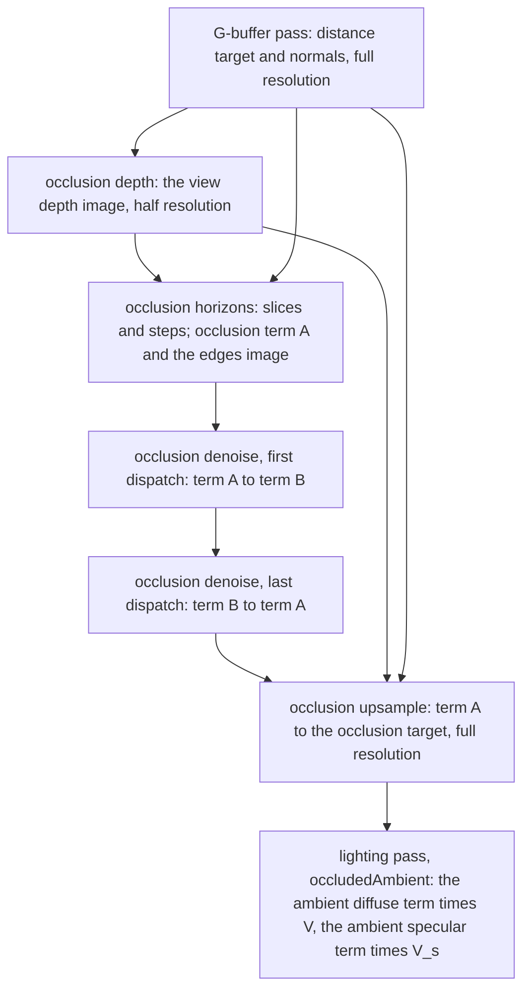

# Ambient occlusion

Ticket: `ter-b3h5`, a member of the rendering upgrade epic (`ter-sglu`, [rendering-upgrade.md](rendering-upgrade.md)). The user chose the design on 2026-10-25, in the ticket's last note. This doc fills in the details. The user settled its three open points after the captures, see "Settled forks".

## Goal

Today the ambient light is the hemisphere mix of the sky and the ground color (`ambientLight` in `lighting.glsl`), and nothing darkens creases, inner corners or the ground under objects. After this ticket:

- Each pixel gets the share of the hemisphere above it that nearby geometry on the screen hides, by ground-truth ambient occlusion, GTAO (Jimenez and others 2016).
- The lighting pass multiplies the ambient diffuse term by that share, and the ambient specular term by a specular occlusion derived from it (Lagarde and de Rousiers 2014). It does this in one function, `occludedAmbient`, whatever source gives the two terms: today the hemisphere, and later the scene environment map of `ter-nl5u`.
- The sun, the point and spot lights and emission do not change.
- The effect has no halos at depth edges, gives the same image in every frame of a still scene, and is a switch in `RendererOptions`.

The snapshot tests that the ticket's acceptance criteria name moved to `ter-rtxu` (ticket note of 2026-10-21). This ticket reviews its look by eye in headless screenshots.

## Terms

| Term | Meaning |
|---|---|
| The occlusion, V | The share of the cosine-weighted hemisphere above a surface point, around its shading normal n, that no geometry within the radius hides: V = (1/π) ∫ v(ω) (n·ω)⁺ dω, where v(ω) is 1 when a ray from the point in direction ω travels the radius without hitting geometry that the screen shows, and 0 otherwise. 1 means that nothing hides the hemisphere. Ambient occlusion in the usual sense is 1 − V. |
| The ambient diffuse term, the ambient specular term | The two parts of the ambient light that a surface point sends toward the eye, before occlusion: the diffuse color times the incoming diffuse light, and the compensated specular albedo times the incoming specular light. The GLSL struct `AmbientTerms` holds them. |
| An ambient source | A function that gives the two ambient terms of a surface point. Today it is `hemisphereAmbient`, the hemisphere of the sky and the ground color. While the environment map of `ter-nl5u` is on, its prefiltered cube map is the source. |
| The specular occlusion, V_s | The factor that the ambient specular term takes. Lagarde's fit computes it from V, the view cosine and α. |
| The radius, R | `GroundTruthOcclusion.RadiusMeters`. Geometry farther than R from a surface point hides nothing from it. |
| Full resolution | The output's size, W × H pixels. |
| Half resolution | ⌈W / 2⌉ × ⌈H / 2⌉ texels. Each half-resolution texel (i, j) stands for the 2 × 2 block of full-resolution pixels from (2i, 2j) to (2i + 1, 2j + 1). |
| The representative pixel | The full-resolution pixel (2i, 2j), the top-left pixel of the block of texel (i, j). Its depth and its normals are the texel's. |
| View space | The camera's axes with the eye at the origin: x right, y up, z forward, away from the eye. This is XeGTAO's convention. |
| The view depth, z | The z coordinate of a point in view space, in m. |
| The tangents, t_x and t_y | The tangents of half the horizontal and half the vertical field of view: `CameraView.TanHalfX` and `CameraView.TanHalfY`. |
| The texel width, p(z) | The width in m of one half-resolution texel at the view depth z: 4 t_x z / W, two full-resolution pixels. |
| The radius in texels, ρ | R / p(z): how many half-resolution texels the radius spans at a pixel's view depth. |
| A slice | A plane through the view vector and one screen direction φ. GTAO solves the visibility inside each slice in closed form and averages the slices. |
| A step | One depth sample on one side of the pixel in a slice. A slice takes `StepsPerSide` steps on each side. |
| A horizon cosine | The largest cosine between the view vector and the direction to a sample, among the samples of one side of a slice that lie within the radius. |
| The view depth image | The half-resolution R32F image of the view depth of each representative pixel. |
| The edges image | The half-resolution R8 image of XeGTAO's packed depth edges, which the denoise reads. |
| Occlusion term A, occlusion term B | Two half-resolution R16F images of the occlusion. The passes write them in turn. |
| The occlusion target | The full-resolution R8 image of the occlusion that the lighting pass reads. |
| The occlusion passes | The four compute passes "occlusion depth", "occlusion horizons", "occlusion denoise" and "occlusion upsample", in that order. |
| The physical constants | The values of XeGTAO's heuristics at which GTAO estimates the integral V itself: see "XeGTAO's heuristics". |

## Decisions

The user made the decisions marked (User), on 2026-10-25. This design settled the others by the decisions, the project's rules and STYLE.md. Each has its reason.

1. The method is GTAO (Jimenez and others 2016): the cosine-weighted visibility integral, with the inner integral of each slice in closed form. (User)
2. GTAO runs at half resolution, with an edge-aware upsample to full resolution. (User)
3. The passes are compute passes, so the build waits for the compute pipelines of the exposure ticket (`ter-zzyr`). (User)
4. Intel's XeGTAO (MIT) is the reference. It lies in `src/Tertius.Rendering/ThirdParty/XeGTAO`. (User)
5. The occlusion scales only the ambient light: the ambient diffuse term by V, and the ambient specular term by a specular occlusion derived from V (Lagarde 2014). (User)
6. The inputs are the distance target and the G-buffer normals, so one set of passes serves all three depth ranges. A radius of about 1 m fades out where it covers less than a pixel. (User)
7. Fixed spatial noise and an edge-aware blur. Nothing accumulates over frames. (User)
8. No multi-bounce brightening, because SSGI (`ter-a24f`) adds real bounced light. (User)
9. The switch is a union in `RendererOptions`: `NoAmbientOcclusion` or `GroundTruthOcclusion(RadiusMeters, Slices, StepsPerSide)`. It is on by default and off in the test fixtures. (User)
10. GPU pixel tests: an inner corner darker than an open floor, an open floor unchanged, and no dark halo beside a near silhouette. No reference images. (User)
11. The cost is measured at 1080p. (User)
12. The default radius comes from captures that the user sees. (User)
13. Every heuristic of XeGTAO stays at its physical constant by default. The orchestrator shows the user captures before any of them moves. The user chose GTAO so that creases darken by the physical amount, and the user also likes contrast and deep shadows. (Orchestrator, 2026-10-25)
14. The occlusion applies in one place, the function `occludedAmbient` in `lighting.glsl`, to the two ambient terms of whatever ambient source produced them. It does not depend on the terms coming from a hemisphere. So the environment map of `ter-nl5u`, which gives both terms from its prefiltered cube map while it is on, changes only the source that `ambientLight` calls. (Orchestrator, from the user's decision on the environment map, 2026-10-25)

Settled by this design:

15. The passes work in view space with XeGTAO's axes, and the depth pass turns each distance into a view depth. So the port follows XeGTAO line by line, and a reviewer can compare the two.
16. The representative pixel of each block is its top-left pixel. Its depth and its normal come from one pixel, so they describe one surface point. An average or a minimum of four depths describes a point that no normal belongs to.
17. The view depth image has one level, and every step reads the exact depth of its texel. XeGTAO's chain of coarser levels is option B of fork 2. The physical value comes first (decision 13).
18. The depth pass writes a view depth of 10¹⁸ m for sky, `SkyDepth`. The sky then hides nothing, because no radius reaches it. The value is far beyond the Sun (1.5 × 10¹¹ m), and three squared coordinates of that size stay finite in a 32-bit float (3 × 10³⁶ < 3.4 × 10³⁸). An infinite depth gives NaN in the directions, and GLSL's `max` with NaN is undefined. Amended 2026-10-25 (ter-lozc): the x and y of a sky position are t_x and t_y times 10¹⁸ m, and at a vertical field of view above about 167° in 16:9, or in a window wider than about 32:1, the squared offset of a sky sample passes the single float range. So the horizons pass tests a sample's depth before it measures the sample, and sky hides nothing by that test (ARCHITECTURE.md, "Portable Vulkan").
19. The view depth image is R32F, and the center bias is XeGTAO's value for 32-bit depths, 0.99999. The middle and the far ranges hold depths beyond the largest half float, 65,504 m.
20. The integral uses the shading normal, and the upsample uses the geometric normal. V scales the ambient diffuse term, which every ambient source computes around the shading normal, so both integrals share one normal. The upsample asks which samples lie on the pixel's surface, which the geometric normal describes.
21. A step that lands outside the screen hides nothing. The screen holds no depth there, as it holds none for sky. XeGTAO's clamped sampler repeats the edge texel's depth at the wrong place instead.
22. The port uses GLSL's `acos` and `sqrt`, not XeGTAO's fast approximations. The paper finds the pass bound by memory (section 4), and the C# copy and the shader then share one formula.
23. The noise is XeGTAO's Hilbert curve that drives the R2 sequence, at temporal index 0, computed in the shader. It needs no lookup image.
24. The denoise is XeGTAO's 3 × 3 edge-aware blur, run twice. XeGTAO's README describes a 5 × 5 depth-aware filter, and its version history says that two passes of version 1.21 equal one pass of the older filter. XeGTAO's default of one pass assumes temporal accumulation, which this design has not.
25. The denoise computes one pixel per invocation. XeGTAO computes two horizontal pixels per invocation for speed. The weights are the same.
26. The upsample is its own pass into a full-resolution target. The lighting pass then reads one value per pixel, the GPU timer times the upsample alone, and SSGI can use the same function later.
27. The occlusion target exists in both cases of the setting, at full size. The renderer clears it to 1 in the first frame after it creates the target, and under `GroundTruthOcclusion` the upsample writes it in every frame. So the lighting shader has one path. The analogue is the exposure buffer under `FixedExposure`: the first frame seeds it, nothing writes it again, and the shaders take one path (auto-exposure.md, "Writers and readers").
28. Four passes, one per step, so that the GPU timers report each step's cost. Fork 2 is decided by the cost of each pass.
29. Push constants carry the camera and the setting. A compute pipeline cannot bind the frame set, whose layout is for the graphics stages. The analogue is `DrawPushConstants`, which carries each range's camera.
30. The fade runs from ρ = 1 to ρ = 2 half-resolution texels, 2 to 4 full-resolution pixels. Below 1.3 texels, the nearest step already lies beyond the radius, so the method holds no information there (XeGTAO's `pixelTooCloseThreshold`).
31. The estimate stays unclamped in the half-resolution terms, and the upsample clamps it to [0, 1]. One slice of an open tilted surface can exceed 1, and the mean over slices and texels comes back to 1. XeGTAO packs the same overshoot with a scale of 1.5 into 8 bits. R16F needs no scale.
32. The defaults are `Slices` 3 and `StepsPerSide` 3, XeGTAO's default quality ("3 slices per pixel with 6 samples (3 per side)"). The radius default is 1 m until the user picks one (decision 12).
33. The transparent pass and the impostor capture pass V = 1. Transparent objects are not in the G-buffer, and a capture has no screen around it.
34. The headless host gains `--ambient-occlusion off|<meters>`, as it has `--tone-curve`, for the captures and the cost runs.
35. The device must support `shaderStorageImageExtendedFormats`, because the shaders write R8 and R16F storage images. MoltenVK supports it.
36. Impostors keep their captured light, which holds no occlusion. That is option A of fork 3.

## The method



### From the distance target to view space

The full-resolution pixel (X, Y) has the screen position u = (X + ½) / W, v = (Y + ½) / H, with v down. Its view ray is

```
r(X, Y) = ((2u − 1) · t_x, (1 − 2v) · t_y, 1)            in view space
```

`lighting.vert` builds the same ray in world axes: `cameraForward + ndc.x · cameraRight − ndc.y · cameraUp`, with ndc = (2u − 1, 2v − 1) and `cameraRight` = right · t_x. The distance target holds d = |P|, the Euclidean distance from the eye, and 0 for sky. So

```
P = d · r / |r|          z = d / |r|          P = z · r
```

P = z · r is `XeGTAO_ComputeViewspacePosition` (XeGTAO.hlsli line 104), with XeGTAO's `NDCToViewMul` = (2 t_x, −2 t_y) and `NDCToViewAdd` = (−t_x, t_y) (XeGTAO.h lines 181 and 182).

The normals target holds the octahedral shading normal in RG and the geometric normal in BA, in world axes. The view-space normal is the three dot products with the camera's unit axes: n_view = (n · right, n · up, n · forward). A surface that faces the eye has n_view.z < 0, as in XeGTAO.

### The occlusion depth pass

For each half-resolution texel (i, j):

```
d = distance target at (2i, 2j)
z(i, j) = d > 0 ? d / |r(2i, 2j)| : SkyDepth             SkyDepth = 10¹⁸ m
```

The screen position of texel (i, j) is the representative pixel's: ((2i + ½) / W, (2j + ½) / H). A step of k texels moves 2k full-resolution pixels, so it lands on another representative pixel. The texels are square because the pixels are: t_x / W = t_y / H.

### The occlusion horizons pass

For each half-resolution texel c = (i, j). P(t) is the view position of texel t, z(t) · r(2t). The loop is `XeGTAO_MainPass` (XeGTAO.hlsli lines 245 to 576) at the physical constants:

```glsl
float z = zAt(c);
// XeGTAO_CalculateEdges (line 120), from the four neighbors, clamped to the image.
store edges(c) = packEdges(depthEdges(z, zAt(c - x), zAt(c + x), zAt(c - y), zAt(c + y)));
if (z >= SkyDepth) { store termA(c) = 1; return; }
float rho = R / (4.0 * tx * z / W);                       // the radius in texels
float fade = clamp(rho - 1.0, 0.0, 1.0);
if (fade == 0.0) { store termA(c) = 1; return; }
vec3 center = (z * CenterBias) * r(2c);                   // CenterBias = 0.99999 (line 281)
vec3 V = normalize(-center);                              // the view vector, toward the eye
vec3 n = the view-space shading normal at (2c);
vec2 xi = spatialNoise(c);                                // see "The noise"
float sMin = NearestStepPixels / rho;                     // NearestStepPixels = 1.3 (line 367)
vec2 bound = vec2(float(max(halfWidth, halfHeight) + 1));  // one texel past the image's longer side
float sum = 0.0;
for (int k = 0; k < Slices; k++)
{
    float phi = (float(k) + xi.x) / float(Slices) * PI;   // lines 5 and 6 of the paper's Algorithm 1
    vec3 direction = vec3(cos(phi), sin(phi), 0.0);
    vec3 ortho = direction - dot(direction, V) * V;
    vec3 axis = normalize(cross(ortho, V));
    vec3 projected = n - axis * dot(n, axis);             // the normal projected into the slice plane
    float projectedLength = length(projected);
    float cosN = clamp(dot(projected, V) / max(projectedLength, 1e-6), 0.0, 1.0);
    float nAngle = sign(dot(ortho, projected)) * acos(cosN);
    float horizonPlus = cos(nAngle + PI / 2.0);           // the tangent plane on each side (line 409)
    float horizonMinus = cos(nAngle - PI / 2.0);
    for (int j = 0; j < StepsPerSide; j++)
    {
        float eta = fract(xi.y + float(k + j * StepsPerSide) * 0.6180339887498949);   // R1 (line 420)
        float s = (float(j) + eta) / float(StepsPerSide) + sMin;
        ivec2 offset = ivec2(round(clamp(s * rho * vec2(cos(phi), -sin(phi)), -bound, bound)));   // screen y is down
        horizonPlus = max(horizonPlus, sampleHorizon(c + offset, center, V));
        horizonMinus = max(horizonMinus, sampleHorizon(c - offset, center, V));
    }
    float h0 = -acos(clamp(horizonMinus, -1.0, 1.0));
    float h1 = acos(clamp(horizonPlus, -1.0, 1.0));
    sum += projectedLength * (sliceArc(h0, nAngle) + sliceArc(h1, nAngle));
}
float estimate = sum / float(Slices);
store termA(c) = 1.0 - fade * (1.0 - estimate);
```

where `sampleHorizon(t, center, V)` returns −1, which never raises a horizon, when t lies outside the half-resolution image or when |P(t) − center| ≥ R, and returns dot(normalize(P(t) − center), V) otherwise. XeGTAO lerps each sample's cosine toward the tangent-plane cosine by a falloff weight (lines 486 to 498). With the physical hard edge at R, that weight is 1 or 0, so the lerp is this choice.

Two clamps keep the conversions and the `acos` defined, where Vulkan leaves them undefined, and change no result:

- The offset of a step stays within one texel past the longer side of the half-resolution image. At the largest radius, 10⁶ m, on a surface at the 0.05 m near plane, ρ is about 10¹⁰ texels at 1080p, past the range of an `int`, and the conversion of a float out of that range is undefined. Every step that far out lies outside the image and hides nothing (decision 21), and so does the clamped step.
- The two horizon cosines are clamped to [−1, 1] before `acos`. The sample cosines are clamped already, but the tangent-plane cosines come from `cos`, which the Vulkan precision rule lets come out 2⁻¹¹ past ±1, at a silhouette where γ = ±π/2. The exact `acos` of decision 22 is undefined past ±1, and a NaN there would spread through both denoise dispatches. `HorizonSlice.Visibility` clamps the same way.

The division by `max(projectedLength, 1e-6)` replaces XeGTAO's plain division. HLSL's `saturate` of the NaN of 0 / 0 gives 0, and GLSL's `clamp` of NaN is undefined. The guard gives the same 0 for a normal that is perpendicular to the slice plane, whose slice then adds `projectedLength` · ... ≈ 0.

### The visibility of a slice

The horizons h0 ≤ 0 ≤ h1 are angles from the view vector inside the slice, and nAngle is the signed angle γ of the projected normal. The paper's inner integral (Jimenez and others 2016, equation 7) is the cosine-weighted arc between the horizons:

```
â = ∫ from h0 to h1 of cos(θ − γ) · |sin θ| dθ = sliceArc(h0, γ) + sliceArc(h1, γ)

sliceArc(h, γ) = ¼ · (−cos(2h − γ) + cos γ + 2h · sin γ)
```

The normal rarely lies in the slice plane. Following Timonen, the paper measures γ to the normalized projected normal and multiplies the slice by its length (equation 8):

```
V = (1/π) ∫ from 0 to π of |n_p(φ)| · â(φ) dφ  ≈  (1/S) Σ over the S slices of |n_p| · â
```

XeGTAO computes the same (lines 542 to 545, `iarc0` and `iarc1`). For an open surface, each horizon lies on the tangent plane, h = γ ± π/2, and one slice gives |n_p| (cos γ + γ sin γ). That is 1 for a surface that faces the eye, and it varies around 1 with φ for a tilted one. Its mean over φ is exactly 1. The slices are stratified (one per π / S), so the variation of second order cancels for S = 3, and the denoise averages the rest.

### The fade below one pixel

The fade is the user's decision 6. With R = 1 m at 1920 × 1080 and the default vertical field of view of 60°, p(z) = 2.14 × 10⁻³ z, so ρ = 2 at 234 m and ρ = 1 at 468 m. Beyond 468 m, the pass writes 1 and skips the slices. So the middle and the far ranges never take occlusion, and they cost one depth read and the edges per texel.

### The noise

The noise is XeGTAO's `SpatioTemporalNoise` (vaGTAO.hlsl lines 74 to 91) with the temporal index 0:

```
index = HilbertIndex(i, j)                     XeGTAO.h lines 120 to 142, level 6: a 64 × 64 tile
xi = fract(0.5 + index · (0.75487766624669276, 0.56984029099805327))      the R2 sequence
```

The Hilbert curve visits the 4,096 texels of a tile in an order where near texels have near indices, and the R2 sequence (Roberts 2018) spreads near indices evenly over the unit square. xi.x turns the slices, and xi.y shifts the steps. Each texel's noise is a fixed function of its coordinates, so a still camera gives the same noise in every frame. The tile repeats every 64 texels, 128 pixels. Under a moving camera, the pattern stays fixed on the screen while the surfaces move under it. The denoise and the upsample hide it, and the captures show what remains.

### The denoise

`XeGTAO_Denoise` (XeGTAO.hlsli lines 734 to 812), one pixel per invocation, two dispatches. The edges come from the horizons pass (`XeGTAO_CalculateEdges` and `XeGTAO_PackEdges`, lines 120 to 140):

```
e  = (z_L, z_R, z_T, z_B) − z_c
e' = e + (s_LR, −s_LR, s_TB, −s_TB)        s_LR = (e_R − e_L) / 2,   s_TB = (e_B − e_T) / 2
E  = clamp(1.25 − min(|e|, |e'|) / (0.011 · z_c), 0, 1)       per side: 1 joins the neighbor, 0 cuts
packed = round(E · 2.9) in two bits per side: L · 64 + R · 16 + T · 4 + B, over 255
```

For the center c and its eight neighbors:

```
E_c  = E(c) · (E(L).R, E(R).L, E(T).B, E(B).T)              each edge must agree from both sides
E_c  = clamp(E_c + clamp(1.5 − ΣE_c, 0, 1) / 1.5 · 0.5, 0, 1)      XeGTAO's leak, for 3 or 4 cut sides
w_TL = 0.425 · (E_c.L · E(L).T + E_c.T · E(T).L)             and so on for TR, BL and BR
V'   = (β V_c + Σ E_c,side V_side + Σ w_corner V_corner) / (β + Σ E_c,side + Σ w_corner)
β    = 1.2 in the last dispatch, 0.24 in the first          XeGTAO's DenoiseBlurBeta and DenoiseBlurBeta / 5
```

Neighbors outside the image read the border texel, as XeGTAO's clamped sampler does. The first dispatch reads term A and writes term B. The last reads term B and writes term A.

### The upsample

A joint bilateral upsample (Kopf and others 2007) whose range weight is the distance from the pixel's tangent plane, with a fallback to the sample nearest that plane. XeGTAO's README suggests a bilateral upsample for a lower resolution. For each full-resolution pixel p = (X, Y):

```glsl
float d = distance target at p;
if (d == 0.0) { store occlusionTarget(p) = 1; return; }    // sky: the lighting pass reads no occlusion there
vec3 position = d * normalize(r(p));
vec3 g = the view-space geometric normal at p;
float footprint = 4.0 * tx * position.z / W;               // p(z) at the pixel
ivec2 base = p / 2;
vec2 wx = X is even ? vec2(1.0, 0.0) : vec2(0.5);         // bilinear weights of texels base.x and base.x + 1
vec2 wy = Y is even ? vec2(1.0, 0.0) : vec2(0.5);
for each (a, b) in {0, 1}² whose weight wx[a] · wy[b] is above 0 and whose texel t = base + (a, b) is in the image:
    float offPlane = abs(dot(g, P(t) - position));
    float w = wx[a] * wy[b] * max(0.0, 1.0 - offPlane / footprint);
    sum += w * termA(t);   weights += w;
    remember the texel with the smallest offPlane;
float V = weights > 0.0 ? sum / weights : termA(the texel nearest the plane);
store occlusionTarget(p) = clamp(V, 0.0, 1.0);
```

- A representative pixel takes its own texel with weight 1. A pixel between two texels takes their mean when both lie on its plane.
- A texel behind a silhouette lies far from the plane of a pixel in front of it, more than one texel width, so it gets no weight, and the reverse. At 2 m, one texel width is 4.3 mm.
- On a floor seen at a grazing angle, every texel lies on the pixel's plane, so the upsample stays bilinear where a test on depth alone sees edges.

### The lighting pass

`lighting.frag` reads V from the occlusion target with `texelFetch` at the pixel, as it reads the G-buffer, and passes it in `ShadingInput.occlusion`. `lighting.glsl` splits today's `ambientLight` into an ambient source and the one function that applies the occlusion (decision 14):

```glsl
// The ambient light that a surface point sends toward the eye, before ambient occlusion, in two terms: the diffuse
// color times the incoming diffuse light, and the compensated specular albedo times the incoming specular light.
struct AmbientTerms
{
    vec3 diffuse;
    vec3 specular;
};

// The hemisphere as the ambient source: the diffuse term by the normal's sky share, the specular term by the lobe's.
AmbientTerms hemisphereAmbient(ShadingInput s, SurfaceLobes lobes)
{
    vec3 ground = frame.ambientGround.rgb;
    vec3 sky = frame.ambientSky.rgb;
    AmbientTerms terms;
    terms.diffuse = lobes.diffuseColor * mix(ground, sky, s.skyFraction);
    terms.specular = lobes.specularAlbedo * lobes.energyCompensation * mix(ground, sky, s.lobeSkyFraction);
    return terms;
}

// Lagarde and de Rousiers 2014, "Moving Frostbite to Physically Based Rendering 3.0", section 4.10.2,
// listing 26. The notes call α "roughness".
float specularOcclusion(float NdotV, float occlusion, float alpha)
{
    return clamp(pow(NdotV + occlusion, exp2(-16.0 * alpha - 1.0)) - 1.0 + occlusion, 0.0, 1.0);
}

// The one place where ambient occlusion applies (docs/plans/ambient-occlusion.md): the diffuse term by V, the
// specular term by V_s. It reads nothing about the source of the terms, and keeps them apart, because SSR replaces
// the occluded specular term where its ray hits.
AmbientTerms occludedAmbient(AmbientTerms terms, ShadingInput s, SurfaceLobes lobes)
{
    AmbientTerms occluded;
    occluded.diffuse = terms.diffuse * s.occlusion;
    occluded.specular = terms.specular * specularOcclusion(lobes.NdotV, s.occlusion, lobes.alpha);
    return occluded;
}

vec3 ambientLight(ShadingInput s, SurfaceLobes lobes)
{
    AmbientTerms occluded = occludedAmbient(hemisphereAmbient(s, lobes), s, lobes);
    return occluded.diffuse + occluded.specular;
}
```

so the ambient light is

```
ambient = T_d · V  +  T_s · V_s
V_s     = clamp((μ + V)^(2^(−16α − 1)) − 1 + V, 0, 1)
```

where T_d is the ambient diffuse term and T_s the ambient specular term of the source. With the hemisphere as the source, T_d = c_diff · mix(ground, sky, s_n) and T_s = E(μ, r) · c(μ, r) · mix(ground, sky, s_l), as today (pbr-brdf.md, "The ambient light's specular part").

- The diffuse factor separates the visibility from the incoming light. That is exact for a Lambert surface under incoming light that is the same in every direction, and an approximation otherwise (the same notes, section 4.10.1, equation 65). It holds the same way for the hemisphere and for the environment map.
- α is the floored roughness squared, as in the dominant direction (pbr-brdf.md, "The ambient light's specular part"). μ is `lobes.NdotV`.
- V = 1 gives V_s = 1 for every μ and α, because (μ + 1)^k ≥ 1. α = 1 gives an exponent of 2⁻¹⁷, so V_s = V. A smooth lobe seen head-on loses less than V, and seen at a grazing angle it loses more. The notes call the fit empirical, and Frostbite applies it to the indirect specular light of its cube maps, which is the kind of light that the environment map gives. The user chose it.
- The sun, the point and spot lights and emission do not take V.
- The environment map's ticket adds its own source, a function that returns `AmbientTerms` from the prefiltered cube map, and `ambientLight` calls it in place of `hemisphereAmbient` while the map is on. `occludedAmbient`, `specularOcclusion` and `ShadingInput.occlusion` do not change. SSR's fallback is the ambient specular term, so it takes V_s through the same function.

## XeGTAO's heuristics

Each of XeGTAO's settings and fixed values that moves its estimate away from the integral V, with XeGTAO's default and the value of this design. A setting at its physical constant changes nothing, so the port leaves it out, and the last column says how a build restores it. Decision 13: the orchestrator shows the user captures before any of them moves (fork 1).

| Setting | Where in XeGTAO | What it does | XeGTAO's default | Physical constant | This design |
|---|---|---|---|---|---|
| `RadiusMultiplier` | XeGTAO.h line 107, hlsli line 301 | Multiplies the radius | 1.457 | 1 | 1. To restore it: a factor on R in the horizons pass. |
| `FalloffRange` | h line 108, hlsli lines 304 and 313 to 317 | A sample's weight falls linearly to 0 over this share of the radius, at its outer end | 0.615 | 0: a hard edge at R | 0. The paper's own attenuation blends from 1 to 0 between "a given, large enough distance" and the radius, without a number. To restore it: the weight clamp((R − dist) / (F · R), 0, 1). |
| `SampleDistributionPower` | h line 109, hlsli line 427 | Steps at s^p bunch near the pixel | 2 | 1: the even steps of the paper's Algorithm 1 | 1. Neither spacing changes the integral: both search for the same horizon. Power 2 finds narrow creases more often. To restore it: `s = pow(s, p)` before `sMin`. |
| `ThinOccluderCompensation` | h line 110, hlsli lines 489 to 497 | Counts samples behind the pixel as thinner | 0 | 0: the height field, every depth infinitely thick | 0, as XeGTAO. The paper's thickness heuristic (equation 9) is not in XeGTAO's default either. |
| `FinalValuePower` | h line 111, hlsli line 557 | V^p | 2.2 | 1 | 1. XeGTAO's README says it has "no basis in physical light transfer". To restore it: the power after the division by the slices. |
| `DepthMIPSamplingOffset` | h line 112, hlsli line 438 | Steps far from the pixel read a coarser level of the depth chain | 3.30 (the README names 3.15, below which no tested GPU got faster) | No coarser level: every step reads the exact depth of its texel | No chain. Option B of fork 2. |
| The small-radius term | hlsli line 343 | Adds up to 0.05 to the sum before the division by the slices, where ρ < 10 texels | On | None | Replaced by the user's fade below one pixel. |
| The slope fudge | hlsli line 532 | Lerps the projected normal length 5 % toward 1, against an unexplained darkening on steep slopes | 0.05 | 0 | None. |
| The floor | hlsli line 558 | V ≥ 0.03 | 0.03 | 0 | None. A visible pixel always sees its own view direction, so the true V is above 0, and the estimate needs no floor. |
| The fast `acos` and `sqrt` | hlsli lines 170 to 183 | Approximations | On | Exact functions | Exact (decision 22). |
| The center bias | hlsli lines 281 and 283 | Moves the center toward the eye against self-occlusion from the precision of the depths | 0.9992 for 16-bit depths, 0.99999 for 32-bit | Not a look setting | 0.99999, XeGTAO's value for 32-bit depths. At 468 m, where the fade ends, it moves the center 4.7 mm. |
| The temporal noise index | h line 196, vaGTAO.hlsl line 83 | Rotates the noise over 64 frames under TAA | 0 without TAA | Not a look setting | 0 (User, decision 7). |
| The denoise passes | h line 149 | The number of 3 × 3 blurs | 1 | Not a look setting | 2 (decision 24). |
| The term scale | h line 114 | Packs the overshoot above 1 into 8 bits | 1.5 | Not a look setting | None: R16F terms (decision 31). |
| A largest screen radius | None in XeGTAO | The paper clamps the radius in pixels near the near plane, for the caches | None | None | None. Very near the eye, most steps then leave the screen and hide nothing. |

XeGTAO tuned the first five together by least squares against ray-traced ambient occlusion with rays of length R over its test scenes (its README, "auto-tune"). So its whole set matches that ground truth better than the literal estimator in those scenes, while no constant of the set means anything alone.

## The setting

`src/Tertius.Rendering/AmbientOcclusionSetting.cs` (new, public):

```csharp
namespace Tertius.Rendering;

/// <summary>No ambient occlusion: the ambient light reaches every surface in full, as before this setting.</summary>
public readonly record struct NoAmbientOcclusion;

/// <summary>
/// Ground-truth ambient occlusion, GTAO (docs/plans/ambient-occlusion.md): the share of the cosine-weighted hemisphere
/// that nearby geometry on the screen hides scales the ambient light. It runs at half resolution.
/// </summary>
/// <param name="RadiusMeters">Geometry farther than this from a surface point hides nothing from it, in m: above 0, at most 10⁶.</param>
/// <param name="Slices">How many slices each half-resolution texel integrates, 1 to 16.</param>
/// <param name="StepsPerSide">How many depth samples each slice takes on each side to find its horizon, 1 to 16.</param>
public readonly record struct GroundTruthOcclusion(float RadiusMeters, int Slices, int StepsPerSide)
{
    /// <summary>The renderer's default: a radius of 1 m, 3 slices and 3 steps on each side.</summary>
    public static GroundTruthOcclusion Default => new(RadiusMeters: 1, Slices: 3, StepsPerSide: 3);
}

/// <summary>
/// Whether the renderer darkens the ambient light by ambient occlusion: <see cref="NoAmbientOcclusion"/> or
/// <see cref="GroundTruthOcclusion"/>. The default value is NoAmbientOcclusion. It is a generated union (see
/// <see cref="GeneratedUnionAttribute"/>).
/// </summary>
[GeneratedUnion(typeof(NoAmbientOcclusion), typeof(GroundTruthOcclusion), ZeroCase = typeof(NoAmbientOcclusion))]
public readonly partial struct AmbientOcclusionSetting
{
    /// <summary>The largest radius, far below the depth at which the sky lies (docs/plans/ambient-occlusion.md).</summary>
    public const float MaxRadiusMeters = 1e6f;

    public const int MaxSlices = 16;
    public const int MaxStepsPerSide = 16;

    /// <summary>Why the renderer cannot use the setting, or null when it can.</summary>
    internal string? Problem => this switch
    {
        NoAmbientOcclusion => null,
        GroundTruthOcclusion occlusion => ...,
    };
}
```

`new GroundTruthOcclusion()` gives all zeros, which validation refuses, so callers start from `GroundTruthOcclusion.Default with { ... }`.

Validation, in `VulkanRenderer.CheckOptions`, which throws `ArgumentOutOfRangeException` for `options` with the message of `Problem`:

| Field | Rule | Reason |
|---|---|---|
| `RadiusMeters` | Finite, above 0, at most 10⁶ m | 0 hides nothing, and `NoAmbientOcclusion` is the one way to turn the effect off. The sky lies at 10¹⁸ m, so a radius below 10⁶ m never reaches it. |
| `Slices` | 1 to 16 | 0 slices have no mean. 16 is about twice XeGTAO's highest preset of 9, and a bound keeps a wrong value from stalling the GPU for seconds. |
| `StepsPerSide` | 1 to 16 | 0 steps find no horizon. The bound as for the slices. |

`RendererOptions` gains:

```csharp
/// <summary>
/// Whether ambient occlusion darkens the ambient light: <see cref="GroundTruthOcclusion"/> or
/// <see cref="NoAmbientOcclusion"/>. The default is <see cref="GroundTruthOcclusion.Default"/>.
/// </summary>
public AmbientOcclusionSetting AmbientOcclusion { get; set; } = GroundTruthOcclusion.Default;
```

The setting is fixed for the renderer's life, as `Exposure`, `ToneCurve` and `Impostors` are.

The analogues:

| Setting | Form | Zero case | Default in `RendererOptions` | Test fixtures | Validation |
|---|---|---|---|---|---|
| `ToneCurve` | An enum, because no case carries data | `AcesFitted` | `AcesFitted` | The default | `Enum.IsDefined` in `CheckOptions` |
| `Exposure` (`ter-zzyr`, being built) | `ExposureSetting`: `FixedExposure(Stops)` or `AutoExposure(...)` | `FixedExposure(0)`, today's look | `AutoExposure.Default` | `FixedExposure(0)` | `Problem`, thrown by `CheckOptions` |
| Bloom (`ter-63wr`, decided, not yet written) | `NoBloom` or `Bloom(Threshold, Knee, Strength, Levels)` | Not yet written | On | Off | Not yet written |
| `AmbientOcclusion` | `AmbientOcclusionSetting`: `NoAmbientOcclusion` or `GroundTruthOcclusion(...)` | `NoAmbientOcclusion`, today's look | `GroundTruthOcclusion.Default` | `NoAmbientOcclusion` | `Problem`, thrown by `CheckOptions` |

The zero case is today's look, so the union has no empty value and no switch over it needs a `null` arm, as for the exposure. Bloom's union is not written yet. The same rules give it the name `BloomSetting`, `NoBloom` as its zero case and a static `Bloom.Default`. The bloom builder can follow this table.

The headless host gains `--ambient-occlusion off|<meters>` (`ScriptCommand`): `off` gives `NoAmbientOcclusion`, and a number gives `GroundTruthOcclusion.Default with { RadiusMeters = number }`. Without the option, the run keeps the default.

## Images

| Image | Format | Size | Memory at 1920 × 1080 | Usage | Owner |
|---|---|---|---|---|---|
| The view depth image | R32_SFLOAT | Half: 960 × 540 | 2,073,600 B | Storage | `OcclusionImages` |
| The edges image | R8_UNORM | Half | 518,400 B | Storage | `OcclusionImages` |
| Occlusion term A | R16_SFLOAT | Half | 1,036,800 B | Storage | `OcclusionImages` |
| Occlusion term B | R16_SFLOAT | Half | 1,036,800 B | Storage | `OcclusionImages` |
| The occlusion target | R8_UNORM | Full: 1920 × 1080 | 2,073,600 B | Sampled, storage, transfer source and destination | `RenderTargets` |

Under `GroundTruthOcclusion` they take 6.74 MB, 4.67 MB of them at half resolution. Under `NoAmbientOcclusion` only the occlusion target exists, 2.07 MB. The working images stay in the `General` layout. The occlusion target moves between `General` for the upsample and the clear and `ShaderReadOnlyOptimal` for the lighting pass. `RenderTargets` checks at creation that R8_UNORM supports sampling, storage, and transfer as a source and as a destination, as it checks the G-buffer formats. The transfer source is for `VulkanRenderer.ReadOcclusion`, which copies the target out for the tests. `OcclusionImages` checks storage for R32_SFLOAT, R8_UNORM and R16_SFLOAT. Each throws `NotSupportedException` with the format's name.

Who writes and reads each image, in the order of a frame:

| Image | Written by | In | Read by | In | What the reader needs |
|---|---|---|---|---|---|
| The view depth image | `occlusion_depth.comp` | The occlusion depth pass | `occlusion_horizons.comp` and `occlusion_upsample.comp` | The horizons pass and the upsample pass | The view depth of every half-resolution texel of this frame |
| The edges image | `occlusion_horizons.comp` | The horizons pass | `occlusion_denoise.comp` | Both dispatches of the denoise pass | The edges of every texel of this frame |
| Occlusion term A | `occlusion_horizons.comp`, then the last denoise dispatch | The horizons pass, then the denoise pass | The first denoise dispatch, then `occlusion_upsample.comp` | The denoise pass, then the upsample pass | The noisy estimate, then the twice-blurred one |
| Occlusion term B | The first denoise dispatch | The denoise pass | The last denoise dispatch | The denoise pass | The once-blurred estimate |
| The occlusion target | `RenderTargets.RecordOcclusionClear` (to 1, in the first frame after each creation), then `occlusion_upsample.comp` (every frame under `GroundTruthOcclusion`) | Before the frame graph, then the upsample pass | `lighting.frag` | The lighting pass | V of every full-resolution pixel of this frame |

## The frame

### The order of the passes

`FrameGraph.Stage` gains `AmbientOcclusion` between `GBuffer` and `Lighting`. With the exposure ticket's stage, the order becomes:

1. Uploads. In the first frame after `RenderTargets` creates the occlusion target, `RecordOcclusionClear` clears it to 1.
2. Batching, as today.
3. The shadow maps of the sun.
4. Impostor captures.
5. The G-buffer pass.
6. Under `GroundTruthOcclusion`, the occlusion passes: occlusion depth, occlusion horizons, occlusion denoise (two dispatches), occlusion upsample. They read the G-buffer that step 5 finished, so they follow it.
7. The lighting pass, which reads the occlusion target that step 6 finished.
8. The transparent pass, the exposure pass, the tone map, the overlay and the readback, as the other tickets give them.

The occlusion passes come before the lighting pass and after the G-buffer pass for the reasons in the list. They need nothing from the shadow maps, so a later change can overlap them with shadow work, which today's single queue does not do.

### Dispatches and barriers

Every shader has a local size of 8 × 8, XeGTAO's `XE_GTAO_NUMTHREADS`. The depth, horizons and denoise dispatches cover the half-resolution image, ⌈W_h / 8⌉ × ⌈H_h / 8⌉ workgroups, and the upsample covers the full image, ⌈W / 8⌉ × ⌈H / 8⌉. Each invocation outside its image returns.

Every image use goes through `BarrierBatch`. One use joins the closed set `ImageUse` in `ResourceState.cs`:

| Use | Layout | Stages | Access |
|---|---|---|---|
| `ImageUse.StorageCompute` | `General` | `ComputeShaderBit` | `ShaderStorageReadBit`, `ShaderStorageWriteBit` |

It carries both bits, so `BarrierBatch` puts a barrier between any two storage uses, which each pass needs: each pass reads what the one before it wrote, and the last denoise dispatch writes term A after the first one read it. `ImageUse.SampledCompute` comes from the exposure ticket (auto-exposure.md, "Compute pipelines").

| Pass | Image | Use | Discard | The barrier it makes, from the use before |
|---|---|---|---|---|
| Occlusion depth | The distance target | `SampledCompute` | | The G-buffer pass's color write to the compute read |
| | The view depth image | `StorageCompute` | Yes | The last frame's upsample read, so the write waits for it |
| Occlusion horizons | The view depth image | `StorageCompute` | | The depth pass's write to this read |
| | The normals target | `SampledCompute` | | The G-buffer pass's color write to the compute read |
| | The edges image, term A | `StorageCompute` | Yes | The last frame's reads |
| Occlusion denoise, first | The edges image, term A | `StorageCompute` | | The horizons pass's writes |
| | Term B | `StorageCompute` | Yes | The last frame's read |
| Occlusion denoise, last | Term B | `StorageCompute` | | The first dispatch's write |
| | Term A | `StorageCompute` | | The first dispatch's read, so the write waits for it |
| Occlusion upsample | Term A, the view depth image | `StorageCompute` | | The last denoise dispatch's write, the depth pass's write |
| | The distance and normals targets | `SampledCompute` | | Read to read: a chain |
| | The occlusion target | `StorageCompute` | Yes | The last frame's lighting read |
| Lighting | The occlusion target | `SampledFragment` | | The upsample's write, or the clear's write, to the fragment read |
| | The G-buffer targets | `SampledFragment` | | Read to read: a chain to the fragment stage |

The denoise pass records its two dispatches with a flush between them, as the exposure pass records the meter and the adapt step.

### Push constants and sets

All four pipelines share one layout, `DescriptorLayouts.OcclusionLayout`:

| Set | Binding | Type | Holds | Written by |
|---|---|---|---|---|
| 0, the occlusion set | 0 | Sampled image | The distance target | `OcclusionImages`, at creation and on every resize |
| 0 | 1 | Sampled image | The normals target | The same |
| 0 | 2 | Storage image, r32f | The view depth image | The same |
| 0 | 3 | Storage image, r8 | The edges image | The same |
| 0 | 4 | Storage image, r16f | Occlusion term A | The same |
| 0 | 5 | Storage image, r8 | The occlusion target | The same |
| 1, a denoise set | 0 | Storage image, r16f | The source term | `OcclusionImages`: `DenoiseAToB` holds term A, `DenoiseBToA` term B |
| 1 | 1 | Storage image, r16f | The destination term | The same: term B, and term A |

The push constant range is `OcclusionPushConstants`, 64 bytes, for the compute stage. Each pass pushes it before each dispatch, from `context.Scene.Camera` and the setting. The camera is the one that `SceneBatcher` writes into the frame constants as `CameraRight`, `CameraUp` and `CameraForward`, so the two never disagree.

The G-buffer set gains binding 7, a sampled image for the fragment stage: the occlusion target. `RenderTargets` writes it at creation and on every resize, as bindings 0 to 4. The descriptor pool gains 3 sampled images, 8 storage images and 3 sets.

### GPU timers

Each occlusion pass is a `RenderPass`, so `FrameGraph.Record` times it with no work of its own, and the names "occlusion depth", "occlusion horizons", "occlusion denoise" and "occlusion upsample" appear in `RenderStats.GpuTimings` and `gpu-timings.json`. The four count toward `GpuTimer.MaxPasses`, 31. With the exposure pass, bloom's passes and SMAA's passes, the graph must stay within it, and the last of those tickets to merge checks the count.

### Resize

`VulkanRenderer` gains `ResizeTargets(Extent2D)`, which the two places that resize today call: `ApplyPendingResize` and the out-of-date swapchain in `Render`. With the device idle, it resizes `RenderTargets`, which recreates the occlusion target with the other targets, rewrites G-buffer binding 7 and marks the target for its clear. Then it calls `OcclusionImages.Resize(targets)`, which recreates the four half-resolution images at ⌈W / 2⌉ × ⌈H / 2⌉ and rewrites the occlusion set and both denoise sets, because they point at the new distance, normals and occlusion targets.

### When the switch is off

Under `NoAmbientOcclusion`, the renderer makes no `OcclusionImages` and adds no occlusion pass. The occlusion target exists at full size, the first frame after each creation clears it to 1, and the lighting pass reads it and multiplies by exactly 1. R8 255 reads as exactly 1.0, V_s of 1 is exactly 1, and a product with 1.0 rounds to itself, so the image is expected to be the same bits as before this ticket. The work that remains is one clear per creation, one R8 read per lit pixel, and 2.07 MB of memory at 1080p.

## The flow of each kind of pixel

| Kind | As the center of an estimate | As an occluder in another pixel's estimate | What the lighting pass does |
|---|---|---|---|
| An opaque mesh in the near range, within about 234 m at 1080p | Its representative pixel's distance and shading normal give V | Its depth hides the hemisphere of points within R | Multiplies the ambient diffuse term by V and the ambient specular term by V_s |
| An opaque mesh between about 234 m and 468 m at 1080p | As above, faded toward 1 | As above | As above, with V near 1 |
| An opaque mesh in the middle range, or beyond 468 m | The fade writes 1 and skips the slices | Beyond R of every near point, so it hides nothing | Multiplies by 1 |
| A far planet, the far range | As the middle range: 1 | As the middle range: nothing | Multiplies by 1 |
| An emissive lamp or the Sun's sphere | As an opaque mesh. Its base color is black, so its ambient light is near 0 | As an opaque mesh | Emission is not ambient light, so it keeps it |
| An impostor billboard | The pass computes an estimate from the billboard's distance, which has the object's real shape, and its normal toward the capture's eye | Its distance hides the ground around it as the object's geometry does | Passes the billboard's emission through, because its base color alpha is 0. The captured light has no occlusion (fork 3). |
| Sky, distance 0 | The depth pass writes `SkyDepth`, and the horizons pass writes 1 | 10¹⁸ m away, beyond every radius | Draws the star field, and reads no occlusion |
| A transparent object, glass | None: it is not in the G-buffer. The surface behind it is, and that surface takes its own V | None | The transparent pass, after the lighting pass, shades it with V = 1 |
| A puff, glow or lit | None | None | The transparent pass adds it as before. `scatteredLight` is unchanged |

The near range holds every opaque surface that takes occlusion. A ship in front of a planet shows no halo: its edge pixels find the planet's depths beyond R, and the planet's pixels fade to 1. A surface within R in front of another one does hide part of the other's hemisphere. That is real occlusion, but the height field counts the front surface as infinitely thick, so a thin object near a wall darkens the wall more than its real thickness allows (decision 13, `ThinOccluderCompensation` 0).

## Every reader and writer

| Value | Written by | When | Read by | When | Stored in | Analogue |
|---|---|---|---|---|---|---|
| `RendererOptions.AmbientOcclusion` | The host (`ScriptCommand`, `WindowHost`), tests | Before the renderer is made | `CheckOptions`; `VulkanRenderer`, which makes `OcclusionImages` and the passes only under `GroundTruthOcclusion`; each pass, for its push constants | At creation, then in every frame | `RendererOptions`, then the passes' fields | `RendererOptions.Exposure` and `Impostors` |
| The view depth image, the edges image, terms A and B | The occlusion passes | Every rendered frame, after the G-buffer pass | The later occlusion passes | The same frame | `OcclusionImages` | The shadow maps: written and read on the GPU in the same frame |
| The occlusion target | The clear, then the upsample pass | The first frame after each creation; every frame under `GroundTruthOcclusion` | The lighting pass | The same frame | `RenderTargets.Occlusion`, G-buffer set binding 7 | The G-buffer targets: written for this frame, read by the lighting pass of this frame. The clear's analogue is the seed of the exposure buffer. |
| `ShadingInput.occlusion` | `lighting.frag`, from the target; `transparent.frag` and `impostor_capture.frag`, 1 | Per pixel | `occludedAmbient` | Per pixel | None: a value in the shader | `ShadingInput.skyFraction`, which the lighting pass reads from a target and the other two compute |
| `AmbientTerms` | The ambient source: `hemisphereAmbient` today, the environment map's source while the map is on (`ter-nl5u`) | Per pixel, in `ambientLight` | `occludedAmbient` | Per pixel | None: a value in the shader | `SurfaceLobes`, which `lobesOf` computes once per pixel and every light function reads |
| `OcclusionPushConstants` | Each occlusion pass | Each dispatch | The four shaders | The dispatch | Push constants | `DrawPushConstants` |
| The occlusion set and the denoise sets | `OcclusionImages` | At creation and on every resize | The occlusion passes | Every frame | `OcclusionImages` | The meter set (`ter-zzyr`) and the G-buffer set |
| The noise | None: a function of the texel's coordinates | | The horizons pass | | None | The star field's hash of its cell |

Each value describes the frame that the G-buffer pass of this frame finished. Nothing carries over from one frame to the next, so the stored state is always that of the last finished step, and a still scene gives the same image in every frame. No pass uses atomics, and every sum runs in a fixed order, so one GPU gives the same bits on every run.

## Compared with a design from scratch

A deferred renderer built from scratch around GTAO has a half-resolution depth pass, compute passes, the analytic inner integral, an edge-aware denoise and upsample, and one consumer of the occlusion in the lighting pass. This design is that, with these differences:

| From scratch | This design | Why it stays |
|---|---|---|
| A G-buffer target of linear view depth | The Euclidean distance target, turned into view depth by the depth pass | The distance target rebuilds positions for all three ranges, with no projection (ARCHITECTURE.md, "Depth ranges"). The depth pass is needed for the half resolution anyway, so the conversion costs one division per texel. |
| Normals in view space | Normals in world axes, turned into view space by three dot products | Every other reader of the normals works in world axes. |
| Noise that turns over frames, with temporal accumulation (the paper uses 6 rotations, XeGTAO 64 under TAA) | Fixed spatial noise and two blurs | (User) Each frame stands alone: determinism and stability. |
| Bent normals for the lookup of the ambient light (XeGTAO's option, and the paper's GTSO) | The occlusion scales the two ambient terms, and the source looks them up as it does without occlusion. Lagarde's fit gives the specular occlusion. | (User) `occludedAmbient` then reads nothing about the source, so the hemisphere and the environment map take the occlusion the same way (decision 14). Lagarde's fit needs no 4D table. |
| A material occlusion map (glTF's `occlusionTexture`) combined with the screen's occlusion | None | The asset pipeline drops `occlusionTexture`, because the G-buffer has no free channel (asset-pipeline.md). |
| A multi-bounce fit (the paper, section 5) | None | (User) SSGI adds the bounced light. |
| When off, a white texture bound in place of the occlusion | A full-size target cleared to 1 | One image, one shader path and one barrier for both cases, for 2 MB of memory. |
| A depth chain shared by SSAO, SSR and SSGI | One level, named for reuse | Fork 2. SSR and SSGI can read the view depth image when they come. |

## Tests

The tests follow tests/STYLE.md: one behavior per test, named as a statement. No test adds a reference image (the epic's rule). The test fixtures `Gpu.Headless` and `GpuTesting.Headless` use `NoAmbientOcclusion` (User). A test of the effect asks for `GroundTruthOcclusion` itself.

### CPU tests

In `tests/Tertius.Rendering.Tests`. An integral that checks the code uses an independent midpoint quadrature.

`HorizonSliceTests`:

- `AnOpenSliceFacingTheEyeHasAnInnerIntegralOfOne`: sliceArc(−π/2, 0) + sliceArc(π/2, 0) = 1.
- `TheInnerIntegralIsTheCosineWeightedArcBetweenTheTwoHorizons`: against the quadrature of ∫ cos(θ − γ) |sin θ| dθ, for a spread of h0, h1 and γ.
- `AveragedOverEverySliceAnOpenSurfaceIsFullyVisibleAtAnyTilt`: (1/π) ∫ |n_p| (cos γ + γ sin γ) dφ = 1 within 10⁻⁴, for tilts from 0° to 89°, by the quadrature over φ.
- `EachSidesLowestHorizonIsTheSurfacesTangentPlane`: cos(γ ± π/2).
- `ASampleAtTheRadiusOrBeyondItHidesNothing`: the hard edge.
- `HorizonsAtTheNormalHideTheWholeSlice`: h0 = h1 = γ gives 0.
- `ANormalPerpendicularToTheSlicePlaneAddsNothing`: the guard against 0 / 0.
- `AHorizonCosineThatRoundingPutsOutsideItsRangeCountsAsTheNearestBound`: cosines 2⁻¹¹ past ±1 give the visibility of ±1, not NaN.

`HorizonSearchTests`:

- `ARadiusOfOneTexelOrLessGivesFullVisibility`.
- `ARadiusOfTwoTexelsOrMoreKeepsTheWholeEstimate`.
- `BetweenOneAndTwoTexelsTheEstimateFadesLinearlyToFullVisibility`.
- `TheRadiusInTexelsHalvesWhenTheViewDepthDoubles`.
- `TheStepsOfASliceFillTheRadiusEvenlyBeyondTheNearestStep`: step j lies in [j / N, (j + 1) / N) + 1.3 / ρ.
- `ADistanceBecomesTheViewDepthAlongItsRay`: z = d / |r| at the center and at a corner of the screen.
- `AStepSnapsToTheNearestTexelAlongItsSlice`.
- `AStepFarBeyondTheImageLandsJustPastItsFarthestEdge`: ρ = 10¹⁰ gives an offset of 961 on a 960 × 540 image.

`OcclusionNoiseTests`:

- `TheHilbertIndexVisitsEachTexelOfASixtyFourSquareTileOnce`: a bijection onto 0 to 4,095.
- `TheNoiseRepeatsEverySixtyFourTexelsInEachAxis`.
- `TheTexelAtTheOriginTakesTheFirstPointOfTheR2Sequence`: (0.5, 0.5).

`OcclusionUpsampleTests`:

- `ARepresentativePixelTakesItsOwnTexel`.
- `ATexelOfNoBilinearWeightIsNeverTheTexelNearestThePlane`: the fallback skips it, as the pass does.
- `APixelBetweenTwoTexelsOnItsPlaneTakesTheirMean`.
- `ATexelOffThePixelsPlaneByATexelWidthOrMoreGetsNoWeight`.
- `WhenNoTexelLiesOnThePlaneThePixelTakesTheTexelNearestToIt`.
- `ATexelBeyondTheEdgeOfTheHalfResolutionImageGetsNoWeight`: at the corner pixel, past the right and the bottom edges.

In `GgxLobeTests`:

- `AnUnoccludedPointHasNoSpecularOcclusion`: V = 1 gives 1 for every μ and α.
- `AFullyOccludedPointHasFullSpecularOcclusion`: V = 0 gives 0.
- `ARoughLobesSpecularOcclusionIsItsOcclusion`: α = 1, within 10⁻⁴.
- `ASmoothLobeSeenHeadOnLosesLessThanItsOcclusionAndAtAGrazingAngleMore`.

`AmbientTermsTests`, of the one function that applies the occlusion, with terms that no hemisphere gives (a different color in each channel of each term), so that the tests hold for any source:

- `TheOccludedDiffuseTermIsTheDiffuseTermTimesTheOcclusion`.
- `TheOccludedSpecularTermIsTheSpecularTermTimesItsSpecularOcclusion`.
- `AtFullVisibilityTheOccludedTermsAreTheTerms`: the same bits in both terms.

In `MaterialSampleTests`:

- `TheHemisphereTermsAreTheDiffuseAndTheSpecularPartsOfTheHemisphereAmbientLight`: their sum is today's `ReflectedHemisphere`, for the materials of the existing tests.

`AmbientOcclusionSettingTests`:

- `TheDefaultValueIsNoAmbientOcclusion`.
- `RendererOptionsDefaultToGroundTruthOcclusionWithARadiusOfOneMeterAndThreeSlicesOfThreeStepsPerSide`.
- `ARadiusThatIsNotAFiniteNumberAboveZeroIsRefused`: a theory over 0, −1, NaN and ∞.
- `ARadiusAboveTheLimitIsRefused`.
- `SlicesOutsideOneToSixteenAreRefused`: 0 and 17.
- `StepsPerSideOutsideOneToSixteenAreRefused`: 0 and 17.
- `CreateHeadlessRefusesAnInvalidSettingBeforeItMakesADevice`.

In the host's tests: `TheAmbientOcclusionOptionTurnsOcclusionOffOrSetsItsRadius`, and `AnAmbientOcclusionOptionThatIsNeitherOffNorAPositiveNumberIsAProblem`.

### GPU tests of the acceptance criteria

`AmbientOcclusionRenderTests`, at 640 × 360 with `GroundTruthOcclusion.Default` unless a test says otherwise. Each scene has only the ambient light, with one white color for the sky and the ground, and no sun, unless it says otherwise. At this size, p(z) = 6.4 × 10⁻³ z, so a radius of 1 m covers one texel at 156 m.

- `AnInnerCornerGetsLessAmbientLightThanTheOpenFloor` (User): a floor and two walls that meet. A floor pixel 0.1 m from both walls is darker than a floor pixel more than 3 m from both, by at least 20 of 255.
- `AnOpenFloorKeepsItsAmbientLight` (User): a floor with nothing within R of its middle, seen from 45° above. Each floor pixel there differs by at most 2 of 255 between renders with the setting on and off. The builder reports the largest difference.
- `NoDarkHaloAppearsBesideANearSilhouette` (User): a box 2 m from the eye in front of a wall 12 m away, both facing the eye. Every pixel of the wall and of the box within 4 px of the box's silhouette differs by at most 1 of 255 between on and off. The wall is more than R behind the box, and each face is open.
- `AFloorBesideAWallLosesTheShareOfItsHemisphereThatTheWallHidesWithinTheRadius`: a floor and an infinite wall, with `GroundTruthOcclusion(1, 16, 16)`. `ReadOcclusion` gives V on lines of the floor at 0.15 m, 0.3 m and 0.6 m from the wall, averaged over 40 pixels of each line. Each mean lies within 0.03 of the C# quadrature of V for a ray length of R. This test pins the physical constants: XeGTAO's tuned set fails it.
- `ASurfaceWhoseRadiusCoversLessThanOneTexelKeepsItsAmbientLightExactly`: a theory over an inner corner 200 m away in the near range, a cliff 50 km away in the middle range, and a planet's limb in the far range. Each pixel of the scene is the same bytes with the setting on and off.
- `TheSunAndTheLampsLightACornerAsIfThereWereNoOcclusion`: the corner with no ambient light, the sun and a point light. On and off give the same bytes.
- `AStillSceneHasTheSameOcclusionInEveryFrame`: the corner rendered five times. The first and the fifth captures are the same bytes.
- `AResizedRendererStillDarkensTheCornerAtItsNewSize`: the corner at 640 × 360, then at 800 × 450 after `Resize`. The corner pixel is darker than the open floor in both, and validation reports nothing.
- `TheGroundBesideAnImpostorDarkensAsBesideItsGeometry`: a box on a floor, drawn as geometry and then as an impostor. The floor pixels beside its base agree within 0.05 in `ReadOcclusion`.

`AmbientOcclusionShaderTests.TheLightingPassDimsTheAmbientLightOfEachPixelAsTheCSharpCopyDoes`, a theory over a rough non-metal and a smooth metal: a corner under distinct sky and ground colors. `ReadOcclusion` gives V at four pixels: the floor at the corner, the open floor, the wall at the corner and the open wall. The test computes each pixel's light with `MaterialSample.ReflectedHemisphere(..., occlusion: V)`, the C# copy of `ambientLight`. The hemisphere is the source here, because the test fixtures turn the environment map off (`ter-nl5u`). A second render puts an emissive square of that light, black and with a reflectance of 0, on each pixel's line of sight. The two images agree within 2 of 255 at each pixel, as `BrdfShaderTests` compares the BRDF.

In `GpuTimingTests`:

- `WithGroundTruthOcclusionTheFourOcclusionPassesRunBetweenTheGBufferPassAndTheLightingPass`.
- `WithNoAmbientOcclusionTheFrameHasNoOcclusionPass`.

`VulkanRenderer` gains the test hook `internal float[] ReadOcclusion()`: the occlusion target, rows from the top. It waits for the device to be idle, as `ReadShadowCascade` does.

### Existing tests

| Test | What changes | Why |
|---|---|---|
| `Gpu.Headless` (`TestSupport.cs`) | Takes `AmbientOcclusionSetting ambientOcclusion = default` and passes it on | The zero case is off, so every existing test keeps its look |
| `GpuTesting.Headless` (Host tests) | Sets `NoAmbientOcclusion` | The options' default is on |
| Tests that call `CreateHeadless` with their own options: `DeviceTests`, the options tests of `ImpostorTests`, `ScriptCommandTests`, `ScriptCommandVideoTests`, `ScriptCommandCaptureTests` | Expected to hold. A test whose assertions depend on pixel values sets `NoAmbientOcclusion`. | Their assertions are about sizes, files and clear colors |
| `ScriptCommandCaptureTests`, the pass list of `gpu-timings.json` | Gains the four occlusion passes after "G-buffer" | A scripted run uses the default |
| The six reference images | Unchanged, bit for bit | The fixtures are off, and the lighting pass multiplies by exactly 1 |
| The callers of `MaterialSample.ReflectedHemisphere`: `BrdfShaderTests`, `BrdfRenderTests`, `HemisphereTests` | Pass `occlusion: 1` | The new parameter |
| `BatcherTests`, the struct sizes | `OcclusionPushConstants` is 64 bytes | The new struct |
| `FrameGraphTests` | Know `Stage.AmbientOcclusion` | The new stage |
| The render benchmarks | They measure the default, so their frames include the occlusion passes | They measure what the demo runs |

## Cost

To measure in Part 6, by [rendering-upgrade.md](rendering-upgrade.md), "Measuring the cost of a feature": Release, `scripts/demo-exit.json` at 1920 × 1080, the branch against the base, each build twice, one run at a time.

- The four occlusion passes: their means, medians and 95th percentiles. They appear only in the branch.
- The lighting pass: one R8 read and one `pow` per lit pixel, expected within the spread between runs.
- In the branch alone, with `--ambient-occlusion`: off, 0.5 m, 1 m and 2 m, each twice. A larger radius spreads the steps over more texels and costs more cache misses, so the user sees each radius's cost with its captures.
- If the four passes take more than 1 ms together on the mean, the report says so, and option B of fork 2 is measured too.

Memory traffic per frame at 1080p, by arithmetic, to compare with the times:

| Pass | Reads | Writes |
|---|---|---|
| Occlusion depth | 518,400 distances | 2.07 MB |
| Occlusion horizons | Per texel: 5 depths for the edges, 2 × 3 × 3 = 18 for the steps at the defaults, and 1 normal: about 12.4 million reads | 1.56 MB |
| Occlusion denoise | Per texel and dispatch: 9 terms and 5 edges | 2 × 1.04 MB |
| Occlusion upsample | Per pixel: 1 distance, 1 normal, 4 depths and 4 terms: about 20.7 million reads | 2.07 MB |
| Lighting | 2.07 MB more | Unchanged |

The memory of the images is in "Images": 6.74 MB under `GroundTruthOcclusion`, 2.07 MB under `NoAmbientOcclusion`.

## The license

XeGTAO's license is MIT (`ThirdParty/XeGTAO/LICENSE`). It asks that the copyright notice and the permission notice go with every copy and every substantial portion of the software. The SPIR-V of the port inside `Tertius.Rendering.dll` is such a portion.

- `gtao.glsl` holds every function that the port takes from XeGTAO: the edges and their packing, the noise and the Hilbert index, the view position, the slice loop and its inner integral, and the denoise. Its header names the source (repository, commit `a5b1686c7ea37788eeb3576b5be47f7c03db532c`, `XeGTAO.hlsli` and `vaGTAO.hlsl`), the copyright line `Copyright (C) 2016-2021, Intel Corporation`, and the full text of the MIT license.
- Each `occlusion_*.comp` is engine glue, after the shape of `vaGTAO.hlsl`. Its header names `gtao.glsl` and says that the notice is there.
- The distributed game: a file `THIRD-PARTY-NOTICES.md` at the repository root, with one section per third-party component: its name, source, version, copyright lines and the full license text. It starts with XeGTAO and SMAA (`ter-gcm3`). SMAA's license says that a binary distribution needs no notice, so its section is a courtesy. The XeGTAO section is required. `Tertius.Demo.csproj`, the one executable that the project ships, copies the file into its build and publish output, so every build of the game carries it. Whichever of this ticket and SMAA merges first creates the file, and the second adds its section. A new ticket gathers the other third-party code that a build ships: Jolt and joltc, Silk.NET, MoltenVK and the NuGet packages.
- `ThirdParty/XeGTAO/README.md` names the port's files and the notices file.

## Doc changes

| Doc | Change |
|---|---|
| ARCHITECTURE.md, "The order of a rendered frame" | A step after the G-buffer pass: the occlusion passes under `GroundTruthOcclusion`. Step 1: the first frame after a creation of the targets clears the occlusion target. |
| ARCHITECTURE.md, a new section "Ambient occlusion", after "Shading" | The model, the setting and its defaults, view space and the depth pass, the slices and the inner integral, the fade, the noise, the denoise, the upsample, the specular occlusion, the images and their sets, the barriers, the resize, the off case, the flow of each kind, the determinism, and the costs from Part 6 |
| ARCHITECTURE.md, "Shading" | The ambient light is an ambient source's two terms, which `occludedAmbient` scales by V and V_s. The G-buffer set gains binding 7, the occlusion target. |
| ARCHITECTURE.md, "Impostors" | A capture bakes no occlusion. A billboard's distance hides the ground around it. |
| ARCHITECTURE.md, "Switches" | A row for `AmbientOcclusion`: `GroundTruthOcclusion.Default` by default, `NoAmbientOcclusion` in the test fixtures |
| ARCHITECTURE.md, "Host and scripted runs" | The option `--ambient-occlusion off|<meters>` |
| docs/plans/rendering-upgrade.md | The row of `ter-b3h5` links this doc as its design |
| docs/plans/README.md | A row for this doc and `ter-b3h5` |
| `ThirdParty/XeGTAO/README.md` | The port's files and the notices file |
| `THIRD-PARTY-NOTICES.md` (new) | See "The license" |

## Other tickets

What this design gives the other members of the epic, and what it asks of them:

| Ticket | What it meets here | What it does |
|---|---|---|
| The environment map (`ter-nl5u`) | `AmbientTerms` and `occludedAmbient` in `lighting.glsl`, `AmbientTerms.Occluded` in C# | Its source returns `AmbientTerms` from the prefiltered cube map, and `ambientLight` calls it while the map is on. The occlusion then scales the map's diffuse and specular light as it scales the hemisphere's. The occlusion target holds the main view only, so its capture of the scene into the map passes V = 1, as the impostor capture does, unless its own design gives the capture an occlusion. |
| SSR (`ter-jxv9`) | The ambient specular term | SSR falls back to the ambient specular term where its ray leaves the screen, so the fallback takes V_s through `occludedAmbient`. Whether a reflection that SSR finds on the screen also takes V_s is SSR's decision. Lagarde's notes, in the remark after listing 26, call an SSR hit a better term than the specular occlusion, because the hit holds the visibility already. The notes still apply the specular occlusion to the cube map light behind SSR, against leaks. |
| SSGI (`ter-a24f`) | The view depth image, the noise, the upsample | SSGI can read the view depth image, reuse `spatialNoise` and the upsample function. Its own design decides how its bounced light joins the ambient terms and whether it takes V. |
| Bloom (`ter-63wr`) | The setting's form | The same rules give its union the name `BloomSetting`, `NoBloom` as its zero case and a static `Bloom.Default` (see "The setting"). |

## Settled forks

The user saw the captures of Part 6 on 2026-10-25 and settled the forks. The ticket's last note has the user's words.

### Fork 1: the physical constants or XeGTAO's tuned set

The user chose B, XeGTAO's tuned set. This ticket merges with A, as built. Ticket `ter-sdks` builds B as the one set of constants, by "XeGTAO's heuristics", and rewrites the wall test to the tuned value.

The default radius stays 1 m in this ticket. The user could not tell the radii apart on a phone and asked the orchestrator to choose the most dramatic radius that is not too much. So `ter-sdks` captures the tuned set at several radii, and the orchestrator picks the default from them (decision 12).

### Fork 2: the depth chain

The four passes take about 1.7 ms together at 1080p, more than the 1 ms limit of "Cost". The upsample takes 0.78 ms and the horizons pass 0.70 ms, and the depth chain of option B speeds up only the horizons pass. The user chose to merge and then profile. Ticket `ter-izsu` profiles the four passes, the upsample first, and measures option B if the horizons pass stays the largest.

### Fork 3: impostors

A, no occlusion on impostors, as built. The orchestrator settled it by the rule to leave out a feature that is not needed yet: an impostor bakes no occlusion, as it bakes no shadow-map shadows. The scripted runs turn impostors off, so Part 6 took no captures of this fork.

## Order of the work

| Part | Runs | Waits for |
|---|---|---|
| 1. The C# copy of the math | At once | Nothing |
| 2. The setting, the occlusion target and the lighting side | At once, beside Parts 1 and 4 | Nothing |
| 4. The shaders of the occlusion passes | At once, beside Parts 1 and 2 | Nothing: the build compiles `Shaders/*.comp` already |
| 3. The GPU plumbing | After Part 2, and after the exposure ticket's compute pipelines reach this branch | Part 2 and `ter-zzyr` |
| 5. The passes, the wiring and the GPU tests | After Parts 1 to 4 | Parts 1 to 4, and `ter-zzyr`'s `ComputePipelineDesc` |
| 6. The cost, the captures and the docs | After Part 5 | Part 5 |

At most three builders run at once: Parts 1, 2 and 4 touch separate files. Part 3 touches `DescriptorLayouts.cs`, which Part 2 also changes, so it starts after Part 2. Part 5 touches `VulkanRenderer.cs`, which Part 2 also changes. Each builder makes a hand mutation for each new test (CLAUDE.md, "Testing") and names them in its report. The orchestrator runs coverage of the changed lines after Part 5.

The exposure ticket gives `ComputePipelineDesc`, `ImageUse.SampledCompute` and a queue family with compute (auto-exposure.md, "Compute pipelines"). If its branch merges without them, Part 3 adds them exactly as that section specifies. Part 2 and the exposure ticket both change `lighting.glsl`, `lighting.frag`, `transparent.frag`, `impostor_capture.frag` and `DescriptorLayouts.cs`, on different lines. Whichever merges second keeps both changes. The environment map's ticket also changes `lighting.glsl`: it adds its source and changes the call in `ambientLight`. If it merges first, Part 2 splits its source the same way, so that `occludedAmbient` takes the terms of both sources.

### Part 1: the C# copy of the math

- Files, new: `src/Tertius.Rendering/Shading/HorizonSlice.cs`, `HorizonSearch.cs`, `OcclusionNoise.cs`, `OcclusionUpsample.cs` and `AmbientTerms.cs`; the tests `HorizonSliceTests.cs`, `HorizonSearchTests.cs`, `OcclusionNoiseTests.cs`, `OcclusionUpsampleTests.cs` and `AmbientTermsTests.cs`. Changed: `Shading/GgxLobe.cs`, `Shading/MaterialSample.cs`, `GgxLobeTests.cs`, `MaterialSampleTests.cs`, and the callers of `ReflectedHemisphere` in `BrdfShaderTests.cs`, `BrdfRenderTests.cs` and `HemisphereTests.cs`.
- Tests first: the CPU tests of those classes. Red for the right reason: the types exist and return wrong values.
- Gives, in doubles as `GgxLobe` (the noise in floats, the shader's bits):

```csharp
/// <summary>
/// One slice of GTAO in view space (docs/plans/ambient-occlusion.md, "The visibility of a slice"). gtao.glsl computes
/// the same, and AmbientOcclusionRenderTests pins it.
/// </summary>
internal readonly record struct HorizonSlice
{
    public HorizonSlice(Double3 toEye, Double3 normal, double angle);
    public Double3 Direction { get; }                 // (cos φ, sin φ, 0)
    public double ProjectedNormalLength { get; }      // |n_p|
    public double NormalAngle { get; }                // γ, signed
    public double TangentHorizonCosine(int side);     // cos(γ + π/2) for side +1, cos(γ − π/2) for side −1
    public double Visibility(double horizonCosinePlus, double horizonCosineMinus);   // |n_p| · â
    public static double SliceArc(double horizon, double normalAngle);
    public static bool Hides(double sampleDistance, double radius);
}

internal static class HorizonSearch
{
    public const double CenterBias = 0.99999;
    public const double NearestStepTexels = 1.3;
    public const double SkyDepth = 1e18;
    public static double ViewDepth(double distance, Double3 ray);
    public static double TexelWidth(double viewDepth, double tanHalfX, int fullWidth);   // 4 t_x z / W
    public static double Fade(double radiusInTexels);                                    // clamp(ρ − 1, 0, 1)
    public static double Faded(double estimate, double fade);                            // 1 − fade (1 − estimate)
    public static double SliceAngle(int slice, int slices, float sliceNoise);
    public static double StepFraction(int step, int slice, int stepsPerSide, float stepNoise, double radiusInTexels);
    public static (int X, int Y) StepOffset(double stepFraction, double sliceAngle, double radiusInTexels, (int Width, int Height) halfSize);
}

internal static class OcclusionNoise
{
    public const int TileSize = 64;
    public static uint HilbertIndex(uint x, uint y);
    public static (float Slice, float Step) At(uint x, uint y);
}

internal readonly record struct UpsampleTexel(Double3 Position, double Occlusion);

internal static class OcclusionUpsample
{
    public static (double Low, double High) AxisWeights(int fullResolutionCoordinate);   // even (1, 0), odd (0.5, 0.5)
    // The pixel's 2 × 2 block, as the pass reads it: texelAt runs only for a texel inside the image whose bilinear weight is above 0.
    public static double Occlusion((int X, int Y) pixel, Double3 position, Double3 geometricNormal, double texelWidth, (int Width, int Height) halfSize, Func<(int X, int Y), UpsampleTexel> texelAt);
}
```

  and the C# copies of the three GLSL functions of "The lighting pass", one for one:

```csharp
// Shading/AmbientTerms.cs
/// <summary>
/// The ambient light that a surface point sends toward the eye, before ambient occlusion, in two terms. The C# copy of
/// AmbientTerms in lighting.glsl. Any ambient source gives them.
/// </summary>
internal readonly record struct AmbientTerms(Double3 Diffuse, Double3 Specular)
{
    /// <summary>The C# copy of occludedAmbient: the diffuse term by the occlusion, the specular term by its specular occlusion.</summary>
    public AmbientTerms Occluded(double occlusion, double nDotV, GgxLobe lobe) =>
        new(
            Diffuse: Diffuse * occlusion,
            Specular: Specular * lobe.SpecularOcclusion(nDotV: nDotV, occlusion: occlusion)
        );
}

// Shading/GgxLobe.cs: Lagarde's listing 26, with the lobe's α.
public double SpecularOcclusion(double nDotV, double occlusion);

// Shading/MaterialSample.cs
/// <summary>The C# copy of hemisphereAmbient: today's diffuse and specular parts of ReflectedHemisphere, apart.</summary>
public AmbientTerms HemisphereTerms(Double3 normal, Double3 toView, Double3 sky, Double3 ground, double normalSkyShare, double lobeSkyShare, BrdfTables tables);

/// <summary>The C# copy of ambientLight: the hemisphere terms, occluded, summed.</summary>
public Double3 ReflectedHemisphere(Double3 normal, Double3 toView, Double3 sky, Double3 ground, double normalSkyShare, double lobeSkyShare, double occlusion, BrdfTables tables);
```

  The environment map's ticket adds its own source beside `HemisphereTerms` and reuses `AmbientTerms.Occluded`.
- Takes: nothing.
- Done: the CPU tests pass in Checked and Release. The report names the hand mutations.

### Part 2: the setting, the occlusion target and the lighting side

- Files:
  - New: `src/Tertius.Rendering/AmbientOcclusionSetting.cs`.
  - Changed: `RendererOptions.cs`; `VulkanRenderer.cs` (`CheckOptions`, and the call of `RecordOcclusionClear` after the uploads, before `Graph.Record`); `Frame/RenderTargets.cs` (the occlusion target, its clear and its format check, binding 7); `Frame/DescriptorLayouts.cs` (G-buffer set binding 7, and one sampled image more in the pool); `Passes/LightingPass.cs` (the target's `SampledFragment` barrier); `src/Tertius.Host/ScriptCommand.cs` (the option).
  - Shaders: `gbuffer_inputs.glsl` (binding 7), `lighting.glsl` (`ShadingInput.occlusion`, `AmbientTerms`, `hemisphereAmbient`, `specularOcclusion`, `occludedAmbient`, `ambientLight`), `lighting.frag`, `transparent.frag` and `impostor_capture.frag` (occlusion 1).
  - Tests, new: `AmbientOcclusionSettingTests.cs`. Changed: `TestSupport.cs`, `tests/Tertius.Host.Tests/GpuTesting.cs`, the host's option tests.
- Tests first: the setting tests and the option tests. The rest of the part keeps every existing test green and the six reference images unchanged.
- Gives: the C# of "The setting"; the GLSL of "The lighting pass"; G-buffer binding 7:

```glsl
layout(set = 2, binding = 7) uniform texture2D gbufferOcclusion;   // R8: the occlusion V of each pixel, 1 when off
```

  and on `RenderTargets`:

```csharp
public const Format OcclusionFormat = Format.R8Unorm;

/// <summary>The occlusion target: V of each pixel, full size. Cleared to 1 in the first frame after each creation.</summary>
public GpuImage Occlusion { get; }

/// <summary>Clears the occlusion target to 1 if this is the first frame since its creation, and does nothing otherwise.</summary>
public void RecordOcclusionClear(Vk vk, CommandBuffer commandBuffer, BarrierBatch barriers);
```

- Takes: nothing.
- Until Part 5, `GroundTruthOcclusion` behaves as `NoAmbientOcclusion`, so the default look does not change in this part.
- Done: every test passes in Checked and Release, the six reference tests unchanged. The report names the hand mutations.

### Part 3: the GPU plumbing

- Files:
  - New: `src/Tertius.Rendering/Frame/OcclusionImages.cs`; the test `OcclusionImagesTests.cs` (creation with validation on, the half-resolution sizes of odd outputs, a resize).
  - Changed: `Vulkan/ResourceState.cs` (`ImageUse.StorageCompute`), `Vulkan/VulkanDevice.cs` (require and enable `shaderStorageImageExtendedFormats`), `Frame/DescriptorLayouts.cs` (the two set layouts, the pipeline layout, the allocations, `WriteStorageImage`, the pool), `Frame/FrameGraph.cs` (`Stage.AmbientOcclusion`), `Scene/GpuTypes.cs` (`OcclusionPushConstants`), `BatcherTests.cs` (its size), `FrameGraphTests.cs`.
- Gives:

```csharp
// Vulkan/ResourceState.cs: General, ComputeShaderBit, ShaderStorageReadBit | ShaderStorageWriteBit.
ImageUse.StorageCompute

// Frame/DescriptorLayouts.cs
public DescriptorSetLayout OcclusionSet { get; }
public DescriptorSetLayout DenoiseSet { get; }

/// <summary>Set 0 the occlusion set, set 1 a denoise set, and <see cref="OcclusionPushConstants"/> for the compute stage.</summary>
public PipelineLayout OcclusionLayout { get; }
public DescriptorSet AllocateOcclusionSet();
public DescriptorSet AllocateDenoiseSet();

/// <summary>Writes a storage image in the General layout.</summary>
public void WriteStorageImage(DescriptorSet set, uint binding, GpuImage image);

// Scene/GpuTypes.cs
/// <summary>The push constants of the occlusion passes (Shaders/occlusion.glsl). 64 bytes.</summary>
[StructLayout(LayoutKind.Sequential)]
internal struct OcclusionPushConstants
{
    public Vector4 CameraRight;     // xyz the unit right of the camera in world axes, w t_x
    public Vector4 CameraUp;        // xyz the unit up, w t_y
    public Vector4 CameraForward;   // xyz the unit forward, w 0
    public float RadiusMeters;
    public uint Slices;
    public uint StepsPerSide;
    public uint LastDenoise;        // 1 in the last denoise dispatch, 0 otherwise

    public static OcclusionPushConstants For(in CameraView camera, GroundTruthOcclusion setting, bool lastDenoise);
}

// Frame/OcclusionImages.cs
/// <summary>The half-resolution images of the occlusion passes and their sets (docs/plans/ambient-occlusion.md, "Images").</summary>
internal sealed class OcclusionImages : IDisposable
{
    public OcclusionImages(VulkanDevice device, DeviceAllocator allocator, DescriptorLayouts layouts, RenderTargets targets);
    public Extent2D HalfExtent { get; }          // ⌈W / 2⌉ × ⌈H / 2⌉
    public GpuImage ViewDepth { get; }           // R32_SFLOAT
    public GpuImage Edges { get; }               // R8_UNORM
    public GpuImage TermA { get; }               // R16_SFLOAT
    public GpuImage TermB { get; }               // R16_SFLOAT
    public DescriptorSet Set { get; }
    public DescriptorSet DenoiseAToB { get; }
    public DescriptorSet DenoiseBToA { get; }

    /// <summary>Recreates the images at the half of the targets' size and rewrites the three sets. The device must be idle.</summary>
    public void Resize(RenderTargets targets);
}
```

- Takes: Part 2's `RenderTargets.Occlusion` and `AmbientOcclusionSetting`, and the exposure ticket's `ImageUse.SampledCompute`.
- Done: every test passes in Checked and Release. The report names the hand mutations.

### Part 4: the shaders of the occlusion passes

- Files, new: `src/Tertius.Rendering/Shaders/occlusion.glsl`, `gtao.glsl`, `occlusion_depth.comp`, `occlusion_horizons.comp`, `occlusion_denoise.comp` and `occlusion_upsample.comp`.
- Gives, in `occlusion.glsl`, the interface that Part 3's layouts and Part 5's passes match:

```glsl
// The occlusion passes' set and push constants (docs/plans/ambient-occlusion.md, "Push constants and sets").
// OcclusionPushConstants in GpuTypes.cs mirrors the push block. Change both together.
layout(set = 0, binding = 0) uniform texture2D gbufferDistance;     // R32F full: distance to the eye, 0 for sky
layout(set = 0, binding = 1) uniform texture2D gbufferNormal;       // RGBA16 SNORM full: octahedral, rg shading, ba geometric
layout(set = 0, binding = 2, r32f) uniform image2D viewDepth;       // half: view depth in m, SkyDepth for sky
layout(set = 0, binding = 3, r8) uniform image2D occlusionEdges;    // half: XeGTAO's packed edges
layout(set = 0, binding = 4, r16f) uniform image2D occlusionTermA;  // half
layout(set = 0, binding = 5, r8) uniform image2D occlusionTarget;   // full
layout(set = 1, binding = 0, r16f) uniform image2D denoiseSource;
layout(set = 1, binding = 1, r16f) uniform image2D denoiseDestination;

layout(push_constant, std430) uniform OcclusionPush
{
    vec4 cameraRight;     // xyz the unit right in world axes, w t_x
    vec4 cameraUp;        // xyz the unit up, w t_y
    vec4 cameraForward;   // xyz the unit forward
    float radiusMeters;
    uint slices;
    uint stepsPerSide;
    uint lastDenoise;
} occlusion;
```

  `gtao.glsl` holds the ported functions and the constants `SkyDepth`, `CenterBias`, `NearestStepTexels` and the denoise's β, with XeGTAO's notice (see "The license"). Each `.comp` file has `local_size_x = 8, local_size_y = 8` and the steps of "The method". The full-resolution size is `textureSize(gbufferDistance, 0)`, and the half-resolution size is `imageSize(viewDepth)`.
- Takes: nothing. The shaders include `octahedral.glsl` for the normals.
- Done: the build compiles every shader with `-Werror`. A reviewer compares `gtao.glsl` with XeGTAO line by line, against the table of heuristics. Part 5 runs them.

### Part 5: the passes, the wiring and the GPU tests

- Files:
  - New: `src/Tertius.Rendering/Passes/OcclusionDepthPass.cs`, `OcclusionHorizonsPass.cs`, `OcclusionDenoisePass.cs`, `OcclusionUpsamplePass.cs`; the tests `AmbientOcclusionRenderTests.cs` and `AmbientOcclusionShaderTests.cs`.
  - Changed: `VulkanRenderer.cs` (`OcclusionImages` and the four passes under `GroundTruthOcclusion`, `ResizeTargets`, `ReadOcclusion`), `GpuTimingTests.cs`, `tests/Tertius.Host.Tests/ScriptCommandCaptureTests.cs` (the pass list).
- Gives:

```csharp
internal sealed unsafe class OcclusionDepthPass(VulkanDevice device, ShaderLibrary shaders, DescriptorLayouts layouts, OcclusionImages images, GroundTruthOcclusion setting)
    : RenderPass
{
    public override string Name => "occlusion depth";
}
// OcclusionHorizonsPass: "occlusion horizons". OcclusionDenoisePass: "occlusion denoise", two dispatches.
// OcclusionUpsamplePass: "occlusion upsample". The same constructor parameters. Each makes its pipeline with
// ComputePipelineDesc and layouts.OcclusionLayout, and declares the uses of "Dispatches and barriers".
```

  and `internal float[] ReadOcclusion()` on `VulkanRenderer`.
- Tests first: the GPU tests of "Tests". They fail for the right reason: with no occlusion pass, the corner is as bright as the open floor.
- Takes: Part 1's C# copy, Part 2's setting and target, Part 3's plumbing, Part 4's shaders, and the exposure ticket's `ComputePipelineDesc`.
- Done: every test passes in Checked and Release. The report names the hand mutations. The orchestrator runs coverage of the changed lines.

### Part 6: the cost, the captures and the docs

- The cost first, on a quiet machine, by "Cost". The report gives the tables with the load of the machine.
- Captures, headless with the real renderer, each looked at by the builder with a one-line caption: `demo-surface` (the cabin and the apron), `demo-exit` and `pbr-spheres`, each with the setting off and at 0.5 m, 1 m and 2 m. Also the captures of forks 1 and 3. The orchestrator shows them to the user, who picks the default radius (decision 12) and decides the forks.
- Files: the docs of "Doc changes", and `GroundTruthOcclusion.Default` if the user picks another radius.
- Done: ARCHITECTURE.md matches the code, with the numbers of the cost. The ticket closes after the merge into main.
