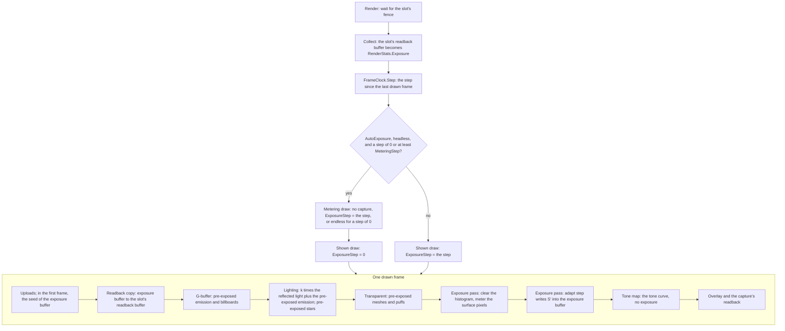

# Automatic exposure

Ticket: `ter-zzyr`, a member of the rendering upgrade epic (`ter-sglu`, [rendering-upgrade.md](rendering-upgrade.md)). The user chose the design on 2026-10-25, in the ticket's "Design decisions". This doc fills in the details. The one open point, a headless still after a long step, is settled for the metering draw (User), see "A headless still after a long step". Part 4 measured the cost, and the results are in "Cost".

## Goal

Before this ticket the exposure was a fixed linear scale, `VulkanRenderer.Exposure`, which `tonemap.frag` applies before the ACES curve. After this ticket:

- The exposure follows the brightness of the surfaces in view over time. When the camera enters the dark, the image brightens over seconds until dark things show detail. When the camera leaves into bright light, the image is blown out at first, and then it settles. Into the light is faster than into the dark.
- The GPU decides the exposure. One compute dispatch builds a histogram of log luminance, and a second one moves the exposure in a GPU buffer. The CPU reads the exposure only to report it.
- Every pass that writes the HDR image or the emissive target writes pre-exposed light: radiance times the exposure, clamped to 65,504. The tone map multiplies by no exposure. This is the part of [local-light-shadows.md](local-light-shadows.md), "Exposure and the HDR image", that this ticket owns.
- A fixed exposure stays, as one case of the setting, for tests.

Exposure and the tone curve (`ter-2t5o`) share one model: radiance, then the exposure, then the tone curve, then the sRGB encoding. (User)

## Terms

| Term | Meaning |
|---|---|
| Radiance, L | The light that the shading computes, per color channel, in the renderer's HDR units. After the lights plan (`ter-bpvl`), in W/(m²·sr). |
| Exposure in stops, S | A number. One stop doubles the image's brightness. |
| Scale, k | 2^S: the factor by which the passes multiply radiance. |
| Pre-exposed radiance | min(k · L, 65,504) per channel: what the HDR image and the emissive target store. 65,504 is the largest finite half float. |
| The exposure buffer | One device-local storage buffer of 16 bytes. Its first float, `exposureStops`, holds S. It is the one store of the exposure. |
| Luminance, Y | 0.2126 R + 0.7152 G + 0.0722 B, of linear Rec. 709 values. |
| Surface pixel | A pixel whose G-buffer distance is above 0. A pixel at distance 0 is sky. |
| The histogram | 256 counters in a device-local buffer. Bin i counts the surface pixels whose pre-exposed luminance lies in its eighth of a stop. |
| Dark share, bright share | The shares of the surface pixels that the meter drops from the dark end and from the bright end of the histogram. |
| Trimmed mean, M | The mean of log2 Y over the surface pixels that are left after the trim, in stops of pre-exposed luminance. |
| Bright edge, E | log2 Y at the upper end of the trim: the (1 − BrightShare) quantile of the surface pixels, in stops of pre-exposed luminance. |
| Average target | The exposure in stops that maps the trimmed mean to middle gray. |
| Highlight target | The exposure in stops that maps the bright edge to 1.0 before the tone curve. |
| Target, T | The lower of the average target and the highlight target, plus the compensation, inside the clamp. |
| The clamp | The range from `MinStops` to `MaxStops`. S never leaves it under `AutoExposure`. |
| Compensation, C | `CompensationStops`: stops added to the target. |
| Drawn frame | One recording and submission of the frame graph. A call of `Render` whose output skips the frame draws none. Under option B of the open fork, one call can draw two. |
| Step, Δt | The seconds between this drawn frame and the drawn frame before it, by the renderer's clock. |
| Time constants | `IntoDarkSeconds`, used when the exposure rises because the view got darker, and `IntoLightSeconds`, used when it falls. |
| The meter | The compute dispatch that fills the histogram from the HDR image. |
| The adapt step | The compute dispatch that computes T from the histogram and moves S toward it. |
| The exposure pass | The `RenderPass` named "exposure" that records the meter and the adapt step. |

## Decisions

The user made the decisions marked (User). This design settled the others by the project's rules. Each has its reason.

1. The GPU decides the exposure: a compute pass builds a histogram of log luminance, and a second compute pass moves the exposure in a GPU buffer. The renderer gains compute pipelines for it. (User)
2. The shading passes write pre-exposed light in this ticket. Every pass that writes the HDR image or the emissive target multiplies by the exposure and clamps to 65,504, and the tone map multiplies by no exposure. (User)
3. The setting is a union: `FixedExposure(Stops)` or `AutoExposure(...)`. Today's linear `Exposure` becomes the fixed case. One stop doubles the image's brightness. (User)
4. Tests and the coming snapshot tests use the fixed case. (User)
5. The meter counts only surface pixels, so a ship in front of black space is not blown out, and the share of sky in the frame does not move the exposure. A view with no surface keeps its exposure. (User)
6. The meter drops the darkest and the brightest shares of the surface pixels, so a lamp or a glint alone does not set the exposure. (User)
7. The target maps the trimmed mean of log luminance to middle gray, 0.18. (User) Highlight priority (`ter-is7n`) changed it: the target is the lower of that average target and a highlight target, which maps the bright edge to 1.0 before the tone curve. So when a large bright area shares the view with a dark one, the bright area keeps its detail and the dark part falls into deep shadow, as the eye sees it. Both come from the same histogram. (User, 2026-10-25)
8. The exposure approaches its target in stops, frame-rate independent, with two time constants: into the dark 3 s, into the light 1 s, by default. A clamp holds it between a lowest and a highest number of stops. The time constants, the clamp, the trim shares and an exposure compensation in stops are settings. (User)
9. The clock is the time between presented frames: the wall clock in a window, and the film's frame time in a headless run, so a headless film gives the same images every run. (User)
10. `RenderStats.Exposure` reports the exposure in stops a few frames late. The renderer reads it back after the slot's fence wait, as it reads the GPU timings, for tests and debugging. The decision stays on the GPU. (Orchestrator, 2026-10-25)
11. The switch, the cost measured with the GPU timers, and ARCHITECTURE.md, as the epic's rules say. (User)

Settled by this design:

12. The setting lives in `RendererOptions.Exposure` and is fixed for the renderer's life. `VulkanRenderer.Exposure` goes. The epic puts each member's switch in `RendererOptions`. Nothing changes the exposure while a renderer runs today: the one test that sets `VulkanRenderer.Exposure` between frames is rewritten (see "Existing tests"). The lights plan derives one constant, `E_cut`, from the highest exposure, and it stays one constant only if the setting does. The editor's per-view exposure ([editor.md](editor.md)) maps onto `RendererOptions`, as its per-view impostor switch does.
13. The default is `AutoExposure.Default`. The test helpers `Gpu.Headless` and `GpuTesting.Headless` set `FixedExposure(0)`. The analogue is `Impostors`: on by default, and off in `Gpu.Headless`. The window and the demo's headless runs then show the feature with no new code, and the tests use the fixed case, as decision 4 says.
14. The union's zero value is `FixedExposure(0)` (its `ZeroCase`). Zero stops multiply by exactly 1, which is today's look. So the setting has no empty value, and no switch over it needs a `null` arm.
15. The exposure buffer holds S in stops, not the scale k. The clamp, the approach and the meter's division work in stops. Each pass computes k = exp2(S), one instruction per invocation. A second float with k is a second store of one value.
16. The exposure buffer is a storage buffer at binding 11 of the frame set. Every frame slot's set points at the same buffer. The CPU never knows the value, so the frame constants, which the CPU writes per slot, cannot carry it. Every shader that pre-exposes already includes `frame.glsl`.
17. The renderer measures its clock itself, by the kind of its output. A renderer made with `CreateForWindow` reads the wall clock. One made with `CreateHeadless` or `CreateOffscreen` reads `RenderSnapshot.Time`. `IRenderer.Render` keeps its signature. The renderer already knows whether it is headless, and the host needs to know nothing about exposure. A third parameter of `Render` changes the seam in Core and about 60 call sites, for a value that the renderer can read itself.
18. The meter measures the HDR image after the transparent pass and before the tone map. So it measures what the viewer sees: glass and puffs in front of surfaces count. The exposure pass gets its own stage, `FrameGraph.Stage.Exposure`, between `Transparent` and `ToneMap`, which is the order of the model. Bloom (`ter-63wr`) works on the same pre-exposed image, and the meter measures it before bloom adds glare.
19. The histogram has 256 bins of an eighth of a stop, from 2^−16 to 2^16 of pre-exposed luminance. See "The histogram".
20. The meter reads every pixel at full resolution, and its cost is measured. A coarser grid waits until a measurement shows a need for it.
21. The compensation applies before the clamp, so the clamp bounds the exposure that the passes use. The lights plan's `E_cut` needs the highest exposure that any frame can use.
22. The impostor atlas stores radiance, not pre-exposed light. A capture passes a scale of 1 to `surfaceRadiance`, and the billboard pre-exposes the atlas's color when it writes the emissive target. So a capture stays right when the exposure changes, with no second value per tile. See "The impostor atlas".
23. The exposure pass clears the histogram at its start. So after a frame, the histogram holds that frame's counts: stored state describes the last finished step, and a test can read it.
24. Every stops value of a setting lies from −64 to 64: `FixedExposure.Stops`, `MinStops`, `MaxStops` and `CompensationStops`. 2^64 is about 1.8 × 10^19, so a radiance below about 10^19 times it stays finite in a 32-bit float, and the product never overflows before the clamp.
25. The default clamp is −8 to +8 stops, and both default trim shares are 0.1, in today's units. See "Defaults". The lights plan retunes the clamp for SI units.
26. The device's graphics queue family must also support compute. The renderer records compute and graphics work in one command buffer on one queue. MoltenVK's one queue family supports both.
27. `params.x` of the frame constants held a copy of the exposure that no shader read. It goes, and `x` is unused. A second store can disagree with the first.
28. The readback copies the exposure buffer at the start of each drawn frame, before any pass reads it. So a reading is the exposure that a frame's passes used.
29. The bright edge lies inside its bin by the share of the bin's count below the edge, not at the bin's center (`ter-is7n`). It is the trim's own rule for a bin that straddles an edge. See "The bright edge".

## The math

### Luminance

The HDR image holds linear RGB with the Rec. 709 primaries, which sRGB shares. The meter weighs the channels by the luminance coefficients of ITU-R BT.709:

```
Y = 0.2126 R + 0.7152 G + 0.0722 B
```

The meter reads the pre-exposed values: Y here is k times the luminance of the radiance.

### The histogram

```
bin(Y) = clamp(floor((log2(max(Y, 2^−16)) + 16) · 8), 0, 255)
center(i) = −16 + (i + 0.5) / 8                                  in stops of pre-exposed luminance
```

- 256 bins, one for each invocation of a 16 × 16 meter workgroup and of the 256-wide adapt workgroup.
- 8 bins per stop. The target then moves in steps no coarser than an eighth of a stop for a uniform view, and the mean of many pixels is finer.
- The range is 32 stops of pre-exposed luminance, from 2^−16 to 2^16. No pre-exposed value reaches 2^16, because the clamp keeps it at or below 65,504. A frame that has settled puts its trimmed mean at 0.18, about 2^−2.47. So the range reaches 13.5 stops below middle gray and 18.5 above it. Stephen Hill's ACES fit shows black below a pre-exposed value of about 0.0033, 5.8 stops below middle gray. A frame whose exposure is still far too low after a cut into the dark still finds most of its dark pixels in their own bins, not in the first.
- A luminance at or below 2^−16, black included, falls in the first bin. It counts as the darkest, so a fully dark view drives the exposure up to `MaxStops`.

### The surface rule

The meter counts a pixel only when its G-buffer distance is above 0. The lighting pass gives a distance-0 pixel the star field, and nothing else, so no sky pixel counts, at any exposure. Glass or a puff in front of the sky also has distance 0 and does not count. If no pixel counts, the histogram is empty, and the target is the exposure that the frame used, so nothing moves.

### The trim

With N the number of surface pixels, the meter keeps the part of the sorted pixels from `DarkShare · N` to `(1 − BrightShare) · N`. On the histogram, bin i covers the interval of the cumulative count from `start_i` to `end_i`, where `end_i` is the count of bins 0 to i and `start_i = end_i − count_i`. Its weight is its overlap with the kept interval:

```
low  = DarkShare · N
high = (1 − BrightShare) · N
w_i  = max(0, min(end_i, high) − max(start_i, low))
M    = Σ w_i · center(i) / Σ w_i                    Σ w_i = high − low > 0 when N > 0
```

A bin that straddles an edge counts only its share inside. The shares add up to at most 0.99, by validation, so the kept interval is never empty, also after the shader rounds its two ends in single floats.

### The bright edge

The bright edge E is the luminance at the upper end of the kept interval, the cumulative count `high`. Exactly one bin holds it: the bin with `start_i < high ≤ end_i`. `high` lies above 0, because N > 0 and `BrightShare` < 1, and at most N, so such a bin exists, and its count is above 0. Inside that bin, E lies by the share of the bin's count below `high`:

```
E = −16 + (i + (high − start_i) / count_i) / 8                  start_i < high ≤ end_i
```

The trim treats a bin that straddles an edge by its share inside, so M moves smoothly as `high` moves through a bin. E follows the same rule, so it moves smoothly too. A bin's center instead would jump by an eighth of a stop when the edge crosses into the next bin, and the target with it. Then a steady view whose edge sits near a bin's boundary would settle on that jump, not on its own exposure. With `BrightShare` = 0, E is the top of the brightest bin that has a count.

### The target

The frame shaded with S, so its pre-exposed log luminance is the radiance's plus S. The adapt step divides the exposure out, in stops, before it maps the mean to middle gray and the bright edge to 1.0:

```
T_average   = log2(0.18) − (M − S)
T_highlight = log2(1) − (E − S) = S − E
T = clamp(min(T_average, T_highlight) + C, MinStops, MaxStops)  when N > 0
T = S                                                            when N = 0
```

- At a steady view, M − S and E − S are the same for every S, so T does not depend on the exposure that the frame used. That is the reason the meter can read pre-exposed values.
- The mean of log luminance is the log-average luminance of Reinhard et al. 2002, and 0.18 is their key value for a scene of average brightness.
- The highlight target is the lower one when E − M is more than −log2(0.18), about 2.47 stops: the bright edge would show above 1.0 at the average target. Then the brightest `BrightShare` of the pixels lies above 1.0, and the rest lies at or below it. Stephen Hill's ACES fit maps 1.0 to about 0.62, 0.81 after the sRGB curve, the start of its shoulder, and reaches 250 of 255 only at about 7. So the brightest share clips only where it lies more than about 2.8 stops above the edge.
- A view whose bright edge lies within 2.47 stops of its mean, such as a dim room or a sunlit view with no deep shadow, keeps the average target as before.
- The cost is the dark part of a view with a large bright area: it falls into deep shadow. The user chose that, as the eye sees it. (User, 2026-10-25)

### The approach

```
f(Δt, τ) = 1 − exp(−Δt / τ)                0 when Δt = 0; 1 when Δt = ∞ or τ = 0
τ        = IntoDarkSeconds   when T > S     the view got darker, so the exposure rises
           IntoLightSeconds  otherwise
S'       = S + (T − S) · f(Δt, τ)
```

- S' is the exposure of the next drawn frame. The adapt step of a frame moves S by that frame's step, the time since the drawn frame before it. At a steady frame rate it equals the step to the next frame.
- Frame-rate independence: two steps of Δt/2 toward the same T give T − (T − S) e^(−Δt/τ), the same as one step of Δt. So the curve of S over time does not depend on the frame rate, and only the moment at which the meter samples a changing view does.
- The two time constants meet with no jump: at T = S both give S' = S.
- The CPU computes the two factors, f(Δt, `IntoDarkSeconds`) and f(Δt, `IntoLightSeconds`), in doubles and pushes them as floats. The shader picks one and does one multiply-add. So the GPU computes no exponential, and a C# test pins the factors.

The exponential form is that of Krawczyk, Myszkowski and Seidel 2005, "Perceptual Effects in Real-time Tone Mapping". Pattanaik et al. 2000, "Time-Dependent Visual Adaptation for Fast Realistic Image Display", gives the eye's adaptation to the dark as far slower than its adaptation to light. The defaults keep the direction, at the time scale of a game: 3 s and 1 s. (User)

### The clamp and the compensation

The compensation adds to the lower of the two targets, and the clamp applies after it, so S stays from `MinStops` to `MaxStops` whatever the compensation (decision 21). +1 stop of compensation makes the settled image twice as bright under either target. The adapt step clamps the target, not S'. S' lies between S and T, and both lie inside the clamp, so S' does too.

### The first frame

- The renderer seeds the exposure buffer in its first drawn frame: with `FixedExposure.Stops`, or with 0 stops clamped into `AutoExposure`'s range. Zero stops is today's look.
- The clock's first step is endless (see "The clock"), so f is 1, and the first frame's adapt step reaches its target at once.
- Under option B of the open fork, the first frame is a metering draw, so the first frame that the caller sees already shows its target. Under option A, the first frame shows the seed, and the second shows the target.

### Defaults

| Setting | Default | Reason |
|---|---|---|
| `MinStops` | −8 | The brightest view of today's demo, a wall 2 m from a lamp of intensity 100, wants about −5 stops. |
| `MaxStops` | +8 | The darkest view, the orbit scene's night side under an ambient light of 0.03, wants about +4 stops. In total darkness the exposure stops at +8, 256 times today's. |
| `CompensationStops` | 0 | The target is middle gray as the user asked. |
| `DarkShare` | 0.1 | The deepest shadows and black parts show no detail at any exposure. |
| `BrightShare` | 0.1 | A lamp panel or a glint covers less than a tenth of the surface pixels in the demo's views. So a bright area that covers a tenth or more of the surface pixels sets the bright edge. |
| `IntoDarkSeconds` | 3 | (User) |
| `IntoLightSeconds` | 1 | (User) |

The lights plan moves every scene to SI units, where a sunlit surface wants about −10 stops and a dim room about +7. It sets the clamp's defaults again then. The last part of this ticket checks the trims and the clamp in the screenshots.

### Sources

- Reinhard, Stark, Shirley and Ferwerda 2002, "Photographic Tone Reproduction for Digital Images": the log-average luminance and the key value 0.18.
- Krawczyk, Myszkowski and Seidel 2005, "Perceptual Effects in Real-time Tone Mapping": the exponential approach with a time constant.
- Pattanaik, Tumblin, Yee and Greenberg 2000, "Time-Dependent Visual Adaptation for Fast Realistic Image Display": adaptation to the dark is slower than to the light.
- Unreal Engine's histogram method of auto exposure: a log-luminance histogram with a low and a high percentage dropped, and separate speeds up and down. This design follows the practice, with time constants instead of speeds in stops per second, because a time constant makes the approach frame-rate independent.
- Filament's documentation, "Physically Based Rendering in Filament", its section on pre-exposed lights: lights multiplied by the camera's exposure in the shading, so that physical units fit in half floats.
- ITU-R BT.709: the luminance coefficients.

## Compute pipelines

The renderer has only graphics pipelines today. It gains what two compute shaders need.

- The build already compiles them. `Tertius.Rendering.csproj` takes `Shaders/*.comp` into `GlslShader` beside `*.vert` and `*.frag`, and glslc picks the stage from the extension. A module is embedded as `Tertius.Rendering.Shaders.<file>.spv`, so `ShaderLibrary.Get("exposure_meter.comp")` loads it with no change. Its doc comment, which names only `.vert` and `.frag`, names `.comp` too.
- `ComputePipelineDesc` (`src/Tertius.Rendering/Vulkan/ComputePipelineDesc.cs`, new) is the analogue of `GraphicsPipelineDesc`: a name, a shader and a layout, and `Create`, which calls `vkCreateComputePipelines` and names the pipeline.
- A compute pass is a `RenderPass` like any other. Its `Record` binds its pipelines and sets at `PipelineBindPoint.Compute` and records `vkCmdDispatch`. `FrameGraph.Record` writes a timestamp after each pass at all commands, so the GPU timer times a compute pass with no work of its own, and its name, "exposure", appears in `RenderStats.GpuTimings` and in `gpu-timings.json`.
- The synchronization uses `BarrierBatch`, as every pass does. Three uses join the closed sets of `ResourceState.cs`:

| Use | Layout | Stages | Access |
|---|---|---|---|
| `ImageUse.SampledCompute` | `ShaderReadOnlyOptimal` | `ComputeShaderBit` | `ShaderSampledReadBit` |
| `BufferUse.ComputeRead` | | `ComputeShaderBit` | `ShaderStorageReadBit` |
| `BufferUse.ComputeWrite` | | `ComputeShaderBit` | `ShaderStorageReadBit`, `ShaderStorageWriteBit` |

`ComputeWrite` carries the read bit too, because the meter's atomic adds and the adapt step both read what they write.

- Descriptor sets. Both compute pipelines use one pipeline layout, `DescriptorLayouts.ExposureLayout`:

| Set | Binding | Type | Stage | Holds | Owner, written |
|---|---|---|---|---|---|
| 0, the meter set | 0 | Sampled image | Compute | The HDR image | `RenderTargets.MeterSet`, at creation and on every resize, as the G-buffer set |
| 0, the meter set | 1 | Sampled image | Compute | The G-buffer distance | The same |
| 1, the exposure set | 0 | Storage buffer | Compute | The histogram | `ExposureResources.Set`, once |
| 1, the exposure set | 1 | Storage buffer | Compute | The exposure buffer | The same |

The push constant range is `ExposureAdaptPushConstants`, 32 bytes, for the compute stage. The meter declares no push block. The descriptor pool gains 2 sampled images, 2 storage buffers and 2 sets.

- `VulkanDevice` chooses a queue family with both `GraphicsBit` and `ComputeBit` (decision 26).

## The exposure on the GPU

### Where it lives

`ExposureResources` (`src/Tertius.Rendering/Frame/ExposureResources.cs`, new) owns:

| Buffer | Size | Memory | Usage | Holds |
|---|---|---|---|---|
| The exposure buffer | 16 bytes | `GpuOnly` | Storage, transfer source, transfer destination | `exposureStops` at offset 0. The rest is padding. |
| The histogram | 1,024 bytes | `GpuOnly` | Storage, transfer source, transfer destination | 256 `uint` counts of the last metered frame |
| One readback buffer per frame slot | 16 bytes each | `Readback` | Transfer destination | A copy of the exposure buffer, taken at the start of the slot's last drawn frame |

There is one exposure buffer and one histogram for the renderer, not one per frame in flight. The exposure is one value that each frame passes to the next, so one store holds it.

### Writers and readers

| When | Who | What |
|---|---|---|
| The first drawn frame, in the uploads | `ExposureResources.RecordSeed` | `vkCmdFillBuffer` writes the bits of the initial stops (`ExposureSetting.InitialStops`). The renderer knows the first frame from its frame number, 0, which counts submitted frames. So a first call whose output skips the frame seeds in the next call that draws. |
| The start of every drawn frame, before the first pass | `ExposureResources.RecordReadback` | Copies the exposure buffer into the slot's readback buffer. |
| The G-buffer, lighting and transparent passes | Their shaders | Read `exposureStops` (see "Pre-exposure"). |
| The exposure pass, under `AutoExposure` | The adapt step | Reads `exposureStops`, the S that the frame used, and writes S'. |
| After each wait on a slot's fence, in `Render`: the wait before the slot records again, and a capture's wait for its own frame | `ExposureResources.Collect` | Reads the slot's readback buffer into `ExposureResources.Latest`, which `RenderStats.Exposure` reports. It keeps only a newer frame, so the wait on an older slot after a capture does not take the reading back. So a captured frame reports its own exposure, and any other frame the exposure of a frame a few frames before. |

Under `FixedExposure`, the renderer adds no exposure pass, so after the seed nothing writes the buffer. The shaders take one path for both cases.

### Synchronization

Every use of the two buffers goes through `BarrierBatch`, which keeps each buffer's last use. One queue runs the submissions in order, and the first scope of a barrier covers every command earlier in submission order, also in earlier frames. So the uses of the exposure buffer form one chain in submission order: the seed or frame n's adapt step, frame n+1's readback copy and reads, frame n+1's adapt step, and so on. That holds for any number of frames in flight, and the CPU never maps the buffer. Each barrier, with its reason:

| Buffer or image | From | To | Kind | Reason |
|---|---|---|---|---|
| Exposure buffer | Seed (transfer write) | Readback copy (transfer read) | Write to read | The copy must see the seed. |
| Exposure buffer | Frame n's adapt step (compute write) | Frame n+1's readback copy (transfer read) | Write to read, across submissions | Frame n+1 uses what frame n decided. |
| Exposure buffer | Readback copy (transfer read) | G-buffer pass (vertex and fragment read) | Read to read | An execution chain that carries the write's visibility to the new stages, as `BarrierBatch` chains reads. |
| Exposure buffer | Shading reads | Adapt step (compute read and write) | Read to write | The adapt step must not change S while a pass of the same frame still reads it. Its first scope also covers the reads of earlier frames. |
| Readback buffer of the slot | Readback copy (transfer write) | `HostRead` | Write to host read | The CPU reads the copy after the slot's fence. |
| Histogram | Frame n's adapt step (compute read) | Frame n+1's fill (transfer write) | Read to write | The fill must not clear counts that the adapt step still reads. |
| Histogram | Fill (transfer write) | Meter (compute read and write) | Write to write | The atomic adds start from zeros. |
| Histogram | Meter (compute write) | Adapt step (compute read) | Write to read | The adapt step reads every count. |
| HDR image | Transparent pass (color attachment write) | Meter (`SampledCompute`) | Write to read | The meter reads the finished image. |
| G-buffer distance | Lighting and transparent passes (fragment read) | Meter (`SampledCompute`) | Read to read | A chain to the compute stage. |
| HDR image | Meter (`SampledCompute`) | Tone map (`SampledFragment`) | Read to read | A chain to the fragment stage. |

The readback buffers need no barrier between frames. Each belongs to one slot: the slot's frame writes it, and the CPU reads it after the slot's fence, before the slot records again.

### The shaders of the exposure pass

`meter.glsl` (new) holds what the meter, the adapt step and the C# copy share:

```glsl
// The exposure's meter (docs/plans/auto-exposure.md, "The math"). ExposureMeter.cs is the C# copy. Change both together.
#ifndef TERTIUS_METER_GLSL
#define TERTIUS_METER_GLSL

const uint HistogramBins = 256u;
const float BinsPerStop = 8.0;
const float LowestStops = -16.0;    // log2 of the lowest pre-exposed luminance with a bin of its own
const float MiddleGray = 0.18;
const vec3 LuminanceWeights = vec3(0.2126, 0.7152, 0.0722);

float luminance(vec3 radiance)
{
    return dot(radiance, LuminanceWeights);
}

// A luminance at or below 2^LowestStops, 0 included, falls in the first bin.
uint binOf(float y)
{
    float stops = log2(max(y, exp2(LowestStops)));
    return uint(clamp(floor((stops - LowestStops) * BinsPerStop), 0.0, float(HistogramBins - 1u)));
}

float binCenterStops(uint bin)
{
    return LowestStops + (float(bin) + 0.5) / BinsPerStop;
}

#endif
```

`exposure_meter.comp` (new), dispatched over ⌈width / 16⌉ × ⌈height / 16⌉ workgroups:

```glsl
#version 460
#extension GL_EXT_samplerless_texture_functions : require
#extension GL_GOOGLE_include_directive : require
#include "meter.glsl"

layout(local_size_x = 16, local_size_y = 16) in;

layout(set = 0, binding = 0) uniform texture2D hdrImage;        // pre-exposed radiance
layout(set = 0, binding = 1) uniform texture2D distanceImage;   // the G-buffer distance: 0 is sky
layout(set = 1, binding = 0, std430) buffer HistogramBlock { uint bins[HistogramBins]; };

shared uint localBins[HistogramBins];

void main()
{
    uint i = gl_LocalInvocationIndex;
    localBins[i] = 0u;
    barrier();
    ivec2 pixel = ivec2(gl_GlobalInvocationID.xy);
    ivec2 size = textureSize(hdrImage, 0);
    if (pixel.x < size.x && pixel.y < size.y && texelFetch(distanceImage, pixel, 0).r > 0.0)
        atomicAdd(localBins[binOf(luminance(texelFetch(hdrImage, pixel, 0).rgb))], 1u);
    barrier();
    uint count = localBins[i];
    if (count > 0u)
        atomicAdd(bins[i], count);
}
```

`exposure_adapt.comp` (new), dispatched as one workgroup:

```glsl
#version 460
#extension GL_GOOGLE_include_directive : require
#include "meter.glsl"

layout(local_size_x = 256) in;

layout(set = 1, binding = 0, std430) readonly buffer HistogramBlock { uint bins[HistogramBins]; };
layout(set = 1, binding = 1, std430) buffer ExposureBlock { float exposureStops; };

layout(push_constant, std430) uniform AdaptPush
{
    float darkShare;
    float brightShare;
    float minStops;
    float maxStops;
    float compensationStops;
    float intoDarkFactor;     // f(Δt, IntoDarkSeconds): the share of the gap that S closes when it rises
    float intoLightFactor;    // f(Δt, IntoLightSeconds): the share when it falls
} adapt;

shared uint cumulative[HistogramBins];
shared float weighted[HistogramBins];
shared float weights[HistogramBins];
shared float brightEdge;   // written by the one bin that holds the bright edge, read only when the histogram has a count

void main()
{
    uint i = gl_LocalInvocationIndex;
    uint count = bins[i];
    cumulative[i] = count;
    barrier();
    // An inclusive scan (Hillis and Steele): after the step with offset d, cumulative[i] sums up to 2d bins ending at i.
    for (uint offset = 1u; offset < HistogramBins; offset <<= 1u)
    {
        uint before = i >= offset ? cumulative[i - offset] : 0u;
        barrier();
        cumulative[i] += before;
        barrier();
    }
    float total = float(cumulative[HistogramBins - 1u]);
    float low = adapt.darkShare * total;
    float high = (1.0 - adapt.brightShare) * total;
    float end = float(cumulative[i]);
    float start = end - float(count);
    float inside = max(min(end, high) - max(start, low), 0.0);
    weighted[i] = inside * binCenterStops(i);
    weights[i] = inside;
    // high lies above 0 and at most total, so exactly one bin with a count holds it.
    if (start < high && high <= end)
        brightEdge = LowestStops + (float(i) + (high - start) / float(count)) / BinsPerStop;
    barrier();
    // A fixed tree, so the sums round the same way on every run.
    for (uint stride = HistogramBins / 2u; stride > 0u; stride >>= 1u)
    {
        if (i < stride)
        {
            weighted[i] += weighted[i + stride];
            weights[i] += weights[i + stride];
        }
        barrier();
    }
    if (i == 0u)
    {
        float used = exposureStops;
        float target = used;
        if (total > 0.0)
        {
            float mean = weighted[0] / weights[0];
            float averageTarget = log2(MiddleGray) - (mean - used);
            float highlightTarget = -(brightEdge - used);
            float compensated = min(averageTarget, highlightTarget) + adapt.compensationStops;
            target = clamp(compensated, adapt.minStops, adapt.maxStops);
        }
        float factor = target > used ? adapt.intoDarkFactor : adapt.intoLightFactor;
        exposureStops = used + (target - used) * factor;
    }
}
```

The bright edge needs no reduction: one invocation writes it, and the barrier before the sum makes it visible to invocation 0. `high` and the cumulative counts are exact integers in floats, so the test `start < high && high <= end` holds in exactly one bin with a count.

Counts are exact as floats up to 2^24, about 16.7 million pixels, so up to an 8K image. Determinism: the integer atomic adds commute, so the histogram does not depend on the order of the workgroups. The scan and the reduction run in one workgroup over a fixed tree, and the CPU computes the factors. So the same frames give the same bits in every run on one GPU.

### The exposure pass

`ExposurePass` (`src/Tertius.Rendering/Passes/ExposurePass.cs`, new), the one pass of `FrameGraph.Stage.Exposure`, which the renderer adds only under `AutoExposure`. Its `Record`:

1. `Histogram`: `TransferDestination`. Flush. `vkCmdFillBuffer` with 0.
2. The HDR image and the distance: `SampledCompute`. `Histogram`: `ComputeWrite`. Flush. Bind the meter pipeline and both sets at the compute bind point. Dispatch the meter.
3. `Histogram`: `ComputeRead`. The exposure buffer: `ComputeWrite`. Flush. Bind the adapt pipeline. Push the constants: the setting's fields, and the two factors from `ExposureMeter.ApproachFactor(context.ExposureStep, ...)`. Dispatch one workgroup.

## Pre-exposure

### Every writer

| Pass | Shader | Writes | Multiplies by |
|---|---|---|---|
| G-buffer | `gbuffer.frag` | The emissive target: the material's emission | `preExposed(s.emissive)` |
| G-buffer, the billboards | `impostor.frag` | The emissive target: the capture's radiance | `preExposed(color.rgb / coverage)` |
| Impostor captures | `impostor_capture.frag` | The atlas, which is neither the HDR image nor the emissive target | A scale of 1: the atlas stores radiance (decision 22) |
| Lighting, a lit pixel | `lighting.frag` | The HDR image | `surfaceRadiance(..., exposureScale())`: k times the reflected light, plus the emission that the G-buffer pre-exposed, clamped |
| Lighting, an impostor pixel | `lighting.frag` | The HDR image | Nothing more: the billboard pre-exposed the emission |
| Lighting, sky | `lighting.frag` | The HDR image | `preExposed(starField(direction))` |
| Transparent, a mesh | `transparent.frag` | The HDR image, alpha-blended | `surfaceRadiance(..., s.emissive * k, ..., k)` |
| Transparent, a puff | `puff.vert`, then `puff.frag` | The HDR image, added | `preExposed` of the glow color or of `scatteredLight`, in the vertex shader. The fragment shader multiplies by factors of 1 or less. |
| Bloom | `bloom_prefilter.frag`, `bloom_down.frag`, `bloom_up.frag` | The bloom levels, from the pre-exposed HDR image | Nothing: the threshold compares the pre-exposed value directly, and `BloomPushConstants.Exposure` goes |
| Tone map | `tonemap.glsl`, through `tonemap.frag` and `tonemap_bloom.frag` | The output | Nothing: `tonemap.exposure` and its multiply go. The glow of the bloom levels joins the pre-exposed light before the curve. |
| Overlay | `outline.frag` | The output, after the tone map | Nothing: display colors |
| Shadow maps | `shadow.vert` | Depth only | Nothing |

No other pass writes the HDR image or the emissive target. Bloom (`ter-63wr`, merged into this branch on 2026-10-25) reads the pre-exposed image, after the exposure pass ("The order of a rendered frame" in ARCHITECTURE.md gives the reason for that order).

### The shader interface

`exposure.glsl` (new), included by `lighting.glsl`, `gbuffer.frag`, `impostor.frag` and `puff.vert`:

```glsl
// The exposure of the frame and pre-exposure (docs/plans/auto-exposure.md, "Pre-exposure").
#ifndef TERTIUS_EXPOSURE_GLSL
#define TERTIUS_EXPOSURE_GLSL

#include "frame.glsl"

// The largest finite half float: the HDR target and the emissive target store no more (docs/plans/pbr-brdf.md, "The clamp").
const float MaxRadiance = 65504.0;

// The factor by which this frame's passes multiply radiance: 2 to the power of the exposure in stops.
float exposureScale()
{
    return exp2(exposureStops);
}

// Radiance times the exposure, clamped to what a half float holds.
vec3 preExposed(vec3 radiance)
{
    return min(radiance * exposureScale(), vec3(MaxRadiance));
}

#endif
```

`frame.glsl` gains binding 11, and `params.x` becomes unused:

```glsl
// The exposure in stops that this frame's passes use (ExposureResources.cs). The adapt step of the frame before wrote it.
layout(set = 0, binding = 11, std430) readonly buffer ExposureBlock { float exposureStops; };
```

`MaxRadiance` moves from `lighting.glsl` to `exposure.glsl`. `surfaceRadiance` takes the emission already pre-exposed, and the scale:

```glsl
// All light that leaves a surface point toward the eye, pre-exposed and clamped to what the HDR target holds: the
// reflected light times `exposure`, plus `preExposedEmission`, which the caller has already multiplied. The clamp
// applies to the whole sum. V points from the surface to the eye. Impostor captures pass shadowMaps false and an
// exposure of 1, because the atlas stores radiance.
vec3 surfaceRadiance(ShadingInput s, vec3 preExposedEmission, vec3 position, vec3 V, bool shadowMaps, float exposure)
{
    SurfaceLobes lobes = lobesOf(s, V);
    vec3 reflected = ambientLight(s, lobes) + sunLight(s, lobes, position, V, shadowMaps)
        + localLights(s, lobes, position, V);
    return min(reflected * exposure + preExposedEmission, vec3(MaxRadiance));
}
```

The callers:

| Shader | Call |
|---|---|
| `lighting.frag` | `surfaceRadiance(s, emissive, position, -direction, true, exposureScale())`, where `emissive` is the G-buffer's, already pre-exposed |
| `transparent.frag` | `float exposure = exposureScale();` then `surfaceRadiance(shading, s.emissive * exposure, inPosition, V, true, exposure)` |
| `impostor_capture.frag` | `surfaceRadiance(shading, s.emissive, inPosition, V, false, 1.0)` |

The math runs in 32-bit floats, so k times a radiance stays finite before the clamp (decision 24).

### How the meter divides out the exposure

The meter bins pre-exposed luminance, log2 Y + S. The adapt step reads `exposureStops` before it writes it. That value is the S that every pass of the frame used, because nothing writes the buffer between the frame's start and the adapt step. It subtracts S from the mean (see "The target"). So one value is both the frame's exposure and the divisor.

### The impostor atlas

A capture is baked once and drawn in later frames, while the exposure moves. The atlas stores radiance, clamped to 65,504, and the billboard multiplies by the scale of the frame that draws it. So the image of a capture follows the exposure with no recapture and no record of the exposure at the capture. `ImpostorManager` and its signature of the light do not change.

The other way is a pre-exposed atlas and the capture's exposure per tile, so that the billboard multiplies by 2^(S − S_capture). It keeps the atlas's values near display range at any exposure. It costs a buffer of one float per tile, a copy at each capture, and a binding in set 3. The half float's range makes it unnecessary:

- At the top, the atlas clamps a radiance above 65,504. That is 150 times a sunlit white surface in SI units. At any exposure that shows a sunlit white surface at middle gray or brighter, a radiance of 65,504 shows as white.
- At the bottom, a half float keeps 11 bits down to 6.1 × 10^−5. At +8 stops, the default `MaxStops`, that radiance shows at about 7 of 255 through the ACES curve, and a radiance 10 times dimmer shows black. So the atlas loses no visible precision in the dark.
- If the lights plan raises `MaxStops` above about +12, it checks the second point again.

### Puffs and the clamp

Each puff clamps its own pre-exposed light in the vertex shader. The transparent pass adds puffs to the HDR image, and two puffs that each send 40,000 add past 65,504 in the blend unit, which can store infinity. Today's puffs add unclamped light, so the limit is not new, and pre-exposure brings their values near display white. A pre-exposed 40,000 is thousands of times display white, which needs a glow puff far brighter than anything else in view. This ticket names the limit and changes nothing. A scene that shows it gets a clamp in the tone map.

## The setting

`src/Tertius.Rendering/ExposureSetting.cs` (new, public):

```csharp
namespace Tertius.Rendering;

/// <summary>A fixed exposure: every pass multiplies radiance by 2^<paramref name="Stops"/>.</summary>
/// <param name="Stops">The exposure in stops, from −64 to 64. One stop doubles the image's brightness. 0 keeps radiance as it is.</param>
public readonly record struct FixedExposure(float Stops);

/// <summary>
/// An exposure that follows the brightness of the surfaces in view over time (docs/plans/auto-exposure.md). The meter
/// maps the surface pixels' trimmed mean to middle gray, or their bright edge to 1 when that is lower, and the exposure
/// approaches that target with a time constant per direction.
/// </summary>
/// <param name="MinStops">The lowest exposure, in stops, from −64 to <paramref name="MaxStops"/>.</param>
/// <param name="MaxStops">The highest exposure, in stops, up to 64.</param>
/// <param name="CompensationStops">Stops added to the target before the clamp, from −64 to 64. +1 makes the settled image twice as bright.</param>
/// <param name="DarkShare">The share of the surface pixels that the meter drops from the dark end, 0 or more.</param>
/// <param name="BrightShare">The share that the meter drops from the bright end, 0 or more. The two shares add up to less than 1.</param>
/// <param name="IntoDarkSeconds">The time constant, in s, 0 or more, while the exposure rises because the view got darker.</param>
/// <param name="IntoLightSeconds">The time constant, in s, 0 or more, while the exposure falls because the view got brighter.</param>
public readonly record struct AutoExposure(
    float MinStops,
    float MaxStops,
    float CompensationStops,
    float DarkShare,
    float BrightShare,
    float IntoDarkSeconds,
    float IntoLightSeconds
)
{
    /// <summary>The renderer's default: −8 to +8 stops, no compensation, a tenth dropped at each end, 3 s into the dark and 1 s into the light.</summary>
    public static AutoExposure Default =>
        new(
            MinStops: -8,
            MaxStops: 8,
            CompensationStops: 0,
            DarkShare: 0.1f,
            BrightShare: 0.1f,
            IntoDarkSeconds: 3,
            IntoLightSeconds: 1
        );
}

/// <summary>
/// How the renderer chooses the exposure: <see cref="FixedExposure"/> or <see cref="AutoExposure"/>. The default value is
/// FixedExposure(0), today's look. It is a generated union (see <see cref="GeneratedUnionAttribute"/>).
/// </summary>
[GeneratedUnion(typeof(FixedExposure), typeof(AutoExposure), ZeroCase = typeof(FixedExposure))]
public readonly partial struct ExposureSetting
{
    /// <summary>The largest magnitude of a stops value in a setting.</summary>
    public const float StopsLimit = 64;

    /// <summary>Why the renderer cannot use the setting, or null when it can.</summary>
    internal string? Problem => this switch
    {
        FixedExposure(var stops) => ...,
        AutoExposure auto => ...,
    };

    /// <summary>The exposure in stops that the first frame seeds: the fixed stops, or 0 inside the clamp.</summary>
    internal float InitialStops => this switch
    {
        FixedExposure(var stops) => stops,
        AutoExposure auto => Math.Clamp(0f, auto.MinStops, auto.MaxStops),
    };
}
```

`new AutoExposure()` gives all zeros, not the defaults, as for every record struct, so callers start from `AutoExposure.Default with { ... }`.

Validation, in `VulkanRenderer.CheckOptions`, which throws `ArgumentOutOfRangeException` for `options` with the message of `Problem`, as it does for the other options:

| Field | Rule |
|---|---|
| `FixedExposure.Stops` | Finite, from −64 to 64 |
| `MinStops`, `MaxStops`, `CompensationStops` | Finite, from −64 to 64 |
| `MinStops`, `MaxStops` | `MinStops` ≤ `MaxStops` |
| `DarkShare`, `BrightShare` | Finite, 0 or more, and `DarkShare + BrightShare` < 1 |
| `IntoDarkSeconds`, `IntoLightSeconds` | Finite, 0 or more. 0 reaches the target in any step above 0. |

`RendererOptions` gains:

```csharp
/// <summary>
/// How the renderer chooses the exposure: <see cref="AutoExposure"/> follows the surfaces in view over time, and
/// <see cref="FixedExposure"/> never moves, for tests. The default is <see cref="AutoExposure.Default"/>.
/// </summary>
public ExposureSetting Exposure { get; set; } = AutoExposure.Default;
```

`RenderStats` gains, beside `GpuTimings`:

```csharp
/// <summary>
/// The exposure that the passes of the last frame whose GPU work finished used, which is a few frames before this one,
/// or null before one has. A frame that the output skips keeps the reading that its wait found.
/// </summary>
public ExposureReading? Exposure { get; init; }
```

and `src/Tertius.Rendering/ExposureReading.cs` (new):

```csharp
/// <summary>The exposure that the passes of one finished frame used.</summary>
/// <param name="Frame">The number of that frame, counted from 0 by <see cref="VulkanRenderer.Render"/>.</param>
/// <param name="Stops">The exposure in stops: the passes multiplied radiance by 2^Stops.</param>
public readonly record struct ExposureReading(long Frame, float Stops);
```

Frame n reports frame n − `FramesInFlight`, and the first `FramesInFlight` frames report null, as the GPU timings do.

## The clock

The step Δt is the time between two drawn frames. Where each kind comes from today:

- The wall clock in a window. `WindowHost.RenderLoop` already measures `frameSeconds` with its own `Stopwatch`, for the fly camera. The renderer measures its own steps the same way, with `Stopwatch.GetTimestamp()` at each drawn frame, because the time that matters is between the frames that it draws.
- The film's frame time in a headless run. `HeadlessPlayback.Capture` publishes a snapshot, `RenderSnapshotBuilder` writes the World's time into `RenderSnapshot.Time`, and the playback renders it. A film step runs `Every` ticks before each frame, so two frames of a film lie `Every` ticks apart in `RenderSnapshot.Time`. A capture step after a run lies the run's length after the capture before it.

`FrameClock` (`src/Tertius.Rendering/Frame/FrameClock.cs`, new, internal) holds the time of the last drawn frame in either kind:

```csharp
/// <summary>A window's clock: the wall time of the last drawn frame, in s, or −∞ before the first.</summary>
internal readonly record struct WallClock(double LastSeconds);

/// <summary>A headless run's clock: the snapshot time of the last drawn frame, in s, or −∞ before the first.</summary>
internal readonly record struct FilmClock(double LastSeconds);

/// <summary>
/// The clock that steps the exposure's approach: the time between two drawn frames (docs/plans/auto-exposure.md,
/// "The clock"). A window reads the wall clock, and a headless run reads the snapshot's time.
/// </summary>
[GeneratedUnion(typeof(WallClock), typeof(FilmClock))]
internal readonly partial struct FrameClock
{
    /// <summary>The clock of a window renderer that has drawn no frame.</summary>
    public static FrameClock Window => new WallClock(double.NegativeInfinity);

    /// <summary>The clock of a headless renderer that has drawn no frame.</summary>
    public static FrameClock Film => new FilmClock(double.NegativeInfinity);

    /// <summary>
    /// The step from the last drawn frame to a frame at <paramref name="snapshotTime"/> and <paramref name="wallSeconds"/>,
    /// in s: +∞ before the first drawn frame, and 0 when the time did not move forward. And the clock whose last drawn
    /// frame is that frame.
    /// </summary>
    public (FrameClock Next, float Seconds) Step(double snapshotTime, double wallSeconds);
}
```

- The step is now − last. Before the first frame, last is −∞, so the step is +∞ with no special case.
- A time that did not move forward gives 0: two captures at one tick, a capture after a camera cut at the tick of the frame before it, or a test that renders one snapshot many times. A NaN gives 0. Under option B, a headless frame under `AutoExposure` with a step of 0 draws a metering draw with an endless step ("The metering draw (option B)").
- The clock steps only for a drawn frame. A frame that the output skips, such as one of a minimized window, records nothing, so the next drawn frame steps from the last one that drew.
- `Render` computes the step at its start and keeps `Next` after the frame records. The renderer starts with `FrameClock.Window` from `CreateForWindow` and `FrameClock.Film` from `CreateOffscreen`, which `CreateHeadless` calls.
- The step reaches the exposure pass as `FrameContext.ExposureStep`, in s.

A GPU test drives the film clock through `RenderSnapshot.Time`, which tests set per frame.

## A headless still after a long step

The user chose option B, the metering draw, on 2026-10-25. (User)

Two rules of B were settled after the review, by the orchestrator from the user's decision that a headless still shows the settled exposure of its own view, on 2026-10-25 ("The metering draw (option B)"): a frame whose step is 0 draws a metering draw with an endless step, and a frame whose step reaches `MeteringStep` draws one, the frames of a time-lapse film included.

A frame is shaded with the exposure that the frame before it decided. In a window or a film, the step is a frame time, and a lag of one frame does not show. A headless still can come after a long step: the first capture of a run, or a capture after a camera step and a run of seconds, as `scripts/demo-surface.json` takes. Such a still is shaded with the exposure of the view before the camera step, and its own view's exposure shows only in the next frame, which a still never has. The ticket's decisions do not say what a still shows, and the answer changes the screenshots that the user reviews.

| Option | What it gives | What it costs |
|---|---|---|
| A. One draw per frame, everywhere | One rule for a window, a film and a still. A still after a long step shows the view before it, adapted toward that view for the step. The first still of a run shows the seed, 0 stops. A script that wants a settled still films a few frames before it. | Today's screenshot scripts show wrong exposures after camera steps until each one gets a short film before its stills. No cost on the GPU. |
| B. A metering draw before a headless frame whose step is at least `MeteringStep` (Recommended) | Under `AutoExposure`, a headless renderer whose step is 0.09 s or more, endless, or 0, draws the frame twice. The first draw, the metering draw, takes no capture, and its adapt step moves S by the whole step toward its own view's target. The second draw, the shown draw, uses that S, and its adapt step moves by 0. So a still shows its own view, adapted for the time since the frame before, and the first still of a run shows its settled exposure. A real-time film's frames step 1 to 4 ticks and draw once. A time-lapse film's frames step 6 ticks or more and draw twice, so each one adapts toward its own view. A window never draws twice. | One more frame of GPU time for each such still and for each frame of a time-lapse film, about 3 ms at 1080p, and one constant. A view more than about 13 stops darker than the exposure before it puts many pixels in the first bin in the metering draw, so the shown draw is still short of the target, and later frames finish the approach. |

`MeteringStep` is 0.09 s, 5.4 ticks at 60 Hz: longer than the longest step of the demo's real-time films (4 ticks, 67 ms, `scripts/blue-danube.json` and `scripts/demo-docking.json`), shorter than the shortest step of its time-lapse films (6 ticks, 0.1 s, the glide of `scripts/blue-danube.json`), and shorter than the shortest run before a capture in the demo's scripts (30 ticks, 0.5 s). It lies between two whole ticks, so that no step of whole ticks lies on it, and the rounding of a step's subtraction cannot decide whether a frame meters. No value lies above every film step and below every run before a capture: `scripts/blue-danube.json` films at up to 240 ticks per frame, 4 s. Why B is recommended: the stills are the user's way of reviewing every visible change, often from a phone, and under A each review first needs a fix to its script. The model of the approach is "the eye adapts for the step toward what it watched". For a step of a frame, the view before is a good stand-in for what the eye watched. For a step of seconds after a camera step, only the current view is.

This doc is written for B. Under A, these change, and nothing else:

- `VulkanRenderer.MeteringStepSeconds` and the second draw in `Render` go.
- `MeteringDrawTests` goes, and `TheFirstFrameShowsTheSettledExposure` becomes `TheFirstFrameShowsTheSeedAndTheSecondTheSettledExposure`.
- `ScriptCommandCaptureTests.AHeadlessFilmWritesTheGpuTimeOfEachPassOverItsFinishedFramesToAFileWhosePathItPrints` keeps 4 frames per pass.
- Part 4 adds a film of a few frames before each still of the scripts it uses for the screenshots.

### The metering draw (option B)

`Render` checks its arguments, steps the clock, and calls a private `DrawFrame(snapshot, alpha, exposureStep, takeCapture)` once or twice. `DrawFrame` is today's body of `Render` from the fence wait on.

```csharp
(FrameClock next, float step) = clock.Step(snapshot.Time, Stopwatch.GetTimestamp() / (double)Stopwatch.Frequency);
bool atTheTickBefore = step == 0;
if (exposureSetting is AutoExposure && headless && (atTheTickBefore || step >= MeteringStepSeconds))
{
    float meteringStep = atTheTickBefore ? float.PositiveInfinity : step;
    if (!DrawFrame(snapshot, alpha, exposureStep: meteringStep, takeCapture: false))
        return;
    clock = next;
    step = 0;
}

if (DrawFrame(snapshot, alpha, exposureStep: step, takeCapture: true))
    clock = next;
```

`DrawFrame` returns false when the output skipped the frame. Each draw takes its own frame slot and frame number, and `LastFrameStats` describes the shown draw. The metering draw runs the batcher, the impostor manager and every pass, so its impostor captures count, and the shown draw finds them made.

Which frames meter, settled by the orchestrator from the user's decision, 2026-10-25:

- A frame whose step is 0 draws a metering draw with an endless step, so it settles on its own view. Such a frame lies at the tick of the frame before it: a still or the first film frame right after a camera cut, which takes no snapshot time, as in `scripts/earth-system.json`, `scripts/demo-launch.json` and `scripts/doorway.json`. Without it, such a still would show the exposure of the view before the cut. A second capture of one view at one tick shows that view's settled exposure, not the first capture's exposure.
- A frame whose step reaches `MeteringStep` draws a metering draw with its step. So each frame of a time-lapse film, such as those of `scripts/blue-danube.json`, adapts toward its own view, at about one more frame of GPU time per frame ("Cost").

## Every reader and writer

| Value | Written by | When | Read by | Analogue |
|---|---|---|---|---|
| `RendererOptions.Exposure`, an `ExposureSetting` | The host (`ScriptCommand`, `WindowHost`), tests | Before the renderer is made | `CheckOptions`. `VulkanRenderer`, which adds the exposure pass only for `AutoExposure`. `ExposureResources`, for the seed. `ExposurePass`, for its push constants. | `RendererOptions.Impostors` |
| `exposureStops` in the exposure buffer | The seed, then the adapt step | The first drawn frame's uploads, then the exposure pass of each drawn frame under `AutoExposure` | `gbuffer.frag`, `impostor.frag`, `lighting.frag`, `transparent.frag` and `puff.vert`. The adapt step. The readback copy. | The material buffer: device-local, written on the GPU timeline, read by the shading passes |
| The histogram | The fill and the meter | The exposure pass of each drawn frame | The adapt step, and the test hook `VulkanRenderer.ReadExposureHistogram` | The shadow maps: written and read on the GPU in the same frame |
| The readback buffer of a slot | The readback copy | The start of the slot's drawn frame | `ExposureResources.Collect`, after the slot's fence | The timestamp query pool of a slot |
| `ExposureResources.Latest`, an `ExposureReading` | `Collect` | Each `Render`, after the fence wait | `RenderStats.Exposure` | `GpuTimer.Latest` |
| `RenderStats.Exposure` | `Render` | Each call, a skipped frame included | Tests, debugging | `RenderStats.GpuTimings` |
| `FrameClock` | `Render` | Each drawn frame | `Render`, for the step | None today: the window host's `frameClock` measures the same wall time for the fly camera |
| `FrameContext.ExposureStep` | `Render` | Each draw | `ExposurePass` | `FrameContext.Alpha` |
| The meter set | `RenderTargets` | At creation and on every resize | The meter | The G-buffer set and the post set |
| The exposure set | `ExposureResources` | Once | The meter and the adapt step | The atlas set |
| Pre-exposed radiance in the HDR image and the emissive target | The writers of "Every writer" | Each drawn frame | The lighting pass (the emissive target), the meter, the tone map, later bloom | Today's radiance in the same targets |
| Radiance in the impostor atlas | `impostor_capture.frag` | At each capture | `impostor.frag`, which pre-exposes it | Unchanged |

`VulkanRenderer.Exposure`, `FrameContext.Exposure` as a float, `ToneMapPushConstants.Exposure` and the copy in `params.x` go. Each was a store of the same value.

## The flow of a frame



1. `Render` waits for the slot's fence and collects the slot's timings and exposure reading: the exposure that frame n − `FramesInFlight` used.
2. It steps the clock. Under option B, a headless frame under `AutoExposure` with a step of 0 or at least `MeteringStep` draws a metering draw first.
3. In a drawn frame, the uploads run. In the first drawn frame they also seed the exposure buffer.
4. The readback copy takes the exposure that this frame uses.
5. Batching, the shadow maps and the impostor captures run as today. A capture writes radiance into the atlas.
6. The G-buffer pass writes pre-exposed emission, and the billboards pre-expose the atlas's radiance.
7. The lighting pass multiplies the reflected light by k, adds the pre-exposed emission and clamps. It pre-exposes the stars.
8. The transparent pass pre-exposes its meshes and its puffs.
9. Under `AutoExposure`, the exposure pass clears the histogram, meters the surface pixels of the HDR image, and its adapt step writes the exposure of the next frame.
10. The tone map applies the tone curve to the pre-exposed image. The overlay and a capture's readback follow as today.

## The flow of each kind of pixel

| Pixel | Written by | Pre-exposed by | Counted by the meter |
|---|---|---|---|
| Lit surface | Lighting | `surfaceRadiance`'s scale | Yes |
| Emissive surface | G-buffer, then lighting | `gbuffer.frag` | Yes |
| Impostor | Billboard, then lighting | `impostor.frag` | Yes |
| Glass in front of a surface | Transparent | `transparent.frag` | Yes: the distance is the surface's |
| A puff in front of a surface | Transparent | `puff.vert` | Yes |
| Sky | Lighting | `lighting.frag` | No |
| Glass or a puff in front of the sky | Transparent | Its shader | No: the distance is 0 |

Every pixel takes one path. Only the meter's surface rule tells sky from surface.

## Tests

The tests follow tests/STYLE.md: one behavior per test, named as a statement. No test adds a reference image (the epic's rule). A test that renders many frames uses a small output, 160 × 90, and a film rate of 15 or 30 frames per second of `RenderSnapshot.Time`. Tests that run for seconds go into nested classes (tests/STYLE.md, "Long tests").

### CPU tests

`ExposureMeterTests` (Part 1):

- `ALuminanceOfZeroFallsInTheFirstBin`.
- `ALuminanceAtTheLowestEdgeFallsInTheFirstBinAndOneEighthOfAStopAboveItInTheSecond`.
- `TheLargestHalfFloatFallsInTheLastBin`: 65,504.
- `EachBinsCenterLiesHalfAnEighthOfAStopAboveItsLowerEdge`.
- `GreenWeighsMostInTheLuminanceAndBlueLeast`: the Rec. 709 weights.
- `TheTrimmedMeanDropsTheDarkestAndTheBrightestShares`: three bins of known counts.
- `ABinThatStraddlesATrimEdgeCountsOnlyItsShareInside`.
- `AHistogramWithNoCountHasNoMean`.
- `TheBrightEdgeLiesInsideItsBinByTheShareOfTheBinBelowTheEdge` (`ter-is7n`).
- `WithNoBrightShareTheBrightEdgeIsTheTopOfTheBrightestBin` (`ter-is7n`).
- `AHistogramWithNoCountHasNoReading` (`ter-is7n`).
- `WhenATenthOrMoreOfTheSurfaceIsFarBrighterTheTargetMapsTheBrightEdgeToOne` (`ter-is7n`): 15 % of the pixels 10 stops above the rest. The edge shows at 1.0, and the mean below middle gray.
- `WhenTheBrightEdgeShowsBelowOneAtTheAverageTargetTheTargetMapsTheTrimmedMeanToMiddleGray`: the edge 2 stops above the mean. Before `ter-is7n` it was `TheTargetMapsTheTrimmedMeanToMiddleGray`.
- `ADimSceneWithNoBrightAreaKeepsTheAverageTarget` (`ter-is7n`).
- `TheTargetDoesNotDependOnTheExposureThatTheFrameUsed`: one view metered at two exposures gives one target.
- `TheCompensationAddsItsStopsBeforeTheClamp`.
- `TheCompensationAddsItsStopsToTheHighlightTarget` (`ter-is7n`).
- `TheClampBoundsTheHighlightTarget` (`ter-is7n`): a highlight target below `MinStops`, and an average target inside the clamp.
- `TheTargetStaysInsideTheClamp`.
- `WithNoSurfaceTheTargetIsTheExposureThatTheFrameUsed`.
- `TwoHalfStepsMoveTheExposureAsFarAsOneWholeStep`: within 10^−5 stops, for both directions.
- `AStepOfZeroLeavesTheExposure`.
- `AnEndlessStepReachesTheTarget`.
- `ARisingExposureUsesTheTimeConstantIntoTheDarkAndAFallingOneTheTimeConstantIntoTheLight`.
- `ATimeConstantOfZeroReachesTheTargetInAnyStepAboveZero`.

`FrameClockTests` (Part 1):

- `TheFirstStepOfEitherClockIsEndless`.
- `AWindowClockStepsByTheWallTimeBetweenDrawnFrames`.
- `AFilmClockStepsByTheSnapshotTimeBetweenDrawnFrames`.
- `AWindowClockIgnoresTheSnapshotTimeAndAFilmClockTheWallTime`.
- `ATimeThatDoesNotMoveForwardStepsByZero`: equal, earlier and NaN.

`ExposureSettingTests` (Part 2):

- `TheDefaultValueOfTheSettingIsAFixedExposureOfZeroStops`.
- `ASettingOutsideItsRangeIsRefusedWhenTheRendererIsMade`: a theory with one case per rule of "The setting", each throwing `ArgumentOutOfRangeException` from `CreateHeadless`.
- `AnAutomaticSettingSeedsZeroStopsInsideItsClamp`: a clamp of 2 to 5 seeds 2, and −5 to −2 seeds −2.

### GPU tests of pre-exposure

`PreExposureTests` (Part 2), all under `FixedExposure`:

- `EachWriterOfTheHdrImageMultipliesItsLightByTheExposure`, a theory over the lit opaque surface, the emissive surface, the transparent surface, the glow puff, the lit puff and the impostor billboard. Each scene at `FixedExposure(2)` shows the same pixel, within 1 of 255, as the scene at `FixedExposure(0)` with four times the light or the emission. exp2(2) is exactly 4, so the two HDR values are equal before the tone curve.
- `TheStarsBrightenWithTheExposure`: a star's pixel at `FixedExposure(2)` is brighter than at `FixedExposure(0)`. The stars come from a hash in the shader, so the test compares, and does not compute.
- `AnImpostorCaptureHoldsRadianceThatDoesNotDependOnTheExposure`: the atlas tile of one glowing object holds the same texels, by `ReadImpostorTile`, at `FixedExposure(0)` and `FixedExposure(3)`.
- `AnImpostorBillboardShowsWhatItsGeometryShowsAtTheSameExposure`: at `FixedExposure(3)`, the billboard's center pixel matches the geometry's within 2 of 255, as `ImpostorTests` compares the two at today's exposure.
- `ZeroStopsShowEveryReferenceImageBitForBit`: not a new test. The six reference tests pass unchanged, because 2^0 is exactly 1.

`ExposureReadbackTests` (Part 2):

- `TheStatsReportTheExposureThatAFrameUsedFramesInFlightFramesLater`: with `FixedExposure(1.5)` and 2 frames in flight, frame 5 reports frame 3 at 1.5 stops.
- `TheFirstFramesInFlightFramesReportNoExposure`.
- `AFrameThatTheOutputSkipsKeepsTheLastReading`: with the skipping output of the existing tests.

### The GPU tests that pin the shaders to the C# copy

`ExposureShaderTests` (Part 3):

- `TheMeterCountsEachSurfacePixelInTheBinOfItsLuminance`: black squares of reflectance 0 that emit four known radiances, each at the center of a bin, with no light and some sky. The capture tells the squares apart by color, so the test counts each square's pixels. After one frame, `ReadExposureHistogram` holds each square's count in the bin that `ExposureMeter.BinOf` gives, and 0 elsewhere. The sum is the number of surface pixels.
- `TheAdaptStepMovesTheExposureAsTheCSharpCopyDoes`: with the histogram that the GPU wrote and the reading of the frame, the next reading equals `ExposureMeter`'s result within 10^−4 stops, for a step that rises and one that falls. The C# copy sums in index order and the shader in a tree, which the tolerance covers. The ramp square's view takes the average target.
- `TheAdaptStepTakesTheHighlightTargetAsTheCSharpCopyDoes` (`ter-is7n`): the same for a sunlit square over a dark glowing ground, with 0.5 stops of compensation and time constants of 0, where the highlight target is the lower one. The time constants of 0 make the step reach the target, so the test pins the target itself: at a step of 1/30 s and 3 s, the exposure closes only about 1 % of the gap, and an error of 0.004 stops in the target hides under the tolerance.

### GPU tests of the acceptance criteria

`AutoExposureRenderTests` (Part 3). The scene is a matte gray square of roughness 1 and reflectance 0 that fills the view, so its pixels share one luminance, under the test sun and ambient light of `Gpu.Snapshot`:

- `AfterTheSunGoesOutTheImageBrightensOverSecondsOfFilmTime`: the view settles in sunlight, then the sun goes out at 15 frames per second of film time. The first frame after it is darker than the settled frame. The square's luma rises in every frame after it. The readings follow S(t) = T + (S₀ − T) e^(−t / 3 s) within 0.01 stops, with S₀ and T from the readings of the settled views. After 15 s the luma is within 2 of 255 of the settled sunlit luma, because both map the square to middle gray.
- `BackInSunlightTheImageIsOverexposedAtFirstAndThenSettles`: from the settled dark view, the sun comes back. The first frame's luma is above the settled luma by more than 40 of 255. The readings follow the approach with 1 s. After 5 s the luma is within 2 of 255 of the settled one.
- `TheExposureRisesIntoTheDarkSlowerThanItFallsIntoTheLight`: after 1 s, a fall closes a larger share of its gap than a rise of the same size.
- `TheApproachReachesTheSameExposureAtFifteenAndAtSixtyFramesPerSecond`: 3 s of film after the sun goes out end within 0.01 stops of each other.
- `AFilmGivesTheSameExposuresOnEveryRun`: two renderers film the same 60 frames, and their readings are equal, bit for bit.
- `TheSkyDoesNotMoveTheExposure`: the square covers a tenth of the view in one scene and half in another, with sky around it. Both settle within 1/16 of a stop of each other.
- `ALampThatCoversLessThanTheBrightShareDoesNotMoveTheExposure`: a glowing patch 1,000 times brighter than the square, on 5 % of the surface pixels, leaves the settled exposure of the square alone within 1/16 of a stop.
- `ABlackPatchThatCoversLessThanTheDarkShareDoesNotMoveTheExposure`: the same with a black patch.
- `InTotalDarknessTheExposureStopsAtTheHighestStops`: no light, so every surface pixel is black. The exposure settles at `MaxStops`.
- `UnderLightTooBrightForTheClampTheExposureStopsAtTheLowestStops`.
- `TheCompensationMovesTheSettledExposureByItsStops`: +1 settles 1 stop above the same view without it, within 10^−3.
- `AViewWithNoSurfaceKeepsItsExposure`: after the view settles, 5 s of sky alone leave the reading unchanged.
- `AFixedExposureNeverMovesAndTimesNoExposurePass`: the readings stay at the fixed stops, and the GPU timings name no "exposure" pass.
- `ANewRendererAdaptsItsExposure`: a renderer made with default options moves its exposure, so the default is `AutoExposure`.
- `ALargeSunlitObjectOverADarkGroundSettlesWithTheObjectNotClipped` (`ter-is7n`): a sunlit gray square on about a fifth of the view, over a glowing ground about 8 stops darker. The first frame shows the square's middle below 250 of 255. The average target alone would show it white.

`MeteringDrawTests` (Part 3, option B):

- `FirstFrame.TheFirstFrameShowsTheSettledExposure`, in a nested class of its own (tests/STYLE.md, "Long tests"): the first capture of a dark view equals the capture of the same view after 15 s of film, within 2 of 255.
- `AHeadlessFrameAfterALongStepShowsTheExposureOfItsOwnView`: after a settled bright view, the camera turns to a dark view, and the next frame, 2 s of film later, shows the exposure of the C# approach from the bright exposure toward the dark target over 2 s, within 0.01 stops.
- `AStillRightAfterACameraCutAtItsTickShowsTheExposureOfTheNewView`: after a settled bright view, the camera turns to a dark view, and a still at the same snapshot time shows the settled exposure of the dark view, within 0.01 stops.
- `AMeteringDrawAndItsShownDrawMoveTheExposureByTheirStepOnce`: after a long step, the frame one real-time frame later (1/60 s, so it draws once) used the exposure that the shown draw left, bit for bit.
- `AFilmFrameDrawsOnce`: at a step of 1/30 s, each `Render` advances the frame number by 1. At a step of 0.5 s, by 2.
- `ATimeLapseFrameOfSixTicksDrawsAMeteringDrawWhateverTheRoundingOfItsStep`: at a step of 4 ticks at 60 Hz, each `Render` advances the frame number by 1. At a step of 6 ticks, and at one float below it, by 2.
- `AWindowNeverDrawsAMeteringDraw` is not testable without a window. The rule is one condition in `Render`, which the review checks.

### Existing tests

| Test | What changes | Why |
|---|---|---|
| `BrdfRenderTests.AHighlightBrighterThanTheHdrTargetHoldsShowsWhite` | It no longer sets `renderer.Exposure`. Its first half stays: at `FixedExposure(0)` the pixel is white, not NaN. Its second half renders at `FixedExposure(log2 10^−5)` in a second renderer and shows the C# highlight times 10^−5, matched with `Displayed` at `FixedExposure(0)`, not the display of 65,504. | The clamp now acts on the pre-exposed value. An exposure below 1 brings the highlight into the target's range before the clamp, which is the point of pre-exposure. |
| `BatcherTests`, the call of `VulkanRenderer.StatsOf` | Passes the exposure reading | `StatsOf` gains the parameter. |
| `ScriptCommandCaptureTests.AHeadlessFilmWritesTheGpuTimeOfEachPassOverItsFinishedFramesToAFileWhosePathItPrints` | The pass list gains "exposure" between "transparent" and "tone map". Each pass reports 5 frames, not 4. | The scripted run uses the default `AutoExposure`. Under option B, its first frame adds a metering draw. |
| The six reference images | Unchanged, bit for bit | `Gpu.Headless` sets `FixedExposure(0)`, which multiplies by exactly 1, and the clamp moves after a multiply by 1. |
| Every GPU test that makes its renderer with `Gpu.Headless` or `GpuTesting.Headless` | Unchanged | The helpers set `FixedExposure(0)`, today's look. |
| Tests that call `CreateHeadless` with their own options: `DeviceTests`, `ImpostorTests` (the options tests), `ScriptCommandTests`, `ScriptCommandVideoTests`, `ScriptCommandCaptureTests` | Expected to hold. A test whose assertions depend on pixel values sets `FixedExposure(0)` in its options or its `createRenderer`, as decision 4 says. | Their assertions are about sizes, files and clear colors. |
| The explicit cost measurements in `tests/Tertius.Host.Tests` and the render benchmarks in `benchmarks/Tertius.Benchmarks` | They measure the default, so their frames include the exposure pass. | They measure what the demo runs. |

## Cost

To measure in Part 4, by the recipe of [rendering-upgrade.md](rendering-upgrade.md), "Measuring the cost of a feature": `scripts/demo-exit.json` at 1920 × 1080, branch against base, each build twice, one run at a time.

- The exposure pass: its mean, median and p95. It reads two 1080p targets (about 2.1 million pixels, 8 bytes of HDR and 4 bytes of distance each, about 25 MB per frame) and makes one shared atomic add per surface pixel, then one dispatch of 256 invocations. Expected near 0.1 ms. If it costs more than 0.2 ms, the report says so, and a meter on every second pixel in each axis becomes a ticket.
- The G-buffer, lighting and transparent passes: one `exp2` and a multiply per invocation, expected within the spread between runs.
- The tone map: one multiply fewer, expected within the spread.
- Under option B, the metering draws of `scripts/demo-surface.json`: one per still, 7 in all, each about one frame's GPU time. The report gives the run's wall time against the base.
- Under option B, the metering draws of `scripts/blue-danube.json`: one per frame of its time-lapse films (glide, closing, climb-high, phasing, transfer, night and transfer-night, every 6 to 240 ticks), about 6,200 in all, each about one frame's GPU time. The report gives the run's wall time against the base.

Memory, by arithmetic:

| Item | Size |
|---|---|
| The exposure buffer | 16 B |
| The histogram | 1 KiB |
| The readback buffers | 16 B per frame in flight |
| Two descriptor sets, two compute pipelines | Small |

The HDR image, the G-buffer and the atlas keep their formats and sizes.

### The measured cost

Part 4 measured it by the recipe above: Release, `scripts/demo-exit.json`, 1920 × 1080, Apple M1 Max, 3,877 frames for each pass (3,878 for the new exposure pass). Each build ran twice, one run at a time, interleaved: base, branch, base, branch. The 1-minute load of the machine before the runs was 5.87, 6.91, 8.68 and 7.06. Only the second base run started above the line of 8, and it agrees with the first base run to 0.013 ms on every mean. The whole `dotnet run`, build included, took 39.4 s and 38.4 s on the base and 38.7 s and 35.2 s on the branch. The means of the two runs of a build:

| Pass | Mean base | Mean branch | Change of the mean | Spread between two runs, base and branch |
|---|---|---|---|---|
| Exposure (new) | none | 0.311 ms | +0.311 ms | none, 0.001 ms |
| Shadow maps | 0.198 ms | 0.285 ms | +0.087 ms | 0.002 ms, 0.003 ms |
| G-buffer | 0.886 ms | 1.005 ms | +0.120 ms | 0.005 ms, 0.048 ms |
| Lighting | 1.854 ms | 1.611 ms | −0.242 ms | 0.013 ms, 0.025 ms |
| Transparent | 0.387 ms | 0.332 ms | −0.054 ms | 0.007 ms, 0.001 ms |
| Bloom | 0.459 ms | 0.478 ms | +0.018 ms | 0.005 ms, 0.006 ms |
| Tone map | 0.267 ms | 0.289 ms | +0.021 ms | 0.003 ms, 0.001 ms |
| Outlines | 0.038 ms | 0.024 ms | −0.013 ms | 0.001 ms, 0.000 ms |
| Capture | 0.017 ms | 0.032 ms | +0.015 ms | 0.001 ms, 0.002 ms |

- The exposure pass: a mean of 0.311 ms, a median of 0.320 ms and a p95 of 0.422 ms. That is above the 0.2 ms line, so the rule above applies: a meter on every second pixel in each axis becomes a ticket.
- The sum of the pass means is about 4.12 ms on the base and about 4.14 ms on the branch. So the whole feature costs about 0 ms, within the noise. The lighting pass (−0.24 ms) and the transparent pass (−0.05 ms) paid back the exposure pass. Nobody has explained why. The timestamps may shift work between neighbors, because the exposure pass sits after the transparent pass.
- Every change in the table is larger than the spread between two runs of one build, except the G-buffer mean, which is only about 2.5 times the spread of the branch runs. The p95 of the capture pass is not reliable, because the base spread is 0.022 ms.
- The G-buffer, lighting and transparent passes were expected to change within the spread. The tone map was expected to cost a multiply less, and it costs 0.02 ms more. The shadow maps do not change in this ticket, and they cost 0.09 ms more. These rises have no known cause.
- The p95 of the G-buffer pass doubles in both branch runs, from 1.14 ms to about 2.24 ms, more than any spread. It is an unexplained cost of the worst frames, and it deserves a look.
- The metering draws of `scripts/demo-surface.json` and `scripts/blue-danube.json` were not timed. The cost per draw is about one frame of GPU time, by arithmetic.

### What the umbra film showed

`scripts/orbit-umbra.json` films the chase camera entering and leaving Earth's shadow in the orbit scene. It captures a day still, runs to tick 100,270, films 40 s of the entry at 10 frames per second, runs to tick 237,500, films 100 s of the exit at 10 frames per second, and captures a settled still. The exit film is 100 s, not the 20 s of Part 4, because the sunrise lasts that long: the shadow lasts from about tick 101,500 to about 242,000, which is 0.42 of an orbit, not the half orbit that a symmetric 140 degree geometry suggests. The run reported no exposure readings, because the headless run writes only the pass timings, so the film shows the exposure only through its pixels.

- The hull loses the sun at about tick 101,500, and its front face falls from white to mid gray in 7 s while the mean luma falls from 45.7 to 34.8. The Earth pixels do not move. So this is the hull losing light, not an exposure change.
- No dark frame and no slow brightening appear. The meter counts surface pixels, and these are mostly the night side of the Earth, which is as bright after the entry as before it. So the exposure stays put. The design's picture, dark first and then detail slowly appearing, does not happen in this scene. This is a property of the scene and the camera. It does not show a fault of the meter.
- In the sunrise, the mean luma creeps from 34.9 to 38.7, with no overexposed flash. The sun comes over the limb as a glare patch, not as a lit hull. Once the sun disc is in view at tick 246,500, the hull falls to about 120, half a stop or so darker, as an automatic exposure should do.
- The sunlit hull clips white with a large bloom halo before the entry. By the rules of the meter, the metered pixels are mostly Earth, so the hull is not what sets the exposure. Highlight priority (`ter-is7n`, "The target") came from this: when the hull covers a tenth or more of the surface pixels, its bright edge sets the exposure. The film again with it, at 1280 × 720: frames 0 to 200 of the entry clip no pixel, against 3.8 % before (a pixel clips when R, G and B are all 250 or more), and the mean gray falls from about 150 to 133 of 255. After the hull loses the sun, the exposure rises back toward the average target with the time constant into the dark, and from frame 395 of the exit on, the film is bit for bit what it was. The day still, the settled still, and the stills of `scripts/demo-surface.json` and `scripts/pbr-spheres.json` do not change.
- About 1,400 frames show no isolated jump of brightness, no NaN, no black blocks and no banding. A film that shows the adaptation needs a scene whose metered surfaces change, and the exposure in stops for each frame, which needs a column in the headless run's output. Both are follow-up work.

## Doc changes

| Doc | Change |
|---|---|
| ARCHITECTURE.md, "The order of a rendered frame" | Step 1: the first frame seeds the exposure buffer. A step after the uploads: the readback copy. A step after the transparent pass: the exposure pass, under `AutoExposure`. The tone map applies the tone curve to the pre-exposed image, with no exposure scale. Under option B, a sentence on the metering draw. |
| ARCHITECTURE.md, "GPU timings" | The pass "exposure" appears under `AutoExposure`. The exposure reading is collected after the slot's fence with the timings, by the same rules. |
| ARCHITECTURE.md, a new section "Exposure", after "Puffs in the renderer" | The model, the setting and its defaults, the exposure buffer and its writers and readers, the meter, the trim, the target, the approach and the clock, the first frame, the metering draw, the readback, the compute pipelines and their sets, the synchronization table, the determinism, and the costs from Part 4. |
| ARCHITECTURE.md, "Shading" | The clamp paragraph: `surfaceRadiance` returns pre-exposed light. The G-buffer table: the emissive target holds pre-exposed emission. The frame set gains binding 11. `MaxRadiance` lives in `exposure.glsl`. |
| ARCHITECTURE.md, "Puffs in the renderer" | The vertex shader pre-exposes each puff's light and clamps it. The limit of additive blending. |
| ARCHITECTURE.md, "Impostors" | The atlas stores radiance, not pre-exposed light, and the billboard pre-exposes it. |
| ARCHITECTURE.md, "Switches" | A row for `Exposure`: `AutoExposure.Default` by default, `FixedExposure` for tests, with the reasons of decisions 12 and 13. |
| ARCHITECTURE.md, "Snapshot tests" | The reference tests render at `FixedExposure(0)`. |
| docs/plans/local-light-shadows.md, "Exposure and the HDR image" | This ticket built it: every writer pre-exposes with the exposure that the frame before decided, and the tone map multiplies by none. A link to this doc. |
| docs/plans/local-light-shadows.md, "Reach" | `E_cut` follows from the highest exposure that a frame can use: `AutoExposure.MaxStops`, or `FixedExposure.Stops`. The doc's words "the lower clamp" become "the upper clamp, `MaxStops`", because +1 stop here makes the image brighter, the opposite of a photographer's EV. |
| docs/plans/local-light-shadows.md, "Every reader and writer" | The row "Exposure of the previous frame" names the exposure buffer, its writers (the seed and the adapt step) and its readers. |
| docs/plans/local-light-shadows.md, "Steps", step 5 | The move to SI units retunes `AutoExposure.Default`'s clamp, and checks the atlas's precision if `MaxStops` passes +12 (this doc, "The impostor atlas"). |
| docs/plans/rendering-upgrade.md | The row of `ter-zzyr` links this doc as its design. |
| docs/plans/renderer-snapshot-tests.md | Line 19: the snapshot tests set `FixedExposure`, so the deterministic switch has no exposure of its own to turn off. A switch that overrides the setting is a second store of it. |
| docs/plans/editor.md | `ViewOptions.Exposure` becomes an `ExposureSetting`, which the view passes to `RendererOptions`. |
| docs/plans/README.md | A row for this doc and `ter-zzyr`. |

## Order of the work

| Part | Runs | Waits for |
|---|---|---|
| 1. The C# copy of the meter and the clock | At once, beside Part 2 | Nothing |
| 2. The exposure buffer and pre-exposure, with the fixed case | At once, beside Part 1 | Nothing |
| 3. The meter, the adapt step and the metering draw | After Parts 1 and 2 merge | Parts 1 and 2 |
| 4. The cost, the screenshots and the docs | After Part 3 | Part 3 |

At most two builders run at once, by CLAUDE.md: Parts 1 and 2, then Part 3, then Part 4. Parts 1 and 2 share no file. Part 3 touches files of Part 2, so it starts after Part 2's merge. Each builder makes a hand mutation for each new test (CLAUDE.md, "Testing") and names them in its report. The orchestrator runs coverage of the changed lines after Part 3.

### Part 1: the C# copy of the meter and the clock

- Files, all new: `src/Tertius.Rendering/Shading/ExposureMeter.cs`, `src/Tertius.Rendering/Frame/FrameClock.cs`, `tests/Tertius.Rendering.Tests/ExposureMeterTests.cs`, `tests/Tertius.Rendering.Tests/FrameClockTests.cs`.
- Tests first: the CPU tests of `ExposureMeterTests` and `FrameClockTests`. Red for the right reason: the types exist and return wrong values.
- Gives, exactly:

```csharp
/// <summary>
/// The C# copy of the exposure's meter and approach (docs/plans/auto-exposure.md, "The math"). meter.glsl,
/// exposure_meter.comp and exposure_adapt.comp compute the same, and ExposureShaderTests pins them to it.
/// </summary>
internal static class ExposureMeter
{
    public const int Bins = 256;
    public const int BinsPerStop = 8;
    public const float LowestStops = -16;
    public const float MiddleGray = 0.18f;
    public static readonly Vector3 LuminanceWeights = new(0.2126f, 0.7152f, 0.0722f);

    /// <summary>The luminance of linear Rec. 709 radiance.</summary>
    public static float Luminance(Vector3 radiance);

    /// <summary>The bin of a pre-exposed luminance: the first for 2^LowestStops or less, the last for 2^16 or more.</summary>
    public static int BinOf(float luminance);

    /// <summary>The log2 of the pre-exposed luminance at the center of <paramref name="bin"/>.</summary>
    public static float BinCenterStops(int bin);

    /// <summary>The trimmed mean in stops of pre-exposed luminance, or null when the histogram holds no count.</summary>
    public static float? TrimmedMeanStops(ReadOnlySpan<uint> bins, float darkShare, float brightShare);

    /// <summary>
    /// The bright edge: the pre-exposed luminance in stops at the (1 − brightShare) quantile of the counts, inside its
    /// bin by the share of the bin's count below it; null when the histogram holds no count.
    /// </summary>
    public static float? BrightEdgeStops(ReadOnlySpan<uint> bins, float brightShare);

    /// <summary>The trimmed mean and the bright edge of a histogram, or null when it holds no count.</summary>
    public static (float TrimmedMeanStops, float BrightEdgeStops)? Reading(
        ReadOnlySpan<uint> bins,
        float darkShare,
        float brightShare
    );

    /// <summary>
    /// The target: the lower of the exposure that maps the trimmed mean to middle gray and the one that maps the bright
    /// edge to 1, plus the compensation, inside the clamp; the used stops when there is no reading.
    /// </summary>
    public static float TargetStops(
        (float TrimmedMeanStops, float BrightEdgeStops)? reading,
        float usedStops,
        float compensationStops,
        float minStops,
        float maxStops
    );

    /// <summary>1 − exp(−seconds / timeConstant), in doubles: 0 for a step of 0 or less, 1 for an endless step or a time constant of 0.</summary>
    public static float ApproachFactor(float seconds, float timeConstant);

    /// <summary>The next exposure: stops + (target − stops) times the factor of the direction.</summary>
    public static float Approach(float stops, float target, float intoDarkFactor, float intoLightFactor);
}
```

  and `FrameClock` as "The clock" gives it.
- Takes: nothing.
- Done: the CPU tests pass in Checked and Release. The report names the hand mutations. No other file changes.

### Part 2: the exposure buffer and pre-exposure, with the fixed case

- Files:
  - New: `src/Tertius.Rendering/ExposureSetting.cs`, `src/Tertius.Rendering/ExposureReading.cs`, `src/Tertius.Rendering/Frame/ExposureResources.cs` (the exposure buffer, the readback buffers, `RecordSeed`, `RecordReadback`, `Collect`, `Latest`), `src/Tertius.Rendering/Shaders/exposure.glsl`.
  - Changed: `RendererOptions.cs`, `RenderStats.cs`, `VulkanRenderer.cs` (`Exposure` goes, `CheckOptions`, `ExposureResources`, the seed in the first frame's uploads, the readback copy before `Graph.Record`, `Collect` after the fence, `StatsOf`), `Frame/FrameGraph.cs` (`FrameContext.Exposure` becomes `required ExposureResources Exposure`), `Frame/DescriptorLayouts.cs` (frame set binding 11, the pool's storage buffers from 6 to 7 per frame), `Frame/FrameResources.cs` (writes binding 11 once, and `Write` loses its exposure parameter), `Passes/GeometryPass.cs`, `Passes/LightingPass.cs`, `Passes/TransparentPass.cs` (each declares `barriers.Buffer(context.Exposure.Buffer, BufferUse.ShaderRead)`), `Passes/ToneMapPass.cs`, `Scene/GpuTypes.cs` (`ToneMapPushConstants` keeps only `EncodeSrgb`), `Scene/SceneBatcher.cs` (`params.x` 0).
  - Shaders: `frame.glsl`, `lighting.glsl`, `lighting.frag`, `transparent.frag`, `gbuffer.frag`, `impostor.frag`, `impostor_capture.frag`, `puff.vert`, `tonemap.frag`.
  - Tests, new: `ExposureSettingTests.cs`, `PreExposureTests.cs` and `ExposureReadbackTests.cs`. Tests, changed: `BrdfRenderTests.cs`, `BatcherTests.cs`, `TestSupport.cs` (`Gpu.Headless` takes `ExposureSetting exposure = default` and passes it on), and `tests/Tertius.Host.Tests/GpuTesting.cs` (`FixedExposure(0)`).
- Tests first: the CPU tests of `ExposureSettingTests`, then `PreExposureTests` and `ExposureReadbackTests`. They fail against today's code for the right reason, for example the emissive surface at `FixedExposure(2)` showing a quarter of the light of the four-times scene. The state before the shaders change is not committed.
- Gives: the C# of "The setting", with `ExposureReading` and `RenderStats.Exposure`. The GLSL interface of "The shader interface". Frame set binding 11, a storage buffer for the vertex and fragment stages. And this class:

```csharp
internal sealed class ExposureResources : IDisposable
{
    public ExposureResources(VulkanDevice device, DeviceAllocator allocator, int framesInFlight);
    public GpuBuffer Buffer { get; }
    public ExposureReading? Latest { get; }
    public void RecordSeed(CommandBuffer commandBuffer, BarrierBatch barriers, float stops);
    public void RecordReadback(CommandBuffer commandBuffer, BarrierBatch barriers, int slot);
    public void Collect(int slot, long frame);
}
```

- Takes: nothing from Part 1.
- The tone curve (`ter-2t5o`) changes `tonemap.frag`, `ToneMapPass.cs` and `ToneMapPushConstants` on its own branch. Whichever of the two merges second keeps the other's tone curve setting and drops the exposure (User).
- `AutoExposure` behaves as a fixed exposure of its seed until Part 3, so the default look does not change in this part.
- Done: every test passes in Checked and Release, the six reference tests unchanged. The report names the hand mutations.

### Part 3: the meter, the adapt step and the metering draw

- Files:
  - New: `src/Tertius.Rendering/Vulkan/ComputePipelineDesc.cs`, `src/Tertius.Rendering/Passes/ExposurePass.cs`, `src/Tertius.Rendering/Shaders/meter.glsl`, `exposure_meter.comp`, `exposure_adapt.comp`.
  - Changed: `Vulkan/ResourceState.cs` (the three uses), `Vulkan/VulkanDevice.cs` (a queue family with compute), `Vulkan/ShaderLibrary.cs` (its comment), `Frame/DescriptorLayouts.cs` (`MeterSet`, `ExposureSet`, `ExposureLayout`, `AllocateMeterSet`, `AllocateExposureSet`, the pool), `Frame/RenderTargets.cs` (`MeterSet`, written in `Create`), `Frame/ExposureResources.cs` (the histogram, `Set`), `Frame/FrameGraph.cs` (`Stage.Exposure`, `FrameContext.ExposureStep`), `Scene/GpuTypes.cs` (`ExposureAdaptPushConstants`), `VulkanRenderer.cs` (the pass under `AutoExposure`, the clock, `DrawFrame` and the metering draw, `MeteringStepSeconds`, `ReadExposureHistogram`).
  - Tests, new: `ExposureShaderTests.cs`, `AutoExposureRenderTests.cs` and `MeteringDrawTests.cs`. Tests, changed: `tests/Tertius.Host.Tests/ScriptCommandCaptureTests.cs` (the pass list and the frame count).
- Tests first: `ExposureShaderTests`, then `AutoExposureRenderTests` and `MeteringDrawTests`. They fail for the right reason: the reading never moves.
- Takes: Part 1's `ExposureMeter` and `FrameClock`, and Part 2's `ExposureResources`, binding 11 and setting.
- Gives:

```csharp
/// <summary>The push constants of exposure_adapt.comp: the setting and the two approach factors of this draw.</summary>
[StructLayout(LayoutKind.Sequential)]
internal struct ExposureAdaptPushConstants
{
    public float DarkShare;
    public float BrightShare;
    public float MinStops;
    public float MaxStops;
    public float CompensationStops;
    public float IntoDarkFactor;
    public float IntoLightFactor;
    private float padding;
}

internal sealed class ComputePipelineDesc
{
    public required string Name { get; init; }
    public required string Shader { get; init; }
    public required PipelineLayout Layout { get; init; }
    public unsafe Pipeline Create(VulkanDevice device, ShaderLibrary shaders);
}

internal sealed unsafe class ExposurePass(VulkanDevice device, ShaderLibrary shaders, DescriptorLayouts layouts, AutoExposure setting)
    : RenderPass
{
    public override string Name => "exposure";
}
```

  the GLSL of "The shaders of the exposure pass", the set layouts of "Compute pipelines", and `internal uint[] ReadExposureHistogram()` on `VulkanRenderer`, a test hook that waits for the device to be idle, as `ReadImpostorTile` does.
- Done: every test passes in Checked and Release. The report names the hand mutations. The orchestrator runs coverage of the changed lines.

### Part 4: the cost, the screenshots and the docs

- Files: `scripts/orbit-umbra.json` (new) and the docs of "Doc changes".
- The cost first, on a quiet machine, by "Cost". The report gives the table with the load of the machine.
- The script `orbit-umbra.json` runs the orbit scene to about 20 s before the chase camera enters Earth's shadow, films 40 s of the entry at 10 frames per second (`every` 6), runs to about 10 s before the exit, and films 20 s of the exit. The builder finds the ticks of the entry and the exit from `scripts/orbit.json`, whose capture `chase-umbra` lies in the shadow, by short runs.
- Screenshots, headless with the real renderer, each looked at by the builder with a one-line caption: from the umbra film, the settled day side, 1 s and 5 s after the entry, and 1 s after the exit. Also stills of `demo-surface` (the cabin and the apron) and `pbr-spheres`.
- Done: ARCHITECTURE.md matches the code, with the numbers of the cost. The other docs follow "Doc changes". The ticket closes after the merge into main.
