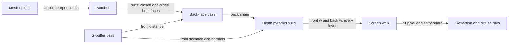

# The back-face depth layer

This is the design of epic `ter-kh4g`. The screen walk learns where each surface's solid really ends, from a second depth layer of back faces. The research behind every decision is in [docs/research/back-face-depth-layer](../research/back-face-depth-layer/README.md). This document says what to build. The tickets say in which order.

Status on 2026-11-15: settled for the build. The research of stage 2 is merged, and the tickets of "The order of the work" build this design.

## The terms

- w is the inverse view depth of a surface point, in 1/m. A larger w is nearer.
- The screen walk is the march of a ray over the depth pyramid (`walkScreen` in `screen_walk.glsl`).
- The slab of a pixel or of a cell is the interval of w that the walk treats as solid there. It has a front w and a back w.
- The 10 % rule is today's slab: from a surface's w back to w / (1 + `ThicknessShare`), with `ThicknessShare` = 0.1.
- The back share of a pixel is its front distance over the distance of the nearest drawn fragment of the back-face pass behind it. It is 0 where the pass draws nothing behind the front surface.
- A closed mesh is a mesh that bounds a volume: every directed edge has as many triangles as its reverse edge.
- A sheet is a surface pixel with no solid of its own behind it: a pixel of a two-sided material, of an open mesh, or of any surface with no back face behind it.
- The plane of a pixel is its surface plane through its center point along its geometric normal (`pixelPlane` in `depth_pyramid.glsl`). The plane's far w of a pixel is the smallest w of that plane over the pixel's own square (`pixelBounds(pixel).y`).
- The entry share of a hit is where the ray enters the hit pixel's slab: 0 at the front and 1 at the back.

## The model

One model covers thin things and thick things:

1. The screen holds, for each pixel, one solid interval of its view column: from the front surface to the first back face behind it.
2. The walk asks one question of a slab: does the ray pass through it. No thickness constant enters that question.
3. A blocked ray takes the light of the visible face of the solid that blocks it. The entry share fades that light toward the miss light, as today, measured over the real slab.

Who causes what:



Each piece of state has one writer:

| State | Writer | Content |
|---|---|---|
| Whether a mesh is closed | The mesh's record at upload | One flag, computed once from the index buffer and the positions |
| The pass's runs | `SceneBatcher` | The opaque runs, split by what the pass draws of them |
| The back share image, R16F at the render size | The back-face pass | The back share of each pixel, 0 for none, 1 for a sheet's own fragment |
| The finest level of the depth pyramid, RG32F | `depth_pyramid_finest.comp` | R: the center w, as today. G: the back w of the pixel's slab. Sky holds (0, 0). |
| The levels 1 and above, RG32F | `depth_pyramid_first.comp`, then the down and tail shaders | R: the largest front w of the cell, as today. G: the smallest back w of the cell's pixels. |

## The decisions

Each decision names its evidence.

### 1. The layer is the slab

Alexis chose it on 2026-11-14. The real back face replaces the 10 % rule, also where the real slab is deeper than 10 %.

Evidence: in `rect-lamps`, 74.34 % of the bright reflection light of the ceiling's glow area is false under the 10 % rule. Under the layer, 0.016 % of that false light stays (stage-1b/pictures.md, part 1).

### 2. The layer lives in the depth pyramid

The parent agent settled it from decision 1. The walk reads one texel per step, as today, and reads no second image.

Evidence: the new store without the pass is not slower than main on either machine (stage-1b/cost.md). A second texel read per finest step cost 0.21 to 0.24 ms on the RTX 2000 Ada in stage 1.

### 3. The slab of a pixel

At the finest level:

```glsl
back = min(slabBack(centerW, share), planeFarW);
```

where

- `centerW` = the w of the pixel's center, the texel's R part.
- `share` = the pixel's back share.
- `slabBack(w, share)` = `w * share` for a share between 0 and 1, and `w` for a share of 0 or 1.
- `planeFarW` = the plane's far w of the pixel.

So a pixel with a real back face gets its real slab. A sheet gets the depth of its own plane over its own pixel. Every slab reaches at least to its plane's far w, so a thin closed plate at a grazing angle is covered too.

At level 1, each pixel's term is `(planeNearW, slabBack(planeFarW, share))`, and the cells merge as today: the largest first part and the smallest second part. The slab of every cell then holds the slab of every pixel under it. The reason: `planeFarW` is at most `centerW`, and a share is at most 1.

This rule keeps Alexis's answer, "a sheet has no thickness". The parent agent settled that reading on 2026-11-15. A sheet has no thickness of its own. But a tilted sheet covers a range of depths inside one pixel, and one flat depth per pixel is an approximation of that range. The plane's far w states the far end of the sheet's real extent inside its pixel. It gives the sheet no thickness along its normal, and it brings no constant back.

The pure reading, a slab from the center w to the center w, misbehaves in a way that has a name. A ray that crosses a tilted sheet inside a pixel can miss the pixel's single w.

Evidence (stage-2/cards.md, part 3): take the real hits of the 10 % rule whose crossing shows the hit pixel's own card. A sheet with no thickness keeps 28 % to 86 % of them. The plane's far w keeps 57 % to 90 %. In the lamp hall it keeps 484 of the 10 % rule's 4,399 false hits, where no thickness keeps 373.

#### The front of a slab: the full rule, planned and not built here

The rule above is half of the real extent: it moves the back of a slab and leaves its front at the center w. The full rule also starts the slab at its plane's near w inside the pixel. On sheets it keeps 71 % to 92 % of the real hits. Ticket `t1-0ti7` plans it, after the one-image depth pyramid of `ter-y3k4`.

The full rule is the general rule for the front of every slab, not a rule for sheets only:

- The flat depth is an approximation for every surface. A deep slab has a tilted front too.
- The levels above the finest already start each pixel's slab at its plane's near w. Only the finest level starts it at the center. The full rule removes that difference: every level is then the merge of the level below.
- A rule for sheets only needs a branch on the back share in the front of a slab. A pixel's front then has two meanings.

The gain shows on thin slabs only. A ray that passes in front of a flat depth and behind the real surface is inside the solid. Under a deep slab it meets the slab of the next cell, so its hit moves by one pixel at most. Under a sheet it is behind the next cell's slab too, and the hit is lost.

The full rule is not built here for two reasons. It moves the first part of the finest level, which three other readers take as the pixel's center w: `hittable`, `guidedPointOf` and `pixelDensityOf` in `screen_trace.glsl`. And it has one named risk that no census measured on every pixel. The pair of a plane's near w and far w is a box, and the plane fills only its diagonal. So a grazing ray can hit a neighbor's box in front of the real surface. On sheets, the full rule keeps 565 of the lamp hall's 4,399 false hits, against 484.

### 4. What the back-face pass draws

| Run | Faces | Alpha test | A fragment counts where |
|---|---|---|---|
| One-sided, closed mesh, solid | Back faces | None | It lies behind the front surface |
| One-sided, closed mesh, cutout | Back faces | The G-buffer's cutout test | It lies behind the front surface |
| Two-sided, solid or cutout | Both faces | The G-buffer's cutout test for cutout | It lies at or behind the front surface |
| One-sided, open mesh | Both faces | As its material | It lies at or behind the front surface |

- The pass keeps the nearest fragment that counts. Its own fragment at the front's distance gives a share of exactly 1, so a card ends its own slab.
- "Behind" means farther than the front distance times (1 + 1e-4). The tolerance keeps a front face from counting as its own back face. It is a float tolerance, not a thickness.
- The cutout test samples as the G-buffer pass does, with the main view's mip bias. Without it, 4,207 hair pixels of the lamp hall fell through to the surface behind them.
- The pass draws the same indirect commands as the G-buffer pass, in the same three depth ranges, with the same projections and jitter. So a moving or deformed object needs no rule of its own.
- Glass, fringes and puffs are not in the G-buffer. The walk does not see them today, and that does not change.

Evidence: with these draws, all 139,646 hair pixels of the lamp hall hold their own fragment. The hits on a surface that the ray moves away from fall from 817,466 to 1,525 (stage-2/cards.md, parts 1 and 2).

### 5. Whether a mesh is closed

One owner holds it: the mesh's record at upload. The batcher reads it.

- The test welds positions with a tolerance before it pairs edges, because a hard edge splits its vertices. Without the weld, every UV sphere is open.
- The pairing rule decides: a mesh is closed where every directed edge has as many triangles as its reverse. Five demo meshes have edges that four triangles share in opposite pairs. They bound a volume, and the pairing rule calls them closed.
- The flag is a required field of the mesh record. A forgotten flag must not mean "open" or "closed" by default.

No scripted demo scene holds an open one-sided opaque mesh today (stage-2/meshes.txt).

### 6. The light of a blocked ray

The fade stays as it is, over the real slab:

```glsl
float fade = edgeFade(hit) * (1.0 - entryShare);
result.light = mix(missLight, hitLightOf(hitPixel, kind), fade);
```

where

- `edgeFade(hit)` = 0 on the screen's edges and 1 a tenth of the shorter side inside them.
- `entryShare` = the entry share of the hit, now measured over the real slab.
- `missLight` = the light of a ray that nothing on screen blocks.
- `hitLightOf(hitPixel, kind)` = the light of the hit pixel's visible face for this ray kind.

Evidence (stage-2/reference.md): a path-traced reference of the cabin, rendered by Cycles from the engine's own exported frame. The cabin's left wall has thick pillars. A ray from a pillar's face meets the hidden back face of the nearer pillar, so these faces are the case of this decision. Each number is the mean light of a pillar region over the mean light of a floor patch in the same image.

| Rule | Without the sun: face at z −5.7 | Face at z −7.7 | Under full lights: face at z −5.7 | Face at z −7.7 |
|---|---:|---:|---:|---:|
| The reference | 0.782 | 0.796 | 1.205 | 1.142 |
| The fade over the real slab (this design) | 0.313 | 0.336 | 1.362 | 0.812 |
| The fade over at most 10 % | 0.284 | 0.294 | 0.787 | 0.297 |
| The miss light for a deep entry, half a pixel of plane span | 0.245 | 0.269 | 0.591 | 0.264 |
| Black for a deep entry, half a pixel of plane span | 0.190 | 0.220 | 0.509 | 0.216 |
| No fade by the entry share | 0.360 | 0.399 | 2.015 | 1.433 |

- In the reference, the hidden faces between the pillars are lit about as the faces beside them.
- The fade over the real slab is nearer to the reference than the fade over at most 10 %. This holds on all four pillar regions and in both light sets.
- A rule that gives a deep entry the miss light or black moves both pillar faces away from the reference. So the parent agent's hypothesis, that a hidden face's light is unknown and dark, does not hold here.
- In `rect-lamps`, the two fades differ by at most 0.047 in every region.

One candidate is nearer still in six of eight pillar cells: no fade by the entry share at all. This design does not take it, for three reasons:

- It overshoots the face at z −5.7 under full lights by 67 %, where the fade over the real slab overshoots by 13 %.
- Without the sun, the engine's floor patch is 2.5 times darker than the reference's. So every rule is dark at the pillars for a reason that is not the slab: the engine carries less light of several bounces. A rule that adds light comes nearer for that reason too, and the numbers cannot tell the two effects apart.
- The fade has a meaning: the deeper a ray enters, the less the visible face's light says about the face that the ray meets. Both views are closed rooms of light-gray surfaces, where a hidden face is lit as a visible one. A view with a sunlit front and a shadowed back does not have that property.

The fade is one line of `traceFrom`, and the entry share stays in the walk's result. So a later change of this decision is a small change.

### 7. The other readers of `ThicknessShare`

`ThicknessShare` leaves the walk and the pyramid. Its two other readers keep their values under names of their own, because neither is a thickness:

- `TargetDepthShare` in `screen_trace.glsl` is the depth of the box that a guided diffuse ray aims at. It stays 0.05. A guided ray that the walk rejects behind a thin surface counts as a miss, so the estimate stays unbiased.
- The plane tolerance of `screen_trace_plan.comp` stays 0.1, as `PlaneFitShare`.

The C# copies change with the shaders: `CellBounds`, `DepthPyramid` and `ScreenRay.Walk`.

### 8. The cost and the vertex work

The pass draws every vertex of its runs a second time, with positions only.

None of that vertex work is skinning. One compute dispatch per frame, `deform.comp`, writes one deformed copy of each posed figure into the global vertex buffer. The shadow maps, the G-buffer pass and the back-face pass all draw that copy. None of their vertex shaders holds a joint or a weight (ARCHITECTURE.md, "Skinning and morph targets"). In the crowd on the RTX 2000 Ada, the deformation takes 1.275 ms once. The pass's 0.450 ms of vertex work is the index reads, the transform, the primitive assembly and the clipping. So the engine already has one skinned copy per figure and frame, and that needs no ticket.

The cost model (stage-2/crowd-cost.md, part 1): the pass's cost is a straight line in the vertices that it draws.

| Machine | Cost per million drawn vertices | One figure of 20,000 vertices | The demo's rooms, 100,000 to 125,000 vertices | A crowd of 100 figures |
|---|---:|---:|---:|---:|
| RTX 2000 Ada | 0.24 ms | 0.005 ms | 0.04 to 0.065 ms | 0.47 ms |
| M1 Max | 0.36 ms | 0.007 ms | 0.04 ms, inside the noise | 0.80 ms |

In the crowd, 92 % of the card's time is vertex work, and the fragments cost 0.026 ms. So only fewer drawn vertices make the pass cheaper.

The pass draws every instance of the opaque runs, also every skinned figure. The reasons:

- Front-face culling on the closed one-sided runs is the cheaper form. One pipeline that draws both faces costs 37 % more in the cabin on the card, and 0.07 to 0.16 ms more on the Mac.
- No rule from geometry leaves an instance out. A left-out instance's pixels do not become sheets: they take the back face of the surface behind them.
- The engine holds no coarser copy of a mesh today. The asset pipeline plans LODs, and no code builds them yet.
- The pass already leaves out an instance that an impostor replaces, because such an instance is not in the opaque runs.
- Packed positions save 0.019 ms of the crowd's 0.489 ms on the card, and nothing on the Mac. That is not worth a second vertex path.

A trade remains for a view with many skinned figures. The parent agent settled it for the build on 2026-11-15: every figure keeps its real back face. Alexis sees the numbers at the final acceptance, per figure and for the crowd, beside what the figures already cost. Two other options are later work, and neither needs a change of this design's parts. One leaves the figures out and marks their pixels as sheets. The other draws the figures' back faces from a coarser LOD.

### 9. Formats, memory and Linux

- The back share is R16F. It is a required color target format, and a half float holds a share to 1 part in 2,048. A share of exactly 1 and of exactly 0 are both exact in it.
- The finest level grows from R32F to RG32F: 3.52 MiB more at 1280 × 720. The back share takes 1.76 MiB.
- The pyramid's build reads the back share through a binding that the pyramid's images own. No descriptor layout of the tracer changes, and no new device feature is needed.
- The acceptance runs the tests on lavapipe or another Linux driver beside NVIDIA.

## The interfaces

### Mesh closure (`src/Tertius.Rendering/Resources`)

```csharp
/// <summary>Whether a mesh bounds a volume: after a weld of its positions, every directed edge has as many
/// triangles as its reverse edge, and the mesh has at least one triangle that is not degenerate.</summary>
internal static class MeshClosure
{
    public static bool IsClosed(ReadOnlySpan<uint> indices, ReadOnlySpan<Vector3> positions);
}
```

The mesh record (`MeshInfo` and the staged mesh) gains a required `bool Closed`. `StagedMesh` computes it once.

### The pass's runs (`SceneBatcher`)

The opaque runs of a depth range gain a split by what the back-face pass draws:

```csharp
/// <summary>The opaque runs of one depth range, as the back-face pass draws them.</summary>
internal readonly record struct BackFaceRuns(OpaqueRuns ClosedOneSided, OpaqueRuns BothFaces);
```

- `ClosedOneSided` = the instances of a closed mesh with a one-sided material. The pass draws their back faces.
- `BothFaces` = the instances of a two-sided material or of an open mesh. The pass draws both faces.
- Each `OpaqueRuns` keeps its `Solid` and `Cutout` command ranges.

The G-buffer pass keeps its own runs by the material's side. How the batcher's sort key carries the split is the ticket lead's choice. The frame's commands are not drawn from a second list: the split names ranges of the same indirect buffer.

### The back-face pass (`src/Tertius.Rendering/Passes/BackFacePass.cs`)

```csharp
/// <summary>After the G-buffer pass and before the depth pyramid: writes the back share of each pixel.</summary>
internal sealed class BackFacePass : RenderPass
```

Its target is `RenderTargets.BackShare`, R16F at the render size. Its fragment rule, for both kinds of run:

```glsl
// The back share of a fragment at `distance` m from the eye, over a front surface at `front` m, or a negative value
// for a fragment that does not count. `bothFaces` is true for a run that draws both faces.
float backShareOf(float distance, float front, bool bothFaces);
```

### The slab (`depth_pyramid.glsl`)

`thickness.glsl` goes. The pyramid's build is the only place of the slab rule:

```glsl
// The w of the back of what is solid behind a surface at inverse depth `w` whose back share is `share`: `w * share`
// for a share between 0 and 1, and `w` itself for a sheet, whose share is 0 or 1.
float slabBack(float w, float share);

// The slab of a pixel at the finest level: x the center w, y the back w, or (0, 0) for sky.
vec2 pixelSlab(ivec2 pixel);

// The bounds of a pixel for level 1: x its plane's near w, y the back w of its slab from its plane's far w, or the
// empty bounds for sky.
vec2 pixelSlabBounds(ivec2 pixel);
```

### The walk (`screen_walk.glsl`)

```glsl
cellBounds = level == 0 ? texelFetch(finest, ivec2(cell), 0).rg : texelFetch(bounds, ivec2(cell), level - 1).rg;
float near = cellBounds.x;
float back = cellBounds.y;
```

where

- `finest` = the finest level, RG32F.
- `bounds` = the levels above, RG32F, whose mip m holds level m + 1.
- `near`, `back` = the front w and the back w of the cell's slab.

The signature of `walkScreen` does not change. `ScreenRay.Walk` in C# takes the same data.

## The order of the work

1. The store, with behavior unchanged. The finest level becomes RG32F, and the build stores the back w by the 10 % rule. The walk reads the back w at every level. Stage 1b showed that this gives main's image byte for byte, so every snapshot test stays as it is.
2. Mesh closure and the pass's runs: the flag, the test, the batcher's split. No frame changes.
3. The back-face pass: its target, its pipelines, its shaders, its place in the frame graph. Nothing reads its image yet, so the image tests of the frame stay as they are.
4. The layer as the slab: the build reads the back share, the slab rule of decision 3 replaces the 10 % rule, and `ThicknessShare` leaves. This step changes the image. Its ticket holds the snapshot approvals and ARCHITECTURE.md.
5. The acceptance takes: the stills beside the reference, the frame cost on both machines, and the Linux run. This step is an experiment and adds no engine code.

Steps 1 and 2 touch separate files and run side by side. Step 3 needs step 2. Step 4 needs steps 1 and 3. Step 5 needs step 4.

| Step | Ticket |
|---|---|
| 1 | `t1-0s0a` |
| 2 | `t1-6ucc` |
| 3 | `t1-j03y` |
| 4 | `t1-7b4x` |
| 5 | `t1-8b4w` |

## The acceptance

From the handoff of 2026-11-14, part 1:

| Point | How it is shown |
|---|---|
| The false sill hits fall to about 0 | A GPU test with a thin sunlit sill: a ray that leaves through the opening misses. Stage 1b's census number stands beside it. |
| No new leaks or holes in `rect-lamps`, the cabin and the deck | Stills at one fixed exposure beside main and beside the reference of stage 2 |
| Contact darkening | Judged by eye beside the reference |
| The frame cost | Main against the branch on both machines, per scene, with the run-to-run spread |
| The suites | Checked, then Release, and the card's suites in the cloud |
| Linux | The tests on lavapipe or another Linux driver beside NVIDIA |
| The docs | ARCHITECTURE.md matches the code |

The merge into main waits for Alexis, because the frame budget and the changed look are Alexis's to accept. `rect-lamps` becomes darker by about 64 of 255 at a fixed exposure, which is the room without the false bounce light.

## Known limits

- Where two closed objects pass through each other, the first back face behind the front surface can belong to the inner object. The slab then ends early there.
- Two coincident faces of opposite winding pass as closed, and the pass then drops the back one as the front. Such a sheet takes the back face behind it.
- The reference shows that every rule gives the cabin's pillar faces 24 % to 50 % of the true ratio. The engine carries less light of several bounces than a path tracer (bug ticket `t1-mybi`). The layer does not change that.
- Under the full lights of the two reference views, Earth's light through windows dominates the truth. The engine's rooms do not get that light (bug ticket `t1-tbz9`). That light is no part of this epic.
- The jamb of `rect-lamps` keeps a bright strip at its outer edge. It is direct sunlight that the sun's shadow lets through (bug ticket `t8-rjno`). Under the 10 % rule, false light hid it.

## Open questions

No question is open. The parent agent settled three on 2026-11-15:

1. The sheet's slab reaches to its plane's far w (decision 3). The full rule for the front of a slab is ticket `t1-0ti7`.
2. Every skinned figure keeps its real back face (decision 8). Alexis sees the cost at the final acceptance.
3. The light of a blocked ray keeps the fade over the real slab (decision 6). Ticket `t1-r9vj` tests the rule with no fade in a view with a lit front and a dark back. A rule that is nearer everywhere goes up with its crops.
