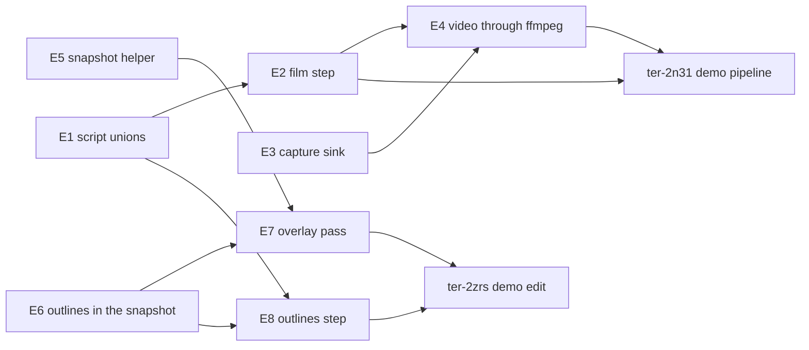

# Blue Danube demo

## Goal

A long demo video of the engine, recorded from one unbroken scripted run with the real renderer. The camera follows one character capsule from a launch terminal on Earth's surface to the outer wheel of a spinning station. The centerpiece recreates the docking sequence from "2001: A Space Odyssey". The graphics are gray-box procedural meshes without textures. The demo shows the physics only, so it adds no sky and no anti-aliasing: the engine is unfinished, and viewers know it (user, 2026-10-18). Title cards and music are added after the run.

## The sequence

1. Earth's surface. Buildings form a launch pad and a boarding terminal. The character walks through the terminal and boards a shuttle.
2. The shuttle launches up a ramp, like a rocket sled, and flies to orbit. In orbit the character becomes weightless by itself, because the ship's frame falls freely. The character leaves its seat and grabs a pen.
3. The shuttle burns again and approaches a large spinning station, seen through its windows. The station has a docking slot on its axis.
4. The shuttle spins up to match the station's rotation, enters the slot, and lands on one side of the docking barrel. Weak spin gravity returns as it moves out to the barrel wall.
5. The character leaves the ship and takes a chute down a spoke to the outer wheel, where it feels full gravity.

## Rules

- The engine runs at its fixed 60 ticks per second for the whole run. The project has no time warp. A time-lapse comes from the capture: the script captures every Nth tick, and the video plays those frames at the normal rate.
- Everything outside the engine is demo work: the scene, demo components, mesh generators, scripts, capture, editing, title cards and music. Every engine change goes to the user first (user, 2026-10-18).
- The music is Johann Strauss II, "The Blue Danube" (1866). The composition is in the public domain. The recording must have a free license, for example a US military band recording or a Musopen recording. Each download needs a yes with its file name, source and size.

## What exists, and what the demo adds

From a survey of the code on 2026-10-18.

| Need | State | Demo work |
|---|---|---|
| Scripts of 100,000 ticks and more | Exists (`scripts/orbit.json` runs about 332,700 ticks) | A generator that writes the long script |
| One image per frame | Partial: only a `capture` step writes a PNG, synchronously, about 0.1 to 0.15 s per 720p frame (estimate) | The generator alternates `run` and `capture`. Measure 600 frames first. |
| Video | Missing: no ffmpeg in the dev shell | Add `pkgs.ffmpeg` to the flake. Encode, cut, add title cards and music with ffmpeg. |
| A camera that follows the character | Partial: the camera is an entity, a camera step is a hard cut, `AttachTo` follows a parent | A chase camera component on an entity attached to the character |
| Character walking, floating, grabbing | Exists (`MoveCharacter`, `Jump`, grab within 3 m) | A path-following walker component. A capsule hides that the rigid form never turns. A pen as a small grab item. |
| Seat | Missing | A static box in the hull's interior |
| Ground at the pad | Earth's sphere sags about 480 m between vertices | A large static slab under the pad, as in the surface yard |
| Cylinders, rings, tori | Missing: only box, sphere and plane meshes | Mesh generators and matching compound or convex shapes for the wheel, spokes, barrel and chute |
| Ship thrust and steering | Partial: thrusters exist in the test project only | Autopilot components: the climb to orbit, the rendezvous, the spin match and the docking |
| Spin gravity, Coriolis, a ship in a turning frame, characters in a turning frame | Planned: the spin gravity epic `ter-s9m0` | Waits for the epic |

## Physics notes

- Weak gravity in the barrel does not return by itself while the ship coasts. A ship that matches the spin and moves out from the axis must keep pushing toward the axis to stay on its rotating path. Its contents then feel that push as weight, which grows with the radius: ω² r. The docking autopilot holds the ship on that path.
- A character that slides down a spoke feels the Coriolis force press it against one wall of the chute, about 2 ω v: 12 m/s² at 20 m/s with ω = 0.313 rad/s. The chute's friction needs tuning, and the fall speed comes near the threshold of a numeric frame for a thrusting group, 50 m/s.
- The station's bubble must be at least twice the size of the ship's bubble so that it can hold it. A sphere suits the wheel better than a flat ellipsoid.
- The launch needs a surface frame that does not turn, or the spin gravity ticket for numeric frames inside turning frames (`ter-vja8`).

## Proof in the video

The video shows numbers from the engine next to numbers that a viewer can check (user choices, 2026-10-18):

| Proof | What the viewer sees | Engine change |
|---|---|---|
| Live readouts | Speed, altitude, distance to the station and a g-meter for the character, drawn on each frame from a per-tick log that a demo component writes | No |
| The frames made visible | A cut-in that outlines each frame's bubble, with a label when the engine makes one | Maybe: the renderer needs debug outlines |
| Frames on and off, side by side | One part of the script shown twice in a split view, with the automatic frames on in one half and off in the other: a gentle thruster does nothing, and a thrusting person drifts about 10 m in a minute | Probably no: make sure that the option of the tests reaches the demo |
| Textbook checks | The sim clock shows that things take the time that physics predicts, for example about 92 minutes for one orbit at 400 km | No |

The strongest proof is outside the video: a guide in the README that tells a reader which code and tests to read to make sure that each claim is real. Ticket `ter-sb5w` holds that work.

## Engine changes for the demo

The user answered the three engine questions on 2026-10-18:

1. Capture speed: for a headless run, Host streams the rendered frames straight into an ffmpeg process as raw pixels. It encodes no PNG files. ffmpeg comes from nixpkgs, as `ffmpeg-headless` in the flake's dev shell.
2. Time-lapse: a script step that captures every Nth tick. The demo does not generate a long list of `run` and `capture` steps.
3. Frames made visible: a switchable debug pass in the renderer outlines the bubble of every frame, numeric frames included. The reason is that the shot is about the frames that the engine makes by itself past 8,389 km. ARCHITECTURE.md says that a numeric frame has no bubble, so this section defines what the pass draws for each kind of frame.

First, this section describes the end state as a design from scratch. Then it compares that design with the code at commit eedaa8f. Six points are open forks (see "Open forks"). Where the text depends on one, it uses the recommended design and says "Open: fork N".

Terms used below:

- A capture is one image of the world's current state, drawn from the world's camera at interpolation alpha 1.
- The capture target of a run is where its captures go: PNG files in a folder, or the frames of one video.
- A capture sink is the object that gets the pixels of one capture from the renderer.
- A frame outline is the set of lines that the debug pass draws for one frame.

### Change 1: captures into a video through ffmpeg

#### The model

A run has one capture target for its whole life. `CaptureTarget` is a custom C# 15 union, as `Target` is. It has two cases:

| Case | Fields | Where each capture goes |
|---|---|---|
| `PngFolder` | `Folder` | `<Folder>/<name>.png`, one file for each capture |
| `VideoFile` | `Path`, `FramesPerSecond` | The next frame of one video, which one ffmpeg process encodes |

The renderer knows nothing about files. Its one capture call hands the pixels of the next drawn frame to a capture sink:

```csharp
public interface ICaptureSink
{
    void Take(in CapturedImage image);
}

public readonly ref struct CapturedImage
{
    public ReadOnlySpan<byte> Rgba { get; }
    public int Width { get; }
    public int Height { get; }
}

// In IRenderer, in place of CaptureNextFrame(string path):
void CaptureNextFrame(ICaptureSink sink);
```

where

- `CaptureNextFrame(sink)` = asks the renderer to read back the next frame that `Render` draws. Any thread can call it, as today.
- `Take(image)` = the renderer calls it inside that `Render` call, on the thread that called `Render`, after the GPU finishes the frame.
- `Rgba` = width × height × 4 bytes, rows from the top, in the order red, green, blue, with sRGB encoding. The fourth byte of each pixel holds no defined value. The span points into the renderer's readback buffer, so it is valid only until `Take` returns.
- `Width`, `Height` = the size of the drawn frame, in pixels.

For a BGRA output (a window swapchain), the renderer swaps red and blue in place in the readback buffer before it calls `Take`. So every sink gets one pixel order. The headless output is RGBA and never swaps.

There are two sinks:

- `PngCaptureSink(path)`, in Rendering. It copies the pixels, sets each alpha to 255, and writes a PNG with StbImageWriteSharp, on the calling thread. This is today's `VulkanRenderer.SaveCapture`, moved behind the seam. It stays in Rendering because StbImageWriteSharp is a Rendering dependency and the renderer tests use the sink.
- `FfmpegVideoSink`, in Host. It writes the span straight into the standard input of one ffmpeg process. It makes no copy and allocates nothing.

`IPlayback.Capture(World world, string name)` takes the name of the capture, not a path. `HeadlessPlayback` holds the run's target. For `PngFolder`, it makes a `PngCaptureSink` for each capture. For `VideoFile`, it owns one `FfmpegVideoSink` for the whole run, and it is disposable. `WindowPlayback` takes only `PngFolder`, and it passes the sink to the render thread through `CaptureMailbox`.

The ffmpeg process:

```
ffmpeg -hide_banner -loglevel error -nostats
       -f rawvideo -pixel_format rgb0 -video_size <W>x<H> -framerate <F> -i pipe:0
       -c:v libx264rgb -qp 0 -preset veryfast -f matroska -y <Path>
```

- The video is a lossless master for the edit. `libx264rgb` with quantizer 0 keeps every pixel exact. The edit makes the final encode. The `ffmpeg-headless` 9.0.1 of the flake's pinned nixpkgs is built with `--enable-gpl` and `--enable-libx264` (checked on 2026-10-18).
- The container is Matroska (`.mkv`). A Matroska file stays readable after ffmpeg stops early, before it writes the end of the file. An MP4 file keeps its index at the end, so an MP4 that is cut short does not play.
- `rgb0` tells ffmpeg to ignore the fourth byte of each pixel, so no sink has to fix the alpha.
- `-y` overwrites the file, so a shorter second run leaves no frames of the first one.

#### The command line

```
dotnet run -c Release --project src/Tertius.Demo -- --script scripts/danube.json --headless --out runs/danube --video runs/danube/danube.mkv --fps 30
```

- `--video <file>` sends every capture of a headless run into one video. The file name ends in `.mkv`. Dumps still go to `--out`.
- `--fps <rate>` is the frame rate of the video, a whole number from 1 to 240. Without the option, it is 30. With N ticks between frames, the video plays N × rate / 60 times faster than the simulation.
- The command refuses these with exit code 1, as it refuses `--speed` with `--headless` today:
  - `--video` without `--headless`, because the window writes PNG files.
  - `--fps` without `--video`.
  - A `--video` file name that does not end in `.mkv`.
  - `--video` for a script with no `capture` or `film` step.
- Open: fork 1. The other design puts the video in a key of the script.

#### Threads and moments

A headless run has no thread of its own. The calling thread runs the ticks, draws each capture, and writes each frame into ffmpeg's input pipe. ffmpeg runs in its own process. Since ffmpeg 7, the ffmpeg command reads its input, encodes and writes the file on separate threads. So a write into the pipe blocks only while ffmpeg's input queue is full. The measurement below checks this. A thread-pool callback reads ffmpeg's error output into a buffer of its last 20 lines, so that ffmpeg never blocks on a full error pipe.

The write stays on the calling thread. A writer thread with a queue of frames lets the next ticks run during the write. That helps only while the write blocks. The measurement reports the time that the calling thread spends blocked in the write. If that time matters, a writer thread is a follow-up ticket.

#### Analogues

| New value | Existing analogue | Same model? |
|---|---|---|
| `CaptureTarget` | The path of a capture step, `<out>/<name>.png`, the only target today | Yes. A run names its outputs by the names of its steps. The video case keeps the order of the captures and drops their names. |
| `ICaptureSink` and `CaptureNextFrame(sink)` | `CaptureNextFrame(path)`, a one-shot request that `Render` serves after its fence wait. The hooks `IRangeDrawer` and `IInstanceProcessor`, which the renderer calls at a fixed moment of a frame. | Yes. The same request at the same moment. The sink takes the place of the path, so the renderer stops knowing about files. |
| `PngCaptureSink` | `VulkanRenderer.SaveCapture` | Yes. The same code, moved behind the seam. |
| `FfmpegVideoSink` | The headless renderer: a tool that the command starts before the run and disposes after it. A failure to start is exit code 5. | Yes |
| `--video` and `--fps` | `--out`. `--speed`, which applies to one kind of run and is refused with the other. | Yes |
| `ffmpeg-headless` in the dev shell | `shaderc` and `glslang`, tools in the dev shell | Yes |

#### Readers and writers

| Value | Writer: thread, moment | Readers: thread, moment |
|---|---|---|
| `CaptureTarget` | `ScriptCommand.ReadOptions`, main thread, at start. `WindowHost` makes a `PngFolder`, main thread, at start. | The `HeadlessPlayback` constructor, calling thread, before the scene builds. `HeadlessPlayback.Capture`, calling thread, at each capture. `ScriptCommand.WriteFiles`, calling thread, after the run. |
| The pending sink in the renderer | `CaptureNextFrame`: the headless calling thread between ticks, or the window's render thread at a capture request | `Render`, on the thread of the captured frame |
| `CapturedImage` | `Render`, after the fence wait of the captured frame | The sink's `Take`, the same thread, during the call |
| The ffmpeg process | Started by the `HeadlessPlayback` constructor, calling thread, before the scene builds. Fed by `FfmpegVideoSink.Take`, calling thread, at each capture between ticks. Finished by `ScriptCommand` after the last step, or disposed on every path of failure. | ffmpeg's own threads. A thread-pool callback reads its error output as ffmpeg writes it. |
| `IPlayback.Capture(world, name)` | `ScriptRunner`, runner thread, at each capture between ticks | The playback |
| `RunResult.Captures`, now names | `ScriptRunner`, runner thread | `ScriptCommand.WriteFiles` after the run, and tests |

#### Failure handling

| Failure | What happens |
|---|---|
| ffmpeg is missing or cannot start | The `HeadlessPlayback` constructor fails before the scene builds. The command exits with code 5 and says that ffmpeg cannot start. No tick runs, and nothing is written. Code 5 now means "a tool that the run needs cannot start: the renderer, the window or ffmpeg". |
| The script is bad, found before tick 0 | The command closes ffmpeg's input before any frame. The sink deletes a video file that holds no frame. Exit code 3, as today. |
| ffmpeg exits during the run (killed, disk full) | The next write fails with a broken pipe. The sink waits for ffmpeg to exit. Then it throws `VideoStreamException`, which gives ffmpeg's exit code, the number of frames written, and the last lines of ffmpeg's error output. The command exits with code 2, a file problem. |
| ffmpeg fails at the end | `FfmpegVideoSink.Finish` closes ffmpeg's input and waits for it. An exit code other than 0 is a `VideoStreamException`, and the command exits with code 2. |
| The run fails at a step (a dead camera, a bug) | Every path out of the command disposes the playback, which closes ffmpeg's input and waits. ffmpeg writes the end of the file, so the video plays and holds one frame for each capture before the failure. The exit code is the failure's own: 3 for the script, 4 for a bug. |
| Ctrl-C | The terminal sends the signal to ffmpeg too, and ffmpeg ends the file by itself. If ffmpeg dies before that, the Matroska file still reads. The headless run still has no signal handler of its own, as today. |
| A window run | It never gets this target, because the command refuses `--video` without `--headless`. |

#### Tests

Host tests. They run ffmpeg and ffprobe from the dev shell.

- A video run writes one video with one frame for each capture of the script, in the order of the steps.
- The first frame of the video, decoded, equals the PNG capture of the same step, pixel for pixel.
- Two video runs of one script give the same decoded frames.
- A video run overwrites an older, longer video at the same path.
- When ffmpeg cannot start, the command exits with code 5 before the first tick, and it writes no video and no dump. The command takes the function that starts the sink, as it takes the function that makes the renderer. So the test passes a function that fails.
- When ffmpeg exits during a run, the next capture fails. The command exits with code 2 and prints ffmpeg's exit code and the last lines of its error output.
- A run that fails at step k exits with the code of that failure. It leaves a video that ffprobe reads, with one frame for each capture before step k.
- The command refuses `--video` without `--headless`, and `--fps` without `--video` or outside 1 to 240. It also refuses a `--video` file whose name does not end in `.mkv`, and `--video` for a script with no capture.

Renderer tests:

- A capture hands its sink the pixels of the frame that `Render` drew, once, inside `Render`, on the thread that called `Render`. The pixel tests that use `Gpu.RenderAndCapture` move to a sink that keeps the pixels in memory, and they keep their checks.
- A PNG that `PngCaptureSink` writes decodes to exactly the pixels that an in-memory sink got for the same frame, with alpha 255.
- A capture request whose frame the swapchain skipped stays pending until a frame draws, as today.

The capture tests of today keep passing: the image size, what the image shows, two runs that give byte-identical images, and the dead camera.

#### Cost to measure

The video ticket runs 600 frames of the orbit scene, 2 ticks apart, at 1280x720 and at 1920x1080. It uses a Release build with validation off. It reports:

- The wall time per frame, split into the ticks, the capture's draw with its fence wait, and the time blocked in the pipe write.
- ffmpeg's encode rate, in frames per second.
- The bytes per frame of the video.
- The same run with the PNG target: the time per frame and the bytes per frame.
- The time that 18,000 frames take with each target, from the measured rates. That is 10 minutes of video at 30 frames per second.

The demo ticket ter-2n31 measures the frame time of the demo scene itself.

#### Compared with today

- `IRenderer.CaptureNextFrame(string path)` becomes `CaptureNextFrame(ICaptureSink sink)`. `VulkanRenderer.SaveCapture` moves into `PngCaptureSink`. `VulkanRenderer.LastCapture` goes, because a test reads the pixels with its own sink.
- `IPlayback.Capture` takes a name, in `HeadlessPlayback`, `WindowPlayback` and the test playbacks. The runner no longer builds paths. Its check "a capture needs an output folder" moves to the PNG target, which cannot exist without a folder.
- The window keeps PNG files. Its freeze at each capture (ticket ter-viyi) is not part of this change. But the sink answers the open question of ter-viyi. A sink that copies the pixels and encodes them on a worker lets `Render` return after the copy. A renderer test that needs the file uses `PngCaptureSink`, which writes the file before it returns.

### Change 2: the film step

#### The model

A film step runs ticks and captures after every Nth one:

```json
{ "do": "film", "name": "climb", "frames": 18000, "every": 2 }
```

- It is the same as `frames` repetitions of a `run` step of `every` ticks followed by a capture. So it runs frames × every ticks. Its first capture comes after its first `every` ticks, not before them. Two film steps in a row with the same `every` give evenly spaced frames across the boundary.
- Capture k of the step, counted from 0, is named `<name>-<k>`, with k written in six digits: `climb-000000`, `climb-000001`. That fits ffmpeg's `%06d` pattern for a PNG folder.
- The step gives `frames` and `every`, not a number of ticks. So no step can have a number of ticks that is not a whole number of `every`.
- It is a kind of step of its own, not an option of `run`. A `run` step with optional capture keys hides a second kind of step in optional fields.

The kinds of step are a closed set. In the end state, `ScriptStep` is a custom C# 15 union, as `Target` is. Its cases are the step records `RunStep`, `PostStep`, `DumpStep`, `CaptureStep`, `CameraStep`, `FilmStep` and `OutlinesStep` (see change 3). The other closed sets of the script format and the runner are custom unions too: `MessageTarget`, and the runner's private `ReadyStep`. A JSON converter reads and writes the `do` key of a step and the `kind` key of a target. `InputEventJsonConverter` does the same for an input event. The converter hands the rest of the object to System.Text.Json with the same strict options, so every rule of strict reading stays.

The checks before the first tick, in `Script.CheckSteps`:

- `frames` is 1 to 1,000,000, and `every` is at least 1.
- `name` follows the grammar of a scene id and has at most 57 characters, so that `<name>-NNNNNN` fits in 64.
- No two captures have one name, and the frame names of a film count as capture names. Every frame name is its film's name plus seven characters. So two films clash only by equal names. A capture with the film's name, a dash and six digits below the film's `frames` clashes with that film. So the check makes no list of frame names.

`MakeReady` gives a film the checks of a capture: a live camera and a playback. After change 1, the target needs no check of its own.

The film arm of the runner does this for each frame k:

1. `every` times: `WaitForTick`, `Tick` and the record of routed events.
2. The camera check of a capture.
3. `playback.Capture(world, "<name>-<k>")`.

Routed events. A `dump` step reports the routed events since the dump before it. The runner records routed events only while a dump step lies ahead. After the last dump step, or in a script with none, it records nothing, because no dump reads those records. Today the runner records every routed event of every tick, and only a dump empties the list. So a long run with no dump keeps every event in memory.

#### Analogues

| New value | Existing analogue | Same model? |
|---|---|---|
| `FilmStep` | `RunStep` and `CaptureStep` | Yes, by definition: the same ticks and the same captures as its expansion |
| Frame names | Capture names | Yes. The same grammar, in one namespace with captures. |
| `ReadyFilm` | `ReadyRun` and `ReadyCapture` | Yes |
| The rule for routed events | What a dump reports: the routed events since the dump before it | Yes. The runner records only what a dump will read. |
| `ScriptStep`, `MessageTarget`, `ReadyStep` as unions | `Target`, `GravityField`, and `InputEvent` with its converter | Yes |

#### Readers and writers

| Value | Writer: thread, moment | Readers: thread, moment |
|---|---|---|
| `FilmStep` | `Script.Parse`, or code such as the demo's generator, any thread, before the run | `CheckSteps`, at parse and in `MakeReady`. `MakeReady`, runner thread, before tick 0. `ToJson`, any thread. |
| `ReadyFilm` | `MakeReady`, runner thread, before tick 0 | The film arm of `Run`, runner thread |
| A frame name | The film arm, runner thread, between ticks | The playback and its target |
| The index of the last dump step | `MakeReady`, runner thread, before tick 0 | The arms that tick, runner thread, after each tick |

#### Failure handling

- The camera dies during a film: the next frame fails with `ScriptException`, which names the step, the frame and the tick. The frames before it stay. Exit code 3.
- The playback stops the run during a film, because the window closed: the run stops, as during a `run` step, and `RunResult.Stopped` is true.
- A bad film step changes nothing, because every check runs before tick 0.

#### Tests

- A film of F frames every N ticks captures F images. Image k comes after (k + 1) × N ticks of the step. Its name is the film's name, a dash and k in six digits, counted from 0.
- A film leaves the world in the same state as a run step of F × N ticks: the dumps after the two steps are equal.
- The images of a film are byte-identical to those of its expansion into run and capture steps.
- The parser refuses a film with frames below 1 or above 1,000,000, or with every below 1. It refuses a name that is not a scene id or that has more than 57 characters, and an unknown key.
- The check refuses a capture or a film whose name clashes with a frame of another film, and the message names both steps.
- A film needs a live camera and a playback, checked before the first tick.
- When the camera dies during a film, the run fails at the next frame. The message names the step, the frame and the tick, and the frames before it are on disk.
- `ToJson` writes a film step on one line, and `Parse` reads it back.
- A script without a dump step keeps no routed events. A dump after a film holds the events since the dump before it.
- After the conversion to unions, every checked-in script and every recording parses to the same steps. The dumps and the recordings write the same bytes as before. The messages of the strict reader stay the same, with two exceptions. A message about a member of a step or a target gives a path relative to the record of the case, such as `$.ticks`, and the line and the byte position in the line of the whole text, because System.Text.Json reads that record in a call of its own. A `do` or `kind` key that is missing, unknown, not a string or given twice, and a `null` target, get the words of the converter, because the old words came from the `[JsonPolymorphic]` reading that the converters replace.

#### Cost to measure

A film costs what its expansion costs, so it has no measurement of its own. The video ticket's measurement runs film steps. A test of the recorder's size checks the rule for routed events.

#### Compared with today

- The step list gains `film`, and `outlines` from change 3.
- `ScriptStep`, `MessageTarget` and `ReadyStep` turn from closed record hierarchies into custom unions with converters. Today System.Text.Json reads them with `[JsonPolymorphic]`. The change trades that built-in polymorphism for two converters, to follow the rule that every closed set is a custom union. The converter that writes one step on each line of a recording stays.
- The demo's generator writes film steps, instead of 36,000 pairs of run and capture steps.

### Change 3: frame outlines

#### The model

With outlines on, every capture and every window frame shows the outline of each frame in the camera's frame tree. A frame outline shows the region that the rule of its frame covers. Each kind of frame has one rule:

| Kind of frame | How the engine tells it | Outline | Case of `FrameOutline` |
|---|---|---|---|
| Root frame | A semantic frame with no parent | None. Nothing enters or leaves a root frame, so its rule covers no region. Its bubble decides nothing, and its size is arbitrary: 1e13 m for the sun's frame, 1e8 m for the surface yard. Its rings show a boundary where nothing happens. | None |
| Semantic frame | Content or gameplay made it, and it has a parent | Its bubble: the ellipsoid of `FrameTree.Bounds`, centred on its origin, in its axes. The bubble decides which objects belong to the frame. | `SemanticOutline(Center, Rotation, Radii)` |
| Falling frame | `NumericMode.Falling` | Its contents sphere (see below) | `FallingOutline(Center, Radius)` |
| Resting frame | `NumericMode.Resting` | Its contents sphere | `RestingOutline(Center, Radius)` |
| Nesting frame | `NumericMode.Nesting` | Its contents sphere. A nesting frame holds only numeric frames. | `NestingOutline(Center, Radius)` |
| Orbit frame | `NumericMode.Orbiting` | Its contents sphere. An orbit frame holds the frame of its orbiter at its origin. | `OrbitingOutline(Center, Radius)` |

A numeric frame has no bubble. Its members are a group of bodies, not the bodies in a region. So its outline shows what it holds. Its contents sphere is the smallest sphere centred on its origin that holds these:

- The bounding sphere of each body whose physics home it is. The sphere is at the body's position in the frame (`HomePosition`), with the radius that the entity table kept at the spawn.
- The outline sphere of each frame whose parent in the tree, as the tree stores it, is this frame.

The outline sphere of a frame is the smallest sphere centred on the frame's origin that holds its outline. For a semantic frame, its radius is the largest radius of the bubble. For a numeric frame, it is the frame's contents sphere.

So the sphere of a falling frame holds the bubble of the ship that falls in it. The sphere of an orbit frame holds the station's bubble. When the ship's group links with the station's hull, the ship moves into the orbit frame. Then the falling frame goes, and the orbit frame's sphere grows round both. The sphere is centred on the frame's origin, as a bubble is. So it also shows how far the members drift from that origin, up to 1 km, before the frame moves its origin to them. Open: fork 3.

A numeric frame that holds nothing has a contents sphere of radius 0, and the renderer draws nothing for it.

#### Who turns outlines on

`World.ShowFrameOutlines` is a view setting, like `World.Camera`, `VerticalFov` and `SunFrame`. It is a plain property. The snapshot builder reads it through `RenderView` at each build. It is off by default. A scene can set it at its build. A script sets it between ticks with a step:

```json
{ "do": "outlines", "show": true }
```

The setting shows in the first snapshot that is built after the step, so in the next capture, as a camera step does. So one run can show outlines for one part of its video. Open: fork 2. The other design is a switch in `RendererOptions`, fixed at the creation of the renderer.

Free play has no key for the setting yet. A key, as F1 is for the fly camera, is a small follow-up.

#### The render snapshot

`RenderSnapshot.Outlines` is a `List<FrameOutline>`. `FrameOutline` is a custom C# 15 union, as `RenderLight` is, and its cases are the five cases in the table. It stores the fields that its cases share in one place, as `RenderLight` does. Like a light, an outline has these properties:

- It is relative to the render origin, in the axes of the camera's frame, in meters.
- It is not interpolated between ticks. A capture draws at alpha 1, where an outline and the instances of its frame agree exactly. In the window, an outline can lag the objects of its frame by one tick of their motion relative to the camera.
- It is built at step 11 of the sync point, and by `PublishRenderSnapshot` between ticks.

The builder works like this:

- With the setting off, it adds no outline and does no outline work.
- With the setting on, after the instances and the sun, it walks the frames in the tree's dense order. `PrepareFramePoses` already computes the pose of each frame relative to the camera's physics home (`relCurrent`). The centre and the rotation of an outline come from that pose, less the render origin. Those poses place the instances and the sun today, so an outline and the objects in its frame share one pose.
- For the contents spheres, it first makes one pass over the live entities with a body, in slot order. For each numeric physics home, it keeps the largest value of |`HomePosition`| + bounding radius. Then it walks the frames from the last dense index to the first, so that it reaches each child before its parent. It grows each numeric parent to |local position of the child| + the child's outline sphere. It computes in doubles and narrows each radius to a float at the end.
- This work runs on the sync thread, in a loop of its own after the chunks of instances join. A largest value does not depend on order, but the list does. So the list keeps the tree's dense order. That order is the same in every run, and the overlay draws in the order of the list.

#### The overlay pass

A new stage of the frame graph, `Overlay`, comes after `ToneMap` and before `Readback`, so a capture includes the outlines. Its one pass, `OutlinePass`, does this:

- `Prepare`, on the CPU: it leaves out each outline whose outline sphere is outside the view frustum. An outline round the camera always stays. For each outline that stays, it writes one 48-byte `GpuOutline`: the centre, the rotation, the radii, the color, and a flag for a sphere. It switches on the case of the union for the shape and the color, as `SceneBatcher` turns each `RenderLight` into one `GpuLight`. With no outline left, the pass records nothing.
- `Record`, on the GPU: one instanced draw. The vertex shader makes the rings of each outline from the vertex index: three ellipses in the principal planes of the frame, with 64 segments each. When the camera is outside a sphere, the sphere also gets its outline as seen from the camera. That is the look that the editor plan designs for the overlay of frame bubbles (docs/plans/editor.md, decision 19 and "Overlays"). Open: fork 4.
- Each segment is a quad 2 pixels wide on the screen, made of two triangles, so the pipeline keeps its triangle lists. A line list draws lines 1 pixel wide on MoltenVK, because Metal has no wide lines. Thin lines flicker in a video without anti-aliasing. The quads also avoid the problem of a shell mesh, whose back faces both pipelines cull: a camera inside a bubble sees its rings.
- The fragment shader compares its distance from the eye with the distance target of the G-buffer. A fragment behind geometry draws at 30 % alpha, as in the editor plan. A fragment in front of geometry or against the sky draws at full alpha. The pass blends into the output with `LoadOp.Load`. If the tone map encodes sRGB in its shader, this pass does too.
- Each case has one fixed color, chosen to stand out against black space and gray boxes. The reviewed reference image of the snapshot test fixes the colors. A title card of the video gives the legend. Open: fork 6, on labels.

`RenderStats.Outlines` counts the outlines that a frame drew, as `RenderStats.Impostors` counts impostors.

The renderer always builds the pass. With no outlines, its `Prepare` finds none and its `Record` returns at once. The switch is not in `RendererOptions`, for two reasons. The cut-in turns outlines on and off within one run, but `RendererOptions` are fixed at the creation of the renderer. Also, the builder in Simulation cannot see the renderer's options, so a renderer switch needs a second switch on the world.

The renderer's description in ARCHITECTURE.md changes in one place. It knows nothing about frames, except that each outline names the kind of its frame, for its color. The row "What gameplay sees" under "Numeric frames" gains a sentence. The outlines in the render snapshot show numeric frames too, so that a capture can show them, and gameplay cannot read the render snapshot.

#### Analogues

| New value | Existing analogue | Same model? |
|---|---|---|
| `World.ShowFrameOutlines` | `World.Camera`, `VerticalFov` and `SunFrame`: view settings that the builder reads through `RenderView` | Yes |
| The switch as a whole | A renderer switch, such as `RendererOptions.Impostors`, which makes or leaves out the impostor pass | No. It must change between captures of one run, and the builder cannot see renderer options. |
| `OutlinesStep` | `CameraStep`, which sets a view setting between ticks, as a hard cut | Yes |
| `RenderSnapshot.Outlines` | `RenderSnapshot.Lights`: a list of a union, built at step 11, relative to the render origin, not interpolated | Yes, except one point. The builder adds outlines in a loop after the chunks join, because there is one outline for each frame, not for each slot. |
| The centres and rotations of outlines | The builder's per-frame data: the pose of each frame relative to the camera's physics home (`relCurrent`). Today it places the instances and the sun, and then the builder drops it. | Yes. The outlines show those poses. |
| `FrameOutline` | `RenderLight`, and `GpuLight` on the renderer's side | Yes |
| `OutlinePass` in the `Overlay` stage | No debug pass exists. The nearest are two. The window's debug fly camera changes the view on the render side. The editor plan designs a line pass (step B5, not built). Among the built passes, `TransparentPass` reads the distance target in the same way. | It keeps the editor plan's look and its place after tone mapping. It differs in two points. The vertex shader draws rings from outline records, not from a line list built on the CPU. Each line is a 2-pixel quad, not a primitive of a line list. |
| `RenderStats.Outlines` | `RenderStats.Impostors` and `RenderStats.Lights` | Yes |

#### Readers and writers

| Value | Writer: thread, moment | Readers: thread, moment |
|---|---|---|
| `World.ShowFrameOutlines` | The scene, calling thread, at its build. The `outlines` step, runner thread, between ticks. | `World.BuildRenderSnapshot`, which copies it into `RenderView`. At step 11, that runs on the sync thread: the simulation thread in the window, the calling thread in a headless run. Between ticks, `PublishRenderSnapshot` runs it on the calling thread. |
| `RenderSnapshot.Outlines` | `RenderSnapshotBuilder.Build`, at the same threads and moments. `Clear` empties it. | `OutlinePass.Prepare`. In the window, the render thread runs it after `TryAcquireLatest`. In a headless capture, the calling thread runs it. |
| The contents radii | The builder, during one build | The builder, the same build |
| `GpuOutline` records | `OutlinePass.Prepare`, render thread or calling thread | The vertex shader, on the GPU, in the same frame |
| `RenderStats.Outlines` | `Render`, at its end | Tests, and the window's statistics |

Nothing changes a snapshot after it is published, and the pass only reads `Outlines`. So the window, which can draw one snapshot more than once, has nothing to restore, unlike the fly camera's change of `Camera`.

#### Failure handling

Outlines add no state that can fail:

- An outline of radius 0 draws nothing.
- An outline outside the frustum draws nothing.
- The buffer of outline records grows on demand, as the instance buffer does.
- A frame that dies between two builds has no outline in the second build.

#### Tests

Simulation tests, on the real World with the real Jolt backend:

- With outlines off, the render snapshot carries no outlines.
- With outlines on, each semantic frame that has a parent has one outline at its origin, in its axes, with its bubble's radii.
- A root frame has no outline.
- A ship that falls fast enough for a falling frame gets a falling outline, centred on that frame's origin, that holds the ship's bubble.
- A station on its orbit gets an orbit outline that holds its bubble, centred on the orbit frame's origin.
- A slow group 2^23 m from its semantic frame's origin gets a resting outline that holds its bodies.
- Numeric frames past 1e9 m get a nesting outline that holds their outlines.
- A contents sphere has the exact radius of the farthest point of what the frame holds, for bodies at known places.
- The outlines come in the frame tree's dense order. The order is the same in two runs. It is also the same on the workers (with the threshold forced to 1) as on one thread.
- The centre of an outline is the origin of its frame relative to the render origin, in the axes of the camera's frame.

Host tests:

- The `outlines` step shows outlines in the next capture, and a step with `"show": false` hides them. The step parses, writes on one line, and refuses an unknown key.
- Two runs with outlines give byte-identical captures.

Renderer tests on the CPU:

- The pass leaves out an outline outside the frustum, and keeps one round the camera.
- Each case gets its color. A sphere gets its outline as seen from the camera, and an ellipsoid does not.
- An outline of radius 0 draws nothing, and `RenderStats.Outlines` counts the outlines drawn.

Renderer tests on the GPU:

- A sphere outline in front of the camera puts its color at the pixels of its projected rim.
- A ring behind an opaque box draws at 30 % alpha there.
- A camera inside a bubble sees its rings.
- A capture includes the outlines.

Snapshot test, with FLIP: the renderer draws one scene headlessly at alpha 1. The scene has a semantic ellipsoid round a box, a sphere outline partly behind geometry, and one outline of each numeric kind. The first approval of its reference image is a real review against the scene description. The reviewer opens the image with the Read tool, and the report describes what it shows.

#### Cost to measure

- The builder: `RenderSnapshotBenchmarks` gains cases with outlines off and on, for the orbit scene and for a world of 1,000 frames and 20,000 bodies. It reports the time per build and the bytes per snapshot. With outlines off, the time must equal today's within the noise.
- The renderer: the wall time of a headless `Render` at 1280x720, with its fence wait. It runs with outlines off, and on with 10, 100 and 1,000 outlines, in a Release build with validation off.
- The GPU time of the pass alone waits for the GPU timer of ticket ter-yiii.

An estimate for scale: one outline record is 48 bytes, and one outline draws 1,152 vertices, or 1,536 for a sphere. The demo scene has about ten frames.

#### Compared with today

- The renderer has no debug drawing.
- The render snapshot carries no per-frame data, and the builder never reads `Bounds`.
- The frame graph has no stage after `ToneMap` except `Readback`.
- A path with no engine change cannot show numeric frames: the Demo cannot see them. In that path, render-only entities carry a scaled sphere mesh. A sphere seen from inside draws nothing, because both pipelines cull back faces.

### Order of the work

Each engine ticket ends with a clean build, every test green, and ARCHITECTURE.md updated to match the code. The demo ticket ter-2n31 keeps the generator, the chase camera and the frame time of the demo scene. It depends on E2 and E4. The demo edit, ter-2zrs, films the cut-in, and it depends on E7 and E8.

| Ticket | Modules | Work | Depends on |
|---|---|---|---|
| E1 (`ter-q8ge`). Script steps and targets as unions | Host | `ScriptStep`, `MessageTarget` and `ReadyStep` become custom unions with converters. Behavior does not change. | None |
| E2 (`ter-bgk5`). The film step | Host | `FilmStep`, its checks and its runner arm, and the rule for routed events | E1 |
| E3 (`ter-vbrx`). The capture sink | Core, Rendering, Host | `ICaptureSink`, `CapturedImage`, `PngCaptureSink` and `CaptureNextFrame(sink)`. The headless and the window captures use it. | None |
| E4 (`ter-mln3`). Video through ffmpeg | Host, flake | `ffmpeg-headless` in the dev shell, `CaptureTarget`, `FfmpegVideoSink`, `IPlayback.Capture` by name, `--video` and `--fps`. Also the failure handling, and the measurement of 600 frames. | E2, E3 |
| E5 (`ter-721k`). The snapshot test helper | Rendering tests, flake | FLIP and the snapshot helper, steps 2 and 3 of ter-rtxu, taken out of it. | None |
| E6 (`ter-84iw`). Outlines in the render snapshot | Core, Simulation | `FrameOutline`, `RenderSnapshot.Outlines`, `World.ShowFrameOutlines`, the builder's rule for each kind of frame, and the benchmark | None |
| E7 (`ter-p51r`). The overlay pass | Rendering | The `Overlay` stage, `OutlinePass` and its shaders, `RenderStats.Outlines`, the reviewed snapshot test, and the measurement | E5, E6 |
| E8 (`ter-3j2b`). The outlines step | Host | `OutlinesStep` and its runner arm | E1, E6 |



- E1, E3, E5 and E6 can start at the same time.
- E3 and E7 both edit `VulkanRenderer.cs`, in different parts: the capture code and the list of passes. E3 and E6 both edit `RenderSeam.cs`, also in different parts: `IRenderer` and `RenderSnapshot`.

The docs that each ticket updates:

- E1, E2, E4 and E8: ARCHITECTURE.md, "Host and scripted runs", for the step list, the capture targets, the command table and exit code 5. Also docs/plans/host-and-scripted-runs.md, in "Script format", "Captures and the camera" and "Command line".
- E3: ARCHITECTURE.md, "The order of a rendered frame" (item 9: the readback hands the pixels to a sink), and "Host and scripted runs".
- E6: ARCHITECTURE.md, the opening of "Rendering", "The render snapshot", and the row "What gameplay sees" under "Numeric frames". Also docs/plans/numeric-frames.md, the part on what gameplay sees.
- E7: ARCHITECTURE.md, "The order of a rendered frame", and "Switches" (one sentence: the outlines are a view setting, not a renderer switch). Also docs/plans/editor.md, decision 19 and the row "Frame bubble" of "Overlays".

### Decisions

The user settled the six forks of this design on 2026-10-18:

| Question | Decision |
|---|---|
| Where a run chooses its video | On the command line: `--video <file.mkv>` and `--fps <rate>`, headless only. The script describes only the frames. |
| What turns the outlines on | A view setting, `World.ShowFrameOutlines`, that a scene or an `outlines` step changes between ticks. |
| What a numeric frame's outline shows | Its contents sphere: the smallest sphere centred on its origin that holds its bodies and the outline spheres of its frames. |
| How the outlines reach the GPU | One `FrameOutline` record per frame in the render snapshot, drawn by the shader, as lights are. |
| Where the snapshot test helper comes from | Steps 2 and 3 of `ter-rtxu`, taken out into their own ticket now. |
| Labels for the frames | No text from the engine: a fixed color for each kind of frame, and a legend on a title card. |

### Not in these changes

- Frames on and off side by side. `WorldOptions.NumericFrames` is internal, and both hosts make their `WorldOptions` in code. So neither a script nor the Demo can turn numeric frames off. That is a separate engine question for the user.
- The star field. It is always on (`lighting.frag`), though this plan says that the demo adds no sky. A switch for it is another engine question.
- Progress output, a start tick and a resume for long headless runs. A headless run prints its outputs only at its end.
- The window's freeze at a capture (ticket ter-viyi).
- Old PNG files in a reused output folder. The video target overwrites its file, so it does not have this problem.

### Questions that stay with the spin gravity epic

Two questions belong to the spin gravity epic, and its tickets carry notes about them:

- The proper acceleration of a ship inside a turning parent frame (`ter-1bnq`).
- Whether the choice between the walking and the weightless form of a character counts the centrifugal term near the hub (`ter-1b21`).

### Lines elsewhere that change

- This plan, table "What exists, and what the demo adds": the row "One image per frame" gets film steps and the video target. The row "Video" gets `ffmpeg-headless` from E4.
- This plan, table "Proof in the video": the row "The frames made visible" gets the engine change E6 to E8.
- This plan, "Order of the work": in step 1, ffmpeg comes with E4.
- Ticket ter-2n31: the generator writes film steps, and ffmpeg in the dev shell moves to E4.
- Ticket ter-viyi: a note that the capture sink of E3 answers its open question.
- Ticket ter-rtxu: if fork 5 goes to A, its steps 2 and 3 move to E5.
- If fork 4 goes to A, decision 19 of docs/plans/editor.md and its row "Frame bubble" point to the snapshot's outlines.

## Order of the work

1. The video pipeline: ffmpeg, the script generator, the chase camera, a measured frame time.
2. The surface: the pad, the terminal, the walker, the boarding.
3. The launch and the climb to orbit: the ramp, the shuttle's autopilot, the weightless cabin, the seat and the pen.
4. The station and the rendezvous: the mesh generators, the wheel, the spokes, the barrel with its slot, the station on its orbit, the rendezvous autopilot.
5. The spin match and the docking.
6. The exit and the chute.
7. The edit: the time-lapse cuts, the title cards, the music and the final render.

Steps 1 to 3 need the rails epic (`ter-ozm8`). Steps 4 to 6 need the spin gravity epic (`ter-s9m0`).
