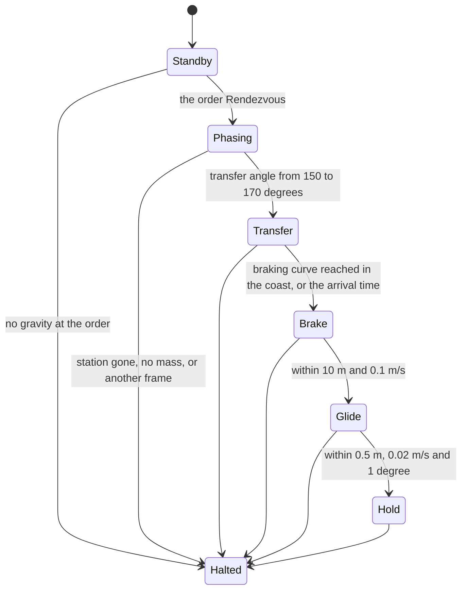
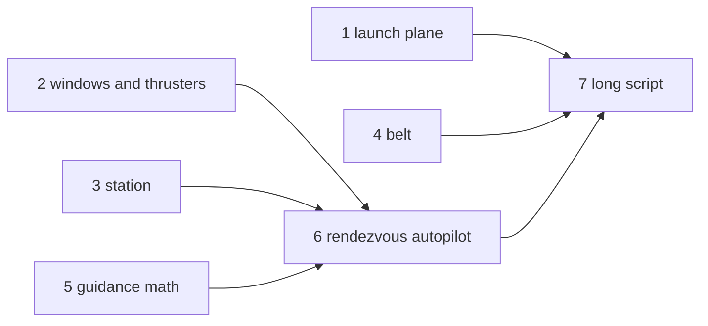
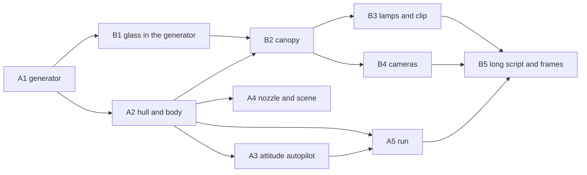
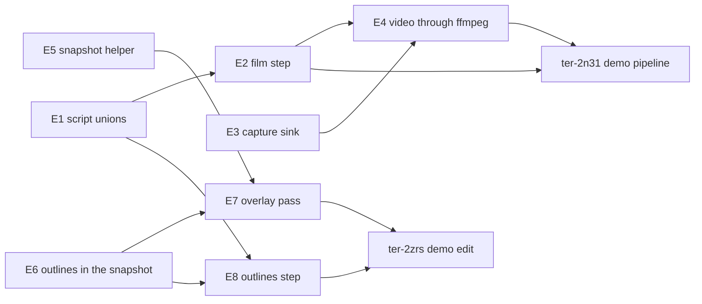

# Blue Danube demo

## Goal

A long demo video of the engine, recorded from one unbroken scripted run with the real renderer. The camera follows one character capsule from a launch terminal on Earth's surface to the outer wheel of a spinning station. The centerpiece recreates the docking sequence from "2001: A Space Odyssey". The graphics are gray-box procedural meshes without textures. The demo shows the physics only, so it adds no sky and no anti-aliasing: the engine is unfinished, and viewers know it (user, 2026-10-18). Title cards and music are added after the run.

## The sequence

1. Earth's surface. Buildings form a launch pad and a boarding terminal. The character walks through the terminal and boards a shuttle.
2. The shuttle launches up a ramp, like a rocket sled, and flies to orbit. In orbit the character becomes weightless by itself, because the ship's frame falls freely. The character leaves its seat and grabs a pen.
3. The shuttle burns again and approaches a large spinning station, seen through its windows. The station has a docking slot on its axis.
4. The shuttle spins up to match the station's rotation, enters the slot, and lands on one side of the docking barrel. Weak spin gravity returns as it moves out to the barrel wall.
5. The character leaves the ship and takes a chute down a spoke to the outer wheel, where it feels full gravity.

## Rules

- The engine runs at its fixed 60 ticks per second for the whole run. The project has no time warp. A time-lapse comes from the capture: the script captures every Nth tick, and the video plays those frames at the normal rate.
- Everything outside the engine is demo work: the scene, demo components, mesh generators, scripts, capture, editing, title cards and music. Every engine change goes to the user first (user, 2026-10-18).
- The music is Johann Strauss II, "The Blue Danube" (1866). The composition is in the public domain. The recording must have a free license, for example a US military band recording or a Musopen recording. Each download needs a yes with its file name, source and size.

## What exists, and what the demo adds

From a survey of the code on 2026-10-18.

| Need | State | Demo work |
|---|---|---|
| Scripts of 100,000 ticks and more | Exists (`scripts/orbit.json` runs about 332,700 ticks). The generator of the long script exists too (ter-2n31, see "The long script"). | Each later part adds its sections to the generator |
| One image per frame | Exists: a `film` step captures every Nth tick (ter-bgk5), and `--video` sends the captures into one lossless video (ter-mln3). A 720p frame of the orbit scene takes 3.5 ms into the video and 80 ms into a PNG file (see change 1, "Measured"). | The generator writes film steps. |
| Video | Exists: `ffmpeg-headless` in the dev shell (ter-mln3) encodes the frames of a headless run | Cut, add title cards and music with ffmpeg. |
| A camera that follows the character | Exists: the camera is an entity, a camera step is a hard cut, and the Demo's `ChaseCamera`, on an entity attached to the character, follows it from behind (ter-2n31, see "The long script") | None |
| Character walking, floating, grabbing | Exists (`MoveCharacter`, `Jump`, grab within 3 m). The pen, its `Clip` and the `Passenger` who takes it exist in the Demo (ter-m13s, see "The launch"). | A path-following walker component. A capsule hides that the rigid form never turns. |
| Seat | Exists: `Shuttle.Seat`, a static box in the shuttle's interior shape, which the demo surface draws (ter-na4f). A character has no sitting pose, so the person stands at `Shuttle.SeatStand`. The `Passenger` component's belt holds the person there while the cabin's gravity would not keep it on its feet (ter-m13s). | None |
| Ground at the pad | Earth's sphere sags about 480 m between vertices | A large static slab under the pad, as in the surface yard |
| Cylinders, rings, tori | Exists: `RevolvedSolid` (ter-fb3w) sweeps a convex profile about an axis into a cylinder, a ring or a torus, with its mesh and a collision shape that matches it. The station's wheel uses it (ter-tzf6). The spokes and the hub are `BoxMesh` tubes and boxes. | The chute of step 6 |
| Ship thrust and steering | Partial: the climb to orbit exists in the Demo (ter-m13s): `MainEngine`, `AttitudeAutopilot` and `AscentAutopilot`, which steers by `AscentGuidance` into the launch plane (see "The launch"). The rendezvous exists too (ter-tzf6): `TranslationThrusters` and `RendezvousAutopilot`, which steers by `TransferGuidance` and `ApproachGuidance` (see "The station and the rendezvous"). | Autopilot components: the spin match and the docking |
| Spin gravity, Coriolis, a ship in a turning frame, characters in a turning frame | Exists (the spin gravity epic `ter-s9m0`, [Spin gravity](spin-gravity.md)): every turning frame gives its contents the centrifugal, Coriolis and Euler terms, characters stand, walk and jump in it, and the scene `spin-station` shows it. | The ship in the turning station, and the autopilots that use it |

## The launch

Step 3 of the sequence, as ticket ter-m13s built it in the Demo, in the scene `demo-surface` and the script `scripts/demo-launch.json`. Nothing in the engine changed.

- The ramp (`DemoScenes.LaunchRamp`) is one static body without friction: a flat bed under the parked shuttle, 2 cm above the slab, so that the hull touches only the greased ramp and never the slab, which has friction, and one straight incline at 30 degrees, 250 m long, from under the shuttle's nose to 125 m up (`LaunchRampTests`). A curved ramp of short planks threw the hull off near 90 m/s: from there the hull moves more than 0.75 of its inner radius in a step, Jolt sweeps it, and the sweep stopped it at each joint. The straight incline has one joint, at its foot, which the hull crosses at about 27 m/s.
- A script posts `Ignition` to the shuttle. Its `AscentAutopilot` unparks the hull with `Self.Body.SetMotion(BodyMotion.Dynamic)` and runs the `MainEngine` at full throttle, 3 g along the nose, with the nose toward the velocity, until the shuttle is 30 m above the ramp's top. Then `AscentGuidance` steers a closed loop to a circle 200 km up: it splits the thrust between the climb and the speed along the track, so that the shuttle reaches the circle's height with no vertical speed when it reaches the circle's speed. It also steers into the launch plane, `DemoSurface.LaunchPlaneNormal`, the plane of the station's orbit, as a real launch flies into the plane of its target (ter-tzf6): it pushes back toward the plane a ship that drifts across it or lies beside it, and never takes thrust from the climb to do so. So the parking orbit lies in that plane (`DemoLaunchTests`, `BlueDanubeRendezvousTests`). The thrust pitches up from the ramp's 30 degrees to about 60, then over, and a little below the horizon at the end. The engine stops when the trim's thrust would fall below the weightless threshold. The autopilot talks to the engine and to the `AttitudeAutopilot` only through its entity's events: in each tick it adds a `Throttle` and an `AttitudeTarget`, which those two components read after it, and a tick without them gives no thrust and no torque (`FlightControlTests`). Its state is the custom union `AscentState`: `Parked`, `Ramp` with the guidance and the launch radius, `Climb` with the guidance, and `Orbit`. In the run of the script, the climb takes 321 s, and the periapsis and the apoapsis lie within 5 km of 200 km (`DemoLaunchTests`), well above the top of the air at 100 km (`DemoScenes.AtmosphereTop`).
- The cabin's weight comes from the frame's derived proper acceleration alone: the weight of the ground on the pad, the ramp's push and the engine's thrust in the climb, and nothing in orbit.
- The person's `Passenger` belt holds it at its seat while the cabin's gravity leans more than 45 degrees from the floor's down or the cabin is weightless: it pushes the person with its mass times the opposite of that gravity, plus a spring and a damper. The foot of the ramp jolts the person by about 0.17 m. Nothing holds the person's up to the seat: it follows the felt gravity in the air at most at the air rate of 1 rad/s, as for every character (`ter-1b21`, [Spin gravity](spin-gravity.md), "Characters"). At the end of the climb the engine throttles down to about 0.2 m/s², the felt gravity leans 14 degrees from the cabin's aft axis toward its ceiling, and the person's head, toward the nose, dips onto the seat, which lifts the person by 67 mm. The belt reads the gravity that the person feels, with the rotation terms of the cabin's turn (`FrameTree.FeltGravity`), which physics applies to a character too. In orbit, after 2 s weightless by that read, the person opens the belt, in the demo launch 5.2 s after the engines stop, once the change of the cabin's turn that the attitude autopilot makes has settled, and floats with thrusters as weak as `PersonControl`'s, so that its hand, in front of its chest (`Passenger.PenHold`), comes onto the drifting pen. The hand first lines up 0.5 m behind the pen, on the line ahead of the person's view, and then closes in along that line, so that the pen comes to the hand from in front and never touches the body. Once the hand is within 2 cm of the pen, the person uses it and takes it as `Carry` takes a crate, and the drawn copy in its hand keeps the place and the turn that the loose pen had relative to the view, so the pen does not jump into the hand. The hand is nearer than `Carry` holds a crate, so that the pen's near end lies just in front of the body: a pen held as far out as a crate read as a pen that floats free. A character does not turn, so the passenger does not plan a way round the pen: in the demo it floats face-down below the pen and well to the side of it, so its straight way from the seat passes clear of the pen, and nothing touches the pen until the take (`DemoLaunchTests`). The passenger's state is the custom union `PassengerState`: `Boarding`, `Seated` with its weightless ticks, `Fetching`, `Holding` with the copy, and `Stopped`, for a pen that goes before the take.
- A `Clip` on the pen holds it on the cabin's port wall, at head height, aft of the seat (user, 2026-10-19). While the cabin has weight, the clip steers the pen to its place in every tick (`Self.Body.SteerTo`), so that physics carries it back each step: the weight of a step moves it about 8 mm at three gravities, and the jolt at the ramp's foot drops it about 0.1 m for one step. Once the cabin has been weightless at the clip for 1 s, by the gravity felt there with the rotation terms of the cabin's turn (`FrameTree.FeltGravity`), the clip lets go with a push of 0.2 m/s away from the wall and a slow spin, end over end, at 0.5 rad/s. In the demo launch the clip lets go 2.9 s after the engines stop, once the change of the cabin's turn that the attitude autopilot makes has settled. The pen drifts into the cabin, and nothing touches it until the person takes it 10.6 s later, about 2.1 m from the wall and 2.0 m above the floor (`PenClipTests`, `DemoLaunchTests`). The clip's state is the custom union `ClipState`: `Clipped` with its weightless ticks, or `Released`.
- The script films the launch from cameras that the scene places for each part: `pad-camera` for the parked shuttle and the start up the ramp, `ramp-camera` for the ramp, `ramp-top-camera` for the flight past the ramp's top, `climb-camera` high behind the shuttle for the climb with the ground below, `chase-camera` for the high climb and the orbit, `pen-camera` within 2 m of the pen's way for the pen on the wall, its drift and the person's start from the seat, and `hand-camera` for the hand that closes on the pen and the pen in it. A 14 cm pen seen from the cabin's corners, 6 to 8 m away, shows only a few pixels.
- Under the climb's thrust, the engine turns a character's up against the cabin's gravity, so the belted person tips toward the nose, face toward the floor, and it floats that way in orbit, because a weightless character keeps its last up. Engine ticket ter-yrfa will let a weightless character turn its own up, which will right the person. Until then, the demo leaves the person as the engine's rule puts it (user, 2026-10-19).

## The station and the rendezvous

Ticket ter-tzf6 designs step 4 of "Order of the work", which is item 3 of "The sequence" (2026-10-20). The step is built. Its one engine change is `KeplerOrbit.Propagate` and `KeplerOrbit.Lambert` (see "Engine changes" below). Steps 5 (ter-ftnj) and 6 (ter-y0e5) start where this step ends.

### What the step does

- The station is a wheel 202 m across, on a circle 400 km up, in the plane of the launch. It turns about its axis at 0.31321 rad/s. That rate gives 9.81 m/s² on the wheel's floor, 100 m from the axis. The axis points along the orbit's normal. The docking slot on the axis faces the side of the orbit's plane where the sun shines.
- The climb to orbit now steers into that plane, as a real launch flies into the plane of its target.
- After the person takes the pen, the script tells the person to fasten its belt. The person floats back to its seat with the pen in its hand and straps in. So the burns do not throw it.
- Then the script orders the rendezvous. The shuttle's new autopilot waits about 26 minutes in the parking orbit for its window. Then it burns about 60 m/s onto a transfer of 170 degrees. The transfer reaches the arrival point 2,560 s later, 1,500 m from the station on its axis.
- At the arrival point the shuttle brakes with its main engine and turns its nose to the slot. Then it glides along the axis on translation thrusters to the hold point, 150 m from the station's center. It holds there, outside the station's bubble, and step 5 takes over.
- The shuttle gets windows and translation thrusters. The scene gets cameras that look through the windows at the station.

Terms used in this section:

- The launch plane: the plane through Earth's center that holds the pad's up and the ramp's incline. The pad's up is +Y of `earth-surface`, and the incline is `LaunchRamp.Up`. The plane's normal is `Ŷ × LaunchRamp.Up`, normalized, which is -X. The parking orbit and the station's orbit lie in this plane.
- The station's axis: the station's own +Y, about which it turns. In `earth-surface` it is +X. It stays fixed there, because `earth-surface` does not turn and the station's spin is steady. The slot is on the station's +Y side.
- The arrival point: the point on the station's axis 1,500 m from the station's center, on the slot's side.
- The hold point: the point on the station's axis 150 m from the station's center, on the slot's side.
- The angle along the orbit, φ: the angle about the launch plane's normal from the pad's up toward -Z. The shuttle's φ grows as it flies. The pad is at φ = 0.
- The transfer angle: the angle from the shuttle's position to a target point, seen from Earth's center. It turns about the station's orbit normal, the way that the orbit runs, from 0 to 360 degrees.
- The window: the first tick of the rendezvous at which the transfer angle lies between 150 and 170 degrees. The angle is taken to the arrival point of 2,560 s later.
- The needed velocity: the velocity that puts the shuttle on the two-body path that reaches the arrival point at the arrival time.
- The velocity to gain: the needed velocity less the shuttle's velocity, both in `earth-surface`.
- A target point's relative state: the shuttle's position less the target point's, and the shuttle's velocity less the station's. Both are in `earth-surface`. The axis does not turn there, so a point on the axis moves with the station's center.
- A layer: an autopilot of the flight program. In its tick it adds `Throttle`, `AttitudeTarget` and `Translation` events to the shuttle's events. The ascent autopilot is the first layer and the rendezvous autopilot is the second. Step 5's docking autopilot will be the third.

### The station

`DemoScenes.DemoStation` holds the station's constants and spawns the station in `demo-surface`. It spawns before the shuttle, because the shuttle's rendezvous autopilot takes the station's entity. The table gives the parts in the station's own axes. +Y is the axis. The angle θ about it runs from +X toward -Z, as `RevolvedSolid` measures it.

| Part | Size | Why | Body and shape | Drawn |
|---|---|---|---|---|
| Wheel floor | A ring from 100 to 101 m from the axis, 20 m wide, from y = -10 to 10 m, in 256 segments | The radius and the rate of the spin station (`SpinStation.FloorRadius`, `SpinStation.Rate`) give 9.81 m/s² on the floor. The person walks there in step 6. The facets are 2.45 m long. | The station's `BodyDesc.InteriorShape`: the exact mesh of the ring, as the note of ter-fb3w asks | The ring's mesh, on the station's own entity |
| Wheel ceiling | A ring from 94.5 to 95 m, 20 m wide | It closes the wheel's tube 5 m above the floor, so the wheel looks closed from outside. Step 6 opens it where the chute ends. | A static body in the station's frame: `RevolvedSolid.Shape`, one hull per segment | Its ring mesh |
| Wheel side walls | Two rings from 95 to 100 m, 0.3 m thick, centered at y = ±9.85 m | They close the tube's sides. The spin station's walls do the same for its floor. | Static bodies, one hull per segment | Their ring meshes |
| Spokes | Four square tubes in the plane y = 0, at θ = 0, 90, 180 and 270 degrees. Each is 4 m on a side outside, with walls 0.25 m thick. | Inside, 3.5 m on a side holds the chute of step 6, a capsule 0.6 m wide. The Coriolis force presses it on one wall (see "Physics notes"). | One static body: a compound of the 16 wall boxes | `BoxMesh` tubes, open at both ends |
| Spoke length | From the hub's outer face, 8.5 m from the axis, to the ceiling's face toward the axis, 94.5 m from it: 86 m | The spoke at θ = 180 degrees lies under the deck, so the chute starts at the deck. | | |
| Hub, the docking barrel | A square tube along the axis, 17 by 26 by 17 m outside, with walls 0.5 m thick. Its half extents are 8.5, 13 and 8.5 m along X, Y and Z. | The bay inside is 16 by 25 by 16 m. Its four inner walls are flat, so the shuttle lands flat on one of them in step 5. The bay holds the shuttle's 16 m with 4.5 m to spare at each end. | One static body: a compound of the wall boxes, with the slot open | A `BoxMesh` box with the slot as an opening, seen from outside and from inside |
| Slot | Through the hub's +Y wall, 6 m along X by 8 m along Z, on the axis | The shuttle's cross-section is 4 m tall and 6 m wide. `DemoStation.SlotClearance`, 1 m, adds room on each side. The shuttle enters with its belly toward the deck, so its height lies along X. | An opening | |
| Slot clearance | | A spin mismatch of 3 degrees moves a corner of the shuttle by 0.19 m. The corner is 3.6 m from the shuttle's axis. The clearance of 1 m holds that. | | |
| Deck | The bay's wall at x = -8 m, the inner face of the hub's -X wall | The landing floor of step 5. Its gravity is ω² × 8 m = 0.785 m/s², about 8 percent of a gravity. That is the weak spin gravity of the sequence. | Part of the hub | |
| Deck under a landed shuttle | | A landed shuttle's cabin floor lies 7.8 m from the axis, at 0.765 m/s². | | |
| Bay lamps | Four glowing panels on the bay's walls, with point lights | The slot glows from inside, as in the film. | Render only | Lamp panels, as in the cabin |

Box openings run along X or Z only (`Opening.ThroughX`, `Opening.ThroughZ`). So the hub's body and mesh are built in the hub's own axes, whose +Z is the station's +Y. The slot is an opening through Z. The hub's child in the hull compound carries the same quarter turn about X, so the deck stays at x = -8 m.

In `earth-surface`, the station's hull is kinematic. Its shape is a compound of three solids. The wheel is a solid ring from 94.5 to 101 m, in 256 segment hulls. The spokes and the hub are solid boxes. The bounding radius of the hull is 101.5 m, at the corner of the wheel's rim. Its mass is 1e7 kg, which a kinematic hull does not use. In its own frame, the station is the floor mesh and the static bodies in the table.

Every part is drawn with `RenderFlags.NoImpostor`, beside `Visible` and `CastsShadow`. An impostor records the view direction in object space (ARCHITECTURE.md, "Impostors"). The spin turns the station 18 degrees a second, so a capture goes stale within a few ticks. The station has about ten thousand triangles, so the geometry costs little. The closed wheel shades its own inside. Step 6 lights the inside with lamps, as the spin station's walls carry lamps.

The frame:

- Bubble: a sphere of 120 m (`DemoStation.Bubble`). It holds the hull's 101.5 m with 18.5 m to spare. So a body enters the frame before it reaches the hull.
- The shuttle's bubble reaches 17.3 m from its center. That is less than half of 120 m, so the shuttle's frame fits in the station's (`FrameBounds.Fits`), as "Physics notes" asks.
- The shuttle's bounding sphere is 8.8 m. It touches the bubble at 128.8 m from the station's center.
- Field: none. The turn alone gives weight inside, as in the spin station.
- Motion: a `KeplerMotion` with the orbit of `DemoStation.Orbit`:

```csharp
new KeplerOrbit(SemiMajorAxis: OrbitRadius, Eccentricity: 0, Inclination: Math.PI / 2, LongitudeOfAscendingNode: -Math.PI / 2,
    ArgumentOfPeriapsis: 0, MeanAnomalyAtEpoch: Math.PI / 2 - meanMotion * OverPadAt, Epoch: 0,
    AxialTilt: DQuaternion.FromAxisAngle(Double3.UnitZ, -Math.PI / 2), SpinRate: SpinStation.Rate, SpinPhaseAtEpoch: 0,
    Attitude: KeplerAttitude.Spin)
```

where

- `OrbitRadius` = `DemoScenes.OrbitRadius`, 6,771 km from Earth's center: Earth's mean radius plus 400 km.
- `Inclination`, `LongitudeOfAscendingNode` = the turns that put the orbit's normal on -X, the launch plane's normal. At mean anomaly 0 the station is at +Z of `earth-surface` and moves toward +Y. At mean anomaly 90 degrees it is over the pad and moves toward -Z, as the shuttle does.
- `meanMotion` = the orbit's mean motion, `Math.Sqrt(EarthMu / OrbitRadius³)`, 1.13316e-3 rad/s.
- `OverPadAt` = the world time at which the station passes over the pad: 38 s, 18 s after the ignition. It sets the launch window. "The orbits, the window and the times" derives it.
- `AxialTilt` = the quarter turn about Z that takes the station's +Y to +X of `earth-surface`, the slot's side. The spin turns about that axis, so the axis stays fixed.
- `SpinRate` = 0.31321 rad/s, one turn in 20.1 s.

The spawn carries the first motion intent of the orbit (`FirstMove`), as `Station.Build` does. It holds the pose, the velocity and the angular velocity of the orbit at the world's time. So the frame is on its rails and turns from its first step. Its proper acceleration is exactly zero, because a Kepler frame in a parent that does not turn falls freely (ARCHITECTURE.md, "How a frame moves"). The hull moves fast, so it lives in a following frame of its own (ARCHITECTURE.md, "Numeric frames"), as the orbiting station's hull does.

The orbiting station of ter-dhkf is the analogue of the frame and the hull: a Kepler frame whose kinematic hull carries an interior. The spin station is the analogue of the turn, the floor mesh and the first motion intent. The orbit stays in `earth-surface`, and the spin lives in the orbit's attitude. A Kepler orbit inside a turning parent turns with the parent. So this is the one rails form in which a frame both orbits and spins.

Why the axis points along the orbit's normal:

- The axis is fixed in `earth-surface`. Of the directions fixed there, only the orbit's normal also stays fixed relative to the station's local vertical.
- So the arrival point, the glide and the hold keep one place relative to Earth. Earth lies below the line of sight from the shuttle to the station for the whole approach, as in the film.
- The sun's direction in `earth-surface` is (0.557, 0.743, 0.371). The slot's face has the normal +X, so it takes the sun at 56 degrees from its normal on every orbit. The shuttle on that side sees it lit.

### The launch plane

Today the climb does not hold its plane. Dumps of the launch on 2026-10-20 show this. The climb ends 0.17 degrees out of the plane of its launch, with a speed of 22.9 m/s across it. That speed builds up through the whole climb, at about 0.07 m/s².

That puts the parking orbit up to 19.7 km to the side of a station in the launch plane. Where the window falls, the shuttle is 17 km to the side. From there, a transfer of 170 degrees costs about 116 m/s more at the burn. That is as much as the whole transfer.

So `AscentGuidance` gets the launch plane's normal and a third part, across the plane. It already has a vertical part and a part along the track. The cross part takes the law of the vertical part: it reaches the plane with no speed across it at the end of the time to go. The track is now the direction in the plane across the up. So the part along the track no longer keeps a speed across the plane.

```
up = r / |r|,   track = (normal × up) / |normal × up|,   side = up × track
across = r · normal,   acrossSpeed = v · normal,   alongTrack = v · track
timeToGo = max((CircleSpeed - alongTrack) / MaxAcceleration, ShortestTimeToGo)
vertical = 6 (OrbitRadius - |r|) / timeToGo² - 4 (v · up) / timeToGo + Mu / |r|² - (alongTrack² + acrossSpeed²) / |r|,   at most ±MaxAcceleration
acrossPlane = -6 across / timeToGo² - 4 acrossSpeed / timeToGo,   at most ±sqrt(MaxAcceleration² - vertical²)
horizontal = min(sqrt(MaxAcceleration² - vertical² - acrossPlane²), max(0, (CircleSpeed - alongTrack) / TrimTime))
acceleration = up · vertical + side · acrossPlane + track · horizontal
```

where

- `r`, `v` = the shuttle's position and velocity in `earth-surface`, from Earth's center.
- `normal` = `DemoSurface.LaunchPlaneNormal`, -X. The scene gives it to the ascent autopilot. It is the plane's prograde normal, so `normal × up` points the way that the shuttle flies.
- `track` = the unit direction in the plane across the up, the way that the shuttle flies.
- `side` = the part of `normal` across the up, as a unit vector. The cross part pushes along `side`, not along `normal`: beside the plane, the up leans from the plane by `across / |r|`, so `normal` is not quite across the up. `up`, `track` and `side` are orthogonal, so the three parts share the thrust exactly.
- `across` = how far the shuttle is from the launch plane, in meters.
- `acrossSpeed` = how fast the shuttle moves across the launch plane, in m/s.
- `alongTrack` = the speed along the track in the plane, in m/s.
- `CircleSpeed`, `MaxAcceleration`, `ShortestTimeToGo`, `TrimTime`, `OrbitRadius`, `Mu` = as today.

The vertical part comes first, then the part across the plane, then the part along the track. `Reached` does not change. The climb lasts 321 s. The cross part takes out its drift of 0.07 m/s² with a few hundredths of a degree of the thrust. The test of the launch requires the parking orbit within 100 m of the plane, and slower than 0.1 m/s across it. The cue of every section stays the same. But the climb changes a little, so the script is written again.

### The orbits, the window and the times

The numbers below come from the dumps of the launch on 2026-10-20, with the insertion moved into the launch plane. They use a two-body model with Earth's G·M. At the insertion, 340.5 s into the run, the shuttle is 199.98 km up, at φ = 11.06 degrees, at 7,788 m/s.

| Quantity | Value | Arithmetic |
|---|---|---|
| Parking orbit | 6,571 km from Earth's center. n₁ = 1.18528e-3 rad/s, one turn in 5,301 s (88.4 min). | n = sqrt(μ / r³) |
| Station's orbit | 6,771 km. n₂ = 1.13316e-3 rad/s, one turn in 5,545 s (92.4 min). 7,673 m/s. | |
| How fast the shuttle gains on the station | 5.213e-5 rad/s, 0.179 degrees a minute, once in 33.5 h | n₁ less n₂ |
| A Hohmann transfer, for comparison | 2,711 s and 115.9 m/s (58.2 + 57.7). At the burn, the station is 4.0 degrees ahead. | Half a turn of an orbit of 6,671 km, T = π sqrt(a³ / μ) |
| The chosen transfer | 170 degrees in 2,560 s, the time of the cheapest transfer of 170 degrees between the two circles | A scan of Lambert solutions over the time of flight, in steps of 10 s |
| Cost of the chosen transfer | 119.5 m/s (60.0 + 59.6) in the run's geometry. About 10 m/s at each end turns the plane to reach the arrival point 1.5 km to the side. | |
| Transfer orbit | 199.3 by 400.5 km | |
| Station at the insertion | φ = 19.6 degrees, 8.6 degrees ahead of the shuttle | n₂ × (340.5 s less 38 s), in degrees |
| Transfer angle at the order, at about 366 s | 174.7 degrees | |
| The window | 170 degrees, 1,578 s after the order. That is about 1,944 s into the run, 27 minutes after the insertion. The shuttle is at φ = 120 degrees. | The angle falls at 0.179 degrees a minute. |
| Arrival | 1,944 + 2,560 = 4,504 s, at φ = 290 degrees | |
| Velocity relative to the station at the arrival | 59.7 m/s: 57.8 m/s slower along the orbit, 11.2 m/s up, and 9.6 m/s across the plane | |
| Brake | It starts about 740 m before the arrival point, 12 s before the arrival time. It stops the shuttle there in about 24 s. | 59.7² / (2 × 2.4) |
| Glide | 1,350 m along the axis in about 350 s, at 5 m/s at most | A model of the law below, with the two-step lag of the thrust |
| Hold | Reached about 4,870 s into the run, at 81 minutes | |

Why 170 degrees:

- A Hohmann transfer turns half an orbit. At exactly 180 degrees, the plane of the transfer is not defined.
- An arrival point 1.5 km to the side of the orbit's plane tilts the plane of a transfer near 180 degrees steeply. At 175 degrees, the turn across the plane costs about 20 m/s at each end. At 180 degrees the cost has no bound.
- At 170 degrees it costs about 10 m/s. The whole transfer costs 3 percent more than Hohmann's.

Why the window falls at φ = 120 degrees:

- The light decides. With the sun's direction above, the shuttle at 200 km is in Earth's shadow from φ = 80.7 to 226.3 degrees. The station at 400 km is in Earth's shadow from φ = 87.6 to 219.4 degrees.
- A transfer that starts right after the insertion arrives at about φ = 190 degrees, in Earth's shadow.
- With the window at 120 degrees, the shuttle arrives at 290 degrees. There the sun stands 37 degrees above the station's horizon. The part of Earth's limb that the shuttle sees below the station is lit.
- The glide and step 5 run on toward φ = 330 degrees, where Earth's limb is lit best.
- The cost is a coast of 26 minutes in the parking orbit, which a real rendezvous flies too. The burn falls in Earth's night, so the film shows it from the cabin (see "Sections of the long script").

How `OverPadAt` sets the window:

- The window opens at the tick where the station's lead over the shuttle shrinks to 3.8 degrees, the lead of the chosen transfer. The station moves 166.2 degrees in 2,560 s, and 166.2 + 3.8 = 170.
- One second more of `OverPadAt` puts the station 0.065 degrees further back. That opens the window 22 s earlier and 1.5 degrees earlier along the orbit.
- The builder of the station sets `OverPadAt` from the rehearsal. The aim is a window at φ between 115 and 125 degrees. The model gives 38 s, and the run test pins the range.

Measured in the run of the checked-in script on 2026-10-20 (`BlueDanubeRendezvousTests`), with `OverPadAt` at the model's 38 s:

- The window opens 1,950.6 s into the run, with the shuttle at φ = 120.4 degrees.
- The two-body cost of the transfer from the shuttle's state at the window is 119.5 m/s. The burn, the trim and the brake change the shuttle's velocity by 119.5 m/s too, the integral of the cabin's proper acceleration.
- The brake starts 4,498.2 s into the run, at φ = 289.6 degrees, with the shuttle 59.6 m/s fast relative to the station. It ends 23.8 s later.
- The glide takes 341 s, and the hold starts 4,862.7 s into the run, at 81 minutes.

### If the insertion changes

The autopilot measures every state from the run and solves every burn from it. It keeps no number from a rehearsal.

- Radius, eccentricity and plane: the transfer is a Lambert solution from the shuttle's measured position and velocity to the arrival point. The arrival point comes from the station's measured position and velocity.
- The parking orbit can be a few kilometers higher or lower, a little oval, or a little out of the plane. That changes only the velocity to gain, by a few m/s. Today the insertion lies within 5 km of 200 km (`DemoLaunchTests`).
- Phase and time: the window waits for the measured transfer angle. An insertion 1 s late puts the shuttle 0.07 degrees further back. That opens the window about 22 s later, and moves the arrival 1.5 degrees further along the orbit.
- A change of 10 s either way keeps the arrival between φ = 275 and 305 degrees, where the light still works. A larger change fails the run test's range for the window, and the builder sets `OverPadAt` again.
- A late order: the transfer angle at the order can already lie between 150 and 170 degrees. Then the window opens at once, and the transfer costs a few m/s more.
- An order after the window: below 150 degrees, the autopilot waits for the next window, 33.5 h later. The generator then stops at that section's limit and names the section.
- The burns are finite, about 32 s, and the thrust acts two steps after the read. The guidance solves again in every tick from the state that the last step left. So neither error lasts.

### The rendezvous autopilot

#### Layers

The flight program is a stack of layers on the shuttle. The actuators follow the last layer that speaks. `MainEngine` and `AttitudeAutopilot` already take the last `Throttle` and the last `AttitudeTarget` of a tick. Their documentation says that a component that runs later overrides one that runs earlier. The layers get explicit priorities in the order of the flight, and the actuators run after all of them.

| Component | Priority | What it adds |
|---|---|---|
| `AscentAutopilot` | 0 | In its `Orbit` case, an `AttitudeTarget` with the nose along the velocity, in every tick |
| `RendezvousAutopilot` | 1 | Nothing in `Standby` and `Phasing`. From the window on, an `AttitudeTarget` in every tick. It adds a `Throttle` in the ticks of a burn, and a `Translation` in the ticks that its translation thrusters push. |
| The docking autopilot of step 5 | 2 | Step 5 designs it. |
| `AttitudeAutopilot`, `MainEngine`, `TranslationThrusters` | 10 (today 1) | They read what the layers added. |

An active layer adds an `AttitudeTarget` in every tick. So the target of a layer before it never reaches the attitude autopilot. Before the rendezvous, only the orbit case of the ascent autopilot writes a target, and it writes no throttle. So a tick in which the rendezvous adds no throttle runs no engine. The ascent autopilot stays as it is. It holds the orbit's attitude until the window.

#### The translation thrusters

The shuttle has only its main engine, along the nose. The brake must push along the orbit while the station lies to the side. The glide must push toward and away from the station while the nose looks at it. So the shuttle gets translation thrusters, a new demo component that matches `MainEngine`:

- `Translation`, an event payload: `Force`, a `Double3` in newtons, in the axes of the entity's frame.
- `TranslationThrusters(maxThrust)` acts in each tick that brings a `Translation`. It turns the force into the hull's axes and limits each axis to ±`maxThrust`, as jets along each axis do. Then it turns the force back and adds it with `self.Body.AddForce`.
- It reads the hull's rotation in `self.Frame`, as the main engine reads its nose.
- A tick without a translation gives no force. The last translation of a tick counts.
- A force that is not finite makes it throw `ArgumentOutOfRangeException`, which the world logs. It then pushes nothing.
- `Shuttle.TranslationThrust` = 4,000 N per axis, 0.2 m/s² for the shuttle's 20 t.

#### The phases

`RendezvousState` is a custom C# 15 union, like `AscentState`, with one record per case. Each case holds the data that it needs, so no case reads a value that only another case sets. The default value is `Standby`. The passenger's union already has cases named `Holding` and `Stopped` in the same namespace, so the rendezvous names its last cases `Hold` and `Halted`.

| Case | Data | What the autopilot does | Next case |
|---|---|---|---|
| `Standby` | None | It adds nothing. | A `Rendezvous` order arrives: `Phasing`. The autopilot builds its guidance then, as the ascent autopilot does at the ignition. |
| `Phasing(Transfer)` | The transfer guidance | It adds nothing, so the orbit attitude of the ascent autopilot flies on. | The transfer angle lies between 150 and 170 degrees: `Transfer`, with the arrival time 2,560 s from now |
| `Transfer(Transfer, ArrivalTime)` | The transfer guidance, and the arrival time in the world's seconds | It burns and trims onto the Lambert path that reaches the arrival point at the arrival time. | In the coast, the braking curve reaches the shuttle, or the arrival time comes: `Brake` |
| `Brake(Approach)` | The approach guidance of the brake | It stops the shuttle at the arrival point with the main engine. | The shuttle is within 10 m of the arrival point and slower than 0.1 m/s relative to the station: `Glide` |
| `Glide(Approach)` | The approach guidance of the glide | It turns the nose to the slot. It flies the shuttle along the axis to the hold point on the translation thrusters. | Distance, speed and nose are within the hold's tolerances (see "Tolerances and the end state"): `Hold` |
| `Hold(Approach)` | The approach guidance of the glide | It holds the shuttle at the hold point, with its nose at the slot. | None. The layer of step 5 overrides it. |
| `Halted` | None | It adds nothing more. | None |

The guidance takes Earth's G·M from the point gravity of the shuttle's frame (`KeplerOrbit.MuFrom`). The autopilot goes to `Halted`, and logs the reason once, in these cases (a hull without mass is a fourth, as for the ascent autopilot):

- The station is gone.
- The shuttle's frame has no point gravity to fly in.
- The shuttle is no longer in the frame that holds the station, as after a hand-off into the station's bubble in step 5. The laws below hold only in a frame that does not turn, and `earth-surface` is one.



#### Reads and writes, and their frames

Every read is in `earth-surface`, the frame of the shuttle's hull, `self.Frame`, which does not turn:

- The shuttle's position and velocity: `self.PoseIn(self.Frame)` and `self.VelocityIn(self.Frame)`.
- The station's position, rotation and velocity: `self.Snapshot.TryGetPoseIn(station, self.Frame)` and `TryGetVelocityIn(station, self.Frame)`. The station's axis is its rotation applied to +Y.
- Earth's G·M: from the point gravity of `self.Frame`, once, at the order.

Both the shuttle and the station own frames. A frame and its owner are one entity: the frame tree row is exact, and the float transform row is filled from the frame's last step record (`World.MirrorFrameOwners`). That record keeps the instant velocity (ARCHITECTURE.md, "Rails components and motion intents"). So the two velocities mean the same thing. Their difference has no bias of half a step of gravity. The pods of the orbiting station's scene are plain bodies. Their reads are Jolt's chords, and they read 7 cm/s off for that reason.

Every write is relative to `self.Frame`, in its axes: the rotation of the `AttitudeTarget`, the force of the `Translation`, and the main engine's push along the nose. The tick reads the state at the end of the last finished step. Its pushes act in the step of the next tick, two steps late, as for the ascent autopilot. Every time constant below is 0.5 s or longer, 30 steps, so the lag costs little.

#### The transfer guidance

The two-body math lives in `KeplerOrbit`, in Core. The user's rule for the rails library makes two-body math with no orbit elements a static method of `KeplerOrbit`, and the user chose that this rule holds here too (user, 2026-10-20). It is the one engine change of this step (see "Engine changes"). The analogue is `KeplerOrbit.Chord`, which also takes a state and G·M:

- `KeplerOrbit.Propagate(position, velocity, mu, time)`: the state after `time` seconds on a two-body path, as `StateAt` gives it, a position and a velocity. It uses the universal variable and Stumpff's functions, with Newton's method. The method keeps bounds on the solution and halves them where a step of Newton's leaves them or gains too little, as on a hyperbola over days. It refuses a hyperbola over more than about 1e28 s, where it does not converge. The station moves on exactly such a path, so the propagation of its measured state equals its rails to the rounding.
- `KeplerOrbit.Lambert(from, to, timeOfFlight, mu, normal)`: the velocities at both ends of the two-body path from `from` to `to` in `timeOfFlight`. The path turns about `normal` through the angle from `from` to `to`, measured that way from 0 to 360 degrees, in less than one revolution. So above 180 degrees it runs the long way.
- `Lambert` uses the universal-variable method of Bate, Mueller and White (Curtis, algorithm 5.2). It finds the variable z by bisection, over a single revolution. It refuses a transfer angle within 1 degree of 0 or 180 degrees, where the plane of the path is not defined, and a time of flight faster than its search covers: a hyperbola whose anomaly turns by more than 2π.
`TransferGuidance(Mu)` is a record struct of the demo, like `AscentGuidance`. It holds Earth's G·M for the two calls, and the guidance of the transfer below. Its one member of geometry is:

- `TransferAngle(from, to, normal)`: the angle from `from` to `to` about `normal`, from 0 to 2π.

In each tick of `Phasing`:

```
arrival = KeplerOrbit.Propagate(stationPosition, stationVelocity, Mu, TransferTime).Position + axis · ArrivalDistance
angle = TransferAngle(shuttlePosition, arrival, orbitNormal)
```

where

- `stationPosition`, `stationVelocity` = the station's center and velocity in `earth-surface`.
- `shuttlePosition` = the shuttle's center in `earth-surface`.
- `TransferTime` = 2,560 s. `ArrivalDistance` = 1,500 m.
- `axis` = the station's axis in `earth-surface`.
- `orbitNormal` = the station's orbit normal, `stationPosition × stationVelocity`, normalized.
- `angle` = the transfer angle. The window is open while it lies between 150 and 170 degrees.

In each tick of `Transfer`:

```
timeLeft = ArrivalTime - time
arrival = KeplerOrbit.Propagate(stationPosition, stationVelocity, Mu, timeLeft).Position + axis · ArrivalDistance
(needed, atArrival) = KeplerOrbit.Lambert(shuttlePosition, arrival, timeLeft, Mu, orbitNormal)
toGain = needed - shuttleVelocity
push = toGain / TrimTime, at most BurnAcceleration long
```

where

- `time` = the time at the end of the last finished step, `self.TimeAt(self.Tick)`.
- `needed` = the needed velocity now.
- `atArrival` = the shuttle's velocity at the arrival point, on that path.
- `toGain` = the velocity to gain.
- `TrimTime` = 4 s, as `AscentGuidance.TrimTime`, so the thrust of the burn falls in its last seconds.
- `BurnAcceleration` = 3 m/s², a throttle of about 0.10. So the departure burn lasts about 32 s: the push stays at the cap of 3 m/s² for about 16 s, until about 12 m/s is left to gain, and the trim time then takes the rest, as the push falls with the velocity to gain.

The transfer runs in three modes:

- The burn: `toGain` is longer than 0.1 m/s. The nose turns toward `toGain`. The throttle is the part of `push` along the nose, never below 0, times the mass, over the engine's full thrust. The translation thrusters take the rest of `push`.
- 0.1 m/s is `TransferGuidance.SpeedTolerance`, the speed that the trim takes in 4 s at half the weightless threshold. So the trim's push is at most 0.025 m/s², and the cabin stays clearly weightless through the trim. A strapped person floats there in the rigid form of a character, which keeps its up. At a push of the threshold itself, a person who touches its seat walks again and turns its up to the push at once. The first value was 0.2 m/s, `AscentGuidance.SpeedTolerance`, the speed that the trim takes in 4 s at the threshold. The trim's first push then came to 0.0499 m/s², at the threshold to the rounding. The burn's thrust now leaves the cabin weightless about 3 s before the burn ends, at a throttle of about 0.001 (ter-tzf6, 2026-10-20).
- The trim: `toGain` is 0.1 m/s or shorter. Only the translation thrusters trim it, with `toGain / TrimTime`. The nose turns toward the brake's direction at the plan's weightless turn rate, so the brake starts after only a small turn.
- In the trim and the coast, the nose turns at most at the plan's `RendezvousPlan.WeightlessTurnRate`: 0.002 rad/s in the demo's plan, and the full 0.15 rad/s in the short test plan, whose shuttle carries no crew and must turn within its 300 s. Each `AttitudeTarget` carries the fastest turn that its layer allows, `MaxTurnRate`, and the attitude autopilot asks for at most that and its own 0.15 rad/s. A turn of the hull gives the crew a felt gravity: the centrifugal term ω² r, and the Euler term while the attitude autopilot brings the hull to its rate in a third of a second, 3 ω r. At the seat, 4 m from the hull's center, the Euler term of 0.002 rad/s is 0.024 m/s², less than half the threshold. At 0.15 rad/s, the turn of 160 degrees from the burn's nose to the brake's direction gave about 0.1 m/s² there. That put the strapped person into the walking form, and its up turned at the air rate to about 155 degrees from the nose: on its side, with its body over the pen. At 0.002 rad/s the turn takes about 1,400 s of the trim's 2,450 s, and the person keeps the up of the burn, with its head toward the nose (`BlueDanubeRendezvousTests`).
- The brake's direction is the opposite of the shuttle's velocity relative to the station at the arrival point: `atArrival` less the station's propagated velocity.
- The coast: in the last 60 s before the arrival time, the autopilot solves nothing more. A short transfer turns a small miss into a large velocity to gain. The nose turns against `u`, the velocity relative to the station, at `RendezvousPlan.WeightlessTurnRate`.
- With the trim, the shuttle reaches the arrival point within about 12 m. The trim lasts about 2,450 s, and it holds the velocity to gain below 5 mm/s.

The transfer ends in the coast at the braking curve, where `sqrt(2 × 2.4 m/s² × d)` is no more than `|u|`. Here `d` is the distance to the arrival point and `u` the velocity relative to the station. It also ends at the arrival time. The test holds only in the coast: earlier, the shuttle is thousands of kilometers from the arrival point, where `|u|` (about 15 km/s at the window) exceeds the curve's speed (about 8 km/s), and the relative motion is not that of a free mass. The brake starts about 12 s before the arrival time, well inside the coast of 60 s. In the coast, the nose turns against `u`, which differs from the brake's direction of the last solution by 0.15 degrees. At about 3,300 s the brake's direction passes 9 degrees from straight down, and the roof, away from Earth across the nose, swings about the nose there. At the slow turn rate the nose catches up only slowly afterward: it lies 2.9 degrees off the brake's direction when the coast starts, and 2.1 degrees off `-u` when the brake starts.

#### The approach guidance

`ApproachGuidance(Mu, BrakeAcceleration, SpeedCap, FinalRate, VelocityTime, MaxAcceleration)` is one law for the brake, the glide and the hold. It flies the shuttle to a point fixed to the station and stops it there. It cancels the difference of Earth's gravity between the shuttle and the station's center. So the shuttle moves relative to the point as a free mass in empty space does, and a simple law flies it exactly.

```
x = shuttlePosition - target,   d = |x|
u = shuttleVelocity - stationVelocity
wanted = -(x / d) · min(SpeedCap, sqrt(2 BrakeAcceleration d), FinalRate d)
push = (wanted - u) / VelocityTime - (g(shuttlePosition) - g(stationPosition)),   at most MaxAcceleration long
g(r) = -Mu r / |r|³
```

where

- `target` = the target point in this tick: the station's center plus the point's distance along the axis.
- `wanted` = the velocity relative to the station that the law asks for.
- `push` = the acceleration that the shuttle's thrust must give, in m/s².
- `g` = the point gravity of Earth.

The target is the arrival point for the brake, and the hold point for the glide and the hold. The wanted velocity points toward the target. Its speed is the least of three limits:

- The speed cap.
- The speed that stops the shuttle at `BrakeAcceleration` in the distance left.
- Near the target, `FinalRate` times the distance, as the passenger's float slows (`Passenger.ApproachRate`).

The difference of gravity is 1.9e-3 m/s² at 1.5 km to the side of the orbit. At the hold point it is 1.9e-4 m/s², about 4 N for the shuttle.

| Phase | Target | `BrakeAcceleration` | `SpeedCap` | `FinalRate` | `VelocityTime` | `MaxAcceleration` | Thrust | Nose |
|---|---|---|---|---|---|---|---|---|
| `Brake` | Arrival point | 2.4 m/s², 80 percent of the burn's, so the law has room to follow its curve | None | 0.5 /s | 0.5 s | 3 m/s² | The main engine along the nose, and the translation thrusters for the rest | Along `push` |
| `Glide`, `Hold` | Hold point | 0.05 m/s², a quarter of the thrusters' | 5 m/s | 0.1 /s | 2 s | 0.2 m/s² | The translation thrusters only | Toward the slot, along minus the axis |

In every phase that steers, the roof turns away from Earth across the nose, as the ascent autopilot turns it. The target comes from `AttitudeAutopilot.Facing`, with the shuttle's position as the roof. In the glide and the hold, the roof points exactly away from Earth, because the axis lies across the vertical. The turn from the brake's nose to the slot is about 100 degrees about the roof. At the attitude autopilot's 0.15 rad/s it takes about 12 s, while the thrusters already push along the axis.

#### Tolerances and the end state

| Phase | Tolerance |
|---|---|
| Window | The transfer angle lies from 150 to 170 degrees. |
| End of the burn | The velocity to gain is below 0.1 m/s. The trim then holds it below 5 mm/s. |
| Miss at the arrival time | Within 100 m of the arrival point (about 12 m expected) |
| End of the brake | Within 10 m of the arrival point, and slower than 0.1 m/s relative to the station. At 0.5 m/s, the glide inherits up to 0.5 m/s across the axis: its push is capped at 0.2 m/s² as a whole, and the speed of 5 m/s that it wants along the axis takes nearly all of it, so the drift across the axis reached 5.6 m on the short test plan. At 0.1 m/s it stays within 1.7 m. |
| Glide | Within 5 m of the axis all the way |
| Hold | Within 0.5 m of the hold point, slower than 0.02 m/s, and the nose within 1 degree of minus the axis |

The end state, for step 5:

- The shuttle holds at `DemoStation.HoldPoint`, 150 m from the station's center on its axis, on the slot's side, in `earth-surface`.
- Its nose points at the slot, and its roof away from Earth. It does not turn relative to the stars.
- Its bounding sphere lies 21 m outside the station's bubble, and its own bubble 12.7 m outside it. So no bubble holds the other, and no ghost crosses between them.
- The rendezvous autopilot stays in `Hold`. It keeps the shuttle there until a later layer speaks.

Why the hold point lies outside the bubble:

- Inside the station's frame, the shuttle's reads and writes are in axes that turn at 0.31321 rad/s.
- In those axes, a shuttle that does not turn relative to the stars turns backward at that rate. That is faster than the attitude autopilot's limit of 0.15 rad/s, so the attitude autopilot cannot hold it there.
- Outside the bubble, step 5 can spin the shuttle up to the station's rate. The shuttle then enters at rest in the station's axes, and every read in its new frame stays still.

### The passenger through the burns

In a burn of 3 m/s², a person who floats in the cabin falls onto the aft wall. So the script tells the person to fasten its belt before it orders the rendezvous. The `Passenger` gets one order and two cases:

- `FastenBelt`: an event with no payload that a script posts, as it posts `Ignition`. A passenger in `Holding` takes it. In every other case it changes nothing.
- `Returning(Copy)`: the passenger floats its center back to `Shuttle.SeatStand`, with the thrusters and the law of its fetch. Its speed toward the seat is at most `FloatSpeed`, 1 m/s, and `ApproachRate` per meter of the way left.
- During `Returning`, the drawn copy of the pen stays in its hand. Once its center is within `BuckleRadius`, 0.1 m, of the seat, it shuts its belt: `Strapped`.
- `Strapped(Copy)`: the belt of `Seated`, which holds the passenger whenever the felt gravity does not keep it on its feet. But the passenger never opens it. Step 6 opens it.

The person takes the pen near z = -1 m, about 2.1 m from the port wall and 2.0 m above the floor. The seat stand lies 3.4 m from there, aft of the seat. The straight way passes above and aft of the seat. The float takes about 8 s. The belt held the person through the climb at 30 m/s², so it holds the person at 3 m/s².

### The shuttle's windows and the cameras

This step gave the shuttle's box hull small windows: one in the nose wall and three in each side wall, each with a pane of glass. Ticket ter-4xkz replaces them with the glass canopy of a new hull. "The shuttle's tram shape and glass canopy" describes the shuttle's glass, and the place of every camera in the shuttle. The table below gives what each camera of the rendezvous sees.

New cameras, each a still view in its frame, as the pen camera and the spin station's views are:

| Camera | Frame | Place | What it sees |
|---|---|---|---|
| `window-camera` | The shuttle's | 1.2 m behind the nose's front at eye height, looking out along -Z | The station ahead through `pane-nose`, with Earth's limb at the bottom |
| `bow-camera` | The shuttle's | 30 m ahead of the nose and 5 m above it, looking aft along the hull, 30 degrees to port of astern | The shuttle in front and the station behind it, through the closing. The station lies 9 to 57 degrees to port of astern there. |
| `port-window-camera` | The shuttle's | 0.6 m inside the port wall, at z = 4.2 m and eye height, looking out 20 degrees aft of abeam | The station through `pane-port-7` during the brake. The station lies to port, from 33 to 9 degrees aft of abeam, and 1.5 degrees below the horizontal. With this step's small aft port window, a camera 1 m inside, at z = 4.5 m, lost the station. The window's outer edge hid it for the first 4 s of the brake. |
| `cockpit-camera` | The shuttle's | Aft of the seat and to starboard of it, above the person's head, at (1.9, 0.9, -1.4) m, looking down at (0.7, -1.3, -5.2) m | The strapped person at its seat with the pen, and `pane-nose` beyond it. The person floats upside down from the take, and the burn tips it with its head toward the nose, by the up rule of every character. The pen is in its right hand, so a camera to port, as first placed, saw the pen behind the person's body in the burn. The trim's push and its slow turn leave the cabin weightless, so the person keeps that up through `transfer-night`. The glide's turn to the slot swings the person's up by up to 105 degrees, and the glide's push along the nose turns it back before `arrival`. |
| `rim-camera` | The station's | 2 m off the slot's face of the wheel, near its rim, looking across the axis | The hub and the shuttle on the axis together. It turns with the station, so Earth and the stars sweep behind them. That previews the spin match of step 5. |

The builder of `rim-camera` aims it at a point on the axis between the hub and the hold point, with the axis across the picture. The picture's horizontal field is 92 degrees, so both fit.

### Sections of the long script

The step's sections replace the section `coast`. A section that waits longer than 10 minutes of the simulation names a larger `Limit`, twice its length: `phasing` 2,100 s, `transfer-night` 3,000 s and `transfer` 1,800 s. `night` lasts 586 s, within 14 s of the default limit, so it names 1,200 s too. The frames and seconds below are what the generator printed on 2026-10-20. The model above gave nearly the same, except for the belt, which took 5 s, and the burn, which took 32 s.

| Film | Camera | Ticks per frame | Posts | Ends | Measured |
|---|---|---|---|---|---|
| `belt` | `cabin-camera` | 1 | `FastenBelt` to `person` | 1 s after the passenger is `Strapped` | From 357.0 s: 4.9 s, 292 frames |
| `phasing` | `chase-camera` | 60 | `Rendezvous` to `shuttle` | The shuttle is in Earth's shadow. | 1,003 s, 1,003 frames |
| `night` | `cockpit-camera` | 120 | | The autopilot is in `Transfer`. | 586 s, 293 frames |
| `burn` | `cockpit-camera` | 2 | | 2 s after the shuttle's orbit reaches 399 km and the cabin is weightless | From 1,950.8 s: 34.2 s, 1,025 frames |
| `transfer-night` | `cockpit-camera` | 240 | | The shuttle is out of Earth's shadow. | 1,468 s, 367 frames |
| `transfer` | `chase-camera` | 60 | | The shuttle is within 10 km of the arrival point. | 890 s, 890 frames |
| `closing` | `bow-camera` | 8 | | The autopilot is in `Brake`. | 155 s, 1,164 frames |
| `brake` | `port-window-camera` | 1 | | The autopilot is in `Glide`. | From 4,498.2 s: 23.8 s, 1,425 frames |
| `turn` | `window-camera` | 1 | | The nose is within 2 degrees of the direction to the station. | 12.1 s, 726 frames |
| `glide` | `chase-camera` | 6 | | The shuttle is within 700 m of the station. | 160 s, 1,603 frames |
| `glide-window` | `window-camera` | 4 | | Within 400 m | 60 s, 900 frames |
| `glide-rim` | `rim-camera` | 4 | | Within 200 m | 54 s, 806 frames |
| `arrival` | `cockpit-camera` | 4 | | 3 s after the autopilot is in `Hold` | 58 s, 864 frames |
| `hold` | `rim-camera` | 1 | | After 5 s | From 4,865.7 s: 5 s, 300 frames |

The step films 11,658 frames in 4,514 s of the simulation, 194 s of video at 60 frames per second.

Every cue reads the run or the scene's constants:

- In Earth's shadow: the cue reads the shuttle's position in `earth-surface` and the direction of the frame `sun` there. The shuttle is in the shadow while it lies on the far side of Earth from the sun. It must also lie less than `EarthRadius` from the line through Earth's center toward the sun.
- The orbit reaches 399 km: the cue reads the apoapsis of the two-body orbit of the shuttle's state.
- The end of the burn needs the apoapsis as well as the weightless cabin. The cabin is also weightless in the tick before the burn starts.
- The other cues read the autopilot's case, the passenger's case, the cabin's proper acceleration, and distances from the station's measured center.

The parts in Earth's night are filmed from the cabin. The demo's Earth casts no shadow, because `RenderFlags.CastsShadow` is off on the drawn `earth`. So an outside view at night shows a sunlit shuttle over the dark side of Earth.

### Analogues

| New value | Its analogue | What the new value takes from it |
|---|---|---|
| `RendezvousState` | `AscentState` | A custom union with one record per phase. Each case has the data that it needs. The guidance is made at the order. |
| `RendezvousAutopilot` | `AscentAutopilot` | A layer that adds events for the actuators in every tick. It reads its own state in `self.Frame`, and takes G·M from the frame's point gravity. |
| `KeplerOrbit.Propagate`, `KeplerOrbit.Lambert` | `KeplerOrbit.Chord` | A static method of `KeplerOrbit` that takes a state and G·M, with no orbit elements |
| `TransferGuidance` | `AscentGuidance` | A pure record struct with `Mu`, which steers from the state alone, with the trim of `TrimTime` and `SpeedTolerance` |
| `ApproachGuidance` | The float of `Passenger`, and the trim of `AscentGuidance` | A speed that falls with the distance left, and an acceleration that takes out the velocity error in a time constant |
| `TranslationThrusters`, `Translation` | `MainEngine`, `Throttle` | An event per tick, of which the last counts, with no memory, and an error for a bad value |
| `Rendezvous`, `FastenBelt` | `Ignition` | An order with no payload that the script posts |
| `Returning`, `Strapped` | `Fetching`, `Seated` | The float of the fetch, and the belt of the seat without the count that opens it |
| The station's frame and hull | The orbiting station (`Station.Build`) and the spin station (`SpinStation.Build`) | A kinematic hull on Kepler rails with its first motion intent, a floor mesh as the interior, and static walls in the turning frame |
| The station's bubble | The spin station's sphere of 110 m | A sphere round the wheel with room to spare |
| The arrival point and the hold point | `Shuttle.SeatStand`, `Shuttle.OutsideHatch` | A named place in the axes of the thing that it belongs to |
| The new cameras | `pen-camera`, `cabin-camera`, the spin station's views | Still views in their frames |
| The shuttle's windows | The `Windows` of the orbit scene's ship, and its panes | Openings in the drawn hull, glass with no body, and a solid interior |
| `DemoSurface.LaunchPlaneNormal` | `LaunchRamp.Up` | One scene constant that the ramp, the climb and the station share |
| The step's sections | The launch's sections | Cues that read the run, and time-lapses by the film interval |

### Readers and writers

Step k is the physics step that runs beside tick k. A tick reads the state at the end of step k - 1. The intents that it writes act in step k + 1.

| Value | Writer, and when | Readers, and when |
|---|---|---|
| `Rendezvous`, `FastenBelt` | The script's post, between ticks | The rendezvous autopilot and the passenger, in the next tick |
| `RendezvousAutopilot.State` | The autopilot, in its tick | The autopilot in the next tick. The section cues and the tests, between ticks. |
| `PassengerState`'s `Returning` and `Strapped` | The passenger, in its tick | The passenger in the next tick. The cues and the tests, between ticks. |
| `AttitudeTarget`, with its rotation and its `MaxTurnRate` | The ascent autopilot (priority 0) and the rendezvous autopilot (1), in tick k. Every layer sets both: 0.15 rad/s, except the rendezvous autopilot's trim and coast, at the plan's `WeightlessTurnRate` | The attitude autopilot (10) in tick k, which takes the last. Its torque acts in step k + 1. |
| `Throttle` | The rendezvous autopilot, in tick k | The main engine in tick k. Its push acts in step k + 1. |
| `Translation` | The rendezvous autopilot, in tick k | The translation thrusters in tick k. Their force acts in step k + 1. |
| The shuttle's pose and instant velocity in `earth-surface` | Physics in step k, through the frame's record at step 2 of the sync point after it | The autopilots and the actuators in tick k + 1 |
| The station's pose and instant velocity | The full sample of its `KeplerMotion` for step k, written in tick k - 1, recorded at step 2 after step k | The rendezvous autopilot in tick k + 1. The cues, between ticks. |
| The station's turn and proper acceleration | The frame tree, at `BeginStep` and at step 2 | Physics, and `FrameTree.FeltGravity` in the tests |
| `AscentGuidance.PlaneNormal` | The scene at the spawn, through the ascent autopilot's constructor | The law of the ascent autopilot in each tick of the climb |
| The constants of `DemoStation`, `RendezvousPlan` | Code | The scene at its build, the rendezvous autopilot's constructor, the cues and the tests |

### The flow per kind of entity

| Entity | What moves it | Its components | Its frame | What it reads |
|---|---|---|---|---|
| Shuttle: a dynamic hull that owns the cabin's frame | Physics, by the forces of the main engine and the translation thrusters, and the torques of the attitude autopilot | `AscentAutopilot`, `RendezvousAutopilot`, `AttitudeAutopilot`, `MainEngine`, `TranslationThrusters` | `earth-surface`, in a falling numeric frame of its own | Its own pose and velocity, the station's pose and velocity, and the G·M, all in `earth-surface` |
| Station: a kinematic hull on rails that owns the station's frame | The full samples of its `KeplerMotion`. The first comes from the spawn. | `KeplerMotion` | `earth-surface`, in a following frame of its own | The G·M of `earth-surface` |
| The station's static parts | Nothing. They rest in the station's frame, which turns. | None | The station's | Nothing |
| Person: a character in the cabin | Physics, by the forces of the passenger's belt and float | `Walker` (done), `Passenger` | The cabin | Its own pose and velocity in the cabin, and the cabin's felt gravity |
| Cameras | Nothing. They are still in their frames. | None | The cabin's or the station's | Nothing |
| The script | It posts orders between ticks. | | | |

The shuttle and the station never touch in step 4. Their numeric frames stay apart. The merge test links two bodies only within 2 s of their relative speed plus 10 m. The hulls never come closer than about 40 m.

### Built from scratch, compared

A design from scratch, with every step known, has one launch plane that the ramp, the climb and the station share. It has one flight program of layers over shared actuators, with priorities in the order of the flight. The shuttle has windows and translation thrusters from the start. The passenger's union runs from the boarding to the exit. This design ends there, with the cases added at the end of each union. Three things differ, and the two-body math in `KeplerOrbit` is the same as from scratch:

- From scratch, Earth casts its shadow, and the night shows outside. Here the night is filmed from the cabin (see "Not in this step").
- From scratch, the actuators run after every layer from the start. Here their priority moves from 1 to 10.
- From scratch, the station's phase is still a constant set from the launch's timeline. The only other way is a second model of the climb inside the scene. Here that constant is `OverPadAt`, and the run test pins the window that it gives.

### Tests

Every test of physics runs the real World on the real Jolt backend, in `tests/Tertius.Host.Tests`. A test that needs a component uses the project's small hand-written components. Each implementation brief asks for hand mutations. For each new test, the agent breaks the line that the test protects, watches the test fail, and restores the line.

Pure math, with no World:

- `KeplerOrbitTests`, in `tests/Tertius.Core.Tests`:
  - `ThePropagatedStateOfACircularOrbitIsTheOrbitsStateLater`, against `KeplerOrbit.StateAt`, within 1 mm after 2,560 s.
  - `ThePropagatedStateOfAnOvalOrbitIsTheOrbitsStateLater`, the same for an eccentricity of 0.3.
  - `TheLambertVelocityLandsOnTheTargetAfterTheTimeOfFlight`: the propagated solution, within 1 mm.
  - `TheLambertVelocityAtTheTargetIsThePropagatedVelocity`.
  - `TheCheapestTransferOf170DegreesCostsAtMost4PercentMoreThanHohmanns`.
  - `ATransferAngleWithinADegreeOf180DegreesIsRefused`.
- `TransferGuidanceTests`:
  - `TheTransferAngleRunsTheWayOfTheOrbit`.
  - `TheTrimPushesAtMostHalfTheWeightlessThreshold`: at the speed tolerance, the trim's push is at most 0.025 m/s².
- `ApproachGuidanceTests`:
  - `AtTheTargetAndAtRestThePushOnlyCancelsTheDifferenceOfGravity`.
  - `TheWantedSpeedNeverExceedsTheCap`.
  - `TheWantedSpeedStopsTheShuttleAtTheBrakeAccelerationInTheDistanceLeft`.
  - `NearTheTargetTheWantedSpeedFallsWithTheDistance`.
  - `ThePushNeverExceedsItsMaximum`.
- `AscentGuidanceTests`:
  - `AShipThatDriftsAcrossTheLaunchPlaneIsToldToPushBackTowardIt`.
  - `AShipBesideTheLaunchPlaneIsToldToReturnToIt`.
  - `ThePushAcrossThePlaneNeverTakesThrustFromTheClimb`.
  - The existing tests, with the plane's normal.

Components on the real World, in scenes that the tests build from the demo's spawn helpers. Each test gives every value.

- `TranslationThrusterTests`:
  - `TheThrustersPushTheHullWithTheForceOfTheTick`.
  - `EachAxisOfTheHullIsLimitedToTheThrustersMaximum`.
  - `ATickWithoutATranslationGivesNoForce`.
  - `TheLastTranslationOfATickCounts`.
  - `ANonFiniteTranslationIsAnErrorAndGivesNoForce`.
- `FlightLayerTests`:
  - `ALaterLayersTargetOverridesAnEarlierLayersTarget`.
  - `TheActuatorsRunAfterEveryLayer`.
- `FlightControlTests`:
  - `TheAttitudeAutopilotTurnsNoFasterThanTheTurnRateOfTheTarget`: a target with 0.01 rad/s turns the hull at that rate.
- `RendezvousAutopilotTests` puts the station on its orbit in a root frame with Earth's point gravity, and spawns the shuttle in orbit near it. The autopilot takes its plan in its constructor. So a test flies a short plan, where the demo's plan takes an hour.
  - `WithoutAnOrderTheAutopilotAddsNothing`.
  - `AfterTheOrderTheAutopilotWaitsUntilTheTransferAngleFallsTo170Degrees`.
  - `AnOrderInsideTheWindowStartsTheTransferAtOnce`.
  - `TheBurnPutsTheShuttleOnATwoBodyPathThatReachesTheArrivalPointAtTheArrivalTime`. It uses the demo's plan, flies only the burn, about 32 s, and propagates the state. The path passes within 100 m.
  - `TheBurnEndsAtTheSpeedThatTheTrimTakesAtHalfTheWeightlessThreshold`.
  - `InTheTrimTheNoseTurnsNoFasterThanTheWeightlessTurnRate`: in the first 300 s after the burn, the hull turns at most at 0.002 rad/s, and does turn.
  - `TheBrakeStopsTheShuttleAtTheArrivalPoint`, with a short plan: a transfer of 300 s from 5 km, and an arrival point 400 m out.
  - `TheGlideFliesTheShuttleAlongTheAxisToTheHoldPoint`, with the same short plan.
  - `TheShuttleHoldsAtTheHoldPointWithItsNoseAtTheSlot`: 60 s within the tolerances.
  - `TheAutopilotStopsWhenTheStationIsGone`.
- `PassengerTests`:
  - `AFastenedBeltBringsTheHoldingPassengerBackToItsSeatWithThePen`.
  - `AStrappedPassengerStaysAtItsSeatThroughABurn`: 3 m/s² for 20 s, within 0.1 m.
  - `AStrappedPassengerNeverOpensItsBelt`: 60 s weightless.
  - `AFastenBeltBeforeTheTakeChangesNothing`.
- `ShuttleTests`:
  - `TheWindowsAreHolesInTheDrawnHullAndTheInteriorStaysSolid`, as in `ShipWindowTests`.
- `DemoStationTests` builds the scene `demo-surface` without a script:
  - `TheStationOrbitsInTheLaunchPlane400KmUp`.
  - `TheStationTurnsAboutItsAxisAtTheRateThatGivesOneGravityOnTheFloor`: `FrameTree.FeltGravity` on the floor gives 9.81 m/s².
  - `TheStationFallsFreelyFromItsFirstStep`.
  - `TheDeckHasTheWeakGravityOfItsRadius`.
  - `ABoxOfTheShuttlesSizeFliesThroughTheSlotAlongTheAxisWithoutAContact`: on the axis, at rest in the station's axes, at 1 m/s inward.
  - `TheStationsBubbleHoldsItsWholeHull`.
  - `AShuttleAtTheHoldPointStaysInEarthSurface`: 60 s of the hold.

The run of the checked-in script:

- `BlueDanubeScriptTests` stays as it is. So `scripts/blue-danube.json` is written again with the new sections.
- `BlueDanubeRendezvousRun` is a fixture like `BlueDanubeFilmRun`. It runs the checked-in script through the film `hold`, on the real World with no renderer, and without the world's invariant checks, which cost 6.6 ms a tick with the station. It keeps a log of every tick from the first of the parking orbit, like `LaunchLog`, and records what the camera of each frame sees.
- Its tests:
  - `TheParkingOrbitLiesInTheLaunchPlane`.
  - `ThePassengerIsStrappedBeforeTheFirstBurn`.
  - `TheStrappedPassengerKeepsItsUpThroughTheTrimAfterTheBurn`: from the first weightless tick after the burn to the brake, the person's up in the cabin's axes stays within 1 degree.
  - `TheSlowTurnBringsTheNoseToTheBrakesDirectionBeforeTheBrake`: within 3 degrees of `-u` in the first tick of the brake.
  - `TheWindowOpensBetween115And125DegreesAlongTheOrbit`.
  - `TheTransferTakesTheTimeThatTwoBodyMotionPredicts`: from the window to the brake, 2,560 s less the brake's lead, within 2 s.
  - `TheTotalChangeOfVelocityIsWithin10PercentOfTheTwoBodyCost`.
  - `TheShuttleStaysInEarthSurfaceThroughTheWholeStep`.
  - `TheGlideStaysWithin5MOfTheAxis`.
  - `TheShuttleHoldsAtTheHoldPointWithItsNoseAtTheSlot`.
  - `TheStationLiesInsideTheWindowInEveryFrameOfTheWindowFilms`: with `Picture.Project`, the station's center lies in the picture, and the line from the camera to it crosses both faces of the wall inside the hole: the aft port window in `brake` and the nose window in `glide-window`.
  - `TheStationIsInThePictureOfEveryFrameOfClosing`.
  - `ThePenStaysInThePassengersHandThroughTheBurns`.
  - `TheCockpitCameraShowsTheStrappedPersonWithThePenAndTheNoseWindow`: in every frame of the films from `cockpit-camera`, the person's eye, the pen and the middle of the nose window lie in the picture, and the person covers at most half of it. In every frame of `night`, `burn`, `transfer-night` and `arrival`, the line from the camera to the pen passes outside the person's box.
  - `TheWorldLogsNoErrors`.

The screenshots that end the ticket come from one headless run of the long script with `--video` and the real renderer. `ffmpeg-headless` takes four frames out of the video, and the agent looks at each first:

- The strapped person with the pen, at the end of `belt`.
- The station through the port window during the brake.
- The station in the nose window with Earth's limb below, at the end of `glide-window`.
- The shuttle holding on the axis by the hub, from `rim-camera` in `hold`.

A run that writes PNG files takes 80 ms for each of about 12,000 frames, so the video is the faster way.

### Cost

- Ticks: the step adds about 270,000 ticks. It runs from the end of `take`, about 357 s into the run, to the end of `hold`, about 4,876 s. The whole long script runs about 292,000 ticks, against 23,200 today.
- A tick of the orbital coast took 0.133 ms headless on 2026-10-20. That is 60,000 ticks in 8.0 s, at a load average of 3 to 4.
- The station adds a kinematic hull on rails in a following frame, its `KeplerMotion`, and static bodies in a frame with no moving body.
- The autopilot adds one propagation in each tick of `Phasing`. In each tick of `Transfer` it adds one propagation and one Lambert solution, about 100 steps of bisection, a few microseconds.
- So a tick takes about 0.15 to 0.17 ms, about 45 s for the ticks of the step.
- Frames: about 12,100 more, 200 s of video, at 3.5 ms each into the video. That adds about 43 s.
- The generator's rehearsal takes about 55 s, from 10 s. The headless video of the whole script takes about 110 to 115 s, from 22 to 24 s.
- `BlueDanubeScriptTests` and `BlueDanubeRendezvousRun` each take about a minute. So the host tests take about 2 minutes longer.
- Measured on 2026-10-20: the step's sections run 270,823 ticks and 11,658 frames, and the whole script runs 292,242 ticks and 15,806 frames. The rehearsal took 107 s, and the headless video 110 s, at a load average from 3.7 to 6.5. `BlueDanubeRendezvousTests` ran in about 112 s in Debug, without the world's invariant checks.
- The component tests fly short plans of a few thousand ticks each. One flight of the short plan, shared by the tests of the brake, the glide and the hold, runs about 29,000 ticks: 300 s of transfer, 120 s of glide and 60 s of hold. Measured on 2026-10-20: with the station, the world's invariant checks (`WorldOptions.DebugChecks`) cost 6.6 ms a tick, against 0.125 ms without them. So `RendezvousAutopilotTests` runs without them, in about 10 s. With them, its 40,000 ticks would take about 4.5 minutes.

### Order of the work

Each part commits on its own, with its tests green. A part that changes the run writes `scripts/blue-danube.json` again. Parts that run at the same time each write the script, so the second to merge writes it again after the merge.

| Part | Work | Depends on |
|---|---|---|
| 1. The launch plane | `DemoSurface.LaunchPlaneNormal`, the cross part of `AscentGuidance`, the plane's normal through the constructor of `AscentAutopilot`, the actuators' priority 10, and the guidance's tests. The script is written again. The launch's tests stay green, with a new test for the plane. | None |
| 2. The shuttle's windows and thrusters | The windows and their panes, `Translation` and `TranslationThrusters` in `Shuttle.FlightControls`, the cameras `window-camera`, `bow-camera`, `port-window-camera` and `cockpit-camera`, and their tests | None |
| 3. The station | `DemoScenes.DemoStation`: its constants, parts, meshes, bodies, orbit, bay lamps and `rim-camera`, its spawn in `demo-surface` before the shuttle, `OverPadAt` from the rehearsal, and `DemoStationTests` | None |
| 4. The belt | `FastenBelt`, `Returning` and `Strapped`, and their tests | None |
| 5. The guidance math | `KeplerOrbit.Propagate` and `KeplerOrbit.Lambert` in Core, with their tests and their lines in ARCHITECTURE.md, then `TransferGuidance` and `ApproachGuidance`, and their tests | None |
| 6. The rendezvous autopilot | `RendezvousState`, `RendezvousPlan`, and `RendezvousAutopilot` in `Shuttle.FlightControls` with the station's entity, and its tests | 2, 3, 5 |
| 7. The long script | The step's sections and cues, the script written again, `BlueDanubeRendezvousRun` and its tests, the video, the screenshots, and the lines below | 1, 4, 6 |



Part 7 also changes lines elsewhere in this plan:

- The row "Cylinders, rings, tori" of "What exists, and what the demo adds". They exist: `RevolvedSolid`, from ter-fb3w.
- The row "Ship thrust and steering" of the same table.
- The paragraph on the climb in "The launch". The climb now steers into the launch plane.
- The table of sections and the run times in "The long script".

ARCHITECTURE.md gets the two new methods of `KeplerOrbit` in its text on rails, in part 5.

### Decisions

Only engine changes go to the user (the user's rule of 2026-10-18). So this design settles every demo choice:

| Question | Decision | Reason |
|---|---|---|
| Where the shuttle holds | 150 m out on the axis, outside the bubble, in `earth-surface` | In the station's axes, the shuttle turns backward at 0.31 rad/s, and the attitude autopilot cannot hold that. Step 5 spins up outside and enters at rest. |
| Which way the axis points | Along the orbit's normal, with the slot on the sun's side, +X | The axis stays fixed relative to Earth and the orbit, so Earth stays below the view. The slot takes the sun at 56 degrees on every orbit. |
| The station's orbit | A circle 400 km up in the launch plane, as the comment of the parking orbit already says | A transfer of half an orbit, about 43 minutes, which the video's viewer can check |
| The planes | The climb steers into the launch plane. | A real launch flies into the plane of its target. A copy of the measured tilt of 0.17 degrees in the station breaks at the next change of the climb. |
| The transfer | Lambert to the arrival point, 170 degrees in 2,560 s, from the window | One law that corrects every error from the state. At 180 degrees, an arrival point to the side has no plane. The cost is 3 percent above Hohmann's. |
| The window | At φ = 120 degrees, set by `OverPadAt` = 38 s | The arrival at φ = 290 degrees falls in daylight, with Earth's limb lit below the station. |
| The arrival point | 1.5 km out on the axis | The station is 7.7 degrees wide there, 84 px in the 720-line picture. It grows through the glide, and the brake's 740 m fit. |
| The burns | 3 m/s² on the main engine, a throttle of about 0.10 | About 32 s for the departure burn, long enough to film, and far below the climb's force on the belt |
| The glide | Translation thrusters at 0.2 m/s² per axis, at most 5 m/s, about 350 s | The nose stays on the station all the way. |
| Translation thrusters | A new demo component, `TranslationThrusters` | The brake and the glide push across the nose while the nose looks at the station. |
| The approach law | One law for the brake, the glide and the hold, with Earth's difference of gravity cancelled | The relative motion becomes that of a free mass, so the law is exact at every distance. |
| The flight program | Layers by priority, with the actuators at 10 | The actuators already take the last target and throttle. The ascent autopilot stays as it is. |
| The passenger in the burns | A `FastenBelt` order from the script, a float back to the seat, and a belt that stays shut | A floating person falls onto the aft wall in a burn. |
| The order of the orders | The script orders the rendezvous after the passenger is strapped. | The engine is deterministic, so the order of the cues gives the safety. A run test pins it. |
| The hub | A square tube with flat inner walls, with the slot as a box opening | The shuttle lands flat on a wall. A round end with a square slot is no revolved solid. |
| The wheel | Revolved rings: the floor as the interior mesh, the ceiling and the side walls as static bodies | The floor follows the note of ter-fb3w. A closed tube looks closed from outside. |
| The spokes | Four square tubes, 3.5 m inside | Room for the chute of step 6, and a spoke under the deck |
| The bubble | A sphere of 120 m | It holds the wheel with room to spare, and the shuttle's bubble fits in it. |
| Impostors | Off for the station's parts | The spin makes every capture stale within a few ticks. |
| The cameras | Four still views in the shuttle's frame and one in the station's frame | No new camera component is needed. The rim camera previews the spin match. |
| The closing view | `bow-camera`, ahead of the nose and looking aft | The shuttle arrives from ahead of the station, so the station lies behind it until the turn. |
| The night | Filmed from the cabin | The demo's Earth casts no shadow, so an outside view at night shows a lit shuttle. |
| Where the two-body math lives | `KeplerOrbit.Propagate` and `KeplerOrbit.Lambert`, static methods in Core | The user's rule for the rails library: two-body math with no orbit elements is a static method of `KeplerOrbit`. The user chose on 2026-10-20 that it holds for this engine change too. |

### Engine changes

One, which the user chose on 2026-10-20: `KeplerOrbit.Propagate` and `KeplerOrbit.Lambert` in `src/Tertius.Core/Frames/Rails/KeplerOrbit.cs`, with their tests in Core and their lines in ARCHITECTURE.md. Every other part lives in `src/Tertius.Demo`, `scripts/` and the demo's tests.

### Not in this step

- Earth's shadow. The demo's drawn Earth has no `CastsShadow`. To turn it on is a demo change, not an engine change. The orbit scene turns it on. But nobody measured what a caster of Earth's size does to the shadows of the pad. So the design films the night from the cabin. A later demo ticket can try it, with screenshots of the pad.
- Readouts of speed, distance and the g-meter (see "Proof in the video"). The edit adds them.
- The spin match, the entry, the landing on the deck, the exit, the chute and the openings in the ceiling: steps 5 and 6.

## The shuttle's tram shape and glass canopy

Ticket ter-4xkz designs the shuttle's new shape and its glass (2026-10-20). The user asked for huge panoramic windows all around the shuttle. A viewer then sees what goes on outside, and sees that the shuttle moves while things move inside it. The user also asked for a nicer shape than a box. From two designs, the user chose the tram shape and the glass canopy. The live world design adds one need: the hull stands on its tail, nose up, on a flat landing pad ([Live world](live-world.md), part 3, and "What this design asks of other tickets"). Nothing in the renderer changes. One engine change is open, for the center of mass (see "Engine changes").

### What the step does

- The hull keeps its outer size, 6 by 4 by 16 m. The station's slot, the ramp, the pad and the boarding are built around it. Its long edges get bevels. Its nose narrows and slopes over its last 3 m like a train's cab. Its belly stays flat to the front, so it rides the ramp and lands on the deck as before.
- The tail is a flat face across the whole cross-section. The main engine's nozzle is recessed into it, on the line of thrust through the center of mass. So the hull stands on its tail.
- A band of glass runs along both sides and around the nose, from 0.6 m above the cabin floor. It goes on over the roof's bevels and the roof. Thin pillars and ribs cross it about every 2 m. The glass breaks around the hatch.
- The pen's clip stays where it is, now on a pillar of the port wall. The cabin's lamps move from the roof to the pillars.
- The outer collision shape is the convex hull of the new outer skin. The interior shape is the drawn hull's solid, so the cabin is what a viewer sees. The mass stays 20 t. `Shuttle.Inertia` becomes what physics derives for the new hull, with its principal axes.
- A demo mesh generator, `LoftedHull`, lofts the cross-sections along the length. It gives the mesh, the panes, the collision shapes and the mass properties from one description.
- The chase camera moves to the shuttle's starboard quarter, so that it sees the person through the glass. Two short films, `seated-outside` and `hold-chase`, show the person inside from outside on the ground and at the station.

Terms used in this section:

- The shuttle's axes, as before: +Y is up, -Z is the nose, +X is starboard. The origin is the center of the 6 by 4 by 16 m box.
- A cross-section: the outline of the outer skin in the plane across the length at one z. It is a convex polygon in (x, y).
- A corner and an edge: the corners of a cross-section are numbered 0 to 9. Edge i runs from corner i to corner i + 1, and edge 9 runs back to corner 0.
- A rib place: a z at which a rib crosses the hull. The rib places cut the length into bays, numbered from the nose.
- A cell: the flat four-sided piece of the outer skin over one edge in one bay.
- A panel: a flat piece of skin that holds at most one hole. It is a cell, the run of cells in one plane round the hatch, or a part of an end face.
- The front: the flat face of the nose, at z = -8.
- A face: a run of edges that lie on one line in every cross-section. The sill splits each side into two edges, and the two make one face.
- The outer skin and the inner skin: the hull's surface outside and the cabin's surface inside. The wall is the solid between them.
- A surround: the strip of solid skin between the edge of a cell and its glass.
- A rib: the solid strip across the glass at a rib place, 0.2 m wide. A pillar is a rib's part on a side.
- A mullion: the solid strip along a fold between two cells of glass, 0.12 m wide.
- The sill: the line along each side at y = -1.2 m, 0.6 m above the cabin floor, where the glass band starts.
- The long axis: the hull's principal axis of least inertia, through its center of mass.

### The cross-sections

The hull is lofted through two cross-sections: the full one, from z = -5 to the tail at z = 8, and the nose's front, at z = -8. Between z = -8 and -5, each corner moves on a straight line. It runs from its place in the front to its place in the full cross-section. The corners run counterclockwise seen from aft, from +Z.

| Corner | Where | Full, z = -5 to 8 | Nose front, z = -8 |
|---|---|---|---|
| 0 | Port end of the belly | (-2.8, -2) | (-2.2, -2) |
| 1 | Starboard end of the belly | (2.8, -2) | (2.2, -2) |
| 2 | Top of the starboard belly bevel | (3, -1.8) | (2.4, -1.8) |
| 3 | Starboard sill | (3, -1.2) | (2.4, -1.2) |
| 4 | Foot of the starboard roof bevel | (3, 1.2) | (2.4, -0.2) |
| 5 | Starboard edge of the roof | (2.2, 2) | (1.6, 0.6) |
| 6 | Port edge of the roof | (-2.2, 2) | (-1.6, 0.6) |
| 7 | Foot of the port roof bevel | (-3, 1.2) | (-2.4, -0.2) |
| 8 | Port sill | (-3, -1.2) | (-2.4, -1.2) |
| 9 | Top of the port belly bevel | (-3, -1.8) | (-2.4, -1.8) |

| Edge | Name | Glass, and the panes' name |
|---|---|---|
| 0 | Belly | Solid |
| 1 | Starboard belly bevel | Solid |
| 2 | Starboard lower side | Solid |
| 3 | Starboard upper side | Glass, `starboard` |
| 4 | Starboard roof bevel | Glass, `starboard-bevel` |
| 5 | Roof | Glass, `roof` |
| 6 | Port roof bevel | Glass, `port-bevel` |
| 7 | Port upper side | Glass, `port` |
| 8 | Port lower side | Solid |
| 9 | Port belly bevel | Solid |

The shape:

- The roof bevels have legs of 0.8 m at 45 degrees. They carry the glass from the sides onto the roof, so the canopy wraps the cabin's upper edges.
- The belly bevels have legs of 0.2 m at 45 degrees. A larger one reaches above the hatch's sill, 0.3 m above the belly. The flat belly between them is 5.6 m wide, wider than the ramp's 4 m.
- Over the nose's last 3 m, the roof falls from y = 2 to 0.6 m, a slope of 25 degrees. The sides close in from x = ±3 to ±2.4 m, 11.3 degrees each. The belly stays flat to the front. The front is a flat face 4.8 m wide and 2.6 m tall. Like a train's cab, it is a raked windscreen above a flat front.
- The tail is short: the hull keeps the full cross-section to its aft end, and the aft end is a flat face across all of it, the tail face.
- The sill corners, 3 and 8, lie on the straight sides. They only split each side into the solid lower edge and the glass upper edge.

Every edge of the front is parallel to the same edge of the full cross-section. So every cell is flat, and the cross-section at each z between them is the blend of the two, which is also their Minkowski blend. So the loft between two cross-sections is exactly their convex hull, and the whole outer skin is convex.

The inner skin is each cross-section moved in by the wall, 0.2 m, along each edge's normal in the plane of the cross-section. Its inner end faces lie at z = -7.8 and 7.8. In the full cross-section, the inner skin has:

- The floor at y = -1.8, from x = -2.717 to 2.717. A chamfer with legs of 8 cm rises from its edges to the side walls at y = -1.717.
- The side walls at x = ±2.8, up to y = 1.117.
- The inner roof bevels from (±2.8, 1.117) to (±2.117, 1.8), and the roof at y = 1.8.

So the cabin is the box of `Shuttle.Cabin`, 5.6 by 3.6 by 15.6 m. The bevels along its four long edges and the nose cut it. Where the walk, the seat, the pen and the float happen, from z = -5 aft and away from the bevels, it is the box. A sloped wall of the nose is 0.18 m thick across, because the wall is measured in the plane of the cross-section.

### The glass canopy

The rib places are z = -8, -6.5, -5, -3, -1, 1, 3, 5 and 7 m. The one at -8 is the rim of the nose.

| Bay | From z | To z | What lies there |
|---|---|---|---|
| 1 | -8 | -6.5 | The front half of the windscreen |
| 2 | -6.5 | -5 | The aft half of the windscreen |
| 3 | -5 | -3 | The seat, from z = -4.8 to -4.2, and `Shuttle.SeatStand` at -3.75 |
| 4 | -3 | -1 | The lamps at its forward rib |
| 5 | -1 | 1 | The pen's pillar at its forward rib |
| 6 | 1 | 3 | The hatch, from z = 1.4 to 2.6, on starboard |
| 7 | 3 | 5 | The view of `port-window-camera` |
| 8 | 5 | 7 | The aft end of the band |
| 9 | 7 | 8 | The tail band, solid |

The glass:

- Each of the five glass edges holds a pane in each of bays 1 to 8. The one exception is the starboard upper side in bay 6, where the hatch is. That makes 39 panes. The nose's front holds one more above the sill, `pane-nose`. So the canopy has 40 panes.
- A pane's scene id is `pane-` with its edge's name and its bay, such as `pane-port-7` and `pane-roof-4`.
- A cell's hole is the cell moved in from each of its four sides. At a rib place the side moves in by 0.1 m, half of a rib. At a fold whose neighbor cell holds glass too, it moves in by 0.06 m, half of a mullion. Where the neighbor cell is solid, as at the sill and above the hatch's panel, it moves in by 0.1 m.
- The front's glass part is the front above the line between its sill corners. Its hole is that part moved in by 0.1 m on every side.
- So the side glass runs from y = -1.1, 0.7 m above the floor, to 1.14 m. The pillars are 0.2 m wide, and each bay of the body holds panes 1.8 m long.
- The inner skin's holes are the same moves in the inner cells. Each inner cell is parallel to its outer cell, and the moved sides stay parallel. So each side of a hole, its reveal, is a flat face from the outer hole to the inner one. At a fold the reveal slants a little, because the inner cell is narrower.

The holes of the panes that tests and cameras read, in the shuttle's axes, at the outer skin:

| Pane | The outer skin | Hole |
|---|---|---|
| `pane-nose` | z = -8 | The hexagon (2.3, -1.1), (2.3, -0.241), (1.559, 0.5), (-1.559, 0.5), (-2.3, -0.241), (-2.3, -1.1). Its middle lies near (0, -0.3). |
| `pane-starboard-4` | x = 3 | y from -1.1 to 1.14, z from -2.9 to -1.1 |
| `pane-starboard-5` | x = 3 | y from -1.1 to 1.14, z from -0.9 to 0.9 |
| `pane-port-7` | x = -3 | y from -1.1 to 1.14, z from 3.1 to 4.9 |
| `pane-roof-4` | y = 2 | x from -2.14 to 2.14, z from -2.9 to -1.1 |

The hatch's cut:

- In bay 6, the starboard lower and upper side cells make one flat panel. It runs from y = -1.8 to 1.2 and from z = 1 to 3. The doorway `Shuttle.Hatch` goes through it, unchanged: z from 1.4 to 2.6, y from -1.7 to 0.4, through the wall from x = 2.8 to 3.
- The rest of the panel is solid. So the glass band on starboard breaks for bay 6. The wall stays solid for 0.4 m on each side of the doorway and for 0.8 m above it. The glass of the bevel and the roof runs on above it.
- The inner panel runs from y = -1.717, the top of the inner chamfer, to 1.117. So the doorway's sill lies 1.7 cm above the chamfer, on the flat wall.

The pen's clip:

- The clip keeps its place, `DemoSurface.PenClip`: 1.5 m above the floor, at z = -1, 1 cm from the port wall's inner face.
- The rib place at z = -1 puts a pillar there, from z = -1.1 to -0.9. The pen is 0.14 m long along Z, from z = -1.07 to -0.93. So it lies on the pillar with 3 cm to spare at each end, and it never hangs in front of glass.
- The place does not move, so the pen's drift, the take, the hand camera, `PenClipTests` and `DemoLaunchTests` keep their numbers.

The lamps:

- Four lamps hang on the inner faces of the pillars at z = -3 and 3, on both walls. They hang 2.4 m above the floor, at y = 0.6.
- Each is a glowing panel 0.05 m thick, 0.5 m tall and 0.15 m wide. Its point light lies 0.3 m in front of it, toward the cabin's middle. The light has a range of 10 m and an intensity of 50. Four lamps give the light of today's two roof lamps at 100.
- A pillar is 0.2 m wide, so it hides its lamp from outside.
- The lamp at z = 3 on starboard hangs where the hatch's panel meets bay 7's pillar.
- A point light casts no shadow yet. So the lamps also light faces that the hull hides from them, as the roof lamps do today.

### The tail face and the nozzle

- The tail face is the full cross-section at z = 8, flat. The outer collision shape fills the pocket below, so the hull stands on the whole face.
- The pocket is a square hole in the tail face, 1.4 m on a side and 0.6 m deep, from z = 8 to 7.4. Its middle lies on the line of thrust through the center of mass, at (0, -0.090).
- The housing closes the pocket inside the cabin: a box 1.8 m on a side around the pocket, from the cabin's aft wall at z = 7.8 forward to 7.2. Its walls and its front are 0.2 m thick, as the hull's wall is. `cabin-camera`, at z = 6.8, lies 0.4 m forward of it, and nothing walks aft of the hatch. So `Shuttle.Cabin` keeps its size.
- The nozzle is its own entity, `nozzle`, in the cabin's frame, drawn only, in dark gray. It is a `RevolvedSolid.Ring` from 0.5 to 0.6 m in radius and 0.5 m long, in 32 segments. Its axis lies along Z, and it runs from z = 7.45 to 7.95. Its aft rim lies 5 cm inside the tail face, and its outside lies 0.1 m from the pocket's walls.

Why the nozzle sits on the line through the center of mass: the main engine pushes at the center of mass (`MainEngine`, `Self.Body.AddForce`), so the nozzle's place changes no force. But a nozzle drawn off that line shows a thrust that turns the ship, and the ship does not turn.

### The mass, the collision shape and the inertia

The outer collision shape is a `ConvexHullShapeDesc` of the 24 true corners of the three cross-sections at z = -8, -5 and 8, eight each. The sill corners lie on straight edges and add nothing. Jolt drops such points from a hull. The hull keeps the default convex radius, as the box has today, so its edges meet the ramp's foot with the same rounding. The mass stays `Shuttle.Mass`, 20 t.

For a body with a mass, physics takes the mass properties of its shape at one density (`JoltPhysicsBackend`, `OverrideMassProperties.CalculateInertia`). The center of mass lies at the shape's centroid, and the inertia is the shape's. A scratch script of this design computed them for the hull on 2026-10-20:

| Value | The new hull | The box of today |
|---|---|---|
| Volume | 355.0 m³ | 384 m³ |
| Center of mass | (0, -0.090, 0.356) m | (0, 0, 0) |
| Moment about X | 420,614 kg·m² | 453,333 kg·m² |
| Moments about the two principal axes in the YZ plane | 451,666 and 80,645 kg·m² | 486,667 and 86,667 kg·m² |
| The long axis | 1.03 degrees from Z, with its nose end down | Along Z |

- X is a principal axis, because the hull is mirror symmetric across x = 0.
- The center of mass lies low and aft, and the long axis tilts, for one reason: the roof bevels are larger than the belly bevels, and the nose's roof falls while its belly stays flat. Both take volume from above, and the nose takes it from the front.
- The live world needs a center of mass on the long axis. Here that means a center of mass on the hull's middle line, with principal axes along the hull's own. A hull of one density with the look that the user chose cannot meet the need. This design keeps the hull of one density. An engine change meets the need (see "Engine changes").

How the demo derives the values: `LoftedHull.MassOf(mass)` integrates the outer loft exactly. Between two cross-sections, the cross-section at each z has corners that move linearly in z. So the area is a polynomial in z of degree 2, the first moments of degree 3, and the second moments of degree 4. Each integrand, with its factor of z or z², has a degree of at most 4. A Gauss rule of three points over each loft piece is exact to degree 5. The method returns a `HullMass(Vector3 CenterOfMass, PrincipalInertia Inertia)`, where `PrincipalInertia(Vector3 Moments, Quaternion Axes)` holds the moments about the principal axes and the rotation from the body's axes to them.

- `Shuttle.CenterOfMass` and `Shuttle.Inertia`, now a `PrincipalInertia`, come from `Loft.MassOf(Mass)`. `BoxInertia` goes.
- `AttitudeAutopilot` takes a `PrincipalInertia`. It turns the angular acceleration that it asks for into the principal axes, multiplies it by the moments there, and turns the torque back. The torque about a tilted tensor matters: a torque about the hull's Y, on this tensor, turns the hull about an axis 4.7 degrees from Y. With only the moments in the body's own axes, as today, the autopilot asks for one turn and gets another.
- The autopilot's precondition becomes: its body's principal axes are `Axes` in its own axes.

The tests that tie the values to physics read only what physics does, in a root frame with no gravity and no damping:

- The point at `Shuttle.CenterOfMass` stays still while the free hull spins: about X at 0.5 rad/s, and about the long axis at 0.3 rad/s, each for 2 s, within 1 mm.
- A torque of 10,000 N·m along each principal axis acts on the hull at rest for 30 ticks. The angular velocity along that axis is then the torque times the time over the moment, within 0.1 %. Across the axis, it is less than 0.1 % of that.

### The interior shape

The interior shape is the drawn hull's solid, in convex pieces. The glass is solid there, as in the orbit scene's ship, so the glass stops a body as a wall does. The hatch is open.

| Pieces | How many | Each piece |
|---|---|---|
| A wall piece for each face, in the nose from z = -7.8 to -5 and in the body from -5 to 7.8 | 8 faces, twice, 16 | The convex hull of the face's outer and inner edges at both ends, 8 points |
| The starboard side of the body, around the hatch | It replaces one of the 16 by 4 | The four boxes of `AroundDoorway` round `Shuttle.Hatch` |
| The nose wall | 1 | The convex hull of the outer cross-sections at z = -8 and -7.8 |
| The tail wall | 1 | The full cross-section from z = 7.8 to 8 |
| The housing | 1 | A box 1.8 m on a side, from z = 7.2 to 7.8 |
| The seat | 1 | `Shuttle.Seat`, as before |

That makes 23 pieces. Every piece has the convex radius 0, as the hulls of `RevolvedSolid` have. So the pieces meet the drawn skins exactly, and physics gives the body edge removal, because its shape is made of sharp pieces.

Why not the solid box of today: at the nose's front, the cabin box's ceiling lies 1.2 m above the drawn nose. Along the roof bevels, the cabin box reaches 0.28 m past the drawn hull. So with the box, a body inside moves where the drawn hull is not. The box's outer edges stand 0.57 m outside the bevels. So a body outside, in the cabin's frame, meets walls that nobody sees. The ticket asked for the box so that the walk, the seat, the pen and the float do not change. They do not: where they happen, the new cabin is the box. The floor is one piece from z = -5 to 7.8, so the walk crosses no joint.

### The mesh generator

`LoftedHull`, in `src/Tertius.Demo/LoftedHull.cs`, builds a hull from one description, as `RevolvedSolid` and `BoxMesh` build theirs. Part A builds its shape, and part B adds the glass.

| Member | What it gives | Part |
|---|---|---|
| `LoftedHull(HullSection[] crossSections, float wall, float[] ribs)` | A hull through the cross-sections, each a `HullSection(float Z, Vector2[] Corners)`, in order of Z. The first is the nose's front and the last the tail face. `wall` is the wall's thickness in the plane of a cross-section. `ribs` are the rib places, from the first cross-section's Z to before the last. | A |
| `Door(BoundingBox door, int bay, int fromCorner, int toCorner)` | A doorway through the flat panel of the edges from `fromCorner` to `toCorner` in `bay`. The box spans the wall, as `Opening.ThroughX` does. | A |
| `TailPocket(float half, float depth, float housing)` | A square pocket in the tail face, on the line along Z through the center of mass. It reaches `half` from its middle to each side and is `depth` deep. The walls of its housing are `housing` thick. | A |
| `Mesh()` | The drawn hull | A |
| `Shape()` | The outer collision shape | A |
| `Interior()` | The wall pieces, the end walls and the housing, as `CompoundChild` values. The caller adds its furniture, such as the seat. | A |
| `MassOf(float mass)` | The `HullMass` of the outer loft at one density | A |
| `Glass(string pane, int edge, int bay)` | A pane in one cell | B |
| `NoseGlass(string pane, int fromCorner, int toCorner)` | A pane in the front above the line between the two corners | B |
| `Surrounds(float rib, float fold, float solid)` | The surround widths: at a rib place, at a fold between two cells of glass, and next to a solid cell | B |
| `Panes()` | A `HullPane(string Id, Vector3 Center, Vector3[] Outer, Vector3[] Inner, MeshData Mesh)` for each pane: its hole at both skins, and its mesh relative to its center | B |

`Shuttle.Loft` holds the shuttle's hull. As part B leaves it:

```csharp
new LoftedHull([new HullSection(-Hull.Z, NoseFront), new HullSection(NoseStart, Full), new HullSection(Hull.Z, Full)], Wall, Ribs)
    .Door(Hatch, bay: 6, fromCorner: 2, toCorner: 4)
    .TailPocket(half: 0.7f, depth: 0.6f, housing: Wall)
    .Surrounds(rib: 0.1f, fold: 0.06f, solid: 0.1f)
    .NoseGlass("pane-nose", fromCorner: 3, toCorner: 8)
    .Glass("pane-port-7", edge: 7, bay: 7)
```

where

- `NoseFront`, `Full` = the corners of the table "The cross-sections", in order.
- `NoseStart` = -5, where the nose's loft ends.
- `Hull.Z` = 8, so the front lies at z = -8 and the tail face at 8.
- `Wall` = 0.2 m. `Ribs` = the rib places of "The glass canopy".
- `Glass("pane-port-7", edge: 7, bay: 7)` = one of the 39 calls of `Glass`, one for each pane of "The glass canopy". The shuttle makes them in a loop over the bays and the five glass edges.

What `Mesh()` holds:

- The outer skin: every cell, with its hole where it has glass or the door. The inner skin: every inner cell, facing into the cabin.
- The reveals: four flat faces around each hole, from the outer hole to the inner one, facing into the hole.
- The nose wall: the outer front at z = -8 and the inner one at -7.8. Each is two panels, below and above the line between the sill corners. The upper panels hold the glass's hole.
- The tail wall: the tail face round the pocket's mouth, and the pocket's four walls and its floor. Inside, the aft face at z = 7.8 round the housing, and the housing's four walls and its front.

How the generator keeps the mesh closed:

- The skin is a grid of places: each corner at each rib place, and at each end of the loft, is one place that the cells around it share. A panel adds places only inside itself, as `BoxMesh` does. So the mesh has no T-junction.
- A panel whose hole has as many corners as the panel is drawn as one four-sided strip per side. Each strip runs between the panel's edge and the hole's edge.
- A panel whose hole has fewer corners is drawn as a fan between two convex polygons. The generator walks both outlines in angle round the hole's middle. The tail faces and the hatch's panel are such panels.
- Each panel has its own vertices at those places, with its own flat normal, as the sharp corners of `RevolvedSolid` have. The tangent runs along the face's first edge. The vertices have no texture coordinates.
- Front faces wind counterclockwise, as in `Primitives`.

A pane's mesh is a slab 2 cm thick in the middle of its wall, as `PaneIn` makes a pane. Its outline is the hole's outline at the middle of the wall, grown by 1 cm on each side. So its edges hide in the surround. Its vertices are relative to its `Center`.

The generator refuses, with an `ArgumentException` that names the problem, as `BoxMesh` does:

- Cross-sections with different counts of corners.
- A cross-section that is not convex, or not counterclockwise.
- An edge that is not parallel to the same edge of every other cross-section.
- Rib places that are not in order, or that lie outside the loft.
- A door that reaches the edge of its panel, or a panel whose edges do not lie in one plane.
- A pane in a cell narrower than its surrounds, or a pocket whose housing reaches the hull's wall.

### How the panes are drawn

The panes use what the renderer has today. Each pane is its own entity in the cabin's frame, with no body. It has `RenderFlags.Transparent` and not `CastsShadow`. Its material is the glass of today: mostly clear, with a slight blue tint. It has an alpha of 0.2, a specular intensity of 1 and a gloss of 0.9.

The renderer draws transparent instances in one forward pass after the lighting, blended, and sorted back to front by each instance's center (ARCHITECTURE.md, "Transparent objects"). It culls back faces, writes no depth, and tests occlusion against the G-buffer's distance. What that means for the canopy:

- One flat pane per cell, and one cell per instance, so no instance can cover itself. A culled slab shows one face to the camera.
- From outside, the near panes show their outer faces and the far panes their inner faces. The canopy is convex, so the near panes never cover each other, and neither do the far ones. The sort draws the far panes first.
- When the sort puts two panes in the wrong order, the look hardly changes. Both have the same color and alpha, and two equal colors blend to the same color in either order. Only their highlights differ.
- A pane's mesh lies round its own center, so the sort and the culling read the pane's real place. A mesh at the cabin's origin gives every pane the same distance.
- The person behind the glass is opaque in the G-buffer, so the near pane draws over it. Through two panes, 64 % of the light behind comes through.
- The panes cast no shadow, so the sunlight falls into the cabin through the holes of the drawn hull, which casts the shadows.
- The hull's drawn entity gets `RenderFlags.NoImpostor`. An impostor is a flat picture of the hull alone, which cannot hold the person inside at its depth. The hull has about 1,500 triangles, so its geometry costs little. The person and the seat still become impostors at a small size on the screen, as everything does. An impostor writes its distance, so the glass in front of it still draws over it.

So the look needs no change to the renderer.

### The cameras

| Camera | Frame | Pose | Kept or new | Why, and what it sees |
|---|---|---|---|---|
| `cabin-camera` | The shuttle's | At (-2.3, 1.2, 6.8), looking at (1, -1.3, -4.5) | Kept | It lies 0.29 m inside the port roof bevel's inner face. It sees the seat and the hatch, as before, and through the starboard glass the pad and the terminal. |
| `pen-camera` | The shuttle's | At (-1.5, 1.2, -0.45), looking at (-1.5, -0.3, -1.6) | Kept | It sees the pen on its pillar and the glass beside it, and the person's start from the seat. |
| `hand-camera` | The shuttle's | At (0.5, -0.9, -0.7), looking at (-0.7, 0.05, -0.95) | Kept | It looks up at the hand that takes the pen, with the port glass and the roof's glass behind it. |
| `window-camera` | The shuttle's | At (0, -0.15, -6.6), looking along -Z | Kept | It lies 1.2 m behind the front's inner face. Its middle looks through `pane-nose`, 0.95 m above the hole's bottom and 0.65 m below its top. The rib at z = -6.5 lies 0.1 m behind it. |
| `port-window-camera` | The shuttle's | At (-2.2, -0.15, 4.2), looking out 20 degrees aft of abeam | Kept | In the brake, the station lies from 33 to 9 degrees aft of abeam. Its line meets the port wall's outer face from z = 4.72 to 4.33, inside `pane-port-7`, from 3.1 to 4.9. The pillar at z = 5 frames the view's aft side. |
| `cockpit-camera` | The shuttle's | At (1.9, 0.9, -1.4), looking at (0.7, -1.3, -5.2) | Kept | It lies 0.79 m inside the starboard roof bevel's inner face. It sees the strapped person, the pen, and `pane-nose` beyond them. |
| `chase-camera` | The shuttle's | At (19.5, 8.5, 34), looking at the origin | New | It lies 40.1 m from the hull's middle, 30 degrees to starboard of astern and 12 degrees up. The line to the seated person's eye passes through `pane-starboard-5` at (3, 0.79, 0.33). The far side's glass shows Earth or space behind the person. From the old place, 45 m astern and 10 m up, the tail band hid the person's body. Only its head showed, through the roof's glass at 12 degrees. At the hold, the station lies 25 degrees from the picture's middle. |
| `climb-camera` | The shuttle's | At (0, 41, 29), looking at the origin | Kept | The line to the seated person's eye passes through `pane-roof-4` at (0.95, 2, -2.04). |
| `bow-camera` | The shuttle's | 30 m ahead of the nose and 5 m above it, looking aft 30 degrees to port of astern | Kept | Its job is the station behind the shuttle in `closing`. It also looks at the windscreen. |
| `apron-camera` | `earth-surface` | At (13, R + 3, 10), looking at (5, R + 1.2, 0.5) | Kept, and films `seated-outside` | The line to the seated person's eye passes through `pane-starboard-4` at (3, 0.04, -1.46) in the shuttle's axes, 18 m away. |
| `follow-camera` | It follows the person | As before | Kept | The glass is solid in the interior shape, so its arm stops at the glass as at a wall. |

A scratch script of this design checked each line through the glass on 2026-10-20, with the holes of "The glass canopy". The tests check them in the run.

### Sections of the long script

Two films are new, and two existing films give them their time:

| Film | Camera | Ticks per frame | Ends | Change |
|---|---|---|---|---|
| `seated` | `cabin-camera` | 1 | After 0.75 s | It lasted 1.5 s |
| `seated-outside` | `apron-camera` | 1 | After 0.75 s | New, after `seated`: the person at its seat through the starboard glass, on the ground |
| `hold` | `rim-camera` | 1 | After 3 s | It lasted 5 s |
| `hold-chase` | `chase-camera` | 1 | After 2 s | New, after `hold`: the person through the starboard glass, with the station ahead |

Why the time is split: the ignition keeps its tick, so `DemoStation.OverPadAt` and the window keep their measured values. The run ends at the same tick, so the films `arrival` and `hold` still go on 8 s after the hold starts, as `BlueDanubeRendezvousTests` asks. Every other film keeps its camera. The films from `chase-camera` now show the person through the starboard glass. They are `climb-high`, `orbit`, `phasing`, `transfer`, `glide` and `hold-chase`.

The script is written again in part A, because the hull's mass changes the run, and in part B.

### Analogues

| New value | Its analogue | What the new value takes from it |
|---|---|---|
| `LoftedHull` | `RevolvedSolid` and `BoxMesh` | One description gives the mesh and the collision shapes that match it. The mesh is closed with no T-junction, and an opening has its sides. Errors are `ArgumentException`s. |
| `HullSection` | `RevolvedSolid`'s profile | A convex polygon whose sweep is the solid |
| The cells and the rib places | `RevolvedSolid`'s segments | Flat pieces between fixed places |
| `Door` | `Opening.ThroughX` and `AroundDoorway` | A hole through a wall with its sides, and the wall pieces round it |
| The panes | `PaneIn` | Glass with no body, 2 cm thick in the middle of its wall, 1 cm larger than its hole, transparent, with no shadow |
| `LoftedHull.Shape` | The hull of `RevolvedSolid.Cylinder` | The convex hull of the corners |
| `LoftedHull.Interior` | `RevolvedSolid.Shape`'s compound | Exactly the drawn solid, in convex pieces with the convex radius 0 |
| `HullMass`, `MassOf` | `Shuttle.BoxInertia` | The mass properties that physics derives for the shape, computed in the demo |
| `PrincipalInertia` | The moments that `AttitudeAutopilot` takes today | The same moments, with their axes. Today's value is its case with the body's own axes. |
| The wall lamps | The spin station's wall lamps | A glowing panel on a wall, with its light just in front of it |
| The nozzle | The station's ring meshes | A drawn `RevolvedSolid.Ring` |
| The scene `demo-shuttle` and `scripts/demo-shuttle.json` | The scene `demo-meshes` and its script | A small scene that shows the demo's new solids, with a script of still captures |
| `seated-outside`, `hold-chase` | `seated`, `hold` | A short film from a still camera, with a hold |
| The checks of the glass in the run | `ThroughTheOpening` of `BlueDanubeRendezvousTests` | The line from a camera to a target crosses the hole at both skins |

### Readers and writers

The hull's values are fixed at the scene's build. Only the pen, the person and the hull move.

| Value | Writer, and when | Readers, and when |
|---|---|---|
| The cross-sections, the rib places, the wall and the surrounds | Code, in `Shuttle` | `Shuttle.Loft`, at the first use of `Shuttle`'s statics |
| The drawn hull | `Loft.Mesh()`, at the scene's build | The renderer, in every frame. The tests. |
| `Shuttle.HullShape`, `Shuttle.InteriorShape` | `Loft.Shape()` and `Loft.Interior()` with the seat, at the first use | `Shuttle.Body`, at each spawn of a shuttle. Physics. |
| `Shuttle.CenterOfMass`, `Shuttle.Inertia` | `Loft.MassOf(Mass)`, at the first use | `AttitudeAutopilot`, through `FlightControls`, at the spawn. The nozzle's place, at the scene's build. The tests. |
| The body's mass properties | Physics, at the spawn, from the hull's shape and `Mass` | Physics, in every step. The tests, through spins and torques. |
| `Shuttle.Glass`, the panes' holes and meshes | `Loft.Panes()`, at the first use | `Shuttle.Panes`, at the scene's build. The tests of the glass and the cameras, between ticks. |
| The pane, lamp and nozzle entities | The scene's build | The renderer |
| The cameras' poses | The scene's build | The renderer. The run's frames, which the run tests read between ticks. |
| The pen's place, `DemoSurface.PenClip` | Code | The `Clip`, in its ticks. The tests. |

### The flow per kind of entity

| Entity | What moves it | Its components | Its frame | What it reads |
|---|---|---|---|---|
| Shuttle: the hull that owns the cabin's frame | Physics, as before, with the mass properties of its new shape | As before. The attitude autopilot takes its principal axes. | As before | As before |
| Panes, lamps, the nozzle and the seat | Nothing. They are still in the cabin's frame. | None | The cabin's | Nothing |
| Pen | The `Clip`, then physics, as before. It hangs on a pillar. | `Clip` | The cabin's | As before |
| Person | As before. The cabin is the box where it walks, sits and floats. | `Walker`, `Passenger` | As before | As before |
| Cameras | Nothing, except `follow-camera`, which `ChaseCamera` moves as before | None, or `ChaseCamera` | The cabin's, the station's or `earth-surface` | Nothing |

### Built from scratch, compared

A design from scratch, with the canopy known from the start, lofts the hull from its first ticket. It has the glass, the lamps and the clip on pillars, and the cameras placed for the glass. This design ends there, with two differences:

- From scratch, a body's mass is a description of its own, apart from its collision shape, as a real hull's ballast is. Then the center of mass sits on the long axis. Here the hull has one density (see "Engine changes").
- From scratch, the rib places follow only the look. Here a rib place sits at z = -1 because the clip was there first. The bays still come out about 2 m long, so the look does not suffer.

### Tests

Every test of physics runs the real World on the real Jolt backend, in `tests/Tertius.Host.Tests`. Each implementation brief asks for hand mutations: for each new test, the agent breaks the line that the test protects, watches the test fail, and restores the line.

The generator, with no World, in `LoftedHullTests`, with the checks of `MeshChecks`. Each test builds the shuttle's hull and, where it needs one, a small hull of two cross-sections with one door, one pane and a pocket. The tests take the expected geometry from the tables of this section, not from the generator.

- `TheHullsMeshIsClosed`: `MeshChecks.ExpectClosed`.
- `TheHullsMeshFacesOutOfItsSolid`: `MeshChecks.ExpectFacingOut`, with a test of the solid that the test writes from the tables: inside the outer loft, and outside the cabin, the holes and the pocket.
- `EachPaneIsAHoleThroughBothSkinsWhereTheDesignSays`: the test lists the 40 panes from the tables of bays and edges. For each, a segment across the wall runs from 0.5 m inside to 0.5 m outside. It crosses no triangle at the hole's middle and 5 cm inside each corner. It crosses both skins 5 cm outside each side of the hole.
- `TheGlassBandStartsAtTheSillAndRunsOverTheRoof`: no pane reaches below y = -1.1. The five glass edges hold panes in every bay from 1 to 8, and the solid edges hold none.
- `TheHatchIsAHoleThroughTheStarboardWallAndTheGlassBreaksAroundIt`: the doorway is open through both skins, and bay 6 holds no starboard pane.
- `EachPaneIsASlab2CmThickInTheMiddleOfItsWall`: each pane's mesh is closed and faces out. Its two large faces are parallel to its cell, 2 cm apart and halfway between the skins. Its outline is 1 cm larger than its hole.
- `TheTailPocketIsARecessClosedAtItsDepth`: a line along -Z through the pocket's middle first meets the pocket's floor, at z = 7.4. A line 5 cm outside the pocket meets the tail face at z = 8.
- `TheShapeIsTheConvexHullOfTheCrossSectionsCorners`: its points are the 24 corners, and every vertex of the outer skin lies within 1 mm of the hull.
- `TheInteriorFillsTheWallsAndLeavesTheCabinAndTheDoorwayOpen`: the test takes a grid of points 5 cm apart. A point in the wall or in a pane's hole lies in exactly one piece. A point in the cabin or the doorway lies in none. Points within 1 mm of a skin are left out.
- `TheMassOfAPrismIsTheBoxsMass` and `TheMassOfAFrustumIsTheFrustumsMass`: `MassOf` against the closed formulas, within 1e-9 of each value.
- The refusals: `CrossSectionsWithDifferentCountsOfCornersAreAnError`, `ACrossSectionThatIsNotConvexIsAnError`, `AnEdgeThatIsNotParallelAcrossTheCrossSectionsIsAnError`, `ARibPlaceOutsideTheLoftIsAnError`, `ADoorThatReachesTheEdgeOfItsPanelIsAnError` and `APaneNarrowerThanItsSurroundsIsAnError`.

The shuttle, on the World, in `ShuttleTests`:

- `TheCenterOfMassStaysStillWhileTheFreeHullSpins` and `ATorqueAlongEachPrincipalAxisTurnsTheHullAboutThatAxisAtItsMoment` (see "The mass, the collision shape and the inertia").
- `TheHullStandsOnItsTailOnAFlatPad`: a dynamic hull under 1 g, on its tail on a static box, stays upright within 1 degree for 60 s. The live world asks for it.
- `TheTailFaceIsFlatAcrossTheCrossSection`: every vertex of the tail face lies at z = 8, and the face's outline is the full cross-section. The outer shape's points at z = 8 are its eight corners. The live world asks for it.
- `TheNozzleIsRecessedOnTheLineOfThrust`: the nozzle's axis passes through the x and y of the center of mass. Its aft rim lies 5 cm inside the tail face, and its outside lies 0.1 m from the pocket's walls.
- `TheInteriorStaysSolidAtTheGlass`: a crate thrown at 5 m/s from 1 m inside each pane's middle toward it stays in the cabin. It replaces `TheWindowsAreHolesInTheDrawnHullAndTheInteriorStaysSolid`.
- `EachPaneIsGlassThatCastsNoShadow`: in the scene `demo-surface`, each of the 40 panes is in the cabin's frame, transparent, without `CastsShadow`, and with no body. It replaces `EachWindowHoldsAPaneOfGlassInTheMiddleOfItsWallThatCastsNoShadow`.
- `ThePenHangsOnThePortPillar`: the pen's ends lie within the pillar at z = -1, and the line from the pen to the port wall crosses no pane's hole.
- `TheLampsHangOnPillarsClearOfTheGlass`: each lamp's panel lies within its pillar's width.
- `EachCameraInTheShuttleLiesInsideTheCabin`: each still camera inside lies at least 0.2 m inside the inner skin.
- `TheOutsideCamerasSeeTheSeatedPersonThroughTheGlass`: a person stands at `Shuttle.SeatStand`. The lines to its eye from `chase-camera`, `climb-camera` and `apron-camera` cross the holes of the panes that "The cameras" names.
- `ABallInTheParkedCabinFallsWithThePlanetsGravity` stays.

Components, on the World:

- `FlightControlTests`:
  - `TheAutopilotTurnsAHullWithTiltedPrincipalAxesAboutTheAxisThatItAsksFor`: a target a quarter turn about Y turns the shuttle with its angular velocity within 0.5 degrees of Y. With the moments in the body's own axes, the angle is 4.7 degrees.
  - The existing tests stay, with `Shuttle.Inertia`.
- `DemoStationTests.AShuttleAtTheHoldPointStaysInEarthSurface` and the shuttle of `RendezvousAutopilotTests` spawn `Shuttle.Body(BodyMotion.Dynamic)`, the real hull, in place of a box with the old interior. A stand-in drifts from the code that it copies. `ABoxOfTheShuttlesSizeFliesThroughTheSlotAlongTheAxisWithoutAContact` keeps its box, which holds the new hull.

The runs of the checked-in scripts:

- `BlueDanubeScriptTests` stays as it is. So `scripts/blue-danube.json` is written again, in part A and in part B.
- The launch, the boarding and the run tests stay green: `DemoLaunchTests`, `LaunchRampTests`, `PenClipTests`, `PassengerTests`, `DemoSurfaceTests`, `WalkerTests`, `DemoFollowCameraTests`, `BlueDanubeFilmTests` and `BlueDanubeRendezvousTests`. The new mass properties change the climb a little. If a measured value leaves its test's range, the agent reports it and does not widen the range.
- They change on purpose, in part B:
  - `BlueDanubeRendezvousTests.TheStationLiesInsideTheWindowInEveryFrameOfTheWindowFilms` reads `Shuttle.Glass`: the line from the camera to the station crosses both skins inside the holes of `pane-port-7` in `brake` and of `pane-nose` in `glide-window`.
  - `BlueDanubeRendezvousTests.TheCockpitCameraShowsTheStrappedPersonWithThePenAndTheNoseWindow` takes the middle of `pane-nose`.
- New, in part B:
  - `BlueDanubeFilmTests.TheApronCameraSeesThePersonThroughTheGlassInSeatedOutside`: in every frame of `seated-outside`, the person's eye lies in the picture, and the line to it crosses a pane's hole at both skins.
  - `BlueDanubeRendezvousTests.TheChaseCameraSeesThePersonThroughTheGlassInHoldChase`: the same, in every frame of `hold-chase` and of the first 60 frames of `phasing`. The fixture runs through `hold-chase`.

The screenshots: part A takes two from a headless run of `scripts/demo-shuttle.json`. Part B takes six frames from one headless run of the long script with `--video`, through `ffmpeg-headless`. The agent looks at each first.

| Screenshot | Camera | Scene or script | Tick or cue | Part |
|---|---|---|---|---|
| The new hull upright on a pad, beside a parked one, from the side | `side-camera` | `scripts/demo-shuttle.json` | The capture after 120 ticks | A |
| The tail face with its recessed nozzle | `tail-camera` | `scripts/demo-shuttle.json` | The capture after 120 ticks | A |
| On the ground, the outside from inside: the seat, the person and the pad through the starboard glass | `cabin-camera` | The long script | The last frame of `seated` | B |
| On the ground, the person inside from outside, through `pane-starboard-4` | `apron-camera` | The long script | The last frame of `seated-outside` | B |
| In orbit, the outside from inside: the pen in the hand, with the port glass and Earth behind | `hand-camera` | The long script | The last frame of `take` | B |
| In orbit, the person inside from outside, with Earth below | `chase-camera` | The long script | The first frame of `phasing` | B |
| At the station, the outside from inside: the station in the nose glass | `window-camera` | The long script | The last frame of `glide-window` | B |
| At the station, the person inside from outside, with the station ahead | `chase-camera` | The long script | The last frame of `hold-chase` | B |

The scene `demo-shuttle`, for part A, has a root frame `ground` with 1 g along -Y and a static floor. A static pad, 16 by 16 m and 1.2 m tall, stands on the floor, as the live world's landing pad does. A dynamic shuttle, `standing`, stands on its tail on the pad. It is turned a quarter turn about +X, so its nose points up and its roof faces +Z. A parked shuttle, `lying`, rests on the floor beside the pad. Both carry their nozzles, and in part B their panes. `side-camera` sees both from the side. `tail-camera` looks at the tail face of `lying` from behind and a little below. `nose-camera` looks at its front from ahead and above. The script runs 120 ticks and captures from each view, as `scripts/demo-meshes.json` does.

### Cost

- The drawn hull: about 1,500 triangles, which part B counts. The 40 panes add 40 transparent commands, where the old windows had 7. Part B measures `RenderStats.TransparentCommands` and the time of the long script's video against today's 110 s.
- Physics: the hull is a convex hull of 24 points in place of a box, and the interior has 23 pieces in place of 9. Part A measures the rehearsal's time against today's 107 s.
- The run keeps its ticks and its frames, because the new films take their time from `seated` and `hold`.

### Order of the work

Each part commits on its own, with its tests green. A part that changes the run writes `scripts/blue-danube.json` again.

Part A, the shape. In part A, the scene `demo-surface` still draws the old box with its small windows, over the new body. The window films and their run tests need those windows until part B gives the canopy. The new drawn hull shows in the scene `demo-shuttle`.

| Step | Work | Depends on |
|---|---|---|
| A1. The generator | `LoftedHull` with `HullSection`, the cells, the two skins and the end walls. `Door`, `TailPocket`, `Mesh`, `Shape` and `Interior`. `MassOf` with `HullMass` and `PrincipalInertia`. Its refusals, and the tests of `LoftedHullTests` for these. | None |
| A2. The hull and its body | `Shuttle`'s cross-sections, rib places and `Loft`. `HullShape`, `InteriorShape`, `Body(BodyMotion)`, and `Park` on it. `CenterOfMass` and `Inertia`, with `BoxInertia` and the box `Interior()` gone. The spawns of `DemoStationTests` and `RendezvousAutopilotTests`. The tests of the mass, the stand and the tail face in `ShuttleTests`. | A1 |
| A3. The attitude autopilot | `AttitudeAutopilot` on a `PrincipalInertia`, `FlightControls`, and the new test in `FlightControlTests` | A2 |
| A4. The nozzle and the scene | The `nozzle`, the scene `demo-shuttle`, `scripts/demo-shuttle.json`, `TheNozzleIsRecessedOnTheLineOfThrust`, and the screenshots of part A | A2 |
| A5. The run | The long script written again, the launch, boarding and run tests green, and the rehearsal's time | A2, A3 |

Part B, the glass.

| Step | Work | Depends on |
|---|---|---|
| B1. Glass in the generator | `Glass`, `NoseGlass`, `Surrounds`, `Panes` and `HullPane`, and the tests of `LoftedHullTests` for these | A1 |
| B2. The canopy on the shuttle | The 40 panes and `Shuttle.Glass`. The drawn hull from the loft in `demo-surface`, with `NoImpostor`. The nozzle in `demo-surface`, and the panes in `demo-shuttle`. The old `Windows`, the old `HullMesh` of `BoxMesh` and the old `Panes` go. The tests of the glass in `ShuttleTests`. | B1, A2 |
| B3. The lamps and the clip | The four wall lamps in place of the two roof lamps, `ThePenHangsOnThePortPillar` and `TheLampsHangOnPillarsClearOfTheGlass` | B2 |
| B4. The cameras | `chase-camera`'s new pose, `EachCameraInTheShuttleLiesInsideTheCabin` and `TheOutsideCamerasSeeTheSeatedPersonThroughTheGlass` | B2 |
| B5. The long script and the frames | `seated-outside` and `hold-chase`, with the shorter `seated` and `hold`. The script written again. The run tests that change, and the new ones. The video, the frame time and the six screenshots. The lines below. | B2, B3, B4, A5 |



Lines elsewhere that change, in step B5:

- This plan, "The launch": the clip holds the pen on the port pillar at z = -1. The cabin's lamps hang on the walls.
- This plan, "The long script": the rows of `seated`, `seated-outside`, `hold` and `hold-chase`, and the measured times.
- This plan, "The station and the rendezvous", "Tests": the lines on `TheWindowsAreHolesInTheDrawnHullAndTheInteriorStaysSolid`, `TheStationLiesInsideTheWindowInEveryFrameOfTheWindowFilms` and `TheCockpitCameraShowsTheStrappedPersonWithThePenAndTheNoseWindow`, and the screenshots "through the port window" and "in the nose window".
- The doc comments of `DemoSurface` and `Shuttle` that describe the windows, the roof lamps and the box hull.
- ARCHITECTURE.md does not change, because nothing in the engine changes.

The live world (live-world.md, "What a person inside feels") puts the seat 1.35 m from the hull's long axis. Measured from the long axis of this hull, it lies 1.24 m from it. Which line the hull turns about in the station is the docking's choice (`ter-ftnj`).

### Decisions

Only engine changes go to the user (the user's rule of 2026-10-18). So this design settles every demo choice:

| Question | Decision | Reason |
|---|---|---|
| The bevels | 0.8 m on the roof's edges, 0.2 m on the belly's, at 45 degrees | The roof bevels carry the glass onto the roof. A larger belly bevel reaches above the hatch's sill. |
| The nose | The roof falls 1.4 m and the sides close in 0.6 m each over the last 3 m. The belly stays flat. The front is flat, 4.8 by 2.6 m. | The user chose a nose like a train's cab. The flat belly meets the ramp's foot as the box does. The flat front gives `window-camera` upright glass at eye height. |
| The tail | The full cross-section to a flat tail face, with a pocket for the nozzle and a housing inside the cabin | The live world's stance on a pad. The housing keeps `Shuttle.Cabin`'s size, because a thicker aft wall moves the cabin's end. |
| The nozzle | On the line along Z through the center of mass, recessed 5 cm | Physics pushes at the center of mass, and the drawn nozzle shows where the thrust acts. |
| The rib places | Every 2 m in the body and every 1.5 m in the nose. One lies at z = -1, and the hatch's bay runs from 1 to 3. | About every 2 m, as the user asked. The pen's clip and the hatch stay where they are. |
| The surrounds | Ribs and pillars 0.2 m, mullions 0.12 m, 0.1 m next to solid skin | Thin, as the user asked, and wide enough for the pen and the lamps |
| The panes | One flat pane per cell, with its mesh round its own center | The renderer sorts and culls per instance. A flat pane cannot cover itself. |
| The glass's material | The orbit scene's glass, for every pane | When the sort swaps two panes, two equal colors blend the same in either order. |
| The hull's impostor | `NoImpostor` | A flat picture cannot hold the person inside at its depth. |
| The outer collision shape | The convex hull of the 24 corners, with the default convex radius | The ticket's rule, and the same rounding at the ramp's foot as the box |
| The interior shape | The drawn solid in 23 convex pieces of convex radius 0, solid at the glass | The box reaches outside the new hull. Where the walk, the seat, the pen and the float happen, the pieces are the box. |
| The mass | One density over the convex hull, as physics derives it, with `MassOf` computing the same exactly | No engine change, and the demo's value and physics agree by a test |
| The autopilot's inertia | `PrincipalInertia`, the moments with their axes | The tilted tensor turns the hull 4.7 degrees off a turn about Y that the diagonal asks for. |
| The clip | It stays at its place, on the pillar at z = -1 | Its drift, the take and their tests keep their numbers. |
| The lamps | Four, on pillars at z = -3 and 3, 2.4 m above the floor | The roof is glass. A pillar hides its lamp from outside. Together they give today's light. |
| The cameras in the shuttle | All kept, each checked against the new cabin and its glass | Each still sees what its films need, through glass where they look out. |
| The chase camera | The starboard quarter, 40 m out and 12 degrees up | From astern, the tail band hides the person. |
| The new films | `seated-outside` and `hold-chase`, with their time taken from `seated` and `hold` | The video shows the person through the glass on the ground and at the station, and the ignition and the run's end keep their ticks. |
| How part A stays green | `demo-surface` keeps drawing the old box until part B, and part A shows the new hull in `demo-shuttle` | The window films need their windows until the canopy exists. |

### Engine changes

None in this design. One is open, and it goes to the user: a body's mass properties apart from its collision shape.

- With it: `BodyDesc` gets an optional center of mass, and principal moments with their axes. Physics uses them in place of those of the shape at one density. In Jolt, that is a shape with an offset center of mass and a provided inertia. The shuttle then sets its center of mass on the hull's middle line, and its principal axes along its own, as ballast does. The live world's need holds exactly. The cost: a new field of `BodyDesc`, its checks, the backend's mapping and its tests, and its lines in ARCHITECTURE.md.
- Without it, as this design is written: the center of mass lies 9 cm below and 36 cm aft of the hull's middle. The long axis tilts 1.03 degrees, nose end down. The attitude autopilot takes the principal axes. A hull that spins at the station's rate about its own Z needs about 650 N·m to hold that axis. The hull still stands on its tail with a wide margin.

### Not in this step

- A door in the hatch.
- Landing feet. The flat tail face is enough to stand on.
- Glass that bends light or mirrors the scene. The glass has the highlights of Blinn-Phong only.
- The cradle's arms of the tow, which the live world's part 6 builds.
- A fill light in the cabin. If the frames show the cabin too dark, that is a renderer change and goes to the user.

## The long script

Step 1 of "Order of the work", as ticket ter-2n31 built it in the Demo: the generator of the long script, the chase camera, and the frame time of the demo scene (see change 1, "Measured for the demo scene"). Nothing in the engine changed.

Terms used below:

- A section is one part of the run: one film step, from one camera, with one film interval, the number of ticks before each frame.
- A cue is a moment of the run that a section waits for: a test of the world between ticks, such as "the person has shut its belt".
- The rehearsal is the run that the generator makes before it writes the script, to find the tick at which each cue holds.

### The generator

A script is a fixed list of steps, but the length of each part of the run comes from the run: the walk, the climb, the pen. So the generator rehearses the run and writes what it found. `BlueDanube.Sections` lists the sections in their order, and `FilmScript.Generate` turns them into a script:

- Each section starts where the section before it ends. It posts its events, films until its cue holds and then for its hold, and ends at the first frame at or after that moment. It films at least one frame. The generator asks the cue at the start of the section and after each of its frames.
- The rehearsal builds the scene in a new world, as the command builds the world of a headless run, and runs the ticks of each section until its cue holds. It hands the camera step and the posts of each section to `ScriptRunner`, so it posts as a run of the script does. The engine is deterministic, so a run of the script reaches each cue at the same tick (`FilmScriptTests`).
- Each section becomes a camera step, its posts and one film step. A cue that does not hold within the section's limit, 10 minutes of the simulation unless the section names another, stops the generator with the section's name.
- No section copies a tick number from an earlier run. Each cue reads the run, such as the passenger's state, the autopilot's phase or the shuttle's height, or a place from the scene's constants, such as the terminal's walls or the ramp's height. So the sections follow the scene when it changes.

A section of the walk:

```csharp
new("cabin", "follow-camera", Every: 1, (world, scene) => PassengerOf(world, scene).Value is not Boarding, Hold: Second),
```

where

- `"cabin"` = the name of the film, so its frames are `cabin-000000` and on.
- `"follow-camera"` = the scene id of the camera that films the section.
- `Every` = the number of ticks before each frame.
- `PassengerOf(world, scene)` = the state of the person's `Passenger` component. The cue holds once the person has shut its belt at the seat.
- `Hold` = how many ticks the section goes on after its cue holds. `Second` is the engine's 60 ticks.

The script is meant for a video at 60 frames per second. A section that films every tick plays at the speed of the simulation, and one that films every Nth tick plays N times faster. The commands:

```
dotnet run --project src/Tertius.Demo -- --generate scripts/blue-danube.json
dotnet run -c Release --project src/Tertius.Demo -- --script scripts/blue-danube.json --headless --out runs/danube --video runs/danube/blue-danube.mkv --fps 60
```

The first command rehearses the run and writes the script. It prints each film with its frames, its film interval and the second of the run at which it starts. With the rendezvous, the rehearsal took 107 s on 2026-10-20, against about 10 s before. The second makes the video: on 2026-10-20 it took 110 s, at a load average from 3.7 to 6.5, for the 15,806 frames and 292,242 ticks, 4,871 s of the simulation and 263 s of video. Before the rendezvous, in the last two runs of 2026-10-19, it took 22 s and 24 s for 4,210 frames and 23,101 ticks. The test `BlueDanubeScriptTests` runs the first command and checks that its output equals the checked-in `scripts/blue-danube.json`, so the two cannot drift. A change of the scene, of the engine's timing or of the sections fails the test until the script is written again.

The sections today, as `BlueDanube.Sections` lists them. The frames of each film and the second at which it starts come from the run, so the generator prints them, and this table does not copy them:

| Film | Camera | Ticks per frame | Ends |
|---|---|---|---|
| `overview` | `overview` | 1 | After 1.5 s |
| `approach` | `follow-camera` | 1 | The person is 1 m inside the terminal's entrance |
| `terminal` | `terminal-camera` | 1 | The person is 1 m outside the gate |
| `pad` | `follow-camera` | 1 | The person is within 1.5 m of `Shuttle.OutsideHatch` |
| `boarding` | `apron-camera` | 1 | The `follow-camera` is inside the cabin, 0.1 m from its walls |
| `cabin` | `follow-camera` | 1 | 1 s after the person shuts its belt |
| `seated` | `cabin-camera` | 1 | After 1.5 s |
| `pen-on-the-pad` | `pen-camera` | 1 | After 1 s |
| `on-the-pad` | `pad-camera` | 1 | After 1 s |
| `ignition` | `pad-camera` | 1 | It posts `Ignition`. The shuttle has risen an eighth of the ramp's height |
| `ramp` | `ramp-camera` | 1 | The shuttle has risen three quarters of the ramp's height |
| `ramp-top` | `ramp-top-camera` | 1 | 1 s after the autopilot starts to steer |
| `climb-low` | `climb-camera` | 4 | The shuttle is 15 km up |
| `climb-cabin` | `follow-camera` | 4 | After 10 s |
| `climb-pen` | `pen-camera` | 4 | After 4 s |
| `climb-high` | `chase-camera` | 20 | The autopilot is in orbit |
| `orbit` | `chase-camera` | 1 | After 1 s |
| `pen-release` | `pen-camera` | 1 | 2 s after the clip lets the pen go |
| `fetch` | `pen-camera` | 1 | The person is within 1.5 m of `pen-camera`, or its hand within 1 m of the pen, so the person never fills the pen camera's lens (`BlueDanubeFilmTests`) |
| `take` | `hand-camera` | 1 | 3 s after the person takes the pen. It also films the end of the fetch |
| `belt` | `cabin-camera` | 1 | It posts `FastenBelt` to the person. 1 s after the person straps in at its seat |
| `phasing` | `chase-camera` | 60 | It posts `Rendezvous` to the shuttle. The shuttle is in Earth's shadow |
| `night` | `cockpit-camera` | 120 | The rendezvous autopilot is in `Transfer` |
| `burn` | `cockpit-camera` | 2 | 2 s after the transfer's apoapsis reaches 399 km and the cabin is weightless |
| `transfer-night` | `cockpit-camera` | 240 | The shuttle is out of Earth's shadow |
| `transfer` | `chase-camera` | 60 | The shuttle is within 10 km of the arrival point |
| `closing` | `bow-camera` | 8 | The autopilot is in `Brake` |
| `brake` | `port-window-camera` | 1 | The autopilot is in `Glide` |
| `turn` | `window-camera` | 1 | The nose is within 2 degrees of the direction to the station |
| `glide` | `chase-camera` | 6 | The shuttle is within 700 m of the station's center |
| `glide-window` | `window-camera` | 4 | Within 400 m |
| `glide-rim` | `rim-camera` | 4 | Within 200 m |
| `arrival` | `cockpit-camera` | 4 | 3 s after the autopilot is in `Hold` |
| `hold` | `rim-camera` | 1 | After 5 s |

The sections from `belt` to `hold` are the rendezvous (see "The station and the rendezvous", "Sections of the long script"). They replaced the section `coast`, which filmed 30 s of the parking orbit.

### How a later ticket adds a section

The demo is one unbroken run in one scene, so a later part, such as the station and the rendezvous, adds its entities and its cameras to the scene `demo-surface`, and its sections to the end of the list:

1. Add the part's entities and its cameras to the scene. A camera is an entity with a scene id. A camera that follows the person is a `ChaseCamera` on an entity attached to the person, as `follow-camera` is.
2. Add the part's sections to the end of `BlueDanube.Sections`, in the order of the sequence. Give each one a camera, a film interval, and a cue that reads the run or the scene's constants, never a tick number. A section that starts the part, such as a burn, posts its event. Replace the hold of `coast` with the cue at which the part starts, or keep the coast and add the part after it. A section that waits longer than 10 minutes of the simulation, such as a long coast, names a larger `Limit`.
3. Write the script again with `--generate scripts/blue-danube.json`, and commit it with the change, so that `BlueDanubeScriptTests` passes.
4. Make the video headless with `--video`, and have its frames judged.

### The chase camera

`ChaseCamera` is a component on a camera entity attached to the person, the subject. The attachment takes the camera into every frame that the subject enters, and the component writes only its own entity's offset from the subject. The camera's position follows the subject's eye as the attachment places it, with no smoothing of its own. The component smooths only the camera's up, its heading and its arm. It keeps this framing in every tick:

- The camera's up turns toward the subject's up, with a time constant of 0.5 s.
- The heading is the way the subject goes, across the camera's up. It swings about that up toward the direction of the subject's velocity, as a spring damped critically with a time constant of 0.25 s, while the subject moves faster than 0.5 m/s, and its swing comes to rest while the subject stands. The swing starts from rest, so after a sudden turn of the subject the arm starts its swing slowly. A turn of 90 degrees is down to 5 degrees after 1.2 s. The heading starts opposite to the camera's offset at its spawn, so the scene places the camera behind the subject.
- The arm runs from the eye, the place of the subject's view offset, back along the heading and up along the camera's up. A ray along the arm finds the nearest body that is not the subject's, and the arm stops 0.2 m short of it: at once when it must shorten, and with a time constant of 0.5 s when it can grow back. So the camera stays in the cabin.
- The camera looks along the heading, pitched toward a point ahead of the eye, and lowered as far as the subject's whole box needs to stay in the picture: every corner of the box stays within 85 percent of the half picture's height from its middle, in the world's vertical view angle. The point comes nearer with a shorter arm. When the box is too tall for the picture, as with a wall close behind the subject, the top of the box stays in the picture. The scene gives the camera the box of the person and the world's view angle.

The demo surface's `follow-camera` keeps 3.5 m behind the eye, 0.8 m above it, and looks toward the point 2 m ahead of it (`ChaseCameraTests`, `DemoFollowCameraTests`). At its full arm, a look at that point would put the person's feet at the picture's bottom edge, so the camera tilts down by 3 degrees. In the climb, the cabin's up lies along the shuttle's length, so the arm runs across the cabin and stops 2 m behind the person at the cabin's side, and the camera tilts down further to keep the feet in the picture. `DemoFollowCameraTests` reads one run of the checked-in script from its start through the film `climb-cabin`, so it tests the ticks that the script films. It projects the 8 corners of the person's box through the camera in every tick of the walk, the ramp and the climb, and requires them within 95 percent of the half picture. Through the walk on the ground, it requires the camera at least 0.1 m outside every box of the terminal's walls, roof, jambs and lintels, twice the renderer's near plane. The doorways are 3 m tall, and the camera, 2.45 m above the floor, passes through them at its full arm.

The arm shortens at once when a wall comes into it. In the walk this happens once: the camera follows the person through the shuttle's hatch while it looks through the hatch, until the arm meets the hull's side, and then the camera jumps into the cabin. So the film `boarding` lasts until the camera is inside the cabin, and the jump falls in it, from the apron camera.

Why the position is not smoothed: the camera reads the subject at the end of the last finished step, and the attachment applies the camera's offset to the subject's pose at the end of the step that runs beside the camera's tick. So a sudden move of the subject, which no camera can foresee, reaches the camera in the tick of the move, as with a hard attach. A smoothing of the position can act only from the next tick on. The first version of the camera smoothed the position with a spring, and in the tick after each turn of the walk the spring moved the camera back toward its old course by nine tenths of the turn's move: a zigzag of 7 cm out and 6 cm back, about 12 pixels of the person at 720p, where a hard attach gives one kink. So now a turn of the walk and a stair move the camera with the person once, and the camera never moves back:

- In the walk, no second difference of the camera's position longer than 1 cm is followed in the next tick by one that takes back more than half of it, unless the person's eye zigzags so itself, as at the step onto the hatch's sill. The person's eye moves in the picture by less than 2 percent of the half picture's height in a tick, 7.2 pixels (`TheFollowCameraMovesSmoothlyThroughTheTurnsOfTheWalk`). The arm's growth after the jump at the hatch pans the person down the picture by up to 5 pixels a tick.
- On a stair 0.3 m high, the camera rises with the person in the tick of the step and never falls back (`TheCameraRisesOnceWithThePersonWhenThePersonClimbsAStairAndNeverFallsBack`).
- An arm that starts its swing at full speed after a turn throws the camera 18 cm the other way in one tick, which is why the heading's swing is a spring that starts from rest (`TheCameraDoesNotZigzagAfterATurnOfTheWalkingPerson`).

One more limit comes from the attachment. It keeps the offset in the subject's axes, so a sudden turn of the subject's up swings the camera with it in the tick of the turn, by the arm's length times the angle. The engine turns a character's up at once when the gravity round it turns, by up to 90 degrees, as at the ignition. So the sections film the ignition with fixed cameras. An attachment that follows only the parent's position, in the axes of the parent's frame, would remove only this swing from a turn of the up. It would still add the parent's position at the end of the step in flight, so a sudden move of the subject would still reach the camera in the tick of the move. That is an engine change, and the demo does not need it.

## Physics notes

- Weak gravity in the barrel does not return by itself while the ship coasts. A ship that matches the spin and moves out from the axis must keep pushing toward the axis to stay on its rotating path. Its contents then feel that push as weight, which grows with the radius: ω² r. The docking autopilot holds the ship on that path.
- A character that slides down a spoke feels the Coriolis force press it against one wall of the chute, about 2 ω v: 12 m/s² at 20 m/s with ω = 0.313 rad/s. The chute's friction needs tuning, and the fall speed comes near the threshold of a numeric frame for a thrusting group, 50 m/s.
- The station's bubble must be at least twice the size of the ship's bubble so that it can hold it. A sphere suits the wheel better than a flat ellipsoid.
- The launch flies from the root frame `earth-surface`, which does not turn, so it needs no spin gravity in numeric frames inside turning frames (`ter-vja8`).

## Proof in the video

The video shows numbers from the engine next to numbers that a viewer can check (user choices, 2026-10-18):

| Proof | What the viewer sees | Engine change |
|---|---|---|
| Live readouts | Speed, altitude, distance to the station and a g-meter for the character, drawn on each frame from a per-tick log that a demo component writes | No |
| The frames made visible | A cut-in that outlines each frame's bubble, with a label when the engine makes one | Maybe: the renderer needs debug outlines |
| Frames on and off, side by side | One part of the script shown twice in a split view, with the automatic frames on in one half and off in the other: a gentle thruster does nothing, and a thrusting person drifts about 10 m in a minute | Probably no: make sure that the option of the tests reaches the demo |
| Textbook checks | The sim clock shows that things take the time that physics predicts, for example about 92 minutes for one orbit at 400 km | No |

The strongest proof is outside the video: a guide in the README that tells a reader which code and tests to read to make sure that each claim is real. Ticket `ter-sb5w` holds that work.

## Engine changes for the demo

The user answered the three engine questions on 2026-10-18:

1. Capture speed: for a headless run, Host streams the rendered frames straight into an ffmpeg process as raw pixels. It encodes no PNG files. ffmpeg comes from nixpkgs, as `ffmpeg-headless` in the flake's dev shell.
2. Time-lapse: a script step that captures every Nth tick. The demo does not generate a long list of `run` and `capture` steps.
3. Frames made visible: a switchable debug pass in the renderer outlines the bubble of every frame, numeric frames included. The reason is that the shot is about the frames that the engine makes by itself past 8,389 km. ARCHITECTURE.md says that a numeric frame has no bubble, so this section defines what the pass draws for each kind of frame.

First, this section describes the end state as a design from scratch. Then it compares that design with the code at commit eedaa8f. Six points are open forks (see "Open forks"). Where the text depends on one, it uses the recommended design and says "Open: fork N".

Terms used below:

- A capture is one image of the world's current state, drawn from the world's camera at interpolation alpha 1.
- The capture target of a run is where its captures go: PNG files in a folder, or the frames of one video.
- A capture sink is the object that gets the pixels of one capture from the renderer.
- A frame outline is the set of lines that the debug pass draws for one frame.

### Change 1: captures into a video through ffmpeg

#### The model

A run has one capture target for its whole life. `CaptureTarget` is a custom C# 15 union, as `Target` is. It has two cases:

| Case | Fields | Where each capture goes |
|---|---|---|
| `PngFolder` | `Folder` | `<Folder>/<name>.png`, one file for each capture |
| `VideoFile` | `Path`, `FramesPerSecond` | The next frame of one video, which one ffmpeg process encodes |

The renderer knows nothing about files. Its one capture call hands the pixels of the next drawn frame to a capture sink:

```csharp
public interface ICaptureSink
{
    void Take(in CapturedImage image);
}

public readonly ref struct CapturedImage
{
    public ReadOnlySpan<byte> Rgba { get; }
    public int Width { get; }
    public int Height { get; }
}

// In IRenderer, in place of CaptureNextFrame(string path):
void CaptureNextFrame(ICaptureSink sink);
```

where

- `CaptureNextFrame(sink)` = asks the renderer to read back the next frame that `Render` draws. Any thread can call it, as today.
- `Take(image)` = the renderer calls it inside that `Render` call, on the thread that called `Render`, after the GPU finishes the frame.
- `Rgba` = width × height × 4 bytes, rows from the top, in the order red, green, blue, with sRGB encoding. The fourth byte of each pixel holds no defined value. The span points into the renderer's readback buffer, so it is valid only until `Take` returns.
- `Width`, `Height` = the size of the drawn frame, in pixels.

For a BGRA output (a window swapchain), the renderer swaps red and blue in place in the readback buffer before it calls `Take`. So every sink gets one pixel order. The headless output is RGBA and never swaps.

There are two sinks:

- `PngCaptureSink(path)`, in Rendering. It copies the pixels, sets each alpha to 255, and writes a PNG with StbImageWriteSharp, on the calling thread. This is today's `VulkanRenderer.SaveCapture`, moved behind the seam. It stays in Rendering because StbImageWriteSharp is a Rendering dependency and the renderer tests use the sink.
- `FfmpegVideoSink`, in Host. It writes the span straight into the standard input of one ffmpeg process. It makes no copy and allocates nothing.

`IPlayback.Capture(World world, string name)` takes the name of the capture, not a path. `HeadlessPlayback` holds the run's target. For `PngFolder`, it makes a `PngCaptureSink` for each capture. For `VideoFile`, it owns one `FfmpegVideoSink` for the whole run, and it is disposable. `WindowPlayback` takes only `PngFolder`, and it passes the sink to the render thread through `CaptureMailbox`.

The ffmpeg process:

```
ffmpeg -hide_banner -loglevel error -nostats
       -f rawvideo -pixel_format rgb0 -video_size <W>x<H> -framerate <F> -i pipe:0
       -c:v libx264rgb -qp 0 -preset veryfast -f matroska -y <Path>
```

- The video is a lossless master for the edit. `libx264rgb` with quantizer 0 keeps every pixel exact. The edit makes the final encode. The `ffmpeg-headless` 9.0.1 of the flake's pinned nixpkgs is built with `--enable-gpl` and `--enable-libx264` (checked on 2026-10-18).
- The container is Matroska (`.mkv`). A Matroska file stays readable after ffmpeg stops early, before it writes the end of the file. An MP4 file keeps its index at the end, so an MP4 that is cut short does not play.
- `rgb0` tells ffmpeg to ignore the fourth byte of each pixel, so no sink has to fix the alpha.
- `-y` overwrites the file, so a shorter second run leaves no frames of the first one.

#### The command line

```
dotnet run -c Release --project src/Tertius.Demo -- --script scripts/danube.json --headless --out runs/danube --video runs/danube/danube.mkv --fps 30
```

- `--video <file>` sends every capture of a headless run into one video. The file name ends in `.mkv`. Dumps still go to `--out`.
- `--fps <rate>` is the frame rate of the video, a whole number from 1 to 240. Without the option, it is 30. With N ticks between frames, the video plays N × rate / 60 times faster than the simulation.
- The command refuses these with exit code 1, as it refuses `--speed` with `--headless` today:
  - `--video` without `--headless`, because the window writes PNG files.
  - `--fps` without `--video`.
  - A `--video` file name that does not end in `.mkv`.
  - `--video` for a script with no `capture` or `film` step.
- Open: fork 1. The other design puts the video in a key of the script.

#### Threads and moments

A headless run has no thread of its own. The calling thread runs the ticks, draws each capture, and writes each frame into ffmpeg's input pipe. ffmpeg runs in its own process. Since ffmpeg 7, the ffmpeg command reads its input, encodes and writes the file on separate threads. So a write into the pipe blocks only while ffmpeg's input queue is full. The measurement below checks this. A thread-pool callback reads ffmpeg's error output into a buffer of its last 20 lines, so that ffmpeg never blocks on a full error pipe.

The write stays on the calling thread. A writer thread with a queue of frames lets the next ticks run during the write. That helps only while the write blocks. The measurement reports the time that the calling thread spends blocked in the write. If that time matters, a writer thread is a follow-up ticket.

#### Analogues

| New value | Existing analogue | Same model? |
|---|---|---|
| `CaptureTarget` | The path of a capture step, `<out>/<name>.png`, the only target today | Yes. A run names its outputs by the names of its steps. The video case keeps the order of the captures and drops their names. |
| `ICaptureSink` and `CaptureNextFrame(sink)` | `CaptureNextFrame(path)`, a one-shot request that `Render` serves after its fence wait. The hooks `IRangeDrawer` and `IInstanceProcessor`, which the renderer calls at a fixed moment of a frame. | Yes. The same request at the same moment. The sink takes the place of the path, so the renderer stops knowing about files. |
| `PngCaptureSink` | `VulkanRenderer.SaveCapture` | Yes. The same code, moved behind the seam. |
| `FfmpegVideoSink` | The headless renderer: a tool that the command starts before the run and disposes after it. A failure to start is exit code 5. | Yes |
| `--video` and `--fps` | `--out`. `--speed`, which applies to one kind of run and is refused with the other. | Yes |
| `ffmpeg-headless` in the dev shell | `shaderc` and `glslang`, tools in the dev shell | Yes |

#### Readers and writers

| Value | Writer: thread, moment | Readers: thread, moment |
|---|---|---|
| `CaptureTarget` | `ScriptCommand.ReadOptions`, main thread, at start. `WindowHost` makes a `PngFolder`, main thread, at start. | The `HeadlessPlayback` constructor, calling thread, before the scene builds. `HeadlessPlayback.Capture`, calling thread, at each capture. `ScriptCommand.WriteFiles`, calling thread, after the run. |
| The pending sink in the renderer | `CaptureNextFrame`: the headless calling thread between ticks, or the window's render thread at a capture request | `Render`, on the thread of the captured frame |
| `CapturedImage` | `Render`, after the fence wait of the captured frame | The sink's `Take`, the same thread, during the call |
| The ffmpeg process | Started by the `HeadlessPlayback` constructor, calling thread, before the scene builds. Fed by `FfmpegVideoSink.Take`, calling thread, at each capture between ticks. Finished by `ScriptCommand` after the last step, or disposed on every path of failure. | ffmpeg's own threads. A thread-pool callback reads its error output as ffmpeg writes it. |
| `IPlayback.Capture(world, name)` | `ScriptRunner`, runner thread, at each capture between ticks | The playback |
| `RunResult.Captures`, now names | `ScriptRunner`, runner thread | `ScriptCommand.WriteFiles` after the run, and tests |

#### Failure handling

| Failure | What happens |
|---|---|
| ffmpeg is missing or cannot start | The `HeadlessPlayback` constructor fails before the scene builds. The command exits with code 5 and says that ffmpeg cannot start. No tick runs, and nothing is written. The sink makes the folder of the video only after ffmpeg has started, so not even the folder is made. Code 5 now means "a tool that the run needs cannot start: the renderer, the window or ffmpeg". |
| The folder of the video cannot be made | The `HeadlessPlayback` constructor fails before the scene builds. ffmpeg opens its output only when the first frame reaches it, so it has opened nothing yet, and the sink kills it. The command exits with code 2, a file problem, as for a dump that cannot be written. |
| The script is bad, found before tick 0 | The command closes ffmpeg's input before any frame. The sink deletes a video file that holds no frame. Exit code 3, as today. |
| ffmpeg exits during the run (killed, disk full) | The next write fails with a broken pipe. The sink waits for ffmpeg to exit. Then it throws `VideoStreamException`, which gives ffmpeg's exit code, the number of frames written, and the last lines of ffmpeg's error output. The command exits with code 2, a file problem. |
| ffmpeg fails at the end | `FfmpegVideoSink.Finish` closes ffmpeg's input and waits for it. An exit code other than 0 is a `VideoStreamException`, and the command exits with code 2. |
| The run fails at a step (a dead camera, a bug) | Every path out of the command disposes the playback, which closes ffmpeg's input and waits. ffmpeg writes the end of the file, so the video plays and holds one frame for each capture before the failure. The exit code is the failure's own: 3 for the script, 4 for a bug. |
| Ctrl-C | The terminal sends the signal to ffmpeg too, and ffmpeg ends the file by itself. If ffmpeg dies before that, the Matroska file still reads. The headless run still has no signal handler of its own, as today. |
| A window run | It never gets this target, because the command refuses `--video` without `--headless`. |

#### Tests

Host tests. They run ffmpeg and ffprobe from the dev shell.

- A video run writes one video with one frame for each capture of the script, in the order of the steps.
- The first frame of the video, decoded, equals the PNG capture of the same step, pixel for pixel.
- Two video runs of one script give the same decoded frames.
- A video run overwrites an older, longer video at the same path.
- When ffmpeg cannot start, the command exits with code 5 before the first tick, and it writes nothing: no folder of the video, no video and no dump. The command takes the function that starts the sink, as it takes the function that makes the renderer. So the test passes the real start with a program that is not on the search path.
- When the folder of the video cannot be made, the command exits with code 2.
- When ffmpeg exits during a run, the next capture fails. The command exits with code 2 and prints ffmpeg's exit code and the last lines of its error output.
- A run that fails at step k exits with the code of that failure. It leaves a video that ffprobe reads, with one frame for each capture before step k.
- The command refuses `--video` without `--headless`, and `--fps` without `--video` or outside 1 to 240. It also refuses a `--video` file whose name does not end in `.mkv`, and `--video` for a script with no capture.

Renderer tests:

- A capture hands its sink the pixels of the frame that `Render` drew, once, inside `Render`, on the thread that called `Render`. The pixel tests that use `Gpu.RenderAndCapture` move to a sink that keeps the pixels in memory, and they keep their checks.
- A PNG that `PngCaptureSink` writes decodes to exactly the pixels that an in-memory sink got for the same frame, with alpha 255.
- A capture request whose frame the swapchain skipped stays pending until a frame draws, as today.

The capture tests of today keep passing: the image size, what the image shows, two runs that give byte-identical images, and the dead camera.

#### Cost to measure

The video ticket runs 600 frames of the orbit scene, 2 ticks apart, at 1280x720 and at 1920x1080. It uses a Release build with validation off. It reports:

- The wall time per frame, split into the ticks, the capture's draw with its fence wait, and the time blocked in the pipe write.
- ffmpeg's encode rate, in frames per second.
- The bytes per frame of the video.
- The same run with the PNG target: the time per frame and the bytes per frame.
- The time that 18,000 frames take with each target, from the measured rates. That is 10 minutes of video at 30 frames per second.

The demo ticket ter-2n31 measures the frame time of the demo scene itself (see "Measured for the demo scene").

#### Measured

Ticket ter-mln3 measured this on 2026-10-19, on an Apple M1 Max, in a Release build with validation off. The explicit test `VideoCostMeasurement` in the Host tests repeats it, with the variable `TERTIUS_VIDEO_COST` set to the file of its report: `TERTIUS_VIDEO_COST=report.md dotnet test -c Release --project tests/Tertius.Host.Tests -- --filter-class "*VideoCostMeasurement" --explicit only`. A normal test run reports it as not run. It drives the objects of a headless run as the command makes them, through a renderer and a playback that forward every call and time it. The times are wall-clock means per frame over 600 frames of the orbit scene, 2 ticks apart, from the chase camera. The orbit scene is simple: the ship, Earth's sphere and the stars.

| Per frame, ms | 720p video | 720p PNG | 1080p video | 1080p PNG |
|---|---|---|---|---|
| Wall time, with the end of the run | 3.54 | 79.70 | 5.19 | 177.26 |
| The 2 ticks | 0.86 | 0.53 | 0.53 | 0.46 |
| The capture's draw, fence wait and readback | 1.64 | 2.07 | 2.32 | 3.45 |
| The sink: blocked in the pipe write, or the PNG encode and write | 1.01 | 77.10 | 2.28 | 173.35 |
| The end of the run (`Finish`), shared by all frames | 0.03 | 0.00 | 0.06 | 0.00 |

- Bytes per frame: 25,117 in the 720p video and 120,657 as a PNG file; 43,852 in the 1080p video and 220,761 as a PNG file. A raw frame is 3,686,400 and 8,294,400 bytes.
- ffmpeg encodes the 720p video again at 664 frames per second, and the 1080p video at 326, with the decode of the lossless video in the same process. The decode alone runs at 1,824 and 1,185 frames per second, so these rates are nearly all the encode.
- 18,000 frames, 10 minutes of video at 30 frames per second, take 1.1 minutes into a 720p video and 24 minutes into PNG files. At 1080p they take 1.6 and 53 minutes.

The pipe write takes 1 ms of a 720p frame and 2.3 ms of a 1080p frame, about the time of a copy of the frame through the pipe. ffmpeg encodes faster than the run makes frames, so its queue stays short: at the end of the run, ffmpeg needs 18 ms and 36 ms for the frames still in it. A writer thread would save at most the time of the write. That is 29 percent of a 720p frame and 44 percent of a 1080p frame, but over the 18,000 frames of the demo it is at most about 18 s at 720p and 41 s at 1080p, against a run of 1.1 and 1.6 minutes. So the time does not matter, the write stays on the calling thread, and no follow-up ticket is needed.

#### Measured for the demo scene

Ticket ter-2n31 measured this on 2026-10-19, on an Apple M1 Max with 10 logical processors under macOS 27.0, in a Release build with validation off. The explicit test `DemoFrameCostMeasurement` in the Host tests repeats it, with the variable `TERTIUS_DEMO_COST` set to the file of its report: `TERTIUS_DEMO_COST=report.md dotnet test -c Release --project tests/Tertius.Host.Tests -- --filter-class "*DemoFrameCostMeasurement" --explicit only`. It runs the checked-in `scripts/blue-danube.json` from its start through the film `seated`: the walk on the surface and the person at its seat in the cabin, 1,052 frames, one tick apart, at 1280x720 into a video at 60 frames per second. It drives the objects of a headless run as the command makes them, through the renderer and the playback that time every call, as `VideoCostMeasurement` does. The times are wall-clock means per frame, in ms, from one run. The capture's column holds everything in the playback's capture but the sink: the build of the render snapshot, the draw, its fence wait and the readback.

| Film | Camera | Frames | Ticks | Snapshot, draw, fence wait and readback | Video's pipe write | All |
|---|---|---|---|---|---|---|
| `overview` | `overview` | 90 | 1.46 | 2.23 | 0.83 | 4.51 |
| `approach` | `follow-camera` | 118 | 0.44 | 1.86 | 0.85 | 3.14 |
| `terminal` | `terminal-camera` | 229 | 0.33 | 1.67 | 0.84 | 2.84 |
| `pad` | `follow-camera` | 210 | 0.34 | 1.75 | 0.85 | 2.94 |
| `boarding` | `apron-camera` | 150 | 0.22 | 1.73 | 0.83 | 2.79 |
| `cabin` | `follow-camera` | 165 | 0.24 | 1.67 | 0.89 | 2.80 |
| `seated` | `cabin-camera` | 90 | 0.21 | 1.72 | 0.87 | 2.80 |

- The whole stretch took 3.02 ms per frame, and the end of the video (`Finish`) 14 ms once.
- On the surface a frame takes 2.8 to 3.1 ms, and in the cabin 2.8 ms. The draw takes 1.7 to 1.9 ms, a little more than the 1.6 ms of the orbit scene, and the pipe write 0.85 ms. The tick takes 0.2 to 0.45 ms, more on the surface, where the terminal and the slab are near the person, than in the cabin. The first film also pays for the first ticks of the run.
- The first measurement, with the sections of the first round and a load average from 6 to 18, gave 4.00 ms per frame, with ticks up to 0.8 ms and pipe writes up to 2.4 ms. This one ran with the follow camera's framing of the second round, at a load average from 3 to 4.5.
- A run with the follow camera of the third round, at a load average from 6 to 7.5, gave 4.62 ms per frame: the draw 2.1 to 2.3 ms and the pipe write 1.5 to 1.9 ms, on the surface and in the cabin alike. So the frame time follows the machine's load more than the camera.
- The whole script, 4,210 frames and 23,101 ticks, took 22 s and 24 s from the command line in the last two runs, about 5.5 ms per frame, with 5.5 ticks per frame on average. So the 70 s of video of today take less than half a minute, and the demo's 18,000 frames would take a few minutes.

#### Compared with today

- `IRenderer.CaptureNextFrame(string path)` becomes `CaptureNextFrame(ICaptureSink sink)`. `VulkanRenderer.SaveCapture` moves into `PngCaptureSink`. `VulkanRenderer.LastCapture` goes, because a test reads the pixels with its own sink.
- `IPlayback.Capture` takes a name, in `HeadlessPlayback`, `WindowPlayback` and the test playbacks. The runner no longer builds paths. Its check "a capture needs an output folder" moves to the PNG target, which cannot exist without a folder.
- The window keeps PNG files. Its freeze at each capture (ticket ter-viyi) is not part of this change. But the sink answers the open question of ter-viyi. A sink that copies the pixels and encodes them on a worker lets `Render` return after the copy. A renderer test that needs the file uses `PngCaptureSink`, which writes the file before it returns.

### Change 2: the film step

#### The model

A film step runs ticks and captures after every Nth one:

```json
{ "do": "film", "name": "climb", "frames": 18000, "every": 2 }
```

- It is the same as `frames` repetitions of a `run` step of `every` ticks followed by a capture. So it runs frames × every ticks. Its first capture comes after its first `every` ticks, not before them. Two film steps in a row with the same `every` give evenly spaced frames across the boundary.
- Capture k of the step, counted from 0, is named `<name>-<k>`, with k written in six digits: `climb-000000`, `climb-000001`. That fits ffmpeg's `%06d` pattern for a PNG folder.
- The step gives `frames` and `every`, not a number of ticks. So no step can have a number of ticks that is not a whole number of `every`.
- It is a kind of step of its own, not an option of `run`. A `run` step with optional capture keys hides a second kind of step in optional fields.

The kinds of step are a closed set. In the end state, `ScriptStep` is a custom C# 15 union, as `Target` is. Its cases are the step records `RunStep`, `PostStep`, `DumpStep`, `CaptureStep`, `CameraStep`, `FilmStep` and `OutlinesStep` (see change 3). The other closed sets of the script format and the runner are custom unions too: `MessageTarget`, and the runner's private `ReadyStep`. A JSON converter reads and writes the `do` key of a step and the `kind` key of a target. `InputEventJsonConverter` does the same for an input event. The converter hands the rest of the object to System.Text.Json with the same strict options, so every rule of strict reading stays.

The checks before the first tick, in `Script.CheckSteps`:

- `frames` is 1 to 1,000,000, and `every` is at least 1.
- `name` follows the grammar of a scene id and has at most 57 characters, so that `<name>-NNNNNN` fits in 64.
- No two captures have one name, and the frame names of a film count as capture names. Every frame name is its film's name plus seven characters. So two films clash only by equal names. A capture with the film's name, a dash and six digits below the film's `frames` clashes with that film. So the check makes no list of frame names.

`MakeReady` gives a film the checks of a capture: a live camera and a playback. After change 1, the target needs no check of its own.

The film arm of the runner does this for each frame k:

1. `every` times: `WaitForTick`, `Tick` and the record of routed events.
2. The camera check of a capture.
3. `playback.Capture(world, "<name>-<k>")`.

Routed events. A `dump` step reports the routed events since the dump before it. The runner records routed events only while a dump step lies ahead. After the last dump step, or in a script with none, it records nothing, because no dump reads those records. Today the runner records every routed event of every tick, and only a dump empties the list. So a long run with no dump keeps every event in memory.

#### Analogues

| New value | Existing analogue | Same model? |
|---|---|---|
| `FilmStep` | `RunStep` and `CaptureStep` | Yes, by definition: the same ticks and the same captures as its expansion |
| Frame names | Capture names | Yes. The same grammar, in one namespace with captures. |
| `ReadyFilm` | `ReadyRun` and `ReadyCapture` | Yes |
| The rule for routed events | What a dump reports: the routed events since the dump before it | Yes. The runner records only what a dump will read. |
| `ScriptStep`, `MessageTarget`, `ReadyStep` as unions | `Target`, `GravityField`, and `InputEvent` with its converter | Yes |

#### Readers and writers

| Value | Writer: thread, moment | Readers: thread, moment |
|---|---|---|
| `FilmStep` | `Script.Parse`, or code such as the demo's generator, any thread, before the run | `CheckSteps`, at parse and in `MakeReady`. `MakeReady`, runner thread, before tick 0. `ToJson`, any thread. |
| `ReadyFilm` | `MakeReady`, runner thread, before tick 0 | The film arm of `Run`, runner thread |
| A frame name | The film arm, runner thread, between ticks | The playback and its target |
| The index of the last dump step | `MakeReady`, runner thread, before tick 0 | The arms that tick, runner thread, after each tick |

#### Failure handling

- The camera dies during a film: the next frame fails with `ScriptException`, which names the step, the frame and the tick. The frames before it stay. Exit code 3.
- The playback stops the run during a film, because the window closed: the run stops, as during a `run` step, and `RunResult.Stopped` is true.
- A bad film step changes nothing, because every check runs before tick 0.

#### Tests

- A film of F frames every N ticks captures F images. Image k comes after (k + 1) × N ticks of the step. Its name is the film's name, a dash and k in six digits, counted from 0.
- A film leaves the world in the same state as a run step of F × N ticks: the dumps after the two steps are equal.
- The images of a film are byte-identical to those of its expansion into run and capture steps.
- The parser refuses a film with frames below 1 or above 1,000,000, or with every below 1. It refuses a name that is not a scene id or that has more than 57 characters, and an unknown key.
- The check refuses a capture or a film whose name clashes with a frame of another film, and the message names both steps.
- A film needs a live camera and a playback, checked before the first tick.
- When the camera dies during a film, the run fails at the next frame. The message names the step, the frame and the tick, and the frames before it are on disk.
- `ToJson` writes a film step on one line, and `Parse` reads it back.
- A script without a dump step keeps no routed events. A dump after a film holds the events since the dump before it.
- After the conversion to unions, every checked-in script and every recording parses to the same steps. The dumps and the recordings write the same bytes as before. The messages of the strict reader stay the same, with two exceptions. A message about a member of a step or a target gives a path relative to the record of the case, such as `$.ticks`, and the line and the byte position in the line of the whole text, because System.Text.Json reads that record in a call of its own. A `do` or `kind` key that is missing, unknown, not a string or given twice, and a `null` target, get the words of the converter, because the old words came from the `[JsonPolymorphic]` reading that the converters replace.

#### Cost to measure

A film costs what its expansion costs, so it has no measurement of its own. The video ticket's measurement runs film steps. A test of the recorder's size checks the rule for routed events.

#### Compared with today

- The step list gains `film`, and `outlines` from change 3.
- `ScriptStep`, `MessageTarget` and `ReadyStep` turn from closed record hierarchies into custom unions with converters. Today System.Text.Json reads them with `[JsonPolymorphic]`. The change trades that built-in polymorphism for two converters, to follow the rule that every closed set is a custom union. The converter that writes one step on each line of a recording stays.
- The demo's generator writes film steps, instead of 36,000 pairs of run and capture steps.

### Change 3: frame outlines

#### The model

With outlines on, every capture and every window frame shows the outline of each frame that has a parent, in every frame tree. The outlines follow the instances: a frame in another tree than the camera's is placed through the shared virtual root above every root frame, as its instances are. A frame outline shows the region that the rule of its frame covers. Each kind of frame has one rule:

| Kind of frame | How the engine tells it | Outline | Case of `FrameOutline` |
|---|---|---|---|
| Root frame | A semantic frame with no parent | None. Nothing enters or leaves a root frame, so its rule covers no region. Its bubble decides nothing, and its size is arbitrary: 1e13 m for the sun's frame, 1e8 m for the surface yard. Its rings show a boundary where nothing happens. | None |
| Semantic frame | Content or gameplay made it, and it has a parent | Its bubble: the ellipsoid of `FrameTree.Bounds`, centred on its origin, in its axes. The bubble decides which objects belong to the frame. | `SemanticOutline(Center, Rotation, Radii)` |
| Falling frame | `NumericMode.Falling` | Its contents sphere (see below) | `FallingOutline(Center, Radius)` |
| Resting frame | `NumericMode.Resting` | Its contents sphere | `RestingOutline(Center, Radius)` |
| Nesting frame | `NumericMode.Nesting` | Its contents sphere. A nesting frame holds only numeric frames. | `NestingOutline(Center, Radius)` |
| Orbit frame | `NumericMode.Orbiting` | Its contents sphere. An orbit frame holds the frame of its orbiter at its origin. | `OrbitingOutline(Center, Radius)` |

A numeric frame has no bubble. Its members are a group of bodies, not the bodies in a region. So its outline shows what it holds. Its contents sphere is the smallest sphere centred on its origin that holds these:

- The bounding sphere of each body whose physics home it is. The sphere is at the body's position in the frame (`HomePosition`), with the radius that the entity table kept at the spawn.
- The outline sphere of each frame whose parent in the tree, as the tree stores it, is this frame.

The outline sphere of a frame is the smallest sphere centred on the frame's origin that holds its outline. For a semantic frame, its radius is the largest radius of the bubble. For a numeric frame, it is the frame's contents sphere.

So the sphere of a falling frame holds the bubble of the ship that falls in it. The sphere of an orbit frame holds the station's bubble. When the ship's group links with the station's hull, the ship moves into the orbit frame. Then the falling frame goes, and the orbit frame's sphere grows round both. The sphere is centred on the frame's origin, as a bubble is. So it also shows how far the members drift from that origin, up to 1 km, before the frame moves its origin to them. Open: fork 3.

A numeric frame that holds nothing has a contents sphere of radius 0, and the renderer draws nothing for it.

#### Who turns outlines on

`World.ShowFrameOutlines` is a view setting, like `World.Camera`, `VerticalFov` and `SunFrame`. It is a plain property. The snapshot builder reads it through `RenderView` at each build. It is off by default. A scene can set it at its build. A script sets it between ticks with a step:

```json
{ "do": "outlines", "show": true }
```

The setting shows in the first snapshot that is built after the step, so in the next capture, as a camera step does. So one run can show outlines for one part of its video. Open: fork 2. The other design is a switch in `RendererOptions`, fixed at the creation of the renderer.

Free play has no key for the setting yet. A key, as F1 is for the fly camera, is a small follow-up.

#### The render snapshot

`RenderSnapshot.Outlines` is a `List<FrameOutline>`. `FrameOutline` is a custom C# 15 union, as `RenderLight` is, and its cases are the five cases in the table. It stores the fields that its cases share in one place, as `RenderLight` does. Like a light, an outline has these properties:

- It is relative to the render origin, in the axes of the camera's frame, in meters.
- It is not interpolated between ticks. A capture draws at alpha 1, where an outline and the instances of its frame agree exactly. In the window, an outline can lag the objects of its frame by one tick of their motion relative to the camera.
- It is built at step 11 of the sync point, and by `PublishRenderSnapshot` between ticks.

The builder works like this:

- With the setting off, it adds no outline and does no outline work.
- With the setting on, after the instances and the sun, it walks the frames in the tree's dense order. `PrepareFramePoses` already computes the pose of each frame relative to the camera's physics home (`relCurrent`). The centre and the rotation of an outline come from that pose, less the render origin. Those poses place the instances and the sun today, so an outline and the objects in its frame share one pose.
- For the contents spheres, it first makes one pass over the live entities with a body, in slot order. For each numeric physics home, it keeps the largest value of |`HomePosition`| + bounding radius. Then it walks the frames from the last dense index to the first, so that it reaches each child before its parent. It grows each numeric parent to |local position of the child| + the child's outline sphere. It computes in doubles and narrows each radius to a float at the end.
- This work runs on the sync thread, in a loop of its own after the chunks of instances join. A largest value does not depend on order, but the list does. So the list keeps the tree's dense order. That order is the same in every run, and the overlay draws in the order of the list.

#### The overlay pass

A new stage of the frame graph, `Overlay`, comes after `ToneMap` and before `Readback`, so a capture includes the outlines. Its one pass, `OutlinePass`, does this:

- `Prepare`, on the CPU: it leaves out each outline whose outline sphere is outside the view frustum. An outline round the camera always stays. For each outline that stays, it writes one 48-byte `GpuOutline`: the centre, the rotation, the radii, the color, and a flag for a sphere. It switches on the case of the union for the shape and the color, as `SceneBatcher` turns each `RenderLight` into one `GpuLight`. With no outline left, the pass records nothing.
- `Record`, on the GPU: one instanced draw. The vertex shader makes the rings of each outline from the vertex index: three ellipses in the principal planes of the frame, with 64 segments each. When the camera is outside a sphere, the sphere also gets its outline as seen from the camera. That is the look that the editor plan designs for the overlay of frame bubbles (docs/plans/editor.md, decision 19 and "Overlays"). Open: fork 4.
- Each segment is a quad 2 pixels wide on the screen, made of two triangles, so the pipeline keeps its triangle lists. A line list draws lines 1 pixel wide on MoltenVK, because Metal has no wide lines. Thin lines flicker in a video without anti-aliasing. The quads also avoid the problem of a shell mesh, whose back faces both pipelines cull: a camera inside a bubble sees its rings.
- The fragment shader compares its distance from the eye with the distance target of the G-buffer. A fragment behind geometry draws at 30 % alpha, as in the editor plan. A fragment in front of geometry or against the sky draws at full alpha. The pass blends into the output with `LoadOp.Load`. If the tone map encodes sRGB in its shader, this pass does too.
- Each case has one fixed color, chosen to stand out against black space and gray boxes. The reviewed reference image of the snapshot test fixes the colors. A title card of the video gives the legend. Open: fork 6, on labels.

`RenderStats.Outlines` counts the outlines that a frame drew, as `RenderStats.Impostors` counts impostors.

The renderer always builds the pass. With no outlines, its `Prepare` finds none and its `Record` returns at once. The switch is not in `RendererOptions`, for two reasons. The cut-in turns outlines on and off within one run, but `RendererOptions` are fixed at the creation of the renderer. Also, the builder in Simulation cannot see the renderer's options, so a renderer switch needs a second switch on the world.

The renderer's description in ARCHITECTURE.md changes in one place. It knows nothing about frames, except that each outline names the kind of its frame, for its color. The row "What gameplay sees" under "Numeric frames" gains a sentence. The outlines in the render snapshot show numeric frames too, so that a capture can show them, and gameplay cannot read the render snapshot.

#### Analogues

| New value | Existing analogue | Same model? |
|---|---|---|
| `World.ShowFrameOutlines` | `World.Camera`, `VerticalFov` and `SunFrame`: view settings that the builder reads through `RenderView` | Yes |
| The switch as a whole | A renderer switch, such as `RendererOptions.Impostors`, which makes or leaves out the impostor pass | No. It must change between captures of one run, and the builder cannot see renderer options. |
| `OutlinesStep` | `CameraStep`, which sets a view setting between ticks, as a hard cut | Yes |
| `RenderSnapshot.Outlines` | `RenderSnapshot.Lights`: a list of a union, built at step 11, relative to the render origin, not interpolated | Yes, except one point. The builder adds outlines in a loop after the chunks join, because there is one outline for each frame, not for each slot. |
| The centres and rotations of outlines | The builder's per-frame data: the pose of each frame relative to the camera's physics home (`relCurrent`). Today it places the instances and the sun, and then the builder drops it. | Yes. The outlines show those poses. |
| `FrameOutline` | `RenderLight`, and `GpuLight` on the renderer's side | Yes |
| `OutlinePass` in the `Overlay` stage | No debug pass exists. The nearest are two. The window's debug fly camera changes the view on the render side. The editor plan designs a line pass (step B5, not built). Among the built passes, `TransparentPass` reads the distance target in the same way. | It keeps the editor plan's look and its place after tone mapping. It differs in two points. The vertex shader draws rings from outline records, not from a line list built on the CPU. Each line is a 2-pixel quad, not a primitive of a line list. |
| `RenderStats.Outlines` | `RenderStats.Impostors` and `RenderStats.Lights` | Yes |

#### Readers and writers

| Value | Writer: thread, moment | Readers: thread, moment |
|---|---|---|
| `World.ShowFrameOutlines` | The scene, calling thread, at its build. The `outlines` step, runner thread, between ticks. | `World.BuildRenderSnapshot`, which copies it into `RenderView`. At step 11, that runs on the sync thread: the simulation thread in the window, the calling thread in a headless run. Between ticks, `PublishRenderSnapshot` runs it on the calling thread. |
| `RenderSnapshot.Outlines` | `RenderSnapshotBuilder.Build`, at the same threads and moments. `Clear` empties it. | `OutlinePass.Prepare`. In the window, the render thread runs it after `TryAcquireLatest`. In a headless capture, the calling thread runs it. |
| The contents radii | The builder, during one build | The builder, the same build |
| `GpuOutline` records | `OutlinePass.Prepare`, render thread or calling thread | The vertex shader, on the GPU, in the same frame |
| `RenderStats.Outlines` | `Render`, at its end | Tests, and the window's statistics |

Nothing changes a snapshot after it is published, and the pass only reads `Outlines`. So the window, which can draw one snapshot more than once, has nothing to restore, unlike the fly camera's change of `Camera`.

#### Failure handling

Outlines add no state that can fail:

- An outline of radius 0 draws nothing.
- An outline outside the frustum draws nothing.
- The buffer of outline records grows on demand, as the instance buffer does.
- A frame that dies between two builds has no outline in the second build.

#### Tests

Simulation tests, on the real World with the real Jolt backend:

- With outlines off, the render snapshot carries no outlines.
- With outlines on, each semantic frame that has a parent has one outline at its origin, in its axes, with its bubble's radii.
- A root frame has no outline.
- A ship that falls fast enough for a falling frame gets a falling outline, centred on that frame's origin, that holds the ship's bubble.
- A station on its orbit gets an orbit outline that holds its bubble, centred on the orbit frame's origin.
- A slow group 2^23 m from its semantic frame's origin gets a resting outline that holds its bodies.
- Numeric frames past 1e9 m get a nesting outline that holds their outlines.
- A contents sphere has the exact radius of the farthest point of what the frame holds, for bodies at known places.
- The outlines come in the frame tree's dense order. The order is the same in two runs. It is also the same on the workers (with the threshold forced to 1) as on one thread.
- The centre of an outline is the origin of its frame relative to the render origin, in the axes of the camera's frame.

Host tests:

- The `outlines` step shows outlines in the next capture, and a step with `"show": false` hides them. The step parses, writes on one line, and refuses an unknown key.
- Two runs with outlines give byte-identical captures.

Renderer tests on the CPU:

- The pass leaves out an outline outside the frustum, and keeps one round the camera.
- Each case gets its color. A sphere gets its outline as seen from the camera, and an ellipsoid does not.
- An outline of radius 0 draws nothing, and `RenderStats.Outlines` counts the outlines drawn.

Renderer tests on the GPU:

- A sphere outline in front of the camera puts its color at the pixels of its projected rim.
- A ring behind an opaque box draws at 30 % alpha there.
- A camera inside a bubble sees its rings.
- A capture includes the outlines.

Snapshot test, with FLIP: the renderer draws one scene headlessly at alpha 1. The scene has a semantic ellipsoid round a box, a sphere outline partly behind geometry, and one outline of each numeric kind. The first approval of its reference image is a real review against the scene description. The reviewer opens the image with the Read tool, and the report describes what it shows.

#### Cost to measure

- The builder: `RenderSnapshotBenchmarks` gains cases with outlines off and on, for the orbit scene and for a world of 1,000 frames and 20,000 bodies. It reports the time per build and the bytes per snapshot. With outlines off, the time must equal today's within the noise.
- The renderer: the wall time of a headless `Render` at 1280x720, with its fence wait. It runs with outlines off, and on with 10, 100 and 1,000 outlines, in a Release build with validation off.
- The GPU time of the pass alone waits for the GPU timer of ticket ter-yiii.

An estimate for scale: one outline record is 48 bytes, and one outline draws 1,152 vertices, or 1,536 for a sphere. The demo scene has about ten frames.

#### Compared with today

- The renderer has no debug drawing.
- The render snapshot carries no per-frame data, and the builder never reads `Bounds`.
- The frame graph has no stage after `ToneMap` except `Readback`.
- A path with no engine change cannot show numeric frames: the Demo cannot see them. In that path, render-only entities carry a scaled sphere mesh. A sphere seen from inside draws nothing, because both pipelines cull back faces.

### Order of the work

Each engine ticket ends with a clean build, every test green, and ARCHITECTURE.md updated to match the code. The demo ticket ter-2n31 keeps the generator, the chase camera and the frame time of the demo scene. It depends on E2 and E4. The demo edit, ter-2zrs, films the cut-in, and it depends on E7 and E8.

| Ticket | Modules | Work | Depends on |
|---|---|---|---|
| E1 (`ter-q8ge`). Script steps and targets as unions | Host | `ScriptStep`, `MessageTarget` and `ReadyStep` become custom unions with converters. Behavior does not change. | None |
| E2 (`ter-bgk5`). The film step | Host | `FilmStep`, its checks and its runner arm, and the rule for routed events | E1 |
| E3 (`ter-vbrx`). The capture sink | Core, Rendering, Host | `ICaptureSink`, `CapturedImage`, `PngCaptureSink` and `CaptureNextFrame(sink)`. The headless and the window captures use it. | None |
| E4 (`ter-mln3`). Video through ffmpeg | Host, flake | `ffmpeg-headless` in the dev shell, `CaptureTarget`, `FfmpegVideoSink`, `IPlayback.Capture` by name, `--video` and `--fps`. Also the failure handling, and the measurement of 600 frames. | E2, E3 |
| E5 (`ter-721k`). The snapshot test helper | Rendering tests, flake | FLIP and the snapshot helper, steps 2 and 3 of ter-rtxu, taken out of it. | None |
| E6 (`ter-84iw`). Outlines in the render snapshot | Core, Simulation | `FrameOutline`, `RenderSnapshot.Outlines`, `World.ShowFrameOutlines`, the builder's rule for each kind of frame, and the benchmark | None |
| E7 (`ter-p51r`). The overlay pass | Rendering | The `Overlay` stage, `OutlinePass` and its shaders, `RenderStats.Outlines`, the reviewed snapshot test, and the measurement | E5, E6 |
| E8 (`ter-3j2b`). The outlines step | Host | `OutlinesStep` and its runner arm | E1, E6 |



- E1, E3, E5 and E6 can start at the same time.
- E3 and E7 both edit `VulkanRenderer.cs`, in different parts: the capture code and the list of passes. E3 and E6 both edit `RenderSeam.cs`, also in different parts: `IRenderer` and `RenderSnapshot`.

The docs that each ticket updates:

- E1, E2, E4 and E8: ARCHITECTURE.md, "Host and scripted runs", for the step list, the capture targets, the command table and exit code 5. Also docs/plans/host-and-scripted-runs.md, in "Script format", "Captures and the camera" and "Command line".
- E3: ARCHITECTURE.md, "The order of a rendered frame" (item 9: the readback hands the pixels to a sink), and "Host and scripted runs".
- E6: ARCHITECTURE.md, the opening of "Rendering", "The render snapshot", and the row "What gameplay sees" under "Numeric frames". Also docs/plans/numeric-frames.md, the part on what gameplay sees.
- E7: ARCHITECTURE.md, "The order of a rendered frame", and "Switches" (one sentence: the outlines are a view setting, not a renderer switch). Also docs/plans/editor.md, decision 19 and the row "Frame bubble" of "Overlays".

### Decisions

The user settled the six forks of this design on 2026-10-18:

| Question | Decision |
|---|---|
| Where a run chooses its video | On the command line: `--video <file.mkv>` and `--fps <rate>`, headless only. The script describes only the frames. |
| What turns the outlines on | A view setting, `World.ShowFrameOutlines`, that a scene or an `outlines` step changes between ticks. |
| What a numeric frame's outline shows | Its contents sphere: the smallest sphere centred on its origin that holds its bodies and the outline spheres of its frames. |
| How the outlines reach the GPU | One `FrameOutline` record per frame in the render snapshot, drawn by the shader, as lights are. |
| Where the snapshot test helper comes from | Steps 2 and 3 of `ter-rtxu`, taken out into their own ticket now. |
| Labels for the frames | No text from the engine: a fixed color for each kind of frame, and a legend on a title card. |

### Not in these changes

- Frames on and off side by side. `WorldOptions.NumericFrames` is internal, and both hosts make their `WorldOptions` in code. So neither a script nor the Demo can turn numeric frames off. That is a separate engine question for the user.
- The star field. It is always on (`lighting.frag`), though this plan says that the demo adds no sky. A switch for it is another engine question.
- Progress output, a start tick and a resume for long headless runs. A headless run prints its outputs only at its end.
- The window's freeze at a capture (ticket ter-viyi).
- Old PNG files in a reused output folder. The video target overwrites its file, so it does not have this problem.

### Questions that the spin gravity epic answered

The spin gravity epic (`ter-s9m0`) answered the two questions that stayed with it:

- The proper acceleration of a ship inside a turning parent frame. The frame gives the ship the whole acceleration that it applies in a step (V4), and the accelerometer rule reads it for every frame, so a rotation force is no longer silent. The answer lives in [Spin gravity](spin-gravity.md), "V4, the acceleration that the frame gave a body" (`ter-1bnq`).
- Whether the choice between the walking and the weightless form of a character counts the centrifugal term near the hub. It does: the form reads the effective gravity (V5), which holds the centrifugal and the Euler term, so a person near the hub of a turning station turns weightless. The answer lives in [Spin gravity](spin-gravity.md), "Characters", and in ARCHITECTURE.md, "Turning frames" (`ter-1b21`).

### Lines elsewhere that change

- This plan, table "What exists, and what the demo adds": the row "One image per frame" gets film steps and the video target. The row "Video" gets `ffmpeg-headless` from E4.
- This plan, table "Proof in the video": the row "The frames made visible" gets the engine change E6 to E8.
- This plan, "Order of the work": in step 1, ffmpeg comes with E4.
- Ticket ter-2n31: the generator writes film steps, and ffmpeg in the dev shell moves to E4.
- Ticket ter-viyi: a note that the capture sink of E3 answers its open question.
- Ticket ter-rtxu: if fork 5 goes to A, its steps 2 and 3 move to E5.
- If fork 4 goes to A, decision 19 of docs/plans/editor.md and its row "Frame bubble" point to the snapshot's outlines.

## Order of the work

1. The video pipeline: the script generator, the chase camera, a measured frame time (ter-2n31, see "The long script"). ffmpeg in the dev shell and the video target came with E4 (ter-mln3).
2. The surface: the pad, the terminal, the walker, the boarding. The seat came with it: `Shuttle.Seat`, a static box in the shuttle's interior shape.
3. The launch and the climb to orbit: the ramp, the shuttle's autopilot, the weightless cabin and the pen. The launch uses the seat of step 2, `Shuttle.Seat`.
4. The station and the rendezvous: the mesh generators, the wheel, the spokes, the barrel with its slot, the station on its orbit, the rendezvous autopilot.
5. The spin match and the docking.
6. The exit and the chute.
7. The edit: the time-lapse cuts, the title cards, the music and the final render.

Steps 1 and 2 need the rails epic (`ter-ozm8`), and step 3 does not: it flies a dynamic shuttle, which falling numeric frames carry, so the following frames of the rails epic's last ticket (`ter-zg77`) do not matter to it (ticket note, 2026-10-19). Steps 4 to 6 needed the spin gravity epic (`ter-s9m0`), which is built.

The boarding in step 2 needed point 1 of `ter-imi5`: a static body that is not a hull gets a ghost in each child frame whose bubble it touches. With it, the slab has a ghost in the parked shuttle's bubble, so a person who walks into the bubble on the ground walks on, through the hatch and along the cabin to the seat. It also needed the motion intent (`ter-xdt8`), which derives every frame's proper acceleration from the frame's motion, so the parked cabin has the weight of the ground with no value that the scene writes. The walk in `scripts/demo-surface.json` ends at the seat. A character has no sitting pose for now, so the person stands at `Shuttle.SeatStand`, and in step 2 of "The sequence", the character leaves its seat when it walks away from `Shuttle.SeatStand`.
