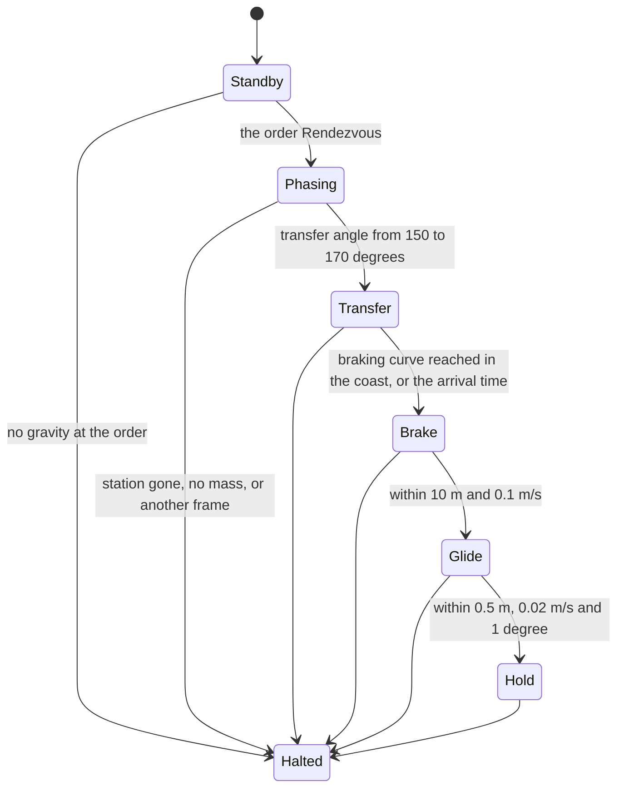
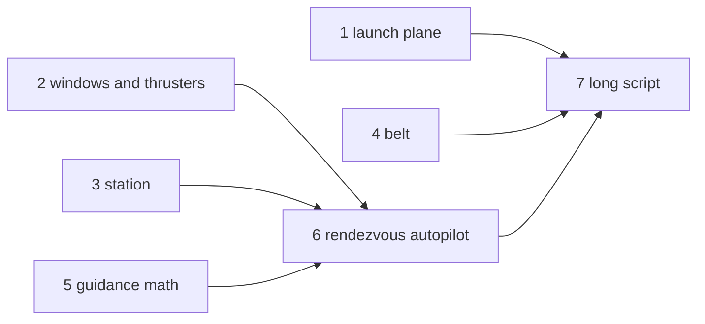
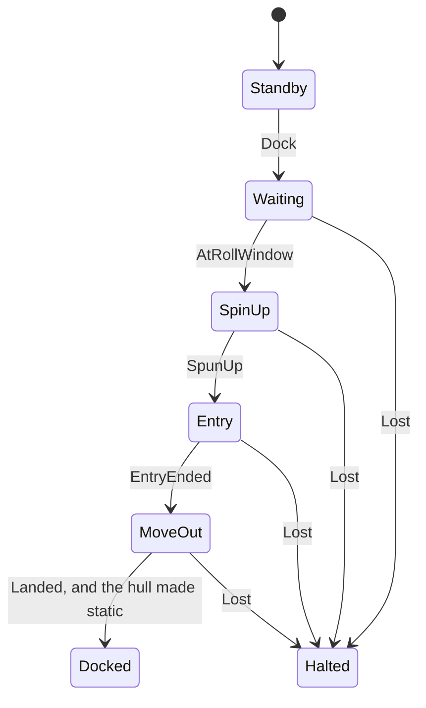
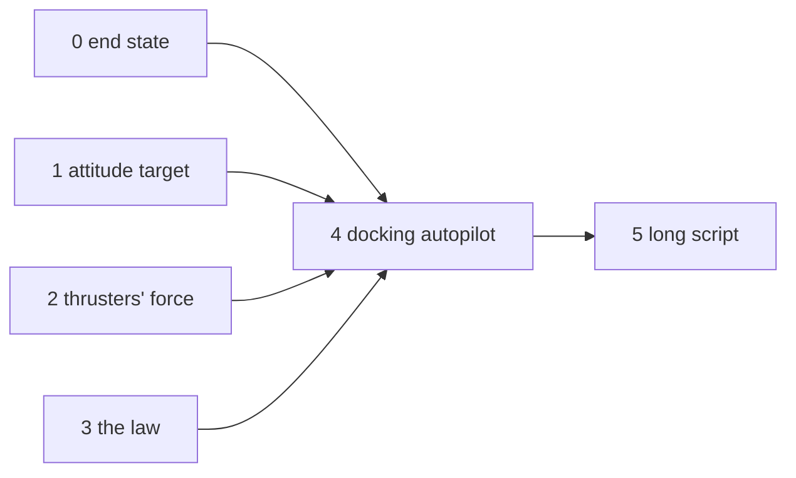
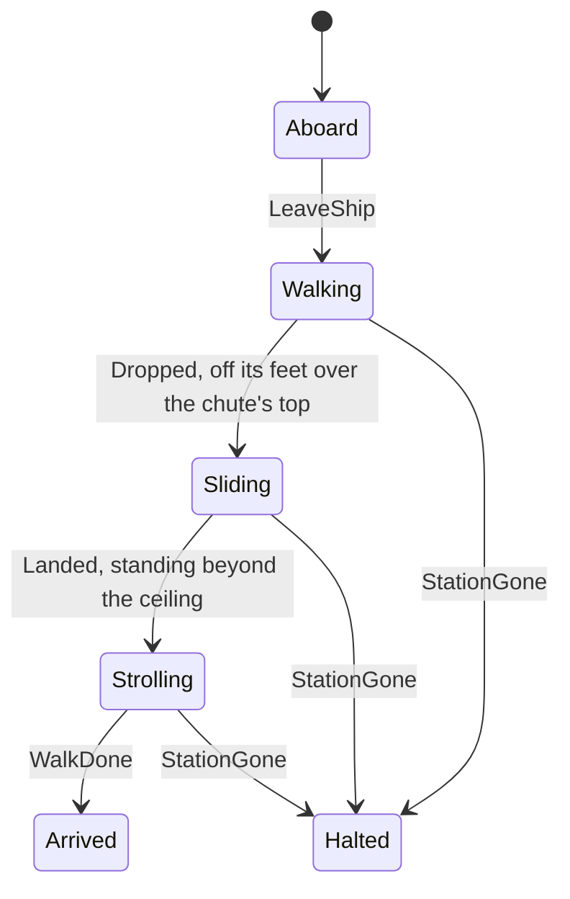
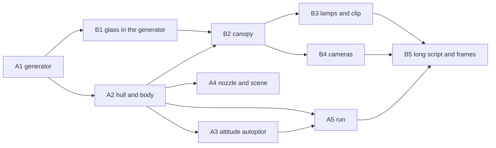
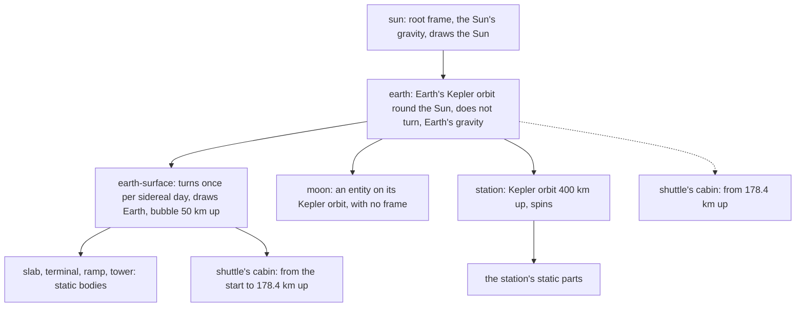
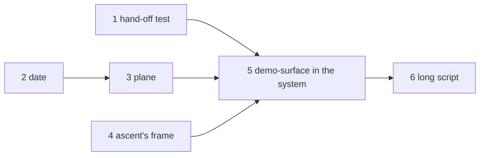
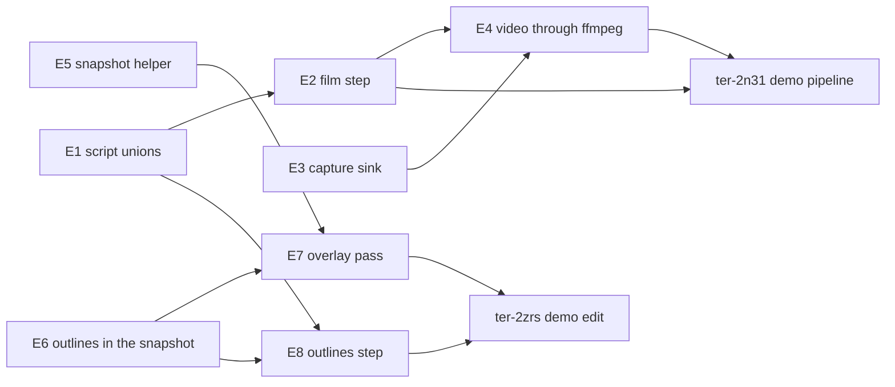
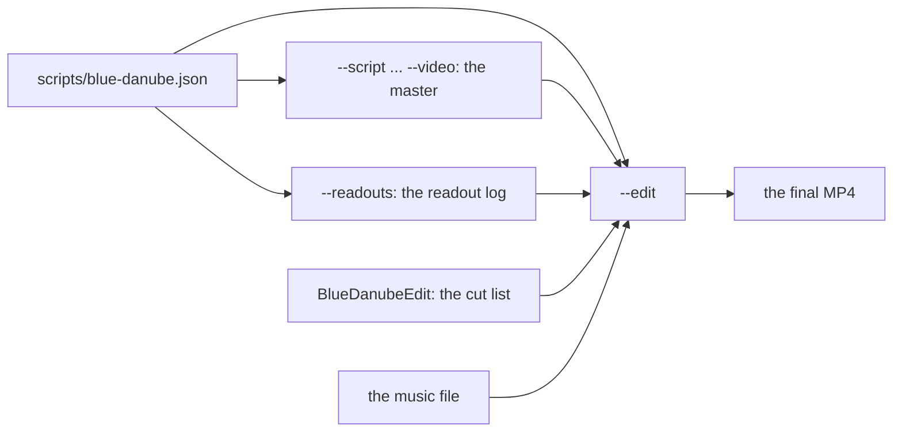

# Blue Danube demo

## Goal

A long demo video of the engine, recorded from one unbroken scripted run with the real renderer. The camera follows one character capsule from a launch terminal on Earth's surface to the outer wheel of a spinning station. The centerpiece recreates the docking sequence from "2001: A Space Odyssey". The graphics are gray-box procedural meshes without textures. The demo shows the physics only, so it adds no sky and no anti-aliasing: the engine is unfinished, and viewers know it (user, 2026-10-18). Title cards and music are added after the run.

## The sequence

1. Earth's surface. Buildings form a launch pad and a boarding terminal. The character walks through the terminal and boards a shuttle.
2. The shuttle launches up a ramp, like a rocket sled, and flies to orbit. In orbit the character becomes weightless by itself, because the ship's frame falls freely. The character leaves its seat and grabs a pen.
3. The shuttle burns again and approaches a large spinning station, seen through its windows. The station has a docking slot on its axis.
4. The shuttle spins up to match the station's rotation, enters the slot, and lands on one side of the docking barrel. Weak spin gravity returns as it moves out to the barrel wall.
5. The character leaves the ship and takes a chute down a spoke to the outer wheel, where it feels full gravity.

## Rules

- The engine runs at its fixed 60 ticks per second for the whole run. The project has no time warp. A time-lapse comes from the capture: the script captures every Nth tick, and the video plays those frames at the normal rate.
- Everything outside the engine is demo work: the scene, demo components, mesh generators, scripts, capture, editing, title cards and music. Every engine change goes to the user first (user, 2026-10-18).
- The music is Johann Strauss II, "The Blue Danube" (1866). The composition is in the public domain. The recording must have a free license, for example a US military band recording or a Musopen recording. Each download needs a yes with its file name, source and size.

## What exists, and what the demo adds

From a survey of the code on 2026-10-18.

| Need | State | Demo work |
|---|---|---|
| Scripts of 100,000 ticks and more | Exists (`scripts/orbit.json` runs about 332,700 ticks). The generator of the long script exists too (ter-2n31, see "The long script"). | Each later part adds its sections to the generator |
| One image per frame | Exists: a `film` step captures every Nth tick (ter-bgk5), and `--video` sends the captures into one lossless video (ter-mln3). A 720p frame of the orbit scene takes 3.5 ms into the video and 80 ms into a PNG file (see change 1, "Measured"). | The generator writes film steps. |
| Video | Exists: `ffmpeg-headless` in the dev shell (ter-mln3) encodes the frames of a headless run | Cut, add title cards and music with ffmpeg. |
| A camera that follows the character | Exists: the camera is an entity, a camera step is a hard cut, and the Demo's `ChaseCamera`, on an entity attached to the character, follows it from behind (ter-2n31, see "The long script") | None |
| Character walking, floating, grabbing | Exists (`MoveCharacter`, `Jump`, grab within 3 m). The pen, its `Clip` and the `Passenger` who takes it exist in the Demo (ter-m13s, see "The launch"). | A path-following walker component. A capsule hides that the rigid form never turns. |
| Seat | Exists: `Shuttle.Seat`, a static box in the shuttle's interior shape, which the demo surface draws (ter-na4f). A character has no sitting pose, so the person stands at `Shuttle.SeatStand`. The `Passenger` component's belt holds the person there while the cabin's gravity would not keep it on its feet (ter-m13s). | None |
| Ground at the pad | Earth's sphere sags about 480 m between vertices | A large static slab under the pad, as in the surface yard, in the turning `earth-surface` over the sphere of `SunAndEarth` |
| Cylinders, rings, tori | Exists: `RevolvedSolid` (ter-fb3w) sweeps a convex profile about an axis into a cylinder, a ring or a torus, with its mesh and a collision shape that matches it. The station's wheel uses it (ter-tzf6). The spokes and the hub are `BoxMesh` tubes and boxes. | The chute of step 6 |
| Ship thrust and steering | Partial: the climb to orbit exists in the Demo (ter-m13s): `MainEngine`, `AttitudeAutopilot` and `AscentAutopilot`, which steers by `AscentGuidance` into the launch plane (see "The launch"). The rendezvous exists too (ter-tzf6): `TranslationThrusters` and `RendezvousAutopilot`, which steers by `TransferGuidance` and `ApproachGuidance` (see "The station and the rendezvous"). So does the docking (ter-ftnj): `DockingAutopilot`, which spins the shuttle up to the station's turn, enters the slot and lands on the deck by `SpinUpProfile` and `ApproachGuidance` (see "The docking"). | None |
| Spin gravity, Coriolis, a ship in a turning frame, characters in a turning frame | Exists (the spin gravity epic `ter-s9m0`, [Spin gravity](spin-gravity.md)): every turning frame gives its contents the centrifugal, Coriolis and Euler terms, characters stand, walk and jump in it, and the scene `spin-station` shows it. | The ship in the turning station, and the autopilots that use it |

## The launch

Step 3 of the sequence, as ticket ter-m13s built it in the Demo, in the scene `demo-surface` and the script `scripts/demo-launch.json`. Nothing in the engine changed.

- The ramp (`DemoScenes.LaunchRamp`) is one static body without friction: a flat bed under the parked shuttle, 2 cm above the slab, so that the hull touches only the greased ramp and never the slab, which has friction, and one straight incline at 30 degrees, 250 m long, from under the shuttle's nose to 125 m up (`LaunchRampTests`). A curved ramp of short planks threw the hull off near 90 m/s: from there the hull moves more than 0.75 of its inner radius in a step, Jolt sweeps it, and the sweep stopped it at each joint. The straight incline has one joint, at its foot, which the hull crosses at about 27 m/s.
- A script posts `Ignition` to the shuttle. Its `AscentAutopilot` unparks the hull with `Self.Body.SetMotion(BodyMotion.Dynamic)` and runs the `MainEngine` at full throttle, 3 g along the nose, with the nose toward the velocity, until the shuttle is 30 m above the ramp's top. Then `AscentGuidance` steers a closed loop to a circle 200 km up: it splits the thrust between the climb and the speed along the track, so that the shuttle reaches the circle's height with no vertical speed when it reaches the circle's speed. It also steers into the launch plane, `DemoSurface.LaunchPlaneNormal`, the plane of the station's orbit, as a real launch flies into the plane of its target (ter-tzf6): it pushes back toward the plane a ship that drifts across it or lies beside it, and never takes thrust from the climb to do so. So the parking orbit lies in that plane (`DemoLaunchTests`, `BlueDanubeRendezvousTests`). The thrust pitches up from the ramp's 30 degrees to about 60, then over, and a little below the horizon at the end. The engine stops when the trim's thrust would fall below the weightless threshold. The autopilot talks to the engine and to the `AttitudeAutopilot` only through its entity's events: in each tick it adds a `Throttle` and an `AttitudeTarget`, which those two components read after it, and a tick without them gives no thrust and no torque (`FlightControlTests`). Its state is the custom union `AscentState`: `Parked`, `Ramp` with the guidance and the launch radius, `Climb` with the guidance, and `Orbit`. In the run of the script, the climb takes 321 s, and the periapsis and the apoapsis lie within 5 km of 200 km (`DemoLaunchTests`), well above the top of the air at 100 km (`DemoScenes.AtmosphereTop`).
- The cabin's weight comes from the frame's derived proper acceleration alone: the weight of the ground on the pad, the ramp's push and the engine's thrust in the climb, and nothing in orbit.
- The person's `Passenger` belt holds it at its seat while the cabin's gravity leans more than 45 degrees from the floor's down or the cabin is weightless: it pushes the person with its mass times the opposite of that gravity, plus a spring and a damper. The foot of the ramp jolts the person by about 0.17 m. Nothing holds the person's up to the seat: it follows the felt gravity in the air at most at the air rate of 1 rad/s, as for every character (`ter-1b21`, [Spin gravity](spin-gravity.md), "Characters"). At the end of the climb the engine throttles down to about 0.2 m/s², the felt gravity leans 14 degrees from the cabin's aft axis toward its ceiling, and the person's head, toward the nose, dips onto the seat, which lifts the person by 67 mm. The belt reads the gravity that the person feels, with the rotation terms of the cabin's turn (`FrameTree.FeltGravity`), which physics applies to a character too. In orbit, after 2 s weightless by that read, the person opens the belt, in the demo launch 5.2 s after the engines stop, once the change of the cabin's turn that the attitude autopilot makes has settled, and floats with thrusters as weak as `PersonControl`'s, so that its hand, in front of its chest (`Passenger.PenHold`), comes onto the drifting pen. The hand first lines up 0.5 m behind the pen, on the line ahead of the person's view, and then closes in along that line, so that the pen comes to the hand from in front and never touches the body. Once the hand is within 2 cm of the pen, the person uses it and takes it as `Carry` takes a crate, and the drawn copy in its hand keeps the place and the turn that the loose pen had relative to the view, so the pen does not jump into the hand. The hand is nearer than `Carry` holds a crate, so that the pen's near end lies just in front of the body: a pen held as far out as a crate read as a pen that floats free. A character does not turn, so the passenger does not plan a way round the pen: in the demo it floats face-down below the pen and well to the side of it, so its straight way from the seat passes clear of the pen, and nothing touches the pen until the take (`DemoLaunchTests`). The passenger's state is the custom union `PassengerState`: `Boarding`, `Seated` with its weightless ticks, `Fetching`, `Holding` with the copy, and `Stopped`, for a pen that goes before the take.
- A `Clip` on the pen holds it on the cabin's port wall, at head height, aft of the seat (user, 2026-10-19). Since ter-4xkz the port wall is glass above the sill, and the clip holds the pen on the wall's pillar at z = -1 m, so the pen never hangs in front of glass. The cabin's four lamps hang on the pillars of the walls, because the roof is glass. While the cabin has weight, the clip steers the pen to its place in every tick (`Self.Body.SteerTo`), so that physics carries it back each step: the weight of a step moves it about 8 mm at three gravities, and the jolt at the ramp's foot drops it about 0.1 m for one step. Once the cabin has been weightless at the clip for 1 s, by the gravity felt there with the rotation terms of the cabin's turn (`FrameTree.FeltGravity`), the clip lets go with a push of 0.2 m/s away from the wall and a slow spin, end over end, at 0.5 rad/s. In the demo launch the clip lets go 2.9 s after the engines stop, once the change of the cabin's turn that the attitude autopilot makes has settled. The pen drifts into the cabin, and nothing touches it until the person takes it 10.6 s later, about 2.1 m from the wall and 2.0 m above the floor (`PenClipTests`, `DemoLaunchTests`). The clip's state is the custom union `ClipState`: `Clipped` with its weightless ticks, or `Released`.
- The script films the launch from cameras that the scene places for each part: `pad-camera` for the parked shuttle and the start up the ramp, `ramp-camera` for the ramp, `ramp-top-camera` for the flight past the ramp's top, `climb-camera` high behind the shuttle for the climb with the ground below, `chase-camera` for the high climb and the orbit, `pen-camera` within 2 m of the pen's way for the pen on the wall, its drift and the person's start from the seat, and `hand-camera` for the hand that closes on the pen and the pen in it. A 14 cm pen seen from the cabin's corners, 6 to 8 m away, shows only a few pixels.
- Under the climb's thrust, the engine turns a character's up against the cabin's gravity, so the belted person tips toward the nose, face toward the floor, and it floats that way in orbit, because a weightless character keeps its last up. Engine ticket ter-yrfa will let a weightless character turn its own up, which will right the person. Until then, the demo leaves the person as the engine's rule puts it (user, 2026-10-19).

## The station and the rendezvous

Ticket ter-tzf6 designs step 4 of "Order of the work", which is item 3 of "The sequence" (2026-10-20). The step is built. Its one engine change is `KeplerOrbit.Propagate` and `KeplerOrbit.Lambert` (see "Engine changes" below). Steps 5 (ter-ftnj) and 6 (ter-y0e5) start where this step ends.

### What the step does

- The station is a wheel 202 m across, on a circle 400 km up, in the plane of the launch. It turns about its axis at 0.31321 rad/s. That rate gives 9.81 m/s² on the wheel's floor, 100 m from the axis. The axis points along the orbit's normal. The docking slot on the axis faces the side of the orbit's plane where the sun shines.
- The climb to orbit now steers into that plane, as a real launch flies into the plane of its target.
- After the person takes the pen, the script tells the person to fasten its belt. The person floats back to its seat with the pen in its hand and straps in. So the burns do not throw it.
- Then the script orders the rendezvous. The shuttle's new autopilot waits about 26 minutes in the parking orbit for its window. Then it burns about 60 m/s onto a transfer of 170 degrees. The transfer reaches the arrival point 2,560 s later, 1,500 m from the station on its axis.
- At the arrival point the shuttle brakes with its main engine and turns its nose to the slot. Then it glides along the axis on translation thrusters to the hold point, 150 m from the station's center. It holds there, outside the station's bubble, and step 5 takes over.
- The shuttle gets windows and translation thrusters. The scene gets cameras that look through the windows at the station.

Terms used in this section:

- The launch plane: the plane through Earth's center that holds the pad's up and the ramp's incline at the departure. The pad's up is +Y of `earth` and of `earth-surface`, and the incline is `LaunchRamp.Up`, in the ground's axes. The plane is fixed in `earth`, which does not turn. Its normal, `DemoSurface.LaunchPlaneNormal`, is `Ŷ × LaunchRamp.Up`, normalized and turned into earth's axes by the departure axes' turn: (0.795, 0, 0.607), which is -X of the departure axes. The parking orbit and the station's orbit lie in this plane.
- The station's axis: the station's own +Y, about which it turns. In `earth` it is (-0.795, 0, -0.607), +X of the departure axes. It stays fixed there, because `earth` does not turn and the station's spin is steady. The slot is on the station's +Y side.
- The arrival point: the point on the station's axis 1,500 m from the station's center, on the slot's side.
- The hold point: the point on the station's axis 150 m from the station's center, on the slot's side.
- The angle along the orbit, φ: the angle about the launch plane's normal from the pad's up toward the ramp's incline at the departure, -Z of the departure axes. The shuttle's φ grows as it flies. The pad is at φ = 0.
- The transfer angle: the angle from the shuttle's position to a target point, seen from Earth's center. It turns about the station's orbit normal, the way that the orbit runs, from 0 to 360 degrees.
- The window: the first tick of the rendezvous at which the transfer angle lies between 150 and 170 degrees. The angle is taken to the arrival point of 2,560 s later.
- The needed velocity: the velocity that puts the shuttle on the two-body path that reaches the arrival point at the arrival time.
- The velocity to gain: the needed velocity less the shuttle's velocity, both in `earth`.
- A target point's relative state: the shuttle's position less the target point's, and the shuttle's velocity less the station's. Both are in `earth`. The axis does not turn there, so a point on the axis moves with the station's center.
- A layer: an autopilot of the flight program. In its tick it adds `Throttle`, `AttitudeTarget` and `Translation` events to the shuttle's events. The ascent autopilot is the first layer and the rendezvous autopilot is the second. The docking autopilot is the third (see "The docking").

### The station

`DemoScenes.DemoStation` holds the station's constants and spawns the station in `demo-surface`. It spawns before the shuttle, because the shuttle's rendezvous autopilot takes the station's entity. The table gives the parts in the station's own axes. +Y is the axis. The angle θ about it runs from +X toward -Z, as `RevolvedSolid` measures it.

| Part | Size | Why | Body and shape | Drawn |
|---|---|---|---|---|
| Wheel floor | A ring from 100 to 101 m from the axis, 20 m wide, from y = -10 to 10 m, in 256 segments | The radius and the rate of the spin station (`SpinStation.FloorRadius`, `SpinStation.Rate`) give 9.81 m/s² on the floor. The person walks there in step 6. The facets are 2.45 m long. | The station's `BodyDesc.InteriorShape`: the exact mesh of the ring, as the note of ter-fb3w asks | The ring's mesh, on the station's own entity |
| Wheel ceiling | A ring from 94.5 to 95 m, 20 m wide | It closes the wheel's tube 5 m above the floor, so the wheel looks closed from outside. Step 6 opens it where the chute ends. | A static body in the station's frame: `RevolvedSolid.Shape`, one hull per segment | Its ring mesh |
| Wheel side walls | Two rings from 95 to 100 m, 0.3 m thick, centered at y = ±9.85 m | They close the tube's sides. The spin station's walls do the same for its floor. | Static bodies, one hull per segment | Their ring meshes |
| Spokes | Four square tubes in the plane y = 0, at θ = 0, 90, 180 and 270 degrees. Each is 4 m on a side outside, with walls 0.25 m thick. | Inside, 3.5 m on a side holds the chute of step 6, a capsule 0.6 m wide. The Coriolis force presses it on one wall (see "Physics notes"). | One static body: a compound of the 16 wall boxes | `BoxMesh` tubes, open at both ends |
| Spoke length | From the hub's outer face, 8.5 m from the axis, to the ceiling's face toward the axis, 94.5 m from it: 86 m | The spoke at θ = 180 degrees lies under the deck, so the chute starts at the deck. | | |
| Hub, the docking barrel | A square tube along the axis, 17 by 26 by 17 m outside, with walls 0.5 m thick. Its half extents are 8.5, 13 and 8.5 m along X, Y and Z. | The bay inside is 16 by 25 by 16 m. Its four inner walls are flat, so the shuttle lands flat on one of them in step 5. The bay holds the shuttle's 16 m with 4.5 m to spare at each end. | One static body: a compound of the wall boxes, with the slot open | A `BoxMesh` box with the slot as an opening, seen from outside and from inside |
| Slot | Through the hub's +Y wall, 6 m along X by 8 m along Z, on the axis | The shuttle's cross-section is 4 m tall and 6 m wide. `DemoStation.SlotClearance`, 1 m, adds room on each side. The shuttle enters with its belly toward the deck, so its height lies along X. | An opening | |
| Slot clearance | | A spin mismatch of 3 degrees moves a corner of the shuttle by 0.19 m. The corner is 3.6 m from the shuttle's axis. The clearance of 1 m holds that. | | |
| Deck | The bay's wall at x = -8 m, the inner face of the hub's -X wall | The landing floor of step 5. Its gravity is ω² × 8 m = 0.785 m/s², about 8 percent of a gravity. That is the weak spin gravity of the sequence. | Part of the hub | |
| Deck under a landed shuttle | | A landed shuttle's cabin floor lies 7.8 m from the axis, at 0.765 m/s². | | |
| Bay lamps | Four glowing panels on the bay's walls, with point lights | The slot glows from inside, as in the film. | Render only | Lamp panels, as in the cabin |

Box openings run along X or Z only (`Opening.ThroughX`, `Opening.ThroughZ`). So the hub's body and mesh are built in the hub's own axes, whose +Z is the station's +Y. The slot is an opening through Z. The hub's child in the hull compound carries the same quarter turn about X, so the deck stays at x = -8 m.

In `earth`, the station's hull is kinematic. Its shape is a compound of three solids. The wheel is a solid ring from 94.5 to 101 m, in 256 segment hulls. The spokes and the hub are solid boxes. The bounding radius of the hull is 101.5 m, at the corner of the wheel's rim. Its mass is 1e7 kg, which a kinematic hull does not use. In its own frame, the station is the floor mesh and the static bodies in the table.

Every part is drawn with `RenderFlags.NoImpostor`, beside `Visible` and `CastsShadow`. An impostor records the view direction in object space (ARCHITECTURE.md, "Impostors"). The spin turns the station 18 degrees a second, so a capture goes stale within a few ticks. The station has about ten thousand triangles, so the geometry costs little. The closed wheel shades its own inside. Step 6 lights the inside with lamps, as the spin station's walls carry lamps.

The frame:

- Bubble: a sphere of 120 m (`DemoStation.Bubble`). It holds the hull's 101.5 m with 18.5 m to spare. So a body enters the frame before it reaches the hull.
- The shuttle's bubble reaches 17.3 m from its center. That is less than half of 120 m, so the shuttle's frame fits in the station's (`FrameBounds.Fits`), as "Physics notes" asks.
- The shuttle's bounding sphere is 8.8 m. It touches the bubble at 128.8 m from the station's center.
- Field: none. The turn alone gives weight inside, as in the spin station.
- Motion: a `KeplerMotion` with the orbit of `DemoStation.Orbit`:

```csharp
new(SemiMajorAxis: OrbitRadius, Eccentricity: 0, Inclination: Math.PI / 2,
    LongitudeOfAscendingNode: -Math.PI / 2 + DemoSurface.GroundTurnAtDeparture,
    ArgumentOfPeriapsis: 0, MeanAnomalyAtEpoch: Math.PI / 2 - Math.Sqrt(EarthMu / (OrbitRadius * OrbitRadius * OrbitRadius)) * OverPadAt, Epoch: 0,
    AxialTilt: DQuaternion.FromAxisAngle(Double3.UnitY, DemoSurface.GroundTurnAtDeparture) * DQuaternion.FromAxisAngle(Double3.UnitZ, -Math.PI / 2),
    SpinRate: SpinStation.Rate, SpinPhaseAtEpoch: 0, Attitude: KeplerAttitude.Spin)
```

where

- `OrbitRadius` = `DemoScenes.OrbitRadius`, 6,771 km from Earth's center: Earth's mean radius plus 400 km.
- `Inclination`, `LongitudeOfAscendingNode` = the turns that put the orbit's normal on the launch plane's normal, -X of the departure axes. The node is the old -π/2 turned by `DemoSurface.GroundTurnAtDeparture`, 142.6 degrees, the ground's turn at the departure. At mean anomaly 0 the station is at +Z of the departure axes and moves toward +Y. At mean anomaly 90 degrees it is over the pad and moves along -Z of the departure axes, the way that the ramp points at the departure.
- `Math.Sqrt(EarthMu / OrbitRadius³)` = the orbit's mean motion, 1.13316e-3 rad/s.
- `OverPadAt` = the world time at which the station passes over the pad: 38 s, `DemoStation.DepartureLead`, 18 s, after the departure. It sets the launch window. "The orbits, the window and the times" derives it.
- `AxialTilt` = the quarter turn about Z that takes the station's +Y to +X, then the turn by `GroundTurnAtDeparture` about earth's +Y. So the station's +Y lies along +X of the departure axes, the slot's side. The spin turns about that axis, so the axis stays fixed in `earth`.
- `SpinRate` = 0.31321 rad/s, one turn in 20.1 s.

The spawn carries the first motion intent of the orbit (`FirstMove`), as `Station.Build` does. It holds the pose, the velocity and the angular velocity of the orbit at the world's time. So the frame is on its rails and turns from its first step. Its proper acceleration is exactly zero, because a Kepler frame in a parent that does not turn falls freely (ARCHITECTURE.md, "How a frame moves"). The hull moves fast, so it lives in a following frame of its own (ARCHITECTURE.md, "Numeric frames"), as the orbiting station's hull does.

The orbiting station of ter-dhkf is the analogue of the frame and the hull: a Kepler frame whose kinematic hull carries an interior. The spin station is the analogue of the turn, the floor mesh and the first motion intent. The orbit stays in `earth`, and the spin lives in the orbit's attitude. A Kepler orbit inside a turning parent turns with the parent. So this is the one rails form in which a frame both orbits and spins.

Why the axis points along the orbit's normal:

- The axis is fixed in `earth`, which does not turn. Of the directions fixed there, only the orbit's normal also stays fixed relative to the station's local vertical.
- So the arrival point, the glide and the hold keep one place relative to Earth. Earth lies below the line of sight from the shuttle to the station for the whole approach, as in the film.
- The sun's direction in the departure axes is (0.557, 0.398, 0.729). The slot's face has the normal +X of the departure axes, so it takes the sun at 56 degrees from its normal on every orbit. The shuttle on that side sees it lit.

### The launch plane

Today the climb does not hold its plane. Dumps of the launch on 2026-10-20 show this. The climb ends 0.17 degrees out of the plane of its launch, with a speed of 22.9 m/s across it. That speed builds up through the whole climb, at about 0.07 m/s².

That puts the parking orbit up to 19.7 km to the side of a station in the launch plane. Where the window falls, the shuttle is 17 km to the side. From there, a transfer of 170 degrees costs about 116 m/s more at the burn. That is as much as the whole transfer.

So `AscentGuidance` gets the launch plane's normal and a third part, across the plane. It already has a vertical part and a part along the track. The cross part takes the law of the vertical part: it reaches the plane with no speed across it at the end of the time to go. The track is now the direction in the plane across the up. So the part along the track no longer keeps a speed across the plane.

```
up = r / |r|,   track = (normal × up) / |normal × up|,   side = up × track
across = r · normal,   acrossSpeed = v · normal,   alongTrack = v · track
timeToGo = max((CircleSpeed - alongTrack) / MaxAcceleration, ShortestTimeToGo)
vertical = 6 (OrbitRadius - |r|) / timeToGo² - 4 (v · up) / timeToGo + Mu / |r|² - (alongTrack² + acrossSpeed²) / |r|,   at most ±MaxAcceleration
acrossPlane = -6 across / timeToGo² - 4 acrossSpeed / timeToGo,   at most ±sqrt(MaxAcceleration² - vertical²)
horizontal = min(sqrt(MaxAcceleration² - vertical² - acrossPlane²), max(0, (CircleSpeed - alongTrack) / TrimTime))
acceleration = up · vertical + side · acrossPlane + track · horizontal
```

where

- `r`, `v` = the shuttle's position and velocity in `earth`, from Earth's center. The ascent autopilot reads them in the frame of its `LaunchPlane`, which does not turn.
- `normal` = `DemoSurface.LaunchPlaneNormal`, in earth's axes, -X of the departure axes. The scene gives it to the ascent autopilot. It is the plane's prograde normal, so `normal × up` points the way that the shuttle flies.
- `track` = the unit direction in the plane across the up, the way that the shuttle flies.
- `side` = the part of `normal` across the up, as a unit vector. The cross part pushes along `side`, not along `normal`: beside the plane, the up leans from the plane by `across / |r|`, so `normal` is not quite across the up. `up`, `track` and `side` are orthogonal, so the three parts share the thrust exactly.
- `across` = how far the shuttle is from the launch plane, in meters.
- `acrossSpeed` = how fast the shuttle moves across the launch plane, in m/s.
- `alongTrack` = the speed along the track in the plane, in m/s.
- `CircleSpeed`, `MaxAcceleration`, `ShortestTimeToGo`, `TrimTime`, `OrbitRadius`, `Mu` = as today.

The vertical part comes first, then the part across the plane, then the part along the track. `Reached` does not change. The climb lasts 321 s. The cross part takes out its drift of 0.07 m/s² with a few hundredths of a degree of the thrust. The test of the launch requires the parking orbit within 100 m of the plane, and slower than 0.1 m/s across it. The cue of every section stays the same. But the climb changes a little, so the script is written again.

### The orbits, the window and the times

The numbers below come from the dumps of the launch on 2026-10-20, with the insertion moved into the launch plane. They use a two-body model with Earth's G·M. At the insertion, 340.5 s into the run, the shuttle is 199.98 km up, at φ = 11.06 degrees, at 7,788 m/s.

| Quantity | Value | Arithmetic |
|---|---|---|
| Parking orbit | 6,571 km from Earth's center. n₁ = 1.18528e-3 rad/s, one turn in 5,301 s (88.4 min). | n = sqrt(μ / r³) |
| Station's orbit | 6,771 km. n₂ = 1.13316e-3 rad/s, one turn in 5,545 s (92.4 min). 7,673 m/s. | |
| How fast the shuttle gains on the station | 5.213e-5 rad/s, 0.179 degrees a minute, once in 33.5 h | n₁ less n₂ |
| A Hohmann transfer, for comparison | 2,711 s and 115.9 m/s (58.2 + 57.7). At the burn, the station is 4.0 degrees ahead. | Half a turn of an orbit of 6,671 km, T = π sqrt(a³ / μ) |
| The chosen transfer | 170 degrees in 2,560 s, the time of the cheapest transfer of 170 degrees between the two circles | A scan of Lambert solutions over the time of flight, in steps of 10 s |
| Cost of the chosen transfer | 119.5 m/s (60.0 + 59.6) in the run's geometry. About 10 m/s at each end turns the plane to reach the arrival point 1.5 km to the side. | |
| Transfer orbit | 199.3 by 400.5 km | |
| Station at the insertion | φ = 19.6 degrees, 8.6 degrees ahead of the shuttle | n₂ × (340.5 s less 38 s), in degrees |
| Transfer angle at the order, at about 366 s | 174.7 degrees | |
| The window | 170 degrees, 1,578 s after the order. That is about 1,944 s into the run, 27 minutes after the insertion. The shuttle is at φ = 120 degrees. | The angle falls at 0.179 degrees a minute. |
| Arrival | 1,944 + 2,560 = 4,504 s, at φ = 290 degrees | |
| Velocity relative to the station at the arrival | 59.7 m/s: 57.8 m/s slower along the orbit, 11.2 m/s up, and 9.6 m/s across the plane | |
| Brake | It starts about 740 m before the arrival point, 12 s before the arrival time. It stops the shuttle there in about 24 s. | 59.7² / (2 × 2.4) |
| Glide | 1,350 m along the axis in about 350 s, at 5 m/s at most | A model of the law below, with the two-step lag of the thrust |
| Hold | Reached about 4,870 s into the run, at 81 minutes | |

Why 170 degrees:

- A Hohmann transfer turns half an orbit. At exactly 180 degrees, the plane of the transfer is not defined.
- An arrival point 1.5 km to the side of the orbit's plane tilts the plane of a transfer near 180 degrees steeply. At 175 degrees, the turn across the plane costs about 20 m/s at each end. At 180 degrees the cost has no bound.
- At 170 degrees it costs about 10 m/s. The whole transfer costs 3 percent more than Hohmann's.

Why the window falls at φ = 120 degrees:

- The light decides. With the sun's direction of "The station's plane", the shuttle at 200 km is in Earth's shadow from φ = 45.8 to 191.5 degrees. The station at 400 km is in Earth's shadow from φ = 52.7 to 184.6 degrees.
- A transfer that starts right after the insertion arrives at about φ = 190 degrees, at the end of Earth's shadow.
- With the window at 120 degrees, in the night, the shuttle arrives at 290 degrees. There the sun stands 55 degrees above the station's horizon (55.1 measured on 2026-10-20, `TheArrivalFallsInSunlight`). The part of Earth's limb that the shuttle sees below the station is lit.
- The glide and step 5 run on toward φ = 330 degrees, where Earth's limb is lit best.
- The cost is a coast of 26 minutes in the parking orbit, which a real rendezvous flies too. The burn falls in Earth's night, so the film shows it from the cabin (see "Sections of the long script").

How `OverPadAt` sets the window:

- The window opens at the tick where the station's lead over the shuttle shrinks to 3.8 degrees, the lead of the chosen transfer. The station moves 166.2 degrees in 2,560 s, and 166.2 + 3.8 = 170.
- One second more of `OverPadAt` puts the station 0.065 degrees further back. That opens the window 22 s earlier and 1.5 degrees earlier along the orbit.
- The builder of the station sets `OverPadAt` from the rehearsal. The aim is a window at φ between 115 and 125 degrees. The model gives 38 s, and the run test pins the range.

Measured in the run of the checked-in script on 2026-10-20 (`BlueDanubeRendezvousTests`), with `OverPadAt` at the model's 38 s, after the docking's ticket (ter-ftnj) gave the attitude target a float turn rate and the translation thrusters 30,000 N per axis:

- The window opens 1,954.5 s into the run, with the shuttle at φ = 120.6 degrees. The float turn rate changes the climb a little, so the window opens 4 s later than before.
- The burn, the trim and the brake change the shuttle's velocity by 119.5 m/s, the integral of the cabin's proper acceleration, within 10 percent of the two-body cost of the transfer.
- The brake starts 4,502.1 s into the run, at φ = 289.8 degrees, with the shuttle 59.6 m/s fast relative to the station. It ends 23.8 s later.
- The glide takes 340.8 s, and the hold starts 4,866.6 s into the run, at 81 minutes.

### If the insertion changes

The autopilot measures every state from the run and solves every burn from it. It keeps no number from a rehearsal.

- Radius, eccentricity and plane: the transfer is a Lambert solution from the shuttle's measured position and velocity to the arrival point. The arrival point comes from the station's measured position and velocity.
- The parking orbit can be a few kilometers higher or lower, a little oval, or a little out of the plane. That changes only the velocity to gain, by a few m/s. Today the insertion lies within 5 km of 200 km (`DemoLaunchTests`).
- Phase and time: the window waits for the measured transfer angle. An insertion 1 s late puts the shuttle 0.07 degrees further back. That opens the window about 22 s later, and moves the arrival 1.5 degrees further along the orbit.
- A change of 10 s either way keeps the arrival between φ = 275 and 305 degrees, where the light still works. A larger change fails the run test's range for the window, and the builder sets `OverPadAt` again.
- A late order: the transfer angle at the order can already lie between 150 and 170 degrees. Then the window opens at once, and the transfer costs a few m/s more.
- An order after the window: below 150 degrees, the autopilot waits for the next window, 33.5 h later. The generator then stops at that section's limit and names the section.
- The burns are finite, about 32 s, and the thrust acts two steps after the read. The guidance solves again in every tick from the state that the last step left. So neither error lasts.

### The rendezvous autopilot

#### Layers

The flight program is a stack of layers on the shuttle. The actuators follow the last layer that speaks. `MainEngine` and `AttitudeAutopilot` already take the last `Throttle` and the last `AttitudeTarget` of a tick. Their documentation says that a component that runs later overrides one that runs earlier. The layers get explicit priorities in the order of the flight, and the actuators run after all of them.

| Component | Priority | What it adds |
|---|---|---|
| `AscentAutopilot` | 0 | In its `Orbit` case, an `AttitudeTarget` with the nose along the velocity, in every tick while the shuttle's frame has point gravity |
| `RendezvousAutopilot` | 1 | Nothing in `Standby` and `Phasing`. From the window on, an `AttitudeTarget` in every tick. It adds a `Throttle` in the ticks of a burn, and a `Translation` in the ticks that its translation thrusters push. |
| `DockingAutopilot` | 2 | From the spin-up to the landing, an `AttitudeTarget` and a `Translation` in every tick (see "The docking"). |
| `AttitudeAutopilot`, `MainEngine`, `TranslationThrusters` | 10 (today 1) | They read what the layers added. |

An active layer adds an `AttitudeTarget` in every tick. So the target of a layer before it never reaches the attitude autopilot. Before the rendezvous, only the orbit case of the ascent autopilot writes a target, and it writes no throttle. So a tick in which the rendezvous adds no throttle runs no engine. The ascent autopilot stays as it is. It holds the orbit's attitude until the window.

#### The translation thrusters

The shuttle has only its main engine, along the nose. The brake must push along the orbit while the station lies to the side. The glide must push toward and away from the station while the nose looks at it. So the shuttle gets translation thrusters, a new demo component that matches `MainEngine`:

- `Translation`, an event payload: `Force`, a `Double3` in newtons, in the axes of the entity's frame.
- `TranslationThrusters(maxThrust)` acts in each tick that brings a `Translation`. It turns the force into the hull's axes and limits each axis to ±`maxThrust`, as jets along each axis do. Then it turns the force back and adds it with `self.Body.AddForce`.
- It reads the hull's rotation in `self.Frame`, as the main engine reads its nose.
- A tick without a translation gives no force. The last translation of a tick counts.
- A force that is not finite makes it throw `ArgumentOutOfRangeException`, which the world logs. It then pushes nothing.
- `Shuttle.TranslationThrust` = 30,000 N per axis, 1.5 m/s² for the shuttle's 20 t. This step gave them 4,000 N. The docking raised the force for every law, because its move out needs up to 1.2 m/s² on one axis (see "The translation thrusters' force").

#### The phases

`RendezvousState` is a custom C# 15 union, like `AscentState`, with one record per case. Each case holds the data that it needs, so no case reads a value that only another case sets. The default value is `Standby`. The passenger's union already has cases named `Holding` and `Stopped` in the same namespace, so the rendezvous names its last cases `Hold` and `Halted`.

| Case | Data | What the autopilot does | Next case |
|---|---|---|---|
| `Standby` | None | It adds nothing. | A `Rendezvous` order arrives: `Phasing`. The autopilot builds its guidance then, as the ascent autopilot does at the ignition. |
| `Phasing(Transfer)` | The transfer guidance | It adds nothing, so the orbit attitude of the ascent autopilot flies on. | The transfer angle lies between 150 and 170 degrees: `Transfer`, with the arrival time 2,560 s from now |
| `Transfer(Transfer, ArrivalTime)` | The transfer guidance, and the arrival time in the world's seconds | It burns and trims onto the Lambert path that reaches the arrival point at the arrival time. In the coast at its end, it solves nothing more. | In the coast, the braking curve reaches the shuttle, or the arrival time comes: `Brake` |
| `Brake(Approach)` | The approach guidance of the brake | It stops the shuttle at the arrival point with the main engine. | The shuttle is within 10 m of the arrival point and slower than 0.1 m/s relative to the station: `Glide` |
| `Glide(Approach)` | The approach guidance of the glide | It turns the nose to the slot. It flies the shuttle along the axis to the hold point on the translation thrusters. | Distance, speed and nose are within the hold's tolerances (see "Tolerances and the end state"): `Hold` |
| `Hold(Approach)` | The approach guidance of the glide | It holds the shuttle at the hold point, with its nose at the slot. | None. The layer of step 5 overrides it. |
| `Halted` | None | It adds nothing more. | None |

The guidance takes Earth's G·M from the point gravity of the shuttle's frame (`KeplerOrbit.MuFrom`). The autopilot goes to `Halted`, and logs the reason once, in these cases (a hull without mass is a fourth, as for the ascent autopilot):

- The station is gone.
- The shuttle's frame has no point gravity to fly in.
- The shuttle is no longer in the frame that holds the station, as after a hand-off into the station's bubble in step 5, or before the hand-off of the climb out of the turning `earth-surface`. The laws below hold only in a frame that does not turn, and `earth` is one.



#### Reads and writes, and their frames

Every read is in `self.Frame`, the frame of the shuttle's hull, which is `earth` after the hand-off of the climb, 178.4 km up, and does not turn:

- The shuttle's position and velocity: `self.PoseIn(self.Frame)` and `self.VelocityIn(self.Frame)`.
- The station's position, rotation and velocity: `self.Snapshot.TryGetPoseIn(station, self.Frame)` and `TryGetVelocityIn(station, self.Frame)`. The station's axis is its rotation applied to +Y.
- Earth's G·M: from the point gravity of `self.Frame`, once, at the order.

Both the shuttle and the station own frames. A frame and its owner are one entity: the frame tree row is exact, and the float transform row is filled from the frame's last step record (`World.MirrorFrameOwners`). That record keeps the instant velocity (ARCHITECTURE.md, "Rails components and motion intents"). So the two velocities mean the same thing. Their difference has no bias of half a step of gravity. The pods of the orbiting station's scene are plain bodies. Their reads are Jolt's chords, and they read 7 cm/s off for that reason.

Every write is relative to `self.Frame`, in its axes: the rotation of the `AttitudeTarget`, the force of the `Translation`, and the main engine's push along the nose. The tick reads the state at the end of the last finished step. Its pushes act in the step of the next tick, two steps late, as for the ascent autopilot. Every time constant below is 0.5 s or longer, 30 steps, so the lag costs little.

#### The transfer guidance

The two-body math lives in `KeplerOrbit`, in Core. The user's rule for the rails library makes two-body math with no orbit elements a static method of `KeplerOrbit`, and the user chose that this rule holds here too (user, 2026-10-20). It is the one engine change of this step (see "Engine changes"). The analogue is `KeplerOrbit.Chord`, which also takes a state and G·M:

- `KeplerOrbit.Propagate(position, velocity, mu, time)`: the state after `time` seconds on a two-body path, as `StateAt` gives it, a position and a velocity. It uses the universal variable and Stumpff's functions, with Newton's method. The method keeps bounds on the solution and halves them where a step of Newton's leaves them or gains too little, as on a hyperbola over days. It refuses a hyperbola over more than about 1e28 s, where it does not converge. The station moves on exactly such a path, so the propagation of its measured state equals its rails to the rounding.
- `KeplerOrbit.Lambert(from, to, timeOfFlight, mu, normal)`: the velocities at both ends of the two-body path from `from` to `to` in `timeOfFlight`. The path turns about `normal` through the angle from `from` to `to`, measured that way from 0 to 360 degrees, in less than one revolution. So above 180 degrees it runs the long way.
- `Lambert` uses the universal-variable method of Bate, Mueller and White (Curtis, algorithm 5.2). It finds the variable z by bisection, over a single revolution. It refuses a transfer angle within 1 degree of 0 or 180 degrees, where the plane of the path is not defined, and a time of flight faster than its search covers: a hyperbola whose anomaly turns by more than 2π.
`TransferGuidance(Mu)` is a record struct of the demo, like `AscentGuidance`. It holds Earth's G·M for the two calls, and the guidance of the transfer below. Its one member of geometry is:

- `TransferAngle(from, to, normal)`: the angle from `from` to `to` about `normal`, from 0 to 2π.

In each tick of `Phasing`:

```
arrival = KeplerOrbit.Propagate(stationPosition, stationVelocity, Mu, TransferTime).Position + axis · ArrivalDistance
angle = TransferAngle(shuttlePosition, arrival, orbitNormal)
```

where

- `stationPosition`, `stationVelocity` = the station's center and velocity in `earth`.
- `shuttlePosition` = the shuttle's center in `earth`.
- `TransferTime` = 2,560 s. `ArrivalDistance` = 1,500 m.
- `axis` = the station's axis in `earth`.
- `orbitNormal` = the station's orbit normal, `stationPosition × stationVelocity`, normalized.
- `angle` = the transfer angle. The window is open while it lies between 150 and 170 degrees.

In each tick of `Transfer`:

```
timeLeft = ArrivalTime - time
arrival = KeplerOrbit.Propagate(stationPosition, stationVelocity, Mu, timeLeft).Position + axis · ArrivalDistance
(needed, atArrival) = KeplerOrbit.Lambert(shuttlePosition, arrival, timeLeft, Mu, orbitNormal)
toGain = needed - shuttleVelocity
push = toGain / TrimTime, at most BurnAcceleration long
```

where

- `time` = the time at the end of the last finished step, `self.TimeAt(self.Tick)`.
- `needed` = the needed velocity now.
- `atArrival` = the shuttle's velocity at the arrival point, on that path.
- `toGain` = the velocity to gain.
- `TrimTime` = 4 s, as `AscentGuidance.TrimTime`, so the thrust of the burn falls in its last seconds.
- `BurnAcceleration` = 3 m/s², a throttle of about 0.10. So the departure burn lasts about 32 s: the push stays at the cap of 3 m/s² for about 16 s, until about 12 m/s is left to gain, and the trim time then takes the rest, as the push falls with the velocity to gain.

The transfer runs in three modes:

- The burn: `toGain` is longer than 0.1 m/s. The nose turns toward `toGain`. The throttle is the part of `push` along the nose, never below 0, times the mass, over the engine's full thrust. The translation thrusters take the rest of `push`.
- 0.1 m/s is `TransferGuidance.SpeedTolerance`, the speed that the trim takes in 4 s at half the weightless threshold. So the trim's push is at most 0.025 m/s², and the cabin stays clearly weightless through the trim. A strapped person floats there in the rigid form of a character, which keeps its up. At a push of the threshold itself, a person who touches its seat walks again and turns its up to the push at once. The first value was 0.2 m/s, `AscentGuidance.SpeedTolerance`, the speed that the trim takes in 4 s at the threshold. The trim's first push then came to 0.0499 m/s², at the threshold to the rounding. The burn's thrust now leaves the cabin weightless about 3 s before the burn ends, at a throttle of about 0.001 (ter-tzf6, 2026-10-20).
- The trim: `toGain` is 0.1 m/s or shorter. Only the translation thrusters trim it, with `toGain / TrimTime`. The nose turns toward the brake's direction at the plan's weightless turn rate, so the brake starts after only a small turn.
- In the trim and the coast, the nose turns at most at the plan's `RendezvousPlan.WeightlessTurnRate`: 0.002 rad/s in the demo's plan, and the full 0.15 rad/s in the short test plan, whose shuttle carries no crew and must turn within its 300 s. Each `AttitudeTarget` carries the fastest turn that its layer allows, `MaxTurnRate`, and the attitude autopilot asks for at most that and its own 0.15 rad/s. A turn of the hull gives the crew a felt gravity: the centrifugal term ω² r, and the Euler term while the attitude autopilot brings the hull to its rate in a third of a second, 3 ω r. At the seat, 4 m from the hull's center, the Euler term of 0.002 rad/s is 0.024 m/s², less than half the threshold. At 0.15 rad/s, the turn of 160 degrees from the burn's nose to the brake's direction gave about 0.1 m/s² there. That put the strapped person into the walking form, and its up turned at the air rate to about 155 degrees from the nose: on its side, with its body over the pen. At 0.002 rad/s the turn takes about 1,400 s of the trim's 2,450 s, and the person keeps the up of the burn, with its head toward the nose (`BlueDanubeRendezvousTests`).
- The brake's direction is the opposite of the shuttle's velocity relative to the station at the arrival point: `atArrival` less the station's propagated velocity.
- The coast: the autopilot solves nothing more in the last 60 s before the arrival time, `TransferGuidance.CoastTime`, or where the transfer angle from the shuttle to the arrival point lies within 2 degrees of 0, `TransferGuidance.CoastAngle`, whichever comes first. `TransferGuidance.Coasts` decides it in each tick, from the same arrival point that `Steer` solves for. A short transfer turns a small miss into a large velocity to gain. The nose turns against `u`, the velocity relative to the station, at `RendezvousPlan.WeightlessTurnRate`.
- Why the coast has an angle too: the transfer angle left falls as the transfer goes on, and Lambert's problem refuses an angle within 1 degree of 0. In the demo's orbits, the shuttle turns about 4 degrees in the last 60 s, so the coast by the time comes first. In a slower orbit, the angle falls below 1 degree earlier. A geostationary station turns only 0.25 degrees a minute. There the steering threw and logged an error in every tick from about 240 s before the arrival to the coast (ter-lz8u, 2026-10-20). 2 degrees, twice the refused angle, keeps a degree of margin, so the rounding of the two angles never reaches the refusal.
- Why not a guard on the plan: the angle at which the coast starts depends on the orbits, not on the plan alone. A plan holds no G·M and no orbit, so a guard in `RendezvousPlan` cannot see the case. The coast by the angle covers every plan with one rule: the guidance solves nothing more where Lambert's problem is close to its refusal, in time or in angle. The transfer's angle only falls, from a window below 179 degrees, so the coast never needs the refusal near 180 degrees.
- With the trim, the shuttle reaches the arrival point within about 12 m. The trim lasts about 2,450 s, and it holds the velocity to gain below 5 mm/s.

The transfer ends in the coast at the braking curve, where `sqrt(2 × 2.4 m/s² × d)` is no more than `|u|`. Here `d` is the distance to the arrival point and `u` the velocity relative to the station. It also ends at the arrival time. The test holds only in the coast: earlier, the shuttle is thousands of kilometers from the arrival point, where `|u|` (about 15 km/s at the window) exceeds the curve's speed (about 8 km/s), and the relative motion is not that of a free mass. The brake starts about 12 s before the arrival time, well inside the coast of 60 s. In the coast, the nose turns against `u`, which differs from the brake's direction of the last solution by 0.15 degrees. At about 3,300 s the brake's direction passes 9 degrees from straight down, and the roof, away from Earth across the nose, swings about the nose there. At the slow turn rate the nose catches up only slowly afterward: it lies 2.9 degrees off the brake's direction when the coast starts, and 2.1 degrees off `-u` when the brake starts.

#### The approach guidance

`ApproachGuidance(BrakeAcceleration, SpeedCap, FinalRate, VelocityTime, MaxAcceleration)` is one law for the brake, the glide and the hold, and since the docking for the docking too. It flies the shuttle to a point fixed to the station and stops it there. It cancels a free acceleration that the caller gives it. The rendezvous gives the difference of Earth's gravity between the shuttle and the station's center, with Earth's G·M read from the point gravity of its frame in each tick. So the shuttle moves relative to the point as a free mass in empty space does, and a simple law flies it exactly. The docking's design changed the law in two ways: the free acceleration became a parameter, and the cap takes only the correction (see "The docking", "The law").

```
x = shuttlePosition - target,   d = |x|
u = shuttleVelocity - stationVelocity
wanted = -(x / d) · min(SpeedCap, sqrt(2 BrakeAcceleration d), FinalRate d)
correction = (wanted - u) / VelocityTime,   at most MaxAcceleration long
push = correction - (g(shuttlePosition) - g(stationPosition))
g(r) = -Mu r / |r|³
```

where

- `target` = the target point in this tick: the station's center plus the point's distance along the axis.
- `wanted` = the velocity relative to the station that the law asks for.
- `push` = the acceleration that the shuttle's thrust must give, in m/s².
- `g` = the point gravity of Earth.

The target is the arrival point for the brake, and the hold point for the glide and the hold. The wanted velocity points toward the target. Its speed is the least of three limits:

- The speed cap.
- The speed that stops the shuttle at `BrakeAcceleration` in the distance left.
- Near the target, `FinalRate` times the distance, as the passenger's float slows (`Passenger.ApproachRate`).

The difference of gravity is 1.9e-3 m/s² at 1.5 km to the side of the orbit. At the hold point it is 1.9e-4 m/s², about 4 N for the shuttle.

| Phase | Target | `BrakeAcceleration` | `SpeedCap` | `FinalRate` | `VelocityTime` | `MaxAcceleration` | Thrust | Nose |
|---|---|---|---|---|---|---|---|---|
| `Brake` | Arrival point | 2.4 m/s², 80 percent of the burn's, so the law has room to follow its curve | None | 0.5 /s | 0.5 s | 3 m/s² | The main engine along the nose, and the translation thrusters for the rest | Along `push` |
| `Glide`, `Hold` | Hold point | 0.05 m/s² | 5 m/s | 0.1 /s | 2 s | 0.2 m/s² | The translation thrusters only | Toward the slot, along minus the axis |

In every phase that steers, the roof turns away from Earth across the nose, as the ascent autopilot turns it. The target comes from `AttitudeAutopilot.Facing`, with the shuttle's position as the roof. In the glide and the hold, the roof points exactly away from Earth, because the axis lies across the vertical. The turn from the brake's nose to the slot is about 100 degrees about the roof. At the attitude autopilot's 0.15 rad/s it takes about 12 s, while the thrusters already push along the axis.

#### Tolerances and the end state

| Phase | Tolerance |
|---|---|
| Window | The transfer angle lies from 150 to 170 degrees. |
| End of the burn | The velocity to gain is below 0.1 m/s. The trim then holds it below 5 mm/s. |
| Start of the coast | 60 s before the arrival time, or where the transfer angle left falls within 2 degrees of 0, whichever comes first. The demo's plan and the short test plan reach 60 s first, at about 4 degrees. |
| Miss at the arrival time | Within 100 m of the arrival point (about 12 m expected) |
| End of the brake | Within 10 m of the arrival point, and slower than 0.1 m/s relative to the station. At 0.5 m/s, the glide inherits up to 0.5 m/s across the axis: its push is capped at 0.2 m/s² as a whole, and the speed of 5 m/s that it wants along the axis takes nearly all of it, so the drift across the axis reached 5.6 m on the short test plan. At 0.1 m/s it stays within 1.7 m. |
| Glide | Within 5 m of the axis all the way |
| Hold | Within 0.5 m of the hold point, slower than 0.02 m/s, and the nose within 1 degree of minus the axis |

The end state, for step 5:

- The shuttle holds at `DemoStation.HoldPoint`, 150 m from the station's center on its axis, on the slot's side, in `earth`.
- Its nose points at the slot, and its roof away from Earth. It does not turn relative to the stars.
- Its bounding sphere lies 21 m outside the station's bubble, and its own bubble 12.7 m outside it. So no bubble holds the other, and no ghost crosses between them.
- The rendezvous autopilot stays in `Hold`. It keeps the shuttle there until a later layer speaks.

Why the hold point lies outside the bubble:

- Inside the station's frame, the shuttle's reads and writes are in axes that turn at 0.31321 rad/s.
- In those axes, a shuttle that does not turn relative to the stars turns backward at that rate. That is faster than the attitude autopilot's limit of 0.15 rad/s, so the attitude autopilot cannot hold it there.
- Outside the bubble, step 5 can spin the shuttle up to the station's rate. The shuttle then enters at rest in the station's axes, and every read in its new frame stays still.

### The passenger through the burns

In a burn of 3 m/s², a person who floats in the cabin falls onto the aft wall. So the script tells the person to fasten its belt before it orders the rendezvous. The `Passenger` gets one order and two cases:

- `FastenBelt`: an event with no payload that a script posts, as it posts `Ignition`. A passenger in `Holding` takes it. In every other case it changes nothing.
- `Returning(Copy)`: the passenger floats its center back to `Shuttle.SeatStand`, with the thrusters and the law of its fetch. Its speed toward the seat is at most `FloatSpeed`, 1 m/s, and `ApproachRate` per meter of the way left.
- During `Returning`, the drawn copy of the pen stays in its hand. Once its center is within `BuckleRadius`, 0.1 m, of the seat, it shuts its belt: `Strapped`.
- `Strapped(Copy)`: the belt of `Seated`, which holds the passenger whenever the felt gravity does not keep it on its feet. But the passenger never opens it. Step 6 opens it.

The person takes the pen near z = -1 m, about 2.1 m from the port wall and 2.0 m above the floor. The seat stand lies 3.4 m from there, aft of the seat. The straight way passes above and aft of the seat. The float takes about 8 s. The belt held the person through the climb at 30 m/s², so it holds the person at 3 m/s².

### The shuttle's windows and the cameras

This step gave the shuttle's box hull small windows: one in the nose wall and three in each side wall, each with a pane of glass. Ticket ter-4xkz replaces them with the glass canopy of a new hull. "The shuttle's tram shape and glass canopy" describes the shuttle's glass, and the place of every camera in the shuttle. The table below gives what each camera of the rendezvous sees.

New cameras, each a still view in its frame, as the pen camera and the spin station's views are:

| Camera | Frame | Place | What it sees |
|---|---|---|---|
| `window-camera` | The shuttle's | 1.2 m behind the nose's front at eye height, looking out along -Z | The station ahead through `pane-nose`, with Earth's limb at the bottom |
| `bow-camera` | The shuttle's | 30 m ahead of the nose and 5 m above it, looking aft along the hull, 30 degrees to port of astern | The shuttle in front and the station behind it, through the closing. The station lies 9 to 57 degrees to port of astern there. |
| `port-window-camera` | The shuttle's | 0.6 m inside the port wall, at z = 4.2 m and eye height, looking out 20 degrees aft of abeam | The station through `pane-port-7` during the brake. The station lies to port, from 33 to 9 degrees aft of abeam, and 1.5 degrees below the horizontal. With this step's small aft port window, a camera 1 m inside, at z = 4.5 m, lost the station. The window's outer edge hid it for the first 4 s of the brake. |
| `cockpit-camera` | The shuttle's | Aft of the seat and to starboard of it, above the person's head, at (1.9, 0.9, -1.4) m, looking down at (0.7, -1.3, -5.2) m | The strapped person at its seat with the pen, and `pane-nose` beyond it. The person floats upside down from the take, and the burn tips it with its head toward the nose, by the up rule of every character. The pen is in its right hand, so a camera to port, as first placed, saw the pen behind the person's body in the burn. The trim's push and its slow turn leave the cabin weightless, so the person keeps that up through `transfer-night`. The glide's turn to the slot swings the person's up by up to 105 degrees, and the glide's push along the nose turns it back before `arrival`. |
| `rim-camera` | The station's | 2 m off the slot's face of the wheel, near its rim, looking across the axis | The hub and the shuttle on the axis together. It turns with the station, so Earth and the stars sweep behind them. That previews the spin match of step 5. |

The builder of `rim-camera` aims it at a point on the axis between the hub and the hold point, with the axis across the picture. The picture's horizontal field is 92 degrees, so both fit.

### Sections of the long script

The step's sections replace the section `coast`. A section that waits longer than 10 minutes of the simulation names a larger `Limit`, twice its measured length, rounded up to 100 s: `phasing` 1,000 s, `night` 2,300 s, `transfer-night` 2,000 s and `transfer` 2,800 s. The frames and seconds below are what the generator printed on 2026-10-21, after the merge of the Earth system (ter-yhu8) with the docking (ter-ftnj) and the exit (ter-y0e5). The docking's ticket gave the translation thrusters 30,000 N and the attitude target a float turn rate, which made `glide` one frame longer. The nights moved 35 degrees earlier along the orbit, so `phasing` and `transfer-night` grew shorter and `night` and `transfer` longer, as the model of "The cues" in "The demo in the Earth system" gave.

| Film | Camera | Ticks per frame | Posts | Ends | Measured |
|---|---|---|---|---|---|
| `belt` | `cabin-camera` | 1 | `FastenBelt` to `person` | 1 s after the passenger is `Strapped` | From 357.1 s: 4.9 s, 292 frames |
| `phasing` | `chase-camera` | 60 | `Rendezvous` to `shuttle` | The shuttle is in Earth's shadow. | 491 s, 491 frames |
| `night` | `cockpit-camera` | 120 | | The autopilot is in `Transfer`. | 1,102 s, 551 frames |
| `burn` | `cockpit-camera` | 2 | | 2 s after the shuttle's orbit reaches 399 km and the cabin is weightless | From 1,954.9 s: 33.9 s, 1,018 frames |
| `transfer-night` | `cockpit-camera` | 240 | | The shuttle is out of Earth's shadow. | 972 s, 243 frames |
| `transfer` | `chase-camera` | 60 | | The shuttle is within 10 km of the arrival point. | 1,386 s, 1,386 frames |
| `closing` | `bow-camera` | 8 | | The autopilot is in `Brake`. | 155 s, 1,165 frames |
| `brake` | `port-window-camera` | 1 | | The autopilot is in `Glide`. | From 4,502.2 s: 23.6 s, 1,418 frames |
| `turn` | `window-camera` | 1 | | The nose is within 2 degrees of the direction to the station. | 12.1 s, 726 frames |
| `glide` | `chase-camera` | 6 | | The shuttle is within 700 m of the station. | 160 s, 1,603 frames |
| `glide-window` | `window-camera` | 4 | | Within 400 m | 60 s, 900 frames |
| `glide-rim` | `rim-camera` | 4 | | Within 200 m | 54 s, 806 frames |
| `arrival` | `cockpit-camera` | 4 | | 3 s after the autopilot is in `Hold` | 58 s, 865 frames |
| `hold` | `rim-camera` | 1 | | After 3 s | From 4,869.6 s: 3 s, 180 frames |
| `hold-chase` | `chase-camera` | 1 | | After 2 s | From 4,872.6 s: 2 s, 120 frames |

The step films 11,764 frames in 4,518 s of the simulation, 196 s of video at 60 frames per second. Ticket ter-4xkz split the 5 s of `hold` into `hold` and `hold-chase`.

Every cue reads the run or the scene's constants:

- In Earth's shadow: the cue reads the shuttle's position in `earth` and the direction of the Sun's center there. The shuttle is in the shadow while it lies on the far side of Earth from the sun. It must also lie less than `EarthRadius` from the line through Earth's center toward the sun.
- The orbit reaches 399 km: the cue reads the apoapsis of the two-body orbit of the shuttle's state.
- The end of the burn needs the apoapsis as well as the weightless cabin. The cabin is also weightless in the tick before the burn starts.
- The other cues read the autopilot's case, the passenger's case, the cabin's proper acceleration, and distances from the station's measured center.

The parts in Earth's night are filmed from the cabin, where the lamps light the strapped person. Earth casts its shadow, as `SunAndEarth` draws it, so no sunlight comes in through the glass there. A film of the night from outside is left to the edit or a later ticket.

### Analogues

| New value | Its analogue | What the new value takes from it |
|---|---|---|
| `RendezvousState` | `AscentState` | A custom union with one record per phase. Each case has the data that it needs. The guidance is made at the order. |
| `RendezvousAutopilot` | `AscentAutopilot` | A layer that adds events for the actuators in every tick. It reads its own state in `self.Frame`, and takes G·M from the frame's point gravity. |
| `KeplerOrbit.Propagate`, `KeplerOrbit.Lambert` | `KeplerOrbit.Chord` | A static method of `KeplerOrbit` that takes a state and G·M, with no orbit elements |
| `TransferGuidance` | `AscentGuidance` | A pure record struct with `Mu`, which steers from the state alone, with the trim of `TrimTime` and `SpeedTolerance` |
| `ApproachGuidance` | The float of `Passenger`, and the trim of `AscentGuidance` | A speed that falls with the distance left, and an acceleration that takes out the velocity error in a time constant |
| `TranslationThrusters`, `Translation` | `MainEngine`, `Throttle` | An event per tick, of which the last counts, with no memory, and an error for a bad value |
| `Rendezvous`, `FastenBelt` | `Ignition` | An order with no payload that the script posts |
| `Returning`, `Strapped` | `Fetching`, `Seated` | The float of the fetch, and the belt of the seat without the count that opens it |
| The station's frame and hull | The orbiting station (`Station.Build`) and the spin station (`SpinStation.Build`) | A kinematic hull on Kepler rails with its first motion intent, a floor mesh as the interior, and static walls in the turning frame |
| The station's bubble | The spin station's sphere of 110 m | A sphere round the wheel with room to spare |
| The arrival point and the hold point | `Shuttle.SeatStand`, `Shuttle.OutsideHatch` | A named place in the axes of the thing that it belongs to |
| The new cameras | `pen-camera`, `cabin-camera`, the spin station's views | Still views in their frames |
| The shuttle's windows | The `Windows` of the orbit scene's ship, and its panes | Openings in the drawn hull, glass with no body, and a solid interior |
| `DemoSurface.LaunchPlaneNormal` | `LaunchRamp.Up` | One scene constant that the ramp, the climb and the station share |
| The step's sections | The launch's sections | Cues that read the run, and time-lapses by the film interval |

### Readers and writers

Step k is the physics step that runs beside tick k. A tick reads the state at the end of step k - 1. The intents that it writes act in step k + 1.

| Value | Writer, and when | Readers, and when |
|---|---|---|
| `Rendezvous`, `FastenBelt` | The script's post, between ticks | The rendezvous autopilot and the passenger, in the next tick |
| `RendezvousAutopilot.State` | The autopilot, in its tick | The autopilot in the next tick. The section cues and the tests, between ticks. |
| `PassengerState`'s `Returning` and `Strapped` | The passenger, in its tick | The passenger in the next tick. The cues and the tests, between ticks. |
| `AttitudeTarget`, with its rotation and its `MaxTurnRate` | The ascent autopilot (priority 0) and the rendezvous autopilot (1), in tick k. Every layer sets both: 0.15 rad/s, except the rendezvous autopilot's trim and coast, at the plan's `WeightlessTurnRate` | The attitude autopilot (10) in tick k, which takes the last. Its torque acts in step k + 1. |
| `Throttle` | The rendezvous autopilot, in tick k | The main engine in tick k. Its push acts in step k + 1. |
| `Translation` | The rendezvous autopilot, in tick k | The translation thrusters in tick k. Their force acts in step k + 1. |
| The shuttle's pose and instant velocity in `earth` | Physics in step k, through the frame's record at step 2 of the sync point after it, converted from `earth-surface` while the shuttle is there | The autopilots in tick k + 1. The actuators read the rotation in `self.Frame`. |
| The station's pose and instant velocity | The full sample of its `KeplerMotion` for step k, written in tick k - 1, recorded at step 2 after step k | The rendezvous autopilot in tick k + 1. The cues, between ticks. |
| The station's turn and proper acceleration | The frame tree, at `BeginStep` and at step 2 | Physics, and `FrameTree.FeltGravity` in the tests |
| `AscentGuidance.PlaneNormal` | The scene at the spawn, through the ascent autopilot's constructor | The law of the ascent autopilot in each tick of the climb |
| The constants of `DemoStation`, `RendezvousPlan` | Code | The scene at its build, the rendezvous autopilot's constructor, the cues and the tests |

### The flow per kind of entity

| Entity | What moves it | Its components | Its frame | What it reads |
|---|---|---|---|---|
| Shuttle: a dynamic hull that owns the cabin's frame | Physics, by the forces of the main engine and the translation thrusters, and the torques of the attitude autopilot | `AscentAutopilot`, `RendezvousAutopilot`, `AttitudeAutopilot`, `MainEngine`, `TranslationThrusters` | `earth-surface` to 178.4 km up, then `earth`, each time in a falling numeric frame of its own | Its own pose and velocity, the station's pose and velocity, and the G·M, all in `earth` |
| Station: a kinematic hull on rails that owns the station's frame | The full samples of its `KeplerMotion`. The first comes from the spawn. | `KeplerMotion` | `earth`, in a following frame of its own | The G·M of `earth` |
| The station's static parts | Nothing. They rest in the station's frame, which turns. | None | The station's | Nothing |
| Person: a character in the cabin | Physics, by the forces of the passenger's belt and float | `Walker` (done), `Passenger` | The cabin | Its own pose and velocity in the cabin, and the cabin's felt gravity |
| Cameras | Nothing. They are still in their frames. | None | The cabin's or the station's | Nothing |
| The script | It posts orders between ticks. | | | |

The shuttle and the station never touch in step 4. Their numeric frames stay apart. The merge test links two bodies only within 2 s of their relative speed plus 10 m. The hulls never come closer than about 40 m.

### Built from scratch, compared

A design from scratch, with every step known, has one launch plane that the ramp, the climb and the station share. It has one flight program of layers over shared actuators, with priorities in the order of the flight. The shuttle has windows and translation thrusters from the start. The passenger's union runs from the boarding to the exit. This design ends there, with the cases added at the end of each union. Three things differ, and the two-body math in `KeplerOrbit` is the same as from scratch:

- From scratch, the night is filmed from outside, in Earth's shadow. Here Earth casts its shadow too, but the night is still filmed from the cabin (see "Not in this step").
- From scratch, the actuators run after every layer from the start. Here their priority moves from 1 to 10.
- From scratch, the station's phase is still a constant set from the launch's timeline. The only other way is a second model of the climb inside the scene. Here that constant is `OverPadAt`, and the run test pins the window that it gives.

### Tests

Every test of physics runs the real World on the real Jolt backend, in `tests/Tertius.Host.Tests`. A test that needs a component uses the project's small hand-written components. Each implementation brief asks for hand mutations. For each new test, the agent breaks the line that the test protects, watches the test fail, and restores the line.

Pure math, with no World:

- `KeplerOrbitTests`, in `tests/Tertius.Core.Tests`:
  - `ThePropagatedStateOfACircularOrbitIsTheOrbitsStateLater`, against `KeplerOrbit.StateAt`, within 1 mm after 2,560 s.
  - `ThePropagatedStateOfAnOvalOrbitIsTheOrbitsStateLater`, the same for an eccentricity of 0.3.
  - `TheLambertVelocityLandsOnTheTargetAfterTheTimeOfFlight`: the propagated solution, within 1 mm.
  - `TheLambertVelocityAtTheTargetIsThePropagatedVelocity`.
  - `TheCheapestTransferOf170DegreesCostsAtMost4PercentMoreThanHohmanns`.
  - `ATransferAngleWithinADegreeOf180DegreesIsRefused`.
- `TransferGuidanceTests`:
  - `TheTransferAngleRunsTheWayOfTheOrbit`.
  - `TheTrimPushesAtMostHalfTheWeightlessThreshold`: at the speed tolerance, the trim's push is at most 0.025 m/s².
  - `TheAutopilotCoastsInTheLastMinuteOrWithinTwoDegreesOfTheArrivalPoint`: 1.9 degrees ahead or behind coasts, 2.1 degrees does not, and 60 s left coasts at any angle.
- `ApproachGuidanceTests`:
  - `AtTheTargetAndAtRestThePushOnlyCancelsTheDifferenceOfGravity`.
  - `TheWantedSpeedNeverExceedsTheCap`.
  - `TheWantedSpeedStopsTheShuttleAtTheBrakeAccelerationInTheDistanceLeft`.
  - `NearTheTargetTheWantedSpeedFallsWithTheDistance`.
  - `ThePushNeverExceedsItsMaximum`.
- `AscentGuidanceTests`:
  - `AShipThatDriftsAcrossTheLaunchPlaneIsToldToPushBackTowardIt`.
  - `AShipBesideTheLaunchPlaneIsToldToReturnToIt`.
  - `ThePushAcrossThePlaneNeverTakesThrustFromTheClimb`.
  - The existing tests, with the plane's normal.

Components on the real World, in scenes that the tests build from the demo's spawn helpers. Each test gives every value.

- `TranslationThrusterTests`:
  - `TheThrustersPushTheHullWithTheForceOfTheTick`.
  - `EachAxisOfTheHullIsLimitedToTheThrustersMaximum`.
  - `ATickWithoutATranslationGivesNoForce`.
  - `TheLastTranslationOfATickCounts`.
  - `ANonFiniteTranslationIsAnErrorAndGivesNoForce`.
- `FlightLayerTests`:
  - `ALaterLayersTargetOverridesAnEarlierLayersTarget`.
  - `TheActuatorsRunAfterEveryLayer`.
- `FlightControlTests`:
  - `TheAttitudeAutopilotTurnsNoFasterThanTheTurnRateOfTheTarget`: a target with 0.01 rad/s turns the hull at that rate.
- `RendezvousAutopilotTests` puts the station on its orbit in a root frame with Earth's point gravity, the analogue of `earth`, and spawns the shuttle in orbit near it. The autopilot takes its plan in its constructor. So a test flies a short plan, where the demo's plan takes an hour.
  - `WithoutAnOrderTheAutopilotAddsNothing`.
  - `AfterTheOrderTheAutopilotWaitsUntilTheTransferAngleFallsTo170Degrees`.
  - `AnOrderInsideTheWindowStartsTheTransferAtOnce`.
  - `TheBurnPutsTheShuttleOnATwoBodyPathThatReachesTheArrivalPointAtTheArrivalTime`. It uses the demo's plan, flies only the burn, about 32 s, and propagates the state. The path passes within 100 m.
  - `TheBurnEndsAtTheSpeedThatTheTrimTakesAtHalfTheWeightlessThreshold`.
  - `InTheTrimTheNoseTurnsNoFasterThanTheWeightlessTurnRate`: in the first 300 s after the burn, the hull turns at most at 0.002 rad/s, and does turn.
  - `TheBrakeStopsTheShuttleAtTheArrivalPoint`, with a short plan: a transfer of 300 s from 5 km, and an arrival point 400 m out.
  - `TheGlideFliesTheShuttleAlongTheAxisToTheHoldPoint`, with the same short plan.
  - `TheShuttleHoldsAtTheHoldPointWithItsNoseAtTheSlot`: 60 s within the tolerances.
  - `TheAutopilotStopsWhenTheStationIsGone`.
- `RendezvousCoastTests` flies a station in a geostationary orbit, 42,164 km from Earth's center, and the shuttle 5 km behind it, on a transfer of 1,000 s. The transfer angle starts at 4.2 degrees and falls below 1 degree about 240 s before the arrival.
  - `ATransferWhoseAngleFallsBelowLambertsRefusalBeforeTheLastMinuteFliesWithoutAnError`: the world logs no error, and the brake starts.
  - `TheCoastStartsADegreeBeforeTheAngleThatLambertRefuses`: the autopilot steers above 2 degrees and coasts below, about 478 s before the arrival.
- `PassengerTests`:
  - `AFastenedBeltBringsTheHoldingPassengerBackToItsSeatWithThePen`.
  - `AStrappedPassengerStaysAtItsSeatThroughABurn`: 3 m/s² for 20 s, within 0.1 m.
  - `AStrappedPassengerNeverOpensItsBelt`: 60 s weightless.
  - `AFastenBeltBeforeTheTakeChangesNothing`.
- `ShuttleTests`:
  - `TheWindowsAreHolesInTheDrawnHullAndTheInteriorStaysSolid`, as in `ShipWindowTests`. Ticket ter-4xkz replaced it with `TheInteriorStaysSolidAtTheGlass` and the tests of the glass in `LoftedHullTests`.
- `DemoStationTests` builds the scene `demo-surface` without a script:
  - `TheStationOrbitsInTheLaunchPlane400KmUp`.
  - `TheStationTurnsAboutItsAxisAtTheRateThatGivesOneGravityOnTheFloor`: `FrameTree.FeltGravity` on the floor gives 9.81 m/s².
  - `TheStationFallsFreelyFromItsFirstStep`.
  - `TheDeckHasTheWeakGravityOfItsRadius`.
  - `ABoxOfTheShuttlesSizeFliesThroughTheSlotAlongTheAxisWithoutAContact`: on the axis, at rest in the station's axes, at 1 m/s inward.
  - `TheStationsBubbleHoldsItsWholeHull`.
  - `AShuttleAtTheHoldPointStaysInEarth`: 60 s of the hold.

The run of the checked-in script:

- `BlueDanubeScriptTests` stays as it is. So `scripts/blue-danube.json` is written again with the new sections.
- `BlueDanubeRendezvousRun` is a fixture like `BlueDanubeFilmRun`. It runs the checked-in script through the film `hold-chase`, on the real World with no renderer, and without the world's invariant checks, which cost 6.6 ms a tick with the station. It keeps a log of every tick from the first of the parking orbit, like `LaunchLog`, and records what the camera of each frame sees.
- Its tests:
  - `TheParkingOrbitLiesInTheLaunchPlane`.
  - `ThePassengerIsStrappedBeforeTheFirstBurn`.
  - `TheStrappedPassengerKeepsItsUpThroughTheTrimAfterTheBurn`: from the first weightless tick after the burn to the brake, the person's up in the cabin's axes stays within 1 degree.
  - `TheSlowTurnBringsTheNoseToTheBrakesDirectionBeforeTheBrake`: within 3 degrees of `-u` in the first tick of the brake.
  - `TheWindowOpensBetween115And125DegreesAlongTheOrbit`.
  - `TheTransferTakesTheTimeThatTwoBodyMotionPredicts`: from the window to the brake, 2,560 s less the brake's lead, within 2 s.
  - `TheTotalChangeOfVelocityIsWithin10PercentOfTheTwoBodyCost`.
  - `TheShuttleStaysInEarthThroughTheWholeStep`.
  - `TheGlideStaysWithin5MOfTheAxis`.
  - `TheShuttleHoldsAtTheHoldPointWithItsNoseAtTheSlot`.
  - `TheStationLiesInsideTheWindowInEveryFrameOfTheWindowFilms`: with `Picture.Project`, the station's center lies in the picture, and the line from the camera to it crosses both skins inside the holes of a pane of `Shuttle.Glass`: `pane-port-7` in `brake` and `pane-nose` in `glide-window`. Ticket ter-4xkz changed it on purpose from the small windows.
  - `TheStationIsInThePictureOfEveryFrameOfClosing`.
  - `ThePenStaysInThePassengersHandThroughTheBurns`.
  - `TheCockpitCameraShowsTheStrappedPersonWithThePenAndTheNoseWindow`: in every frame of the films from `cockpit-camera`, the person's eye, the pen and the middle of `pane-nose` lie in the picture, and the person covers at most half of it. In every frame of `night`, `burn`, `transfer-night` and `arrival`, the line from the camera to the pen passes outside the person's box.
  - `TheWorldLogsNoErrors`.

The screenshots that end the ticket come from one headless run of the long script with `--video` and the real renderer. `ffmpeg-headless` takes four frames out of the video, and the agent looks at each first:

- The strapped person with the pen, at the end of `belt`.
- The station through `pane-port-7` during the brake.
- The station through `pane-nose` with Earth's limb below, at the end of `glide-window`.
- The shuttle holding on the axis by the hub, from `rim-camera` in `hold`.

A run that writes PNG files takes 80 ms for each of about 12,000 frames, so the video is the faster way.

### Cost

- Ticks: the step adds about 270,000 ticks. It runs from the end of `take`, about 357 s into the run, to the end of `hold`, about 4,876 s. The whole long script runs about 292,000 ticks, against 23,200 today.
- A tick of the orbital coast took 0.133 ms headless on 2026-10-20. That is 60,000 ticks in 8.0 s, at a load average of 3 to 4.
- The station adds a kinematic hull on rails in a following frame, its `KeplerMotion`, and static bodies in a frame with no moving body.
- The autopilot adds one propagation in each tick of `Phasing`. In each tick of `Transfer` before the coast, it adds two propagations, one for the coast's angle and one for the steering, and one Lambert solution, about 100 steps of bisection, a few microseconds. In the coast by the time, it adds none.
- So a tick takes about 0.15 to 0.17 ms, about 45 s for the ticks of the step.
- Frames: about 12,100 more, 200 s of video, at 3.5 ms each into the video. That adds about 43 s.
- The generator's rehearsal takes about 55 s, from 10 s. The headless video of the whole script takes about 110 to 115 s, from 22 to 24 s.
- `BlueDanubeScriptTests` and `BlueDanubeRendezvousRun` each take about a minute. So the host tests take about 2 minutes longer.
- Measured on 2026-10-20: the step's sections run 270,823 ticks and 11,658 frames, and the whole script runs 292,242 ticks and 15,806 frames. The rehearsal took 107 s, and the headless video 110 s, at a load average from 3.7 to 6.5. `BlueDanubeRendezvousTests` ran in about 112 s in Debug, without the world's invariant checks.
- The component tests fly short plans of a few thousand ticks each. One flight of the short plan, shared by the tests of the brake, the glide and the hold, runs about 29,000 ticks: 300 s of transfer, 120 s of glide and 60 s of hold. Measured on 2026-10-20: with the station, the world's invariant checks (`WorldOptions.DebugChecks`) cost 6.6 ms a tick, against 0.125 ms without them. So `RendezvousAutopilotTests` runs without them, in about 10 s. With them, its 40,000 ticks would take about 4.5 minutes.
- `RendezvousCoastTests` flies one transfer of about 60,000 ticks, without the invariant checks. It ran in about 17 s in Debug on 2026-10-20.

### Order of the work

Each part commits on its own, with its tests green. A part that changes the run writes `scripts/blue-danube.json` again. Parts that run at the same time each write the script, so the second to merge writes it again after the merge.

| Part | Work | Depends on |
|---|---|---|
| 1. The launch plane | `DemoSurface.LaunchPlaneNormal`, the cross part of `AscentGuidance`, the plane's normal through the constructor of `AscentAutopilot`, the actuators' priority 10, and the guidance's tests. The script is written again. The launch's tests stay green, with a new test for the plane. | None |
| 2. The shuttle's windows and thrusters | The windows and their panes, `Translation` and `TranslationThrusters` in `Shuttle.FlightControls`, the cameras `window-camera`, `bow-camera`, `port-window-camera` and `cockpit-camera`, and their tests | None |
| 3. The station | `DemoScenes.DemoStation`: its constants, parts, meshes, bodies, orbit, bay lamps and `rim-camera`, its spawn in `demo-surface` before the shuttle, `OverPadAt` from the rehearsal, and `DemoStationTests` | None |
| 4. The belt | `FastenBelt`, `Returning` and `Strapped`, and their tests | None |
| 5. The guidance math | `KeplerOrbit.Propagate` and `KeplerOrbit.Lambert` in Core, with their tests and their lines in ARCHITECTURE.md, then `TransferGuidance` and `ApproachGuidance`, and their tests | None |
| 6. The rendezvous autopilot | `RendezvousState`, `RendezvousPlan`, and `RendezvousAutopilot` in `Shuttle.FlightControls` with the station's entity, and its tests | 2, 3, 5 |
| 7. The long script | The step's sections and cues, the script written again, `BlueDanubeRendezvousRun` and its tests, the video, the screenshots, and the lines below | 1, 4, 6 |



Part 7 also changes lines elsewhere in this plan:

- The row "Cylinders, rings, tori" of "What exists, and what the demo adds". They exist: `RevolvedSolid`, from ter-fb3w.
- The row "Ship thrust and steering" of the same table.
- The paragraph on the climb in "The launch". The climb now steers into the launch plane.
- The table of sections and the run times in "The long script".

ARCHITECTURE.md gets the two new methods of `KeplerOrbit` in its text on rails, in part 5.

### Decisions

Only engine changes go to the user (the user's rule of 2026-10-18). So this design settles every demo choice:

| Question | Decision | Reason |
|---|---|---|
| Where the shuttle holds | 150 m out on the axis, outside the bubble, in `earth` | In the station's axes, the shuttle turns backward at 0.31 rad/s, and the attitude autopilot cannot hold that. Step 5 spins up outside and enters at rest. |
| Which way the axis points | Along the orbit's normal, with the slot on the sun's side, +X | The axis stays fixed relative to Earth and the orbit, so Earth stays below the view. The slot takes the sun at 56 degrees on every orbit. |
| The station's orbit | A circle 400 km up in the launch plane, as the comment of the parking orbit already says | A transfer of half an orbit, about 43 minutes, which the video's viewer can check |
| The planes | The climb steers into the launch plane. | A real launch flies into the plane of its target. A copy of the measured tilt of 0.17 degrees in the station breaks at the next change of the climb. |
| The transfer | Lambert to the arrival point, 170 degrees in 2,560 s, from the window | One law that corrects every error from the state. At 180 degrees, an arrival point to the side has no plane. The cost is 3 percent above Hohmann's. |
| The end of the steering | A coast from 60 s before the arrival, or from a transfer angle of 2 degrees, whichever comes first | Lambert's problem refuses an angle within 1 degree of 0. The angle at the coast depends on the orbits, so a guard on the plan cannot see it. |
| The window | At φ = 120 degrees, set by `OverPadAt` = 38 s | The arrival at φ = 290 degrees falls in daylight, with Earth's limb lit below the station. |
| The arrival point | 1.5 km out on the axis | The station is 7.7 degrees wide there, 84 px in the 720-line picture. It grows through the glide, and the brake's 740 m fit. |
| The burns | 3 m/s² on the main engine, a throttle of about 0.10 | About 32 s for the departure burn, long enough to film, and far below the climb's force on the belt |
| The glide | Translation thrusters with a correction of at most 0.2 m/s², at most 5 m/s, about 350 s | The nose stays on the station all the way. |
| Translation thrusters | A new demo component, `TranslationThrusters` | The brake and the glide push across the nose while the nose looks at the station. |
| The approach law | One law for the brake, the glide and the hold, with Earth's difference of gravity cancelled | The relative motion becomes that of a free mass, so the law is exact at every distance. |
| The flight program | Layers by priority, with the actuators at 10 | The actuators already take the last target and throttle. The ascent autopilot stays as it is. |
| The passenger in the burns | A `FastenBelt` order from the script, a float back to the seat, and a belt that stays shut | A floating person falls onto the aft wall in a burn. |
| The order of the orders | The script orders the rendezvous after the passenger is strapped. | The engine is deterministic, so the order of the cues gives the safety. A run test pins it. |
| The hub | A square tube with flat inner walls, with the slot as a box opening | The shuttle lands flat on a wall. A round end with a square slot is no revolved solid. |
| The wheel | Revolved rings: the floor as the interior mesh, the ceiling and the side walls as static bodies | The floor follows the note of ter-fb3w. A closed tube looks closed from outside. |
| The spokes | Four square tubes, 3.5 m inside | Room for the chute of step 6, and a spoke under the deck |
| The bubble | A sphere of 120 m | It holds the wheel with room to spare, and the shuttle's bubble fits in it. |
| Impostors | Off for the station's parts | The spin makes every capture stale within a few ticks. |
| The cameras | Four still views in the shuttle's frame and one in the station's frame | No new camera component is needed. The rim camera previews the spin match. |
| The closing view | `bow-camera`, ahead of the nose and looking aft | The shuttle arrives from ahead of the station, so the station lies behind it until the turn. |
| The night | Filmed from the cabin | The lamps light the strapped person there. Earth casts its shadow, but nobody has tried a film of the night from outside yet. |
| Where the two-body math lives | `KeplerOrbit.Propagate` and `KeplerOrbit.Lambert`, static methods in Core | The user's rule for the rails library: two-body math with no orbit elements is a static method of `KeplerOrbit`. The user chose on 2026-10-20 that it holds for this engine change too. |

### Engine changes

One, which the user chose on 2026-10-20: `KeplerOrbit.Propagate` and `KeplerOrbit.Lambert` in `src/Tertius.Core/Frames/Rails/KeplerOrbit.cs`, with their tests in Core and their lines in ARCHITECTURE.md. Every other part lives in `src/Tertius.Demo`, `scripts/` and the demo's tests.

### Not in this step

- A film of the night from outside. Earth casts its shadow since the demo moved into the Earth system (ter-yhu8), but the design still films the night from the cabin. A later demo ticket can try an outside view.
- Readouts of speed, distance and the g-meter (see "Proof in the video"). The edit adds them.
- The spin match, the entry and the landing on the deck: step 5 (see "The docking"). The exit, the chute and the openings in the ceiling: step 6.

## The docking

Ticket ter-ftnj designs step 5 of "Order of the work", which is item 4 of "The sequence" (2026-10-20). The step is built (see "Measured" below). The live world is postponed (user, 2026-10-20). So the docking is a third layer of the flight program beside the rendezvous autopilot, as the station step built its layers. It is not a set of states of a pilot machine. The findings of the live world's design still hold. The attitude target gets a feed-forward angular velocity. The translation thrusters grow to 30,000 N for every law. The run test of the rendezvous runs again. The design needs no engine change. Step 6 (ter-y0e5) starts where this step ends, from the constants of the end state in `DemoScenes.DemoStation`.

### What the step does

- At the hold point, outside the station's bubble, the script orders the docking. The docking autopilot waits until the station's turn brings its deck to the right roll, at most one turn of the station, 20.1 s.
- Then it spins the shuttle up about the station's axis in 30 s, to the station's 0.31321 rad/s. The spin-up ends with the shuttle's belly toward the deck. So no roll is left to fly after it.
- The shuttle glides along the axis, nose first, into the station's bubble and through the slot, at 2 m/s at most. At the bubble it enters the station's frame. Inside, it is at rest in the station's turning axes.
- Once its tail is 1 m inside the slot's wall, it moves out from the axis. Its path is straight in the station's axes, and it ends in the corner of the bay between the deck and the bay's -Z wall. The translation thrusters push it toward the axis on that path. The person in the cabin feels that push as weight, which grows with the radius.
- The shuttle lands in the corner, belly on the deck and port side on the wall, at 3 cm/s. The docking autopilot then parks the hull: it makes it static, as it stood on the pad, and adds nothing more.
- The parked shuttle leaves the mouth of the spoke under the deck free, and its hatch opens onto the deck toward it. Step 6 starts there.

Terms used in this section:

- The station's axes, the bay, the slot and the deck: as in "The station". +Y is the axis, the slot is on the +Y side, and the deck is the bay's wall at x = -8 m. The bay runs from -8 to 8 m along X and Z and from -12.5 to 12.5 m along Y.
- The frame that holds the station: the station's parent frame. In the long run it is `earth`, which does not turn and falls freely round the Sun ("The demo in the Earth system"). In the docking's and the exit's own tests and in `demo-exit`, it is a root frame with Earth's point gravity, which does not turn. The docking never names it and never assumes that it is a root. It only assumes what the rendezvous assumes: it does not turn, its origin is the planet's center, and it has the planet's point gravity.
- The station's rate, ω: the station's angular velocity relative to the virtual root above the roots, in the station's axes. On its rails it is 0.31321 rad/s about +Y.
- The docked rotation, `DemoStation.DockedRotation`: the shuttle's rotation in the station's axes once it is docked. Its nose, -Z, points along the station's -Y, into the bay. Its roof, +Y, points along +X, away from the deck. So its starboard side, +X, with the hatch, points along +Z.
- The hold rotation: the shuttle's rotation at the hold, nose toward the slot along minus the axis, roof away from the planet, as the rendezvous leaves it.
- The lag, λ: during the spin-up, the angle about the axis by which the shuttle's target trails the docked rotation, in radians.
- The roll angle, ρ: the angle about the station's +Y from the shuttle's roof to the roof of the spin-up's first target. Both roofs are taken across the axis. The angle runs from -π to π.
- The free acceleration: the acceleration, in the station's axes, of a shuttle that does not thrust, relative to the station's turning axes. The docking's law cancels it, so the shuttle moves relative to the bay as a free mass in empty space does.
- The parked point: the position of `DemoStation.ParkedPose`, (-6, 3, -5) m in the station's axes.
- The landing point: the parked point moved 0.1 m into the deck and 0.1 m into the wall, (-6.1, 3, -5.1) m. The move out aims there, so the hull meets the deck and the wall at a set speed and presses on them lightly.

### The parked pose and the end state for the exit

The exit's chute starts at the deck, in the spoke at θ = 180 degrees, in the plane y = 0. The spoke's inside meets the deck in a square 3.5 m on a side. The square runs from -1.75 to 1.75 m along Y and along Z. `DemoStation.SpokeMouth` is that square, through the deck's wall, from x = -8.5 to -8 m. The exit's opening lies inside it. The deck is 25 m long along the axis and 16 m wide. The shuttle is 16 m long and 6 m wide. So:

- Along the axis, the shuttle cannot clear the mouth: the bay leaves 10.75 m on each side of it.
- Across the axis, it can. Beside the mouth, from z = -8 to -1.75 m, the deck is 6.25 m wide. The shuttle is 6 m wide.

So the shuttle parks belly on the deck, against the bay's -Z wall, with its length along the axis. Its hull fills z from -8 to -2 m. That leaves the mouth free by 0.25 m. The weak gravity of the turn decides the side too:

- Off the middle of the deck, the spin gravity does not point straight into the deck. It points away from the axis. The parked center of mass lies at (-6.09, 3, -5) m. There the spin gravity is ω² r = 0.773 m/s², and it leans 39 degrees from the deck's normal toward the -Z wall.
- So a hull at z = -5 m slides toward the wall. A hull against the wall stays there, with no friction and no push. The corner holds it.
- The Coriolis force on the move out also points toward -Z. A body that moves away from the axis falls behind the deck, which moves toward +Z there. So the corner lies on the side to which the move out drifts.

The hatch is on the shuttle's starboard side. With the belly on the deck and the nose into the bay, starboard points along +Z, toward the middle of the deck and the mouth. So the parked shuttle's hatch faces the way to the chute. Parked against the +Z wall, it faces that wall.

Along the axis, the parked shuttle lies with its tail 1.5 m inside the slot wall's inner face (`DemoStation.ParkedTailGap`). Its center is at y = 3 m, its nose at y = -5 m and its tail at y = 11 m. Why there:

- The entry stops at that y on the axis, and the move out keeps it. So the shuttle never moves along the axis near the walls. The tail clears the slot's wall by 1.5 m before the hull moves away from the axis, which the slot's 1 m of clearance needs.
- The hatch's middle lies at y = 5 m. Its doorway opens at z = -2 m, from y = 4.4 to 5.6 m. The mouth's nearest edge lies 2.65 m from it along the axis and 0.25 m across it. So the person who leaves the hatch takes a short walk on the deck to the chute. A walk along the axis has no Coriolis force. Step 6 plans the walk.
- A hatch in line with the mouth has its center at y = -2 m. Then the person is over the mouth as it steps out of the doorway, with no walk.

The constants in `DemoScenes.DemoStation` that the exit reads:

| Constant | Value, in the station's axes | What it says |
|---|---|---|
| `DockedRotation` | Nose along -Y, roof along +X, starboard along +Z | The shuttle's rotation on the deck |
| `ParkedTailGap` | 1.5 m | How far the parked tail lies inside the slot wall's inner face |
| `ParkedPose` | (-6, 3, -5) m, with `DockedRotation` | The parked shuttle's pose: belly on the deck at x = -8 m, port side on the wall at z = -8 m |
| `ParkedBounds` | x from -8 to -4 m, y from -5 to 11 m, z from -8 to -2 m | The box of the parked hull, `Shuttle.Hull` at `ParkedPose`. The tram's hull fits it. |
| `SpokeMouth` | x from -8.5 to -8 m, y and z from -1.75 to 1.75 m | The inside of the spoke at θ = 180 degrees, through the deck's wall. The chute's top lies inside it. |

The end state, for step 6:

- The shuttle's hull is static in the station's frame, at `ParkedPose` within 3 cm across the axis, 0.1 m along it and 0.5 degrees. Its cabin frame is a child of the station's frame.
- The docking autopilot is in `Docked` and adds nothing. The rendezvous autopilot is `Halted`. It logged once, at the hand-off, that the shuttle left the frame that holds its station. The ascent autopilot is in `Orbit` and adds nothing in the station's frame (see "Changes to the layers that exist").
- No `Throttle`, `AttitudeTarget` or `Translation` reaches the actuators, so they give nothing. A static hull takes no force anyway.
- The person is `Strapped`, with the pen in its hand. It stands at its seat, because the cabin's gravity, 0.783 m/s² at the seat stand, leans only 30 degrees from the floor's down, toward port. The belt holds only past 45 degrees, so it does not hold. Step 6 opens the belt.
- The cabin's felt gravity at a point is ω² times the point's distance from the station's axis, away from the axis. On the cabin floor it runs from 0.765 m/s² at its middle line to 0.80 m/s² at the port wall. Off the middle of the deck, it leans toward port: by 33 degrees at the port wall and by 22 degrees at the starboard wall. So the floor of the parked cabin feels tilted toward port, a slope that a character walks up and down, as on a ramp.

Why the parked hull is static:

- The pad's parked shuttle is static too (`Shuttle.Park`), and the ascent autopilot unparks it with `Self.Body.SetMotion(BodyMotion.Dynamic)`. A later undocking does the same here.
- A static hull stays exactly where the corner put it, with no push and no drift. The person's walk and the chute's start then read one fixed pose.
- The corner alone also holds a dynamic hull, as the test of the end state shows. So a landing that ends with the hull at rest in the corner, but not yet static, is safe.

### The docking autopilot

#### Layers

`DockingAutopilot` is the third layer of the flight program, at priority 2. It runs after the ascent autopilot at 0 and the rendezvous autopilot at 1, and before the actuators at 10.

| Component | Priority | What it adds in the docking |
|---|---|---|
| `AscentAutopilot` | 0 | In its `Orbit` case, an `AttitudeTarget` with the nose along the velocity, while the shuttle is in a frame with point gravity. In the station's frame, nothing. |
| `RendezvousAutopilot` | 1 | In `Hold`, an `AttitudeTarget` and a `Translation` in every tick, until the hand-off. Then it halts and adds nothing. |
| `DockingAutopilot` | 2 | From the spin-up to the landing, an `AttitudeTarget` and a `Translation` in every tick. Nothing in `Standby`, `Waiting` and `Docked`. |
| `AttitudeAutopilot`, `MainEngine`, `TranslationThrusters` | 10 | They read what the layers added and follow the last layer that speaks. |

An active docking adds both an attitude target and a translation in every tick. So the targets and the translations of the rendezvous's hold never reach the actuators while the docking flies. The docking adds no `Throttle`, so the main engine stays off.

#### Changes to the layers that exist

- `AttitudeTarget` becomes one struct of 48 bytes, the size of an event payload: the `DQuaternion` rotation (32 bytes), a `Vector3` feed-forward angular velocity (12 bytes) and a `float` `MaxTurnRate` (4 bytes). Today `MaxTurnRate` is a `double`.
- `FeedForward` is the target's own angular velocity relative to the entity's frame, in that frame's axes, in rad/s. Its default is zero. The ascent and the rendezvous leave it zero.
- `AttitudeAutopilot` adds the feed-forward to the rate that it asks for. `MaxTurnRate`, the target's and the autopilot's 0.15 rad/s, caps only the correction toward the target:

```
rate = FeedForward + (Gain · turnLeft, at most min(MaxTurnRate, AttitudeAutopilot.MaxTurnRate) long)
torque = I · (rate - angularVelocity) / RateTime, in the principal axes, as today
```

where

- `turnLeft` = the rotation vector from the hull's rotation to the target's, in the frame's axes, in radians.
- `angularVelocity` = the hull's angular velocity in the frame, in its axes.
- `Gain`, `RateTime`, `I` = as today: 0.8 /s, 1/3 s and `Shuttle.Inertia`.

The station turns at 0.31321 rad/s, faster than the autopilot's 0.15 rad/s. Without the feed-forward, the autopilot cannot follow a target that turns with the station. With it, the target's turn needs no correction, and the cap keeps its meaning: how fast a layer lets the hull close an error. A feed-forward that is not finite makes the autopilot throw `ArgumentOutOfRangeException`, as a bad `MaxTurnRate` does. A float holds the station's rate to 6e-8 of itself. Over the docking's three minutes that drifts the target by 6e-6 rad, which the correction takes out.

- The ascent autopilot's `Orbit` case adds its target only while the shuttle's frame has point gravity, the rule by which it flew. Its law, nose along the velocity and roof away from the planet, means nothing in the station's frame, which has no field. The docking's branch first read the velocity in the shuttle's frame, where it is near zero, and exactly zero once the hull is static, and `AttitudeAutopilot.Facing` throws for a zero nose. Since the Earth system, the autopilot reads the velocity in `earth`, the frame of its `LaunchPlane`, where it is the orbit's velocity. So without this rule, its target would turn the docked shuttle's nose along the orbit, away from the docked rotation, once the docking autopilot stops speaking. The rule reads the point gravity of `self.Frame`, the frame that the hull is in, not of the plane's frame, which always has it.
- `ApproachGuidance` takes the free acceleration as a parameter, and its `MaxAcceleration` caps only the correction (see "The law"). The brake and the glide pass the difference of the planet's gravity, which they cancel today. So one law serves the brake, the glide, the hold and the docking. The law no longer holds the planet's G·M, because it no longer computes a gravity: the rendezvous reads the G·M from the point gravity of its frame in each tick, as the docking does. `ApproachGuidance.FreeAcceleration` gives the free acceleration in turning axes, and the rendezvous passes its difference of gravity alone.
- `Shuttle.TranslationThrust` grows from 4,000 N to 30,000 N per axis, 1.5 m/s² for the shuttle's 20 t (see "The translation thrusters' force").

#### The phases

The docking is one flat state machine, as every staged component is (the user's rule of 2026-10-20). `DockingState` is a custom C# 15 union, like `RendezvousState`, with one record per case. It reuses the payload-less cases `Standby` and `Halted` of the rendezvous's union. The default value is `Standby`. Its events are a second custom union, `DockingEvent`: the script's order `Dock`, and the reports of the case that flies the tick. One pure function, `DockingAutopilot.Next(state, event)`, is the only change of the case. Unit tests pin each of its rows with no World.

| Case | Data | What the case does in a tick | Its report |
|---|---|---|---|
| `Standby` | None | It adds nothing. | None |
| `Waiting` | None | It adds nothing, so the rendezvous's hold flies on. | `AtRollWindow(Time)`, when the shuttle is within the hold's tolerances and the roll angle ρ lies from -ω·dt/2 to ω·dt/2. `Time` is the world time of the tick. |
| `SpinUp(StartTime)` | The world time at which the spin-up started, in seconds | It holds the hold point. Its attitude target trails the docked rotation by the lag λ, which falls to zero in `SpinUpTime`. After that time the target is the docked rotation at rest. | `SpunUp`, when the spin-up's time is over and the spin-up's tolerances hold |
| `Entry` | None | It flies the shuttle along the axis to the entry's end, (0, 3, 0) m, with the docked rotation. | `EntryEnded`, when the shuttle's center is at y = 3.5 m or less, within 0.5 m of the axis |
| `MoveOut` | None | It flies the shuttle on a straight path in the station's axes to the landing point, with the docked rotation. | `Landed`, when the shuttle rests at the parked pose within the landing's tolerances. In that tick the case adds nothing. |
| `Docked` | None | It adds nothing. | None |
| `Halted` | None | It adds nothing more. | None |

Each case that flies, from `Waiting` to `MoveOut`, first reports `Lost(Reason)` instead, in these cases:

- Its station is gone or owns no frame. One lookup of the station's frame covers both, because a destroyed owner's frame is gone with it.
- Its hull has no mass.
- The shuttle is in neither the station's frame nor the frame that holds the station.

`Next` holds these rows. Every other pair leaves the case as it is.

| Case | Event | Next case |
|---|---|---|
| `Standby` | `Dock` | `Waiting` |
| `Waiting` | `AtRollWindow(Time)` | `SpinUp(Time)` |
| `SpinUp` | `SpunUp` | `Entry` |
| `Entry` | `EntryEnded` | `MoveOut` |
| `MoveOut` | `Landed` | `Docked` |
| `Waiting`, `SpinUp`, `Entry` or `MoveOut` | `Lost` | `Halted` |

So a report changes only the case that makes it, a second `Dock` changes nothing, and `Docked` and `Halted` are final.

The order of a tick: the order `Dock` goes to `Next` first, because it arrived before the tick. So the case that it starts, `Waiting`, flies the same tick. Then the case flies the tick and returns at most one report, which goes to `Next` after it. So the new case flies from the next tick on. The reports read the state at the end of the last finished step, as the flight does, so a report one tick after its moment costs nothing that the tolerances see.

The side effects come from the old and the new case, never from a column of actions:

- From `MoveOut` to `Docked`: `self.Body.SetMotion(BodyMotion.Static)`.
- Into `Halted`: the log line of the loss's reason, once.

Each case holds the data that it needs. Only `SpinUp` needs data: the profile of the spin-up is a pure function of the time since its start.



`Dock` is an event with no payload, which the script posts, as it posts `Rendezvous`.

#### Reads and writes, and their frames

The autopilot reads and steers in the station's frame, whichever frame holds the shuttle:

- The station's frame: `self.Snapshot.Frames.TryGetFrame(station, out stationFrame)`.
- The shuttle's pose, velocity and angular velocity in the station's frame: `self.PoseIn(stationFrame)`, `self.VelocityIn(stationFrame)` and `self.AngularVelocityIn(stationFrame)`. Outside the bubble the engine converts them from the frame that holds the station, with the station's turn (ARCHITECTURE.md, "Hand-off", rule 5). Inside they are the hull's own rows.
- The station's rate ω: minus `FrameTree.AngularVelocityRelative(FrameHandle.Null, stationFrame)`, the angular velocity of the virtual root relative to the station, which the frame tree gives in the station's axes. So the autopilot needs no pose of the station in the root.
- Outside the bubble only, while `self.Frame` is the frame that holds the station: the shuttle's and the station's positions in `self.Frame`. They give the difference of the planet's gravity. The G·M comes from the point gravity of `self.Frame` (`KeplerOrbit.MuFrom`), as the rendezvous takes it.
- The hull's mass, from `self.Snapshot.TryGetBody`.
- The hull's center of mass in its own axes, `Shuttle.CenterOfMass`. It comes through the constructor, as the attitude autopilot takes its inertia.

Every write is relative to `self.Frame`, in its axes. The autopilot turns what it computed in the station's axes with the station frame's pose in `self.Frame`, `FrameTree.Relative(stationFrame, self.Frame)`. Inside the bubble that pose is the identity.

- `AttitudeTarget.Rotation` = the station's rotation in `self.Frame` times the target rotation in the station's axes.
- `AttitudeTarget.FeedForward` = the target's angular velocity relative to the station, turned into `self.Frame`'s axes, plus the station frame's angular velocity relative to `self.Frame`. That second term is `FrameTree.AngularVelocityRelative(stationFrame, self.Frame)`, in `self.Frame`'s axes. Outside the bubble the second term is ω about the axis. Inside it is zero. One rule covers both frames, with no case per frame.
- `AttitudeTarget.MaxTurnRate` = `AttitudeAutopilot.MaxTurnRate`.
- `Translation.Force` = the mass times the push of the law, turned into `self.Frame`'s axes.
- In the tick of the report `Landed`: `self.Body.SetMotion(BodyMotion.Static)`, the side effect of the change from `MoveOut` to `Docked`.

The tick reads the state at the end of the last finished step. Its pushes act in the step of the next tick, two steps late, as for the rendezvous. Every time constant below is 1 s or longer, so the lag costs little.

#### The law

The docking flies one law in the station's axes, `ApproachGuidance` with the free acceleration as a parameter:

```
x = origin - target,   d = |x|
wanted = -(x / d) · min(SpeedCap, sqrt(2 BrakeAcceleration d), FinalRate d)
correction = (wanted - u) / VelocityTime,   at most MaxAcceleration long
push = correction - free
free = -ω × (ω × c) - 2 ω × u + outside · R⁻¹ (g(shuttleInParent) - g(stationInParent))
```

where

- `origin` = the hull's origin, the middle of its box, in the station's axes.
- `target` = the phase's target point in the station's axes: the hold point (0, 150, 0) m, the entry's end (0, 3, 0) m, or the landing point.
- `u` = the shuttle's velocity in the station's frame, in its axes.
- `c` = the hull's center of mass in the station's axes, `pose.TransformPoint(Shuttle.CenterOfMass)`. The spin's terms act on the body as a whole, at its center of mass. The law flies the origin, so the box stays centered in the slot, and cancels the terms where they act. The center of mass lies 9 cm below the origin. A law that cancels them at the origin misses the centrifugal term on that offset, and leaves the hold 0.2 m off its target.
- `outside` = 1 while `self.Frame` is the frame that holds the station, 0 inside the station's frame. Outside, the planet's gravity pulls the shuttle and the station's center differently. Inside, a semantic frame gives its contents no tidal gravity.
- `g(r)` = the planet's point gravity, `KeplerOrbit.Acceleration(r, Mu)`. `R⁻¹` turns the parent's axes into the station's.
- `push` = the acceleration that the thrusters must give, in m/s², in the station's axes.

Outside the bubble, four terms make the shuttle's acceleration relative to the station's turning axes. They are its thrust, the difference of gravity, and the centrifugal and Coriolis terms of the station's turn. Inside, physics gives the shuttle exactly the centrifugal and Coriolis terms (docs/plans/spin-gravity.md). The Euler term is zero, because the station's spin is steady. So `free` is exact on both sides of the hand-off, and the law stays one law.

The cap takes only the correction. The spin's terms grow with the radius, and the law must always cancel them: with a cap on the whole push, the centrifugal term wins far from the axis.

| Phase | Target | `BrakeAcceleration` | `SpeedCap` | `FinalRate` | `VelocityTime` | `MaxAcceleration` |
|---|---|---|---|---|---|---|
| `SpinUp` | Hold point | The glide's: 0.05 m/s² | 5 m/s | 0.1 /s | 2 s | 0.2 m/s² |
| `Entry` | Entry's end, (0, 3, 0) m | 0.1 m/s² | 2 m/s | 0.2 /s | 1 s | 0.3 m/s² |
| `MoveOut` | Landing point, (-6.1, 3, -5.1) m | 0.05 m/s² | 0.5 m/s | 0.2 /s | 1 s | 0.3 m/s² |

The spin-up holds with the glide's law, `ApproachGuidance.ForGlide`, which already holds the shuttle at the hold point. The entry and the move out get `ApproachGuidance.ForEntry` and `ApproachGuidance.ForMoveOut`. The product of `FinalRate` and `VelocityTime` is 0.2 in every phase, as in the glide. So the last approach to a target is damped a little more than critically. The loop's damping ratio is 1/(2 sqrt(0.2)), 1.12.

#### The spin-up and the roll

At the hold, the shuttle does not turn relative to the stars. In the station's axes it turns backward at ω. The spin-up brings it to rest in those axes, with its belly toward the deck, in one smooth turn about the axis:

```
τ = time - StartTime,   at most SpinUpTime
λ(τ) = ω (SpinUpTime - τ)² / (2 SpinUpTime)
target = R_Y(λ(τ)) · DockedRotation
feedForward = -ω (SpinUpTime - τ) / SpinUpTime · Ŷ
```

where

- `R_Y(λ)` = the turn by λ about the station's +Y.
- `target` = the attitude target in the station's axes.
- `feedForward` = the target's angular velocity relative to the station, in its axes, `dλ/dτ · Ŷ`.
- `SpinUpTime` = 30 s.

At τ = 0, `feedForward` is -ω about the axis: the target does not turn relative to the stars, as the hull does not. At τ = `SpinUpTime`, λ and `feedForward` are zero: the target is the docked rotation, at rest in the station. In between, the hull's rate relative to the stars, ω τ / `SpinUpTime`, grows steadily. So the spin-up is a constant angular acceleration of 0.0104 rad/s² about the axis, with no jolt at either end of the turn's rate.

The roll is folded into the start. The hull trails the docked rotation by λ(0) = ω · `SpinUpTime` / 2, 269.2 degrees, at the start. The station turns once in 20.1 s, so within one turn the roll angle ρ to the spin-up's first target, `R_Y(λ(0)) · DockedRotation`, passes zero. `Waiting` reports the roll window in the one tick of each pass in which ρ lies from -ω·dt/2 to ω·dt/2, and the spin-up starts from that tick's time. The station turns 0.3 degrees in a tick, so the roll is then right within 0.15 degrees. The roll needs no phase of its own and no turn beyond the spin-up. A separate roll after the spin-up turns the hull by up to 180 degrees relative to the station. At the cap's 0.15 rad/s that takes up to 21 s, with an Euler term at the seat as it starts and stops.

The spin-up ends at the end of `SpinUpTime`, once these tolerances hold in the station's axes. Until they hold, the target stays the docked rotation at rest:

| Tolerance | Value | Why |
|---|---|---|
| Attitude | Within 1 degree of `DockedRotation` | A roll of 1 degree moves the farthest corner of the cross-section, 3.5 m from the middle, by 6 cm. A tilt of 1 degree moves the hull's ends by 14 cm. |
| Turn relative to the station | Below 0.005 rad/s | 6 s of it is the attitude's 1 degree. |
| Position | Within 0.5 m of the hold point | The hold's tolerance |

Measured on paper, for the felt gravity of the turn: the hull's angular acceleration gives an Euler term of 0.014 m/s² at the seat stand, 1.35 m from the hull's long middle line. The centrifugal term there grows to ω² · 1.35 m = 0.132 m/s².

#### The entry

The entry flies the shuttle along the axis from the hold point, 150 m out, to the entry's end, (0, 3, 0) m. The shuttle keeps the docked rotation, at rest in the station's axes. On the axis no spin term acts on a point: the centrifugal term needs a distance from the axis, and the Coriolis term needs a velocity across it. So the law only takes out small errors there.

- Speed: 2 m/s at most, from the cap. The braking curve takes over 20 m before the end, and the final rate 5 m before it. The nose reaches the slot's outer face, y = 13 m, at about 1.9 m/s, and the tail passes it at about 0.4 m/s. The entry takes about 90 s.
- The hand-off: at 128.8 m from the station's center, the shuttle's bounding sphere of 8.8 m first touches the station's bubble of 120 m. Then the shuttle enters the station's frame (ARCHITECTURE.md, "Hand-off", rule 1). Its cabin frame moves under the station's frame with it, and the person and the pen's copy with the cabin. The hull moves at 2 m/s along the axis and turns with the station. In the station's axes it is at rest but for that 2 m/s. This is the first test of a dynamic hull with a cabin frame that enters a turning frame's bubble. The station step's test of the hull's record used a station that does not turn. If the hand-off fails, that is an engine bug for its own ticket, which goes to the user.
- The rendezvous autopilot halts in the tick after the hand-off, because the shuttle is no longer in the frame that holds its station. It logs that once, as its design says. The docking already overrides it.
- The end: the shuttle's center is at y = 3.5 m or less, within 0.5 m of the axis. Its tail then lies at least 1 m inside the slot wall's inner face, at y = 12.5 m. The center is then 0.5 m from the entry's end and moves at about 0.1 m/s. The move out takes over without a stop.

The tram's cross-section in the slot, with the docked rotation: the hull's height of 4 m lies along X and its width of 6 m along Z. The slot is 6 m along X and 8 m along Z. So the box of the cross-section has 1 m on every side.

- The bevels cut the box's corners. The farthest corner of the full cross-section from its middle is the top of each belly bevel, 3.50 m out. The old box's corner was 3.61 m out.
- A roll of 1 degree, the entry's tolerance, moves that corner by 6 cm. A tilt of 1 degree moves the hull's cross-section in the slot's plane by at most 14 cm, at the hull's ends. The law holds the origin within 0.25 m of the axis (see "Tolerances").
- The nose's front is narrower, 4.8 m wide and 2.6 m tall. It enters the slot first, with 1.6 m of room along Z.
- So the cross-section keeps at least 0.5 m from the slot's edges in the worst sum of the tolerances. `DemoStation.SlotClearance` stays 1 m.

#### The move out and the landing

The move out flies the shuttle from the entry's end to the landing point, with the docked rotation at rest. Its path is the straight line between them in the station's axes, 7.95 m long. The line is the co-rotating path: fixed in the station's axes, it turns with the station.

- Speed: 0.5 m/s at most. The braking curve takes over 2.5 m before the landing point, where the final rate takes over too. The move out takes about 27 s.
- The push toward the axis: on the path, the law cancels the centrifugal term with a push of ω² r toward the axis. Here r is the distance of the hull's center of mass from the axis. At the parked point the push is 0.773 m/s², 15.5 kN for the shuttle. The push is the cabin's proper acceleration. So the person feels it as weight away from the axis. At the seat stand that weight grows from 0.132 m/s² on the axis to 0.783 m/s² at the parked point.
- The Coriolis term: at 0.5 m/s it is 0.31 m/s² across the path, toward -Z while the hull moves away from the axis. The law cancels it in every tick, as a feed-forward, so the hull does not leave its path.
- The landing: at 0.16 m from the landing point, the hull meets the bay's -Z wall. At 0.13 m it meets the deck. The final rate then asks for 3 cm/s. The landing point lies 0.1 m beyond the contact on each side. So the law keeps a correction of about 0.03 m/s², 560 N, into the corner. The contacts take it, and the spin gravity presses the hull into the corner too.

The move out ends at rest in the corner. In the station's axes, these hold:

| Tolerance | Value |
|---|---|
| Across the axis | x and z within 3 cm of the parked point |
| Along the axis | y within 0.1 m of the parked point |
| Attitude | Within 0.5 degrees of `DockedRotation` |
| Rest | Slower than 0.01 m/s, and turning slower than 0.002 rad/s, relative to the station |

In that tick the case adds nothing and reports `Landed`. `Next` takes it to `Docked`, and the change makes the hull static with `Self.Body.SetMotion(BodyMotion.Static)`. Then the autopilot adds nothing more. The hull stays where the corner put it.

#### Tolerances

| Phase | Tolerance |
|---|---|
| Start of the spin-up | The hold's, in the station's axes: within 0.5 m of the hold point, and slower than 0.02 m/s. The nose within 1 degree of minus the axis. The roll angle within half a tick of the station's turn. |
| End of the spin-up | Within 1 degree of the docked rotation, turning slower than 0.005 rad/s relative to the station, within 0.5 m of the hold point |
| Entry | While any part of the hull lies within the slot's depth: the origin within 0.25 m of the axis, and the attitude within 1 degree of the docked rotation. No contact before the move out. |
| End of the entry | The center at y = 3.5 m or less, within 0.5 m of the axis |
| Move out | Within 0.3 m of the straight line from where the move out starts to the landing point, until the first contact. The move out starts within 0.5 m of the entry's end, and the law flies straight from there. |
| End of the move out | As in the table above |

### The translation thrusters' force

The move out needs far more than 4,000 N per axis. At the parked point the law cancels the centrifugal term. It needs 0.597 m/s² along the station's X, the hull's Y. It needs 0.49 m/s² along the station's Z, the hull's X. The Coriolis term adds up to 0.31 m/s² across the path, and the correction up to 0.3 m/s². In the worst sum that is 1.2 m/s² on one of the hull's axes, 24 kN.

So `Shuttle.TranslationThrust` becomes 30,000 N per axis, 1.5 m/s². The thrusters are one piece of hardware, so every law gets the new limit:

- The glide and the hold ask for at most 0.2 m/s², and the trim for at most 0.025 m/s². They do not change.
- The burn and the brake give the thrusters the part of their push off the nose. Today the thrusters cap it at 0.2 m/s² per axis. With 30,000 N they give up to 1.5 m/s² per axis. So the push follows the law while the nose still turns toward it, as in the first seconds of the burn. The burn and the brake change a little, so the run of the rendezvous changes.
- So the rendezvous's run test, `BlueDanubeRendezvousRun`, runs again. Its measured times in "The orbits, the window and the times" and "Sections of the long script" are written again. The script is written again anyway, with the docking's sections.

A cap on the rendezvous's off-nose push at the old 4,000 N keeps its run as it is. But that cap is a second limit beside the hardware's, which can disagree with it. So the design does not take it.

### The passenger through the docking

The person stays `Strapped`, with the pen in its hand. The belt holds it at the seat in two cases: the felt gravity is below the weightless threshold, or it leans more than 45 degrees from the floor's down. Otherwise it stands on the floor. Nothing in `Passenger` changes. By the engine's rule for every character, its up follows the felt gravity: in the air at 1 rad/s at most, and at once while it stands (ter-1b21, [Spin gravity](spin-gravity.md), "Characters"). The demo accepts the tipping that this gives, as the user decided for the climb on 2026-10-20.

| Part | Felt gravity at the seat stand | The person |
|---|---|---|
| Hold | Weightless, as in the rendezvous | Belted, with its head toward the nose, as the glide left it |
| Spin-up | Grows to 0.132 m/s², away from the hull's long middle line, leaning 48 degrees from the floor's down toward starboard. The Euler term adds 0.014 m/s². | The belt holds it. From about 26 s into the spin-up, above 0.1 m/s², it is no longer weightless. Its up then turns to 48 degrees to port of the cabin's up. |
| Entry | The same, steady | The same |
| Move out | Grows to 0.783 m/s², away from the station's axis. Its lean swings from 48 degrees toward starboard through zero to 30 degrees toward port. The move out's own pushes add up to 0.3 m/s² for a few seconds at its start and its end. | Once the lean falls below 45 degrees, the belt lets go. The person stands at its seat, with its up against the felt gravity. |
| Docked | 0.783 m/s², 30 degrees toward port | It stands at its seat. |

At the start of the move out, the push away from the axis lifts the felt gravity off the floor for a few seconds. The lean then lies above 45 degrees, so the belt holds the person through it.

### The cameras

Two cameras are new:

| Camera | Frame | Pose | What it sees |
|---|---|---|---|
| `bay-camera` | The station's | At (6.5, -11.5, 5.5) m, 1 m from the bay's far wall, looking at (-3, 3, -1.5) m, with its roof toward +X | The slot, the shuttle's nose as it comes through, the move out and the landing in the corner, and the spoke's mouth in the deck. It is still in the bay, which is still in the station's axes. |
| `hold-camera` | The station's | At (30, 170, 10) m, 20 m beyond the hold point along the axis and 32 m from the axis, looking at (0, 114, 0) m, with its roof toward +Z | The end of the spin-up: the shuttle at the hold, 37 m away, with the hub 173 m away beyond it. It turns with the station, so the shuttle first turns backward in the picture, then slows and stops, belly toward the deck, while the stars wheel behind. |

A check on paper used the picture's fields, 92 degrees across and 60 degrees up and down. It put the slot's corners, the parked hull's corners and the spoke's mouth inside the picture. The nearest to the edge is the parked hull's corner at (-8, -5, -2) m. It lies 0.517 of the half height below the middle, against a limit of 0.582. The builder checks the corners with `Picture.Project` in a test. If a corner leaves the picture, the builder moves the camera.

The cameras that exist and what they see in the docking:

| Camera | Frame | In the docking |
|---|---|---|
| `chase-camera` | The shuttle's | The spin-up from the starboard quarter. Before it, the station turns in the picture. As the shuttle matches it, the station's turn slows to a stop, and Earth and the stars start to wheel behind it. |
| `window-camera` | The shuttle's | The entry from the nose: the slot grows ahead through `pane-nose`, still in the picture, while the stars turn round it. |
| `cockpit-camera` | The shuttle's | The person in the move out: its weight returns, the belt lets go, and it stands. |
| `cabin-camera` | The shuttle's | The docked cabin: the person standing at its seat, and the hatch through which step 6 starts. |

`chase-camera` lies 40 m out in the shuttle's frame, outside the hub once the shuttle is in the bay. So it films only the spin-up.

The first build filmed the end of the spin-up from `rim-camera`, near the wheel's rim beside the hub. From there the shuttle at the hold lies 171 m away, and its box covers 0.24 percent of the picture: a speck at the right edge, with the hub at the left. The hub and the shuttle lie 150 m apart, so no camera beside the hub frames both with the shuttle larger than that. `hold-camera` stands beyond the shuttle instead, so the shuttle is near and the hub lies beyond it, 47 degrees to one side. A camera with no body takes no hand-off, so it stays in the station's frame outside its bubble, as `chase-camera` stays in the shuttle's. `DemoStationTests.TheSpinMatchCameraFramesTheHubAndTheShuttleAtTheHold` checks the hub's and the shuttle's corners with `Picture.Project`, in eight rolls of the shuttle, and that the shuttle's box covers more than 1 percent of the picture.

### Sections of the long script

The docking's sections follow `hold-chase`. Their cues read the docking autopilot's case and places in the station's frame, `world.GetOwnedFrame(scene["station"])`, because the shuttle's frame changes at the hand-off. None names the frame that holds the station. The model column comes from the model above. The measured column is what the generator printed on 2026-10-20.

| Film | Camera | Ticks per frame | Posts | Ends | Model | Measured |
|---|---|---|---|---|---|---|
| `dock` | `chase-camera` | 2 | `Dock` to `shuttle` | The docking autopilot is in `SpinUp` | Up to 20 s, up to 600 frames | From 4,874.6 s: 17.7 s, 532 frames |
| `spin-up` | `chase-camera` | 2 | | 20 s into the spin-up | 20 s, 600 frames | 20 s, 599 frames |
| `spin-match` | `hold-camera` | 2 | | The docking autopilot is in `Entry` | About 10 s, 300 frames | 10 s, 301 frames |
| `entry` | `window-camera` | 4 | | The nose is within 10 m of the slot's outer face: the shuttle's center within 31 m of the station's center, along the axis | About 62 s, 930 frames | 62.9 s, 944 frames |
| `slot` | `bay-camera` | 2 | | The docking autopilot is in `MoveOut` | About 28 s, 840 frames | 22.1 s, 663 frames |
| `move-out` | `cockpit-camera` | 2 | | The shuttle's center is within 1 m of the parked point | About 20 s, 600 frames | 15.3 s, 460 frames |
| `landing` | `bay-camera` | 1 | | 2 s after the docking autopilot is in `Docked` | About 10 s, 600 frames | 10.4 s, 622 frames |
| `docked` | `cabin-camera` | 1 | | After 3 s | 3 s, 180 frames | From 5,033.1 s: 3 s, 180 frames |

So the docking films 4,301 frames in 161.5 s of the simulation, 72 s of video. The merge with the Earth system (ter-yhu8) on 2026-10-21 left every film of the docking as it was. The model gave about 4,650 frames in about 175 s. The entry ended 5 s sooner than the model, because the cue of the entry's end lies 0.5 m before its target. Every section stays within the default limit of 10 minutes.

`scripts/demo-docking.json` films the docking alone, for a quick look at it: it is the long script, with every film before `dock` run as plain ticks and the camera steps before it left out, and with nothing after the film `docked`. So it posts the same orders at the same ticks and reaches the hold at the same tick (`BlueDanubeDockingTests`). Each cut names its first and its last section. The last section came with the merge of the exit: without it, the cut filmed the exit too, which `scripts/demo-exit.json` films already. The generator writes it beside the long script, from `BlueDanube.Cuts` and `BlueDanube.FilmedBetween`, so it changes with the long script and cannot drift from it (`BlueDanubeScriptTests`). The first build wrote it by hand with a script of its own after each change of the long script.

### Analogues

| New value | Its analogue | What the new value takes from it |
|---|---|---|
| `DockingAutopilot` | `RendezvousAutopilot` | A layer that adds events for the actuators in every tick that it steers. It reads the station through the snapshot, halts with one log line, and takes its order from the script. |
| `DockingState` | `RendezvousState` | A custom union with one record per phase, each with the data that it needs. It reuses `Standby` and `Halted`. |
| `DockingEvent` and `DockingAutopilot.Next` | None that I found | The first staged component of the demo built as one flat machine: a custom union of the events and one pure change of the case. The rendezvous changes its case in its tick. |
| `Dock` | `Rendezvous`, `Ignition` | An order with no payload that the script posts |
| `Waiting` | `Phasing` | A case that adds nothing while a layer before it flies on, and waits for a moment that the world gives |
| `SpinUp`'s profile | `TransferGuidance`'s window and the passenger's float | A pure function of the state and the time, with no memory beyond the start |
| The free acceleration of the spin | The difference of gravity in `ApproachGuidance` | A term that the law cancels, so that the shuttle moves relative to its target as a free mass in empty space does |
| `ApproachGuidance.ForEntry`, `ForMoveOut` | `ApproachGuidance.ForBrake`, `ForGlide` | Named parameters of the one law |
| `AttitudeTarget.FeedForward` | `AttitudeTarget.MaxTurnRate` | A field of the target that a layer sets in every tick, which the autopilot reads with the rotation |
| The docked hull made static | `Shuttle.Park` and the ascent's unpark | A parked hull is static, and `SetMotion` changes it |
| `bay-camera`, `hold-camera` | `rim-camera` | A still view in the station's frame |
| `DemoStation.ParkedPose`, `DockedRotation`, `SpokeMouth` | `DemoStation.HoldPoint`, `Shuttle.SeatStand` | A named place in the axes of the thing that it belongs to |
| The docking's sections | The rendezvous's sections | Cues that read the run, and time-lapses by the film interval |

### Readers and writers

Step k is the physics step that runs beside tick k. A tick reads the state at the end of step k - 1. The intents that it writes act in step k + 1.

| Value | Writer, and when | Readers, and when |
|---|---|---|
| `Dock` | The script's post, between ticks | The docking autopilot, in the next tick |
| `DockingAutopilot.State` | The docking autopilot, in its tick | The autopilot in the next tick. The section cues and the tests, between ticks. |
| `AttitudeTarget`, with its rotation, its feed-forward and its `MaxTurnRate` | In tick k: the ascent autopilot (0) in a frame with point gravity, and the rendezvous autopilot (1) in `Hold` before the hand-off. The docking autopilot (2) from `SpinUp` to `MoveOut`. | The attitude autopilot (10) in tick k, which takes the last. Its torque acts in step k + 1. |
| `Translation` | The rendezvous autopilot (1) and the docking autopilot (2), in tick k | The translation thrusters (10) in tick k, which take the last. Their force acts in step k + 1. |
| The hull's motion, static | The docking autopilot's `SetMotion`, in the tick that ends `MoveOut` | Physics, from step k + 1. The frame tree stores it at the sync point after that step (ARCHITECTURE.md, "How a hull moves"). |
| The shuttle's pose, velocity and angular velocity, read in the station's frame | Physics in step k, through the frame's record at step 2 of the sync point after it. Outside the bubble the read converts them from the frame that holds the station. | The docking autopilot and the actuators in tick k + 1 |
| The shuttle's frame: the frame that holds the station, then the station's | The hand-off of the step in which the bounding sphere meets the bubble, applied at step 2 | The docking autopilot's choice of the gravity term and of the turn of its writes, in the next tick. The rendezvous autopilot, which halts. |
| The station's pose, velocity and rate | The full sample of its `KeplerMotion` for step k, recorded at step 2 after step k | The docking autopilot in tick k + 1. The cues, between ticks. |
| The cabin's felt gravity | The frame tree at step 2, from the hull's record and the station's turn | The passenger's belt in the next tick. The tests. |
| The constants of `DemoStation`'s end state | Code | The docking autopilot's targets and tolerances, the cues, the tests and step 6 |

### The flow per kind of entity

| Entity | What moves it | Its components | Its frame | What it reads |
|---|---|---|---|---|
| Shuttle: a dynamic hull that owns the cabin's frame | Physics, by the forces of the translation thrusters and the torques of the attitude autopilot. In the station's frame, physics adds the centrifugal and Coriolis terms of the turn. After the landing, nothing: it is static. | `AscentAutopilot`, `RendezvousAutopilot`, `DockingAutopilot`, `AttitudeAutopilot`, `MainEngine`, `TranslationThrusters` | The frame that holds the station, then the station's. In each, the engine can give it a numeric frame of its own. | Its own pose, velocity and angular velocity in the station's frame, the station's rate, and outside the bubble the planet's G·M |
| Station: a kinematic hull on rails that owns the station's turning frame | The full samples of its `KeplerMotion` | `KeplerMotion` | The frame that holds the station | The G·M of the frame that holds it |
| The station's static parts, the hub with the deck among them | Nothing. They rest in the station's frame. | None | The station's | Nothing |
| Person: a character in the cabin | Physics, by its belt's forces while the belt holds, and by the cabin's felt gravity while it stands | `Walker` (done), `Passenger` | The cabin | Its own pose and velocity in the cabin, and the cabin's felt gravity |
| Cameras | Nothing. They are still in their frames. | None | The shuttle's or the station's | Nothing |
| The script | It posts `Dock` between ticks. | | | |

### Built from scratch, compared

A design from scratch, with every step known, has three things from the start. The attitude target has its feed-forward. The translation thrusters have the force of the move out. The approach law takes the free acceleration as a parameter. This design adds the three now, and the docking is the same as from scratch. Two things differ:

- From scratch, the builder chooses the slot and the deck with the parked shuttle and the chute in mind. Here the deck and the spokes came first. So the parked shuttle fits beside the spoke's mouth with 0.25 m to spare. The corner beside the mouth lies 5 m off the deck's middle, so the cabin's floor feels tilted 30 degrees toward port.
- From scratch, the rendezvous ends quietly at the bubble. Here it halts there with its one log line, as its design says.

### Tests

Every test of physics runs the real World on the real Jolt backend, in `tests/Tertius.Host.Tests`. Each implementation brief asks for hand mutations. For each new test, the agent breaks the line that the test protects, watches the test fail, and restores the line.

The end state, in this design's commit, `DockingEndStateTests`:

- `TheParkedShuttleRestsOnTheDeckWithItsPortSideOnTheBaysWall`: at `ParkedPose`, the corners of `Shuttle.HullShape` lie inside the bay. The lowest lie on the deck at x = -8 m, and the farthest to port on the wall at z = -8 m. The tail lies 1.5 m inside the slot wall's inner face.
- `TheParkedHullFitsItsBounds`: the same corners lie in `ParkedBounds`, and touch each of its six faces.
- `TheParkedShuttleLeavesTheSpokeMouthFree`: `ParkedBounds` and `SpokeMouth` share no point, with at least 0.2 m between them across the axis.
- `TheParkedHatchOpensOntoTheDeckTowardTheSpokeMouth`: the hatch's outward normal is the station's +Z. Across the deck, its doorway lies from 1 to 4 m from the mouth.
- `TheSpinPullsTheParkedShuttleIntoTheCorner`: the centrifugal term ω² r at the parked center of mass points into the deck and into the -Z wall.
- `ADynamicShuttleAtTheParkedPoseStaysInTheCorner`: the station flies its orbit in a root frame with Earth's point gravity. A dynamic shuttle hull spawns at `ParkedPose` in the station's frame, at rest there, with no push. After 10 s it lies within 3 cm and 0.5 degrees of the pose, in the station's frame. The felt gravity at `Shuttle.SeatStand` is ω² times its distance from the station's axis, 0.783 m/s², and leans 30 degrees toward port.

Pure math, with no World:

- `ApproachGuidanceTests`:
  - `AtRestOnACoRotatingPathThePushIsThePullTowardTheAxis`: at the target and at rest in the station's axes, the push is ω² times the distance from the axis, toward it.
  - `ThePushCancelsTheCoriolisTermOfTheVelocity`.
  - `OutsideTheBubbleThePushAlsoCancelsTheDifferenceOfGravity`.
  - `TheCapTakesOnlyTheCorrection`: far from the axis the push exceeds `MaxAcceleration` by the cancelled terms.
  - The existing tests, with the free acceleration as a parameter.
- `DockingMachineTests`, of `DockingAutopilot.Next`, one test for each row of the machine:
  - `TheOrderStartsTheWaitFromStandby`, `TheRollWindowStartsTheSpinUpAtTheTimeOfTheReport`, `TheEndOfTheSpinUpStartsTheEntry`, `TheEndOfTheEntryStartsTheMoveOut` and `TheLandingDocks`.
  - `ALossHaltsEveryCaseThatFlies` and `ALossInStandbyChangesNothing`.
  - `ASecondOrderChangesNothing`, `DockedAndHaltedAreFinal` and `AReportChangesOnlyTheCaseThatMakesIt`.
- `DockingProfileTests`, of `SpinUpProfile`:
  - `TheLagFallsFromHalfTheStationsTurnInTheSpinUpTimeToZero`.
  - `TheFeedForwardRisesSteadilyFromStillAmongTheStarsToTheStationsRate`.
  - `TheRollWindowCatchesExactlyOneTickInEachTurnOfTheStation`.
  - `TheRollAngleIsTheTurnAboutTheAxisFromTheHullsRoofToTheFirstTargetsRoof`.
- `FlightControlTests`:
  - `TheAttitudeTargetFitsAnEventPayload`: the registry takes it at 48 bytes.
  - `AFeedForwardTurnsTheHullWithATargetFasterThanTheMaxTurnRate`: a target that turns at 0.31321 rad/s, with that feed-forward, is followed within 0.5 degrees after 5 s.
  - `TheMaxTurnRateCapsOnlyTheCorrection`.
  - `ANonFiniteFeedForwardIsAnErrorAndGivesNoTorque`.
- `DemoLaunchTests` or `AscentGuidanceTests`: `InOrbitTheAscentAutopilotAddsNoTargetInAFrameWithoutPointGravity`.

The docking on the real World, `DockingAutopilotTests`. The station flies its orbit in a root frame with Earth's point gravity, as in `RendezvousAutopilotTests`. The shuttle starts at the hold point at rest relative to the station, with the hold rotation. It has the docking autopilot and the actuators, and no rendezvous. So the tests run in seconds, not from the launch. One shared flight, `DockingFlight`, of about 10,000 ticks, without the world's invariant checks, serves the tests of the flight:

- `WithoutAnOrderTheDockingAddsNothing`.
- `TheSpinUpStartsWithinOneTurnOfTheStationAtTheRollWindow`.
- `TheSpinUpNeverGivesTheSeatAnEulerTermAboveHalfTheWeightlessThreshold`.
- `TheSpinUpEndsTurningWithTheStationWithTheBellyTowardTheDeck`.
- `TheShuttleEntersTheStationsFrameAtItsBubbleAndKeepsItsMotion`: across the hand-off, the shuttle's pose and velocity in the station's frame continue within 1 mm and 1 mm/s. Its cabin frame becomes a child of the station's frame. If this fails, the failure is an engine bug for its own ticket, which goes to the user.
- `TheHullPassesTheSlotWithinHalfItsClearance`: while any part of the hull lies within the slot's depth, the origin lies within 0.25 m of the axis and the rotation within 1 degree of the docked rotation, and every corner of the hull keeps 0.5 m from the slot's edges. No contact starts before the move out.
- `TheEntryKeepsTheOriginOnTheAxis`: within 0.1 m in every tick of the entry. It locks in the cancellation at the center of mass: a law that cancels the spin's terms at the origin lets the hull drift 0.33 m from the axis.
- `TheMoveOutKeepsTheHullOnItsCoRotatingPath`.
- `TheShuttleLandsAtTheParkedPoseAndIsMadeStatic`.
- `TheDockedShuttleStaysAndTheDockingAddsNothing`: 10 s after `Docked`.
- `TheDockedCabinFeelsTheWeakGravityOfItsRadius`.
- `TheDockingStopsWhenTheStationIsGone`, in its own short world.

The run of the checked-in script:

- `BlueDanubeRendezvousRun` runs on through the film `docked`. The docking adds about 10,500 ticks to its 292,000. The rendezvous's tests read the same log, with the times that the new thrust gives. Since the merge with the exit, the run goes on through the exit's films, and the docking's tests read its ticks only through `docked` (see "The exit", "Tests").
- `BlueDanubeDockingTests` read that run:
  - `TheDockingStartsFromTheRendezvousHold`.
  - `TheShuttleEntersTheStationsFrameAndDocksAtTheParkedPose`.
  - `TheStrappedPassengerStaysAtItsSeatThroughTheDocking`: within 0.4 m of the seat stand, and standing in `docked`. The design asked for 0.15 m. The run showed that the person stands 0.31 m to port of the seat stand once the belt lets go (see "Measured").
  - `ThePenStaysInThePassengersHandThroughTheDocking`.
  - `TheBayCameraSeesTheSlotAndTheParkedHull`, with `Picture.Project`, in every frame of `slot` and `landing`.
  - `TheHoldCameraFramesTheHubAndTheShuttleInTheSpinMatch`, with `Picture.Project` and `Picture.Cover`, in every frame of `spin-match`.
  - `TheWindowCameraSeesTheSlotThroughThePaneOfTheNose`, in every frame of `entry`.
  - `TheOnlyLogLineOfTheDockingIsTheRendezvousHaltAtTheHandOff`, and `TheWorldLogsNoErrors`.
  - `TheDockingScriptIsTheLongScriptWithOnlyTheDockingFilmed`, for `scripts/demo-docking.json`.
- `DemoStationTests`: `OnTheGroundTheShuttlesDockingAutopilotHaltsOnlyBecauseTheStationIsInEarth`, which was `TheShuttlesDockingAutopilotDocksInTheStation` until the merge with the Earth system: on the ground the shuttle is in `earth-surface` and the station in `earth`, so the order halts the autopilot for the frames, not for a lost station. Also `TheBayCameraSeesTheSlotTheParkedHullAndTheSpokeMouth` with `Picture.Project`, and `TheSpinMatchCameraFramesTheHubAndTheShuttleAtTheHold`.
- `BlueDanubeScriptTests` also checks that the generator writes the checked-in `scripts/demo-docking.json` beside the long script. `scripts/blue-danube.json` is written again.

The screenshots that end the ticket come from one headless run of `scripts/demo-docking.json` with `--video` and the real renderer, which films the docking's sections of the long script. `ffmpeg-headless` takes frames out of the video, and they are looked at before they are sent:

- The end of `spin-up` from `chase-camera`: the station still, Earth and the stars turned.
- The nose in the slot, from `window-camera` at the end of `entry`.
- The shuttle in the corner beside the spoke's mouth, from `bay-camera` at the end of `landing`.
- The person standing at its seat in the docked cabin, from `cabin-camera` in `docked`.

### Measured

Measured on 2026-10-20 in the shared flight of `DockingAutopilotTests`, from the hold with no rendezvous. The review then made the autopilot one flat machine, in which a report changes the case for the next tick. That moves each change of the case one tick, 1/60 s, later, and the long script's film `move-out` one frame longer. The tests of the flight and of the run pass unchanged, and the times below stay as measured.

- The spin-up starts 15.2 s after the order, at the roll window. It takes its 30 s. The Euler term of the turn at the seat stand reaches 0.015 m/s² at most, below half the weightless threshold.
- At the end of the spin-up the shuttle lies 6 cm from the hold point. The glide's law flies the hull's origin, while the hull turns about its center of mass, 9 cm from the origin.
- The shuttle enters the station's frame 128.76 m from its center, at 2.0 m/s. Across the hand-off, its pose and velocity in the station's frame go on within 4e-8 m and 6e-5 m/s. The engine path of a dynamic hull with a cabin frame that enters a turning frame works, with no engine change.
- In the entry, the origin keeps within 0.06 m of the axis, and the rotation within 0.25 degrees of the docked rotation. In the slot, the hull's corners reach 2.00 m from the axis along X and 3.01 m along Z, against the slot's 3 and 4 m. The entry takes 85 s.
- The move out takes 23.7 s. It keeps within 6 mm of its straight path across the axis. The first contact is the landing, 1.1 s before the docking.
- The hull docks within 1 cm of the parked pose, and stays there, static.

Measured in the run of the long script, `BlueDanubeDockingTests`:

- The order comes at 4,874.6 s. The spin-up starts at 4,892.3 s, the entry at 4,922.3 s, the hand-off at 4,936.4 s, the move out at 5,007.4 s, and the docking at 5,031.1 s.
- The rendezvous autopilot logs its one line, its halt, in the tick after the hand-off. The run logs nothing else, and records no error.
- The person keeps the pen within 2 cm of its hand. The belt holds it at the seat stand while the cabin is weightless. From about 20 s into the spin-up the felt gravity at the seat leans less than 45 degrees, so the person stands, its up 30 degrees to port of the cabin's up. The entry's pushes lift it off the floor for a few seconds at the entry's start and end, and the belt holds it again then. In the move out the belt holds it until the felt gravity turns toward the floor. Then it lets go under a gravity that leans 30 degrees toward port, the person's up turns to that gravity, and its feet settle about 0.6 m to port of where they hung. So in the docked cabin its center stands 0.31 m to port of the seat stand and 0.09 m lower, and stays there.

### Cost

- Ticks: the docking adds about 10,500 ticks to the long script, about 175 s of the simulation. A tick near the station takes about 0.15 ms headless, so they take about 2 s.
- Frames: about 4,650, 78 s of video, at 3.5 ms each into the video. That adds about 16 s to the headless video, and about 3 s to the rehearsal.
- `DockingAutopilotTests` flies one shared flight of about 10,000 ticks, without the world's invariant checks, about 2 s. With them, at 6.6 ms a tick with the station, it takes about 66 s.
- `ADynamicShuttleAtTheParkedPoseStaysInTheCorner` runs 600 ticks, without the invariant checks.

### Order of the work

Each part commits on its own, with its tests green. A part that changes the run writes `scripts/blue-danube.json` again.

| Part | Work | Depends on |
|---|---|---|
| 0. The end state | This section, `DemoStation.DockedRotation`, `ParkedTailGap`, `ParkedPose`, `ParkedBounds` and `SpokeMouth`, and `DockingEndStateTests`. Step 6's design starts from this commit. | None |
| 1. The attitude target | `AttitudeTarget`'s feed-forward and its float `MaxTurnRate` in 48 bytes, the autopilot's rule, the ascent's rule in a frame without point gravity, and their tests. The script is written again, because the float turn rate rounds the weightless turn's 0.002 rad/s. | None |
| 2. The thrusters' force | `Shuttle.TranslationThrust` at 30,000 N, the script written again, `BlueDanubeRendezvousRun` run again, and the measured times of the rendezvous written again in this plan | None |
| 3. The law | `ApproachGuidance` with the free acceleration as a parameter and the cap on the correction. `ForEntry` and `ForMoveOut`, the spin's free acceleration, the profile of the spin-up, and their tests. The rendezvous passes its difference of gravity. | None |
| 4. The docking autopilot | `Dock`, `DockingState`, `DockingAutopilot` in `Shuttle.FlightControls` with the station's entity and its center of mass, and `DockingAutopilotTests` | 1, 2, 3 |
| 5. The long script | `bay-camera`, the docking's sections and cues, the script written again, `BlueDanubeRendezvousRun` through `docked`, `BlueDanubeDockingTests`, the video, the screenshots, and the lines below | 4 |



Parts 1, 2 and 3 can run at the same time. Parts 1 and 2 each write the script, so the second to merge writes it again after the merge.

Part 5 also changes lines elsewhere in this plan:

- The row "Ship thrust and steering" of "What exists, and what the demo adds".
- `Shuttle.TranslationThrust` in "The translation thrusters", and the words "a quarter of the thrusters'" in the table of "The approach guidance".
- The list of layers in "Layers" under "The rendezvous autopilot", which leaves step 5 to this section.
- The last item of "Not in this step" of "The station and the rendezvous".
- The table of sections and the run times in "The long script".

### Decisions

Only engine changes go to the user (the user's rule of 2026-10-18). So this design settles every demo choice:

| Question | Decision | Reason |
|---|---|---|
| Where the docking lives | A third layer, `DockingAutopilot`, at priority 2, with its own union | The live world is postponed. Layers by priority are the flight program's model, and the actuators already follow the last layer. |
| How the docking starts | A `Dock` order from the script, then a wait for the hold's tolerances and the roll window | The script orders every phase of the flight. The docking reads the world, not the rendezvous's state, so a test can start it from the hold without a rendezvous. |
| The spin-up | One turn about the axis with a constant angular acceleration, 30 s, through a lag that falls to zero | No jolt at either end, and an Euler term of 0.014 m/s² at the seat. At its end, the target is the docked rotation. |
| The roll | Folded into the start of the spin-up, by the roll window | No second turn relative to the station, and no Euler term from one. The wait is at most one turn of the station, 20.1 s. |
| Following the station's turn | A feed-forward angular velocity in `AttitudeTarget`, which fits the 48-byte payload with a float `MaxTurnRate` | The station turns at twice the autopilot's cap. The cap keeps its meaning for the correction. |
| The frame of the reads | The station's frame, before and after the hand-off | One law in one set of axes. The engine converts the reads across the hand-off. |
| The law | `ApproachGuidance` with a free acceleration that it cancels and a cap on the correction only | The brake, the glide and the docking are one law. The spin's terms grow with the radius and must never be capped. |
| The point that the law flies | The hull's origin, with the spin's terms cancelled at the center of mass | The box stays centered in the slot, and the cancellation is exact for the body as a whole. |
| The entry's speed | 2 m/s at most, about 1.9 m/s as the nose reaches the slot and 0.4 m/s as the tail passes it | The entry takes about 90 s. The slot's clearance holds the law's errors at that speed. |
| The parked place | Belly on the deck, port side on the -Z wall, the tail 1.5 m inside the slot's wall | The only place beside the spoke's mouth. The spin gravity and the Coriolis force both lead into that corner, and the hatch faces the mouth. The entry ends at the parked y, so nothing moves along the axis near the walls. |
| The landing | The move out aims 0.1 m beyond the corner, and meets it at 3 cm/s | A set landing speed, and a light press into the corner that holds while the autopilot checks the rest |
| What holds the parked shuttle | Nothing: the docking makes the hull static. The corner and the weak gravity hold it until then. | As on the pad. The pose stays exact, and the undocking unparks it as the ascent does. |
| The thrusters | 30,000 N per axis for every law | The move out needs 24 kN on one axis in the worst case. One limit for one piece of hardware. |
| The rendezvous at the hand-off | It halts with its one log line, unchanged | Its design names that halt. The docking already overrides it. |
| The ascent autopilot in the station | Its orbit case adds nothing in a frame without point gravity | Its law means nothing there. Without the rule, its target would turn the docked shuttle's nose along the orbit's velocity in `earth`. |
| The passenger | Strapped, with no change to `Passenger` | The belt holds it while the gravity leans past 45 degrees, and the floor holds it after. The user accepted the engine's up rule for the belted person. |
| The new cameras | `bay-camera` and `hold-camera`, still views in the station's frame | The entry through the slot and the landing need a view from inside the bay. `chase-camera` lies outside the hub there. The end of the spin-up needs the shuttle and the hub in one picture, and no place beside the hub shows the shuttle as more than a speck. |
| The shape of the autopilot | One flat state machine: the union of the cases, a union of the events, one pure `Next`, and a case that flies each tick and returns at most one report | The user's rule for every staged component (2026-10-20). The whole docking reads in one table, and its rows are tested with no World. |

### Engine changes

None. Every part lives in `src/Tertius.Demo`, `scripts/` and the demo's tests. The step is the first to run two engine paths in the demo, and their tests are the first to exercise them: a dynamic hull with a cabin frame that enters a turning frame's bubble, and a hull made static inside a turning frame. If either fails, the failure is an engine bug for its own ticket, which goes to the user.

### Not in this step

- The undocking, the reverse of these laws. The live world will need it.
- The exit, the opening in the deck, the walk to the chute and the chute: step 6.
- A door in the slot.
- Readouts of the spin rate and the felt gravity (see "Proof in the video"). The edit adds them.

## The exit

Ticket ter-y0e5 designs step 6 of "Order of the work", which is item 5 of "The sequence" (2026-10-20). The person leaves the docked shuttle and walks across the deck. Then it slides down a chute in the spoke at θ = 180 degrees to the wheel's floor, where it feels a full gravity. It starts from the end state of "The docking", from the constants of `DemoScenes.DemoStation`, and it reads nothing that the docking builds. The design needs no engine change.

### What the step does

- The script orders the person to leave the ship. The person opens its belt. The belt holds nothing at the parked seat, so the person already stands there, and its walk starts at once.
- The person walks aft through the cabin, out of the hatch, and steps down 0.3 m onto the deck. It walks along the deck, parallel to the station's axis, to a point beside the chute's top. Then it turns toward the chute's top and steps into it.
- The chute is a trough on the spoke's antispinward wall. It runs from a hole in the deck down the whole spoke. It passes through an opening in the wheel's ceiling and ends 5 cm above the wheel's floor. The Coriolis force presses the sliding person onto the trough's back plate, and the plate's friction brakes the slide. The person slides feet first, and reaches 8.9 m/s at most.
- The chute's last 5.5 m, from the ceiling down, is a brake run with more friction. It slows the person to about 2.6 m/s before its feet reach the floor.
- On the floor the person stands in a full gravity, 9.72 m/s² at its center. It walks 5 m spinward out of the trough and stops. The demo ends there.
- New lamps light the spoke and the part of the wheel where the person lands. Three new still cameras film the deck, the chute's top and the landing. A new camera that follows the person in the station's axes, `slide-camera`, films the slide, and the `follow-camera` films the last steps.

Terms used in this section:

- The station's axes, the bay, the deck and the spoke: as in "The station" and "The docking". +Y is the axis. The deck is the bay's wall at x = -8 m. The spoke at θ = 180 degrees runs along -X. It starts at the hub's outer face, x = -8.5 m, and ends at the ceiling's face toward the axis, x = -94.5 m. Its inside spans y and z from -1.75 to 1.75 m.
- Spinward and antispinward: the station turns about +Y at ω = 0.31321 rad/s. At θ = 180 degrees, a point of the station moves toward +Z, the spinward side. The antispinward side is -Z.
- The radius of a point: its distance from the station's axis, `sqrt(x² + z²)`, in meters.
- The free acceleration of the person: its acceleration relative to the station's turning axes, `-ω × (ω × r) - 2 ω × u`, with nothing in contact. Here `r` is its place and `u` its velocity in the station's axes. The first term is the spin gravity, the second the Coriolis term. The station's spin is steady, so the Euler term is zero. The free acceleration that the docking's law cancels holds the same two terms.
- The press: the part of the free acceleration that points into the chute's back plate, in m/s². It is zero for a free acceleration that points away from the plate.
- The chute's top: the hole in the deck over the trough. The chute's end: the trough's lower end, 5 cm above the wheel's floor.

### The way out

The person's waypoints and every place below are in the station's axes, unless they name the cabin. A person who stands has its center 0.9 m above the floor under it, so on the deck at x = -7.1 m.

| Leg | From | To | Frame of the waypoint | Length |
|---|---|---|---|---|
| 1. Aft through the cabin | `Shuttle.SeatStand` | `Shuttle.InsideHatch`, (1.6, -0.9, 2) m in the cabin's axes | The cabin's | 5.8 m |
| 2. Out of the hatch | `Shuttle.InsideHatch` | (-7.1, 5, 0.6) m | The station's | 4.0 m |
| 3. Along the deck | (-7.1, 5, 0.6) m | (-7.1, 0, 0.6) m | The station's | 5.0 m |
| 4. Into the chute's top | (-7.1, 0, 0.6) m | (-7.1, 0, -0.7) m | The station's | 1.3 m |

The release and the rise:

- At the parked seat, the cabin's gravity leans 30 degrees from the floor's down. The belt holds only past 45 degrees. So the belt pushes nothing, and opening it changes no force. The person already stands at `Shuttle.SeatStand`, on the floor of the cabin, with its up against the felt gravity. The scene `demo-exit` starts it so, `DemoExit.StandAtSeat`: its up against the spin gravity at the stand, and its center 0.82 m above the floor, where its capsule, tipped 30 degrees, stands on its lower end. A person that started upright stood only after 0.5 s, as its capsule tipped over and dropped 8 cm, and that showed.
- A character has no sitting pose, so the person does not rise. Its first step is the start of leg 1. A belt has no mesh, so the release does not show.
- `Passenger` gets the order `LeaveShip` and goes from `Strapped` to a new case, `Unstrapped(Copy)`, which adds nothing. Without that case, a strapped person who left the seat gets the belt's pull back toward the seat. The pull comes wherever the gravity at its place leans past 45 degrees from the cabin's down. That never happens on this way, but a belt that stays shut after the person left the seat is a belt that lies.

The walk:

- The walk speed is 1 m/s, `StationExit.WalkSpeed`, on legs 1 to 3 and on the stroll. The Coriolis force of a walk across the axis is 2 ω v. At 1 m/s it is 0.63 m/s², below the deck's 0.785 m/s². At the boarding's 3 m/s, a walk across the axis has a Coriolis force of 1.88 m/s², more than twice the deck's gravity. The engine holds a standing character on its floor anyway, but a slow walk reads as a careful walk in a weak gravity.
- Leg 1 crosses a floor that feels tilted 30 degrees toward port, as "The docking" says. The walk goes 0.6 m to starboard over 5.8 m, a little uphill. The engine turns a walk into the ground plane, so the person walks along the floor.
- Leg 2 climbs the hatch's sill, 0.1 m above the cabin floor, as a stair, and passes the doorway. A capsule whose up leans 15 to 26 degrees toward port in the doorway keeps its top 0.47 m below the lintel. Outside, the deck lies 0.3 m below the sill. The person walks off the sill and drops onto the deck in about 0.9 s.
- Leg 3 runs parallel to the axis, so it has no Coriolis force. It passes 0.8 m spinward of the chute's top.
- Leg 4 runs antispinward, toward the chute's back plate, at 0.4 m/s, `StationExit.StepInSpeed`. The Coriolis force of an antispinward walk points toward the axis. At 1 m/s it takes 0.63 m/s² of the 0.70 m/s² of spin gravity at the person's center. A person who walked into the hole at 1 m/s did not sink. It stood on the hole's far edge, then on the deck beyond the hole, and walked on. At 0.4 m/s the Coriolis force takes 0.25 m/s². The walker turns toward the next waypoint in the tick that reaches the one before it, at the speed that it was given. So in the tick that starts leg 4, the exit asks for the walk again at the step-in speed. Without that, the person stepped toward the hole at 1 m/s for one step.
- On the run, the capsule loses its footing 0.2 m past the hole's spinward edge. The Coriolis term of its fall points antispinward and carries it on. Its back meets the hole's antispinward face 0.7 s later, and it sinks along that face into the trough.

The person stays in the cabin's frame for the whole walk. The shuttle's bubble reaches 6.9 m from the shuttle's middle across the deck and 17.3 m along the axis. It enters the station's frame in the spoke, where its center leaves the bubble, on paper 3.5 m below the deck. On the run it entered 5.75 m below the deck, at x = -13.75 m. The deck, the spoke and the chute are static bodies in the station's frame, and each has a ghost in the shuttle's bubble (ARCHITECTURE.md, "Ghosts"). So the person walks and slides on the same surfaces in either frame.

### The chute

The chute is one static body in the station's frame, `station-chute`, a compound of three boxes along the spoke:

| Part | x, m | y, m | z, m | Why |
|---|---|---|---|---|
| Back plate | -99.95 to -8.5 | -0.7 to 0.7 | -1.1 to -1.0 | The Coriolis force presses the sliding person on it. Its face toward the person is `Chute.BackFace`, z = -1.0 m. |
| Rail toward +Y | -99.95 to -8.5 | 0.6 to 0.7 | -1.0 to -0.4 | It keeps the person in the trough across the axis. |
| Rail toward -Y | -99.95 to -8.5 | -0.7 to -0.6 | -1.0 to -0.4 | The same |

- The trough is 1.2 m wide between the rails and 0.6 m deep, open toward +Z, the spoke's middle. A capsule 0.6 m wide slides in it with 0.3 m to spare on each side. Cameras in the spoke see into it from its open side.
- The back plate stands 0.75 m off the spoke's own antispinward wall. So the trough passes through the ceiling's opening, which spans z from -1.159 to 1.159 m (below). The plate keeps 5.9 cm from the opening's edge.
- The chute's top: a hole through the deck's wall, `StationExit.DeckHole`. It runs from x = -8.5 to -8 m, y from -0.6 to 0.6 m and z from -1.0 to -0.2 m. It lies inside `DemoStation.SpokeMouth`. Its antispinward face is the plane of the back plate's face, and its faces across the axis are the planes of the rails' inner faces. So the hole's faces run on into the trough's, and a person who sinks along them meets no edge.
- The chute's end: x = -99.95 m. The wheel's floor at θ = 180 degrees is a facet that lies at x = -99.99 m under the back plate. So the trough ends 3.6 cm above the floor under the plate and 5 cm above it at the rails' open ends. The person's feet land on the floor between the rails.
- The trough is drawn yellow, so a viewer tells it from the gray spoke. Its last 5.45 m, from the ceiling's face toward the axis to its end, is drawn dark orange: the brake run.

The opening in the wheel's ceiling:

- The ceiling becomes three rings in the station's frame. The middle band runs from y = -1.75 to 1.75 m, the spoke's inside. A band on each side of it runs out to y = ±10 m. The middle band leaves out one segment, the one centered on θ = 180 degrees. Its two cut ends are capped.
- The three bands are turned by half a segment, 0.703 degrees, about +Y. So the middle of a segment lies under each spoke, and the opening is symmetric about the spoke's middle. It spans θ from 179.30 to 180.70 degrees: z from -1.159 to 1.159 m at the ceiling's face toward the axis, and to ±1.166 m at its face toward the floor.
- So the opening lies inside the spoke's inside, which spans z from -1.75 to 1.75 m. The spoke's tube closes it all round, and no hole opens to space. Inside the spoke, the ceiling leaves a ledge 0.59 m wide on each side of the opening.
- `RevolvedSolid` gets a way to leave out segments, `LeavingOut(segment)`. Its mesh caps the cut ends, and its shape has no hull for the segment. The floor and the side walls do not change. The side walls stay unturned. Their facets meet the turned ceiling's within 7 mm. That is the largest gap between two polygons of 256 sides on a circle of 95 m, turned by half a side.

The hole in the deck:

- The hub's -X wall, the deck's wall, becomes four boxes round the hole, as the terminal's walls are built round their doorways (`AroundDoorway`). It is built in the hub's own axes, as the slot is. The hub's turn maps the station's y and z to the hub's z and -y. So in the hub's axes the hole lies at y from 0.2 to 1.0 m and z from -0.6 to 0.6 m.
- The hub's mesh gets the hole as an opening through X in its outer and its inner box. It draws the hole's sides, as it draws the slot's.

### The slide

The person slides in the air, in the walking form of a character. The spin gravity in the spoke is at least 0.8 m/s², so it keeps that form (ARCHITECTURE.md, "Characters"). A character in the air loses the part of its velocity that goes into a static surface, and nothing else: physics gives it no friction. So the chute's friction is a force that the person's own exit component writes on its body, from the chute's law:

```
press = max(0, -(free · n))
free = -ω × (ω × r) - 2 ω × u
slide = u - n (u · n)
friction = -μ press slide / |slide|,   at most |slide| / dt long
μ = BrakeCoefficient (6) where r.x < BrakeFrom, otherwise Coefficient (1.5)
```

where

- `r`, `u` = the person's center and velocity in the station's frame, in its axes.
- `ω` = the station's angular velocity relative to the virtual root, turned into the station's axes, as the docking reads it.
- `n` = the back plate's normal toward the person, +Z.
- `slide` = the person's velocity along the back plate.
- `friction` = the acceleration that the chute's friction gives the person, in m/s², in the station's axes. The cap keeps a step of friction from turning the slide around.
- `BrakeFrom` = -94.5 m, the ceiling's face toward the axis.
- The law acts only while the person touches the back plate. Its center then lies within 0.4 m of the plate's face: the person's radius, 0.3 m, plus `Chute.ContactMargin`, 0.1 m. It also lies between the rails, and between the chute's end and the deck. Otherwise the friction is zero.
- The margin covers two offsets. A character keeps 2 cm of padding from a wall. Its up also leans toward the felt gravity, which points away from the plane z = 0 by ω² z. So the capsule touches the plate with its lower end, and its center lies 0.6 m × sin(lean) farther off. At the top of the spoke the lean is 4.4 degrees, and the center lies 0.37 m off the face. On the run it lay from 0.32 to 0.36 m off.

`Chute` is a record struct that holds the chute's geometry and its two coefficients, and `Chute.Friction` is the law, an instance method of it. `StationExit.Chute` is the demo's chute.

The press has two parts. The Coriolis term of the person's speed down the spoke, 2 ω v, points antispinward, onto the plate. The spin gravity's part across the spoke, ω² times the person's distance from the plane y = 0 along z, 0.7 m, adds 0.07 m/s². A friction of μ times 2 ω v is a drag in proportion to the speed. The spin gravity down the spoke grows with the radius. So far down the spoke the speed settles at a fixed share of ω r: `v = (sqrt(μ² + 1) - μ) ω r`.

| μ in the spoke | μ in the brake run | Speed at the ceiling | Speed at the floor | Time from the deck to the floor |
|---|---|---|---|---|
| 0, frictionless | 0 | 29.5 m/s | 31.0 m/s | 10.6 s |
| 1 | 1 | 12.2 m/s | 12.8 m/s | 22.3 s |
| 1.5 | 1.5 | 8.9 m/s | 9.3 m/s | 30.3 s |
| 2.5 | 2.5 | 5.6 m/s | 5.9 m/s | 48.7 s |
| 1.5 | 6 | 8.9 m/s | 2.6 m/s | 30.8 s |

A scratch model of this design integrated the person's speed along the spoke at 60 ticks per second, from rest on the deck. Its numbers are in the table. The chute takes 1.5 in the spoke and 6 in the brake run:

- One coefficient for the whole chute gives either a slide of 9 m/s that lands at 9 m/s, or a landing at 3 m/s after a minute of slow slide. A brake run, like the run-out of a water slide, gives a lively slide and a soft landing.
- The brake run decelerates the person by up to 24 m/s² as it enters at 8.9 m/s, for about 0.4 s. The person lands at 2.6 m/s, about the speed of a jump down 0.35 m on Earth.
- The engine stands a character that lands on walkable ground at once, with the ground's velocity. So the landing speed decides only how the landing looks.

On the real World the slide matches the model. It took 30.1 s from the drop to the landing. Its top speed was 8.87 m/s, at x = -94.7 m, as the person entered the brake run. In the last 0.6 m above the floor the person moved at 2.56 m/s at most. The person arrived at the stroll's end 53.0 s after the order.

A group with a body that thrusts gets a numeric frame from 50 m/s, and keeps it down to 20 m/s (ARCHITECTURE.md, "Numeric frames"). The top speed, 8.9 m/s, is far below both. Every character thrusts, so the person counts. A frictionless slide reaches 31 m/s, still below 50. So the person stays in the station's own system for the whole slide.

The friction lags by two steps, as every force of a component does. The drag's rate, 2 μ ω, is 0.94 /s in the spoke and 3.76 /s in the brake run. Its product with the lag of 1/30 s is at most 0.13, so the lag costs little.

The person's up: it touches the back plate, so its up turns at once against the spin gravity, toward the axis (ARCHITECTURE.md, "Characters"). It slides feet first, with its back on the plate and its face toward the spoke's middle. The Coriolis force does not tip it, because the up follows the spin gravity, not the Coriolis term.

### The arrival

- The person's feet reach the floor between the rails. The floor's facet is walkable, so the person stands, and its velocity becomes the floor's.
- The felt gravity at its center, 99.1 m from the axis, is ω² × 99.1 m = 9.72 m/s². The floor's face has 9.81 m/s².
- It walks spinward, out of the trough's open side, 5.2 m along the floor at 1 m/s. It stops at r = 99.1 m, y = 0, z = 4.5 m. Spinward, the Coriolis force adds 0.63 m/s² of weight. Then it stops, and the demo ends.

### The lamps

| Lamps | Where | Panel | Light |
|---|---|---|---|
| Seven spoke lamps | On the spoke's spinward wall, z = 1.75 m, at y = 0. They lie at x = -14, -26, -38, -50, -62, -74 and -86 m. | 1.2 by 1.2 m, 0.1 m thick, glowing | 0.3 m in front of the panel, range 14 m, intensity 60 |
| Six wheel lamps | Under the ceiling's face toward the floor, at y = ±5 m and z = -6, 2 and 10 m. Each is turned to lie flat on the ceiling. | The same | 0.3 m below the panel, range 20 m, intensity 100, as the bay lamps |

- The spoke is a closed tube, and the bay lamps do not reach into it. Lamps 12 m apart light the trough the whole way. The light comes and goes as the person passes each lamp, which shows the speed.
- The wheel lamps light the floor round the chute's end, the stroll and the opening above it. The wheel is 600 m round. Lamps all the way round add 150 lights that no camera sees.
- Every lamp is drawn with `RenderFlags.NoImpostor`, as every part of the station is.

### The cameras

| Camera | Frame | Pose | What it sees |
|---|---|---|---|
| `deck-camera` | The station's | At (-6.3, -4.5, 4.5) m, 1.7 m above the deck, looking at (-7.2, 2.5, -1.0) m, roof along +X | The hatch, the step down onto the deck, the walk along the deck and the step into the chute's top |
| `spoke-camera` | The station's | In the spoke at (-24, 1.2, 1.3) m, looking up the spoke at (-8.5, 0, -0.6) m, roof along +Z | The chute's top lit through the hole, and the person sliding down toward the camera |
| `wheel-camera` | The station's | On the floor 9 m spinward of the chute's end, at y = 2.5 m and 1.7 m above the floor. It looks at (-97, 0, -0.7) m, with its roof toward the axis. | The chute's end under the opening, the brake run, the landing and the stroll toward the camera |
| `slide-camera` | The person's, by its attachment. A `FrameFollowCamera` keeps its offset and its look in the station's axes. | 3 m up the spoke from the person's center and 1 m toward the spoke's middle, `StationExit.SlideCameraOffset`. It looks at the point 1.5 m down the spoke from the person's center, with its roof along +Z. | The person sliding feet first down the open trough, seen from behind and above, with the spoke's lamps passing overhead and the spoke's end ahead |

The cameras that exist:

| Camera | In the exit |
|---|---|
| `cabin-camera` | The order, the person's first steps and the walk aft toward the hatch |
| `follow-camera` | The last steps. On the floor its heading swings round behind the person, which walks spinward. |

The `follow-camera` does not film the slide. Its heading swings only toward a velocity across the person's up faster than 0.5 m/s, `ChaseCamera.TurnSpeed`. The step into the chute's top goes at 0.4 m/s, so the heading rests where the walk along the deck left it, along -Y. In the slide the velocity lies along the up, so the heading stays there. Its arm then runs along +Y into the rail and the spoke's wall, it shortens to about 1 m, and the camera looks at the rail past the top of the person's box. The first round of frames showed a dark picture with a strip of trough at its top. So `slide-camera` films the slide, from the same place relative to the person in every tick of it.

The `follow-camera` also does not film the walk out of the hatch or the drop through the deck. In both, its arm meets a surface at once. The hatch's lintel, 2.4 m above the deck, lies below the arm's end. The hole's spinward face lies 0.5 m from the eye as the eye sinks through the deck. So the arm shortens at once, and the camera jumps. Still cameras film those moments.

A test projects points with `Picture.Project`. Through `deck-camera` it projects the corners of the doorway and of the chute's top. Through `spoke-camera` it projects the trough's top. Through `wheel-camera` it projects the chute's end and the stroll's end. Each must lie inside its picture. If a point leaves the picture, the builder moves the camera. A test of the run, `TheChuteFilmSeesThePersonSlideDownTheOpenTrough`, holds the camera of the section `chute` in the spoke's inside, above the trough's open side and 1.5 to 4 m from the person, with the person's whole box in its picture and no body between them.

### Sections of the long script

The exit's sections follow the docking's `docked`. They are `BlueDanube.ExitSections`. Their cues read the exit component's case and places in the station's frame, `world.GetOwnedFrame(scene["station"])`, and none names the frame that holds the station.

| Film | Camera | Ticks per frame | Posts | Ends | Model |
|---|---|---|---|---|---|
| `unbelt` | `cabin-camera` | 1 | `LeaveShip` to `person` | The person's center is within 0.5 m of the doorway's inner face | About 7 s, 420 frames |
| `deck` | `deck-camera` | 1 | | 1.5 s after the exit component is in `Sliding` | About 12 s, 720 frames |
| `chute-top` | `spoke-camera` | 1 | | The person's center is 10 m below the deck | About 6 s, 360 frames |
| `chute` | `slide-camera` | 2 | | The person's center is 10 m above the ceiling: its radius is above 84.5 m | About 20 s, 600 frames |
| `brake-run` | `wheel-camera` | 1 | | 1 s after the exit component is in `Strolling` | About 4 s, 240 frames |
| `floor` | `follow-camera` | 1 | | 2 s after the exit component is in `Arrived` | About 7 s, 420 frames |

So the exit films about 2,760 frames in about 56 s of the simulation, about 46 s of video.

The film of the brake run is `brake-run`, not `brake`. The rendezvous films `brake` already, and two films of one script cannot share a name, because their frames would have the same names. The generator refused the long script at the merge until the exit's film took the new name.

The generated `scripts/demo-exit.json` films 397, 738, 560, 504, 207 and 388 frames: 2,794 frames in 3,298 ticks, 55.0 s of the simulation and 46.6 s of video.

In the long script, from 5,036.1 s of the run, the exit films 389, 741, 561, 504, 206 and 389 frames: 2,790 frames in 3,294 ticks, 54.9 s of the simulation and 46.5 s of video. These are the numbers after the merge with the Earth system (ter-yhu8) on 2026-10-21. Before it, the exit filmed 2,799 frames in 3,303 ticks. The person stands at its seat about 0.3 m to port of the stand at the docking's end, a little apart from `DemoExit.StandAtSeat`, so the first films differ by a few frames. In the run of the long script, the person arrives 52.90 s after the order, against 53.0 s in `demo-exit`. Its slide starts 17.3 s after the order, takes 30.1 s and tops out at 8.87 m/s, and it stands 99.10 m from the axis at 9.721 m/s² (`BlueDanubeExitTests`).

The docking was built at the same time on its own branch, and the exit starts from its end state. So the exit's sections also run in a short script of their own, `scripts/demo-exit.json`, for a quick look at the exit. Its scene, `demo-exit`, starts at the end state. The generator takes the scene as an argument: `--generate scripts/demo-exit.json demo-exit`. It writes no cut for that scene, because the cuts film parts of the long script. The merge of the docking and the exit appended `ExitSections` to `BlueDanube.Sections` after `docked`, and wrote `scripts/blue-danube.json`, `scripts/demo-docking.json` and `scripts/demo-exit.json` again. So the long script runs from the terminal on the ground through the docking and the exit to the person on the wheel's floor. One list of sections serves both scripts. `ExitSections` comes before `Sections` in `BlueDanube.cs`, because a static property's initializer runs in the order of the file, and `Sections` reads `ExitSections`.

The scene `demo-exit`:

- A root frame with Earth's point gravity, which does not turn, as in the station's tests. It has the drawn Earth and the sun of `demo-surface`. The station flies its orbit in it. The station never assumes that its parent is a root, so this scene and the long one run the same station.
- The shuttle parked static at `DemoStation.ParkedPose` in the station's frame, with its seat, panes, lamps and nozzle, and no flight controls. In the end state, every flight control adds nothing.
- The person at `Shuttle.SeatStand` in the cabin, at `DemoExit.StandAtSeat`, `Strapped`, with the drawn copy of the pen in its hand. Its exit component is in `Aboard`. The `follow-camera` and `slide-camera` are attached to it, and `cabin-camera` stands where `demo-surface` puts it. The long scene attaches `slide-camera` to its person too.
- The station's cameras, its lamps, its chute and its openings come from `DemoStation.Spawn`, so the long scene has them too.

### The exit component

`Disembark` is a component of the person, a flat state machine in the shape of the live world's staged components ([Live world](live-world.md), "Staged components").

| Case | Data | Delegate | Report | Next case |
|---|---|---|---|---|
| `Aboard` | None | None | | `LeaveShip`: `Walking(0)` |
| `Walking(Next)` | The index of the next waypoint of the way out | It walks the way out with the walker's law at `WalkSpeed`, and its last leg at `StepInSpeed`. | `Dropped`: the person does not stand, and its center lies over the chute's top | `Dropped`: `Sliding` |
| `Sliding` | None | It asks for no walk, and adds the chute's friction. | `Landed`: the person stands, and its radius is beyond 94.5 m, the ceiling's face toward the axis, where the brake run starts | `Landed`: `Strolling(0)` |
| `Strolling(Next)` | The index of the next waypoint of the stroll | It walks the stroll with the walker's law at `WalkSpeed`. | `WalkDone`: the walker reached the stroll's last waypoint | `WalkDone`: `Arrived` |
| `Arrived` | None | None | | None |
| `Halted` | None | None | | None |

- In `Walking`, `Sliding` and `Strolling`, a dead station's frame makes the delegate report `StationGone`, with one log line. `StationGone` leads to `Halted`.
- `DisembarkState` is a custom C# 15 union of the six cases, and `DisembarkEvent` a custom union of the five events: `LeaveShip`, the message case, and the reports `Dropped`, `Landed`, `WalkDone` and `StationGone`. `DisembarkState.Next(state, event)` is the pure table. It returns null for a pair without a row, and the component logs that pair. The nominal run logs nothing. The report `Landed` is one type, which the docking's machine reports too, when the hull rests at the parked pose. Both machines name the same thing, a mover that has landed, and both branches had defined it, so the merge kept one definition beside `DockingAutopilot`.
- A tick applies the messages to `Next` first, then flies the delegate of the state after them, then applies its report to `Next`. So the walk starts in the tick of the order, and the new case's delegate flies from the next tick. The two walking delegates keep the index of their next waypoint across ticks. So each takes a copy of its case by `ref`. The component stores it back before it applies the report.
- The walker's law becomes one static method, `Walker.Step(self, path, next, speed)`. It returns the index of the next waypoint, or the path's length once the path is done. `Walker` calls it with `PersonControl.WalkSpeed` for the boarding, and `Disembark` with `StationExit.WalkSpeed` and `StationExit.StepInSpeed`.
- The constructor is `Disembark(station, chute, wayOut, stroll, walkSpeed, stepInSpeed, radius)`. The radius is the person's, which the friction law takes. `StationExit.Disembark(cabin, station)` builds the demo's.
- `Passenger` and `Disembark` both take `LeaveShip`. Each decides what it means for the person: the passenger opens its belt, and the exit starts the walk. The order between them does not matter, because the open belt adds nothing and the belt it replaces added nothing at the parked seat either.



#### Reads and writes, and their frames

The exit reads and writes the station's frame, whichever frame holds the person. It never reads the frame that holds the station.

- The station's frame: a constructor argument, the frame that `DemoStation.Spawn` gives the station.
- The person's center and velocity in the station's frame: `self.PoseIn(station)` and `self.VelocityIn(station)`. In the cabin's frame the engine converts them through the static hull's frame.
- The station's rate ω: the opposite of `FrameTree.AngularVelocityRelative(FrameHandle.Null, station)`, the virtual root's angular velocity relative to the station, in the station's axes. The virtual root does not turn, so this is the station's whole rate, whatever the frame that holds it does.
- Whether the person stands: `self.Body.Standing`, from the last finished step.
- The person's mass: `self.Snapshot.TryGetBody`.
- The walk: `self.Body.MoveCharacter`, in the axes of `self.Frame`, which `Walker.Step` writes. Each waypoint names its frame, so the way runs on across the hand-off from the cabin's frame to the station's.
- The friction: `self.Body.AddForce`, the mass times the law's acceleration, turned from the station's axes into `self.Frame`'s with `FrameTree.Relative(station, self.Frame)`.

### Analogues

| New value | Its analogue | What the new value takes from it |
|---|---|---|
| `Disembark`, `DisembarkState`, `DisembarkEvent` | The live world's staged components, and `Passenger` | One flat union of cases, one union of events, a pure `Next` and a switch to delegates. It is the person's own component, and it moves only the person. |
| `LeaveShip` | `FastenBelt` | An order with no payload that the script posts to the person |
| `Unstrapped` | `Holding` and `Stopped` | A case of `Passenger` that carries what it holds and adds nothing |
| `Walker.Step` | `Walker` | The same law of the walk, now shared |
| `Chute.Friction` | The belt of `Passenger`, and the free acceleration of `ApproachGuidance` | A force that the person's component writes on its own body from a model of the felt acceleration, and the same centrifugal and Coriolis terms |
| `Chute` | `RendezvousPlan`, `HullPane` | A record struct of named values with the functions that belong to them |
| `StationExit.DeckHole` | `DemoStation.Slot` | An opening through a hub wall, built in the hub's own axes |
| The ceiling's opening | `RevolvedSolid`'s segments | A ring of segments, with one left out and its cut ends capped |
| `station-chute` | `station-spokes` | A static compound of boxes in the station's frame |
| `FrameFollowCamera`, `slide-camera` | `ChaseCamera`, `follow-camera` | A camera entity attached to the person, whose component writes only its own offset from the person, turned into the person's axes in every tick |
| The spoke and wheel lamps | The bay lamps | Glowing panels with point lights in the station's frame |
| `deck-camera`, `spoke-camera`, `wheel-camera` | `rim-camera` | Still views in the station's frame |
| `demo-exit` and `scripts/demo-exit.json` | `scripts/demo-launch.json` | A short script of one part of the demo |

### Readers and writers

Step k is the physics step that runs beside tick k. A tick reads the state at the end of step k - 1. The intents that it writes act in step k + 1.

| Value | Writer, and when | Readers, and when |
|---|---|---|
| `LeaveShip` | The script's post, between ticks | `Passenger` and `Disembark`, in the next tick |
| `Passenger.State`, `Unstrapped` | `Passenger`, in the tick of `LeaveShip` | `Passenger` in later ticks. The tests, between ticks. |
| `Disembark.State` | `Disembark`, in its tick | `Disembark` in the next tick. The section cues and the tests, between ticks. |
| The walk | `Disembark`'s walking delegates, in tick k | Physics, from step k + 1, while the person stands |
| The chute's friction | `Disembark`'s sliding delegate, in tick k | Physics, in step k + 1 |
| The person's center, velocity and standing | Physics in step k | `Disembark` in tick k + 1 |
| The person's frame: the cabin's, then the station's | The hand-off of the step in which the person's center leaves the shuttle's bubble, applied at step 2 of the sync point | `Disembark`'s writes in the next tick, which turn into the new frame's axes. The `follow-camera`'s attachment. |
| The station's pose and rate | The full sample of its `KeplerMotion`, recorded at step 2 | `Disembark` in the next tick |
| The chute, the openings, the lamps and the cameras | `DemoStation.Spawn`, at the scene's build | Physics, the renderer, the cues and the tests |

### The flow per kind of entity

| Entity | What moves it | Its components | Its frame | What it reads |
|---|---|---|---|---|
| Person: a character | Physics. It moves the person by its walk while it stands, and by the spin gravity and the Coriolis term in the air. The chute's friction is a force of its own component. | `Walker` (done), `Passenger`, `Disembark` | The cabin's, then the station's from the spoke on | Its own place, velocity and standing in the station's frame, and the station's rate |
| The pen's copy | Its attachment to the person | `HeldInView` | The person's | The person's view |
| Shuttle: a static hull that owns the cabin's frame | Nothing | None | The station's | Nothing |
| Station: a kinematic hull on rails | The full samples of its `KeplerMotion` | `KeplerMotion` | The frame that holds the station | The G·M of the frame that holds it |
| The station's static parts: the hub with the deck's hole, the ceiling's bands, the chute | Nothing | None | The station's, with ghosts in the shuttle's bubble | Nothing |
| The lamps and the still cameras | Nothing | None | The station's or the cabin's | Nothing |
| The `follow-camera` | Its attachment to the person, and its own offset | `ChaseCamera` | The person's | The person's pose and velocity, and its ray |
| The `slide-camera` | Its attachment to the person, and its own offset | `FrameFollowCamera` | The person's | The person's rotation in the station's axes |
| The script | It posts `LeaveShip` between ticks. | | | |

### Built from scratch, compared

A design from scratch, with every step known, puts the parked hatch in line with the spoke's mouth, and the chute's top beside it. Here the docking parked the shuttle first. So the person walks 6.3 m on the deck from the doorway to the chute's top. From scratch, the ceiling's segments are centered on the spokes from the start. Here the ceiling turns by half a segment for the opening. From scratch, the engine can give a character friction in the air. Here physics gives it none, and an engine change serves only the chute. So the person's component writes the chute's friction.

### Tests

Every test of physics runs the real World on the real Jolt backend, in `tests/Tertius.Host.Tests`. Each test gets a hand mutation: the builder breaks the line that the test protects, watches the test fail, and restores the line.

Pure, with no World:

- `DisembarkStateTests`: one test for each row of `Next`, `EveryOtherPairHasNoRow`, `TheTableAllocatesNothing` and `TheDefaultStateIsAboardAndEqualStatesHaveTheSameCaseAndData`.
- `ChuteFrictionTests`:
  - `TheFrictionOpposesTheSlideByTheCoefficientTimesTheCoriolisPress`.
  - `InTheBrakeRunTheBrakesCoefficientActs`.
  - `TheFrictionOpposesTheSlideAlongThePlateAndNotTheMotionIntoIt`.
  - `APersonOffTheBackPlateGetsNoFriction`, `APersonBeyondTheRailsGetsNoFriction`, and `APersonAboveTheDeckOrBelowTheTroughsEndGetsNoFriction`.
  - `AFreeAccelerationAwayFromThePlateGivesNoPress`.
  - `TheFrictionNeverTurnsTheSlideAroundInOneStep`.
- `ChuteHoldsTests`: `TheChuteHoldsACenterOverItsTopAndInTheTrough`.
- `RevolvedSolidGapTests`: `ARingWithASegmentLeftOutHasNoHullThere`, `ItsMeshLeavesTheSegmentOpenAndCapsItsCutEnds`, `ItsMeshFacesOutOfTheRingWithTheGap` and `LeavingOutASegmentThatIsNotThereIsAnError`.
- `StationExitGeometryTests`:
  - `TheChutesTopLiesInsideTheSpokeMouthAndItsFacesRunOnIntoTheTrough`.
  - `ARayDownTheTroughPassesTheDeckAndTheCeilingAndMeetsTheFloor` and `TheDeckIsSolidBesideTheHole`: rays find the hole open and the rest of the deck's wall solid.
  - `TheCeilingIsOpenOnlyUnderTheSpokesMiddle`: rays find the ceiling's opening inside the spoke.
  - `TheTroughHasABackPlateAndTwoRails`.
  - `TheChuteEndsJustAboveTheWheelsFloor`.
  - `ThePersonsFirstWaypointOutsideIsClearOfTheHullAndTheHole`.
  - `TheCamerasSeeTheirPlaces`, with `Picture.Project`.

On the real World, in the scene `demo-exit`, `DisembarkTests`. One shared run, `ExitRun`, takes about 3,400 ticks, without the world's invariant checks. On the run it took 3,238. It records the person's place, rotation, velocity, frame, standing and case in every tick, and the pose of the camera of the section `chute`:

- `TheSceneStartsAtTheDockingsEndState`: the hull is static at `ParkedPose`. The person is `Strapped` and stands at its seat, at `DemoExit.StandAtSeat`, with its up against the felt gravity. The felt gravity there is 0.783 m/s², leaning 30 degrees toward port.
- `WithoutTheOrderThePersonStaysAtItsSeat`, in its own short world.
- `TheOrderOpensTheBeltAndStartsTheWalk`.
- `ThePersonWalksAftOnTheCabinsLeaningFloor`: on leg 1 the felt gravity leans 22 to 33 degrees toward port. After its capsule settles by a few millimeters in the first quarter second, the person stands in every tick, keeps within 0.25 m of the leg's line and within 3 cm of the height of its tipped capsule.
- `ThePersonLeavesThroughTheHatch`: its center crosses the hull's starboard face within the doorway.
- `ThePersonWalksAlongTheDeckToTheChutesTop`: on legs 3 and 4 it stands, and its center stays within 0.25 m of the leg's line.
- `TheStepIntoTheChutesTopGoesAtTheStepInSpeedFromItsFirstTick`: on the deck, the speed toward -Z stays within 0.05 m/s of 0.4 m/s.
- `ThePersonDropsIntoTheChute`: it is `Sliding`, its center over the chute's top.
- `ThePersonEntersTheStationsFrameInTheSpoke`.
- `TheCoriolisForceHoldsThePersonOnTheBackPlate`: from 3 m below the deck to the ceiling, its center lies from 0.3 to 0.4 m off the plate's face, where the law counts it as touching.
- `TheSlideStaysBelowTheSpeedOfANumericFrame`: the top speed lies from 8 to 10 m/s. `ThePersonEntersTheStationsFrameInTheSpoke` also checks that the person's frame is the cabin's or the station's in every tick.
- `TheChuteFilmSeesThePersonSlideDownTheOpenTrough`: see "The cameras".
- `TheBrakeRunSlowsThePersonBeforeTheFloor`: below 3.5 m/s as its feet reach the floor.
- `ThePersonLandsOnItsFeetOnTheWheelsFloor`: the stroll starts in the tick after a step in which the person stood on the floor between the rails.
- `ThePersonStandsOnTheWheelsFloorInAFullGravity`: the felt gravity at its center is 9.72 m/s², within 1 %.
- `ThePersonWalksAFewStepsSpinwardAndStops`.
- `ThePenStaysInThePersonsHand`.
- `TheExitLogsNothingAndTheWorldHasNoErrors`.
- `TheExitHaltsWhenTheStationIsGone`, in its own short world, once in each of `Walking`, `Sliding` and `Strolling`.
- `StandingAboveTheCeilingIsNoLandingAndTheSlideAsksForNoWalk`, in its own short world: a test component puts the sliding person back on the deck. It stands there, the exit stays in `Sliding`, and the person holds still.

The scripts:

- `DemoExitScriptTests`: the generator's output for `demo-exit` equals the checked-in `scripts/demo-exit.json`, as `BlueDanubeScriptTests` checks the long script. The script films the exit's sections in their order and passes the checks of a run. The generator refuses a scene without sections, and more than one scene, with its usage, `--generate <file> [<scene>]`.
- `BlueDanubeScriptTests` stays as it is. It checks the long script with the exit's sections, and the cut `scripts/demo-docking.json`.

The long script, since the merge with the docking: `BlueDanubeRendezvousRun` runs the checked-in long script through the exit's last film, `floor`, in one shared run. The docking's tests read the ticks through the film `docked` (`ThroughDocked` and `DockedEnd`). `BlueDanubeExitTests` reads the ticks after it (`AfterDocked`):

- `TheLongScriptFilmsTheExitsSectionsAfterTheDocking`: the long script ends with `docked` and then the exit's films, in their order.
- `TheLongRunTakesThePersonFromTheDockedSeatToTheWheelsFloor`: the exit starts in `Aboard`. At the end the person is `Arrived` and stands in the station's frame on the wheel's floor, at 9.72 m/s² within 1 %, within 0.1 m of the stroll's end and still for the last half second. The world records no error.
- `TheExitInTheLongRunTakesAsLongAsInItsOwnScene`: the person arrives 50 to 56 s after the order, and the slide tops out at 8 to 10 m/s.
- `ThePersonLandsOnItsFeetOnTheWheelsFloor`: as in `DisembarkTests`, with the brake run below 3.5 m/s.
- `ThePersonGoesFromTheCabinsFrameToTheStationsInTheSpoke`.
- `TheShuttleStaysParkedThroughTheExit`: the hull stays static and `Docked`, and its pose in the station's frame does not move.
- `ThePenStaysWithThePersonThroughTheExit`.
- `BlueDanubeDockingTests.TheWorldLogsNoErrors` and `TheOnlyLogLineOfTheDockingIsTheRendezvousHaltAtTheHandOff` now cover the whole run, the exit too.

The frames that end the ticket come from one headless run of `scripts/demo-exit.json` with `--video` and the real renderer. `ffmpeg-headless` takes frames out of the video. They show the person leaving the seat, at the hatch, on the deck, at the chute's top, in the chute, at its end, and on the wheel's floor.

### Cost

- Ticks: the exit adds about 3,400 ticks to the long script, about 56 s of the simulation, about 1 s headless. Measured at the merge with the docking: 3,303 ticks. Measured at the merge with the Earth system: 3,294 ticks.
- Frames: about 2,760, 46 s of video, at 3.5 ms each into the video. The new lamps add 13 point lights. The renderer's deferred lighting costs each light its share of the screen, so only the lamps in the picture cost.
- `DisembarkTests` runs one shared run of about 3,400 ticks without the invariant checks, a few seconds.

### Order of the work

Each part commits on its own, with its tests green.

| Part | Work | Depends on |
|---|---|---|
| 0. The design | This section | None |
| 1. The openings and the chute | `RevolvedSolid.LeavingOut`, the ceiling's bands, their turn and their opening, the deck's hole, `Chute` and `station-chute`, the lamps, the three cameras, and their tests. If the long run changes, `scripts/blue-danube.json` again. | 0 |
| 2. The walk | `Walker.Step` with a speed. `LeaveShip` and `Unstrapped` in `Passenger`. `Disembark` with its unions, `Next` and the walking delegates. The scene `demo-exit`. Their tests. | 1 |
| 3. The slide | `Chute.Friction`, the sliding delegate, and their tests | 2 |
| 4. The arrival | `Landed`, the stroll, and their tests | 3 |
| 5. The script | `BlueDanube.ExitSections`, the generator's scene argument, `scripts/demo-exit.json`, `DemoExitScriptTests`, the video and the frames | 4 |

### Decisions

Only engine changes go to the user (the user's rule of 2026-10-18). So this design settles every demo choice:

| Question | Decision | Reason |
|---|---|---|
| The release | `LeaveShip` opens the belt: `Passenger` goes to `Unstrapped` | The belt adds nothing at the parked seat. A belt that stays shut after the person left pulls it back wherever the gravity leans past 45 degrees. |
| The rise | None: the person stands at its seat, and its walk starts at once | A character has no sitting pose |
| Who walks the person out | A new component, `Disembark`, with a flat machine | The exit is a staged part with its own cases. `Passenger` is the flight's. Small classes, and one table of the exit's cases. |
| The walk | The walker's law, shared as `Walker.Step`, at 1 m/s, and the step into the chute's top at 0.4 m/s | One law of the walk. At 1 m/s the Coriolis force of a walk across the axis stays below the deck's gravity. At 0.4 m/s an antispinward step keeps enough weight to sink through the hole. |
| The way on the deck | Out of the hatch, along the axis, then antispinward into the chute's top | A walk along the axis has no Coriolis force. Into the chute's top antispinward, the person's back meets the face that runs on into the trough's back plate. |
| The chute's shape | A straight trough on a back plate 0.75 m off the spoke's antispinward wall, 1.2 m wide, open toward the spoke's middle | The Coriolis force presses the person antispinward, onto the plate. The rails keep it in line. The open side lets cameras see in. The plate fits through the ceiling's opening. |
| The chute's friction | Written by the person's exit component from the chute's law, μ 1.5 in the spoke and 6 in the brake run | Physics gives a character in the air no friction. A brake run gives a slide of 8.9 m/s and a landing of 2.6 m/s. |
| The top speed | 8.9 m/s | Far below the 50 m/s of a numeric frame for a thrusting group, and below its 20 m/s to keep one |
| The chute's top | A hole in the deck over the trough, inside the spoke's mouth, with the rest of the mouth closed | A person drops through a hole its own size only against a face. The hole's antispinward face is that face. |
| The ceiling's opening | One segment of a middle band left out, with the ceiling turned by half a segment | The opening is symmetric about the spoke's middle and lies inside the spoke, so nothing opens to space. The lift in the spoke at θ = 0 of the live world finds a segment centered on its spoke too. |
| The chute's end | 5 cm above the wheel's floor, on the floor's facet | The person's feet land on the floor between the rails, and it walks out of the open side. |
| The lamps | Seven in the spoke and six round the landing | The spoke and the wheel are closed and dark. Lamps only where cameras look. |
| The cameras | Three still cameras for the deck, the chute's top and the landing, `slide-camera` for the slide, and the `follow-camera` for the last steps | The follow camera jumps at the hatch's lintel and the deck's hole. In the slide its heading rests along the axis, and its arm ends in the rail. A camera that keeps its place in the station's axes, behind and above the person, sees the person and the trough ahead in every tick of the slide. |
| The long script | `ExitSections` after the docking's `docked`, appended at the merge, and a short script `demo-exit` beside it | The exit starts at the docking's end state, which only the docking's branch reached until the merge. The short script stays for a quick look at the exit. |

### Engine changes

None. Every part lives in `src/Tertius.Demo`, `scripts/` and the demo's tests. The step is the first to hand a character in the air from a child frame of a turning frame into the turning frame. It is also the first to slide a character along a wall under the Coriolis force. If either fails, the failure is an engine bug for its own ticket, which goes to the user.

### Not in this step

- The openings for the lift in the spoke at θ = 0 of the live world. The ceiling's turn already centers a segment on that spoke.
- A sitting pose, a drawn belt and a hatch door.
- Friction for characters in the engine.
- Readouts of the felt gravity (see "Proof in the video"). The edit adds them.

## The shuttle's tram shape and glass canopy

Ticket ter-4xkz designs the shuttle's new shape and its glass (2026-10-20). The user asked for huge panoramic windows all around the shuttle. A viewer then sees what goes on outside, and sees that the shuttle moves while things move inside it. The user also asked for a nicer shape than a box. From two designs, the user chose the tram shape and the glass canopy. The live world design adds one need: the hull stands on its tail, nose up, on a flat landing pad ([Live world](live-world.md), part 3, and "What this design asks of other tickets"). Nothing in the renderer changes. The engine gets no change for mass properties: the user decided on 2026-10-20 that the hull has one density (see "Engine changes").

### What the step does

- The hull keeps its outer size, 6 by 4 by 16 m. The station's slot, the ramp, the pad and the boarding are built around it. Its long edges get bevels. Its nose narrows and slopes over its last 3 m like a train's cab. Its belly stays flat to the front, so it rides the ramp and lands on the deck as before.
- The tail is a flat face across the whole cross-section. The main engine's nozzle is recessed into it, on the line of thrust through the center of mass. So the hull stands on its tail.
- A band of glass runs along both sides and around the nose, from 0.6 m above the cabin floor. It goes on over the roof's bevels and the roof. Thin pillars and ribs cross it about every 2 m. The glass breaks around the hatch.
- The pen's clip stays where it is, now on a pillar of the port wall. The cabin's lamps move from the roof to the pillars.
- The outer collision shape is the convex hull of the new outer skin. The interior shape is the drawn hull's solid, so the cabin is what a viewer sees. The mass stays 20 t. `Shuttle.Inertia` becomes what physics derives for the new hull, with its principal axes.
- A demo mesh generator, `LoftedHull`, lofts the cross-sections along the length. It gives the mesh, the panes, the collision shapes and the mass properties from one description.
- The chase camera moves to the shuttle's starboard quarter, so that it sees the person through the glass. Two short films, `seated-outside` and `hold-chase`, show the person inside from outside on the ground and at the station.

Terms used in this section:

- The shuttle's axes, as before: +Y is up, -Z is the nose, +X is starboard. The origin is the center of the 6 by 4 by 16 m box.
- A cross-section: the outline of the outer skin in the plane across the length at one z. It is a convex polygon in (x, y).
- A corner and an edge: the corners of a cross-section are numbered 0 to 9. Edge i runs from corner i to corner i + 1, and edge 9 runs back to corner 0.
- A rib place: a z at which a rib crosses the hull. The rib places cut the length into bays, numbered from the nose.
- A cell: the flat four-sided piece of the outer skin over one edge in one bay.
- A panel: a flat piece of skin that holds at most one hole. It is a cell, the run of cells in one plane round the hatch, or a part of an end face.
- The front: the flat face of the nose, at z = -8.
- A face: a run of edges that lie on one line in every cross-section. The sill splits each side into two edges, and the two make one face.
- The outer skin and the inner skin: the hull's surface outside and the cabin's surface inside. The wall is the solid between them.
- A surround: the strip of solid skin between the edge of a cell and its glass.
- A rib: the solid strip across the glass at a rib place, 0.2 m wide. A pillar is a rib's part on a side.
- A mullion: the solid strip along a fold between two cells of glass, 0.12 m wide.
- The sill: the line along each side at y = -1.2 m, 0.6 m above the cabin floor, where the glass band starts.
- The hull's middle: the origin. The hull's middle line: the line x = 0, y = 0, along Z.
- The long axis: the hull's principal axis of least inertia, through its center of mass.

### The cross-sections

The hull is lofted through two cross-sections: the full one, from z = -5 to the tail at z = 8, and the nose's front, at z = -8. Between z = -8 and -5, each corner moves on a straight line. It runs from its place in the front to its place in the full cross-section. The corners run counterclockwise seen from aft, from +Z.

| Corner | Where | Full, z = -5 to 8 | Nose front, z = -8 |
|---|---|---|---|
| 0 | Port end of the belly | (-2.8, -2) | (-2.2, -2) |
| 1 | Starboard end of the belly | (2.8, -2) | (2.2, -2) |
| 2 | Top of the starboard belly bevel | (3, -1.8) | (2.4, -1.8) |
| 3 | Starboard sill | (3, -1.2) | (2.4, -1.2) |
| 4 | Foot of the starboard roof bevel | (3, 1.2) | (2.4, -0.2) |
| 5 | Starboard edge of the roof | (2.2, 2) | (1.6, 0.6) |
| 6 | Port edge of the roof | (-2.2, 2) | (-1.6, 0.6) |
| 7 | Foot of the port roof bevel | (-3, 1.2) | (-2.4, -0.2) |
| 8 | Port sill | (-3, -1.2) | (-2.4, -1.2) |
| 9 | Top of the port belly bevel | (-3, -1.8) | (-2.4, -1.8) |

| Edge | Name | Glass, and the panes' name |
|---|---|---|
| 0 | Belly | Solid |
| 1 | Starboard belly bevel | Solid |
| 2 | Starboard lower side | Solid |
| 3 | Starboard upper side | Glass, `starboard` |
| 4 | Starboard roof bevel | Glass, `starboard-bevel` |
| 5 | Roof | Glass, `roof` |
| 6 | Port roof bevel | Glass, `port-bevel` |
| 7 | Port upper side | Glass, `port` |
| 8 | Port lower side | Solid |
| 9 | Port belly bevel | Solid |

The shape:

- The roof bevels have legs of 0.8 m at 45 degrees. They carry the glass from the sides onto the roof, so the canopy wraps the cabin's upper edges.
- The belly bevels have legs of 0.2 m at 45 degrees. A larger one reaches above the hatch's sill, 0.3 m above the belly. The flat belly between them is 5.6 m wide, wider than the ramp's 4 m.
- Over the nose's last 3 m, the roof falls from y = 2 to 0.6 m, a slope of 25 degrees. The sides close in from x = ±3 to ±2.4 m, 11.3 degrees each. The belly stays flat to the front. The front is a flat face 4.8 m wide and 2.6 m tall. Like a train's cab, it is a raked windscreen above a flat front.
- The tail is short: the hull keeps the full cross-section to its aft end, and the aft end is a flat face across all of it, the tail face.
- The sill corners, 3 and 8, lie on the straight sides. They only split each side into the solid lower edge and the glass upper edge.

Every edge of the front is parallel to the same edge of the full cross-section. Every cross-section but the tail face lies at a rib place, at z = -8 and -5, so no bay holds a bend. So every cell is flat, and the cross-section at each z between them is the blend of the two, which is also their Minkowski blend. So the loft between two cross-sections is exactly their convex hull, and the whole outer skin is convex.

The inner skin is each cross-section moved in by the wall, 0.2 m, along each edge's normal in the plane of the cross-section. Its inner end faces lie at z = -7.8 and 7.8. In the full cross-section, the inner skin has:

- The floor at y = -1.8, from x = -2.717 to 2.717. A chamfer with legs of 8 cm rises from its edges to the side walls at y = -1.717.
- The side walls at x = ±2.8, up to y = 1.117.
- The inner roof bevels from (±2.8, 1.117) to (±2.117, 1.8), and the roof at y = 1.8.

So the cabin is the box of `Shuttle.Cabin`, 5.6 by 3.6 by 15.6 m. The bevels along its four long edges and the nose cut it. Where the walk, the seat, the pen and the float happen, from z = -5 aft and away from the bevels, it is the box. A sloped wall of the nose is 0.18 m thick across, because the wall is measured in the plane of the cross-section.

### The glass canopy

The rib places are z = -8, -6.5, -5, -3, -1, 1, 3, 5 and 7 m. The one at -8 is the rim of the nose.

| Bay | From z | To z | What lies there |
|---|---|---|---|
| 1 | -8 | -6.5 | The front half of the windscreen |
| 2 | -6.5 | -5 | The aft half of the windscreen |
| 3 | -5 | -3 | The seat, from z = -4.8 to -4.2, and `Shuttle.SeatStand` at -3.75 |
| 4 | -3 | -1 | The lamps at its forward rib |
| 5 | -1 | 1 | The pen's pillar at its forward rib |
| 6 | 1 | 3 | The hatch, from z = 1.4 to 2.6, on starboard |
| 7 | 3 | 5 | The view of `port-window-camera` |
| 8 | 5 | 7 | The aft end of the band |
| 9 | 7 | 8 | The tail band, solid |

The glass:

- Each of the five glass edges holds a pane in each of bays 1 to 8. The one exception is the starboard upper side in bay 6, where the hatch is. That makes 39 panes. The nose's front holds one more above the sill, `pane-nose`. So the canopy has 40 panes.
- A pane's scene id is `pane-` with its edge's name and its bay, such as `pane-port-7` and `pane-roof-4`.
- A cell's hole is the cell moved in from each of its four sides. At a rib place the side moves in by 0.1 m, half of a rib. At a fold whose neighbor cell holds glass too, it moves in by 0.06 m, half of a mullion. Where the neighbor cell is solid, as at the sill and above the hatch's panel, it moves in by 0.1 m.
- The front's glass part is the front above the line between its sill corners. Its hole is that part moved in by 0.1 m on every side.
- So the side glass runs from y = -1.1, 0.7 m above the floor, to 1.14 m. The pillars are 0.2 m wide, and each bay of the body holds panes 1.8 m long.
- The inner skin's holes are the same moves in the inner cells. Each inner cell is parallel to its outer cell, and the moved sides stay parallel. So each side of a hole, its reveal, is a flat face from the outer hole to the inner one. At a fold the reveal slants a little, because the inner cell is narrower.

The holes of the panes that tests and cameras read, in the shuttle's axes, at the outer skin:

| Pane | The outer skin | Hole |
|---|---|---|
| `pane-nose` | z = -8 | The hexagon (2.3, -1.1), (2.3, -0.241), (1.559, 0.5), (-1.559, 0.5), (-2.3, -0.241), (-2.3, -1.1). Its middle lies near (0, -0.3). |
| `pane-starboard-4` | x = 3 | y from -1.1 to 1.14, z from -2.9 to -1.1 |
| `pane-starboard-5` | x = 3 | y from -1.1 to 1.14, z from -0.9 to 0.9 |
| `pane-port-7` | x = -3 | y from -1.1 to 1.14, z from 3.1 to 4.9 |
| `pane-roof-4` | y = 2 | x from -2.14 to 2.14, z from -2.9 to -1.1 |

The hatch's cut:

- In bay 6, the starboard lower and upper side cells make one flat panel. It runs from y = -1.8 to 1.2 and from z = 1 to 3. The doorway `Shuttle.Hatch` goes through it, unchanged: z from 1.4 to 2.6, y from -1.7 to 0.4, through the wall from x = 2.8 to 3.
- The rest of the panel is solid. So the glass band on starboard breaks for bay 6. The wall stays solid for 0.4 m on each side of the doorway and for 0.8 m above it. The glass of the bevel and the roof runs on above it.
- The inner panel runs from y = -1.717, the top of the inner chamfer, to 1.117. So the doorway's sill lies 1.7 cm above the chamfer, on the flat wall.

The pen's clip:

- The clip keeps its place, `DemoSurface.PenClip`: 1.5 m above the floor, at z = -1, 1 cm from the port wall's inner face.
- The rib place at z = -1 puts a pillar there, from z = -1.1 to -0.9. The pen is 0.14 m long along Z, from z = -1.07 to -0.93. So it lies on the pillar with 3 cm to spare at each end, and it never hangs in front of glass.
- The place does not move, so the pen's drift, the take, the hand camera, `PenClipTests` and `DemoLaunchTests` keep their numbers.

The lamps:

- Four lamps hang on the inner faces of the pillars at z = -3 and 3, on both walls. They hang 2.4 m above the floor, at y = 0.6.
- Each is a glowing panel 0.05 m thick, 0.5 m tall and 0.15 m wide. Its point light lies 0.3 m in front of it, toward the cabin's middle. The light has a range of 10 m and an intensity of 50. Four lamps give the light of today's two roof lamps at 100.
- A pillar is 0.2 m wide, so it hides its lamp from outside.
- The lamp at z = 3 on starboard hangs where the hatch's panel meets bay 7's pillar.
- A point light casts no shadow yet. So the lamps also light faces that the hull hides from them, as the roof lamps do today.

### The tail face and the nozzle

- The tail face is the full cross-section at z = 8, flat. The outer collision shape fills the pocket below, so the hull stands on the whole face.
- The pocket is a square hole in the tail face, 1.4 m on a side and 0.6 m deep, from z = 8 to 7.4. Its middle lies on the line of thrust through the center of mass, at (0, -0.090).
- The housing closes the pocket inside the cabin: a box 1.8 m on a side around the pocket, from the cabin's aft wall at z = 7.8 forward to 7.2. Its walls and its front are 0.2 m thick, as the hull's wall is. `cabin-camera`, at z = 6.8, lies 0.4 m forward of it, and nothing walks aft of the hatch. So `Shuttle.Cabin` keeps its size.
- The nozzle is its own entity, `nozzle`, in the cabin's frame, drawn only, in dark gray. It is a `RevolvedSolid.Ring` from 0.5 to 0.6 m in radius and 0.5 m long, in 32 segments. Its axis lies along Z, and it runs from z = 7.45 to 7.95. Its aft rim lies 5 cm inside the tail face, and its outside lies 0.1 m from the pocket's walls.

Why the nozzle sits on the line through the center of mass: the main engine pushes at the center of mass (`MainEngine`, `Self.Body.AddForce`), so the nozzle's place changes no force. But a nozzle drawn off that line shows a thrust that turns the ship, and the ship does not turn.

### The mass, the collision shape and the inertia

The outer collision shape is a `ConvexHullShapeDesc` of the 24 true corners of the three cross-sections at z = -8, -5 and 8, eight each. The sill corners lie on straight edges and add nothing. Jolt drops such points from a hull. The hull keeps the default convex radius, as the box has today, so its edges meet the ramp's foot with the same rounding. The mass stays `Shuttle.Mass`, 20 t.

For a body with a mass, physics takes the mass properties of its shape at one density (`JoltPhysicsBackend`, `OverrideMassProperties.CalculateInertia`). The center of mass lies at the shape's centroid, and the inertia is the shape's. A scratch script of this design computed them for the hull on 2026-10-20:

| Value | The new hull | The box of today |
|---|---|---|
| Volume | 355.0 m³ | 384 m³ |
| Center of mass | (0, -0.090, 0.356) m | (0, 0, 0) |
| Moment about X | 420,614 kg·m² | 453,333 kg·m² |
| Moments about the two principal axes in the YZ plane | 451,666 and 80,645 kg·m² | 486,667 and 86,667 kg·m² |
| The long axis | 1.03 degrees from Z, with its nose end down | Along Z |

- X is a principal axis, because the hull is mirror symmetric across x = 0.
- The center of mass lies low and aft, and the long axis tilts, for one reason: the roof bevels are larger than the belly bevels, and the nose's roof falls while its belly stays flat. Both take volume from above, and the nose takes it from the front.
- The live world asks for a center of mass on the long axis. Its long axis is the hull's middle line, because it measures the seat's distance from x = 0, y = 0. A hull of one density with the look that the user chose puts the center of mass 9 cm below that line, with principal axes that tilt from the hull's own.
- The user decided on 2026-10-20 that the hull keeps one density, with no engine change for mass properties apart from the collision shape (see "Engine changes"). So the center of mass sits where physics derives it, the attitude autopilot takes the principal axes, and the nozzle pushes through the center of mass. The reason: these two demo changes cover every effect of the offset that the demo shows, so the engine change would add a field of `BodyDesc` that the demo does not need.

How the demo derives the values: `LoftedHull.MassOf(mass)` integrates the outer loft exactly. Between two cross-sections, the cross-section at each z has corners that move linearly in z. So the area is a polynomial in z of degree 2, the first moments of degree 3, and the second moments of degree 4. Each integrand, with its factor of z or z², has a degree of at most 4. A Gauss rule of three points over each loft piece is exact to degree 5. The method integrates in doubles and rounds its result to floats once. It returns a `HullMass(Vector3 CenterOfMass, PrincipalInertia Inertia)`, where `PrincipalInertia(Vector3 Moments, Quaternion Axes)` holds the moments about the principal axes and the rotation from the body's axes to them.

- `Shuttle.CenterOfMass` and `Shuttle.Inertia`, now a `PrincipalInertia`, come from `Loft.MassOf(Mass)`. `BoxInertia` goes.
- `AttitudeAutopilot` takes a `PrincipalInertia`. It turns the angular acceleration that it asks for into the principal axes, multiplies it by the moments there, and turns the torque back. The torque about a tilted tensor matters: a torque about the hull's Y, on this tensor, turns the hull about an axis 4.7 degrees from Y. With only the moments in the body's own axes, as today, the autopilot asks for one turn and gets another.
- The autopilot's precondition becomes: its body's principal axes are `Axes` in its own axes.

The tests that tie the values to physics read only what physics does, in a root frame with no gravity and no damping:

- The point at `Shuttle.CenterOfMass` stays still while the free hull spins: about X at 0.5 rad/s, and about the long axis at 0.3 rad/s, each for 2 s, within 1 mm.
- A torque of 10,000 N·m along each principal axis acts on the hull at rest for 30 ticks. The angular velocity along that axis is then the torque times the time over the moment, within 0.1 %. Across the axis, it is less than 0.1 % of that.

### The interior shape

The interior shape is the drawn hull's solid, in convex pieces. The glass is solid there, as in the orbit scene's ship, so the glass stops a body as a wall does. The hatch is open.

| Pieces | How many | Each piece |
|---|---|---|
| A wall piece for each face, in the nose from z = -7.8 to -5 and in the body from -5 to 7.8 | 8 faces, twice, 16 | The convex hull of the face's outer and inner edges at both ends, 8 points |
| The starboard side of the body, around the hatch | It replaces one of the 16 by 4 | The side's wall piece, cut by `Door` round `Shuttle.Hatch` into four convex hulls: aft of the doorway, forward of it, above it and below it |
| The nose wall | 1 | The convex hull of the outer cross-sections at z = -8 and -7.8 |
| The tail wall | 1 | The full cross-section from z = 7.8 to 8 |
| The housing | 1 | A box 1.8 m on a side, from z = 7.2 to 7.8 |
| The seat | 1 | `Shuttle.Seat`, as before |

The wall pieces meet in mitres: two neighbor pieces share the plane through the outer and the inner corner between their faces. So the starboard side's piece runs from y = -1.8 to 1.2 at x = 3, and from -1.717 to 1.117 at x = 2.8. Boxes cannot fill that shape. The four boxes of `AroundDoorway` would overlap the bevels' pieces or leave wedges between them. So `Door` cuts the mitred piece itself:

- Aft of the doorway and forward of it: the whole side's piece, from z = -5 to 1.4 and from 2.6 to 7.8.
- Above the doorway: the side's piece from y = 0.4 up to its mitre, from z = 1.4 to 2.6.
- Below the doorway: the side's piece from its mitre up to y = -1.7, from z = 1.4 to 2.6. It is 1.7 cm tall at the inner skin.

That makes 23 pieces. Every piece has the convex radius 0, as the hulls of `RevolvedSolid` have. So the pieces meet the drawn skins exactly, and physics gives the body edge removal, because its shape is made of sharp pieces.

Why not the solid box of today: at the nose's front, the cabin box's ceiling lies 1.2 m above the drawn nose. Along the roof bevels, the cabin box reaches 0.28 m past the drawn hull. So with the box, a body inside moves where the drawn hull is not. The box's outer edges stand 0.57 m outside the bevels. So a body outside, in the cabin's frame, meets walls that nobody sees. The ticket asked for the box so that the walk, the seat, the pen and the float do not change. They do not: where they happen, the new cabin is the box. The floor is one piece from z = -5 to 7.8, so the walk crosses no joint.

### The mesh generator

`LoftedHull`, in `src/Tertius.Demo/LoftedHull.cs`, builds a hull from one description, as `RevolvedSolid` and `BoxMesh` build theirs. Part A builds its shape, and part B adds the glass.

| Member | What it gives | Part |
|---|---|---|
| `LoftedHull(HullSection[] crossSections, float wall, float[] ribs)` | A hull through the cross-sections, each a `HullSection(float Z, Vector2[] Corners)`, in order of Z. The first is the nose's front and the last the tail face. `wall` is the wall's thickness in the plane of a cross-section. `ribs` are the rib places, from the first cross-section's Z to before the last. | A |
| `Door(BoundingBox door, int bay, int fromCorner, int toCorner)` | A doorway through the flat panel of the edges from `fromCorner` to `toCorner` in `bay`. The box spans the wall, as `Opening.ThroughX` does. `Interior()` cuts the wall piece of that face into four convex hulls round it. | A |
| `TailPocket(float half, float depth, float housing)` | A square pocket in the tail face, on the line along Z through the center of mass. It reaches `half` from its middle to each side and is `depth` deep. The walls of its housing are `housing` thick. | A |
| `Mesh()` | The drawn hull | A |
| `Shape()` | The outer collision shape | A |
| `Interior()` | The wall pieces, the end walls and the housing, as `CompoundChild` values. The caller adds its furniture, such as the seat. | A |
| `MassOf(float mass)` | The `HullMass` of the outer loft at one density | A |
| `Glass(string pane, int edge, int bay)` | A pane in one cell | B |
| `NoseGlass(string pane, int fromCorner, int toCorner)` | A pane in the front above the line between the two corners | B |
| `Surrounds(float rib, float fold, float solid)` | The surround widths: at a rib place, at a fold between two cells of glass, and next to a solid cell | B |
| `Panes()` | A `HullPane(string Id, Vector3 Center, Vector3[] Outer, Vector3[] Inner, MeshData Mesh)` for each pane: its hole at both skins, and its mesh relative to its center | B |

`Shuttle.Loft` holds the shuttle's hull. As part B leaves it:

```csharp
new LoftedHull([new HullSection(-Hull.Z, NoseFront), new HullSection(NoseStart, Full), new HullSection(Hull.Z, Full)], Wall, Ribs)
    .Door(Hatch, bay: 6, fromCorner: 2, toCorner: 4)
    .TailPocket(half: 0.7f, depth: 0.6f, housing: Wall)
    .Surrounds(rib: 0.1f, fold: 0.06f, solid: 0.1f)
    .NoseGlass("pane-nose", fromCorner: 3, toCorner: 8)
    .Glass("pane-port-7", edge: 7, bay: 7)
```

where

- `NoseFront`, `Full` = the corners of the table "The cross-sections", in order.
- `NoseStart` = -5, where the nose's loft ends.
- `Hull.Z` = 8, so the front lies at z = -8 and the tail face at 8.
- `Wall` = 0.2 m. `Ribs` = the rib places of "The glass canopy".
- `Glass("pane-port-7", edge: 7, bay: 7)` = one of the 39 calls of `Glass`, one for each pane of "The glass canopy". The shuttle makes them in a loop over the bays and the five glass edges.

What `Mesh()` holds:

- The outer skin: every cell, with its hole where it has glass or the door. The inner skin: every inner cell, facing into the cabin.
- The reveals: four flat faces around each hole, from the outer hole to the inner one, facing into the hole.
- The nose wall: the outer front at z = -8 and the inner one at -7.8. Each is two panels, below and above the line between the sill corners. The upper panels hold the glass's hole.
- The tail wall: the tail face round the pocket's mouth, and the pocket's four walls and its floor. Inside, the aft face at z = 7.8 round the housing, and the housing's four walls and its front.

How the generator keeps the mesh closed:

- The skin is a grid of places: each corner at each rib place, and at each end of the loft, is one place that the cells around it share. A panel adds places only inside itself, as `BoxMesh` does. So the mesh has no T-junction.
- A panel whose hole has as many corners as the panel is drawn as one four-sided strip per side. Each strip runs between the panel's edge and the hole's edge.
- A panel whose hole has fewer corners is drawn as a fan between two convex polygons. The generator walks both outlines in angle round the hole's middle. The tail faces and the hatch's panel are such panels.
- Each panel has its own vertices at those places, with its own flat normal, as the sharp corners of `RevolvedSolid` have. The tangent runs along the face's first edge. The vertices have no texture coordinates.
- Front faces wind counterclockwise, as in `Primitives`.

A pane's mesh is a slab 2 cm thick in the middle of its wall, as `PaneIn` makes a pane. Its outline is the hole's outline at the middle of the wall, grown by 1 cm on each side. So its edges hide in the surround. Its vertices are relative to its `Center`.

The generator refuses, with an `ArgumentException` that names the problem, as `BoxMesh` does:

- Cross-sections with different counts of corners.
- A cross-section that is not convex, or not counterclockwise.
- An edge that is not parallel to the same edge of every other cross-section.
- Rib places that are not in order, or that lie outside the loft.
- A cross-section, other than the last, whose Z is not a rib place. A cell is flat only when no cross-section lies inside its bay.
- A door that reaches the edge of its panel, or a panel whose edges do not lie in one plane.
- A pane in a cell narrower than its surrounds, or a pocket whose housing reaches the hull's wall.

### How the panes are drawn

The panes use what the renderer has today. Each pane is its own entity in the cabin's frame, with no body. It has `RenderFlags.Transparent` and not `CastsShadow`. Its material has the color of today's glass: mostly clear, with a slight blue tint. It has an alpha of 0.2 and a gloss of 0.9. Its specular intensity is 0.18, that of glass with an anti-reflection coating, which reflects about 0.5 % of the light that meets it head-on. The orbit scene's glass has a specular intensity of 1 and reflects 16 % head-on. The window films look head-on through the glass, and the cabin's lamps lie in front of it. With 16 %, each lamp's highlight in `pane-nose` and `pane-port-7` was a white blob beside the station. At a grazing angle, glass reflects much more, whatever its coating, so the lamps' highlights on the side and roof glass in the cabin views stay.

The renderer draws transparent instances in one forward pass after the lighting, blended, and sorted back to front by each instance's center (ARCHITECTURE.md, "Transparent objects"). It culls back faces, writes no depth, and tests occlusion against the G-buffer's distance. What that means for the canopy:

- One flat pane per cell, and one cell per instance, so no instance can cover itself. A culled slab shows one face to the camera.
- From outside, the near panes show their outer faces and the far panes their inner faces. The canopy is convex, so the near panes never cover each other, and neither do the far ones. The sort draws the far panes first.
- When the sort puts two panes in the wrong order, the look hardly changes. Both have the same color and alpha, and two equal colors blend to the same color in either order. Only their highlights differ.
- A pane's mesh lies round its own center, so the sort and the culling read the pane's real place. A mesh at the cabin's origin gives every pane the same distance.
- The person behind the glass is opaque in the G-buffer, so the near pane draws over it. Through two panes, 64 % of the light behind comes through.
- The panes cast no shadow, so the sunlight falls into the cabin through the holes of the drawn hull, which casts the shadows.
- The hull's drawn entity gets `RenderFlags.NoImpostor`. An impostor is a flat picture of the hull alone, which cannot hold the person inside at its depth. The hull has about 1,500 triangles, so its geometry costs little. The person and the seat still become impostors at a small size on the screen, as everything does. An impostor writes its distance, so the glass in front of it still draws over it.

So the look needs no change to the renderer.

### The cameras

| Camera | Frame | Pose | Kept or new | Why, and what it sees |
|---|---|---|---|---|
| `cabin-camera` | The shuttle's | At (-2.3, 1.2, 6.8), looking at (1, -1.3, -4.5) | Kept | It lies 0.29 m inside the port roof bevel's inner face. It sees the seat and the hatch, as before, and through the starboard glass the pad and the terminal. |
| `pen-camera` | The shuttle's | At (-1.5, 1.2, -0.45), looking at (-1.5, -0.3, -1.6) | Kept | It sees the pen on its pillar and the glass beside it, and the person's start from the seat. |
| `hand-camera` | The shuttle's | At (0.5, -0.9, -0.7), looking at (-0.7, 0.05, -0.95) | Kept | It looks up at the hand that takes the pen, with the port glass and the roof's glass behind it. |
| `window-camera` | The shuttle's | At (0, -0.15, -6.6), looking along -Z | Kept | It lies 1.2 m behind the front's inner face. Its middle looks through `pane-nose`, 0.95 m above the hole's bottom and 0.65 m below its top. The rib at z = -6.5 lies 0.1 m behind it. |
| `port-window-camera` | The shuttle's | At (-2.2, -0.15, 4.2), looking out 20 degrees aft of abeam | Kept | In the brake, the station lies from 33 to 9 degrees aft of abeam. Its line meets the port wall's outer face from z = 4.72 to 4.33, inside `pane-port-7`, from 3.1 to 4.9. The pillar at z = 5 frames the view's aft side. |
| `cockpit-camera` | The shuttle's | At (1.9, 0.9, -1.4), looking at (0.7, -1.3, -5.2) | Kept | It lies 0.79 m inside the starboard roof bevel's inner face. It sees the strapped person, the pen, and `pane-nose` beyond them. |
| `chase-camera` | The shuttle's | At (19.5, 8.5, 34), looking at the origin | New | It lies 40.1 m from the hull's middle, 30 degrees to starboard of astern and 12 degrees up. The line to the seated person's eye passes through `pane-starboard-5` at (3, 0.79, 0.33). The far side's glass shows Earth or space behind the person. From the old place, 45 m astern and 10 m up, the tail band hid the person's body. Only its head showed, through the roof's glass at 12 degrees. At the hold, the station lies 25 degrees from the picture's middle. |
| `climb-camera` | The shuttle's | At (0, 41, 29), looking at the origin | Kept | The line to the seated person's eye passes through `pane-roof-4` at (0.95, 2, -2.04). |
| `bow-camera` | The shuttle's | 30 m ahead of the nose and 5 m above it, looking aft 30 degrees to port of astern | Kept | Its job is the station behind the shuttle in `closing`. It also looks at the windscreen. |
| `apron-camera` | `earth-surface` | At (13, R + 3, 10), looking at (5, R + 1.2, 0.5) | Kept, and films `seated-outside` | The line to the seated person's eye passes through `pane-starboard-4` at (3, 0.04, -1.46) in the shuttle's axes, 18 m away. |
| `follow-camera` | It follows the person | As before | Kept | The glass is solid in the interior shape, so its arm stops at the glass as at a wall. |
| `sky-camera` | `earth-surface` | At (6, R + 8, -40), looking between the Sun and the Moon, 10 degrees lower | New in ter-yhu8, films `sky` | It shows the low Sun and the crescent Moon over the parked shuttle ("The Sun and the Moon in the films"). |

A scratch script of this design checked each line through the glass on 2026-10-20, with the holes of "The glass canopy". The tests check them in the run.

### Sections of the long script

Two films are new, and two existing films give them their time:

| Film | Camera | Ticks per frame | Ends | Change |
|---|---|---|---|---|
| `seated` | `cabin-camera` | 1 | After 0.75 s | It lasted 1.5 s |
| `seated-outside` | `apron-camera` | 1 | After 0.75 s | New, after `seated`: the person at its seat through the starboard glass, on the ground |
| `hold` | `rim-camera` | 1 | After 3 s | It lasted 5 s |
| `hold-chase` | `chase-camera` | 1 | After 2 s | New, after `hold`: the person through the starboard glass, with the station ahead |

Why the time is split: the ignition keeps its tick, so `DemoStation.OverPadAt` and the window keep their measured values. The run ends at the same tick, so the films `arrival` and `hold` still go on 8 s after the hold starts, as `BlueDanubeRendezvousTests` asks. Every other film keeps its camera. The films from `chase-camera` now show the person through the starboard glass. They are `climb-high`, `orbit`, `phasing`, `transfer`, `glide` and `hold-chase`.

The script is written again in part A, because the hull's mass changes the run, and in part B.

### Analogues

| New value | Its analogue | What the new value takes from it |
|---|---|---|
| `LoftedHull` | `RevolvedSolid` and `BoxMesh` | One description gives the mesh and the collision shapes that match it. The mesh is closed with no T-junction, and an opening has its sides. Errors are `ArgumentException`s. |
| `HullSection` | `RevolvedSolid`'s profile | A convex polygon whose sweep is the solid |
| The cells and the rib places | `RevolvedSolid`'s segments | Flat pieces between fixed places |
| `Door` | `Opening.ThroughX` and `AroundDoorway` | A hole through a wall with its sides, and four wall pieces round it. Here the pieces are cut from the mitred wall piece, not boxes. |
| The panes | `PaneIn` | Glass with no body, 2 cm thick in the middle of its wall, 1 cm larger than its hole, transparent, with no shadow |
| `LoftedHull.Shape` | The hull of `RevolvedSolid.Cylinder` | The convex hull of the corners |
| `LoftedHull.Interior` | `RevolvedSolid.Shape`'s compound | Exactly the drawn solid, in convex pieces with the convex radius 0 |
| `HullMass`, `MassOf` | `Shuttle.BoxInertia` | The mass properties that physics derives for the shape, computed in the demo |
| `PrincipalInertia` | The moments that `AttitudeAutopilot` takes today | The same moments, with their axes. Today's value is its case with the body's own axes. |
| The wall lamps | The spin station's wall lamps | A glowing panel on a wall, with its light just in front of it |
| The nozzle | The station's ring meshes | A drawn `RevolvedSolid.Ring` |
| The scene `demo-shuttle` and `scripts/demo-shuttle.json` | The scene `demo-meshes` and its script | A small scene that shows the demo's new solids, with a script of still captures |
| `seated-outside`, `hold-chase` | `seated`, `hold` | A short film from a still camera, with a hold |
| The checks of the glass in the run | `ThroughTheOpening` of `BlueDanubeRendezvousTests` | The line from a camera to a target crosses the hole at both skins |

### Readers and writers

The hull's values are fixed at the scene's build. Only the pen, the person and the hull move.

| Value | Writer, and when | Readers, and when |
|---|---|---|
| The cross-sections, the rib places, the wall and the surrounds | Code, in `Shuttle` | `Shuttle.Loft`, at the first use of `Shuttle`'s statics |
| The drawn hull | `Loft.Mesh()`, at the scene's build | The renderer, in every frame. The tests. |
| `Shuttle.HullShape`, `Shuttle.InteriorShape` | `Loft.Shape()` and `Loft.Interior()` with the seat, at the first use | `Shuttle.Body`, at each spawn of a shuttle. Physics. |
| `Shuttle.CenterOfMass`, `Shuttle.Inertia` | `Loft.MassOf(Mass)`, at the first use | `AttitudeAutopilot`, through `FlightControls`, at the spawn. The nozzle's place, at the scene's build. The tests. |
| The body's mass properties | Physics, at the spawn, from the hull's shape and `Mass` | Physics, in every step. The tests, through spins and torques. |
| `Shuttle.Glass`, the panes' holes and meshes | `Loft.Panes()`, at the first use | `Shuttle.Panes`, at the scene's build. The tests of the glass and the cameras, between ticks. |
| The pane, lamp and nozzle entities | The scene's build | The renderer |
| The cameras' poses | The scene's build | The renderer. The run's frames, which the run tests read between ticks. |
| The pen's place, `DemoSurface.PenClip` | Code | The `Clip`, in its ticks. The tests. |

### The flow per kind of entity

| Entity | What moves it | Its components | Its frame | What it reads |
|---|---|---|---|---|
| Shuttle: the hull that owns the cabin's frame | Physics, as before, with the mass properties of its new shape | As before. The attitude autopilot takes its principal axes. | As before | As before |
| Panes, lamps, the nozzle and the seat | Nothing. They are still in the cabin's frame. | None | The cabin's | Nothing |
| Pen | The `Clip`, then physics, as before. It hangs on a pillar. | `Clip` | The cabin's | As before |
| Person | As before. The cabin is the box where it walks, sits and floats. | `Walker`, `Passenger` | As before | As before |
| Cameras | Nothing, except `follow-camera`, which `ChaseCamera` moves as before | None, or `ChaseCamera` | The cabin's, the station's or `earth-surface`, where `sky-camera` stands too | Nothing |

### Built from scratch, compared

A design from scratch, with the canopy known from the start, lofts the hull from its first ticket. It has the glass, the lamps and the clip on pillars, and the cameras placed for the glass. This design ends there, with two differences:

- From scratch, a body's mass is a description of its own, apart from its collision shape, as a real hull's ballast is. Then the center of mass sits on the hull's middle line. Here the hull has one density, as the user decided on 2026-10-20 (see "Engine changes").
- From scratch, the rib places follow only the look. Here a rib place sits at z = -1 because the clip was there first. The bays still come out about 2 m long, so the look does not suffer.

### Tests

Every test of physics runs the real World on the real Jolt backend, in `tests/Tertius.Host.Tests`. Each implementation brief asks for hand mutations: for each new test, the agent breaks the line that the test protects, watches the test fail, and restores the line.

The generator, with no World, in `LoftedHullTests`, with the checks of `MeshChecks`. Each test builds the shuttle's hull and, where it needs one, a small hull of two cross-sections with one door, one pane and a pocket. The tests take the expected geometry from the tables of this section, not from the generator.

- `TheHullsMeshIsClosed`: `MeshChecks.ExpectClosed`.
- `TheHullsMeshFacesOutOfItsSolid`: `MeshChecks.ExpectFacingOut`, with a test of the solid that the test writes from the tables: inside the outer loft, and outside the cabin, the holes and the pocket.
- `EachPaneIsAHoleThroughBothSkinsWhereTheDesignSays`: the test lists the 40 panes from the tables of bays and edges. For each:
  - The segment from the middle of the outer hole to the middle of the inner hole, extended 0.5 m past each skin, crosses no triangle.
  - For each corner of the hole, the segment from the outer hole's corner to the matching inner hole's corner crosses no triangle. Both ends are moved 5 cm in from the two sides that meet at the corner. The segment runs along the reveal, which slants at a fold, so it stays in the hole.
  - A point 5 cm outside the middle of each side of the hole, halfway between the skins, lies in the mesh's solid: a ray from it crosses the closed mesh an odd number of times. At a fold the mullion is 12 cm wide, so the point lies in it.
- `TheGlassBandStartsAtTheSillAndRunsOverTheRoof`: no pane reaches below y = -1.1. The five glass edges hold panes in every bay from 1 to 8, and the solid edges hold none.
- `TheHatchIsAHoleThroughTheStarboardWallAndTheGlassBreaksAroundIt`: the doorway is open through both skins, and bay 6 holds no starboard pane. Part A has no glass, so it tests only the doorway, as `TheHatchIsAHoleThroughTheStarboardWall`. Part B adds the glass and gives the test its full name.
- `EachPaneIsASlab2CmThickInTheMiddleOfItsWall`: each pane's mesh is closed and faces out. Its two large faces are parallel to its cell, 2 cm apart and halfway between the skins. Its outline is 1 cm larger than its hole.
- `TheTailPocketIsARecessClosedAtItsDepth`: a line along -Z through the pocket's middle first meets the pocket's floor, at z = 7.4. A line 5 cm outside the pocket meets the tail face at z = 8.
- `TheShapeIsTheConvexHullOfTheCrossSectionsCorners`: its points are the 24 corners, and every vertex of the outer skin lies within 1 mm of the hull.
- `TheInteriorFillsTheWallsAndLeavesTheCabinAndTheDoorwayOpen`: the test takes a grid of points 5 cm apart. A point in the wall, in a pane's hole or in the tail pocket lies in exactly one piece. A point in the cabin or the doorway lies in none. Points within 1 mm of a skin are left out.
- `TheMassOfAPrismIsTheBoxsMass` and `TheMassOfAFrustumIsTheFrustumsMass`: `MassOf` against the closed formulas, within a relative 1e-6 of each value. `MassOf` rounds to floats once, so its error is float's rounding, about 6e-8.
- The refusals: `CrossSectionsWithDifferentCountsOfCornersAreAnError`, `ACrossSectionThatIsNotConvexIsAnError`, `AnEdgeThatIsNotParallelAcrossTheCrossSectionsIsAnError`, `ARibPlaceOutsideTheLoftIsAnError`, `ACrossSectionBetweenRibPlacesIsAnError`, `ADoorThatReachesTheEdgeOfItsPanelIsAnError` and `APaneNarrowerThanItsSurroundsIsAnError`. Part A adds four more, one for each refusal that the list above does not name: `ACrossSectionThatRunsClockwiseIsAnError`, `RibPlacesThatAreNotInOrderAreAnError`, `ADoorInAPanelWhoseEdgesDoNotLieInOnePlaneIsAnError` and `APocketWhoseHousingReachesTheWallIsAnError`. The test of the door's panel has two cases: two edges that meet at a right angle, and two edges that meet at a point while their ends lie on one line across X.

The shuttle, on the World, in `ShuttleTests`:

- `TheCenterOfMassStaysStillWhileTheFreeHullSpins` and `ATorqueAlongEachPrincipalAxisTurnsTheHullAboutThatAxisAtItsMoment` (see "The mass, the collision shape and the inertia").
- `TheHullStandsOnItsTailOnAFlatPad`: a dynamic hull under 1 g, on its tail on a static box, stays upright within 1 degree for 60 s. The live world asks for it.
- `TheTailFaceIsFlatAcrossTheCrossSection`: every vertex of the tail face lies at z = 8, and the face's outline is the full cross-section. The outer shape's points at z = 8 are its eight corners. The live world asks for it.
- `TheNozzleIsRecessedOnTheLineOfThrust`: the nozzle's axis passes through the x and y of the center of mass. Its aft rim lies 5 cm inside the tail face, and its outside lies 0.1 m from the pocket's walls.
- `TheInteriorStaysSolidAtTheGlass`: a crate thrown at 5 m/s from 1 m inside each pane's middle toward it stays in the cabin. It replaces `TheWindowsAreHolesInTheDrawnHullAndTheInteriorStaysSolid`.
- `EachPaneIsGlassThatCastsNoShadow`: in the scene `demo-surface`, each of the 40 panes is in the cabin's frame, transparent, without `CastsShadow`, and with no body. It replaces `EachWindowHoldsAPaneOfGlassInTheMiddleOfItsWallThatCastsNoShadow`.
- `ThePenHangsOnThePortPillar`: the pen's ends lie within the pillar at z = -1, and the line from the pen to the port wall crosses no pane's hole.
- `TheLampsHangOnPillarsClearOfTheGlass`: each lamp's panel lies within its pillar's width.
- `EachCameraInTheShuttleLiesInsideTheCabin`: each still camera inside lies at least 0.2 m inside the inner skin.
- `TheOutsideCamerasSeeTheSeatedPersonThroughTheGlass`: a person stands at `Shuttle.SeatStand`. The lines to its eye from `chase-camera`, `climb-camera` and `apron-camera` cross the holes of the panes that "The cameras" names.
- `ABallInTheParkedCabinFallsWithThePlanetsGravity` stays.

The glass in the window films, on the real renderer, in `ShuttleGlareTests`:

- `ALampsHighlightInTheGlassThatAWindowFilmLooksThroughStaysFaint`: in `demo-surface`, the test renders the view of `window-camera` and of `port-window-camera` with the cabin's lamps and without them. At the pixel of a lamp's mirror image in the inner face of `pane-nose` or `pane-port-7`, the highlight stands less than a quarter of full white above the glass 80 px above and below it. The review added it on 2026-10-20 (see "Found in the review").

Components, on the World:

- `FlightControlTests`:
  - `TheAutopilotTurnsAHullWithTiltedPrincipalAxesAboutTheAxisThatItAsksFor`: a target a quarter turn about Y turns the shuttle with its angular velocity within 0.5 degrees of Y. With the moments in the body's own axes, the angle is 4.7 degrees.
  - The existing tests stay, with `Shuttle.Inertia`.
- `DemoStationTests.AShuttleAtTheHoldPointStaysInEarthSurface` and the shuttle of `RendezvousAutopilotTests` spawn `Shuttle.Body(BodyMotion.Dynamic)`, the real hull, in place of a box with the old interior. A stand-in drifts from the code that it copies. `ABoxOfTheShuttlesSizeFliesThroughTheSlotAlongTheAxisWithoutAContact` keeps its box, which holds the new hull.

The runs of the checked-in scripts:

- `BlueDanubeScriptTests` stays as it is. So `scripts/blue-danube.json` is written again, in part A and in part B.
- The launch, the boarding and the run tests stay green: `DemoLaunchTests`, `LaunchRampTests`, `PenClipTests`, `PassengerTests`, `DemoSurfaceTests`, `WalkerTests`, `DemoFollowCameraTests`, `BlueDanubeFilmTests` and `BlueDanubeRendezvousTests`. The new mass properties change the climb a little. If a measured value leaves its test's range, the agent reports it and does not widen the range.
- They change on purpose, in part B:
  - `BlueDanubeRendezvousTests.TheStationLiesInsideTheWindowInEveryFrameOfTheWindowFilms` reads `Shuttle.Glass`: the line from the camera to the station crosses both skins inside the holes of `pane-port-7` in `brake` and of `pane-nose` in `glide-window`.
  - `BlueDanubeRendezvousTests.TheCockpitCameraShowsTheStrappedPersonWithThePenAndTheNoseWindow` takes the middle of `pane-nose`.
- New, in part B:
  - `BlueDanubeFilmTests.TheApronCameraSeesThePersonThroughTheGlassInSeatedOutside`: in every frame of `seated-outside`, the person's eye lies in the picture, and the line to it crosses a pane's hole at both skins.
  - `BlueDanubeRendezvousTests.TheChaseCameraSeesThePersonThroughTheGlassInHoldChase`: the same, in every frame of `hold-chase` and of the first 60 frames of `phasing`. The fixture runs through `hold-chase`.

The screenshots: part A takes two from a headless run of `scripts/demo-shuttle.json`. Part B takes six frames from one headless run of the long script with `--video`, through `ffmpeg-headless`. The agent looks at each first.

| Screenshot | Camera | Scene or script | Tick or cue | Part |
|---|---|---|---|---|
| The new hull upright on a pad, beside a parked one, from the side | `side-camera` | `scripts/demo-shuttle.json` | The capture after 120 ticks | A |
| The tail face with its recessed nozzle | `tail-camera` | `scripts/demo-shuttle.json` | The capture after 120 ticks | A |
| On the ground, the outside from inside: the seat, the person and the pad through the starboard glass | `cabin-camera` | The long script | The last frame of `seated` | B |
| On the ground, the person inside from outside, through `pane-starboard-4` | `apron-camera` | The long script | The last frame of `seated-outside` | B |
| In orbit, the outside from inside: the pen in the hand, with the port glass and Earth behind | `hand-camera` | The long script | The last frame of `take` | B |
| In orbit, the person inside from outside, with Earth below | `chase-camera` | The long script | The first frame of `phasing` | B |
| At the station, the outside from inside: the station in the nose glass | `window-camera` | The long script | The last frame of `glide-window` | B |
| At the station, the person inside from outside, with the station ahead | `chase-camera` | The long script | The last frame of `hold-chase` | B |

The scene `demo-shuttle`, for part A, has a root frame `ground` with 1 g along -Y and a static floor. A static pad, 16 by 16 m and 1.2 m tall, stands on the floor, as the live world's landing pad does. A dynamic shuttle, `standing`, stands on its tail on the pad. It is turned a quarter turn about +X, so its nose points up and its roof faces +Z. A parked shuttle, `lying`, rests on the floor beside the pad. Both carry their nozzles, and in part B their panes. A scene id belongs to one entity, and `SceneInstance.Add` refuses an id that is taken. So each shuttle's nozzle and panes take the shuttle's id as a prefix, such as `standing-nozzle` and `lying-pane-roof-4`. `Shuttle.Panes` and the nozzle's spawn take the prefix. `demo-surface` passes an empty prefix, so its ids stay `nozzle` and `pane-port-7`. `side-camera` sees both from the side. `tail-camera` looks at the tail face of `lying` from behind and a little below. `nose-camera` looks at its front from ahead and above. The script runs 120 ticks and captures from each view, as `scripts/demo-meshes.json` does.

### Cost

- The drawn hull: about 1,500 triangles, which part B counts. The 40 panes add 40 transparent commands, where the old windows had 7. Part B measures `RenderStats.TransparentCommands` and the time of the long script's video against today's 110 s.
- Physics: the hull is a convex hull of 24 points in place of a box, and the interior has 23 pieces in place of 10. Part A measures the rehearsal's time against today's 107 s.
- The run keeps its ticks and its frames, because the new films take their time from `seated` and `hold`.

Measured in part A, on 2026-10-20:

- The drawn hull of the loft, without the glass, has 448 triangles.
- Physics agrees with `MassOf`. The center of mass is (0, -0.0902, 0.3561) m. The moments are 420,614, 451,666 and 80,645 kg·m², and the long axis lies 1.026 degrees from Z, with its nose end down. The tests of the spin and of the torques hold within 1 mm and 0.1 %.
- With the moments in the hull's own axes, the autopilot's turn about Y starts 4.70 degrees off Y, as the design says. On the principal axes it stays within 0.5 degrees.
- The rehearsal took 108.6 s, against 107 s before, with the build of the Demo. The new hull changed the frames of 11 films of the long script by a few frames each. `boarding` has 10 frames more, and `pen-release` 34 fewer.
- One measured value leaves its test's range. At the end of the climb, 311 s in, the seat lifts the belted person by 72.9 mm, against 66.9 mm with the box, and `DemoLaunchTests.ThePassengerStaysAtItsSeatThroughTheClimb` allows 7 cm. The seat's convex radius does not cause it: with the seat's rounded edges of today the lift is 73.3 mm. Part A left the range as it was, as this design asks, and reported it. The orchestrator then widened the bound to 8 cm on 2026-10-20. The old bound sat 3 mm above the box hull's 66.9 mm. The tram hull's mass properties give 72.9 mm, and 8 cm still fails for a person who leaves the seat.

Measured in part B, on 2026-10-20:

- The drawn hull with the holes of the glass has 1,256 triangles. The 40 panes have 492 more, in 40 meshes.
- `RenderStats.TransparentCommands` is at most 40 in a frame, where the old windows gave 7. From outside, every pane is drawn. From inside, the culling leaves 13 for `pen-camera`, 15 for `hand-camera`, 17 to 28 for `follow-camera` in the cabin and 38 for `cabin-camera`.
- The video of the long script took 117 s, against 110 s before, at a load average from 4 to 5, for 15,782 frames. The rehearsal took 129 s with the build of the Demo.
- The panes have no body, so the run does not change. The script changed only in the films `seated`, `seated-outside`, `hold` and `hold-chase`.
- Part B adds tests that the list in "Tests" does not name. `TheDrawnHullIsNeverAnImpostor` checks the hull's flags in `demo-surface`. One refusal test for each guard of the glass: `APaneInTheDoorsPanelIsAnError`, `TwoPanesInOneCellAreAnError`, `APaneBeforeTheSurroundsIsAnError`, `ASecondPaneInTheFrontIsAnError`, `APaneInTheFrontNeedsAPartWithThreeCorners`, `ADoorAfterTheGlassIsAnError` and `SurroundsTwiceAreAnError`.
- The lamps are `Shuttle.Lamps`, each with its scene id, such as `lamp-port-fore`, and `Shuttle.SpawnLamps` spawns them. `Shuttle.DrawnHull` gives the drawn hull with `NoImpostor` to both scenes.

Found in the review, on 2026-10-20:

- In the window films, the cabin's lamps showed in the glass as large white blobs beside the station. In `turn`, `glide-window` and `brake`, the blobs were brighter than the station. A lamp's highlight in a pane lies at the lamp's mirror image in the pane's inner face. The fore lamps lie 4.9 m behind `pane-nose`, and the starboard aft lamp lies across the cabin from `pane-port-7`, so their mirror images lie in the middle of those views. A camera's place moves an image only a little, because the image lies behind the glass by the lamp's distance from it. A lamp lights the glass out to its range of 10 m, and the seat and the cockpit lie less than 10 m from the front. So the glass got the specular intensity of glass with an anti-reflection coating (see "How the panes are drawn"). The highlight in `pane-nose` fell from 192 of 255 above the glass beside it to 40. The test `ALampsHighlightInTheGlassThatAWindowFilmLooksThroughStaysFaint` checks it.
- The two kinds of pane of `LoftedHull`, in a cell and in the front, were an abstract record with two subclasses. They are now a custom `[Union]`, `PaneCut`, with the cases `CellPane` and `FrontPane`, as every closed set of the demo is.

### Order of the work

Each part commits on its own, with its tests green. A part that changes the run writes `scripts/blue-danube.json` again.

Part A, the shape. In part A, the scene `demo-surface` still draws the old box with its small windows, over the new body. The window films and their run tests need those windows until part B gives the canopy. The new drawn hull shows in the scene `demo-shuttle`.

| Step | Work | Depends on |
|---|---|---|
| A1. The generator | `LoftedHull` with `HullSection`, the cells, the two skins and the end walls. `Door`, `TailPocket`, `Mesh`, `Shape` and `Interior`. `MassOf` with `HullMass` and `PrincipalInertia`. Its refusals, and the tests of `LoftedHullTests` for these. | None |
| A2. The hull and its body | `Shuttle`'s cross-sections, rib places and `Loft`. `HullShape`, `InteriorShape`, `Body(BodyMotion)`, and `Park` on it. `CenterOfMass` and `Inertia`, with `BoxInertia` and the box `Interior()` gone. The spawns of `DemoStationTests` and `RendezvousAutopilotTests`. The tests of the mass, the stand and the tail face in `ShuttleTests`. | A1 |
| A3. The attitude autopilot | `AttitudeAutopilot` on a `PrincipalInertia`, `FlightControls`, and the new test in `FlightControlTests` | A2 |
| A4. The nozzle and the scene | The `nozzle`, the scene `demo-shuttle`, `scripts/demo-shuttle.json`, `TheNozzleIsRecessedOnTheLineOfThrust`, and the screenshots of part A | A2 |
| A5. The run | The long script written again, the launch, boarding and run tests green, and the rehearsal's time | A2, A3 |

Part B, the glass.

| Step | Work | Depends on |
|---|---|---|
| B1. Glass in the generator | `Glass`, `NoseGlass`, `Surrounds`, `Panes` and `HullPane`, and the tests of `LoftedHullTests` for these | A1 |
| B2. The canopy on the shuttle | The 40 panes and `Shuttle.Glass`. The drawn hull from the loft in `demo-surface`, with `NoImpostor`. The nozzle in `demo-surface`, and the panes in `demo-shuttle`. The old `Windows`, the old `HullMesh` of `BoxMesh` and the old `Panes` go. The tests of the glass in `ShuttleTests`. | B1, A2 |
| B3. The lamps and the clip | The four wall lamps in place of the two roof lamps, `ThePenHangsOnThePortPillar` and `TheLampsHangOnPillarsClearOfTheGlass` | B2 |
| B4. The cameras | `chase-camera`'s new pose, `EachCameraInTheShuttleLiesInsideTheCabin` and `TheOutsideCamerasSeeTheSeatedPersonThroughTheGlass` | B2 |
| B5. The long script and the frames | `seated-outside` and `hold-chase`, with the shorter `seated` and `hold`. The script written again. The run tests that change, and the new ones. The video, the frame time and the six screenshots. The lines below. | B2, B3, B4, A5 |



Lines elsewhere that change, in step B5:

- This plan, "The launch": the clip holds the pen on the port pillar at z = -1. The cabin's lamps hang on the walls.
- This plan, "The long script": the rows of `seated`, `seated-outside`, `hold` and `hold-chase`, and the measured times.
- This plan, "The station and the rendezvous", "Tests": the lines on `TheWindowsAreHolesInTheDrawnHullAndTheInteriorStaysSolid`, `TheStationLiesInsideTheWindowInEveryFrameOfTheWindowFilms` and `TheCockpitCameraShowsTheStrappedPersonWithThePenAndTheNoseWindow`, and the screenshots "through the port window" and "in the nose window".
- The doc comments of `DemoSurface` and `Shuttle` that describe the windows, the roof lamps and the box hull.
- ARCHITECTURE.md does not change, because nothing in the engine changes.

The live world (live-world.md, "What a person inside feels") puts the seat 1.35 m from the hull's middle line, which it calls the hull's long axis. Measured from the long axis of this hull, it lies 1.24 m from it. Which line the hull turns about in the station is the docking's choice (`ter-ftnj`).

### Decisions

Only engine changes go to the user (the user's rule of 2026-10-18). So this design settles every demo choice:

| Question | Decision | Reason |
|---|---|---|
| The bevels | 0.8 m on the roof's edges, 0.2 m on the belly's, at 45 degrees | The roof bevels carry the glass onto the roof. A larger belly bevel reaches above the hatch's sill. |
| The nose | The roof falls 1.4 m and the sides close in 0.6 m each over the last 3 m. The belly stays flat. The front is flat, 4.8 by 2.6 m. | The user chose a nose like a train's cab. The flat belly meets the ramp's foot as the box does. The flat front gives `window-camera` upright glass at eye height. |
| The tail | The full cross-section to a flat tail face, with a pocket for the nozzle and a housing inside the cabin | The live world's stance on a pad. The housing keeps `Shuttle.Cabin`'s size, because a thicker aft wall moves the cabin's end. |
| The nozzle | On the line along Z through the center of mass, recessed 5 cm | Physics pushes at the center of mass, and the drawn nozzle shows where the thrust acts. |
| The rib places | Every 2 m in the body and every 1.5 m in the nose. One lies at z = -1, and the hatch's bay runs from 1 to 3. | About every 2 m, as the user asked. The pen's clip and the hatch stay where they are. |
| The surrounds | Ribs and pillars 0.2 m, mullions 0.12 m, 0.1 m next to solid skin | Thin, as the user asked, and wide enough for the pen and the lamps |
| The panes | One flat pane per cell, with its mesh round its own center | The renderer sorts and culls per instance. A flat pane cannot cover itself. |
| The glass's material | The orbit scene's color and alpha, for every pane, with the specular intensity of glass with an anti-reflection coating, 0.18 | When the sort swaps two panes, two equal colors blend the same in either order. With the orbit scene's specular intensity of 1, each cabin lamp's highlight in the glass that a window film looks through was a white blob beside the station. |
| The hull's impostor | `NoImpostor` | A flat picture cannot hold the person inside at its depth. |
| The outer collision shape | The convex hull of the 24 corners, with the default convex radius | The ticket's rule, and the same rounding at the ramp's foot as the box |
| The interior shape | The drawn solid in 23 convex pieces of convex radius 0, solid at the glass | The box reaches outside the new hull. Where the walk, the seat, the pen and the float happen, the pieces are the box. |
| The mass | One density over the convex hull, as physics derives it, with `MassOf` computing the same exactly. The user decided this on 2026-10-20. | No engine change. The autopilot on the principal axes and the nozzle through the center of mass cover the offset, and the demo's value and physics agree by a test. |
| The autopilot's inertia | `PrincipalInertia`, the moments with their axes | The tilted tensor turns the hull 4.7 degrees off a turn about Y that the diagonal asks for. |
| The clip | It stays at its place, on the pillar at z = -1 | Its drift, the take and their tests keep their numbers. |
| The lamps | Four, on pillars at z = -3 and 3, 2.4 m above the floor | The roof is glass. A pillar hides its lamp from outside. Together they give today's light. |
| The cameras in the shuttle | All kept, each checked against the new cabin and its glass | Each still sees what its films need, through glass where they look out. |
| The chase camera | The starboard quarter, 40 m out and 12 degrees up | From astern, the tail band hides the person. |
| The new films | `seated-outside` and `hold-chase`, with their time taken from `seated` and `hold` | The video shows the person through the glass on the ground and at the station, and the ignition and the run's end keep their ticks. |
| How part A stays green | `demo-surface` keeps drawing the old box until part B, and part A shows the new hull in `demo-shuttle` | The window films need their windows until the canopy exists. |

### Engine changes

None. The user decided on 2026-10-20 that the hull has one density. Physics derives the hull's mass properties from its collision shape, as it does for every body. The engine gets no change for mass properties apart from the shuttle's new collision shape. So:

- The center of mass sits where physics derives it, 9 cm below and 36 cm aft of the hull's middle. The long axis tilts 1.03 degrees from Z, nose end down.
- The attitude autopilot takes the principal axes.
- The nozzle pushes through the center of mass.

The reason: the two demo changes cover every effect of the offset that the demo shows.

- The main engine pushes at the center of mass, and the drawn nozzle sits on that line. So the thrust turns nothing, and it looks so.
- The autopilot on the principal axes turns the hull about the axis that it asks for. With the moments in the body's own axes, a torque about Y turns the hull 4.7 degrees off.
- Jolt applies no gyroscopic torque (ARCHITECTURE.md). So a hull that spins about its own Z keeps that spin with no torque, though Z lies 1.03 degrees from the long axis.
- The hull still stands on its tail with a wide margin. The center of mass lies 9 cm from the middle line, and the tail face's edge lies at least 1.9 m from the center of mass on every side.

The change that the design weighed and the user did not take: `BodyDesc` gets an optional center of mass, and principal moments with their axes. Physics uses them in place of those of the shape at one density. In Jolt, that is a shape with an offset center of mass and a provided inertia. The shuttle would then set its center of mass on the hull's middle line, and its principal axes along its own, as ballast does. The cost: a new field of `BodyDesc`, its checks, the backend's mapping and its tests, and its lines in ARCHITECTURE.md.

### Not in this step

- A door in the hatch.
- Landing feet. The flat tail face is enough to stand on.
- Glass that bends light or mirrors the scene. The glass has the highlights of Blinn-Phong only.
- The cradle's arms of the tow, which the live world's part 6 builds.
- A fill light in the cabin. If the frames show the cabin too dark, that is a renderer change and goes to the user.

## The demo in the Earth system

Ticket ter-yhu8 designs the move of the demo's world into the Earth system (2026-10-20). The user said on 2026-10-20 that the demo must happen in the proper Earth system. Ticket ter-rlks built that system. `DemoScenes.SunAndEarth` builds the Sun, Earth's orbit frame `earth`, the turning `earth-surface` and the Moon. An `EarthDate` sets where Earth stands, and the scene `earth-system` shows the system, with its tests. This step builds the scene `demo-surface` on it. Nothing in the engine changes. The live world is postponed, so its turntable is not built. This design keeps only the turntable's rule: its home angle is the ramp's angle at the cinematic's departure, the angle that this design puts in the station's plane.

### What the step does

- `demo-surface` builds its world with `SunAndEarth`, at the June solstice. The Sun is the root frame `sun`, at its true size. `earth` goes round it on Earth's Kepler orbit and does not turn. `earth-surface` sits at Earth's center in `earth`, turns once per sidereal day about the north pole, and draws Earth. Its bubble ends 50 km up, at the stratopause. The Moon goes round Earth in `earth` on its Kepler orbit.
- The slab, the terminal, the ramp, the tower and the pad start in `earth-surface` at the north pole, at today's places. The parked shuttle and the person start there too. The pole lies on the axis of the turn. So the pad stays in its place and only turns about its own up, once a day.
- The station's orbit moves into `earth`. Its plane still passes through the pole. It is the plane of the earth-system scene, turned about the pole by 142.6 degrees. So the sun lights the wheel's face at 56 degrees from its axis, as in the old design, and the orbits keep their nights.
- The ground's turn at the world's start puts the ramp in the station's plane at the departure, 20 s into the run.
- The ascent autopilot reads every state in `earth` and turns what it writes into the axes of the shuttle's frame. The rendezvous autopilot and the cues of the flight read in `earth` too.
- The shuttle leaves `earth-surface` through the top of its bubble during the climb, 178.4 km up, where the engine's exit margin ends. That is the first hand-off of a dynamic hull with a cabin frame out of a turning frame. A small test and the run test check it.
- A new film, `sky`, shows the parked shuttle under the low Sun and the crescent Moon. The long script is written again.

Terms used in this section:

- The ground's axes: the axes of `earth-surface`. They turn in `earth` about earth's +Y, the north pole, at `SiderealRate`, 7.292e-5 rad/s.
- The ground's turn: the angle about earth's +Y from earth's axes to the ground's axes, in radians.
- The departure: the world time `DemoSurface.DepartureAt`, 20 s. It is `DemoStation.OverPadAt` less `DemoStation.DepartureLead`, 18 s, which is the lead of the live world's ground departure before the station's pass ([Live world](live-world.md), "Departures"). The long script ignites at 19.7 s, and `scripts/demo-launch.json` at 19.2 s.
- The departure axes: the ground's axes at the departure. Every direction in the design of step 4 that names `earth-surface` holds in the departure axes. Until this step `earth-surface` did not turn, so the two were the same.
- The launch plane: the plane through Earth's center that holds the pad's up and the ramp's incline at the departure. The station's orbit and the parking orbit lie in it.
- The angle along the orbit, φ: the angle about the launch plane's normal from the pad's up, earth's +Y, toward the ramp's incline at the departure. The pad is at φ = 0.
- β: the angle between the sun's direction and the plane of an orbit. It decides how long the orbit's nights last, and how the sun falls on the wheel, whose axis lies along the orbit's normal.

### The frames



The dashed line is the hand-off of the climb. `earth-surface` holds Earth's point gravity, as `earth` does, so the shuttle feels the same gravity on both sides of it. In `earth-surface` the shuttle also feels the rotation terms of the ground's turn. These terms are how a turning frame keeps a free path, so the shuttle's path in `earth` is that of gravity and thrust alone.

### The date and the ground's turn

`EarthDate` gets a second field, so that a date says both where Earth stands on its orbit and how far the ground is turned:

- `EarthDate(double Longitude, double GroundTurn)`: `Longitude` as today, and `GroundTurn`, the ground's turn at the world's time 0. The longitude gives the season. The ground's turn gives the time of day.
- `EarthDate.Ground`: the `FrameSpin` of `earth-surface`: the turn `GroundTurn` about +Y, then the sidereal turn. `SunAndEarth` takes it for the spin of `earth-surface`, in place of its fixed `FrameSpin(DQuaternion.Identity, SiderealRate)`.
- `MarchEquinox` and `JuneSolstice` keep the ground's turn 0. So the orbit and station scenes keep their ground.
- The pad view of the earth-system scene turns the Sun's direction into the ground's axes with `date.Ground`. Today it keeps its own copy of the spin.

The demo's date, `DemoSurface.Date`:

```csharp
EarthDate.JuneSolstice with { GroundTurn = GroundTurnAtDeparture - SiderealRate * DepartureAt }
```

where

- `GroundTurnAtDeparture` = the ground's turn at the departure: 142.6 degrees, in radians. "The station's plane" derives it.
- `SiderealRate` = Earth's spin relative to the stars, in rad/s.
- `DepartureAt` = the departure, 20 s.

So the ground's turn at the world's start is 142.516 degrees. At the departure, the departure axes are earth's axes turned by 142.6 degrees about the pole. The scene `earth-system` takes the demo's date too, so that it shows the demo's world.

The ignition does not need to fall exactly at the departure. The ground turns by 0.0042 degrees in a second. The long script ignites 0.3 s before the departure, with the ramp 0.001 degrees out of the plane. The climb steers into the plane anyway (see "The launch plane").

### The station's plane

At the June solstice, the sun stands toward (0, 0.398, -0.917) in earth's axes: 23.44 degrees north of the equator, toward -Z (`EarthDate.JuneSolstice`). Every plane through the pole holds earth's +Y. The plane of the earth-system scene, whose normal is -X, holds the sun's direction too. So its β is 0, the sun lies across the wheel's axis, and it lights the wheel edge-on, as the scene showed.

A plane through the pole can have a β of up to 66.6 degrees, the sun's angle from the pole. A larger β lights the wheel's face more squarely and shortens the nights. Above a β of 70.2 degrees, an orbit 400 km up has no night at all. The design keeps the β of the old design:

| Quantity | The old design, in an `earth-surface` that did not turn | This design, in `earth` |
|---|---|---|
| The sun in the departure axes | (0.557, 0.743, 0.371) | (0.557, 0.398, 0.729) |
| β | 33.9 degrees | 33.9 degrees |
| The sun's angle from the station's axis, on the slot's side | 56 degrees | 56 degrees |
| The sun's height over the pad | 48 degrees | 23.4 degrees, all day, at the pole |
| The sun's angle along the orbit, φ | -26.5 degrees | -61.4 degrees |
| The shuttle in Earth's shadow, 200 km up | From φ = 80.7 to 226.3 degrees | From φ = 45.8 to 191.5 degrees |
| The station in Earth's shadow, 400 km up | From φ = 87.6 to 219.4 degrees | From φ = 52.7 to 184.6 degrees |
| The sun over the station's horizon at the arrival, φ = 290 degrees | 37 degrees | 55 degrees |

So the sun meets the slot's face at 56 degrees, as "Why the axis points along the orbit's normal" chose. The nights keep their lengths: 145.7 degrees of the parking orbit, and 131.9 degrees of the station's. Only their place moves, 35 degrees earlier along the orbit. The window at φ = 120 degrees still falls in the night. The arrival at φ = 290 degrees falls in the day, with Earth's limb lit below the station. The sun stands lower over the pad. That is the true sun of the pole at the solstice.

How the turn follows from β:

- In the departure axes, the sun's part along the pad's up is sin 23.44° = 0.398, whatever the turn. Its part across the up is 0.917.
- For a sun at 56 degrees from the slot's side, +X, the sun's part along +X must be 0.557, as in the old design. So the sun's direction across the up lies asin(0.557 / 0.917) = 37.4 degrees from the launch plane, on the slot's side.
- Two turns give that. In one, the ramp points 37.4 degrees from the sun's direction across the up, and the sun stands ahead of the launch. Then the night of the parking orbit runs from φ = 168.6 to 314.3 degrees. The arrival at φ = 290 degrees falls in that night.
- In the other, the ramp points 37.4 degrees from straight away from the sun. The sun stands behind the launch, as in the old design. The design takes this one. The ramp then points 180 - 37.4 = 142.6 degrees from the sun's direction across the up. That direction is earth's -Z, so the angle is the ground's turn at the departure.

The directions in earth's axes:

| Direction | In earth's axes | In the departure axes |
|---|---|---|
| The ramp's incline across the up, the station's way over the pole | (-0.607, 0, 0.795) | -Z |
| The launch plane's normal, `DemoSurface.LaunchPlaneNormal` | (0.795, 0, 0.607) | -X |
| The station's axis, on the slot's side | (-0.795, 0, -0.607) | +X |
| The sun | (0, 0.398, -0.917) | (0.557, 0.398, 0.729) |

`DemoSurface.LaunchPlaneNormal` becomes a vector in earth's axes: the departure axes' turn applied to `Ŷ × LaunchRamp.Up`, normalized. `LaunchRamp.Up` stays in the ground's axes, where the ramp lies.

`DemoStation.Orbit` is today's orbit turned by `GroundTurnAtDeparture` about earth's +Y:

- `LongitudeOfAscendingNode` = -π/2 plus `GroundTurnAtDeparture`, or minus it, as `KeplerOrbit` measures the node. The test of the plane pins the sign.
- `AxialTilt` = today's quarter turn about Z, then the turn by `GroundTurnAtDeparture` about +Y. So the station's +Y, the slot's side, lies along the departure axes' +X.
- `MeanAnomalyAtEpoch` stays. The turn about the pole keeps the pole in its place. So the station still passes over the pad at `OverPadAt`, and moves the way that the ramp points.
- `SpinRate`, the spin's phase at the epoch, the station's own frame, its parts and its bubble stay as they are. The docking (ter-ftnj) and the exit (ter-y0e5) work in the station's own frame, so their work merges with this step.

The window does not move. The climb's path in `earth` is the old path, turned with the plane:

- The pad lies on the axis of the ground's turn, so the ground gives the parked shuttle no velocity in `earth`. At the ramp's top, 224 m from the axis, the ground moves at 1.6 cm/s.
- On the ramp, the Coriolis term of the ground's turn is at most 2 × 7.3e-5 rad/s × 90 m/s = 0.013 m/s². It acts across the ramp for about 5 s. That gives the shuttle at most about 3 cm/s across the plane, which the climb steers out.
- Earth's point gravity is the same in `earth-surface` and in `earth`. No tide of the Sun acts in `earth`, because a semantic frame applies no tidal gravity.

So `OverPadAt` stays 38 s. The window, the transfer of 170 degrees in 2,560 s and the arrival point stay. So do the times of "The orbits, the window and the times". The run test still pins the window between φ = 115 and 125 degrees. If the window leaves that range, the builder sets `OverPadAt` again, as "If the insertion changes" says, and `DepartureAt` and the ground's turn follow it.

### The shuttle's flight in the turning ground

Up to 178.4 km, the shuttle flies in `earth-surface`, the ground's frame, in a falling numeric frame of its own (ARCHITECTURE.md, "Numeric frames"). Numeric frames inside turning frames give their members the rotation terms (ter-vja8). In the climb, the Coriolis term of the ground's turn reaches 2 × 7.3e-5 rad/s × 2 km/s = 0.29 m/s². The centrifugal term reaches about 2e-3 m/s². Both are the terms that keep the shuttle on its path in `earth`.

The reads and the writes of the ascent autopilot:

- It reads the shuttle's pose and velocity in `earth`: `self.PoseIn(earth)` and `self.VelocityIn(earth)`. `AscentGuidance` is two-body math, which holds only in a frame that does not turn, with its origin at the planet's center. `earth` is that frame from the ignition to the orbit. A velocity in `earth-surface` misses the ground's turn, about 46 m/s at the hand-off.
- It takes Earth's G·M from the point gravity of `earth`.
- The ramp's case reads in `earth` too. At the pad the ground does not move. At the ramp's top, the velocity in `earth` lies at most 0.01 degrees from the velocity along the ramp. So one rule serves every case.
- It writes the `Throttle`, which has no frame, and the `AttitudeTarget`, whose rotation is in the axes of `self.Frame`. It finds the rotation in earth's axes, by `AttitudeAutopilot.Facing` with the velocity or the guidance's acceleration and the pose in `earth`. Then it turns the rotation into the axes of `self.Frame` by the hull's own two rotations:

```csharp
DQuaternion intoFrame = self.PoseIn(self.Frame).Rotation * self.PoseIn(earth).Rotation.Conjugate()
```

where

- `intoFrame` = the turn from earth's axes to the axes of the shuttle's frame, at the end of the last finished step.
- `self.PoseIn(self.Frame).Rotation` = the hull's rotation in its frame.
- `self.PoseIn(earth).Rotation` = the hull's rotation in `earth`.

After the hand-off `self.Frame` is `earth`, and the turn is the identity to the rounding. The ground's axes turn 2.4e-6 rad between the read and the step in which the torque acts, which the attitude autopilot does not notice.

The autopilot takes the plane as one value, `LaunchPlane(FrameHandle Frame, Double3 Normal)`: the frame in which it reads, and the plane's prograde normal in that frame's axes. A normal has no meaning without the axes that it is given in, so the two go together. The scene passes `new LaunchPlane(earth, DemoSurface.LaunchPlaneNormal)` through `Shuttle.FlightControls`. `AscentGuidance` does not change: it takes vectors, and its `PlaneNormal` is the plane's normal in the axes of the frame of its reads.

The attitude autopilot, the main engine and the translation thrusters keep their reads in `self.Frame`. They are actuators, which turn and push the hull in its own frame. In `earth-surface`, a target that is fixed in `earth` turns backward at 7.3e-5 rad/s, and the attitude autopilot follows it 0.005 degrees behind. At the hand-off, the hull's angular velocity in its frame changes by the ground's 7.3e-5 rad/s. The attitude autopilot answers with a torque of about 100 N·m for a step, which turns nothing that a viewer sees.

The rendezvous autopilot starts after the climb, with the shuttle in `earth`. It keeps its reads in `self.Frame` and its guard. The guard halts the autopilot for a shuttle outside the frame that holds the station, and that frame is `earth`. So its reads are in `earth`, with no change to its code. The docking of step 5 builds on that guard.

### The hand-off

`earth-surface`'s bubble is a sphere of Earth's radius plus `DemoScenes.GroundBubbleTop`, 50 km: the stratopause, the top of the turning ground's bubble. `DemoScenes.AtmosphereTop` keeps its 100 km, the top of the air, above which the demo keeps every periapsis. The two are separate values, because the bubble's top decides where the shuttle leaves the ground's frame, and the air's top decides where an orbit may go.

Rule 2 of ARCHITECTURE.md "Hand-off" says where the shuttle leaves the bubble. A body leaves a frame when its center lies outside the bubble by its bounding sphere plus an exit margin. The exit margin is the larger of 2 percent of the bubble's radius and the body's bounding sphere (`FrameBounds.ExitMargin`). So the exit lies at this distance from Earth's center:

```csharp
double bubble = DemoScenes.EarthRadius + DemoScenes.GroundBubbleTop, radius = DemoScenes.Shuttle.Hull.Length();
return bubble + Math.Max(0.02 * bubble, radius) + radius;
```

where

- `bubble` = the radius of `earth-surface`'s bubble, 6,421 km.
- `radius` = the shuttle's bounding sphere, about 9 m.
- `0.02 * bubble` = the 2 percent term of the exit margin, 128.4 km. It is far larger than the bounding sphere, so it is the margin.

The exit therefore lies 178.4 km up, 128.4 km above the bubble's top. It lies 21.6 km below the parking orbit at 200 km. A bubble that ends 100 km up puts the exit at 229.4 km, above the parking orbit, and the shuttle never leaves `earth-surface` before the rendezvous autopilot's guard halts it. A parking orbit above 229.4 km changes the window, the transfer and many bounds. An engine that caps the 2 percent term is an engine change. So the bubble ends at 50 km, and the 2 percent term stays as it is.

The climb passes the exit 232 s into its 321 s, with the ascent autopilot flying. The shuttle then lies 5.6 degrees along the orbit and 633 km from the axis, and climbs at 630 m/s. So the ground's turn there moves at 46 m/s. A scratch run of `scripts/demo-launch.json` on 2026-10-20 measured these values. The hand-off converts the pose by the ground's turn and the velocity by that speed. It converts the intents of the step too (ARCHITECTURE.md, the sync point's step 7b). The cabin's frame goes with its hull. The person, the pen, the panes, the lamps, the seat, the nozzle and the cameras go with the cabin's frame.

No orbit of the demo comes back below 50 km: the parking orbit's periapsis lies within 5 km of 200 km (`DemoLaunchTests`), and the transfer runs from 199.3 to 400.5 km. So the shuttle hands off once, in the climb, and stays in `earth` to the hold.

This is the first hand-off of a dynamic hull with a cabin frame out of a turning frame. Two tests check it, a small one first and then the run:

- `TurningGroundHandOffTests` builds the scene `earth-system`. It spawns the real hull, `Shuttle.Body(BodyMotion.Dynamic)`, in `earth-surface`, 1 km below the exit's distance from Earth's center and 200 km from the axis. It moves at 1 km/s out from Earth's center and 1 km/s across, with its nose along that velocity. A test component gives it a throttle of 1/3 in every tick, 10 m/s² along the nose. A crate rests on the cabin's aft wall beside the engine's housing, where the thrust gives it weight. The test runs 120 ticks, and the hand-off falls near the middle.
- The run test reads the run of `scripts/demo-launch.json` in `DemoLaunchTests`, whose log records every tick.

Each checks:

- The shuttle is in `earth-surface` before one tick and in `earth` from that tick on, and never comes back. In the run, the shuttle is at most 20 m above the exit's 178.4 km at the hand-off, in the climb, with the ascent autopilot in its climb. In a tick it climbs at most 17 m.
- The test takes the ticks from 10 before the hand-off to 10 after it. In each, the shuttle's acceleration in `earth` lies within 0.01 m/s² of the gravity at its place plus the thrust along its nose. The acceleration is the second difference of its position in `earth` over the tick. The two axes differ by about 143 degrees at the hand-off. So a thrust that a step applies in the wrong axes misses by more than the thrust itself.
- The cabin's proper acceleration stays within 0.01 m/s² of the thrust in the same ticks.
- The hull's angular velocity in `earth` changes by less than 1e-4 rad/s across the hand-off, and its nose turns smoothly there.
- The crate in the small test stays in the cabin's frame, and so do the belted person and the clipped pen in the run. Across the hand-off, the place of each in the cabin changes by less than 1 mm more than in the tick before.
- The world logs no errors.

If a check fails, the failure is an engine bug. The build stops and reports it with the measured values, and does not work round it.

### The Sun and the Moon in the films

The Sun and the Moon are drawn at their true sizes, as `SunAndEarth` draws them: each is about 0.5 degrees across from Earth, about 7 pixels in the 720-line picture. At the June solstice the Moon is a waning crescent, 45 degrees from the Sun as seen from Earth (`MoonOrbit`). Only 15 percent of its face is lit.

Where they stand:

| Body | From the pad, in the departure axes | Relative to the station's orbit |
|---|---|---|
| The Sun | 23.4 degrees up, 37.4 degrees from aft (+Z) toward starboard (+X) | 33.9 degrees out of the plane on the slot's side, at φ = -61.4 degrees |
| The Moon | 18.8 degrees up, 11.3 degrees from aft toward port (-X) | 10.6 degrees out of the plane on the far side from the slot, at φ = 290 degrees |

Seen from the pad, the two stand aft of the parked shuttle, 46 degrees apart. Seen from the orbit, the Moon stands near the zenith over the arrival point.

- A new still view, `sky-camera`, in `earth-surface`, stands to starboard of the ramp, ahead of the parked nose: at (6, R + 8, -40), where R is Earth's radius. It looks toward the middle between the Sun's and the Moon's directions, 10 degrees lower. The scene computes both directions in the ground's axes at the world's time, as the pad view of the earth-system scene does. In its picture the Sun stands at the upper left above the terminal, and the Moon at the upper right above the shuttle. A scratch calculation of this design checked the three lines from the camera. The line to the Moon passes 8 m above the ramp's incline. The line to the Sun runs away from the ramp and 20 m above the terminal's roof. The line to the shuttle's roof passes 2 m above the ramp's foot.
- A new film, `sky`, after `overview`, films 1 s from `sky-camera`. It takes its time from `approach`, whose cue reads the person's place. So the walk, the ignition and every later tick keep their ticks. The camera looks toward the Sun, so the parked shuttle shows its shaded side.
- The rim camera turns with the station about the axis, and looks across the axis, 26 degrees toward the slot's side. So its view sweeps a cone round the axis once in 20.1 s. The cone passes 8 degrees from the Sun and 37 degrees from the Moon. The Moon and the Sun pass through the films `glide-rim` and `hold` with no new camera. The run test checks that some frames of `glide-rim` show each.
- No other film is aimed at them. They show where a view happens to look.

### The light

`SunAndEarth` sets the sunlight to 2.5 and the dim light of space to 0.03, for the orbit scene. `demo-surface` sets its own light after it: the sunlight 1, and the world's default ambient light, as today. Every film of the demo was judged with that light. The light is the renderer's exposure, not a part of the system.

Earth's drawn sphere of `SunAndEarth` casts shadows, as in the orbit scene. Earth's shadow then falls on the shuttle in the night, and no sunlight comes in through the cabin's glass there. The night films keep their cameras in the cabin. The build looks at a frame of `night` too, in which only the lamps light the cabin. Nobody measured what a caster of Earth's size does to the shadows of the pad (see "Not in this step" of step 4). The build looks at the shadows of the terminal, the tower and the shuttle on the slab in its screenshots of the ground. If Earth's shadow spoils them, that is a renderer matter: the build stops and reports it with the screenshots.

The sphere has Earth's radius, and the slab's top lies at that radius at the pole. Away from the pole's vertex, the sphere's facets fall below the slab's top, by 0.86 m at the slab's edge. The drawn pad covers the vertex. The demo's own drawn `earth`, 1 m smaller, goes, and so does its own frame `sun`: `SunAndEarth` adds `sun`, `earth`, `earth-surface` and `moon` to the scene.

### The cues

Each cue reads in the frame of the thing that it measures against:

| Cue | Today | After this step |
|---|---|---|
| `PersonOnTheGround`, for the walk through the terminal | The person in the shuttle's frame, which is the ground's | The person in `earth-surface`, by its scene id. The terminal's walls lie there. |
| `PersonInCabin`, `InsideTheCabin`, `PersonToPenCamera`, `HandToPen` | The cabin | The cabin |
| `Rise`, `Altitude` | The shuttle in its frame | The shuttle in `earth`. Both read a distance from Earth's center, which is the same in both frames. |
| `InEarthsShadow` | The shuttle and the frame `sun` in the shuttle's frame | The shuttle and the Sun's center in `earth` |
| `Apoapsis` | The shuttle's state in its frame | The shuttle's state in `earth`. A velocity in `earth-surface` misses the ground's turn. |
| `ToArrivalPoint`, `ToStation`, `NoseFromStation` | The shuttle and the station in the shuttle's frame | In `earth` |
| `CabinWeightless` | The cabin's proper acceleration | The same. It has no frame. |

The lengths and the limits of the films of the night, by the model, after the nights move:

| Film | Ends | Length before this step | Model length | Measured after this step | Limit |
|---|---|---|---|---|---|
| `phasing` | The shuttle is in Earth's shadow. | 1,003 s | About 490 s | 491 s | 1,000 s |
| `night` | The autopilot is in `Transfer`. | 586 s | About 1,100 s | 1,102 s | 2,300 s |
| `transfer-night` | The shuttle is out of Earth's shadow. | 1,468 s | About 980 s | 972 s | 2,000 s |
| `transfer` | The shuttle is within 10 km of the arrival point. | 890 s | About 1,380 s | 1,386 s | 2,800 s |

The four films keep their cameras and their film intervals. `phasing` and `night` together still last from the order to the window. `transfer-night` and `transfer` together still last from the burn to 10 km before the arrival point. Their frames change from 2,553 to 2,671, and `sky` adds 60. The builder sets each limit to twice the measured length, rounded up to 100 s.

### Reads and writes, and their frames

| Component or cue | Reads, and their frame | Writes, and their frame |
|---|---|---|
| `AscentAutopilot` | Its pose and velocity in `earth`, the frame of its `LaunchPlane`. Its rotation in `self.Frame`, for the turn of its target. Earth's G·M from the point gravity of `earth`. | `Throttle`, with no frame. `AttitudeTarget`, in the axes of `self.Frame`, turned from earth's. |
| `RendezvousAutopilot` | Its pose and velocity, and the station's, in `self.Frame`, which its guard holds to the station's frame, `earth`. Earth's G·M from `self.Frame`. | `Throttle`, `AttitudeTarget` and `Translation`, in the axes of `self.Frame`, which are earth's |
| `AttitudeAutopilot` | Its rotation and angular velocity in `self.Frame` | A torque in the axes of `self.Frame` |
| `MainEngine`, `TranslationThrusters` | Its rotation in `self.Frame` | A force in the axes of `self.Frame` |
| `Passenger`, `Clip`, `Walker` | As today: the cabin, the cabin's felt gravity, and the walker's waypoints in `earth-surface` and the cabin | As today |
| `KeplerMotion` of `earth`, the station and the Moon, `SpinMotion` of `earth-surface` | Their parent's G·M | Their motion intents |
| The cues of the walk | The person in `earth-surface` and in the cabin | None |
| The cues of the flight | The shuttle, the station and the Sun in `earth`, and the cabin's proper acceleration | None |
| The scene's build of `sky-camera` | The Sun's and the Moon's directions in the ground's axes at the world's time | The camera's pose in `earth-surface` |

### Readers and writers

Step k is the physics step that runs beside tick k. A tick reads the state at the end of step k - 1. The intents that it writes act in step k + 1.

| Value | Writer, and when | Readers, and when |
|---|---|---|
| `EarthDate.GroundTurn`, `EarthDate.Ground` | Code: `DemoSurface.Date` | `SunAndEarth`, at the scene's build. The pad view of the earth-system scene. The tests. |
| `DemoSurface.GroundTurnAtDeparture`, `DemoSurface.DepartureAt`, `DemoStation.DepartureLead` | Code | `DemoSurface.Date`, `DemoSurface.LaunchPlaneNormal` and `DemoStation.Orbit`, at the first use of their statics. The tests. |
| `DemoSurface.LaunchPlaneNormal`, in earth's axes | Code | The scene, which builds the `LaunchPlane` for the ascent autopilot's constructor. The tests. |
| `earth-surface`'s pose in `earth` | Its `SpinMotion`'s sample for step k, written in tick k - 1, recorded at step 2 after step k | Physics in step k. The ascent autopilot's two rotations of the hull, in tick k + 1. The renderer. |
| The shuttle's home frame | Physics, by the hand-off in step k. The tree takes it at step 2 after step k. | Every reader of `self.Frame` in tick k + 1, and the cues between ticks |
| The shuttle's pose and instant velocity in `earth` | Physics in step k, through the frame's record at step 2 after it, converted from `earth-surface` while the shuttle is there | The ascent and rendezvous autopilots in tick k + 1. The cues and the tests, between ticks. |
| The shuttle's rotation in `self.Frame` | The same record | The ascent autopilot's turn of its target, the attitude autopilot, the main engine and the thrusters, in tick k + 1 |
| `AttitudeTarget` | The ascent autopilot (priority 0) and the rendezvous autopilot (1), in tick k, in the axes of `self.Frame` | The attitude autopilot (10), in tick k. Its torque acts in step k + 1, converted by a hand-off at the sync point between. |
| The Sun's and the Moon's places | The Sun's root frame does not move. `KeplerMotion` moves `earth` and the Moon. | The cue `InEarthsShadow`, between ticks. `sky-camera`'s aim, at the build. The run tests. The renderer. |

### The flow per kind of entity

| Entity | What moves it | Its components | Its frame | What it reads |
|---|---|---|---|---|
| `sun` | Nothing. It is the root. | None | None | Nothing |
| `earth` | The samples of its `KeplerMotion` round the Sun | `KeplerMotion` | `sun` | The Sun's G·M |
| `earth-surface` | The samples of its `SpinMotion`, from the date's ground turn | `SpinMotion` | `earth` | Nothing |
| `moon` | The samples of its `KeplerMotion` | `KeplerMotion` | `earth` | Earth's G·M |
| The slab, the terminal, the ramp and the tower | Nothing. They rest in `earth-surface`, which turns. | None | `earth-surface` | Nothing |
| The pad's drawing, the lamps of the terminal | Nothing | None | `earth-surface` | Nothing |
| Shuttle: a hull that owns the cabin's frame | Parked: nothing, a static hull in `earth-surface`. Then physics, by the forces of its actuators. | As today. The ascent autopilot takes its `LaunchPlane`. | `earth-surface` to 178.4 km up, then `earth`, each time in a falling numeric frame of its own | The ascent autopilot: its state in `earth`. The rendezvous autopilot: its state and the station's in `earth`. The actuators: its rotation in its frame. |
| Person | The walker on the ground, then the passenger's belt and float | `Walker`, `Passenger` | `earth-surface`, then the cabin | As today |
| Pen | The clip, then physics | `Clip` | The cabin | As today |
| Station: a kinematic hull on rails that owns the station's frame | The samples of its `KeplerMotion`, the first from the spawn | `KeplerMotion` | `earth`, in a following frame of its own | Earth's G·M |
| The station's parts | Nothing | None | The station's | Nothing |
| Still cameras | Nothing | None | `earth-surface`, the cabin's or the station's | Nothing |
| `follow-camera` | `ChaseCamera`, as today | `ChaseCamera` | It follows the person. | As today |
| The script | It posts orders between ticks. | | | |

### Analogues

| New value | Its analogue | What the new value takes from it |
|---|---|---|
| `EarthDate.GroundTurn` | `EarthDate.Longitude` | A place of the system at the world's time 0, from which the rails move it on |
| `EarthDate.Ground` | `EarthOrbit(date)` | The rails of one frame of the system, derived from the date |
| `DemoSurface.GroundTurnAtDeparture` | `LaunchRamp.Up` and `DemoSurface.LaunchPlaneNormal` | One scene constant that the ramp, the climb and the station share |
| `DemoStation.DepartureLead` | The live world's `Timetable.DepartureLead` | The ground departure 18 s before the station's pass |
| `LaunchPlane(Frame, Normal)` | The station's entity in the rendezvous autopilot's constructor | A constructor value that names what a layer reads |
| The turn of the ascent's target into the axes of `self.Frame` | `TranslationThrusters`, which turns a force into the hull's axes and back | A direction that changes axes by a rotation that the component reads |
| The slab in `earth-surface` | The slab of `EarthSurface` | The same static slab, now in a frame that a builder gives it |
| `sky-camera` | The pad view of the earth-system scene | A still view on the ground, aimed by directions in the ground's axes at the world's time |
| `TurningGroundHandOffTests` | `Scenes.ApproachToBubble` and `DemoStationTests.AShuttleAtTheHoldPointStaysInEarth` | A real hull in a real scene, flown across a bubble, with the real Jolt backend |
| The station's orbit in `earth` | The station of the earth-system scene | The demo's station on its rails in `earth` |

### Built from scratch, compared

A design from scratch knows the Earth system from the start. It builds the demo in `SunAndEarth` from its first ticket, at a date that sets both the season and the ground's turn. Its launch plane lies in `earth`, and the station's plane is chosen for the light. Every layer of the flight program reads in the frame of what it flies to. It turns its writes into the axes of its own frame. This design ends there, with two differences:

- From scratch, the rendezvous autopilot reads in the station's frame and turns its writes, as the ascent autopilot does. So it needs no guard for its frame. Here it keeps its reads in `self.Frame` and its guard. After the hand-off the two give the same reads, and the docking of step 5 builds on the guard.
- From scratch, the plane is chosen once for the light at the pad and in orbit. Here it keeps the old design's β. So the sun on the wheel, the lengths of the nights and the window stay as the run measured them.

### Tests

Every test of physics runs the real World on the real Jolt backend, in `tests/Tertius.Host.Tests`. Each implementation brief asks for hand mutations: for each new test, the agent breaks the production line that the test protects, watches the test fail, and restores the line.

Pure math, with no World:

- `EarthSystemTests`, or a new `EarthDateTests`:
  - `ADatesGroundStartsAtItsTurnAndTurnsAtTheSiderealRate`: `EarthDate.Ground` at time 0 is the turn `GroundTurn` about +Y, and one sidereal day later the same.
  - `TheEquinoxAndTheSolsticeKeepTheGroundTurnZero`.
- `DemoStationTests`:
  - `AtTheDepartureTheRampLiesInTheStationsPlaneAlongItsMotion`: `LaunchRamp.Up`, turned by the date's ground rotation at `DepartureAt`, lies within 1e-9 of the plane of `DemoStation.Orbit`. It points with the station's velocity over the pole at `OverPadAt`.
  - `TheLaunchPlaneNormalIsTheStationsOrbitNormal`.
  - `TheSunLightsTheSlotsFaceAt56DegreesFromTheAxis`: the angle between the station's +Y in `earth` and the Sun's direction from Earth at the world's time 0 lies within 0.5 degrees of 56.1. It locks in the choice of the plane by the behavior that depends on it.
  - `TheStationPassesOverThePadAtOverPadAtMovingTheWayOfTheClimb`, in `earth`.

On the World, in a scene that a test builds:

- `TurningGroundHandOffTests`, as "The hand-off" describes:
  - `AThrustingShuttleLeavesTheTurningGroundOnceThroughTheTopOfItsBubble`.
  - `TheShuttlesAccelerationInEarthStaysThatOfGravityAndThrustThroughTheHandOff`.
  - `TheCabinsProperAccelerationStaysThatOfTheThrustThroughTheHandOff`.
  - `ACrateOnTheCabinsAftWallStaysInPlaceThroughTheHandOff`.
  - `TheWorldLogsNoErrors`.
- `FlightControlTests`:
  - `TheAscentAutopilotAimsInTheFrameOfItsPlaneFromAHullInATurnedFrame`: a hull in a frame turned 90 degrees about +Y from the frame of the `LaunchPlane`, in the autopilot's `Orbit` case. The turned frame holds Earth's point gravity, as `earth-surface` does, because the `Orbit` case adds nothing in a frame without it ("The docking"). A recording component at priority 5 keeps the last `AttitudeTarget`. Turned back into the plane frame's axes, its nose lies within 1e-6 rad of the velocity in the plane's frame.
  - `TheAscentAutopilotReadsItsStateInTheFrameOfItsPlane`: in the `Climb` case, from the same hull, the throttle and the target's nose are those of `AscentGuidance` on the state in the plane's frame.
- `DemoSurfaceTests`, on the scene `demo-surface` without a script:
  - `TheGroundAndTheShuttleStartInEarthSurfaceAtTheNorthPole`: the slab, the terminal, the ramp, the tower, the shuttle and the person are in `earth-surface`. `earth-surface` is in `earth`, which is in `sun`.
  - `EarthSurfaceTurnsSoThatTheRampLiesInTheStationsPlaneAtTheDeparture`: the world runs to the tick of `DepartureAt`. Then `LaunchRamp.Up`, turned by `earth-surface`'s rotation in `earth`, lies within 0.001 degrees of the station's plane.
  - The existing tests, with the person and the shuttle in `earth-surface` by its scene id.
- `DemoStationTests`: `TheStationOrbitsInTheLaunchPlane400KmUp`, `TheStationTurnsAboutItsAxisAtTheRateThatGivesOneGravityOnTheFloor` and `TheStationFallsFreelyFromItsFirstStep` read in `earth`. `AShuttleAtTheHoldPointStaysInEarthSurface` becomes `AShuttleAtTheHoldPointStaysInEarth`.
- `RendezvousAutopilotTests` keep their root frame with Earth's point gravity, the analogue of `earth`.
- `EarthSystemTests` stay green with the turned station and the demo's date.

The runs of the checked-in scripts:

- `DemoLaunchTests`, on `scripts/demo-launch.json`, whose `LaunchLog` records in `earth`:
  - The hand-off's tests: `TheShuttleLeavesEarthSurfaceOnceAtTheExitOfItsBubbleInTheClimb`, `TheShuttlesAccelerationInEarthStaysSmoothThroughTheHandOff`, `TheCabinsProperAccelerationStaysSmoothThroughTheHandOff`, `TheNoseTurnsSmoothlyInEarthThroughTheHandOff` and `ThePersonAndThePenKeepTheirPlacesInTheCabinThroughTheHandOff`.
  - `TheRampLiesInTheStationsPlaneAtTheIgnition`: at the tick of the ignition, the incline in `earth` lies within 0.01 degrees of the station's plane.
  - `TheAutopilotReachesAnOrbitWhosePeriapsisIsAboveTheTopOfTheAir` finds the shuttle in `earth`. `TheClimbEndsInTheLaunchPlane` reads in `earth`. `InOrbitThePenFloatsFreeInTheMiddleOfTheCabinUntilThePersonTakesIt` measures the pen's line in earth's axes, which do not turn. So the Coriolis term of the ground's turn, which its comment names, no longer bends the line.
- `BlueDanubeRendezvousTests`:
  - `TheShuttleStaysInEarthSurfaceThroughTheWholeStep` becomes `TheShuttleStaysInEarthThroughTheWholeStep`.
  - `TheWindowOpensBetween115And125DegreesAlongTheOrbit`, with φ as this section defines it.
  - `TheBurnFallsInEarthsShadow`: in every tick of the burn, the cue `InEarthsShadow` holds.
  - `TheArrivalFallsInSunlight`: at the first tick of the brake, the station lies outside Earth's shadow, and the sun stands at least 30 degrees above its horizon. The model gives 55.
  - `TheMoonAndTheSunPassThroughTheRimCameraInGlideRim`: the Moon's center lies in the picture (`Picture.Project`) in some frame of `glide-rim`, and the Sun's in some frame. In those frames the line from the camera to each misses Earth's sphere.
  - The rest stay as they are, with their reads in `earth`.
- `BlueDanubeFilmTests`:
  - `TheSkyCameraShowsTheSunTheMoonAndTheShuttle`: in every frame of `sky`, the centers of the Sun, the Moon and the shuttle lie in the picture. A ray from the camera toward the Sun, and one toward the Moon, meets no body of `earth-surface`.
- `BlueDanubeScriptTests` stays as it is. So `scripts/blue-danube.json` is written again.
- `DemoFollowCameraTests`, `LaunchRampTests`, `PenClipTests`, `PassengerTests`, `WalkerTests` and `ShuttleTests` stay green. If a measured value leaves its test's range, the agent reports it and does not widen the range.

The screenshots come from one headless run of the long script with `--video`, through `ffmpeg-headless`. The agent looks at each first:

| Screenshot | Camera | Film and frame |
|---|---|---|
| The parked shuttle under the low Sun and the crescent Moon | `sky-camera` | The last frame of `sky` |
| The pad in the low sun, with the long shadows of the terminal, the tower and the shuttle | `pad-camera` | The last frame of `on-the-pad` |
| The climb after the hand-off, with Earth's grid turning below | `climb-camera` | The last frame of `climb-low` |
| The station's face, lit at an angle, through the nose glass | `window-camera` | The last frame of `glide-window` |
| The Moon behind the hub, from the rim | `rim-camera` | A frame of `glide-rim` that shows the Moon, which the run test finds |

### Cost

- Ticks: the run keeps its ticks. `sky` takes its time from `approach`, and the window does not move.
- The system adds the Sun's root frame, `earth` on Kepler rails, the turning `earth-surface` and the Moon: two Kepler solutions and one spin in each tick, a few microseconds.
- The turning `earth-surface` gives the rotation terms to the bodies of its system that are awake: the person on the walk and the shuttle up to 178.4 km. The rest of its bodies are static.
- The renderer: the Sun's sphere of 64 by 32 segments and the Moon's of 128 by 64 add about 20,000 triangles. Earth's sphere of 256 by 128 replaces the demo's own of the same size. Earth now casts shadows, so its 65,000 triangles enter the shadow pass.
- The build measures the rehearsal against 129 s and the headless video against 117 s, from ter-4xkz. A change of more than 10 percent goes into the report with its cause. On 2026-10-20 the rehearsal took from 97 to 123 s and the video 114 s, at a load average from 9 to 13, for 15,895 frames.

### Order of the work

Each part commits on its own, with its tests green. A part that changes the run writes `scripts/blue-danube.json` again.

| Part | Work | Depends on |
|---|---|---|
| 1. The hand-off test | `TurningGroundHandOffTests`, on the scene `earth-system` as it is today. If it fails, the build stops and reports the engine bug. | None |
| 2. The date | `EarthDate.GroundTurn` and `EarthDate.Ground`, `SunAndEarth` on them, the pad view of `earth-system` on `date.Ground`, and their tests | None |
| 3. The plane | `GroundTurnAtDeparture`, `DepartureLead`, `DepartureAt` and `DemoSurface.Date`. `LaunchPlaneNormal` in earth's axes, and the turned `DemoStation.Orbit`. `earth-system` on the demo's date. The docs of `DemoStation.Spawn` and `DemoStation.Orbit`. The pure tests of `DemoStationTests`. | 2 |
| 4. The ascent's frame | `LaunchPlane`, the ascent autopilot's reads in its frame and the turn of its target, `Shuttle.FlightControls` with the plane, and the tests of `FlightControlTests` | None |
| 5. `demo-surface` in the system | `SunAndEarth` with the demo's date in place of `EarthSurface`, the demo's own `earth` and its `sun`. The slab in `earth-surface` through a builder that `EarthSurface` shares. The demo's light. The station in `earth`. `sky-camera`. The cues in `earth`. The tests of `DemoSurfaceTests`, `DemoStationTests` and `DemoLaunchTests`, with the hand-off's run tests. `scripts/demo-launch.json` and `scripts/demo-surface.json` run unchanged. | 1, 3, 4 |
| 6. The long script | `sky` and the new limits. The script written again. The tests of `BlueDanubeFilmTests` and `BlueDanubeRendezvousTests`. The video, the screenshots and the measured times. The lines below. | 5 |



Part 1 comes first, because it carries the one risk of the step: if the engine fails the hand-off, the rest waits for the user.

### Decisions

Only engine changes go to the user (the user's rule of 2026-10-18). So this design settles every demo choice:

| Question | Decision | Reason |
|---|---|---|
| Where the ground lies | In the turning `earth-surface` at the north pole, at today's places | The pole lies on the axis of the turn, so the pad keeps its place in `earth` and only turns about its up. The walk, the boarding and the ramp keep their numbers. |
| The date | The June solstice, as the earth-system scene | The Sun stands 23.4 degrees over the pole all day, so the pad has daylight at every ground turn. |
| How the date sets the time of day | A second field of `EarthDate`, the ground's turn at the world's time 0 | A date says where Earth is on its orbit and how far the ground is turned. One value builds both frames. |
| The ground's turn | The ramp lies in the station's plane at the departure, 20 s, `OverPadAt` less the live world's 18 s | The ramp's incline leads the shuttle into the station's plane, as a real launch flies into the plane of its target. The live world's turntable will start at that angle. |
| The station's plane | Through the pole, turned 142.6 degrees from the plane of the earth-system scene, with the sun behind the launch | It keeps the old β of 33.9 degrees. So the sun meets the slot's face at 56 degrees, and the nights keep their lengths. The window falls in the night and the arrival in the day. The plane with the sun in it lights the wheel edge-on. |
| `OverPadAt`, the window, the arrival point | Unchanged | The climb's path in `earth` is the old path turned with the plane, and the run test pins the window. |
| Where the guidance reads | In `earth` | Two-body math holds only in a frame that does not turn. In `earth-surface` the velocity misses the ground's turn. |
| How the ascent autopilot knows `earth` | `LaunchPlane(Frame, Normal)` in its constructor | A normal has no meaning without its axes, so the two go in one value. |
| Where the ascent autopilot writes | In the axes of `self.Frame`, turned from earth's by the hull's two rotations | Writes stay relative to `self.Frame`, the engine's rule. The two rotations come from one record, so they agree. |
| The rendezvous autopilot | Unchanged, with its reads in `self.Frame` and its guard | After the hand-off its frame is `earth`, and a second frame beside the station's can disagree with it. The docking builds on the guard. |
| The actuators | They read in `self.Frame`, as today | They turn and push the hull in its own frame. The ground's turn costs them 0.005 degrees. |
| The cues | Each reads in the frame of the thing that it measures against: the walk in `earth-surface`, the flight in `earth` | The terminal lies in `earth-surface`, and the orbit in `earth`. |
| The top of `earth-surface`'s bubble | 50 km, the stratopause, as `GroundBubbleTop`. `AtmosphereTop` stays 100 km, the top of the air. | By rule 2 of the hand-off, the exit then lies 178.4 km up, below the parking orbit, so the shuttle hands off in the climb. A bubble 100 km up puts the exit at 229.4 km, above the parking orbit. A higher parking orbit retunes the window and the transfer. A cap on the 2 percent term is an engine change. |
| The hand-off | The engine's rule, with no help from the demo, checked first in a small test and then in the run | It is the first hand-off of a dynamic hull with a cabin out of a turning frame. A failure is an engine bug. |
| The Sun and the Moon | At their true sizes. One new film, `sky`, aims at both over the parked shuttle. They pass through the rim camera's films by the geometry. | The camera follows the person. Only on the ground do both stand still in a view, and from there they stand 46 degrees apart, aft of the shuttle. |
| The time of `sky` | 1 s from `approach` | The walk's cue reads the person's place, so every later tick keeps its tick. |
| The light | The demo keeps its sunlight 1 and the default ambient light | Every film was judged with that light. |
| Earth's shadow | On, as `SunAndEarth` draws Earth | The true system. The night films stay in the cabin. A spoilt shadow on the pad goes to the user as a renderer matter. |
| The demo's own Earth and Sun | They go | `SunAndEarth` draws both, and two Earths draw over each other. |
| The limits of the four films of the night | Twice their measured lengths | The rule of "Sections of the long script" |

### Engine changes

None. Every part lives in `src/Tertius.Demo`, `scripts/` and the demo's tests. Two findings of the build go to the user:

- A failed check of the hand-off: an engine bug, with the measured values.
- Shadows on the pad that Earth's shadow spoils: a renderer matter, with the screenshots.

### Lines elsewhere that change

The build corrects each line below in part 6, or in the part that changes the code it describes.

This plan, the lines that say that Earth does not turn, or that the launch flies from a root frame that does not turn:

- "What exists, and what the demo adds", the row "Ground at the pad": the slab lies in the turning `earth-surface`, over the sphere of `SunAndEarth`.
- "The station and the rendezvous", "Terms used in this section": the launch plane, now in `earth` with its normal (0.795, 0, 0.607). The station's axis, fixed in `earth` because `earth` does not turn. The angle φ, toward the ramp's incline at the departure. The velocity to gain and a target point's relative state, in `earth`.
- "The station": "In `earth-surface`, the station's hull is kinematic" becomes `earth`. The code of `DemoStation.Orbit` and its `where` list take the node and the tilt turned by `GroundTurnAtDeparture`. Over the pad the station moves along the ramp's incline at the departure, and its axis lies along the departure axes' +X. "The orbit stays in `earth-surface`" becomes `earth`.
- "Why the axis points along the orbit's normal": the axis is fixed in `earth`. The sun's direction is (0.557, 0.398, 0.729) in the departure axes.
- "The launch plane": `r` and `v` in `earth`, and `normal` in earth's axes.
- "The orbits, the window and the times": "Why the window falls at φ = 120 degrees" takes the new shadows. The shuttle is in shadow from φ = 45.8 to 191.5 degrees, and the station from 52.7 to 184.6 degrees. At the arrival the sun stands 55 degrees over the station's horizon.
- "The phases": the third reason to halt names `earth`, the frame that does not turn.
- "Reads and writes, and their frames": every read is in `self.Frame`, which is `earth` after the hand-off, 178.4 km up.
- "The transfer guidance": `stationPosition`, `stationVelocity`, `shuttlePosition` and `axis` in `earth`.
- "Tolerances and the end state": the shuttle holds in `earth`.
- "Sections of the long script": the measured lengths and limits of `phasing`, `night`, `transfer-night` and `transfer`. The cue of Earth's shadow reads in `earth`. "The demo's Earth casts no shadow" becomes: Earth casts its shadow, and the night is still filmed from the cabin.
- "Readers and writers" and "The flow per kind of entity": the shuttle's pose and velocity in `earth`. The shuttle in `earth-surface` to 178.4 km and then in `earth`. The station in `earth`, with the G·M of `earth`.
- "Built from scratch, compared": the line on Earth's shadow.
- "Tests": `AShuttleAtTheHoldPointStaysInEarthSurface` and `TheShuttleStaysInEarthSurfaceThroughTheWholeStep`, renamed for `earth`. The root frame of `RendezvousAutopilotTests` is the analogue of `earth`.
- "Decisions": "Where the shuttle holds" in `earth`, and "The night", whose reason is no longer that Earth casts no shadow.
- "Not in this step": the item on Earth's shadow.
- "The shuttle's tram shape and glass canopy", "The cameras" and "The flow per kind of entity": the frames of the still cameras add `sky-camera` in `earth-surface`.
- "The long script": the table of sections gets `sky`, and the measured run times.
- "Physics notes": "The launch flies from the root frame `earth-surface`, which does not turn" becomes: the launch flies from the turning `earth-surface`. Numeric frames give the climb the rotation terms of the ground's turn there (`ter-vja8`), and the shuttle leaves it 178.4 km up.

The code's docs:

- `DemoSurface`: the class's summary, on the ground in the root frame that does not turn, the drawn `earth`, and the frame `sun`. `LaunchPlaneNormal`, in earth's axes. `ShuttleParked`.
- `DemoStation.Spawn` and `DemoStation.Orbit`, which still name `earth-surface` (from ter-rlks), and `OverPadAt`, which names the ignition.
- `AscentAutopilot`, on the frame of its reads and the axes of its plane's normal. `AscentGuidance`, `TransferGuidance` and `ApproachGuidance`, on the frame of their states. `RendezvousAutopilot`'s remarks, "as `earth-surface` does".
- `Shuttle.ParkingOrbitRadius`, "in `earth-surface`".
- The docs of the cues in `BlueDanube` that name `earth-surface`.
- `EarthDate`, and the earth-system scene's summary.
- The comments of `DemoLaunchTests`, `DemoStationTests` and `BlueDanubeRendezvousTests` that name `earth-surface` as the frame of the flight.

ARCHITECTURE.md does not change, because nothing in the engine changes.

The docking (ter-ftnj) and the exit (ter-y0e5) run on other branches. After this step, the station's axis is no longer +X of `earth-surface`, and the shuttle holds in `earth`. The ticket that merges second changes the tests of the docking and the exit that read the old frames. The exit's ticket merged second, on 2026-10-21. The long run's tests read the shuttle and the station in `earth`, and the docking's tests check that the shuttle docks from `earth`. The docking's and the exit's own tests, and the scene `demo-exit`, keep their own root frame with Earth's point gravity, which does not turn. The ascent autopilot keeps the docking's rule: its `Orbit` case adds nothing while the hull's frame has no point gravity. So a test of its `Orbit` case from a turned frame gives that frame Earth's point gravity, as `earth-surface` has.

### Not in this step

- The live world's turntable. Its home angle is the ramp's angle of this design.
- A film of the night from outside. Earth now casts its shadow, so the edit or a later ticket can try one.
- The Moon's gravity and the Sun's tide. The engine applies no tidal gravity in a semantic frame.
- A sky. The demo adds none (user, 2026-10-18).

## The long script

Step 1 of "Order of the work", as ticket ter-2n31 built it in the Demo: the generator of the long script, the chase camera, and the frame time of the demo scene (see change 1, "Measured for the demo scene"). Nothing in the engine changed.

Terms used below:

- A section is one part of the run: one film step, from one camera, with one film interval, the number of ticks before each frame.
- A cue is a moment of the run that a section waits for: a test of the world between ticks, such as "the person has shut its belt".
- The rehearsal is the run that the generator makes before it writes the script, to find the tick at which each cue holds.

### The generator

A script is a fixed list of steps, but the length of each part of the run comes from the run: the walk, the climb, the pen. So the generator rehearses the run and writes what it found. `BlueDanube.Sections` lists the sections in their order, and `FilmScript.Generate` turns them into a script:

- Each section starts where the section before it ends. It posts its events, films until its cue holds and then for its hold, and ends at the first frame at or after that moment. It films at least one frame. The generator asks the cue at the start of the section and after each of its frames.
- The rehearsal builds the scene in a new world, as the command builds the world of a headless run, and runs the ticks of each section until its cue holds. It hands the camera step and the posts of each section to `ScriptRunner`, so it posts as a run of the script does. The engine is deterministic, so a run of the script reaches each cue at the same tick (`FilmScriptTests`).
- Each section becomes a camera step, its posts and one film step. A cue that does not hold within the section's limit, 10 minutes of the simulation unless the section names another, stops the generator with the section's name.
- No section copies a tick number from an earlier run. Each cue reads the run, such as the passenger's state, the autopilot's phase or the shuttle's height, or a place from the scene's constants, such as the terminal's walls or the ramp's height. So the sections follow the scene when it changes.

A section of the walk:

```csharp
new("cabin", "follow-camera", Every: 1, (world, scene) => PassengerOf(world, scene).Value is not Boarding, Hold: Second),
```

where

- `"cabin"` = the name of the film, so its frames are `cabin-000000` and on.
- `"follow-camera"` = the scene id of the camera that films the section.
- `Every` = the number of ticks before each frame.
- `PassengerOf(world, scene)` = the state of the person's `Passenger` component. The cue holds once the person has shut its belt at the seat.
- `Hold` = how many ticks the section goes on after its cue holds. `Second` is the engine's 60 ticks.

The script is meant for a video at 60 frames per second. A section that films every tick plays at the speed of the simulation, and one that films every Nth tick plays N times faster. The commands:

```
dotnet run --project src/Tertius.Demo -- --generate scripts/blue-danube.json
dotnet run -c Release --project src/Tertius.Demo -- --script scripts/blue-danube.json --headless --out runs/danube --video runs/danube/blue-danube.mkv --fps 60
```

The first command rehearses the run and writes the script. Beside it, in the same folder, it writes each cut of `BlueDanube.Cuts`, such as `scripts/demo-docking.json`, which films the long script only from one section through another. It prints each film with its frames, its film interval and the second of the run at which it starts. With the rendezvous, the rehearsal took 107 s on 2026-10-20, against about 10 s before. The second makes the video: on 2026-10-20 it took 110 s, at a load average from 3.7 to 6.5, for the 15,806 frames and 292,242 ticks, 4,871 s of the simulation and 263 s of video. Before the rendezvous, in the last two runs of 2026-10-19, it took 22 s and 24 s for 4,210 frames and 23,101 ticks. With the glass canopy of ter-4xkz, it took 117 s on 2026-10-20, at a load average from 4 to 5, for 15,782 frames. With the docking of ter-ftnj, the script films 20,084 frames in 302,163 ticks, 5,036 s of the simulation and 335 s of video. Its rehearsal took about 4.5 minutes on 2026-10-20, in Release, while other test runs loaded the machine. With the exit of ter-y0e5, the script films 22,884 frames in 305,468 ticks, 5,091 s of the simulation and 381 s of video. Its rehearsal took 59 s on 2026-10-20, in Release. The video took 203 s on 2026-10-20, for 22,884 frames and 381.4 s of video. The first second of the film `floor` shows the person's box large in the picture, because the `follow-camera`'s arm, which the slide left short, grows back with its time constant of 0.5 s. `scripts/demo-exit.json` shows the same. In the Earth system of ter-yhu8, before its merge with the docking and the exit, the rehearsal took from 97 to 123 s and the video 114 s on 2026-10-20, at a load average from 9 to 13, for 15,895 frames. After that merge, on 2026-10-21, the script films 22,988 frames in 305,459 ticks, 5,091 s of the simulation and 383.1 s of video. Its rehearsal took 113 s in Release, with the build, and the video took 145 s, at a load average from 5 to 7. Step 8 (ter-asce) set the outlines of six sections and wrote the script again on 2026-10-21. The outlines change no tick, so every film kept its frames. The rehearsal took 72 s in Release, and the video 142 s. The test `BlueDanubeScriptTests` runs the first command and checks that its output equals the checked-in `scripts/blue-danube.json`, and each cut the checked-in cut, so they cannot drift. A change of the scene, of the engine's timing or of the sections fails the test until the script is written again.

The sections today, as `BlueDanube.Sections` lists them. The frames of each film and the second at which it starts come from the run, so the generator prints them, and this table does not copy them:

| Film | Camera | Ticks per frame | Ends |
|---|---|---|---|
| `overview` | `overview` | 1 | After 1.5 s |
| `sky` | `sky-camera` | 1 | After 1 s. The low Sun and the crescent Moon over the parked shuttle. It takes its time from `approach`. |
| `approach` | `follow-camera` | 1 | The person is 1 m inside the terminal's entrance |
| `terminal` | `terminal-camera` | 1 | The person is 1 m outside the gate |
| `pad` | `follow-camera` | 1 | The person is within 1.5 m of `Shuttle.OutsideHatch` |
| `boarding` | `apron-camera` | 1 | The `follow-camera` is inside the cabin, 0.1 m from its walls |
| `cabin` | `follow-camera` | 1 | 1 s after the person shuts its belt |
| `seated` | `cabin-camera` | 1 | After 0.75 s |
| `seated-outside` | `apron-camera` | 1 | After 0.75 s. The person at its seat through the starboard glass |
| `pen-on-the-pad` | `pen-camera` | 1 | After 1 s |
| `on-the-pad` | `pad-camera` | 1 | After 1 s |
| `ignition` | `pad-camera` | 1 | It posts `Ignition`. The shuttle has risen an eighth of the ramp's height |
| `ramp` | `ramp-camera` | 1 | The shuttle has risen three quarters of the ramp's height |
| `ramp-top` | `ramp-top-camera` | 1 | 1 s after the autopilot starts to steer |
| `climb-low` | `climb-camera` | 4 | The shuttle is 15 km up |
| `climb-cabin` | `follow-camera` | 4 | After 10 s |
| `climb-pen` | `pen-camera` | 4 | After 4 s |
| `climb-high` | `chase-camera` | 20 | The autopilot is in orbit |
| `orbit` | `chase-camera` | 1 | After 1 s |
| `pen-release` | `pen-camera` | 1 | 2 s after the clip lets the pen go |
| `fetch` | `pen-camera` | 1 | The person is within 1.5 m of `pen-camera`, or its hand within 1 m of the pen, so the person never fills the pen camera's lens (`BlueDanubeFilmTests`) |
| `take` | `hand-camera` | 1 | 3 s after the person takes the pen. It also films the end of the fetch |
| `belt` | `cabin-camera` | 1 | It posts `FastenBelt` to the person. 1 s after the person straps in at its seat |
| `phasing` | `chase-camera` | 60 | It posts `Rendezvous` to the shuttle. The shuttle is in Earth's shadow |
| `night` | `cockpit-camera` | 120 | The rendezvous autopilot is in `Transfer` |
| `burn` | `cockpit-camera` | 2 | 2 s after the transfer's apoapsis reaches 399 km and the cabin is weightless |
| `transfer-night` | `cockpit-camera` | 240 | The shuttle is out of Earth's shadow |
| `transfer` | `chase-camera` | 60 | The shuttle is within 10 km of the arrival point |
| `closing` | `bow-camera` | 8 | The autopilot is in `Brake` |
| `brake` | `port-window-camera` | 1 | The autopilot is in `Glide` |
| `turn` | `window-camera` | 1 | The nose is within 2 degrees of the direction to the station |
| `glide` | `chase-camera` | 6 | The shuttle is within 700 m of the station's center |
| `glide-window` | `window-camera` | 4 | Within 400 m |
| `glide-rim` | `rim-camera` | 4 | Within 200 m |
| `arrival` | `cockpit-camera` | 4 | 3 s after the autopilot is in `Hold` |
| `hold` | `rim-camera` | 1 | After 3 s |
| `hold-chase` | `chase-camera` | 1 | After 2 s. The person through the starboard glass, with the station ahead |
| `dock` | `chase-camera` | 2 | It posts `Dock` to the shuttle. The docking autopilot is in `SpinUp` |
| `spin-up` | `chase-camera` | 2 | 20 s into the spin-up |
| `spin-match` | `hold-camera` | 2 | The docking autopilot is in `Entry` |
| `entry` | `window-camera` | 4 | The nose is within 10 m of the slot's outer face |
| `slot` | `bay-camera` | 2 | The docking autopilot is in `MoveOut` |
| `move-out` | `cockpit-camera` | 2 | The shuttle's center is within 1 m of the parked point |
| `landing` | `bay-camera` | 1 | 2 s after the docking autopilot is in `Docked` |
| `docked` | `cabin-camera` | 1 | After 3 s |
| `unbelt` | `cabin-camera` | 1 | It posts `LeaveShip` to the person. The person's center is within 0.5 m of the doorway's inner face |
| `deck` | `deck-camera` | 1 | 1.5 s after the exit component is in `Sliding` |
| `chute-top` | `spoke-camera` | 1 | The person's center is 10 m below the deck |
| `chute` | `slide-camera` | 2 | The person's center is 10 m above the ceiling |
| `brake-run` | `wheel-camera` | 1 | 1 s after the exit component is in `Strolling` |
| `floor` | `follow-camera` | 1 | 2 s after the exit component is in `Arrived` |

The sections from `belt` to `hold-chase` are the rendezvous (see "The station and the rendezvous", "Sections of the long script"). They replaced the section `coast`, which filmed 30 s of the parking orbit. The sections from `dock` to `docked` are the docking (see "The docking", "Sections of the long script"). The sections from `unbelt` to `floor` are the exit, `BlueDanube.ExitSections` (see "The exit", "Sections of the long script").

### How a later ticket adds a section

The demo is one unbroken run in one scene, so a later part, such as the station and the rendezvous, adds its entities and its cameras to the scene `demo-surface`, and its sections to the end of the list:

1. Add the part's entities and its cameras to the scene. A camera is an entity with a scene id. A camera that follows the person is a `ChaseCamera` on an entity attached to the person, as `follow-camera` is.
2. Add the part's sections to the end of `BlueDanube.Sections`, in the order of the sequence. Give each one a camera, a film interval, and a cue that reads the run or the scene's constants, never a tick number. A section that starts the part, such as a burn, posts its event. Replace the hold of `coast` with the cue at which the part starts, or keep the coast and add the part after it. A section that waits longer than 10 minutes of the simulation, such as a long coast, names a larger `Limit`.
3. Write the script again with `--generate scripts/blue-danube.json`, which writes the cuts beside it, and commit them with the change, so that `BlueDanubeScriptTests` passes.
4. Make the video headless with `--video`, and have its frames judged.

### The chase camera

`ChaseCamera` is a component on a camera entity attached to the person, the subject. The attachment takes the camera into every frame that the subject enters, and the component writes only its own entity's offset from the subject. The camera's position follows the subject's eye as the attachment places it, with no smoothing of its own. The component smooths only the camera's up, its heading and its arm. It keeps this framing in every tick:

- The camera's up turns toward the subject's up, with a time constant of 0.5 s.
- The heading is the way the subject goes, across the camera's up. It swings about that up toward the direction of the subject's velocity, as a spring damped critically with a time constant of 0.25 s, while the subject moves faster than 0.5 m/s, and its swing comes to rest while the subject stands. The swing starts from rest, so after a sudden turn of the subject the arm starts its swing slowly. A turn of 90 degrees is down to 5 degrees after 1.2 s. The heading starts opposite to the camera's offset at its spawn, so the scene places the camera behind the subject.
- The arm runs from the eye, the place of the subject's view offset, back along the heading and up along the camera's up. A ray along the arm finds the nearest body that is not the subject's, and the arm stops 0.2 m short of it: at once when it must shorten, and with a time constant of 0.5 s when it can grow back. So the camera stays in the cabin.
- The camera looks along the heading, pitched toward a point ahead of the eye, and lowered as far as the subject's whole box needs to stay in the picture: every corner of the box stays within 85 percent of the half picture's height from its middle, in the world's vertical view angle. The point comes nearer with a shorter arm. When the box is too tall for the picture, as with a wall close behind the subject, the top of the box stays in the picture. The scene gives the camera the box of the person and the world's view angle.

The demo surface's `follow-camera` keeps 3.5 m behind the eye, 0.8 m above it, and looks toward the point 2 m ahead of it (`ChaseCameraTests`, `DemoFollowCameraTests`). At its full arm, a look at that point would put the person's feet at the picture's bottom edge, so the camera tilts down by 3 degrees. In the climb, the cabin's up lies along the shuttle's length, so the arm runs across the cabin and stops 2 m behind the person at the cabin's side, and the camera tilts down further to keep the feet in the picture. `DemoFollowCameraTests` reads one run of the checked-in script from its start through the film `climb-cabin`, so it tests the ticks that the script films. It projects the 8 corners of the person's box through the camera in every tick of the walk, the ramp and the climb, and requires them within 95 percent of the half picture. Through the walk on the ground, it requires the camera at least 0.1 m outside every box of the terminal's walls, roof, jambs and lintels, twice the renderer's near plane. The doorways are 3 m tall, and the camera, 2.45 m above the floor, passes through them at its full arm.

The arm shortens at once when a wall comes into it. In the walk this happens once: the camera follows the person through the shuttle's hatch while it looks through the hatch, until the arm meets the hull's side, and then the camera jumps into the cabin. So the film `boarding` lasts until the camera is inside the cabin, and the jump falls in it, from the apron camera.

Why the position is not smoothed: the camera reads the subject at the end of the last finished step, and the attachment applies the camera's offset to the subject's pose at the end of the step that runs beside the camera's tick. So a sudden move of the subject, which no camera can foresee, reaches the camera in the tick of the move, as with a hard attach. A smoothing of the position can act only from the next tick on. The first version of the camera smoothed the position with a spring, and in the tick after each turn of the walk the spring moved the camera back toward its old course by nine tenths of the turn's move: a zigzag of 7 cm out and 6 cm back, about 12 pixels of the person at 720p, where a hard attach gives one kink. So now a turn of the walk and a stair move the camera with the person once, and the camera never moves back:

- In the walk, no second difference of the camera's position longer than 1 cm is followed in the next tick by one that takes back more than half of it, unless the person's eye zigzags so itself, as at the step onto the hatch's sill. The person's eye moves in the picture by less than 2 percent of the half picture's height in a tick, 7.2 pixels (`TheFollowCameraMovesSmoothlyThroughTheTurnsOfTheWalk`). The arm's growth after the jump at the hatch pans the person down the picture by up to 5 pixels a tick.
- On a stair 0.3 m high, the camera rises with the person in the tick of the step and never falls back (`TheCameraRisesOnceWithThePersonWhenThePersonClimbsAStairAndNeverFallsBack`).
- An arm that starts its swing at full speed after a turn throws the camera 18 cm the other way in one tick, which is why the heading's swing is a spring that starts from rest (`TheCameraDoesNotZigzagAfterATurnOfTheWalkingPerson`).

One more limit comes from the attachment. It keeps the offset in the subject's axes, so a sudden turn of the subject's up swings the camera with it in the tick of the turn, by the arm's length times the angle. The engine turns a character's up at once when the gravity round it turns, by up to 90 degrees, as at the ignition. So the sections film the ignition with fixed cameras. An attachment that follows only the parent's position, in the axes of the parent's frame, would remove only this swing from a turn of the up. It would still add the parent's position at the end of the step in flight, so a sudden move of the subject would still reach the camera in the tick of the move. That is an engine change, and the demo does not need it.

## Physics notes

- Weak gravity in the barrel does not return by itself while the ship coasts. A ship that matches the spin and moves out from the axis must keep pushing toward the axis to stay on its rotating path. Its contents then feel that push as weight, which grows with the radius: ω² r. The docking autopilot holds the ship on that path.
- A character that slides down a spoke feels the Coriolis force press it against one wall of the chute, about 2 ω v: 12 m/s² at 20 m/s with ω = 0.313 rad/s. The chute's friction needs tuning, and the fall speed comes near the threshold of a numeric frame for a thrusting group, 50 m/s.
- The station's bubble must be at least twice the size of the ship's bubble so that it can hold it. A sphere suits the wheel better than a flat ellipsoid.
- The launch flies from the turning `earth-surface`. Numeric frames give the climb the rotation terms of the ground's turn there (`ter-vja8`), and the shuttle leaves it 178.4 km up, where the exit margin of its bubble ends.

## Proof in the video

The video shows numbers from the engine next to numbers that a viewer can check (user choices, 2026-10-18):

| Proof | What the viewer sees | Engine change |
|---|---|---|
| Live readouts | Speed, altitude, distance to the station and a g-meter for the character, drawn on each frame from a log with one row for each frame, which a playback of the Demo writes (see "The readout log") | No |
| The frames made visible | A cut-in that outlines each frame's bubble, with a legend of the kinds of frames | No more: the outlines came with E6 to E8 (see "Change 3: frame outlines") |
| Textbook checks | The sim clock shows that things take the time that physics predicts: a panel sets the speed and the period of the parking orbit, 88.4 minutes at 200 km, beside the values of the run. A second panel sets the spin gravity ω² r on the wheel's floor beside the run's felt gravity (see "The textbook checks") | No |

The user chose a fourth proof on 2026-10-18 and left it out on 2026-10-20: one part of the script shown twice in a split view, with the automatic frames on in one half and off in the other. It needs an engine change, an option of the headless run that turns numeric frames off.

The strongest proof is outside the video: a guide in the README that tells a reader which code and tests to read to make sure that each claim is real. Ticket `ter-sb5w` holds that work.

## Engine changes for the demo

The user answered the three engine questions on 2026-10-18:

1. Capture speed: for a headless run, Host streams the rendered frames straight into an ffmpeg process as raw pixels. It encodes no PNG files. ffmpeg comes from nixpkgs, as `ffmpeg-headless` in the flake's dev shell.
2. Time-lapse: a script step that captures every Nth tick. The demo does not generate a long list of `run` and `capture` steps.
3. Frames made visible: a switchable debug pass in the renderer outlines the bubble of every frame, numeric frames included. The reason is that the shot is about the frames that the engine makes by itself past 8,389 km. ARCHITECTURE.md says that a numeric frame has no bubble, so this section defines what the pass draws for each kind of frame.

First, this section describes the end state as a design from scratch. Then it compares that design with the code at commit eedaa8f. Six points are open forks (see "Open forks"). Where the text depends on one, it uses the recommended design and says "Open: fork N".

Terms used below:

- A capture is one image of the world's current state, drawn from the world's camera at interpolation alpha 1.
- The capture target of a run is where its captures go: PNG files in a folder, or the frames of one video.
- A capture sink is the object that gets the pixels of one capture from the renderer.
- A frame outline is the set of lines that the debug pass draws for one frame.

### Change 1: captures into a video through ffmpeg

#### The model

A run has one capture target for its whole life. `CaptureTarget` is a custom C# 15 union, as `Target` is. It has two cases:

| Case | Fields | Where each capture goes |
|---|---|---|
| `PngFolder` | `Folder` | `<Folder>/<name>.png`, one file for each capture |
| `VideoFile` | `Path`, `FramesPerSecond` | The next frame of one video, which one ffmpeg process encodes |

The renderer knows nothing about files. Its one capture call hands the pixels of the next drawn frame to a capture sink:

```csharp
public interface ICaptureSink
{
    void Take(in CapturedImage image);
}

public readonly ref struct CapturedImage
{
    public ReadOnlySpan<byte> Rgba { get; }
    public int Width { get; }
    public int Height { get; }
}

// In IRenderer, in place of CaptureNextFrame(string path):
void CaptureNextFrame(ICaptureSink sink);
```

where

- `CaptureNextFrame(sink)` = asks the renderer to read back the next frame that `Render` draws. Any thread can call it, as today.
- `Take(image)` = the renderer calls it inside that `Render` call, on the thread that called `Render`, after the GPU finishes the frame.
- `Rgba` = width × height × 4 bytes, rows from the top, in the order red, green, blue, with sRGB encoding. The fourth byte of each pixel holds no defined value. The span points into the renderer's readback buffer, so it is valid only until `Take` returns.
- `Width`, `Height` = the size of the drawn frame, in pixels.

For a BGRA output (a window swapchain), the renderer swaps red and blue in place in the readback buffer before it calls `Take`. So every sink gets one pixel order. The headless output is RGBA and never swaps.

There are two sinks:

- `PngCaptureSink(path)`, in Rendering. It copies the pixels, sets each alpha to 255, and writes a PNG with StbImageWriteSharp, on the calling thread. This is today's `VulkanRenderer.SaveCapture`, moved behind the seam. It stays in Rendering because StbImageWriteSharp is a Rendering dependency and the renderer tests use the sink.
- `FfmpegVideoSink`, in Host. It writes the span straight into the standard input of one ffmpeg process. It makes no copy and allocates nothing.

`IPlayback.Capture(World world, string name)` takes the name of the capture, not a path. `HeadlessPlayback` holds the run's target. For `PngFolder`, it makes a `PngCaptureSink` for each capture. For `VideoFile`, it owns one `FfmpegVideoSink` for the whole run, and it is disposable. `WindowPlayback` takes only `PngFolder`, and it passes the sink to the render thread through `CaptureMailbox`.

The ffmpeg process:

```
ffmpeg -hide_banner -loglevel error -nostats
       -f rawvideo -pixel_format rgb0 -video_size <W>x<H> -framerate <F> -i pipe:0
       -c:v libx264rgb -qp 0 -preset veryfast -f matroska -y <Path>
```

- The video is a lossless master for the edit. `libx264rgb` with quantizer 0 keeps every pixel exact. The edit makes the final encode. The `ffmpeg-headless` 9.0.1 of the flake's pinned nixpkgs is built with `--enable-gpl` and `--enable-libx264` (checked on 2026-10-18).
- The container is Matroska (`.mkv`). A Matroska file stays readable after ffmpeg stops early, before it writes the end of the file. An MP4 file keeps its index at the end, so an MP4 that is cut short does not play.
- `rgb0` tells ffmpeg to ignore the fourth byte of each pixel, so no sink has to fix the alpha.
- `-y` overwrites the file, so a shorter second run leaves no frames of the first one.

#### The command line

```
dotnet run -c Release --project src/Tertius.Demo -- --script scripts/danube.json --headless --out runs/danube --video runs/danube/danube.mkv --fps 30
```

- `--video <file>` sends every capture of a headless run into one video. The file name ends in `.mkv`. Dumps still go to `--out`.
- `--fps <rate>` is the frame rate of the video, a whole number from 1 to 240. Without the option, it is 30. With N ticks between frames, the video plays N × rate / 60 times faster than the simulation.
- The command refuses these with exit code 1, as it refuses `--speed` with `--headless` today:
  - `--video` without `--headless`, because the window writes PNG files.
  - `--fps` without `--video`.
  - A `--video` file name that does not end in `.mkv`.
  - `--video` for a script with no `capture` or `film` step.
- Open: fork 1. The other design puts the video in a key of the script.

#### Threads and moments

A headless run has no thread of its own. The calling thread runs the ticks, draws each capture, and writes each frame into ffmpeg's input pipe. ffmpeg runs in its own process. Since ffmpeg 7, the ffmpeg command reads its input, encodes and writes the file on separate threads. So a write into the pipe blocks only while ffmpeg's input queue is full. The measurement below checks this. A thread-pool callback reads ffmpeg's error output into a buffer of its last 20 lines, so that ffmpeg never blocks on a full error pipe.

The write stays on the calling thread. A writer thread with a queue of frames lets the next ticks run during the write. That helps only while the write blocks. The measurement reports the time that the calling thread spends blocked in the write. If that time matters, a writer thread is a follow-up ticket.

#### Analogues

| New value | Existing analogue | Same model? |
|---|---|---|
| `CaptureTarget` | The path of a capture step, `<out>/<name>.png`, the only target today | Yes. A run names its outputs by the names of its steps. The video case keeps the order of the captures and drops their names. |
| `ICaptureSink` and `CaptureNextFrame(sink)` | `CaptureNextFrame(path)`, a one-shot request that `Render` serves after its fence wait. The hooks `IRangeDrawer` and `IInstanceProcessor`, which the renderer calls at a fixed moment of a frame. | Yes. The same request at the same moment. The sink takes the place of the path, so the renderer stops knowing about files. |
| `PngCaptureSink` | `VulkanRenderer.SaveCapture` | Yes. The same code, moved behind the seam. |
| `FfmpegVideoSink` | The headless renderer: a tool that the command starts before the run and disposes after it. A failure to start is exit code 5. | Yes |
| `--video` and `--fps` | `--out`. `--speed`, which applies to one kind of run and is refused with the other. | Yes |
| `ffmpeg-headless` in the dev shell | `shaderc` and `glslang`, tools in the dev shell | Yes |

#### Readers and writers

| Value | Writer: thread, moment | Readers: thread, moment |
|---|---|---|
| `CaptureTarget` | `ScriptCommand.ReadOptions`, main thread, at start. `WindowHost` makes a `PngFolder`, main thread, at start. | The `HeadlessPlayback` constructor, calling thread, before the scene builds. `HeadlessPlayback.Capture`, calling thread, at each capture. `ScriptCommand.WriteFiles`, calling thread, after the run. |
| The pending sink in the renderer | `CaptureNextFrame`: the headless calling thread between ticks, or the window's render thread at a capture request | `Render`, on the thread of the captured frame |
| `CapturedImage` | `Render`, after the fence wait of the captured frame | The sink's `Take`, the same thread, during the call |
| The ffmpeg process | Started by the `HeadlessPlayback` constructor, calling thread, before the scene builds. Fed by `FfmpegVideoSink.Take`, calling thread, at each capture between ticks. Finished by `ScriptCommand` after the last step, or disposed on every path of failure. | ffmpeg's own threads. A thread-pool callback reads its error output as ffmpeg writes it. |
| `IPlayback.Capture(world, name)` | `ScriptRunner`, runner thread, at each capture between ticks | The playback |
| `RunResult.Captures`, now names | `ScriptRunner`, runner thread | `ScriptCommand.WriteFiles` after the run, and tests |

#### Failure handling

| Failure | What happens |
|---|---|
| ffmpeg is missing or cannot start | The `HeadlessPlayback` constructor fails before the scene builds. The command exits with code 5 and says that ffmpeg cannot start. No tick runs, and nothing is written. The sink makes the folder of the video only after ffmpeg has started, so not even the folder is made. Code 5 now means "a tool that the run needs cannot start: the renderer, the window or ffmpeg". |
| The folder of the video cannot be made | The `HeadlessPlayback` constructor fails before the scene builds. ffmpeg opens its output only when the first frame reaches it, so it has opened nothing yet, and the sink kills it. The command exits with code 2, a file problem, as for a dump that cannot be written. |
| The script is bad, found before tick 0 | The command closes ffmpeg's input before any frame. The sink deletes a video file that holds no frame. Exit code 3, as today. |
| ffmpeg exits during the run (killed, disk full) | The next write fails with a broken pipe. The sink waits for ffmpeg to exit. Then it throws `VideoStreamException`, which gives ffmpeg's exit code, the number of frames written, and the last lines of ffmpeg's error output. The command exits with code 2, a file problem. |
| ffmpeg fails at the end | `FfmpegVideoSink.Finish` closes ffmpeg's input and waits for it. An exit code other than 0 is a `VideoStreamException`, and the command exits with code 2. |
| The run fails at a step (a dead camera, a bug) | Every path out of the command disposes the playback, which closes ffmpeg's input and waits. ffmpeg writes the end of the file, so the video plays and holds one frame for each capture before the failure. The exit code is the failure's own: 3 for the script, 4 for a bug. |
| Ctrl-C | The terminal sends the signal to ffmpeg too, and ffmpeg ends the file by itself. If ffmpeg dies before that, the Matroska file still reads. The headless run still has no signal handler of its own, as today. |
| A window run | It never gets this target, because the command refuses `--video` without `--headless`. |

#### Tests

Host tests. They run ffmpeg and ffprobe from the dev shell.

- A video run writes one video with one frame for each capture of the script, in the order of the steps.
- The first frame of the video, decoded, equals the PNG capture of the same step, pixel for pixel.
- Two video runs of one script give the same decoded frames.
- A video run overwrites an older, longer video at the same path.
- When ffmpeg cannot start, the command exits with code 5 before the first tick, and it writes nothing: no folder of the video, no video and no dump. The command takes the function that starts the sink, as it takes the function that makes the renderer. So the test passes the real start with a program that is not on the search path.
- When the folder of the video cannot be made, the command exits with code 2.
- When ffmpeg exits during a run, the next capture fails. The command exits with code 2 and prints ffmpeg's exit code and the last lines of its error output.
- A run that fails at step k exits with the code of that failure. It leaves a video that ffprobe reads, with one frame for each capture before step k.
- The command refuses `--video` without `--headless`, and `--fps` without `--video` or outside 1 to 240. It also refuses a `--video` file whose name does not end in `.mkv`, and `--video` for a script with no capture.

Renderer tests:

- A capture hands its sink the pixels of the frame that `Render` drew, once, inside `Render`, on the thread that called `Render`. The pixel tests that use `Gpu.RenderAndCapture` move to a sink that keeps the pixels in memory, and they keep their checks.
- A PNG that `PngCaptureSink` writes decodes to exactly the pixels that an in-memory sink got for the same frame, with alpha 255.
- A capture request whose frame the swapchain skipped stays pending until a frame draws, as today.

The capture tests of today keep passing: the image size, what the image shows, two runs that give byte-identical images, and the dead camera.

#### Cost to measure

The video ticket runs 600 frames of the orbit scene, 2 ticks apart, at 1280x720 and at 1920x1080. It uses a Release build with validation off. It reports:

- The wall time per frame, split into the ticks, the capture's draw with its fence wait, and the time blocked in the pipe write.
- ffmpeg's encode rate, in frames per second.
- The bytes per frame of the video.
- The same run with the PNG target: the time per frame and the bytes per frame.
- The time that 18,000 frames take with each target, from the measured rates. That is 10 minutes of video at 30 frames per second.

The demo ticket ter-2n31 measures the frame time of the demo scene itself (see "Measured for the demo scene").

#### Measured

Ticket ter-mln3 measured this on 2026-10-19, on an Apple M1 Max, in a Release build with validation off. The explicit test `VideoCostMeasurement` in the Host tests repeats it, with the variable `TERTIUS_VIDEO_COST` set to the file of its report: `TERTIUS_VIDEO_COST=report.md dotnet test -c Release --project tests/Tertius.Host.Tests -- --filter-class "*VideoCostMeasurement" --explicit only`. A normal test run reports it as not run. It drives the objects of a headless run as the command makes them, through a renderer and a playback that forward every call and time it. The times are wall-clock means per frame over 600 frames of the orbit scene, 2 ticks apart, from the chase camera. The orbit scene is simple: the ship, Earth's sphere and the stars.

| Per frame, ms | 720p video | 720p PNG | 1080p video | 1080p PNG |
|---|---|---|---|---|
| Wall time, with the end of the run | 3.54 | 79.70 | 5.19 | 177.26 |
| The 2 ticks | 0.86 | 0.53 | 0.53 | 0.46 |
| The capture's draw, fence wait and readback | 1.64 | 2.07 | 2.32 | 3.45 |
| The sink: blocked in the pipe write, or the PNG encode and write | 1.01 | 77.10 | 2.28 | 173.35 |
| The end of the run (`Finish`), shared by all frames | 0.03 | 0.00 | 0.06 | 0.00 |

- Bytes per frame: 25,117 in the 720p video and 120,657 as a PNG file; 43,852 in the 1080p video and 220,761 as a PNG file. A raw frame is 3,686,400 and 8,294,400 bytes.
- ffmpeg encodes the 720p video again at 664 frames per second, and the 1080p video at 326, with the decode of the lossless video in the same process. The decode alone runs at 1,824 and 1,185 frames per second, so these rates are nearly all the encode.
- 18,000 frames, 10 minutes of video at 30 frames per second, take 1.1 minutes into a 720p video and 24 minutes into PNG files. At 1080p they take 1.6 and 53 minutes.

The pipe write takes 1 ms of a 720p frame and 2.3 ms of a 1080p frame, about the time of a copy of the frame through the pipe. ffmpeg encodes faster than the run makes frames, so its queue stays short: at the end of the run, ffmpeg needs 18 ms and 36 ms for the frames still in it. A writer thread would save at most the time of the write. That is 29 percent of a 720p frame and 44 percent of a 1080p frame, but over the 18,000 frames of the demo it is at most about 18 s at 720p and 41 s at 1080p, against a run of 1.1 and 1.6 minutes. So the time does not matter, the write stays on the calling thread, and no follow-up ticket is needed.

#### Measured for the demo scene

Ticket ter-2n31 measured this on 2026-10-19, on an Apple M1 Max with 10 logical processors under macOS 27.0, in a Release build with validation off. The explicit test `DemoFrameCostMeasurement` in the Host tests repeats it, with the variable `TERTIUS_DEMO_COST` set to the file of its report: `TERTIUS_DEMO_COST=report.md dotnet test -c Release --project tests/Tertius.Host.Tests -- --filter-class "*DemoFrameCostMeasurement" --explicit only`. It runs the checked-in `scripts/blue-danube.json` from its start through the film `seated`: the walk on the surface and the person at its seat in the cabin, 1,052 frames, one tick apart, at 1280x720 into a video at 60 frames per second. It drives the objects of a headless run as the command makes them, through the renderer and the playback that time every call, as `VideoCostMeasurement` does. The times are wall-clock means per frame, in ms, from one run. The capture's column holds everything in the playback's capture but the sink: the build of the render snapshot, the draw, its fence wait and the readback.

| Film | Camera | Frames | Ticks | Snapshot, draw, fence wait and readback | Video's pipe write | All |
|---|---|---|---|---|---|---|
| `overview` | `overview` | 90 | 1.46 | 2.23 | 0.83 | 4.51 |
| `approach` | `follow-camera` | 118 | 0.44 | 1.86 | 0.85 | 3.14 |
| `terminal` | `terminal-camera` | 229 | 0.33 | 1.67 | 0.84 | 2.84 |
| `pad` | `follow-camera` | 210 | 0.34 | 1.75 | 0.85 | 2.94 |
| `boarding` | `apron-camera` | 150 | 0.22 | 1.73 | 0.83 | 2.79 |
| `cabin` | `follow-camera` | 165 | 0.24 | 1.67 | 0.89 | 2.80 |
| `seated` | `cabin-camera` | 90 | 0.21 | 1.72 | 0.87 | 2.80 |

- The whole stretch took 3.02 ms per frame, and the end of the video (`Finish`) 14 ms once.
- On the surface a frame takes 2.8 to 3.1 ms, and in the cabin 2.8 ms. The draw takes 1.7 to 1.9 ms, a little more than the 1.6 ms of the orbit scene, and the pipe write 0.85 ms. The tick takes 0.2 to 0.45 ms, more on the surface, where the terminal and the slab are near the person, than in the cabin. The first film also pays for the first ticks of the run.
- The first measurement, with the sections of the first round and a load average from 6 to 18, gave 4.00 ms per frame, with ticks up to 0.8 ms and pipe writes up to 2.4 ms. This one ran with the follow camera's framing of the second round, at a load average from 3 to 4.5.
- A run with the follow camera of the third round, at a load average from 6 to 7.5, gave 4.62 ms per frame: the draw 2.1 to 2.3 ms and the pipe write 1.5 to 1.9 ms, on the surface and in the cabin alike. So the frame time follows the machine's load more than the camera.
- The whole script, 4,210 frames and 23,101 ticks, took 22 s and 24 s from the command line in the last two runs, about 5.5 ms per frame, with 5.5 ticks per frame on average. So the 70 s of video of today take less than half a minute, and the demo's 18,000 frames would take a few minutes.

#### Compared with today

- `IRenderer.CaptureNextFrame(string path)` becomes `CaptureNextFrame(ICaptureSink sink)`. `VulkanRenderer.SaveCapture` moves into `PngCaptureSink`. `VulkanRenderer.LastCapture` goes, because a test reads the pixels with its own sink.
- `IPlayback.Capture` takes a name, in `HeadlessPlayback`, `WindowPlayback` and the test playbacks. The runner no longer builds paths. Its check "a capture needs an output folder" moves to the PNG target, which cannot exist without a folder.
- The window keeps PNG files. Its freeze at each capture (ticket ter-viyi) is not part of this change. But the sink answers the open question of ter-viyi. A sink that copies the pixels and encodes them on a worker lets `Render` return after the copy. A renderer test that needs the file uses `PngCaptureSink`, which writes the file before it returns.

### Change 2: the film step

#### The model

A film step runs ticks and captures after every Nth one:

```json
{ "do": "film", "name": "climb", "frames": 18000, "every": 2 }
```

- It is the same as `frames` repetitions of a `run` step of `every` ticks followed by a capture. So it runs frames × every ticks. Its first capture comes after its first `every` ticks, not before them. Two film steps in a row with the same `every` give evenly spaced frames across the boundary.
- Capture k of the step, counted from 0, is named `<name>-<k>`, with k written in six digits: `climb-000000`, `climb-000001`. That fits ffmpeg's `%06d` pattern for a PNG folder.
- The step gives `frames` and `every`, not a number of ticks. So no step can have a number of ticks that is not a whole number of `every`.
- It is a kind of step of its own, not an option of `run`. A `run` step with optional capture keys hides a second kind of step in optional fields.

The kinds of step are a closed set. In the end state, `ScriptStep` is a custom C# 15 union, as `Target` is. Its cases are the step records `RunStep`, `PostStep`, `DumpStep`, `CaptureStep`, `CameraStep`, `FilmStep` and `OutlinesStep` (see change 3). The other closed sets of the script format and the runner are custom unions too: `MessageTarget`, and the runner's private `ReadyStep`. A JSON converter reads and writes the `do` key of a step and the `kind` key of a target. `InputEventJsonConverter` does the same for an input event. The converter hands the rest of the object to System.Text.Json with the same strict options, so every rule of strict reading stays.

The checks before the first tick, in `Script.CheckSteps`:

- `frames` is 1 to 1,000,000, and `every` is at least 1.
- `name` follows the grammar of a scene id and has at most 57 characters, so that `<name>-NNNNNN` fits in 64.
- No two captures have one name, and the frame names of a film count as capture names. Every frame name is its film's name plus seven characters. So two films clash only by equal names. A capture with the film's name, a dash and six digits below the film's `frames` clashes with that film. So the check makes no list of frame names.

`MakeReady` gives a film the checks of a capture: a live camera and a playback. After change 1, the target needs no check of its own.

The film arm of the runner does this for each frame k:

1. `every` times: `WaitForTick`, `Tick` and the record of routed events.
2. The camera check of a capture.
3. `playback.Capture(world, "<name>-<k>")`.

Routed events. A `dump` step reports the routed events since the dump before it. The runner records routed events only while a dump step lies ahead. After the last dump step, or in a script with none, it records nothing, because no dump reads those records. Today the runner records every routed event of every tick, and only a dump empties the list. So a long run with no dump keeps every event in memory.

#### Analogues

| New value | Existing analogue | Same model? |
|---|---|---|
| `FilmStep` | `RunStep` and `CaptureStep` | Yes, by definition: the same ticks and the same captures as its expansion |
| Frame names | Capture names | Yes. The same grammar, in one namespace with captures. |
| `ReadyFilm` | `ReadyRun` and `ReadyCapture` | Yes |
| The rule for routed events | What a dump reports: the routed events since the dump before it | Yes. The runner records only what a dump will read. |
| `ScriptStep`, `MessageTarget`, `ReadyStep` as unions | `Target`, `GravityField`, and `InputEvent` with its converter | Yes |

#### Readers and writers

| Value | Writer: thread, moment | Readers: thread, moment |
|---|---|---|
| `FilmStep` | `Script.Parse`, or code such as the demo's generator, any thread, before the run | `CheckSteps`, at parse and in `MakeReady`. `MakeReady`, runner thread, before tick 0. `ToJson`, any thread. |
| `ReadyFilm` | `MakeReady`, runner thread, before tick 0 | The film arm of `Run`, runner thread |
| A frame name | The film arm, runner thread, between ticks | The playback and its target |
| The index of the last dump step | `MakeReady`, runner thread, before tick 0 | The arms that tick, runner thread, after each tick |

#### Failure handling

- The camera dies during a film: the next frame fails with `ScriptException`, which names the step, the frame and the tick. The frames before it stay. Exit code 3.
- The playback stops the run during a film, because the window closed: the run stops, as during a `run` step, and `RunResult.Stopped` is true.
- A bad film step changes nothing, because every check runs before tick 0.

#### Tests

- A film of F frames every N ticks captures F images. Image k comes after (k + 1) × N ticks of the step. Its name is the film's name, a dash and k in six digits, counted from 0.
- A film leaves the world in the same state as a run step of F × N ticks: the dumps after the two steps are equal.
- The images of a film are byte-identical to those of its expansion into run and capture steps.
- The parser refuses a film with frames below 1 or above 1,000,000, or with every below 1. It refuses a name that is not a scene id or that has more than 57 characters, and an unknown key.
- The check refuses a capture or a film whose name clashes with a frame of another film, and the message names both steps.
- A film needs a live camera and a playback, checked before the first tick.
- When the camera dies during a film, the run fails at the next frame. The message names the step, the frame and the tick, and the frames before it are on disk.
- `ToJson` writes a film step on one line, and `Parse` reads it back.
- A script without a dump step keeps no routed events. A dump after a film holds the events since the dump before it.
- After the conversion to unions, every checked-in script and every recording parses to the same steps. The dumps and the recordings write the same bytes as before. The messages of the strict reader stay the same, with two exceptions. A message about a member of a step or a target gives a path relative to the record of the case, such as `$.ticks`, and the line and the byte position in the line of the whole text, because System.Text.Json reads that record in a call of its own. A `do` or `kind` key that is missing, unknown, not a string or given twice, and a `null` target, get the words of the converter, because the old words came from the `[JsonPolymorphic]` reading that the converters replace.

#### Cost to measure

A film costs what its expansion costs, so it has no measurement of its own. The video ticket's measurement runs film steps. A test of the recorder's size checks the rule for routed events.

#### Compared with today

- The step list gains `film`, and `outlines` from change 3.
- `ScriptStep`, `MessageTarget` and `ReadyStep` turn from closed record hierarchies into custom unions with converters. Today System.Text.Json reads them with `[JsonPolymorphic]`. The change trades that built-in polymorphism for two converters, to follow the rule that every closed set is a custom union. The converter that writes one step on each line of a recording stays.
- The demo's generator writes film steps, instead of 36,000 pairs of run and capture steps.

### Change 3: frame outlines

#### The model

With outlines on, every capture and every window frame shows the outline of each frame that has a parent, in every frame tree. The outlines follow the instances: a frame in another tree than the camera's is placed through the shared virtual root above every root frame, as its instances are. A frame outline shows the region that the rule of its frame covers. Each kind of frame has one rule:

| Kind of frame | How the engine tells it | Outline | Case of `FrameOutline` |
|---|---|---|---|
| Root frame | A semantic frame with no parent | None. Nothing enters or leaves a root frame, so its rule covers no region. Its bubble decides nothing, and its size is arbitrary: 1e13 m for the sun's frame, 1e8 m for the surface yard. Its rings show a boundary where nothing happens. | None |
| Semantic frame | Content or gameplay made it, and it has a parent | Its bubble: the ellipsoid of `FrameTree.Bounds`, centred on its origin, in its axes. The bubble decides which objects belong to the frame. | `SemanticOutline(Center, Rotation, Radii)` |
| Falling frame | `NumericMode.Falling` | Its contents sphere (see below) | `FallingOutline(Center, Radius)` |
| Resting frame | `NumericMode.Resting` | Its contents sphere | `RestingOutline(Center, Radius)` |
| Nesting frame | `NumericMode.Nesting` | Its contents sphere. A nesting frame holds only numeric frames. | `NestingOutline(Center, Radius)` |
| Orbit frame | `NumericMode.Orbiting` | Its contents sphere. An orbit frame holds the frame of its orbiter at its origin. | `OrbitingOutline(Center, Radius)` |

A numeric frame has no bubble. Its members are a group of bodies, not the bodies in a region. So its outline shows what it holds. Its contents sphere is the smallest sphere centred on its origin that holds these:

- The bounding sphere of each body whose physics home it is. The sphere is at the body's position in the frame (`HomePosition`), with the radius that the entity table kept at the spawn.
- The outline sphere of each frame whose parent in the tree, as the tree stores it, is this frame.

The outline sphere of a frame is the smallest sphere centred on the frame's origin that holds its outline. For a semantic frame, its radius is the largest radius of the bubble. For a numeric frame, it is the frame's contents sphere.

So the sphere of a falling frame holds the bubble of the ship that falls in it. The sphere of an orbit frame holds the station's bubble. When the ship's group links with the station's hull, the ship moves into the orbit frame. Then the falling frame goes, and the orbit frame's sphere grows round both. The sphere is centred on the frame's origin, as a bubble is. So it also shows how far the members drift from that origin, up to 1 km, before the frame moves its origin to them. Open: fork 3.

A numeric frame that holds nothing has a contents sphere of radius 0, and the renderer draws nothing for it.

#### Who turns outlines on

`World.ShowFrameOutlines` is a view setting, like `World.Camera`, `VerticalFov` and `SunFrame`. It is a plain property. The snapshot builder reads it through `RenderView` at each build. It is off by default. A scene can set it at its build. A script sets it between ticks with a step:

```json
{ "do": "outlines", "show": true }
```

The setting shows in the first snapshot that is built after the step, so in the next capture, as a camera step does. So one run can show outlines for one part of its video. Open: fork 2. The other design is a switch in `RendererOptions`, fixed at the creation of the renderer.

Free play has no key for the setting yet. A key, as F1 is for the fly camera, is a small follow-up.

#### The render snapshot

`RenderSnapshot.Outlines` is a `List<FrameOutline>`. `FrameOutline` is a custom C# 15 union, as `RenderLight` is, and its cases are the five cases in the table. It stores the fields that its cases share in one place, as `RenderLight` does. Like a light, an outline has these properties:

- It is relative to the render origin, in the axes of the camera's frame, in meters.
- It is not interpolated between ticks. A capture draws at alpha 1, where an outline and the instances of its frame agree exactly. In the window, an outline can lag the objects of its frame by one tick of their motion relative to the camera.
- It is built at step 11 of the sync point, and by `PublishRenderSnapshot` between ticks.

The builder works like this:

- With the setting off, it adds no outline and does no outline work.
- With the setting on, after the instances and the sun, it walks the frames in the tree's dense order. `PrepareFramePoses` already computes the pose of each frame relative to the camera's physics home (`relCurrent`). The centre and the rotation of an outline come from that pose, less the render origin. Those poses place the instances and the sun today, so an outline and the objects in its frame share one pose.
- For the contents spheres, it first makes one pass over the live entities with a body, in slot order. For each numeric physics home, it keeps the largest value of |`HomePosition`| + bounding radius. Then it walks the frames from the last dense index to the first, so that it reaches each child before its parent. It grows each numeric parent to |local position of the child| + the child's outline sphere. It computes in doubles and narrows each radius to a float at the end.
- This work runs on the sync thread, in a loop of its own after the chunks of instances join. A largest value does not depend on order, but the list does. So the list keeps the tree's dense order. That order is the same in every run, and the overlay draws in the order of the list.

#### The overlay pass

A new stage of the frame graph, `Overlay`, comes after `ToneMap` and before `Readback`, so a capture includes the outlines. Its one pass, `OutlinePass`, does this:

- `Prepare`, on the CPU: it leaves out each outline whose outline sphere is outside the view frustum. An outline round the camera always stays. For each outline that stays, it writes one 48-byte `GpuOutline`: the centre, the rotation, the radii, the color, and a flag for a sphere. It switches on the case of the union for the shape and the color, as `SceneBatcher` turns each `RenderLight` into one `GpuLight`. With no outline left, the pass records nothing.
- `Record`, on the GPU: one instanced draw. The vertex shader makes the rings of each outline from the vertex index: three ellipses in the principal planes of the frame, with 64 segments each. When the camera is outside a sphere, the sphere also gets its outline as seen from the camera. That is the look that the editor plan designs for the overlay of frame bubbles (docs/plans/editor.md, decision 19 and "Overlays"). Open: fork 4.
- Each segment is a quad 2 pixels wide on the screen, made of two triangles, so the pipeline keeps its triangle lists. A line list draws lines 1 pixel wide on MoltenVK, because Metal has no wide lines. Thin lines flicker in a video without anti-aliasing. The quads also avoid the problem of a shell mesh, whose back faces both pipelines cull: a camera inside a bubble sees its rings.
- The fragment shader compares its distance from the eye with the distance target of the G-buffer. A fragment behind geometry draws at 30 % alpha, as in the editor plan. A fragment in front of geometry or against the sky draws at full alpha. The pass blends into the output with `LoadOp.Load`. If the tone map encodes sRGB in its shader, this pass does too.
- Each case has one fixed color, chosen to stand out against black space and gray boxes. The reviewed reference image of the snapshot test fixes the colors. A title card of the video gives the legend. Open: fork 6, on labels.

`RenderStats.Outlines` counts the outlines that a frame drew, as `RenderStats.Impostors` counts impostors.

The renderer always builds the pass. With no outlines, its `Prepare` finds none and its `Record` returns at once. The switch is not in `RendererOptions`, for two reasons. The cut-in turns outlines on and off within one run, but `RendererOptions` are fixed at the creation of the renderer. Also, the builder in Simulation cannot see the renderer's options, so a renderer switch needs a second switch on the world.

The renderer's description in ARCHITECTURE.md changes in one place. It knows nothing about frames, except that each outline names the kind of its frame, for its color. The row "What gameplay sees" under "Numeric frames" gains a sentence. The outlines in the render snapshot show numeric frames too, so that a capture can show them, and gameplay cannot read the render snapshot.

#### Analogues

| New value | Existing analogue | Same model? |
|---|---|---|
| `World.ShowFrameOutlines` | `World.Camera`, `VerticalFov` and `SunFrame`: view settings that the builder reads through `RenderView` | Yes |
| The switch as a whole | A renderer switch, such as `RendererOptions.Impostors`, which makes or leaves out the impostor pass | No. It must change between captures of one run, and the builder cannot see renderer options. |
| `OutlinesStep` | `CameraStep`, which sets a view setting between ticks, as a hard cut | Yes |
| `RenderSnapshot.Outlines` | `RenderSnapshot.Lights`: a list of a union, built at step 11, relative to the render origin, not interpolated | Yes, except one point. The builder adds outlines in a loop after the chunks join, because there is one outline for each frame, not for each slot. |
| The centres and rotations of outlines | The builder's per-frame data: the pose of each frame relative to the camera's physics home (`relCurrent`). Today it places the instances and the sun, and then the builder drops it. | Yes. The outlines show those poses. |
| `FrameOutline` | `RenderLight`, and `GpuLight` on the renderer's side | Yes |
| `OutlinePass` in the `Overlay` stage | No debug pass exists. The nearest are two. The window's debug fly camera changes the view on the render side. The editor plan designs a line pass (step B5, not built). Among the built passes, `TransparentPass` reads the distance target in the same way. | It keeps the editor plan's look and its place after tone mapping. It differs in two points. The vertex shader draws rings from outline records, not from a line list built on the CPU. Each line is a 2-pixel quad, not a primitive of a line list. |
| `RenderStats.Outlines` | `RenderStats.Impostors` and `RenderStats.Lights` | Yes |

#### Readers and writers

| Value | Writer: thread, moment | Readers: thread, moment |
|---|---|---|
| `World.ShowFrameOutlines` | The scene, calling thread, at its build. The `outlines` step, runner thread, between ticks. | `World.BuildRenderSnapshot`, which copies it into `RenderView`. At step 11, that runs on the sync thread: the simulation thread in the window, the calling thread in a headless run. Between ticks, `PublishRenderSnapshot` runs it on the calling thread. |
| `RenderSnapshot.Outlines` | `RenderSnapshotBuilder.Build`, at the same threads and moments. `Clear` empties it. | `OutlinePass.Prepare`. In the window, the render thread runs it after `TryAcquireLatest`. In a headless capture, the calling thread runs it. |
| The contents radii | The builder, during one build | The builder, the same build |
| `GpuOutline` records | `OutlinePass.Prepare`, render thread or calling thread | The vertex shader, on the GPU, in the same frame |
| `RenderStats.Outlines` | `Render`, at its end | Tests, and the window's statistics |

Nothing changes a snapshot after it is published, and the pass only reads `Outlines`. So the window, which can draw one snapshot more than once, has nothing to restore, unlike the fly camera's change of `Camera`.

#### Failure handling

Outlines add no state that can fail:

- An outline of radius 0 draws nothing.
- An outline outside the frustum draws nothing.
- The buffer of outline records grows on demand, as the instance buffer does.
- A frame that dies between two builds has no outline in the second build.

#### Tests

Simulation tests, on the real World with the real Jolt backend:

- With outlines off, the render snapshot carries no outlines.
- With outlines on, each semantic frame that has a parent has one outline at its origin, in its axes, with its bubble's radii.
- A root frame has no outline.
- A ship that falls fast enough for a falling frame gets a falling outline, centred on that frame's origin, that holds the ship's bubble.
- A station on its orbit gets an orbit outline that holds its bubble, centred on the orbit frame's origin.
- A slow group 2^23 m from its semantic frame's origin gets a resting outline that holds its bodies.
- Numeric frames past 1e9 m get a nesting outline that holds their outlines.
- A contents sphere has the exact radius of the farthest point of what the frame holds, for bodies at known places.
- The outlines come in the frame tree's dense order. The order is the same in two runs. It is also the same on the workers (with the threshold forced to 1) as on one thread.
- The centre of an outline is the origin of its frame relative to the render origin, in the axes of the camera's frame.

Host tests:

- The `outlines` step shows outlines in the next capture, and a step with `"show": false` hides them. The step parses, writes on one line, and refuses an unknown key.
- Two runs with outlines give byte-identical captures.

Renderer tests on the CPU:

- The pass leaves out an outline outside the frustum, and keeps one round the camera.
- Each case gets its color. A sphere gets its outline as seen from the camera, and an ellipsoid does not.
- An outline of radius 0 draws nothing, and `RenderStats.Outlines` counts the outlines drawn.

Renderer tests on the GPU:

- A sphere outline in front of the camera puts its color at the pixels of its projected rim.
- A ring behind an opaque box draws at 30 % alpha there.
- A camera inside a bubble sees its rings.
- A capture includes the outlines.

Snapshot test, with FLIP: the renderer draws one scene headlessly at alpha 1. The scene has a semantic ellipsoid round a box, a sphere outline partly behind geometry, and one outline of each numeric kind. The first approval of its reference image is a real review against the scene description. The reviewer opens the image with the Read tool, and the report describes what it shows.

#### Cost to measure

- The builder: `RenderSnapshotBenchmarks` gains cases with outlines off and on, for the orbit scene and for a world of 1,000 frames and 20,000 bodies. It reports the time per build and the bytes per snapshot. With outlines off, the time must equal today's within the noise.
- The renderer: the wall time of a headless `Render` at 1280x720, with its fence wait. It runs with outlines off, and on with 10, 100 and 1,000 outlines, in a Release build with validation off.
- The GPU time of the pass alone waits for the GPU timer of ticket ter-yiii.

An estimate for scale: one outline record is 48 bytes, and one outline draws 1,152 vertices, or 1,536 for a sphere. The demo scene has about ten frames.

#### Compared with today

- The renderer has no debug drawing.
- The render snapshot carries no per-frame data, and the builder never reads `Bounds`.
- The frame graph has no stage after `ToneMap` except `Readback`.
- A path with no engine change cannot show numeric frames: the Demo cannot see them. In that path, render-only entities carry a scaled sphere mesh. A sphere seen from inside draws nothing, because both pipelines cull back faces.

### Order of the work

Each engine ticket ends with a clean build, every test green, and ARCHITECTURE.md updated to match the code. The demo ticket ter-2n31 keeps the generator, the chase camera and the frame time of the demo scene. It depends on E2 and E4. The demo edit, ter-2zrs, films the cut-in, and it depends on E7 and E8.

| Ticket | Modules | Work | Depends on |
|---|---|---|---|
| E1 (`ter-q8ge`). Script steps and targets as unions | Host | `ScriptStep`, `MessageTarget` and `ReadyStep` become custom unions with converters. Behavior does not change. | None |
| E2 (`ter-bgk5`). The film step | Host | `FilmStep`, its checks and its runner arm, and the rule for routed events | E1 |
| E3 (`ter-vbrx`). The capture sink | Core, Rendering, Host | `ICaptureSink`, `CapturedImage`, `PngCaptureSink` and `CaptureNextFrame(sink)`. The headless and the window captures use it. | None |
| E4 (`ter-mln3`). Video through ffmpeg | Host, flake | `ffmpeg-headless` in the dev shell, `CaptureTarget`, `FfmpegVideoSink`, `IPlayback.Capture` by name, `--video` and `--fps`. Also the failure handling, and the measurement of 600 frames. | E2, E3 |
| E5 (`ter-721k`). The snapshot test helper | Rendering tests, flake | FLIP and the snapshot helper, steps 2 and 3 of ter-rtxu, taken out of it. | None |
| E6 (`ter-84iw`). Outlines in the render snapshot | Core, Simulation | `FrameOutline`, `RenderSnapshot.Outlines`, `World.ShowFrameOutlines`, the builder's rule for each kind of frame, and the benchmark | None |
| E7 (`ter-p51r`). The overlay pass | Rendering | The `Overlay` stage, `OutlinePass` and its shaders, `RenderStats.Outlines`, the reviewed snapshot test, and the measurement | E5, E6 |
| E8 (`ter-3j2b`). The outlines step | Host | `OutlinesStep` and its runner arm | E1, E6 |



- E1, E3, E5 and E6 can start at the same time.
- E3 and E7 both edit `VulkanRenderer.cs`, in different parts: the capture code and the list of passes. E3 and E6 both edit `RenderSeam.cs`, also in different parts: `IRenderer` and `RenderSnapshot`.

The docs that each ticket updates:

- E1, E2, E4 and E8: ARCHITECTURE.md, "Host and scripted runs", for the step list, the capture targets, the command table and exit code 5. Also docs/plans/host-and-scripted-runs.md, in "Script format", "Captures and the camera" and "Command line".
- E3: ARCHITECTURE.md, "The order of a rendered frame" (item 9: the readback hands the pixels to a sink), and "Host and scripted runs".
- E6: ARCHITECTURE.md, the opening of "Rendering", "The render snapshot", and the row "What gameplay sees" under "Numeric frames". Also docs/plans/numeric-frames.md, the part on what gameplay sees.
- E7: ARCHITECTURE.md, "The order of a rendered frame", and "Switches" (one sentence: the outlines are a view setting, not a renderer switch). Also docs/plans/editor.md, decision 19 and the row "Frame bubble" of "Overlays".

### Decisions

The user settled the six forks of this design on 2026-10-18:

| Question | Decision |
|---|---|
| Where a run chooses its video | On the command line: `--video <file.mkv>` and `--fps <rate>`, headless only. The script describes only the frames. |
| What turns the outlines on | A view setting, `World.ShowFrameOutlines`, that a scene or an `outlines` step changes between ticks. |
| What a numeric frame's outline shows | Its contents sphere: the smallest sphere centred on its origin that holds its bodies and the outline spheres of its frames. |
| How the outlines reach the GPU | One `FrameOutline` record per frame in the render snapshot, drawn by the shader, as lights are. |
| Where the snapshot test helper comes from | Steps 2 and 3 of `ter-rtxu`, taken out into their own ticket now. |
| Labels for the frames | No text from the engine: a fixed color for each kind of frame, and a legend on a title card. |

### Not in these changes

- Frames on and off side by side. `WorldOptions.NumericFrames` is internal, and both hosts make their `WorldOptions` in code. So neither a script nor the Demo can turn numeric frames off. The user left this proof out of the video on 2026-10-20.
- The star field. It is always on (`lighting.frag`), though this plan says that the demo adds no sky. A switch for it is another engine question.
- Progress output, a start tick and a resume for long headless runs. A headless run prints its outputs only at its end.
- The window's freeze at a capture (ticket ter-viyi).
- Old PNG files in a reused output folder. The video target overwrites its file, so it does not have this problem.

### Questions that the spin gravity epic answered

The spin gravity epic (`ter-s9m0`) answered the two questions that stayed with it:

- The proper acceleration of a ship inside a turning parent frame. The frame gives the ship the whole acceleration that it applies in a step (V4), and the accelerometer rule reads it for every frame, so a rotation force is no longer silent. The answer lives in [Spin gravity](spin-gravity.md), "V4, the acceleration that the frame gave a body" (`ter-1bnq`).
- Whether the choice between the walking and the weightless form of a character counts the centrifugal term near the hub. It does: the form reads the effective gravity (V5), which holds the centrifugal and the Euler term, so a person near the hub of a turning station turns weightless. The answer lives in [Spin gravity](spin-gravity.md), "Characters", and in ARCHITECTURE.md, "Turning frames" (`ter-1b21`).

### Lines elsewhere that change

- This plan, table "What exists, and what the demo adds": the row "One image per frame" gets film steps and the video target. The row "Video" gets `ffmpeg-headless` from E4.
- This plan, table "Proof in the video": the row "The frames made visible" gets the engine change E6 to E8.
- This plan, "Order of the work": in step 1, ffmpeg comes with E4.
- Ticket ter-2n31: the generator writes film steps, and ffmpeg in the dev shell moves to E4.
- Ticket ter-viyi: a note that the capture sink of E3 answers its open question.
- Ticket ter-rtxu: if fork 5 goes to A, its steps 2 and 3 move to E5.
- If fork 4 goes to A, decision 19 of docs/plans/editor.md and its row "Frame bubble" point to the snapshot's outlines.

## The edit

Step 7 of "Order of the work", ticket ter-2zrs. The run is one unbroken script, and the master video holds one frame for each of its captures (see "The long script"). The edit turns that master into the final video. It keeps or trims each film, and it draws the readouts and the textbook checks on each frame. It adds the title cards, the transitions and the music, and it encodes the result. Nothing in the engine changes for the edit. Two parts needed engine changes, and the user left both out on 2026-10-20 (see "Engine questions of the edit").

Terms used below:

- The master is the lossless video that `--video` writes, at 60 frames per second. Its frame k is capture k of the script, counted from 0 over all the films in their order.
- A stretch is the part of the final video that one film becomes.
- The readout log is a file with one row for each frame of the master.
- A check panel is a box on the frame that sets a value from the run beside the value that a textbook formula predicts.

### The flow



The three commands read the same script. The engine is deterministic. So the run of `--readouts` reaches every frame at the same tick and in the same state as the run that made the master. `FilmScriptTests` and the generator rely on this too. Row k of the log describes frame k of the master, and the edit joins them by that index alone.

### The readout log

Who writes it: `ReadoutLog`, a playback of the Demo (`IPlayback`) that draws nothing. At each capture it reads the world and adds one row. The command `--readouts <script> <log.csv>` builds the scene in a new world, as the headless command does, and runs the script with this playback. It then writes the rows as CSV.

Why a playback, and not a component or the Host:

- A component lives in the world and changes only its own entity. A log of the person, the station and the clock watches the whole world from outside. That is not the job of a component. A component also runs in the parallel update of every tick, so it writes to a file from there.
- The playback is the seam that the runner already calls at exactly the moments that the video shows, with the frame's name. `BlueDanubeFilmTests` reads the long script through a playback in the same way.
- The Host is engine code. A log beside the video sink in the same run needs a Host change. A second run takes about as long as the rehearsal, under two minutes today, and it changes nothing in the engine.

Why one row for each frame and not for each tick: the video shows only the captured ticks. A row for each frame needs no join by tick. The log is also 13 times smaller than a log with a row for each tick: 22,988 frames against 305,459 ticks in the long script of 2026-10-21.

Each row holds raw quantities from the engine, and the edit derives the rest:

| Column | Meaning |
|---|---|
| `frame` | The capture's name, such as `climb-low-000012` |
| `tick` | `World.TickNumber` at the capture |
| `x`, `y`, `z` | The person's position in `earth`, in meters from Earth's center. `earth` has its origin at Earth's center, and it does not turn. |
| `speed` | The length of the person's velocity in `earth`, in m/s |
| `station` | The distance from the person to the station's center, in meters |
| `axis` | The distance from the person to the station's axis, in meters: to the line through the station's center along the +Y of the station's own frame `station`, the axis of its turn |
| `felt` | The length of the felt gravity at the person's place, `FrameTree.FeltGravity` of the person's frame at its position there, in m/s² |

Every readout is about the person, in the one frame `earth`, as the guidance reads (see "The demo in the Earth system"). The ground's frame `earth-surface` turns once per sidereal day. A speed in it misses the ground's turn: by up to 480 m/s in the parking orbit, which passes over the pole. So the speed and the textbook check of the parking orbit read in `earth`. The altitude, the distance to the station and the felt gravity are the same in both frames. The distance from the station's axis is the r of the spin gravity's check (see "The textbook checks"). A distance from a line is the same in every frame, so the log reads it in `earth` too: it takes the station's pose in `earth`, and the part of the person's offset from the station's center across the station's +Y. Step 8 (ter-asce) added the column, because the check needs the person's own distance from the axis and not the floor's radius. On the ground the person walks at most 40 m from the axis of the turn, where the ground moves at 3 mm/s in `earth`. The camera follows the person, and from the boarding on the person rides in the shuttle, so the readouts tell the shuttle's flight too. The log writes each number in the round-trip format, so a read of the log gives back the same doubles.

### The readouts on the frame

The edit draws the text of each frame with libass, from one subtitle file in the ASS format that it writes. libass is in the dev shell's ffmpeg. Each frame of the master that the cut list keeps gets its own events, which start at the frame's time and end at the next frame's time. ASS times have a resolution of 1/100 s and the frames come every 1/60 s, so the edit rounds both ends down to the hundredth: frame k shows from floor(100 k / 60) to floor(100 (k + 1) / 60) hundredths. Before the subtitles, the edit sets the time stamp of frame k to exactly k / 60. So every frame shows its own row. A test pattern showed this on 2026-10-20.

The layout, at 1280 × 720:

| Place | Text | Look |
|---|---|---|
| Top left | `SPEED 7,788.1 m/s`, `ALTITUDE 199.98 km`, `TO STATION 1,523.4 km`, `FELT GRAVITY 0.00 g`, one per line | Menlo 22 px, white on a black box at 60 % |
| Top right | `SIM CLOCK T+ 0:05:40.5`, and below it the rate of the film | Menlo 22 px. The rate is gray `REAL TIME` for a film of every tick, and amber `TIME-LAPSE ×240` for one of every 240th tick. |
| Bottom right | The check panel, while one shows | Menlo 18 px, white on a black box at 60 % |
| Bottom left | The part's title, for the first 4 s of the part | Avenir Next 44 px, with a gray subtitle of 24 px, fading in and out over 0.6 s |

The rules of the numbers:

- Speed in m/s with one decimal.
- Altitude is the distance from Earth's center less `EarthRadius`. Below 10 km it shows in meters with one decimal, and above in kilometers with two.
- The distance to the station shows in meters with one decimal below 10 km, and in kilometers with one decimal above.
- Felt gravity is `felt` / 9.80665, in g, with two decimals.
- The sim clock is `tick` / 60, in hours, minutes and seconds with one decimal. It starts at tick 0 of the run.
- The rate is the film's `every`. The video plays at 60 frames per second, so a film of every Nth tick plays N times faster than the simulation.

### The textbook checks

The check must read a value that the engine computes by physics, not one that it sets by formula. The station flies on Kepler rails (`KeplerMotion`), so its period is Kepler's by construction, and a check of it proves nothing. The shuttle is a dynamic body, and Jolt integrates it in Earth's point gravity, so the checks read the person, who rides in it.

Two panels. The first is the parking orbit. It shows from the film `orbit` through the film `night`, while the shuttle coasts in the parking orbit before the transfer burn:

```
TEXTBOOK CHECK   parking orbit, 200.0 km up
circular speed √(GM/r)   7,788.5 m/s   run 7,788.4 m/s
one orbit 2π√(r³/GM)       88.4 min   run measuring
```

- r is the distance from Earth's center in the frame's row, and GM is `EarthMu`.
- The run's speed is the row's `speed`.
- Take t, the sim time since the first frame of `orbit`. Take θ, the angle round Earth's center that the person moved through in t. The run's orbit is 360 degrees × t / θ. The coast turns about 109 degrees, less than half a turn. So the angle is the arc cosine of the two unit positions. For the first 10 s of the span, where the arc is short, the panel shows `measuring` in place of the run's orbit.

The first example of the plan, about 92 minutes for one orbit at 400 km, is the station's orbit, and so it is not a check. The parking orbit at 200 km takes 88.4 minutes.

The second panel is spin gravity in the wheel, `CheckPanels.SpinGravity`. It shows from the film `brake-run` through the film `floor`, the last film of the run: the brake run at the chute's end, the landing, and the person on the wheel's floor:

```
TEXTBOOK CHECK   spin gravity in the wheel
ω 0.31321 rad/s, r 99.10 m from the axis
felt gravity ω²r   9.72 m/s²   run 9.72 m/s²
```

- ω is the station's spin rate, `SpinStation.Rate`. It is a constant of the scene, as G·M is for the orbit.
- r is the row's `axis`, the person's distance from the station's axis. So the panel holds at every frame, also in the brake run, where r grows from 84.8 m to 99.1 m.
- The run's value is the row's `felt`, the felt gravity at the person's place.

Why from the brake run and not only on the floor: the film `floor` lasts 6.5 s, and a panel needs time to read. The brake run adds 3.4 s, in which the person slides the last 15 m to the floor and its felt gravity grows from 0.85 g to 0.99 g. The panel takes r from each row, so it is right at these frames too. The part's title shows over the first 4 s of `unbelt`, long before the panel.

This check is weaker than the orbit's. The engine computes the felt gravity by a rule: the frame's field, minus its proper acceleration, minus ω × (ω × r), with ω the frame's angular velocity from the tree rows. So the panel shows that the station's frame turns at the station's rate and falls freely, so that its field and its proper acceleration cancel. It does not show an integration, as the orbit's period does. In the long script of 2026-10-21, the two values agree to 8e-8 m/s² in every frame of `brake-run` and `floor`. On the floor the person stands 99.10 m from the axis at 9.721 m/s², 0.99 g, as `BlueDanubeExitTests` measures.

### The cut list

`BlueDanubeEdit` holds the cut list in the Demo, beside `BlueDanube.Sections`. It names films of the script, never frame numbers of the master, and the edit reads the frames of each film from the script: the film's first frame in the master is the sum of the frames of the films before it. A test checks that every name in the cut list is a film of the checked-in script.

The rules:

- Every film of the script becomes one stretch, in the script's order. The edit drops no film and changes no rate. A time-lapse comes from the script, as the rules of the plan say.
- Between two stretches there is a hard cut. A camera step of the run is a hard cut already. A fade there shows two moments of the run at once.
- A trim drops frames from the head or the tail of a film. A trim counts frames from the film's edges. The film's edges come from its cues. So when the scene changes, a trim follows it. The edit refuses a trim that leaves less than one second of the film.
- A part's title shows over the first 4 s of the first stretch of the part. The run goes on under it, so the title does not interrupt the one unbroken run.

The parts:

| Part | First film | Title | Subtitle |
|---|---|---|---|
| 1 | `overview` | Earth's surface | The person walks through the terminal and boards the shuttle. |
| 2 | `ignition` | The launch | Up the ramp and into an orbit 200 km up. |
| 3 | `orbit` | Weightless | The ship's frame falls freely, so the cabin is weightless by itself. |
| 4 | `belt` | The rendezvous | A transfer of 170 degrees to the station, 400 km up. |
| 5 | `dock` | The docking | The shuttle matches the station's spin and lands on its deck. |
| 6 | `unbelt` | The wheel | Down a spoke to the wheel's floor, in full spin gravity. |

Step 8 (ter-asce) added parts 5 and 6. The docking starts with `dock`, the first film after the hold, whose posts order the docking. The wheel starts with the exit's first film, `BlueDanube.ExitSections[0]`, `unbelt`, where the person opens its belt. Each subtitle says what the part shows in one line, as the others do. "Matches the station's spin" names the spin-up, without which the shuttle cannot enter the turning slot, and "lands on its deck" names the docking's end. The shuttle lands on the bay's deck inside the hub, so the subtitle says the deck and not the barrel. "Full spin gravity" names the point of the wheel, which the second panel checks. It says "full" and not "one g", because the person feels 0.99 g.

#### The dark frames

A ticket note of 2026-10-20 found the gray-box hull nearly black in Earth's shadow, in the first frame of `transfer` and in the last frame of `hold`. Round 1 of the edit cut the first 360 frames of `transfer` for that. The user then decided on 2026-10-20: no fill light, and "If it is at all visible, leave it. Sounds dramatic". So the rule of the edit is:

- It keeps every frame where any part of the shuttle or the station shows, however dark.
- It cuts a stretch only where the picture shows nothing of the shuttle or the station at all, and then only if the design needs the time.

The measure, on the master of the checked-in script of 2026-10-21, with the docking, the exit and the outlines (step 8, ter-asce): the `signalstats` filter of ffmpeg reads the luma, from 0 to 255, of fixed regions of each frame of the 1280 × 720 master, which has no text on it. The films with outlines are measured with their lines, as the video shows them.

| Films | Camera | Region | Darkest frame of the films |
|---|---|---|---|
| `climb-high`, `orbit`, `phasing`, `transfer`, `glide`, `hold-chase`, `dock`, `spin-up` | `chase-camera` | The shuttle's box, x 500 to 740 and y 300 to 445. The camera rides fixed in the shuttle's frame, so the shuttle covers the same pixels in each of its frames. | The 90th percentile of the box is 146 or more. In every frame it lies at least 66 above the mean of the brightest of four strips 20 pixels wide round the box, the sky or Earth behind the shuttle. In `transfer`, the darkest film, the box is 146 and the strips 16. |
| `night`, `burn`, `transfer-night`, `arrival` | `cockpit-camera` | The whole picture: the cabin fills it | The mean is 160 or more. The cabin is lit in Earth's shadow too. |
| `closing` | `bow-camera` | The shuttle's nose, x 200 to 360 and y 405 to 535 | The 90th percentile is 204 or more. |
| `glide-rim`, `hold` | `rim-camera` | The station's spoke at the left of the picture, x 80 to 330 | The 90th percentile is 40 or more, on a black sky: the mean of the whole picture is 20.1 in the darkest frame. Dark, but it shows. |
| `spin-match` | `hold-camera` | The whole picture | The 90th percentile is 57 or more, and the mean 26.8 or more: the shuttle 37 m away and the hub beyond it, on a black sky. A look at the darkest frame, frame 272 of the film, shows the lit cabin through the glass and the whole wheel. |
| `entry`, `slot`, `move-out`, `landing`, `docked` | `window-camera`, `bay-camera`, `cockpit-camera`, `cabin-camera` | The whole picture | The mean is 77 or more: the slot ahead through the nose's pane, the lit bay, and the lit cabin. |
| `unbelt`, `deck`, `chute-top`, `chute`, `brake-run`, `floor` | `cabin-camera`, `deck-camera`, `spoke-camera`, `slide-camera`, `wheel-camera`, `follow-camera` | The whole picture | The mean is 95 or more: the lamps of the deck, the spoke and the wheel light every picture. |

The other films are on the ground, in the cabin, at the pen and at the windows, in daylight or in the lit cabin, and the mean of each of their pictures is 28 or more. So every frame of the master shows the shuttle or the station, and the cut list trims nothing. The face of the hull that looks at the chase camera is still dark in Earth's shadow. But the panes of the glass canopy show the lit cabin, so the shuttle stands out against the night side of Earth. At the end of `transfer`, the station is too small to see, and the shuttle shows.

The docking and the exit have no frame that shows nothing of the shuttle or the station either, so the cut list trims none of their frames. The trims stay in the rules of the cut list for a later change of the script.

The stretches hold all 22,988 frames of the master, 383.1 s at 60 frames per second. With the cards, the final video lasts 396.1 s, 6 minutes 36 s.

### The title cards and the transitions

Two cards on a black background, centered, in Avenir Next:

- The opening card, 5 s. `Tertius` at 96 px, `The Blue Danube` at 40 px below it, and in gray at 24 px: "One unbroken run of the engine at 60 ticks per second, recorded headless with its real renderer."
- The closing card, 8 s. In white at 32 px: "Gray-box meshes. No textures, no sky, no anti-aliasing." and "The engine is unfinished. The physics is the point." In gray at 24 px, one line: "Music: " and the credit that the edit's command gets with `--music-credit`. With no music, the line is left out. The credit of the recording fits on one line at 1280 × 720 (`EditCommandTests`): "Music: The Blue Danube (Johann Strauss II). United States Marine Band, Albert F. Schoepper, conductor. Public domain."

The transitions: the opening card fades in from black over 0.5 s and out to black over 0.5 s. The video fades in from black over 0.5 s at its start and out to black over 1 s at its end. Then the closing card fades in and out the same way. So the only transitions are two dips to black, between a card and the run.

The frames made visible add a legend while outlines show (see below). The decision of 2026-10-18 says a legend on a title card: the legend is a card that the edit draws on the frame at the top left, below the readouts, while the run goes on. It has one line for each kind of frame, with a dot of the color from ARCHITECTURE.md, "The overlay pass". Blue is a frame's bubble, and pink is a falling frame. Gold is a following frame, teal a resting frame and purple a nesting frame.

### The frames made visible

The outlines exist (E6 to E8): the `outlines` step turns `World.ShowFrameOutlines` on and off between ticks, and the first capture after the step shows the change. So the cut-in needs no engine change. It is a stretch of the long script itself with the outlines on.

- `FilmSection` gains `Outlines`, false by default. The generator writes an `outlines` step before the camera step of a section whose `Outlines` differs from the section before it, starting from off. With no section that sets it, the script stays the same to the byte, so `BlueDanubeScriptTests` stays green.
- The edit finds the outlines steps in the script, and draws the legend over the films that the outlines show in.
- The sections that show the outlines:
  - `boarding`: the person walks into the parked shuttle's bubble (blue) on the ground.
  - `climb-low`: a falling frame (pink) forms round the shuttle's bubble in the film's first 10 s, between 0.3 and 1.6 km up, and its sphere grows as the shuttle climbs.
  - `climb-high`: the hand-off out of the turning ground's bubble, 178.4 km up. The sphere of the falling frame holds the shuttle's bubble, and the rings of the ground's bubble lie behind them.
  - `orbit`: the shuttle's own frame and its falling frame on the circle, 200 km up, under the title of the part "Weightless".
  - `glide-rim`: the station's bubble beside the hub, and the shuttle's bubble and falling frame far out.
  - `entry`: the shuttle crosses the station's bubble, 120 m from the station's center, about 15 s into the film, and enters the station's turning frame. The window camera looks through the rings of the bubble at the slot.
- The frames that each of these sections shows come from the rules of numeric frames in ARCHITECTURE.md. A look at one frame of each section checked them on 2026-10-21.
- Why not the ramp: the first list named `ramp`, where the shuttle passes 50 m/s while it thrusts. A look at the frames found no falling frame on the ramp or past its top, in `ramp-top`. The falling frame forms in `climb-low`, so that section shows the outlines in place of `ramp`. The outlines go off for `climb-cabin` and `climb-pen`, which film the inside of the cabin, and come on again for `climb-high`.
- Why these sections: "Proof in the video" asks for the moments where the frames matter. These are the shuttle's bubble on the ground, the falling frame that the engine gives a fast ship, the hand-off out of the turning ground, the ship's own frame in orbit, and the entry into the station's turning bubble. Each section is a stretch of the outside of the shuttle or of the station, where the outlines lie in the picture. `BlueDanubeEditTests` checks the films of the checked-in script that show them.
- Why the same run and not a second run with outlines: the frames come from one run. So no frame of the cut-in has to match a frame of another video. The final render also needs only one run of the script.
- Step 8 (ter-asce) set `Outlines` on these sections after the docking and the exit merged, and wrote the script again. The outlines change no tick, so every film kept its frames.

### Engine questions of the edit

One proof and one fix of the light needed engine changes. The user settled both on 2026-10-20, and the edit makes neither:

- No split view. The proof with the automatic frames on in one half of the picture and off in the other needed an option of the headless run that reaches `WorldOptions.NumericFrames`. The user left the proof out, so the edit has no second run and no `--numeric-frames` option.
- No fill light. The renderer has a sun and an ambient light, and no light that follows the camera, so a fill light for the frames in Earth's shadow is a renderer change. The user said: "If it is at all visible, leave it. Sounds dramatic". So the edit keeps every stretch where any part of the shuttle or the station shows, however dark (see "The dark frames" above).

### The music

The recording: "The Blue Danube" by Johann Strauss II, played by the United States Marine Band and conducted by Albert F. Schoepper. It is a work of the US government, and so it is in the public domain. It comes from Wikimedia Commons, the file "An der schönen, blauen Donau" performed by the U.S. Marine Band.mp3: 13,183,232 bytes, MP3 at 192 kbit/s, 44.1 kHz, stereo. The user said yes to its download on 2026-10-20. The file stays outside the repository, and the edit takes its path with `--music`.

ffprobe in the dev shell measures the recording at 549.06 s, 9 minutes 9 s. The last 2.8 s are silence. The video lasts 396.1 s, 72 percent of the recording. The edit fits the music to the cut with one rule:

- The music starts at second 0 of the recording (`--music-start 0`), with the first frame of the opening card. The waltz opens with its quiet introduction, at about 47 dB below full scale in its first second, so it starts under the black card with no jump.
- It fades in over 2 s and out over the last 5 s of the video, which lie in the closing card. So the music ends with the picture.
- It is encoded as AAC at 192 kbit/s, the rate of the source.

Why a fade and no cut of the music: the waltz is twice as long as the run, and the run is one unbroken take, so the picture cannot follow the music's sections. A cut inside the music, to end on its last chord, needs an edit of the music by ear. A fade over the closing card ends the music where the picture ends, and it stays right when the docking and the exit make the video longer: the recording is long enough for a video of up to 9 minutes. In the cut of round 2, 276.0 s long, the fade ended 0.2 s before a short pause of the waltz: from 276.25 s to 276.75 s of the recording, its level falls to about 45 dB below full scale. The film `sky` of the Earth system made the video 1.9 s longer, so the fade passed through that pause and ended about 1.2 s after it. With the docking and the exit, the video lasts 396.1 s, and the fade runs from 391.1 to 396.1 s of the recording. The waltz plays on there, at about 15 to 26 dB below full scale, with no pause. So the music fades out under the closing card in the middle of a phrase.

The user chose this recording for the whole video on 2026-10-21, after a comparison of the first 65 s with a synth score and with the recording. So the rule above is the final one, and no score replaces the recording. Ticket ter-zd4t closed without a merge, and its branch keeps the score's tools.

### The final render

```
dotnet run -c Release --project src/Tertius.Demo -- --script scripts/blue-danube.json --headless --out runs/danube --video runs/danube/blue-danube.mkv --fps 60
dotnet run -c Release --project src/Tertius.Demo -- --readouts scripts/blue-danube.json runs/danube/readouts.csv
dotnet run -c Release --project src/Tertius.Demo -- --edit runs/danube/blue-danube.mp4 --script scripts/blue-danube.json --master runs/danube/blue-danube.mkv --readouts runs/danube/readouts.csv --music <blue-danube-us-marine-band.mp3> --music-start 0 --music-credit "The Blue Danube (Johann Strauss II). United States Marine Band, Albert F. Schoepper, conductor. Public domain."
```

- `--edit` writes its subtitle files into the folder `<out>.parts` beside the output, and it runs one ffmpeg command. A card lasts its seconds rounded to whole frames, `TitleCard.Frames`. Its subtitles and its black frames both take that count, and the edit gives ffmpeg the card's whole frames and not its seconds: for a time between two frames, ffmpeg makes one frame more than the rounding. `EditCommandTests` checks this on a real ffmpeg video.
- The output is an MP4 with H.264 at quality 18 (`-crf 18`), 1280 × 720 at 60 frames per second. Its pixel format is yuv420p, which every player reads. Its index is at the front of the file (`-movflags +faststart`).
- `--music`, `--music-start` and `--music-credit` are optional, and the video has no sound without them.
- The command refuses a log whose rows do not match the frames of the script by count and by name. It also refuses a master whose count of frames does not match. So a log or a master from another script cannot reach the edit.
- The length: 396.1 s, 6 minutes 36 s, with the docking and the exit.

Measured in round 1, on 2026-10-20, on an Apple M1 Max, with the script of that day and no music: the master took 2 minutes 53 seconds, 15,806 frames and 410 MB. The edit took 55 s. Its frames showed the readouts, the clock, the rate and the check panel as designed, and also the titles, the cards and the dips to black.

Measured in round 2, the final render, on 2026-10-20, on the same machine, with the checked-in script after the shuttle's tram shape merged, and with the music:

- The master took 2 minutes 58 seconds from the command line: 15,782 frames, 541 MB.
- The readout log took 1 minute 44 seconds.
- The edit took 51 s, with libx264 on all cores. The final video has 16,562 frames, 276.0 s at 60 frames per second, and an AAC track of 276.0 s. It is 42.6 MB.
- Its frames show the closing card with the line of the music, and the shuttle in the darkest frame of `transfer`.

Measured in the review of the Earth system (ter-yhu8), on 2026-10-20, on the same machine, at a load average from 7 to 10, with the checked-in script and no music:

- The master took 1 minute 55 seconds from the command line: 15,895 frames, 524 MB.
- The readout log took 58 s. It reads in `earth`. In the coast of the parking orbit, the run's speed lies within 1.3 m/s of the circular speed at its radius, and the run's orbit within 0.01 minutes of the circle's 88.3 minutes.
- The edit took 41 s. The final video has 16,675 frames, 277.9 s at 60 frames per second. It is 35.3 MB.
- Its frames of `phasing` and `night` show the readouts and the check panel, with the run's numbers beside the textbook's.

Measured in step 8 (ter-asce), the final render with the docking, the exit and the outlines, on 2026-10-21, on the same machine, with the checked-in script and the music:

- The master took 2 minutes 22 seconds from the command line: 22,988 frames, 958 MB.
- The readout log took 60 s.
- The edit took 64 s. The final video has 23,768 frames, 396.1 s at 60 frames per second, and an AAC track of 396.1 s. It is 79.4 MB.
- Its frames show the six titles of the parts, both check panels, the legend over the films with outlines, and the closing card with the line of the music.
- The run prints one line of the demo: at tick 296,183, in the film `entry`, the rendezvous autopilot halts, because the shuttle has entered the station's frame. The rendezvous autopilot stays in its hold after the docking takes over, and its guard for another frame halts it there. It adds nothing in its hold, so the halt changes nothing in the run.

### Order of the work

1. This design, committed alone.
2. The readout log and `--readouts`, with tests on the real World and the real Jolt backend.
3. The edit's pure parts, with tests: the films of a script, the cut list, the text of the readouts, the clock, the rate, the check panel, the timing of the events.
4. `--edit`: the subtitle files, the ffmpeg command and the run, with a test on a small video from the dev shell's ffmpeg.
5. `FilmSection.Outlines` in the generator, with a test, and no section that sets it yet.
6. A test edit of the master of today, with no music, and a look at its frames.
7. After the user's yes for a recording and its download: the final render with the music (done on 2026-10-20).
8. After the docking and the exit merge: their parts and the wheel's panel go into the cut list, and the sections above get `Outlines`. The readout log gains the distance from the station's axis. The script is written again, the dark frames are measured again as in "The dark frames", and the video is rendered again (done on 2026-10-21, ter-asce).

## Order of the work

1. The video pipeline: the script generator, the chase camera, a measured frame time (ter-2n31, see "The long script"). ffmpeg in the dev shell and the video target came with E4 (ter-mln3).
2. The surface: the pad, the terminal, the walker, the boarding. The seat came with it: `Shuttle.Seat`, a static box in the shuttle's interior shape.
3. The launch and the climb to orbit: the ramp, the shuttle's autopilot, the weightless cabin and the pen. The launch uses the seat of step 2, `Shuttle.Seat`.
4. The station and the rendezvous: the mesh generators, the wheel, the spokes, the barrel with its slot, the station on its orbit, the rendezvous autopilot.
5. The spin match and the docking.
6. The exit and the chute.
7. The edit: the time-lapse cuts, the title cards, the music and the final render.

Steps 1 and 2 need the rails epic (`ter-ozm8`), and step 3 does not: it flies a dynamic shuttle, which falling numeric frames carry, so the following frames of the rails epic's last ticket (`ter-zg77`) do not matter to it (ticket note, 2026-10-19). Steps 4 to 6 needed the spin gravity epic (`ter-s9m0`), which is built.

The boarding in step 2 needed point 1 of `ter-imi5`: a static body that is not a hull gets a ghost in each child frame whose bubble it touches. With it, the slab has a ghost in the parked shuttle's bubble, so a person who walks into the bubble on the ground walks on, through the hatch and along the cabin to the seat. It also needed the motion intent (`ter-xdt8`), which derives every frame's proper acceleration from the frame's motion, so the parked cabin has the weight of the ground with no value that the scene writes. The walk in `scripts/demo-surface.json` ends at the seat. A character has no sitting pose for now, so the person stands at `Shuttle.SeatStand`, and in step 2 of "The sequence", the character leaves its seat when it walks away from `Shuttle.SeatStand`.
