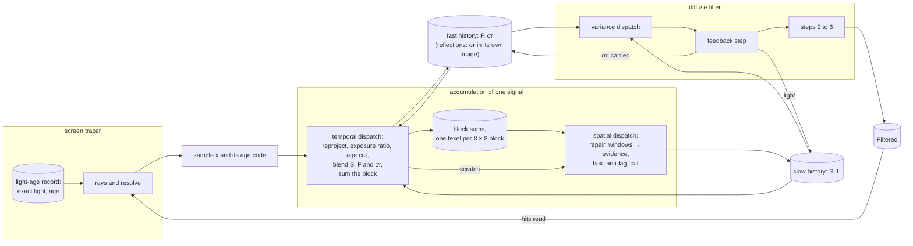

# Bounce-light confidence (Design A)

Ticket `t7-3e22`, under the epic `ter-8hyd` ([renderer-finish.md](renderer-finish.md)). Branch `t7-3e22-retained-deviation`.

- This design folds in `ter-18hc` (the clamp on evidence) and `ter-wkvw` (the light-age cut of the bounce history). Both merge once with it.
- It covers the two cases of `ter-g3tk` that the user assigned to it.
- It fixes the units of `ter-ewua` (bounce light per 2 × 2 block).
- The user chose Design A on 2026-11-12, from two designs in chat.
- The pair agent's research and prototype are in `/private/tmp/pair-mottle/notes.md` and `/private/tmp/pair-mottle/design-a/`.
- The CPU models of this design are in `/private/tmp/bounce-design/`.

## 1. What the user gets

- Steady bounce light keeps its rare bright samples. Today's clamp leaves three stills at 77 to 92 % of a reference without the clamp. The stills are `rect-lamps`, `bay-sunbeam` and `docking-bay`.
- The gated clamp of `ter-18hc` brought them to 97.5 to 99.6 %. But it made the cabin's lamp-on and walk recovery slower than main. Design A keeps the clamp on everywhere and keeps the light.
- A cause of the mottle in the filter goes. The deviation that the filter's luminance stop reads no longer fades faster than the light that it describes. So a single bright sample no longer grows more conspicuous over the next draws.
- Design A follows changes of bounce light that no direct light shows. A test of 8 × 8 pixel blocks compares the fast history with the slow history. A significant difference counts as evidence of a change.
- The reflections get the same test for drops of their light. It shortens the tail of their uncapped history after a drain.
- The GPU cost is about 0.1 to 0.2 ms on the deck. The memory cost is about 4 bytes per render pixel. Both fit in the 1.5 ms reserve for the mottle.

## 2. The user's decisions (2026-11-12, binding)

1. The bounce history's clamp stays on. The pixel's retained deviation σr widens its box. σr is the standard deviation of the pixel's own luminance samples over the slow history's window.
   - σr lives in the alpha of the diffuse fast history.
   - The temporal dispatch reprojects it with the history's taps, scales it by the exposure ratio and updates it with the slow blend.
   - The filter's first pass carries it.
   - The gate (`showsChange`) goes. The light-age cut stays.
2. A test of 8 × 8 pixel blocks counts as evidence of a change. It compares the fast mean with the slow mean, against the pooled deviation of the block's independent samples. This design decides what evidence does.
3. `ter-18hc` and `ter-wkvw` fold into Design A and merge once with it. So no separate quick fix merges first.
4. Design A covers two cases of `ter-g3tk`. Case (a) is the slow fall after the cabin lamps go out, mostly in the reflections. Case (b) is the sunlit-sill step at world ticks 300 to 306. The design also states how it acts on the filter's write-back climb.
5. `ter-ewua` stays one design with Design A. So σr, the count of samples and the block test use units of independent ray samples.
6. A central variance under the slow blend measures the spread of the samples, not the error of the stored mean. So the design keeps a measured-variance check, a real-light-edge check and the impulse test.

## 3. Terms

| Term | Meaning | Unit and range |
|---|---|---|
| Draw | One rendered frame. | |
| Bounce light | Light that reaches a surface from another surface. The code calls it the indirect diffuse signal. | |
| Reflections | The mirror-like light of a surface. The code calls it the indirect specular signal. | |
| Pre-exposed luminance | The luminance (`luminance` in the shaders) of a demodulated, pre-exposed RGB value. | 0 to `MaxRadiance`, 32,256 |
| Sample x | This draw's light estimate of one pixel, from the resolve. | pre-exposed RGB |
| Slow history S | The pixel's running mean of its samples. Its alpha holds the length L. | pre-exposed RGB |
| Length L | The number of draws that S averages. The bounce cap is 32. Rough reflections have no cap. | 0 to the cap, in draws |
| Fast history F | The pixel's exponential mean of its samples, with the weight 1 / min(L, `FastCap`). `FastCap` is 4. | pre-exposed RGB |
| Slow weight w | The weight of this draw's sample in S: 1 / L after the blend. | 1/cap to 1 |
| Retained deviation σr | The standard deviation of the luminance of the samples that S averages, weighted as S weighs them. | pre-exposed luminance, 0 to `MaxRadiance` |
| Spatial deviation σs | The per-channel standard deviation of the fast histories over the 3 × 3 same-surface pixels around the pixel. Today's box uses it. | pre-exposed RGB |
| Box | The range into which the clamp moves S. It is the 3 × 3 mean of the fast histories, plus or minus a half width per channel. | pre-exposed RGB |
| Ray block | The 2 × 2 pixels at even coordinates that share one ray of each kind. | |
| Stream | The sample that one ray block's ray gives its pixels in one draw. It is one independent ray sample. | |
| Block | 8 × 8 render pixels at coordinates that are multiples of 8. It is one workgroup of the accumulation and holds 16 ray blocks. | |
| Window | 1 × 1, 3 × 3 or 7 × 7 blocks around a block. They span 8, 24 or 56 pixels and hold up to 16, 144 or 784 streams. | |
| n | The number of streams in a window that have at least one contributing pixel (section 8). | 0 to 784 |
| D | A window's mean over streams of luminance(F) − luminance(S). | pre-exposed luminance |
| κ | The predicted deviation of F − S for one stream, as a share of σr (section 8). | 0.06 to 0.38 |
| Evidence | A finding that the light of a pixel probably changed. Its sources are the light age, the clamp's move and the block test. | |
| Light age | The draws since the direct light at a ray's hit last changed, from the screen tracer's light-age record. | draws |
| Truth | A still from the same binary with both clamps and the block test off (section 20). | |
| CV | The coefficient of variation of a pixel's samples: their standard deviation over their mean. | 0 or more |

A pixel with its own ray still counts in its ray block's stream. That undercounts the streams, and the error leans toward no evidence.

## 4. The causal model

### The systems diagram



### What causes what

- The scene's light sets the expected value of the samples. Only the sampling fault of `ter-g3tk` (section 10) changes it without a change of light.
- The samples feed three stocks of each signal: S with L, F, and σr. The temporal dispatch writes all three in each draw.
- For bounce light, the filter's feedback step writes S's light and σr a second time. It already writes S's light today.
- Three detectors produce evidence. Each one writes its result into one store, the length L.
  - The light-age record sees changes of direct light. The rays carry the age to the sample. The temporal dispatch cuts L to the age, for every sample that brings one (`ter-wkvw`; the 25 % condition went with `cr-pkzd` on main, 2026-11-12).
  - The clamp sees S outside its box. It moves S into the box, and the anti-lag shortens L by the move. This is today's rule.
  - The block test sees a window's fast mean differ from its slow mean beyond the noise and a floor. It narrows the box for this draw and cuts L to `FastCap`. This is new.
- σr is the stored confidence of S. The clamp widens the box by it. The block test pools the noise with it. The filter's luminance stop reads it.
- The design keeps the cause of a change apart from the store of its result. No detector stores state of its own. The light age lives in the tracer's record. The block sums live only from the temporal dispatch to the spatial dispatch of one draw. The result of every detector is a shorter L.

### The one model

The slow history estimates the expected light of its pixel. Its length is the number of draws that the evidence lets it average. Its retained deviation says how far its own samples spread. So σr also says how far S can stray from the expected light by chance.

- The clamp is the per-pixel consistency test. Its box must hold every excursion that S's own samples explain. σr gives that width (section 7).
- The block test is the regional consistency test. The pooled streams of a window divide the noise by √n. So the test sees changes that no single pixel can tell from noise (section 8).
- Evidence bounds the length. The light age bounds it by the age of the change. The clamp's move bounds it by the anti-lag rule.
- The block test knows no age. So it bounds L by the fast window, `FastCap`, because the fast history already holds the change.

## 5. One model for the old and the new

This section compares the design with the software-design skill, section 4, "One model for the old and the new".

- Reuse. The block test feeds two existing paths: the box and the length. Its action is the anti-lag rule's floor, `FastCap`, and today's box without the widening. No new store holds evidence.
- Extraction. One rule updates σr for both signals. One function tests a window, for both signals and all three window sizes. One pure function, `differenceShare`, predicts the deviation of F − S.
- Distillation. The code treated three detectors as unrelated: the light-age cut, the anti-lag and the gate of `ter-18hc`. They are cases of one idea: evidence bounds the length of a history.
- The gate was a fourth case, which switched the clamp itself on and off. It goes. A switch between a biased and an unbiased estimator made the level drift at the slow pace. In `ter-18hc`, the cabin's lamp-on stayed 7 % low after 99 draws.
- One exception remains, with a named misbehavior. The reflections keep today's narrow box, so their `RetainedSigmas` is 0. They have no spatial filter, so a rare sample in their box shows as a speck. Without their clamp they showed twice as many specks.
- Their narrow box cuts rare samples, so their S lies low. So for them only a drop counts as evidence (section 9). This follows from the exception and is not a second one.

## 6. The retained deviation σr

### Definition

σr is the exponentially weighted standard deviation of the luminance of the samples that S averages. Its weight is 1 / min(L, `DeviationFrames`). For bounce light that is S's own blend weight, because the bounce cap is 32.

The rule is the standard incremental form of a weighted variance (Finch 2009). Finch made it for one stationary stream of numbers. Here each pixel is one stream, reprojected from draw to draw, and changes of light break the stationarity. Section 8 and the takes measure the effect.

### The update, in the temporal dispatch

This replaces today's update of the fast deviation in `accumulate_temporal.comp`, inside `if (hasSample)`:

```glsl
historyLength = min(historyLength + 1.0, cap);
float before = luminance(fast);
float w = 1.0 / min(historyLength, DeviationFrames);
float step = luminance(sampled) - before;
step = abs(step) * w <= BlendRounding * before ? 0.0 : step;
deviation = min(sqrt((1.0 - w) * (deviation * deviation + w * step * step)), MaxRadiance);
slow.rgb = historyLength <= 1.0 ? sampled : slow.rgb + (sampled - slow.rgb) / historyLength;
```

where

- `slow.rgb` = S after reprojection, the exposure ratio and the light-age cut, before this draw's blend.
- `fast` = F after reprojection and the exposure ratio, before this draw's blend.
- `before` = the luminance of that F.
- `historyLength` = L after the light-age cut. The second line adds this draw.
- `cap` = the pixel's cap: 32 for bounce light, and from 4 to unbounded by roughness for reflections.
- `DeviationFrames` = 32, the bounce cap. A half-float store cannot follow a weight below about 2^−11. So uncapped reflections use a window of 32 draws.
- `w` = the weight of this draw's sample in σr. It is 1 for the first sample, which gives σr = 0.
- `sampled` = this draw's finite sample.
- `step` = the sample's luminance minus the luminance of S.
- `BlendRounding` = 1/768, the share of a step that the store's rounding explains (below).
- `deviation` = σr after reprojection, and after its line the updated σr.
- `MaxRadiance` = 32,256, the largest light that the signal stores.

The step goes from F, not from S (changed in step 2a, 2026-11-12). The filter's feedback step writes the light that it moves into S, so S is not the mean of the pixel's own samples. A step from S counted that moved light as spread. At a stable edge of light, the light that the first draws' young estimate moved across the edge then raised σr on the dark side, which held the luminance stop open, which moved more light: the dark pixel beside the edge of `AnEdgeOfLightKeepsItsShapeBesideNoise` held 1.5 instead of 0 after 200 draws. F is the mean of the pixel's own samples, and the filter never writes it. For independent samples a step from F raises σr by √(1 + wf / (2 − wf)), 7 % at wf = 1/4. The CPU model's edge and impulse results do not change.

A half-float blend of weight w stalls within about 1/w half-float steps of a constant sample. One half-float step is at most 2^−10 of the value. So a step with |step| · w ≤ (4/3) · 2^−10 · S is store rounding, not noise. Today's `RoundingShare`, 1/192, is this rule at the fast weight 1/4.

### The rules through every operation

| Operation | What happens to σr | Why |
|---|---|---|
| Reprojection | The temporal dispatch reads σr with the history reader's taps and weights, as for S and F. | A weighted mean of the taps' deviations keeps the box's bound (section 7) for the weighted mean of their light. |
| Exposure change | σr takes the exposure ratio, at most `MaxRadiance`. Today's line `deviation = min(deviation * ratio, MaxRadiance)` stays. | σr has the units of the history. |
| Rejected history, reset | L is 0. So the first blend has w = 1 and gives σr = 0. | No special case. |
| No finite sample | σr stays, as S and L stay. | Today's rule. |
| Light-age cut | Only L changes. The next blend weighs σr with 1 / (L + 1), as it weighs S. | σr follows the weights of S. |
| Young-history repair | The spatial dispatch does not repair σr. | No reader takes σr at those lengths (below). |
| Clamp | σr does not change. | σr is the spread of samples, and a clamp changes no sample. The anti-lag already turns the move into evidence. |
| Block evidence | σr does not change. After the cut to `FastCap`, the next blends weigh σr with 1/5, 1/6 and on. | σr measures the spread again within a few draws. |
| Filter feedback step | The step carries σr with the light. | Section 7, "The write-back". |
| Filter steps 2 to 6 | They store no σr. Their output deviation follows today's rule. | Section 7. |

The pair's prototype added the clamp's move to σr. That made σr a mixed quantity, so this design does not take it.

The repair acts below `HistoryFixFrames` (4). The clamp and the block test act above `FastCap` (4). The filter's variance dispatch uses its young estimate below `YoungFrames` (4). So no reader takes σr of a repaired history. A contract in `TemporalSignal` states `HistoryFixFrames` ≤ `FastCap` + 1.

A real change of light inflates σr for a while, because the step counts as spread. That widens the box and lowers the block test's power right after a change. In the CPU model, the block test fires in the first one or two draws of a step, before σr grows. Its cut to `FastCap` then lets σr forget the step quickly.

### Where σr is stored

- Bounce light: the alpha of the diffuse fast history, RGBA16F, two images by draw parity. It replaces today's fast deviation, which no reader needs after this change. The user chose this store.
- Reflections: their fast alpha holds the hit distance that the reflected-place test reads (`sameHitBits`). The `original` history must keep that rule. So their σr lives in a new R16F image pair by parity, in the precise history modes only.
- The existing analogue of the pair is the sample-age image. It also exists only beside a precise history.
- Every reflection signal beside a precise history keeps the pair and updates σr, whatever its confidence rules (changed in step 5, 2026-11-12). The precise shaders declare the pair, and only the reflections take them. A reflection signal without the pair had to bind its RGBA16F sample at the pair's R16F bindings, and the validation layers report that format mismatch (`Undefined-Value-StorageImage-FormatMismatch-ImageView`) for a binding that the shader uses statically. Only the tests' controls give the reflections `NarrowBox` beside a precise history, so production keeps the pair exactly where `DropEvidence` pools it. This matches the diffuse light, whose σr lives in its fast alpha under every rule.
- One shader function, `retainedDeviationAt`, reads σr from either home. The rest of the shader does not see the difference.

## 7. The clamp's box and the write-back

### The box

```glsl
vec3 spread = parameters.clampSigmas * sigma;
if (parameters.retainedSigmas > 0.0 && !evidence)
    spread = max(spread, parameters.retainedSigmas * deviation * slow / max(luminance(slow), LeastLuminance));
vec3 clamped = clamp(slow, mean - spread, mean + spread);
```

where

- `sigma` = σs, today's per-channel spatial deviation of the fast histories over the 3 × 3 same-surface pixels.
- `mean` = today's per-channel mean of those fast histories.
- `parameters.clampSigmas` = `ClampSigmas`, unchanged: 2 for bounce light, 1.5 for reflections.
- `parameters.retainedSigmas` = `RetainedSigmas` of the signal's confidence rules (section 12): 2 for bounce light, 0 for reflections.
- `evidence` = whether a window of the pixel's block fired in this draw (section 8).
- `deviation` = the pixel's σr after this draw's update.
- `slow` = S after the blend and the repair, before the clamp.
- `LeastLuminance` = 10^−4, the floor that today's lag already uses.
- `spread` = the half width of the box per channel.
- `clamped` = S after the clamp. The anti-lag then shortens L by the move, as today.

The widening takes the chroma of S, not of the box's mean. The excess that the widening must hold is part of S. The fast mean can fall to 0 between rare hits on a dark surface. An example is the floor 4.95 m from the glowing panel of `ter-18hc`.

The box takes the larger of two half widths, not their sum. The probe's analogue (`TERTIUS_T7_BOXDEV`) did the same. It widened the box by twice the fast deviation and kept 92 to 98 % of the truth.

### Why rare samples stay inside the box

Take a mature pixel with steady samples, so σr ≈ 0. One sample brings an excess X. The blend moves S by wX. The update makes σr² = (1 − w) w X². So the excess of S is √(w / (1 − w)) σr.

At the cap, w = 1/32, so the excess of S is 0.18 σr. Each later draw shrinks the excess by the factor (1 − w). It shrinks σr² by at most the factor (1 − w), so the ratio only falls. The clamp acts only above `FastCap`, where w ≤ 1/5. There the ratio is at most 0.5.

`RetainedSigmas` = 2 leaves room for the center of the box. The center is the fast mean, which lies below the expected light between rare hits.

The CPU model `/private/tmp/bounce-design/clamp.py` runs one sample per ray block, the thin filter with its write-back, the anti-lag and the box. It gives the shown light over the truth, over draws 200 to 500:

| Rare samples | No clamp | Today's narrow box | Design A's box |
|---|---:|---:|---:|
| 1 in 32, 16 × the base | 0.996 | 0.856 | 0.996 |
| 1 in 128, 64 × the base | 0.988 | 0.840 | 0.988 |
| 1 in 8, 4 × the base | 0.999 | 0.936 | 0.999 |

The narrow box loses 6 to 16 % in the model. The GPU measured 8 to 23 %. Design A's box equals no clamp to three decimals.

One edge case remains. Take a rare light whose chroma in one channel exceeds the chroma of S by more than 11 times at the cap. That channel loses part of its light. At L = 5 the factor is 4. A saturated lamp, seen only by rare rays on a surface of another color, can do that.

The dead-end list of `renderer-finish.md` holds "a wider clamp box", which lost light or gained under 12 %. That box was a constant widening, which also holds lag. This widening follows each pixel's own spread, and the block test removes it where a region changes.

### The write-back

The filter's feedback step writes its light into S, as SVGF feeds back its first step. Now it also writes the deviation of that light into the store. It carries the deviation with the light, by the same shares:

```glsl
vec3 filtered = centerLight.rgb + moved;
float carried = min(kept * max(centerLight.a, 0.0) + carriedSum, MaxRadiance);
...
if (parameters.feedback != 0u && slowLength >= YoungFrames)
    imageStore(fastHistory, pixel, vec4(imageLoad(fastHistory, pixel).rgb, carried));
```

where

- `centerLight.a`, `light.a` = the variance dispatch's output deviation of the pixel and of a tap. A negative value marks a young estimate (below).
- `carriedSum` = the sum over the taps of `share * max(light.a, 0.0)`. Young taps carry nothing into the store.
- `kept` = today's share of its own light that the pixel keeps: 1 minus the sum of the shares.
- `share` = today's weight of one tap.
- `moved` = today's light that the step takes from the taps.
- `slowLength` = the pixel's own L, from the alpha of its slow-history texel.
- `YoungFrames` = 4, the young limit of the variance dispatch.
- `fastHistory` = this draw's diffuse fast history, binding 3 of the filter set.
- `carried` = the deviation that the step stores.

The variance dispatch marks a young estimate with a negative sign. The edge stops and the step's output read its magnitude. The output deviation of the feedback step, which step 2 reads, is `kept * |centerLight.a| + Σ share * |light.a|`. Steps 2 to 6 keep today's rule, √(kept² σp² + Σ share² σq²).

The reasons:

- A pixel's excess after the step is `kept * e_p + Σ share * e_q`. Take each excess as at most 2 σr. Then the result is at most twice the carried sum, for any correlation of the taps.
- So the linear rule keeps the bound of the box for light that the filter moves into a quiet pixel. That removes the class of `td-hjn6`, where the clamp cut such light.
- The squared rule at the feedback step shrinks the stored σr by the factor 0.375 in every draw. In the CPU model, that brought back the late sharpening. The impulse's peak rose from 0.0086 to 0.30 by draw 8.
- The pair's prototype used the linear rule in every step. The CPU model `transport.py` has a 2:1 edge of light under noise. There the prototype's rule widened the edge's 10 to 90 % rise from 10 pixels to 32 pixels.
- It also moved the mean light 12 pixels or more from the edge: +24 % on the dark side and −12 % on the bright side.
- The user's decision names the first step only. With the paper's rule in steps 2 to 6, the edge is 12 pixels under Gaussian noise. The dark side moves by 2.7 %.
- Under rare bright samples, the edge is 21 pixels and the dark side moves by 11 %. Today's filter gives 14 pixels there.
- A young pixel keeps its own σr in the store. Its young estimate is the spread of the fast histories over 7 × 7 same-surface pixels, so it includes the light's own edges.
- Stored, a young estimate decays at the slow pace. It then keeps the stop open across a real edge for about 100 draws. The existing test `AnEdgeOfLightKeepsItsShapeBesideNoise` pins that misbehavior.

The CPU impulse model (`transport.py` and `peaks.py`) has a mature field of 1 and one ray block of 101 in one draw. It runs the thin kernel and the write-back, without a clamp:

| Variant | Peak at draw 0 | Largest later peak | Peak at draw 32 | Total excess at draw 32 |
|---|---:|---:|---:|---:|
| Today: fast deviation, squared rule | 0.0049 | 0.2057 at draw 32 | 0.2057 | 4.526 |
| Design A: σr, linear at the write-back, squared after | 0.0066 | 0.0067 at draw 1 | 0.0023 | 4.526 |
| The prototype: σr, linear in every step | 0.0049 | none | 0.0011 | 4.526 |

Every variant keeps the total excess at 12.5 × (31/32)^k. So the filter moves light and makes none. Design A's peak rises by 1.7 % in the first draw after the sample, and after that it only falls.

## 8. The block test

### The statistic, per window

For each contributing pixel p, the temporal dispatch forms three values after this draw's blend:

- `d_p` = luminance(F_p) − R_p.
- `v_p` = κ(1/`FastCap`, 1/L_p)² × σr,p² × `BlockNoiseScale`².
- `s_p` = R_p.

R_p is the own-sample mean: the luminance mean of the pixel's own samples with the slow weight 1/L_p. Only the temporal dispatch blends it, so neither the filter's write-back nor the clamp moves it. The spatial dispatch writes it only on evidence, where it restarts R at luminance(F) together with the cut of L.

Why R and not S (take T3's filter test, 2026-11-12, workbench job `filter-ab`, `rect-lamps` to draw 924 with the action off):

| Bounce light | Filter on, D = F − S | Filter off, S is the own-sample mean |
|---|---:|---:|
| False windows per block-draw, any window | 2.1 × 10^−2 | 1.9 × 10^−4 |
| Measured over predicted deviation of D̄, windows 1, 3, 7 | 1.41, 1.40, 1.50 | 1.00, 1.05, 1.13 |
| Median of the stationary F̄ − S̄ over S̄, 1 × 1 window | 0.029 | 0.014 |
| Repeat share of fires, longest run | 0.52, 39 draws | 0.31, 7 draws |

- The filter's write-back puts moved light into S, not into F. So F and S estimate different things wherever the filter moves light, and D is not 0 in a still. The kept false fires were all rises (F above S) of about a fifth of the light, at the bright side of the ceiling band.
- The write-back also adds the neighbors' noise to S, so the noise of D exceeds κσr by about 40 %. κ assumes two exponential means of the same samples.
- With the filter off, the prediction holds (ratio 1.00 to 1.13), as in the CPU model. So the statistic needs the mean of the pixel's own samples, which the write-back and the clamp never touch. That is R.
- The rest of the false evidence with the filter off came from the tail of rare bright hits (kept fires at a tail ratio of about 1,080, near `TailStreams`). Its offline sweep passes 10^−4 at `TailStreams` 2,000 with a floor of 1/16. Take T3 calibrates again with R.

The reflections' D did not change with the diffuse filter: ratios 1.58, 2.18 and 3.76 with it on and 1.54, 2.12 and 3.63 with it off. Their kept fires are drops of about 6.6 % of the light at z of about −4.6. The ratio grows with the window, so their errors are correlated across ray blocks, or their narrow clamp moves S. R removes the clamp's part. Take T3 measures what remains. A remaining ratio becomes the reflections' variance scale per window: the design effect of a cluster sample (Kish 1965), the measured variance of a window's mean over the variance of independent streams.

Take T3 with R (workbench job `t3-own`, 2026-11-12, four stills to draw 924, action off, the step-4 constants):

| Still | Bounce: false windows per block-draw | Bounce: deviation ratio, windows 1, 3, 7 | Reflections: false windows | Reflections: deviation ratio |
|---|---:|---|---:|---|
| `rect-lamps` | 1.8 × 10^−2 | 1.39, 1.39, 1.49 | 4.6 × 10^−3 | 1.58, 2.18, 3.76 |
| `bay-sunbeam` | 2.0 × 10^−5 | 1.02, 1.02, 1.02 | 5.3 × 10^−6 | 1.02, 1.02, 1.03 |
| `docking-bay` | 2.8 × 10^−5 | 1.00, 1.00, 1.01 | 1.1 × 10^−6 | 1.00, 1.01, 1.02 |
| `station-cabin` | 0 | 1.76, 1.77, 1.74 | 0 | 0.98, 1.00, 1.03 |

- R fixes the write-back's part, which the filter test of the fixture shows (1,269 false cuts before R, 0 after). But `rect-lamps` did not change. So the filter acts there through the samples themselves, not through S.
- The cause, as far as the numbers show: the bounce rays' hits read the last draw's filtered light. In `rect-lamps`, that light carries slow, wide blotches. So the samples of neighboring pixels share a slow wave. Two means of such samples differ in a still by up to about a fifth of the light (the 99.99th percentile of F̄ − R̄ over R̄ is 0.21 to 0.31). With the filter off, the hits read unfiltered light and the ratio is 1.0.
- No noise model separates that wave from a change of the light, so the floor must lie above it. That is the rule that this section already gave for the floor: above the stationary difference of the stills.
- The constants that the sweep finds for all four stills, at most 10^−4 false windows each: `BlockSigmas` 5, `BlockNoiseScale` 1.5, `TailStreams` 2,000, `ChangeShare` 1/4 for bounce light and 1/20 for reflections. The worst still is `rect-lamps`' reflections at 3.4 × 10^−5.
- With these constants, the floor binds for bounce light: a window that passes the tail rule has a noise bar of at most 5 × 1.5 / √(2,000 × 1.5²) = 0.11 of the light, below the floor of 1/4. So only drops of more than about 37 % and rises of more than about 45 % count. Takes T4 to T6 show what that costs in the settle cases, against the step-4 constants on the same build.
- When the blotches shrink, the stationary wave shrinks, and the floor can drop again. The floor follows the blotches, not the other way around.

A contributing pixel shows a lit surface and has L above `FastCap` after the blend. That is the clamp's own condition, because a shorter history averages no more draws than its fast history.

For each ray block, the dispatch takes the mean of d, v and s over its contributing pixels. A ray block without one contributes nothing. Then the dispatch sums the 16 ray blocks of its 8 × 8 workgroup in shared memory. It stores one texel per block: (Σd, Σv, n, Σs), in pre-exposed luminance.

Every workgroup writes its texel in every draw, also with n = 0. So the spatial dispatch never reads a stale texel.

κ is the deviation of F − S for one stream, as a share of the samples' deviation. F and S are two exponential means of the same independent samples, with the weights wf and ws:

```glsl
float differenceShare(float wf, float ws)
{
    return sqrt(wf / (2.0 - wf) + ws / (2.0 - ws) - 2.0 * wf * ws / (wf + ws - wf * ws));
}
```

where

- `wf` = the weight of F, 1/`FastCap` = 1/4 for every contributing pixel.
- `ws` = the weight of S, 1/L.

κ is 0.319 at the bounce cap, 0.378 for an uncapped history and 0.063 at L = 5.

The CPU model `blocks.py` measured the deviation of D over draws in a still against this prediction. The ratio was 1.02 to 1.14, from Gaussian noise to rare bright samples. In the renderer, hits read the last draw's filtered light, which can raise the ratio. Take T3 measures the ratio and sets `BlockNoiseScale`.

The spatial dispatch forms the three windows' sums from the 7 × 7 block texels around its block. A window fires on these conditions:

```glsl
bool fires = n >= LeastStreams
    && sumS * sumS >= TailStreams * sumV
    && sumD * sumD >= BlockSigmas * BlockSigmas * sumV
    && abs(sumD) >= parameters.changeShare * max(sumS, sumS + sumD)
    && abs(sumD) >= n * cutoffLight
    && (parameters.retainedSigmas > 0.0 || sumD < 0.0);
```

where

- `sumD`, `sumV`, `n`, `sumS` = the window's sums of the block texels.
- `LeastStreams` = 8, half the streams of one block.
- `TailStreams` = 1000, from the CPU model. Take T3 calibrates it. It is the tail rule (below).
- `BlockSigmas` = 4. D must lie 4 predicted deviations from 0.
- `parameters.changeShare` = `ChangeShare` of the signal's confidence rules (section 12): 1/8 for bounce light, 1/20 for reflections.
- `cutoffLight` = `CutoffRadiance` of `exposure.glsl`, in pre-exposed units. A change below it changes no shown pixel.
- The last line makes the test one-sided for a history whose box keeps no rare samples (section 9).

The pixel has evidence for this draw after any of its block's three windows fires. Every condition is a product or a comparison, with no division. So a zero deviation or a zero light gives no NaN.

### Where it runs

The sums run at the end of the temporal dispatch. Its 8 × 8 workgroup is the block, and it holds F, S, σr and L in registers. A separate dispatch reads both histories again: about 16 bytes per pixel for bounce light and 26 for reflections, about 0.2 ms on the deck.

The spatial dispatch's workgroup is also one block. Its first 49 invocations each load one texel into shared memory. After a barrier, invocation 0 forms the three windows and stores one evidence flag in shared memory. After a second barrier, every invocation reads the flag. So the windows cost 49 loads per block, not per pixel.

- Every invocation of a workgroup must reach `barrier()` in uniform control flow. So both dispatches lose their early `return`s. Pixels outside the image and sky pixels set a flag, skip the body and still reach the barriers.
- A signal without the block test skips both parts on the push constant `blockTest`. That branch is dynamically uniform.
- Shared memory is about 1.3 KB in the temporal dispatch and 0.8 KB in the spatial dispatch. Vulkan guarantees 16,384 bytes. No subgroup operation is used, because they are optional.
- The sums run in a fixed order: 4 pixels per ray block, then 16 ray blocks in index order. So one machine gives the same bits in every run.

### Why these rules

- The mean of D is over streams, not pixels. The four pixels of a ray block see one ray, so they are one sample, not four. So n counts independent ray samples, as decision 5 asks.
- The tail rule is `sumS² ≥ TailStreams × sumV`. It is n ≥ `TailStreams` × ρ². Here ρ is the relative spread of one stream's F − S: √(Σv / n) over the mean of S.
- A mean of samples with a heavy tail is close to normal only for a count that is large against the tail. Cochran's rule for survey means asks n > 25 G1², with G1 the skewness (Cochran 1977, section 2.15).
- Rare bright hits are the heavy tail here, and ρ² is a measurable stand-in for G1². A window with too few streams for its tail stays silent, and a wider window speaks for it.
- The CPU model (`blocks.py` and `windows.py`) shows why the test has three windows. The 8 × 8 window alone missed steps or gave false evidence:

| CV of the samples | 8 × 8 alone: false evidence per block-draw | 8 × 8 alone: error 60 draws after a step to 0.62 | Windows 1, 3, 7 with the tail rule: false evidence | Windows: draws until most blocks fire, steps to 0.62 and 0.30 | Windows: error at 60 draws |
|---:|---:|---:|---:|---|---:|
| 0.5 | 1.0 × 10^−4 | 1.4 % | 5.8 × 10^−5 | 1 and 0 | 1.5 to 2.3 % |
| 1.3 | 3.9 × 10^−4 | 6.5 %, no window fired | 0 in 104,000 | 1 and 0 | 1.2 to 1.8 % |
| 2.8 | 5.5 × 10^−3 | 7.8 %, no window fired | 0 in 104,000 | 1 and 0 | 0.9 to 1.9 % |

A step to 1.6 fired within one draw at a CV of 1.3 and 2.8 as well. So the 8 × 8 block stays the unit of the statistic, and the test also pools 3 × 3 and 7 × 7 blocks. This refines decision 2. The CV of real bounce light is not measured yet. Take T3 measures it per block, and the captured texels let the windows and the constants change offline.

`ChangeShare` of bounce light is 1/8. The reasons:

- Take a step of the expected light by the share f. D peaks at about 0.68 f of the light, eight or nine draws after the step. So only drops of more than about 18 % and rises of more than about 22 % count.
- The slow blend leaves (31/32)^60 = 0.15 of a change after 60 draws. So drops up to 25 % and rises up to 50 % settle within 5 % without help. Every change below the floor is inside that range.
- The floor must also lie above a difference that the write-back makes without any change. The write-back makes S about a 4-pixel blur of the samples' mean, so F̄ − S̄ is not 0 at a curvature of the light.
- Take T3 measures that difference in the stills. If its 99.99th percentile is lower, the floor drops to just above it.

`ChangeShare` of the reflections is 1/20, the settle tolerance (section 9).

What evidence does. Three actions were weighed:

1. The box narrows, and nothing else changes. The move and the anti-lag then follow the change, as on main. But it does nothing for the reflections, whose box is already narrow. It also leaves L long, so a bias drains at the slow pace.
2. L falls to `FastCap`, and nothing else changes. This works for both signals. But S keeps its old light, which then drains at 1/(4 + k).
3. Both, the chosen action. On evidence, the box drops its widening for this draw, so the clamp pulls S into the fast histories' box. Then L becomes `FastCap`.

The chosen action restarts S from the fast window, which already holds the change. A bias of the narrow box then drains at the pace of a short history, not at 1/32. That slow drain was the lamp-on fault of `ter-18hc`. In the CPU windows model, every step came within 2.3 % of the light in 60 draws.

Measured in step 4 (`t0-5b5b`, the accumulator fixture, 64 × 36, cap 32). A region of 32 × 32 pixels dims from 1 to 0.5:

| Noise of the ray blocks | First evidence | 90 % of the step | Error after 40 draws |
|---|---|---|---|
| none | draw 2 | draw 21 | 4.7 % of the new light |
| CV 0.3 | draws 1 to 2 | draw 18 | 3.3 % of the new light |

- Without the block test, the slow blend leaves 15 % after 60 draws. So the action works, but it does not follow a step "within ten draws".
- The cause: at the first evidence F holds only about half of the step. S restarts there with L = `FastCap`, and then blends with 1/5, 1/6 and on. The window fires again only while D stays above the floor, an eighth of the light. Below it, the rest of the step drains at 1/(4 + k).
- A deep step, such as the moving wall's drop from 1 to 0.02, keeps D above the floor for longer, so it fires again every second draw and follows within ten draws.
- Section 19's test of the region therefore states the 60-draw claim. Whether evidence should follow a half step faster is open point 4 of section 18.

The tail rule makes the noise rule almost redundant for bounce light. A window that passes the tail rule has a noise of D̄ of at most S̄ / √`TailStreams` per predicted deviation, so `BlockSigmas` predicted deviations are at most 4 / √1000 = 0.126 of the light. That is the floor of an eighth. So with these constants `BlockSigmas` binds only for the reflections' floor of 1/20, or after step 7 lowers `TailStreams` or the floor. The hand mutant `BlockSigmas` = 0 survived every bounce-light test for this reason.

The action covers every contributing pixel of the block. That includes pixels of an unchanged surface inside a changed window, which get a few noisier draws. A per-pixel rule leaves a speckle of cut and uncut pixels. That shows more than a block of slightly noisier light that the filter smooths.

The threshold is hard, not graded. False evidence is rare in a still, with a target of at most 10^−4 per block-draw. So a borderline window switches rarely. Take T3 looks for blocks that flicker at the threshold. A graded widening between two thresholds is the fallback for them.

## 9. The reflections and case (a) of `ter-g3tk`

Case (a): the cabin lamps go out. Four draws later the light-age cut restarts the reflections' history. Then the uncapped history averages the reflected bounce light while that bounce drains, and nothing cuts it again. The reflections take 128 draws to settle, the bounce light 20 to 57. A cap of 32 settles them in 92 draws, but it nearly triples the specks of `rect-lamps`.

Design A gives the reflections four things:

1. σr in the deviation image pair (section 6), with a window of 32 draws.
2. The block test, with the same statistic, windows and constants, but one-sided. Only S̄ above F̄ counts.
3. `ChangeShare` = 1/20, the settle tolerance. A one-sided test has no stationary difference to stay above, and an uncapped history gets no help from the blend.
4. A faster drain of the bounce light. The reflection rays read the hit pixel's filtered bounce light, and the bounce block test shortens its drain.

The test is one-sided because the narrow box cuts rare samples. So in a still, S lies below F: by 6 % at a CV of 1.3 and by 23 % at a CV of 2.8 in the CPU model. A two-sided test fired falsely in 16 % of the block-draws at a CV of 2.8. The one-sided test fired in none. The lower edge of the narrow box and the anti-lag still follow a rise of reflected light, as today.

The CPU model (`specular.py`, `detail.py`, `drain4.py`) has an uncapped history and the narrow box. The expected light drains to 0.3 with a time constant of 15 draws. A light-age cut restarts the history 4 draws after the drain starts. The table gives the error above the history's own steady level:

| Light and noise | Without the test, at 60 and 89 draws | With the drop test, at 60 and 89 draws |
|---|---|---|
| Spatial detail of ±50 % at 3 px, CV 0.5 | +14.2 % and +7.8 % | +6.8 % and +3.6 % |
| Spatial detail of ±50 % at 3 px, CV 0.1 | +17.2 % and +11.9 % | +4.7 % and +2.5 % |
| Flat light, CV 0.5 | +5.2 % and +1.1 % | +3.8 % and +0.9 % |
| Flat light, CV 2.8 | +13.9 % and +5.4 % | +13.8 % and +5.3 % |

The test helps most where real reflected detail widens today's box but the samples are quiet. That is the long tail that `ter-g3tk` describes. Rare bright hits can make the reflections noisier than any slow drain. Then no evidence can tell the drain from noise before the drain is large. That is a limit of the noise, not of this test.

The cabin's lamps-off case can still miss 60 draws after Design A. Then two levers remain, and the choice goes to the user (section 18):

- Less reflection noise: the sweep's resolve over four ray blocks cut grain by 24 to 59 %, at an estimated 0.4 to 0.6 ms.
- A shorter reflection history after a change, at the cost of more specks during it.

The cut rule without its 25 % condition (`cr-pkzd`) merged into main first and lowers the jump after lamps off from +72 % to +42 %. Design A takes it for both signals, so one cut rule holds for the bounce light and the reflections; step 7 measures on top of it.

## 10. Case (b) of `ter-g3tk` and the write-back climb

### The sunlit-sill step

At world tick 300 to 306 the sun turns against the ship. Some sunlit strips on the window sills are thinner than a render pixel. The turn changes which jittered sample positions land on them.

- The unbiased mean of the single-bounce samples of the cabin's region r11 falls by 43 %. The direct sunlight on the strips rises by 2 %.
- The light-age record sees only those few sill pixels, so no bounce history is cut.
- This is a sampling fault. The expected value of the estimator depends on where the strips lie among the jitter positions.

Design A covers the step by evidence. With all bounces, the region's light falls by 35 to 40 %, above the floor of bounce light. In the CPU model, a step of 38 % fires within one draw in the 24 and 56 pixel windows at every CV. It settles within 1.5 % in 60 draws.

Design A does not remove the fault. Regions r10 and r12 of the honest walk measure wander by ±5 % for the same reason. Design A follows that wander a little faster. The fault itself gets a new ticket (step 8): the light at a hit must not depend on whether a jittered sample lands on a sub-pixel strip.

### The write-back climb

At a fixed state, the single-bounce light of the far-ceiling band climbs to about 1.6 times its reference over about 200 draws. Then it collapses and climbs again. With the filter off, it stays flat. The thin kernel climbs too.

- The probable cause is the impulse's mechanism. A luminance stop whose deviation shrinks too fast acts as a diffusion that moves light up a gradient. Here it moves light into the band where the ceiling meets the far wall.
- In single bounce, the hits do not read filtered light. So the climb comes from the write-back into S.
- Design A acts on it twice. The stored σr no longer shrinks at the write-back, which removes the concentration in the impulse model.
- In single bounce, a climbing S also leaves the fast mean of its own samples behind. F̄ − S̄ then grows negative until a window fires and cuts the band back to its fast window.

Design A must not make the climb worse: the band's peak in the climb test, as a share of the same build's band with the filter off, must not exceed main's share. Main's absolute peak is no yardstick, because main's clamp loses part of the band's light (step 3, take T2a: Design A ends at 97 % of its own filter-off light, main peaks at 110 % of its own). The target is a band within 10 % of its single-bounce light with the filter off. If the target fails, the climb stays in `ter-g3tk`. Its next step is a take with the write-back off and the filter on, which separates the write-back from the hits' feedback.

## 11. Borrowed techniques and their source situations

| Technique | Made for | Our situation | What we take |
|---|---|---|---|
| Variance clipping (Salvi 2016) | Temporal anti-aliasing of rasterized color. One sample per pixel per frame, no Monte Carlo noise. The current 3 × 3 neighborhood shows every color a pixel can have. | One ray per ray block with rare bright hits. A 3 × 3 neighborhood holds two to four independent samples. The narrow box cut 8 to 23 % of the light. | The box as the per-pixel lag test only. Its width now also follows the history's own spread over time. |
| Gradient estimation, A-SVGF (Schied and others 2018) | Path tracing at 1 sample per pixel at 1080p. One sample per 3 × 3 stratum is shaded again with last frame's random numbers, so the gradient has almost no noise. | Screen-space rays with new random numbers each draw. Shading again costs about 11 % more diffuse rays and new tracer images, past the budget of 20 storage images. | The idea that a regional change, normalized by the light, shortens the history. Our mechanism is a statistical test on existing histories, with pooling and a yes or no result. |
| Variance-guided filtering, SVGF (Schied and others 2017) | 1 sample per pixel. Color and moments over about 5 frames, a spatial estimate below 4 frames, and a squared-weight variance that assumes independent taps. | One ray per ray block, so the taps correlate. A 32-draw color history and, until now, a 4-draw deviation. The pair's audit found the recurrence 1.65 to 19.6 times overconfident. | Matched windows: σr over the color history's own window. A write-back rule that holds for any correlation. The paper's rule in steps 2 to 6. |

The block test also borrows Cochran's rule (Cochran 1977). It was made for means of independent survey samples from a skewed population. A window's streams are close to independent within a draw. The reused light of the hits correlates them, and `BlockNoiseScale` calibrates that.

## 12. Storage, bindings and passes

### The confidence rules of a signal, a union

The design adds one closed set: the rules that a signal's history follows. It is a union, so that no signal can test blocks without a deviation to pool.

```csharp
// Sketch. The form follows STYLE.md, "Choose the form of a closed set by the shape of its cases".
internal union HistoryConfidence(WidenedBox, DropEvidence, NarrowBox);
internal sealed record WidenedBox(float RetainedSigmas, float ChangeShare);
internal sealed record DropEvidence(float ChangeShare);
internal sealed record NarrowBox;
```

where

- `WidenedBox` = the bounce light's rules. σr lives in the fast alpha, `RetainedSigmas` σr widens the box, and the block test counts drops and rises.
- `DropEvidence` = the rules of reflections with a precise history. σr lives in its own image pair, the box stays narrow, and the block test counts only drops.
- `NarrowBox` = today's rules: no σr, no widening and no block test.
- `RetainedSigmas` = 2 and `ChangeShare` = 1/8 for bounce light. `ChangeShare` = 1/20 for reflections.

`SignalParameters.Diffuse` holds `WidenedBox`, and `SignalParameters.Specular` holds `DropEvidence`. `TemporalSignal` takes `NarrowBox` instead for the `original` history and the single-history research prototype. Its existing analogues are the enums `SpecularHistoryMode` and `HistoryInstrumentation`, whose cases have no fields.

The readers switch over the union with no discard arm:

- `AccumulatePushConstants.Of` derives `retainedSigmas`, `changeShare` and `blockTest`.
- `TemporalSignal` refuses `WidenedBox` for the reflections and `DropEvidence` for the diffuse light, because each keeps σr where only its light's shaders look for it. It takes `NarrowBox` for `DropEvidence` beside the `original` history, which has no pair.
- `TemporalSignal` creates the deviation pair of a part for every reflection signal beside a precise history, and the signal set writer binds it there (section 6, "Where σr is stored", changed in step 5). So `DropEvidence` always finds the pair.

The union grows by steps. Step 2a brings `WidenedBox(RetainedSigmas)` and `NarrowBox`. Step 4 adds `ChangeShare`. Step 5 adds `DropEvidence`. Until step 5, the reflections use `NarrowBox`.

### Images and bindings

| Value | Format and size | Owner | Binding | Writer | Readers |
|---|---|---|---|---|---|
| σr of bounce light | Alpha of the diffuse fast history, RGBA16F, two by parity (existing images) | `TemporalSignal` | Signal set: 2 (last draw) and 3 (this draw). Filter set: 3 | Temporal dispatch. Filter feedback step | Next draw's temporal dispatch. Block sums. Spatial box. Filter variance dispatch |
| σr of reflections | R16F, render size, two by parity, precise modes only | `TemporalSignal`, part images | Signal set: 14 (last draw) and 15 (this draw) | Temporal dispatch | Next draw's temporal dispatch. Block sums |
| Block sums | RGBA32F, ⌈W/8⌉ × ⌈H/8⌉, one per part | `TemporalSignal`, part images | Signal set: 13 | Temporal dispatch | Spatial dispatch. The survey's probe capture |
| Own-sample mean R | One channel at the slow history's precision (R16F beside a half history, R32F beside a precise one), render size, two by parity, every signal with a fast history (below) | `TemporalSignal`, part images | Signal set: 16 (last draw) and 17 (this draw) | Temporal dispatch. Spatial dispatch on evidence | Next draw's temporal dispatch. Block sums |

- Every Vulkan device supports RGBA32F and RGBA16F storage. R16F storage needs `shaderStorageImageExtendedFormats`, which the renderer already requires.
- Today the signal set layout numbers its bindings 0 to N − 1 from a count (`SignalSetImages`). Bindings 11 and 12 are optional, so binding 13 cannot follow them in a count.
- So `CreateTemporalSetLayouts` builds the binding list by number. The list is 0 to 10, then 11 with the light age and 12 with an instrumentation. Then come 13 always, 14 and 15 with a precise history, and 16 and 17 always. Vulkan allows gaps in binding numbers.
- R exists for every signal with a fast history, not only for those with a block test (changed in step 7, `t0-y4qv`, by step 5's rule for σr). The base shaders declare 16 and 17 for the bounce light, and the `original` history's reflections, which have `NarrowBox`, run the same shaders. A set without R would bind an image of another format at a binding that the shader uses statically, which the validation layers report. So the storage follows the shaders, and the temporal dispatch blends R under every confidence rule. Only the single-history prototype's shaders declare no R, and its sets bind the sample there.
- Only the precise shaders declare 14 and 15 (`TERTIUS_PRECISE_SPECULAR_HISTORY`), and only the reflections use those shaders. The diffuse sets bind their sample image there, as binding 12 does today for the signal without the trace.
- Every part owns its block sums image, because the base shaders also use binding 13. A part costs about 230 KB.
- A signal set holds at most 16 storage images: 9, the sample age, the instrumentation, the block sums, the σr pair and R's pair. That is below the 19 that the screen tracer already requires. The tracer set does not change.
- Filter sets: today `DiffuseFilter.Sets` is 2 + 6 = 8. Steps 2 to 6 bind parity 0's fast history as a placeholder. The feedback step now writes the fast history of the draw's parity.
- So every wavelet step gets one set per parity, 2 + 2 × 6 = 14 sets. Every set binds the real fast history of its draw.
- Push constants: `AccumulatePushConstants` gains `retainedSigmas`, `changeShare` and `blockTest`. It grows from 36 to 48 bytes, of the 128 that Vulkan guarantees.
- Passes: no new pass. The block sums image joins the barrier between the two accumulation dispatches.
- Removed: `showsChange`, `LeastMotion` and the spatial dispatch's binding 11. The spatial dispatch then needs no light-age variant, so `ShaderVariant.LightAge` lists only `accumulate_temporal.comp`. The precise variants stay for the history format.
- The research prototype of reflection sharing runs in the same shaders. Its guide lines do not change.
- The accumulation trace (`ControlTrace`, reflections only) keeps its layers. Layer 7 stays σs, because the reflections' box has no widening.
- With `TERTIUS_DIFFUSE_FILTER=off`, σr is the pixel's own spread and S is its own mean, so the bound of section 7 is exact.

Vulkan portability, for every reviewer:

- No subgroup operations.
- `barrier()` only in uniform control flow.
- No division in the test, and no `clamp` of a value that can be NaN. The samples pass `finiteSample` before any update.
- No reliance on half-float denormals. A σr below 2^−14 can flush to 0 in the store. That only removes a widening far below the cutoff light.
- No new device feature.

## 13. Cost

At the deck's render size of 1280 × 720 (921,600 pixels). The bounce accumulation costs 0.60 ms today, the reflections' accumulation 1.47 ms and the filter 4.40 ms (`/private/tmp/tertius-sweep-20261111/report.md`).

| Change | Memory | GPU time, estimate |
|---|---:|---:|
| σr of bounce light in the fast alpha | 0 | 0 |
| The feedback step reads and writes the fast history, 16 bytes per pixel | 0 | about 0.05 ms |
| σr of reflections, R16F × 2 | 3.7 MB | about 0.02 ms |
| Block sums in both temporal dispatches | 2 × 230 KB | about 0.03 to 0.06 ms |
| Windows in both spatial dispatches, 49 loads per block | 0 | about 0.01 ms |
| Bounce clamp in every draw | 0 | 0 against main |
| Own-sample mean R: R16F × 2 for bounce light, R32F × 2 for reflections | 11.1 MB | about 0.03 ms |
| Total | about 15.3 MB | about 0.13 to 0.18 ms |

Take T8 measures it. The limit is +0.3 ms, inside the 1.5 ms reserve for the mottle.

## 14. Moving the store to 2 × 2 blocks (`ter-ewua`)

Every quantity of this design already uses streams, the sample of one ray block in one draw:

- σr is the spread of one stream's luminance as the pixel weighs it. The four pixels of a ray block hold nearly the same σr, and a store per ray block keeps one.
- The block sums take the mean of each ray block's pixels before they sum streams. With a store per ray block, the sums read 16 texels per block instead of 64 pixels. n, D and the windows do not change.
- κ depends on the two weights only.
- The box's 3 × 3 neighborhood becomes 3 × 3 ray blocks. The write-back's linear rule is the same at any resolution.

So `ter-ewua` changes where the values live and how often the GPU computes them, not what they mean.

## 15. Classes of bugs made impossible, and what remains

Impossible by construction:

1. A pixel's own rare sample leaves its box. The excess is at most 0.5 σr above `FastCap`, and the box is at least 2 σr wide (section 7).
2. The clamp cuts light that the filter moved into a quiet pixel (`td-hjn6`). The deviation moves with the light by a rule that holds for any correlation.
3. A clamp, switched off and on by a gate, drifts at the slow pace (`ter-18hc`'s lamp-on fault). There is no gate, and every narrowing of the box comes with a cut to the fast window.
4. A deviation over a shorter window than its light makes the filter concentrate old error (the impulse). σr has the light's window, and the write-back does not shrink it.
5. A signal tests blocks without a deviation to pool, or widens a box that has no σr. The union `HistoryConfidence` ties the test and the widening to the store of σr.
6. The spatial dispatch's light-age variant drifts from its base. It no longer exists.

Still possible, by name:

- A change of bounce light below the floor, or below the noise of its streams, gives no evidence. The slow blend settles it in 60 draws, for drops up to 25 % and rises up to 50 %.
- A slow drain of noisy reflections (section 9).
- A rare light of a saturated color unlike the color of S (section 7).
- The sampling fault of sub-pixel strips (section 10).
- A false window in a still. The target is at most 10^−4 per block-draw, and take T3 measures it.

## 16. Red flags of the software-design skill that the design keeps

| Red flag (section 10 of the skill) | Where | Reason |
|---|---|---|
| Information leakage | σr has writers in two modules. The accumulation updates it, and the filter's feedback step carries it. | σr must follow S wherever S changes, and the feedback step is already the second writer of S. A write-back in the accumulation makes the accumulation run a filter step. |
| Special-general mixture | σr lives in the fast alpha for bounce light and in its own image for reflections. | The user chose the fast alpha for bounce light. The reflections' fast alpha holds the hit distance that the `original` control keeps. `retainedDeviationAt` and the union hide the difference. |
| Conjoined methods | The temporal dispatch writes the block texel, and the spatial dispatch gives it meaning. | A block's result must be complete before any of its pixels acts, so it crosses a dispatch boundary, as the scratch image does. One include, `accumulate_blocks.glsl`, owns the texel's layout. |
| Temporal decomposition | Temporal dispatch, then spatial dispatch, then filter. | Each boundary is a point where the GPU needs complete data of the neighbors. Each dispatch hides one decision: the blend, the per-pixel fix and clamp, the spatial filter. |
| Non-obvious code | The young estimate's negative sign, from the variance dispatch to the feedback step. | It stays inside two shaders of one module, and a comment at both ends states it. A flag needs another binding or a race on the slow history's alpha. |

## 17. Readers and writers of every new or changed value

| Value | Writers (step) | Readers (step) |
|---|---|---|
| σr, bounce light | Temporal dispatch update (2a). Feedback step carry (2b) | Temporal reprojection (2a). Spatial box (2a). Variance dispatch, no code change (2b). Block sums (4) |
| σr, reflections | Temporal dispatch (5) | Temporal reprojection (5). Block sums (5) |
| Block sums | Temporal dispatch (4) | Spatial windows (4). Probe capture (6) |
| Own-sample mean R | Temporal dispatch blend (7). Spatial dispatch restart on evidence (7) | Temporal reprojection (7). Block sums (7) |
| Evidence, derived and never stored | Spatial dispatch (4) | Box and cut in the same workgroup (4) |
| L after a cut to `FastCap` | Spatial dispatch (4) | Next draw's temporal dispatch. The ray plan, which traces own rays below `FullRateFrames` (8). The young limit of the variance dispatch. No code change |
| `HistoryConfidence` | `SignalParameters` (2a, 4, 5). `TemporalSignal` (2a) | Push constants (2a). Part images and set writer (5) |
| `retainedSigmas` push constant | `AccumulatePushConstants.Of` (2a) | Spatial box (2a). One-sided test (4) |
| `changeShare`, `blockTest` push constants | `AccumulatePushConstants.Of` (4) | Temporal sums and spatial windows (4) |
| Young sign of the variance output | Variance dispatch (2b) | Feedback step (2b) |
| Filter sets per parity | `DiffuseFilter` (2b) | Wavelet dispatches (2b) |
| Signal set binding list | `DescriptorLayouts` (4, 5, 7) | Signal set writer (4, 5, 7) |
| Removed `showsChange`, `LeastMotion` | Removed in 2a | The spatial dispatch was their only reader |

Checked non-readers: the tracer reads only the RGB of the diffuse fast history (filter off) and of the reflections' fast history. The composite reads neither alpha.

## 18. Settled points and open points

The design settles these points by its own rules (the user's rule: settle small forks inside a chosen design):

- The reflections' σr gets its own image, and their hit distance stays in the fast alpha (section 6).
- The clamp does not change σr (section 6).
- Young pixels keep their own σr in the store (section 7).
- The widening takes the chroma of S and combines with today's width by max (section 7).
- The paper's rule stays in filter steps 2 to 6 (section 7, CPU evidence).
- Evidence narrows the box and cuts L to `FastCap`, with a hard threshold (section 8).
- The reflections' test is one-sided, derived from their zero widening (section 9).
- The sums run inside the temporal dispatch, and the windows run once per workgroup (section 8, cost).
- The block test compares F with the own-sample mean R, not with S, after take T3's filter test (section 8). R has the slow history's precision and restarts at F on evidence.
- The confidence rules are one union (section 12).
- The signal set layout lists its binding numbers (section 12).

Points for the user:

1. Decision 2, refined. The 8 × 8 block stays the unit of the statistic. Evidence also comes from windows of 3 × 3 and 7 × 7 blocks, under a tail rule. In the CPU model, the 8 × 8 block alone missed a 38 % step. It also gave false evidence at the noise of rare bright hits. The cost is locality: a change smaller than 24 pixels counts only where the light is quiet.
2. Case (a) can stay above 60 draws where reflections are very noisy (section 9). The next lever is less reflection noise (+0.4 to 0.6 ms) or a shorter reflection history after a change (more specks during it).
3. Steps 2 to 6 of the filter keep the paper's variance rule, not the prototype's linear rule. The user's text names the first step only, but this differs from the prototype that the user saw.
4. Evidence follows a half step of bounce light in about 18 to 21 draws to 90 %, not in ten (section 8, "Measured in step 4"). The action restarts S where F stands at the first evidence, about halfway, and the floor stops further evidence once D falls below an eighth of the light. Step 7's takes T4 to T6 show whether the settle cases still meet the 60 draws of acceptance 5. If not, the levers are a lower floor right after a cut, or a cut that repeats while D keeps its sign.
5. In a still with real rays, a block that found false evidence often finds it again in the next draw. After the cut its length is 5, where κ is 0.063, so the window's predicted noise is small while S still differs from F by the clamp's remainder. Take T3 counts such repeats.

## 19. Tests

The tests come first and fail first, in the language of the domain. Each test names its step.

### Accumulator (`AccumulatorRenderTests`, the sample-pass fixture, 64 × 36)

- `InAStillViewRareBrightDiffuseSamplesKeepTheirShareOfTheSlowHistorysLight` stays green without the gate (2a).
- `ASingleBrightRayBlockSampleFadesFromTheSlowHistoryAtTheSlowBlendsPace`: on a mature constant wall of light 1, one ray block's sample is 101. The summed excess of its four pixels in S at draw k is 12.5 × (31/32)^k within 2 % (2a).
- `TheRetainedDeviationFadesWithTheSlowBlendNotTheFastOne`: 40 draws of samples 0 and 2 in turn, then 16 constant draws. σr keeps at least 0.7 of its value (2a).
- `TheRetainedDeviationTakesTheExposureRatio` (2a).
- `ARejectedHistoryStartsItsRetainedDeviationAtZero` (2a).
- `AConstantSampleKeepsARetainedDeviationOfExactlyZero` replaces the step test of the fast deviation (2a).
- `AWallThatDimsWhileItMovesIsFollowedWithinTenDraws`: the old motion-gate scene, now followed by the block test (4).
- `ARegionThatDimsByHalfWithoutALightAgeSettlesWithinFivePercentInSixtyDraws`: 32 × 32 pixels, noise of CV 0.3 per ray block (4). The design first named it "IsFollowedWithinTenDraws". The measured 18 draws to 90 % are a finding (section 8, "Measured in step 4", and point 4 of section 18).
- `ADimmingOfATenthGivesNoEvidenceAndSettlesAtTheSlowBlend` (4).
- `ARareBrightSampleInEveryBlockIsNoEvidenceOfAChange`: one ray block in 32 per draw at 16 times the light, for 400 draws. No length falls to `FastCap` after draw 64 (4).
- `EvidenceShortensEveryContributingHistoryOfItsBlockToTheFastCap` (4).
- `TooFewRayBlocksOnALitSurfaceGiveNoEvidence` (4). The wall shrinks to a patch of about 3 × 3 pixels in the sky.
- `BlocksWithSkyOrOffImagePixelsStillCutTheHistoriesOfTheirLitPixels` (4): the workgroups that hold sky pixels or pixels past the image's edge still reach their barriers and act.
- `ALightChangeAsOldAsTheHistoryOrOlderLeavesTheHistoryAsItIs` steps the light by an eighth instead of doubling it (4). A doubling is now evidence of a change.
- `AReflectionWhoseLightDrainsWithoutALightAgeIsCutByItsDrop` and `ARisingReflectedLightIsNoBlockEvidence` (5). The drain runs in the uncapped and the capped precise history and under both instrumentations. Its light has a detail of ±50 % at 3 pixels and a CV of 0.1, and it drains to 0.3 with a time constant of 15 draws after 100 still draws. After 60 draws of the drain the history lies 4.2 % above its light, 21 % without the test (the CPU model: 4.5 % and 20.6 %). With R (step 7, `t0-y4qv`) it lies 5.4 % above, and the bound is 6 %. Two causes: the clamp raises the slow history of the detail's dark pixels, which D = F − S took for drops, and after each fire S restarted at the box's edge above F, so D = F − S fired again sooner. R restarts at F. A restart of R at the clamped S gave 4.1 %, but it puts the clamp's bias into R after every fire. Take T3 calibrates the floor with R.
- `AStillBandOfLightThatTheFilterBlursIsNoEvidenceOfAChange` (filter fixture, 7): a band of light 4, one block wide, on light 1, CV 0.3, 300 draws. With D = F − S the band's block fired in every draw after the fill; with R, never.
- `PixelsThatTheNarrowClampRaisesInAStillAreNoEvidenceOfADrop` (7): one pixel per ray block at 0.5 and the rest at 1, CV 0.1, 300 draws of the uncapped reflections. With D = F − S every block fired in every draw; with R, none.
- `AfterEvidenceTheOwnSampleMeanRestartsAtTheFastHistory` (7): a step from 1 to 0.5 without noise fires on 1 or 2 of the next 30 draws. Without the restart, R blended on from the old light and fired on 6.
- `TheReflectionsKeepTheirRetainedDeviationInAnImageOfTheirOwn` and `TheOriginalSpecularHistoryKeepsTheNarrowBoxWithoutARetainedDeviation` (5).
- `RareBrightReflectionSamplesInAStillAreNoEvidenceOfADrop` and `AStillMirrorUnderRareBrightSamplesKeepsItsSpeckCount`: one ray block in 32 at 16 times the light, for 400 draws (5). A test of both signs cut 2,956 whole blocks and raised the mirror's specks from 3,477 to 41,679.
- The reflected-place tests stay green (5).

### Filter (`DiffuseFilterRenderTests`, 128 × 72)

- `TheFeedbackStepStoresTheDeviationOfTheLightThatItMoves`: a quiet pixel beside a noisy one gets at least its tap's share of the noisy deviation (2b).
- `AYoungHistoryKeepsItsOwnRetainedDeviation` (2b).
- `TheFilteredDeviationIsThatOfAMeanOfItsTaps` changes: the feedback step keeps a uniform deviation, and each later step multiplies it by 0.375 (2b).
- `ASingleBrightRayBlockSampleNeverGrowsMoreConspicuousOverThe32DrawsAfterIt`, the impulse test. The peak of the filtered excess never exceeds 1.05 times its value at the sample's draw. It falls below half of that by draw 32 (2c).
- In the CPU model, those values are 1.017 and 0.35. Today's filter gives 42 times.
- `TheExcessOfASingleBrightRayBlockSampleFadesAtTheSlowBlendsPace`: the total excess is 12.5 × (31/32)^k within 2 %, with the clamp on (2c).
- `AQuietPixelKeepsTheLightThatTheFilterMovedIntoIt`: the `td-hjn6` case with the clamp on. The region's mean stays within 1 % of its samples' mean over 100 draws (2c). From step 4 the rare samples start with the histories, 96 draws before the test. A step from steady light to rare samples raises the expected light from 1 to 2, which the block test rightly finds, and so do blocks while the histories first fill.
- `AStableEdgeOfLightUnderNoiseKeepsItsWidth`: halves of light 1 and 2, noise of CV 0.5 per ray block, 200 draws. The 10 to 90 % rise spans at most 16 render pixels (2c).
- In the CPU model, that rise is 12 pixels for this design and 32 for the prototype's rule.
- `TheFastHistoryKeepsTheDeviationOfItsSamples` becomes a statement about σr (2c).
- `ASampleWithoutNoiseKeepsNoDeviationAfterAStep` changes: after a step, σr halves in at most 45 draws after S reaches the step (2c).
- `AnEdgeOfLightKeepsItsShapeBesideNoise` stays green (2c).

### Real rays (`ScreenTraceRenderTests`)

- `AGlowingPanelBesideAFloorPixelTakesItsShareOfThePixelsDiffuseLight` moves to 4.95 m, as `ter-18hc` asked. The share is within 10 % of the form factor 0.0433. Main gives 0.0236 (2c).
- `TheRetainedDeviationPredictsTheSpreadOfTheSlowHistory`, the measured-variance check of decision 6. It runs 16 times from different frame indices, so that the rays differ, with the filter off (2c).
- In that test, take the deviation of S at the floor pixels over the 16 runs. It lies between half and twice σr × √(w / (2 − w)). A result outside is a finding for the design, not a bound to loosen.
- `TheBounceLightOfALitPoolKeepsItsEdgeWithRealRays`, the real-light-edge check of decision 6. A spot lamp lights a pool on a floor. Take the 10 to 90 % rise of the bounce light at the pool's edge. With the filter on, it is at most 4 pixels wider than with the filter off (2c).
- `AStillPanelSceneGivesAtMostOneBlockEvidenceInTenThousandBlockDrawsOfEitherSignal` (4, 5). The design first named it "GivesNoBlockEvidence". The Mac measured 6 cuts in 624,288 block-draws, about 10^−5, inside the target of acceptance 12. Each came from a window of 3 × 3 blocks whose fast light lay about 15 % above its slow light, at 5 predicted deviations and just past the tail rule. Step 5 counts the reflections too: 0 cuts, and 54,785 with a test of both signs.

### Lock-in after the feature works

Step 9 runs coverage of the changed lines, then mutants with `tools/mutate.py`. Only Rendering changes, with no line of Core, Simulation or Physics, so no Stryker run is needed. Each surviving mutant gets a killing test, an equivalence reason or a judgment call, in the ticket's table.

## 20. GPU measurement plan

Each take holds the GPU lock for about 20 minutes or less. The durations come from the logs of `t7-3e22` and `ter-g3tk`:

- The still part for three stills took about 10 minutes.
- Fixed-exposure captures took about 6 minutes per variant.
- The lag and walk parts together took about 12 minutes.

The candidate is a probe build of the branch with a scratch probe patch, which never merges. The patch reads these environment knobs:

- `TERTIUS_A_RETAINED_SIGMAS`, `TERTIUS_A_BLOCK_SIGMAS`, `TERTIUS_A_TAIL_STREAMS` and `TERTIUS_A_NOISE_SCALE` set the constants of the same names.
- `TERTIUS_A_DIFFUSE_CHANGE_SHARE` and `TERTIUS_A_SPECULAR_CHANGE_SHARE` set the two floors.
- `TERTIUS_A_BLOCK_ACTION=0` keeps the block sums but removes their action.
- `TERTIUS_A_NO_CLAMP=1` turns both clamps and the test off, for the truth.

The control is main at that time, built the same way.

| Take | After step | Content | Measures |
|---|---|---|---|
| T1a | 2 | Fixed-exposure captures (`stillsig.py`) of `rect-lamps`, `bay-sunbeam`, `docking-bay`: truth (`NO_CLAMP`), `RetainedSigmas` 2 and `RetainedSigmas` 3 | Regional light against the truth (`lightsl.py`). Sets `RetainedSigmas` |
| T1b | 2 | Survey still part of the same three stills, candidate and control | Daub against the truth and against each own long mean (`daub.py`), the wall wedges, specks. Crops beside the truth first |
| T2a | 2 | The climb test (`seeds.json`, 12 continued stills of 33 draws at ticks 300 and 306), candidate and control | The far-ceiling band's light over draws |
| T2b | 2 | The climb in single bounce (probe patch `/private/tmp/g3tk/hit-bounce-v2.patch`), candidate with the filter on and off | The band against its light with the filter off |
| T3a | 5, 6 | Long stills to draw 924 of `rect-lamps` and `bay-sunbeam`, block sums of both signals, `BLOCK_ACTION=0` | False evidence per block-draw per window. Measured over predicted deviation of D. CV per block. F̄ − S̄ over S̄ in a still |
| T3b | 5, 6 | The same for `docking-bay` and the cabin | The same. Then an offline sweep of `BlockSigmas`, `TailStreams`, `BlockNoiseScale` and `ChangeShare` |
| T4 | 7 | Survey switch part: `cabin`, `bay-sun-off`, candidate | Settle of the slowest region and of the image, lamps off and on |
| T5 | 7 | Switch `lamp-hall-16`. Lag part: `bay-sun`, `lamp-hall-16-moving`, `lamp-hall-64-spot-moving`. Candidate | Settle. Median and largest lag. Lag error |
| T6 | 7 | Walk part (honest measure, `cabin-walk`) and the stand film, candidate | Settle of every region after the stop. r11 after tick 306 |
| T7a to T7c | 7 | T4 to T6 for the control. Skip a part whose control source equals the one in `/private/tmp/t7-3e22/s/m2` | The same |
| T8 | 7 | Metal System Trace of the deck (`scripts/temporal-upscale-timing.json`), main and branch in turn, two rounds | GPU frame span, the two accumulation passes and the filter |
| T9 | 7 | Every still and film of the survey, candidate and control, in chunks of about 20 minutes | No regression in specks, blotch, flicker or level |
| T10 | 7 | Headless stills of the cabin, `rect-lamps` and `bay-sunbeam` | Two to four screenshots for the user, each looked at first |

The stand film and the climb test come from the scratch scripts of `ter-g3tk`: `/private/tmp/g3tk/run_dgate.sh` and `/private/tmp/g3tk/look/run_newclimb.sh`. Step 1 makes them survey cases, so that they live in the repository.

The truth in `/private/tmp/t7-3e22/s/truth` came from an older probe build. Design A changes the filter's transport. So T1a renders the truth again from the candidate's own binary with `NO_CLAMP`. The old truth stays as a cross-check of the light.

## 21. Acceptance

Design A merges, with `ter-18hc` and `ter-wkvw`, after all of these hold:

1. Light: in `rect-lamps`, `bay-sunbeam` and `docking-bay`, every region's long mean lies at 97 to 102 % of the truth.
2. Blotches: every still keeps a survey blotch score of at most 0.04. The daub of the three stills against the truth is recorded against the epic's bar of 0.008 to 0.010.
3. `t7-3e22` closes only at that bar. Below the bar, the ticket stays open and names its next lever.
4. Specks: no still rises above the survey's speck limit of 1.0 where the control is at most 1.0. No other still rises by more than 10 %.
5. Settle (epic `ter-8hyd`): the slowest region settles in at most 60 draws for the cabin, bay and lamp hall 16 switches, lamps off and on.
6. Walk (honest measure): every region lies within 5 % of its control within 60 draws after the stop. A failure of r10 or r12 alone goes to the sampling-fault ticket (step 8).
7. Stand film: r11 lies within 5 % of the film's end within 60 draws after world tick 306.
8. A settle case that fails only in the reflections goes to the user as point 2 of section 18.
9. Lag films: no film's median lag or lag error rises against the control.
10. The impulse, edge, quiet-pixel, panel, pool-edge and measured-variance tests are green in Checked and Release.
11. Climb: the band's peak, as a share of the same build's band with the filter off, is at most main's share (required; changed after take T2a, 2026-11-12). The band lies within 10 % of its single-bounce light with the filter off (target).
12. Evidence: at most 10^−4 false windows per block-draw in the four stills of T3, for each signal. The measured over predicted deviation of D lies at 0.8 to 1.25 after `BlockNoiseScale`.
13. Frame time: at most +0.3 ms of GPU frame span on the deck.
14. Portability: no validation message in any GPU test, no new device feature, and every shader compiles with `-Werror`.

## 22. Order of the work

Each step is a candidate ticket. Parts with separate files can run in parallel, with at most four builders at once.

| Step | Ticket title, by what it does | Depends on | Files | Parallel with |
|---|---|---|---|---|
| 1 | Bring the stand film and the climb test into the survey | none | `tools/renderer-survey.py`, `tools/renderer-survey/cases.json`, `tools/README.md`, `tools/test_renderer_survey.py` | 2a, 2b |
| 2a | Keep the bounce light's retained deviation and widen its clamp by it, without the gate | none | `Shaders/accumulate_temporal.comp`, `accumulate_spatial.comp`, `accumulate.glsl`, new `Frame/HistoryConfidence.cs`, `Frame/SignalParameters.cs`, `Scene/GpuTypes.cs`, `Frame/TemporalSignal.cs`, `Frame/HistoryInstrumentation.cs`, `Tertius.Rendering.csproj`, `AccumulatorRenderTests`, `ShaderVariantTests` | 1, 2b |
| 2b | Carry the retained deviation through the filter's feedback step | none | `Shaders/diffuse_filter_wavelet.glsl`, `Shaders/diffuse_filter_variance.comp`, `Frame/DiffuseFilter.cs`, `DiffuseFilterRenderTests` | 1, 2a |
| 2c | Lock in the impulse, the edges, the quiet pixel, the panel at 4.95 m and the measured variance | 2a, 2b | `DiffuseFilterRenderTests`, `ScreenTraceRenderTests` | 1 |
| 3 | Takes T1a, T1b, T2a, T2b, and set `RetainedSigmas` | 2c | Scratch probe patch | 4 |
| 4 | Test 8 × 8 blocks and their windows for evidence of a change in bounce light | 2c | New `Shaders/accumulate_blocks.glsl`, `accumulate_temporal.comp`, `accumulate_spatial.comp`, `accumulate.glsl`, `Frame/TemporalSignal.cs`, `Frame/DescriptorLayouts.cs`, `Scene/GpuTypes.cs`, `Frame/HistoryConfidence.cs`, `Frame/SignalParameters.cs`, `AccumulatorRenderTests`, `ScreenTraceRenderTests` | 3 |
| 5 | Give the reflections a retained deviation and evidence of a drop | 4 | `Frame/HistoryConfidence.cs`, `Frame/SignalParameters.cs`, `Frame/TemporalSignal.cs`, `Frame/DescriptorLayouts.cs`, `accumulate_temporal.comp`, `AccumulatorRenderTests`, `ScreenTraceRenderTests` | 6 |
| 6 | Capture the block sums in the survey and evaluate them offline | 4 | `tools/renderer-survey/probe.patch`, `tools/renderer-survey.py` (an `evidence` command), `tools/README.md`, `tools/test_renderer_survey.py` | 5 |
| 7 | Takes T3a to T10, the test's constants and the screenshots | 1, 3, 5, 6 | Constants in `accumulate_blocks.glsl` and `SignalParameters.cs` | none |
| 8 | New ticket: the light at a hit must not depend on whether a jittered sample lands on a sub-pixel strip (`ter-g3tk`, cause 1) | none | A separate design | any step |
| 9 | Harden, update ARCHITECTURE.md, run the Release tests, and merge `t7-3e22-retained-deviation` into main | 7 | ARCHITECTURE.md (the accumulation, the diffuse filter, the light age's evidence, the storage image counts), the ticket's mutant table | none |

The tickets of the steps, children of `t7-3e22`: step 1 `t0-ylwm`, 2a `t0-hfo4`, 2b `t0-q6jl`, 2c `t0-anp3`, 3 `t0-f7zv`, 4 `t0-5b5b`, 5 `t0-jpwf`, 6 `t0-9a9e`, 7 `t0-4fth`, 9 `t0-iido`. Step 8 is `t0-qwx8`, under `ter-8hyd`.

After the merge, `ter-ewua` starts from section 14. If the climb's target fails, `ter-g3tk` keeps the climb with its next take. If a settle case fails only in the reflections, the user decides point 2 of section 18.

## References

- Pair research and prototype: `/private/tmp/pair-mottle/notes.md` and `/private/tmp/pair-mottle/design-a/` (`README.md`, `retained-deviation.patch`, `model.py`, `check.py`).
- Measurements of the gate: `.tickets/ter-18hc.md`, the note of 2026-11-12. Also `/private/tmp/t7-3e22/s/m2/results`, `/private/tmp/t7-3e22/s/w2/results` and `/private/tmp/t7-3e22/lightsl.txt`.
- The notes and scratch of `ter-g3tk`: `/private/tmp/g3tk/` (stand film, climb, cut rule).
- This design's CPU models are in `/private/tmp/bounce-design/`. They use flat periodic planes in float64, with no hit feedback and no geometry. They rank designs and set starting constants, and the GPU takes decide.
  - `transport.py` and `peaks.py`: deviation transport, the impulse and the edge.
  - `clamp.py`: the light that the box keeps.
  - `blocks.py` and `windows.py`: calibration, false evidence and power.
  - `specular.py`, `drain4.py` and `detail.py`: the reflections.
- C. Schied and others, 2017, "Spatiotemporal Variance-Guided Filtering", High Performance Graphics.
- C. Schied, C. Peters and C. Dachsbacher, 2018, "Gradient Estimation for Real-Time Adaptive Temporal Filtering", Proceedings of the ACM on Computer Graphics and Interactive Techniques 1(2).
- M. Salvi, 2016, "An Excursion in Temporal Supersampling", Game Developers Conference.
- W. G. Cochran, 1977, "Sampling Techniques", 3rd edition, Wiley, section 2.15.
- T. Finch, 2009, "Incremental calculation of weighted mean and variance", University of Cambridge Computing Service.
