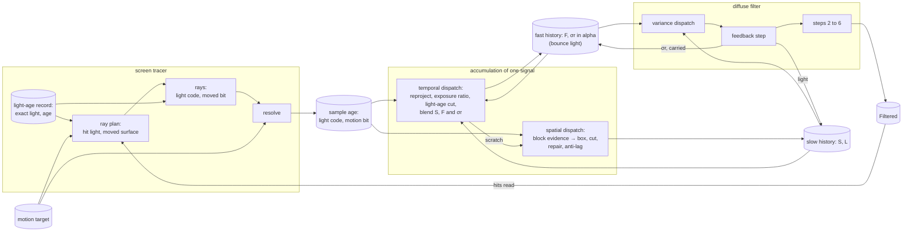

# Bounce-light confidence (Design A, with evidence from the rays)

Ticket `t7-3e22`, under the epic `ter-8hyd` ([renderer-finish.md](renderer-finish.md)). Branch `t7-3e22-retained-deviation`.

- This design folds in `ter-18hc` (the clamp on evidence) and `ter-wkvw` (the light-age cut of the bounce history). Both merge once with it.
- It covers the two cases of `ter-g3tk` that the user assigned to it.
- It fixes the units of `ter-ewua` (bounce light per 2 × 2 block).
- The user chose Design A on 2026-11-12, from two designs in chat. Its first form found evidence of a change with a statistical test of 8 × 8 blocks. Takes T4 to T6 showed that the test cannot see bounce changes at real noise (section 8.1).
- On 2026-11-12 the user chose Design X for the evidence: a block gets evidence from what its rays saw, not from statistics. This document is Design A with Design X's evidence. The retained deviation, the widened box and the filter's carry stay as built.
- The pair agent's research and prototype are in `/private/tmp/pair-mottle/notes.md` and `/private/tmp/pair-mottle/design-a/`.
- The CPU models of the first form are in `/private/tmp/bounce-design/`.

## 1. What the user gets

- Steady bounce light keeps its rare bright samples. Main's clamp leaves three stills at 80 to 94 % of a reference without the clamp. The stills are `rect-lamps`, `bay-sunbeam` and `docking-bay`. Design A's box keeps every region at 97.8 to 99.6 % (take T1a, measured).
- A cause of the mottle in the filter goes. The deviation that the filter's luminance stop reads no longer fades faster than the light that it describes. So a single bright sample no longer grows more conspicuous over the next draws.
- Lights that switch, dim or move: the rays carry the age of the light that they hit. Take a block of 8 × 8 pixels whose rays hit such a light, less than 11 draws after the change began. The block restarts its histories from the fast history. This is faster than main, which waits for the clamp's box to measure the change.
- Objects that move, and the camera's moves: the box of the blocks that see the motion narrows while the motion lasts. That is main's rule, so the follow is main's.
- The reflections get the same evidence of a light change. It replaces their one-sided test of drops.
- In a still view with still lights, nothing narrows the box. Noise, rare bright samples and the filter's own moves can no longer count as a change.
- The GPU cost is about 0.10 to 0.13 ms against main on the deck. The memory cost is 1.8 MB against main and 15.3 MB less than the built block test.
- Some causes of change have no signal (section 9). The wide box follows them at the slow blend, 1/32 per draw.

## 2. The user's decisions (binding)

### 2.1 Design A (2026-11-12)

1. The bounce history's clamp stays on. The pixel's retained deviation σr widens its box. σr is the standard deviation of the pixel's own luminance samples over the slow history's window.
   - σr lives in the alpha of the diffuse fast history.
   - The temporal dispatch reprojects it with the history's taps, scales it by the exposure ratio and updates it with the slow blend.
   - The filter's first pass carries it.
   - The gate (`showsChange`) goes. The light-age cut stays.
2. A test of 8 × 8 pixel blocks counts as evidence of a change. Decision X1 below replaces its mechanism.
3. `ter-18hc` and `ter-wkvw` fold into Design A and merge once with it. So no separate quick fix merges first.
4. Design A covers two cases of `ter-g3tk`. Case (a) is the slow fall after the cabin lamps go out, mostly in the reflections. Case (b) is the sunlit-sill step at world ticks 300 to 306. Decision X3 below moves case (b) to `t0-qwx8`.
5. `ter-ewua` stays one design with Design A. So σr and the evidence use units of independent ray samples.
6. A central variance under the slow blend measures the spread of the samples, not the error of the stored mean. So the design keeps a measured-variance check, a real-light-edge check and the impulse test.

### 2.2 Design X (Alexis, 2026-11-12, after takes T4 to T6)

1. X1. The evidence of a change comes from what the rays saw, per 8 × 8 block, not from statistics. When any of its bounce or reflection rays reached something that changed in the last few draws, a block gets evidence for that draw. The action on evidence of a changed light stays: the narrow box for that draw and a cut of L to `FastCap`. The wide box (σr, `RetainedSigmas` 2) stays in a still.
2. X2. A signal for a moved object joins this merge, so that Design X also covers moved geometry. Section 9 answers the user's question about it.
3. X3. The sunlit sill's −43 % step at world tick 303 is a sampling fault. It goes to `t0-qwx8`, not to a signal.
4. X4. The wide box has a price. A film's median lag error can rise by up to about 0.5 % of the light against main (acceptance 9).

## 3. Terms

| Term | Meaning | Unit and range |
|---|---|---|
| Draw | One rendered frame. | |
| Bounce light | Light that reaches a surface from another surface. The code calls it the indirect diffuse signal. | |
| Reflections | The mirror-like light of a surface. The code calls it the indirect specular signal. | |
| Pre-exposed luminance | The luminance (`luminance` in the shaders) of a demodulated, pre-exposed RGB value. | 0 to `MaxRadiance`, 32,256 |
| Sample x | This draw's light estimate of one pixel, from the resolve. | pre-exposed RGB |
| Slow history S | The pixel's running mean of its samples. Its alpha holds the length L. | pre-exposed RGB |
| Length L | The number of draws that S averages. The bounce cap is 32. Rough reflections have no cap. | 0 to the cap, in draws |
| Fast history F | The pixel's exponential mean of its samples, with the weight 1 / min(L, `FastCap`). `FastCap` is 4. | pre-exposed RGB |
| Slow weight w | The weight of this draw's sample in S: 1 / L after the blend. | 1/cap to 1 |
| Retained deviation σr | The standard deviation of the luminance of the samples that S averages, weighted as S weighs them. | pre-exposed luminance, 0 to `MaxRadiance` |
| Spatial deviation σs | The per-channel standard deviation of the fast histories over the 3 × 3 same-surface pixels around the pixel. | pre-exposed RGB |
| Box | The range into which the clamp moves S: the 3 × 3 mean of the fast histories, plus or minus a half width per channel. | pre-exposed RGB |
| Narrow box | The box with the half width 2 σs (`ClampSigmas`) alone. Main uses it everywhere. | |
| Wide box | The box whose half width is at least `RetainedSigmas` σr. The bounce light uses it without evidence. | |
| Ray block | The 2 × 2 pixels at even coordinates that share one ray of each kind. | |
| Stream | The sample that one ray block's ray gives its pixels in one draw. It is one independent ray sample. | |
| Block | 8 × 8 render pixels at coordinates that are multiples of 8. It is one workgroup of the spatial dispatch and holds 16 ray blocks. | |
| Light-age record | The tracer's per-pixel record of the exact light (the demodulated direct diffuse light and the glow) and the draws since it last changed. A change counts after it lasts 4 draws (`LightChangeDraws`). | |
| Light age | The draws since the record counted a change of a pixel's exact light. | 0 to 16,382 in a ray record |
| Frames seen | For a record that never counted a change, the draws since the record first showed its pixel. | |
| Light code | The light age plus 1, or 0 for no light age. A ray record and a sample age carry it. | 0 to 16,383 |
| Recent light change | A light age below `RecentLightAge`, 7. With the 4 draws that the record waits, the change began less than 11 draws ago. | |
| Moved surface | A pixel whose surface moved in the camera's frame since the last draw by at least `LeastMotion` (section 8.4). | |
| Motion of a sample | Its pixel moves on screen by at least `LeastMotion`, or one of its rays hit a moved surface. | |
| Sample age | The per-pixel R16UI image of each signal that the resolve writes: the youngest light code of the sample's rays and the sample's motion bit. | |
| Evidence level | The finding of a block for one draw: none, motion evidence or light evidence (section 8.2). | |
| Truth | A still from the same binary with both clamps off (section 21). | |
| CV | The coefficient of variation of a pixel's samples: their standard deviation over their mean. | 0 or more |

## 4. The causal model

### The systems diagram



### What causes what

- The scene's light sets the expected value of the samples. A sampling fault can also move it (`t0-qwx8`, section 11).
- The samples feed three stocks of each signal: S with L, F, and σr. The temporal dispatch writes all three in each draw.
- For bounce light, the filter's feedback step writes S's light and σr a second time. It already wrote S's light on main.
- Two stocks hold the evidence of a change, and neither is new. The light-age record holds the age of each pixel's exact light. The motion target holds each pixel's motion.
- The rays carry what they saw to the sample. The ray plan marks each pixel whose surface moved. A ray takes the light code of its hit and the hit's moved mark. The resolve writes the youngest light code of the sample's rays and the sample's motion into the sample age.
- Two readers act on the sample age, and each writes its result into the length L or the box.
  - The temporal dispatch cuts L to the light age of the pixel's own sample (`ter-wkvw`). This is the light-age cut, unchanged.
  - The spatial dispatch forms the evidence level of its block. Light evidence narrows the box for this draw and cuts L to `FastCap`. Motion evidence narrows the box for this draw. The anti-lag then shortens L by the clamp's move, as on main.
- σr is the stored confidence of S. The clamp widens the box by it, and the filter's luminance stop reads it.
- The design keeps the cause of a change apart from the store of its result. The record and the motion target hold the cause. The sample age carries it for one draw. The block's level lives only in the spatial dispatch's workgroup. The result is a shorter L or a narrower box.

### The one model

The slow history estimates the expected light of its pixel. It must average only draws whose rays saw the same scene. So the evidence that bounds a history is the age of what its rays saw.

- The light-age record already holds that age for the exact light of every pixel. A ray brings back the age of its hit.
- Motion has no age: it changes what a ray sees in every draw while it lasts. So motion is evidence for exactly the draws in which it happens.
- The clamp is the per-pixel consistency test. Its box must hold every excursion that S's own samples explain. σr gives that width (section 7). Evidence removes the widening, so that the box tests S against the fast histories.
- Evidence bounds the length. A light change has a known age. The pixel's own sample cuts L to that age. Its block cuts L to `FastCap`, because the fast history already holds the change.
- Motion has no known size. So motion narrows the box, and the box measures the size by the clamp's move.

## 5. One model for the old and the new

This section compares the design with the software-design skill, section 4, "One model for the old and the new".

- The one model: "the age of what the ray saw bounds the history". It covers five mechanisms:
  - main's light-age cut of the reflections.
  - `ter-wkvw`'s cut of the bounce light.
  - FSR's light-change mask, which keeps FSR's history to the new light for 8 frames after a change.
  - the gate's motion test of `ter-18hc`.
  - the new block evidence.
- Reuse. Design X adds no store. The light code rides in the ray records and the sample-age images that the light age already uses. The moved mark rides in the unused alpha of the hit light. A narrower light code frees one bit in the ray record and in the sample age, and the mark rides there too. The receiver's motion is the motion target, which the gate already read with the same threshold, `LeastMotion`.
- Extraction. One include, `sample_age.glsl`, holds the layout of the sample age for the resolve, which writes it, and the two accumulation dispatches, which read it.
- Distillation. The light-age cut, the anti-lag, the gate and the block test were four mechanisms. They are cases of one idea: evidence bounds the length of a history, and the box measures what the evidence cannot size.
- Removal. The statistical test, its block sums, the own-sample mean R, the reflections' deviation images and the test's five constants go (section 13). They existed only for the statistic.
- One exception remains, with a named misbehavior. The reflections keep the narrow box, so their `RetainedSigmas` is 0. They have no spatial filter, so a rare sample in their box shows as a speck. Without their clamp they showed twice as many specks.
- The gate was a switch of the clamp itself. It does not come back. Motion evidence only removes the widening, and the narrow box is always on.

## 6. The retained deviation σr

### Definition

σr is the exponentially weighted standard deviation of the luminance of the samples that S averages. Its weight is 1 / min(L, `DeviationFrames`). For bounce light that is S's own blend weight, because the bounce cap is 32.

The rule is the standard incremental form of a weighted variance (Finch 2009). Finch made it for one stationary stream of numbers. Here each pixel is one stream, reprojected from draw to draw, and changes of light break the stationarity. Section 8 says how evidence acts on that.

### The update, in the temporal dispatch

This replaces main's update of the fast deviation in `accumulate_temporal.comp`, inside `if (hasSample)`:

```glsl
historyLength = min(historyLength + 1.0, cap);
float before = luminance(fast);
float weight = 1.0 / min(historyLength, DeviationFrames);
float step = luminance(sampled) - before;
step = abs(step) * weight <= BlendRounding * before ? 0.0 : step;
deviation = min(sqrt((1.0 - weight) * (deviation * deviation + weight * step * step)), MaxRadiance);
slow.rgb = historyLength <= 1.0 ? sampled : slow.rgb + (sampled - slow.rgb) / historyLength;
```

where

- `slow.rgb` = S after reprojection, the exposure ratio and the light-age cut, before this draw's blend.
- `fast` = F after reprojection and the exposure ratio, before this draw's blend.
- `before` = the luminance of that F.
- `historyLength` = L after the light-age cut. The first line adds this draw.
- `cap` = the pixel's cap: 32 for bounce light, and from 4 to unbounded by roughness for reflections.
- `DeviationFrames` = 32, the bounce cap. A half-float store cannot follow a weight below about 2^−11.
- `weight` = the weight of this draw's sample in σr. It is 1 for the first sample, which gives σr = 0.
- `sampled` = this draw's finite sample.
- `step` = the sample's luminance minus the luminance of F.
- `BlendRounding` = 1/768, the share of a step that the store's rounding explains (below).
- `deviation` = σr after reprojection, and after its line the updated σr.
- `MaxRadiance` = 32,256, the largest light that the signal stores.

The step goes from F, not from S (changed in step 2a, 2026-11-12). The filter's feedback step writes the light that it moves into S, so S is not the mean of the pixel's own samples. A step from S counted that moved light as spread. Take a stable edge of light. The first draws' young estimate moved light across the edge. That light raised σr on the dark side, which held the luminance stop open, which moved more light: the dark pixel beside the edge of `AnEdgeOfLightKeepsItsShapeBesideNoise` held 1.5 instead of 0 after 200 draws. F is the mean of the pixel's own samples, and the filter never writes it. For independent samples a step from F raises σr by √(1 + wf / (2 − wf)), 7 % at wf = 1/4.

A half-float blend of weight w stalls within about 1/w half-float steps of a constant sample. One half-float step is at most 2^−10 of the value. So a step with |step| · w ≤ (4/3) · 2^−10 · S is store rounding, not noise. Main's `RoundingShare`, 1/192, is this rule at the fast weight 1/4.

### The rules through every operation

| Operation | What happens to σr | Why |
|---|---|---|
| Reprojection | The temporal dispatch reads σr with the history reader's taps and weights, as for S and F. | A weighted mean of the taps' deviations keeps the box's bound (section 7) for the weighted mean of their light. |
| Exposure change | σr takes the exposure ratio, at most `MaxRadiance`. | σr has the units of the history. |
| Rejected history, reset | L is 0. So the first blend has w = 1 and gives σr = 0. | No special case. |
| No finite sample | σr stays, as S and L stay. | Main's rule. |
| Light-age cut | Only L changes. The next blend weighs σr with 1 / (L + 1), as it weighs S. | σr follows the weights of S. |
| Young-history repair | The spatial dispatch does not repair σr. | No reader takes σr at those lengths (below). |
| Clamp | σr does not change. | σr is the spread of samples, and a clamp changes no sample. The anti-lag already turns the move into a shorter L. |
| Evidence (section 8) | σr does not change. After a cut to `FastCap`, the next blends weigh σr with 1/5, 1/6 and on. | σr measures the spread again within a few draws. |
| Filter feedback step | The step carries σr with the light. | Section 7, "The write-back". |
| Filter steps 2 to 6 | They store no σr. Their output deviation follows main's rule. | Section 7. |

The pair's prototype added the clamp's move to σr. That made σr a mixed quantity, so this design does not take it.

The repair acts below `HistoryFixFrames` (4). The clamp and the cut act above `FastCap` (4). The filter's variance dispatch uses its young estimate below `YoungFrames` (4). So no reader takes σr of a repaired history. A contract in `TemporalSignal` states `HistoryFixFrames` ≤ `FastCap` + 1.

A real change of light inflates σr for a while, because the step counts as spread. The inflation widens the box after the evidence ends. By then S follows the new light, so the wider box holds no old light (section 8.3). No detector reads σr, so the inflation hides no change.

### Where σr is stored

- Bounce light: the alpha of the diffuse fast history, RGBA16F, two images by draw parity. It replaces main's fast deviation, which no reader needs after this change. The user chose this store.
- Reflections: none. Their fast alpha holds the hit distance that the reflected-place test reads (`sameHitBits`). The block test kept their σr in an R16F image pair for its pooled noise. Design X has no pooled noise, so the pair goes (section 13). A later widened box for the reflections can bring it back.
- `retainedDeviationAt` reads the fast alpha for the diffuse light and gives 0 for the reflections.

## 7. The clamp's box and the write-back

### The box

```glsl
vec3 spread = parameters.clampSigmas * sigma;
if (parameters.retainedSigmas > 0.0 && evidence == NoEvidence)
    spread = max(spread, parameters.retainedSigmas * deviation * slow / max(luminance(slow), LeastLuminance));
vec3 clamped = clamp(slow, mean - spread, mean + spread);
```

where

- `sigma` = σs, the per-channel spatial deviation of the fast histories over the 3 × 3 same-surface pixels.
- `mean` = the per-channel mean of those fast histories.
- `parameters.clampSigmas` = `ClampSigmas`, unchanged: 2 for bounce light, 1.5 for reflections.
- `parameters.retainedSigmas` = `RetainedSigmas` of the signal's confidence rules (section 13): 2 for bounce light, 0 for reflections.
- `evidence` = the evidence level of the pixel's block in this draw (section 8). Both levels drop the widening.
- `NoEvidence` = the level of a block whose rays saw no recent light change and no motion.
- `deviation` = the pixel's σr after this draw's update.
- `slow` = S after the blend and the repair, before the clamp.
- `LeastLuminance` = 10^−4, the floor that the lag already uses.
- `spread` = the half width of the box per channel.
- `clamped` = S after the clamp. The anti-lag then shortens L by the move, unless light evidence cuts L to `FastCap`.

The widening takes the chroma of S, not of the box's mean. The excess that the widening must hold is part of S. The fast mean can fall to 0 between rare hits on a dark surface. An example is the floor 4.95 m from the glowing panel of `ter-18hc`.

The box takes the larger of two half widths, not their sum. The probe's analogue (`TERTIUS_T7_BOXDEV`) did the same. It widened the box by twice the fast deviation and kept 92 to 98 % of the truth.

### Why rare samples stay inside the box

Take a mature pixel with steady samples, so σr ≈ 0. One sample brings an excess X. The blend moves S by wX. The update makes σr² = (1 − w) w X². So the excess of S is √(w / (1 − w)) σr.

At the cap, w = 1/32, so the excess of S is 0.18 σr. Each later draw shrinks the excess by the factor (1 − w). It shrinks σr² by at most the factor (1 − w), so the ratio only falls. The clamp acts only above `FastCap`, where w ≤ 1/5. There the ratio is at most 0.5.

`RetainedSigmas` = 2 leaves room for the center of the box. The center is the fast mean, which lies below the expected light between rare hits.

The CPU model `/private/tmp/bounce-design/clamp.py` runs one sample per ray block, the thin filter with its write-back, the anti-lag and the box. It gives the shown light over the truth, over draws 200 to 500:

| Rare samples | No clamp | Narrow box | Wide box |
|---|---:|---:|---:|
| 1 in 32, 16 × the base | 0.996 | 0.856 | 0.996 |
| 1 in 128, 64 × the base | 0.988 | 0.840 | 0.988 |
| 1 in 8, 4 × the base | 0.999 | 0.936 | 0.999 |

Take T1a measured the same on the GPU: the wide box keeps 97.8 to 99.6 % of the truth in every region of the three stills, main 79.6 to 94.2 %. `RetainedSigmas` 3 differed from 2 by at most 0.03 points, so it stays 2.

One edge case remains. Take a rare light whose chroma in one channel exceeds the chroma of S by more than 11 times at the cap. That channel loses part of its light. At L = 5 the factor is 4. A saturated lamp, seen only by rare rays on a surface of another color, can do that.

The dead-end list of `renderer-finish.md` holds "a wider clamp box", which lost light or gained under 12 %. That box was a constant widening, which also holds lag. This widening follows each pixel's own spread, and evidence removes it where a ray saw a change or the view moves.

### The write-back

The filter's feedback step writes its light into S, as SVGF feeds back its first step. It also writes the deviation of that light into the store. It carries the deviation with the light, by the same shares:

```glsl
vec3 filtered = centerLight.rgb + moved;
float carried = min(kept * max(centerLight.a, 0.0) + carriedSum, MaxRadiance);
...
if (parameters.feedback != 0u && slowLength >= YoungFrames)
    imageStore(fastHistory, pixel, vec4(imageLoad(fastHistory, pixel).rgb, carried));
```

where

- `centerLight.a`, `light.a` = the variance dispatch's output deviation of the pixel and of a tap. A negative value marks a young estimate (below).
- `carriedSum` = the sum over the taps of `share * max(light.a, 0.0)`. Young taps carry nothing into the store.
- `kept` = the share of its own light that the pixel keeps: 1 minus the sum of the shares.
- `share` = the weight of one tap.
- `moved` = the light that the step takes from the taps.
- `slowLength` = the pixel's own L, from the alpha of its slow-history texel.
- `YoungFrames` = 4, the young limit of the variance dispatch.
- `fastHistory` = this draw's diffuse fast history, binding 3 of the filter set.
- `carried` = the deviation that the step stores.

The variance dispatch marks a young estimate with a negative sign. The edge stops and the step's output read its magnitude. The output deviation of the feedback step, which step 2 reads, is `kept * |centerLight.a| + Σ share * |light.a|`. Steps 2 to 6 keep main's rule, √(kept² σp² + Σ share² σq²).

The reasons:

- A pixel's excess after the step is `kept * e_p + Σ share * e_q`. Take each excess as at most 2 σr. Then the result is at most twice the carried sum, for any correlation of the taps.
- So the linear rule keeps the bound of the box for light that the filter moves into a quiet pixel. That removes the class of `td-hjn6`, where the clamp cut such light.
- The squared rule at the feedback step shrinks the stored σr by the factor 0.375 in every draw. In the CPU model, that brought back the late sharpening. The impulse's peak rose from 0.0086 to 0.30 by draw 8.
- The pair's prototype used the linear rule in every step. The CPU model `transport.py` has a 2:1 edge of light under noise. There the prototype's rule widened the edge's 10 to 90 % rise from 10 pixels to 32 pixels. It also moved the mean light 12 pixels or more from the edge.
- The user's decision names the first step only. With the paper's rule in steps 2 to 6, the edge is 12 pixels under Gaussian noise in the CPU model. The GPU measured 18 pixels (step 2c, open point 3).
- A young pixel keeps its own σr in the store. Its young estimate is the spread of the fast histories over 7 × 7 same-surface pixels, so it includes the light's own edges. Stored, a young estimate decays at the slow pace and keeps the stop open across a real edge for about 100 draws.

The CPU impulse model (`transport.py` and `peaks.py`) has a mature field of 1 and one ray block of 101 in one draw. It runs the thin kernel and the write-back, without a clamp:

| Variant | Peak at draw 0 | Largest later peak | Peak at draw 32 | Total excess at draw 32 |
|---|---:|---:|---:|---:|
| Main: fast deviation, squared rule | 0.0049 | 0.2057 at draw 32 | 0.2057 | 4.526 |
| Design A: σr, linear at the write-back, squared after | 0.0066 | 0.0067 at draw 1 | 0.0023 | 4.526 |
| The prototype: σr, linear in every step | 0.0049 | none | 0.0011 | 4.526 |

Every variant keeps the total excess at 12.5 × (31/32)^k. So the filter moves light and makes none. The GPU test of step 2c measured a peak of 1.015 times the first and 0.36 of it after 32 draws.

## 8. Evidence from the rays

### 8.1 Why the statistical block test went (dated records)

The first form of Design A compared each block's fast mean with its own-sample mean. It tested the difference against the pooled noise of the block's streams, in windows of 1, 3 and 7 blocks, under a tail rule. Its code is on the branch (steps 4 to 7). Three takes ended it:

- 2026-11-12, take T3, filter test (workbench job `filter-ab`). The filter's write-back moved light into S, so F − S was not 0 in a still: 2.1 × 10^−2 false windows per block-draw with the filter on, 1.9 × 10^−4 with it off. The own-sample mean R replaced S in the statistic (`t0-y4qv`).
- 2026-11-12, take T3 with R (job `t3-own`). `rect-lamps` still failed: its hits read filtered light with slow blotches, so neighboring samples shared a wave of up to about 21 % of the light. The sweep found constants that passed all four stills: `BlockSigmas` 5, `BlockNoiseScale` 1.5, `TailStreams` 2,000 and floors of 1/4 and 1/20.
- 2026-11-12 to 13, takes T4 to T6 (Mac and job `t456`). The calibrated test almost never fired. The tail rule needs n ≥ `TailStreams` × `BlockNoiseScale`² × κ² × CV² streams. The measured bounce CV is about 2.5 in the halls and about 57 in the cabin. A 7 × 7 window holds at most 784 streams. So the test can fire only where CV ≤ 1.3, and never in the cabin. The calibration reached zero false evidence by silencing the test.

What that cost, from the T4 to T6 notes of `t0-4fth`:

| Case, Mac | Main | Design A, wide box | Design A, narrow box |
|---|---|---|---|
| Cabin switch, bounce alone: draws to settle, lamps off / on | 60 / 65 | 119 / not settled | 75 / 95, the whole image stays about 4 % low after the lamps come on |
| Cabin switch, reflections alone | | 142 / not settled | |
| Spot-lamp lag film (`lamp-hall-64-spot-moving`): median lag error, share of the light | 0.0087 to 0.0107 | 0.0143 to 0.0159 | 0.0108 to 0.0128 |

Without evidence, the wide box follows a change only at the slow blend, 1/32 per draw. Step 10 finds the cause of the narrow box's 4 % plateau (section 23), because the plateau can also affect Design X.

### 8.2 The two evidence levels and their actions

The evidence level of a block is a closed set of three values, ordered by strength. A block takes the strongest level of its pixels' samples in this draw.

| Level | When a pixel's sample has it | Action on every pixel of the block with L > `FastCap` |
|---|---|---|
| `NoEvidence` (0) | Neither below | The bounce light's wide box. The reflections' narrow box. The anti-lag as on main. |
| `MotionEvidence` (1) | The sample saw motion: its pixel moves on screen by at least `LeastMotion`, or one of its rays hit a moved surface | The narrow box for this draw. The anti-lag shortens L by the clamp's move, as on main. |
| `LightEvidence` (2) | One of its rays hit a recent light change: the sample's youngest light code is 1 to 7 | The narrow box for this draw, and L becomes `FastCap`. |

The reasons for two actions:

- A light change is certain and has an age. The fast history already holds most of it. So the block restarts S from the fast window, as decision X1 asks.
- Motion has no known size. A crowd that walks past a wall changes the wall's bounce light a little. A door that opens changes it a lot. The narrow box measures the size by the clamp's move.
- A cut to `FastCap` also makes every pixel of the block trace its own rays. The ray plan gives a pixel its own rays while L < `FullRateFrames`, 8. Motion lasts as long as the camera or the object moves. With a cut on motion, every block that sees a walk or a moving crowd keeps the full ray rate the whole time. On the deck's camera cuts, where every pixel traces its own rays, the mean frame span was 21.9 ms (ARCHITECTURE.md, "The screen tracer").
- So motion evidence narrows the box but does not cut. Open point 1 of section 19 asks the user to choose this for a moved object.

The reflections' box is always narrow. So for them motion evidence changes nothing, and only light evidence acts.

### 8.3 How long a light change stays recent

`RecentLightAge` = 7. For the light ages 0 to 6, that is the light codes 1 to 7, a light change is recent.

- When the evidence ends, the bounce light's box widens again. Then S follows only at 1/L. So by then F must hold the change within the settle tolerance of acceptance 5, 5 %.
- F blends with the weight 1/`FastCap` = 1/4. After k draws of the new light it keeps (3/4)^k of a step. (3/4)^11 = 0.042, and (3/4)^10 = 0.056. So F needs 11 draws.
- The record counts a change after it lasts `LightChangeDraws` = 4 draws, and then sets the age to 0. So at the light age a, F holds a + 4 draws of the new light. The last recent age, 6, gives 11 draws.
- While the evidence lasts, the narrow box holds S within 2 σs of the fast mean, and each draw cuts L to `FastCap`. So when the box widens, S lies near F.
- A block whose rays miss the changed light in one draw gets no light evidence in that draw. Its L then grows by 1, and the next draw with a ray on the change cuts it again. The cut needs no memory across draws, because the record's age counts the time.
- The existing analogue is FSR's `LightChangeMaskFrames`, 8, which keeps FSR's history to the new light for 8 frames after the record counts a change. The two numbers have separate reasons and stay separate constants.

Motion counts in the draws in which it happens. After it stops, S has had the narrow box during the motion, so it holds no old view.

### 8.4 Where each part runs

Five passes each add what only they know. No pass stores a new image.

1. The ray plan, one invocation per pixel q, already writes q's light-age record and its hit light. It now also decides whether q's surface moved in the camera's frame. It writes 1 into the alpha of both layers of the hit light where it did, else 0. The alpha was 0 and had no reader.

   ```glsl
   // Sketch, screen_trace_plan.comp.
   bool movedSurfaceAt(ivec2 pixel, vec4 motion)
   {
       vec2 lastPlace = lastPlaceAt(pixel);
       vec2 stillPlace = stillLastPlaceAt(pixel);
       float apart = length((lastPlace - stillPlace) * frame.viewport.xy);
       float rounding = MotionRounding * length(motion.xy * frame.viewport.xy);
       return apart >= max(LeastMotion, rounding) || abs(motion.z - stillDepthRatioAt(pixel)) > MotionRounding;
   }
   ```

   where

   - `motion` = q's motion target: xy the last place minus this place in units of the image, z the last view depth over this view depth.
   - `lastPlaceAt` = q's place in the last frame from its motion target, the function that the record already uses.
   - `stillLastPlaceAt` = the last place of a point that stays still in the camera's frame at q's position: `lastPlaceOf(lastClipOf(point − frame.previousEye.xyz))`, as `reflectedPlaceOf` in `accumulate_temporal.comp` computes it. It must follow the same jitter rule as `lastPlaceAt`, so that a still surface gives 0 up to rounding. The builder takes both from one place rule.
   - `stillDepthRatioAt` = the last view depth over this view depth of that still point.
   - `frame.viewport.xy` = the render size in pixels.
   - `LeastMotion` = 1/32 pixel per draw, the gate's threshold of `ter-18hc`, now in `sample_age.glsl`.
   - `MotionRounding` = 2^−10, twice the relative rounding of a half float. The motion target stores half floats, so a fast camera move leaves a rounding of up to 2^−11 of the motion in each value.
   - A new instance has no last place. Its motion is (2, 2), two images away, so it counts as moved.

2. A ray (`traceFrom`) already loads its hit's light from the hit light image and its light age from the record. It takes the hit's moved mark from the same load, where the hit's light counts (`fade > 0`, as for the age). The record keeps it in bit 15 of `w` (section 8.5).

3. The resolve, one invocation per pixel p, already writes each signal's youngest light code into its sample age. It now also writes the sample's motion bit: one of the rays that the sample takes light from carries the moved mark, or p itself moves on screen by at least `LeastMotion`. The specular sample takes the same rays for the bit as for its code (`handOver`).

   ```glsl
   // Sketch, screen_trace_resolve.comp.
   bool moves = movesOnScreen(pixel);
   uint diffuseCode = diffuseRay.brings ? ageCodeOfRecord(diffuse.ray) : 0u;
   bool diffuseMoved = diffuseRay.brings && movedHitOfRecord(diffuse.ray);
   imageStore(diffuseSampleAge, pixel, uvec4(sampleAgeOf(diffuseCode, diffuseMoved || moves)));
   ```

   where

   - `movesOnScreen` = whether p's motion target, in pixels, is at least `LeastMotion` long. The camera's moves and the object that carries p both count.
   - `ageCodeOfRecord` = the light code of a record, as now, with the moved bit masked out.
   - `movedHitOfRecord` = bit 15 of the record's `w`.
   - `sampleAgeOf` = the sample age's layout (section 8.5).

4. The temporal dispatch reads the light code of its pixel's sample age and cuts L to the light age, as now (`ter-wkvw`). It masks out the motion bit with `lightCodeOf`.

5. The spatial dispatch, one workgroup per block, forms the block's level and acts on it in the same workgroup:

   ```glsl
   // Sketch, accumulate_spatial.comp.
   shared uint blockEvidence;

   uint evidenceOfSample(uint sampleAge)
   {
       uint code = lightCodeOf(sampleAge);
       if (code != 0u && float(code - 1u) < RecentLightAge)
           return LightEvidence;
       return sawMotion(sampleAge) ? MotionEvidence : NoEvidence;
   }

   uint evidenceOfBlock(ivec2 pixel)
   {
       if (gl_LocalInvocationIndex == 0u)
           blockEvidence = NoEvidence;
       barrier();
       if (insideImages(pixel))
           atomicMax(blockEvidence, evidenceOfSample(imageLoad(sampleAge, pixel).r));
       barrier();
       return blockEvidence;
   }
   ```

   where

   - `sampleAge` = the signal's sample-age image, signal binding 11, which the spatial dispatch now also reads in its light-age variants.
   - `lightCodeOf`, `sawMotion` = the two fields of a sample age (section 8.5).
   - `blockEvidence` = the block's level, shared by the 64 invocations of the workgroup.
   - `insideImages` = whether the pixel lies inside the render size. Sky pixels have a sample age of 0, so they add nothing.

   `main` calls `evidenceOfBlock` before any branch. A signal without a light age compiles without it and passes `NoEvidence`. The action:

   ```glsl
   historyLength = evidence == LightEvidence
       ? fastCap
       : max(fastCap, historyLength * (1.0 - min(1.0, lag / parameters.antiLagShare)));
   ```

   where

   - `historyLength` = L after the blend and the repair.
   - `fastCap` = the pixel's `FastCap`.
   - `lag` = the clamp's move as a share of the box's mean.
   - `parameters.antiLagShare` = the anti-lag's share.

   The cut acts only inside `if (historyLength > fastCap)`, as the clamp does.

The block is the spatial dispatch's workgroup, as decision X1 asks. The action covers every contributing pixel of the block. That includes pixels of an unchanged surface inside the block, which get a few noisier draws. A per-pixel rule leaves a speckle of cut and uncut pixels, which shows more than a block of slightly noisier light that the filter smooths.

### 8.5 The bit layouts

| Value | Bits | Writer | Readers |
|---|---|---|---|
| Ray record `w` (RGBA16UI `w` of `blockRay` and `ownRay`) | 0: `RayTraced`. 1 to 14: the hit's light code, at most 16,383 (light age ≤ 16,382). 15: the hit's moved mark | `recordOf`, in the rays' passes | The resolve |
| Ray record `w` under the light-age diagnostic | 0: `RayTraced`. 1 to 14: the diagnostic's field, an age code below `SeenField` = 0x2000 or `SeenField` plus a never-changed hit's frames seen, at most 0x1FFF (age ≤ 8,190). 15: the moved mark | `recordOf` | The resolve |
| Sample age (R16UI, one per signal) | 0 to 14: the youngest light code of the sample's rays. 15: the sample's motion bit | The resolve | Temporal dispatch (code), spatial dispatch (code and bit), the test fixture `SamplePass`, `tools/Tertius.ReflectionReference` |
| Hit light alpha (RGBA16F array, both layers) | 0 or 1: whether the pixel's surface moved | The ray plan | A ray's hit |

- The light code of a record had 15 bits. Now it has 14, so a light age above 16,382 codes as 16,382. That changes no cut while a history holds fewer than 16,382 draws, the rule that the diagnostic's codes already follow. Under the diagnostic the codes stop at 8,190, by the same rule.
- `sample_age.glsl` holds `SampleMotionBit`, `LightCodeMask`, `RecentLightAge`, `LeastMotion`, `sampleAgeOf`, `lightCodeOf` and `sawMotion`. The tracer and both accumulation dispatches include it. `screen_trace.glsl` keeps the record's own layout, as now.
- The record keeps 8 bytes per pixel, and the sample age 2. The hit light keeps its format.

### 8.6 Vulkan portability and determinism

- No subgroup operations.
- Both barriers of `evidenceOfBlock` run in uniform control flow: `main` calls it before any branch, and the variant decides at compile time whether it exists. So the spatial dispatch keeps no early `return` before it.
- `atomicMax` on a `shared uint` is core GLSL for compute shaders in Vulkan. It needs no device feature. A maximum does not depend on the order of the invocations, so one machine gives the same bits in every run.
- No division in the level, and no `clamp` of a value that can be NaN. The plan's comparisons take finite motion: a new instance's (2, 2) is finite.
- The hit light's alpha holds 0 or 1, which a half float holds exactly.
- R16UI storage needs `shaderStorageImageExtendedFormats`, which the renderer already requires. No new device feature.

## 9. Every cause of a changed ray, and its signal

The user's question about the moved-object signal:

> "If we add a signal for a moved object somehow, then we can go with design X, which is faster and more reactive and lighter for everything else, and it will be fine, right?"

The answer: mostly yes. The light age already covers lights that switch, dim or move, and shadows that move onto still surfaces. A moved-object mark from the motion vectors covers rays that hit a moving object. The receiver's own motion covers everything that the camera's moves change, as the old gate did. Two things are not as hoped:

- A moved object narrows the box and does not cut the history (open point 1). A cut makes the pixels trace their own rays for as long as the object moves.
- Some causes stay without a signal: the sky's light, a surface lit only by bounce light, a base color, a background that a moving object uncovers, and the sill's sampling fault. The wide box follows those at 1/32 per draw.

A ray's result is the light that it brings to its sample. These causes change it:

| # | Cause | Signal in Design X | Coverage | What follows where it misses |
|---|---|---|---|---|
| 1 | A light switches, dims or brightens, or a glow changes | The light age of the hit: light evidence | Exact for a change of more than 2 % of the 3 × 3 range and the cutoff floor, counted 4 draws after it starts | A smaller change shows on no pixel. A slow dimming counts each time it leaves the range |
| 2 | A light moves: a lamp, a spot, the sun's turn | The light age of each hit whose direct light changes: light evidence | Exact on the surfaces that the screen shows | |
| 3 | An object or its shadow moves onto a still surface | The light age of that surface: its exact light is the direct diffuse light, which the shadow changes. Light evidence. The moved mark does not fire, because the surface is still | Exact, as 1 | |
| 4 | An object moves into a ray's path: the ray now hits it | The moved mark of the hit: motion evidence | Exact for a motion of at least `LeastMotion` per draw, as the camera sees it | A slower object: its light changes reach the record as 1 and 3. The rest follows at 1/32 per draw |
| 5 | An object moves out of a ray's path: the ray now hits the still surface behind it | None for that ray | Partial: the block's rays that hit the object itself carry its mark (4), and its shadow and light reach the record (3) | The background's light follows at 1/32 per draw |
| 6 | An object appears or goes | Appears: its motion is (2, 2), so its pixels are moved (4). Goes: as 5 | Exact for a new object. Partial for a removed one | As 5 |
| 7 | The receiver's surface moves, carried by an object | The receiver's own motion: motion evidence | Exact while it moves | |
| 8 | The camera moves or turns. A hit leaves the screen, and its ray falls back to the sky's light. A hit becomes hidden behind a still surface. A hit enters the screen or is uncovered | The receiver's own motion: every pixel moves on screen while the camera moves. Motion evidence | Exact in time: for every draw of the camera's move. The box measures the size | After the camera stops, no evidence. S had the narrow box during the move, so it holds no old view |
| 9 | The hit's own bounce light changes (a second bounce) | The hit's light age, where its direct light changed too. None for a hit lit only by bounce light | Partial | Such a hit's bounce light follows its own blocks' evidence, so it settles fast. The receiver follows the rest at 1/32 per draw. Open point 4 names a lever for a take that shows it |
| 10 | The bounce light converges after a reset or a cold start: each draw adds one bounce, because hits read the last draw's filtered light | None: the receiver's own history starts empty, and the record knows no change | Not a change of the scene. The truth converges at the same pace (take T1b: 86.0 % of its long mean at draw 132 in `rect-lamps`). Main's clamp hides it by holding a level 20 % lower | |
| 11 | The sky's or the environment's light changes: the light of a ray that misses | None | Missing. Sunlit surfaces get the light age (2) | A region lit only by the sky follows at 1/32 per draw |
| 12 | The exposure changes | None needed: every history and every hit takes the exposure ratio | Exact by construction | |
| 13 | The receiver itself is newly shown (disocclusion at the ray's origin) | None needed: its history resets to L = 0 | Exact by construction | |
| 14 | A hit's material changes: base color, roughness, metalness | None: the record's light is demodulated. A glow change counts (1) | Missing for a base color | Follows at 1/32 per draw. The game has no such change yet |
| 15 | The jitter lands on a sub-pixel strip: the sunlit sill at world tick 303 | None, by decision X3 | Missing | `t0-qwx8` removes the fault |
| 16 | A hit's direct specular light changes alone, for a reflection ray | The light age leaves out the direct specular light. A light that moves also changes the diffuse light (2). The eye's move is the camera's (8) | Partial | Follows the narrow box and the anti-lag, as on main |
| 17 | The filter's write-back, the clamp or the young-history repair moves light in S | None needed: they change no ray's expected light | Evidence never reads S, so none of them can look like a change. The statistical test did not tell them apart (section 8.1) | |
| 18 | The hits read the last draw's filtered light, whose blotches wander | None needed: not a change of the expected light | As 17 | |
| 19 | The noise of the samples and their rare bright hits | None needed | The wide box holds them | |

Puffs and transparent objects are not in the depth that the rays walk, so no ray hits them.

The orchestrator suggested three things. The verdicts, from the code:

- The moved signal as the hit's motion minus the camera's motion: right for the screen tracer. The ray plan computes it once per pixel, because it already reads each pixel's motion and record. It hands it to the hits in the hit light's unused alpha, so no hit makes an extra read.
- A hit that left the screen or became hidden since the last draw, as a change: a ray keeps no memory of its last hit, so "became hidden" cannot be seen per ray. The hidden surface cannot be hit, and the ray now hits an old still surface. "Left the screen" can be tested per ray. But both happen only while the camera moves, and then every receiver moves on screen. So the receiver's own motion covers both, for exactly those draws, with no work in the tracer. The design takes that.
- A shadow that moves onto a still surface: the light age at the hit covers it. The record's exact light is the surface's direct diffuse light, which the shadow changes. The record counts it after 4 draws, as it counts a switch. The moved mark correctly stays off.

## 10. The reflections and case (a) of `ter-g3tk`

Case (a): the cabin lamps go out. Four draws later the light-age cut restarts the reflections' history. Then the uncapped history averages the reflected bounce light while that bounce drains, and nothing cut it again. On main, the reflections took 128 draws to settle and the bounce light 20 to 57. A cap of 32 settles them in 92 draws, but it nearly triples the specks of `rect-lamps`.

Design X gives the reflections three things:

1. Light evidence for their blocks. A reflection ray that hits a surface whose light changed carries the light code. For 7 light ages, the block cuts L to `FastCap`. Their box is already narrow.
2. The light-age cut of the pixel's own history stays, as on main.
3. A faster drain of the bounce light. The reflection rays read the hit pixel's bounce light, and the bounce blocks restart from their fast window on the same change.

The reflections had a one-sided test of drops, because their narrow box lowers S below F. Design X reads no statistic, so the side does not matter. A rise and a drop of the reflected light both give light evidence where a ray saw the change.

Motion evidence narrows the box of a block. The reflections' box is always narrow, so motion changes nothing for them.

After the evidence ends, the reflected bounce light can still drain for a while. The uncapped history then grows from 5 and averages the rest of the drain. The narrow box and the anti-lag follow a drop as on main. If the cabin's lamps-off case still misses 60 draws, two levers remain, and the choice goes to the user (open point 2):

- Less reflection noise: the sweep's resolve over four ray blocks cut grain by 24 to 59 %, at an estimated 0.4 to 0.6 ms.
- A shorter reflection history after a change, at the cost of more specks during it.

The cut rule without its 25 % condition (`cr-pkzd`) merged into main first. It lowers the jump after lamps off from +72 % to +42 %. Design A takes it for both signals.

## 11. Case (b) of `ter-g3tk` and the write-back climb

### The sunlit-sill step

At world tick 300 to 306 the sun turns against the ship. Some sunlit strips on the window sills are thinner than a render pixel. The turn changes which jittered sample positions land on them.

- The unbiased mean of the single-bounce samples of the cabin's region r11 falls by 43 %. The direct sunlight on the strips rises by 2 %.
- The light-age record sees only those few sill pixels, so no ray brings a light change to most of r11's blocks.
- This is a sampling fault. The expected value of the estimator depends on where the strips lie among the jitter positions.

By decision X3, Design X gives the step no signal. The wide box follows it at 1/32 per draw. `t0-qwx8` removes the fault itself: the light at a hit must not depend on whether a jittered sample lands on a sub-pixel strip. Regions r10 and r12 of the honest walk measure wander by ±5 % for the same reason. Acceptance 7 records the stand film and no longer requires it.

### The write-back climb

At a fixed state, the single-bounce light of the far-ceiling band climbs to about 1.6 times its reference over about 200 draws. Then it collapses and climbs again. With the filter off, it stays flat. The thin kernel climbs too.

- The probable cause is the impulse's mechanism. A luminance stop whose deviation shrinks too fast acts as a diffusion that moves light up a gradient. Here it moves light into the band where the ceiling meets the far wall.
- In single bounce, the hits do not read filtered light. So the climb comes from the write-back into S.
- Design A acts on it once: the stored σr no longer shrinks at the write-back, which removes the concentration in the impulse model. Design X adds nothing here, because no ray sees a change.

Take T2a (step 3) measured it. The band's peak is 97 % of the same build's band with the filter off. Main's is 110 % of its own, and main's clamp loses part of the band's light. So acceptance 11's required check holds. The target, a band within 10 % of its single-bounce light with the filter off, needs take T2b. If the target fails, the climb stays in `ter-g3tk`. Its next step is a take with the write-back off and the filter on.

## 12. Borrowed techniques and their source situations

| Technique | Made for | Our situation | What we take |
|---|---|---|---|
| Variance clipping (Salvi 2016) | Temporal anti-aliasing of rasterized color. One sample per pixel per frame, no Monte Carlo noise. The current 3 × 3 neighborhood shows every color a pixel can have. | One ray per ray block with rare bright hits. A 3 × 3 neighborhood holds two to four independent samples. The narrow box cut 8 to 23 % of the light. | The box as the per-pixel lag test. Its width follows the history's own spread over time, and evidence narrows it. |
| Gradient estimation, A-SVGF (Schied and others 2018) | Path tracing at 1 sample per pixel at 1080p. One sample per 3 × 3 stratum is shaded again with last frame's random numbers, so the gradient has almost no noise. | Screen-space rays with new random numbers each draw. Shading again costs about 11 % more diffuse rays and new tracer images, past the budget of 20 storage images. | Only the idea that a regional change shortens the history. Our evidence is not a gradient: it is the age that the rays bring back from the record, which costs no rays. |
| Variance-guided filtering, SVGF (Schied and others 2017) | 1 sample per pixel. Color and moments over about 5 frames, a spatial estimate below 4 frames, and a squared-weight variance that assumes independent taps. | One ray per ray block, so the taps correlate. A 32-draw color history. The pair's audit found main's recurrence 1.65 to 19.6 times overconfident. | Matched windows: σr over the color history's own window. A write-back rule that holds for any correlation. The paper's rule in steps 2 to 6. |
| FSR 3.1's transparency and composition mask (AMD) | An upscaler that trusts its history by the motion vectors. The renderer marks the pixels whose shading does not follow them, so that the history keeps to the current frame there. | Already in the renderer: the light-change mask, from the same records. Our histories are per ray block, and their light comes from rays that reach other pixels. | The same idea one step further along the ray: the marks of the hit pixels travel with the rays to the receivers, and the receiver's history keeps to its fast window. |

The statistical test's borrowings (Cochran's tail rule and Kish's design effect) went with it.

## 13. Storage, bindings and passes

### The confidence rules of a signal, a union

The closed set of rules that a signal's history follows keeps two cases:

```csharp
// Sketch. The form follows STYLE.md, "Choose the form of a closed set by the shape of its cases".
internal union HistoryConfidence(WidenedBox, NarrowBox);
internal sealed record WidenedBox(float RetainedSigmas);
internal sealed record NarrowBox;
```

where

- `WidenedBox` = the bounce light's rules beside a light age. σr lives in the fast alpha, and `RetainedSigmas` σr widen the box where the block has no evidence.
- `NarrowBox` = the narrow box alone: the reflections, and every signal without a light age.
- `RetainedSigmas` = 2.

Evidence is not a case of the union. It acts on every signal whose samples have a light age, because the sample age carries it. The union keeps one rule: no box widens without σr to widen it by and evidence to narrow it.

- `SignalParameters.Diffuse` holds `WidenedBox(2)`, and `SignalParameters.Specular` holds `NarrowBox`.
- `TemporalSignal.ConfidenceOf` gives `NarrowBox` to the single-history prototype, and to a `WidenedBox` without a light age: the `original` specular history keeps no records, so its bounce light takes main's narrow box. This replaces the old rule for `DropEvidence` without its image pair.
- `TemporalSignal` refuses `WidenedBox` for the reflections, because their fast alpha holds the hit distance.
- `DropEvidence`, `ChangeShare` and `SpecularHistoryMode.KeepsRetainedDeviation` go.

### Images and bindings

| Value | Format and size | Owner | Binding | Writer | Readers |
|---|---|---|---|---|---|
| σr of bounce light | Alpha of the diffuse fast history, RGBA16F, two by parity (existing images) | `TemporalSignal` | Signal set: 2 (last draw) and 3 (this draw). Filter set: 3 | Temporal dispatch. Filter feedback step | Next draw's temporal dispatch. Spatial box. Filter variance dispatch |
| Sample age of each signal | R16UI, render size (existing images). The diffuse one came with `ter-wkvw` on this branch | `TemporalSignal` | Tracer set: 21 (reflections), 23 (bounce light). Signal set: 11 | Resolve | Temporal dispatch. Spatial dispatch (new) |
| Moved mark | Alpha of the hit light, RGBA16F array of two layers (existing image) | `ScreenTraceImages` | Tracer set: 27 | Ray plan | A ray's hit |
| Moved bit of a ray | Bit 15 of `w` of the ray records, RGBA16UI arrays (existing images) | `ScreenTraceImages` | Tracer set: 12 and 14 | Rays' passes | Resolve |

Removed, with their readers and writers:

- The block sums, binding 13, RGBA32F, one per part.
- The reflections' σr pair, bindings 14 and 15, R16F.
- The own-sample mean R, bindings 16 and 17.
- The include `accumulate_blocks.glsl`, `differenceShare`, and the constants `BlockSigmas`, `TailStreams`, `BlockNoiseScale` and `LeastStreams`.
- The push constants `changeShare` and `blockTest`. `AccumulatePushConstants` keeps `retainedSigmas` and shrinks from 48 to 40 bytes.
- The shared memory and the barriers of the temporal dispatch. It can return early again.
- The survey's block capture, its `evidence` part and command, and the section "The block test's evidence" of `tools/README.md`.

Kept as built, and why:

- `CreateTemporalSetLayouts` builds its binding list by number. The list is now 0 to 10, 11 with the light age, 12 with an instrumentation. A count works again, but the list by number is explicit and already tested.
- `DiffuseFilter` keeps one wavelet set per parity, so the feedback step writes the fast history of its draw.
- A signal set holds at most 13 storage images, below the 21 that the screen tracer already requires. The tracer set does not change.

Shaders and passes:

- `ShaderVariant.LightAge` lists `accumulate_temporal.comp` and `accumulate_spatial.comp`. The precise and the trace variants already define `TERTIUS_LIGHT_AGE` for both.
- No new pass. The barrier after the resolve already makes the sample age visible to both accumulation dispatches.
- Removed earlier, and still removed: `showsChange` and the spatial dispatch's light-age reads of the gate. Its motion test returns in the resolve as the sample's motion bit, with the same `LeastMotion`.
- The accumulation trace (`ControlTrace`, reflections only) keeps its layers. Layer 7 stays σs.
- With `TERTIUS_DIFFUSE_FILTER=off`, σr is the pixel's own spread and S is its own mean, so the bound of section 7 is exact.

## 14. Cost

At the deck's render size of 1280 × 720 (921,600 pixels). The bounce accumulation costs 0.60 ms on main, the reflections' accumulation 1.47 ms and the filter 4.40 ms (`/private/tmp/tertius-sweep-20261111/report.md`).

| Change against main | Memory | GPU time, estimate |
|---|---:|---:|
| σr of bounce light in the fast alpha | 0 | 0 |
| The feedback step reads and writes the fast history, 16 bytes per pixel | 0 | about 0.05 ms |
| The diffuse sample age (`ter-wkvw`): the resolve writes 2 bytes per pixel, the temporal dispatch reads them | 1.8 MB | about 0.02 ms |
| The moved mark in the ray plan: a few operations per pixel, in a store that it already makes | 0 | about 0.01 ms |
| The moved bit in the rays: from the hit light load that they already make | 0 | 0 |
| The motion bit in the resolve: one 8-byte read of the motion target per pixel | 0 | about 0.03 ms |
| The block level in both spatial dispatches: one 2-byte read per pixel, two barriers and one shared atomic | 0 | about 0.02 ms |
| Bounce clamp in every draw | 0 | 0 |
| Total | 1.8 MB | about 0.10 to 0.13 ms |

Against the built block test, Design X frees 15.3 MB: the R pairs (11.1 MB), the reflections' σr pair (3.7 MB) and the block sums (0.46 MB). It also drops their 0.09 to 0.12 ms.

Light evidence makes the pixels of the cut blocks trace their own rays for about three draws after each cut (`FullRateFrames`). Main's light-age cut already does the same for the pixels that it cuts. Take T17 records the frame span in the draws after a switch. The limit is +0.3 ms on the deck, inside the 1.5 ms reserve for the mottle (acceptance 13).

## 15. Moving the store to 2 × 2 blocks (`ter-ewua`)

Every quantity of this design already uses streams, the sample of one ray block in one draw:

- σr is the spread of one stream's luminance as the pixel weighs it. The four pixels of a ray block hold nearly the same σr, and a store per ray block keeps one.
- A block ray's light code and moved bit are the same for the four pixels of its ray block. A sample age per ray block keeps one, beside each pixel's own-ray rays and its own motion.
- The block's level is a maximum. It stays the same from 16 ray blocks as from 64 pixels.
- The box's 3 × 3 neighborhood becomes 3 × 3 ray blocks. The write-back's linear rule is the same at any resolution.

So `ter-ewua` changes where the values live and how often the GPU computes them, not what they mean.

## 16. Classes of bugs made impossible, and what remains

Impossible by construction:

1. A pixel's own rare sample leaves its box. The excess is at most 0.5 σr above `FastCap`, and the box is at least 2 σr wide (section 7).
2. The clamp cuts light that the filter moved into a quiet pixel (`td-hjn6`). The deviation moves with the light by a rule that holds for any correlation.
3. A deviation over a shorter window than its light makes the filter concentrate old error (the impulse). σr has the light's window, and the write-back does not shrink it.
4. Noise or rare bright samples count as a change. Evidence reads no statistic of the samples. In a still view with still lights, the only evidence is a false light change of the record. Such a change already cuts the histories on main, and the census counts it (acceptance 12).
5. The filter's write-back, the clamp or the hits' blotches count as a change. Evidence never reads S, F or R.
6. The block's evidence and the pixel's own light-age cut disagree about a light change. Both read the same light code of the same sample age, through one include.
7. A box widens without evidence to narrow it, or without σr. `WidenedBox` exists only beside a light age and only for the diffuse light.
8. A light change narrows the box but leaves the old light in a long history. That was `ter-18hc`'s lamp-on fault, which stayed 7 % low after 99 draws. Light evidence always cuts to `FastCap`.
9. Evidence outlives its cause. Nothing stores evidence across draws: each draw derives it from the record's age and this draw's motion.

Still possible, by name:

- The causes without a full signal in section 9: 5, 9, 11, 14, 15 and 16. The wide box follows them at 1/32 per draw.
- Motion evidence narrows the box without a cut. During the motion the narrow box lowers the light where rare bright samples carry it. The loss can reach the 8 to 23 % of the stills. After the motion stops, that light returns at the slow blend. A loss of 23 % lies within 5 % after 47 draws. The walk measure checks it (acceptance 6).
- A rare light of a saturated color unlike the color of S (section 7).
- A slow drain of noisy reflections after their evidence ends (section 10).

## 17. Red flags of the software-design skill that the design keeps

| Red flag (section 10 of the skill) | Where | Reason |
|---|---|---|
| Information leakage | σr has writers in two modules. The accumulation updates it, and the filter's feedback step carries it. | σr must follow S wherever S changes, and the feedback step is already the second writer of S. A write-back in the accumulation makes the accumulation run a filter step. |
| Information leakage | The sample age's layout is known to the tracer, the accumulation, the test fixture `SamplePass` and `tools/Tertius.ReflectionReference`. | The shaders share one include. The two C# readers take the layout from one class of constants. A GPU test writes a code and a motion bit through the fixture. It reads the cut and the box, so a drift fails it. |
| Conjoined methods | The ray plan writes the moved mark into the hit light's alpha, and a ray's hit gives it meaning. | The plan and the hit already share the hit light. The mark describes the light that leaves the pixel, so it lives beside that light. One comment at each end states it. |
| Temporal decomposition | The evidence passes the plan, the rays, the resolve and the spatial dispatch. | It follows the ray's own data path. Each pass adds what only it knows. The plan knows the pixel's motion, and the ray its hit. The resolve knows the rays that the sample takes and the pixel's own motion. The spatial dispatch knows the block. |
| Non-obvious code | The young estimate's negative sign, from the variance dispatch to the feedback step. The moved bit above the light code in a record and a sample age. | Each stays inside one module with one definition: the sign in two shaders of the filter, the bits in `screen_trace.glsl` and `sample_age.glsl`. A separate image costs a binding and a store per pixel. |

The special-general mixture of the first form, σr in two homes, is gone with the reflections' pair.

## 18. Readers and writers of every new or changed value

The step numbers are those of section 23.

| Value | Writers (step) | Readers (step) |
|---|---|---|
| σr, bounce light | Temporal dispatch update (2a). Feedback step carry (2b) | Temporal reprojection (2a). Spatial box (2a). Variance dispatch, no code change (2b) |
| `sample_age.glsl` constants | Step 11 | Resolve (13). Temporal and spatial dispatches (12) |
| Moved mark, hit light alpha | Ray plan (13) | A ray's hit (13) |
| Moved bit and 14-bit light code of a ray record | `recordOf` (13) | Resolve (13). Diagnostic field, narrowed (13) |
| Sample age: light code and motion bit | Resolve (13). Test fixture `SamplePass` (12) | Temporal light-age cut, masked (12). Spatial block level (12). `tools/Tertius.ReflectionReference` (13) |
| Block evidence level, derived and never stored | Spatial dispatch (12) | Box and cut in the same workgroup (12) |
| L after a cut to `FastCap` | Spatial dispatch (12) | Next draw's temporal dispatch. The ray plan, which traces own rays below `FullRateFrames`. The young limit of the variance dispatch. No code change |
| `HistoryConfidence`, two cases | `SignalParameters` (12). `TemporalSignal.ConfidenceOf` (12) | Push constants (12) |
| `retainedSigmas` push constant | `AccumulatePushConstants.Of` (2a) | Spatial box (2a) |
| `ShaderVariant.LightAge` with the spatial dispatch | `HistoryInstrumentation.cs`, `Tertius.Rendering.csproj` (12) | `TemporalSignal.LightAgeShader`. `ShaderVariantTests` (12) |
| Signal set binding list without 13 to 17 | `DescriptorLayouts` (12) | Signal set writer (12) |
| Probe knobs and the evidence census | `tools/renderer-survey/probe.patch` (15) | `tools/renderer-survey.py` (15). Takes T12 to T16 |
| Young sign of the variance output | Variance dispatch (2b) | Feedback step (2b) |
| Filter sets per parity | `DiffuseFilter` (2b) | Wavelet dispatches (2b) |
| Removed: block sums, R, reflections' σr pair, `DropEvidence`, `changeShare`, `blockTest`, the test's constants | Removed in step 12. The survey capture in step 15 | Their only readers go with them |

Checked non-readers: the hit light's alpha had no reader before step 13. The tracer reads only the RGB of the diffuse fast history (filter off) and of the reflections' fast history. The composite reads neither alpha. FSR's light-change mask reads the records, not the codes of the rays.

## 19. Settled points and open points

The design settles these points by its own rules (the user's rule: settle small forks inside a chosen design):

- Each signal takes evidence from its own sample's rays: the bounce light from its diffuse rays, the reflections from the rays of their specular sample. The age image of each signal already holds its own rays' codes.
- The block level is the maximum over its pixels, and the spatial dispatch derives it where it acts.
- A light change stays recent for the light ages 0 to 6, 11 draws after it begins (section 8.3).
- Motion narrows the box and does not cut, because a cut forces the full ray rate for as long as the motion lasts (section 8.2).
- The receiver's own motion stands for every change that the camera's moves cause, instead of per-ray tests of the screen's edge (section 9).
- The ray plan computes the moved mark per pixel, and the hit light carries it.
- The threshold of motion is the gate's `LeastMotion`, 1/32 pixel per draw, or the motion target's rounding.
- The reflections' σr pair goes, because only the statistic read it.
- `WidenedBox` requires a light age. Without one, the bounce light takes the narrow box.
- The record's light code narrows to 14 bits, so the moved bit needs no new storage.
- The stand film's step at tick 303 is recorded, not required (decision X3).
- The binding list by number stays.

Points for the user:

1. A moved object narrows the box but does not cut the history (Recommended). The alternative cuts L to `FastCap` for the blocks whose rays hit a moving object, as for a light change. It follows a moved object's bounce light faster. But those blocks trace their own rays and keep a 5-draw history for as long as the object moves. With it, a walking crowd or a landing ship keeps large parts of the screen at the full ray rate. The design builds the recommended rule. The alternative is one line in `evidenceOfSample`. Take T12 measures both on `rigs-crowd` and `docking-landing`, so the user can decide with numbers.
2. Case (a) can stay above 60 draws where reflections are very noisy (section 10). The next lever is less reflection noise (+0.4 to 0.6 ms) or a shorter reflection history after a change (more specks during it).
3. Steps 2 to 6 of the filter keep the paper's variance rule, not the prototype's linear rule. The user's text names the first step only, but this differs from the prototype that the user saw. The GPU measured an edge of 18 pixels against the design's 16, and a pool edge 6 pixels wider filtered against the design's 4. The tests hold 20 and 8 pixels until the user decides.
4. A surface lit only by bounce light passes on no age (cause 9). A take can show a slow tail there. Then a ray can also carry the light code of its hit's own last sample, one draw older. That needs one read of the last draw's sample age in the ray plan and no new store. The design leaves it out until a take shows the need.

## 20. Tests

The tests come first and fail first, in the language of the domain. Each test names its step.

### Accumulator (`AccumulatorRenderTests`, the sample-pass fixture, 64 × 36)

Kept from steps 2a to 2c:

- `InAStillViewRareBrightDiffuseSamplesKeepTheirShareOfTheSlowHistorysLight` (2a). It now also states that a block without evidence keeps the wide box.
- `ASingleBrightRayBlockSampleFadesFromTheSlowHistoryAtTheSlowBlendsPace`, `TheRetainedDeviationFadesWithTheSlowBlendNotTheFastOne`, `TheRetainedDeviationTakesTheExposureRatio`, `ARejectedHistoryStartsItsRetainedDeviationAtZero`, `AConstantSampleKeepsARetainedDeviationOfExactlyZero` (2a).

New in step 12. The fixture writes each pixel's light code and motion bit into the sample age (`SamplePass.AgeCodes` with the layout of `sample_age.glsl`):

- `ARecentLightCodeInABlockNarrowsTheBoxAndCutsEveryContributingHistoryOfItsBlockToTheFastCap`.
- `ALightCodeOfSevenOrOlderGivesTheBlockNoEvidence`: the codes 8 and above leave the wide box and L.
- `ASampleThatSawMotionNarrowsTheBoxOfItsBlockAndKeepsItsLength`: the anti-lag shortens L only by the clamp's move.
- `AMovingWallNarrowsTheBoxOfItsBlocksWhileItMoves`: the fixture's moving wall, with the motion bit from its own motion. It replaces `AWallThatDimsWhileItMovesIsFollowedWithinTenDraws`.
- `EvidenceStaysInsideItsBlock`: the neighboring blocks keep the wide box and L.
- `BlocksWithSkyOrOffImagePixelsStillActOnTheirEvidence`: the workgroups that hold sky pixels or pixels past the image's edge reach their barriers and act.
- `AHalfDimmingWhoseRaysSeeItsLightAgeSettlesWithinFivePercentInSixtyDraws`: 32 × 32 pixels dim from 1 to 0.5 with noise of CV 0.3 per ray block. The fixture gives the codes that the tracer gives: none for 4 draws, then ages 0, 1 and on. The slow blend alone leaves 15 % of the step after 60 draws.
- `ALightChangeAsOldAsTheHistoryOrOlderLeavesTheHistoryAsItIs` returns to its doubling of the light. A doubling without a recent code is no evidence.
- `TheMotionBitLeavesThePixelsOwnLightAgeCut`: a code with the motion bit set cuts L to its age, as without it.
- `AfterTheMotionStopsTheNarrowBoxsLossReturnsWithinFivePercentInSixtyDraws`: rare bright samples on a wall that moves for 40 draws and then stops.
- `AReflectionWithARecentLightCodeIsCutToTheFastCap`, in the uncapped and the capped precise history.
- `WithoutALightAgeTheBounceLightKeepsTheNarrowBox` and `TheOriginalSpecularHistoryKeepsTheNarrowBoxWithoutEvidence`.

Removed in step 12, with their mechanism: `ARegionThatDimsByHalfWithoutALightAgeSettlesWithinFivePercentInSixtyDraws`, `ADimmingOfATenthGivesNoEvidenceAndSettlesAtTheSlowBlend`, `ARareBrightSampleInEveryBlockIsNoEvidenceOfAChange`, `EvidenceShortensEveryContributingHistoryOfItsBlockToTheFastCap`, `TooFewRayBlocksOnALitSurfaceGiveNoEvidence`, `BlocksWithSkyOrOffImagePixelsStillCutTheHistoriesOfTheirLitPixels`, `AfterEvidenceTheOwnSampleMeanRestartsAtTheFastHistory`, `AStillBandOfLightThatTheFilterBlursIsNoEvidenceOfAChange`, `PixelsThatTheNarrowClampRaisesInAStillAreNoEvidenceOfADrop`, `AReflectionWhoseLightDrainsWithoutALightAgeIsCutByItsDrop`, `ARisingReflectedLightIsNoBlockEvidence`, `TheReflectionsKeepTheirRetainedDeviationInAnImageOfTheirOwn`, `RareBrightReflectionSamplesInAStillAreNoEvidenceOfADrop`. `AStillMirrorUnderRareBrightSamplesKeepsItsSpeckCount` stays, without the test of both signs.

### Filter (`DiffuseFilterRenderTests`, 128 × 72)

Unchanged from steps 2b and 2c: `TheFeedbackStepStoresTheDeviationOfTheLightThatItMoves`, `AYoungHistoryKeepsItsOwnRetainedDeviation`, `TheFilteredDeviationIsThatOfAMeanOfItsTaps`, the impulse test `ASingleBrightRayBlockSampleNeverGrowsMoreConspicuousOverThe32DrawsAfterIt`, `TheExcessOfASingleBrightRayBlockSampleFadesAtTheSlowBlendsPace`, `AQuietPixelKeepsTheLightThatTheFilterMovedIntoIt`, `AStableEdgeOfLightUnderNoiseKeepsItsWidth`, `TheFastHistoryKeepsTheDeviationOfItsSamples`, `ASampleWithoutNoiseKeepsNoDeviationAfterAStep` and `AnEdgeOfLightKeepsItsShapeBesideNoise`.

### The tracer's bits (`LightAgeHistoryTests`, real tracer)

New in step 13:

- `ARayThatHitsAMovingObjectCarriesItsMovedMark`.
- `ARayThatHitsAStillSurfaceWhileTheCameraMovesCarriesNoMovedMark`: the still prediction and the motion target agree.
- `AShadowThatMovesOntoAStillWallGivesTheRaysThatHitTheWallItsLightAgeAndNoMovedMark`.
- `ThePixelsOwnMotionSetsTheMotionBitOfItsSamples`.
- `TheMovedMarkLeavesTheLightCodeOfTheRecordAsItWas`, also under the light-age diagnostic.
- `AStillLitSceneBringsNoAgeThatCouldCutAHistory` and `AStillJitteredSceneWithShadowEdgesResetsNoLightAge` stay green and now also find no motion bit.

### Real rays end to end (`ScreenTraceRenderTests`)

Kept from step 2c: the panel at 4.95 m, `TheRetainedDeviationPredictsTheSpreadOfTheSlowHistory` and `TheBounceLightOfALitPoolKeepsItsEdgeWithRealRays`.

New in step 14:

- `ALampThatGoesOutCutsTheBounceHistoriesOfTheBlocksThatSeeItsLight`: L falls to `FastCap` in those blocks within 4 to 11 draws after the switch, and rises again afterward.
- `AStillSceneGivesNoEvidenceToEitherSignal`: the panel scene for 300 draws after the histories fill. No block has either level. It replaces `AStillPanelSceneGivesAtMostOneBlockEvidenceInTenThousandBlockDrawsOfEitherSignal`, which step 12 removes.
- `ABoxThatSlidesPastAWallNarrowsTheWallsBoxWhileItMovesAndNotAfter`.

### Lock-in after the feature works

Step 18 runs coverage of the changed lines, then mutants with `tools/mutate.py`. Only Rendering and the tools change, with no line of Core, Simulation or Physics, so no Stryker run is needed. Each surviving mutant gets a killing test, an equivalence reason or a judgment call, in the ticket's table.

## 21. GPU measurement plan

Where the takes run (orchestrator, 2026-11-12):

- Long untimed renders run on the Mac under the shared GPU lock: switch runs, films, stills and screenshots. They take `bash /Users/alexispurslane/Development/tertius/tools/gpu-lock.sh --shared <log> <command>`.
- A timed run (take T17) takes the lock without `--shared`.
- Each hold of the lock lasts about 20 minutes or less. A take splits by variant or by part. The logs of `t7-3e22` and `ter-g3tk` give these durations:
  - a still part of three stills: about 10 minutes.
  - a fixed-exposure capture: about 6 minutes per variant.
  - the lag and walk parts together: about 12 minutes.
- The GPU workbench only fans out a sweep of many variants, or gives the Linux check (take T18). Its budget for Design A is $4.50, of which $2.14 is spent.
- The candidate is a probe build of the branch with `tools/renderer-survey/probe.patch`, which never merges. The control is main at that time, built the same way. Skip a control run whose source equals the one in `/private/tmp/t7-3e22/s/m2`.

The probe knobs that step 15 adds. Each is read once from the environment:

| Knob | What it does |
|---|---|
| `TERTIUS_X_CENSUS=<folder>` | Appends, for every draw and signal, the count of blocks at each evidence level, and every k-th draw the map of the levels |
| `TERTIUS_X_CENSUS_EVERY=<k>` | The k of the maps |
| `TERTIUS_X_EVIDENCE_ACTION=0` | Counts the levels and removes their action |
| `TERTIUS_X_CAUSES=<list>` | Which causes give evidence, any of `light`, `moved`, `moving` (the pixel's own motion). Unset: all |
| `TERTIUS_X_MOVED_ACTION=cut` | Open point 1's alternative: a moved mark gives light evidence |
| `TERTIUS_X_RECENT_LIGHT_AGE`, `TERTIUS_X_LEAST_MOTION` | Set `RecentLightAge` and `LeastMotion` |
| `TERTIUS_A_RETAINED_SIGMAS` | Sets `RetainedSigmas` of a widened box (kept) |
| `TERTIUS_A_NO_CLAMP=1` | Turns both clamps off, and so the anti-lag and the evidence's action. It renders the truth (kept) |

| Take | After step | Content | Measures |
|---|---|---|---|
| T11 | none, on the branch as it stands | The cabin switch, bounce light alone, lamps on. Six runs. The narrow-box variant (`RetainedSigmas` 0). The same with the feedback step's σr carry off, with the diffuse light-age cut off, and with the filter off. Main. The truth | The image's light over draws against the same build's lamps-on control. Which change removes the 4 % plateau (step 10) |
| T12 | 14, 15 | Evidence census, action on. The four stills of the first T3 run to draw 300. The films are the cabin switch, `cabin-walk`, `rigs-crowd`, `docking-landing`, `lamp-hall-16-moving` and `lamp-hall-64-spot-moving`, one run per cause. Then `rigs-crowd` and `docking-landing` run with `TERTIUS_X_MOVED_ACTION=cut`. They give their flicker and blotch, and their frame span in a short timed run | The share of block-draws at each level, by cause and signal. Open point 1's numbers |
| T13 | 16 | Survey switch part: `cabin`, `bay-sun-off`, `lamp-hall-16`. The cabin also by signal, bounce alone and reflections alone | Settle of the slowest region and of the image, lamps off and on |
| T14 | 16 | Lag part: `bay-sun`, `lamp-hall-16-moving`, `lamp-hall-64-spot-moving`, three start ticks each. Walk part (`cabin-walk`). Stand film (`cabin-stand`) | Median and largest lag, lag error. Settle of every region after the stop. r11 after tick 306, recorded |
| T15 | 16 | The stills of T1a and T1b for the final build: regional light against the truth, daub, specks, crops beside the truth first. The climb (T2a) and its single-bounce form (T2b) | Acceptance 1, 2, 4 and 11 |
| T16 | 16 | Every film of the survey's motion part, candidate and control, in chunks of about 20 minutes | Flicker, blotch, specks and level in motion |
| T17 | 16 | Metal System Trace of the deck (`scripts/temporal-upscale-timing.json`), main and branch in turn, two rounds. The frame span in the 20 draws after the cabin switch | GPU frame span, the two accumulation passes, the filter, the tracer |
| T18 | 16 | Linux check on the workbench: the Checked GPU tests with validation, and one cabin switch | No validation message, the same settle within a few draws |
| T19 | 16 | Headless stills of the cabin, `rect-lamps` and `bay-sunbeam` | Two to four screenshots for the user, each looked at first |

The truth in `/private/tmp/t7-3e22/s/truth` came from an older probe build. T15 renders the truth again from the candidate's own binary with `TERTIUS_A_NO_CLAMP=1`.

Every keep-or-drop decision and the final report also need full-resolution crops beside the truth, not only beside main: look at the crops first, write what you see, then read the scores (the rule of `t0-4fth`, 2026-11-12).

## 22. Acceptance

Design A merges, with `ter-18hc` and `ter-wkvw`, after all of these hold:

1. Light: in `rect-lamps`, `bay-sunbeam` and `docking-bay`, every region's long mean lies at 97 to 102 % of the truth.
2. Blotches: every still keeps a survey blotch score of at most 0.04. The daub of the three stills against the truth is recorded against the epic's bar of 0.008 to 0.010.
3. `t7-3e22` closes only at that bar. Below the bar, the ticket stays open and names its next lever.
4. Specks: no still rises above the survey's speck limit of 1.0 where the control is at most 1.0. No other still rises by more than 10 %.
5. Settle (epic `ter-8hyd`): the slowest region settles in at most 60 draws for the cabin, bay and lamp hall 16 switches, lamps off and on.
6. Walk (honest measure): every region lies within 5 % of its control within 60 draws after the stop. A failure of r10 or r12 alone goes to `t0-qwx8`.
7. Stand film: r11's draws after world tick 306 are recorded. The step at tick 303 is `t0-qwx8`'s (decision X3).
8. A settle case that fails only in the reflections goes to the user as open point 2.
9. Lag films: no film's median lag rises against the control. The wide box has a price (Alexis, 2026-11-12). A film's median lag error can rise by up to about 0.5 % of the light against main. In the survey's unit, a share of the light, that is 0.005.
10. The impulse, edge, quiet-pixel, panel, pool-edge and measured-variance tests are green in Checked and Release.
11. Climb: the band's peak, as a share of the same build's band with the filter off, is at most main's share (required). The band lies within 10 % of its single-bounce light with the filter off (target).
12. Evidence census (T12): in the four stills, no block-draw has motion evidence, and at most 10^−4 of the block-draws of each signal have light evidence. Light evidence in a still can come only from a false light change of the record. A higher share is a finding for the light age, with a ticket of its own.
13. Frame time: at most +0.3 ms of GPU frame span on the deck. The frame span after a switch is recorded.
14. Portability: no validation message in any GPU test, on the Mac and on Linux (T18), no new device feature, and every shader compiles with `-Werror`.

## 23. Order of the work

Each step is a ticket under `t7-3e22`. Parts with separate files can run in parallel, with at most four builders at once.

Built, and still part of the design:

| Step | Ticket | What it did | State |
|---|---|---|---|
| 1 | `t0-ylwm` | The stand film and the climb test in the survey | Built |
| 2a | `t0-hfo4` | The bounce light's retained deviation and the wide box, without the gate | Built |
| 2b | `t0-q6jl` | The retained deviation through the filter's feedback step | Built |
| 2c | `t0-anp3` | The impulse, the edges, the quiet pixel, the panel at 4.95 m and the measured variance | Built |
| 3 | `t0-f7zv` | Takes T1a, T1b and T2a, and `RetainedSigmas` 2 | Measured. T2b moves to take T15 |

Closed, because Design X replaces them. Step 12 removes their code, and step 15 removes the survey's capture:

| Step | Ticket | What it did |
|---|---|---|
| 4 | `t0-5b5b` | The statistical test of 8 × 8 blocks and their windows |
| 5 | `t0-jpwf` | The reflections' σr pair and their test of drops |
| 6 | `t0-9a9e` | The survey's capture of the block sums |
| 7 | `t0-4fth` | Takes T3 to T10 of the block test: T3 to T6 done, the rest replaced by T12 to T19 |
| 7a | `t0-y4qv` | The own-sample mean R |

The steps from here to the merge:

| Step | Ticket title, by what it does | Depends on | Files | Parallel with |
|---|---|---|---|---|
| 10 | Find why the cabin stays about 4 % low after the lamps come on under the narrow box (take T11) | none | A scratch probe patch on the branch as it stands. The ticket's notes | 11, 12, 13 |
| 11 | Name the sample age's layout in one include | none | New `Shaders/sample_age.glsl` | 10 |
| 12 | Act on the rays' evidence in the accumulation, and remove the block test, the own-sample mean and the reflections' deviation images | 11 | `Shaders/accumulate_temporal.comp`, `accumulate_spatial.comp`, `accumulate.glsl`, deleted `accumulate_blocks.glsl`, `Frame/HistoryConfidence.cs`, `Frame/SignalParameters.cs`, `Frame/TemporalSignal.cs`, `Frame/DescriptorLayouts.cs`, `Frame/SpecularHistoryMode.cs`, `Frame/HistoryInstrumentation.cs`, `Scene/GpuTypes.cs`, `Tertius.Rendering.csproj`, `AccumulatorRenderTests`, `SamplePass`, `ShaderVariantTests`, and the removals in `ScreenTraceRenderTests` | 10, 13 |
| 13 | Carry the moved mark and the motion bit from the ray plan to the sample age | 11 | `Shaders/screen_trace.glsl`, `screen_trace_plan.comp`, `screen_trace_resolve.comp`, `Frame/ScreenTraceImages.cs`, `LightAgeHistoryTests`, `tools/Tertius.ReflectionReference/Program.History.cs` | 10, 12 |
| 14 | Lock in Design X with real rays: a lamp that goes out, a still scene and a box that slides | 12, 13 | `ScreenTraceRenderTests` | 15 |
| 15 | Replace the survey's block capture with the evidence census and Design X's probe knobs | 12, 13 | `tools/renderer-survey/probe.patch`, `tools/renderer-survey.py`, `tools/README.md`, `tools/test_renderer_survey.py` | 14 |
| 16 | Take the evidence census and the settle, lag, walk and stand runs of Design X on the Mac (T12 to T14) | 10, 14, 15 | Ticket notes. A take that moves a constant changes it in `sample_age.glsl` | none |
| 17 | Take Design X's stills, climb, motion films, frame time, Linux check and screenshots (T15 to T19) | 16 | Ticket notes | none |
| 18 | Harden, update ARCHITECTURE.md, run the Release tests, and merge `t7-3e22-retained-deviation` into main | 17 | ARCHITECTURE.md (the light-age record's codes and the moved mark, the accumulation and its evidence, the diffuse filter, the storage image counts), the ticket's mutant table | none |
| (8) | The light at a hit must not depend on whether a jittered sample lands on a sub-pixel strip (`ter-g3tk`, cause 1) | none | A separate design | any step |

- Step 10 runs on the GPU while steps 11 to 13 build. Design X keeps some of the suspects, such as the diffuse light-age cut and the carry under the narrow box. If step 10 finds one of them, it creates a fix ticket before step 16.
- Step 11 is a few lines. It exists so that steps 12 and 13 build in parallel against one layout.
- Open point 1 does not block a step. Step 16's take T12 gives the user its numbers.

The tickets of the new steps:

| Step | 10 | 11 | 12 | 13 | 14 | 15 | 16 | 17 | 18 |
|---|---|---|---|---|---|---|---|---|---|
| Ticket | `t0-3kyb` | `t0-jdaq` | `t0-0fhn` | `t0-aiim` | `t0-d3vd` | `t0-e8rh` | `t0-f8oc` | `t0-5tyj` | `t0-iido` |

Step 8 is `t0-qwx8`, under `ter-8hyd`. Step 18 was step 9 of the first form.

After the merge, `ter-ewua` starts from section 15. If the climb's target fails, `ter-g3tk` keeps the climb with its next take.

## References

- Pair research and prototype: `/private/tmp/pair-mottle/notes.md` and `/private/tmp/pair-mottle/design-a/` (`README.md`, `retained-deviation.patch`, `model.py`, `check.py`).
- Measurements of the gate: `.tickets/ter-18hc.md`, the note of 2026-11-12. Also `/private/tmp/t7-3e22/s/m2/results`, `/private/tmp/t7-3e22/s/w2/results` and `/private/tmp/t7-3e22/lightsl.txt`.
- Takes T1 to T6: the notes of `t0-f7zv` and `t0-4fth`. Kept data in `/private/tmp/t7-3e22/measure-3/kept`.
- The notes and scratch of `ter-g3tk`: `/private/tmp/g3tk/` (stand film, climb, cut rule).
- The CPU models of the first form are in `/private/tmp/bounce-design/`. They use flat periodic planes in float64, with no hit feedback and no geometry. `transport.py` and `peaks.py` model the deviation's transport, the impulse and the edge, and `clamp.py` the light that the box keeps. `blocks.py`, `windows.py`, `specular.py`, `drain4.py` and `detail.py` model the statistical test and are history.
- C. Schied and others, 2017, "Spatiotemporal Variance-Guided Filtering", High Performance Graphics.
- C. Schied, C. Peters and C. Dachsbacher, 2018, "Gradient Estimation for Real-Time Adaptive Temporal Filtering", Proceedings of the ACM on Computer Graphics and Interactive Techniques 1(2).
- M. Salvi, 2016, "An Excursion in Temporal Supersampling", Game Developers Conference.
- AMD, FidelityFX Super Resolution 3.1, the reactive mask and the transparency and composition mask.
- T. Finch, 2009, "Incremental calculation of weighted mean and variance", University of Cambridge Computing Service.
