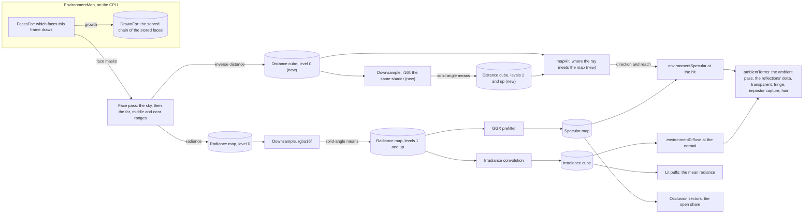
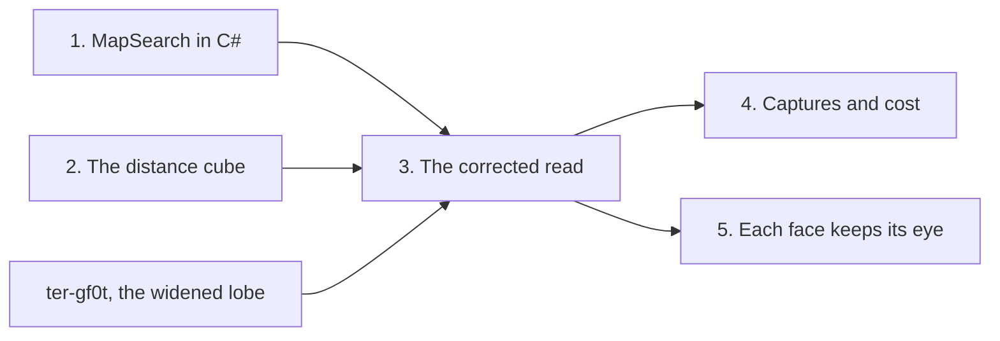

# Environment maps that know their distances

Implementation note (2026-11-05, `ter-7tnv`): temporal-renderer.md section 6, decision 35 and section 14 item 8 supersede this document's old reflection-pipeline scope, including decision 8. The accepted S + Q2 read from `570fdbbf8` now serves reflection misses and every specular reader of the current tracer and forward passes. Ordinary diffuse misses stay directional. The accepted cone is the radius rule in `specular_cone.glsl` and `MapSearchCone`, not this document's earlier 2.57-alpha full-width proposal. No deleted reflection or occlusion pass is restored. The acceptance misses and the unresolved tracer grain remain limits, not tuning targets for this ticket.

Ticket `ter-jw7g`, epic `ter-b2da`. The user chose this design on 2026-11-02: design A, "the map knows its distances". This document records the settled design, its internal decisions with their reasons, the open questions for the user, and the order of the work.

This design extends three existing designs:

- [environment-map.md](environment-map.md): the map, its faces, its prefilter and its readers.
- [environment-maps-per-frame.md](environment-maps-per-frame.md): one map per frame of the camera's chain.
- [screen-space-reflections.md](screen-space-reflections.md): SSR, whose fallback is the map.

ARCHITECTURE.md, "The environment map", describes the code as it is.

## Goal

A surface reads its environment map at the place where its reflected ray ends, not by the ray's direction alone. So a rough floor below a bright, near thing, such as the sunlit doorway of `demo-surface`'s terminal, reflects that thing where it stands. Today the floor reads the direction that, from the eye, points at the dark hall.

What the user gets:

- The ambient specular term of every reader finds the near surfaces that the eye sees: on screen and off screen, at every roughness.
- SSR's fallback, where a ray leaves the screen or misses, is the same corrected term, so the fallback continues the right geometry.
- A map whose surfaces all lie at infinity, such as open sky, gives exactly today's image.
- Nothing accumulates over frames, and each frame's image comes from that frame alone.

The known miss, which the user accepted: things that the eye cannot see are not in the map, so no ray finds them.

## The problem, measured

`ter-f3g2` rendered a 64-ray reference of the reflections, `g/lobenorm`. `ter-gf0t` measured the mean Rec. 709 luma of each box against it (`captures/gf0t/analysis/glow.txt` in the main checkout, boxes from `captures/f3g2/analysis/table.txt`). Git ignores `captures/`. All values are in levels of 255:

- D = the image at SSR's roughness limit of 0.37, `ter-f3g2`'s `g/maxr037`.
- After = `ter-gf0t`'s image at 0.37 with the widened lobe of a sphere light.
- Ref = the 64-ray reference.
- Loss = ref − after, the number that the ticket names.

| View, box | Box (x0, y0, x1, y1) | D | After | Ref | Loss |
|---|---|---:|---:|---:|---:|
| demo-surface/terminal, door | (1220, 690, 1360, 860) | 24.6 | 22.6 | 65.5 | 42.9 |
| films/brake-run, teeth | (330, 880, 620, 960) | 123.0 | 123.3 | 141.2 | 17.9 |
| films/floor, lamp cut | (450, 830, 640, 880) | 114.9 | 115.3 | 130.9 | 15.6 |
| films/chute-top, slide | (820, 560, 1160, 860) | 104.5 | 103.9 | 118.3 | 14.4 |
| films/chute, ceiling | (600, 0, 1300, 360) | 88.2 | 87.8 | 96.2 | 8.4 |
| demo-surface/terminal, steps (the terminal floor) | (850, 790, 960, 830) | 2.2 | 1.0 | 8.1 | 7.1 |
| films/antispinward, edge | (490, 660, 880, 740) | 112.1 | 114.2 | 120.7 | 6.5 |
| films/floor, steps | (450, 560, 1400, 720) | 101.0 | 101.1 | 104.5 | 3.4 |
| films/unbelt, floor | (560, 520, 1500, 1080) | 56.1 | 55.4 | 58.6 | 3.2 |
| films/deck, fragments | (940, 640, 1400, 900) | 100.3 | 100.2 | 100.4 | 0.2 |

Six control boxes are brighter than the reference today. A correct design must not make them worse: films/chute-top wall, films/brake-run left wall, deck-late lower half, demo-surface at-the-seat lower half, demo-surface in-cabin lower half and films/floor wedge (the same files).

The cause: every map is captured at the eye. A surface reads the map by its reflected direction alone, as for things infinitely far away. SSR gave the doorway's glow back before `ter-8bda` (too strongly, 80.0, and with hard edges). Since `ter-8bda`, the demo's paint, roughness 0.38, takes no SSR.

## Terms

These terms hold in this document. Each has one meaning.

- The eye: the camera's position in the frame that renders. A face is captured at the eye of the frame that draws it (ARCHITECTURE.md, "Maps per frame on the camera's chain").
- The shaded point x: the surface point that reads the map, relative to the eye, in m. |x| is its distance from the eye, and x̂ = x / |x| its direction.
- d: the unit direction of the lobe's central ray, the specular dominant direction of `ambientSpecularDirection`.
- The ray: the points x + s d, where s ≥ 0 is the length along the ray, in m.
- A stored surface: the surface that a texel of a face shows, at the texel's direction from the eye.
- The inverse distance w: 1,000 m divided by the distance from the eye to a texel's stored surface along the texel's direction, in km⁻¹. The sky has w = 0.
- The distance cube: the new R16F cube array that holds every map's inverse distances, with a level chain.
- The sweep t: a number from 0 to 1 that names a point of the ray. t = 0 is the shaded point, and t = 1 is the ray's end at infinity. s = |x| t / (1 − t).
- The lookup vector L(t) = (1 − t) x̂ + t d. The eye sees the ray's point at t along L(t).
- The clearance c(t): how far the ray's point at t lies in front of the stored surface in its direction, as defined in "The search". c > 0 is in front, and c < 0 is behind.
- The hit: the first place along the ray where the clearance goes from at least 0 to below 0, refined by secant steps. t* is its sweep.
- The reach ρ(t) = t / |L(t)|: the ray's length to its point at t over that point's distance from the eye.
- The cone: the lobe's full width at half maximum, 2.57 α rad, where α is the floored roughness squared.
- The corrected read: the specular map read at the hit's direction, at the roughness that the cone has there as the eye sees it.
- Today's read: the specular map read at d, at the floored roughness r. It is the read of every reader before this design.

## Decisions

The user made decisions 1 to 6 on 2026-11-02 (ticket `ter-jw7g`, its note of that day). Decisions 7 to 9 are earlier decisions of the user that this design keeps, and decision 10 is an earlier rule of the SSR design. This design settled decisions 11 to 30 by those decisions and the project's rules. Each has its reason.

1. Design A: each map stores each texel's distance from the eye, in a distance cube per map. (User)
2. A surface reads the map at the place where its reflected ray ends. A few secant steps against the stored distances find that place, after Szirmay-Kalos, Aszódi, Lazányi and Premecz 2005. (User)
3. It covers the surfaces on screen and off screen, every roughness, and SSR's fallback where a ray leaves the screen. (User)
4. The known miss: things that the eye cannot see. (User)
5. Design B, a coarse screen-space ray for roughness 0.37 to 0.6, is rejected. It works only on screen, it cuts at the screen's edge, and it risks the old hard edges. (User)
6. The design is recorded by one designer in `docs/plans/`, and the implementation tickets follow. (User)
7. No probes placed by the scene and no box projection: decision 4 of environment-maps-per-frame.md and decision 12 of environment-map.md. (User)
8. Nothing accumulates over frames: decision 8 of rendering-performance.md. (User)
9. Portable Vulkan only, written to the specification, with required device features that NVIDIA, RADV, ANV and lavapipe offer. (User, CLAUDE.md)
10. The specular occlusion multiplies the ambient specular term wherever it is used (screen-space-reflections.md, "The one place where SSR reads the ambient light"). Open question 2 asks whether this rule still holds for a found hit.

Settled by this design:

11. The stored quantity is the inverse distance w, in km⁻¹, along the texel's direction from the eye. See "The distance store" for the reasons.
12. The distance cube is `R16_SFLOAT`, W × W, 6 × capacity layers, with the radiance map's levels. See "The distance store".
13. Each level of the distance cube is the solid-angle mean of its four children. That is the rule of the radiance map's mips, and the same shader makes it. See "The level chain".
14. The face pass writes w as a second color attachment, and the sky writes 0. See "How the capture writes it".
15. The search is a march of a near sample and 8 even samples in the sweep, then 3 regula falsi steps in the first bracket. Regula falsi is the secant method that keeps a bracket. See "The search".
16. The space behind a stored surface counts as solid: the first crossing from in front to behind is the hit. See "Designed twice", decision B.
17. Each read of the distance cube takes the level whose texel spans the cone's cross-section at that sample, as the eye sees it. See "The cone at each sample".
18. The corrected read takes the roughness min(r √ρ*, 1), where ρ* is the reach of the hit. So the lobe's footprint at the hit chooses the blur, as SSR's cone does. See "A rough lobe".
19. A ray that meets no stored surface reads the map exactly as today: at d, with r. See "The one model".
20. The search begins with a front sample: a crossing counts only after a sample in front of the stored surfaces. See "Error cases".
21. One function, `environmentSpecular(map, position, d, roughness, footprint)`, holds the corrected read, and every reader reaches it through `ambientTerms`. See "Every reader".
22. `ShadingInput` gains `position`, the shaded point. `materialAt` and `forwardShading` set it, and the functions that took a position beside a `ShadingInput` read it there. See "The shaded point's position".
23. The diffuse term, the open share of the occlusion sectors and the lit puffs keep today's reads. See "The diffuse light needs no correction".
24. The reflected stars stay at d, masked by the open-sky share of the corrected read. See "The stars".
25. The search's arithmetic is `precise`. So the ambient pass, a fragment shader, and the reflections' delta, a compute shader, compute it in the same way.
26. The search runs in the reader's own map, in that map's axes, with the eye as the map's origin. Open question 1 asks whether each face also keeps the eye that drew it.
27. The C# twin `MapSearch` holds the same math, as `MapCode` and `IrradianceCube.Convolve` do. The CPU tests use it, and a GPU test pins the shader to it.
28. The distance cube is a stock of `EnvironmentMap`, beside the radiance map. Its faces describe the same draws as the radiance map's faces, and its levels are a pure function of its level 0.
29. With `NoEnvironmentMap`, the renderer makes no distance cube, and binding 16 stays empty. The search's code is dead under `environmentMapOn` false.
30. No ray tracing extension, no second geometry pass and no new device feature. The format, its uses and its filter are ones that the specification requires, given the features that the renderer already requires.

## The systems diagram

Stocks are images and CPU state. Flows are the passes and functions that write and read them. Each arrow is a flow, labeled by what it carries.



| Stock | Owner | Written by | When | Read by |
|---|---|---|---|---|
| Radiance map, level 0 | `EnvironmentMap` | The face pass | Each drawn face | The radiance map's downsample |
| Distance cube, level 0 (new) | `EnvironmentMap` | The face pass, in the same draw as the radiance | Each drawn face | The distance downsample, `mapHit` |
| Radiance map, levels 1 and up | `EnvironmentMap` | The prefilter, step 1 | Each drawn map | The GGX prefilter, the irradiance |
| Distance cube, levels 1 and up (new) | `EnvironmentMap` | The prefilter, step 1, beside the radiance mips | Each drawn map | `mapHit` |
| Specular map | `EnvironmentMap` | The prefilter, step 2 | Each drawn map | `environmentSpecular`, the occlusion sectors |
| Irradiance cube | `EnvironmentMap` | The prefilter, step 3 | Each drawn map | `environmentDiffuse`, the lit puffs, the readback |
| `DrawnFor` | `EnvironmentMap` | `Drew`, after the submission | Each submitted frame | `FacesFor` |

Who owns each decision:

| Decision | Owner |
|---|---|
| Which faces a frame draws | `EnvironmentMap.FacesFor`, the one choke point of the maps' machinery |
| Which objects a map draws | `EnvironmentChain.Draws` |
| What a texel holds: radiance and inverse distance | The face shaders, `environment_face.frag` and `environment_sky.frag` |
| How a level combines its children | `environment_downsample.comp`, one rule for both chains |
| Where a ray meets a map | `mapHit` in `environment.glsl`, with its C# twin `MapSearch` |
| Which level each read takes | `mapHit` for the distance reads, `environmentSpecular` for the radiance read |
| Which readers take the corrected read | `ambientTerms`, the one place where the shaders read the ambient light |

The CPU state does not change under decision 26. Open question 1, option 2, adds one CPU stock: the eye that drew each face.

## The one model

A texel of a map is a surface point: a direction from the eye, a distance along it, and the light that the point sends toward the eye. Today the map holds the direction and the light. Every reader treats the distance as infinite. This design stores the distance too. A reader then asks one question: where does my ray meet the map's surfaces? It reads the light there.

This extends the maps at the eye. It adds no second mechanism:

- The same faces, drawn by the same rule, at the same time, hold the distance. No probe, no box and no placement exists.
- The maps per frame stay as they are. Each reader searches its own map, which leaves out the subtree below its frame, in its frame's axes.
- The prefilter makes the distance levels by the radiance map's own rule, with the same shader.
- Every reader of the ambient specular term already goes through one function. That function takes the corrected read.
- SSR's fallback is that term, so SSR continues the same model where its rays leave the screen.

The distance is a new stock because no existing store holds it. The radiance map's alpha holds the open-sky share, which the reflected stars need. The face depth is cleared for each depth range and never kept (ARCHITECTURE.md, "The faces").

### A map at infinity gives exactly today's direction

Take a map whose every texel is sky, w = 0. The clearance (see "The search") is then

```
c(t) = (1 − t) − 0.001 · |x| · |L(t)| · w(L(t)) = 1 − t
```

where

- `|x|` = the shaded point's distance from the eye, in m.
- `L(t)` = the lookup vector at the sweep t.
- `w(L(t))` = the inverse distance in the direction L(t), here 0.

So c(t) > 0 for every t < 1, and c(1) = 0. A sample is behind only where c < 0, so no sample is behind, and the search finds no hit. Decision 19 then reads the map at d with r, through the same expressions as today's code: the same turn into the map's axes, the same `textureLod`, the same level. So the image is today's image, bit for bit.

A far planet at the distance D shows the same thing in the limit. Its w is 1000 / D. Only the last bracket holds a crossing, from t = 1 − 1/8 to t = 1. The secant step places it at about t* = 1 − |x| / D. So the read's direction moves from d by about |x| sin φ / D rad, where φ is the angle between x̂ and d. That is the planet's true parallax: 10⁻⁶ rad for |x| = 10 m and D = 10⁷ m, about 1/12,000 of a texel at W = 128. A surface beyond 16,400 km holds a subnormal half float, which the specification lets a device store as 0 (see "The format and its precision"). It then reads as infinitely far, and the image is today's image.

## The distance store

### The quantity

The distance cube holds the inverse distance w = 1000 m / D, in km⁻¹. D is the distance from the eye to the texel's stored surface along the texel's direction, in m. The reasons:

- Infinity is exactly 0. The sky writes 0, and decision 19's exact case needs no sentinel and no infinity.
- On a plane, w is the dot product of the direction with the plane's normal, divided by the plane's distance from the eye. So it is linear in the direction, and a bilinear filter of it is close to exact within a texel. The distance itself has a pole where the plane grazes the eye's view.
- The parallax of a point is proportional to its inverse distance. A small move b of the viewpoint turns the point's direction by about |b| sin β / D. So the mean of w over a texel is the mean shift of that texel's light. That is the reason for decision 13.
- Along the texel's direction, not along the face's forward axis: the radial distance has the same meaning on both sides of a face's seam, where the cube filter mixes two faces. The G-buffer stores the same radial distance (ARCHITECTURE.md, "Depth ranges").
- In km⁻¹, so that the half float's normal range spans the depths that matter. The faces' near plane is 5 cm ahead, so w is at most 20,000 km⁻¹, under the half float's largest value, 65,504.

### The format and its precision

`R16_SFLOAT`. The specification requires it as a filtered sampled image and as a color attachment. With `shaderStorageImageExtendedFormats`, which the renderer requires, it also requires it as a storage image, which the level chain needs. An R32F image is not required to filter linearly, and the search reads filtered values.

| Depth range | Distances | w, in km⁻¹ | In a half float |
|---|---|---|---|
| Near | 5 cm to 2 km | 20,000 to 0.5 | Normal: a relative step of at most 2⁻¹⁰ |
| Middle | 2 km to 2,000 km | 0.5 to 5 · 10⁻⁴ | Normal |
| Far | 2,000 km to 16,400 km | 5 · 10⁻⁴ to 6.1 · 10⁻⁵ | Normal |
| Far | 16,400 km to 16.8 million km | 6.1 · 10⁻⁵ to 6 · 10⁻⁸ | Subnormal: absolute steps of 6 · 10⁻⁸ |
| Far | Beyond, the Sun included | 0 | Zero, as the sky |

In the normal range, the rounding error of w is at most 2⁻¹¹ of its value. That error moves the hit's direction by about 2⁻¹¹ tan γ rad. Here γ is the angle between the ray and the eye's line of sight to the hit. That is under a tenth of a texel at W = 128 for γ up to 60°, and under one texel up to 87°.

The specification lets a device flush a subnormal half float to 0. On such a device, a surface beyond 16,400 km reads as infinitely far. The parallax that it loses is at most |x| · 6.1 · 10⁻⁵ km⁻¹. For a shaded point 2 km from the eye, that is 1.2 · 10⁻⁴ rad, a hundredth of a texel at W = 128. So both behaviors give the same image within that bound, and the design relies on neither.

### Resolution

The distance cube has the radiance map's face size W and the radiance map's texel directions. So a distance texel and a radiance texel describe the same solid angle. The search's hit and the read of its light use one grid.

### The level chain

The distance cube has the radiance map's levels, log2(W) + 1, down to 1 × 1. Level k's texel is the mean of its four children's w, weighted by their solid angles: the rule of the radiance map's mips, by the same shader (decision 13).

Designed twice, the chain:

| Design | The search reads | A rough lobe across a depth edge | Cost |
|---|---|---|---|
| 1. No chain | Level 0 at every roughness | Between two neighboring pixels, the hit jumps from the near surface to the far one. The read's direction then jumps by the parallax between them. Take a floor 3 m from the eye, a doorway in a wall 8 m away, and the outside 50 m away. The jump is then about 18°. A rough reflection gets a hard edge. | No mips, no prefilter change |
| 2. A chain of means (chosen) | The level of the cone at each sample (decision 17) | The edge is a ramp across the cone's width, so the hit and the read's direction move continuously | One more downsample per drawn map |

Reason for 2: a rough reflection must not get a hard edge, which is the risk for which the user rejected design B.

Designed twice, how a level combines its children:

| Design | A texel half wall at 5 m and half sky | A depth edge | Same rule as the radiance |
|---|---|---|---|
| A. The mean of w (chosen) | w of a wall at 10 m: the texel's light shifts by half the wall's parallax | A ramp | Yes |
| B. The largest w, the nearest surface | w of the wall at 5 m | A step, only moved outward, so near objects grow in rough reflections | No |

The mean of the distance itself cannot hold the sky, whose distance is infinite. Reason for A: it is the mean parallax of the texel's light, it has no step, and it is the radiance map's own rule.

### How the capture writes it

Changed by `t2-zcr4` (2026-11-12): `environment_face_light.frag` writes both outputs of a texel in one draw. A surface's inverse distance comes from the position in the face's surface record, and the sky's is 0. No range loads the cube's face.

`environment_face.frag` gains a second output, the inverse distance at location 1:

```glsl
layout(location = 1) out float outInverseDistance;   // R16F: 1000 m over the distance from the eye, in km⁻¹
...
    outInverseDistance = min(1000.0 / max(length(inPosition), NearPlane), 1000.0 / NearPlane);
```

where

- `inPosition` = the fragment's position relative to the eye, which is at the origin for a face (`draw.eye` is 0), in m.
- `NearPlane` = the faces' near plane, 0.05 m. Every fragment of a face lies at least that far along the face's forward axis. So the clamp only keeps NaN and infinity out by construction.

`environment_sky.frag` writes 0 at location 1 over every texel. The face pass's pipelines get a second color format, `R16_SFLOAT`, and the face's distance view loads and stores as the radiance view does: the far range draws the sky over every texel, and the middle and near ranges load it and draw over it. So each texel keeps the surface of the nearest range that covers it, as the radiance does.

In the prefilter's step 1, each drawn map's distance mips run beside its radiance mips: the same runs of up to three levels (`PrefilterLevels.LevelsOfDownsample`), each dispatch beside the radiance's dispatch of the same levels, under the same barriers. The shader is `environment_downsample.comp` with its storage images declared `r16f` instead of `rgba16f`, by a define. The four channels of its math then carry w in the first.

| Image | Format and size | Views | Memory at W = 128 |
|---|---|---|---|
| The distance cube (new) | R16F cube array, W × W, 6 × capacity layers, log2(W) + 1 levels | A 2D view of level 0 of each layer, for the face pass. A 2D-array view of all layers of each level, for the downsample. A cube array view, for the readers | 256 KB per map |

The distance cube grows with the other cube arrays in `EnvironmentMap.Grow`. The frame set gains binding 16, the distance cube's cube array view. It is partially bound and stays empty with the map off. The fragment and compute stages sample it with `environmentSampler`. `FrameResources.UpdateSharedDescriptors` rewrites it with bindings 12 and 14 at a new `ImagesVersion`.

The barriers follow the radiance map's (ARCHITECTURE.md, "Images, sets and barriers"):

- A drawn face's distance level 0 goes from its last read to a color attachment, with its old content discarded. It then goes to a compute read for the downsample.
- A storage image's layout holds for every layer of its view. So while a level view is bound, every map's distance layers of that level are in `General`, as for the radiance mips.
- After the last drawn map, the whole distance cube goes to `SampledFragment` with the compute stage added for the reflections' delta, beside the specular map.
- In a frame that draws no face, the distance cube stays in its read layout.

`EnvironmentMap`'s invariants gain two items:

- Each face's distance level 0 holds the same draw as its radiance level 0.
- Map i's distance levels 1 and up are a pure function of its six faces' distance level 0.

## The search

### The ray in the map's sweep

The search runs in the reader's map, in that map's axes (decision 26). x and d are first turned into the map's axes by `inMapAxes`, the turn that today's read applies to d. The eye is the map's origin.

The ray's point at the length s is x + s d. Write s = |x| t / (1 − t). Then this point is

```
x + s d = (|x| / (1 − t)) · ((1 − t) x̂ + t d) = (|x| / (1 − t)) · L(t)
```

where

- `t` = the sweep, from 0 at the shaded point to 1 at the ray's end at infinity.
- `L(t)` = the lookup vector, (1 − t) x̂ + t d. The eye sees the ray's point at t in the direction of L(t).

So the point's distance from the eye is |x| |L(t)| / (1 − t). The point lies in front of the stored surface in its direction where that distance is less than 1000 / w. That gives the clearance:

```
c(t) = (1 − t) − 0.001 · |x| · |L(t)| · w(L(t), λ(t))
```

where

- `w(v, λ)` = the distance cube's inverse distance in the direction v at the level λ, in km⁻¹, from a trilinear read.
- `λ(t)` = the level of the read at the sweep t (see "The cone at each sample").
- `0.001` = km per m, because w is in km⁻¹ and |x| in m.

c(t) > 0 means that the ray's point lies in front of the stored surface, and c(t) < 0 that it lies behind it. On a plane, 0.001 · |L| · w is the dot product of L(t) with the plane's normal, over the plane's distance from the eye. That product is linear in t. So c is linear in t on a plane, and one secant step finds a plane's hit exactly. Umenhoffer, Patow and Szirmay-Kalos note the same of their form of the search.

The reach of the point at t is ρ(t) = s / |x + s d| = t / |L(t)|. At t = 1, ρ = 1.

This form follows two sources. The search of Umenhoffer, Patow and Szirmay-Kalos 2008 (GPU Gems 3, chapter 17) steps along the segment between x̂ and d. The 2005 paper tests for undershoot and overshoot, which c writes as one difference that stays finite at t = 1.

### The steps

```
for t in t0, 1/N, 2/N, ..., N/N:              t0 = 1/64 the near sample, N = 8 even samples
    c = c(t)
    if c >= 0:  front = (t, c), seenFront = true
    else if seenFront:  bracket = [front, (t, c)], stop the march
if no bracket:  no hit
for i = 1 to K:                               K = 3 regula falsi steps
    t = tA + (tB − tA) · cA / (cA − cB)
    c = c(t)
    if c >= 0:  (tA, cA) = (t, c)  else:  (tB, cB) = (t, c)
t* = tA + (tB − tA) · cA / (cA − cB)          the last secant place, with no read
```

where

- `(tA, cA)` = the bracket's front end, cA ≥ 0.
- `(tB, cB)` = the bracket's back end, cB < 0. So cA − cB > 0, and every division is by a positive number.

The rules:

- The start: the first sample is the near sample, t0 = 1/64. The ray's point at t0 lies |x| / 63 from the shaded point. The eye sees it at most about 1/63 rad from x, about one level-0 texel (2 / W rad, the texel's angle at a face's center) at the default W = 128. A nearer hit falls in the shaded point's own texel, where the map cannot tell the hit from the shaded point's own surface. So t0 is the nearest place where the map can see a separate surface. Near a face's corner, a texel spans less angle, so there the near sample lies up to about 3 texels from x.
- No sample at t = 0: there the shaded point lies on its own stored surface, and c is 0 up to rounding. A bracket from t = 0 would find the shaded point itself.
- The march: the near sample, then 8 samples uniform in the sweep, t = k / 8, as the 2008 search steps uniformly along the segment between x̂ and d.
- The near sample changes the result only where it lies in front and t = 1/N lies behind. There the first crossing lies in [t0, 1/N], and by decision 16 it is the hit, in place of the even samples' later hit or their miss. Everywhere else the result is the even samples' result, bit for bit: if the near sample lies behind, front first ignores it, and if t = 1/N also lies in front, that sample replaces it as the front end. The clearance stays linear in the sweep on a plane, so one secant step still finds a plane exactly.
- Front first (decision 20): a sample behind the stored surfaces counts only after a sample in front. A ray that starts behind them searches from the place where it comes out in front.
- The bracket: the first pair of a front sample and the next sample behind. A sample with c = 0 counts as in front. So the sky at t = 1, whose c is exactly 0, is never a crossing.
- The refinement: 3 regula falsi steps, then one last secant interpolation without a read.
- The stop: the march stops at its first bracket, because later samples cannot change the first crossing. The refinement always takes K steps and never stops early on a small clearance. So each pixel takes at most N + K + 1 reads, and the bound does not depend on the scene.
- A sample whose lookup vector is shorter than 2⁻¹⁰ counts as in front, with no read. The ray then passes through the eye's neighborhood, which lies in front of every stored surface. This happens on a mirror that faces the eye, at t = 1/2, where L(t) is 0.
- The result: the hit's direction L(t*), in the map's axes, not unit, and its reach ρ* = t* / |L(t*)|.

Each pixel reads the distance cube at most N + K + 1 = 12 times, and the specular map once.

The near sample was settled on 2026-11-02, after ticket 1 found a gap in the first form of the steps. That form started the march at t = 1/8, whose point lies |x| / 7 from the shaded point. So it lost every hit nearer than that: a floor point 4.35 m from the eye found no wall whose base lay 0.1, 0.3 or 0.5 m from it along the floor. Decision C and "The cone at each sample" need that hit, the base of a wall beside a floor. Two other forms were rejected:

- 8 samples with a quadratic spacing: the far end then coarsens to one step from 3.3 |x| to infinity.
- A test of c at t = 0: c(0) is 0 up to rounding, a real root on the shaded point's own surface. So a bracket from it finds the shaded point itself.

### The cone at each sample

Each read of the distance cube takes the level whose texel spans the cone's cross-section at the sample, as the eye sees it (decision 17):

```
λ(t) = min(log2(max(θ · ρ(t) · W / 2, 1)), λmax)
```

where

- `θ` = the cone's full width, 2.57 α rad: the full width at half maximum of the GGX lobe of α about its central ray. GGX falls to half its peak at a half vector 0.644 α from the normal, and the reflected direction turns by twice that.
- `ρ(t)` = the reach at t. The lobe's cross-section at the ray's length s is about θ s wide. The eye sees it under the angle θ s / |x + s d| = θ ρ(t).
- `W / 2` = the inverse of a level-0 texel's angle at a face's center, 2 / W rad.
- `λmax` = the last level, log2(W).
- `max(..., 1)` = level 0 for a cross-section narrower than a texel. It also keeps the infinity of log2(0) out.

So near the shaded point the reads are sharp, level 0, and a floor beside a wall finds the wall's base. Farther along, the reads blur with the lobe. At t = 1, ρ = 1, and the cross-section is the lobe's own width, which a far surface needs.

The same reach sets the read's roughness at the hit (see "A rough lobe"). So one rule chooses every level of the search and of the read: the cone as the eye sees it. SSR's cone chooses its level from its footprint at the hit in the same way (screen-space-reflections.md, "The cone").

### A rough lobe

A rough lobe uses its central ray, d, for the search. The corrected read then reads the specular map at L(t*) with the roughness

```
rHit = min(r · sqrt(ρ*), 1)
```

where

- `r` = the floored roughness, so α = r².
- `ρ*` = the reach of the hit.

Reason: the lobe's footprint at the hit is about θ ℓ wide, where ℓ is the hit's distance from the shaded point. The eye sees it under θ ℓ / |h| = θ ρ*, where |h| is the hit's distance from the eye. The specular map's level for roughness r holds a lobe whose width is proportional to α, as `GgxLobe.AlphaPerWidth` uses. So the eye's view of the footprint has α ρ*, and the roughness √(α ρ*) = r √ρ*.

- A hit near the shaded point, ρ* near 0, reads sharp: a rough floor beside a wall reflects the wall's base sharply, as SSR's contact hardening does.
- A hit far away, ρ* near 1, reads at r.
- A far shaded point that reflects the space around the eye has ρ* above 1, so its read blurs more, up to roughness 1.
- No hit: r, exactly (decision 19).

### The stars

The reflected stars lie at infinity, so their direction is d with no parallax. `environmentSpecular` keeps them at d, with today's width, and multiplies them by the alpha of the corrected read, the open-sky share around the hit's direction. A ray that hits a surface reads an alpha near 0 there, so the stars behind that surface stay hidden. A ray that meets no surface reads today's alpha at d. So the stars are today's stars wherever the ray reaches the sky.

### Designed twice

Each important internal decision of the search, with the two designs, the choice and the reason. The level chain and the combination of a level are in "The distance store".

Decision A, the search's structure:

| Design | How | Finds | Reads |
|---|---|---|---|
| 1. The 2005 secant from infinity | The first guess is the surface that the eye sees along d, taken as a plane across the ray. Secant steps follow between the last undershoot and overshoot, with the point at infinity as the first overshoot. | A crossing, not always the first: with a box on a floor in front of a wall, a step can land beyond the box's hidden region and converge on the wall | About 4 |
| 2. A march, then regula falsi (chosen) | A near sample and 8 even samples in the sweep find the first bracket, and 3 regula falsi steps refine it. Umenhoffer, Patow and Szirmay-Kalos 2008 put a linear search before the secant search in the same way. | The first crossing that spans a march step | 12 |

Reason for 2: under design 1, the reflection of a near object vanishes in some pixels and not in their neighbors. A rough blur does not hide such a hole. Design 2 keeps the 2005 paper's test and its secant steps, and adds the march that its authors added in 2008. The march's samples and the secant steps are constants that ticket 4 measures (see "Cost").

Decision B, the space behind a stored surface:

| Design | A ray that passes behind a near pole, as the eye sees it | A ray that goes through a doorway and then behind the wall around it | Steps that it needs |
|---|---|---|---|
| 1. Solid, the 2005 paper's rule (chosen) | Hits the pole: the surface behind the pole reflects the pole's front | Hits the wall's edge around the opening, whose read blurs over the opening's light | A few: the first crossing is the hit |
| 2. SSR's slab: a surface at D fills D to 1.1 D, and a ray behind it by more goes on | Passes behind the pole and goes on | Passes behind the wall and reaches t = 1 with no hit, so it reads the dark hall as today | Every texel along the ray. With 8 samples, a step can jump from in front of a wall to far behind it. A coarse march then cannot tell "entered the wall" from "passed behind it". |

Reason for 1: the slab needs a visit of every texel along the ray, which SSR's pyramid walk makes and a search of a few steps does not. With few steps, the slab misjudges a real wall that the ray meets at a grazing angle as a passage behind it. Design 1's error is a near object's front in the place of what lies behind it, which the eye cannot see anyway (decision 4). The one model that both share is the stored surface along each direction from the eye. They differ in the thickness behind it.

Decision C, the level of the read at the hit:

| Design | A rough floor 10 cm from a wall | A far surface | One rule with SSR's cone |
|---|---|---|---|
| 1. The roughness r | The wall's base, blurred by the whole lobe, as for a far wall | Right | No |
| 2. r √ρ* (chosen) | The wall's base sharp, as the lobe's footprint there is small | Right: ρ* near 1 | Yes: the footprint at the hit |

Reason for 2: the read's blur is the footprint of the lobe at the hit as the eye sees it, which is what the specular map's levels hold.

Decision D, the stored quantity and its format:

| Design | The sky | Filtering | Memory at W = 128 |
|---|---|---|---|
| 1. The distance in R32F | A sentinel or infinity | The specification does not require linear filtering of R32F, and a plane's distance has a pole | 512 KB per map |
| 2. The inverse distance in km⁻¹ in R16F (chosen) | Exactly 0 | Required, and close to exact on a plane | 256 KB per map |

Reason for 2: the exact zero for infinity and the required filter. Its precision moves a hit by under a tenth of a texel for γ up to 60°.

Decision E, where the search gets the shaded point:

| Design | How | The ambient pass and the reflections' delta |
|---|---|---|
| 1. A parameter of `ambientTerms` | Each caller computes the position. The ambient pass takes it from `inRay`, the delta from `viewRayThrough`. | Can differ by a rounding, which can flip a march decision, so the delta takes away a different term than the ambient pass added |
| 2. A field of `ShadingInput` (chosen) | `materialAt` sets it from the G-buffer distance along the unit view ray through the pixel's center, and `forwardShading` from `inPosition` | The same bits, from one function |

Reason for 2: one value for one fact. `lobesRadiance`, `surfaceRadiance`, `directRadiance` and `directLight` take a position beside a `ShadingInput` today, so they read `s.position` instead, and that parameter goes away.

### Error cases

| Case | What the search does | What the surface shows | Compared with today |
|---|---|---|---|
| The ray leaves every near surface and reaches the sky | No sample is behind, so no hit | Today's read at d, with the stars | The same bits |
| The ray reaches a far planet or the Sun | A crossing in the last bracket, at t* near 1, or none where the half float is 0 | The far body, moved by its true parallax | Equal within 1/12,000 of a texel at 10 m from the eye |
| The ray passes behind a near object, as the eye sees it | The first crossing is the object's front: a hit (decision B) | The near object's front, where the real ray sees what lies behind it | Today shows what the eye sees along d, which is also wrong |
| The ray goes through an opening into space that the eye cannot see | A hit on the wall around the opening, or none at t = 1 | The opening's edge, blurred over the opening's light, or today's read | The known miss (decision 4) |
| A thin object between two march samples | Missed at level 0. At coarser levels its w blends into its surroundings | No reflection of the object, or a blend of it | Today reflects it at the wrong place |
| The shaded point lies behind a stored surface along x̂: a moving object whose face is old, or a pixel beside a nearer object's edge, whose filtered w holds that object | Front first: the first samples are behind and do not count | The first surface after the ray comes out in front | Today ignores it |
| The shaded point sits on its own stored surface | No sample at t = 0, and the self-surface gives c > 0 along the ray | The surfaces that the ray meets | |
| A mirror that faces the eye | The ray passes through the eye at t = 1/2. That sample counts as in front, with no read | What lies behind the camera, at its distance | Today reads the same direction with no parallax |
| A surface in a frame below the camera's frame, which takes an ancestor's map | The search runs in its own map, which leaves out the subtree below: the apron's ray passes through the shuttle | What lies beyond the left-out subtree | The known limit of the maps per frame (decision 7 of that design) |
| An object that a face does not draw: glass, the fringes of fringed materials, puffs | The ray passes through it | What lies behind it | As SSR's rays, by decision 18 of environment-map.md |
| A face that is several frames old while the eye moves in the map's frame | The search takes the current eye as the map's origin | Hit points off by the eye's travel since the face was drawn | Open question 1 |
| The skin at a depth edge at level 0: the bilinear filter gives one texel of intermediate w | A ray that crosses it can hit the skin | The edge's mixed light, within one texel of the edge | |

### The usage code

The search's interface, in `environment.glsl`:

```glsl
// Where the ray from the shaded point `position` along the unit direction d first goes behind the stored surfaces of
// map `map` (docs/plans/environment-map-distances.md, "The search"). position is relative to the eye, in m, and both
// are in world axes. alpha, the floored roughness squared, sets the cone that chooses the level of each read.
struct MapHit
{
    bool found;       // false where the ray goes behind no stored surface
    vec3 direction;   // in the map's axes: L(t*), the eye's direction to the hit, not unit. d in the map's axes without a hit
    float reach;      // ρ(t*): the hit's distance from position over its distance from the eye. 1 without a hit
};
MapHit mapHit(uint map, vec3 position, vec3 d, float alpha);
```

The corrected read, the one function that every reader reaches:

```glsl
// S at the hit: map `map`'s specular light that reaches `position` along the lobe of the floored roughness r about
// the unit direction d, plus the reflected stars at d for the footprint f, times the open-sky share around the hit.
vec3 environmentSpecular(uint map, vec3 position, vec3 d, float roughness, float footprint)
{
    MapHit hit = mapHit(map, position, d, roughness * roughness);
    vec4 lobe = hit.found
        ? environmentLobeInMapAxes(map, hit.direction, min(roughness * sqrt(hit.reach), 1.0))
        : environmentLobe(map, d, roughness);
    if (skipsTermsThatAddNothing && lobe.a == 0.0)
        return lobe.rgb;
    return lobe.rgb + lobe.a * reflectedStars(d, starWidth(footprint, roughness * roughness));
}
```

where

- `environmentLobe(map, d, r)` = today's read: d turned into the map's axes, at the level r · (L − 1). The branch without a hit calls it unchanged, which decision 19 needs.
- `environmentLobeInMapAxes(map, v, r)` = the same read for a vector v that is already in the map's axes.
- `environmentAmbient` passes `s.position`.

The C# twin, in `src/Tertius.Rendering/Shading/MapSearch.cs`:

```csharp
// Sketch
internal static class MapSearch
{
    public const int Samples = 8;
    public const double NearSample = 1.0 / 64;
    public const int SecantSteps = 3;
    public const float ConeWidthPerAlpha = 2.57f;

    /// <summary>The C# twin of mapHit: where the ray from position along direction meets the field's stored surfaces.</summary>
    public static MapHit Hit<TField>(in TField field, Vector3 position, Vector3 direction, float alpha, int faceSize)
        where TField : struct, IInverseDistanceField;
}

/// <summary>The inverse distance, in km⁻¹, in a direction from the eye at a level: a test's analytic scene or a read-back cube.</summary>
internal interface IInverseDistanceField
{
    float At(Vector3 direction, float level);
}
```

The tests give it analytic fields: the sky, a plane, a box before a wall, a far planet, and a read-back copy of a GPU-drawn cube.

## Every reader

| Reader | Its file | Today | After | Reason |
|---|---|---|---|---|
| The ambient pass, a lit pixel | `ambient_pass.glsl` through `ambientTerms` | S at d, D at the normal | S at the hit, D at the normal | The ticket's case |
| The reflections' delta, SSR's fallback | `reflectionDelta` in `reflection_pixel.glsl`, in the full-resolution trace or the upsample | S at d, taken away where a ray hits | S at the hit, the same term that the ambient pass added | The delta takes away the very term that the ambient pass added |
| Transparent | `transparent.frag` through `lobesRadiance` | S at d | S at the hit from the pane's point | Glass reflects the near room |
| Fringe | `fringe.frag` through `surfaceRadiance` | S at d | S at the hit | The same lighting as the opaque core |
| Impostor capture | `impostor_capture.frag` through `surfaceRadiance` | S at d, baked | S at the hit from the main view's eye, baked | Its eye is the main view's eye at the origin |
| Hair | `ambientTerms` at the fiber normal | S at d | S at the hit | The same function |
| Lit puffs | `scatteredLight`, `environmentMeanRadiance` | The mean of the irradiance cube's last level | Unchanged | A mean over every direction has no ray |
| Occlusion sectors | `occlusion_sectors.comp`, `environmentLobe` along slices | The map's light along the blocked and the open sectors | Unchanged | Part of the diffuse estimate, below |
| Environment faces | `environment_face.frag` | Nothing | Writes w | A face takes no ambient light |
| The diffuse term | `environmentDiffuse` | D at the normal | Unchanged | Below |

### The diffuse light needs no correction

The diffuse term D(n) keeps the eye's view (decision 23):

- D is a mean over the whole hemisphere of the normal, weighted by the cosine. No single ray stands for it, so the central-ray search has no meaning there. The normal's hit says nothing about the rest of the hemisphere.
- The screen-space estimate already corrects D for near geometry (screen-space-illumination.md, "The ambient pass"). The open share S takes the map's light only along the open sectors. The bounce G adds the near blockers' light. The occlusion sectors' reads are part of that estimate.
- A small bright thing moves D smoothly, because D averages over 2π sr. The specular term shows it as a reflection, which is the error that the boxes measure.

If the captures show a diffuse error that the estimate misses, a later ticket can correct D with several rays. Nothing in this design blocks it.

### The shaded point's position

`ShadingInput.position` holds the shaded point relative to the eye, in world axes, in m (decision 22):

- `materialAt(pixel)` sets it to the G-buffer distance times the unit view ray through the pixel's center, `viewRayThrough(vec2(pixel) + 0.5)`. The ambient pass, the direct pass and the reflections' passes read the surface through `materialAt`, so all take the same bits.
- The ambient pass's V becomes the negated unit view ray of that same function, as the reflections' passes take it. So the ambient pass and the delta search the same ray.
- `forwardShading` sets it from `inPosition`, which every forward pass draws relative to the eye at the origin.
- `lobesRadiance`, `surfaceRadiance`, `directRadiance` and `directLight` read `s.position` and lose their position parameter.

The direct pass then computes its position from `viewRayThrough` instead of `inRay`, which can change its light by a rounding. Ticket 3 makes sure that the six reference images keep their bits. Else it reviews each changed image with the reference, the actual image and the FLIP heat map.

### The same bits in a fragment and a compute stage

The ambient pass is a fragment shader, and the reflections' delta runs in a compute shader. The delta takes away the term that the ambient pass added. So a march decision that differs between them leaves a speck where SSR's coverage is above 0. The search declares its sweep, its clearance and its secant arithmetic `precise` (SPIR-V's `NoContraction`). So neither stage fuses a multiply and an add that the other keeps apart. Both read the same texels with the same sampler at the same level. Test 19 makes sure that the two cancel on the development Mac. The specification does not promise that two stages filter a texture to the same bits. So a speck on another GPU stays possible, and "Known limits" names it.

## The flow of a frame

The order of the passes does not change (ARCHITECTURE.md, "The order of a rendered frame"):

1. The face pass draws the frame's faces. Each draw writes the face's radiance and its inverse distance.
2. The prefilter's step 1 makes each drawn map's radiance mips and distance mips, run by run. Steps 2 and 3 do not change.
3. The readers sample the specular map, the irradiance cube and now the distance cube.

With F = 1, a frame draws one face and makes one map's levels, as before.

## Portable Vulkan

- `R16_SFLOAT`: the specification requires a filtered sampled image and a color attachment. It requires a storage image on a device with `shaderStorageImageExtendedFormats`, which `VulkanDevice` requires. A shader that declares `r16f` needs SPIR-V's `StorageImageExtendedFormats` capability, which that feature enables. `EnvironmentMap` refuses a device whose format properties lack any of the three uses, as `OcclusionImages` does for its formats.
- The face pass's two color attachments lie within the specification's least `maxColorAttachments`, 4.
- Each dispatch of the downsample binds four storage images, the specification's least.
- Binding 16 adds one sampled image to the frame set. Ticket 2 counts the sampled images per stage of every pipeline that uses the frame set. The design meant the sets that are not updated after bind to stay within the specification's least `maxPerStageDescriptorSampledImages`, 16. That could not hold:
  - Ticket 2 found that the impostor layout's fragment stage already saw 17 sampled images at the base, the G-buffer set's eleven and the atlas set's two among them. With binding 16 it sees 18, and the scene layout's fragment stage 16. So the renderer now requires a `maxPerStageDescriptorSampledImages` of 18 and refuses a device below it (ARCHITECTURE.md, "Required device features"). Mesa's RADV, ANV and lavapipe report more than a million.
- No value relies on a clamp to turn NaN into a number:
  - The face clamps its distance with `max` before the division.
  - The level clamps its argument with `max` before `log2`.
  - Every secant division is by cA − cB > 0.
  - The search never reads or divides by a lookup vector shorter than 2⁻¹⁰.
- No pass blends into a half float.
- The specification lets a device flush a subnormal half float to 0. That surface then reads as infinitely far, which moves the image by under a hundredth of a texel (see "The format and its precision").
- The search uses explicit levels, so it needs no derivatives, and the transparent pass can run it after its discard.

## Cost

No number in this section is a measurement. Ticket 4 measures.

### Memory

| Face size W | Distance cube per map | Today's images per map | Growth |
|---|---|---|---|
| 128, the default | 256 KB | about 2.1 MB | 12 % |
| 1024 | 16 MB | about 134 MB | 12.5 % |

The cabin's chain of four maps at W = 128 adds 1 MB.

### The capture

- Each face fragment that passes the depth test writes one more R16F value. The sky's fullscreen triangle writes one more value per texel.
- Each depth range loads and stores the face's distance view, W² × 2 B, 32 KB at W = 128.
- Each drawn map adds one downsample of a single channel: 3 dispatches at W = 128, beside the radiance mips' dispatches. On MoltenVK, dispatches with no barrier between them share one encoder, so the distance mips add dispatches but no encoder. Ticket 4 measures whether this holds.
- The descriptor pool gains one levels set per downsample dispatch: 3 at W = 128, 4 at W = 1024.

### Per pixel

Every reader of the ambient specular term runs one search per invocation. The search takes at most N + K + 1 = 12 trilinear reads of the distance cube. It adds one turn of a vector into the map's axes. Each step adds about 20 arithmetic operations. Today's read of the specular map stays one read. The search runs in:

- the ambient pass, at every lit pixel,
- the transparent and fringe passes, at every fragment,
- each impostor capture, at every texel of the tile,
- the reflections' delta, at every pixel that starts a ray. At 0.37 no pixel of the demo starts one (`ter-8bda`).

### The measurement plan

Ticket 4 follows docs/plans/rendering-performance.md, "Measuring the cost of a feature", and `ter-8bda`'s recipe:

1. Build Release three times: the base (main at the branch's merge base), a byte copy of the base as the control, and the branch.
2. Run `ter-f3g2`'s 120-frame windows, `time-deck` and `time-floor`, at 1920 × 1080. Run 7 interleaved rounds in a rotated order of base, control and branch. Run each under the GPU lock (`/tmp/tertius-gpu-measure.lock`), and record the 1-minute load at each start.
3. Report the median frame span and each pass's mean for the three builds. The control's distance from the base is the noise.
4. Take three interleaved traces, base, branch, base, with `tools/gpu-trace.sh --no-counters` over the deck window. They give the ambient pass's own time and the prefilter's. On this Mac, only a trace gives a pass's own time.
5. Repeat steps 2 and 3 for the march's settings N ∈ {4, 6, 8, 12} and K ∈ {2, 3}. The near sample stays at t0 = 1/64 for every N, so each pixel reads at most N + K + 1 times, and at N = 4 the near bracket spans [1/64, 1/4]. Measure the box table of "Tests" for each, so that the report shows cost against quality. A change of the defaults comes with both numbers.
6. Run all of `demo-exit.json` twice on the branch for the face pass's and the prefilter's medians and p95, against the values in ARCHITECTURE.md, "Cost".

## Tests

The tests follow tests/STYLE.md: one behavior per test, named as a statement in the domain's words. This list is the first batch for red-green TDD. Each test is written first and seen to fail for the right reason. The GPU tests use small outputs, 160 × 90 or 320 × 180, and `SceneEnvironmentMap.Default with { FaceSize = 32 }`, with SSR off unless a test names it.

### The search, on the CPU (`MapSearchTests`)

1. `ARayUnderAnOpenSkyReadsTheMapAlongItsOwnDirection`: every w is 0, so the search finds no hit, and its direction is d bit for bit with a reach of 1.
2. `ARayTowardAFarPlanetMovesOnlyByThePlanetsParallax`: a planet 10⁷ m away and a shaded point 10 m from the eye. The hit's direction differs from d by |x| sin φ / D within 1 %.
3. `AFlatWallIsFoundExactlyByTheFirstSecantStep`: an analytic plane at level 0. After one regula falsi step, the hit's direction lies within 10⁻⁵ rad of the ray's true meeting point with the plane.
4. `ARayFindsTheBoxBeforeTheWallBehindIt`: a box on a floor, a wall behind it. The hit lies on the box.
5. `ARayThatStartsBehindAStoredSurfaceCountsOnlyTheCrossingsAfterItComesOutInFront`.
6. `AMirrorThatFacesTheEyeReflectsWhatLiesBehindTheCamera`: the ray passes through the eye, and the hit lies behind the camera at its distance.
7. `ARayThatPassesBehindANearPoleMeetsThePole`: locks in decision B, the solid rule.
8. `TheReachOfAHitIsItsDistanceFromTheShadedPointOverItsDistanceFromTheEye`.
9. `AHitNearTheShadedPointIsReadSharperThanAHitFarAway`: r √ρ*.
10. `TheConeReadsLevelZeroNearTheShadedPointAndCoarserLevelsFartherAlongTheRay`.
11. `ASurfaceAtTheNearPlaneHoldsAnInverseDistanceThatAHalfFloatHolds`: 20,000 km⁻¹, below 65,504.
12. `ASurfaceBeyondTheHalfFloatsNormalRangeLosesUnderAHundredthOfATexelOfParallax`.

Ticket 1 added two tests for the near sample on 2026-11-02. In `ARoughFloorsRayFindsTheBaseOfAWallNearerThanTheFirstEvenSample`, a floor point 4.35 m from the eye finds a wall whose base lies 0.1, 0.3 or 0.5 m from it along the floor, within 10⁻⁹ rad of the ray's meeting with the wall. In `ARayThatGoesBehindANearBarBeforeItsFirstEvenSampleStopsBeforeThatSample`, a bar hides the ray's point at t = 1/8 from the eye, and the hit lies between the near sample and t = 1/8, not on the far wall that the even samples alone find. Test 10 counts the near sample among a sky ray's reads.

### The distance cube, on the GPU

13. `AFaceStoresTheInverseDistanceOfTheSurfaceInEachTexel`: a wall 4 m ahead of a face. The texel at the face's center holds 250 km⁻¹. Each texel holds 1000 / D for its own radial distance D, within the half float's rounding. The sky's texels hold 0.
14. `EachLevelOfTheDistanceCubeIsTheSolidAngleMeanOfItsChildren`: against the C# reference of the radiance mips' rule (`PrefilterReference`).
15. `ATexelHalfWallAndHalfSkyHoldsHalfTheWallsInverseDistance`: a level whose texel spans a wall's edge against the sky.

### The corrected read, on the GPU

16. `AMapAtInfinityGivesTodaysImageExactly`: two views with the map on, a lone floor under open sky and a lone sphere in open space. No ray of either meets another stored surface. The HDR image equals, bit for bit, the image of a test build that defines `TERTIUS_MAP_DIRECTION_ONLY`. That build reads every map at d, as `AmbientSkipsTests` builds its reference with `TERTIUS_EVERY_AMBIENT_TERM`.
17. `AMirrorFloorShowsANearWallsStripeWhereARayTraceFindsIt`: a smooth floor and a wall 3 m beyond it with a bright vertical stripe, an emissive strip of an entity that holds no light. The stripe's reflection lies within one texel's angle of the column that a CPU ray trace of the floor's rays gives. Red today: the direction-only read puts it elsewhere.
18. `ARoughFloorBelowABrightOpeningIsBrightestWhereItsCentralRayMeetsTheOpening`: a floor of roughness 0.38 in a dark room, below a bright emissive panel in a wall.
19. `TheReflectionsDeltaTakesAwayTheTermThatTheAmbientPassAdded`: `ConeTracedReflections` at an unfaded setting (`ReflectionTesting.UnfadedReflectionsAt`). In the scene, every SSR ray leaves the screen, and the map's search hits a wall behind the camera. The image with reflections on equals the image with reflections off within 1/1024 of each value.
20. `TheShadersSearchMatchesItsCSharpTwin`: a test compute shader runs `mapHit` for a grid of rays over a drawn map. Its hits match `MapSearch` on a read-back copy of the same cube: the same `found`, and the direction and the reach within 10⁻³.
21. `AGlassPaneReflectsTheNearWallWhereARayTraceFindsIt`: the transparent pass takes the corrected read.

### The acceptance captures

Ticket 4 renders the views of the box table at 1920 × 1080 in Release, with `ter-f3g2`'s scripts, and measures with `glow.py`'s method: the mean Rec. 709 luma of each box, and the mean absolute difference from the reference after a 5 × 5 box blur.

- Each box of the loss table ends within half of its loss of the reference mean, or within 2 levels of 255, whichever is larger. The terminal door must end within 21.5 levels of 65.5, from 42.9 today.
- Each of the six control boxes ends no farther from the reference than today by more than 1 level.
- No box's mean absolute difference from the blurred reference grows by more than 1 level.
- A box that misses names its cause in the ticket's report: the eye's miss (decision 4), the solid rule, or a setting of the march. The user then decides.
- The user gets two to four screenshots: the terminal floor, the floor film's lamp cut, the chute-top slide, and pbr-spheres. Each opens the reference, the new image and the old image side by side.

### Existing tests that change

- `EnvironmentLightingTests`: a mirror sphere that reflects a bright object behind the camera now shows it at its parallax-correct place. The test's expected pixels move to the place that a ray trace gives.
- The six reference images render with the map off, so the search does not touch them. Only the direct pass's position source can change them by a rounding (see "The shaded point's position").
- `AmbientSkipsTests`'s reference build runs the search too, so it still compares the skips alone.

## Known limits

- Things that the eye cannot see are not in the map (decision 4). A ray that leaves through an opening into hidden space finds the opening's edge or nothing.
- The space behind a stored surface counts as solid (decision B). A surface behind a near object, as the eye sees it, can reflect that object's front where the real ray passes behind it.
- One ray stands for a lobe. A rough lobe that spans surfaces at different distances takes the distance of its central ray's hit, smoothed by the cone's level.
- The hit's light is the light that the stored surface sends toward the eye, not toward the shaded point. A glossy surface at the hit shows its highlights as the eye sees them, as the 2005 paper assumes.
- A thin object between two march samples can be missed near the shaded point, where the reads are sharp. As the camera moves, its reflection can then appear and vanish.
- A hit nearer the shaded point than the near sample, |x| / 63 along the ray, is lost. The eye sees it within about one level-0 texel of the shaded point at the default W = 128, about 8 texels at W = 1024. At W = 16 the near sample lies within an eighth of a texel, in the shaded point's own texel.
- The near sample can also fall inside the shaded point's own level-0 texel, where it reads as behind the shaded point's own surface, and front first then drops it. Ticket 1's hardening modeled the texels at W = 128 (each read at its texel's center): over 256 floor points across one texel, with a wall's base 0.3 m away, t0 = 1/64 found the base for 216 points and t0 = 1/128 for 176. The others read today's image. Ticket 4 measures t0 on the GPU, where filtered reads replace the model's texel centers.
- At a hard depth edge, such as a near object's silhouette at level 0, the clearance jumps, and the 3 regula falsi steps converge slowly from a front end whose clearance is small. The hit then stops short of the edge, on the side of the front end. In ticket 1's analytic scenes of a bar that hides part of a mirror ray from a floor, the hit lay up to about 3 level-0 texels short in the bracket [t0, 1/8], where c(t0) is about 1/64, and up to about 1.3 texels short in [1/8, 1/4]. The chain's levels and the bilinear skin make the edge a ramp, which shortens this for rough lobes.
- The bilinear filter at level 0 gives a depth edge one texel of intermediate distance, which a ray can hit.
- Under decision 26, the map's origin is the current eye. A face drawn while the eye stood elsewhere in the map's frame places its surfaces off by the eye's travel since then: up to ⌈6M / F⌉ − 1 frames of travel. Open question 1 asks whether each face keeps its own eye.
- The diffuse term, the occlusion sectors' open share and the lit puffs keep the eye's view.
- An impostor's capture bakes the corrected read of its moment. So its reflection keeps that moment's parallax until the manager recaptures it.
- The specification does not promise the same filtered bits in a fragment and a compute stage. So on some GPU, a pixel that SSR covers can show a speck where the two searches decide differently.
- The specular occlusion still multiplies the corrected term, unless the user chooses otherwise in open question 2.

## Compared with a design from scratch

A renderer built from scratch under this project's rules has the same constraints:

- No probes placed by the scene and no box projection.
- Nothing accumulated over frames.
- Only the device features of every GPU that NVIDIA, RADV, ANV and lavapipe support with Vulkan 1.3.

Its options:

- Hardware ray tracing (`VK_KHR_ray_query`) traces each lobe against the real geometry, hidden surfaces included. Many GPUs that those drivers support with Vulkan 1.3 lack it. Examples are Intel GPUs before Arc, AMD GPUs before RDNA 2 and NVIDIA GPUs before Turing. So the project cannot require it.
- Layered distance maps (Umenhoffer, Patow and Szirmay-Kalos 2008) keep several surfaces per direction, so a ray can pass behind a near object. They cost a depth-peeling capture and a multiple of the memory, and they still see only from the eye.
- A signed distance field or voxels of the scene give cone tracing at any point. But they are a second representation of the geometry with its own update: a parallel mechanism.
- So from scratch, the maps at the eye with their distances are the smallest step that keeps one model. The one difference from scratch: the 2005 paper stores the distance in the radiance map's alpha. Here that alpha holds the open-sky share, which the reflected stars need, so the distance has its own image.

## Open questions

These were forks: each changes what the user gets, and no decision, constraint or existing document settled it. The user answered both on 2026-11-02. Question 1: option 2, each face keeps its eye, built by ticket 5 after option 1 ships. Question 2: option A, the specular occlusion multiplies the whole corrected term.

### 1. Does each face keep the eye that drew it?

The faces of a map are drawn one per frame, in turn. So a face can be up to ⌈6M / F⌉ − 1 frames old at F = 1: 17 frames for a chain of three maps, 23 for the cabin's chain of four. While the eye moves in a map's frame, the stored distances are measured from an eye that is no longer there.

| Option | What the user gets | What it costs |
|---|---|---|
| 1. The current eye is every face's origin (Recommended first) | Exact in stills, whose metering draw refreshes every face, and while the eye rests in the map's frame. Take a film that walks at 1.4 m/s through the terminal, in a chain of three maps. A reflection there lags the eye's travel by up to 0.4 m, and it jumps back at the next draw of its face. A shuttle at 100 m/s past the terminal, in the cabin's chain of four, puts the terminal's reflections off by up to 38 m. Today's direction-only read has errors of that size too. | Nothing more than this design |
| 2. Each face keeps its eye | The stored surfaces stay fixed in the map's frame while the eye moves, so reflections hold still in a film and at speed | `RenderChainFrame` gains the frame's origin relative to the eye, a seam change in `Tertius.Core`. `EnvironmentMap` keeps the eye of each face, in its map's frame, stored in `Drew`. The frame constants carry each face's offset from the current eye, 252 `vec4`, 4 KB. The search adds the offset of the face that holds each sample: M(t) = \|x\| L(t) − (1 − t) o_f replaces \|x\| L(t). Ticket 5. |

Option 1 is option 2 with every offset 0, so option 2 keeps option 1's code. By the user's rule of the quick fix first, option 1 ships first. The user chose option 2 on 2026-11-02, so ticket 5 follows ticket 3.

### 2. Does the specular occlusion still darken a hit?

The specular occlusion V_s estimates the share of the lobe that nearby geometry blocks from distant light. The rule of screen-space-reflections.md multiplies the ambient specular term by V_s wherever it is used. It does not multiply SSR's hit radiance C, because C is already the light of the nearby geometry. With this design, a found hit's read is also the light of the geometry at the hit.

| Option | What the user gets | What it costs |
|---|---|---|
| A. V_s multiplies the whole corrected term (Recommended) | One rule, no new edge. A hit on near geometry is darkened twice in creases, where V_s is small: once because the hit reads the dark crease, once by V_s | Nothing |
| B. V_s multiplies only a read with no hit | The model of SSR's hits and of the 64-ray reference, whose hits take no V_s | A hard step in the reflection where a neighboring pixel's ray finds no hit, as large as 1 − V_s. Small on open floors, large in creases |

The user chose A on 2026-11-02. Ticket 3 builds it: one line in `occludedAmbient` or `environmentAmbient`, and the box table of ticket 4 shows its effect.

## Doc changes

| Document | Change |
|---|---|
| ARCHITECTURE.md, "The environment map" | The terms gain the inverse distance and the distance cube. "The faces" names the second attachment. "The prefilter" names the distance mips. "Reading the map" describes the search, the corrected read and its table of readers. "Images, sets and barriers" gains the image, binding 16 and the barriers. "Cost" and "Known limits" take ticket 4's numbers and this design's limits. |
| ARCHITECTURE.md, "Screen-space reflections" | The fallback is the corrected term. |
| ARCHITECTURE.md, "Portable Vulkan" | The formats table gains `R16_SFLOAT` as a storage image of the distance mips. |
| environment-map.md, "Known limits", "Far surfaces take the light around the camera" | A link to this design: the specular term now takes the light at its ray's hit. |
| screen-space-reflections.md, decision 5 | The fallback reads the map where the ray ends. |

## Order of the work

Five tickets, each on its own branch named after it. Each ticket that changes the engine updates ARCHITECTURE.md before its merge. Tickets 1 and 2 can run at the same time.



### Ticket 1: the map's ray search in C#

- Type: task. Parent: `ter-b2da`. Dependencies: none.
- Owns: `src/Tertius.Rendering/Shading/MapSearch.cs` (new), `tests/Tertius.Rendering.Tests/MapSearchTests.cs` (new).
- Work: `MapSearch.Hit` and `IInverseDistanceField`, with the march, the regula falsi steps, the cone's level and the reach, by "The search". Analytic test fields: the sky, a plane, a box before a wall, a pole before a wall, a far planet, and a sphere room.
- Acceptance: tests 1 to 12 pass in Checked and Release, each seen red first for the right reason. The constants `Samples`, `NearSample`, `SecantSteps` and `ConeWidthPerAlpha` are named once. Coverage and mutation testing by the hardening rules (Stryker does not run on Rendering, so `tools/mutate.py` with a list).

### Ticket 2: the distance cube, each map's inverse distances and their levels

- Type: feature. Parent: `ter-b2da`. Dependencies: none.
- Owns:
  - `src/Tertius.Rendering/Frame/EnvironmentMap.cs`, `DescriptorLayouts.cs` and `FrameResources.cs`.
  - `src/Tertius.Rendering/Passes/EnvironmentFacePass.cs` and `EnvironmentPrefilterPass.cs`.
  - `src/Tertius.Rendering/Shaders/environment_face.frag`, `environment_sky.frag` and `environment_downsample.comp`.
  - The binding 16 declaration in `environment.glsl`, and the format check.
  - The GPU tests 13 to 15, in `EnvironmentFaceTests` and `EnvironmentPrefilterTests`.
- Work:
  - The image, its views and its growth.
  - The face pass's second attachment, and the sky's 0.
  - The distance mips beside the radiance mips, and the barriers.
  - Binding 16, the test hook's `EnvironmentImage.Distance`, and the count of sampled images per stage.
  - ARCHITECTURE.md's "The faces", "The prefilter", "Images, sets and barriers" and "Portable Vulkan".
- Acceptance: tests 13 to 15 pass in Checked and Release. No reader reads the cube yet, so the captures of `demo-surface`, `mirror-balls`, `pbr-spheres` and `cabin-light` are byte for byte main's PNG files. The run with validation on shows no new message. The memory matches "Cost".

### Ticket 3: the corrected read, every reader of the ambient specular term reads the map where its ray ends

- Type: feature. Parent: `ter-b2da`. Dependencies: ticket 1, ticket 2, and `ter-gf0t`, because both change `lighting.glsl`. It builds the user's answer to open question 2: option A.
- Owns:
  - In `src/Tertius.Rendering/Shaders/`: `environment.glsl`, `lighting.glsl`, `gbuffer_surface.glsl`, `ambient_pass.glsl`, `direct_pass.glsl` and `reflection_pixel.glsl`.
  - In the same folder: `transparent.frag`, `fringe.frag`, `impostor_capture.frag`, and the signature of `directRadiance` in `environment_face.frag`.
  - The GPU tests 16 to 21 and the test build `TERTIUS_MAP_DIRECTION_ONLY`.
  - ARCHITECTURE.md's "Reading the map", "Known limits" and "Screen-space reflections".
- Work:
  - `mapHit`, the corrected `environmentSpecular` and `environmentLobeInMapAxes`. `mapHit` follows "The steps" as `MapSearch.Hit` does: the near sample t0 = 1/64 first, then the 8 even samples, at most 12 reads.
  - `ShadingInput.position`, and the removal of the position parameters.
  - The ambient pass's V from the view ray through the pixel's center, and `precise`.
  - The doc changes of environment-map.md and screen-space-reflections.md.
- Acceptance: tests 16 to 21 pass in Checked and Release, each red first. The six reference images keep their bits, or each changed one is reviewed with the reference, the actual image and the FLIP heat map. The user gets screenshots of the terminal floor, the floor film and pbr-spheres, before and after.

### Ticket 4: the captures and the cost of the corrected read

- Type: task. Parent: `ter-b2da`. Dependencies: ticket 3. Its base includes `ter-gf0t`.
- Owns: `captures/jw7g/` (git ignores it, the orchestrator copies it to the main checkout), ARCHITECTURE.md's "Cost" of the environment map, and this document's "Cost". It can change the defaults `MapSearch.Samples` and `MapSearch.SecantSteps` with their GLSL copies. A change comes with the cost and the box numbers of both settings.
- Work: "The measurement plan" and "The acceptance captures".
- Acceptance: the box bounds of "The acceptance captures", or a named cause for each box that misses. The interleaved timing with its control, the traces and the table of settings are in the report and in ARCHITECTURE.md. The user gets two to four screenshots.

### Ticket 5: each face keeps the eye that drew it

- The user chose open question 1, option 2, on 2026-11-02. Type: feature. Parent: `ter-b2da`. Dependencies: ticket 3.
- Owns:
  - `src/Tertius.Core/Seams/RenderSeam.cs`: `RenderChainFrame` gains `Origin` and `PreviousOrigin`.
  - The snapshot builder's `BuildChain`.
  - `src/Tertius.Rendering/Scene/SceneBatcher.cs`, `PreparedScene.cs`, and `GpuTypes.cs` for the frame constants' face offsets.
  - `EnvironmentMap.cs`: each face's eye, stored in `Drew`.
  - `environment.glsl` for the offsets in `mapHit`, `MapSearch.cs`, and their tests.
- Acceptance: a new test, `AWalkingCameraKeepsANearWallsReflectionInPlaceWhileTheFacesAge`, passes, red first. A still, whose faces are all fresh, keeps its bits. The CPU benchmark of the batcher shows no allocation.

## References

- Szirmay-Kalos, Aszódi, Lazányi and Premecz, "Approximate Ray-Tracing on the GPU with Distance Impostors". Computer Graphics Forum 24(3), 695 to 704, Eurographics 2005. The Eurographics library refused the download, so this design read its search through the next two sources. Its parts:
  - The distance, stored with the radiance.
  - The ratio test of undershoot and overshoot.
  - The first guess: a plane across the ray, at the surface that the eye sees along the ray's direction.
  - The secant steps between the last undershoot and the last overshoot, with the point at infinity as the first overshoot.
  - The miss: a hit that the map's center does not see.
- Umenhoffer, Patow and Szirmay-Kalos, GPU Gems 3, chapter 17, 2008. Its parts:
  - The linear search along the segment between the ray's start and end directions, and the secant search after it.
  - The secant step's exact result on a plane.
  - The misses of thin objects and of abrupt changes of distance.
- Peter Dancsik and Peter Minarik, "Real-time multi-bounce many-object ray tracing with distance-normal impostors", CESCG 2009: a restatement of the 2005 search, step by step.
