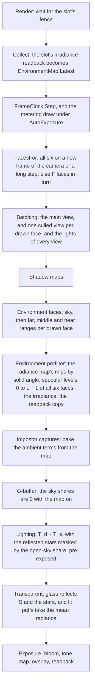

# Scene environment map

Ticket: `ter-nl5u`, a member of the rendering upgrade epic (`ter-sglu`, [rendering-upgrade.md](rendering-upgrade.md)). The user chose the design on 2026-10-25, in the ticket's last note, and answered this doc's two open points on the same day (decisions 12 and 13). This doc fills in the details.

This doc is written against main at `af2d0a8c` and against two designs on their branches. The automatic exposure design, [auto-exposure.md](auto-exposure.md) (`ter-zzyr`), gives the compute pipelines (`ComputePipelineDesc`, `ImageUse.SampledCompute`, `BufferUse.ComputeRead` and `ComputeWrite`), `FrameClock`, `VulkanRenderer.MeteringStepSeconds`, the step of a draw that `DrawFrame` takes, `exposure.glsl` and the `exposure` parameter of `surfaceRadiance`. The ambient occlusion design, [ambient-occlusion.md](ambient-occlusion.md) (`ter-b3h5`), splits the ambient light into an ambient source and its occlusion: `AmbientTerms`, `hemisphereAmbient` and `occludedAmbient` in `lighting.glsl`.

## Goal

Today the ambient light is the hemisphere of two colors, `World.Ambient`. Chrome and polished steel reflect a gradient between a sky color and a ground color, and a surface that no light reaches gets the same dim gray in space, in a cabin and on a planet. After this ticket:

- The renderer keeps a cube map of what surrounds the camera: the scene in all three depth ranges, lit by the sun and the lamps, and the share of each texel through which the sky is open.
- Chrome, steel and glass reflect that map along their lobe: sharp when smooth, blurred when rough.
- Near mirrors also reflect the star field, computed for each pixel. The stars are sharp, steady while the camera's frame turns, and hidden where the map shows a surface in front of the sky.
- The diffuse ambient light comes from the same map. The belly of a ship over Earth's day side gets Earth's light, and its side toward deep space stays dark.
- SSR (`ter-jxv9`) falls back to the map where its ray leaves the screen.
- The hemisphere stays only as the ambient light of a renderer whose map is off.

## Terms

| Term | Meaning |
|---|---|
| The map | The scene environment map: the light that reaches the camera's eye from every direction, in six square views, without the stars. |
| Face | One of the six views, 90° wide, along one axis of camera-relative world space. `CubeFace` names them in Vulkan's layer order: +X, −X, +Y, −Y, +Z, −Z. |
| W | The face size: the texels along one side of a face. `SceneEnvironmentMap.FaceSize`, 128 by default. |
| The main view | The camera's own view, which the G-buffer, lighting and transparent passes draw. |
| The radiance map | The cube image that the faces are drawn into, with a mip chain weighted by solid angle. |
| The specular map | The cube image of the GGX-prefiltered levels. Its level k holds the light along the lobe of roughness k / (L − 1). |
| L | The number of levels of the specular map: log2(W / 4) + 1, so 6 at W = 128 (128 to 4 texels). |
| The open-sky share | The share of a texel's directions through which the sky shows past every opaque surface: 1 where the sky pass shows, 0 where a surface covers it. The alpha of both cube images holds it. |
| The irradiance cube | One RGBA16F cube per map, 16 texels a side, 4 levels. Level 0 holds D(n) at each texel's direction n: the cosine-weighted mean of the map's radiance over the hemisphere of n, the diffuse light that a matte surface with normal n receives. |
| D(n) | The ambient diffuse radiance: E(n) / π with the map on, the mix of the hemisphere's colors by the normal's sky share with it off. A Lambert surface sends c_diff · D(n). |
| S(d, r) | The ambient specular radiance. With the map on, it is the specular map's light at direction d and roughness r, plus the reflected stars times the open-sky share there. With the map off, it is the mix of the hemisphere's colors by the lobe's sky share. |
| T_d, T_s | The ambient diffuse term c_diff · D(n) and the ambient specular term E(μ, r) · c(μ, r) · S(d, r), before occlusion: the two fields of `AmbientTerms` in [ambient-occlusion.md](ambient-occlusion.md). |
| An ambient source | A function that gives `AmbientTerms` for a surface point: `hemisphereAmbient`, or `environmentAmbient` while the map is on. |
| d | The specular dominant direction of [pbr-brdf.md](pbr-brdf.md), "The ambient light's specular part". |
| The star field | The stars of the sky pixels, today's `starField`: in root axes, a grid of cells 1/150 wide, one cell in 50 holding a star, each star a Gaussian one main-view pixel wide. |
| p | The angle, in rad, that one pixel of the main view spans, `frame.params.z`: about 9.7 · 10⁻⁴ at 1080p and a 60° vertical field of view. |
| c | The width of a star cell, 1/150 rad, about 0.38°. |
| The reflected stars | The star field as a surface's lobe reflects it. The ambient specular term adds them (see "The reflected stars"). |
| f | The reflection's footprint: the angle, in rad, by which d moves from one pixel to the next, at least p. |
| M(ω) | The mean star radiance near direction ω: the stars' light there, spread evenly. About 6 · 10⁻⁴ at 1080p. |
| Drawn frame | One recording and submission of the frame graph, as in [auto-exposure.md](auto-exposure.md). A metering draw is a drawn frame. |
| The draw step | The time, in s, that a drawn frame advances the renderer's clock: the step for a single draw or a metering draw, 0 for the shown draw after a metering draw. Today `DrawFrame`'s `exposureStep`. |
| A long step | A headless draw whose clock step in `Render` is 0, a still at the tick of the frame before, or at least `MeteringStepSeconds`, 0.09 s. The same condition as the exposure's metering draw, without its `AutoExposure` part. It refreshes the map under `FixedExposure` and `AutoExposure` alike. Under `AutoExposure` the metering draw has it, and the shown draw after it does not. |
| A refresh | A drawn frame that draws all six faces. |
| The map's frame | The `RenderSnapshot.OriginFrameId` of the camera's frame whose axes the faces were drawn in. |
| Plain radiance | Radiance that is not multiplied by the exposure, as the impostor atlas stores it. |

## Decisions

The user made the decisions marked (User): decisions 1 to 11 in the ticket's note of 2026-10-25, decisions 12 to 14 in the answers to this doc's open points on the same day, and decision 34 as a rule for the whole project. The orchestrator settled decision 15 for every setting of the epic. This design settled the others by the project's rules. Each has its reason.

1. The map holds the whole scene seen from the camera: all three depth ranges, lit by the sun, and the sky. (User) Decision 13 says how the stars come in: through the reflections, not through the map's color.
2. Each face has 128 texels on a side. (User)
3. One face updates per frame, so all six every six frames. A headless still refreshes all six first. (User)
4. The diffuse ambient light also comes from the map. The hemisphere, `World.Ambient`, is used only while the map is off. (User)
5. The map sits at the camera. (User)
6. A compute pass prefilters the map into its mip levels with the GGX lobe of the split-sum method whose DFG table exists. So the build waits for the compute pipelines of `ter-zzyr`. (User)
7. The map replaces the hemisphere as the ambient specular light and as SSR's fallback, and glass reflects it. (User)
8. The switch is a union in `RendererOptions`: `NoEnvironmentMap` or `SceneEnvironmentMap(FaceSize, FacesPerFrame)`. It is on by default and off in the test fixtures. With it off, the hemisphere is the ambient light. (User)
9. GPU pixel tests, no reference images: a mirror sphere reflects a bright object behind the camera, and a rough sphere shows it blurred. (User)
10. The cost is measured at 1080p, and the user sees captures. (User)
11. The per-frame sky and ground colors (`ter-hro7`) are closed without work. The atmosphere color (`ter-6vhj`) reaches the ambient light through the map. (User)
12. One map serves every surface, now. A lit room then lights what lies outside it, such as the apron that the cabin's seat sees through the canopy, and the user accepts that for now. Local maps per room are a later ticket (see "Known limits" and "Later"). (User) `ter-uy7y` replaced the one map with one map per semantic frame on the camera's chain: see [environment-maps-per-frame.md](environment-maps-per-frame.md).
13. The faces draw no stars. The map's alpha holds the open-sky share of each texel, and the prefilter blurs it with the same GGX lobe as the color. The ambient specular term adds the star field, evaluated at the dominant direction through the same star function as the sky pixels, times the prefiltered open-sky share. The stars fade with roughness so that their light matches what a map that held them gives a rough lobe. See "The reflected stars". (User)
14. The atmosphere ticket (`ter-6vhj`) stays last, as planned. So while the map is on, the map's sky is black until that ticket, and planet shadows and the ground lose today's sky fill light, 0.08 on demo-surface. No interim sky color comes before the atmosphere. (User)
15. The setting takes the form that STYLE.md gives struct cases: a `[GeneratedUnion]` of positional `readonly record struct` cases, with `NoEnvironmentMap` as its zero case and a `Problem` check that `CheckOptions` calls, as `ExposureSetting` and `AmbientOcclusionSetting` do. `ter-48qn` converts `BloomSetting` to the same form. (Orchestrator, for every setting of the epic, 2026-10-25)

Settled by this design:
16. A face is shaded in a forward pass, as the impostor capture is: one draw per depth range into the face, with the shading in the fragment shader. A face has 16,384 texels, so overdraw costs little, and a G-buffer of six faces adds five images and a lighting pass for nothing. The impostor capture is the existing pass that shades objects off screen.
17. The capture takes no ambient light. A face holds the light that the sun, the lamps and emission send toward the camera, so the main view's surfaces get one bounce of that light. Three reasons. A face then depends only on the frame that draws it. With the previous map as the capture's ambient, each face depends on every earlier face, a chain with no end, and a still after a camera step needs repeated refreshes to converge. The hemisphere is excluded by decision 4. And SSAO already left out bounced brightening because SSGI (`ter-a24f`) adds real bounced light. The cost: in a room, the parts that only bounced light reaches are black in the map, so interiors are darker than with many bounces.
18. A face draws the opaque instances, the impostor objects as geometry, emission and the sky, with no stars (decision 13). It draws no transparent instance and no puff, because SSR's rays read the HDR image before the transparent pass (`ter-jxv9`, the user's decision). The map and SSR then show the same things, and the fade from one to the other has no seam where glass appears or vanishes. A face leaves out the emission of an instance whose entity holds a light (user, 2026-10-31, `ter-ylzk`). An entity sends its power once: an entity that holds a light sends it through that light, and its glow is the face of that light, not a second source. So the map's irradiance and its reflections carry no glow of a lamp, and the lamp's power reaches the room once, through its light. The cost, which the user accepted: a lamp's panel shows dark in the map's reflections, also where a reflected panel leaves the screen and SSR hands over to the map. Since `ter-b1j3` (2026-11-02), SSR's rays read the glow of such an entity dark too (screen-space-reflections.md, "A lamp's glow"), so the hand-over has no seam, and only the light's lobe reflects a lamp. The rule also darkens the sun's sphere, which glows on the entity that holds the sunlight. So a smooth surface whose reflection SSR misses shows the sun only through the light's direct highlight, which stays a point until `ter-gf0t`. The other option kept the panel in the reflections with a second output of the faces, at the cost of memory and a change to the faces and the prefilter. The user declined it.
19. A face samples each far light's cascade set by the finest cascade whose box holds the point. The main view picks its cascade by view depth along the camera's forward axis, which holds only for points in its frustum. A near light's tiles of the local shadow atlas cover every direction from the light, so a face samples them as the main view does. See "The shadow maps in a face". (The lights plan, [local-light-shadows.md](local-light-shadows.md), gave every far light its set and every near light its tiles. This decision had the one sun's cascades.)
20. One light list serves every view of a frame. A light is kept when its reach, which the renderer derives from its power (local-light-shadows.md, "The cutoff and the reach"), touches the main view's frustum or a face that the frame draws. Each light's `PreparedLight.InMainView` holds whether the main view keeps it, written once where the batcher prepares the light, and the main view's shaders, its lit puffs and its impostors' light signatures take only the lights that it keeps (`ter-mgap`). Every shadow budget, the cascade sets of the far lights and the tiles of the local shadow atlas, ranks the lights that the main view keeps before the lights that only a face keeps, and within each group as before. The far lights of the main view also count the share of far shadows from the brightest far light of the main view. So a light that only a face keeps gets a budget only when the main view's lights leave one free, and the main view's direct light and the shadow slots of its lights stay as before. Such a light reaches the main view only through the map, where it lights a surface that a face sees. A far light's far shadows count a caster as in the maps only where that light's own set draws it, so what another light's set draws changes no pixel of the main view (`ter-ozwq`).
21. A face draws no impostor billboard and culls no small object. The impostor manager decides for the main view's visible objects only. Rasterization point-samples a texel's center, so an object smaller than a texel keeps its light in the map on average, as a small object does on screen. A cull for cost waits for a measurement that shows a need.
22. Frame n draws the faces (n · F + k) mod 6 for k from 0 to F − 1, where F is `FacesPerFrame`, in layer order. It is a pure function of the frame number, so no stored cursor has to be reset by a refresh, a film draws the same faces on every run, and every face is at most ⌈6 / F⌉ − 1 frames old. An order that follows the camera's view changes with the view and needs a rule for ties.
23. A refresh happens when the map's frame differs from the camera's frame, and on a long step. The map starts with no frame, so the first drawn frame refreshes. A change of the camera's frame changes the axes of camera-relative world space, so every old face is wrong, not only old. See "Which faces a frame draws".
24. The diffuse light D is an irradiance cube of 16 texels a side per map, which the prefilter convolves each frame from the radiance map's level of 32 texels a side. Every reader of D reads the cube at its own normal. (`ter-8fz2`, user, 2026-11-01. It replaces a set of spherical harmonics up to band 2, whose ringing under a small bright light made the cabin's base face on `deck-late` 31 % to 44 % too dark.) See "The irradiance".
25. Level k of the specular map holds roughness k / (L − 1), linear in perceptual roughness, as Filament maps its levels ("lod_α = α^(1/2) = perceptualRoughness"). The reader samples at the level r · (L − 1), with r the floored roughness.
26. The prefilter takes 64 Hammersley samples per texel with filtered importance sampling (Křivánek and Colbert 2008, GPU Gems 3, chapter 20). They found 40 samples visually acceptable for smooth surfaces. 64 is the next power of two, which the Hammersley set prefers.
27. The map stores plain radiance, as the impostor atlas does. See "Exposure".
28. The radiance map and the specular map are RGBA16F (`R16G16B16A16_SFLOAT`), the format of the HDR target and of the atlas. It holds up to 65,504, and every Vulkan device can write it as a storage image. B10G11R11 has 6 bits of mantissa at most, 1.5 % steps, which band in a mirror's smooth gradients, and it needs an optional feature to be a storage image. Its alpha holds the open-sky share, from 0 to 1, in steps of at most 2⁻¹¹.
29. The shading pipelines learn whether the map is on from a Vulkan specialization constant, `environmentMapOn`, fixed when the renderer makes them. The setting is fixed for the renderer's life, so a per-frame value is a second store of it, and a constant lets the driver drop the dead path. The map's bindings in the frame set are partially bound, so with the map off they stay empty, as the bindless texture array's unused slots do.
30. With the map on, the G-buffer pass writes 0 into the alphas that hold the two sky shares, and the transparent pass and the impostor capture skip them. Only the hemisphere reads them. The lobe-sky table stays uploaded and unread, because it is 4 KB and the map can be off in another renderer of the same process.
31. The reflected stars and the sky pixels share one star set with one definition: the same cells, positions, brightness, tint and light per star (`starOfCell` in `sky.glsl`). The sky pixels keep evaluating the one cell that holds their direction, as today, so the sky looks the same and the six reference images keep their bits. The reflected stars evaluate the 27 cells around d, because the roughness floor's lobe spreads a star over 0.6 of a cell, and one cell cuts it. So a star within about two pixels of its cell's edge is cut in the sky and whole in a mirror.
32. The stars stay out of the diffuse term and out of the lit puffs' mean. Their diffuse radiance is at most M ≈ 6 · 10⁻⁴ at 1080p. That is under 1/1300 of what a white matte surface sends in the orbit sunlight, 2.5 / π ≈ 0.8, and 1/50 of today's fill in space, 0.03. The irradiance buffer's w components stay 0. They can carry the projection of the open-sky share if a later ticket wants the stars' light in the diffuse term.
33. The reflection's footprint f is how far d moves to the next pixel, at least p. In the G-buffer it is the smaller of the steps to the next and to the previous pixel along each axis, so that a crease or a seam on one side does not count (ticket `ter-cuf9`). A forward fragment shader takes it from the screen derivatives of d. The lighting pass and the pass that adds SSR's delta (the full-resolution trace, or the upsample at half resolution) take it from the G-buffer, by one function, so that the delta takes away the very term that the lighting pass added (the merge review, 2026-10-25: with f = p in the trace, a curved mirror's hits on a neighbor showed dips of single stars). A reflected star then spans at least one pixel, so it never falls between two pixels, and its light on the screen is the same at every position between pixels.
34. The map is written to the Vulkan specification, so it runs on regular Vulkan on Linux, not only on MoltenVK (User, a project rule of 2026-10-25). Its formats, limits and features are ones that the specification guarantees or that the renderer already requires, it relies on no Metal-only behavior, and it keeps NaN and infinity out by construction. See "Portable Vulkan".

## The capture

### The faces and their axes

The six faces look out from the eye, which is the origin of camera-relative world space. Their axes are in camera-relative world axes, the axes of the camera's frame. So turning the camera changes no face. The map holds no stars, so the camera's frame turning against the root frame changes no face either.

Each face follows Vulkan's table of cube map face selection (Vulkan specification, "Cube Map Face Selection"), so that a sample in direction ω reads the texel that the face drew in direction ω. "Right" is the direction in which the texel column s grows, and "up" is the direction in which the texel row t falls, because row 0 is the top of the image:

| Face | Layer | Forward | Right | Up |
|---|---|---|---|---|
| +X | 0 | +X | −Z | +Y |
| −X | 1 | −X | +Z | +Y |
| +Y | 2 | +Y | +X | −Z |
| −Y | 3 | −Y | +X | +Z |
| +Z | 4 | +Z | +X | +Y |
| −Z | 5 | −Z | −X | +Y |

```
direction(face, s, t) = normalize(forward + (2s − 1) · right + (1 − 2t) · up)      s, t in [0, 1]
```

For every face, right × up = forward. The renderer's view space is right-handed, with right × up pointing backward. So each face is a mirror image of a right-handed camera, the winding of every triangle flips, and the face pipeline sets its front face to clockwise. `CubeFacesTests.EveryFaceBasisIsLeftHanded` locks this in, and `EnvironmentFaceTests.EachFaceHoldsWhatLiesInItsDirection` tests it on the GPU.

A face's view matrix takes x = q · right, y = q · up and z = −q · forward, for a camera-relative point q. Its projection for depth range i is `DepthRanges.RangeProjection(i, π / 2, 1)`: 90° and square, infinite reversed-Z from the range's near plane, with the y flip of every view.

### What a face draws

| Thing | In a face | Why |
|---|---|---|
| Opaque instances with `Visible`, the planets and the sun's sphere included | Yes, as geometry | The scene seen from the camera (User) |
| Objects that the main view draws as impostors | Yes, as geometry | Decision 21 |
| Emission of an entity that holds no light, such as a screen or a marker | Yes | It is light |
| Emission of an entity that holds a light, such as a lamp's panel | No | Decision 18: the glow is its light's face, and the lamp's power reaches the room once, through its light |
| The sky: `skyRadiance`, black until the atmosphere ticket | Yes, as background, with an open-sky share of 1 | The map holds the sky (User) |
| The stars | No | The ambient specular term computes them for each pixel (User, decision 13) |
| Transparent instances | No | Decision 18: SSR shows no glass either |
| Puffs | No | Decision 18 |
| Frame outlines | No | The overlay is a debug drawing over the tone-mapped image, not light |

The sky is drawn first, by a fullscreen triangle that writes `vec4(skyRadiance(direction), 1)` into every texel of the face, with no depth test. The three depth ranges then draw over it, and every surface writes an alpha of 0. So the alpha of level 0 is the open-sky share of each texel's center: 1 where the sky shows, 0 where a surface covers it. The radiance map's mips and the prefilter then average it into shares between 0 and 1.

`skyRadiance(direction)` in `sky.glsl` is the sky's light without the stars. It returns black until the atmosphere ticket (decision 14). The stars stay out of the map's color: the readers add them for each pixel, where the open-sky share lets them through (see "The reflected stars").

A lamp's panel, which glows on the entity that holds the lamp's light, is dark in the map (decision 18). The sun's sphere is dark in the map for the same reason, because it glows on the entity that holds the sunlight. So the sphere, 0.53° across from Earth and smaller than a texel, no longer comes and goes as the sun crosses the texels. Before `ter-ylzk`, its glow lit the room a second time through the map's irradiance.

### The three depth ranges in a face

A face draws the far, middle and near ranges in that order into one RGBA16F color target and one D32 depth target of W × W, as the G-buffer pass does. Each range begins a rendering that loads the color, clears the depth to `DepthRanges.ClearDepth(range)`, and draws the face's opaque commands of that range with the range's projection. So a nearer range overwrites a farther one, the overlap of 1 % at each boundary hides nothing, and an object that straddles a boundary draws in both ranges. A face sorts its instances by their depth along its own forward axis, `DepthRanges.OpaqueMask(q · forward, radius)`, not the main view's.

### How a face is lit

Changed by `t2-zcr4` (2026-11-12): a face lights each texel once. The surfaces write a surface record, `FaceSurface`. One fullscreen triangle, `environment_face_light.frag`, then lights every texel from the record and writes the sky elsewhere. The light and its inputs stay as this section gives them. ARCHITECTURE.md, "The environment map", describes the pass as built.

`environment_face.frag` is `impostor_capture.frag` without the ambient light:

```glsl
SurfaceSample s = sampleMaterial(inMaterial, inTexCoord, inNormal, inTangent);
ShadingInput shading = ...;   // as in impostor_capture.frag, both sky shares 0
vec3 V = normalize(-inPosition);   // toward the eye, which every face shares
vec3 glow = glowSent(s.emissive, inInstanceWords.z);
outColor = vec4(directRadiance(shading, glow, inPosition, V, ShadowMapsHolding), 0.0);   // alpha: no open sky
```

where

- `inInstanceWords.z` = 1 when the instance's entity holds a light (`GpuInstance.HoldsLight`), else 0. It is the mark that the bounce source reads (screen-space-illumination.md, "The bounce source").
- `glowSent` = the rule in `frame.glsl` that every reader of the mark calls (this face, the bounce source and, since `ter-b1j3`, the radiance pyramid of SSR): the emission where the entity holds no light, else 0 (decision 18).
- `glow` = the glow that the surface adds to the face.
- `directRadiance` = every light of the frame's list reflected toward V, each with its shadows (a far light's far shadows and cascade set, a near light's tiles), plus the glow, clamped to 65,504, in plain radiance (see "Part 5: the readers").
- `ShadowMapsHolding` = the rule of the shadow maps for a view that is not the main view (next section).
- `V` = the unit direction from the surface point to the eye. A face's highlights are those that the camera's eye sees, because the map is the light that arrives at the eye.

#### The shadow maps in a face

Each far light's cascade set is fitted to the main view, and every set shares the splits and the boxes' sizes (ARCHITECTURE.md, "Shadows"): cascade i is the bounding sphere of the slice of the main view's frustum that ends at its split, and the shader picks the cascade by the view depth along the camera's forward axis. A point behind the camera has a negative view depth, so that rule picks cascade 0 for it, which does not hold it once it is more than a few meters behind.

A face therefore picks the finest cascade whose box holds the point, with the margin of the filter. Every cascade's box holds the sphere of its slice, and the sphere holds a ball around the eye of radius (sphere radius − sphere center's depth). At the demo's 60° field of view and 16:9, that ball is about 9 m for cascade 0, 19 m for cascade 1, 49 m for cascade 2 and 355 m for cascade 3. So every point within 9 m of the camera, in any direction, gets cascade 0's texels of 6 cm. Ahead of the camera, the cascades reach 2 km as before. In the outer tenth of the coarsest box, the map shadow fades out and the far shadow of the casters in the maps fades in, by the same weight, as the main view does over its last blend band. Beyond every box, the far shadows alone decide, as for the main view beyond 2 km.

The shadow pass already culls its casters against every cascade's box, not against the main view's frustum, so a caster behind the camera is in the maps when its shadow falls into a box. The rule changes no shadow of the main view. A renderer built from scratch uses one rule for every view (see "Compared with a design from scratch").

With the far shadows alone, the sun lights the cabin's walls in the map through the hull: a far shadow never shadows a point inside its caster's sphere, and the cabin lies inside the shuttle's sphere.

A near light's tiles need no such rule. A spot light's tile and a point light's six faces look out from the light, not from the camera, so they hold every point that the light reaches in their frustums, whichever view samples them. A face samples them as the main view does (`tileShadow`, ARCHITECTURE.md, "Local shadows").

#### The point and spot lights

`SceneBatcher.CollectLights` keeps a light today when its reach touches the main view's frustum. With the map on, it also keeps a light whose reach touches the frustum of a face that this frame draws (decision 20). On a refresh, the six faces see every direction, so every light of positive power is kept. The list keeps the snapshot's order, so the sum still rounds the same way on every run.

#### No ambient light in the capture

Decision 17. A face's surfaces get every light of the list with its shadows (far shadows, cascade sets and tiles), and their emission where their entity holds no light (decision 18). A surface that none of these reach is black in the map.

### Culling and level of detail

| Step | Rule |
|---|---|
| Which instances | The snapshot's instances with `Visible`, a mesh on the GPU, a scale with volume, a finite position, and no `Transparent` flag |
| Frustum | `CubeFaces.Culls(face, center, radius)`: a sphere is culled when it lies behind the near plane, 5 cm ahead, or outside one of the four side planes of the 90° face, which pass through the eye with normals (forward ∓ right) / √2 and (forward ∓ up) / √2 |
| Depth ranges | `DepthRanges.OpaqueMask` with the depth along the face's forward axis |
| Level of detail | None. The engine has no mesh LOD, and a face draws each instance's one mesh |
| Impostors | None in a face. Decision 21 |
| Small objects | Not culled. Decision 21 |

`CollectVisible` interpolates each instance by the frame's alpha once, for the main view and the map: the opaque instances that a face may draw go into the map's instances, before any face culls them. Each face culls the map's instances and writes its `GpuInstance` and its indirect commands after the main view's, into the same arrays. Part 6 measured an earlier state, in which each face looped over the snapshot and interpolated each instance it kept (see "What the cost turned out to be"). A face's commands per range go into `PreparedScene.EnvironmentFaces`.

### Which faces a frame draws

`EnvironmentMap.FacesFor` chooses the faces of a frame. It runs on the CPU for each drawn frame, after the output gives the frame an image and before batching. It is a pure read that calls two pure predicates. `EnvironmentMap.Drew` sets the map's frame once the frame is submitted, so that the map's frame describes the last finished step (ter-uhls):

```csharp
internal static class EnvironmentFaces
{
    public static FaceMask InTurn(long frame, int facesPerFrame);
    public static bool RefreshesAll(long? mapFrameId, long originFrameId, bool longStep) =>
        mapFrameId != originFrameId || longStep;
}

public FaceMask FacesFor(long frame, long originFrameId, bool longStep) =>
    EnvironmentFaces.RefreshesAll(FrameId, originFrameId, longStep)
        ? FaceMask.All
        : EnvironmentFaces.InTurn(frame, Setting.FacesPerFrame);

public void Drew(long originFrameId) => FrameId = originFrameId;
```

`VulkanRenderer.DrawFrame` calls `Drew` right after `SubmitAndPresent`. A frame that throws before then leaves the map's frame as it was, so the next frame draws again every face that it would have refreshed. Without this, a first frame that throws would leave 6 − F faces that no frame drew, in their undefined content, and the prefilter would spread that content, which can be a NaN or an infinity on a Linux driver, into every level and the irradiance.

where

- `frame` = the number of the drawn frame, `FrameContext.Number`, counted from 0 over every drawn frame, metering draws included.
- `facesPerFrame` = `SceneEnvironmentMap.FacesPerFrame`, F, from 1 to 6.
- `InTurn` = the faces (frame · F + k) mod 6 for k from 0 to F − 1 (decision 22).
- `mapFrameId` = `EnvironmentMap.FrameId`, the map's frame: null before the first drawn frame.
- `originFrameId` = `RenderSnapshot.OriginFrameId` of the snapshot that this frame draws.
- `longStep` = true for a headless draw with a long step: a clock step in `Render` of 0 or of at least `MeteringStepSeconds`, 0.09 s. The shown draw after a metering draw passes false.
- `FaceMask` = a set of faces, bit i for layer i.

The cases:

| Draw | Faces | Why |
|---|---|---|
| The renderer's first drawn frame | All six | The map has no frame yet. No pass reads an empty map. |
| A draw whose camera has changed frame | All six | The faces are in the old frame's axes. A hand-off from one frame to another changes `OriginFrameId` too, at the cost of one refresh. |
| A headless still after a long step, under `FixedExposure` | All six | One draw with the long step (User: a still refreshes all six first) |
| The same under `AutoExposure` | All six in the metering draw, then F in the shown draw | The metering draw has the long step, so its meter measures the scene lit by a fresh map. The shown draw has a draw step of 0 and draws the same snapshot, so its F faces repeat what the metering draw drew. |
| A headless still at the tick of the frame before | All six, as after a long step | The clock step is 0, and the still can follow a camera cut that keeps the frame. |
| A frame of a film, 1 or 2 ticks apart | F | The step is above 0 and below 0.09 s. |
| A frame in a window | F | A window never refreshes for a step, because a refresh makes a slow frame slower still. |
| A window camera that cuts within one frame | F | The renderer cannot see a cut that keeps the frame. The old faces stay for up to ⌈6 / F⌉ − 1 frames, 83 ms at 60 Hz. A rule for it waits for a snapshot field that says "cut", which no one needs yet. |

## The prefilter

Everything in this section runs on the GPU in one compute pass, `EnvironmentPrefilterPass`, after the faces of the frame are drawn and before any reader. It reads only level 0 of the radiance map, never its own earlier output, so the radiance map's mips, the specular map and the irradiance are a pure function of the six stored faces.

### The radiance map's mips

The prefilter pass first rebuilds the mip chain of all six faces, from level 0 down to 1 × 1, with `environment_downsample.comp`. Each texel of level i + 1 is the mean of its four children in level i, weighted by each child's solid angle Ω (the formula of "The irradiance" below), in all four channels:

```
texel of level i + 1 = Σ over its 4 children: child · Ω(child)  /  Σ over its 4 children: Ω(child)
```

The children's solid angles add up to the texel's own. So a texel of any level holds the mean radiance over its own solid angle, and its alpha the open-sky share of that solid angle, wherever it lies on its face. The chain is the source of filtered importance sampling below, and a sample of level lod stands for the light of its solid angle, so a rough level keeps the light of the level-0 map within 5 % ("GPU tests of the map itself"), whether a bright spot lies at a face's center, where a texel spans about 1.9 times the mean solid angle, or toward a corner of the cube, where it spans about 0.2 times it.

A box filter, such as the linear blits that `ImpostorPass.GenerateMips` uses for a tile, weights the four children equally, by count. On a cube face that loses about half the light of a spot at a face's center at roughness 1, and doubles that of a spot toward a corner, so the map does not use it.

The chain is rebuilt in every drawn frame, for the faces that the frame did not draw too, which gives the same bits for them. That keeps one rule for the whole pass and costs little: 6 × (64² + 32² + … + 1) = 32,766 texels of four reads each at W = 128, against 2.1 million samples of the specular levels. The levels are storage images in the `General` layout during the chain, and the whole map is then read-only for the prefilter's samples.

Each level reads the one above it. One dispatch makes a run of up to three levels, from the last level of the run before (`PrefilterLevels.LevelsOfDownsample`), and a barrier separates the runs. At W = 128 the runs are levels 1 to 3 from 0, 4 to 6 from 3, and 7 from 6: three dispatches and two barriers, where one per level took seven of each. A workgroup is 8 × 8 texels of the run's first level, one invocation per texel. Those texels are the children of the workgroup's 4 × 4 texels of the second level and its 2 × 2 of the third, so the workgroup makes them too. It reads its own texels back from the images, declared `coherent`, after `memoryBarrierImage` and `barrier`, so a level is the mean of the level above as the image stores it, in halves rounded as the device rounds them. A first try kept the texels in shared memory, rounded to halves by `packHalf2x16`, which need not round as an image store does. It changed the last bit of some texels of the second and third level of a run, and the captures of `mirror-balls`, `pbr-spheres` and `demo-surface` then differed by up to 27 levels of 255, in at most 25 isolated pixels of an image. Read back from the images, the captures are the same bits as with one dispatch per level. With the level that it reads, a dispatch binds four storage images, the specification's least limit (see "Portable Vulkan").

### The specular levels

Level 0 holds roughness 0, a lobe of zero width, so it is the radiance map's level 0, texel for texel, alpha included. Level k, from 1 to L − 1, holds the prefilter of Karis 2013 ("Real Shading in Unreal Engine 4", the split sum's first sum, with n = v = r):

```
For the texel of level k at direction n, with r_k = k / (L − 1) and α = r_k²:
  for i = 0 to N − 1:
    (u₁, u₂) = Hammersley point i of N
    h = GGX half vector of α at (u₁, u₂), around n            the formula of pbr-brdf.md, "Computing them"
    l = 2 (n·h) h − n
    if n·l > 0:
      pdf   = D(n·h, α) / 4                                  D(n·h) (n·h) / (4 v·h), with v = n
      lod   = max(½ log2(Ω_s / Ω_p) + 1, 0)                   Křivánek and Colbert 2008
      Ω_s   = 1 / (N · pdf)
      Ω_p   = 4π / (6 W²)
      sum    += radiance map at l, level lod, trilinear × n·l
      weight += n·l
  texel = sum / weight
```

where

- `N` = `PrefilterLevels.SamplesPerTexel`, 64 (decision 26).
- `Ω_s` = the solid angle that one sample stands for, in sr.
- `Ω_p` = the solid angle of one texel of the radiance map's level 0, in sr.
- `+ 1` = the bias of Křivánek and Colbert, who found that a little overlap between samples looks smoother.
- `D` = `ggxDistribution` of `brdf.glsl`.
- The weight n·l is Karis's.
- `sum` = a sum of all four channels. So the alpha of level k is the open-sky share along the lobe of roughness r_k, weighted as the color is (decision 13).

The texels of a level are independent. With n = v, a sample's direction l in the axes of n, its weight n·l and its lod depend only on i and the level, not on the texel. So a workgroup of 64 invocations first builds the level's table of samples in shared memory, one sample per invocation, and then each texel turns the table into its own axes. `PrefilterLevels.Lanes(k)` invocations share a texel: 1 at levels 0 and 1, then four times as many at each level of a quarter of the texels, up to one per sample (1, 1, 4, 16, 64 and 64 at W = 128). Lane j sums the samples j, j + lanes, and so on, in order, and lane 0 adds the lanes' sums in lane order, so the specular map is the same bits on every run on one GPU. So every level from 1 on has as many invocations as level 1, until each sample has its own, and a small level's texel waits on a chain of a few texture reads, not of all 64. A workgroup holds 64 / lanes texels that follow each other in layer, row and column order.

One dispatch writes a run of up to four levels (`PrefilterLevels.LevelsOfDispatch`), each in a storage image of its own, and the workgroups of each level follow those of the level before (`PrefilterLevels.Workgroups`). The push constants give each level of the run its first workgroup, its size, its roughness and its lanes. At W = 128 the levels take two dispatches, 0 to 3 and 4 to 5, where one per level took six. At W = 1024 the first run needs 172,032 workgroups, more than the 65,535 along one dimension that every device allows, so the workgroups of a dispatch lie in rows of at most 65,535, as few rows as hold them (`ComputeLimits.Grid`: 3 rows of 57,344 there). The shader rebuilds a workgroup's place as row × row length + column, and the few workgroups past the last return before any barrier, as a whole workgroup.

Level L − 1 has faces of 4 texels, `PrefilterLevels.SmallestFaceSize`. Its lobe, roughness 1, spans about 90°, so it still covers about four texels across. A face of 2 or 1 texels holds it in fewer.

The work at W = 128: levels 1 to 5 hold 6 × (64² + 32² + 16² + 8² + 4²) = 32,736 texels, so 2.1 million trilinear samples, and level 0 copies 98,304 texels. The whole map is prefiltered in every drawn frame, because a lobe of roughness 0.4 or more crosses into the neighbor faces of the face that changed.

### The irradiance

D, the map's diffuse light, lives in the irradiance cube: one RGBA16F cube per map, `IrradianceCube.FaceSize` (16) texels a side (decision 24). Level 0 holds D at each texel's direction. The prefilter convolves it from the radiance map's level whose faces hold `IrradianceCube.SourceFaceSize` (32) texels, level log2(W / 32), or from level 0 of a smaller map (`IrradianceCube.SourceLevel`):

```
D(n) = Σ_t L(t) · max(n · ω_t, 0) · Ω(t)  /  Σ_t max(n · ω_t, 0) · Ω(t)
mean radiance = the mean of the 24 texels of the cube's last level
```

where

- `n` = the unit direction of a cube texel's center.
- `t` = a texel of the six faces of the source level. `L(t)` = its radiance and open-sky share, RGBA. `ω_t` = the unit direction of its center.
- `Ω(t)` = the exact solid angle of a texel of a cube face: A(x₀, y₀) − A(x₀, y₁) − A(x₁, y₀) + A(x₁, y₁), with A(x, y) = atan2(x · y, √(x² + y² + 1)) and the texel's corners x₀, x₁, y₀, y₁ in [−1, 1] (Driscoll 2012, "Cubemap Texel Solid Angle"). The texels of one face add up to 4π / 6 exactly. The C# copy evaluates this formula in double. The shaders evaluate the same value as two spherical triangles, each by Van Oosterom and Strackee 1983, tan(Ω / 2) = |A · (B × C)| / (|A| |B| |C| + (A · B) |C| + (A · C) |B| + (B · C) |A|), whose triple product is exact and whose divisor has only positive terms. In float, the difference of four nearly equal values A loses most of its bits toward a face's corner: up to 12 % at W = 1024 with a correctly rounded atan, against 2 · 10⁻⁷ for the triangles.
- `D(n)` = the ambient diffuse radiance: a Lambert surface sends c_diff · D(n), as it sends c_diff times the hemisphere's mix with the map off. The sum is divided by the sum of its weights, so a uniform map gives exactly its own radiance. The alpha holds the open-sky share that a matte surface sees, which no reader uses yet. The stars stay out of D (decision 32).
- `mean radiance` = the mean of the map's radiance over every direction, without the stars, which the lit puffs need. It equals the mean of D over every direction, because a surface that faces each way in turn sees each direction of the map with the same total weight. Levels 1 to 3 of the cube hold the solid-angle means of their children, down to 2 texels a side. So each of the 24 texels of the last level holds the mean of D over a quarter of a face, and the 24 quarters span equal solid angles.

A reader samples level 0 bilinearly at its normal in the map's axes. Vulkan filters a cube across its faces. The lit puffs' mean reads the last level at the center of each face, where the face's four texels meet with equal weights, and averages the six reads.

The sizes come from measurement on the CPU: a bilinear read of a cube made by `IrradianceCube.Convolve`, against the exact convolution of a map's level 0 of 128 texels. The table gives the worst error of D, as a share of the largest D, for one small light alone on a black map, over 10 random directions of the light (`IrradianceCubeTests.WorstReadError`). The normals lie on 37 rings of 24 around each light, every 5° from it. A read takes a texel past a face's edge from the neighboring face, as Vulkan's cube edge handling does:

| Cube face, texels | Source face, texels | Light of 0.5° | 1° | 2° | 4° |
|---|---|---|---|---|---|
| 16 | 16, a map of 16 texels a side | 4.22 % | 3.88 % | 3.53 % | 1.80 % |
| 16, the choice | 32 | 3.15 % | 2.90 % | 2.07 % | 1.56 % |

The first measurement, a scratch program with other directions and normals, gave the same order: 4.05, 3.06, 2.23 and 1.55 % for the choice, and 4.90, 4.67, 3.04 and 1.93 % for a source of 16. It also gave a cube of 32 over a source of 32 2.98, 1.87, 1.01 and 0.56 %, a cube of 8 over a source of 32 5.0 % under the light of 2°, and a source of 8 8.2 %. The tolerance is 3 % of the largest D under a light of 2° (ticket `ter-8fz2`), which the tests hold.

A map of 16 texels a side, the smallest setting (`EnvironmentMapSetting.MinFaceSize`), has no level of 32 texels, so its cube convolves its level 0 of 16. Under a light of 2°, D then reaches 3.53 % of the largest D, over the tolerance, and 4.22 % under a light of 0.5° (Known limit 2 of [screen-space-illumination.md](screen-space-illumination.md)). `IrradianceCubeTests` keeps it within 4 % under the light of 2°. A larger source for small maps would need a level that the map does not have. A cube of 32 texels a side costs four times the texels for an error that the tolerance does not need. Under a white sky and a black ground, the exact D(n) is (1 + n_y) / 2, the hemisphere's diffuse light, and the cube of 16 over 32 keeps it within 0.38 %. On `deck-late` with the screen-space light off, the cabin's base face and the floor band lie within 0.1 % per channel of a brute-force D of 16,384 cosine-weighted reads of level 0. The error of the cube comes from its bilinear read and from the source's texels, so it grows near a light that spans less than a source texel, about 2.8°: the ring of normals at right angles to a light of 0.5° is the worst case.

Why a cube and not spherical harmonics up to band 2, the first design:

- The harmonics ring around one small bright source. For light from one direction alone, band 2 gives 6 % too much toward it, a dip to −4 % at 122° from it, and 6 % on the far side, where the true value is 0. In the demo the error was far larger than "a few percent": on `deck-late` the harmonics made the cabin's base face 31 % to 44 % too dark per channel, and lit the crates' faces in the throw slice with light from behind them.
- The cube is a pure function of the six faces, as the harmonics were, and holds the same light as the specular map, which the reflections and the screen-space light read. So D and S come from the same map to within the cube's error.
- The harmonics' read needed a loop over the maps of a subgroup and the device's ballot operations (`ter-51gq`). A cube read needs neither.
- The price: 16 KB of image per map in place of 144 B, a texture read per pixel in place of nine coefficients, and about 0.185 ms more prefilter on the development Mac: interleaved traces of all of `demo-exit` give the prefilter a median of 0.219 ms for the harmonics and 0.404 ms for the cube (ARCHITECTURE.md, "The environment map", "Cost"). The ambient light pass lost the harmonics' loop over the maps of a subgroup and took about 0.09 ms less in the same traces.

`environment_irradiance.comp` convolves one map's level 0 in `IrradianceCube.Workgroups`, 192, workgroups of 64 invocations. `IrradianceCube.Lanes`, 8, invocations share a cube texel. The workgroup walks the source in rounds of 64 texels: each invocation puts one source texel's direction, solid angle and light into shared memory, and lane j of each cube texel then sums the round's texels j, j + 8 and so on in order. Lane 0 adds its texel's lane sums in lane order, so the cube is the same bits on every run on one GPU. The convolution only reads the radiance map, so its dispatch runs beside the specular levels with no barrier between them. After a barrier, one dispatch of `environment_downsample.comp`, the mips' shader, makes levels 1 to 3 from level 0 through the cube's levels set. The lanes come from measurement: 4, 8, 16, 32 and 64 lanes took 0.530, 0.460, 0.481, 0.68 and 0.98 ms of prefilter. Each workgroup reads the whole source, so more workgroups fill more cores but read the source more often.

### When they run

| Order in the frame | Work | Reads | Writes |
|---|---|---|---|
| After the shadow maps | The face pass: the sky and the three ranges of each face that the frame draws | This frame's cascades, light list and face commands | The radiance map: level 0 of the drawn faces |
| Next | The prefilter pass: the radiance map's mips, levels 0 to L − 1, then the irradiance cube, then the copy of the cube's last level into the slot's readback buffer | The radiance map, all six faces | The radiance map's levels 1 and up, the specular map, the irradiance cube, the readback buffer |
| Then | The impostor captures, the G-buffer pass, the lighting pass, the transparent pass, and SSR when it exists | The specular map and the irradiance cube | |

## Reading the map

### The one source of the ambient light

The ambient light keeps its formula of [pbr-brdf.md](pbr-brdf.md), split as [ambient-occlusion.md](ambient-occlusion.md) splits it into an ambient source and its occlusion:

```
T_d = c_diff · D(n)
T_s = E(μ, r) · c(μ, r) · S(d, r)

map on:   D(n)    = the color of textureLod(irradiance cube, n, 0)
          S(d, r) = C(d, r) + a(d, r) · stars(d, r, f)
          C, a    = the color and the alpha of textureLod(specular map, d, r · (L − 1))
map off:  D(n)    = mix(ground, sky, s_n)
          S(d, r) = mix(ground, sky, s_l)

d = specularDominantDirection(n, reflect(−v, n), α)
```

where

- `E(μ, r)` and `c(μ, r)` = the specular albedo and the energy compensation from the DFG table, unchanged.
- `r` = the floored roughness, from 0.045 to 1. At the floor, the read is 0.225 of a level above level 0.
- `textureLod` = a trilinear read of the cube with Vulkan's seamless filtering across faces.
- `C(d, r)` = the map's light along the lobe, in plain radiance.
- `a(d, r)` = the open-sky share along the lobe, from 0 to 1.
- `stars(d, r, f)` = the reflected stars at d for the roughness r and the footprint f, in plain radiance (next section).

The one place where the map becomes the source is `ambientTerms` in `lighting.glsl`:

```glsl
// The ambient source of every shading pass: the map while it is on, the hemisphere while it is off.
AmbientTerms ambientTerms(ShadingInput s, SurfaceLobes lobes, vec3 V)
{
    return environmentMapOn ? environmentAmbient(s, lobes, V) : hemisphereAmbient(s, lobes);
}

vec3 ambientLight(ShadingInput s, SurfaceLobes lobes, vec3 V)
{
    return occludedAmbient(ambientTerms(s, lobes, V), s, lobes);
}
```

where

- `environmentMapOn` = the specialization constant of decision 29: true while the setting is `SceneEnvironmentMap`.
- `environmentAmbient` = the map as an ambient source: T_d from `environmentDiffuse(n)` and T_s from `environmentSpecular(d, r, f)`, both in `environment.glsl`.
- `hemisphereAmbient` = the hemisphere as an ambient source, from ambient-occlusion.md.
- `occludedAmbient` = the one place where SSAO applies, from ambient-occlusion.md: T_d · V + T_s · V_s.

If this ticket merges before SSAO, it adds `AmbientTerms` and `hemisphereAmbient` in that form, and `ambientLight` returns `terms.diffuse + terms.specular`. SSAO then puts `occludedAmbient` around the same call. If SSAO merges first, this ticket adds `environmentAmbient` and `ambientTerms` beside SSAO's functions. The three designs that run beside this one meet it there:

| Design | What it does to the ambient light | Where |
|---|---|---|
| SSAO (`ter-b3h5`) | T_d · V + T_s · V_s | `occludedAmbient`, on the terms of whichever source `ambientTerms` picks. The occlusion also dims the reflected stars, because they are part of T_s. |
| SSR (`ter-jxv9`) | Replaces S by the radiance that its ray hits, and fades back to T_s where the ray misses | Its compute pass calls `ambientTerms` for the fallback, with the footprint that `surfaceAt` takes from the G-buffer for the lighting pass too. With the map on, that is the map and the stars. With it off, it is the hemisphere. |
| The glass blend (`ter-mgze`) | Lets through (1 − opacity)(1 − E) of what lies behind | E is the DFG table's specular albedo, which the map does not change |

### The reflected stars

The sky pixels show `starRadiance(direction)`, today's `starField` moved to `sky.glsl` unchanged:

```glsl
vec3 cell = floor(root * 150.0);
vec3 h = hash33(cell);                                   // the cell holds a star when h.x ≤ 0.02
vec3 star = normalize(cell + hash33(cell + 17.0));
float brightness = 0.05 + 3.0 * pow(h.y, 8.0);
vec3 tint = mix(vec3(1.0, 0.82, 0.62), vec3(0.72, 0.82, 1.0), h.z);
vec3 radiance = tint * brightness * exp(-dot(root - star, root - star) / (p * p));
```

where

- `root` = the direction in root axes: the shader turns it by the conjugate of `frame.rootRotation`, as today.
- `cell` = the star cell that holds the direction, in a grid of cells c = 1/150 wide.
- `star` = the star's direction: a hashed point of its cell, seen from the eye.
- `tint * brightness` = the star's peak radiance in the sky, b in what follows. Over the sky, E[brightness] = 0.05 + 3/9 = 0.383, and E[tint] = (0.86, 0.82, 0.81).
- `p` = the main view's pixel angle, `frame.params.z`.

Each star sends the light b · π p² toward the eye, in radiance times sr: the integral of its Gaussian.

#### The width of a reflected star

A surface of roughness r spreads a star over its GGX lobe. Around d, the lobe's density over the reflected directions l is D(h) / (4 v·h). With n and v along the reflected direction, as in the prefilter, its peak is D(1) / 4 = 1 / (4π α²) per sr, with α = r². A Gaussian exp(−θ² / w²) / (π w²) has the peak 1 / (π w²), so the two peaks agree at w = 2α. The pixel's footprint adds to that width as a second Gaussian blur, so a reflected star has the width and the peak

```
w    = √(f² + 4α²)
peak = b · (p / w)²
```

and keeps its light b · π p². On a flat mirror f = p, so as α goes to 0 the reflected star becomes the sky's star. At the roughness floor (r = 0.045, α ≈ 0.002) on a flat mirror at 1080p, w ≈ 0.0042 rad: 0.63 of a star cell, and a peak of b / 19.

#### The cells it reads

A star that wide reaches beyond its own cell. So the reflection reads the stars of the 3 × 3 × 3 cells around the cell that holds d. It skips each cell that the sphere of radius 150 cells does not cross, because no direction of the sky reads that cell either, so the sky and the reflections hold the same stars. The block holds every star within c of d. Each star's Gaussian is cut off smoothly at c, so the sum does not depend on where d lies in its cell:

```
K(θ) = exp(−θ² / w²) · (1 − θ² / c²)²      for θ < c, and 0 beyond
k(w) = 1 − 2/a + 2 (1 − e^(−a)) / a²,       a = c² / w²
```

where

- `θ` = the angle between d and the star, in rad, measured as the sky measures it: |root − star|.
- `K` = the star's kernel in the reflection.
- `k(w)` = the share of the star's light that K keeps: the integral of K over the sphere divided by that of the Gaussian, π w². With x = θ² / c², k = a ∫₀¹ e^(−a x) (1 − x)² dx, which gives the closed form. k goes to 1 for narrow stars and to a / 3 for wide ones.

At the roughness floor on a flat mirror at 1080p, a = 2.52 and k = 0.50. The window keeps half of the star's light in its blob, which is about 0.3° wide at half its peak.

#### The fade with roughness

A prefiltered map with the stars in it gives each lobe the stars' light averaged over the lobe. A narrow lobe sees single stars. A lobe much wider than the space between two stars, about 2.2° on average, sees their mean M(ω). The reflected stars give that mean on average at every roughness, and single stars only while the window keeps their shape:

```
t(w)           = smoothstep(c, 2c, w)
stars(d, r, f) = (1 − t) · Σ over the stars s of the block: b_s · (p / w)² · K(θ_s)
               + (1 − (1 − t) · k(w)) · M(d)
M(ω)           = 450 · |ω_root|₁ · E[brightness] · E[tint] · π p²
```

where

- `t(w)` = how far single stars have faded, from 0 to 1.
- `|ω_root|₁` = |x| + |y| + |z| of the direction in root axes.
- `M(ω)` = the mean star radiance near ω.

M comes from counting the stars. A sphere of radius R in a grid of unit cells crosses about R² · |n|₁ cells per sr around its normal n. With R = 150 and one cell in 50 holding a star, that gives 450 · |n|₁ stars per sr: 450 along the axes, 780 along the diagonals, and 675 on average. The comment on `starField` says 450, the count along the axes. Each star sends E[b] · π p² on average. At 1080p and 60°, M is about (4.4, 4.2, 4.1) · 10⁻⁴ along the axes and (6.6, 6.3, 6.2) · 10⁻⁴ on average over the sphere.

The fade keeps the light. Over all directions, each star's term integrates to b · π p² · k, so the mean of the sum is k · M. The mean of the whole term is then (1 − t) · k · M + (1 − (1 − t) · k) · M = M, for every w and every t. So the fade can sit wherever single stars stop looking right, and the reflected stars still carry the light that a prefiltered map with the stars gives each lobe. Two approximations remain: the star density changes over a few cells, and a star can sit a little outside its cell, so the block can miss a rare star within c. `StarFieldTests.TheReflectedStarsKeepTheMeanRadianceOnAverageAtEveryRoughness` measures both, within 2 %.

On a flat mirror at 1080p:

| Roughness | w | What the mirror shows |
|---|---|---|
| 0.045, the floor | 0.63 c | Single stars, about 0.3° wide at half their peak, at about 1/19 of their peak in the sky |
| 0.058 | c | Single stars, about 0.35° wide, before the fade starts |
| 0.07 | 1.5 c | The stars half faded into their mean |
| 0.082 and rougher | 2 c and more | M alone, times the open-sky share |

The peaks above are before the surface's specular albedo E · c. On a curved mirror f is larger than p, so the stars fade at a lower roughness. That is the antialiased answer: a pixel that covers more than a star cell of the sky holds the stars' mean.

#### The open-sky share, and why the stars stay steady

The stars reach a surface only through open sky, so `environmentSpecular` multiplies them by a(d, r), the specular map's alpha at the level of the color. On a near mirror the read is level 0.225, so a surface in the map hides the stars with an edge about one texel wide, 0.4° to 0.9° at W = 128. On a rough surface the share is the lobe's average.

A reflected star stays steady while the camera's frame turns, for three reasons:

- Its direction is fixed in root axes, and the shader turns d into root axes by the frame's root rotation, as the sky does.
- Its width w is at least f, the step of d between two pixels. A Gaussian sampled at steps no wider than itself sums to the same light at every offset, within 10⁻⁴: the ripple of the sum is 2 exp(−π² w² / f²).
- Under open sky the share is 1 in every face, so the face that a frame redraws changes nothing there.

#### Where it runs

`environmentSpecular` adds the term for every pixel that the map lights: in the lighting pass, the transparent pass and the impostor capture, and in SSR's fallback. A pixel with t = 1 skips the 27 cells and adds M alone. In the forward fragment shaders, the transparent pass and the impostor capture, `reflectionFootprint` gives f from the screen derivatives of d:

```glsl
float reflectionFootprint(vec3 d)
{
    return max(frame.params.z, max(length(dFdx(d)), length(dFdy(d))));
}
```

where

- `d` = the dominant direction of the pixel, from `ambientSpecularDirection(s, V)`.
- `dFdx`, `dFdy` = the change of d to the neighbor pixel in x and in y.
- `frame.params.z` = p, the lower bound.

Derivatives are defined only in uniform control flow, so each of these shaders computes f at the top of `main`, before any early return, and stores it in `ShadingInput.reflectionFootprint`. The function lives in `reflection_footprint.glsl`, which only fragment shaders include, because a compute shader has no derivatives.

SSR's passes read a lit pixel only through `surfaceAt` (`gbuffer_surface.glsl`), which sets the footprint from the G-buffer by `reflectionFootprintAt`. The ambient pass, which holds the map's ambient light since the bounce light's split of the lighting pass, reads it through `ambientSurfaceAt`, which calls `reflectionFootprintAt` only where `ambientReadsFootprint` holds and leaves f at p elsewhere, which gives the same light (ticket ter-fhlb, "Cost"):

```glsl
float reflectionFootprintAt(ivec2 pixel)
{
    ivec2 last = textureSize(gbufferDistance, 0) - 1;
    ivec2 next = ivec2(pixel.x < last.x ? pixel.x + 1 : max(pixel.x - 1, 0),
        pixel.y < last.y ? pixel.y + 1 : max(pixel.y - 1, 0));
    ivec2 previous = ivec2(pixel.x > 0 ? pixel.x - 1 : min(pixel.x + 1, last.x),
        pixel.y > 0 ? pixel.y - 1 : min(pixel.y + 1, last.y));
    vec3 d = dominantDirectionAt(pixel);
    float alongX = min(length(dominantDirectionAt(ivec2(next.x, pixel.y)) - d),
        length(dominantDirectionAt(ivec2(previous.x, pixel.y)) - d));
    float alongY = min(length(dominantDirectionAt(ivec2(pixel.x, next.y)) - d),
        length(dominantDirectionAt(ivec2(pixel.x, previous.y)) - d));
    return max(frame.params.z, max(alongX, alongY));
}
```

where

- `dominantDirectionAt(pixel)` = d at a pixel: a surface's dominant direction for the view ray through the pixel's center, and a sky pixel's view ray.
- `next`, `previous` = the next and the previous pixel in x and in y. In the image's last column or row the next pixel is the one before, and in its first the previous pixel is the one after.
- `alongX`, `alongY` = how far d moves to the nearer of the two neighbors along each axis, in rad. A step across a crease, a seam or a silhouette measures the jump to another surface, so the smaller step keeps f at the rate of the pixel's own surface (ticket `ter-cuf9`).

So the pass that adds SSR's delta, a compute shader (the full-resolution trace, or the upsample at half resolution), subtracts the same T_s that the lighting pass added at the pixel: where the map sees open sky along d but the ray hits a neighbor, as on a curved mirror beside another object, no star is taken away that the lighting pass did not add. The footprint is the same on every driver, because it needs no derivatives, whose coarse or fine form a driver chooses. It costs the reads of the distance, the normal and the roughness of four more pixels per lit pixel in each of the passes that read a surface: the lighting pass, the pass that adds the delta, and the half-resolution trace. The half-resolution trace reads no ambient light, but its cone reads the footprint of its representative pixel (docs/plans/screen-space-reflections.md, "The cone").

The sky pixels show `skyRadiance(direction) + starRadiance(direction)`. Until the atmosphere ticket, `skyRadiance` is 0, so they are today's sky bit for bit.

### The passes that read it

| Pass | Reads | Notes |
|---|---|---|
| Lighting, a lit pixel | D at the shading normal, S at d with the reflected stars | Through `surfaceRadiance`. The footprint comes from the G-buffer, through `surfaceAt`. |
| Transparent, a mesh | The same | Glass reflects the map and the stars (User) |
| Impostor capture | The same, with V from the main view's eye | The capture bakes the map's light |
| Lit puffs (`scatteredLight`) | The mean radiance, without the stars | Was the mean of the sky and the ground color. Decision 32 leaves the stars out. |
| SSR, later | S, as its fallback | Its compute pass binds set 0 |
| Environment faces | Nothing | Decision 17 |
| Sky pixels | Nothing | They show `skyRadiance` plus `starRadiance`, today's stars |

### The hemisphere and the lobe-sky table while the map is on

- `World.Ambient` still flows into the snapshot, because the snapshot builder cannot see the renderer's options, as with the frame outlines. With the map on, the batcher writes zero into the frame constants `ambientSky` and `ambientGround`, so the frame constants hold the hemisphere only when it is the light.
- `HemisphereUp` stays in every `GpuInstance` and is not read by any shading.
- The G-buffer pass writes 0 into the alpha of the specular target and of the emissive target, and the transparent pass and the impostor capture skip both shares (decision 30).
- The lobe-sky table stays uploaded and unread.

### Impostors

A capture bakes the light that reaches the object, the map's ambient light included. `ImpostorManager` recaptures when that light changes (ARCHITECTURE.md, "Impostors"). Today its signature counts both hemisphere colors and the up. The map lives on the GPU, so the CPU knows it only from a readback: the prefilter pass copies the last level of the irradiance cube, 24 texels of 8 B, into the slot's readback buffer, and `Render` collects it after the slot's fence into `EnvironmentMap.Latest`, an `IrradianceReading`, as the exposure branch collects its reading. Frame n then knows the irradiance of frame n − `FramesInFlight`.

The signature's ambient part becomes a union, `AmbientSignature`: `HemisphereSignature(Sky, Ground, Up)` with the map off, and `MapSignature(Irradiance)` with it on. Its change is the sum of the lengths of the changes of the 24 texels, as a share of the larger total, the sum of the texels' lengths: the rule of the other parts. Each texel weighs π / 24, so the map's part is π times the mean texel: the irradiance that the map sends to a surface, in the unit of the direct light's part. A uniform map of radiance L then weighs π · |L| against a lamp or the sun, as on a lit surface, where the diffuse light is c_diff / π times (E + π D). (The harmonics' sum of nine coefficient lengths gave a uniform map π √(4π) |L| ≈ 11.1 |L|, and an unweighted sum of the 24 texels would give 24 |L|. Either let the map hide a change of the direct light three to eight times too large.) `ImpostorManagerTests` pins the balance with the sun under a uniform map, and the recapture when the map's light moves to another side with the same total. Each texel is the mean of D over a quarter of a face, so a light that moves around the object changes the texels that face it, as the harmonics' band 1 did. A change of the map is then seen `FramesInFlight` frames late, and the object recaptures by the 2 / h rule. Before the first reading, the signature holds zero texels, so the first reading recaptures every impostor captured before it. The capture's specular part also comes from the map, which the irradiance cube's last level does not describe. An impostor is under 200 px, so a changed reflection on it waits for another recapture.

## Exposure

The map stores plain radiance: the face pass writes `directRadiance`, which multiplies by no exposure, and the sky pass writes `skyRadiance` as it is. The readers multiply the reflected light by the frame's exposure in `surfaceRadiance`, ambient included, so the map's light is pre-exposed where it lands, like every other light. The reflected stars are part of T_s, so the same multiply pre-exposes them, as the exposure branch pre-exposes the sky pixels' stars.

The reason is the one of the impostor atlas ([auto-exposure.md](auto-exposure.md), "The impostor atlas"). A face is drawn in one frame and read for up to ⌈6 / F⌉ − 1 later frames while the exposure moves, and the prefilter mixes faces of different frames into one lobe. A pre-exposed face holds the exposure of its own frame, so six faces hold six different units. In plain radiance they share one, with no record of the exposure per face. The range of a half float is enough by the atlas's argument: 65,504 is 150 times a sunlit white surface in SI units, and 6.1 · 10⁻⁵ at +8 stops still shows at about 7 of 255.

A headless still refreshes all six faces before it shades (see "Which faces a frame draws"). That refresh is the analogue of the exposure's metering draw: both make a still show its own view, not the view of the frame before a camera step. Under `AutoExposure`, the metering draw itself refreshes, so the meter measures the scene lit by the map of the still's own place.

## The setting

`src/Tertius.Rendering/EnvironmentMapSetting.cs` (new, public), in the form of decision 15:

```csharp
namespace Tertius.Rendering;

/// <summary>
/// No map: the hemisphere of World.Ambient is the ambient light, as before the map. The renderer makes no map images and no
/// map passes.
/// </summary>
public readonly record struct NoEnvironmentMap;

/// <summary>
/// A cube map of the scene around the camera (docs/plans/environment-map.md): the three depth ranges lit by the sun and the
/// lamps, and the share of each texel through which the sky is open. It gives every surface its ambient light, diffuse and
/// specular, the stars in its reflections, and SSR its fallback.
/// </summary>
/// <param name="FaceSize">The texels along one side of each face: a power of two from 16 to 1024.</param>
/// <param name="FacesPerFrame">How many of the six faces each drawn frame draws again, 1 to 6. 6 keeps every face from the frame that reads it.</param>
public readonly record struct SceneEnvironmentMap(int FaceSize, int FacesPerFrame)
{
    /// <summary>The renderer's default: 128 texels per face, one face per frame.</summary>
    public static SceneEnvironmentMap Default => new(FaceSize: 128, FacesPerFrame: 1);
}

/// <summary>
/// Whether the renderer lights surfaces with a map of the scene around the camera: <see cref="NoEnvironmentMap"/> or
/// <see cref="SceneEnvironmentMap"/>. The default value is NoEnvironmentMap. It is a generated union (see
/// <see cref="GeneratedUnionAttribute"/>).
/// </summary>
[GeneratedUnion(typeof(NoEnvironmentMap), typeof(SceneEnvironmentMap), ZeroCase = typeof(NoEnvironmentMap))]
public readonly partial struct EnvironmentMapSetting
{
    /// <summary>The smallest face: its levels reach roughness 1 through one level between, 16, 8 and 4 texels.</summary>
    public const int MinFaceSize = 16;

    /// <summary>The largest face. At 1024 texels one texel is about the width of the lobe of the roughness floor, so a larger map adds nothing that any material shows.</summary>
    public const int MaxFaceSize = 1024;

    /// <summary>The most faces a frame can draw: all six.</summary>
    public const int MaxFacesPerFrame = 6;

    /// <summary>Why the renderer cannot use the setting, or null when it can.</summary>
    internal string? Problem =>
        this switch
        {
            NoEnvironmentMap => null,
            SceneEnvironmentMap map => ProblemOf(map),
        };

    private static string? ProblemOf(SceneEnvironmentMap map)
    {
        bool sizeInRange = map.FaceSize is >= MinFaceSize and <= MaxFaceSize && BitOperations.IsPow2(map.FaceSize);
        if (!sizeInRange)
            return $"SceneEnvironmentMap.FaceSize must be a power of two from {MinFaceSize} to {MaxFaceSize}, not {map.FaceSize}.";
        if (map.FacesPerFrame is < 1 or > MaxFacesPerFrame)
            return $"SceneEnvironmentMap.FacesPerFrame must be 1 to {MaxFacesPerFrame}, not {map.FacesPerFrame}.";
        return null;
    }
}
```

`new SceneEnvironmentMap()` gives zeros, not the defaults, as for every record struct, so callers start from `SceneEnvironmentMap.Default with { ... }`, and `Problem` refuses the zeros.

`RendererOptions` gains:

```csharp
/// <summary>
/// The ambient light: a map of the scene around the camera, or <see cref="NoEnvironmentMap"/> for the hemisphere of
/// World.Ambient. The default is <see cref="SceneEnvironmentMap.Default"/>: 128 texels per face, one face per frame, about
/// 2 MB (ARCHITECTURE.md, "The environment map").
/// </summary>
public EnvironmentMapSetting EnvironmentMap { get; set; } = SceneEnvironmentMap.Default;
```

`VulkanRenderer.CheckOptions` throws `ArgumentOutOfRangeException` for `options` with the message of `Problem`, as it does for the exposure and the occlusion. It also refuses a `FaceSize` above the device's `maxImageDimensionCube`, as it refuses a `ShadowMapSize` above the device's limit, because only the renderer knows the device.

| Field | Unit | Valid | Default | Checked by |
|---|---|---|---|---|
| `FaceSize` | Texels along a face's side | A power of two from 16 to 1024, and at most the device's `maxImageDimensionCube` | 128 (User) | `Problem` for the range and the power of two. `CheckOptions` for the device's limit. |
| `FacesPerFrame` | Faces per drawn frame | 1 to 6 | 1 (User) | `Problem` |
| The union | | `NoEnvironmentMap` or `SceneEnvironmentMap` | `SceneEnvironmentMap.Default` in `RendererOptions` (User). The union's zero value is `NoEnvironmentMap`. | Nothing: every value of the union holds a case |

| Analogue | How the map matches it |
|---|---|
| `ExposureSetting`, `AmbientOcclusionSetting` | The same form: a generated union of positional record structs, a valid zero case, a `Default` on the case with fields, and a `Problem` that `CheckOptions` turns into `ArgumentOutOfRangeException` |
| `BloomSetting` | `ter-48qn` gives it the same form. Its `NoBloom` in the test fixtures and its `--bloom on\|off` on the headless command line are the analogues of `NoEnvironmentMap` in the fixtures and of `--environment-map on\|off`. |
| `ToneCurve` | An enum, because neither of its cases carries data. The map's case carries two fields, so it is a union. |
| `Impostors` | On by default and off in the test fixtures, fixed for the renderer's life |

The test helpers `Gpu.Headless` (`tests/Tertius.Rendering.Tests/TestSupport.cs`) and `GpuTesting.Headless` (`tests/Tertius.Host.Tests`) set `new NoEnvironmentMap()` (User). `Gpu.Headless` takes an optional `EnvironmentMapSetting? environmentMap` for the map's own tests. The six reference images keep their bits.

A face count of 6 makes the map draw every face from the frame that reads it, so it carries nothing from earlier frames. The snapshot tests epic can choose that, or `NoEnvironmentMap`, in its tests' options. Its deterministic switch then has no map of its own to turn off, as the exposure doc says of `FixedExposure`.

## Images and buffers

`EnvironmentMap` (`src/Tertius.Rendering/Frame/EnvironmentMap.cs`, new) owns them, made at creation from the setting. One map serves every frame in flight, as one exposure buffer does: frames run in submission order on one queue, and the barriers below order each frame's writes after the earlier frame's reads.

| Image or buffer | Format and size | Memory at W = 128 | Usage | Written by | Read by |
|---|---|---|---|---|---|
| The radiance map | RGBA16F cube, W × W, 6 layers, log2(W) + 1 levels. RGB: plain radiance without the stars. A: the open-sky share. | 1.0 MB | Color attachment, sampled, storage (for its mips), transfer source (for the test hook), cube-compatible | The face pass: level 0 of the drawn faces. The prefilter pass: levels 1 and up | The prefilter pass |
| The face views | One 2D view of level 0 of each layer | | | | The face pass's color attachment |
| The specular map | RGBA16F cube, W × W, 6 layers, L levels. RGB: the prefiltered radiance. A: the prefiltered open-sky share. | 1.0 MB | Storage, sampled, transfer source (for the test hook), cube-compatible | The prefilter pass, every level | The impostor capture, the lighting pass, the transparent pass, SSR |
| The specular level views | One 2D-array view of 6 layers per level | | | The prefilter's storage images, four to a levels set | |
| The radiance level views | One 2D-array view of 6 layers per level | | | The mips' storage images, four to a levels set | The mips' storage images |
| The face depth | D32, W × W | 64 KB | Depth attachment | The face pass, cleared per range | The face pass |
| The irradiance cube | RGBA16F cube, 16 × 16, 6 layers, 4 levels down to 2 × 2. RGB: D. A: the open-sky share, weighted as D. | 16 KB | Storage, sampled, transfer source (for the readback), cube-compatible | The prefilter pass: the convolution writes level 0, and the downsample levels 1 to 3 | The impostor capture, the lighting and transparent passes, the lit puffs, SSR, the readback copy |
| The irradiance level views | One 2D-array view of 6 layers per level | | | The convolution's and the downsample's storage images, in one levels set | The downsample's storage image |
| A readback buffer per frame slot | 24 RGBA16F texels, the cube's last level, 192 B, `Readback` | 192 B each | Transfer destination | The copy at the end of the prefilter pass | `EnvironmentMap.Collect`, after the slot's fence |

The images take about 2.1 MB at W = 128 and about 134 MB at W = 1024.

### Portable Vulkan

The map uses only what the Vulkan specification guarantees, or what the renderer already requires, so it runs on NVIDIA, RADV, ANV and lavapipe as on MoltenVK (decision 34):

| Requirement | Why every driver has it |
|---|---|
| `R16G16B16A16_SFLOAT` as a sampled image with linear filtering, a color attachment, and a storage image that a shader reads and writes | The specification's table of mandatory format support for 16-bit formats requires all of them. The storage images declare `rgba16f` in the shader, which needs no `shaderStorageImageExtendedFormats`, no `shaderStorageImageReadWithoutFormat` and no `shaderStorageImageWriteWithoutFormat`. Each storage image is a binding of its own, with no array, so `shaderStorageImageArrayDynamicIndexing` is not needed. |
| `D32_SFLOAT` as a depth attachment | The renderer's other depth targets already use it. |
| A cube-compatible image of 6 layers, one cube view, a 2D view of each layer and a 2D-array view of each level | Core Vulkan. One cube, no cube array, so `imageCubeArray` is not needed. Vulkan filters every cube map across its faces, with no switch. |
| `FaceSize` up to 1024 | The specification's least `maxImageDimensionCube` is 4096. `CheckOptions` still reads the device's limit. |
| Partially bound descriptors in the frame set | `descriptorBindingPartiallyBound`, which the bindless texture set already requires |
| Four storage images in one compute pipeline, and two bound descriptor sets | The specification's least `maxPerStageDescriptorStorageImages` is 4, its least `maxDescriptorSetStorageImages` 24, and its least `maxBoundDescriptorSets` 4. Each dispatch of the mips and of the specular map has a levels set of its own, and the irradiance cube has one, four storage images that are bindings of their own, written at creation and rewritten at each growth, and no set holds an array of levels. The layout is made at every start, with the map on or off. A test counts its storage images. |
| Workgroups of 64 invocations, with at most 3,328 B of shared memory | The specification's least `maxComputeWorkGroupInvocations` and `maxComputeWorkGroupSize[0]` are 128, and its least `maxComputeSharedMemorySize` is 16,384 B. The prefilter's workgroup holds 2,304 B of shared memory, and the irradiance convolution's 3,328 B. |
| At most 65,535 workgroups along each dimension of a dispatch | The specification's least `maxComputeWorkGroupCount` is 65,535 along each dimension, and ANV and lavapipe report it. The first dispatch of the specular map needs 172,032 workgroups at W = 1024, so it spreads them over rows of at most 65,535 (`ComputeLimits.Grid`). The mips need at most 64 × 64 × 6 and the irradiance convolution 192. A test checks every dispatch of the specular map at the smallest, the default and the largest face size. |
| A workgroup that reads back the storage image texels that it wrote | Core Vulkan: the images are declared `coherent`, and `memoryBarrierImage` with `barrier` makes one invocation's writes visible to the others of its workgroup. Each image is declared `rgba16f`, so a read needs no `shaderStorageImageReadWithoutFormat`. |
| Specialization constants, `dFdx` and `dFdy` in fragment shaders, storage buffers read in the vertex stage | Core Vulkan. Reading a storage buffer in the vertex stage needs no `vertexPipelineStoresAndAtomics`, which only writes need. |

No pass of the map blends into a half-float target, so no result depends on a blend that stops at 65,504, which Metal does and other GPUs do not. No value relies on `clamp`, `min` or `max` to turn a NaN into a number, which SPIR-V leaves undefined. Instead, no step of the map makes a NaN or an infinity:

- `directRadiance` caps the face shader's light at `MaxRadiance`, 32,256, with `min` of a finite sum, as the lighting pass does, so a face never writes infinity. Its inputs are finite for the same reasons as the lighting pass's.
- The prefilter's first Hammersley point is (0, 0), whose half vector is n, so l = n and the weight sum is at least 1. Its division never divides by 0.
- The irradiance convolution divides by the sum of its weights. The source texel whose center lies nearest a cube texel's direction lies far less than 90° from it, so its cosine weight, and with it the sum, is positive.
- The reflected stars compute k(w) only where t < 1. There a ≥ 0.25, where the closed form is finite and loses under 10⁻⁵ to cancellation. Where t = 1, the shader adds M alone and never multiplies an unused k by 0.
- The width w is at least p > 0, so a = c² / w² and the star Gaussians are finite.
- The lighting pass clamps the pixel of the fetches before its sky test to the image. Their values feed the derivatives of d, and in an image of odd size a helper invocation of a 2 × 2 quad lies past the last column or row, where a fetch is undefined without `robustImageAccess`.


The descriptors:

| Set | Binding | Type | Stages | Holds | Written |
|---|---|---|---|---|---|
| 0, the frame set | 12 | Sampled image, cube, partially bound | Fragment, compute | The specular map, all levels | Once by `FrameResources`, when the map is on |
| 0 | 13 | Sampler, immutable | Vertex, fragment, compute | `DescriptorLayouts.EnvironmentSampler`: linear, linear between levels, clamp to edge, every level. The lit puffs' vertex shader reads the irradiance cube through it | At layout creation |
| 0 | 14 | Sampled image, cube, partially bound | Vertex, fragment, compute | The irradiance cube, all levels | Once by `FrameResources`, when the map is on |
| 0 of `EnvironmentPrefilterLayout`, the prefilter set | 0 | Sampled image, cube | Compute | The radiance map, all levels | Once by `EnvironmentMap` |
| The prefilter set | 1 | Sampler, immutable | Compute | `EnvironmentSampler` | At layout creation |
| 1 of `EnvironmentPrefilterLayout`, a levels set (`EnvironmentLevelsSet`) | 0 to 3 | Storage image, one each | Compute | One level view in each binding, which spans the six layers of every map: for a dispatch of `environment_downsample.comp`, the level that it reads in binding 0 and its run in bindings 1 to 3, and for a dispatch of `environment_prefilter.comp`, its run in bindings 0 to 3. The irradiance cube's set holds its four levels: the convolution writes binding 0, and the downsample reads it and writes bindings 1 to 3. A binding past the run's last level holds that level again, and nothing writes it. | By `EnvironmentMap`, at creation and at each growth |

The descriptor pool holds the levels sets of the largest map, 4 + 3 + 1 at W = 1024. The frame set lives in set 0 for the reason of the BRDF tables: the impostor capture binds only sets 0 and 1. The exposure branch's binding 11 comes before these. The face pass binds sets 0 to 2 of `SceneLayout`, because it samples the cascades in set 2. It does not read set 2's G-buffer bindings, which hold the targets of the frame before at that point.

Push constants:

| Pipeline | Block | Size | Fields |
|---|---|---|---|
| Environment face (`mesh.vert`, `environment_face.frag`) | `DrawPushConstants`, as every mesh pass | 80 B | `viewProj`: the face's view-projection of the range. `eye`: 0 |
| Environment sky (`fullscreen.vert`, `environment_sky.frag`) | `SkyFacePushConstants`, inside the scene layout's 80-byte range | 48 B | `Forward`, `Right`, `Up`: the face's basis as `Vector4`. `Forward.w` holds 1 / W, which turns the fragment's pixel coordinate into the face's st. The w of the others is 0 |
| Prefilter (`environment_prefilter.comp`) and irradiance (`environment_irradiance.comp`) | `EnvironmentPrefilterPushConstants` | 80 B | `Levels`: for each level of the run, in binding order, an `EnvironmentPrefilterLevel` of `FirstGroup`, `LevelSize` (W_k), `Roughness` (r_k) and `Lanes`. Then `Samples`, `LevelCount` and `GroupCount`, the workgroups of the run's levels, past which the workgroups of the grid's last row return. Then `Map` at byte 76, the map whose layers the dispatch writes. The convolution reads only `Map`, and the pass pushes only its 4 bytes before it. |
| Mips (`environment_downsample.comp`) | `EnvironmentDownsamplePushConstants`, inside the prefilter's range | 12 B | `LevelSize`, the size of the run's first level, `LevelCount`, the levels of the run, and `Map`, the map whose layers the dispatch reads and writes. The irradiance cube's run is 8 and 3 |

### Every reader and writer

| Value | Written by | When | Read by | When | Stored in | Analogue |
|---|---|---|---|---|---|---|
| `RendererOptions.EnvironmentMap` | The host, tests | Before the renderer is made | `CheckOptions`, and `VulkanRenderer`, which makes the map and its passes and sets the shader constant | At creation | `RendererOptions` | `RendererOptions.Bloom` |
| The shader constant `environmentMapOn` | `VulkanRenderer`, from the setting | When each shading pipeline is made | `ambientTerms` in `lighting.glsl`, `gbuffer.frag`, `transparent.frag`, `impostor_capture.frag`, `lighting.frag` | Every draw | The pipelines | None today |
| The map's frame, `EnvironmentMap.FrameId` | `Drew`, after the frame's submission | Each drawn frame | `FacesFor` | Each drawn frame | `EnvironmentMap` | An impostor's capture record: CPU state that describes what a GPU image holds |
| The faces of a frame, a `FaceMask` | `FacesFor` | Step 2, before batching | `SceneBatcher` | Step 2 | `EnvironmentDraw.WithMap.Faces`, then `PreparedScene.EnvironmentFaces` | `ImpostorManager.Captures` |
| A face's commands per range | `SceneBatcher` | Step 2 | `EnvironmentFacePass` | Step 3a | `PreparedScene.EnvironmentFaces`, `Instances`, `Commands` | The capture instances that `ImpostorPass.Prepare` appends |
| The light list | `SceneBatcher` | Step 2 | Every pass that shades, the faces included | Steps 3a to 7 | `PreparedScene.Lights` | Today's list, with the faces' lights added |
| The open-sky share of a face, level 0 | The sky pass writes 1, the face shader 0 | Step 3a of a frame that draws it | The mips, the prefilter | Steps 3a and 3b | The radiance map's alpha | The radiance of the same texel: one image, one frame |
| The prefiltered open-sky share | `EnvironmentPrefilterPass` | Step 3b | `environmentSpecular`, as the mask of the reflected stars | Steps 4 to 7 | The specular map's alpha | The prefiltered radiance |
| A face of the radiance map, level 0 | `EnvironmentFacePass` | Step 3a of a frame that draws it | The mips and the prefilter | Steps 3a and 3b of the same frame and of every later frame until it is drawn again | `EnvironmentMap.Radiance` | An impostor atlas tile |
| The radiance map's mips | `EnvironmentPrefilterPass`, from level 0 of all six faces | Step 3b of each drawn frame, first | The prefilter | Step 3b | `EnvironmentMap.Radiance` | A tile's mips: derived from the stored image in the frame that reads them |
| The specular map | `EnvironmentPrefilterPass` | Step 3b of each drawn frame | The impostor capture, lighting, transparent, SSR | Steps 4 to 7 | `EnvironmentMap.Specular` | A tile's mips: derived from the stored image in the frame that changes it |
| The irradiance | `EnvironmentPrefilterPass` | Step 3b | The capture, lighting, transparent, the lit puffs, SSR, the readback copy | Steps 3b to 7 | `EnvironmentMap.Irradiance` | The exposure's histogram: a value derived on the GPU each frame |
| The readback of a slot | The copy at the end of step 3b | Each drawn frame | `EnvironmentMap.Collect` | After the slot's fence, in `Render` | The readback buffers | The exposure's readback buffers |
| `EnvironmentMap.Latest`, an `IrradianceReading` | `Collect` | Each `Render`, after the fence wait | `VulkanRenderer`, into `EnvironmentDraw.WithMap.Irradiance`, then `PreparedScene.Ambient`, and `ImpostorManager` | Step 2 | `EnvironmentMap` | `ExposureResources.Latest` |
| The ambient source of a frame, `AmbientSource` | `SceneBatcher` | Step 2 | `ImpostorManager`, `WriteConstants` | Step 2 | `PreparedScene.Ambient` | Today's `PreparedScene.Ambient`, which held the hemisphere alone |
| The reflection's footprint f | The transparent pass and the impostor capture, at the top of `main`. `surfaceAt`, from the G-buffer, for the lighting pass and SSR. | Per pixel | `environmentSpecular` | Per pixel | `ShadingInput.reflectionFootprint`, a value in the shader | `ShadingInput.occlusion` of ambient-occlusion.md |
| The reflected stars | `environmentSpecular`, from d, the root rotation and p | Per pixel | `environmentAmbient`, as part of T_s | Per pixel | None: a derived read of the frame's root rotation | The sky pixels' stars, which read the same root rotation |

The steps are those of ARCHITECTURE.md, "The order of a rendered frame". This doc adds 3a, the environment faces, and 3b, the environment prefilter, between the shadow maps (3) and the impostor captures (4). Each ordering rule has its reason:

- The faces come after the shadow maps, because a face samples this frame's cascades.
- The prefilter comes after the faces, because it reads the faces of this frame.
- The impostor captures come after the prefilter, because a capture bakes the map's light.
- The readback copy comes right after the irradiance, so a reading is the irradiance that this frame's passes used.
- `FacesFor` runs before batching, because the batcher prepares the faces' views.

### How the map fits "stored state describes the last finished step"

The stored state of the map is its six faces. Each face describes the frame that drew it, with that frame's snapshot at that frame's alpha, its cascades and its lights. A frame's readers come after its face pass in submission order, so they never read a face in flight: the newest face is this frame's own, finished before them, as this frame's shadow maps are finished before the lighting pass. The specular map and the irradiance are not a second store. They are a pure function of the six faces, recomputed in each drawn frame right after the faces change, from the faces alone. The map's frame on the CPU describes the axes of the faces that the recorded frames will have drawn, as the impostor manager's capture records describe tiles on the GPU.

The reflected stars are not stored. Each pixel reads them from the frame's root rotation, as the sky pixels do, so a mirror and the sky always show the stars of the same frame. Their mask, the open-sky share, is stored with each face and describes the frame that drew it, as the face's color does.

The exposure buffer differs: frame n uses the exposure that frame n − 1 decided. The map's newest face is from frame n itself, and its oldest from frame n − (⌈6 / F⌉ − 1).

## The flow of a frame



## The flow of each kind

| Kind or place | In the map | Its diffuse ambient light | Its specular ambient light |
|---|---|---|---|
| Chrome in open space with a planet below | Drawn, lit by the sun | None: a metal has no diffuse color | Earth's day side below, black space with the Moon and the stations above, blurred by the roughness. SSR adds what is on screen, sharper, and falls back to the map. The 128 texels resolve the lobe of roughness 0.1 and rougher. Smoother chrome shows the map no sharper. Chrome below roughness 0.07 shows single stars, sharp and steady, and rougher chrome their mean, about 6 · 10⁻⁴. |
| A matte hull under Earth | Drawn | From LEO, Earth fills about a third of the map. Over the day side, the belly gets about c_diff · 0.35 at noon, ten times today's 0.03. Over the night side, almost nothing. The side toward deep space gets nothing: decision 32 leaves the stars out. Today it gets 0.03. | Its small specular part reflects the same |
| A cabin interior with lamps | Drawn, lit by its lamps and the cascades, through the canopy's opening to the outside | One bounce of the lamps' light from the walls, floor and ceiling, colored by them. Corners that no lamp lights are black in the map. | The lit cabin, and the outside through the canopy, along the lobe |
| The outside seen from the cabin | Drawn | The cabin's light, which the user accepts for now (decision 12, "Known limits") | The cabin, along the lobe |
| Glass | Not drawn | As a surface, if its diffuse color is above 0 | The map at its roughness: from inside the cabin, the cabin. From outside, the outside. Smooth glass under open sky shows the stars. It blends as `ter-mgze` decides. |
| A far planet | Drawn | The light around the camera, not around the planet. The Moon's night side seen from Earth orbit takes what the camera sees in the directions its surface faces: Earth, where its night side faces Earth, which happens to be earthshine, and the shuttle's sunlit hull when the camera sits beside it, which is wrong and about as bright as today's fill. | The same, along the lobe |
| An impostor billboard | Its object is drawn as geometry | Baked into the capture from the map, recaptured when the irradiance reading changes | Baked |
| A lit puff | Not drawn | The map's mean radiance, in place of the mean of the two colors | None: a puff has no lobe |
| A glow puff | Not drawn | None | None |
| The sky | The background of every face: black until the atmosphere ticket, with an open-sky share of 1 | None | None |
| The stars | Not drawn | None (decision 32) | Added for each pixel at d, masked by the open-sky share, single stars below roughness 0.07 and their mean above 0.082 |
| A near mirror with a wall between it and the sky | The wall, with an open-sky share of 0 | None: a metal has no diffuse color | The wall, and no stars where the wall covers the sky |
| Earth's surface in daylight | The sunlit ground below the horizon, and the black sky above until the atmosphere ticket gives it its color (User, decision 14) | Ground bounce from below and the sides. Almost nothing from above, where the hemisphere gave 0.08. A planet's shadow loses that fill too. | The ground, the black sky, and the reflected stars where the sky is open |
| The first frame after the renderer starts | All six faces, a refresh | From a complete map | From a complete map |
| A camera that jumps to another frame tree | All six faces, a refresh, in the new frame's axes | From the new place at once, in a window too | From the new place, with the stars of the new root rotation |
| A window camera cut within one frame | F faces per frame | Mixed old and new faces for up to 83 ms at 60 Hz | The same |
| A ship that turns with the camera in it | The cabin is fixed in the map's axes. The outside turns, and the faces follow it one per frame. | Unchanged by the turn | The reflected stars move smoothly and keep their light. The outside's surfaces lag by up to ⌈6 / F⌉ − 1 frames. |

Every surface with a material takes its ambient terms from one place, `ambientTerms`. Only the source changes with the setting. The map holds what the main view draws opaque, with the same sky, and the reflected stars are the stars of the sky pixels.

## The frame graph, barriers, timers, resize, and the switch off

`FrameGraph.Stage` gains `EnvironmentFaces` and `EnvironmentPrefilter`, between `ShadowMaps` and `ImpostorCaptures`. The renderer adds `EnvironmentFacePass` and `EnvironmentPrefilterPass` only under `SceneEnvironmentMap`.

Each barrier goes through `BarrierBatch`, which keeps each image's and buffer's last use, and each has its reason:

| Image or buffer | From | To | Kind | Reason |
|---|---|---|---|---|
| Radiance map, a drawn face's level 0 | `SampledCompute` of the last prefilter, or nothing at the first use | `ColorAttachment`, discarding the old content | Read to write | The face is drawn anew and must not be written while an earlier prefilter reads it |
| Face depth | Its last use | `DepthAttachment`, discarding | Write to write | Each range clears it |
| Shadow cascades | The shadow pass's depth writes | `SampledFragment` | Write to read | The face shader samples them |
| Instances, materials, lights, occluders | The uploads | `ShaderRead` | Write to read | As the G-buffer pass |
| Vertices and indices | The uploads | `VertexInput` | Write to read | As the G-buffer pass |
| Radiance map, a drawn face's level 0 | `ColorAttachment` | `SampledCompute`, read as storage too | Write to read | The mips read it |
| Radiance map, level 0 | `SampledCompute` | `General`, storage read | Read to read | The mips read it as a storage image |
| Radiance map, levels 1 and up | The last `SampledCompute` | `General`, storage write, discarding | Read to write | The mips rewrite every texel |
| Radiance map, the last level of a run of the mips | Storage write | Storage read, `General` | Write to read | The next run reads it |
| Radiance map, every layer and level | `General` | `SampledCompute` | Write to read | The prefilter reads the whole map |
| Specular map, every level | `SampledFragment` of the frame before (`SampledCompute` too, once SSR exists) | `StorageCompute`, discarding | Read to write | The prefilter rewrites every texel, and must not overwrite a level that an earlier frame still reads |
| Irradiance cube, every level | `SampledVertexFragment` of the frame before (`SampledCompute` too, for the reflections' fallback) | `General`, storage write, discarding | Read to write | The convolution and its downsample rewrite every texel |
| Irradiance cube, level 0 | Storage write | Storage read, `General` | Write to read | The downsample reads it |
| Irradiance cube, the last level | Storage write, or its readers in a frame that draws no face | `TransferSource` | Write to read | The readback copy |
| Irradiance cube, levels 0 to 2 | Storage write | `SampledVertexFragment` | Write to read | The readers |
| The slot's readback buffer | The copy | `HostRead` | Write to host read | The CPU reads it after the slot's fence |
| Irradiance cube, the last level | `TransferSource` | `SampledVertexFragment` | Read to read | The lit puffs' mean and the other readers |
| Specular map | `StorageCompute` | `SampledFragment` | Write to read | The impostor capture, the lighting and the transparent pass read it |

`ImageUse` gains `StorageCompute`: layout `General`, stage compute, access shader storage write. The exposure branch brings `SampledCompute`, `ComputeRead` and `ComputeWrite`.

GPU timers: `FrameGraph.Record` times every pass, so the two passes report as `environment faces` and `environment prefilter` in `RenderStats.GpuTimings` and `gpu-timings.json` with no work of their own. A refresh frame's face pass takes about six times the time of a frame that draws one face.

Resize: nothing. The map's images do not depend on the output's size, and the frame set's bindings 12 to 14 are written once, and again after a growth.

With `NoEnvironmentMap`: no `EnvironmentMap`, no images, no sets, no passes, no readback. The shading pipelines are made with `environmentMapOn` false, which keeps today's hemisphere code. Bindings 12 to 14 stay empty. `FacesFor` never runs, the batcher prepares no face and keeps the main view's lights only, and the impostor signature takes the hemisphere case. The frame is the frame from before the map, pixel for pixel, and the six reference images show it.

## Tests

The tests follow tests/STYLE.md: one behavior per test, named as a statement. No test adds a reference image (the epic's rule). The GPU tests use small outputs, 160 × 90 or 320 × 180, and `SceneEnvironmentMap.Default with { FaceSize = 32 }` where the face size does not matter, so a test draws its faces quickly. The tests of the reflected stars use a vertical field of view of 10° at 320 × 180, so that p ≈ 9.7 · 10⁻⁴ rad, as at 1080p and 60°. A small output at 60° has stars wider than a cell, which fade at once in a mirror. Two hooks read the map back, each waiting for the device to be idle as `ReadImpostorTile` does:

```csharp
internal Half[] ReadEnvironmentFace(CubeFace face, int level, EnvironmentImage image);   // RGBA halves, rows from the top
internal Irradiance ReadEnvironmentIrradiance();
internal enum EnvironmentImage { Radiance, Specular }
```

### CPU tests

`CubeFacesTests` (Part 1):

- `EachFaceLooksAlongItsAxis`.
- `EachFacesRightAndUpFollowTheVulkanFaceTable`: for a spread of directions, `Locate` gives the face and the (s, t) of the specification's formula, and `Direction` inverts it.
- `EveryFaceBasisIsLeftHanded`: right × up = forward, the reason of the clockwise front face.
- `TheTexelSolidAnglesOfAFaceAddUpToASixthOfTheSphere`: 4π / 6 within 10⁻⁹ at W = 4, 32 and 128.
- `ACornerTexelCoversLessOfTheSphereThanACenterTexel`.
- `AFaceCullsASphereOutsideItsSidePlanesAndKeepsOneThatTouchesThem`.
- `AFacesViewProjectionPutsItsForwardAxisAtTheCenterAndItsUpAtTheTop`.

`EnvironmentFacesTests` (Part 1):

- `OneFacePerFrameVisitsTheFacesInLayerOrder`.
- `AtOneFacePerFrameEveryFaceIsDrawnOnceInSixFrames`.
- `FourFacesPerFrameWrapAroundTheLayers`: frames 0 and 1 draw faces 0 to 3, then 4, 5, 0 and 1.
- `AMapWithNoFrameRefreshesEveryFace`.
- `AChangeOfTheCamerasFrameRefreshesEveryFace`.
- `ALongStepRefreshesEveryFace`.
- `ADrawInTheSameFrameWithoutALongStepDrawsItsFacesInTurn`.

`PrefilterLevelsTests` (Part 1):

- `AMapOf128TexelsHasSixLevelsFrom128To4`, and `AMapOf16TexelsHasThree`.
- `LevelKHoldsRoughnessKOverTheLastLevel`.
- `ARoughnessReadsTheLevelOfItsShareOfTheLastLevel`: r = 0.6 reads level 3 at L = 6.
- `TheRoughnessFloorReadsMostlyTheMirrorLevel`: 0.045 reads 0.225.
- `ASampleOfLowerDensityReadsACoarserLevel`.
- `TheLevelOfASampleNeverFallsBelowZero`.

`IrradianceCubeTests` and `IrradianceTests` (`ter-8fz2`, which replaced Part 1's tests of the harmonics):

- `UnderOneSmallBrightLightDIsWithinTheToleranceOfTheExactSumTowardAcrossAndAtRightAnglesToIt`: a light of 2° on a black map, the cube against the exact convolution of level 0, within 3 % of the largest D.
- `UnderARadianceOfOneAboveTheHorizonAndABlackGroundDIsOnePlusNyOverTwo`.
- `AUniformMapGivesAUniformDEqualToItsRadiance`.
- `TheOpenSkyShareOfDIsTheCosineWeightedShareOfTheHemisphere`.
- `SourceLevel`: the level of 32 texels a side, or level 0 of a smaller map.
- `TheMeanRadianceIsTheMeanOfTheTexelsBecauseEachSpansTheSameSolidAngle`, and `AUniformCubeHasItsOwnLightAsTheMeanRadiance`.
- `TheReadbackIsReadAsRgbaTexelsInOrderWithTheAlphaLeftOut`, and the refusals of another count of texels or halves.
- In `ImpostorManagerTests`, the map signature's change is the sum of the texels' changes as a share of the larger total.

`StarFieldTests` (Part 1):

- `AReflectedStarHasThePeakOfTheGgxLobe`: with f = 0, the peak b · (p / w)² equals the star's light b · π p² times 1 / (4π α²), for α from 0.002 to 0.1.
- `AReflectedStarKeepsItsLightAtEveryWidth`: the Gaussian of peak b · (p / w)² integrates to b · π p² within 10⁻⁶, by quadrature, for w from p to 20 c.
- `TheWindowKeepsTheShareThatTheClosedFormGives`: the quadrature of K over the plane divided by π w² equals k(w) within 10⁻⁶, for a from 0.01 to 100.
- `TheReflectionReadsNoCellThatTheSkyNeverReads`: every cell of the block that holds a reflected star is crossed by the sphere of radius 150.
- `TheStarDensityFollowsTheSumOfTheDirectionsAbsoluteComponents`: the stars counted in a cap of 5° around +X and around (1, 1, 1) / √3 are in the ratio √3 within 5 %.
- `TheMeanStarRadianceIsTheLightOfEveryStarSpreadOverTheSphere`: the sum of b · π p² over the star of every crossed cell, divided by 4π, equals the sphere's mean of M(ω) within 1 %.
- `TheReflectedStarsKeepTheMeanRadianceOnAverageAtEveryRoughness`: over a fixed Fibonacci set of 4 million directions, the mean of stars(d, r, p) equals the mean of M(d) within 2 %, for r = 0.045, 0.058, 0.07, 0.082, 0.2 and 1.
- `BeyondTwoCellsTheReflectedStarsAreTheirMeanAlone`: for w ≥ 2 c, stars(d, r, f) = M(d) for every d.
- `NarrowerThanACellTheReflectedStarsShowSingleStars`: for w ≤ c, a direction at a star's center gets at least 4 times M.

`EnvironmentMapSettingTests` (Part 2):

- `TheZeroValueIsNoMap`: `default(EnvironmentMapSetting)` holds `NoEnvironmentMap`, and its `Problem` is null.
- `TheDefaultMapHas128TexelsPerFaceAndDrawsOneFacePerFrame`, and its `Problem` is null.
- `AFaceSizeThatIsNotAPowerOfTwoFrom16To1024IsAProblem`, a theory with 0, 8, 100, 2048.
- `AFaceCountOutsideOneToSixIsAProblem`, a theory with 0 and 7.
- `AMapOfZerosIsAProblem`: `new SceneEnvironmentMap()`.
- `TheRendererRefusesASettingWithAProblem`: `CheckOptions` throws `ArgumentOutOfRangeException` with the message of `Problem`, as the exposure tests do.
- `TheTestFixturesTurnTheMapOff`: `Gpu.Headless` holds `NoEnvironmentMap`.

`ScriptCommandTests` (Part 2): `TheEnvironmentMapFlagOffTurnsTheMapOff`, and the usage line names it.

`BatcherTests` (Part 3):

- `AFaceDrawsTheOpaqueInstancesInItsFrustumAndNoTransparentOne`.
- `AFaceSortsItsInstancesIntoTheRangesOfTheirDepthAlongItsOwnAxis`: an object 10 km away along +X lies in the middle range of face +X, whatever the camera looks at.
- `AFaceKeepsALightThatTheMainViewLeavesOut`, and `TheLightsKeepTheSnapshotsOrder`.
- `WithoutTheMapTheLightsAreTheMainViewsAlone`.
- `ARefreshPreparesSixFaces`.
- `WithTheMapOnTheFrameConstantsHoldNoHemisphere`.

`ImpostorManagerTests` (Part 3):

- `AChangeOfTheMapsIrradianceMakesACaptureStale`.
- `TheFirstReadingOfTheMapRecapturesWhatWasCapturedBeforeIt`.
- `UnderTheHemisphereTheSignatureIsTheColorsAndTheUp`.

### GPU tests of the map itself

`EnvironmentMapPlumbingTests` (the review of Part 4), on a validating device with no renderer:

- `TheMapsComputeLayoutNeedsNoMoreStorageImagesThanEveryVulkanDeviceOffers`: `EnvironmentPrefilterLayout` holds at most the 4 storage images per stage that the specification guarantees.
- `AMapThatCannotGetItsDescriptorSetsReleasesTheImagesAndBuffersItMade`: with the descriptor pool full, making a map throws, and no device allocation stays live.

`EnvironmentFaceTests` (Part 4), each with the map on:

- `EachFaceHoldsWhatLiesInItsDirection`: six emissive squares of six colors on the six axes around the camera. After the first frame, each face's center texel holds its square's color. A square toward +X and a little toward +Y shows in the upper half of face +X, which pins the up and the right of the table.
- `AFaceDrawsTheFarMiddleAndNearRanges`: emissive objects 100 m, 100 km and 10,000 km away in one face each show, and a near object in front of a far one hides it.
- `AFaceShowsTheSunsMapShadowBehindTheCamera`: a ground and a box 5 m behind the main view. The face behind the camera shows the box's shadow on the ground and the lit ground beside it.
- `AFaceIsLitByALampThatTheMainViewDoesNotSee`.
- `AFaceTakesNoAmbientLight`: a gray wall that no light reaches, under a bright `World.Ambient`, is black in its face.
- `AGlowOfAnEntityThatHoldsALightAddsNothingToTheMap`: a black glowing panel whose entity holds a lamp behind it is black in its face (decision 18).
- `AGlowWithoutALightOfItsOwnStaysInTheMap`: the same panel beside a lamp of another entity shows its glow in its face.
- `TheSkyMarksOpenSkyAndASurfaceMarksNone`: a wall that covers half of face +Z. Its texels have an alpha of 0, and the rest of the map has 1.
- `AFaceHoldsNoStars`: with no geometry, every texel of every face holds a color of 0 at level 0.
- `AFaceHoldsPlainRadianceWhateverTheExposure`: `FixedExposure(3)` and `FixedExposure(0)` give the same texels.
- `AFaceLeavesOutGlassAndPuffs`: a pane and a glow puff between the camera and an emissive wall leave the wall's texels unchanged.
- `OneFaceUpdatesPerFrameInLayerOrder`: an emissive dome whose color changes each frame. After the first frame's refresh, frame n changes face n mod 6 only.
- `TwoFacesPerFrameUpdateTwoFacesInTurn`.
- `AHeadlessStillAfterALongStepRefreshesEveryFace`, under `FixedExposure` and under `AutoExposure`.
- `AChangeOfTheCamerasFrameRefreshesEveryFace`.
- That a window never refreshes for a step is one condition in `Render`, which the review checks, as the exposure doc says of its metering draw.

`EnvironmentPrefilterTests` (Part 4):

- `TheMirrorLevelIsTheRadianceMap`: level 0 of the specular map equals level 0 of the radiance map, texel for texel.
- `AUniformMapStaysUniformAtEveryLevel`: the weights add up to one.
- `ABrightSpotSpreadsWiderAtEachRougherLevelAndKeepsItsLightWhereverItLies`: for a spot at the center of a face, halfway out along its diagonal and toward a corner of the cube, the spot's width grows level by level, and its light, the sum of radiance times solid angle, stays within 5 %.
- `OnTheLargestMapAMipTexelWeightsItsChildrenByTheirExactSolidAnglesUpToTheCorner`: at W = 1024, a strip of emission 0.6 texels wide lights the second column from the right of face +Z, from its middle row down past its corner. Each texel of level 1 along it holds its lit children's share of its solid angle, by `CubeFaces.TexelSolidAngle`, within 10⁻³.
- `TheIrradianceCubeIsTheConvolutionOfTheMapsLevelOf32Texels`, and `AtEveryFaceSizeTheIrradianceCubeIsTheConvolutionOfItsSourceLevel` at W = 16 and 1024: the read-back level 0 of the cube equals `IrradianceCube.Convolve` of the read-back source level. This pins the shader to the C# copy. `EachFramesIrradianceCubeIsTheConvolutionOfThatFramesMap` and `EachMapsIrradianceCubeIsTheConvolutionOfItsOwnFaces` pin the map and the frame.
- `TheReadingHoldsTheMeanOfDOverEachQuarterOfEachFace`: each texel of the reading is the solid-angle mean of level 0 over its quarter of a face.
- `TheOpenSkyShareIsPrefilteredWithTheSameLobeAsTheColor`: an emissive wall of radiance 1 covers part of the map, and the rest is open sky. Color and share then add up to 1 in every texel of level 0, so they add up to 1 within 10⁻³ in every texel of every level.
- `UnderAWhiteSkyAndABlackGroundTheIrradianceCubeHoldsTheHemispheresDiffuseLight`: an emissive dome of radiance 1 above the camera's horizon and a black floor below give D(n) = (1 + n_y) / 2.

### GPU tests of the readers and the acceptance criteria

`EnvironmentLightingTests` (Part 5):

- `AMirrorSphereReflectsABrightObjectBehindTheCamera` (User): a red emissive square behind the camera and a white metal sphere of roughness 0 ahead. The sphere's center, which reflects straight back, is red. With the map off it is the hemisphere's gray.
- `ARoughSphereShowsItBlurred` (User): the same at roughness 0.6. The red at the center is dimmer than on the mirror, and red covers a wider part of the sphere.
- `UnderAWhiteSkyAndABlackGroundAMatteSphereLooksAsUnderTheHemisphere`: the dome scene with the map on, against the map off with a sky of 1, a ground of 0 and the up +Y, within 2 of 255. The C# check of the same identity is in `IrradianceCubeTests`.
- `UnderOneSmallBrightLightAMatteSurfaceGetsTheMapsExactDiffuseLightWithinTheTolerance` (`ter-8fz2`): a glowing ball 2.8° in radius beside a matte sphere. At every third pixel of the sphere, D, the HDR difference of a white and a black sphere, lies within 3 % of the largest D of the exact convolution of the read-back level 0.
- `WithTheMapOnTheHemisphereLightsNothing`: a bright red `World.Ambient` and a black map leave a matte sphere black.
- `GlassReflectsTheMap`: a pane in front of a black wall reflects an emissive object behind the camera.
- `AnImpostorShowsWhatItsGeometryShowsUnderTheMap`: the billboard's center matches the geometry's within 2 of 255, as `ImpostorTests` compares them.
- `AnImpostorIsRecapturedWhenTheMapsLightChanges`: the dome's emission changes. Within `FramesInFlight` + 2 frames, the impostor's status shows a new capture, and its color follows.
- `ALitPuffTakesTheMapsMeanRadiance`: a lit puff matches a glow puff whose radiance is the albedo times the mean from `Irradiance.MeanRadiance` of the reading, as `LitPuffRenderTests` compares them. `ALitPuffFollowsAChangeOfTheMapsLight` (`ter-8fz2`) changes the map's light and finds the puff's light changed with it.
- `ANewRendererHasTheMapOn`: a renderer made with default options times the passes `environment faces` and `environment prefilter`.
- `AMirrorReflectsAStarSharpAndSteadyWhileTheCamerasFrameTurns` (User): a flat white metal mirror of roughness 0 faces the camera, under open sky. The test first renders the sky behind the camera, takes its brightest pixel as the star, and turns the snapshot's root rotation so that the mirror's center reflects it. In the mirror, that star's blob is under 8 pixels wide at half its peak, and its peak is within 20 % of b · (p / w)² · E · c from `StarField`. Then the snapshot's root rotation turns by a fifth of a pixel per frame for 20 frames. The sum of the blob's pixels stays within 2 % of its mean, and its center moves by the same angle as the star in the sky.
- `AWallInFrontOfTheSkyHidesTheStarsInTheMirror` (User): the same mirror and star, then a black wall that no light reaches, behind the camera, across the reflected direction. After a refresh, the blob's pixels are within 1 of 255 of the mirror without the star.
- `ARoughSurfaceShowsNoSingleStars` (User): a white metal sphere of roughness 0.5 under open sky, with no sun and no lamps. Every pixel of the sphere differs from the mean of the 5 × 5 pixels around it by at most 2 %, and the sphere's mean is within 10 % of E · c · M from `StarField`. The same sphere at roughness 0 fails the first rule, which shows that the test can fail.
- `AMirrorShowsTheSameStarsInTheLastColumnOfAnOddWidthImageAsInsideAWiderOne`: the flat mirror under open sky at 10 stops, 321 and 323 pixels wide. The last column of the narrow image, whose 2 × 2 quads reach past its edge, shows the same light as the same rays inside the wide one, within 2 of 255. The lighting pass clamps the fetches before its sky test to the image, so a helper invocation past the edge reads no undefined texel.
- `TheSkyLooksTheSameWithTheMapOnAndOff`: every sky pixel of a scene has the same bytes under `SceneEnvironmentMap.Default` and `NoEnvironmentMap`.

`PreExposureTests.EachWriterOfTheHdrImageMultipliesItsLightByTheExposure` (the exposure branch) gains a case: a matte surface lit only by the map shows four times the light at `FixedExposure(2)`.

### Existing tests

| Test | What changes | Why |
|---|---|---|
| The six reference images | Unchanged, bit for bit | The fixtures turn the map off (User), and the sky pixels keep today's stars (decision 31) |
| Every GPU test that uses `Gpu.Headless` or `GpuTesting.Headless` | Unchanged | The same |
| `ScriptCommandCaptureTests.AHeadlessFilmWritesTheGpuTimeOfEachPassOverItsFinishedFramesToAFileWhosePathItPrints` | The pass list gains `environment faces` and `environment prefilter` after `shadow maps` | The scripted run uses the default, the map on |
| Tests that make their own options with pixel assertions | Each sets `NoEnvironmentMap`, as they set `FixedExposure(0)` | Their scenes were tuned under the hemisphere |
| `FrameGraphTests` | The two stages in the order of the stages | The new stages |

## Cost

To measure in Part 6, by the recipe of [rendering-upgrade.md](rendering-upgrade.md), "Measuring the cost of a feature": `scripts/demo-exit.json` at 1920 × 1080, the branch against its base, each build twice, one run at a time on a quiet machine.

- The two new passes: their mean, median and p95. The face pass's cost depends on the geometry that each face draws. The prefilter's is fixed: about 2.1 million trilinear samples and 200,000 texel reads, expected near 0.1 to 0.2 ms.
- The lighting, transparent and G-buffer passes: one cube read and nine coefficients in place of two mixes and a table read, expected within a few hundredths of a millisecond. (Since `ter-8fz2`, a read of the irradiance cube takes the place of the nine coefficients.)
- The reflected stars in the lighting and transparent passes: two derivatives and the fill M for every lit pixel, and 27 hashed cells for each pixel below the end of the fade, t < 1. On `scripts/demo-exit.json` few pixels are that smooth. So the report also gives the lighting pass on `mirror-balls`, whose sphere at the roughness floor covers many pixels, with the map on and off.
- The sky pixels: no change, because they keep today's one cell.
- The impostor captures: the same change per texel of a capture.
- The shadow maps: no change expected, because their casters do not change.
- A run of `scripts/demo-exit.json` with `--environment-map off` on the branch, which must match the base within the spread between runs.
- One run with `SceneEnvironmentMap(128, 6)`, the cost of a refresh in every frame, which the snapshot tests epic needs to choose its tests' setting.
- The refresh frames of `scripts/demo-surface.json`: its 7 stills each refresh six faces. Its 5 timed frames per run are noisy, so the report gives their largest frame against the base.

The CPU cost of the extra culled view: `SceneBatcherBenchmarks` (`benchmarks/Tertius.Benchmarks`, new), one `SceneBatcher.Prepare` of a snapshot of 20,000 visible instances, the size that `RenderSnapshotBenchmarks` builds, with the map off, with one face, and with six faces. Release, one thread. It reports the median time and the allocations, which must be 0. In the design that Part 6 measured, each face looped over the snapshot's instances and interpolated the ones it kept, so one face was expected to add about a third of the main view's batching time, and a refresh twice the main view's.

Memory, by arithmetic: about 2.1 MB at W = 128 (see "Images and buffers"), and each light kept only for a face adds a distance test per pixel of the main view.

### What the cost turned out to be

Part 6 measured the prefilter at 1.23 to 1.27 ms on `demo-exit.json`, not 0.1 to 0.2 ms, and one face at 0.79 ms of the batcher, not a third of the main view's 0.81 ms. A profile followed (2026-10-26), with `tools/gpu-trace.sh` on the development Mac, an Apple M1 Max under MoltenVK. ARCHITECTURE.md, "The environment map", "Cost", has its tables. In short:

- The irradiance took 0.86 ms: one workgroup summed all 98,304 texels on one GPU core. Blocks of 8 rows on every core, then a sum of the blocks, took it to about 0.1 ms ("The irradiance").
- The prefilter is bound by latency, not by its work. Its encoders were busy for 1.16 ms with every limiter at 10 % or less. Each dispatch costs 17 to 30 µs and each barrier ends a Metal encoder, about 15 µs of fixed cost and 12 to 15 µs idle before the next. Runs of four specular levels and of three mips per dispatch removed eight dispatches and five barriers at W = 128 ("The radiance map's mips", "The specular levels"). The table of samples per workgroup and the lanes of the small levels shorten each texel's chain of texture reads.
- The 64 samples are not the cost: 16 samples save 0.09 ms and 32 save 0.05 ms, and both change the rough reflections by up to 82 levels of 255. The default stays at 64.
- A frame draws its share of faces, F, and no more.
- After the changes the prefilter takes a mean of 0.428 to 0.437 ms over the 3,879 frames of `demo-exit.json`, median 0.430 ms, in two runs. Six encoders remain: three runs of mips, the specular levels with the irradiance's blocks (about 0.27 ms), the sum of the blocks and the readback copy. On NVIDIA, AMD and Intel a barrier waits within one command stream and ends no encoder, so each costs less there. Fewer dispatches and barriers still help there, because the GPU drains at each barrier and a small dispatch fills few of its cores.
- The lighting pass grew by 0.5 to 0.75 ms on the deck window of `demo-exit.json`. The footprint's two extra reads of the G-buffer and the 27 star cells took about 0.2 ms each. Ticket ter-fhlb (2026-10-27) made the ambient pass, which now holds that light, skip the footprint where the lobe alone ends the stars' fade and the star cells where the lobe sees no open sky, each of which adds nothing to the image. The ambient pass fell by about 0.31 ms on the deck, from 0.75 ms in the one undisturbed base run to 0.44 and 0.43 ms, and from 0.86 and 0.85 ms to 0.70 and 0.73 ms on `mirror-balls`, in two traces each, with the captures byte for byte the same. The footprint's skip saved all of it. ARCHITECTURE.md, "The environment map", "Cost", has the table.
- The rows of workgroups that W = 1024 needs ("The specular levels") left the default unchanged: a mean of 0.431 and 0.434 ms in two more runs, and the captures bit for bit the same.
- So the prefilter ends at 0.43 ms, above its target of 0.2 ms. In the trace after the changes, about 0.17 ms is the fixed cost of the six encoders, about 15 µs each, and the 12 to 15 µs of idle time before each. The other 0.27 ms is the one encoder of the irradiance's blocks with the specular levels, busy 263 to 269 µs, whose limiter is not measured: that trace holds no GPU counters. 32 and 16 samples would save only 0.05 and 0.09 ms for a change of up to 82 levels of 255. The whole-frame part of the coda ([rendering-performance.md](rendering-performance.md), "Order of the work", Part 3) weighs the rest with the other passes. Its rule 5 lowers a default only for the feature that saves the most time for the least change in the image.
- The table of samples and the lanes gave no measurable gain on the M1 (0.517 and 0.521 ms against 0.523 ms, inside the spread between runs). They stay for GPUs bound by arithmetic or by the latency of a chain of texture reads, a reason not measured on NVIDIA, AMD or Intel GPUs.
- The batcher no longer interpolates the snapshot a second time for the faces, and the opaque items sort by counting their keys. One face that keeps all 20,000 instances now adds about 0.68 ms to the main view's 0.87 ms, because it culls, sorts and writes its own GPU instances.

## Compared with a design from scratch

A renderer built from scratch around one map at the camera captures the faces with a forward pass, time-slice them, prefilter with the split sum, and keep the irradiance as a small irradiance cube, as this design does since `ter-8fz2`. These are the differences:

| From scratch | This design | Why it stays |
|---|---|---|
| Local maps for rooms, such as the cabin, with parallax correction against a box, beside the map at the camera | One map at the camera for every surface | (User, decision 12) See "Known limits" and "Later". |
| One rule for picking a sun cascade, the finest box that holds the point, in every view | The main view keeps its rule by view depth, with blend bands. The faces take the finest box | Changing the main view's shadows is a change of look outside this ticket. The finest-box rule picks finer cascades in the main view. |
| The capture fed by the previous map, for light of many bounces | No ambient light in the capture | Decision 17 |
| A star field defined by each star's light in sr · radiance, the same at every resolution, and one evaluation of it for the sky and the reflections | Stars one main-view pixel wide, so their light falls with the resolution. The sky reads the cell that holds its direction, and the reflections the 27 cells around d. | The sky's look and the six reference images stay (decision 31). A star within about two pixels of its cell's edge is cut in the sky and whole in a mirror. |
| Reflected stars read from enough cells to follow a lobe until the stars blend, about roughness 0.15 | 27 cells, so single stars fade out between roughness 0.058 and 0.082 on a flat mirror | 125 cells cost 4.6 times as much per smooth pixel. The light stays right either way. See "Later". |
| No hemisphere, and no sky shares in the G-buffer | The hemisphere stays as the light of a renderer with the map off, so the G-buffer keeps its two alphas, which hold 0 with the map on | (User) The switch keeps the hemisphere. |
| A light list per view | One list for every view of a frame | The main view's pixels do not change, and one list is one store. |
| The map's sky the atmosphere's color | Black, until `ter-6vhj` | (User, decision 14) The atmosphere ticket stays last, and no interim sky color comes before it. It gives the sky its color in one function. |

## The atmosphere

The atmosphere ticket (`ter-6vhj`) waits for this map, and it stays last (User, decision 14). Until it merges, the map's sky is black while the map is on, so the ground, and the shadow of a planet, lose today's sky fill light of 0.08 on demo-surface.

The sky color reaches the map through one function. `skyRadiance(direction)` in `sky.glsl` is the sky without the stars: what the lighting pass adds at a sky pixel, and what the sky pass draws behind each face. The atmosphere changes the body of that function. The map then carries the sky's color into the ambient light, diffuse and specular, with no change to the map.

If the atmosphere dims the stars, by its transmittance or by its own brightness, it does so in `sky.glsl`, in the star code that both `starRadiance` and the reflected stars call. A mirror and the sky then dim the stars the same way. The open-sky share keeps its meaning: the share of directions that see past every opaque surface, so haze does not make a texel less open. If the atmosphere also tints what lies in the air, by distance or by the sun's path, that tint must apply in the face shader too, through the same function as in the main view, so that the map and the screen agree.

## Doc changes

| Doc | Change |
|---|---|
| ARCHITECTURE.md, "The order of a rendered frame" | Steps 3a and 3b: the environment faces and the prefilter, with the reasons of their order. Step 2: `FacesFor` before batching, and the faces' views. |
| ARCHITECTURE.md, a new section "The environment map", after "Shading" | The map, its faces and their axes, what a face draws and how it is lit, the cascade rule of the faces, the light list, the face order and the refresh, the prefilter and the irradiance with their sources, the open-sky share, the readers and `ambientTerms`, the reflected stars with their width, window and fade, exposure, the setting, what it requires of Vulkan, the images, the barriers, determinism, and the costs from Part 6. |
| ARCHITECTURE.md, "Shading" | The ambient light: the ambient terms from the map or from the hemisphere, through `ambientTerms`. The hemisphere paragraphs say that they describe the light of a renderer with the map off. The frame set gains bindings 12 to 14. `starField` moves to `sky.glsl` as `starRadiance`, beside `skyRadiance` and the reflected stars, with the derivation of their width and their fade. |
| ARCHITECTURE.md, "Shadows" | The faces' cascade rule. |
| ARCHITECTURE.md, "Impostors" | A capture bakes the map's light, and the signature counts the irradiance reading. |
| ARCHITECTURE.md, "Puffs in the renderer" | A lit puff's ambient part is the map's mean radiance with the map on. |
| ARCHITECTURE.md, "Switches" | A row for `EnvironmentMap`: `SceneEnvironmentMap(128, 1)` by default, `NoEnvironmentMap` in the test fixtures. |
| ARCHITECTURE.md, "GPU timings" | The two passes' names. |
| `World.Ambient`'s doc comment | The hemisphere is the light only of a renderer with the map off. |
| docs/plans/rendering-upgrade.md | The row of `ter-nl5u` links this doc. "Out of scope" keeps local reflection probes, as "Later" here does, and drops image-based lighting, which this map is. |
| docs/plans/README.md | A row for this doc and `ter-nl5u`. |
| docs/plans/asset-pipeline.md | Decision 13: metals reflect the environment map. Line 1577: sky maps stay out, because the renderer's map is captured, not imported. |
| docs/plans/local-light-shadows.md | Line 196: the hemisphere is the ambient light only with the map off. The light list keeps the lights of every view of a frame. |
| docs/plans/renderer-snapshot-tests.md | Line 19: the snapshot tests set the map's setting in their options, `NoEnvironmentMap` or six faces per frame, so the deterministic switch has no map of its own to turn off. |
| docs/plans/editor.md | `ViewOptions` gains an `EnvironmentMapSetting`, which a view passes to `RendererOptions`, as it passes `Impostors`. |
| .tickets/ter-6vhj.md | A note: the sky color reaches the map through `skyRadiance`, and a dimming of the stars goes into the star code that the sky and the reflections share (this doc, "The atmosphere"). |

## Known limits

### Far surfaces take the light around the camera

The map is the light at the camera's eye, and decisions 4 and 5 give it to every surface. So a surface far from the camera takes the light of the camera's surroundings, not of its own. Out in the open, where the surroundings are far, the error is small: a far planet's night side takes a little light from the ship beside the camera, about as much as today's fill. In a lit room it is large. In `demo-surface`, the cabin's four lamps of intensity 50 light its walls to a radiance of about 2, while the sun of intensity 1 lights the apron to about 0.1 to 0.2. Seen from the seat, the apron through the canopy takes several times its sunlight as ambient light, and its shadows fill in. The terminal and its lamps of intensity 100 do the same to what lies outside its windows.

The user accepted this for the first map (decision 12). Part 6's captures from the cabin showed how much it shows. `ter-uy7y` then gave each semantic frame on the camera's chain a map of its own, and the apron now takes earth-surface's map, which leaves out the shuttle and its lamps: see [environment-maps-per-frame.md](environment-maps-per-frame.md), and its "Known limits" for what remains.

### The black sky until the atmosphere

While the map is on, nothing lights a surface from the open sky until the atmosphere ticket (decision 14). On demo-surface, the ground and the shadows of the buildings and of a planet lose today's sky fill of 0.08, and the hemisphere's colors stay unread.

## Later

Each item is left out because nothing needs it yet. The orchestrator files the tickets.

| Item | What it adds | When it is needed |
|---|---|---|
| Local maps per room, placed by the scene, with influence boxes and parallax correction (User, decision 12) | The cabin's map lights the cabin, and the camera's map lights the rest | Built in another form by `ter-uy7y`: one map per semantic frame on the camera's chain, at the eye and with no box ([environment-maps-per-frame.md](environment-maps-per-frame.md)) |
| A larger block for the reflected stars, 5 × 5 × 5 cells | Single stars until about roughness 0.12 on a flat mirror, at 4.6 times the cost per smooth pixel | When a capture shows chrome between roughness 0.06 and 0.12 that misses its stars |
| The stars' light in the diffuse term, through the irradiance cube | About 6 · 10⁻⁴ of diffuse light in open space | When an image shows the difference, which decision 32 expects never |
| A star field defined by each star's light, the same at every resolution, with one evaluation for the sky and the reflections | Stars whose light does not fall with the resolution | When the star field gets its own ticket. It re-approves the reference images. |
| A snapshot field that marks a camera cut | A refresh on a cut in a window | When a window shows the 83 ms of old faces after a cut |
| A cull of small objects in the faces | Less work in the face pass | When Part 6 measures the face pass as too slow |

## Order of the work

Parts 1, 4 and 5 below record the first design, whose diffuse light was a set of spherical harmonics. `ter-8fz2` replaced them with the irradiance cube (see "The irradiance"), and the code no longer holds `spherical_harmonics.glsl`, `environment_irradiance_sum.comp` or the harmonics' C#.

The work splits into six parts. Each part owns its files, so builders of the same wave can run in one worktree. Each names its interfaces exactly, so a part can write against another's types before they exist. A part that others build against first writes its exact interface with wrong values, so the solution builds, and then turns its tests green, as Part 1 of the PBR doc did.

| Part | Runs | Waits for |
|---|---|---|
| 1. The C# math of the map | At once | Nothing |
| 2. The setting | At once | Nothing |
| 3. The views on the CPU and the impostors' signature | At once, against Part 1's interface | Part 1's merge, before its tests |
| 4. The map on the GPU: the faces, the prefilter and the wiring | After the exposure branch merges into main | The exposure branch's compute pipelines, `FrameClock`, `MeteringStepSeconds` and the draw step. Parts 1 to 3. |
| 5. The readers: the ambient light from the map | Beside Part 4, after the exposure branch merges | The exposure branch's `exposure` parameter of `surfaceRadiance`. Part 4 before its GPU tests. |
| 6. The cost, the captures and the docs | After Parts 4 and 5 | Parts 4 and 5 |

At most four builders run at once (CLAUDE.md): Parts 1, 2 and 3, then Parts 4 and 5, then Part 6. Each builder makes a hand mutation for each new test (CLAUDE.md, "Testing") and names them in its report. The orchestrator runs coverage of the changed lines after Part 5.

### Part 1: the C# math of the map

- Files, all new: `src/Tertius.Rendering/Shading/CubeFaces.cs`, `EnvironmentFaces.cs`, `PrefilterLevels.cs`, `Irradiance.cs`, `StarField.cs`, `tests/Tertius.Rendering.Tests/CubeFacesTests.cs`, `EnvironmentFacesTests.cs`, `PrefilterLevelsTests.cs`, `IrradianceTests.cs`, `StarFieldTests.cs`.
- Tests first: the CPU tests of Part 1 in "Tests". Red for the right reason: the types exist and return wrong values.
- Gives, exactly:

```csharp
/// <summary>A face of a cube map, in the layer order of Vulkan's cube images.</summary>
internal enum CubeFace { PositiveX, NegativeX, PositiveY, NegativeY, PositiveZ, NegativeZ }

/// <summary>A set of cube faces, bit i for layer i.</summary>
[Flags]
internal enum FaceMask : byte { None = 0, PositiveX = 1, NegativeX = 2, PositiveY = 4, NegativeY = 8, PositiveZ = 16, NegativeZ = 32, All = 63 }

/// <summary>
/// The axes of one face in camera-relative world axes (docs/plans/environment-map.md, "The faces and their axes"):
/// <paramref name="Right"/> is the way the texel column s grows, <paramref name="Up"/> the way the row t falls.
/// </summary>
internal readonly record struct FaceBasis(Vector3 Forward, Vector3 Right, Vector3 Up);

/// <summary>The six faces of a cube map, after Vulkan's table of cube map face selection. cube_faces.glsl is the GLSL copy.</summary>
internal static class CubeFaces
{
    public const int Count = 6;
    public static FaceBasis Basis(CubeFace face);
    public static FaceMask Of(CubeFace face);
    public static Vector3 Direction(CubeFace face, float s, float t);                  // unit; s, t in [0, 1]
    public static (CubeFace Face, float S, float T) Locate(Vector3 direction);         // the specification's formula
    public static double TexelSolidAngle(int x, int y, int size);                      // Driscoll 2012, in sr
    public static Matrix4x4 View(CubeFace face);                                       // row-vector, view space looks down −Z
    public static Matrix4x4 ViewProjection(CubeFace face, int range);                  // View × DepthRanges.RangeProjection(range, π / 2, 1)
    public static bool Culls(CubeFace face, Vector3 center, float radius);
}

/// <summary>Which faces a drawn frame draws (docs/plans/environment-map.md, "Which faces a frame draws").</summary>
internal static class EnvironmentFaces
{
    public static FaceMask InTurn(long frame, int facesPerFrame);
    public static bool RefreshesAll(long? mapFrameId, long originFrameId, bool longStep);
}

/// <summary>The levels of the specular map (docs/plans/environment-map.md, "The specular levels"). environment_prefilter.comp and environment.glsl are the GLSL copies.</summary>
internal static class PrefilterLevels
{
    public const int SmallestFaceSize = 4;
    public const int SamplesPerTexel = 64;
    public const float SampleLodBias = 1f;
    public static int Count(int faceSize);                                 // log2(faceSize / 4) + 1
    public static int RadianceLevels(int faceSize);                        // log2(faceSize) + 1
    public static float Roughness(int level, int levels);                  // level / (levels − 1)
    public static float Lod(float roughness, int levels);                  // floored roughness × (levels − 1)
    public static float SampleLod(float pdf, int samples, int faceSize);   // max(½ log2(Ω_s / Ω_p) + bias, 0)
}

/// <summary>
/// The irradiance around the camera: nine RGB coefficients of real spherical harmonics up to band 2, convolved with the
/// clamped cosine (docs/plans/environment-map.md, "The irradiance"). environment_irradiance.comp writes the same layout:
/// coefficient i in vec4 i, w unused.
/// </summary>
internal readonly struct Irradiance
{
    public const int Coefficients = 9;
    public Irradiance(ReadOnlySpan<Vector3> coefficients);
    public Vector3 this[int index] { get; }
    public static void Basis(Vector3 direction, Span<double> values);                  // the nine Y_lm, in the doc's order
    public static Irradiance Project(ReadOnlySpan<Half> radiance, int faceSize);       // level 0: layer, then row, then column, RGBA
    public Vector3 At(Vector3 normal);                                                 // E(n), clamped at 0
    public Vector3 MeanRadiance { get; }                                               // E_00 Y_00 / π
    public static float Change(in Irradiance a, in Irradiance b);                      // Σ |Δ| / the larger total
}

/// <summary>The irradiance that one finished frame's passes used.</summary>
internal readonly record struct IrradianceReading(long Frame, Irradiance Irradiance);

/// <summary>One star of the sky: its direction in root axes and its peak radiance in the sky, b = tint × brightness.</summary>
internal readonly record struct Star(Vector3 Direction, Vector3 Peak);

/// <summary>
/// The C# copy of the star code in sky.glsl (docs/plans/environment-map.md, "The reflected stars"). Directions are in root
/// axes. The hash runs in float, in the shader's order, so the CPU and the GPU agree on almost every star.
/// </summary>
internal static class StarField
{
    public const float CellsPerUnit = 150f;
    public const float CellWidth = 1f / CellsPerUnit;                                  // c, in rad
    public const float StarShare = 0.02f;                                             // one cell in 50 holds a star
    public const float MeanBrightness = 0.05f + 3f / 9f;                              // E[brightness]
    public static readonly Vector3 MeanTint = new(0.86f, 0.82f, 0.81f);               // E[tint]
    public static Vector3 Hash33(Vector3 p);                                           // hash33 of the shader
    public static bool SkyReads(Vector3 cell);                                         // the sphere of radius 150 crosses the cell
    public static Star? OfCell(Vector3 cell);                                          // null for a cell with no star
    public static float LobeWidth(float footprint, float roughness);                  // √(f² + 4α²), α from the floored roughness
    public static float KeptShare(float width);                                        // k(w)
    public static float Fade(float width);                                             // t(w) = smoothstep(c, 2c, w)
    public static Vector3 MeanRadiance(Vector3 direction, float pixelAngle);           // M(ω)
    public static Vector3 Reflected(Vector3 direction, float width, float pixelAngle); // stars(d, r, f), before the open-sky share
}
```

- Takes: `DepthRanges` and `GgxLobe` (for the floored roughness).
- Done: the CPU tests pass in Checked and Release. No other file changes.

### Part 2: the setting

- Files: `src/Tertius.Rendering/EnvironmentMapSetting.cs` (new), `src/Tertius.Rendering/RendererOptions.cs`, `src/Tertius.Rendering/VulkanRenderer.cs` (`CheckOptions` only), `src/Tertius.Host/ScriptCommand.cs` (`--environment-map on|off`, as `--bloom`), `tests/Tertius.Rendering.Tests/TestSupport.cs` (`Gpu.Headless` sets `new NoEnvironmentMap()` and takes `EnvironmentMapSetting? environmentMap = null`), `tests/Tertius.Host.Tests/GpuTesting.cs`, `tests/Tertius.Rendering.Tests/EnvironmentMapSettingTests.cs` (new), `tests/Tertius.Host.Tests/ScriptCommandTests.cs`.
- Gives: the C# of "The setting", exactly, with the `Problem` check called from `VulkanRenderer.CheckOptions`, and the device's limit on `FaceSize` there.
- Takes: nothing. If bloom, its conversion (`ter-48qn`) or the occlusion setting merges first, their lines in these files stay.
- Done: the tests of Part 2 pass in Checked and Release. The renderer refuses a setting with a problem and otherwise ignores it until Part 4.

### Part 3: the views on the CPU and the impostors' signature

- Files: `src/Tertius.Rendering/Scene/SceneBatcher.cs`, `Scene/PreparedScene.cs`, `Scene/ImpostorManager.cs`, `Scene/EnvironmentDraw.cs` (new), `tests/Tertius.Rendering.Tests/BatcherTests.cs`, `ImpostorManagerTests.cs`.
- Tests first: the `BatcherTests` and `ImpostorManagerTests` of Part 3.
- Gives, exactly:

```csharp
/// <summary>The renderer draws no map this frame.</summary>
internal readonly record struct WithoutMap;

/// <summary>The faces that this frame draws, and the latest irradiance reading, null before the first.</summary>
internal readonly record struct WithMap(FaceMask Faces, IrradianceReading? Irradiance);

/// <summary>What the batcher prepares for the map this frame. A generated union; its zero value is WithoutMap.</summary>
[GeneratedUnion(typeof(WithoutMap), typeof(WithMap), ZeroCase = typeof(WithoutMap))]
internal readonly partial struct EnvironmentDraw;

/// <summary>The hemisphere of the snapshot is the ambient light.</summary>
internal readonly record struct HemisphereAmbient(AmbientLight Light);

/// <summary>The map is the ambient light; the CPU knows its irradiance from the latest reading, null before the first.</summary>
internal readonly record struct MapAmbient(IrradianceReading? Irradiance);

/// <summary>The ambient light of a frame as the CPU knows it. A generated union.</summary>
[GeneratedUnion(typeof(HemisphereAmbient), typeof(MapAmbient))]
internal readonly partial struct AmbientSource;

/// <summary>One face of the map that this frame draws, with its opaque commands per depth range.</summary>
internal readonly record struct EnvironmentFaceDraw(CubeFace Face, CommandRange Far, CommandRange Middle, CommandRange Near)
{
    public CommandRange this[int range] { get; }   // indexed by DepthRanges
}
```

  `PreparedScene.Ambient` becomes an `AmbientSource`, and `PreparedScene` gains `public readonly List<EnvironmentFaceDraw> EnvironmentFaces`, emptied by `Reset`. `SceneBatcher.Prepare` gains the parameter `EnvironmentDraw environment` before `scene`. Under `WithMap` it prepares one culled view per face of `Faces`, in layer order, after the main view's instances and commands, keeps the lights of every view, and writes zero into the frame constants' ambient colors. `ImpostorManager`'s signature takes its ambient part from `scene.Ambient`, as "Impostors" says.
- Takes: Part 1's `CubeFaces`, `FaceMask`, `Irradiance` and `IrradianceReading`.
- Done: the CPU tests pass in Checked and Release. `VulkanRenderer` passes `default(EnvironmentDraw)`, `WithoutMap`, until Part 4, so the frame does not change.

### Part 4: the map on the GPU

- Files:
  - New: `src/Tertius.Rendering/Frame/EnvironmentMap.cs`, `Passes/EnvironmentFacePass.cs`, `Passes/EnvironmentPrefilterPass.cs`, `ShaderConstants.cs`, and the shaders `cube_faces.glsl`, `spherical_harmonics.glsl`, `sky.glsl`, `environment_face.frag`, `environment_sky.frag`, `environment_prefilter.comp`, `environment_irradiance.comp`.
  - Changed: `VulkanRenderer.cs` (the map and its passes under `SceneEnvironmentMap`, `FacesFor` before batching with the draw step, `EnvironmentDraw` for the batcher, `Collect` after the fence, the shader constants for every shading pass, the two test hooks), `Frame/FrameGraph.cs` (the stages, `FrameContext.Environment`, an `EnvironmentMap?`), `Frame/DescriptorLayouts.cs` (frame set bindings 12 to 14, partially bound, `EnvironmentSampler`, the prefilter set with `EnvironmentPrefilterLayout`, and the pool), `Frame/FrameResources.cs` (writes bindings 12 and 14 once), `Vulkan/ResourceState.cs` (`ImageUse.StorageCompute`), `Vulkan/GpuImage.cs` (cube-compatible images, cube and per-layer and per-level views), `Vulkan/GraphicsPipelineDesc.cs` (`FrontFace`, and `Constants`, a `ShaderConstants?` that becomes a specialization of constant 0 for both stages), `Scene/GpuTypes.cs` (`SkyFacePushConstants`, `EnvironmentPrefilterPushConstants`), and the shader `shadows.glsl` (the faces' cascade rule).
  - Tests, new: `EnvironmentFaceTests.cs`, `EnvironmentPrefilterTests.cs`. Changed: `tests/Tertius.Host.Tests/ScriptCommandCaptureTests.cs`, `FrameGraphTests.cs`.
- Tests first: `EnvironmentFaceTests` and `EnvironmentPrefilterTests`. They fail for the right reason: the map holds nothing.
- The sky pass writes `vec4(skyRadiance(direction), 1)`, and `environment_face.frag` writes an alpha of 0. Part 4 writes all of `sky.glsl`, the reflected stars included, so that Part 5 only calls it. `lighting.frag` still has its own `starField` until Part 5 replaces it.
- Gives:

```csharp
/// <summary>The constants that the shading pipelines are made with, fixed for the renderer's life: Vulkan specialization constants.</summary>
internal readonly record struct ShaderConstants(bool EnvironmentMap)
{
    /// <summary>The constant_id of environmentMapOn in environment.glsl.</summary>
    public const uint EnvironmentMapId = 0;
}

internal sealed class EnvironmentMap : IDisposable
{
    public const Format RadianceFormat = Format.R16G16B16A16Sfloat;
    public const Format FaceDepthFormat = Format.D32Sfloat;
    public EnvironmentMap(VulkanDevice device, DeviceAllocator allocator, DescriptorLayouts layouts, SceneEnvironmentMap setting, int framesInFlight);
    public SceneEnvironmentMap Setting { get; }
    public int Levels { get; }                                   // PrefilterLevels.Count(FaceSize)
    public GpuImage Radiance { get; }
    public ImageView FaceView(CubeFace face);
    public GpuImage Specular { get; }
    public GpuImage FaceDepth { get; }
    public GpuBuffer Irradiance { get; }
    public DescriptorSet PrefilterSet { get; }
    public long? FrameId { get; }
    public IrradianceReading? Latest { get; }
    public FaceMask FacesFor(long frame, long originFrameId, bool longStep);
    public void Drew(long originFrameId);
    public void RecordReadback(CommandBuffer commandBuffer, BarrierBatch barriers, int slot);
    public void Collect(int slot, long frame);
    public void Dispose();
}
```

  ```glsl
  // cube_faces.glsl. CubeFaces.cs is the C# copy.
  struct FaceBasis { vec3 forward; vec3 right; vec3 up; };
  FaceBasis faceBasis(uint face);
  vec3 faceDirection(uint face, vec2 st);                    // unit; st in [0, 1], row 0 at the top
  float texelSolidAngle(uvec2 texel, uint size);             // Driscoll 2012

  // spherical_harmonics.glsl. Irradiance.cs is the C# copy.
  const float ShClampedCosine[3] = float[](PI, 2.0 * PI / 3.0, PI / 4.0);
  void shBasis(vec3 direction, out float y[9]);              // the doc's order, in world axes

  // sky.glsl. StarField.cs is the C# copy of the star code. Directions are in camera-relative world axes, and each
  // function turns them into root axes by the conjugate of frame.rootRotation, as starField does today.
  vec3 hash33(vec3 p);                                       // moved from lighting.frag, unchanged
  bool starOfCell(vec3 cell, out vec3 star, out vec3 peak);  // the cell's star: its root direction and b, as starField finds it
  vec3 skyRadiance(vec3 direction);                          // the sky without stars: black until the atmosphere ticket
  vec3 starRadiance(vec3 direction);                         // the sky pixels' stars: today's starField, the one cell that holds the direction
  float starWidth(float footprint, float alpha);             // w = √(f² + 4α²)
  vec3 starMeanRadiance(vec3 direction);                     // M(ω)
  vec3 reflectedStars(vec3 d, float width);                  // stars(d, r, f): the 27 cells, windowed, faded, with the fill

  // shadows.glsl, beside the main view's sunShadow and beyondShadowMaps.
  float sunShadowHolding(vec3 position, vec3 geometricNormal, float NdotL);   // the finest cascade whose box holds the point
  float beyondShadowMapsHolding(vec3 position);                               // 0 in the boxes, to 1 over the coarsest box's outer tenth
  ```

  and `FrameContext.Environment`, the barrier states after the prefilter pass (the specular map in `SampledFragment`, the irradiance buffer in `ShaderRead`), and the frame set bindings 12 to 14 as "Images and buffers" gives them.
- Takes: the exposure branch (`ComputePipelineDesc`, `SampledCompute`, `ComputeWrite`, the compute queue, `FrameClock`, `MeteringStepSeconds`, the draw step), Part 1, Part 2's setting, Part 3's `EnvironmentDraw`, `EnvironmentFaces` and `AmbientSource`, and Part 5's `directRadiance` and `ShadowMaps*` constants (then named `SunShadows*`), which the face shader calls.
- Done: every test passes in Checked and Release, the six reference images unchanged. The report names the hand mutations. The review goes through "Portable Vulkan" line by line.

### Part 5: the readers

- Files:
  - New: `src/Tertius.Rendering/Shaders/environment.glsl`, `src/Tertius.Rendering/Shaders/reflection_footprint.glsl` and `tests/Tertius.Rendering.Tests/EnvironmentLightingTests.cs`.
  - Changed: shaders `lighting.glsl` (the shadow modes, `directLight`, `directRadiance`, `ShadingInput.reflectionFootprint`, `ambientSpecularDirection`, `environmentAmbient`, `ambientTerms`, `ambientLight`, `scatteredLight`'s mean), `lighting.frag` (the footprint at the top of `main`, the G-buffer reads before the sky test, `skyRadiance` plus `starRadiance` for sky pixels, `ShadowMapsMainView`), `transparent.frag`, `impostor_capture.frag`, `gbuffer.frag`, then `Passes/LightingPass.cs`, `Passes/TransparentPass.cs` (the transparent and the puff pipelines), `Passes/GeometryPass.cs`, `Passes/ImpostorPass.cs` (the capture pipeline), each taking `ShaderConstants constants` as the last parameter of its constructor and setting it on its shading pipelines, and `PreExposureTests.cs` (the case of the map).
- Tests first: `EnvironmentLightingTests`, which fail for the right reason once Part 4's map exists: the mirror sphere shows the hemisphere's gray, and the mirror shows no star.
- First step, before anything else: the new `lighting.glsl` interface with today's behavior behind it, so that Part 4's face shader builds against it.
- Gives:

  ```glsl
  // lighting.glsl
  const uint ShadowMapsNone = 0u;       // far shadows only: the impostor capture
  const uint ShadowMapsMainView = 1u;   // the cascades by view depth with their blend bands: the lighting and transparent passes, the lit puffs
  const uint ShadowMapsHolding = 2u;    // the finest cascade whose box holds the point: the environment faces
  float sunReaches(vec3 position, vec3 geometricNormal, float geometricNdotL, uint sunShadows);
  struct ShadingInput { ...; float reflectionFootprint; };   // f, in rad, at least p: set by the caller ("Where it runs")
  vec3 ambientSpecularDirection(ShadingInput s, vec3 V);     // d
  AmbientTerms environmentAmbient(ShadingInput s, SurfaceLobes lobes, vec3 V);   // the map as an ambient source
  AmbientTerms ambientTerms(ShadingInput s, SurfaceLobes lobes, vec3 V);         // the map while environmentMapOn, else the hemisphere
  vec3 ambientLight(ShadingInput s, SurfaceLobes lobes, vec3 V);                 // occludedAmbient(ambientTerms(...)), or the sum of the terms before SSAO
  vec3 directLight(ShadingInput s, SurfaceLobes lobes, vec3 position, vec3 V, uint sunShadows);   // the sun and the point and spot lights
  vec3 surfaceRadiance(ShadingInput s, vec3 preExposedEmission, vec3 position, vec3 V, uint sunShadows, float exposure);
  vec3 directRadiance(ShadingInput s, vec3 emission, vec3 position, vec3 V, uint sunShadows);       // min(direct + emission, MaxRadiance), plain radiance

  // environment.glsl: the map's light, for environmentAmbient and the lit puffs.
  layout(constant_id = 0) const bool environmentMapOn = false;                                       // ShaderConstants.EnvironmentMap
  layout(set = 0, binding = 12) uniform textureCube environmentSpecularMap;                           // RGBA16F: level k holds roughness k / (L − 1), alpha the open-sky share
  layout(set = 0, binding = 13) uniform sampler environmentSampler;                                   // trilinear, clamped, every level
  layout(set = 0, binding = 14, std430) readonly buffer EnvironmentIrradianceBlock { vec4 environmentIrradiance[9]; };
  vec3 environmentDiffuse(vec3 normal);                                     // D(n)
  vec3 environmentSpecular(vec3 d, float roughness, float footprint);       // S(d, r): C + a · reflectedStars(d, starWidth(f, α))
  vec3 environmentMeanRadiance();                                           // the lit puffs, without the stars

  // reflection_footprint.glsl, for fragment shaders only.
  float reflectionFootprint(vec3 d);                                        // max(p, |∂d/∂x|, |∂d/∂y|), in uniform control flow
  // gbuffer_surface.glsl, for the lighting pass and the pass that adds SSR's delta.
  float reflectionFootprintAt(ivec2 pixel);                                 // max(p, min over the x neighbors, min over the y neighbors)
  ```

  `L` comes from `textureQueryLevels` of the specular map, so no other store holds it.
- Takes: Part 4's `spherical_harmonics.glsl`, `sky.glsl`, `shadows.glsl` functions, bindings and `ShaderConstants`, the exposure branch's `exposure.glsl`, and the occlusion branch's `AmbientTerms`, `hemisphereAmbient` and `occludedAmbient` when it merged first ("The one source of the ambient light").
- Done: every test passes in Checked and Release, the six reference images unchanged. The report names the hand mutations. The review goes through "Portable Vulkan" line by line. The orchestrator runs coverage of the changed lines of Parts 1 to 5.

### Part 6: the cost, the captures and the docs

- Files: `benchmarks/Tertius.Benchmarks/SceneBatcherBenchmarks.cs` (new), `src/Tertius.Demo/DemoScenes.MirrorBalls.cs` (new), its line in the scene list of `DemoScenes.cs`, `scripts/mirror-balls.json` (new), and the docs of "Doc changes".
- The cost first, on a quiet machine, by "Cost". The report gives the tables with the load of the machine.
- The scene `mirror-balls`: four white metal spheres of roughness 0, 0.06, 0.2 and 0.5 floating beside the shuttle in Earth orbit, with the sun to one side and Earth below, and a flat mirror plate of roughness 0 turned toward open sky. Its script captures the spheres with Earth in their lower half, the plate with stars in it, and the same views with `--environment-map off`.
- Captures, headless with the real renderer, each looked at by the builder with a one-line caption: `mirror-balls` with the map on and off, `pbr-spheres` with the map on and off, `orbit`, a view of the shuttle's belly over the day side, and `demo-surface` at the seat, looking out through the canopy, which shows the first known limit. The user follows from a phone, so the report sends two to four of them.
- Done: ARCHITECTURE.md matches the code, with the numbers of the cost. The other docs follow "Doc changes". The ticket closes after the merge into main.
