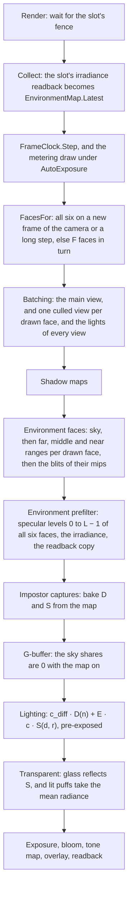

# Scene environment map

Ticket: `ter-nl5u`, a member of the rendering upgrade epic (`ter-sglu`, [rendering-upgrade.md](rendering-upgrade.md)). The user chose the design on 2026-10-25, in the ticket's last note. This doc fills in the details. Two points are open, see "Open forks".

This doc is written against main at `af2d0a8c` and against the automatic exposure design on its branch, [auto-exposure.md](auto-exposure.md) (`ter-zzyr`). It names that branch's types: the compute pipelines (`ComputePipelineDesc`, `ImageUse.SampledCompute`, `BufferUse.ComputeRead` and `ComputeWrite`), `FrameClock`, `VulkanRenderer.MeteringStepSeconds`, the step of a draw that `DrawFrame` takes, `exposure.glsl` and the `exposure` parameter of `surfaceRadiance`.

## Goal

Today the ambient light is the hemisphere of two colors, `World.Ambient`. Chrome and polished steel reflect a gradient between a sky color and a ground color, and a surface that no light reaches gets the same dim gray in space, in a cabin and on a planet. After this ticket:

- The renderer keeps a cube map of what surrounds the camera: the scene in all three depth ranges, lit by the sun and the lamps, and the star field.
- Chrome, steel and glass reflect that map along their lobe: sharp when smooth, blurred when rough.
- The diffuse ambient light comes from the same map. The belly of a ship over Earth's day side gets Earth's light, and its side toward deep space stays dark.
- SSR (`ter-jxv9`) falls back to the map where its ray leaves the screen.
- The hemisphere stays only as the ambient light of a renderer whose map is off.

## Terms

| Term | Meaning |
|---|---|
| The map | The scene environment map: the light that reaches the camera's eye from every direction, in six square views. |
| Face | One of the six views, 90° wide, along one axis of camera-relative world space. `CubeFace` names them in Vulkan's layer order: +X, −X, +Y, −Y, +Z, −Z. |
| W | The face size: the texels along one side of a face. `SceneEnvironmentMap.FaceSize`, 128 by default. |
| The main view | The camera's own view, which the G-buffer, lighting and transparent passes draw. |
| The radiance map | The cube image that the faces are drawn into, with a box-filtered mip chain. |
| The specular map | The cube image of the GGX-prefiltered levels. Its level k holds the light along the lobe of roughness k / (L − 1). |
| L | The number of levels of the specular map: log2(W / 4) + 1, so 6 at W = 128 (128 to 4 texels). |
| The irradiance | Nine RGB coefficients of real spherical harmonics up to band 2, already convolved with the clamped cosine: E(n) is the light that a surface with normal n receives. |
| D(n) | The ambient diffuse radiance: E(n) / π with the map on, the mix of the hemisphere's colors by the normal's sky share with it off. A Lambert surface sends c_diff · D(n). |
| S(d, r) | The ambient specular radiance: the specular map at direction d and roughness r with the map on, the mix of the hemisphere's colors by the lobe's sky share with it off. |
| d | The specular dominant direction of [pbr-brdf.md](pbr-brdf.md), "The ambient light's specular part". |
| Drawn frame | One recording and submission of the frame graph, as in [auto-exposure.md](auto-exposure.md). A metering draw is a drawn frame. |
| The draw step | The time, in s, that a drawn frame advances the renderer's clock: the step for a single draw or a metering draw, 0 for the shown draw after a metering draw. Today `DrawFrame`'s `exposureStep`. |
| A long step | A headless draw whose draw step is at least `MeteringStepSeconds`, 0.1 s. The same condition as the exposure's metering draw, without its `AutoExposure` part. |
| A refresh | A drawn frame that draws all six faces. |
| The map's frame | The `RenderSnapshot.OriginFrameId` of the camera's frame whose axes the faces were drawn in. |
| Plain radiance | Radiance that is not multiplied by the exposure, as the impostor atlas stores it. |

## Decisions

The user made the decisions marked (User), in the ticket's note of 2026-10-25. This design settled the others by the project's rules. Each has its reason.

1. The map holds the whole scene seen from the camera: all three depth ranges, lit by the sun, and the star field. (User)
2. Each face has 128 texels on a side. (User)
3. One face updates per frame, so all six every six frames. A headless still refreshes all six first. (User)
4. The diffuse ambient light also comes from the map. The hemisphere, `World.Ambient`, is used only while the map is off. (User)
5. The map sits at the camera. (User)
6. A compute pass prefilters the map into its mip levels with the GGX lobe of the split-sum method whose DFG table exists. So the build waits for the compute pipelines of `ter-zzyr`. (User)
7. The map replaces the hemisphere as the ambient specular light and as SSR's fallback, and glass reflects it. (User)
8. The switch is a union in `RendererOptions`: `NoEnvironmentMap` or `SceneEnvironmentMap(FaceSize, FacesPerFrame)`. It is on by default and off in the test fixtures. With it off, the hemisphere is the ambient light. (User)
9. GPU pixel tests, no reference images: a mirror sphere reflects a bright object behind the camera, and a rough sphere shows it blurred. (User)
10. The cost is measured at 1080p, and the user sees captures. (User)
11. The per-frame sky and ground colors (`ter-hro7`) are closed without work. The atmosphere color (`ter-6vhj`) reaches the ambient light through the map. (User)

Settled by this design:

12. A face is shaded in a forward pass, as the impostor capture is: one draw per depth range into the face, with the shading in the fragment shader. A face has 16,384 texels, so overdraw costs little, and a G-buffer of six faces adds five images and a lighting pass for nothing. The impostor capture is the existing pass that shades objects off screen.
13. The capture takes no ambient light. A face holds the light that the sun, the lamps and emission send toward the camera, so the main view's surfaces get one bounce of that light. Three reasons. A face then depends only on the frame that draws it. With the previous map as the capture's ambient, each face depends on every earlier face, a chain with no end, and a still after a camera step needs repeated refreshes to converge. The hemisphere is excluded by decision 4. And SSAO already left out bounced brightening because SSGI (`ter-a24f`) adds real bounced light. The cost: in a room, the parts that only bounced light reaches are black in the map, so interiors are darker than with many bounces.
14. A face draws the opaque instances, the impostor objects as geometry, emission and the sky. It draws no transparent instance and no puff, because SSR's rays read the HDR image before the transparent pass (`ter-jxv9`, the user's decision). The map and SSR then show the same things, and the fade from one to the other has no seam where glass appears or vanishes.
15. A face samples the sun's cascades by the finest cascade whose box holds the point. The main view picks its cascade by view depth along the camera's forward axis, which holds only for points in its frustum. See "The sun's shadow maps in a face".
16. One light list serves every view of a frame. A light is kept when its reach touches the main view's frustum or a face that the frame draws. The main view loops over the extra lights too, and each adds exactly nothing to its pixels, so the main view stays bit for bit as before.
17. A face draws no impostor billboard and culls no small object. The impostor manager decides for the main view's visible objects only. Rasterization point-samples a texel's center, so an object smaller than a texel keeps its light in the map on average, as a small object does on screen. A cull for cost waits for a measurement that shows a need.
18. Frame n draws the faces (n · F + k) mod 6 for k from 0 to F − 1, where F is `FacesPerFrame`, in layer order. It is a pure function of the frame number, so no stored cursor has to be reset by a refresh, a film draws the same faces on every run, and every face is at most ⌈6 / F⌉ − 1 frames old. An order that follows the camera's view changes with the view and needs a rule for ties.
19. A refresh happens when the map's frame differs from the camera's frame, and on a long step. The map starts with no frame, so the first drawn frame refreshes. A change of the camera's frame changes the axes of camera-relative world space, so every old face is wrong, not only old. See "Which faces a frame draws".
20. The diffuse irradiance is a set of spherical harmonics up to band 2, not a small irradiance cube. See "The irradiance".
21. Level k of the specular map holds roughness k / (L − 1), linear in perceptual roughness, as Filament maps its levels ("lod_α = α^(1/2) = perceptualRoughness"). The reader samples at the level r · (L − 1), with r the floored roughness.
22. The prefilter takes 64 Hammersley samples per texel with filtered importance sampling (Křivánek and Colbert 2008, GPU Gems 3, chapter 20). They found 40 samples visually acceptable for smooth surfaces. 64 is the next power of two, which the Hammersley set prefers.
23. The map stores plain radiance, as the impostor atlas does. See "Exposure".
24. The radiance map and the specular map are RGBA16F (`R16G16B16A16_SFLOAT`), the format of the HDR target and of the atlas. It holds up to 65,504, and every Vulkan device can write it as a storage image. B10G11R11 has 6 bits of mantissa at most, 1.5 % steps, which band in a mirror's smooth gradients, and it needs an optional feature to be a storage image.
25. The shading pipelines learn whether the map is on from a Vulkan specialization constant, `environmentMapOn`, fixed when the renderer makes them. The setting is fixed for the renderer's life, so a per-frame value is a second store of it, and a constant lets the driver drop the dead path. The map's bindings in the frame set are partially bound, so with the map off they stay empty, as the bindless texture array's unused slots do.
26. The union follows `BloomSetting`: a built-in union of two sealed record classes, whose constructor checks its values. The renderer refuses a setting that holds no case. `ToneCurve` is an enum because no case carries data. The exposure branch's `ExposureSetting` is a generated union of record structs. The brief named bloom as the analogue, and the two forms disagree, so this doc names the difference as a small point.
27. With the map on, the G-buffer pass writes 0 into the alphas that hold the two sky shares, and the transparent pass and the impostor capture skip them. Only the hemisphere reads them. The lobe-sky table stays uploaded and unread, because it is 4 KB and the map can be off in another renderer of the same process.

## The capture

### The faces and their axes

The six faces look out from the eye, which is the origin of camera-relative world space. Their axes are in camera-relative world axes, the axes of the camera's frame. So turning the camera changes no face, and the star field turns in the map only when the camera's frame turns against the root frame.

Each face follows Vulkan's table of cube map face selection (Vulkan specification, "Cube Map Face Selection"), so that a sample in direction ω reads the texel that the face drew in direction ω. "Right" is the direction in which the texel column s grows, and "up" is the direction in which the texel row t falls, because row 0 is the top of the image:

| Face | Layer | Forward | Right | Up |
|---|---|---|---|---|
| +X | 0 | +X | −Z | +Y |
| −X | 1 | −X | +Z | +Y |
| +Y | 2 | +Y | +X | −Z |
| −Y | 3 | −Y | +X | +Z |
| +Z | 4 | +Z | +X | +Y |
| −Z | 5 | −Z | −X | +Y |

```
direction(face, s, t) = normalize(forward + (2s − 1) · right + (1 − 2t) · up)      s, t in [0, 1]
```

For every face, right × up = forward. The renderer's view space is right-handed, with right × up pointing backward. So each face is a mirror image of a right-handed camera, the winding of every triangle flips, and the face pipeline sets its front face to clockwise. `CubeFacesTests.EveryFaceBasisIsLeftHanded` locks this in, and `EnvironmentFaceTests.EachFaceHoldsWhatLiesInItsDirection` checks it on the GPU.

A face's view matrix takes x = p · right, y = p · up and z = −p · forward. Its projection for depth range i is `DepthRanges.RangeProjection(i, π / 2, 1)`: 90° and square, infinite reversed-Z from the range's near plane, with the y flip of every view.

### What a face draws

| Thing | In a face | Why |
|---|---|---|
| Opaque instances with `Visible`, the planets and the sun's sphere included | Yes, as geometry | The scene seen from the camera (User) |
| Objects that the main view draws as impostors | Yes, as geometry | Decision 17 |
| Emission, the lamp panels included | Yes | It is light |
| The sky: the star field | Yes, as background | The map holds the star field (User) |
| Transparent instances | No | Decision 14: SSR shows no glass either |
| Puffs | No | Decision 14 |
| Frame outlines | No | The overlay is a debug drawing over the tone-mapped image, not light |

The sky is drawn first, by a fullscreen triangle that writes `skyRadiance(direction)` into every texel of the face, with no depth test. The three depth ranges then draw over it. `skyRadiance` is today's `starField` moved to `sky.glsl`, unchanged: each star is a Gaussian as wide as one pixel of the main view, `frame.params.z`. So a face point-samples the screen's star field at its texel centers. On average, a texel then holds the same light from the stars as the screen does, about 6 · 10⁻⁴ of radiance at 1080p. A star shows in a texel only when the texel's center falls within about a screen pixel of it, which happens for about 3 % of the stars at W = 128. See "Open forks: the stars in the map".

The sun's sphere, 0.53° across from Earth, is smaller than a texel, 0.4° to 0.9° at W = 128. It covers a texel's center about a quarter of the time, so it comes and goes as the sun crosses the texels. Its light in the map is at most about 1 % of what the directional sun gives, so it needs no rule of its own. An emissive panel that stands for a point light, such as a cabin lamp, lights twice: through its point light and through the map. In the shuttle's cabin the panels add a few percent to their lamps' light.

### The three depth ranges in a face

A face draws the far, middle and near ranges in that order into one RGBA16F color target and one D32 depth target of W × W, as the G-buffer pass does. Each range begins a rendering that loads the color, clears the depth to `DepthRanges.ClearDepth(range)`, and draws the face's opaque commands of that range with the range's projection. So a nearer range overwrites a farther one, the overlap of 1 % at each boundary hides nothing, and an object that straddles a boundary draws in both ranges. A face sorts its instances by their depth along its own forward axis, `DepthRanges.OpaqueMask(p · forward, radius)`, not the main view's.

### How a face is lit

`environment_face.frag` is `impostor_capture.frag` without the ambient light:

```glsl
SurfaceSample s = sampleMaterial(inMaterial, inTexCoord, inNormal, inTangent);
ShadingInput shading = ...;   // as in impostor_capture.frag, both sky shares 0
vec3 V = normalize(-inPosition);   // toward the eye, which every face shares
outColor = vec4(directRadiance(shading, s.emissive, inPosition, V, SunShadowsHolding), 1.0);
```

where

- `directRadiance` = the sun and the point and spot lights reflected toward V, plus the emission, clamped to 65,504, in plain radiance (see "The shader interface").
- `SunShadowsHolding` = the rule of the sun's shadow maps for a view that is not the main view (next section).
- `V` = the unit direction from the surface point to the eye. A face's highlights are those that the camera's eye sees, because the map is the light that arrives at the eye.

#### The sun's shadow maps in a face

The cascades are fitted to the main view (ARCHITECTURE.md, "Shadows"): cascade i is the bounding sphere of the slice of the main view's frustum that ends at its split, and the shader picks the cascade by the view depth along the camera's forward axis. A point behind the camera has a negative view depth, so that rule picks cascade 0 for it, which does not hold it once it is more than a few meters behind.

A face therefore picks the finest cascade whose box holds the point, with the margin of the filter. Every cascade's box holds the sphere of its slice, and the sphere holds a ball around the eye of radius (sphere radius − sphere center's depth). At the demo's 60° field of view and 16:9, that ball is about 9 m for cascade 0, 19 m for cascade 1, 49 m for cascade 2 and 355 m for cascade 3. So every point within 9 m of the camera, in any direction, gets cascade 0's texels of 6 cm. Ahead of the camera, the cascades reach 2 km as before. In the outer tenth of the coarsest box, the map shadow fades out and the far shadow of the casters in the maps fades in, by the same weight, as the main view does over its last blend band. Beyond every box, the far shadows alone decide, as for the main view beyond 2 km.

The shadow pass already culls its casters against every cascade's box, not against the main view's frustum, so a caster behind the camera is in the maps when its shadow falls into a box. The rule changes no shadow of the main view. A renderer built from scratch uses one rule for every view (see "Compared with a design from scratch").

With the far shadows alone, the sun lights the cabin's walls in the map through the hull: a far shadow never shadows a point inside its caster's sphere, and the cabin lies inside the shuttle's sphere.

#### The point and spot lights

`SceneBatcher.CollectLights` keeps a light today when its reach touches the main view's frustum. With the map on, it also keeps a light whose reach touches the frustum of a face that this frame draws (decision 16). On a refresh, the six faces see every direction, so every light of positive range and intensity is kept. The list keeps the snapshot's order, so the sum still rounds the same way on every run.

#### No ambient light in the capture

Decision 13. A face's surfaces get the sun, the far and map shadows, the point and spot lights, and their emission. A surface that none of these reach is black in the map.

### Culling and level of detail

| Step | Rule |
|---|---|
| Which instances | The snapshot's instances with `Visible`, a mesh on the GPU, a scale with volume, a finite position, and no `Transparent` flag |
| Frustum | `CubeFaces.Culls(face, center, radius)`: a sphere is culled when it lies behind the near plane, 5 cm ahead, or outside one of the four side planes of the 90° face, which pass through the eye with normals (forward ∓ right) / √2 and (forward ∓ up) / √2 |
| Depth ranges | `DepthRanges.OpaqueMask` with the depth along the face's forward axis |
| Level of detail | None. The engine has no mesh LOD, and a face draws each instance's one mesh |
| Impostors | None in a face. Decision 17 |
| Small objects | Not culled. Decision 17 |

The batcher interpolates each instance it keeps by the frame's alpha, as for the main view, and writes its `GpuInstance` and its indirect commands after the main view's, into the same arrays. A face's commands per range go into `PreparedScene.EnvironmentFaces`.

### Which faces a frame draws

`EnvironmentMap.FacesFor` is the one choke point of the map's automatic machinery. It runs on the CPU for each drawn frame, after the output gives the frame an image and before batching, and it calls two pure predicates:

```csharp
internal static class EnvironmentFaces
{
    public static FaceMask InTurn(long frame, int facesPerFrame);
    public static bool RefreshesAll(long? mapFrameId, long originFrameId, bool longStep) =>
        mapFrameId != originFrameId || longStep;
}

public FaceMask FacesFor(long frame, long originFrameId, bool longStep)
{
    FaceMask faces = EnvironmentFaces.RefreshesAll(FrameId, originFrameId, longStep)
        ? FaceMask.All
        : EnvironmentFaces.InTurn(frame, Setting.FacesPerFrame);
    FrameId = originFrameId;
    return faces;
}
```

where

- `frame` = the number of the drawn frame, `FrameContext.Number`, counted from 0 over every drawn frame, metering draws included.
- `facesPerFrame` = `SceneEnvironmentMap.FacesPerFrame`, F, from 1 to 6.
- `InTurn` = the faces (frame · F + k) mod 6 for k from 0 to F − 1 (decision 18).
- `mapFrameId` = `EnvironmentMap.FrameId`, the map's frame: null before the first drawn frame.
- `originFrameId` = `RenderSnapshot.OriginFrameId` of the snapshot that this frame draws.
- `longStep` = true for a headless draw whose draw step is at least `MeteringStepSeconds`, 0.1 s.
- `FaceMask` = a set of faces, bit i for layer i.

The cases:

| Draw | Faces | Why |
|---|---|---|
| The renderer's first drawn frame | All six | The map has no frame yet. No pass reads an empty map. |
| A draw whose camera has changed frame | All six | The faces are in the old frame's axes. A hand-off from one frame to another changes `OriginFrameId` too, at the cost of one refresh. |
| A headless still after a long step, under `FixedExposure` | All six | One draw with the long step (User: a still refreshes all six first) |
| The same under `AutoExposure` | All six in the metering draw, then F in the shown draw | The metering draw has the long step, so its meter measures the scene lit by a fresh map. The shown draw has a draw step of 0 and draws the same snapshot, so its F faces repeat what the metering draw drew. |
| A frame of a film, 1 or 2 ticks apart | F | The step is below 0.1 s. |
| A frame in a window | F | A window never refreshes for a step, because a refresh makes a slow frame slower still. |
| A window camera that cuts within one frame | F | The renderer cannot see a cut that keeps the frame. The old faces stay for up to ⌈6 / F⌉ − 1 frames, 83 ms at 60 Hz. A rule for it waits for a snapshot field that says "cut", which no one needs yet. |

## The prefilter

Everything in this section runs on the GPU in one compute pass, `EnvironmentPrefilterPass`, after the faces of the frame are drawn and before any reader. It reads only the radiance map, never its own earlier output, so the specular map and the irradiance are a pure function of the six stored faces.

### The radiance map's mips

After the face pass draws a face, it rebuilds that face's mip chain with linear blits, from level 0 down to 1 × 1, as `ImpostorPass.GenerateMips` rebuilds a tile. A blit's linear filter halves each axis, so each texel of level i + 1 is the mean of four texels of level i. The chain is the source of filtered importance sampling below.

### The specular levels

Level 0 holds roughness 0, a lobe of zero width, so it is the radiance map's level 0, texel for texel. Level k, from 1 to L − 1, holds the prefilter of Karis 2013 ("Real Shading in Unreal Engine 4", the split sum's first sum, with n = v = r):

```
For the texel of level k at direction n, with r_k = k / (L − 1) and α = r_k²:
  for i = 0 to N − 1:
    (u₁, u₂) = Hammersley point i of N
    h = GGX half vector of α at (u₁, u₂), around n            the formula of pbr-brdf.md, "Computing them"
    l = 2 (n·h) h − n
    if n·l > 0:
      pdf   = D(n·h, α) / 4                                  D(n·h) (n·h) / (4 v·h), with v = n
      lod   = max(½ log2(Ω_s / Ω_p) + 1, 0)                   Křivánek and Colbert 2008
      Ω_s   = 1 / (N · pdf)
      Ω_p   = 4π / (6 W²)
      sum    += radiance map at l, level lod, trilinear × n·l
      weight += n·l
  texel = sum / weight
```

where

- `N` = `PrefilterLevels.SamplesPerTexel`, 64 (decision 22).
- `Ω_s` = the solid angle that one sample stands for, in sr.
- `Ω_p` = the solid angle of one texel of the radiance map's level 0, in sr.
- `+ 1` = the bias of Křivánek and Colbert, who found that a little overlap between samples looks smoother.
- `D` = `ggxDistribution` of `brdf.glsl`.
- The weight n·l is Karis's.

Each texel sums its samples in the order of i, so the specular map is the same bits on every run on one GPU. The texels of a level are independent, so the dispatch is one invocation per texel: workgroups of 8 × 8 over (W_k, W_k, 6), where W_k = W / 2^k. A level of 4 or 8 texels fills part of one group, and the extra invocations write nothing.

Level L − 1 has faces of 4 texels, `PrefilterLevels.SmallestFaceSize`. Its lobe, roughness 1, spans about 90°, so it still covers about four texels across. A face of 2 or 1 texels holds it in fewer.

The work at W = 128: levels 1 to 5 hold 6 × (64² + 32² + 16² + 8² + 4²) = 32,736 texels, so 2.1 million trilinear samples, and level 0 copies 98,304 texels. The whole map is prefiltered in every drawn frame, because a lobe of roughness 0.4 or more crosses into the neighbor faces of the face that changed.

### The irradiance

The irradiance is the projection of the radiance map's level 0 onto the nine real spherical harmonics Y_lm up to band 2, multiplied by the clamped cosine's coefficients (Ramamoorthi and Hanrahan 2001, "An Efficient Representation for Irradiance Environment Maps"):

```
L_lm = Σ over every texel of the six faces:  radiance(texel) · Y_lm(direction(texel)) · Ω(texel)
E_lm = Â_l · L_lm,      Â_0 = π,  Â_1 = 2π/3,  Â_2 = π/4
E(n) = max(Σ_lm E_lm · Y_lm(n), 0)
D(n) = E(n) / π
mean radiance = E_00 · Y_00 / π
```

where

- `Ω(texel)` = the exact solid angle of a texel of a cube face: A(x₀, y₀) − A(x₀, y₁) − A(x₁, y₀) + A(x₁, y₁), with A(x, y) = atan2(x · y, √(x² + y² + 1)) and the texel's corners x₀, x₁, y₀, y₁ in [−1, 1] (Driscoll 2012, "Cubemap Texel Solid Angle"). The texels of one face add up to 4π / 6 exactly.
- `Y_lm` = the real basis in world axes, in this order. Band 0: 0.282095. Band 1: 0.488603 y, 0.488603 z, 0.488603 x. Band 2: 1.092548 xy, 1.092548 yz, 0.315392 (3z² − 1), 1.092548 xz, 0.546274 (x² − y²).
- `E_lm` = what the irradiance buffer stores, coefficient i in `vec4` i, w unused.
- `D(n)` = the ambient diffuse radiance: a Lambert surface sends c_diff · D(n), as it sends c_diff times the hemisphere's mix today.
- `mean radiance` = the mean of the map's radiance over every direction, which the lit puffs need.

One check of the formula, which a CPU test and a GPU test use: under a sky of radiance 1 above the horizon and a black ground, L_00 = √π, L_1(y) = (√3 / 2) √π, and the band-2 terms vanish. So E(n) = π (1 + n_y) / 2 exactly, and D(n) = (1 + n_y) / 2: the hemisphere's diffuse light with a white sky and a black ground.

Why spherical harmonics and not an irradiance cube of 16 texels:

- Nine `vec4` values in a 144-byte buffer: every reader evaluates them with no texture and no sampler, in the vertex stage of the lit puffs too, and the lit puffs' mean is the first coefficient alone.
- The CPU reads 144 bytes back for the impostors' signature of the light (see "Impostors").
- The average error is about 1 % for real environments (Ramamoorthi and Hanrahan).
- The cost is ringing around one small bright source. For light from one direction alone, band 2 gives 6 % too much toward it, a dip to −4 % at 122° from it, which the clamp holds at 0, and 6 % on the far side, where the true value is 0.

The projection is one dispatch of one workgroup of 256 invocations. Invocation j sums the texels j, j + 256, j + 512 and so on of the six faces, in layer, row and column order. A tree of shared memory then sums the 256 partial sums in a fixed order, and invocation 0 writes the nine E_lm. So the irradiance is the same bits on every run on one GPU. At W = 128 each invocation reads 384 texels.

### When they run

| Order in the frame | Work | Reads | Writes |
|---|---|---|---|
| After the shadow maps | The face pass: the sky and the three ranges of each face that the frame draws, then the blits of those faces' mips | This frame's cascades, light list and face commands | The radiance map: the drawn faces, every level |
| Next | The prefilter pass: levels 0 to L − 1, then the irradiance, then the copy of the irradiance into the slot's readback buffer | The radiance map, all six faces | The specular map, the irradiance buffer, the readback buffer |
| Then | The impostor captures, the G-buffer pass, the lighting pass, the transparent pass, and SSR when it exists | The specular map and the irradiance | |

## Reading the map

### The one source of the ambient light

The ambient light keeps its formula of [pbr-brdf.md](pbr-brdf.md), with its two incoming radiances given new names:

```
ambient = c_diff · D(n)  +  E(μ, r) · c(μ, r) · S(d, r)

map on:   D(n)    = max(Σ E_lm Y_lm(n), 0) / π
          S(d, r) = textureLod(specular map, d, r · (L − 1))
map off:  D(n)    = mix(ground, sky, s_n)
          S(d, r) = mix(ground, sky, s_l)

d = specularDominantDirection(n, reflect(−v, n), α)
```

where

- `E(μ, r)` and `c(μ, r)` = the specular albedo and the energy compensation from the DFG table, unchanged.
- `r` = the floored roughness, from 0.045 to 1. At the floor, the read is 0.225 of a level above level 0.
- `textureLod` = a trilinear read of the cube with Vulkan's seamless filtering across faces.

The one place where the map becomes the source is two functions in a new file, `environment.glsl`: `ambientDiffuseRadiance` for D and `ambientSpecularRadiance` for S. `ambientLight` in `lighting.glsl` calls them and keeps the weights. The three designs that run beside this one meet it there:

| Design | What it does to the ambient light | Where |
|---|---|---|
| SSAO (`ter-b3h5`) | Scales the diffuse part by the occlusion and the specular part by the specular occlusion | In `ambientLight`, on the two terms. It does not care whether D and S come from the map. |
| SSR (`ter-jxv9`) | Replaces S by the radiance that its ray hits, and fades back to S where the ray misses | Its compute pass calls `ambientSpecularRadiance` for the fallback. With the map on, that is the map. With it off, it is the hemisphere. |
| The glass blend (`ter-mgze`) | Lets through (1 − opacity)(1 − E) of what lies behind | E is the DFG table's specular albedo, which the map does not change |

Whichever of these merges after this ticket applies its factor to the terms in `ambientLight` and calls the two functions for D and S. Whichever merges before it, this ticket keeps its factor.

### The passes that read it

| Pass | Reads | Notes |
|---|---|---|
| Lighting, a lit pixel | D at the shading normal, S at d | Through `surfaceRadiance`, unchanged in its callers |
| Transparent, a mesh | The same | Glass reflects the map (User) |
| Impostor capture | The same, with V from the main view's eye | The capture bakes the map's light |
| Lit puffs (`scatteredLight`) | The mean radiance | Was the mean of the sky and the ground color |
| SSR, later | S, as its fallback | Its compute pass binds set 0 |
| Environment faces | Nothing | Decision 13 |
| Sky pixels | Nothing | They show `skyRadiance` |

### The hemisphere and the lobe-sky table while the map is on

- `World.Ambient` still flows into the snapshot, because the snapshot builder cannot see the renderer's options, as with the frame outlines. With the map on, the batcher writes zero into the frame constants `ambientSky` and `ambientGround`, so the frame constants hold the hemisphere only when it is the light.
- `HemisphereUp` stays in every `GpuInstance` and is not read by any shading.
- The G-buffer pass writes 0 into the alpha of the specular target and of the emissive target, and the transparent pass and the impostor capture skip both shares (decision 27).
- The lobe-sky table stays uploaded and unread.

### Impostors

A capture bakes the light that reaches the object, the map's ambient light included. `ImpostorManager` recaptures when that light changes (ARCHITECTURE.md, "Impostors"). Today its signature counts both hemisphere colors and the up. The map lives on the GPU, so the CPU knows it only from a readback: the prefilter pass copies the irradiance into the slot's readback buffer, and `Render` collects it after the slot's fence into `EnvironmentMap.Latest`, an `IrradianceReading`, as the exposure branch collects its reading. Frame n then knows the irradiance of frame n − `FramesInFlight`.

The signature's ambient part becomes a union, `AmbientSignature`: `HemisphereSignature(Sky, Ground, Up)` with the map off, and `MapSignature(Irradiance)` with it on. Its change is the sum of the absolute changes of the nine coefficients, as a share of the larger total, the rule of the other parts. A change of the map is then seen `FramesInFlight` frames late, and the object recaptures by the 2 / h rule. Before the first reading, the signature holds zero coefficients, so the first reading recaptures every impostor captured before it. The capture's specular part also comes from the map, which the irradiance does not describe. An impostor is under 200 px, so a changed reflection on it waits for another recapture.

## Exposure

The map stores plain radiance: the face pass writes `directRadiance`, which multiplies by no exposure, and the sky pass writes `skyRadiance` as it is. The readers multiply the reflected light by the frame's exposure in `surfaceRadiance`, ambient included, so the map's light is pre-exposed where it lands, like every other light.

The reason is the one of the impostor atlas ([auto-exposure.md](auto-exposure.md), "The impostor atlas"). A face is drawn in one frame and read for up to ⌈6 / F⌉ − 1 later frames while the exposure moves, and the prefilter mixes faces of different frames into one lobe. A pre-exposed face holds the exposure of its own frame, so six faces hold six different units. In plain radiance they share one, with no record of the exposure per face. The range of a half float is enough by the atlas's argument: 65,504 is 150 times a sunlit white surface in SI units, and 6.1 · 10⁻⁵ at +8 stops still shows at about 7 of 255.

A headless still refreshes all six faces before it shades (see "Which faces a frame draws"). That refresh is the analogue of the exposure's metering draw: both make a still show its own view, not the view of the frame before a camera step. Under `AutoExposure`, the metering draw itself refreshes, so the meter measures the scene lit by the map of the still's own place.

## The setting

`src/Tertius.Rendering/EnvironmentMapSetting.cs` (new, public):

```csharp
namespace Tertius.Rendering;

/// <summary>
/// Whether the renderer lights surfaces with a map of the scene around the camera, and its size and pace
/// (docs/plans/environment-map.md). A built-in C# 15 union of two class cases, as BloomSetting is. The default value holds no
/// case, and the renderer refuses it.
/// </summary>
public union EnvironmentMapSetting(NoEnvironmentMap, SceneEnvironmentMap)
{
    // The built-in union's ToString gives only the name of the union.
    public override readonly string ToString() => Value?.ToString() ?? "EnvironmentMapSetting(none)";
}

/// <summary>
/// No map: the hemisphere of World.Ambient is the ambient light, as before the map. The renderer makes no map images and no
/// map passes.
/// </summary>
public sealed record NoEnvironmentMap;

/// <summary>
/// A cube map of the scene around the camera: the three depth ranges lit by the sun and the lamps, and the star field. It
/// gives every surface its ambient light, diffuse and specular, and SSR its fallback.
/// </summary>
public sealed record SceneEnvironmentMap
{
    /// <summary>The smallest face: its levels reach roughness 1 through one level between, 16, 8 and 4 texels.</summary>
    public const int MinFaceSize = 16;

    /// <summary>The largest face. At 1024 texels one texel is about the width of the lobe of the roughness floor, so a larger map adds nothing that any material shows.</summary>
    public const int MaxFaceSize = 1024;

    /// <param name="faceSize">The texels along one side of each face: a power of two from 16 to 1024.</param>
    /// <param name="facesPerFrame">How many of the six faces each drawn frame draws again, 1 to 6. 6 keeps every face from the frame that reads it.</param>
    /// <exception cref="ArgumentOutOfRangeException">A value is outside its range.</exception>
    public SceneEnvironmentMap(int faceSize, int facesPerFrame);

    /// <summary>The texels along one side of each face.</summary>
    public int FaceSize { get; }

    /// <summary>How many faces each drawn frame draws again.</summary>
    public int FacesPerFrame { get; }
}
```

`RendererOptions` gains:

```csharp
/// <summary>
/// The ambient light: a map of the scene around the camera, or <see cref="NoEnvironmentMap"/> for the hemisphere of
/// World.Ambient. On by default, with 128 texels per face, one face per frame. The map takes about 2 MB at 128
/// (ARCHITECTURE.md, "The environment map").
/// </summary>
public EnvironmentMapSetting EnvironmentMap { get; set; } = new SceneEnvironmentMap(faceSize: 128, facesPerFrame: 1);
```

| Field | Unit | Valid | Default | Checked by |
|---|---|---|---|---|
| `FaceSize` | Texels along a face's side | A power of two from 16 to 1024, and at most the device's `maxImageDimensionCube` | 128 (User) | The constructor for the range and the power of two, `VulkanRenderer.CheckOptions` at creation for the device's limit, as for `ShadowMapSize` |
| `FacesPerFrame` | Faces per drawn frame | 1 to 6 | 1 (User) | The constructor |
| The union | | `NoEnvironmentMap` or `SceneEnvironmentMap` | `SceneEnvironmentMap(128, 1)` (User) | `CheckOptions` refuses a value that holds no case, with `ArgumentException`, as for `Bloom` |

| Analogue | How the map matches it |
|---|---|
| `BloomSetting` | The same union form, constructor validation, a refused empty value, a default written in `RendererOptions`, `NoBloom` in the test fixtures, and `--bloom on\|off` on the headless command line, which becomes `--environment-map on\|off` |
| `ToneCurve` | An enum, because neither of its cases carries data. The map's case carries two fields, so it is a union. |
| `Impostors` | On by default and off in the test fixtures, fixed for the renderer's life |

The test helpers `Gpu.Headless` (`tests/Tertius.Rendering.Tests/TestSupport.cs`) and `GpuTesting.Headless` (`tests/Tertius.Host.Tests`) set `NoEnvironmentMap` (User). `Gpu.Headless` takes an optional `EnvironmentMapSetting environmentMap` for the map's own tests. The six reference images keep their bits.

A face count of 6 makes the map draw every face from the frame that reads it, so it carries nothing from earlier frames. The snapshot tests epic can choose that, or `NoEnvironmentMap`, in its tests' options. Its deterministic switch then has no map of its own to turn off, as the exposure doc says of `FixedExposure`.

## Images and buffers

`EnvironmentMap` (`src/Tertius.Rendering/Frame/EnvironmentMap.cs`, new) owns them, made at creation from the setting. One map serves every frame in flight, as one exposure buffer does: frames run in submission order on one queue, and the barriers below order each frame's writes after the earlier frame's reads.

| Image or buffer | Format and size | Memory at W = 128 | Usage | Written by | Read by |
|---|---|---|---|---|---|
| The radiance map | RGBA16F cube, W × W, 6 layers, log2(W) + 1 levels | 1.0 MB | Color attachment, sampled, transfer source and destination, cube-compatible | The face pass: level 0 of the drawn faces, then the blits of their levels | The prefilter pass |
| The face views | One 2D view of level 0 of each layer | | | | The face pass's color attachment |
| The specular map | RGBA16F cube, W × W, 6 layers, L levels | 1.0 MB | Storage, sampled, transfer source (for the test hook), cube-compatible | The prefilter pass, every level | The impostor capture, the lighting pass, the transparent pass, SSR |
| The specular level views | One 2D-array view of 6 layers per level | | | The prefilter's storage images | |
| The face depth | D32, W × W | 64 KB | Depth attachment | The face pass, cleared per range | The face pass |
| The irradiance buffer | 9 `vec4`, 144 B, `GpuOnly` | 144 B | Storage, transfer source | The prefilter pass | The impostor capture, the lighting and transparent passes, the lit puffs, SSR, the readback copy |
| A readback buffer per frame slot | 144 B, `Readback` | 144 B each | Transfer destination | The copy at the end of the prefilter pass | `EnvironmentMap.Collect`, after the slot's fence |

The images take about 2.1 MB at W = 128 and about 134 MB at W = 1024.

The descriptors:

| Set | Binding | Type | Stages | Holds | Written |
|---|---|---|---|---|---|
| 0, the frame set | 12 | Sampled image, cube, partially bound | Fragment, compute | The specular map, all levels | Once by `FrameResources`, when the map is on |
| 0 | 13 | Sampler, immutable | Fragment, compute | `DescriptorLayouts.EnvironmentSampler`: linear, linear between levels, clamp to edge, every level | At layout creation |
| 0 | 14 | Storage buffer, partially bound | Vertex, fragment, compute | The irradiance buffer | Once by `FrameResources`, when the map is on |
| 0 of `EnvironmentPrefilterLayout`, the prefilter set | 0 | Sampled image, cube | Compute | The radiance map, all levels | Once by `EnvironmentMap` |
| The prefilter set | 1 | Sampler, immutable | Compute | `EnvironmentSampler` | At layout creation |
| The prefilter set | 2 | Storage image, an array of 16, partially bound | Compute | The specular level views, levels 0 to L − 1 | Once by `EnvironmentMap` |
| The prefilter set | 3 | Storage buffer | Compute | The irradiance buffer | Once by `EnvironmentMap` |

The frame set lives in set 0 for the reason of the BRDF tables: the impostor capture binds only sets 0 and 1. The exposure branch's binding 11 comes before these. The face pass binds sets 0 to 2 of `SceneLayout`, because it samples the cascades in set 2. It does not read set 2's G-buffer bindings, which hold the targets of the frame before at that point.

Push constants:

| Pipeline | Block | Size | Fields |
|---|---|---|---|
| Environment face (`mesh.vert`, `environment_face.frag`) | `DrawPushConstants`, as every mesh pass | 80 B | `viewProj`: the face's view-projection of the range. `eye`: 0 |
| Environment sky (`fullscreen.vert`, `environment_sky.frag`) | `SkyFacePushConstants`, inside the scene layout's 80-byte range | 48 B | `Forward`, `Right`, `Up`: the face's basis as `Vector4`, w 0 |
| Prefilter (`environment_prefilter.comp`) and irradiance (`environment_irradiance.comp`) | `EnvironmentPrefilterPushConstants` | 16 B | `Level`, `LevelSize` (W_k), `Roughness` (r_k), `Samples`. The irradiance shader reads none. |

### Every reader and writer

| Value | Written by | When | Read by | When | Stored in | Analogue |
|---|---|---|---|---|---|---|
| `RendererOptions.EnvironmentMap` | The host, tests | Before the renderer is made | `CheckOptions`, and `VulkanRenderer`, which makes the map and its passes and sets the shader constant | At creation | `RendererOptions` | `RendererOptions.Bloom` |
| The shader constant `environmentMapOn` | `VulkanRenderer`, from the setting | When each shading pipeline is made | `environment.glsl`, `gbuffer.frag`, `transparent.frag`, `impostor_capture.frag` | Every draw | The pipelines | None today |
| The map's frame, `EnvironmentMap.FrameId` | `FacesFor` | Each drawn frame | `FacesFor` | Each drawn frame | `EnvironmentMap` | An impostor's capture record: CPU state that describes what a GPU image holds |
| The faces of a frame, a `FaceMask` | `FacesFor` | Step 2, before batching | `SceneBatcher` | Step 2 | `EnvironmentDraw.WithMap.Faces`, then `PreparedScene.EnvironmentFaces` | `ImpostorManager.Captures` |
| A face's commands per range | `SceneBatcher` | Step 2 | `EnvironmentFacePass` | Step 3a | `PreparedScene.EnvironmentFaces`, `Instances`, `Commands` | The capture instances that `ImpostorPass.Prepare` appends |
| The light list | `SceneBatcher` | Step 2 | Every pass that shades, the faces included | Steps 3a to 7 | `PreparedScene.Lights` | Today's list, with the faces' lights added |
| A face of the radiance map, level 0 | `EnvironmentFacePass` | Step 3a of a frame that draws it | Its blits and the prefilter | Steps 3a and 3b of the same frame and of every later frame until it is drawn again | `EnvironmentMap.Radiance` | An impostor atlas tile |
| A face's mips in the radiance map | The blits | Step 3a, after the face | The prefilter | Step 3b | `EnvironmentMap.Radiance` | A tile's mips |
| The specular map | `EnvironmentPrefilterPass` | Step 3b of each drawn frame | The impostor capture, lighting, transparent, SSR | Steps 4 to 7 | `EnvironmentMap.Specular` | A tile's mips: derived from the stored image in the frame that changes it |
| The irradiance | `EnvironmentPrefilterPass` | Step 3b | The capture, lighting, transparent, the lit puffs, SSR, the readback copy | Steps 3b to 7 | `EnvironmentMap.Irradiance` | The exposure's histogram: a value derived on the GPU each frame |
| The readback of a slot | The copy at the end of step 3b | Each drawn frame | `EnvironmentMap.Collect` | After the slot's fence, in `Render` | The readback buffers | The exposure's readback buffers |
| `EnvironmentMap.Latest`, an `IrradianceReading` | `Collect` | Each `Render`, after the fence wait | `VulkanRenderer`, into `EnvironmentDraw.WithMap.Irradiance`, then `PreparedScene.Ambient`, and `ImpostorManager` | Step 2 | `EnvironmentMap` | `ExposureResources.Latest` |
| The ambient source of a frame, `AmbientSource` | `SceneBatcher` | Step 2 | `ImpostorManager`, `WriteConstants` | Step 2 | `PreparedScene.Ambient` | Today's `PreparedScene.Ambient`, which held the hemisphere alone |

The steps are those of ARCHITECTURE.md, "The order of a rendered frame". This doc adds 3a, the environment faces, and 3b, the environment prefilter, between the shadow maps (3) and the impostor captures (4). Each ordering rule has its reason:

- The faces come after the shadow maps, because a face samples this frame's cascades.
- The prefilter comes after the faces, because it reads the faces of this frame.
- The impostor captures come after the prefilter, because a capture bakes the map's light.
- The readback copy comes right after the irradiance, so a reading is the irradiance that this frame's passes used.
- `FacesFor` runs before batching, because the batcher prepares the faces' views.

### How the map fits "stored state describes the last finished step"

The stored state of the map is its six faces. Each face describes the frame that drew it, with that frame's snapshot at that frame's alpha, its cascades and its lights. A frame's readers come after its face pass in submission order, so they never read a face in flight: the newest face is this frame's own, finished before them, as this frame's shadow maps are finished before the lighting pass. The specular map and the irradiance are not a second store. They are a pure function of the six faces, recomputed in each drawn frame right after the faces change, from the faces alone. The map's frame on the CPU describes the axes of the faces that the recorded frames will have drawn, as the impostor manager's capture records describe tiles on the GPU.

The exposure buffer differs: frame n uses the exposure that frame n − 1 decided. The map's newest face is from frame n itself, and its oldest from frame n − (⌈6 / F⌉ − 1).

## The flow of a frame



## The flow of each kind

| Kind or place | In the map | Its diffuse ambient light | Its specular ambient light |
|---|---|---|---|
| Chrome in open space with a planet below | Drawn, lit by the sun | None: a metal has no diffuse color | Earth's day side below, black space with the Moon and the stations above, blurred by the roughness. SSR adds what is on screen, sharper, and falls back to the map. The 128 texels resolve the lobe of roughness 0.1 and rougher. Smoother chrome shows the map no sharper. Stars: see "Open forks". |
| A matte hull under Earth | Drawn | From LEO, Earth fills about a third of the map. Over the day side, the belly gets about c_diff · 0.35 at noon, ten times today's 0.03. Over the night side, almost nothing. The side toward deep space gets the stars, about 6 · 10⁻⁴: darker than today. | Its small specular part reflects the same |
| A cabin interior with lamps | Drawn, lit by its lamps and the cascades, through the canopy's opening to the outside | One bounce of the lamps' light from the walls, floor and ceiling, colored by them. Corners that no lamp lights are black in the map. | The lit cabin, and the outside through the canopy, along the lobe |
| The outside seen from the cabin | Drawn | The cabin's light: see "Open forks: far surfaces and the camera's surroundings" | The cabin, along the lobe |
| Glass | Not drawn | As a surface, if its diffuse color is above 0 | The map at its roughness: from inside the cabin, the cabin. From outside, the outside. It blends as `ter-mgze` decides. |
| A far planet | Drawn | The light around the camera, not around the planet. The Moon's night side seen from Earth orbit takes what the camera sees in the directions its surface faces: Earth, where its night side faces Earth, which happens to be earthshine, and the shuttle's sunlit hull when the camera sits beside it, which is wrong and about as bright as today's fill. | The same, along the lobe |
| An impostor billboard | Its object is drawn as geometry | Baked into the capture from the map, recaptured when the irradiance reading changes | Baked |
| A lit puff | Not drawn | The map's mean radiance, in place of the mean of the two colors | None: a puff has no lobe |
| A glow puff | Not drawn | None | None |
| The sky | The background of every face | None | None |
| Earth's surface in daylight | The sunlit ground below the horizon, the black sky with stars above, until the atmosphere ticket gives the sky its color | Ground bounce from below and the sides. Almost nothing from above, where the hemisphere gave 0.08 | The ground and the black sky |
| The first frame after the renderer starts | All six faces, a refresh | From a complete map | From a complete map |
| A camera that jumps to another frame tree | All six faces, a refresh, in the new frame's axes and stars | From the new place at once, in a window too | From the new place |
| A window camera cut within one frame | F faces per frame | Mixed old and new faces for up to 83 ms at 60 Hz | The same |
| A ship that turns with the camera in it | The cabin is fixed in the map's axes. The stars and the outside turn. | Unchanged by the turn | The stars blink in near mirrors as they cross texels |

Every surface with a material takes D and S from one place. Only the source changes with the setting. The map holds what the main view draws opaque, with the same sky.

## The frame graph, barriers, timers, resize, and the switch off

`FrameGraph.Stage` gains `EnvironmentFaces` and `EnvironmentPrefilter`, between `ShadowMaps` and `ImpostorCaptures`. The renderer adds `EnvironmentFacePass` and `EnvironmentPrefilterPass` only under `SceneEnvironmentMap`.

Each barrier goes through `BarrierBatch`, which keeps each image's and buffer's last use, and each has its reason:

| Image or buffer | From | To | Kind | Reason |
|---|---|---|---|---|
| Radiance map, a drawn face's level 0 | `SampledCompute` of the last prefilter, or nothing at the first use | `ColorAttachment`, discarding the old content | Read to write | The face is drawn anew and must not be written while an earlier prefilter reads it |
| Face depth | Its last use | `DepthAttachment`, discarding | Write to write | Each range clears it |
| Shadow cascades | The shadow pass's depth writes | `SampledFragment` | Write to read | The face shader samples them |
| Instances, materials, lights, occluders | The uploads | `ShaderRead` | Write to read | As the G-buffer pass |
| Vertices and indices | The uploads | `VertexInput` | Write to read | As the G-buffer pass |
| Radiance map, a drawn face's levels | `ColorAttachment` for level 0, discarded for the others | `TransferSource` and `TransferDestination`, level by level | Write to read | The blits build the chain, as `ImpostorPass.GenerateMips` does |
| Radiance map, every layer and level | Transfer, or the last `SampledCompute` | `SampledCompute` | Write to read | The prefilter reads the whole map |
| Specular map, every level | `SampledFragment` of the frame before (`SampledCompute` too, once SSR exists) | `StorageCompute`, discarding | Read to write | The prefilter rewrites every texel, and must not overwrite a level that an earlier frame still reads |
| Irradiance buffer | `ShaderRead` of the frame before | `ComputeWrite` | Read to write | The same |
| Irradiance buffer | `ComputeWrite` | `TransferSource` | Write to read | The readback copy |
| The slot's readback buffer | The copy | `HostRead` | Write to host read | The CPU reads it after the slot's fence |
| Irradiance buffer | `TransferSource` | `ShaderRead` | Read to read | A chain to the vertex and fragment stages of the readers |
| Specular map | `StorageCompute` | `SampledFragment` | Write to read | The impostor capture, the lighting and the transparent pass read it |

`ImageUse` gains `StorageCompute`: layout `General`, stage compute, access shader storage write. The exposure branch brings `SampledCompute`, `ComputeRead` and `ComputeWrite`.

GPU timers: `FrameGraph.Record` times every pass, so the two passes report as `environment faces` and `environment prefilter` in `RenderStats.GpuTimings` and `gpu-timings.json` with no work of their own. A refresh frame's face pass takes about six times the time of a frame that draws one face.

Resize: nothing. The map's images do not depend on the output's size, and the frame set's bindings 12 to 14 are written once.

With `NoEnvironmentMap`: no `EnvironmentMap`, no images, no sets, no passes, no readback. The shading pipelines are made with `environmentMapOn` false, which keeps today's hemisphere code. Bindings 12 to 14 stay empty. `FacesFor` never runs, the batcher prepares no face and keeps the main view's lights only, and the impostor signature takes the hemisphere case. The frame is the frame from before the map, pixel for pixel, and the six reference images show it.

## Tests

The tests follow tests/STYLE.md: one behavior per test, named as a statement. No test adds a reference image (the epic's rule). The GPU tests use small outputs, 160 × 90 or 320 × 180, and `SceneEnvironmentMap(32, 1)` where the face size does not matter, so a test draws its faces quickly. Two hooks read the map back, each waiting for the device to be idle as `ReadImpostorTile` does:

```csharp
internal Half[] ReadEnvironmentFace(CubeFace face, int level, EnvironmentImage image);   // RGBA halves, rows from the top
internal Irradiance ReadEnvironmentIrradiance();
internal enum EnvironmentImage { Radiance, Specular }
```

### CPU tests

`CubeFacesTests` (Part 1):

- `EachFaceLooksAlongItsAxis`.
- `EachFacesRightAndUpFollowTheVulkanFaceTable`: for a spread of directions, `Locate` gives the face and the (s, t) of the specification's formula, and `Direction` inverts it.
- `EveryFaceBasisIsLeftHanded`: right × up = forward, the reason of the clockwise front face.
- `TheTexelSolidAnglesOfAFaceAddUpToASixthOfTheSphere`: 4π / 6 within 10⁻⁹ at W = 4, 32 and 128.
- `ACornerTexelCoversLessOfTheSphereThanACenterTexel`.
- `AFaceCullsASphereOutsideItsSidePlanesAndKeepsOneThatTouchesThem`.
- `AFacesViewProjectionPutsItsForwardAxisAtTheCenterAndItsUpAtTheTop`.

`EnvironmentFacesTests` (Part 1):

- `OneFacePerFrameVisitsTheFacesInLayerOrder`.
- `AtOneFacePerFrameEveryFaceIsDrawnOnceInSixFrames`.
- `FourFacesPerFrameWrapAroundTheLayers`: frames 0 and 1 draw faces 0 to 3, then 4, 5, 0 and 1.
- `AMapWithNoFrameRefreshesEveryFace`.
- `AChangeOfTheCamerasFrameRefreshesEveryFace`.
- `ALongStepRefreshesEveryFace`.
- `ADrawInTheSameFrameWithoutALongStepDrawsItsFacesInTurn`.

`PrefilterLevelsTests` (Part 1):

- `AMapOf128TexelsHasSixLevelsFrom128To4`, and `AMapOf16TexelsHasThree`.
- `LevelKHoldsRoughnessKOverTheLastLevel`.
- `ARoughnessReadsTheLevelOfItsShareOfTheLastLevel`: r = 0.6 reads level 3 at L = 6.
- `TheRoughnessFloorReadsMostlyTheMirrorLevel`: 0.045 reads 0.225.
- `ASampleOfLowerDensityReadsACoarserLevel`.
- `TheLevelOfASampleNeverFallsBelowZero`.

`IrradianceTests` (Part 1):

- `TheBasisIsOrthonormalOverTheSphere`: by a midpoint quadrature, not by the cube.
- `AUniformMapProjectsOntoTheFirstCoefficientAlone`, and `ItsIrradianceIsPiTimesItsRadianceInEveryDirection`.
- `AWhiteUpperHalfGivesTheHemispheresDiffuseLightExactly`: D(n) = (1 + n_y) / 2 within 10⁻⁴, from a cube of W = 32 whose horizon falls between two rows.
- `TheProjectionOfAKnownCubeRecoversTheCoefficientsThatFilledIt`: a cube filled with a sum of basis functions gives back their weights within 10⁻³.
- `LightFromOneDirectionPeaksTowardItAndTheClampKeepsItsDipAtZero`.
- `TheMeanRadianceOfAUniformMapIsItsRadiance`.
- `TwoProjectionsOfOneCubeGiveTheSameBits`.
- `TheChangeBetweenTwoIrradiancesIsAShareOfTheLargerTotal`, and `NoChangeIsZero`.

`EnvironmentMapSettingTests` (Part 2):

- `TheDefaultSettingIsAMapOf128TexelsThatDrawsOneFacePerFrame`.
- `AFaceSizeThatIsNotAPowerOfTwoFrom16To1024IsRefused`, a theory with 0, 8, 100, 2048.
- `AFaceCountOutsideOneToSixIsRefused`, a theory with 0 and 7.
- `TheTestFixturesTurnTheMapOff`: `Gpu.Headless` holds `NoEnvironmentMap`.

`ScriptCommandTests` (Part 2): `TheEnvironmentMapFlagOffTurnsTheMapOff`, and the usage line names it.

`BatcherTests` (Part 3):

- `AFaceDrawsTheOpaqueInstancesInItsFrustumAndNoTransparentOne`.
- `AFaceSortsItsInstancesIntoTheRangesOfTheirDepthAlongItsOwnAxis`: an object 10 km away along +X lies in the middle range of face +X, whatever the camera looks at.
- `AFaceKeepsALightThatTheMainViewLeavesOut`, and `TheLightsKeepTheSnapshotsOrder`.
- `WithoutTheMapTheLightsAreTheMainViewsAlone`.
- `ARefreshPreparesSixFaces`.
- `WithTheMapOnTheFrameConstantsHoldNoHemisphere`.

`ImpostorManagerTests` (Part 3):

- `AChangeOfTheMapsIrradianceMakesACaptureStale`.
- `TheFirstReadingOfTheMapRecapturesWhatWasCapturedBeforeIt`.
- `UnderTheHemisphereTheSignatureIsTheColorsAndTheUp`.

### GPU tests of the map itself

`EnvironmentFaceTests` (Part 4), each with the map on:

- `EachFaceHoldsWhatLiesInItsDirection`: six emissive squares of six colors on the six axes around the camera. After the first frame, each face's center texel holds its square's color. A square toward +X and a little toward +Y shows in the upper half of face +X, which pins the up and the right of the table.
- `AFaceDrawsTheFarMiddleAndNearRanges`: emissive objects 100 m, 100 km and 10,000 km away in one face each show, and a near object in front of a far one hides it.
- `AFaceShowsTheSunsMapShadowBehindTheCamera`: a ground and a box 5 m behind the main view. The face behind the camera shows the box's shadow on the ground and the lit ground beside it.
- `AFaceIsLitByALampThatTheMainViewDoesNotSee`.
- `AFaceTakesNoAmbientLight`: a gray wall that no light reaches, under a bright `World.Ambient`, is black in its face.
- `AFaceHoldsPlainRadianceWhateverTheExposure`: `FixedExposure(3)` and `FixedExposure(0)` give the same texels.
- `AFaceLeavesOutGlassAndPuffs`: a pane and a glow puff between the camera and an emissive wall leave the wall's texels unchanged.
- `OneFaceUpdatesPerFrameInLayerOrder`: an emissive dome whose color changes each frame. After the first frame's refresh, frame n changes face n mod 6 only.
- `TwoFacesPerFrameUpdateTwoFacesInTurn`.
- `AHeadlessStillAfterALongStepRefreshesEveryFace`, under `FixedExposure` and under `AutoExposure`.
- `AChangeOfTheCamerasFrameRefreshesEveryFace`.
- That a window never refreshes for a step is one condition in `Render`, which the review checks, as the exposure doc says of its metering draw.

`EnvironmentPrefilterTests` (Part 4):

- `TheMirrorLevelIsTheRadianceMap`: level 0 of the specular map equals level 0 of the radiance map, texel for texel.
- `AUniformMapStaysUniformAtEveryLevel`: the weights add up to one.
- `ABrightSpotSpreadsWiderAtEachRougherLevelAndKeepsItsLight`: the spot's width grows level by level, and its light, the sum of radiance times solid angle, stays within 5 %.
- `TheIrradianceIsTheProjectionOfTheMapsTexels`: the reading equals `Irradiance.Project` of the read-back level 0 within 10⁻⁴ of the total. This pins the shader to the C# copy.
- `UnderAWhiteSkyAndABlackGroundTheIrradianceIsTheHemispheres`: an emissive dome of radiance 1 above the camera's horizon and a black floor below give E(n) = π (1 + n_y) / 2 within 1 % at ±X, ±Y and ±Z.

### GPU tests of the readers and the acceptance criteria

`EnvironmentLightingTests` (Part 5):

- `AMirrorSphereReflectsABrightObjectBehindTheCamera` (User): a red emissive square behind the camera and a white metal sphere of roughness 0 ahead. The sphere's center, which reflects straight back, is red. With the map off it is the hemisphere's gray.
- `ARoughSphereShowsItBlurred` (User): the same at roughness 0.6. The red at the center is dimmer than on the mirror, and red covers a wider part of the sphere.
- `UnderAWhiteSkyAndABlackGroundAMatteSphereLooksAsUnderTheHemisphere`: the dome scene with the map on, against the map off with a sky of 1, a ground of 0 and the up +Y, within 2 of 255. The C# check of the same identity is in `IrradianceTests`.
- `WithTheMapOnTheHemisphereLightsNothing`: a bright red `World.Ambient` and a black map leave a matte sphere black.
- `GlassReflectsTheMap`: a pane in front of a black wall reflects an emissive object behind the camera.
- `AnImpostorShowsWhatItsGeometryShowsUnderTheMap`: the billboard's center matches the geometry's within 2 of 255, as `ImpostorTests` compares them.
- `AnImpostorIsRecapturedWhenTheMapsLightChanges`: the dome's emission changes. Within `FramesInFlight` + 2 frames, the impostor's status shows a new capture, and its color follows.
- `ALitPuffTakesTheMapsMeanRadiance`: a lit puff matches a glow puff whose radiance is the albedo times the mean from `Irradiance.MeanRadiance` of the reading, as `LitPuffRenderTests` compares them.
- `ANewRendererHasTheMapOn`: a renderer made with default options times the passes `environment faces` and `environment prefilter`.

`PreExposureTests.EachWriterOfTheHdrImageMultipliesItsLightByTheExposure` (the exposure branch) gains a case: a matte surface lit only by the map shows four times the light at `FixedExposure(2)`.

### Existing tests

| Test | What changes | Why |
|---|---|---|
| The six reference images | Unchanged, bit for bit | The fixtures turn the map off (User) |
| Every GPU test that uses `Gpu.Headless` or `GpuTesting.Headless` | Unchanged | The same |
| `ScriptCommandCaptureTests.AHeadlessFilmWritesTheGpuTimeOfEachPassOverItsFinishedFramesToAFileWhosePathItPrints` | The pass list gains `environment faces` and `environment prefilter` after `shadow maps` | The scripted run uses the default, the map on |
| Tests that make their own options with pixel assertions | Each sets `NoEnvironmentMap`, as they set `FixedExposure(0)` | Their scenes were tuned under the hemisphere |
| `FrameGraphTests` | The two stages in the order of the stages | The new stages |

## Cost

To measure in Part 6, by the recipe of [rendering-upgrade.md](rendering-upgrade.md), "Measuring the cost of a feature": `scripts/demo-exit.json` at 1920 × 1080, the branch against its base, each build twice, one run at a time on a quiet machine.

- The two new passes: their mean, median and p95. The face pass's cost depends on the geometry that each face draws. The prefilter's is fixed: about 2.1 million trilinear samples and 200,000 texel reads, expected near 0.1 to 0.2 ms.
- The lighting, transparent and G-buffer passes: one cube read and nine coefficients in place of two mixes and a table read, expected within a few hundredths of a millisecond.
- The impostor captures: the same change per texel of a capture.
- The shadow maps: no change expected, because their casters do not change.
- A run of `scripts/demo-exit.json` with `--environment-map off` on the branch, which must match the base within the spread between runs.
- One run with `SceneEnvironmentMap(128, 6)`, the cost of a refresh in every frame, which the snapshot tests epic needs to choose its tests' setting.
- The refresh frames of `scripts/demo-surface.json`: its 7 stills each refresh six faces. Its 5 timed frames per run are noisy, so the report gives their largest frame against the base.

The CPU cost of the extra culled view: `SceneBatcherBenchmarks` (`benchmarks/Tertius.Benchmarks`, new), one `SceneBatcher.Prepare` of a snapshot of 20,000 visible instances, the size that `RenderSnapshotBenchmarks` builds, with the map off, with one face, and with six faces. Release, one thread. It reports the median time and the allocations, which must be 0. Each face loops over the snapshot's instances and interpolates the ones it keeps, so one face is expected to add about a third of the main view's batching time, and a refresh twice the main view's.

Memory, by arithmetic: about 2.1 MB at W = 128 (see "Images and buffers"), and each light kept only for a face adds a distance test per pixel of the main view.

## Compared with a design from scratch

A renderer built from scratch around one map at the camera captures the faces with a forward pass, time-slice them, prefilter with the split sum, and keep the irradiance as spherical harmonics, as this design does. These are the differences:

| From scratch | This design | Why it stays |
|---|---|---|
| Local maps for rooms, such as the cabin, with parallax correction against a box, beside the map at the camera | One map at the camera for every surface | (User) See "Open forks". |
| One rule for picking a sun cascade, the finest box that holds the point, in every view | The main view keeps its rule by view depth, with blend bands. The faces take the finest box | Changing the main view's shadows is a change of look outside this ticket. The finest-box rule picks finer cascades in the main view. |
| The capture fed by the previous map, for light of many bounces | No ambient light in the capture | Decision 13 |
| A star field defined by each star's irradiance, the same in every view | Stars one screen pixel wide, point-sampled in the faces | The star field's look is defined per pixel today. See "Open forks". |
| No hemisphere, and no sky shares in the G-buffer | The hemisphere stays as the light of a renderer with the map off, so the G-buffer keeps its two alphas, which hold 0 with the map on | (User) The switch keeps the hemisphere. |
| A light list per view | One list for every view of a frame | The main view's pixels do not change, and one list is one store. |
| The map's sky the atmosphere's color | The star field, until `ter-6vhj` | No stopgaps for planned work: the atmosphere ticket gives the sky its color in one function. |

## The atmosphere

The atmosphere ticket (`ter-6vhj`) waits for this map. Its sky color reaches the map through one function. `skyRadiance(direction)` in `sky.glsl` is what the lighting pass shows at a sky pixel and what the sky pass draws behind each face. The atmosphere changes the body of that function: the atmosphere's color, with the stars faded. The map then carries the sky's color into the ambient light, diffuse and specular, with no change to the map. If the atmosphere also tints what lies in the air, by distance or by the sun's path, that tint must apply in the face shader too, through the same function as in the main view, so that the map and the screen agree.

## Doc changes

| Doc | Change |
|---|---|
| ARCHITECTURE.md, "The order of a rendered frame" | Steps 3a and 3b: the environment faces and the prefilter, with the reasons of their order. Step 2: `FacesFor` before batching, and the faces' views. |
| ARCHITECTURE.md, a new section "The environment map", after "Shading" | The map, its faces and their axes, what a face draws and how it is lit, the cascade rule of the faces, the light list, the face order and the refresh, the prefilter and the irradiance with their sources, the readers and the one source of D and S, exposure, the setting, the images, the barriers, determinism, and the costs from Part 6. |
| ARCHITECTURE.md, "Shading" | The ambient light: D and S, from the map or from the hemisphere. The hemisphere paragraphs say that they describe the light of a renderer with the map off. The frame set gains bindings 12 to 14. `starField` lives in `sky.glsl` as `skyRadiance`. |
| ARCHITECTURE.md, "Shadows" | The faces' cascade rule. |
| ARCHITECTURE.md, "Impostors" | A capture bakes the map's light, and the signature counts the irradiance reading. |
| ARCHITECTURE.md, "Puffs in the renderer" | A lit puff's ambient part is the map's mean radiance with the map on. |
| ARCHITECTURE.md, "Switches" | A row for `EnvironmentMap`: `SceneEnvironmentMap(128, 1)` by default, `NoEnvironmentMap` in the test fixtures. |
| ARCHITECTURE.md, "GPU timings" | The two passes' names. |
| `World.Ambient`'s doc comment | The hemisphere is the light only of a renderer with the map off. |
| docs/plans/rendering-upgrade.md | The row of `ter-nl5u` links this doc. "Out of scope" keeps local reflection probes and drops image-based lighting, which this map is. |
| docs/plans/README.md | A row for this doc and `ter-nl5u`. |
| docs/plans/asset-pipeline.md | Decision 13: metals reflect the environment map. Line 1577: sky maps stay out, because the renderer's map is captured, not imported. |
| docs/plans/local-light-shadows.md | Line 196: the hemisphere is the ambient light only with the map off. The light list keeps the lights of every view of a frame. |
| docs/plans/renderer-snapshot-tests.md | Line 19: the snapshot tests set the map's setting in their options, `NoEnvironmentMap` or six faces per frame, so the deterministic switch has no map of its own to turn off. |
| docs/plans/editor.md | `ViewOptions` gains an `EnvironmentMapSetting`, which a view passes to `RendererOptions`, as it passes `Impostors`. |
| .tickets/ter-6vhj.md | A note: the sky color reaches the map through `skyRadiance` (this doc, "The atmosphere"). |

## Open forks

### Far surfaces and the camera's surroundings

The map is the light at the camera's eye. Decision 4 and decision 5 give it to every surface. A surface far from the camera then takes the light of the camera's surroundings, not of its own. Out in the open, where the surroundings are far, the error is small: a far planet's night side takes a little light from the ship beside the camera, about as much as today's fill. In a lit room it is large. In `demo-surface`, the cabin's four lamps of intensity 50 light its walls to a radiance of about 2, while the sun of intensity 1 lights the apron to about 0.1 to 0.2. Seen from the seat, the apron through the canopy takes several times its sunlight as ambient light, and its shadows fill in. The terminal and its lamps of intensity 100 do the same to what lies outside its windows.

| Option | What it gives | What it costs |
|---|---|---|
| A. One map for every surface, as decided (Recommended, with C as a new ticket once the user has seen captures from the cabin) | The decisions as they stand. Open space, orbit and the planet's surface are lit by what really surrounds them. | The outside seen from a lit room takes the room's light. Part 6's captures from the cabin show how much. |
| B. A map per depth range: surfaces in the far range take only the far range's content, those in the middle range the middle and far ranges' | A ship beside the camera no longer lights Earth or the Moon | Three prefiltered maps and three irradiances, about 6 MB and three times the prefilter. It does not help the cabin, whose outside lies in the near range with it. |
| C. Local maps for rooms, placed by the scene, with influence boxes | The cabin's map lights the cabin, and the camera's map the rest | A design of its own: where scenes put the boxes, how the snapshot carries them, how two maps blend at a door. The user chose one map over local probes. |

This doc is written for A. A keeps all of its machinery under B and C, so A can be built and merged first.

### The stars in the map

The map holds the star field (User). Its stars are as wide as one pixel of the main view, about 0.06° at 1080p. A texel of the map is 0.4° to 0.9° at W = 128, and the map resolves the lobe of roughness 0.1 and rougher. A star reflected in chrome of roughness 0.1 spreads over about 1.5° and keeps under 1/100 of its brightness, so under every honest option the stars show only in mirrors near the roughness floor. The question is what those near mirrors show, and how much light the stars add.

| Option | What it gives | What it costs |
|---|---|---|
| A. The screen's star field, point-sampled at the texel centers (Recommended) | No change to the star field. The stars add the same light as on screen, about 6 · 10⁻⁴, so space stays dark. | A near mirror shows about 3 % of the stars at their full brightness. They blink on and off as the camera's frame turns against the stars: every few seconds on Earth's turning ground, every frame in a spinning station. |
| B. Stars one texel wide at their full brightness | About 20 % of the stars show in near mirrors, each a soft dot of one texel | The stars add about 0.007 of fill light in space, about a quarter of the demo's space fill today, 0.03. They still blink as the frame turns. The star field takes a width parameter. |
| C. The stars computed per pixel in the ambient specular term, masked by the share of open sky that the map stores in its alpha | Every star sharp in near mirrors, steady, and fading with roughness as GGX spreads it. No fill light. | A per-pixel star evaluation in every shading pass, a fourth channel in the map, and a change of the decision: the map holds where the sky is open, not the stars' light. |

This doc is written for A. Under B, `skyRadiance` takes the sample's angular size and the sky pass passes its texel's, and nothing else changes. Under C, the sky pass writes its alpha, the prefilter carries it, `ambientSpecularRadiance` adds the stars, and `EnvironmentLightingTests` gains a test that a near mirror shows a star.

## Order of the work

The work splits into six parts. Each part owns its files, so builders of the same wave can run in one worktree. Each names its interfaces exactly, so a part can write against another's types before they exist. A part that others build against first writes its exact interface with wrong values, so the solution builds, and then turns its tests green, as Part 1 of the PBR doc did.

| Part | Runs | Waits for |
|---|---|---|
| 1. The C# math of the map | At once | Nothing |
| 2. The setting | At once | Nothing |
| 3. The views on the CPU and the impostors' signature | At once, against Part 1's interface | Part 1's merge, before its tests |
| 4. The map on the GPU: the faces, the prefilter and the wiring | After the exposure branch merges into main | The exposure branch's compute pipelines, `FrameClock`, `MeteringStepSeconds` and the draw step. Parts 1 to 3. |
| 5. The readers: the ambient light from the map | Beside Part 4, after the exposure branch merges | The exposure branch's `exposure` parameter of `surfaceRadiance`. Part 4 before its GPU tests. |
| 6. The cost, the captures and the docs | After Parts 4 and 5 | Parts 4 and 5 |

At most four builders run at once (CLAUDE.md): Parts 1, 2 and 3, then Parts 4 and 5, then Part 6. Each builder makes a hand mutation for each new test (CLAUDE.md, "Testing") and names them in its report. The orchestrator runs coverage of the changed lines after Part 5.

### Part 1: the C# math of the map

- Files, all new: `src/Tertius.Rendering/Shading/CubeFaces.cs`, `EnvironmentFaces.cs`, `PrefilterLevels.cs`, `Irradiance.cs`, `tests/Tertius.Rendering.Tests/CubeFacesTests.cs`, `EnvironmentFacesTests.cs`, `PrefilterLevelsTests.cs`, `IrradianceTests.cs`.
- Tests first: the CPU tests of Part 1 in "Tests". Red for the right reason: the types exist and return wrong values.
- Gives, exactly:

```csharp
/// <summary>A face of a cube map, in the layer order of Vulkan's cube images.</summary>
internal enum CubeFace { PositiveX, NegativeX, PositiveY, NegativeY, PositiveZ, NegativeZ }

/// <summary>A set of cube faces, bit i for layer i.</summary>
[Flags]
internal enum FaceMask : byte { None = 0, PositiveX = 1, NegativeX = 2, PositiveY = 4, NegativeY = 8, PositiveZ = 16, NegativeZ = 32, All = 63 }

/// <summary>
/// The axes of one face in camera-relative world axes (docs/plans/environment-map.md, "The faces and their axes"):
/// <paramref name="Right"/> is the way the texel column s grows, <paramref name="Up"/> the way the row t falls.
/// </summary>
internal readonly record struct FaceBasis(Vector3 Forward, Vector3 Right, Vector3 Up);

/// <summary>The six faces of a cube map, after Vulkan's table of cube map face selection. cube_faces.glsl is the GLSL copy.</summary>
internal static class CubeFaces
{
    public const int Count = 6;
    public static FaceBasis Basis(CubeFace face);
    public static FaceMask Of(CubeFace face);
    public static Vector3 Direction(CubeFace face, float s, float t);                  // unit; s, t in [0, 1]
    public static (CubeFace Face, float S, float T) Locate(Vector3 direction);         // the specification's formula
    public static double TexelSolidAngle(int x, int y, int size);                      // Driscoll 2012, in sr
    public static Matrix4x4 View(CubeFace face);                                       // row-vector, view space looks down −Z
    public static Matrix4x4 ViewProjection(CubeFace face, int range);                  // View × DepthRanges.RangeProjection(range, π / 2, 1)
    public static bool Culls(CubeFace face, Vector3 center, float radius);
}

/// <summary>Which faces a drawn frame draws (docs/plans/environment-map.md, "Which faces a frame draws").</summary>
internal static class EnvironmentFaces
{
    public static FaceMask InTurn(long frame, int facesPerFrame);
    public static bool RefreshesAll(long? mapFrameId, long originFrameId, bool longStep);
}

/// <summary>The levels of the specular map (docs/plans/environment-map.md, "The specular levels"). environment_prefilter.comp and environment.glsl are the GLSL copies.</summary>
internal static class PrefilterLevels
{
    public const int SmallestFaceSize = 4;
    public const int SamplesPerTexel = 64;
    public const float SampleLodBias = 1f;
    public static int Count(int faceSize);                                 // log2(faceSize / 4) + 1
    public static int RadianceLevels(int faceSize);                        // log2(faceSize) + 1
    public static float Roughness(int level, int levels);                  // level / (levels − 1)
    public static float Lod(float roughness, int levels);                  // floored roughness × (levels − 1)
    public static float SampleLod(float pdf, int samples, int faceSize);   // max(½ log2(Ω_s / Ω_p) + bias, 0)
}

/// <summary>
/// The irradiance around the camera: nine RGB coefficients of real spherical harmonics up to band 2, convolved with the
/// clamped cosine (docs/plans/environment-map.md, "The irradiance"). environment_irradiance.comp writes the same layout:
/// coefficient i in vec4 i, w unused.
/// </summary>
internal readonly struct Irradiance
{
    public const int Coefficients = 9;
    public Irradiance(ReadOnlySpan<Vector3> coefficients);
    public Vector3 this[int index] { get; }
    public static void Basis(Vector3 direction, Span<double> values);                  // the nine Y_lm, in the doc's order
    public static Irradiance Project(ReadOnlySpan<Half> radiance, int faceSize);       // level 0: layer, then row, then column, RGBA
    public Vector3 At(Vector3 normal);                                                 // E(n), clamped at 0
    public Vector3 MeanRadiance { get; }                                               // E_00 Y_00 / π
    public static float Change(in Irradiance a, in Irradiance b);                      // Σ |Δ| / the larger total
}

/// <summary>The irradiance that one finished frame's passes used.</summary>
internal readonly record struct IrradianceReading(long Frame, Irradiance Irradiance);
```

- Takes: `DepthRanges` and `GgxLobe` (for the floored roughness).
- Done: the CPU tests pass in Checked and Release. No other file changes.

### Part 2: the setting

- Files: `src/Tertius.Rendering/EnvironmentMapSetting.cs` (new), `src/Tertius.Rendering/RendererOptions.cs`, `src/Tertius.Host/ScriptCommand.cs` (`--environment-map on|off`, as `--bloom`), `tests/Tertius.Rendering.Tests/TestSupport.cs` (`Gpu.Headless` sets `NoEnvironmentMap` and takes `EnvironmentMapSetting? environmentMap = null`), `tests/Tertius.Host.Tests/GpuTesting.cs`, `tests/Tertius.Rendering.Tests/EnvironmentMapSettingTests.cs` (new), `tests/Tertius.Host.Tests/ScriptCommandTests.cs`.
- Gives: the C# of "The setting", exactly.
- Takes: nothing. If bloom merges first, its lines in these files stay.
- Done: the tests of Part 2 pass in Checked and Release. The renderer ignores the setting until Part 4.

### Part 3: the views on the CPU and the impostors' signature

- Files: `src/Tertius.Rendering/Scene/SceneBatcher.cs`, `Scene/PreparedScene.cs`, `Scene/ImpostorManager.cs`, `Scene/EnvironmentDraw.cs` (new), `tests/Tertius.Rendering.Tests/BatcherTests.cs`, `ImpostorManagerTests.cs`.
- Tests first: the `BatcherTests` and `ImpostorManagerTests` of Part 3.
- Gives, exactly:

```csharp
/// <summary>The renderer draws no map this frame.</summary>
internal readonly record struct WithoutMap;

/// <summary>The faces that this frame draws, and the latest irradiance reading, null before the first.</summary>
internal readonly record struct WithMap(FaceMask Faces, IrradianceReading? Irradiance);

/// <summary>What the batcher prepares for the map this frame. A generated union; its zero value is WithoutMap.</summary>
[GeneratedUnion(typeof(WithoutMap), typeof(WithMap), ZeroCase = typeof(WithoutMap))]
internal readonly partial struct EnvironmentDraw;

/// <summary>The hemisphere of the snapshot is the ambient light.</summary>
internal readonly record struct HemisphereAmbient(AmbientLight Light);

/// <summary>The map is the ambient light; the CPU knows its irradiance from the latest reading, null before the first.</summary>
internal readonly record struct MapAmbient(IrradianceReading? Irradiance);

/// <summary>The ambient light of a frame as the CPU knows it. A generated union.</summary>
[GeneratedUnion(typeof(HemisphereAmbient), typeof(MapAmbient))]
internal readonly partial struct AmbientSource;

/// <summary>One face of the map that this frame draws, with its opaque commands per depth range.</summary>
internal readonly record struct EnvironmentFaceDraw(CubeFace Face, CommandRange Far, CommandRange Middle, CommandRange Near)
{
    public CommandRange this[int range] { get; }   // indexed by DepthRanges
}
```

  `PreparedScene.Ambient` becomes an `AmbientSource`, and `PreparedScene` gains `public readonly List<EnvironmentFaceDraw> EnvironmentFaces`, emptied by `Reset`. `SceneBatcher.Prepare` gains the parameter `EnvironmentDraw environment` before `scene`. Under `WithMap` it prepares one culled view per face of `Faces`, in layer order, after the main view's instances and commands, keeps the lights of every view, and writes zero into the frame constants' ambient colors. `ImpostorManager`'s signature takes its ambient part from `scene.Ambient`, as "Impostors" says.
- Takes: Part 1's `CubeFaces`, `FaceMask`, `Irradiance` and `IrradianceReading`.
- Done: the CPU tests pass in Checked and Release. `VulkanRenderer` passes `default(EnvironmentDraw)`, `WithoutMap`, until Part 4, so the frame does not change.

### Part 4: the map on the GPU

- Files:
  - New: `src/Tertius.Rendering/Frame/EnvironmentMap.cs`, `Passes/EnvironmentFacePass.cs`, `Passes/EnvironmentPrefilterPass.cs`, `ShaderConstants.cs`, and the shaders `cube_faces.glsl`, `spherical_harmonics.glsl`, `sky.glsl`, `environment_face.frag`, `environment_sky.frag`, `environment_prefilter.comp`, `environment_irradiance.comp`.
  - Changed: `VulkanRenderer.cs` (the map and its passes under `SceneEnvironmentMap`, `CheckOptions`, `FacesFor` before batching with the draw step, `EnvironmentDraw` for the batcher, `Collect` after the fence, the shader constants for every shading pass, the two test hooks), `Frame/FrameGraph.cs` (the stages, `FrameContext.Environment`, an `EnvironmentMap?`), `Frame/DescriptorLayouts.cs` (frame set bindings 12 to 14, partially bound, `EnvironmentSampler`, the prefilter set with `EnvironmentPrefilterLayout`, and the pool), `Frame/FrameResources.cs` (writes bindings 12 and 14 once), `Vulkan/ResourceState.cs` (`ImageUse.StorageCompute`), `Vulkan/GpuImage.cs` (cube-compatible images, cube and per-layer and per-level views), `Vulkan/GraphicsPipelineDesc.cs` (`FrontFace`, and `Constants`, a `ShaderConstants?` that becomes a specialization of constant 0 for both stages), `Scene/GpuTypes.cs` (`SkyFacePushConstants`, `EnvironmentPrefilterPushConstants`), and the shaders `shadows.glsl` (the faces' cascade rule) and `lighting.frag` (`skyRadiance` from `sky.glsl`, `SunShadowsMainView`).
  - Tests, new: `EnvironmentFaceTests.cs`, `EnvironmentPrefilterTests.cs`. Changed: `tests/Tertius.Host.Tests/ScriptCommandCaptureTests.cs`, `FrameGraphTests.cs`.
- Tests first: `EnvironmentFaceTests` and `EnvironmentPrefilterTests`. They fail for the right reason: the map holds nothing.
- Gives:

```csharp
/// <summary>The constants that the shading pipelines are made with, fixed for the renderer's life: Vulkan specialization constants.</summary>
internal readonly record struct ShaderConstants(bool EnvironmentMap)
{
    /// <summary>The constant_id of environmentMapOn in environment.glsl.</summary>
    public const uint EnvironmentMapId = 0;
}

internal sealed class EnvironmentMap : IDisposable
{
    public const Format RadianceFormat = Format.R16G16B16A16Sfloat;
    public const Format FaceDepthFormat = Format.D32Sfloat;
    public EnvironmentMap(VulkanDevice device, DeviceAllocator allocator, DescriptorLayouts layouts, SceneEnvironmentMap setting, int framesInFlight);
    public SceneEnvironmentMap Setting { get; }
    public int Levels { get; }                                   // PrefilterLevels.Count(FaceSize)
    public GpuImage Radiance { get; }
    public ImageView FaceView(CubeFace face);
    public GpuImage Specular { get; }
    public GpuImage FaceDepth { get; }
    public GpuBuffer Irradiance { get; }
    public DescriptorSet PrefilterSet { get; }
    public long? FrameId { get; }
    public IrradianceReading? Latest { get; }
    public FaceMask FacesFor(long frame, long originFrameId, bool longStep);
    public void RecordReadback(CommandBuffer commandBuffer, BarrierBatch barriers, int slot);
    public void Collect(int slot, long frame);
    public void Dispose();
}
```

  ```glsl
  // cube_faces.glsl. CubeFaces.cs is the C# copy.
  struct FaceBasis { vec3 forward; vec3 right; vec3 up; };
  FaceBasis faceBasis(uint face);
  vec3 faceDirection(uint face, vec2 st);                    // unit; st in [0, 1], row 0 at the top
  float texelSolidAngle(uvec2 texel, uint size);             // Driscoll 2012

  // spherical_harmonics.glsl. Irradiance.cs is the C# copy.
  const float ShClampedCosine[3] = float[](PI, 2.0 * PI / 3.0, PI / 4.0);
  void shBasis(vec3 direction, out float y[9]);              // the doc's order, in world axes

  // sky.glsl. The lighting pass's sky pixels and the environment faces' background.
  vec3 skyRadiance(vec3 direction);                          // today's starField, unchanged

  // shadows.glsl, beside the main view's sunShadow and beyondShadowMaps.
  float sunShadowHolding(vec3 position, vec3 geometricNormal, float NdotL);   // the finest cascade whose box holds the point
  float beyondShadowMapsHolding(vec3 position);                               // 0 in the boxes, to 1 over the coarsest box's outer tenth
  ```

  and `FrameContext.Environment`, the barrier states after the prefilter pass (the specular map in `SampledFragment`, the irradiance buffer in `ShaderRead`), and the frame set bindings 12 to 14 as "Images and buffers" gives them.
- Takes: the exposure branch (`ComputePipelineDesc`, `SampledCompute`, `ComputeWrite`, the compute queue, `FrameClock`, `MeteringStepSeconds`, the draw step), Part 1, Part 2's setting, Part 3's `EnvironmentDraw`, `EnvironmentFaces` and `AmbientSource`, and Part 5's `directRadiance` and `SunShadows*` constants, which the face shader calls.
- Done: every test passes in Checked and Release, the six reference images unchanged. The report names the hand mutations.

### Part 5: the readers

- Files:
  - New: `src/Tertius.Rendering/Shaders/environment.glsl` and `tests/Tertius.Rendering.Tests/EnvironmentLightingTests.cs`.
  - Changed: shaders `lighting.glsl` (the shadow modes, `directLight`, `directRadiance`, `ambientLight` through D and S, `scatteredLight`'s mean), `transparent.frag`, `impostor_capture.frag`, `gbuffer.frag`, then `Passes/LightingPass.cs`, `Passes/TransparentPass.cs` (the transparent and the puff pipelines), `Passes/GeometryPass.cs`, `Passes/ImpostorPass.cs` (the capture pipeline), each taking `ShaderConstants constants` as the last parameter of its constructor and setting it on its shading pipelines, and `PreExposureTests.cs` (the case of the map).
- Tests first: `EnvironmentLightingTests`, which fail for the right reason once Part 4's map exists: the mirror sphere shows the hemisphere's gray.
- First step, before anything else: the new `lighting.glsl` interface with today's behavior behind it, so that Part 4's face shader builds against it.
- Gives:

  ```glsl
  // lighting.glsl
  const uint SunShadowsNone = 0u;       // far shadows only: the impostor capture
  const uint SunShadowsMainView = 1u;   // the cascades by view depth with their blend bands: the lighting and transparent passes, the lit puffs
  const uint SunShadowsHolding = 2u;    // the finest cascade whose box holds the point: the environment faces
  float sunReaches(vec3 position, vec3 geometricNormal, float geometricNdotL, uint sunShadows);
  vec3 ambientLight(ShadingInput s, SurfaceLobes lobes, vec3 V);
  vec3 directLight(ShadingInput s, SurfaceLobes lobes, vec3 position, vec3 V, uint sunShadows);   // the sun and the point and spot lights
  vec3 surfaceRadiance(ShadingInput s, vec3 preExposedEmission, vec3 position, vec3 V, uint sunShadows, float exposure);
  vec3 directRadiance(ShadingInput s, vec3 emission, vec3 position, vec3 V, uint sunShadows);       // min(direct + emission, MaxRadiance), plain radiance

  // environment.glsl: the one source of the ambient light's incoming radiance.
  layout(constant_id = 0) const bool environmentMapOn = false;                                       // ShaderConstants.EnvironmentMap
  layout(set = 0, binding = 12) uniform textureCube environmentSpecular;                              // RGBA16F, level k holds roughness k / (L − 1)
  layout(set = 0, binding = 13) uniform sampler environmentSampler;                                   // trilinear, clamped, every level
  layout(set = 0, binding = 14, std430) readonly buffer EnvironmentIrradianceBlock { vec4 environmentIrradiance[9]; };
  vec3 ambientDiffuseRadiance(vec3 normal, float skyFraction);                                        // D(n)
  vec3 ambientSpecularRadiance(vec3 normal, vec3 V, float roughness, float lobeSkyFraction);          // S(d, r), d computed inside
  vec3 ambientMeanRadiance();                                                                         // the lit puffs
  ```

  `L` comes from `textureQueryLevels` of the specular map, so no other store holds it.
- Takes: Part 4's `spherical_harmonics.glsl`, `shadows.glsl` functions, bindings and `ShaderConstants`, and the exposure branch's `exposure.glsl`.
- Done: every test passes in Checked and Release, the six reference images unchanged. The report names the hand mutations. The orchestrator runs coverage of the changed lines of Parts 1 to 5.

### Part 6: the cost, the captures and the docs

- Files: `benchmarks/Tertius.Benchmarks/SceneBatcherBenchmarks.cs` (new), `src/Tertius.Demo/DemoScenes.MirrorBalls.cs` (new), its line in the scene list of `DemoScenes.cs`, `scripts/mirror-balls.json` (new), and the docs of "Doc changes".
- The cost first, on a quiet machine, by "Cost". The report gives the tables with the load of the machine.
- The scene `mirror-balls`: three white metal spheres of roughness 0.05, 0.2 and 0.5 floating beside the shuttle in Earth orbit, with the sun to one side and Earth below. Its script captures the spheres with Earth in their lower half, and the same view with `--environment-map off`.
- Captures, headless with the real renderer, each looked at by the builder with a one-line caption: `mirror-balls` with the map on and off, `pbr-spheres` with the map on and off, `orbit`, a view of the shuttle's belly over the day side, and `demo-surface` at the seat, looking out through the canopy, which shows the first open fork. The user follows from a phone, so the report sends two to four of them.
- Done: ARCHITECTURE.md matches the code, with the numbers of the cost. The other docs follow "Doc changes". The ticket closes after the merge into main.
