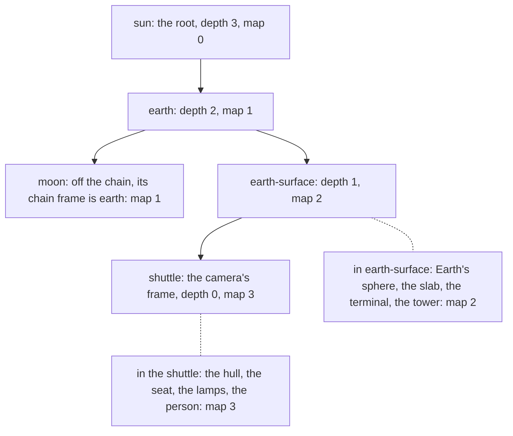
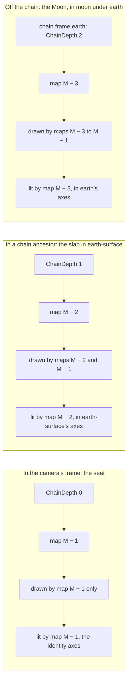
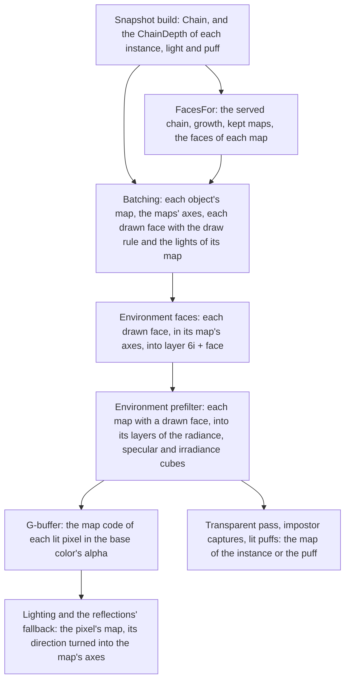
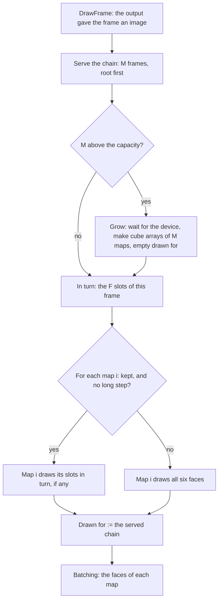

# Environment maps per frame on the camera's chain

Ticket: `ter-uy7y`, a member of the rendering upgrade epic (`ter-sglu`, [rendering-upgrade.md](rendering-upgrade.md)). It follows the scene environment map (`ter-nl5u`, [environment-map.md](environment-map.md)). The user chose the model on 2026-10-26, in the ticket's note of that day (decisions 1 to 7). This doc fills in the details. It is written against main at `dfa3a9eb`.

## Goal

Today one environment map at the camera's eye lights every surface (ARCHITECTURE.md, "The environment map", and [environment-map.md](environment-map.md), decision 12 and "Known limits"). Inside the lit cabin of `demo-surface`, the four lamps light the cabin's walls to a radiance of about 2. The sun lights the apron outside to about 0.1 to 0.2. The apron seen through the canopy takes the cabin's light as its ambient light, so its shadows fill in.

After this ticket:

- Each semantic frame on the camera's chain has a map of its own: the camera's frame, its parent, and so on up to the root.
- An object takes the map of its frame on that chain. The apron, in `earth-surface`, takes the map of `earth-surface`, which leaves out the shuttle and everything in it, its lamps included. So from the seat, the apron keeps its own ambient light and its shadows.
- With the camera in a root frame there is one map, and the frame draws the same faces, reads the same texels and writes the same pixels as today.

## Terms

| Term | Meaning |
|---|---|
| The camera's frame | The semantic frame that holds the camera: the frame that `RenderSnapshotBuilder.CameraPoseOf` finds, which is the frame of the camera's entity row, or the frame that the camera owns when the camera owns a root frame. Its id is `RenderSnapshot.OriginFrameId`. Numeric frames are never the camera's frame (ARCHITECTURE.md, "Numeric frames"). |
| The chain | The camera's frame, its semantic parent, that frame's semantic parent, and so on up to the root of the camera's frame tree. N is the number of its frames. |
| A chain frame | A frame on the chain. |
| Depth | The place of a chain frame on the chain, counted from the camera: 0 for the camera's frame, 1 for its parent, N − 1 for the root. |
| An object | An instance, a point or spot light, or a puff of the snapshot. |
| An object's chain frame | The nearest chain frame at or above the semantic frame that holds the object. For the owner of a frame, such as the shuttle's hull, the frame that holds it is the frame that it owns. For an object in another frame tree, it is the root of the chain. |
| An object's chain depth | The depth of its chain frame. The snapshot carries it as `ChainDepth`. |
| A map | The environment map of one chain frame: six faces, the radiance map's mips, the specular levels and the irradiance, as in [environment-map.md](environment-map.md). |
| The map's frame | The chain frame that a map belongs to. |
| The frame below a map | The chain frame one step nearer the camera than the map's frame. The camera's frame's map has none. |
| MaxMaps | 42, the most maps that the renderer serves (decision 19). |
| M | The number of served maps: N, but at least 1 and at most MaxMaps. |
| The served chain | The M chain frames that get a map: the M frames nearest the camera. Its frame ids, root first, are the key of the maps. A chain of no frames, in a snapshot without a camera or a test's hand-built snapshot, serves one map of frame id 0. |
| Map index | The place of a map in the served chain, root first: 0 for the outermost served frame, which is the root when N ≤ 42, and M − 1 for the camera's frame. |
| An object's map | M − 1 − min(its chain depth, M − 1): the map index of its chain frame. Every object deeper than the served chain takes map 0. |
| The draw rule | Map i draws the objects whose map is at most i. So the camera's frame's map, M − 1, draws every object, and map i < M − 1 leaves out the subtree of the frame below it. |
| The map's axes | The axes of the map's frame, in world axes, as a quaternion R_i. World axes are the axes of camera-relative world space, which are the axes of the camera's frame. So the camera's frame's map has the identity. |
| W, F, L | As in [environment-map.md](environment-map.md): the face size, 128 by default; `FacesPerFrame`, 1 by default; the specular levels, 6 at W = 128. |
| A slot | One of the 6M faces of the served maps. Slot s is face s mod 6 of map ⌊s / 6⌋. |
| Drawn for | The served chain, as frame ids root first, that the stored faces were drawn for. `EnvironmentMap` keeps it. It replaces today's `EnvironmentMap.FrameId`. |
| Kept | Map i is kept when its frame and the frame below it, or the lack of one, are the same in the served chain as in the chain that the faces were drawn for. |
| Capacity | The number of maps that the map images hold. It grows to M and never shrinks. |
| The map code | The value in the alpha of the G-buffer's base color target. It names the map of a lit pixel, and 0 marks an unlit pixel (decision 20). |
| Exact | A rule for a change of the camera's frame is exact when every face of every map, after the change, holds that map's own content: its own draw rule, in its own axes, drawn at the eye in the frame that drew it. A face may be as old as the in-turn rule allows, as today. |

## Decisions

The user made decisions 1 to 7 on 2026-10-26. They are settled. This design settled decisions 8 to 26 by the user's decisions and the project's rules. Each has its reason.

1. One map per semantic frame on the camera's chain: the camera's semantic frame, its parent, and so on up to the root. No other frame gets a map. With the camera in the root frame there is one map, and every image stays exactly as today. (User)
2. An object takes the map of the semantic frame that holds it. The choice is made per draw, and every object of a frame shares it. An object in a frame off the chain, such as another ship, takes the map of its nearest ancestor on the chain. (User)
3. Every map is captured at the eye, as today. The camera's frame's map draws everything, as today's map does. The map of every other chain frame leaves out the subtree of the chain frame below it, the one that holds the camera. So the planet's map is what the eye sees with the shuttle and its contents removed. (User)
4. No box projection: a frame has no box, and every map is at the eye. (User)
5. Updates go in turn: the F faces per frame are shared by all maps, by a pure function of the drawn frame's number, as today's faces are. A change of the camera's frame redraws every map, as today's `RefreshesAll` does, unless the design finds a rule that is cheaper and still exact. (User) Decisions 9 and 10 are that rule.
6. The deferred passes learn each pixel's map from the G-buffer. The base color target's alpha can carry the map's index. (User) Decision 20 checks its format and counts the maps that it can name.
7. Known limits that the user accepts: from inside, the ship's outer hull is in the cabin's frame and gets the cabin's map. From outside, a lit interior gets the outside's map, and its lamps still light it directly. The shuttle's own hull is missing from the apron's map, so the apron beside it gets sky light where the hull stands. (User)

Settled by this design:

8. Maps are indexed root first. Map 0 belongs to the outermost served frame and map M − 1 to the camera's frame. An object's map is M − 1 − min(depth, M − 1). Reason: when the camera enters a child frame or leaves for its parent, the chain changes at its camera end, and every map above the change keeps its index, so it can keep its faces (decision 9). Indexed from the camera, every map's index moves by one at such a change.
9. Each map lies in the axes of its own frame. The camera's frame's map lies in the camera's frame's axes, as today's map does. A face of map i looks along R_i times the face's axis of Vulkan's cube table. A reader turns its direction into the map's axes before it samples. With this, a change of the camera's frame keeps every map whose frame and frame below did not change, and the rule is exact. Reason: decision 5 asks for a cheaper exact rule. In the camera's axes, which today's single map uses, a change of the camera's frame turns every map's axes, so every face of every map is wrong. Two more gains follow. A turn of the camera's frame, such as a ship that rolls, no longer ages the maps of its ancestors, because what is at rest in an ancestor stays at rest in its map. And an ancestor's irradiance does not change when the ship turns, so the impostors outside are not recaptured for it. The cost is two quaternion rotations per lit pixel (see "Cost").
10. A refresh is a decision per map. Map i draws all six faces when it is not kept or the draw has a long step. Otherwise it draws its slots in turn. Today's `RefreshesAll` is the case M = 1. Reason: decision 5, and the cost of the cases below.

    | Change | Today's rule, applied to every map | This rule |
    |---|---|---|
    | The camera enters a child frame, N becomes N + 1 | 6 (N + 1) faces | 12 faces: the new camera frame's map, and the old one's, whose frame below is new |
    | The camera leaves for its parent | 6 (N − 1) faces | 6 faces: the parent's map, which now has no frame below |
    | The camera's frame hands off to its grandparent, with the camera in it | 6 (N − 1) faces | 12 faces: the two maps at and below the change of the chain |
    | A long step | 6N faces | 6N faces |

11. In turn, drawn frame n draws the slots (n · F + k) mod 6M for k from 0 to F − 1. Slot s is face s mod 6 of map ⌊s / 6⌋. Reason: decision 5. The slots run map by map, so the six faces of one map are drawn within ⌈6 / F⌉ frames of each other, and a rough lobe that crosses into a neighbor face mixes faces of nearly one time. A frame with F ≤ 6 touches at most two maps. While M stays the same, every face is at most ⌈6M / F⌉ − 1 frames old. Across a change of M, a face of a kept map waits for its slot in the new schedule, so it can be up to ⌈6M_old / F⌉ + ⌈6M_new / F⌉ − 2 frames old.
12. A map is prefiltered only in a drawn frame that draws one of its faces. Otherwise its mips, its specular levels and its irradiance stay as they are. Reason: they are a pure function of the map's six faces ([environment-map.md](environment-map.md), "The prefilter"), so the same faces give the same bits. With F = 1, a frame prefilters one map, as today.
13. A map leaves out the lights of the subtree that it leaves out, with its geometry and its emission. A light belongs to the entity that carries it, and decision 3 removes "the shuttle and its contents". So the cabin's lamps light the cabin's map and no other. The face pass sends each face's map index, and `environment_face.frag` keeps a light only when the light's map is at most the face's map. The main view, the captures and the transparent pass keep every light. Reason: with the lamps kept, the planet's map shows the ground under the shuttle lit by them, and the apron's diffuse light picks some of it up (see "Known limits").
14. The sun's shadow maps and far shadows stay the scene's: one set per frame, as today. So a map that leaves out the shuttle still shows the shuttle's shadow on the apron, where the real apron has it. Reason: shadow maps per map multiply the shadow pass by M for a difference of a shadow under a ship. See "Later".
15. The snapshot carries the chain, camera first: `RenderSnapshot.Chain`, a list of `RenderChainFrame(FrameId, Rotation, PreviousRotation)`. Each instance, light and puff carries its `ChainDepth`. `OriginFrameId`, `RootRotation` and `PreviousRootRotation` become read-only properties derived from `Chain`. Reason: one store for each piece of state. The camera's frame's id and the root's rotation are entries of the chain. Camera first, so a hand-built snapshot whose objects have depth 0, the zero value, keeps them in the camera's frame.
16. An object in another frame tree takes the root's map. Reason: decision 2 names the nearest ancestor on the chain. Trees meet only at the virtual root that `PoseTree.ComputeRelativeTo` places them through, and the root of the chain is the chain frame nearest it.
17. The snapshot builder finds every frame's chain depth in one pass over the frames in dense order, before the instances. A frame on the chain has its own depth. Any other frame takes its tree parent's depth, and a root of another tree takes N − 1. The tree keeps each parent before its children, so the parent's depth is known first. A numeric frame lies in the tree between its semantic frame and that frame's semantic children, so it passes its semantic frame's depth on to them. Reason: one pass of O(frames). Each instance then reads the depth of the dense frame that `TryGetRenderPoses` already gives it.
18. The radiance maps and the specular maps of all maps are two cube array images of 6 × capacity layers. Map i holds layers 6i to 6i + 5. The readers sample one `samplerCubeArray` at the layer of the map. Reason: one descriptor serves every map. An array of cube descriptors, one per map, goes past the spec's least `maxPerStageDescriptorSampledImages`, 16, beside the G-buffer's and the tables' images. A cube array needs the device feature `imageCubeArray`, which every target driver offers (see "Portable Vulkan").
19. MaxMaps is 42: ⌊256 / 6⌋, the most cubes that one cube array holds within the spec's least `maxImageArrayLayers`, 256. A chain of more than 42 frames merges its outermost frames into map 0, whose frame is the 42nd from the camera. Reason: a portable limit. No scene comes near it. `demo-surface` has four.
20. The map code. The base color target is `R8G8B8A8_SRGB`. Vulkan applies the sRGB curve to R, G and B only, so the alpha is a plain 8-bit UNORM value. `gbuffer.frag` writes 1.0 there, and `impostor.frag` writes 0, which marks an unlit pixel whose light is baked (`lighting.frag`, and `reflectingPixel` in `reflection_pixel.glsl` for the full-resolution trace, the half-resolution trace and the upsample, test `alpha == 0.0`). The clear value is 0 too. The spec lets a conversion from float to UNORM return either of the two codes nearest the value, and asks only that it should round to nearest. So each map owns two codes, and the written value lies between them: map i writes min((255.5 − 2i) / 255, 1), and a reader decodes i = (256 − c) >> 1 from the code c = round(alpha · 255). Map 0 writes exactly 1.0, as today, which the spec converts to 255 exactly. The code can name 128 maps, 0 to 127, with codes 1 to 255, and code 0 stays the unlit mark. The renderer uses at most 42, codes 173 to 255. Reason: the user's decision 6, written to the spec, and with one map the G-buffer holds today's bits.
21. `GpuInstance` gains `Map` (80 to 96 bytes), `GpuPuff` gains `Map` (32 to 48 bytes), and `GpuLight` holds its `Map` in the unused part of its last vector (64 bytes as before). `DrawPushConstants` gains `Map` (80 to 84 bytes). The frame constants gain `mapAxes`, 42 quaternions (720 to 1,392 bytes). Reason: each is the honest field. The instance's growth is the one with a cost, which Part 4 measures. If the benchmark shows it, a later change can pack the map into the instance's material word, as "Later" says.
22. The irradiance buffer holds MaxMaps × 9 `vec4`, 6,048 bytes, from creation, and map i's nine coefficients start at 9i. Each slot's readback buffer has the same size, and its copy takes the first M maps. Reason: it is small, so it never needs to grow, and its binding is written once. (`ter-8fz2` replaced the buffer with the irradiance cube array, 16 texels a side and 6 × capacity layers, which grows with the other cube arrays. Each readback buffer holds the cubes' last levels, 24 texels per map, 8,064 bytes, from creation.)
23. The capacity grows in `EnvironmentMap.FacesFor`, before batching, when M passes it. The growth waits for the device to be idle, makes the cube arrays anew for M maps, rewrites the map's own sets, empties "drawn for", and counts a version that tells each frame slot to rewrite bindings 12 and 14 of its frame set (binding 14, the irradiance cube, since `ter-8fz2`). So every map refreshes in that frame. The capacity never shrinks. Reason: memory follows the longest chain that the camera has seen, and the growth is the path of a resize (`DrawFrame` waits for the device when the swapchain changes size). At the first frame nothing is in flight, so the first growth costs no wait. A camera that goes back and forth between a cabin and the ground grows once.
24. With `NoEnvironmentMap`, the snapshot still carries the chain and the depths, because the snapshot builder cannot see the renderer's options. The batcher writes map 0 for every object, and the G-buffer writes 1.0. So the frame is the frame from before the map, pixel for pixel, as today.
25. The face pass draws the drawn faces map by map, and each map's faces in layer order. The prefilter takes the maps in index order. Reason: one fixed order of commands. Each map writes only its own layers, of the irradiance cube too (before `ter-8fz2`, its own nine coefficients), so the order does not change any bits.
26. `EnvironmentMap.FacesFor` stays the one choke point of the maps' automatic machinery. It calls the pure predicates `EnvironmentChain.Keeps`, `EnvironmentFaces.InTurn` and `EnvironmentFaces.RefreshesAll`, and acts directly: it grows the images. `EnvironmentMap.Drew(served, slot)`, which `DrawFrame` calls after `SubmitAndPresent`, stores "drawn for" and the slot's count of maps, so that both describe the last submitted frame. No planner and no plan object.

## The model

This section describes the model as a renderer built from scratch would have it. The next section lists how it differs from today's code.

The light that reaches a surface comes from what surrounds it. One map at the eye stands for the surroundings of everything on screen. That holds in the open. It fails where a wall splits the scene into an inside and an outside, because the inside's light then reaches the outside's surfaces. The frame tree already says where such walls are: a ship's interior is its own semantic frame, and the ground outside is its parent. So the maps follow the frame tree, along the one path through it that the eye sits on.

The chain is that path. Each chain frame gets a map. Every map is captured at the eye, because the eye is the one place where the renderer knows what is seen. The camera's frame's map sees everything. Each ancestor's map sees what the eye would see if the subtree below that ancestor were gone: the planet's map is the ground and the sky with the shuttle removed. An object takes the map of its chain frame. So the cabin is lit by the cabin, and the apron by the apron's surroundings.



The chain of the cabin camera in `demo-surface`, and the map that each object takes. Solid lines join a frame to its child. Dotted lines join a frame to the objects in it.

| Map | Its frame | It draws | It leaves out | It lights |
|---|---|---|---|---|
| 0 | sun | The objects of map 0: the Sun's sphere | earth and all below it | The Sun's sphere |
| 1 | earth | The objects of maps 0 and 1: the Sun and the Moon | earth-surface and all below it: Earth's sphere, the ground, the shuttle | The Moon |
| 2 | earth-surface | The objects of maps 0 to 2 | The shuttle and everything in it, its lamps included | Earth's sphere, the slab, the terminal, the tower and the pad |
| 3 | shuttle | Every object | Nothing | The hull, the seat, the lamps' panels and the person |

Each map lies in the axes of its own frame. What is at rest in a frame stays at rest in its map, however the camera's frame turns. A map belongs to a frame and to the frame below it, so when the camera moves from one frame to another, only the maps whose frame or frame below changed are drawn anew.

All the maps share the face budget F, slot by slot. A map is prefiltered when one of its faces is drawn. The deferred passes learn each pixel's map from the G-buffer, and the forward passes from the instance or the puff.

## How it differs from today's code

| Today | This design |
|---|---|
| `RenderSnapshot.OriginFrameId`, `RootRotation` and `PreviousRootRotation` are fields | `RenderSnapshot.Chain` holds the chain. The three become properties derived from it. |
| An instance, a light or a puff carries no frame | Each carries `ChainDepth` |
| One cube for the radiance map and one for the specular map, `textureCube` at binding 12 | Two cube arrays of 6 × capacity layers, `textureCubeArray` at binding 12 |
| An irradiance buffer of 9 `vec4` | 9 `vec4` for each of 42 maps. Since `ter-8fz2`, an irradiance cube array of 6 × capacity layers at binding 14 |
| `EnvironmentMap.FrameId`, the camera frame of the faces | `EnvironmentMap`'s "drawn for", the served chain of the faces |
| `FacesFor` returns one `FaceMask` | `FacesFor` returns a `FaceMask` for each served map, and grows the images when the chain is longer than ever before |
| `InTurn(frame, F)` over 6 faces | `InTurn(frame, F, faces)` over 6M slots |
| `RefreshesAll(mapFrameId, originFrameId, longStep)` | `RefreshesAll(drawnFor, served, map, longStep)`, through `EnvironmentChain.Keeps` |
| The faces' axes are `CubeFaces.Basis(face)` | `CubeFaces.Basis(face, axes)`, turned by the map's axes. `View`, `ViewProjection` and `Culls` take a `FaceBasis` |
| A face draws every opaque instance | A face of map i draws the opaque instances whose map is at most i |
| A face keeps every light of the frame's list | A face of map i keeps the lights whose map is at most i |
| The prefilter rebuilds the one map in every drawn frame | The prefilter rebuilds each map that has a drawn face in the frame |
| The base color's alpha is 1.0 for a lit pixel | It is the map code, 1.0 for map 0 |
| `environmentDiffuse(n)`, `environmentSpecular(d, r, f)`, `environmentMeanRadiance()` | Each takes the map index and turns its direction into the map's axes |
| `ShadingInput` has no map | `ShadingInput.map` |
| `localLights` keeps every light | `localLights` keeps a light whose map is at most a given map, and every caller but the face shader passes `EveryMap` |
| The readings: `EnvironmentMap.Latest`, one `IrradianceReading?` | One reading for each map, and `MapAmbient` holds them all. An impostor's signature reads the reading of its own map |
| The device needs no `imageCubeArray` | `VulkanDevice` requires `imageCubeArray` |

What stays: the setting `SceneEnvironmentMap(FaceSize, FacesPerFrame)`, the long step, the face's lighting without ambient light, the sky pass, the cascade rule of the faces, the prefilter's math, the reflected stars and their mask, plain radiance, the specialization constant `environmentMapOn`, and every pass and its stage.

## The snapshot: the chain and the chain depths

`src/Tertius.Core/Seams/RenderSeam.cs`:

```csharp
/// <summary>A frame of the camera's chain: its id, and its axes in the axes of the camera's frame.</summary>
public readonly record struct RenderChainFrame(long FrameId, Quaternion Rotation, Quaternion PreviousRotation);

public sealed class RenderSnapshot
{
    public readonly List<RenderChainFrame> Chain = [];
    public long OriginFrameId => Chain.Count > 0 ? Chain[0].FrameId : 0;
    public Quaternion RootRotation => Chain.Count > 0 ? Chain[^1].Rotation : Quaternion.Identity;
    public Quaternion PreviousRootRotation => Chain.Count > 0 ? Chain[^1].PreviousRotation : Quaternion.Identity;
    ...
}

public struct RenderInstance { ...; public ushort Part; public ushort ChainDepth; ... }
public struct RenderPuff { ...; public ushort ChainDepth; }
public readonly record struct PointRenderLight(Vector3 Position, Vector3 Color, float Intensity, float Range, ushort ChainDepth);
public readonly record struct SpotRenderLight(..., ushort ChainDepth);
```

where

- `Chain` = the chain frames, the camera's frame first and the root last. `Clear` empties it. A snapshot without a camera has none.
- `FrameId` = the frame's id in the encoding of today's `OriginFrameId`: its generation in the high 32 bits and its index in the low 32 bits. It changes when a frame reuses the index.
- `Rotation` = the frame's axes in the axes of the camera's frame: the rotation of the frame's pose relative to the camera's physics home, which has the camera frame's axes. It is the identity for the camera's frame, and today's `RootRotation` for the root.
- `PreviousRotation` = `Rotation` at the previous build, by the rule of today's `PreviousRootRotation`: this build's tree with the last build's local poses when the build interpolates, and `Rotation` when it does not.
- `ChainDepth` = the object's chain depth. `ChainDepth` takes the padding after `Part`, so `RenderInstance` keeps its size. `RenderInstance.Create` takes it as a required argument, as it takes the hemisphere, and the light cases take it as a positional member. A test helper names 0, the camera's frame (memory: no test defaults in production).

`RenderSnapshotBuilder.Build`, after `PrepareFramePoses`:

1. `BuildChain` walks from the camera's frame by `FrameTree.Parent` to the root. It writes one `RenderChainFrame` for each frame, and the frame's depth into an array by dense index. Every other entry of that array holds "not on the chain".
2. `ChainDepths` makes one pass over the frames in dense order (decision 17). A frame on the chain keeps its depth. Any other frame takes the depth of `FrameTree.TreeParent`, and a frame without a tree parent, the root of another tree, takes N − 1.
3. `BuildChunk` writes `ChainDepth` of each instance and each light from the depth of the dense frame that `TryGetRenderPoses` gives: the frame that the entity owns, or else the frame that it is in.
4. `BuildPuffs` writes `ChainDepth` of each puff from the depth of its range's frame.

The depths are read-only while the chunks run, so a parallel build gives the same depths as a serial one. A depth above 65,535 is written as 65,535. No frame tree reaches that, and the renderer merges every depth from 41 up anyway (decision 19).

## The served chain and the map of an object

`src/Tertius.Rendering/Shading/EnvironmentChain.cs` (new) holds the rules as pure functions:

```csharp
internal static class EnvironmentChain
{
    public const int MaxMaps = 42;

    public static int Maps(int chainLength) => Math.Clamp(chainLength, 1, MaxMaps);

    public static void Serve(List<RenderChainFrame> chain, Span<long> served);

    public static int MapOf(int chainDepth, int maps) => maps - 1 - Math.Min(chainDepth, maps - 1);

    public static bool Draws(int map, int objectMap) => objectMap <= map;

    public static bool Keeps(ReadOnlySpan<long> drawnFor, ReadOnlySpan<long> served, int map) =>
        map < drawnFor.Length
        && drawnFor[map] == served[map]
        && (map + 1 < served.Length
            ? map + 1 < drawnFor.Length && drawnFor[map + 1] == served[map + 1]
            : drawnFor.Length == served.Length);
}
```

where

- `Maps(N)` = M.
- `Serve` = writes the frame ids of the served chain, root first, into `served`, of length M: `served[i]` is the id of the chain frame at depth M − 1 − i. An empty chain serves one map of id 0.
- `MapOf(depth, M)` = an object's map.
- `Draws(i, m)` = the draw rule: map i draws an object of map m.
- `Keeps` = whether map `map` is kept: the same frame, and the same frame below it or none.

## What a map draws

A face of map i draws what a face draws today ([environment-map.md](environment-map.md), "What a face draws"), with three changes:

- It draws only the opaque instances whose map is at most i (the draw rule). Impostor objects draw as geometry, as today.
- It keeps only the lights whose map is at most i (decision 13). `SceneBatcher.CollectLights` keeps a light for the faces when its reach touches a drawn face of a map at or above the light's map. The list keeps the snapshot's order, as today, so the main view's sums round as before.
- It looks along its map's axes: its basis is `CubeFaces.Basis(face, R_i)`, the face's forward, right and up of Vulkan's table turned by R_i into world axes. The batcher culls and sorts the instances by that basis, and the face pass makes the view-projection and the sky's push constants from it. `EnvironmentFaceDraw` gains `Map` and `Basis`, so that the cull and the draw use one basis.

The sun's shadow maps and far shadows stay the scene's (decision 14). The sky, the cascades, the exposure and the cap at `MaxRadiance` stay as they are.

The flow of each kind of object, from the snapshot to its pixels:



The same three objects through the renderer's steps:



The other kinds:

| Kind | Its map | Notes |
|---|---|---|
| The owner of a chain frame, such as the shuttle's hull seen from the cabin | The map of the frame that it owns | (User, decision 7) From inside, the hull takes the cabin's map. |
| The owner of a frame off the chain, such as the shuttle's hull seen from the apron | The map of its chain frame, here the camera's frame | Its frame is off the chain. Its interior takes the outside's map too (User, decision 7). |
| An object in another frame tree | Map 0, the root's | Decision 16 |
| A light | Its carrier's map | It lights its own map and the maps outside it, and every pixel of the main view |
| A lit puff | The map of its range's frame | Its ambient light is its map's mean radiance |
| A glow puff | None read | It has no ambient light |
| Glass | Its instance's map | From inside, the canopy reflects the cabin. From outside, it reflects the outside. |
| An impostor billboard | None read: its pixels are unlit, code 0 | Its capture bakes the light of its instance's map, and its signature reads that map's reading |
| The sky | None | As today |

## Which faces a frame draws

`EnvironmentMap.FacesFor(frame, served, longStep)` runs where today's does: in `DrawFrame`, after the output gives the frame an image and before batching.

```csharp
public ReadOnlySpan<FaceMask> FacesFor(long frame, ReadOnlySpan<long> served, bool longStep)
{
    if (served.Length > Capacity)
        Grow(served.Length);   // waits for the device; the new images hold nothing, so "drawn for" empties
    Span<FaceMask> faces = facesOfMaps.AsSpan(0, served.Length);
    EnvironmentFaces.InTurn(frame, Setting.FacesPerFrame, faces);
    for (int map = 0; map < faces.Length; map++)
        if (EnvironmentFaces.RefreshesAll(DrawnFor, served, map, longStep))
            faces[map] = FaceMask.All;
    return faces;
}

public void Drew(ReadOnlySpan<long> served, int slot)
{
    served.CopyTo(drawnFor);
    drawnForLength = served.Length;
    readbackMaps[slot] = served.Length;
}
```

where

- `served` = the served chain's frame ids, root first, from `EnvironmentChain.Serve`.
- `Capacity` = the maps that the images hold.
- `facesOfMaps` = an array of 42 `FaceMask`, reused, so a frame allocates nothing.
- `InTurn` = clears `faces`, then sets the slots (frame · F + k) mod 6M for k from 0 to F − 1 (decision 11).
- `RefreshesAll` = `!EnvironmentChain.Keeps(drawnFor, served, map) || longStep` (decision 10).
- `DrawnFor` = the served chain of the stored faces, empty before the first submitted frame and after a growth.
- `Drew` = what `DrawFrame` calls after `SubmitAndPresent`, with the frame's slot.
- `readbackMaps` = for each frame slot, the served maps of its last submitted frame, which its readback buffer holds and `Collect` reads.

A frame that throws after `FacesFor` and before its submission leaves "drawn for" and the slot's count as they were. So the next frame draws again every face that it would have refreshed, and the slot's next `Collect` reads only the maps that its last submitted frame copied. If `FacesFor` stored "drawn for" itself, the next frame would draw only F faces in turn, and the other faces of new or grown images would keep the image's undefined content, which can be a NaN or an infinity on a Linux driver.



The cases, for the cabin camera's chain of four and F = 1:

| Draw | Faces | Prefilters |
|---|---|---|
| The renderer's first drawn frame | 24: drawn for is empty, and the first growth makes four maps | 4 |
| A frame of a film or a window | 1: slot n mod 24 | 1 |
| A headless still after a long step | 24 | 4 |
| The person, followed by the camera, walks from the apron into the cabin: the chain goes from (sun, earth, earth-surface) to (sun, earth, earth-surface, shuttle) | 12: map 2 now leaves out the shuttle, and map 3 is new. The growth from three maps to four refreshes all four, the first time only. | 2, or 4 at a growth |
| The person walks back out | 6: map 2 no longer leaves out anything. Map 3's images stay, unused. | 1 |
| The shuttle climbs out of earth-surface into earth with the camera in it: (sun, earth, earth-surface, shuttle) becomes (sun, earth, shuttle) | 12: map 1 now leaves out the shuttle, and map 2 is now the shuttle's | 2 |
| The camera jumps to another tree | 6M: no frame matches | M |

While M stays the same, every face is at most ⌈6M / F⌉ − 1 frames old: 23 frames, 383 ms at 60 Hz, for four maps at F = 1. Across a change of M, a face of a kept map waits for its slot in the new schedule, so it can be up to ⌈6M_old / F⌉ + ⌈6M_new / F⌉ − 2 frames old: up to 35 frames, 583 ms, when the camera walks from the apron into the cabin, M from 3 to 4. `EnvironmentFacesTests` checks the bound. The maps of the ancestors lie in their own axes, so their faces age only by what moves in them and by the eye's motion.

## The prefilter of each map

`EnvironmentPrefilterPass` runs today's three steps for each map with a drawn face, in index order (decision 25): the radiance map's mips, the specular levels and the irradiance. `EnvironmentPrefilterPushConstants` and `EnvironmentDownsamplePushConstants` gain `Map`. The shaders read and write layers 6 · Map + face. Since `ter-8fz2`, the convolution writes level 0 of the map's six layers of the irradiance cube, and the downsample its levels 1 to 3. (Before, the irradiance's blocks wrote the map's partial sums into one buffer of partial sums, and the sum shader wrote coefficients 9 · Map to 9 · Map + 8.) The copy of the cubes' last level into the slot's readback buffer comes once, after the last map, and takes the first M maps. A map without a drawn face keeps its levels and its cube's layers (decision 12).

The barriers move every map's layers of an image to storage use while its level views are bound, because a storage image's layout must hold for every layer of its view: a drawn map's levels go from the reads of the frame before to storage writes, discarding, and the other maps' levels keep their texels. So the pass runs in two steps, first every drawn map's mips, then every drawn map's specular levels and irradiance, each in index order, with a barrier between two maps (see "Images, buffers, growth and descriptors"). At the end of the pass the whole specular image is in `SampledFragment` and the whole radiance image in `SampledCompute`, as today, and the whole irradiance cube in `SampledVertexFragment`.

## Reading the maps

### The map code in the G-buffer

`mesh.vert` passes the instance's map with its material, as `flat out uvec2 outMaterialAndMap` at location 4: x the material, y the map. They share a location because `environment_face.frag` reads only the material, and the validation layer warns of an output that no input consumes (`WARNING-Shader-OutputNotConsumed`). A uint of its own at location 6 drew that warning on every renderer with the map on. `gbuffer.frag` writes it:

```glsl
// The map code (docs/plans/environment-maps-per-frame.md, decision 20): map i owns the codes 255 − 2i and 256 − 2i of
// the 8-bit alpha, and the value lies between them, so either rounding of the conversion names map i. Map 0 writes 1.0.
float mapCode(uint map) { return min((255.5 - 2.0 * float(map)) / 255.0, 1.0); }

outBaseColor = vec4(s.baseColor.rgb, mapCode(inMaterialAndMap.y));
```

`surfaceAt` in `gbuffer_surface.glsl`, which the lighting pass and the reflections' passes read a lit pixel through, decodes it:

```glsl
uint mapOfCode(float alpha) { return (256u - uint(round(alpha * 255.0))) >> 1; }

s.map = mapOfCode(texelFetch(gbufferBaseColor, pixel, 0).a);
```

where

- `inMaterialAndMap.y` = the instance's map from `GpuInstance.map`.
- `alpha` = the fetched alpha, c / 255 for the stored code c.
- `mapOfCode` runs only for a lit pixel. Both callers return for alpha 0 first, as today.

`src/Tertius.Rendering/Shading/MapCode.cs` (new) holds the C# twins, `MapCode.Of(map)` and `MapCode.MapOf(code)`, which the CPU tests check for every map and both roundings. A GPU test pins the shader to them.

### The readers

`environment.glsl` takes the map:

```glsl
layout(set = 0, binding = 12) uniform textureCubeArray environmentSpecularMap;
layout(set = 0, binding = 14) uniform textureCubeArray environmentIrradianceMap;

vec3 inMapAxes(uint map, vec3 v) { return rotateInverse(frame.mapAxes[map], v); }

vec3 environmentDiffuse(uint map, vec3 normal)                                   // the irradiance cube's layer map at inMapAxes(map, normal)
vec3 environmentSpecular(uint map, vec3 d, float roughness, float footprint)     // layer map, at inMapAxes(map, d); the stars at d
vec3 environmentMeanRadiance(uint map)                                           // the cube's last level at the six faces' centers: no axes needed
```

where

- `frame.mapAxes[i]` = R_i, interpolated by alpha, as a unit quaternion. `rotateInverse` turns a world direction into the map's axes.
- The cube array's layer coordinate is `float(map)`, an integer, which Vulkan rounds to itself.
- The reflected stars stay in world axes at d, and the open-sky share that masks them is read from the map at the turned direction.
- `environmentMeanRadiance` reads the irradiance cube's last level at the six faces' centers, whose mean no turn changes. (Before `ter-8fz2`, it read the first coefficient of the harmonics alone, which no turn changed either.)

| Pass | Where the map comes from |
|---|---|
| Lighting, a lit pixel | The map code, through `surfaceAt` |
| Reflections' fallback (`reflectionDelta` in `reflection_pixel.glsl`, in the full-resolution trace or the upsample) | The map code of the pixel that the delta lights, through `surfaceAt` |
| Transparent, a mesh | The instance, through `mesh.vert` |
| Impostor capture | The instance, through `mesh.vert` |
| Lit puffs (`scatteredLight`) | `GpuPuff.map` |
| Environment faces | None: no ambient light. `draw.map` filters the lights |
| Sky pixels, impostor billboards | None |

The reflections' delta f · (W · C − a · k · T_s) reads a map only in T_s, the ambient specular term, through `ambientTerms` with the `ShadingInput` of the pixel that it lights. The full-resolution trace computes it at its own pixel. At half resolution, the trace stores only each block's ray result, C and a, from the radiance pyramid, which reads no map, and the upsample computes the delta at each full-resolution pixel from its own `surfaceAt`. So every pixel takes away the very term that the lighting pass added there, from its own map, also where a block's four pixels lie in different maps, and the upsample's weights need no map.

`ShadingInput` gains `uint map`. `environmentAmbient` reads `s.map`. `localLights` and `directRadiance` gain `uint lastMap`: the face shader passes `draw.map`, and every other caller passes `EveryMap`, 0xFFFFFFFF, so the main view adds the same lights in the same order as today.

The CPU side: `MapAmbient` holds one `IrradianceReading?` for each map, and `ImpostorManager` builds an instance's `MapSignature` from the reading of the instance's map. A change of another map's light leaves the impostor fresh.

## Images, buffers, growth and descriptors

| Image or buffer | Format and size | Memory at W = 128 |
|---|---|---|
| The radiance map | RGBA16F cube array, W × W, 6 × capacity layers, log2(W) + 1 levels | 1.0 MB per map |
| The face views | One 2D view of level 0 of each layer, 6 × capacity | |
| The radiance level views | One 2D-array view of all layers per level | |
| The specular map | RGBA16F cube array, W × W, 6 × capacity layers, L levels | 1.0 MB per map |
| The specular level views | One 2D-array view of all layers per level | |
| The face depth | D32, W × W, one for every map, because faces draw one after another | 64 KB |
| The irradiance cube (since `ter-8fz2`, in place of the irradiance buffer and its partial sums) | RGBA16F cube array, 16 × 16, 6 × capacity layers, 4 levels | 16 KB per map |
| A readback buffer per frame slot | 42 × 24 RGBA16F texels, the cubes' last levels, of which the copy fills M | 8,064 B each |

So the maps take about 2.1 MB each at W = 128: 8.4 MB for the cabin's four. The level views span every layer, so each dispatch of the mips and of the specular levels keeps one levels set, whose four level views span every map's layers, and the descriptor pool does not change. A dispatch picks its map's layers by its push constant `Map`. A storage image's layout must hold for every layer of its view, so while a level view is bound, every map's layers of that image are in `General`: the prefilter first makes every drawn map's mips, then every drawn map's specular levels and irradiance, and the maps with no drawn face keep their texels through the transitions. The synchronization validation tracks a whole view and a whole buffer binding, so a barrier separates two maps' writes, though their layers do not overlap.

The growth (decision 23): `Grow(maps)` waits for the device, makes the cube arrays and their views for `maps` maps, and only then disposes the old ones, so that a growth that throws, for example out of device memory, leaves the old images whole. It rewrites the prefilter set and every levels set with the new views, empties "drawn for" and adds one to `EnvironmentMap.ImagesVersion`. `FrameResources.UpdateSharedDescriptors` rewrites bindings 12 and 14 of its frame set when its version differs, as it rewrites binding 2 for a new material buffer. After the wait, no frame set is in use, so the rewrite is legal at each slot's next frame. The readback buffers do not change.

The descriptors that change:

| Set | Binding | Type | Holds |
|---|---|---|---|
| 0, the frame set | 12 | Sampled image, cube array view, partially bound | The specular map, every map and level |
| 0 | 14 | Sampled image, cube array view, partially bound, seen by the vertex, fragment and compute stages | The irradiance cubes, every map and level (before `ter-8fz2`, a storage buffer of the irradiance of 42 maps) |
| 0 of `EnvironmentPrefilterLayout` | 0 | Sampled image, cube array view | The radiance map |

The push constants that change:

| Block | Size | New field |
|---|---|---|
| `DrawPushConstants` (`draw.glsl`), every mesh pass | 84 B | `Map`: for an environment face, the map whose face it draws. 0 in every other pass, which reads it not. |
| `EnvironmentPrefilterPushConstants` | 80 B | `Map`, at byte 76, which the prefilter and both irradiance shaders read |
| `EnvironmentDownsamplePushConstants` | 12 B | `Map`, after `LevelSize` and `LevelCount` |
| `SkyFacePushConstants` | 48 B | None: its forward, right and up are the turned basis |

The scene layout's push range grows from 80 to 84 bytes.

Changed by `t2-zcr4` (2026-11-12): the light pass of a face takes the map in `FaceLightPushConstants.Map`, 52 bytes. `DrawPushConstants` holds no map, and the scene layout's push range is 80 bytes again.

## Portable Vulkan

The maps follow the Vulkan specification, so they run on NVIDIA, RADV, ANV and lavapipe as on MoltenVK:

| Requirement | Why every driver has it |
|---|---|
| `imageCubeArray`, a new required device feature | A cube array view and `samplerCubeArray` in the shaders need it. NVIDIA, RADV and ANV offer it on every GPU they support with Vulkan 1.3, as the D3D11 feature level requires cube arrays. lavapipe sets it from llvmpipe's cube map array cap. MoltenVK offers it on every Mac GPU. `VulkanDevice` checks it before it creates the device. The reviewer of Part 3 checks the Linux claims against the drivers' feature tables. |
| 6 × 42 = 252 layers | The spec's least `maxImageArrayLayers` is 256 |
| One sampled image descriptor for every map | The array of cubes is one image, so the stage's sampled images do not grow past the spec's least, 16 |
| Push ranges of 84 bytes | The spec's least `maxPushConstantsSize` is 128 |
| Frame constants of 1,392 bytes, with a dynamic index into `mapAxes` | The spec's least `maxUniformBufferRange` is 16,384. A dynamic index into an array member of a uniform block is core |
| `R8G8B8A8_SRGB`'s alpha as plain UNORM | The spec applies the sRGB curve to R, G and B only |
| A storage buffer read at 9 · map + i | Core. Every index lies inside the buffer |

The new shader sites for the site table of ARCHITECTURE.md, "Portable Vulkan":

| Site | The input that would break it | Verdict |
|---|---|---|
| `mapCode` (`gbuffer.frag`): the base color's alpha, converted to an 8-bit UNORM code | A conversion that returns either of the two codes nearest the value, which the spec allows ("should round to nearest") | Safe: map i owns two codes and writes the value between them, so either code decodes to i. Map 0 writes 1.0, which the spec converts to 255 exactly. Map 41, the last, writes codes 173 or 174, so no lit pixel writes the unlit code 0 |
| `mapOfCode` (`gbuffer_surface.glsl`): round(alpha · 255) and (256 − c) >> 1 | A code of 0, which gives 128, past the maps | Safe: `lighting.frag`, and `reflectingPixel` in the full-resolution trace, the half-resolution trace and the upsample, return for an alpha of 0 before `surfaceAt`. A lit pixel holds a code from 173 to 255, which the G-buffer pass wrote, so the map is at most 41. The round of a finite value in [0, 255] is an integer in range |
| `inMapAxes` (`environment.glsl`): a quaternion turns a direction | A quaternion that is not unit or not finite | Safe: `SceneBatcher.Interpolate` normalizes it, and counts one whose squared length is not finite as unset, as for the root rotation. A turn by a unit quaternion keeps a unit vector unit. The identity turns a vector to itself exactly, because its vector part is 0 |
| The cube arrays' layer `float(map)`, of the specular map and of the irradiance cube | A map past the served maps | Safe: every map index comes from the batcher, below M, or from a code of a lit pixel, and both cube arrays hold the capacity's maps, at least M. Vulkan rounds a layer coordinate to the nearest integer and clamps it to the layers |
| The prefilter shaders' layer 6 · Map + face | A map past the capacity | Safe: the pass dispatches only maps below M, and the growth makes the capacity at least M before batching |
| `localLights`, `light.map <= lastMap` | None: no float takes part | Safe: a comparison of unsigned integers |

No new value relies on a clamp to turn a NaN into a number, and no new pass blends into a half-float image.

## Every new value, its writers and its readers

The steps are those of ARCHITECTURE.md, "The order of a rendered frame": 3 batching, 5 the environment faces, 6 the prefilter, 7 the impostor captures, 8 the G-buffer, 11 the lighting pass, 13 the reflections, 14 the transparent pass. The snapshot is built at the sync point.

| Value | Written by | When | Read by | When | Stored in | Analogue |
|---|---|---|---|---|---|---|
| `RenderSnapshot.Chain` | `RenderSnapshotBuilder.BuildChain` | The snapshot build | `OriginFrameId`, `RootRotation` and `PreviousRootRotation`, which derive from it; `EnvironmentChain.Serve`; the batcher's map axes | Step 3 | The snapshot | Today's `RootRotation` and `OriginFrameId` |
| `ChainDepth` of an instance, a light, a puff | The builder, from the dense depths | The snapshot build | The batcher | Step 3 | `RenderInstance`, the light cases, `RenderPuff` | `RenderInstance.Hemisphere`: a fact of the object's frame |
| The dense depths | `ChainDepths` | The snapshot build, before the chunks | `BuildChunk`, `BuildPuffs` | The same build | An array of the builder, rebuilt each build | `frameHemisphere` by dense index |
| The served chain | `EnvironmentChain.Serve` | Step 3, before `FacesFor` | `FacesFor`, the batcher | Step 3 | None: a derived read of the snapshot | |
| The capacity and the images | `EnvironmentMap.Grow`, from `FacesFor` | Step 3 | Every pass of the maps, `FrameResources` | Steps 3 to 14 | `EnvironmentMap` | `ResizeTargets` |
| Drawn for | `Drew`, emptied by a growth in `FacesFor` | After `SubmitAndPresent` | `FacesFor` | Step 3 of the next drawn frame | `EnvironmentMap` | Today's `EnvironmentMap.FrameId` |
| The faces of each map | `FacesFor` | Step 3 | The batcher, then the face pass and the prefilter | Steps 3, 5, 6 | `WithMap`, then `PreparedScene.EnvironmentFaces` | Today's `FaceMask` |
| An object's map | The batcher, by `MapOf` | Step 3 | The draw rule, the light filter, `GpuInstance.Map`, `GpuLight.Map`, `GpuPuff.Map`, the impostor signature | Steps 3 to 14 | `PreparedInstance.Map` and the GPU rows | `GpuInstance.Material` |
| The map axes R_i | The batcher, interpolated from the chain | Step 3 | The faces' bases on the CPU; `frame.mapAxes` in the readers | Steps 3, 5, 7 to 14 | `PreparedScene.MapAxes`, the frame constants | `PreparedScene.RootRotation` |
| A face's basis | The batcher, `CubeFaces.Basis(face, R_i)` | Step 3 | The face's cull and sort; the face pass's view-projection and sky push constants | Steps 3, 5 | `EnvironmentFaceDraw.Basis` | Today's `CubeFaces.Basis(face)` |
| `draw.map` | `EnvironmentFacePass` | Step 5 | `environment_face.frag`'s light filter | Step 5 | Push constants | `draw.eye` |
| Map i's faces, level 0 | `EnvironmentFacePass` | Step 5 of a frame that draws them | The prefilter | Step 6 of that frame and of every later frame until drawn again | The radiance map, layers 6i to 6i + 5 | Today's faces |
| Map i's mips, specular levels and irradiance | `EnvironmentPrefilterPass` | Step 6 of a frame that draws one of its faces | The impostor captures, lighting, reflections, transparent, lit puffs | Steps 7 to 14 of that frame and later ones | The radiance map's levels 1 and up, the specular map's layers, the irradiance's coefficients 9i to 9i + 8 | Today's |
| The map code | `gbuffer.frag` | Step 8 | `surfaceAt`, in the lighting pass and the reflections' passes | Steps 11, 13 | The base color target's alpha | Today's 1.0 |
| `ShadingInput.map` | Each caller, from its source | Per pixel | `environmentAmbient`, `scatteredLight` | Per pixel | A value in the shader | `ShadingInput.reflectionFootprint` |
| The readback of a slot | The copy after the last prefilter | Step 6 | `EnvironmentMap.Collect` | After the slot's fence | The readback buffers | Today's |
| The maps of a slot's readback | `Drew` | After `SubmitAndPresent` | `EnvironmentMap.Collect` | After the slot's fence | `EnvironmentMap` | `FrameResources.Number` |
| The readings, one per map | `Collect` | After the slot's fence, in `Render` | `ImpostorManager`, through `MapAmbient` | Step 3 | `EnvironmentMap` | Today's `Latest` |

Each ordering rule has its reason:

- The chain and the depths come from the snapshot build, because only the simulation knows the frame tree. The dense depths come before the chunks, so each chunk reads them and none writes them.
- `Serve` and `FacesFor` run before batching, because the batcher prepares the faces of each map. `FacesFor` runs after the output gives the frame an image, so a skipped frame leaves "drawn for" as it is, as today.
- `Drew` runs after `SubmitAndPresent`, so a frame that throws before its submission leaves "drawn for" and the slot's count of maps as they were.
- The growth runs inside `FacesFor`, before batching, because the batcher and every pass of the frame use the grown images, and before `UpdateSharedDescriptors`, which points the slot's frame set at them.
- The faces of a frame come after its shadow maps, the prefilter after the faces, and every reader after the prefilter, as today.
- The face pass and the prefilter take the maps in index order (decision 25).

## Stored state, one store, determinism and no temporal rendering

- Stored state describes the last finished step. The chain and the depths describe the snapshot's build. Each face of each map describes the frame that drew it, in its map's axes, as today's faces do. Drawn for describes the chain of the faces that the last submitted frame drew, and each slot's count of maps the maps that its last submitted frame copied. A map's levels and coefficients describe its six faces.
- One store for each piece of state. `RenderSnapshot.Chain` holds the camera's frame's id and the root's rotation, which become reads of it. Drawn for replaces `FrameId`. One cube array holds every map's faces, and one buffer every map's coefficients. A map's levels and coefficients are not a second store of its faces: they are their pure function, rebuilt in the frame that changes the faces.
- Closed sets stay unions: `EnvironmentDraw` (`WithoutMap`, `WithMap`) and `AmbientSource` (`HemisphereAmbient`, `MapAmbient`). No kind enum is added. Which map is the camera's frame's is an index, M − 1, not a kind.
- Determinism. The in-turn slots are a pure function of the drawn frame's number, F and M, so a film draws the same faces on every run. The faces and the prefilter run in a fixed order, and each texel and coefficient sums its samples in a fixed order and writes only its own slot. The light list keeps the snapshot's order. The dense depths do not depend on the threads of the build.
- No temporal rendering ([rendering-performance.md](rendering-performance.md), decision 8). As today, a face is drawn whole in one frame and read in later frames, and no pixel is blended with an earlier frame's. The user superseded decision 8 on 2026-11-02 ([temporal-renderer.md](temporal-renderer.md)). Since ticket `ter-nmbm` the direct light accumulates over frames, and the maps still blend nothing.

## Memory and cost

The measured costs that this design builds on (ARCHITECTURE.md, "The environment map", "Cost", Release, 1920 × 1080, Apple M1 Max):

| Work | `demo-exit.json` | `demo-surface.json` |
|---|---|---|
| One face on the GPU | 0.400 to 0.410 ms (p95 0.67 ms) | Six faces in a refresh take at most 0.29 to 0.30 ms, so about 0.05 ms each |
| Six faces on the GPU | 2.30 to 2.35 ms (p95 2.78 ms) | |
| One prefilter on the GPU | 1.23 to 1.27 ms (p95 1.34 to 1.37 ms) | 0.99 to 1.04 ms mean, at most 1.30 to 1.32 ms |

On the CPU, `SceneBatcherBenchmarks` times one `Prepare` of 20,000 instances: 813 µs without the map, 1,598 µs with one face that keeps every instance, and 2,566 µs with six faces. The interpolation of the instances for the faces runs once per frame (`CollectMapInstances`), so the first face costs about 0.79 ms with it, and each further face about (2,566 − 1,598) / 5 ≈ 0.19 ms. With several maps the interpolation still runs once.

The expected costs, at the default F = 1, with M maps:

| Case | Faces | Prefilters | GPU on `demo-exit` geometry | CPU at 20,000 instances |
|---|---|---|---|---|
| A frame of a film or a window | 1 | 1 | About 1.65 ms, as today | About 0.79 ms, as today |
| The camera leaves for its parent | 6 | 1 | About 3.6 ms, today's refresh | About 1.75 ms, today's refresh |
| The camera enters a child, or its frame hands off | 12 | 2 | About 7.2 ms | About 2.9 ms |
| A headless still, M = 4 | 24 | 4 | About 14 ms (about 5 to 6.5 ms on `demo-surface`) | About 5.3 ms |
| A growth | As its case | As its case | Plus one wait for the frames in flight | |

The readers' extra work per lit pixel: one fetch of a quaternion from the frame constants, two turns of a direction, a cube array read in place of a cube read, and an offset into the coefficients. It is expected within 0.05 ms of the lighting pass at 1080p, and Part 4 measures it. `GpuInstance` grows by 16 bytes, 320 KB more to write for 20,000 instances, which Part 4 measures with `SceneBatcherBenchmarks`.

Memory: about 2.1 MB per map at W = 128, 8.4 MB for the cabin's chain of four, and about 134 MB per map at W = 1024. The buffers add 6 KB each.

Part 4 measured the costs (ARCHITECTURE.md, "The environment map", "Cost"). A frame of a film costs the face pass and the prefilter of one map, as expected. The lighting pass grew by about 0.49 ms on `demo-exit.json`, not 0.05 ms, and the transparent pass by about 0.075 ms. Two probes put the lighting pass's growth on the map that varies per pixel, not on the turns. `ter-51gq` found the cause: the read of the nine irradiance coefficients at each pixel's own map took registers per invocation and lowered the lighting pass's occupancy. Reading them at a map that `subgroupBroadcastFirst` makes uniform over the subgroup took about 0.42 ms of the 0.49 ms back, and about 0.06 ms of the transparent pass's 0.075 ms, with the same image. The rest lies within the noise of the runs. The device now requires the ballot operations in the fragment and compute stages (ARCHITECTURE.md, "The environment map", "Reading the map" and "Cost"). `SceneBatcherBenchmarks` shows no cost of the larger `GpuInstance`.

## Tests

The tests follow tests/STYLE.md: one behavior per test, named as a statement. Each is written first and seen to fail for the right reason. No test adds a reference image. The GPU tests use small outputs, 160 × 90 or 320 × 180, and `SceneEnvironmentMap.Default with { FaceSize = 32 }`. A hand-built snapshot states its chain with a test helper, `TestChains.Of(...)`, which names each frame's id and rotation. Each builder makes a hand mutation for each new test (CLAUDE.md, "Testing") and names it in the report.

### Part 1: the snapshot

`RenderSnapshotChainTests` (new, Tertius.Simulation.Tests), each through a `World`:

- `TheChainRunsFromTheCamerasFrameThroughItsSemanticParentsToTheRoot`
- `TheCamerasFrameLiesInItsOwnAxes`: its `Rotation` is the identity.
- `TheRootRotationIsTheLastFrameOfTheChain`: `RootRotation` equals the pose of the root relative to the camera's frame.
- `TheOriginFrameIdIsTheFirstFrameOfTheChain`
- `ASnapshotWithoutACameraHasNoChain`, and its `OriginFrameId` is 0 and its `RootRotation` the identity.
- `AnInstanceInTheCamerasFrameHasDepthZero`
- `AnInstanceInAnAncestorOnTheChainHasThatAncestorsDepth`
- `AnInstanceInAFrameOffTheChainTakesTheDepthOfItsNearestAncestorOnTheChain`: a ship beside the shuttle, in earth-surface.
- `AFrameOwnerTakesTheDepthOfTheFrameThatItOwns`: the hull, seen from its cabin, has depth 0.
- `ABodyInANumericFrameTakesTheDepthOfItsSemanticFrame`: a crate that falls in a falling frame of earth-surface.
- `AnInstanceInAnotherTreeTakesTheDepthOfTheRoot`
- `ALightTakesTheDepthOfTheEntityThatCarriesIt`
- `APuffTakesTheDepthOfTheFrameOfItsRange`
- `TheChainsPreviousRotationsAreItsRotationsWhenTheBuildDoesNotInterpolate`
- `AFrameThatTurnedSinceTheLastBuildCarriesItsLastRotationInTheChain`

`RenderSnapshotParallelBuildTests` gains `AParallelBuildGivesTheSameChainDepthsAsASerialOne`.

### Part 2: the rules in C#

`EnvironmentChainTests` (new):

- `AnEmptyChainServesOneMapOfFrameZero`
- `TheRootTakesMapZeroAndTheCamerasFrameTheLastMap`
- `AnObjectTakesTheMapOfItsChainDepth`
- `AChainOfMoreThanFortyTwoFramesMergesItsOutermostFramesIntoMapZero`
- `TheCamerasFrameMapDrawsEveryObject`
- `AMapDrawsTheObjectsOfItsFrameAndOfTheFramesOutsideItAndNoneBelow`
- `AMapDrawnForTheSameFrameAndTheSameFrameBelowItIsKept`
- `AMapWhoseFrameBelowChangedIsNotKept`
- `WhenTheCameraEntersAChildOnlyTheMapsOfTheOldAndTheNewCameraFrameAreNotKept`
- `WhenTheCameraLeavesForItsParentOnlyTheParentsMapIsNotKept`
- `WhenTheCamerasFrameHandsOffToItsGrandparentTheMapsAtAndBelowTheChangeAreNotKept`
- `NoMapIsKeptBeforeTheFirstDrawnFrame`

`EnvironmentFacesTests` (changed): today's four tests of `InTurn` keep their names with one map. New:

- `OneFacePerFrameVisitsEveryFaceOfOneMapBeforeTheNextMap`
- `AtOneFacePerFrameEveryFaceOfFourMapsIsDrawnOnceInTwentyFourFrames`
- `FourFacesPerFrameCanFallInTwoMaps`
- `AMapThatIsNotKeptRefreshesEveryFace`, `ALongStepRefreshesEveryMap`, `AKeptMapWithoutALongStepDrawsItsFacesInTurn`, which replace today's four tests of `RefreshesAll`. `EnvironmentChainTests` holds what "a map with no frame" and "a change of the camera's frame" become.

`MapCodeTests` (new):

- `MapZeroWritesOneAsEveryLitPixelDidBefore`
- `EveryMapDecodesFromEitherOfTheTwoCodesNearestItsValue`: for maps 0 to 41.
- `TheCodeNamesAHundredAndTwentyEightMaps`: map 127 decodes from codes 1 and 2, and map 128 would write 0.
- `NoServedMapWritesTheUnlitCode`

`CubeFacesTests` gains:

- `TheIdentityTurnLeavesEveryFaceBitForBitAsBefore`: basis, view-projection and cull.
- `AFaceOfATurnedMapLooksAlongItsFramesAxis`
- `AFaceOfATurnedMapCullsInItsFramesAxes`

### Part 3: the maps on the CPU and the GPU

`BatcherTests` gains:

- `AnInstanceTakesTheMapOfItsChainDepth`, in `GpuInstance.Map`.
- `ALightTakesTheMapOfItsChainDepth`, `ALitPuffTakesTheMapOfItsChainDepth`.
- `WithoutTheMapEveryObjectTakesMapZero`
- `AFaceOfTheCamerasFrameMapDrawsEveryOpaqueInstance`
- `AFaceOfAnAncestorsMapLeavesOutTheSubtreeBelowIt`
- `AFaceOfATurnedMapKeepsWhatLiesAlongItsFramesAxis`
- `AFaceKeepsNoLightOfTheSubtreeThatItLeavesOut`, and `TheMainViewKeepsTheLightsOfEveryMap`.
- `TheMapAxesAreTheChainsRotationsInterpolatedRootFirst`
- `ARefreshOfFourMapsPreparesTwentyFourFaces`

`ImpostorManagerTests` gains `AnImpostorsSignatureReadsTheIrradianceOfItsOwnMap`: a change of another map's reading leaves it fresh, and a change of its own makes it stale.

`EnvironmentMapPlumbingTests` gains:

- `TheMapsCubeArraysFitTheLayersThatEveryVulkanDeviceOffers`: 6 × 42 ≤ 256.
- `AMapThatGrowsReleasesItsOldImages`: no device allocation of the old images stays live.
- `TheDeviceRequiresCubeArrays`

`EnvironmentMapsPerFrameTests` (new, GPU). The scenes put a camera in a room frame, a child of an outer frame, with lamps or emissive walls inside, an opening, and a matte ground outside lit by nothing else:

- `ALitRoomDoesNotLightTheGroundSeenThroughItsOpening` (the acceptance in small): the ground's pixels through the opening hold the outer map's light, within 2 of 255 of the same scene with the room's lamps off. The same scene with every object in one frame, one map, shows them brighter, which shows that the test can fail.
- `TheRoomsFloorTakesTheLightOfTheRoom`
- `TheMapOfAnAncestorHoldsWhatTheEyeSeesWithoutTheSubtreeBelowIt`: read back, the outer map's texels toward the room's walls hold open sky.
- `TheMapOfAnAncestorLeavesOutTheLampsOfTheSubtree`: the ground under a lamp is lit in the room's map and dark in the outer map.
- `TheMapOfTheCamerasFrameHoldsEverything`
- `AnObjectInASiblingFrameTakesTheMapOfItsChainAncestor`
- `TheMapOfAnAncestorLiesInItsFramesAxes`: with the camera's frame turned 90° against the outer frame, an emissive square along the outer frame's +X shows at the center of the outer map's face +X.
- `WhenTheCameraEntersAChildTheMapsOutsideKeepTheirFaces`: an emissive dome in the root changes color each frame. After the hand-off, map 0's faces keep their texels, but for the face that the frame draws in turn.
- `WhenTheCameraEntersAChildItsNewMapAndTheOldCameraFramesMapRefresh`
- `AChainLongerThanEverBeforeGrowsTheMapsAndRefreshesEveryOne`
- `AMapWithNoDrawnFaceKeepsItsSpecularLevelsBitForBit`
- `AMirrorInTheRoomAndAMirrorOutsideReflectTheirOwnMaps`
- `GlassOutsideReflectsTheOutsidesMap`
- `ALitPuffOutsideTakesTheMeanRadianceOfTheOutsidesMap`
- `AnImpostorOutsideBakesTheOutsidesMap`
- `TheReflectionsFallBackToTheMapOfTheirPixel`, under `ConeTracedReflections`, at both trace resolutions.
- `AHitInTheRoomTakesAwayTheRoomsMapFromItsPixel`, at both trace resolutions: a ray's hit takes away the ambient specular term of the map of the pixel that the delta lights.
- `TheGBufferCarriesTheMapCodeThatMapCodeGives`: pins `gbuffer.frag` and `surfaceAt` to `MapCode`, through a mirror that shows which map a pixel read.
- `WithEveryObjectInTheCamerasFrameAChainOfTwoGivesTheBytesOfAChainOfOne`: the camera's frame's map is the same map whatever lies above it.

The existing tests:

| Test | What changes | Why |
|---|---|---|
| The six reference images | Unchanged, bit for bit | The fixtures turn the map off, and with the map off every object takes map 0 (decision 24) |
| Every GPU test with a hand-built snapshot of one frame | Unchanged | One map, of frame id 0, at the identity |
| Tests that set `RootRotation`, `PreviousRootRotation` or `OriginFrameId` (`EnvironmentFaceTests`, `EnvironmentLightingTests`, `ReflectionRenderTests`, `DeviceTests`, `BatcherTests`, `ShadowTests`) | They state a chain: one frame with the old frame id, or, where they turn the root, the camera's frame at the identity and the root with the old root rotation. Their objects keep depth 0 | The three are now reads of the chain. Their objects stay in the camera's frame, whose map is today's |
| Tests that call `RenderInstance.Create` or make a light | Pass `chainDepth: 0` | It is required (memory: no test defaults in production) |
| `EnvironmentFaceTests.AChangeOfTheCamerasFrameRefreshesEveryFace` | Stays: with one map, the map is not kept | |

## Known limits

- (User) From inside, the ship's outer hull is in the cabin's frame and gets the cabin's map.
- (User) From outside, a lit interior gets the outside's map. Its lamps still light it directly.
- (User) The shuttle's own hull is missing from the apron's map, so the apron beside it gets sky light where the hull stands.
- A map keeps the scene's sun shadows (decision 14). The apron in the planet's map keeps the shuttle's shadow, which the real apron has too.
- The faces of all maps share F faces per frame (User, decision 5). So a face is up to ⌈6M / F⌉ − 1 frames old while M stays the same: 23 frames, 383 ms at 60 Hz, for the cabin's four maps at F = 1, where today's map is up to 83 ms old. Across a change of M, a face of a kept map can be up to ⌈6M_old / F⌉ + ⌈6M_new / F⌉ − 2 frames old. The ancestors' maps lie in their own axes, so a turn of the ship does not age them. The cabin's map ages as today's map does, for what moves in the cabin. `FacesPerFrame` buys it back.
- An off-chain frame takes its chain ancestor's map, which leaves out the chain frame below. Seen from Earth's surface, the Moon takes earth's map, which leaves out Earth: its night side loses the ground light from around the camera that today's single map gave it, which was not earthshine either.
- The map images never shrink. A camera that once rode a chain of five keeps five maps' memory.
- A chain longer than ever before waits for the device once, at the frame of the growth.
- More than 42 frames on a chain merge their outermost frames into map 0 (decision 19). No scene comes near it.
- As today, a window camera that cuts within one frame mixes old and new faces until each is drawn again: up to ⌈6M / F⌉ − 1 frames now.

## Compared with a design from scratch

| From scratch | This design | Why it stays |
|---|---|---|
| An integer G-buffer channel, such as an `R8_UINT` target, for the map | The map code in the base color's alpha, two codes per map | (User, decision 6) The alpha is free, and a new target costs a write per pixel |
| A shadow set per map, so that a map leaves out the subtree's shadows too | One set of sun shadows | Decision 14 |
| A light list per map | One list, with a light's map and a filter in the face shader | One list is one store, and the main view adds its lights in today's order |
| A face budget per map, weighted toward the maps that light most pixels | F shared slot by slot | (User, decision 5) |
| The map stored in `GpuInstance` from the start, in a layout with room for it | `GpuInstance` grows by 16 bytes | Part 4 measures it. See "Later" |
| Maps that a hand-off of the camera's frame itself keeps, by matching maps by frame and frame below wherever they lie on the chain | Maps indexed from the root, so a hand-off of the camera's frame to its grandparent redraws two maps where one would do | Slots matched by frame need a slot table, a second view of the chain. The rare hand-off costs six faces more |

## Later

Each item is left out because nothing needs it yet.

| Item | What it adds | When it is needed |
|---|---|---|
| Shadow sets per map | A map without the subtree's sun shadows | When a capture shows a shadow from a frame that the map leaves out |
| The map in the instance's material word | `GpuInstance` back to 80 bytes | When Part 4's benchmark shows the 16 bytes |
| Maps matched by frame and frame below | One map fewer to redraw when the camera's frame hands off | When a window shows the hitch of that hand-off |
| A copy of the kept maps' layers into the grown images | No refresh at a growth | When the one-time refresh of a growth shows in a window |
| Shrinking the images | Memory back after a long chain | When a scene keeps a long chain for a moment only and memory matters |
| Box projection and probes placed by the scene | (User, decision 4: none) | |

## Doc changes

| Doc | Change |
|---|---|
| ARCHITECTURE.md, "The render snapshot" | The chain, the chain depths, and the three derived reads |
| ARCHITECTURE.md, "The order of a rendered frame" | Step 3: the served chain, `FacesFor` over it, and the growth |
| ARCHITECTURE.md, "The environment map" | Maps per frame: the terms, the chain, the draw rule, the axes, the faces of each map, the light filter, the slots, the refresh per map, the prefilter per map, the map code, the readers, the images and the growth, the cost from Part 4, and the known limits |
| ARCHITECTURE.md, "Shading" | `ShadingInput.map`, the base color's alpha as the map code, the frame constants' `mapAxes` |
| ARCHITECTURE.md, "Portable Vulkan" | The new site rows, and `imageCubeArray` in "Required device features" |
| ARCHITECTURE.md, "Impostors" and "Puffs in the renderer" | The signature reads its map's reading; a lit puff takes its map's mean radiance |
| docs/plans/environment-map.md | Decision 12, "Known limits" and "Later" point to this doc |
| docs/plans/rendering-upgrade.md | A row for `ter-uy7y` that links this doc. "Out of scope" says that maps per frame replace probes per room |
| docs/plans/README.md | A row for this doc and `ter-uy7y` |

## Order of the work

The work splits into four parts. Each part is a commit that builds and passes every test in Checked and Release. Parts 1 and 2 touch different projects and run at once. At most four builders run at once (CLAUDE.md).

| Part | Runs | Waits for |
|---|---|---|
| 1. The chain in the snapshot | At once | Nothing |
| 2. The rules in C# | At once | Nothing |
| 3. The maps on the CPU and the GPU | After Parts 1 and 2 | Both |
| 4. The cost, the captures and the docs | After Part 3 | Part 3 |

### Part 1: the chain in the snapshot

- Tests first: `RenderSnapshotChainTests` and the parallel build test of "Tests". Then the existing tests that set the three fields or make instances and lights.
- Files: `src/Tertius.Core/Seams/RenderSeam.cs`, `RenderLight.cs`, `PuffSeam.cs`; `src/Tertius.Simulation/Internal/Rendering/RenderSnapshotBuilder.cs` and `RenderSnapshotBuilder.Puffs.cs`; `tests/Tertius.Testing` (`TestChains`); every test that sets `RootRotation`, `PreviousRootRotation` or `OriginFrameId`, calls `RenderInstance.Create` or makes a light; `RenderSnapshotBenchmarks` if it builds instances by hand.
- Gives: the snapshot carries the chain and every object's chain depth. The renderer reads `OriginFrameId` and `RootRotation` through the derived reads and draws exactly as before.
- Done: `RenderSnapshotBenchmarks.Build` stays within the noise of main and allocates nothing. The report gives both numbers.

### Part 2: the rules in C#

- Tests first: `EnvironmentChainTests`, the changed `EnvironmentFacesTests`, `MapCodeTests` and the new `CubeFacesTests`.
- Files: `src/Tertius.Rendering/Shading/EnvironmentChain.cs` (new), `MapCode.cs` (new), `EnvironmentFaces.cs`, `CubeFaces.cs`. Part 2 changes the signatures of `InTurn` and `RefreshesAll` and their one caller, `EnvironmentMap.FacesFor`, with one map, so the solution builds. `CubeFaces` keeps today's members as calls of the new ones with the identity, until Part 3 moves their callers.
- Gives: the pure rules of the served chain, the draw rule, kept maps, the slots and the map code, each tested on its own.
- Runs beside Part 1: Part 2 writes `Serve` against `RenderChainFrame`, which Part 1 adds. Part 1 adds the record first, with its members, so both build.

### Part 3: the maps on the CPU and the GPU

- Tests first: the `BatcherTests`, `ImpostorManagerTests`, `EnvironmentMapPlumbingTests` and `EnvironmentMapsPerFrameTests` of "Tests". The GPU tests fail first because every object reads one map.
- Files on the CPU: `src/Tertius.Rendering/Scene/SceneBatcher.cs`, `PreparedScene.cs`, `GpuTypes.cs`, `EnvironmentDraw.cs`, `ImpostorManager.cs`; `VulkanRenderer.cs` (`EnvironmentDrawFor`); `Frame/FrameResources.cs` (binding 12 by version).
- Files on the GPU: `src/Tertius.Rendering/Frame/EnvironmentMap.cs` (cube arrays, the growth, drawn for, the readings per map), `Frame/DescriptorLayouts.cs` (binding 12's view type, the push range), `Vulkan/VulkanDevice.cs` (`imageCubeArray`), `Vulkan/GpuImage.cs` (a cube array view), `Passes/EnvironmentFacePass.cs`, `Passes/EnvironmentPrefilterPass.cs`; the shaders `frame.glsl`, `draw.glsl`, `mesh.vert`, `gbuffer.frag`, `gbuffer_surface.glsl`, `environment.glsl`, `lighting.glsl`, `environment_face.frag`, `transparent.frag`, `impostor_capture.frag`, `puff.vert`, `environment_downsample.comp`, `environment_prefilter.comp`, `environment_irradiance.comp`.
- Two builders can share the part in one worktree: one owns the CPU files and their tests, the other the GPU files and their tests. `EnvironmentMap.cs` belongs to the GPU builder. They write against the interfaces of this doc and commit together, after one full Checked run.
- Gives: the user's model, end to end. Every object takes its map, each map draws by the draw rule in its own axes with its own lights, and a change of the camera's frame redraws only the maps that changed.
- The reviewer checks the Linux claims of "Portable Vulkan", and that `Render` keeps the long step's rule.

### Part 4: the cost, the captures and the docs

- Files: `benchmarks/Tertius.Benchmarks/SceneBatcherBenchmarks.cs` (cases with four maps: one face, and a refresh of 24), `scripts/cabin-light.json` (new), and the docs of "Doc changes".
- The cost first, on a quiet machine, by [rendering-upgrade.md](rendering-upgrade.md), "Measuring the cost of a feature": `scripts/demo-exit.json` and `scripts/demo-surface.json` at 1920 × 1080, the branch against its base, each build twice, one run at a time. The report gives the face pass, the prefilter, the lighting pass, the transparent pass and every pass, their p95, the largest frame of `demo-surface`'s stills, `SceneBatcherBenchmarks` with one map and with four, and the memory by arithmetic, with the load of the machine.
- The script `cabin-light`: `demo-surface` run to the person at the seat, then stills of `cabin-camera`, `window-camera` and `port-window-camera`, which look at the apron through the canopy and the hatch.
- Captures, headless with the real renderer, each looked at with a one-line caption: `cabin-light` before, from a build of the base, and after; and `pbr-spheres` before and after, whose spheres are in the camera's frame and keep their light, so only the Moon and the Sun may change. The report sends two to four of them, the apron through the canopy first.
- Done: ARCHITECTURE.md matches the code, with the numbers of the cost. The other docs follow "Doc changes". The ticket closes after the merge into main.
