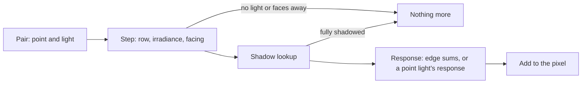
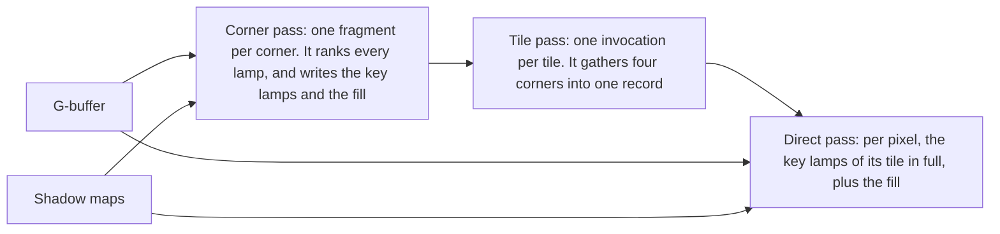
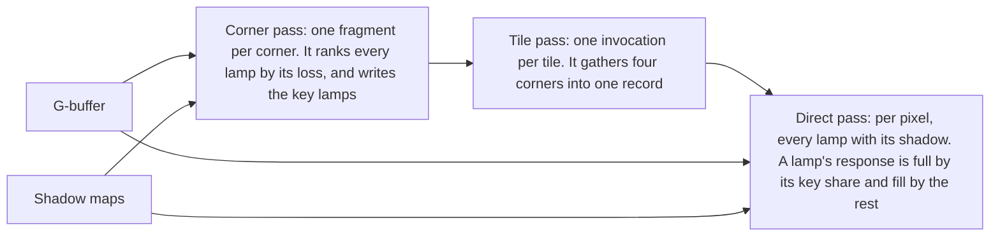

# Light pairs: the second try at the light budget

Ticket `t2-mlvy`, under epic `ter-8hyd`. 2026-11-11. This doc holds five things. The first is the diagnosis of the first try (`ter-69s8`). The second is the measured cost of the direct light. The third is one model of the cost and of the error. The fourth is the record of three prototypes, none of which wins. The fifth is two designs for the next step. Nothing here is decided. The forks at the end are for the user.

## Terms

- Lamp: a light of the frame's light list that is not a far light such as the sun.
- Pair: one shaded point and one light in whose reach the point lies. The direct pass shades one point per pixel.
- Stage: one of the three parts of a pair's work. The step reads the light's row and computes its irradiance and the facing tests. The shadow lookup reads the light's shadow map. The response computes the light toward the eye.
- Edge sum: the sum over a rectangle lamp's four edges that its response takes. A rectangle's response takes two: one for the diffuse light and one for the shine.
- Reach: the distance at which a lamp's light falls below half an 8-bit step on black, after the exposure. The step is `LightUnits.CutoffRadiance`, 2⁻¹³.
- Shown light of a pair: the most pre-exposed radiance that the lamp adds to the point toward the eye, before its shadow.
- Floor: a pre-exposed radiance. Under a floor, a pair whose shown light is at most one floor is not shaded.
- Cascade: one of the four shadow maps of a far light such as the sun.
- Bounds of a shadow map: an image with the least and the greatest depth of each small window of the map.
- Busy median: the median over the frames of the GPU time that one pass keeps the GPU busy, from a Metal System Trace.

## What went wrong in the first try

The first try built no part of the renderer. Its branch adds no line under `src`. It holds a design doc of 708 lines and a test-only estimator shader of 153 lines. It also holds about 2,000 lines of tests and about 9,000 lines of records. No pass ever shaded with a list, so no image of the energy budget exists.

The "patchwork" renders are not its images. The folder `/private/tmp/ter-69s8-build-20261105/estimate-cost-block/` holds three deck renders: `demo-exit-tile16-mode0`, `mode1` and `mode2-trace.png`. The three have the same SHA-256. So do the three of the hall and the three of the station. The estimator only read the G-buffer and removed no light. The dots, 2 pixels apart, are the screen tracer's block rays of a first draw: the measurement fixture never advanced the clock, so every draw reset the history (`estimator-2026-11-05.md`, "Capture-fixture correction").

Four causes, in the order of their weight:

1. The tile was the unit of the decision. Each tile chose its own lamps by their share of the tile's light. Then two neighboring tiles can drop different lamps. So the design needed three repairs. The first was weights interpolated between four tile centers. The second was lists that are the union of four tiles' lists. The third was a bound over every pixel that can read a tile. Those repairs cost list length (the union is about 25 % longer than a tile's list) and work.
2. The rule needed the answer before the work. To know a lamp's share of a pixel's light, the estimator computed every lamp's light at every pixel, twice. That is the loop that the lists were to shorten, without the shadows. The deck's frame at 1280 × 720 took 10.57 ms. It took 16.95 ms with the exact estimator and 11.38 ms with the block estimator, before any list was built. The whole direct pass took about 2.3 ms then.
3. The rule cannot cut a hall. Under an even grid of lamps, the far lamps are each weak and together a third of the floor's light. A budget of 2 % of a tile's light keeps 50 to 54 of the 64 lamps of `lamp-hall-64` (`tables.md`). The first fact-finding had already found that lists by reach drop no lamp there.
4. The scope and the process grew faster than the evidence. Ten decisions in eight hours of 2026-11-04 fixed an energy budget, a temporal controller, no view cap and every reader. No measurement of what the direct light costs came before them. The plan had eight partitions and put the cost gate in the second. Two workflows stopped on a usage limit, and the records of hashes and provenance outgrew the code.

This second try adds a fifth cause, which the measurements below show. The first try assumed that the deck's cost is the number of its pairs. On the deck, a floor pixel has about 8 pairs, and each one shows. No budget can drop one of them without a visible loss.

## How the cost was measured

Each number is the busy median of a pass, from `tools/gpu-trace.sh --no-counters --start 1 --frames 120`. The deck is `scripts/temporal-upscale-timing.json`, and the hall is `scripts/lamp-hall-64-moving.json`. The GPU clock was about 1291 MHz in every trace. A repeat of main on the deck gave 4.190 ms, 4.190 ms and 4.191 ms for the direct pass.

A variant is main with one edit of the shaders. `docs/research/light-pairs/variants/` holds every edit as a script.

One trap cost a round of wrong conclusions. A variant that removes a shadow changes the image. The automatic exposure follows the image, and a lamp's reach follows the exposure. Without the sun's shadow, the sun floods the deck's bay, the exposure falls by about 10 stops, and every lamp falls out of reach. The direct pass then took 1.0 ms, and the first reading credited the 3 ms to the sun's shadow lookup. So every variant of the deck in the tables below has the exposure fixed at main's value, 0.704 stops. Main with the exposure fixed gives the same 4.190 ms.

## What the direct light costs

The deck, with the exposure fixed. Main's direct pass takes 4.19 ms, its transparent pass 2.34 ms and its frame span 24.7 ms.

| Variant | What it changes | Direct pass (ms) | Transparent pass (ms) | Frame span (ms) |
|---|---|---:|---:|---:|
| `x2` | Every pair stops after its step | 1.10 | 0.69 | 19.6 |
| `x16` | Every lamp is skipped, and only the sun is shaded | 1.47 | 1.06 | 19.9 |
| `x4` | Every response is a constant, and the shadow lookups stay | 1.83 | 1.24 | 21.1 |
| `x3` | No shadow lookup, so all pairs respond | 3.14 | 1.83 | 23.3 |
| `x6` | No lookup of the lamps' shadow tiles | 3.53 | 2.11 | 24.7 |
| `x7` | No lookup of the sun's cascades | 4.16 | 2.06 | 24.5 |
| `x11` | One read of a cascade in place of the 16 | 4.23 | 2.09 | 24.5 |
| `x17` | A rectangle's response without its shine | 3.15 | 1.88 | 23.1 |
| `x18` | Every rectangle lamp responds as a point light | 2.53 | 1.87 | 22.5 |

A picture of the pair counts gives the deck's pairs per floor pixel. About 8 pairs take light. Of these, 5 or 6 take a lookup of a shadow tile, 5 or 6 pass their shadow, and 1 is the sun's. The list holds 21 rectangle lamps and the sun.

What the deck's numbers say:

- The lamps' pairs cost about 2.7 ms of the direct pass and about 4.8 ms of the frame (`x16`).
- The steps of all 22 lights and the pass's fixed work cost 1.1 ms together (`x2`).
- The sun's cascade lookups cost 0.03 ms (`x7`). Sixteen reads or one read make no difference (`x11`).
- The rectangle's two edge sums are the largest part. With a point light's response in their place, the direct pass loses 1.66 ms and the frame 2.2 ms (`x18`). The shine's edge sum alone holds 1.04 ms (`x17`).
- The stages do not add up. Alone, the shadow lookups add 0.7 ms to the steps (`x4`). Alone, the responses of all 8 pairs add 2.0 ms (`x3`). Together, with fewer responses, they add 3.1 ms. The cause of that difference of about 1 ms is not known. The variants do not isolate it: `x3` also changes which pixels run a response, and `x2` lets the compiler drop the geometry that only the shadow lookup and the response read. No trace with GPU counters exists yet.
- Code that no pixel runs still costs time on this GPU. The floor's loop, switched off, makes the direct pass 0.5 ms slower. Earlier tickets found the same for the hair's code and for the rectangle's code (`t2-rhja`).

The hall, with the automatic exposure. Its variants keep the image nearly the same, except `x4`.

| Variant | What it changes | Direct pass (ms) | Frame span (ms) |
|---|---|---:|---:|
| main | Nothing | 3.80 | 18.9 |
| `x3` | No shadow lookup | 2.77 | 17.8 |
| `x6` | No lookup of the lamps' shadow tiles | 3.11 | 18.1 |
| `x4` | Every response is a constant | 1.76 | 17.1 |

Every floor pixel of the hall has all 64 lamps as pairs, and all 64 pass their shadows. About 10 of them take a lookup of a shadow tile. So the hall pays about 2 ms for 64 responses per pixel, 0.7 ms for the tiles and 1 ms for the steps.

## One model of the cost and of the error

The cost of the direct light is a sum over pairs. Each pair pays for the stages that it reaches. On this GPU, each stage also pays for the code that shares its loop body.

The error of not shading a pair is that pair's light. It shows in one of three ways:

- As a level: the pixel is darker by the pair's light. Many weak pairs add up to a visible level.
- As an edge in space: one pixel has the pair and its neighbor does not.
- As a pop in time: one draw has the pair and the next does not.

Three rules follow:

1. Who decides: the work that a pair gets is a continuous function of the pair itself. Its inputs are the light, the point, its normal, its material and the frame's exposure. Then the light has no edge and no pop that the lamp's own falloff does not have.
2. Where the result is stored: a list per tile holds only "this function is zero for every point of the tile". A list that is such a cache changes no pixel, so it cannot draw a tile grid.
3. What is kept: if the dropped pairs are many, a rule that drops a pair's light loses a level. A rule that makes a pair cheaper, or merges pairs with their light kept, loses none.

## Three prototypes, and why none wins

### The visible floor

The floor follows rules 1 and 2 and breaks rule 3. A pair adds its light times a share. The share is 0 where the shown light is at most one floor, 1 from two floors, and even in between. A pair with no share takes no shadow lookup. A rectangle's pair takes its share from a bound of its light that costs no edge sum. The option was `--light-floor <stops>`, for a floor of 2 to the power of minus the stops.

| Scene | Build | Direct pass (ms) | Light lost |
|---|---|---:|---:|
| Deck | main | 4.19 | |
| Deck | Floor's code, floor off | 4.70 | 0 % |
| Deck | Floor of 2⁻⁸ | 4.39 | 3.0 % |
| Deck | Floor of 2⁻⁹ | 4.60 | 1.4 % |
| Deck | Floor of 2⁻¹¹ | 4.75 | 0.1 % |
| Hall | main | 3.80 | |
| Hall | Floor of 2⁻⁹ | 3.65 | 12.5 % |

The light lost is the change of the automatic exposure, which meters the image's light.

The floor fails in both scenes. On the deck, the pairs are few and strong, so the floor finds little to skip, and its code costs more than it saves. In the hall, the pairs are many and weak. The floor then removes an eighth of the light and wins 0.15 ms. This is cause 3 of the first try in a new form: weak pairs add up.

Two more faults showed. The floor reads the exposure in every pass that shades, so the environment faces and the impostor captures depend on the main view's exposure. And if the exposure moves, a face that the floor cut is stale.

The prototype is `docs/research/light-pairs/visible-floor.patch`, with 23 CPU tests and 6 GPU tests. It applies to main at `8fe7ac7cf`. The tests passed in a full Checked run of the rendering tests.

### The bounds of the cascades

The first reading of the traces blamed the sun's 16 reads per cascade lookup. The local shadow atlas has bounds: one read settles a lookup whose every comparison agrees. This prototype gave the cascades the same bounds. A compute pass writes them after the cascades draw, and `sampleCascade` reads them first.

The bounds are exact. Every existing shadow test and two new tests passed in the full Checked run. A picture of the outcomes shows that the bounds settle every cascade lookup on the deck and most lookups under an open sun.

They win nothing. The deck's direct pass takes 4.09 ms with them, and the pass that writes them adds 0.43 ms. Under an open sun, the direct pass takes 0.29 ms. The reads were never the cost (`x7`, `x11`).

The bounds also raise a device requirement. A shader stage of the impostor layout then sees 18 sampled images, not 17, and three tests of `DescriptorLayoutsTests` state the 17.

The prototype is `docs/research/light-pairs/cascade-bounds.patch`. It applies to main at `8fe7ac7cf`.

### Loops of their own

Earlier tickets gave each light shape its own loop and won time. Two more splits lose:

| Variant | What it changes | Direct pass (ms) | Transparent pass (ms) | Frame span (ms) |
|---|---|---:|---:|---:|
| main | Nothing | 4.19 | 2.34 | 24.7 |
| `x5` | The shadow lookups in a first loop, the responses in a second | 6.69 | 2.77 | 28.1 |
| `x13` | The sun in a loop of its own | trace lost | trace lost | 25.8 |
| `t6` | Change 1 of branch `t6-h5e3-six-frame-cuts` | 4.09 | 2.06 | 24.3 |
| `x19` | `t6`, with the pairs that shade as points in a loop of their own | 3.88 | 2.53 | 24.8 |

The frame span of `x13` is the run's own measure, which reads 24.8 ms for main. `x5` ran with the automatic exposure and the same image.

Change 1 of that branch shades a far rectangle lamp as a point light, in the rectangles' one loop. `t6` reproduces its gain. `x19` gives the same image. It wins 0.2 ms more in the direct pass and loses 0.5 ms in the transparent pass.

## Two designs for the next step

Neither design is a light budget. The measurements leave two places where time is: the rectangle's edge sums on the deck, and the count of pairs in a hall.

| Point | Design A: a shader per screen tile | Design B: far lamps merged, light kept |
|---|---|---|
| What it cuts | The edge sums' code, for tiles that need none | The count of pairs, for points far from a group of lamps |
| Scene that gains | The deck: at most 1.66 ms of the direct pass (`x18`) | The hall: part of the 2 ms of its 64 responses |
| What decides | Per tile: whether every rectangle pair of the tile shades as a point | Per pair of a point and a group: a weight from the group's size over its distance |
| Image | That of change 1 of `t6-h5e3-six-frame-cuts`, which is its rule | A new approximation, with the light's sum kept |
| Fixed cost | A pass that sorts the tiles, about the steps' cost, and a second pipeline | Groups built on the CPU in every frame |
| Passes that gain | The direct pass only | Every pass that shades |
| Unknown | The share of the deck's tiles that need no edge sum, which depends on roughness | The error of a group's shine, and the gain against the groups' code |
| First experiment | Count the tiles of each kind in a picture, then trace two pipelines | Count the pairs per pixel of the hall under a merge rule, in a picture |

Design A in use: the renderer sorts each 16-pixel tile into "points only" or "edges". The direct pass then draws twice, once with each pipeline, and each pixel is shaded once. A scene needs no setting.

Design B in use: the batcher groups the lamps without a shadow tile by place. A point shades a far group as one light at the group's center with the group's summed power. A near group's lamps shade one by one. Between, both shade, with weights that sum to 1.

What both share:

- No pair's light is dropped, so no level is lost (rule 3).
- Each decision is a continuous function of the pair, or an exact cache of one (rules 1 and 2).
- No energy budget, no temporal controller and no view cap.
- No reservoir resampling.
- Only core Vulkan features.
- Every cost experiment runs with the exposure fixed.

### The sources and their situations

| Technique | Its situation | Ours | Verdict |
|---|---|---|---|
| Tile classification with a shader per class (El Garawany 2016, Uncharted 4) | A console GPU, deferred shading, many material features. A compute pass sorts 16-pixel tiles, and each class runs a shader without the other features' branches | A GPU on which unused code in a loop body still costs time | Design A. It fits the measured cause. The gain is bounded by `x18` and not yet proven |
| Tiled and clustered shading (Olsson and Assarsson 2011, Harada 2012) | Hundreds to tens of thousands of lights whose radius is a small part of the view | 22 to 65 lights whose reach holds the whole room | A list by reach drops nothing. Not adopted |
| Lightcuts (Walter 2005) | Thousands to millions of point lights, a light tree, a cut per pixel with an error bound of 2 % | 64 lamps. A tree walk per pixel costs about what the lamps cost | Design B takes "merge what is far, keep its light" with fixed groups and no tree |
| Interleaved sampling of lights (Keller and Heidrich 2001) | Hundreds of virtual lights of smooth diffuse light, with a blur over the pattern | Lamps with sharp shadows and shine, and no filter on the direct light | Not adopted |
| ReSTIR | Rejected by the user | | Not adopted |

### Where this departs from the earlier decisions

- The energy budget of at least 2 % of a tile's light: dropped. A budget finds nothing on the deck and loses light in the hall, whether it is a share of the tile's light or a floor.
- The temporal controller for the budget: dropped with the budget.
- No view cap: kept. Neither design caps the lights of a view.
- Lists per screen tile: kept only as design A's sort of the tiles, which stores no light list.

### The relation to change 1 of `t6-h5e3-six-frame-cuts`

That change shades a far rectangle lamp as a point light. Its rule is at least 8 half diagonals of distance and the whole face above the horizon. A roughness of at least 0.5 also takes the point's shine. This ticket's `t6` variant reproduces its gain: 4.19 ms to 4.09 ms in the direct pass and 2.34 ms to 2.06 ms in the transparent pass.

Design A adds to that change and replaces nothing of it. It keeps the rule and the image. It moves the choice from each pair to each tile, so that a tile of point pairs runs a shader without the edge sums. The floor and the cascade bounds do not touch that change.

## Key and fill, version 1

On 2026-11-11 the user widened the task. If a design keeps the contrast, it can lose light. A design can also return lost light by a cheaper path. The user then chose to build key and fill. It is design B without groups: the lamps that a point merges are all its weak lamps, and the merged light is the fill.

### Terms

- Tile: a square of 8 × 8 render pixels of the screen.
- Corner: a point of the grid of tile corners. A corner samples the surface at its own pixel. If that pixel holds no lit surface, the corner samples the nearest lit pixel of the four tiles around it.
- Importance of a lamp at a corner: the luminance of the radiance that the lamp shows there before its shadow. The surface is the corner's, with a white base color, its geometric normal and a lobe at least as wide as a tile.
- Threshold of a corner: the importance of the lamp that follows the K most important lamps there, or 0 without such a lamp. K is the setting's count of key lights, from 1 to 4.
- Key share of a lamp at a corner: 0 at the threshold or below, 1 at twice the threshold or above, and even in between.
- Fill of a corner: the diffuse light of every lamp's other share, with the lamp's shadow at the corner.

### The mechanism

1. The corner pass draws one fragment per corner. It computes every lamp's importance at the corner, and from them the threshold. It writes at most K keys, each a lamp with its key share. It adds every lamp's other share, times the lamp's shadow, to the fill.
2. The tile pass gathers the four corners of each tile into one record of 272 bytes. The record's list holds each key lamp of the four corners once, with its four key shares. The list is in the order of the lamp shapes, so the direct pass keeps one loop per shape.
3. The direct pass reads one record per pixel. A pixel's share of each corner is the product of two factors. The first is the bilinear weight of the corner. The second is how near the corner's surface point lies to the plane of the pixel's surface. The pixel shades each lamp of the list in full, times the lamp's key share by those corner shares. It adds the fill by the same corner shares.

The same corner shares weigh a lamp's key share and its fill. So the two parts of each lamp add up to the whole lamp, up to the fill's error.

### What the fill holds

The fill of a corner holds three things: the sum of the lamps' irradiances toward each lamp, the sum of each lamp's luminance times its direction, and a scale. A pixel takes the share of the first sum that its shading normal faces. The share comes from Geomerics' fit for two orders of spherical harmonics: `((1 + cos θ) / 2)³` for one lamp at the angle θ from the normal. The scale is the fill's true irradiance on the corner's geometric normal over the fit's irradiance there. So a flat surface takes the true diffuse light of the fill, and a normal map only turns it.

### What it keeps and what it loses

- Kept: the diffuse light of every lamp. Each key lamp keeps its shine and its sharp shadow by its key share.
- Lost: the shine of a lamp's fill share, and the sharp edge of its shadow, which the fill holds at the grid of 8 pixels.
- The exposure moves no lamp between key and fill, because the key share is a ratio of two importances.
- A lamp moves between key and fill without a jump in time or along the screen. The key share is continuous in every lamp's importance, and a pixel takes it from four corners.

### The model's rules, and the first try's repairs

Rule 3 of the model allows it: the fill merges pairs and keeps their light. Rule 1 holds for the key share, which is a continuous function of the lamps at a corner. Rule 2 does not hold. A tile's record is not a cache of "zero for the whole tile". It is a function at low resolution, and a pixel reads it between four corners.

Key and fill takes two repairs that the first try needed: weights between four points, and a list that is the union of four lists. The first try paid for them at every pixel, twice, before any list existed. Here the ranking runs once per corner, which is one pixel in 64. The first try also dropped the light of the lamps that it cut. Here the fill returns it.

### The sources and their situations

| Technique | Its situation | Ours | Verdict |
|---|---|---|---|
| Lighting at low resolution with an upsample that follows depth (Shopf 2009, "Mixed resolution rendering") | Smooth light, such as particles or ambient occlusion, at a half or a quarter of the resolution | Lamps with sharp shadows and shine | Only for the fill, which holds the weak share of each lamp. The key lamps stay at full resolution |
| Irradiance from two orders of spherical harmonics (Geomerics 2015) | Bounce light in light maps and probes, which comes from every side | Direct light of a few lamps, which comes from a few directions | The fit overstates a lone lamp at a grazing angle by up to an eighth of its light. The scale removes that error on the corner's own surface |
| Tiled shading's lists (Olsson and Assarsson 2011) | Lists by reach for thousands of small lights | Tens of lamps whose reach holds the room | Only the record per tile. The list is by importance, not by reach |

### Limits of the first version

- Only the direct pass reads the records. The transparent pass, the environment faces, the impostor captures and the lit puffs still shade every pair.
- A thin object in front of a far wall can have no corner on its own surface. Its pixels then take the wall's key lamps and the wall's fill.
- A highlight smaller than a tile on a very smooth surface can lie between two corners. The wide lobe of the importance covers a roughness of about 0.15 and above.

### Version 1's result

The sections above describe version 1. Its code is `docs/research/light-pairs/key-fill-v1.patch`. It was fast, and it failed on the image.

| Scene | Key lights | Corner and tile pass | Direct pass | Both against every light pair | Blotch |
|---|---:|---:|---:|---:|---:|
| Deck | 3 | 0.823 ms | 1.452 ms | −1.816 ms | 4.52 % |
| Hall | 4 | 1.314 ms | 0.538 ms | −2.291 ms | 6.72 % |

Blotch is the 90th percentile of the local change in brightness against every light pair. The deck's floor showed soft blobs in place of the sharp shadows of the greenhouse frame. The hall's pillars showed blotches. The cabin's blotch was 8.43 %. The cause is the fill's shadow, which a pixel reads from four corners 8 pixels apart.

## Key and fill

This section describes version 2, which is the code of the branch `t2-mlvy-tile-light-budget`. It keeps every shadow at the pixel, and only the response of a lamp changes between key and fill.

### Terms

- Fill response of a lamp: the diffuse light that the surface takes from the lamp as a point at its center, with no shine.
- Loss of a lamp at a corner: what the fill response loses of the full response there, behind the lamp's shadow. It is the luminance of the shine, plus that of the difference of the two diffuse lights.
- Threshold of a corner: the greater of two values. The first is the loss of the lamp that follows the K lamps of the greatest loss. The second is 1/256 of the corner's whole direct light.
- Key share of a lamp at a corner: 0 at the threshold or below, 1 at twice the threshold or above, and even in between.

### The mechanism

1. The corner pass draws one fragment per corner. It computes every lamp's loss at the corner, and from the losses the threshold. It writes at most K keys, each a lamp with its key share. It writes no fill.
2. The tile pass gathers the four corners of each tile into one record of 160 bytes. The record's list holds each key lamp of the four corners once, with its four key shares.
3. The direct pass walks every lamp at every pixel, with the lamp's reach test and its shadow lookup. A lamp's response is its full response times its key share, plus its fill response times the rest.

### What it keeps and what it loses

- Kept: every shadow edge, and the diffuse light of every point and tube lamp.
- Lost: the shine of a lamp's fill share. A rectangle lamp's fill share takes the diffuse light of a point of the same solid angle. That misses the true light by under 1 % from 8 half diagonals away, and by more nearer.
- A lamp's loss holds both errors, so a lamp whose fill response shows an error at a corner becomes a key lamp there.

### The image

| View | Measure | Version 1 | Version 2 |
|---|---|---:|---:|
| Deck, 3 key lights | Blotch | 4.52 % | 0.37 % |
| Deck, 3 key lights | Pixels changed by more than 2 steps of 255 | 7.55 % | 0.36 % |
| Hall, 4 key lights | Blotch | 6.72 % | 2.09 % |
| Cabin, 3 key lights | Blotch | 8.43 % | 0.32 % |

The light steps across a tile edge as it does between other pixels: 0.101 % against 0.099 % on the deck. In the film of the hall's moving lamps, version 2's ratio to every light pair changes less between frames than version 1's: 3.70 % against 4.92 % at the 99th percentile. Tiles of 16 pixels change the stills little: the deck's blotch is 0.41 %.

### The cost

| Scene | Key lights | Corner and tile pass | Direct pass | Both against every light pair | Frame span, median, against every light pair |
|---|---:|---:|---:|---:|---:|
| Deck | 3 | 0.636 ms | 3.396 ms | −0.059 ms | +0.014 ms |
| Hall | 4 | 1.266 ms | 3.257 ms | +0.380 ms | +0.645 ms |

The direct pass saves 0.70 ms on the deck and 0.89 ms in the hall. The corner and tile pass costs as much or more. So version 2 as built does not win.

### What the corner and tile pass costs

The pass does about 1/64 of the direct pass's work per lamp, and it takes a quarter of the direct pass's time. In the hall, a corner costs about 160 ns, and a pixel of the direct pass costs about 10 ns. Both walk the same 64 lamps with the same reach test. Cost-only builds, whose images are wrong by design, show what the time follows. Each number is the pass's busy median in the hall.

| Build | Time |
|---|---:|
| Version 2, whole | 1.266 ms |
| No ring walk | 1.126 ms |
| No loop over the lamps | 0.408 ms |
| Neither | 0.064 ms |

The ring walk is the search for the nearest lit pixel around a corner whose own pixel is sky. The next builds have no ring walk.

| Tile size | Fragments per corner | Lamps per fragment | Time |
|---:|---:|---|---:|
| 4 | 1 | all | 1.213 ms |
| 8 | 1 | all | 1.126 ms |
| 16 | 1 | all | 0.624 ms |
| 8 | 16 | a sixteenth | 0.516 ms |
| 16 | 4 | a quarter | 0.349 ms |
| 16 | 16 | a sixteenth | 0.265 ms |

- The fixed cost of the pass is small.
- The time does not follow the count of corners. Sixteen times the corners cost twice the time.
- The same work in shorter fragments runs in half the time. Fewer corners and shorter fragments add up. The deck gives the same picture: 0.614 ms falls to 0.252 ms.
- The ring walk grows with the tile. At tiles of 16 pixels it costs about 1.6 ms in the hall.
- The cause inside the GPU is not known. The offline compile shows that the corner shader uses every register up to r127 and reads spilled values from memory in its lamp loop. No trace ties the time to that.

One change is in the code. The corner shader held its greatest losses in two local arrays that a run-time index read. It now holds them in five named values with a fixed chain of compare and carry. The keys and the stills are the same, pixel for pixel. The pass fell from 1.266 ms to 1.036 ms in the hall, and from 0.636 ms to 0.607 ms on the deck.

### What version 2 can reach

| Scene | Direct pass saves | Corner and tile pass at best | Both against every light pair |
|---|---:|---:|---:|
| Deck | 0.70 ms | about 0.25 ms | about −0.45 ms |
| Hall | 0.89 ms | about 0.27 ms | about −0.62 ms |

The best case needs three things that no build has yet:

1. A corner pass with one fragment per corner and group of lamps, and a tile pass that merges the groups' candidates.
2. A cheap replacement for the ring walk.
3. The check of tiles of 16 pixels under motion.

## The shadow filter with one value per read

The pair research (`docs/research/light-pairs/pair/notes.md`) found one more gain, apart from key and fill. The local shadow filter on main read its 5 × 5 texels with nine gathers of four comparisons each. The pair's patch (`docs/research/light-pairs/pair/c9-shadows.patch`) reads them with nine bilinear comparisons, and it lowered the deck's direct pass from 4.093 ms to 3.696 ms.

The patch did not merge. It lets the hardware weigh the first two texels of each axis, and the hardware rounds that weight to its sub-texel precision. The test `TheShadowsEdgeRampsInProportionToTheReceiversPlaceWithNoSubTexelSteps` locks in the exact ramp of a shadow's edge, and it failed with the patch: 6.7e-4 off the line against a limit of 1.5e-4. A device with 4 bits of precision, which Vulkan allows, shows bands of about 3 %.

An exact filter with one value per read exists: sixteen bilinear comparisons at texel corners. The weights of an axis, (1 − f, 1, 1, 1, f), are 1 − f times the four texels from texel 0, plus f times the four texels from texel 1. So the filter is a blend of four sums of 4 × 4 texels, and each sum is four means of 2 × 2 texels. At a corner, each of the hardware's weights is a half at any precision, and the shader applies f itself. Every read returns one value, as in the pair's patch.

| Scene | Reads | Direct pass | Transparent pass | Frame span, median |
|---|---|---:|---:|---:|
| Deck | Nine gathers | 4.099 ms | 2.099 ms | 22.175 ms |
| Deck | Nine bilinear comparisons | 3.683 ms | 2.129 ms | 21.765 ms |
| Deck | Sixteen corner means | 3.796 ms | 2.036 ms | 21.641 ms |
| Hall | Nine gathers | 4.155 ms | 0.028 ms | 18.290 ms |
| Hall | Nine bilinear comparisons | 3.808 ms | 0.031 ms | 18.006 ms |
| Hall | Sixteen corner means | 3.813 ms | 0.032 ms | 17.909 ms |

The deck's rows are the mean of three traces of each build in turns, on main at `5c83ef6c`, on the Apple M1 Max. Every trace of the corner means lies below every trace of the gathers in the frame span. The stills of the deck, the hall and the cabin and a film of the hall's moving lamps equal main's to within 2 pixels of one step of 255.

The Linux card of the GPU workbench, an RTX 2000 Ada under NVIDIA's driver, gave the opposite answer. The corner means cost its frame 0.80 ms more on the deck and 0.79 ms more in the hall. The nine bilinear comparisons cost it 0.33 and 0.40 ms more. That GPU pays for each filtered comparison read, and a gather is its cheapest way to four comparisons. One more exact form, the gathers in a row loop, costs the Linux card nothing on the deck and 0.05 ms in the hall. On the Mac it gains less than the corner means, and its transparent pass takes 0.12 ms more.

So no one filter wins on both GPUs. The user chose on 2026-11-12 to keep both exact filters and to pick one by driver, once per device. `LocalShadowAtlas.Reads` names the way, and its default leaves the choice to `VulkanRenderer.TileReadsFor`: the sixteen corner means on MoltenVK and the nine gathers on every other driver. The tests name a way, so both filters run on every device. ARCHITECTURE.md, "The scenes and the cost of the shadows", holds every measured form.

## The forks for the user

1. Which cost comes first: the deck's edge sums (design A), the hall's pair count (design B), or neither, because other passes hold more of the frame.
2. Whether the idea of a budget ends here. The recommendation is yes.
3. Whether the measurement tools get an option for a fixed exposure. The recommendation is yes, before any more cost experiments.
4. Whether the shadow filter with one value per read goes in first. The user chose yes on 2026-11-12. It merged as two exact filters, picked by driver: the sixteen corner means on MoltenVK and the nine gathers elsewhere (`t2-gfq5`).
5. Whether key and fill goes on. Version 1 saves about 2 ms and blurs the shadows. Version 2 keeps the image and can save about 0.5 ms of a direct pass of 4.1 ms, after the three steps above. The recommendation is to stop here, unless the budget needs that half millisecond. The user chose on 2026-11-12 to build on (`t2-vsqh`).

## The records

- `docs/research/light-pairs/visible-floor.patch` and `cascade-bounds.patch`: the two prototypes.
- `docs/research/light-pairs/variants/`: the edit of each variant and the scripts that build and trace them.
- `docs/research/light-pairs/measurements.md`: every trace's busy medians.
- `docs/research/light-pairs/key-fill-v1.patch`: version 1 of key and fill.
- `docs/research/light-pairs/pair/`: the pair research. It holds the notes, the offline inspection of the compiled shaders, the timing comparison and the patch of the nine-read shadow filter.
