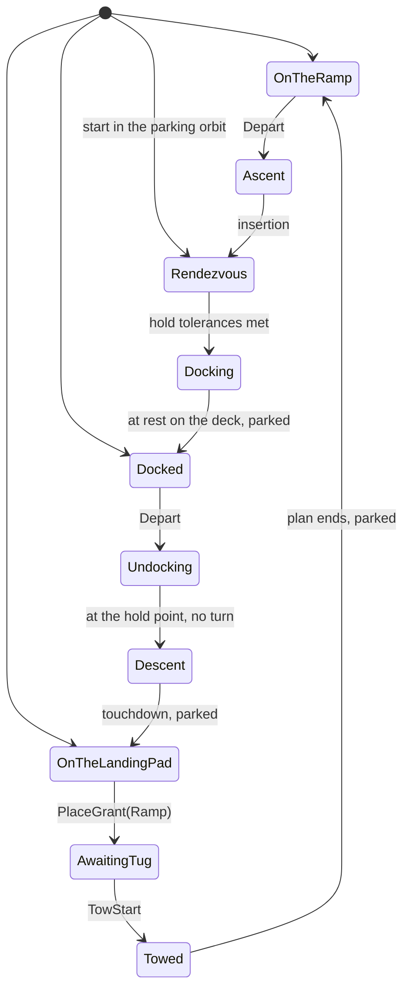
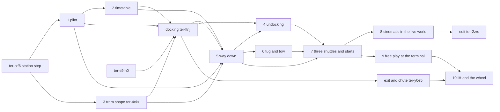

# Live world

Epic: `ter-xr2b`. The design ticket `ter-0pvs` wrote this plan. The work tickets are listed in "Order of the work".

## Goal

The demo becomes a world that the user can join live, as a character, on a stream. Three shuttles fly a fixed route between the launch ramp and the spinning station, and back to a landing pad. A timetable entity sends them on their way at fixed times, so a shuttle leaves the ground in every orbit of the station, every 92.4 minutes. The cinematic run and free play run the same world. The cinematic's script drives only its person and the cameras. In free play, the user drives a person through `PersonControl`, in real time.

## What the user decided

The user settled these points on 2026-10-20:

1. The route stays the textbook route of the station step (`ter-tzf6`, docs/plans/blue-danube-demo.md). There is no time warp.
2. The return is real. The shuttle undocks, burns out of orbit and lands on its engine on a landing pad. A tug puts it back on the ramp.
3. A timetable entity sends `Depart` to a shuttle at fixed times. It shares the ramp, the landing pad and the station's slot between the shuttles. Earth does not turn, so the station passes over the launch pad once in each orbit, every 92.4 minutes.
4. Three shuttles fly the route, so a shuttle departs from the ground in every orbit. The user first chose two shuttles. This design then found that one cycle of a shuttle takes three orbits (see "Why the cycle takes three orbits"), and the user chose three.
5. Free play starts at the launch terminal or on the station's wheel floor.
6. A seat that a player uses straps the player in. The scripted passenger (`Passenger`) keeps its own orders.
7. The cinematic's script drives only its person and the cameras. Every order to a shuttle comes from the timetable and from the shuttles' own legs.

The user's rule of 2026-10-18 applies: only engine changes go to the user. This design settles every demo choice and gives its reason (see "Decisions"). It needs no engine change (see "Engine changes").

### Where the design reads the user's words in its own way

The user's words say that the shuttle "lands on its engine on the pad", and that the timetable shares "the pad, the ramp and the station's slot". The design reads two of them in its own way:

- The shuttle lands on a separate landing pad, not on the launch pad. The launch pad carries the ramp's bed, so a hull cannot stand upright on its tail there. A landing there would also wait until the shuttle on the bed departs, and a shuttle rests on the bed for 87 minutes of each orbit.
- The launch pad is not a place of its own. It is part of the place `Ramp`, because the bed lies on it, and only the shuttle on the bed uses it.

## Terms

| Term | Meaning |
|---|---|
| Launch pad | The existing slab under the ramp's bed, scene id `pad` |
| Landing pad | A new raised slab 40 m beside the ramp, where a shuttle lands on its tail, scene id `landing-pad` |
| Pass | A moment at which the station is over the launch pad |
| P_k | The time of the pass in orbit k, in the world's seconds: `OverPadAt + k × T` |
| T | The station's orbital period: 5,544.9 s, 92.41 minutes (`KeplerOrbit.Period(EarthMu)` of the station's orbit) |
| D_m | The shuttle whose ground departure is the one of orbit m, at P_m − 18 s. With three shuttles, D_m and D_(m+3) are the same shuttle. |
| Leg | One part of a shuttle's cycle, such as the ascent or the stay. A leg has one case in the union `ShuttleLeg`. |
| Cycle | The legs of one shuttle from one departure from the ramp to the next |
| Pilot | The component `ShuttlePilot`. It holds the shuttle's leg and flies it. |
| Leg flyer | A class that the pilot owns, which flies the cases of one leg, such as `AscentLeg` |
| Place | One of the three shared places: the ramp, the landing pad and the slot (the enum `Place`) |
| Slot | The station's way in: the axis from the deck out to just inside the arrival point, with the hub's slot and the bay. The arrival point lies 1,500 m out on the axis, outside the slot. |
| Holder | The one shuttle that the timetable lets use a place |
| Claim | The state of a request for a place, in a leg case that flies while it waits for the grant: `Asked` or `Granted` (the enum `Claim`) |
| Held places | The places that a shuttle holds. One function of the leg, `ShuttleLeg.HeldPlaces`, gives them, and nothing stores them. |
| Ground departure | The `Depart` that the timetable sends to the ramp's holder, 18 s before each pass |
| Station departure | The `Depart` that the timetable sends to the slot's holder, 2,100 s after each pass |
| Hold point | `DemoStation.HoldPoint`, 150 m out on the station's axis, outside its bubble |
| High gate | The point 100 m above the landing pad's top, where the powered braking hands over to the vertical descent |
| Park pose | The pose of a shuttle at rest on the ramp's bed, `DemoSurface.ShuttleParked` with no rotation |
| Nominal timeline | The times of one cycle after its pass, in "The timeline of one cycle". The static class `LiveTimeline` holds the times that code reads. |
| Step N | The physics step that runs during tick N, from t_N to t_(N+1). Gameplay of tick N reads `self.Time` = t_N. An intent that tick N writes acts in step N + 1. |

## The cycle of one shuttle

### The legs

The times below count from P, the pass of the orbit in which the shuttle departs. A cycle takes three orbits, 3T = 16,634.6 s, 277.2 minutes (see "Why the cycle takes three orbits").

| Leg | What starts it | What ends it | What flies it | Length, with the arithmetic | Tolerances |
|---|---|---|---|---|---|
| Boarding (`OnTheRamp`) | The end of the tow, or the world's start | A ground departure | Nothing. The hull is static on the bed. | From P − T + 300 s, the end of the last cycle's tow, to P − 18 s: T − 318 s = 5,227 s, 87 minutes. At the world's start: 20 s in the cinematic, 180 s in free play at the terminal. | The tow ends exactly on the park pose. |
| Departure (`Ascent`, case `Ramp`) | `Depart`. The pilot unparks the hull (`SetMotion(Dynamic)`) and gives full throttle. | The hull passes the ramp's top and clearance. | `AscentLeg`, the main engine and the attitude autopilot | About 5 s. The bed and the ramp are 267 m long. Full throttle less the slope's share of gravity gives 29.4 − 4.9 = 24.5 m/s², and √(2 × 267 / 24.5) = 4.7 s. | The ascent's tests, as today |
| Ascent (`Ascent`, case `Climb`) | The ramp's end. The climb holds no place, so the pilot releases the ramp. | The circle 200 km up | `AscentLeg` | 316 s, from P − 13 s to P + 303 s. The insertion is 340.5 s into today's run, 302.5 s after the pass at 38 s, and the lead of 18.0 s moves it 0.47 s later. | As today |
| Rendezvous (`Rendezvous`) | The insertion | The hold tolerances are met at the hold point. | `RendezvousLeg`, the main engine, the translation thrusters and the attitude autopilot | 4,532 s, from P + 303 s to P + 4,835 s: phasing 1,620.2 s, the transfer 2,547.6 s to the brake, the brake 23.8 s, the glide 340.7 s (the run of 2026-10-20, moved by the lead of 18.0 s) | 0.5 m, 0.02 m/s and 1 degree at the hold point, as today |
| Docking (`Docking`), model level only | The hold | The hull rests on the deck and is parked. | `DockingLeg` of `ter-ftnj` | A budget of 330 s, to P + 5,165 s: the spin match 60 s, the entry 220 s, the move to the deck 40 s, settling 10 s | `ter-ftnj` sets them. |
| Stay (`Docked`) | The docking's end | A station departure | Nothing. The hull is static on the deck, in the station's frame. | From P + 5,165 s to P + T + 2,100 s: 7,644.9 − 5,165 = 2,480 s, 41.3 minutes | None |
| Undocking (`Undocking`) | `Depart` while docked | The hull holds at the hold point without a turn. | `UndockingLeg`, the translation thrusters and the attitude autopilot | A budget of 320 s, to P + T + 2,420 s: the lift-off 40 s, the exit 220 s, the spin-down 60 s | The hold point's tolerances, and a turn rate below 0.005 rad/s |
| Wait for the window (`Descent`, case `AwaitingWindow`) | The undocking's end | The angle to the landing pad falls into the window, and the claim of the landing pad is granted. | `DescentLeg`, which holds the hold point and turns the nose against the velocity | 149 s, to P + T + 2,569 s | The window: 193.2 to 192.2 degrees |
| Deorbit burn (`DeorbitBurn`) | The window | The velocity changes by 108.5 m/s. | `DescentLeg`, the main engine at a throttle of 0.10 | 36.2 s at 3.0 m/s², to P + T + 2,606 s | Within 0.5 m/s of the change |
| Coast (`Coast`) | The burn's end. The coast holds no slot, so the pilot releases it. | The braking curve | `DescentLeg`. The nose turns against the velocity. | 2,638 s, 44 minutes, to P + T + 5,244 s | None |
| Powered braking (`PoweredBraking`) | The braking curve: the distance left is v² / (2 × 0.8 × 29.4 m/s²). | The high gate | `DescentLeg`, the main engine near full throttle, the translation thrusters and the attitude autopilot | 346 s and 8,446 m/s, to P + 2T + 45 s | Within 5 m and 1 m/s of the gate at rest |
| Vertical descent (`Vertical`) | The high gate | The touchdown | `DescentLeg`. The nose points up, and the roof faces +Z. | About 75 s for 100 m, to P + 2T + 120 s | At the touchdown: the tail within 0.05 m of the pad's top, and slower than 0.1 m/s |
| On the landing pad (`OnTheLandingPad`) | The touchdown. The pilot parks the hull and asks for the ramp. | `PlaceGrant(Ramp)` | Nothing. The hull is static, upright on its tail. | Two ticks in the nominal cycle: the grant reaches the pilot two ticks after its request. The ramp is free since the climb of the shuttle that departed in the same orbit, at P + 2T − 13 s. | None |
| Wait for the tug (`AwaitingTug`) | The ramp's grant. The pilot sends `TowRequest`. | `TowStart` | Nothing | About 40 s: the tug drives about 17 m from its garage in 30 s, and its cradle rises in 10 s at the hitch point. | None |
| Tow (`Towed`) | `TowStart` | The end of the tow plan, on the park pose. The pilot parks the hull, and `OnTheRamp` holds no landing pad, so the pilot releases it. | The pilot. It follows `TowPlan` with end poses. | 140 s, to about P + 2T + 300 s: lowering 60 s, the carry across 45 s, the carry in 25 s, the set-down 10 s | The tow plan ends exactly on the park pose. |
| Turnaround | The touchdown | The next ground departure | The four ground legs above | From P + 2T + 120 s to P + 3T − 18 s: T − 138 s = 5,407 s, 90 minutes | None |

The sum is the cycle: from P − 18 s to P + 3T − 18 s, 3T.

The times of the way up come from today's run, which ignites 18.47 s before the pass: the script posts `Ignition` at tick 1,172, 19.53 s, and the pass is at 38 s. The timetable's lead of 18.0 s starts the flight 28 ticks, 0.47 s, later relative to the pass. The insertion moves by those 0.47 s. On the circle, the shuttle is then n₁ × 0.47 s = 1.18528e-3 × 0.4667 = 5.53e-4 rad behind where it was. It gains on the station at n₁ − n₂ = 5.212e-5 rad/s, so the window opens 5.53e-4 / 5.212e-5 = 10.6 s later. The transfer takes a fixed time after the window, so the brake, the hold and the docking move by the same 10.6 s, and the stay is 10.6 s shorter. The way down does not move, because its window depends only on the station's place.

These times are those of the run with today's translation thrusters of 4,000 N. `ter-ftnj` raises them to 30,000 N for every law, measures the rendezvous again, and corrects the times in `LiveTimeline` (see "One thruster model").

### Why the cycle takes three orbits

- The docking ends at P + 5,165 s, which is P_(k+1) − 380 s. The deorbit window of orbit k is at P + 2,569 s, long past. So the first window is the one of orbit k + 1, at P + T + 2,569 s.
- That burn gives a touchdown at P + 2T + 120 s, 120 s after the pass of orbit k + 2. The ground departure of that orbit is 18 s before the pass. The shuttle misses it by 138 s, plus the 180 s on the pad and in tow.
- No faster leg helps. A shuttle that descends from the station's orbit reaches the pad at about the time of a pass. So the landing always falls just after a pass. Only a departure after the pass can take the shuttle in the same orbit, and the route fixes the departure 18 s before the pass.
- So the earliest departure after a cycle is the one of orbit k + 3. One shuttle departs every three orbits.

Three shuttles, offset by one orbit, give a ground departure in every orbit, 92.4 minutes apart. Two shuttles gave gaps of 92.4 and 184.8 minutes. The user chose three for that reason (see "What the user decided").

### The timeline of one cycle

| Time | What happens | Place event |
|---|---|---|
| P − 18 s | Ground departure. The ignition. | |
| P − 13 s | The climb starts. | Release the ramp. |
| P + 303 s | The insertion. Phasing starts. | |
| P + 1,923 s | The window. The transfer burn. | |
| P + 4,471 s | The brake starts, about 740 m before the arrival point. | Request the slot. |
| P + 4,835 s | The hold point. The docking starts. | |
| P + 5,165 s | Docked | |
| P + T + 2,100 s | Station departure. The undocking starts. | Request the landing pad. |
| P + T + 2,420 s | At the hold point, with no turn | |
| P + T + 2,569 s | The deorbit burn starts. | |
| P + T + 2,606 s | The burn ends. | Release the slot. |
| P + T + 5,244 s | The powered braking starts, 30 km up, 1,360 km before the pad. | |
| P + 2T + 45 s | The high gate | |
| P + 2T + 120 s | The touchdown | Request the ramp. |
| P + 2T + 160 s | The tow starts. | |
| P + 2T + 300 s | Parked on the bed | Release the landing pad. |
| P + 3T − 18 s | The next ground departure | |

The brake starts at 4,498.2 s into today's run, P + 4,460.2 s, and 4,460.2 + 10.6 = 4,470.8 s. The hold starts at 4,862.7 s, P + 4,824.7 s, and 4,824.7 + 10.6 = 4,835.3 s. The window opens at 1,950.6 s, P + 1,912.6 s, and 1,912.6 + 10.6 = 1,923.2 s.

`LiveTimeline` holds the times that code reads: `WindowAfterPass`, 1,923 s, which the start in the parking orbit reads (see "The parking orbit"), and the times that the test of the nominal pattern reads (see "Part 7"). A run test pins each one against the run that measures it.

### The pilot

Today two layers fly the shuttle: `AscentAutopilot` at priority 0 and `RendezvousAutopilot` at priority 1. The actuators (`AttitudeAutopilot`, `MainEngine`, `TranslationThrusters`) run at priority 10 and take the last event of each tick. Each layer keeps its own state. During the rendezvous, the ascent autopilot sits in `Orbit` and still adds the nose's target, and the rendezvous autopilot overrides it.

The cycle repeats, so layers no longer fit. After the landing, the ascent autopilot stays in `Orbit`, and the rendezvous autopilot stays in `Hold`. Each layer then needs a rule to reset itself, and the states of five layers must agree on what the shuttle does. That is the problem for which the user removed `MotionDriver`: a second value beside the first can disagree with it.

So one component, `ShuttlePilot`, at priority 0, holds one value, `Leg`, of the custom union `ShuttleLeg`. In each tick it switches on the leg with pattern matching. The leg's flyer adds the tick's actuator events and returns the next leg. The actuators stay at priority 10, unchanged.

| Case of `ShuttleLeg` | Its data | The flyer |
|---|---|---|
| `OnTheRamp` | None | None |
| `Ascent(AscentState)` | `Ramp` or `Climb`, with their data as today | `AscentLeg`, today's `AscentAutopilot` without `Parked` and `Orbit` |
| `Rendezvous(RendezvousState)` | `Phasing`, `Transfer`, `Brake(…, Claim Slot)`, `AwaitingSlot`, `Glide` or `Hold`, each with its guidance | `RendezvousLeg`, today's `RendezvousAutopilot` without `Standby` and `Halted` |
| `Docking(DockingState)` | `ter-ftnj` designs the cases. | `DockingLeg` |
| `Docked` | None | None |
| `Undocking(UndockingState)` | `LiftOff`, `Exit` or `SpinDown`, each with its guidance and `Claim LandingPad` | `UndockingLeg` |
| `Descent(DescentState)` | `AwaitingWindow(Claim LandingPad)`, `DeorbitBurn(StartVelocity)`, `Coast`, `PoweredBraking` or `Vertical`, with `DescentGuidance` | `DescentLeg` |
| `OnTheLandingPad` | None | None |
| `AwaitingTug` | None | None |
| `Towed(TowPlan)` | The tow plan | The pilot itself |
| `Halted` | None | None. The pilot logs the reason with `self.Log`, as the autopilots do today. |

Each nested state is a custom union, as `AscentState` and `RendezvousState` are today. The pilot keeps no second value beside `Leg`. A case that flies while it waits for a grant carries the claim of that place as data: `Claim.Asked` until the grant, and `Claim.Granted` after it. A case whose only job is to wait for a grant, `AwaitingSlot` or `OnTheLandingPad`, needs no claim, because the grant ends the case.

#### The held places

One function of the leg, `ShuttleLeg.HeldPlaces`, gives the places that the shuttle holds. It returns a `Places` value, a `[Flags]` enum of `Place`. Nothing stores that value.

| Leg | Held places |
|---|---|
| `OnTheRamp`, `Ascent(Ramp)` | `Ramp` |
| `Ascent(Climb)` | None |
| `Rendezvous`: `Phasing`, `Transfer` or `AwaitingSlot` | None |
| `Rendezvous(Brake)` | `Slot` when its claim is `Granted`, else none |
| `Rendezvous`: `Glide` or `Hold`, `Docking`, `Docked` | `Slot` |
| `Undocking`, `Descent(AwaitingWindow)` | `Slot`, and `LandingPad` when its claim is `Granted` |
| `Descent(DeorbitBurn)` | `Slot` and `LandingPad` |
| `Descent`: `Coast`, `PoweredBraking` or `Vertical`, `OnTheLandingPad` | `LandingPad` |
| `AwaitingTug`, `Towed` | `LandingPad` and `Ramp` |
| `Halted` | None |

The pilot sends every release by one rule. At each change of leg, it sends `PlaceRelease` for each place that the old leg holds and the new leg does not. So the climb releases the ramp, the end of the deorbit burn releases the slot, the end of the tow releases the landing pad, and a change to `Halted` releases every place.

It sends a request on entry into three cases: `Rendezvous(Brake)` asks for the slot, `Undocking(LiftOff)` asks for the landing pad, and `OnTheLandingPad` asks for the ramp. A shuttle that starts on the landing pad asks for the ramp on `Spawned`.

A `PlaceGrant` of a place that the leg waits for changes the leg. The claim becomes `Granted`, or `AwaitingSlot` becomes `Glide`, or `OnTheLandingPad` becomes `AwaitingTug`. A grant of any other place gets a `PlaceRelease` of that place at once. So a halted shuttle gives back a place that it asked for before it halted, and no grant stays with a shuttle that cannot use it.

The pilot takes `Depart` only in `OnTheRamp` and `Docked`. In every other leg it ignores `Depart` and logs it. The nominal runs log nothing.



Every leg can go to `Halted` when its frame or its station is not what it expects, and the change releases every place that the leg held. The four start states are the four ways in which a world can start a shuttle (see "The starts").

### The ascent and the rendezvous

Part 1 does not change the flight. These parts of today's code move:

- `Ignition` becomes `Depart`. `AscentState.Parked` becomes the leg `OnTheRamp`.
- `AscentState.Orbit` goes. The ascent ends at the insertion, and the rendezvous starts there, in `Phasing`. `Phasing` keeps the nose on the velocity with the roof away from the planet, as `Orbit` does today. So the attitude of the coast does not change.
- The order `Rendezvous` goes. The window opens at 1,950.6 s, long after both 340.5 s and today's order at about 366 s. So the transfer starts in the same tick.
- The rendezvous gains `AwaitingSlot`. The pilot sends `PlaceRequest(Slot)` when the brake starts, and the case `Brake` carries the claim. If the claim is still `Asked` at the brake's end, the case becomes `AwaitingSlot`. The shuttle then holds at the arrival point, outside the slot, with the glide's law. It glides on at the grant. When the slot is free, the grant reaches the pilot two ticks after the request: the timetable reads the request in the next tick and answers in that tick, and the pilot reads the answer one tick later. The brake takes 24 s, so the nominal cycle never waits.
- The climb releases the ramp, because `Ascent(Ramp)` holds the ramp and `Ascent(Climb)` does not (see "The held places").

### One thruster model

The rendezvous's burns give the push across the nose to the translation thrusters (`RendezvousAutopilot.Burn`: the main engine takes the part along the nose, and the thrusters take the rest). The docking needs 30,000 N per axis (see the next section). At 30,000 N, the transfer burn and the brake fly a little differently from today, because the thrusters can then give more of the push across the nose. The demo keeps one thruster model for every law. So `ter-ftnj` raises the thrust for the whole flight, runs the rendezvous's measurements again in `BlueDanubeRendezvousRun`, corrects the times of `LiveTimeline`, and writes the long script again. Part 5 comes after `ter-ftnj`, so the way down is measured with the same thrusters. The glide caps its own push at 0.2 m/s², so it does not change.

### The docking, at model level

`ter-ftnj` designs the docking. This design fixes only what the cycle needs from it:

- The docking is the pilot's leg `Docking`. It starts when the rendezvous meets the hold tolerances.
- It ends with the hull at rest on the deck, in the station's frame. The pilot parks it there with `SetMotion(Static)`, as on the ramp, and the leg becomes `Docked`. A frame with a static hull holds still in its tree parent (ARCHITECTURE.md, "How a frame moves"), so the cabin turns with the station.
- Its budget is 330 s. The spin match at the hold point takes 60 s, and the entry along the axis 220 s. The move of 6 m out to the deck takes 40 s, and the hull settles in 10 s.
- The station turns at 0.31321 rad/s. The attitude autopilot turns at most 0.15 rad/s (`MaxTurnRate`). So the spin match needs a target with a feed-forward angular velocity (see the next section).
- The move to the deck and the undocking's lift-off push with the translation thrusters. They must beat ω² r and the Coriolis term 2 ω v. At r = 6 m and v = 0.2 m/s, that is 0.0981 × 6 + 0.626 × 0.2 = 0.71 m/s². Today's thrusters give 4,000 N, 0.2 m/s². This design asks for 30,000 N, 1.5 m/s² per axis.

#### The attitude target with a feed-forward

Data that is used together goes in one struct. So `AttitudeTarget` stays one payload, and it gains the feed-forward. A payload is at most 48 bytes (`EventTypeRegistry.MaxPayloadSize`). A `Double3` feed-forward beside today's fields would make it 32 + 24 + 8 = 64 bytes. So the payload is:

```csharp
public struct AttitudeTarget : IEventPayload
{
    public required DQuaternion Rotation;
    public required Vector3 AngularVelocity;
    public required float MaxTurnRate;
}
```

where

- `Rotation` = the rotation to turn to, in the axes of the entity's frame. 32 bytes.
- `AngularVelocity` = the feed-forward: the rate at which `Rotation` itself turns, in radians per second, in the axes of the entity's frame. 12 bytes. A target that does not turn states zero.
- `MaxTurnRate` = the fastest correction that the autopilot may ask for, in radians per second, at most `AttitudeAutopilot.MaxTurnRate`. 4 bytes.

The sum is 32 + 12 + 4 = 48 bytes. In the station step's code, `MaxTurnRate` is a `double` and the struct has no feed-forward, 40 bytes in all. `ter-ftnj` changes the type of `MaxTurnRate` to `float` and adds `AngularVelocity`. Every writer states both. The ascent and the rendezvous state a feed-forward of zero, so their flight does not change.

The autopilot then asks for this rate:

```
correction = Gain × (the turn from the body's rotation to Rotation, as a rotation vector)
correction = correction, cut in length to min(MaxTurnRate, AttitudeAutopilot.MaxTurnRate)
rate       = AngularVelocity + correction
```

where `Gain` = `AttitudeAutopilot.Gain`, 0.8 per second. Only the correction has a cap. So the autopilot follows a target that turns at 0.313 rad/s, and it still corrects at most 0.15 rad/s.

### The stay

The hull is static on the deck. The cabin floor lies 7.8 m from the axis and feels 0.0981 × 7.8 = 0.765 m/s² toward the deck. The stay lasts until the station departure, 41.3 minutes in the nominal cycle. A person can leave and board through the hatch.

### The undocking

The undocking is the docking in reverse:

1. Lift-off. At the station departure, the pilot unparks the hull (`SetMotion(Dynamic)`), and the leg becomes `Undocking(LiftOff)` with the claim of the landing pad `Asked`. The pilot sends `PlaceRequest(LandingPad)`. The translation thrusters lift the hull 6 m in to the axis in about 40 s. The push is at most 0.71 m/s², as for the move to the deck.
2. Exit. The hull flies out along the axis, through the slot, to the hold point 150 m out, in the entry's time of 220 s. In the station's frame, the target is the docked rotation relative to the station, with a feed-forward of zero. The hull leaves the station's bubble at about 137.5 m. That is the bubble's 120 m, plus the hull's bounding radius of 8.77 m, plus the margin. The margin is the larger of 2.4 m and 8.77 m. So the hold point lies outside the bubble. After that hand-off, the hull is in `earth-surface`, where it still turns with the station at 0.31321 rad/s about the axis. From the bubble's edge to the hold point, the target holds that turn. Its rotation is the station's rotation, read from the snapshot in `earth-surface`, times the docked rotation, and its feed-forward is the station's angular velocity in `earth-surface`. So the autopilot does not fight the turn before the spin-down, and the hull stays square to the slot.
3. Spin-down. At the hold point, the feed-forward falls linearly to zero over 60 s, and the target's rotation turns about the axis by the integral of that rate. With s the time since the spin-down started, from 0 to 60 s:

   ```
   rate(s)  = 0.31321 rad/s × (1 − s / 60 s)
   angle(s) = 0.31321 rad/s × (s − s² / 120 s)
   ```

   where `rate(s)` = the feed-forward about the station's axis, and `angle(s)` = the target's turn about the axis since the start of the spin-down. The turn at the end is 0.31321 × 30 = 9.40 rad, one and a half turns. The angular deceleration is 0.31321 / 60 = 0.00522 rad/s².

At the hold point, with a turn rate below 0.005 rad/s, the leg becomes `Descent(AwaitingWindow)`, with the undocking's claim of the landing pad.

### The way down

The way down reads every position and velocity in `earth-surface`, the shuttle's frame after the exit. `DescentLeg` takes G·M from the frame's point gravity, as the other legs do.

The descent's constants live in `DescentPlan`, a record struct like `RendezvousPlan`:

| Constant | Value | Why |
|---|---|---|
| `WindowOpens` | 193.2 degrees | The burn starts 18 s before its center, and its center lies 192.0 degrees before the pad. |
| `WindowCloses` | 192.2 degrees | A burn center between 191 and 192 degrees still lands within 0.6 m in the model. The window is 15.4 s wide. |
| `DeorbitDeltaV` | 108.5 m/s | The burn from the circle 6,771 km out to an orbit with its periapsis 30 km up, 6,401 km out |
| `GateHeight` | 100 m | The high gate |
| `BrakingShare` | 0.8 | The share of full throttle that the braking curve and the time to go assume |
| `MinTimeToGo` | 3 s | The floor of the time to go |
| `TouchSpeed` | 0.3 m/s | The descent speed at the touch |
| `DescentTime` | 30 s | The time constant of the vertical descent's speed |

#### The deorbit window and burn

The angle to the landing pad lies in the orbit's plane. It runs from the shuttle's position to the pad's, in the direction of the motion. It falls by 0.0649 degrees a second at the hold point.

- `AwaitingWindow`: the shuttle holds the hold point with the hold's law and turns its nose against the velocity. When the angle falls into the window and the claim of the landing pad is `Granted`, the burn starts. If the window closes first, the shuttle waits one orbit for the next window.
- `DeorbitBurn`: the main engine pushes against the velocity at 3.0 m/s², a throttle of 0.10. The case keeps the velocity at the burn's start. The burn ends when the velocity changed by `DeorbitDeltaV`. The leg becomes `Coast`, which holds no slot, so the pilot releases the slot.

The change of velocity comes from vis-viva. The circle at 6,771 km has 7,672.6 m/s. An orbit from 6,771 km to 6,401 km has a semi-major axis of 6,586 km and 7,564.0 m/s at its apoapsis. The difference is 108.6 m/s, which the model rounds to 108.5 m/s. The burn ends on a constant, not on a two-body solution, because the braking's guidance corrects every error from the state.

The slot covers the hold point. A burn moves the shuttle off the axis, so the slot is released at the burn's end, not at the exit.

#### The coast

The shuttle falls for 2,638 s, 44 minutes, from 400 km to 30 km. The nose stays against the velocity, ready for the braking.

#### The powered braking

`DescentGuidance` is a pure record struct with `Mu` and the plan, like `TransferGuidance`. Its law is zero-effort-miss guidance (ZEM/ZEV): the push that takes out the miss of the free path at the time to go.

- The braking starts when the ground distance left to the pad is at most v² / (2 × `BrakingShare` × full throttle's acceleration). The distance runs along the great circle.
- The time to go is the speed divided by `BrakingShare` × full throttle's acceleration, and never less than `MinTimeToGo`.
- ZEM is the gate less the free path's end, `r + v t + g t² / 2`. ZEV is the gate's velocity, zero, less `v + g t`. The gravity g is `KeplerOrbit.Acceleration` at the shuttle's place, held fixed over the time to go.
- The push is 6 ZEM / t² − 2 ZEV / t, cut to full throttle's acceleration.
- The nose turns toward the push. The main engine takes the part along the nose, and the translation thrusters take the rest, as in the rendezvous's burns.

A two-dimensional model of the whole way down, with an impulsive deorbit, gave these numbers (a scratch script on 2026-10-20). The braking starts 30.0 km up, 12.2 degrees, about 1,360 km, before the pad. It takes 346.4 s and 8,446 m/s. The guidance asks for 31.2 m/s² at its peak, so the push is cut to 29.4 m/s² for a short time. The shuttle reaches the gate within 0.55 m. Burn centers from 191 to 193 degrees gave the same miss.

The model has no attitude lag, no lag of the thrust, and no offset across the plane. The hold point lies 150 m across the orbit's plane, and the pad lies 40 m beside the ground track. The guidance works in three dimensions, so it takes out both offsets. The tests measure the real miss.

#### The vertical descent and the touchdown

At the high gate, the shuttle stands up. The nose points along the pad's up, the direction from Earth's center to the pad. The roof faces +Z of `earth-surface` (`LandingPad.Roof`), so the belly faces -Z.

- The wanted velocity is down at `TouchSpeed` + h / `DescentTime`, with h the tail's height above the pad's top. It also takes out the offset from the pad's center line in 10 s.
- The push takes out the velocity error in 0.5 s and cancels gravity. The main engine takes the part along the nose, and the translation thrusters take the rest.
- The time from the gate is `DescentTime` × ln(1 + 100 / (0.3 × 30)) = 30 × ln 12.1 = 74.8 s.
- Touchdown: the tail is within 0.05 m of the pad's top, and the speed is below 0.1 m/s. The pilot cuts the throttle and parks the hull with `SetMotion(Static)`. The leg becomes `OnTheLandingPad`, which sends `PlaceRequest(Ramp)`.

The hull then stands on its tail with the nose up. `ter-4xkz` must give the tail a flat face to stand on (see "What this design asks of other tickets").

#### What a person inside feels

The seat's stand, `Shuttle.SeatStand`, lies at (1, -0.9, ·) in the shuttle's axes, so √(1² + 0.9²) = 1.35 m from the hull's long axis. The station's spin gives ω² = 0.31321² = 0.0981 per second squared.

| Leg | The felt gravity in the cabin |
|---|---|
| Stay | 0.765 m/s² toward the cabin floor |
| Lift-off | It falls toward zero as the hull reaches the axis. On the axis, the hull's turn gives 0.0981 × 1.35 = 0.132 m/s² at the seat, away from the hull's long axis. |
| Exit | 0.132 m/s² at the seat, as at the end of the lift-off. The hull turns at the station's rate. |
| Spin-down | The centrifugal term falls from 0.132 m/s² to zero. The Euler term is 0.00522 × 1.35 = 0.0070 m/s². |
| Deorbit burn | 3.0 m/s², 0.3 g, toward the tail |
| Coast | Weightless, for 44 minutes |
| Powered braking | Up to 29.4 m/s², 3 g, toward the tail, as in the climb |
| Vertical descent and the landing pad | About 9.8 m/s², 1 g, toward the tail. The floor is a wall. |
| Lowering in the tow | It turns from the tail to the floor over 60 s, 1.5 degrees a second. |
| Carry and boarding | 1 g toward the floor |

A belted person is held at the seat whenever the gravity leans more than 45 degrees from the floor's down, or the cabin is weightless. That is the belt law of `Passenger` (see "The seat and the belt"). The scripted passenger leaves the shuttle at the station (`ter-y0e5`), so only a player rides the way down.

### The landing pad

The landing pad is a static box in `earth-surface`, 16 by 16 m, 1.2 m tall. Its center is at (-40, R + 0.6, 30), with R the Earth's radius. Its top at R + 1.2 m is the height of the tug's cradle. It lies 40 m to the side of the ramp, behind the bed. It is clear of the tower at (-11, ·, -4) and of the terminal at x = 22. A still camera, `landing-pad-camera`, looks at it.

The shuttle stays on the landing pad, static and upright, until the timetable grants it the ramp.

### The tow

The tug is a kinematic plain body. Its component `Tug` moves it only with end poses (`self.MoveKinematic`), as `Door` moves a door. A kinematic plain body moves between frames (`JoltPhysicsBackend.MovesBetweenFrames`), so the tug enters the towed shuttle's cabin frame when it meets the cabin's bubble, and it leaves that frame again when it drives away. Its garage, `tug-garage`, is a drawn shed at (-55, ·, 10). The cradle, `tug.cradle`, is a drawn entity attached to the tug, with no body. The tug spawns it on its first tick, so the tug knows its handle.

`TugState` is a custom union: `AtGarage`, `DrivingOut(DrivePlan)`, `Towing(TowPlan)` or `DrivingBack(DrivePlan)`. No other type in the namespace `Tertius.Demo` has these names. The tug keeps a queue of the shuttles that sent `TowRequest`, in order. While the places hold, the queue holds at most one shuttle.

`TowPlan(DPose Landed, double Start)` is a pure record struct. Its methods give the shuttle's pose in `earth-surface` (`ShuttleAt`), the tug's pose in `earth-surface` (`TugAt`) and the cradle's offset from the tug (`CradleAt`), at any time. Before `Start` they give the plan's first values, and after its end its last ones. `DrivePlan(Double3 From, Double3 To, double Start)` is the same for a drive, and `RisePlan(double Start)` for the cradle's rise, which lasts `Cradle.RiseTime`, 10 s. They are the analogue of `KeplerOrbit`: a pure function of time that each entity follows by itself.

The tow plan, from `Landed`, the shuttle's pose on the landing pad:

1. Lowering, 60 s. The shuttle turns -90 degrees about +X, about the hinge line at the belly's edge of its tail. The nose comes down toward -Z onto the cradle. The turn takes the standing pose to no rotation, the park pose's rotation. The center comes to about (-40, R + 3.2, 20).
2. The carry across, 45 s. The shuttle moves 40 m along +X, to x = 0, at most 1.2 m/s.
3. The carry in, 25 s. The shuttle moves 20 m along -Z, over the bed.
4. The set-down, 10 s. The shuttle comes down 1.18 m onto the bed. The last of the landing's error blends out, so the plan ends exactly on the park pose.

The cradle's two arms lift the hull by its overhang, outside the bed's 4 m width. The hull is 6 m wide. The path of the carry stays at z = 20 until x = 0, so it clears the tower and the terminal.

How the tow starts and runs:

- In tick k0, the tug takes a `TowRequest`, at once while it is `AtGarage`, or from its queue when it is back. It reads the landed pose from the shuttle's pose in `earth-surface` in the snapshot. It fixes every time on the tick grid. The drive starts at t_(k0+2), the end of the step that applies its first end pose, and lasts 30 s. The rise starts at the drive's end. The tow starts at the rise's end, 10 s later. In the same tick, the tug sends its cradle `CradleRise(Start)`, so the cradle has its rise plan, and the tug becomes `DrivingOut`.
- In tick k, with t_(k+2) the rise's end, the tug sends `TowStart(Shuttle, Start)` to the shuttle and to its cradle, with Start = t_(k+2), and it becomes `Towing`.
- In tick k + 1, the shuttle reads `TowStart`. It reads the landed pose from its own pose in `earth-surface`, which has not changed since the touchdown. It calls `SetMotion(Kinematic)` and writes the end pose `TowPlan.ShuttleAt(t_(k+3))`. Both act in step k + 2, which starts at Start. The guards judge each write by the motion of the step that applies it. So the two writes in one tick are allowed (ARCHITECTURE.md, "Changes of motion").
- In every later tick N, the shuttle and the tug each write the plan's value at t_(N+2), the end of the step that applies the write. Each writes it relative to the frame that it is in, `self.Frame`. The shuttle is always in `earth-surface` and writes `ShuttleAt(t_(N+2))`. The tug in `earth-surface` writes `TugAt(t_(N+2))`. The tug in the cabin's frame writes `ShuttleAt(t_(N+2))⁻¹ ∘ TugAt(t_(N+2))`, the plan's pose of the tug relative to the cabin at that moment, straight from the plan.
- The cradle has no body. Step 7 of each sync point puts it at the tug's pose with its attach offset (ARCHITECTURE.md, "Creation and destruction"). The offset is relative to the tug, so it needs no frame. In tick N, the cradle writes `self.AttachOffset` as the plan's value at t_(N+1): the rise plan's offset before the tow, and `CradleAt(t_(N+1))` from the tow's start. Step 7 of the same tick's sync point applies the offset against the tug's pose at t_(N+1), which the tug's end pose of tick N − 1 gave.
- At the plan's end, the shuttle parks with `SetMotion(Static)`, and its leg becomes `OnTheRamp`, which holds no landing pad, so the pilot releases it. The tug becomes `DrivingBack` and drives to its garage. While it is still in the cabin's frame, it writes `ShuttleAt(the plan's end)⁻¹ ∘` the drive's pose, because the shuttle rests on the park pose. At the garage it serves the next request in its queue.

The tick of a hand-off. The tug writes its end pose in tick N relative to the frame that it is in during tick N. The step that runs during tick N can hand it into the cabin's frame or out of it. The hand-off can come during the drive, while the shuttle is static, or during the lowering, while the shuttle moves. Step 7b of tick N's sync point then converts the end pose into the new frame (ARCHITECTURE.md, "Rails components and motion intents", steps 5 and 7b). It converts an end pose by the relation of the two frames at the end of the step that applies it, step N + 1, and a frame whose owner has an end pose in that step takes that end pose for the relation (`FrameTree.MotionRelativeInStep`). The shuttle's end pose of tick N is `ShuttleAt(t_(N+2))`. A frame whose hull is static holds still over the step, so its relation is exact too. So the converted pose is the plan's pose of the tug relative to the cabin, `ShuttleAt(t_(N+2))⁻¹ ∘ TugAt(t_(N+2))`, when the tug enters, and the plan's pose in `earth-surface` when it leaves, to the rounding of one composition of poses. The tug needs no rule of its own for that tick. From tick N + 1, it reads its new frame in `self.Frame` and writes in it.

Every ascent starts from the park pose, so every cycle flies the same flight relative to its pass. The ground departure arrives up to one tick, 1/60 s, after its exact time. The station moves at most 7,672.6 / 60 = 128 m along its orbit in that time, which the rendezvous's guidance corrects from the state.

### The turnaround

The shuttle stays on the bed in `OnTheRamp` until the next ground departure that reaches it as the ramp's holder. In the nominal cycle, that is 87 minutes after the tow, at P + 3T − 18 s.

## The timetable

### The entity and its component

The timetable is an entity in `earth-surface` with no body and no render data, like the airlock entity of the orbit scene. Its component `Timetable` subscribes it to the topic `timetable`. The pilots send their requests and releases to that topic. The timetable answers each event's sender. The topic lets the shuttles spawn before the timetable, which takes the shuttles' handles as its first holders.

The timetable reads `self.Time`, its own state, and whether each shuttle that it names is alive (`self.Snapshot.IsAlive`). It never reads a shuttle's pose or leg.

Its state:

- The holder of each place, or none.
- A queue of waiting shuttles for each place, in the order of their requests.
- The index of the next pass for each kind of departure.

Its constructor takes `OverPadAt`, T, and the first holders. The scene gives the first holders from the world's start (see "The starts").

In each tick, the timetable does these steps in this order:

1. It frees each place whose holder is not alive, and it drops each shuttle that is not alive from every queue. So a destroyed shuttle holds nothing and waits for nothing.
2. It applies the tick's releases, and then its requests, in the order of the events. A release from the holder frees the place. A release from any other shuttle changes nothing. A request joins the place's queue.
3. It grants each free place to the first shuttle in its queue, with `PlaceGrant`.
4. It sends the departures whose times fall in the tick (see "Departures").

### The places

| Place | What it covers | Requested | Released | Where a shuttle waits for it |
|---|---|---|---|---|
| `Ramp` | The launch pad, the bed and the ramp | At the touchdown | When the climb starts | On the landing pad, static (`OnTheLandingPad`) |
| `LandingPad` | The landing pad and the tug's path | At the station departure | At the tow's end | At the hold point (`AwaitingWindow`), still holding the slot |
| `Slot` | The station's axis from the deck out to just inside the arrival point, with the hold point | When the brake starts | At the deorbit burn's end | At the arrival point, outside the slot (`AwaitingSlot`) |

A request for a free place is granted in the tick in which the timetable reads it, the tick after the request. The pilot reads the grant one tick later, two ticks after it sent the request. A request for a held place waits in the place's queue. A release from the holder grants the place to the first shuttle in the queue.

### Departures

- Ground departure of orbit k: at P_k − `Timetable.DepartureLead`, 18 s before the pass. It goes to the ramp's holder. If the ramp has no holder, nothing goes.
- Station departure of orbit k: at P_k + `Timetable.StationDepartureDelay`, 2,100 s after the pass. It goes to the slot's holder. If the slot has no holder, nothing goes.

The times are fixed, because the station moves on rails. The timetable sends each `Depart` in the tick N with t_N < the time ≤ t_(N+1). So the shuttle reads it in the first tick at or after the time. At the start, the next pass of each kind is the first whose time is not before the world's start.

Why 18 s: today's run ignites 18.47 s before the pass, so the window opens at 120.4 degrees along the orbit. A lead of 18.0 s moves the window 0.7 degrees later, to about 121.1 degrees, inside the aim of 115 to 125 degrees. A second less of lead opens the window 22 s later and 1.5 degrees further on (docs/plans/blue-danube-demo.md, "How `OverPadAt` sets the window").

Why 2,100 s: the undocking needs 320 s, and the window opens at P + 2,569 s. A start at P + 2,100 s ends the undocking at P + 2,420 s, 149 s before the window.

The user asked for a `Depart` "every N station orbits". In this model, N = 3 for each shuttle and N = 1 for the world. It follows from the places, with no table of shuttles and orbits. The timetable offers a departure in every orbit, and only a ready shuttle holds the ramp. With three shuttles, the ramp's holder is ready at every ground departure.

### Messages

| Message | Payload | From | To | When |
|---|---|---|---|---|
| `Depart` | None | The timetable | The ramp's holder or the slot's holder | At each departure time |
| `PlaceRequest` | `Place` | A pilot | The topic `timetable` | See "The held places" |
| `PlaceGrant` | `Place` | The timetable | The requester | When the place is free for it |
| `PlaceRelease` | `Place` | A pilot | The topic `timetable` | At a change of leg that drops the place, or at once for a grant that the leg does not wait for |
| `TowRequest` | None | A pilot | The topic `tug` | When the ramp is granted on the landing pad |
| `CradleRise` | `double Start` | The tug | Its cradle | When the tug takes a tow request |
| `TowStart` | `Entity Shuttle`, `double Start` | The tug | The shuttle and the cradle | Two ticks before the cradle's rise ends |
| `Buckle` | `Waypoint Stand` | A `PlayerSeat` | The person who used it | At a `Use` while the seat is free |
| `Unbuckle` | None | A `PlayerSeat` | Its user | At a `Use` from its user |
| `Belted` | None | `PlayerBelt` | Its own entity | In each tick while the belt is `Fastening` or `Shut` |

The sender of each event is the event's `Sender`, so no payload names its sender. Every payload is unmanaged and at most 48 bytes. The largest payload of the shuttle is `AttitudeTarget`, at exactly 48 bytes.

The sequence below starts from the cinematic's start: A on the ramp, B on the landing pad and C docked.


The tug also sends `CradleRise` to its cradle when it takes each request, and `TowStart` goes to the cradle too. The diagram leaves the cradle out.

### Why the places never lock up, and missed departures

The places form one chain in one direction: the ramp, then the slot, then the landing pad, then the ramp again. A shuttle waits for a place only while it holds the place before it, or nothing:

- It waits for the slot while it holds nothing.
- It waits for the landing pad while it holds the slot.
- It waits for the ramp while it holds the landing pad.

The ramp's holder never waits for a place. It waits only for a ground departure, which comes once in each orbit. So the ramp frees within one orbit, then the landing pad, then the slot. No circle of waits can form, with any number of shuttles.

Every wait ends within one orbit, so a late leg costs whole orbits and the cycle heals:

| What is late or wrong | What happens |
|---|---|
| A ground departure reaches a shuttle that is still in tow | The pilot ignores it. The shuttle takes the next one, one orbit later. |
| A station departure reaches a shuttle that is still docking | The pilot ignores it. The shuttle takes the next one, one orbit later. |
| The undocking ends after the window, or the landing pad is not granted by then | The shuttle waits at the hold point for the next window, one orbit later. It keeps the slot, so an arriving shuttle waits at the arrival point. |
| The slot is held when a shuttle arrives | The shuttle waits at the arrival point. Its station departure moves by whole orbits. |
| A shuttle halts | The change to `Halted` releases every place that it held, and it answers each later grant with a release. It takes no `Depart`, so the departures go on to the other shuttles. The halted hull stays where it halted. Only a bug halts a shuttle, and the pilot logs the reason. |
| A shuttle is destroyed | The timetable frees its places and drops it from the queues in its next tick. |

The nominal pattern has none of these. The gaps are large: the ramp is free for 133 s before each request, the landing pad for 1,800 s, 30 minutes, and the slot for 1,865 s, 31 minutes (see "The three shuttles' phases"). So no place waits in the nominal pattern, and each grant reaches its pilot two ticks after the request.

### The three shuttles' phases

From the cinematic's start, `OverPadAt` = 38 s. Shuttle A starts on the ramp, B on the landing pad, and C docked at the station. In the nominal pattern, D_m departs at P_m − 18 s, and D_m and D_(m+3) are the same shuttle. So A is D_0, C is D_(−1) = D_2, and B is D_(−2) = D_1.

| Orbit k | P_k | Ground departure, at P_k − 18 s | Touchdown, at P_k + 120 s | Station departure, at P_k + 2,100 s | Docked, at P_k + 5,165 s |
|---|---|---|---|---|---|
| 0 | 38.0 s | A, at 20.0 s | None. B starts on the landing pad, and the tow puts it on the bed at about 205 s. | C, at 2,138.0 s | A, at 5,203.0 s |
| 1 | 5,582.9 s | B, at 5,564.9 s | C, at 5,702.9 s | A, at 7,682.9 s | B, at 10,747.9 s |
| 2 | 11,127.8 s | C | A | B | C |
| 3 | 16,672.7 s | A | B | C | A |
| 4 | 22,217.6 s | B | C | A | B |
| 5 | 27,762.5 s | C | A | B | C |

Then the pattern repeats every three orbits. Each shuttle departs in every third orbit, and a shuttle departs in every orbit: A in orbits 0, 3 and 6, B in orbits 1, 4 and 7, and C in orbits 2, 5 and 8.

D_m holds each place in these times:

- The ramp: from its touchdown at P_(m−1) + 120 s to its climb at P_m − 13 s.
- The slot: from its brake at P_m + 4,471 s to the end of its deorbit burn at P_(m+1) + 2,606 s.
- The landing pad: from its station departure at P_(m+1) + 2,100 s to the end of its tow at P_(m+2) + 300 s.

So each place is free between two holders for these times:

| Place | Released by D_m at | Requested by D_(m+1) at | Free for |
|---|---|---|---|
| Ramp | P_m − 13 s | P_m + 120 s | 133 s |
| Slot | P_(m+1) + 2,606 s | P_(m+1) + 4,471 s | 1,865 s |
| Landing pad | P_(m+2) + 300 s | P_(m+2) + 2,100 s | 1,800 s |

The gaps are the same as with two shuttles, because each place passes from D_m to D_(m+1), and a shuttle departs in each orbit in both cases. No place waits in the nominal pattern.

### Which flights run at once

At a time P_k + s, the three shuttles are D_k, D_(k−1) and D_(k−2):

| s, after the pass | D_k | D_(k−1) | D_(k−2) | Shuttles in flight |
|---|---|---|---|---|
| −18 to 120 s | Departure and ascent | Docked | Powered braking and vertical descent | 2 |
| 120 to 300 s | Ascent and insertion | Docked | On the landing pad, then in tow | 1 |
| 300 to 2,100 s | Phasing and the transfer | Docked | On the ramp | 1 |
| 2,100 to 5,165 s | Transfer, rendezvous and docking | Undocking, burn and coast | On the ramp | 2 |
| 5,165 to T − 18 s | Docked | Coast and powered braking | On the ramp | 1 |

So at most two shuttles fly at once. At each pass, one shuttle climbs from the ramp while another brakes toward the landing pad. The braking one comes from behind the pad along the ground track, and the climbing one flies ahead of it. When the climbing one leaves the ramp, at P − 13 s, the braking one is 58 s before the gate. A steady braking at 80 percent of full throttle covers ½ × 0.8 × 29.4 × 58² = 39.6 km in its last 58 s, so the two are about 40 km apart. The slot keeps at most one shuttle in the station's bubble and on its axis. On the ground, the hull on the ramp and the hull on the landing pad are 40 m apart, and both are static.

### The starts and how they heal

No moment of the nominal pattern has all three shuttles at rest. At a time P_k + s, D_k flies until it docks at s = 5,165 s. D_(k−1) is docked only until s = 2,100 s. D_(k−2) rests on the ramp only from s = 300 s. D_k and D_(k−1) are never docked at once, so at most two shuttles rest at once. Each start therefore gives each shuttle a rest state, or gives at most one shuttle a simple two-body state, the parking orbit. Each start must heal into the nominal pattern with no missed departure.

The cinematic, `OverPadAt` = 38 s, and the terminal, `OverPadAt` = 198 s. The world starts at P0 − 38 s or P0 − 198 s. There, D_0 rests on the ramp and D_(−1) is docked, so A starts on the ramp and C docked. D_(−2) is in its powered braking, which is no simple state. So B starts on the landing pad instead, as if it had already landed:

- B asks for the ramp on `Spawned`. A releases the ramp at its climb, at P0 − 13 s. B gets the ramp then, is towed, and is on the bed at about P0 + 167 s, long before its departure at P1 − 18 s. That is the nominal departure of D_1.
- C's station departure comes at P0 + 2,100 s, after B released the landing pad at about P0 + 167 s. So C gets the landing pad at once.
- C releases the slot at P0 + 2,606 s, 1,865 s before A asks for it at P0 + 4,471 s.
- C lands at P1 + 120 s, after B left the ramp at P1 − 13 s. So C gets the ramp at once and departs at P2 − 18 s, the nominal departure of D_2.

The wheel, `OverPadAt` = -1,500 s. The world starts at P0 + 1,500 s. There, D_(−2) rests on the ramp, D_(−1) is docked, and D_0 is in its phasing. So A starts on the ramp, B docked, and C in the parking orbit, in `Rendezvous(Phasing)`. All three follow the nominal pattern from the start:

- B's station departure comes at P0 + 2,100 s = 600 s. Nobody holds the landing pad, so B gets it at once. B releases the slot at P0 + 2,606 s = 1,106 s.
- C's window opens at P0 + 1,923 s = 423 s. C asks for the slot at P0 + 4,471 s = 2,971 s, 1,865 s after B released it. It reaches the hold at P0 + 4,835 s = 3,335 s and is docked at P0 + 5,165 s = 3,665 s.
- A departs at P1 − 18 s = 4,026.9 s. B lands at P1 + 120 s = 4,164.9 s, after A's climb, and is on the bed at about P1 + 300 s = 4,344.9 s.

A wheel start with C on the landing pad instead of in the parking orbit would lock B at the hold point for a whole orbit. C would hold the landing pad until its tow ends, and its tow waits for the ramp, which A releases only at the next ground departure, P1 − 13 s. B asks for the landing pad at P0 + 2,100 s and misses its window at P0 + 2,569 s. So the wheel start puts C in the parking orbit, which holds no place.

### The first departure in each start

- The cinematic: `OverPadAt` = 38 s, as today, so A departs at 20.0 s, tick 1,200. The scripted passenger sits at about 15 s. C leaves the station at 2,138 s. B departs at 5,564.9 s.
- Free play at the terminal: `OverPadAt` = 198 s, so A departs at 180 s. A walk from the terminal to the seat takes about 30 s. Three minutes leave time to look around, and the stream reaches the launch soon. C leaves the station at 2,298 s.
- Free play on the wheel: `OverPadAt` = -1,500 s. B leaves the station at 600 s, C docks at about 3,665 s, and A departs from the ground at 4,026.9 s.

## Free play

### The starts

One scene build makes all three worlds. It takes a `WorldStart`:

```csharp
public sealed record WorldStart(double OverPadAt, ShuttleStart A, ShuttleStart B, ShuttleStart C, Viewer Viewer);
public enum ShuttleStart { OnTheRamp, OnTheLandingPad, Docked, InTheParkingOrbit }
public enum Viewer { ScriptedPassenger, PlayerAtTheTerminal, PlayerOnTheWheel }
```

where

- `OverPadAt` = the time at which the station is over the launch pad, in the world's seconds. The station's spawn, the timetable and the start in the parking orbit read it.
- `A`, `B`, `C` = where each shuttle starts. Each start gives the shuttle's pose, its motion, its frame, its first leg and the place that it holds.
- `Viewer` = who watches: the scripted passenger of the cinematic, or a player at one of the two places.

`WorldStart` has three fields for the shuttles, not a list. The user chose three shuttles, and each shuttle has a fixed role by its letter: the ids belong to the letter, only A carries the pen, and the cinematic films A. A list would admit two or four shuttles, which no start of this design covers, and the scene would need a rule to refuse them. The scene build still spawns the three from one array of pairs, `("shuttle-a", A)`, `("shuttle-b", B)` and `("shuttle-c", C)`, through one function, `Shuttle.Spawn`.

`ShuttleStart` stays an enum, because no case carries data. The state of `InTheParkingOrbit` is a function of `OverPadAt` and the nominal timeline (see "The parking orbit").

| Scene | `OverPadAt` | A | B | C | Viewer |
|---|---|---|---|---|---|
| `demo-surface`, the cinematic | 38 s | `OnTheRamp` | `OnTheLandingPad` | `Docked` | `ScriptedPassenger` |
| `live-terminal` | 198 s | `OnTheRamp` | `OnTheLandingPad` | `Docked` | `PlayerAtTheTerminal` |
| `live-wheel` | -1,500 s | `OnTheRamp` | `Docked` | `InTheParkingOrbit` | `PlayerOnTheWheel` |

| Shuttle start | Pose, motion and frame | First leg | Holds |
|---|---|---|---|
| `OnTheRamp` | The park pose, static, in `earth-surface` | `OnTheRamp` | `Ramp` |
| `OnTheLandingPad` | Upright on the landing pad, roof toward +Z, static, in `earth-surface` | `OnTheLandingPad`. It sends `PlaceRequest(Ramp)` on `Spawned`. | `LandingPad` |
| `Docked` | At rest on the deck, static, in the station's frame | `Docked` | `Slot` |
| `InTheParkingOrbit` | On the circle 200 km up, dynamic, in `earth-surface`, with the circle's velocity and turn (see "The parking orbit") | `Rendezvous(Phasing)`, with its guidance built at the spawn | None |

The scene refuses a start in which two shuttles have the same start. It also refuses `InTheParkingOrbit` when the world's start does not fall in a phasing of the nominal pattern, from P_k + 303 s to P_k + 1,923 s for some orbit k. The ids name each shuttle's parts under its prefix: `shuttle-a`, `shuttle-a.seat`, `shuttle-a.cabin-camera`, `shuttle-b.chase-camera`, `shuttle-c.chase-camera`, and so on. `Shuttle.Spawn` spawns a shuttle with its seat, panes, lamps and cabin cameras, so the three shuttles cannot differ by accident. Only shuttle A carries the clipped pen.

#### The parking orbit

The shuttle in the parking orbit plays the nominal shuttle D_k in the phasing of orbit k, at the world's start. Its state comes from `OverPadAt` and the nominal timeline, with no copied number:

- The circle has the radius `Shuttle.ParkingOrbitRadius`, 200 km up, the radius of the ascent's circle. It lies in the plane of the station's orbit and turns the same way.
- Its phase opens the transfer window at its nominal time, t_w = P_k + `LiveTimeline.WindowAfterPass`. At t_w, the transfer angle from the shuttle to the station's place after `RendezvousPlan.TransferTime` must equal `RendezvousPlan.WindowOpens`. On a circle in the station's plane, that puts the shuttle at the station's phase at t_w, plus the station's turn over the transfer time, less `WindowOpens`. The circle's mean motion carries that phase back to the world's start.
- The function is `RendezvousPlan.ParkingOrbit(KeplerOrbit station, double radius, double windowTime, double mu)`, an instance method of the plan, because it reads the plan's window and transfer time. It returns the circle as a `KeplerOrbit`, and the spawn takes the circle's `StateAt` at the world's start.
- The rotation is the attitude of `Phasing`: the nose on the velocity, with the roof away from the planet (`AttitudeAutopilot.Facing`). The angular velocity is the circle's mean motion about the orbit's normal, so the attitude holds with no turn at the start.

For the wheel start, k = 0 and t_w = P0 + 1,923 s = 423 s. The station's phase from the pass is n₂ × 1,923 s = 1.13316e-3 × 1,923 = 2.17907 rad, 124.85 degrees. Its turn over 2,560 s is n₂ × 2,560 = 166.21 degrees, and `WindowOpens` is 170 degrees. So the shuttle is at 124.85 + 166.21 − 170 = 121.06 degrees at t_w. At the world's start, 423 s earlier, it is n₁ × 423 = 1.18528e-3 × 423 = 0.50137 rad, 28.73 degrees, further back, at 92.33 degrees from the launch pad.

The engine spawns a dynamic hull with a spawn velocity (see "Engine changes"). The numeric update then gives the fast hull a falling frame in the first tick, as for any group of free bodies faster than 1,000 m/s.

### The player

The player is a character with a capsule, as the person of the spin station. Its components are `PlayerBelt` and `PersonControl`. It subscribes to `Topics.Input`, and it is the scene's first view, so the window starts in its eye. Its id is `player`.

- At the terminal, it spawns standing at `DemoSurface.PersonStart`, (36, R + 0.95, 0), in `earth-surface`, facing the terminal.
- On the wheel, it spawns standing on the wheel floor at the foot of the lift, in the station's frame. It takes `Upright(θ)`, as in the spin station. A character takes no motion intent (`MotionIntentRefusal.Character`). So it spawns at rest in the frame with no first motion intent and no velocity, as the spin station's person does.

The hatch has no door. In orbit a player can float out of the cabin and stay behind when the shuttle burns. The demo leaves it so. The player starts the scene again.

### The seat and the belt

Each shuttle's seat entity gets a component `PlayerSeat`. Its name differs from `Shuttle.Seat`, the box of the seat in the shuttle's geometry, which would hide a component named `Seat` inside the class `DemoScenes.Shuttle`, where the shuttle's parts spawn. `PlayerSeatState` is a custom union: `Free` or `Taken(Entity User)`.

- A `Use` from a person while the seat is free: the seat becomes taken by that person, and it sends `Buckle(Stand)` to the person. `Stand` is a `Waypoint` of the seat's frame and `Shuttle.SeatStand`.
- A `Use` from its user: the seat becomes free, and it sends `Unbuckle`.
- A `Use` from anyone else changes nothing.

`PersonControl` already sends `Use` to every entity within 3 m when the player presses E.

`PlayerBelt` runs at priority -1, before `PersonControl`. `BeltState` is a custom union: `Open`, `Fastening(Waypoint Stand)` or `Shut(Waypoint Stand)`. Its names differ from `Returning` and `Strapped` of `Passenger`.

- `Open`: it does nothing. `Buckle` makes it `Fastening`.
- `Fastening`: it moves the player to the stand. If the felt gravity holds the player on the floor, it walks the player there with `MoveCharacter`, at most `PersonControl.WalkSpeed`. Otherwise it floats the player with the passenger's float law. Within `BuckleRadius`, 0.1 m, it becomes `Shut`.
- `Shut`: it holds the player at the stand. Where the gravity leans more than 45 degrees from the floor's down, or the cabin is weightless, it uses the passenger's belt law. Otherwise it stands the player still with `MoveCharacter(0)`.
- `Unbuckle` makes it `Open` from any state.
- In `Fastening` and `Shut`, it adds the event `Belted` in each tick. `PersonControl` skips its walk, jump and thrust in a tick with `Belted`. It keeps the mouse look and E, so the player looks around and presses E to get up.

The passenger's belt law and float law move out of `Passenger` into one struct, `SeatBelt`, which both `Passenger` and `PlayerBelt` use. The scripted passenger keeps its own orders and its own union. Its behavior does not change.

### Cameras and views

`PersonControl` takes input only while the player's eye is the camera, as today. The V key cycles the scene's views (`SceneInstance.Views`). The other views are for looking.

| View | Frame | Who spawns it |
|---|---|---|
| `player`, the eye | The player's | This design |
| `follow-camera` | Attached to the player, with `ChaseCamera` | This design, as in the cinematic |
| `shuttle-a.chase-camera`, `shuttle-b.chase-camera`, `shuttle-c.chase-camera` | Attached to each shuttle | `Shuttle.Spawn` |
| `pad-camera` | `earth-surface` | Exists |
| `landing-pad-camera` | `earth-surface` | The way down |
| `rim-camera` | The station's | Exists |
| `bay-camera` | The station's | `ter-ftnj` |
| `wheel-camera` | The station's, on the wheel floor by the lift | The lift |

### The lift

On the wheel, the way to the shuttles leads up a spoke. The chute of `ter-y0e5` runs down the spoke at θ = 180 degrees, under the deck. The lift runs in the spoke at θ = 0, so the two never share a tube. It arrives at the bay's wall opposite the deck. From there, the player floats across the bay to the deck, through the weak gravity near the axis.

- The lift is a kinematic plain body in the station's frame. Its component `Lift` moves it with end poses on a fixed cycle, a pure function of the world's time, as `Door` moves a door.
- A trip: about 92 m, from the floor 100 m from the axis to the bay's wall 8 m from it. The lift moves at most 2 m/s and changes its speed by at most 0.4 m/s². Each change of speed takes 5 s and 5 m, so a trip takes 82 / 2 + 2 × 5 = 51 s.
- The cycle: 20 s at the wheel floor, 51 s up, 20 s at the hub, 51 s down, 142 s in all. The felt gravity at the bay's wall, 8 m from the axis, is 0.0981 × 8 = 0.785 m/s², so the platform never drops away from a standing rider.
- The lift reuses the openings that `ter-y0e5` builds in the ceiling and in the hub's walls.

### Real time and the frame budget

Free play runs at 60 ticks a second of wall-clock time. The host moves its schedule when a tick and its draw take longer than 16.7 ms. So the budget of one tick plus one draw is 16.7 ms.

- The world's debug checks (`WorldOptions.DebugChecks`) cost 6.6 ms a tick with the station (`ter-oehq`). They are off by default in the window, so free play runs without them.
- The demo surface's tick took 0.2 to 0.45 ms, and a tick of the orbital coast 0.133 ms. The world now holds three shuttles, the tug, the timetable and the lift: a few bodies and a few components more. At most two shuttles fly at once (see "Which flights run at once"), and a shuttle at rest runs no guidance. The estimate is at most 0.7 ms a tick.
- The demo surface's draw took 1.7 to 2.3 ms at 720 lines. At 1,080 lines it has 2.25 times the pixels, and at 1,440 lines 4 times. The estimate is 4 to 10 ms.
- Free play runs in Release: `dotnet run -c Release --project src/Tertius.Demo -- --scene live-terminal`.

A timing test in Release, deleted after, as for the debug checks' cost, measures both in the free-play part. It runs `live-terminal` for 10 minutes of world time, through the ascent, while C is docked and B is towed. Part 10 runs the same measurement on `live-wheel`, through B's undocking, while C flies its phasing, so two shuttles fly at once. Each run records the mean and the worst tick, and the draw time of a capture at 1,920 by 1,080. If a tick and a draw together pass 12 ms, the part reports where the time goes before it merges.

### Recording a session

The host's `--record <file>` writes a free-play session as an ordinary script (docs/plans/host-and-scripted-runs.md, "Recording free play"). A run of that script with `--script` repeats the session tick for tick, in the window. Nothing new is needed. A tool that turns a record into a filmed video is not part of this design (see "Not in this design").

## The cinematic under the timetable

The long script (`scripts/blue-danube.json`, `BlueDanube.Sections`) keeps only the orders to its person and its cameras. Each change of an order or a cue goes into the part that removes or renames what it reads:

| Order or cue | Today | After | Part |
|---|---|---|---|
| `Ignition` to `shuttle` | The script posts it at the start of the section `ignition`, at tick 1,172, 19.5 s. | Part 1: the script posts `Depart` there. Part 2: the timetable's first ground departure, which the pilot reads in tick 1,200, 20.0 s. The script posts nothing. | 1, 2 |
| `Rendezvous` to `shuttle` | The script posts it at the start of `phasing`, at about 366 s. | The pilot starts the rendezvous at the insertion. `phasing` posts nothing. | 1 |
| Cues on `AscentAutopilot.State` or `RendezvousAutopilot.State` (`BlueDanube.AscentOf` and `RendezvousOf`) | `ramp-top`, `climb-high`, `night`, `closing`, `brake` and `arrival` read the layers. | Each reads `ShuttlePilot.Leg` with pattern matching. `ramp-top` ends when the leg is `Ascent` with `Climb`, or `Rendezvous`. `climb-high` ends when the leg is `Rendezvous`. | 1 |
| `on-the-pad` | Films for 1 s | Films until the shuttle's leg leaves `OnTheRamp`, so the ignition section starts in the tick of the departure | 2 |
| Every cue and post that names `shuttle` | `shuttle` | `shuttle-a` | 7 |
| `FastenBelt` to `person` | The script posts it at the start of `belt`. | No change. The script drives its person. | None |
| The cameras and the films | The script | No change | None |

Each part that changes the cinematic's run, 1, 2, `ter-ftnj` and 7, writes `scripts/blue-danube.json` again.

The scripted passenger catches its departure because the world is deterministic. Its walk ends at the seat at about 15 s, and the departure comes at 20.0 s. A run test of part 2 pins at least 2 s between the two. The timetable does not wait for a passenger. If a later change slows the walk, the run test fails before the passenger misses the shuttle.

The passenger's belt is shut long before the first burn of the rendezvous, at the window at about 1,961 s. The existing run test `ThePassengerIsStrappedBeforeTheFirstBurn` pins it.

From part 7, shuttle B sits on the landing pad at the start of the cinematic, and shuttle C is docked at the station. B is towed onto the ramp during A's climb, and it departs at P1 − 18 s, 5,564.9 s into the run. C leaves the station at 2,138 s, during A's phasing, and it releases the slot at 2,644 s, long before A asks for it at 4,509 s. The long script films only A and its passenger.

## Engine changes

None. Every part lives in `src/Tertius.Demo`, `scripts/` and the demo's tests. These claims about the engine were compared with ARCHITECTURE.md and the code of `ter-tzf6`:

| Claim | Where the engine supports it | The test of this design that pins it |
|---|---|---|
| A dynamic hull that owns a frame, with a character inside, enters the turning station's bubble and leaves it again. | "Hand-off", "Turning frames": a body enters at its first touch and leaves outside the bubble plus its margin. The shuttle's bubble, 17.32 m at most, is less than half of the station's 120 m (`FrameBounds.Fits`). `DynamicHullRecordTests` cover a ship that enters a station that is turned but does not spin. So no test yet covers a dynamic hull that enters and leaves the bubble of a frame that turns. | The docking's run test is the first cover, with `TheUndockedShuttleLeavesTheStationsFrameOnItsInertialLine`. If either fails, the failure is an engine bug for its own ticket, which goes to the user. |
| A static hull that owns a frame spawns and rests in a turning frame, and its contents feel the turn. | "How a frame moves": a frame with a static hull holds still in its tree parent. `FeltGravity` has the rotation terms. | `TheDockedCabinFeelsTheDecksGravity` |
| A dynamic hull that owns a frame spawns with a velocity and an angular velocity, and falls on from them. | "Creation and destruction": a spawn velocity (`SpawnDesc.LinearVelocity`, `SpawnDesc.AngularVelocity`) is the first velocity of a body that physics integrates, a dynamic hull among them. `World.SpawnVelocityProblem` refuses no dynamic body, and `World.MakeLive` gives the new frame the velocity in doubles (`FrameTree.SetTreeLinearVelocity`). The numeric update of the first tick moves a fast spawn into a falling frame with its velocity in doubles ("Numeric frames", "Moves between systems"). The engine tests `ABodyThatPhysicsIntegratesStartsWithItsSpawnVelocity` (with a dynamic hull) and `ACrateSpawnedAloneAtOrbitalSpeedFallsInAFrameThatTakesItsVelocityInDoubles` pin both. | `TheParkingStartFliesTheCircleInAFallingFrame` and `TheParkingStartOpensTheWindowAtItsNominalTime` |
| A kinematic plain body that writes an end pose in every tick keeps its path through a hand-off into the frame of a hull that moves on end poses, and out of it again. | "Rails components and motion intents", steps 5 and 7b: an end pose converts by the two frames' relation at the end of the step that applies it, and a frame whose owner has an end pose in that step takes that end pose (`FrameTree.MotionRelativeInStep`, `MotionIntent.Converted`). The engine test `AnEndPoseThatConvertsAtAHandOffOutOfAMovingFrameConvertsByWhereThatFrameEndsTheStep` pins it for a body that leaves a moving frame. | `TheTugKeepsItsPlanThroughItsHandOffIntoTheCabinsFrame` and `TheTowedShuttleAndTheTugMoveTogether` |
| A hull goes from static to kinematic with an end pose in the same tick, and back to static. | "Changes of motion": the guards judge each write by the motion of the step that applies it. | `TheTowedShuttleAndTheTugMoveTogether` |
| A landing from orbit leaves no falling numeric frame behind. | "Numeric frames": a thrusting group keeps a falling frame only down to 20 m/s. | `TheLandedShuttleRestsInEarthSurfacesOwnSystem` |
| A character spawns at rest in a turning frame with no motion intent. | The spin station's person | `ThePlayerStartsStandingOnTheWheelFloor` |
| A standing character rides a kinematic platform in a turning frame. | A standing character takes the velocity of the ground under it. No test covers a moving platform in a turning frame today. | `ARiderStandsOnTheLiftFromTheWheelToTheHub`. If it fails, the failure is an engine bug for its own ticket, not a change of this design. |
| An entity with no body and no render data runs a component, subscribes to a topic, and reads whether other entities are alive. | The airlock entity, the sensor's topic, and `Snapshot.IsAlive` | `TheTimetableGrantsAFreePlaceInTheNextTick`, `TheTimetableFreesThePlacesOfADestroyedShuttle` |
| At most one shuttle is in the station's bubble. | No engine rule needs it. The slot gives it. | `TheSlotHasAtMostOneHolder` |

## Design-process tables

### Closed sets

| Set | Form | Why |
|---|---|---|
| `ShuttleLeg` | Custom `[Union]` with nested unions | Cases with data of their own |
| `AscentState`, `RendezvousState`, `DockingState`, `UndockingState`, `DescentState` | Custom `[Union]` | As today's `AscentState`. The cases that fly while they wait for a grant carry a `Claim`. |
| `TugState` | Custom `[Union]` | Cases with plans |
| `PlayerSeatState` | Custom `[Union]` | `Taken` carries its user, as `Holding` carries its copy. |
| `BeltState` | Custom `[Union]` | `Fastening` and `Shut` carry the stand. |
| `Place` | Enum | No case has data. |
| `Claim` | Enum: `Asked` or `Granted` | No case has data. |
| `Places` | `[Flags]` enum of `Place` | A set of places, the return value of `ShuttleLeg.HeldPlaces`. Nothing stores it. |
| `ShuttleStart`, `Viewer` | Enum | No case has data. The state of `InTheParkingOrbit` derives from `OverPadAt` and `LiveTimeline`. |

### Analogues

| New value | Its analogue | What the new value takes from it |
|---|---|---|
| `ShuttlePilot`, `ShuttleLeg` | `AscentAutopilot` and `AscentState` | One component that adds the actuators' events in every tick, with a custom union of cases that each hold their data |
| `AscentLeg`, `RendezvousLeg` | `AscentAutopilot`, `RendezvousAutopilot` | Their code, moved, with the order cases removed |
| `UndockingLeg` | The docking of `ter-ftnj`, reversed | The same laws and budgets |
| `DescentLeg`, `DescentPlan` | `RendezvousAutopilot`, `RendezvousPlan` | A window by an angle along the orbit, burns split between the main engine and the translation thrusters, and a plan of constants |
| `DescentGuidance` | `TransferGuidance`, `ApproachGuidance` | A pure record struct with `Mu` that steers from the state alone, and a braking curve |
| `AttitudeTarget` with its feed-forward | `AttitudeTarget` of `ter-tzf6` | The same payload and reader, with one more field and a `float` cap, in 48 bytes |
| `Depart` | `Ignition` | An order with no payload |
| `Timetable` | `Airlock` | An entity with no body that sends orders to other entities at times |
| `Place` | `BodyMotion` | An enum of named cases with no data |
| `PlaceRequest`, `PlaceGrant`, `PlaceRelease` | `Use`, `CrateOffer`, `CrateTaken` | A request and an answer by message, to the sender |
| The claims in the legs, `Claim` | `Transfer(…, ArrivalTime)` of `RendezvousState` | A case carries the data that only it needs, and no other value beside the state keeps it |
| `ShuttleLeg.HeldPlaces` | `FrameTree.HullMotionInStep` | A derived read of the one stored value, with no second store beside it |
| `TowRequest` | `Use` | A request with no payload, which the receiver answers or queues |
| `TowStart`, `CradleRise` | `Ignition`, and the epoch of `KeplerOrbit` | An order that starts a motion, with the start time of a plan that each receiver follows by itself |
| `Buckle`, `Unbuckle` | `FastenBelt` | An order to a person's belt |
| `Tug`, `Lift` | `Door` | A kinematic body that moves only by end poses |
| `TugState` | `RendezvousState` | A custom union whose cases hold their plans or guidance |
| `TowPlan`, `DrivePlan`, `RisePlan`, the lift's cycle | `KeplerOrbit` | A pure function of time that each entity follows by itself |
| `Cradle` | `ChaseCamera` | An attached drawn entity that sets its own offset |
| `PlayerSeat` | `Airlock` | A `Use` that toggles a state |
| `PlayerBelt` | `Passenger`'s `Returning` and `Strapped` | The float back to the seat and the belt law, through `SeatBelt` |
| `Belted` | `Throttle` | An event inside one entity that a later component reads in the same tick |
| `landing-pad`, `tug-garage` | `pad`, `tower` | A static body or a drawn box in `earth-surface` |
| `landing-pad-camera`, `wheel-camera` | `pad-camera`, `rim-camera` | A still view in its frame |
| `WorldStart` | The constants of `DemoSurface` and `DemoStation` | The data that a scene build takes |
| `ShuttleStart`, `Viewer` | `BodyMotion` in `BodyDesc` | An enum that a spawn takes to choose what it builds |
| `RendezvousPlan.ParkingOrbit` | `KeplerOrbit.Circular`, and the instance methods of `KeplerOrbit` | A function of the struct whose data it reads, which returns an orbit |
| `LiveTimeline` | `RendezvousPlan.Demo`, `DemoStation.OverPadAt` | Measured constants of the demo, which run tests pin |
| `Shuttle.Spawn` | `Shuttle.Park` | One function for a shuttle's spawn |

### Readers and writers

Step N is the physics step that runs during tick N. A tick reads the state at the end of step N − 1. The intents that tick N writes act in step N + 1.

| Value | Writer, and when | Readers, and when |
|---|---|---|
| `Depart` | The timetable, in tick N with t_N < the departure time ≤ t_(N+1) | The pilot of the holder, in tick N + 1. Its `SetMotion` and actuator events act in step N + 2. |
| `PlaceRequest` | The pilot, in tick N, on entry into `Brake`, `LiftOff` or `OnTheLandingPad`. A pilot that starts on the landing pad, in its first tick, on `Spawned`. | The timetable, in tick N + 1 |
| `PlaceRelease` | The pilot, in tick N, at a change of leg that drops the place, or for a grant that its leg does not wait for | The timetable, in tick N + 1 |
| `PlaceGrant` | The timetable, in tick N + 1 | The pilot, in tick N + 2 |
| The holders and the queues | The timetable, in its tick | The timetable in the next tick. The tests, between ticks. |
| Whether a holder is alive | The world, at each sync point | The timetable, through `self.Snapshot.IsAlive`, in its tick |
| `ShuttlePilot.Leg`, with its claims | The pilot, in its tick | The pilot in the next tick. The cues and the tests, between ticks. |
| The held places | Nobody. `ShuttleLeg.HeldPlaces` derives them from `Leg`. | The pilot at each change of leg. The tests, between ticks. |
| `AttitudeTarget` | The pilot's leg flyer (priority 0), in tick N | `AttitudeAutopilot` (priority 10), in tick N. Its torque acts in step N + 1. |
| `TowRequest` | The pilot, in tick N | The tug, in tick N + 1 |
| `CradleRise` | The tug, in tick k0, when it takes a request | The cradle, in tick k0 + 1 |
| `TowStart` | The tug, in tick k | The shuttle and the cradle, in tick k + 1. The shuttle's first end pose acts in step k + 2, from Start. |
| `TugState`, the tug's queue | The tug, in its tick | The tug in the next tick. The tests, between ticks. |
| The end poses of the shuttle, the tug and the lift | Each, in tick N, for t_(N+2), relative to `self.Frame` | Step 7b of tick N's sync point, when step N moved the entity to another frame. Physics, in step N + 1. |
| The cradle's offset | The cradle, in tick N, for t_(N+1) | Step 7 of tick N's sync point, against the tug's pose at t_(N+1). The renderer, from the snapshot after that sync point. |
| The shuttle's pose and velocity in its frame | Physics in step N, or its end pose, recorded at the sync point after it | The pilot, the tug and the cradle in tick N + 1 |
| The station's pose and velocity | The full sample of `KeplerMotion` for step N, written in tick N − 1 | The pilot in tick N + 1 |
| `SetMotion` of the shuttle | The pilot, in tick N | Physics, from the start of step N + 1 |
| `Use` | `PersonControl`, in tick N | The seat, in tick N + 1 |
| `Buckle`, `Unbuckle` | The seat, in tick N + 1 | `PlayerBelt`, in tick N + 2 |
| `PlayerSeatState`, `BeltState` | Their components, in their ticks | The same components in the next tick. The tests, between ticks. |
| `Belted` | `PlayerBelt` (priority -1), in tick N | `PersonControl` (priority 0), in tick N |
| `WorldStart`, `OverPadAt` | The scene, at its build | The station's spawn, the timetable's constructor, the shuttles' spawns, the start in the parking orbit, the tests |
| The state of a start in the parking orbit | The scene, at its build, from `RendezvousPlan.ParkingOrbit` | Physics, as the spawn velocity. The pilot, as the first leg `Rendezvous(Phasing)`. |
| `DescentPlan`, `LandingPad`, `TowPlan`'s durations, `Timetable.DepartureLead`, `Timetable.StationDepartureDelay`, `LiveTimeline` | Code | The legs, the tug, the timetable, the scene, the cues and the tests |

### The flow per kind of entity

| Entity | What moves it | Its components | Its frame | What it reads |
|---|---|---|---|---|
| Shuttle, a hull that owns the cabin's frame | Physics by the forces of its actuators while dynamic. Its own end poses while towed. Nothing while static. | `ShuttlePilot`, `AttitudeAutopilot`, `MainEngine`, `TranslationThrusters` | `earth-surface`, or the station's frame from the entry to the exit | Its own pose and velocity, the station's pose and velocity, the gravity of its frame, its messages |
| Station | The full samples of `KeplerMotion` | `KeplerMotion` | `earth-surface`, in a following frame of its own | G·M |
| Timetable | Nothing. It has no body. | `Timetable` | `earth-surface` | `self.Time`, whether its shuttles are alive, its messages |
| Tug, a kinematic plain body | Its own end poses, relative to the frame that it is in | `Tug` | `earth-surface`, or the towed shuttle's cabin frame while it is in that frame's bubble | The towed shuttle's landed pose, `self.Time`, `self.Frame`, its messages |
| Cradle | Its own attach offset, the plan's value at t_(N+1) | `Cradle` | Attached to the tug, so the tug's frame | `self.Time`, `CradleRise`, `TowStart` |
| Seat | Nothing. It rests in the cabin. | `PlayerSeat` | The cabin's | `Use` |
| Player, a character | Physics, by `PersonControl`'s walk and thrust, or `PlayerBelt`'s walk and belt | `PlayerBelt`, `PersonControl` | Where it is | Input, its own pose and velocity, the felt gravity of the seat's frame, `Buckle`, `Unbuckle` |
| Scripted passenger, a character | Physics, by `Walker` and `Passenger` | `Walker`, `Passenger` | Where it is | As today |
| Lift | Its own end poses | `Lift` | The station's | `self.Time` |
| Landing pad, garage, cameras | Nothing | None | `earth-surface` or the station's | Nothing |
| The script | It posts orders to its person between ticks, and switches the camera. | | | |

### Built from scratch, compared

A design from scratch, with the whole cycle known, has one pilot with one leg value from the start. It has a hull with a flat tail and translation thrusters strong enough for the docking. It names each shuttle's parts under a prefix from the start. It builds one belt law for every person at a seat. This design ends there, with these differences:

- The pilot replaces two layers that exist. The refactor moves their code into leg flyers, and the run stays the same.
- The thrusters grow from 4,000 N to 30,000 N in the docking's ticket, for every law. From scratch they would have that thrust from the start, and the rendezvous would be measured once.
- `AttitudeTarget` gains its feed-forward in the docking's ticket. From scratch it would carry the feed-forward and the `float` cap from the start.
- The tail's flat face comes with the new shape of `ter-4xkz`.
- The ids of the cinematic's shuttle change from `shuttle` to `shuttle-a`, and the long script is written again.
- The belt law moves out of `Passenger` into `SeatBelt`.
- From scratch, the departure lead is still a constant set by the rehearsal's window, and `OverPadAt` still sets the station's phase. The timetable reads both, so nothing differs here.

## Tests and screenshots

Every test of physics runs the real World on the real Jolt backend, in `tests/Tertius.Host.Tests`, with the helpers of `tests/Tertius.Testing`. Pure math and pure plans run with no World. Each test gives every value. Each implementation brief asks for hand mutations. For each new test, the agent breaks the line that the test protects, watches the test fail, and restores the line.

The screenshots that end each part come from a headless run of the real renderer: `dotnet run --project src/Tertius.Demo -- --script scripts/<name>.json --headless --out <folder>`. The agent looks at each image first.

### Part 1: the shuttle pilot

- `ShuttlePilotTests`:
  - `AShuttleOnTheRampAddsNoThrottleUntilItDeparts`.
  - `DepartUnparksTheHullAndStartsTheRampInTheSameTick`.
  - `TheRendezvousStartsAtTheInsertion`.
  - `PhasingKeepsTheNoseOnTheVelocityWithTheRoofAwayFromThePlanet`.
  - `ADepartOutsideTheReadyLegsChangesNothing`.
  - `AHaltedPilotAddsNothing`.
  - `TheActuatorsRunAfterThePilot`.
  - The tests of `AscentAutopilotTests` and `RendezvousAutopilotTests`, moved onto the pilot. The rendezvous's tests start the pilot in `Rendezvous(Phasing)`.
- `BlueDanubeRendezvousRun`: its tests stay green, with the same window, transfer and hold. The script posts `Depart` at `ignition` and nothing at `phasing`, and its cues read the pilot's leg.
- `BlueDanubeScriptTests` stays as it is, so the script is written again.
- No screenshot, because nothing on screen changes. The part says so.

### Part 2: the timetable and the places

With small hand-written test components that send requests and releases and record what they get:

- `TimetableTests`:
  - `TheTimetableGrantsAFreePlaceInTheNextTick`.
  - `ARequestForAHeldPlaceWaitsUntilTheHolderReleasesIt`.
  - `WaitingShuttlesGetAPlaceInTheOrderOfTheirRequests`.
  - `AReleaseFromAShuttleThatDoesNotHoldThePlaceChangesNothing`.
  - `TheTimetableFreesThePlacesOfADestroyedShuttle`.
  - `TheTimetableDropsADestroyedShuttleFromItsQueues`.
  - `TheGroundDepartureArrivesInTheFirstTickAtOrAfterItsTime`.
  - `TheGroundDepartureGoesToTheRampsHolder`.
  - `TheStationDepartureGoesToTheSlotsHolder`.
  - `ADepartureWithoutAHolderSendsNothing`.
  - `DeparturesBeforeTheWorldsStartAreSkipped`.
  - `TheDeparturesFollowTheStationsPeriod`.
  - `TheSlotHasAtMostOneHolder`.
- `ShuttleLegTests`, pure:
  - `TheHeldPlacesFollowTheLeg`: every row of "The held places".
- `ShuttlePilotTests`:
  - `TheClimbReleasesTheRamp`.
  - `EachChangeOfLegReleasesThePlacesThatTheNewLegDoesNotHold`.
  - `TheBrakeRequestsTheSlot`.
  - `TheGrantReachesThePilotTwoTicksAfterTheRequest`.
  - `WithoutTheSlotTheShuttleHoldsAtTheArrivalPointOutsideTheSlot`, with the short plan of the rendezvous's tests.
  - `TheGrantOfTheSlotStartsTheGlide`.
  - `AHaltedPilotReleasesEveryPlaceThatItHeld`.
  - `AGrantThatTheLegDoesNotWaitForIsReleasedAtOnce`.
- `BlueDanubeRendezvousRun`, with the timetable in `demo-surface` and the shuttle as the ramp's first holder:
  - `TheFirstDepartureComesAtTick1200`.
  - `ThePassengerSitsAtLeast2sBeforeTheDeparture`.
  - `TheScriptPostsNoOrderToAShuttle`.
  - `TheShuttleHoldsTheSlotFromTheBrake`.
  - Its tests of the window, the transfer and the hold stay green. The window moves 10.6 s later and stays within 115 to 125 degrees.
- No screenshot, because the departure moves by 0.47 s and nothing else on screen changes. The part says so.

### Part 3: the tram shape, with a flat tail

- The tests of `ter-4xkz`, as written.
- `ShuttleTests`:
  - `TheHullStandsOnItsTailOnAFlatPad`: a dynamic hull under 1 g stays upright within 1 degree for 60 s.
  - `TheTailFaceIsFlatAcrossTheCrossSection`.
- Screenshot: the new hull upright on a pad, from the side.

### The docking as the pilot's leg

`ter-ftnj` designs its own tests. This design asks for these more:

- `TheDockingEndsParkedOnTheDeckInDocked`.
- `TheDockingEndsWithinItsBudget`: 330 s from the hold.
- `TheAttitudeTargetFitsInOnePayload`: 48 bytes.
- `TheAutopilotFollowsAFeedForwardFasterThanItsMaxTurnRate`: a target that turns at 0.313 rad/s, followed within 1 degree.
- `BlueDanubeRendezvousRun` stays green with thrusters of 30,000 N, and its measured times update `LiveTimeline`.

### Part 4: the stay and the undocking

- `UndockingLegTests`, with the station of `DemoStation` and a shuttle spawned docked:
  - `TheDockedCabinFeelsTheDecksGravity`.
  - `TheStationDepartureUnparksTheHullAndRequestsTheLandingPad`.
  - `TheLiftOffBringsTheHullToTheAxis`.
  - `TheExitFliesTheHullThroughTheSlotWithoutAContact`.
  - `TheUndockedShuttleLeavesTheStationsFrameOnItsInertialLine`.
  - `TheExitHoldsTheStationsTurnFromTheBubblesEdge`: within 1 degree of the target from the hand-off to the hold point.
  - `TheSpinDownsFeedForwardFallsLinearlyToZeroIn60s`.
  - `TheSpinDownStopsTheTurnAtTheHoldPoint`.
  - `TheSpinDownsEulerTermAtTheSeatStaysBelowOneCentimeterPerSecondSquared`.
  - `TheUndockingEndsInAwaitingWindowWithItsClaimOfTheLandingPad`.
  - `TheUndockingEndsWithinItsBudget`.
- Screenshots: the hull lifting off the deck, from `bay-camera`. The hull in the slot, from `rim-camera`.

### Part 5: the way down and the landing pad

- `DescentGuidanceTests`, pure:
  - `TheAngleToThePadRunsTheWayOfTheOrbit`.
  - `TheBrakingStartsOnlyInsideTheBrakingCurve`.
  - `TheTimeToGoNeverFallsBelowItsFloor`.
  - `AtTheGateAtRestThePushOnlyCancelsGravity`.
  - `ThePushNeverExceedsFullThrottle`.
  - `TheVerticalWantedSpeedIsTheTouchSpeedAtThePadsTop`.
- `DescentLegTests`, in a root frame with Earth's point gravity, with the landing pad, starting in `Descent(AwaitingWindow)`:
  - `TheBurnStartsWhenTheAngleToThePadFallsIntoTheWindow`.
  - `WithoutTheLandingPadTheShuttleWaitsForTheNextWindow`: the claim stays `Asked`.
  - `TheGrantOfTheLandingPadInTheWaitSetsTheClaim`.
  - `TheBurnEndsAtTheDeorbitChangeOfVelocity`: within 0.5 m/s.
  - `TheBurnsEndReleasesTheSlot`.
  - `ThePoweredBrakingBringsTheShuttleToTheHighGate`: from a start 30 km up, before the braking curve, within 5 m and 1 m/s.
  - `TheVerticalDescentTouchesDownWithTheNoseUpAndTheRoofTowardPlusZ`: the nose within 1 degree.
  - `TheTouchdownParksTheHullAndRequestsTheRamp`.
  - `OnTheLandingPadTheShuttleWaitsForTheRamp`, and the grant makes it `AwaitingTug`.
  - `TheLandedShuttleRestsInEarthSurfacesOwnSystem`.
  - `TheLandedShuttleStandsOnItsTail`: 60 s, within 1 mm.
- Screenshots: the braking burn from the chase camera, with Earth below. The hull over the pad in the vertical descent, from `landing-pad-camera`. The hull upright on the pad.

### Part 6: the tug and the tow

- `TowPlanTests`, pure:
  - `ThePlanStartsAtTheLandedPose`.
  - `ThePlanEndsExactlyOnTheParkPose`.
  - `TheLoweringTurnsAboutTheTailsBellyEdge`.
  - `TheCarryNeverPassesOverTheTowerOrTheTerminal`.
  - `TheShuttleMovesSmoothly`: no jump of pose or velocity between ticks.
- `TugTests`:
  - `ATowRequestSendsTheTugToTheHitchPoint`.
  - `TheTugSendsTheCradleItsRisePlanWhenItTakesTheRequest`.
  - `TheTugSendsTowStartTwoTicksBeforeTheRisesEnd`.
  - `TheCradleSitsOnItsPlanAtTheEndOfEachTick`: its offset at t_(N+1) after each sync point.
  - `TheTowedShuttleAndTheTugMoveTogether`: their relative pose stays within 1 mm through the lowering and the carry, also in the tick of each hand-off.
  - `TheTugKeepsItsPlanThroughItsHandOffIntoTheCabinsFrame`: its pose in `earth-surface` stays within 1 mm of `TugAt` in every tick, and it is in the cabin's frame for part of the tow.
  - `TheTowEndsWithTheShuttleParkedOnTheBedAndTheLandingPadReleased`.
  - `ATowedPassengerStandsOnTheFloorAfterTheLowering`.
  - `TheTugServesRequestsInOrder`.
  - `TheTugReturnsToItsGarageOutOfTheCabinsFrame`.
- Screenshots: the hull half lowered onto the cradle. The tug with the hull passing the tower. The hull set down on the bed.

### Part 7: three shuttles and the world's starts

- `WorldStartTests`:
  - `EachStartPutsEachShuttleOnItsPlaceWithItsFirstLeg`, for all three shuttles in all three scenes.
  - `TheTimetablesFirstHoldersAreTheStartsPlaces`.
  - `AStartInWhichTwoShuttlesShareAStartIsRefused`.
  - `AParkingStartOutsideAPhasingIsRefused`.
  - `TheThreeShuttlesHaveTheSameParts`.
  - `OnlyShuttleACarriesThePen`.
  - `TheParkingStartFliesTheCircleInAFallingFrame`: 200 km up within 100 m, in the station's plane, in a falling numeric frame after the first tick.
  - `TheParkingStartOpensTheWindowAtItsNominalTime`: within 2 s of P_k + `LiveTimeline.WindowAfterPass`.
- `LiveTimelineTests`, pure:
  - `ThreeShuttlesOnTheNominalTimelineNeverWaitForAPlace`: the hold times of "The three shuttles' phases" for six orbits, with each place free at each request.
- `LiveWorldReturnRun`, a fixture like `BlueDanubeFilmRun`. It runs `WorldStart(-1500, OnTheRamp, Docked, InTheParkingOrbit, ScriptedPassenger)` until B is parked on the bed, about 4,350 s, without the debug checks. Its tests:
  - `TheStationDepartureComesAt600s`.
  - `BUndocksBurnsAndTouchesDownWithin2MOfThePadsCenter`.
  - `BTouchesDownAbout120sAfterThePass`: within 30 s.
  - `TheGroundDepartureBeforeBsLandingGoesToA`.
  - `BIsTowedOntoTheRampAfterAsClimb`.
  - `CReachesTheHoldAndDocksAfterBLeftTheSlot`: C asks for the slot after B released it, and C is docked by about 3,665 s.
  - `NoShuttleWaitsForAPlace`: each grant reaches its pilot two ticks after the request.
  - `EachPlaceHasAtMostOneHolderInEveryTick`.
  - `TheWorldLogsNoErrors`.
- `LiveWorldSixOrbitsRun`, explicit (`[Fact(Explicit = true)]`), as the precision measurements are. It runs the cinematic's world, `WorldStart(38, OnTheRamp, OnTheLandingPad, Docked, ScriptedPassenger)`, with plain ticks and no script, to P5 + 20 s, about 27,780 s, without the debug checks. Its test:
  - `AShuttleDepartsFromTheGroundInEveryOrbit`: the ground departures of orbits 0 to 5 go to A, B, C, A, B and C, and each shuttle releases the ramp within 10 s of its departure. Each place has at most one holder in every tick, and the world logs no errors.
- Screenshots: A on the ramp, from `pad-camera`. B upright on the landing pad, from `landing-pad-camera`. B in its vertical descent over the landing pad as A climbs, from `landing-pad-camera`. C docked in the bay, from `bay-camera`.

### Part 8: the cinematic in the live world

- `BlueDanubeRendezvousRun` gains:
  - `BIsParkedOnTheRampBeforeAReachesOrbit`.
  - `CLeavesTheSlotBeforeAAsksForIt`.
  - `TheCinematicLogsNoErrorsWithThreeShuttles`.
- Screenshots from the headless video: the countdown on the pad, with B upright on the landing pad behind. A's climb, with B on its way to the ramp.

### Part 9: free play at the terminal

- `PlayerSeatTests`:
  - `AUseOfAFreeSeatBucklesTheUser`.
  - `AUseFromTheUserUnbucklesIt`.
  - `AUseFromAnotherPersonChangesNothing`.
- `PlayerBeltTests`:
  - `ABuckledPlayerWalksToTheStandOnTheFloor`.
  - `ABuckledPlayerFloatsToTheStandWhenWeightless`.
  - `AShutBeltHoldsThePlayerThroughABurn`: 3 m/s² for 20 s, within 0.1 m.
  - `AShutBeltHoldsThePlayerUprightOnThePad`: 1 g toward the tail, 60 s.
  - `PersonControlIgnoresTheKeysWhileBelted`.
  - `TheMouseLookWorksWhileBelted`.
  - `UnbuckleOpensTheBeltAndGivesBackTheKeys`.
- `PassengerTests` stay green, with the belt law in `SeatBelt`.
- `LiveTerminalTests`:
  - `ThePlayerStartsAtTheTerminalInItsOwnEye`.
  - `APlayerWalksFromTheTerminalToTheSeatBeforeTheDeparture`, by posted input.
  - `TheViewsCycleThroughTheList`.
- The timing measurement (see "Real time and the frame budget").
- Screenshots: the player's eye in the terminal, with the shuttle on the ramp. The player's eye from the seat. The cabin from `shuttle-a.cabin-camera` with the player belted.

### Part 10: the lift and free play on the wheel

- `LiftTests`:
  - `TheLiftFollowsItsCycle`.
  - `ARiderStandsOnTheLiftFromTheWheelToTheHub`.
  - `TheLiftNeverMovesFasterThan2MPerSecond`.
- `LiveWheelTests`:
  - `ThePlayerStartsStandingOnTheWheelFloor`.
  - `BDepartsTheStationAt600s`.
- The timing measurement on `live-wheel` (see "Real time and the frame budget").
- Screenshots: the player at the foot of the lift, from `wheel-camera`. The view up the spoke from the lift. The bay from the lift's top.

## Cost

- The component tests fly short plans of a few thousand ticks each. The braking test runs about 21,000 ticks.
- `LiveWorldReturnRun` runs about 4,350 × 60 = 261,000 ticks, with at most two shuttles in flight. At 0.45 ms a tick in Debug, without the debug checks, it takes about 2 minutes, as `BlueDanubeRendezvousRun` does.
- The cinematic's run gains two shuttles, the tug and the timetable. From 2,138 s, C flies its undocking, its burn and its coast while A flies its rendezvous, so two shuttles fly at once for the last 2,735 s of the run's 4,873 s. The run's time grows by up to about 10 percent. Part 7 measures it.
- `LiveWorldSixOrbitsRun` runs about 27,780 × 60 = 1,667,000 ticks. At 0.45 ms a tick, that is about 12.5 minutes in Debug. So it is explicit. Part 7 runs it once in Release before its merge and reports its time, and the soak runs of the test-hardening epic include it.
- The six-orbit run is the only test that runs whole cycles. The return run and the cinematic's run together cover every leg and every place event in the default run of the tests.

## Order of the work

Each part commits on its own, with its tests green. A part that changes the cinematic's run writes `scripts/blue-danube.json` again: parts 1, 2, `ter-ftnj` and 7. Parts that run at the same time each write the script, so the second to merge writes it again after the merge. No part changes the engine, so no part updates ARCHITECTURE.md.

| Part | Title | What it builds | Depends on | Extends or replaces |
|---|---|---|---|---|
| 1 | Shuttle pilot: one leg value for the whole flight | `ShuttlePilot`, `ShuttleLeg`, `AscentLeg`, `RendezvousLeg`, `Halted`, `Depart` in place of `Ignition`, the rendezvous from the insertion. The script posts `Depart` where it posts `Ignition` today, `phasing` posts nothing, and the cues read the pilot's leg. The script written again. blue-danube-demo.md's text on layers. | `ter-tzf6` | Replaces the layers of the flight program in `ter-tzf6` |
| 2 | Timetable and places | `Timetable`, `Place`, `Claim`, `Places`, `ShuttleLeg.HeldPlaces`, the releases by change of leg, the answer to a grant that the leg does not wait for, the liveness rule, the messages, the departures, the slot's request at the brake, `AwaitingSlot`. The timetable in `demo-surface` with the shuttle as the ramp's first holder. The script posts no `Depart`, and `on-the-pad` films until the departure. The script written again. | 1 | New |
| 3 | The tram shape, with a flat tail | `ter-4xkz` as written, plus a flat tail face to stand on | `ter-tzf6` | Extends `ter-4xkz` |
| `ter-ftnj` | The docking as the pilot's leg | `ter-ftnj` as written, as `DockingLeg`, ending parked on the deck in `Docked`. Thrusters of 30,000 N for every law. `AttitudeTarget` with its feed-forward, in 48 bytes. The rendezvous measured again, `LiveTimeline`'s times corrected, the script written again. | 1, 2, 3, `ter-s9m0`, `ter-tzf6` | Extends `ter-ftnj` |
| 5 | The way down and the landing pad | `DescentLeg`, `DescentPlan`, `DescentGuidance`, `landing-pad`, `landing-pad-camera`, the touchdown, the slot's release, the leg `OnTheLandingPad` with its request of the ramp | `ter-ftnj`, 1, 2, 3 | New |
| 4 | Stay and undocking | The station departure in `Docked`, the landing pad's request, `UndockingLeg` with the exit's law and the spin-down's law, ending in `Descent(AwaitingWindow)` | `ter-ftnj`, 5 | New |
| 6 | The tug and the tow | `Tug`, `Cradle`, `CradleRise`, `tug-garage`, `TowPlan`, `DrivePlan`, `RisePlan`, the legs `AwaitingTug` and `Towed` | 5 | New |
| 7 | Three shuttles and the world's starts | `WorldStart`, `ShuttleStart` with `InTheParkingOrbit`, `RendezvousPlan.ParkingOrbit`, `LiveTimeline`, `Viewer`, `Shuttle.Spawn`, the prefixed ids, with the cues and posts on `shuttle-a`, B and C in the cinematic, `LiveWorldReturnRun`, `LiveWorldSixOrbitsRun`. The script written again. | 4, 5, 6 | New |
| 8 | The cinematic in the live world | The cinematic run's tests of B and C, and the screenshots from the headless video | 7 | Extends the cinematic's run tests of `ter-tzf6` |
| 9 | Free play at the terminal | `PlayerSeat`, `PlayerBelt`, `SeatBelt`, `Belted` in `PersonControl`, the player, `live-terminal`, the views, the timing measurement | 7 | New |
| 10 | The lift and free play on the wheel | `Lift`, `wheel-camera`, `live-wheel`, the timing measurement on the wheel | 9, `ter-y0e5` | New |

Part 5 comes before part 4, because the undocking ends in `Descent(AwaitingWindow)`, which part 5 builds. Part 5 builds `OnTheLandingPad` too, because the touchdown ends in it.

The tickets of the parts: part 1 is `ter-yywb`, part 2 `ter-guqz`, part 3 `ter-4xkz`, part 4 `ter-o2j7`, part 5 `ter-irrj`, part 6 `ter-z7ka`, part 7 `ter-51ee`, part 8 `ter-k05j`, part 9 `ter-dd9z` and part 10 `ter-hro7`.



## What this design asks of other tickets

- `ter-4xkz`: the hull must stand on its tail on a flat pad. So the tail is a flat face across the hull's whole cross-section, or it has landing feet at its corners. The engine's nozzle is recessed into the face. The center of mass stays on the long axis.
- `ter-ftnj`: the docking is the pilot's leg `Docking`, with its own custom union `DockingState`. It starts at the hold tolerances, and it ends parked on the deck in `Docked`. Its budget is 330 s. The translation thrusters grow to 30,000 N for every law, so the ticket runs the rendezvous's measurements again, corrects `LiveTimeline`'s times, and writes the long script again. `AttitudeTarget` takes a feed-forward angular velocity as a `Vector3`, and its `MaxTurnRate` becomes a `float`, so the payload is 48 bytes. The undocking of part 4 flies its laws in reverse.
- `ter-y0e5`: the openings that it builds in the ceiling and the hub also serve a second spoke, at θ = 0. The lift of part 10 runs there.
- `ter-2zrs`: it depends on part 8. After part 8, the cinematic's run and the long script no longer change.

## Decisions

Only engine changes go to the user (the user's rule of 2026-10-18). So this design settles every demo choice:

| Question | Decision | Reason |
|---|---|---|
| How long a cycle takes | Three orbits, 277.2 minutes | The docking ends after the first deorbit window, and the landing falls 120 s after a pass, after that orbit's departure. |
| How often a shuttle departs | In every orbit. Each of the three shuttles departs in every third orbit. | The user chose three shuttles after this design found the cycle's length. |
| What flies the shuttle | One pilot with one leg value, `ShuttleLeg` | A cycle repeats, and layers with their own states need rules to reset and to agree. The user removed `MotionDriver` for the same reason. |
| Where the held places live | In the leg. The cases that wait for a grant carry a `Claim`, and `ShuttleLeg.HeldPlaces` derives the places. | A second value beside the leg can disagree with it, which is the reason for which the user removed `MotionDriver`. |
| How a shuttle releases a place | At each change of leg, every place that the old leg holds and the new leg does not | One rule covers the climb, the burn's end, the tow's end and `Halted`. |
| What the timetable decides | A departure in every orbit to the holder of the ramp or the slot | The departures follow from the places, with no table of shuttles. A late shuttle loses whole orbits and the cycle heals. |
| A halted or destroyed shuttle | The pilot releases its places at the change to `Halted` and answers later grants with releases. The timetable frees the places of a shuttle that is not alive. | Otherwise one bad shuttle holds a place forever and stops the other two. |
| The times | 18 s before each pass on the ground, 2,100 s after it at the station | The route's window, and the undocking's budget before the deorbit window |
| How the shuttles reach the timetable and the tug | By the topics `timetable` and `tug` | The shuttles spawn before the timetable, which takes their handles as its first holders. |
| When each place is held | See "The places" | The chain of places runs one way, so the waits cannot lock. |
| Where the docked shuttle rests | Static on the deck | Every rest of a shuttle is a park: on the bed, on the deck and on the pad. |
| The thrusters | One model, 30,000 N per axis, for every law, from `ter-ftnj` on | The burns give the push across the nose to the thrusters, so a second model would fly a second rendezvous. |
| The attitude target | One payload of 48 bytes with a `Vector3` feed-forward and a `float` cap | Data that is used together goes in one struct, and a `Double3` would pass the payload's 48 bytes. |
| The exit and the spin-down | Hold the station's turn from the bubble's edge, then a feed-forward that falls linearly to zero over 60 s | No fight against the turn before the spin-down, and a steady Euler term of 0.0070 m/s² at the seat |
| The deorbit burn | 108.5 m/s against the velocity, at 3.0 m/s², with the window by the angle to the pad | The same burn as the rendezvous's, and the braking corrects every error from the state. No new two-body math is needed. |
| The braking | Zero-effort-miss guidance to a gate 100 m above the pad, from a braking curve at 80 percent of full throttle | The model reached the gate within 0.55 m. The margin of 20 percent covers the saturation. |
| The touchdown | On the tail, nose up, roof toward +Z | The tow's lowering then turns the hull straight to the park pose's rotation. |
| The landing pad | A raised slab 40 m beside the ramp, behind the bed | Clear of the ramp, the tower and the terminal. Its top is the cradle's height. |
| The tow | One pure plan, which the shuttle, the tug and the cradle each follow with their own end poses or offset | Components change only their own entity. A plan that is a function of time keeps the three together exactly. |
| The tug's frame | The tug writes each end pose relative to the frame that it is in, straight from the plan | A kinematic plain body moves between frames, and the engine converts an end pose exactly at a hand-off. |
| How the tow ends | Exactly on the park pose | Every ascent then starts from the same pose. |
| What a start gives each shuttle | A rest state, or for at most one shuttle the parking orbit | No nominal moment has all three shuttles at rest. The parking orbit is a two-body state that needs no flight to set it up. |
| The third shuttle of the wheel start | In the parking orbit, not on the landing pad | On the landing pad, it would hold the pad until after the next ground departure, and B would wait at the hold point for a whole orbit. |
| The shuttles in `WorldStart` | Three fields, A, B and C | Each letter has a fixed role, and a list would admit counts that no start covers. |
| The first departures | 20.0 s in the cinematic, 180 s at the terminal, 600 s from the station on the wheel | The passenger sits at 15 s, a player has 3 minutes, and a player on the wheel sees a departure within 10 minutes. |
| The scripted passenger's departure | The timetable does not wait. A run test pins 2 s of margin. | The world is deterministic, so the margin cannot change without a failing test. |
| When the script changes | In the part that removes or renames what it reads | Each part stays green with its own script. |
| The player's seat | A `PlayerSeat` that toggles on `Use`, and a `PlayerBelt` with the passenger's laws | The user's decision, with one belt law for both persons |
| Control in free play | Only in the player's eye, as today | No change to `PersonControl` beyond `Belted`. The other views are for looking. |
| The way up from the wheel | A lift on a fixed cycle in the spoke at θ = 0 | The chute uses the spoke at 180 degrees. A fixed cycle needs no call button. |
| The hatch | No door | Not needed for the stream. A player who floats out starts again. |
| The pen | Only in shuttle A | The pen is part of the cinematic's sequence in A. |
| Recording | The existing `--record` | A record runs again with `--script`. |
| The scene ids | Each shuttle's parts under its prefix, `shuttle-a`, `shuttle-b` and `shuttle-c` | One name for one thing, and one spawn function for all three shuttles |
| The names of new types | `PlayerSeat`, `BeltState.Fastening`, `TugState.DrivingOut` and `DrivingBack` | Each name is unique in the namespace `Tertius.Demo`. |

## Not in this design

- A drawn board of departures in the terminal.
- A door on the hatch.
- A tool that turns a free-play record into a filmed video. The record runs again in the window. A later demo ticket can add such a tool. It changes the record's run steps into film steps through the public `Script` API, with no change to the host.
- Control of the player from the follow camera.
- Fuel, an atmosphere, and Earth's turn.
