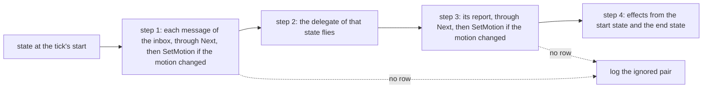
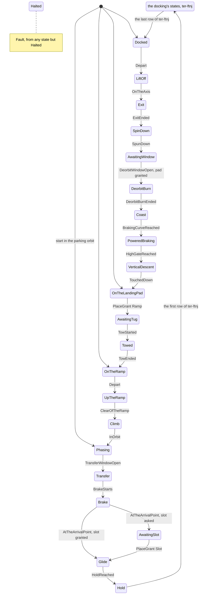
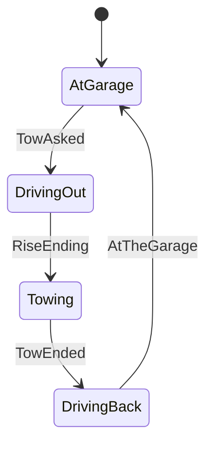
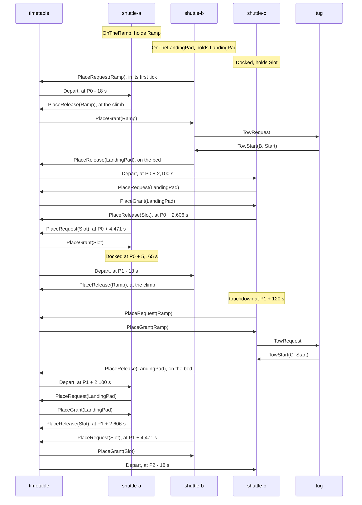
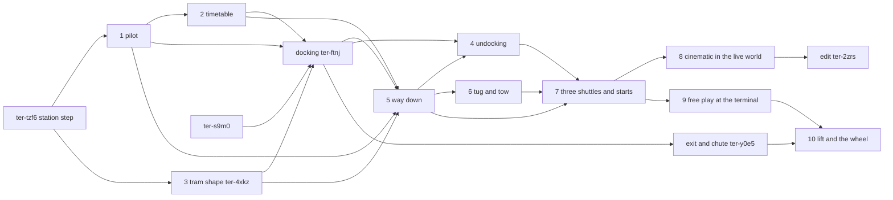

# Live world

Epic: `ter-xr2b`. The design ticket `ter-0pvs` wrote this plan. The ticket `ter-qipk` rewrote the shuttle pilot as one flat state machine. The work tickets are listed in "Order of the work".

## Goal

The demo becomes a world that the user can join live, as a character, on a stream. Three shuttles fly a fixed route between the launch ramp and the spinning station, and back to a landing pad. A timetable entity sends them on their way at fixed times, so a shuttle leaves the ground in every orbit of the station, every 92.4 minutes. The cinematic run and free play run the same world. The cinematic's script drives only its person and the cameras. In free play, the user drives a person through `PersonControl`, in real time.

## What the user decided

The user settled these points on 2026-10-20:

1. The route stays the textbook route of the station step (`ter-tzf6`, docs/plans/blue-danube-demo.md). There is no time warp.
2. The return is real. The shuttle undocks, burns out of orbit and lands on its engine on a landing pad. A tug puts it back on the ramp.
3. A timetable entity sends `Depart` to a shuttle at fixed times. It shares the ramp, the landing pad and the station's slot between the shuttles. Earth does not turn, so the station passes over the launch pad once in each orbit, every 92.4 minutes.
4. Three shuttles fly the route, so a shuttle departs from the ground in every orbit. The user first chose two shuttles. This design then found that one cycle of a shuttle takes three orbits (see "Why the cycle takes three orbits"), and the user chose three.
5. Free play starts at the launch terminal or on the station's wheel floor.
6. A seat that a player uses straps the player in. The scripted passenger (`Passenger`) keeps its own orders.
7. The cinematic's script drives only its person and the cameras. Every order to a shuttle comes from the timetable and from the shuttles' own pilots.
8. The shuttle pilot is one flat finite state machine (`ter-qipk`). One custom union holds every state of the whole cycle as a case. One pure static function, `Next(state, event)`, gives every transition. The events are the messages from other entities and the reports of the pilot's delegates. A switch expression on the state is the table from each state to its delegate. The user chose this flat table over a machine of two levels, with legs that each hold states of their own.

The user's rule of 2026-10-18 applies: only engine changes go to the user. This design settles every demo choice and gives its reason (see "Decisions"). It needs no engine change (see "Engine changes").

### Where the design reads the user's words in its own way

The user's words say that the shuttle "lands on its engine on the pad", and that the timetable shares "the pad, the ramp and the station's slot". The design reads two of them in its own way:

- The shuttle lands on a separate landing pad, not on the launch pad. The launch pad carries the ramp's bed, so a hull cannot stand upright on its tail there. A landing there would also wait until the shuttle on the bed departs, and a shuttle rests on the bed for 87 minutes of each orbit.
- The launch pad is not a place of its own. It is part of the place `Ramp`, because the bed lies on it, and only the shuttle on the bed uses it.

## Terms

| Term | Meaning |
|---|---|
| Launch pad | The existing slab under the ramp's bed, scene id `pad` |
| Landing pad | A new raised slab 40 m beside the ramp, where a shuttle lands on its tail, scene id `landing-pad` |
| Pass | A moment at which the station is over the launch pad |
| P_k | The time of the pass in orbit k, in the world's seconds: `OverPadAt + k × T` |
| T | The station's orbital period: 5,544.9 s, 92.41 minutes (`KeplerOrbit.Period(EarthMu)` of the station's orbit) |
| D_m | The shuttle whose ground departure is the one of orbit m, at P_m − 18 s. With three shuttles, D_m and D_(m+3) are the same shuttle. |
| Staged component | A component whose behavior goes through states. It holds one value of one flat custom union of states. One pure static function `Next` of that union gives every transition, and a switch expression gives each state's delegate (see "Staged components"). The pilot, the tug, the cradle, the player's seat and the player's belt are staged components. |
| State | One case of the union of a staged component, such as the pilot's `Climb` |
| Event | One case of the event union of a staged component: a message from another entity, or a report of a delegate |
| Report | An event that a delegate returns: its state's goal is reached, with the data that the next state needs, or a fault |
| Row | One line of a `Next` table: a state, an event and the new state. A pair of state and event that has no row is an ignored pair. |
| Delegate | A method that flies one state for one tick, such as `RendezvousFlight.FlyBrake`. It adds the tick's actuator events and returns at most one report. |
| Flight class | A class that holds the delegates of one leg and the settings that they share, such as `AscentFlight`. It holds no state. |
| Leg | A name in prose for a group of states in the timeline, such as the ascent (`UpTheRamp` and `Climb`). No value in code names a leg. |
| Cycle | The states of one shuttle from one departure from the ramp to the next |
| Pilot | The component `ShuttlePilot`. It holds the shuttle's state, a value of the union `PilotState`, and flies it. |
| Place | One of the three shared places: the ramp, the landing pad and the slot (the enum `Place`) |
| Slot | The station's way in: the axis from the deck out to just inside the arrival point, with the hub's slot and the bay. The arrival point lies 1,500 m out on the axis, outside the slot. |
| Holder | The one shuttle that the timetable lets use a place |
| Claim | How far a request for a place has got: `Asked` or `Granted` (the enum `Claim`). A state that flies while it waits for the grant carries it. |
| Held places | The places that a shuttle holds. One function of the state, `PilotState.Held`, gives them, and nothing stores them. |
| Asked places | The places that a shuttle asked for and waits for. One function of the state, `PilotState.Asked`, gives them, and nothing stores them. |
| Ground departure | The `Depart` that the timetable sends to the ramp's holder, 18 s before each pass |
| Station departure | The `Depart` that the timetable sends to the slot's holder, 2,100 s after each pass |
| Hold point | `DemoStation.HoldPoint`, 150 m out on the station's axis, outside its bubble |
| High gate | The point 100 m above the landing pad's top, where the powered braking hands over to the vertical descent |
| Park pose | The pose of a shuttle at rest on the ramp's bed, `DemoSurface.ShuttleParked` with no rotation |
| Nominal timeline | The times of one cycle after its pass, in "The timeline of one cycle". The static class `LiveTimeline` holds the times that code reads. |
| Step N | The physics step that runs during tick N, from t_N to t_(N+1). Gameplay of tick N reads `self.Time` = t_N. An intent that tick N writes acts in step N + 1. |

## The cycle of one shuttle

### The states of one cycle

The times below count from P, the pass of the orbit in which the shuttle departs. A cycle takes three orbits, 3T = 16,634.6 s, 277.2 minutes (see "Why the cycle takes three orbits"). The rows of `Next` that the table names are in "The table of Next".

| State | Leg | What starts it | What ends it | Delegate, and what it drives | Length, with the arithmetic | Tolerances |
|---|---|---|---|---|---|---|
| `OnTheRamp` | Turnaround | Row 27, the end of the tow, or the world's start | Row 1, a ground departure | None. The hull is static on the bed. | From P − T + 300 s, the end of the last cycle's tow, to P − 18 s: T − 318 s = 5,227 s, 87 minutes. At the world's start: 20 s in the cinematic, 180 s in free play at the terminal. | The tow ends exactly on the park pose. |
| `UpTheRamp` | Ascent | Row 1, `Depart`. The hull becomes dynamic, because its motion follows the state. | Row 11, `ClearOfTheRamp`: the hull passes the ramp's top and clearance. | `AscentFlight.FlyUpTheRamp`: the main engine and the attitude autopilot | About 5 s. The bed and the ramp are 267 m long. Full throttle less the slope's share of gravity gives 29.4 − 4.9 = 24.5 m/s², and √(2 × 267 / 24.5) = 4.7 s. | The ascent's tests, as today |
| `Climb` | Ascent | Row 11. The climb holds no place, so the pilot releases the ramp. | Row 12, `InOrbit`: the circle 200 km up | `AscentFlight.FlyClimb` | 316 s, from P − 13 s to P + 303 s. The insertion is 340.5 s into today's run, 302.5 s after the pass at 38 s, and the lead of 18.0 s moves it 0.47 s later. | As today |
| `Phasing` | Rendezvous | Row 12, the insertion | Row 13, `TransferWindowOpen` | `RendezvousFlight.FlyPhasing`: the attitude autopilot | 1,620.2 s, from P + 303 s to P + 1,923 s | As today |
| `Transfer` | Rendezvous | Row 13 | Row 14, `BrakeStarts` | `RendezvousFlight.FlyTransfer`: the main engine, the translation thrusters and the attitude autopilot | 2,547.6 s, to P + 4,471 s | As today |
| `Brake` | Rendezvous | Row 14. The pilot asks for the slot. | Row 15 or row 16, `AtTheArrivalPoint` | `RendezvousFlight.FlyBrake`: the main engine, the translation thrusters and the attitude autopilot | 23.8 s, to P + 4,495 s | Within 10 m and 0.1 m/s of the arrival point, as today |
| `AwaitingSlot` | Rendezvous | Row 16, the brake's end without the slot | Row 4, `PlaceGrant(Slot)` | `RendezvousFlight.FlyAwaitingSlot`: the translation thrusters and the attitude autopilot | None in the nominal cycle. The slot is free for 1,865 s before each request. | None |
| `Glide` | Rendezvous | Row 15 or row 4 | Row 17, `HoldReached` | `RendezvousFlight.FlyGlide`: the translation thrusters and the attitude autopilot | 340.7 s, to P + 4,835 s | 0.5 m, 0.02 m/s and 1 degree at the hold point, as today |
| `Hold` | Rendezvous | Row 17 | The first row of `ter-ftnj` | `RendezvousFlight.FlyHold`, the glide's law at the hold point | Inside the docking's budget, as `ter-ftnj` decides | The hold's tolerances |
| The docking's states, model level only | Docking | The first row of `ter-ftnj`, from `Hold` | The last row of `ter-ftnj`, into `Docked`: the hull rests on the deck. | The delegates of `DockingFlight` of `ter-ftnj` | A budget of 330 s from the hold, to P + 5,165 s: the spin match 60 s, the entry 220 s, the move to the deck 40 s, settling 10 s | `ter-ftnj` sets them. |
| `Docked` | Stay | The last row of `ter-ftnj`. The hull parks. | Row 2, a station departure | None. The hull is static on the deck, in the station's frame. | From P + 5,165 s to P + T + 2,100 s: 7,644.9 − 5,165 = 2,480 s, 41.3 minutes | None |
| `LiftOff` | Undocking | Row 2. The hull becomes dynamic, and the pilot asks for the landing pad. | Row 18, `OnTheAxis` | `UndockingFlight.FlyLiftOff`: the translation thrusters and the attitude autopilot | 40 s of the budget of 320 s, to P + T + 2,140 s | Part 4 sets the axis's tolerance. |
| `Exit` | Undocking | Row 18 | Row 19, `ExitEnded`, at the hold point | `UndockingFlight.FlyExit`: the translation thrusters and the attitude autopilot | 220 s, to P + T + 2,360 s | The hold point's tolerances |
| `SpinDown` | Undocking | Row 19 | Row 20, `SpunDown` | `UndockingFlight.FlySpinDown`: the translation thrusters and the attitude autopilot | 60 s, to P + T + 2,420 s | A turn rate below 0.005 rad/s |
| `AwaitingWindow` | Descent | Row 20 | Row 21, `DeorbitWindowOpen` with the landing pad granted | `DescentFlight.FlyAwaitingWindow`, which holds the hold point and turns the nose against the velocity | 149 s, to P + T + 2,569 s | The window: 193.2 to 192.2 degrees |
| `DeorbitBurn` | Descent | Row 21 | Row 23, `DeorbitBurnEnded`: the velocity changed by 108.5 m/s. | `DescentFlight.FlyDeorbitBurn`: the main engine at a throttle of 0.10 | 36.2 s at 3.0 m/s², to P + T + 2,606 s | Within 0.5 m/s of the change |
| `Coast` | Descent | Row 23. The coast holds no slot, so the pilot releases it. | Row 24, `BrakingCurveReached` | `DescentFlight.FlyCoast`. The nose turns against the velocity. | 2,638 s, 44 minutes, to P + T + 5,244 s | None |
| `PoweredBraking` | Descent | Row 24: the distance left is v² / (2 × 0.8 × 29.4 m/s²). | Row 25, `HighGateReached` | `DescentFlight.FlyPoweredBraking`: the main engine near full throttle, the translation thrusters and the attitude autopilot | 346 s and 8,446 m/s, to P + 2T + 45 s | Within 5 m and 1 m/s of the gate at rest |
| `VerticalDescent` | Descent | Row 25 | Row 26, `TouchedDown` | `DescentFlight.FlyVerticalDescent`. The nose points up, and the roof faces +Z. | About 75 s for 100 m, to P + 2T + 120 s | At the touchdown: the tail within 0.05 m of the pad's top, and slower than 0.1 m/s |
| `OnTheLandingPad` | Turnaround | Row 26. The hull parks, and the pilot asks for the ramp. | Row 9, `PlaceGrant(Ramp)` | None. The hull is static, upright on its tail. | Two ticks in the nominal cycle: the grant reaches the pilot two ticks after its request. The ramp is free since the climb of the shuttle that departed in the same orbit, at P + 2T − 13 s. | None |
| `AwaitingTug` | Turnaround | Row 9. The pilot sends `TowRequest`. | Row 10, `TowStarted` | None | About 40 s: the tug drives about 17 m from its garage in 30 s, and its cradle rises in 10 s at the hitch point. | None |
| `Towed` | Turnaround | Row 10. The hull becomes kinematic. | Row 27, `TowEnded`, on the park pose. The hull parks, and `OnTheRamp` holds no landing pad, so the pilot releases it. | `ShuttlePilot.FlyTowed`, which follows `TowPlan` with end poses | 140 s, to about P + 2T + 300 s: lowering 60 s, the carry across 45 s, the carry in 25 s, the set-down 10 s | The tow plan ends exactly on the park pose. |

The turnaround runs from the touchdown to the next ground departure, through `OnTheLandingPad`, `AwaitingTug`, `Towed` and `OnTheRamp`: from P + 2T + 120 s to P + 3T − 18 s, T − 138 s = 5,407 s, 90 minutes. `Halted` is in no leg, and no nominal cycle reaches it.

The sum is the cycle: from P − 18 s to P + 3T − 18 s, 3T.

The times of the way up come from today's run, which ignites 18.47 s before the pass: the script posts `Ignition` at tick 1,172, 19.53 s, and the pass is at 38 s. The timetable's lead of 18.0 s starts the flight 28 ticks, 0.47 s, later relative to the pass. The insertion moves by those 0.47 s. On the circle, the shuttle is then n₁ × 0.47 s = 1.18528e-3 × 0.4667 = 5.53e-4 rad behind where it was. It gains on the station at n₁ − n₂ = 5.212e-5 rad/s, so the window opens 5.53e-4 / 5.212e-5 = 10.6 s later. The transfer takes a fixed time after the window, so the brake, the hold and the docking move by the same 10.6 s, and the stay is 10.6 s shorter. The way down does not move, because its window depends only on the station's place.

These times are those of the run with today's translation thrusters of 4,000 N. `ter-ftnj` raises them to 30,000 N for every law, measures the rendezvous again, and corrects the rendezvous's times that part 2 puts in `LiveTimeline` (see "One thruster model").

### Why the cycle takes three orbits

- The docking ends at P + 5,165 s, which is P_(k+1) − 380 s. The deorbit window of orbit k is at P + 2,569 s, long past. So the first window is the one of orbit k + 1, at P + T + 2,569 s.
- That burn gives a touchdown at P + 2T + 120 s, 120 s after the pass of orbit k + 2. The ground departure of that orbit is 18 s before the pass. The shuttle misses it by 138 s, plus the 180 s on the pad and in tow.
- No faster leg helps. A shuttle that descends from the station's orbit reaches the pad at about the time of a pass. So the landing always falls just after a pass. Only a departure after the pass can take the shuttle in the same orbit, and the route fixes the departure 18 s before the pass.
- So the earliest departure after a cycle is the one of orbit k + 3. One shuttle departs every three orbits.

Three shuttles, offset by one orbit, give a ground departure in every orbit, 92.4 minutes apart. Two shuttles gave gaps of 92.4 and 184.8 minutes. The user chose three for that reason (see "What the user decided").

### The timeline of one cycle

| Time | What happens | Place event |
|---|---|---|
| P − 18 s | Ground departure. The ignition. | |
| P − 13 s | The climb starts. | Release the ramp. |
| P + 303 s | The insertion. Phasing starts. | |
| P + 1,923 s | The window. The transfer burn. | |
| P + 4,471 s | The brake starts, about 740 m before the arrival point. | Request the slot. |
| P + 4,835 s | The hold point. The docking starts. | |
| P + 5,165 s | Docked | |
| P + T + 2,100 s | Station departure. The undocking starts. | Request the landing pad. |
| P + T + 2,420 s | At the hold point, with no turn | |
| P + T + 2,569 s | The deorbit burn starts. | |
| P + T + 2,606 s | The burn ends. | Release the slot. |
| P + T + 5,244 s | The powered braking starts, 30 km up, 1,360 km before the pad. | |
| P + 2T + 45 s | The high gate | |
| P + 2T + 120 s | The touchdown | Request the ramp. |
| P + 2T + 160 s | The tow starts. | |
| P + 2T + 300 s | Parked on the bed | Release the landing pad. |
| P + 3T − 18 s | The next ground departure | |

The brake starts at 4,498.2 s into today's run, P + 4,460.2 s, and 4,460.2 + 10.6 = 4,470.8 s. The hold starts at 4,862.7 s, P + 4,824.7 s, and 4,824.7 + 10.6 = 4,835.3 s. The window opens at 1,950.6 s, P + 1,912.6 s, and 1,912.6 + 10.6 = 1,923.2 s.

`LiveTimeline` holds the times of the nominal timeline that code reads. Each time counts from a pass, so the class holds no orbital period. The start in the parking orbit reads `WindowAfterPass` (see "The parking orbit"), and the test of the nominal pattern reads every time (see "Part 7"). Part 2 creates the class. The table names the part that adds each time and the test that pins it. A measured time is pinned within 1 s of the run that measures it, and a budget as an upper bound.

| Time | Value | Counted from | Added by | Pinned by |
|---|---|---|---|---|
| `ClimbAfterPass` | −13 s | P | Part 2 | `BlueDanubeRendezvousRun.TheRendezvousKeepsLiveTimelinesTimes` |
| `WindowAfterPass` | 1,923 s | P | Part 2 | The same test |
| `BrakeAfterPass` | 4,471 s | P | Part 2 | The same test |
| `HoldAfterPass` | 4,835 s | P | Part 2 | The same test |
| `DockedAfterPass` | 5,165 s, the hold plus the budget of 330 s | P | `ter-ftnj` | `TheDockingEndsWithinItsBudget` |
| `UndockedAfterPass` | 2,420 s, the station departure plus the budget of 320 s | P + T, the pass of the station departure's orbit | Part 5, as the start of its tests, because part 5 comes before part 4 | `TheUndockingEndsWithinItsBudget` of part 4 |
| `BurnEndAfterPass` | 2,606 s | P + T | Part 5 | `TheWayDownFromTheHoldPointKeepsLiveTimelinesTimes` |
| `TouchdownAfterPass` | 120 s | P + 2T | Part 5 | The same test |
| `TowEndAfterPass` | 300 s | P + 2T | Part 6 | `TheTowEndsAtItsNominalTimeAfterTheRampsRequest` |

`ter-ftnj` corrects the four times of part 2, because its thrusters change the transfer and the brake. Part 7 only reads `LiveTimeline`.

### Staged components

Every staged component of this design has one shape:

- One custom `[Union]` of its states, flat. Each case holds the data that only it needs. A case never holds another union of states, so no machine nests inside another.
- One custom `[Union]` of its events, flat. It has two kinds of cases. A message case comes from a message of another entity. A report case comes from a delegate. When a component has only one event, it needs no union.
- One pure static function of the state union, `Next(state, event)`. It returns the new state, or null when the pair has no row. It reads nothing but its two arguments, so unit tests pin every row with no World and no physics.
- A switch expression on the state, which is the table from each state to its delegate. A state with nothing to fly has no delegate.
- The effects of the tick follow from the state at the tick's start and the state at its end. No row carries a column of actions. The pilot's change of motion is the one write that cannot wait for the tick's end, so the pilot writes it as soon as `Next` makes it (see "One tick").

Only `Next` changes which case the component is in. A delegate adds the tick's events for the entity's other components and returns at most one report. The user's rule lets a delegate change the data of its own state. No delegate of this design needs to, because every value that a case holds is fixed when `Next` makes the case. So each delegate takes its case by `in`. A later delegate that keeps data across ticks, as the passenger's `Seated(WeightlessTicks)` does, takes a copy of its case by `ref`. The component stores that copy back as its state after the delegate flies, before it applies the report. The copy is still the same case, so only `Next` changes the case.

A component turns each message of its inbox into its event case. A message case holds the message's payload. Where the next state needs more, the case also holds the message's sender and what the component reads from the snapshot when it takes the message. The pilot's `TowStarted` holds the tow plan, built from `TowStart` and the hull's own pose. The tug's `TowAsked` holds the sender, the sender's pose and the start of the drive. The seat's `UsedBy` holds the sender. A message that needs nothing more is its own case: the pilot's `Depart` and `PlaceGrant` are the payload structs themselves.

#### One tick

In each tick, a staged component does these steps in this order:

1. It applies the messages of its inbox to `Next`, one at a time, in the order of the inbox. Then, if the motion of the state differs from the motion of the state at the tick's start, the pilot writes the new motion with `self.Body.SetMotion`.
2. The delegate of the state after step 1 flies the tick. It adds the tick's events and returns at most one report.
3. It applies the report to `Next`. Then, if the motion of the state differs from the motion of the state after step 1, the pilot writes the new motion with `self.Body.SetMotion`.
4. It sends the effects that follow from the state at the tick's start and the state at its end.

Only the pilot's states give its body's motion (`PilotState.Motion`, see "The held places, the requests and the motion"). The other staged components write no `SetMotion` in steps 1 and 3.

Each pair that has no row is ignored: the state does not change, and the component logs the pair with `self.Log`. The nominal runs log nothing.



The reasons for this order:

- A message was sent in the last tick, about the world at its end. So it applies before this tick's flight, and the state that it starts flies in the same tick. The ascent's throttle comes in the tick of `Depart`, as `Ignition` gives it today, and the glide starts in the tick of the slot's grant.
- A delegate reads the snapshot of the tick, the state at the end of step N − 1, and its events and intents act in step N + 1. Its report is about those same reads. So the report changes the state after the delegate flew, and the new state's delegate flies from the next tick, with that tick's reads.
- So exactly one delegate flies in each tick. The actuators (`AttitudeAutopilot`, `MainEngine` and `TranslationThrusters`) run at priority 10, after the pilot at priority 0, because the worker calls the components in priority order (ARCHITECTURE.md, "The component pipeline"). Each actuator takes the last event of its type in a tick, as the documentation of each of the three says. The pilot is the only component of the shuttle that adds those events, and one delegate adds them. So the rule "the last one counts" never chooses between two writers.
- A tick applies `Next` at most once for each message and once for the report, so it has no loop. A report that keeps the state, such as the deorbit window while the landing pad is still asked for, flies the same delegate again in the next tick, and nothing loops inside a tick.
- A change of motion is written as soon as `Next` makes it, before the next delegate writes. The guard of every motion intent judges a write by the motion of the next step as it stands at the write: the change of motion that the owner wrote in the tick so far, or else the motion of the running step (`self.Body.NextStepMotion`, ARCHITECTURE.md, "Changes of motion" and "Rails components and motion intents"). So the first end pose of `FlyTowed`, in the tick of `TowStarted`, passes the guard only because `SetMotion(Kinematic)` comes before it, in step 1. A `SetMotion` at the tick's end would come after the end pose, and the writer would throw an `InvalidOperationException`.
- So a tick writes at most two `SetMotion`, one in step 1 and one in step 3, and the last one gives the motion of the end state. The last `SetMotion` in a tick wins (ARCHITECTURE.md, "Changes of motion"). In this design, two come only when a fault halts the shuttle in the tick of `Depart`. The second then writes `Static`, the motion at the tick's start, so the hull's motion does not change.
- The other effects come at the end, from two states, so a tick sends each message at most once. A place that a state asks for and loses inside one tick sends nothing.
- The order is deterministic. The inbox has the same order in every run with the same inputs (ARCHITECTURE.md, "Outboxes, routing and order"). `Next` is pure, and each delegate reads only the tick's snapshot and its own case.

The cost: a change of state by a report takes effect one tick later than in the station step's code, which changes the state and flies the new state in the same tick. "The ascent and the rendezvous" lists where this moves the flight.

### The pilot

Today two layers fly the shuttle: `AscentAutopilot` at priority 0 and `RendezvousAutopilot` at priority 1. The actuators run at priority 10 and take the last event of each tick. Each layer keeps its own state. During the rendezvous, the ascent autopilot sits in `Orbit` and still adds the nose's target, and the rendezvous autopilot overrides it.

The cycle repeats, so layers no longer fit. After the landing, the ascent autopilot stays in `Orbit`, and the rendezvous autopilot stays in `Hold`. Each layer then needs a rule to reset itself, and the states of five layers must agree on what the shuttle does. That is the problem for which the user removed `MotionDriver`: a second value beside the first can disagree with it.

So one staged component, `ShuttlePilot`, at priority 0, holds one value, `State`, of the custom union `PilotState`. The actuators stay at priority 10, unchanged. The pilot wants `Depart`, `PlaceGrant`, `TowStart`, `Spawned` and `Tick`.

#### The states

| Case of `PilotState` | Its data | Built by |
|---|---|---|
| `OnTheRamp` | None | Row 27, or the start `OnTheRamp` |
| `UpTheRamp` | None | Row 1 |
| `Climb` | None | Row 11 |
| `Phasing` | None | Row 12, or the start `InTheParkingOrbit` |
| `Transfer` | `double ArrivalTime`: the time at which the shuttle reaches the arrival point, in the world's seconds | Row 13 |
| `Brake` | `Claim Slot` | Rows 3 and 14 |
| `AwaitingSlot` | None | Row 16 |
| `Glide` | None | Rows 4 and 15 |
| `Hold` | None | Row 17 |
| The docking's states | `ter-ftnj` designs them. | The rows of `ter-ftnj` |
| `Docked` | None | The last row of `ter-ftnj`, or the start `Docked` |
| `LiftOff` | `Claim LandingPad` | Rows 2 and 5 |
| `Exit` | `Claim LandingPad` | Rows 6 and 18 |
| `SpinDown` | `Claim LandingPad`, and `double Start`: the time at which the spin-down started, in the world's seconds | Rows 7 and 19 |
| `AwaitingWindow` | `Claim LandingPad` | Rows 8, 20 and 22 |
| `DeorbitBurn` | `Double3 StartVelocity`: the shuttle's velocity at the burn's start, in `earth-surface` | Row 21 |
| `Coast` | None | Row 23 |
| `PoweredBraking` | None | Row 24 |
| `VerticalDescent` | None | Row 25 |
| `OnTheLandingPad` | None | Row 26, or the start `OnTheLandingPad` |
| `AwaitingTug` | None | Row 9 |
| `Towed` | `TowPlan Plan` | Row 10 |
| `Halted` | `PilotFault Reason` | Row 28 |

The pilot keeps no second value beside `State`. A state that flies while it waits for a grant carries the claim of that place as data: `Claim.Asked` until the grant, and `Claim.Granted` after it. A state whose only job is to wait for a grant, `AwaitingSlot` or `OnTheLandingPad`, needs no claim, because the grant ends the state.

No case holds a guidance. `AscentGuidance`, `TransferGuidance`, `ApproachGuidance` and `DescentGuidance` are pure functions of G·M, the hull's mass and the pilot's settings. The delegate reads G·M from the point gravity of the shuttle's frame and the mass from the body facts in every tick, as the rendezvous autopilot reads the mass today, and it builds the guidance from them. A case keeps only a value that no read of a later tick gives again: a time or a velocity fixed at a transition, a claim, a plan or a reason.

`PilotFault` is an enum: `NoPointGravity`, `NoMass`, `StationGone` and `OutsideTheStationsFrame`. These are the reasons for which the two autopilots halt or stay parked today. A later part that finds a new reason adds a case.

#### The events

| Case of `PilotEvent` | Kind | Its data | From |
|---|---|---|---|
| `Depart` | Message | None. It is the payload struct `Depart`. | The timetable |
| `PlaceGrant` | Message | `Place Place`. It is the payload struct `PlaceGrant`. | The timetable |
| `TowStarted` | Message | `TowPlan Plan`: the plan from `TowStart.Start` and the hull's own pose in `earth-surface`, read in the tick that takes `TowStart` | The tug's `TowStart` |
| `ClearOfTheRamp` | Report | None | `FlyUpTheRamp` |
| `InOrbit` | Report | None | `FlyClimb` |
| `TransferWindowOpen` | Report | `double ArrivalTime`: the tick's time plus the plan's `TransferTime` | `FlyPhasing` |
| `BrakeStarts` | Report | None | `FlyTransfer` |
| `AtTheArrivalPoint` | Report | None | `FlyBrake` |
| `HoldReached` | Report | None | `FlyGlide` |
| The docking's reports | Report | `ter-ftnj` designs them. | The delegates of `DockingFlight` |
| `OnTheAxis` | Report | None | `FlyLiftOff` |
| `ExitEnded` | Report | `double Time`: the tick's time | `FlyExit` |
| `SpunDown` | Report | None | `FlySpinDown` |
| `DeorbitWindowOpen` | Report | `Double3 Velocity`: the shuttle's velocity in `earth-surface` | `FlyAwaitingWindow` |
| `DeorbitBurnEnded` | Report | None | `FlyDeorbitBurn` |
| `BrakingCurveReached` | Report | None | `FlyCoast` |
| `HighGateReached` | Report | None | `FlyPoweredBraking` |
| `TouchedDown` | Report | None | `FlyVerticalDescent` |
| `TowEnded` | Report | None. The tug's union shares the case. | `FlyTowed` |
| `Fault` | Report | `PilotFault Reason` | Any delegate |

The default value of `PilotEvent` holds no case, as the default `InputEvent` holds none. A delegate that has nothing to report returns it. The pilot asserts in Debug builds that a delegate returns no message case.

#### The table of Next

`PilotState.Next(PilotState state, PilotEvent @event)` holds these rows. A claim pattern such as `Brake(Asked)` matches only that claim. `c` stands for either claim and passes on unchanged.

| Row | State | Event | New state | Part |
|---|---|---|---|---|
| 1 | `OnTheRamp` | `Depart` | `UpTheRamp` | 1 |
| 2 | `Docked` | `Depart` | `LiftOff(Asked)` | 4 |
| 3 | `Brake(Asked)` | `PlaceGrant(Slot)` | `Brake(Granted)` | 2 |
| 4 | `AwaitingSlot` | `PlaceGrant(Slot)` | `Glide` | 2 |
| 5 | `LiftOff(Asked)` | `PlaceGrant(LandingPad)` | `LiftOff(Granted)` | 4 |
| 6 | `Exit(Asked)` | `PlaceGrant(LandingPad)` | `Exit(Granted)` | 4 |
| 7 | `SpinDown(Asked, s)` | `PlaceGrant(LandingPad)` | `SpinDown(Granted, s)` | 4 |
| 8 | `AwaitingWindow(Asked)` | `PlaceGrant(LandingPad)` | `AwaitingWindow(Granted)` | 5 |
| 9 | `OnTheLandingPad` | `PlaceGrant(Ramp)` | `AwaitingTug` | 5 |
| 10 | `AwaitingTug` | `TowStarted(p)` | `Towed(p)` | 6 |
| 11 | `UpTheRamp` | `ClearOfTheRamp` | `Climb` | 1 |
| 12 | `Climb` | `InOrbit` | `Phasing` | 1 |
| 13 | `Phasing` | `TransferWindowOpen(a)` | `Transfer(a)` | 1 |
| 14 | `Transfer(a)` | `BrakeStarts` | `Brake(Asked)`. Part 1 builds `Brake` with no claim. | 1, claim in 2 |
| 15 | `Brake(Granted)` | `AtTheArrivalPoint` | `Glide`. Part 1 has this row for `Brake` with no claim. | 1, claim in 2 |
| 16 | `Brake(Asked)` | `AtTheArrivalPoint` | `AwaitingSlot` | 2 |
| 17 | `Glide` | `HoldReached` | `Hold` | 1 |
| 18 | `LiftOff(c)` | `OnTheAxis` | `Exit(c)` | 4 |
| 19 | `Exit(c)` | `ExitEnded(t)` | `SpinDown(c, t)` | 4 |
| 20 | `SpinDown(c, s)` | `SpunDown` | `AwaitingWindow(c)` | 4 |
| 21 | `AwaitingWindow(Granted)` | `DeorbitWindowOpen(v)` | `DeorbitBurn(v)` | 5 |
| 22 | `AwaitingWindow(Asked)` | `DeorbitWindowOpen(v)` | `AwaitingWindow(Asked)`. The shuttle waits for the next window. | 5 |
| 23 | `DeorbitBurn(v)` | `DeorbitBurnEnded` | `Coast` | 5 |
| 24 | `Coast` | `BrakingCurveReached` | `PoweredBraking` | 5 |
| 25 | `PoweredBraking` | `HighGateReached` | `VerticalDescent` | 5 |
| 26 | `VerticalDescent` | `TouchedDown` | `OnTheLandingPad` | 5 |
| 27 | `Towed(p)` | `TowEnded` | `OnTheRamp` | 6 |
| 28 | Any state but `Halted` | `Fault(r)` | `Halted(r)` | 1 |

`ter-ftnj` adds its rows: one from `Hold` to its first state, one between each two of its states, and one from its last state into `Docked`. Row 28 covers its states. With them, `Next` has 28 rows plus those of `ter-ftnj`.

Every other pair has no row, so the pilot ignores it and logs it. These ignored pairs carry old rules:

- `Depart` in any state but `OnTheRamp` and `Docked`. The timetable offers the next departure one orbit later.
- `PlaceGrant` of a place that the state does not wait for, such as a grant in `Halted`. The effects of the tick then release that place at once (see "The held places, the requests and the motion").
- `TowStarted` in any state but `AwaitingTug`. It comes only from a bug, because the tug serves only a shuttle that asked for it.
- A report other than `Fault` in a state whose delegate does not return it. It comes only from a bug. `Fault` is not in this rule: row 28 halts every state but `Halted` on a fault, also a state with no delegate, such as `OnTheRamp`, and a state whose delegate lists no fault, such as `Towed`. So one pattern holds the halt, and a shuttle that a bug faults stops in any state. `Fault` in `Halted` has no row.

This is the form of `Next`, as a sketch:

```csharp
public static PilotState? Next(PilotState state, PilotEvent @event) => (state, @event) switch
{
    (OnTheRamp, Depart) => new UpTheRamp(),
    (UpTheRamp, ClearOfTheRamp) => new Climb(),
    (Brake { Slot: Claim.Asked }, PlaceGrant { Place: Place.Slot }) => new Brake(Claim.Granted),
    (Brake { Slot: Claim.Granted }, AtTheArrivalPoint) => new Glide(),
    (Brake { Slot: Claim.Asked }, AtTheArrivalPoint) => new AwaitingSlot(),
    (AwaitingWindow { LandingPad: Claim.Granted }, DeorbitWindowOpen open) => new DeorbitBurn(open.Velocity),
    (AwaitingTug, TowStarted started) => new Towed(started.Plan),
    ...
    (not Halted, Fault fault) => new Halted(fault.Reason),
    _ => null,
};
```

where

- `state` = the pilot's state before the event.
- `@event` = one message of the tick's inbox, turned into its case, or the report of the tick's delegate.
- `Slot`, `LandingPad` = the claim that a case carries for that place, `Claim.Asked` or `Claim.Granted`.
- `Place` = the place that a `PlaceGrant` grants.
- `open.Velocity` = the shuttle's velocity in `earth-surface` when the deorbit window opened.
- `started.Plan` = the tow plan of the tug's `TowStart`, with the hull's landed pose.
- `fault.Reason` = why the delegate cannot fly, a `PilotFault`.
- `null` = the pair has no row.

#### The delegates

The delegates of a leg live in one flight class, which holds the settings that they share. `AscentFlight` is today's `AscentAutopilot` without its state, `Parked` and `Orbit`. `RendezvousFlight` is today's `RendezvousAutopilot` without its state, `Standby` and `Halted`. The pilot owns one object of each flight class, built from its own constructor's arguments. The switch expression in the pilot is the table:

```csharp
private PilotEvent Fly(Self self, scoped ref EventList events) => State switch
{
    UpTheRamp => ascent.FlyUpTheRamp(self, ref events),
    Climb => ascent.FlyClimb(self, ref events),
    Phasing => rendezvous.FlyPhasing(self, ref events),
    Transfer transfer => rendezvous.FlyTransfer(in transfer, self, ref events),
    ...
    Towed towed => FlyTowed(in towed, self),
    OnTheRamp or Docked or OnTheLandingPad or AwaitingTug or Halted => default,
};
```

where

- `self` = the shuttle's view of the world in the tick: its time, its frame, the snapshot, and its body's intents.
- `events` = the shuttle's event list of the tick, to which a delegate adds `Throttle`, `Translation` and `AttitudeTarget` for the actuators.
- `ascent`, `rendezvous` = the pilot's objects of `AscentFlight` and `RendezvousFlight`.
- `default` = no report.

Every delegate reads in the shuttle's frame, `self.Frame`, as the autopilots do today. Each flying delegate first checks its reads. If one fails, it adds nothing and returns `Fault` with the reason. Otherwise it flies its law and returns its report when its goal is reached. In the tick of the report, it flies by its law, unless the table says what it adds instead.

| State | Delegate | What it flies | Report, and when | Faults |
|---|---|---|---|---|
| `OnTheRamp`, `Docked`, `OnTheLandingPad`, `AwaitingTug` | None | Nothing. The hull is static. | None | None |
| `UpTheRamp` | `AscentFlight.FlyUpTheRamp` | Full throttle, and the nose toward the velocity above 1 m/s | `ClearOfTheRamp`, when the hull is `climbHeight` farther from the planet's center than the park pose | `NoPointGravity`, `NoMass` |
| `Climb` | `AscentFlight.FlyClimb` | The ascent's guidance: the throttle and the nose toward its acceleration | `InOrbit`, when the guidance finds the circle reached. In that tick it adds no throttle and turns the nose to the velocity, as `Orbit` does today. | `NoPointGravity`, `NoMass` |
| `Phasing` | `RendezvousFlight.FlyPhasing` | The nose on the velocity, with the roof away from the planet | `TransferWindowOpen(time + TransferTime)`, when the transfer angle lies in the plan's window | `StationGone`, `OutsideTheStationsFrame`, `NoMass`, `NoPointGravity` |
| `Transfer` | `RendezvousFlight.FlyTransfer` | The burn, the trim and the coast, as today | `BrakeStarts`, in the coast where the brake's curve reaches the shuttle, or at the arrival time | As `Phasing` |
| `Brake` | `RendezvousFlight.FlyBrake` | The brake's approach guidance to the arrival point | `AtTheArrivalPoint`, within 10 m of it and slower than 0.1 m/s relative to the station | As `Phasing` |
| `AwaitingSlot` | `RendezvousFlight.FlyAwaitingSlot` | The glide's law, aimed at the arrival point, outside the slot | None. The grant ends it. | As `Phasing` |
| `Glide` | `RendezvousFlight.FlyGlide` | The glide's law to the hold point, with the nose at the slot | `HoldReached`, within 0.5 m, 0.02 m/s and 1 degree | As `Phasing` |
| `Hold` | `RendezvousFlight.FlyHold` | The glide's law at the hold point | None until `ter-ftnj` adds its report | As `Phasing` |
| The docking's states | The delegates of `DockingFlight` | `ter-ftnj` designs them. | `ter-ftnj` designs them. | `ter-ftnj` sets them. |
| `LiftOff` | `UndockingFlight.FlyLiftOff` | The translation thrusters lift the hull 6 m in to the axis | `OnTheAxis` | `StationGone`, `NoMass` |
| `Exit` | `UndockingFlight.FlyExit` | Out along the axis to the hold point, with the target of "The undocking" | `ExitEnded(time)`, at the hold point within its tolerances | `StationGone`, `NoMass` |
| `SpinDown` | `UndockingFlight.FlySpinDown` | The feed-forward that falls to zero over 60 s from `Start` | `SpunDown`, from 60 s after `Start`, when the turn rate is below 0.005 rad/s | `StationGone`, `NoMass` |
| `AwaitingWindow` | `DescentFlight.FlyAwaitingWindow` | The hold's law at the hold point, and the nose against the velocity | `DeorbitWindowOpen(velocity)`, in each tick in which the angle to the landing pad lies in the window, whatever the claim | `StationGone`, `OutsideTheStationsFrame`, `NoPointGravity`, `NoMass` |
| `DeorbitBurn` | `DescentFlight.FlyDeorbitBurn` | The main engine at a throttle of 0.10, against the velocity | `DeorbitBurnEnded`, when the velocity differs from `StartVelocity` by `DeorbitDeltaV`. In that tick it adds no throttle. | `NoPointGravity`, `NoMass` |
| `Coast` | `DescentFlight.FlyCoast` | The nose against the velocity | `BrakingCurveReached`, at the braking curve | `NoPointGravity`, `NoMass` |
| `PoweredBraking` | `DescentFlight.FlyPoweredBraking` | ZEM/ZEV guidance to the high gate | `HighGateReached`, at the high gate | `NoPointGravity`, `NoMass` |
| `VerticalDescent` | `DescentFlight.FlyVerticalDescent` | The wanted descent speed, nose up and roof toward +Z | `TouchedDown`, with the tail within 0.05 m of the pad's top and slower than 0.1 m/s. In that tick it adds no throttle. | `NoPointGravity`, `NoMass` |
| `Towed` | `ShuttlePilot.FlyTowed` | The end pose `Plan.ShuttleAt(t_(N+2))`, relative to `self.Frame` | `TowEnded`, in the first tick N with t_(N+1) at or after the plan's end. In that tick it writes no end pose, because the end pose of tick N − 1, which step N applies, already ends on the plan's end. | None |
| `Halted` | None | Nothing | None | None |

`AwaitingWindow` reports the open window whatever its claim, and `Next` decides with rows 21 and 22. So the guard on the landing pad lives in one pure place.

#### The held places, the requests and the motion

Four pure functions of the state give what the effects and the writes of motion need. Nothing stores their values.

- `PilotState.Held` returns the held places, a `Places` value, a `[Flags]` enum of `Place`.
- `PilotState.Asked` returns the places that the state asked for and waits for, a `Places` value.
- `PilotState.AsksForTow` returns true in `AwaitingTug`.
- `PilotState.Motion` returns the hull's `BodyMotion`.

| State | Held | Asked | Asks for the tow | Motion |
|---|---|---|---|---|
| `OnTheRamp` | `Ramp` | None | No | `Static` |
| `UpTheRamp` | `Ramp` | None | No | `Dynamic` |
| `Climb`, `Phasing`, `Transfer` | None | None | No | `Dynamic` |
| `Brake(Asked)`, `AwaitingSlot` | None | `Slot` | No | `Dynamic` |
| `Brake(Granted)`, `Glide`, `Hold` | `Slot` | None | No | `Dynamic` |
| The docking's states | `Slot` | None | No | `ter-ftnj` sets it, `Dynamic` until the hull parks. |
| `Docked` | `Slot` | None | No | `Static` |
| `LiftOff`, `Exit`, `SpinDown` or `AwaitingWindow`, with `Asked` | `Slot` | `LandingPad` | No | `Dynamic` |
| `LiftOff`, `Exit`, `SpinDown` or `AwaitingWindow`, with `Granted`, and `DeorbitBurn` | `Slot` and `LandingPad` | None | No | `Dynamic` |
| `Coast`, `PoweredBraking`, `VerticalDescent` | `LandingPad` | None | No | `Dynamic` |
| `OnTheLandingPad` | `LandingPad` | `Ramp` | No | `Static` |
| `AwaitingTug` | `LandingPad` and `Ramp` | None | Yes | `Static` |
| `Towed` | `LandingPad` and `Ramp` | None | No | `Kinematic` |
| `Halted` | None | None | No | `Static` |

At the end of each tick, the pilot compares `start`, the state at the tick's start, with `end`, the state at its end:

| Effect | When the pilot sends it |
|---|---|
| `PlaceRelease(p)` to the topic `timetable` | For each place p that `start.Held` holds or a `PlaceGrant` of the tick granted, and that `end.Held` does not hold |
| `PlaceRequest(p)` to the topic `timetable` | For each place p in `end.Asked` that is not in `start.Asked` |
| `TowRequest` to the topic `tug` | When `end.AsksForTow` is true and `start.AsksForTow` is false |
| A log of the reason with `self.Log` | When `end` is `Halted` and `start` is not |

The first rule counts the places that the timetable counts as the shuttle's: those it held at the start, and those that the tick granted. So one rule gives every release:

- The climb releases the ramp, the end of the deorbit burn releases the slot, and the end of the tow releases the landing pad.
- A change to `Halted` releases every place.
- A grant that no row takes, such as a grant in `Halted` for a place asked for before the halt, is released in the same tick. So no grant stays with a shuttle that cannot use it.

The second and third rules give every request: the brake's start asks for the slot, the station departure asks for the landing pad, the touchdown asks for the ramp, and the ramp's grant on the landing pad sends `TowRequest`.

The motion is not an effect of the tick's end. The pilot writes `self.Body.SetMotion(State.Motion)` at the end of step 1 and at the end of step 3 of "One tick", when that step changed the state's motion. That one rule gives every change of motion: `Depart` unparks the hull on the ramp and on the deck, the docking's end, the touchdown and the tow's end park it, `TowStarted` makes it kinematic, and a halt parks it where it is. A `SetMotion` and the end pose of the same tick both act in the next step. The guard of an end pose reads the motion that the owner wrote in the tick so far (`self.Body.NextStepMotion`, ARCHITECTURE.md, "Changes of motion" and "Rails components and motion intents"). So in the tick of `TowStarted`, the pilot writes `SetMotion(Kinematic)` in step 1, and `FlyTowed` then writes its first end pose in step 2. The park at the tow's end comes in step 3 of a tick in which `FlyTowed` writes no end pose (see "How the tow starts and runs").

The first tick. The scene gives the timetable the first holders, so the held places of the first state are already the timetable's. The pilot counts the asked places of the first state as new in its first tick, the tick that brings `Spawned`. So a shuttle that starts on the landing pad asks for the ramp in its first tick. The spawn gives the hull the motion of the first state. The writes of motion compare the states before and after a step, so the first tick writes no `SetMotion` unless `Next` changes the motion in it.

The pilot reads `Spawned` only for that rule. Its `Handle`, as a sketch:

```csharp
public void Handle(Self self, scoped ref EventList events, scoped ref Outbox outbox)
{
    PilotState start = State;
    Places granted = Places.None;
    foreach (ref Event message in events.AsSpan())
        if (MessageCase(self, in message) is { } read)
        {
            if (read.TryGetValue(out PlaceGrant grant))
                granted |= grant.Place.AsPlaces();
            Apply(self, read);
        }
    WriteMotion(self, from: start);
    PilotState flown = State;
    PilotEvent report = Fly(self, ref events);
    if (report.HasValue)
        Apply(self, report);
    WriteMotion(self, from: flown);
    SendEffects(self, start, granted, firstTick: events.Of<Spawned>().Any(), ref outbox);
}
```

where

- `start` = the state at the tick's start.
- `granted` = the places that the tick's `PlaceGrant` messages granted.
- `MessageCase` = turns a message into its case of `PilotEvent`, or null for `Tick` and `Spawned`. For `TowStart`, it reads the hull's pose in `earth-surface` and builds `TowStarted`.
- `Apply` = sets `State` to the result of `Next`, or logs the pair when `Next` returns null.
- `WriteMotion` = writes `self.Body.SetMotion(State.Motion)` when `State.Motion` differs from `from.Motion`, with `from` the state before the step.
- `flown` = the state after step 1, whose delegate flies the tick.
- `Fly` = the switch expression of "The delegates".
- `SendEffects` = the four effects of the table above, with the asked places of `start` counted as none in the first tick.

#### The state diagram



The diagram leaves out rows 3, 5, 6, 7, 8 and 22, which change only a claim or keep the state, and row 28, which goes to `Halted` from every state. The box of the docking stands for the flat cases that `ter-ftnj` adds to `PilotState`. It is no machine of its own. The four start states are the four ways in which a world can start a shuttle (see "The starts").

### The ascent and the rendezvous

Part 1 keeps the laws of the flight. These parts of today's code move:

- `Ignition` becomes `Depart`. `AscentState.Parked` becomes the state `OnTheRamp`.
- `AscentState` and `RendezvousState` go. Their cases become cases of `PilotState`. `Ramp` becomes `UpTheRamp`, because `Ramp` names a place. `Halted` gains its reason.
- The guidances leave the cases. Each delegate builds its guidance in each tick (see "The states").
- The ramp's end compares the hull's distance from the planet's center with the park pose's distance plus `climbHeight`. Today the autopilot keeps the distance at the ignition in `Ramp`. Every ascent now starts from the park pose, so the pilot takes that distance as a setting.
- `AscentState.Orbit` goes. The ascent ends at the insertion, and the rendezvous starts there, in `Phasing`. `Phasing` keeps the nose on the velocity with the roof away from the planet, as `Orbit` does today. So the attitude of the coast does not change.
- `RendezvousState.Standby` and the order `Rendezvous` go. The window opens at 1,950.6 s, long after both 340.5 s and today's order at about 366 s. So the transfer starts in the same tick.
- A fault becomes a report, and row 28 halts. Today the ascent autopilot stays parked when it finds no point gravity or no mass at the ignition. Now `UpTheRamp` reports the fault in the tick of `Depart`, so the shuttle halts and parks on the bed. Today the rendezvous autopilot halts and its hull falls on. Now a halted hull parks where it is.
- A change of state by a report flies the new state from the next tick. So the flight moves by one tick at the ramp's end, at the window, at the brake's start and at the brake's end. The guidance corrects each from the state. The climb's end and the glide's end do not move: `FlyClimb` cuts the throttle in the tick of `InOrbit`, as `Orbit` does today, and the glide's law is the hold's law. The run tests keep their tolerances, and part 2 measures the times of `LiveTimeline` from the new run.
- The rendezvous gains `AwaitingSlot` in part 2. The state `Brake` asks for the slot and carries the claim. If the claim is still `Asked` at the brake's end, row 16 gives `AwaitingSlot`. The shuttle then holds at the arrival point, outside the slot, with the glide's law. Row 4 starts the glide at the grant. When the slot is free, the grant reaches the pilot two ticks after the request: the timetable reads the request in the next tick and answers in that tick, and the pilot reads the answer one tick later. The brake takes 24 s, so the nominal cycle never waits.
- The climb releases the ramp, because `UpTheRamp` holds the ramp and `Climb` does not (see "The held places, the requests and the motion").

### One thruster model

The rendezvous's burns give the push across the nose to the translation thrusters (`RendezvousAutopilot.Burn` today, `RendezvousFlight.Burn` after part 1: the main engine takes the part along the nose, and the thrusters take the rest). The docking needs 30,000 N per axis (see the next section). At 30,000 N, the transfer burn and the brake fly a little differently from today, because the thrusters can then give more of the push across the nose. The demo keeps one thruster model for every law. So `ter-ftnj` raises the thrust for the whole flight, runs the rendezvous's measurements again in `BlueDanubeRendezvousRun`, corrects the rendezvous's times in `LiveTimeline`, and writes the long script again. Part 5 comes after `ter-ftnj`, so the way down is measured with the same thrusters. The glide caps its own push at 0.2 m/s², so it does not change.

### The docking, at model level

`ter-ftnj` designs the docking. This design fixes only what the cycle needs from it:

- The docking is a group of flat cases of `PilotState`, with their reports in `PilotEvent` and their rows in `Next`. `ter-ftnj` builds no union of its own. Its first row leaves `Hold` on a report that `ter-ftnj` chooses. Its last row enters `Docked`.
- It ends with the hull at rest on the deck, in the station's frame. `Docked` is static, so the pilot parks the hull with `SetMotion(Static)` in step 3 of that tick, as on the ramp. A frame with a static hull holds still in its tree parent (ARCHITECTURE.md, "How a frame moves"), so the cabin turns with the station.
- Its states hold the slot, and row 28 halts each of them on a fault.
- Its budget is 330 s. The spin match at the hold point takes 60 s, and the entry along the axis 220 s. The move of 6 m out to the deck takes 40 s, and the hull settles in 10 s.
- The station turns at 0.31321 rad/s. The attitude autopilot turns at most 0.15 rad/s (`MaxTurnRate`). So the spin match needs a target with a feed-forward angular velocity (see the next section).
- The move to the deck and the undocking's lift-off push with the translation thrusters. They must beat ω² r and the Coriolis term 2 ω v. At r = 6 m and v = 0.2 m/s, that is 0.0981 × 6 + 0.626 × 0.2 = 0.71 m/s². Today's thrusters give 4,000 N, 0.2 m/s². This design asks for 30,000 N, 1.5 m/s² per axis.

#### The attitude target with a feed-forward

Data that is used together goes in one struct. So `AttitudeTarget` stays one payload, and it gains the feed-forward. A payload is at most 48 bytes (`EventTypeRegistry.MaxPayloadSize`). A `Double3` feed-forward beside today's fields would make it 32 + 24 + 8 = 64 bytes. So the payload is:

```csharp
public struct AttitudeTarget : IEventPayload
{
    public required DQuaternion Rotation;
    public required Vector3 AngularVelocity;
    public required float MaxTurnRate;
}
```

where

- `Rotation` = the rotation to turn to, in the axes of the entity's frame. 32 bytes.
- `AngularVelocity` = the feed-forward: the rate at which `Rotation` itself turns, in radians per second, in the axes of the entity's frame. 12 bytes. A target that does not turn states zero.
- `MaxTurnRate` = the fastest correction that the autopilot may ask for, in radians per second, at most `AttitudeAutopilot.MaxTurnRate`. 4 bytes.

The sum is 32 + 12 + 4 = 48 bytes. In the station step's code, `MaxTurnRate` is a `double` and the struct has no feed-forward, 40 bytes in all. `ter-ftnj` changes the type of `MaxTurnRate` to `float` and adds `AngularVelocity`. Every writer states both. The ascent and the rendezvous state a feed-forward of zero, so their flight does not change.

The autopilot then asks for this rate:

```
correction = Gain × (the turn from the body's rotation to Rotation, as a rotation vector)
correction = correction, cut in length to min(MaxTurnRate, AttitudeAutopilot.MaxTurnRate)
rate       = AngularVelocity + correction
```

where `Gain` = `AttitudeAutopilot.Gain`, 0.8 per second. Only the correction has a cap. So the autopilot follows a target that turns at 0.313 rad/s, and it still corrects at most 0.15 rad/s.

### The stay

The hull is static on the deck, in `Docked`. The cabin floor lies 7.8 m from the axis and feels 0.0981 × 7.8 = 0.765 m/s² toward the deck. The stay lasts until the station departure, 41.3 minutes in the nominal cycle. A person can leave and board through the hatch.

### The undocking

The undocking is the docking in reverse, in three states:

1. `LiftOff`. At the station departure, row 2 gives `LiftOff(Asked)`. The pilot unparks the hull with `SetMotion(Dynamic)` in step 1 of that tick, and the effects of the tick send `PlaceRequest(LandingPad)`. The translation thrusters lift the hull 6 m in to the axis in about 40 s. The push is at most 0.71 m/s², as for the move to the deck. On the axis, `FlyLiftOff` reports `OnTheAxis`, and row 18 gives `Exit` with the same claim.
2. `Exit`. The hull flies out along the axis, through the slot, to the hold point 150 m out, in the entry's time of 220 s. In the station's frame, the target is the docked rotation relative to the station, with a feed-forward of zero. The hull leaves the station's bubble at about 137.5 m. That is the bubble's 120 m, plus the hull's bounding radius of 8.77 m, plus the margin. The margin is the larger of 2.4 m and 8.77 m. So the hold point lies outside the bubble. After that hand-off, the hull is in `earth-surface`, where it still turns with the station at 0.31321 rad/s about the axis. From the bubble's edge to the hold point, the target holds that turn. Its rotation is the station's rotation, read from the snapshot in `earth-surface`, times the docked rotation, and its feed-forward is the station's angular velocity in `earth-surface`. So the autopilot does not fight the turn before the spin-down, and the hull stays square to the slot. At the hold point, `FlyExit` reports `ExitEnded` with the tick's time, and row 19 gives `SpinDown` with that time as `Start`.
3. `SpinDown`. At the hold point, the feed-forward falls linearly to zero over 60 s, and the target's rotation turns about the axis by the integral of that rate. With s = `self.Time` − `Start`, from 0 to 60 s:

   ```
   rate(s)  = 0.31321 rad/s × (1 − s / 60 s)
   angle(s) = 0.31321 rad/s × (s − s² / 120 s)
   ```

   where `rate(s)` = the feed-forward about the station's axis, and `angle(s)` = the target's turn about the axis since the start of the spin-down. The turn at the end is 0.31321 × 30 = 9.40 rad, one and a half turns. The angular deceleration is 0.31321 / 60 = 0.00522 rad/s².

At the hold point, with a turn rate below 0.005 rad/s, `FlySpinDown` reports `SpunDown`, and row 20 gives `AwaitingWindow` with the undocking's claim of the landing pad. A grant that arrives in any of the three states sets the claim to `Granted` (rows 5, 6 and 7).

### The way down

The way down reads every position and velocity in `earth-surface`, the shuttle's frame after the exit. The delegates of `DescentFlight` take G·M from the frame's point gravity, as the other delegates do.

The descent's constants live in `DescentPlan`, a record struct like `RendezvousPlan`:

| Constant | Value | Why |
|---|---|---|
| `WindowOpens` | 193.2 degrees | The burn starts 18 s before its center, and its center lies 192.0 degrees before the pad. |
| `WindowCloses` | 192.2 degrees | A burn center between 191 and 192 degrees still lands within 0.6 m in the model. The window is 15.4 s wide. |
| `DeorbitDeltaV` | 108.5 m/s | The burn from the circle 6,771 km out to an orbit with its periapsis 30 km up, 6,401 km out |
| `GateHeight` | 100 m | The high gate |
| `BrakingShare` | 0.8 | The share of full throttle that the braking curve and the time to go assume |
| `MinTimeToGo` | 3 s | The floor of the time to go |
| `TouchSpeed` | 0.3 m/s | The descent speed at the touch |
| `DescentTime` | 30 s | The time constant of the vertical descent's speed |

#### The deorbit window and burn

The angle to the landing pad lies in the orbit's plane. It runs from the shuttle's position to the pad's, in the direction of the motion. It falls by 0.0649 degrees a second at the hold point.

- `AwaitingWindow`: the shuttle holds the hold point with the hold's law and turns its nose against the velocity. In each tick in which the angle lies in the window, `FlyAwaitingWindow` reports `DeorbitWindowOpen` with the shuttle's velocity. With the claim of the landing pad `Granted`, row 21 starts the burn. With the claim `Asked`, row 22 keeps the state. If the window closes first, the reports stop, and the shuttle waits one orbit for the next window.
- `DeorbitBurn`: the main engine pushes against the velocity at 3.0 m/s², a throttle of 0.10. The case keeps the velocity at the burn's start. The burn ends when the velocity changed by `DeorbitDeltaV`: `FlyDeorbitBurn` adds no throttle in that tick and reports `DeorbitBurnEnded`. Row 23 gives `Coast`, which holds no slot, so the effects release the slot.

The change of velocity comes from vis-viva. The circle at 6,771 km has 7,672.6 m/s. An orbit from 6,771 km to 6,401 km has a semi-major axis of 6,586 km and 7,564.0 m/s at its apoapsis. The difference is 108.6 m/s, which the model rounds to 108.5 m/s. The burn ends on a constant, not on a two-body solution, because the braking's guidance corrects every error from the state.

The slot covers the hold point. A burn moves the shuttle off the axis, so the slot is released at the burn's end, not at the exit.

#### The coast

The shuttle falls for 2,638 s, 44 minutes, from 400 km to 30 km. The nose stays against the velocity, ready for the braking. At the braking curve, `FlyCoast` reports `BrakingCurveReached`.

#### The powered braking

`DescentGuidance` is a pure record struct with `Mu` and the plan, like `TransferGuidance`. Its law is zero-effort-miss guidance (ZEM/ZEV): the push that takes out the miss of the free path at the time to go.

- The braking starts when the ground distance left to the pad is at most v² / (2 × `BrakingShare` × full throttle's acceleration). The distance runs along the great circle.
- The time to go is the speed divided by `BrakingShare` × full throttle's acceleration, and never less than `MinTimeToGo`.
- ZEM is the gate less the free path's end, `r + v t + g t² / 2`. ZEV is the gate's velocity, zero, less `v + g t`. The gravity g is `KeplerOrbit.Acceleration` at the shuttle's place, held fixed over the time to go.
- The push is 6 ZEM / t² − 2 ZEV / t, cut to full throttle's acceleration.
- The nose turns toward the push. The main engine takes the part along the nose, and the translation thrusters take the rest, as in the rendezvous's burns.
- At the high gate, `FlyPoweredBraking` reports `HighGateReached`.

A two-dimensional model of the whole way down, with an impulsive deorbit, gave these numbers (a scratch script on 2026-10-20). The braking starts 30.0 km up, 12.2 degrees, about 1,360 km, before the pad. It takes 346.4 s and 8,446 m/s. The guidance asks for 31.2 m/s² at its peak, so the push is cut to 29.4 m/s² for a short time. The shuttle reaches the gate within 0.55 m. Burn centers from 191 to 193 degrees gave the same miss.

The model has no attitude lag, no lag of the thrust, and no offset across the plane. The hold point lies 150 m across the orbit's plane, and the pad lies 40 m beside the ground track. The guidance works in three dimensions, so it takes out both offsets. The tests measure the real miss.

#### The vertical descent and the touchdown

At the high gate, the shuttle stands up. The nose points along the pad's up, the direction from Earth's center to the pad. The roof faces +Z of `earth-surface` (`LandingPad.Roof`), so the belly faces -Z.

- The wanted velocity is down at `TouchSpeed` + h / `DescentTime`, with h the tail's height above the pad's top. It also takes out the offset from the pad's center line in 10 s.
- The push takes out the velocity error in 0.5 s and cancels gravity. The main engine takes the part along the nose, and the translation thrusters take the rest.
- The time from the gate is `DescentTime` × ln(1 + 100 / (0.3 × 30)) = 30 × ln 12.1 = 74.8 s.
- Touchdown: the tail is within 0.05 m of the pad's top, and the speed is below 0.1 m/s. `FlyVerticalDescent` adds no throttle in that tick and reports `TouchedDown`. Row 26 gives `OnTheLandingPad`, which is static and asks for the ramp. So the pilot parks the hull with `SetMotion(Static)` in step 3 of that tick, and the effects of the tick send `PlaceRequest(Ramp)`.

The hull then stands on its tail with the nose up. `ter-4xkz` must give the tail a flat face to stand on (see "What this design asks of other tickets").

#### What a person inside feels

The seat's stand, `Shuttle.SeatStand`, lies at (1, -0.9, ·) in the shuttle's axes, so √(1² + 0.9²) = 1.35 m from the hull's long axis. The station's spin gives ω² = 0.31321² = 0.0981 per second squared.

| State | The felt gravity in the cabin |
|---|---|
| `Docked` | 0.765 m/s² toward the cabin floor |
| `LiftOff` | It falls toward zero as the hull reaches the axis. On the axis, the hull's turn gives 0.0981 × 1.35 = 0.132 m/s² at the seat, away from the hull's long axis. |
| `Exit` | 0.132 m/s² at the seat, as at the end of the lift-off. The hull turns at the station's rate. |
| `SpinDown` | The centrifugal term falls from 0.132 m/s² to zero. The Euler term is 0.00522 × 1.35 = 0.0070 m/s². |
| `DeorbitBurn` | 3.0 m/s², 0.3 g, toward the tail |
| `Coast` | Weightless, for 44 minutes |
| `PoweredBraking` | Up to 29.4 m/s², 3 g, toward the tail, as in the climb |
| `VerticalDescent`, `OnTheLandingPad` and `AwaitingTug` | About 9.8 m/s², 1 g, toward the tail. The floor is a wall. |
| `Towed`, in the lowering | It turns from the tail to the floor over 60 s, 1.5 degrees a second. |
| `Towed`, in the carry, and `OnTheRamp` | 1 g toward the floor |

A belted person is held at the seat whenever the gravity leans more than 45 degrees from the floor's down, or the cabin is weightless. That is the belt law of `Passenger` (see "The seat and the belt"). The scripted passenger leaves the shuttle at the station (`ter-y0e5`), so only a player rides the way down.

### The landing pad

The landing pad is a static box in `earth-surface`, 16 by 16 m, 1.2 m tall. Its center is at (-40, R + 0.6, 30), with R the Earth's radius. Its top at R + 1.2 m is the height of the tug's cradle. It lies 40 m to the side of the ramp, behind the bed. It is clear of the tower at (-11, ·, -4) and of the terminal at x = 22. A still camera, `landing-pad-camera`, looks at it.

The shuttle stays on the landing pad, static and upright, in `OnTheLandingPad` and then `AwaitingTug`, until the tug starts the tow.

### The tow

The tug is a kinematic plain body. Its component `Tug` moves it only with end poses (`self.MoveKinematic`), as `Door` moves a door. A kinematic plain body moves between frames (`JoltPhysicsBackend.MovesBetweenFrames`), so the tug enters the towed shuttle's cabin frame when it meets the cabin's bubble, and it leaves that frame again when it drives away. Its garage, `tug-garage`, is a drawn shed at (-55, ·, 10). The cradle, `tug.cradle`, is a drawn entity attached to the tug, with no body. The tug spawns it on its first tick, so the tug knows its handle. Part 6 spawns the tug and `tug-garage` in `demo-surface`. The tug waits `AtGarage` there until part 7 puts B on the landing pad, so before part 7 nothing in the cinematic sends `TowRequest`.

`TowPlan(DPose Landed, double Start)` is a pure record struct. Its methods give the shuttle's pose in `earth-surface` (`ShuttleAt`), the tug's pose in `earth-surface` (`TugAt`) and the cradle's offset from the tug (`CradleAt`), at any time. Before `Start` they give the plan's first values, and after its end its last ones. The plan ends with the cradle lowered, at the rise plan's first offset, so the next rise starts where the last tow left the cradle. `DrivePlan(Double3 From, Double3 To, double Start)` is the same for a drive, and `RisePlan(double Start)` for the cradle's rise, which lasts `Cradle.RiseTime`, 10 s. They are the analogue of `KeplerOrbit`: a pure function of time that each entity follows by itself.

The tow plan, from `Landed`, the shuttle's pose on the landing pad:

1. Lowering, 60 s. The shuttle turns -90 degrees about +X, about the hinge line at the belly's edge of its tail. The nose comes down toward -Z onto the cradle. The turn takes the standing pose to no rotation, the park pose's rotation. The center comes to about (-40, R + 3.2, 20).
2. The carry across, 45 s. The shuttle moves 40 m along +X, to x = 0, at most 1.2 m/s.
3. The carry in, 25 s. The shuttle moves 20 m along -Z, over the bed.
4. The set-down, 10 s. The shuttle comes down 1.18 m onto the bed. The last of the landing's error blends out, so the plan ends exactly on the park pose.

The cradle's two arms lift the hull by its overhang, outside the bed's 4 m width. The hull is 6 m wide. The path of the carry stays at z = 20 until x = 0, so it clears the tower and the terminal.

#### The tug's machine

The tug is a staged component. `TugState` is a custom union of four flat cases:

| Case of `TugState` | Its data |
|---|---|
| `AtGarage` | None |
| `DrivingOut` | `Entity Shuttle`, `DrivePlan Drive`, `TowPlan Tow` |
| `Towing` | `Entity Shuttle`, `TowPlan Tow` |
| `DrivingBack` | `DrivePlan Drive`, `TowPlan Tow` |

No other type in the namespace `Tertius.Demo` has these names. `TugEvent` is a custom union of four cases:

| Case of `TugEvent` | Kind | Its data |
|---|---|---|
| `TowAsked` | Message, from `TowRequest` | `Entity Shuttle`, the request's sender. `DPose Landed`, the sender's pose in `earth-surface` in the snapshot. `double DriveStart` = t_(k0+2), with k0 the tick that takes the request, the end of the step that applies the tug's first end pose. |
| `RiseEnding` | Report | None |
| `TowEnded` | Report | None. The pilot's union shares the case. |
| `AtTheGarage` | Report | None |

`TugState.Next` holds four rows:

| Row | State | Event | New state |
|---|---|---|---|
| 1 | `AtGarage` | `TowAsked(s, l, d)` | `DrivingOut(s, DrivePlan(Garage, the hitch point of TowPlan(l, d + 40 s), d), TowPlan(l, d + 40 s))`. The drive takes 30 s and the rise 10 s, so the tow starts 40 s after the drive. |
| 2 | `DrivingOut(s, drive, tow)` | `RiseEnding` | `Towing(s, tow)` |
| 3 | `Towing(s, tow)` | `TowEnded` | `DrivingBack(DrivePlan(tow.TugAt(tow's end).Position, Garage, tow's end), tow)` |
| 4 | `DrivingBack` | `AtTheGarage` | `AtGarage` |

`Garage` is the constant `Tug.GaragePosition`. The hitch point is `TowPlan.TugAt(Start).Position`. The start of every plan lies on the tick grid, and every length is a whole number of ticks, so every time of the tow lies on the grid.

| State | Delegate | What it writes | Report, and when |
|---|---|---|---|
| `AtGarage` | None | Nothing. A kinematic body with no motion intent holds still. | None |
| `DrivingOut` | `Tug.FlyDrivingOut` | The end pose `Drive` at t_(N+2) in `earth-surface`, or `Tow.ShuttleAt(t_(N+2))⁻¹ ∘` that pose in the cabin's frame. Up to `Tow.Start`, `ShuttleAt` gives the landed pose, where the static shuttle stands. | `RiseEnding`, in the tick N with t_(N+2) at the rise's end, `Tow.Start` |
| `Towing` | `Tug.FlyTowing` | The end pose `Tow.TugAt(t_(N+2))` in `earth-surface`, or `Tow.ShuttleAt(t_(N+2))⁻¹ ∘ Tow.TugAt(t_(N+2))` in the cabin's frame | `TowEnded`, in the tick N with t_(N+2) at the plan's end, the tick of its last write of the plan |
| `DrivingBack` | `Tug.FlyDrivingBack` | The end pose `Drive` at t_(N+2) in `earth-surface`, or `Tow.ShuttleAt(the plan's end)⁻¹ ∘` that pose in the cabin's frame, because the shuttle rests on the park pose | `AtTheGarage`, in the tick N with t_(N+2) at the drive's end |

The tug's effects follow from the state at the tick's start and its end:

- When the end state is `DrivingOut` and the start state is not, the tug sends `CradleRise(Tow.Start − Cradle.RiseTime)` to its cradle.
- When the end state is `Towing` and the start state is not, the tug sends `TowStart(Shuttle, Tow.Start)` to the shuttle and to its cradle.

The tug has no queue. A shuttle sends `TowRequest` only in `AwaitingTug`, which holds the ramp, and the ramp has one holder. The shuttle that the tug serves holds the ramp from its request until its next ground departure, 87 minutes after the tow, and the tug is back at its garage 30 s after the tow. So a second request cannot reach a busy tug while the places hold. `TowAsked` in any state but `AtGarage` has no row, so the tug ignores it and logs it.



#### The cradle's machine

The cradle is a staged component with no reports. `CradleState` is a custom union of three flat cases: `Stowed`, `Rising(RisePlan Rise)` and `Carrying(TowPlan Tow)`. Its events, `CradleEvent`, are two message cases: `CradleRise(double Start)`, the payload struct itself, and `TowStarted(TowPlan Plan)`, the case that the pilot's union shares. The cradle builds `TowStarted` from `TowStart` and the pose in `earth-surface` of the shuttle that `TowStart` names, read from the snapshot in the tick that takes it.

| Row | State | Event | New state |
|---|---|---|---|
| 1 | `Stowed` | `CradleRise(s)` | `Rising(RisePlan(s))` |
| 2 | `Rising` | `TowStarted(p)` | `Carrying(p)` |
| 3 | `Carrying` | `CradleRise(s)` | `Rising(RisePlan(s))`, the next tow |

| State | Delegate | What it writes |
|---|---|---|
| `Stowed` | None | Nothing. The offset stays lowered. |
| `Rising` | `Cradle.FlyRising` | `self.AttachOffset` = the rise plan's offset at t_(N+1) |
| `Carrying` | `Cradle.FlyCarrying` | `self.AttachOffset` = `Tow.CradleAt(t_(N+1))` |

The cradle sends nothing, so it has no effects.

#### How the tow starts and runs

- In tick k0, the tug in `AtGarage` takes a `TowRequest` as `TowAsked`. It reads the landed pose from the shuttle's pose in `earth-surface` in the snapshot. Row 1 fixes every time on the tick grid. The drive starts at t_(k0+2), the end of the step that applies its first end pose, and lasts 30 s. The rise starts at the drive's end. The tow starts at the rise's end, 10 s later. In the same tick, `FlyDrivingOut` writes the first end pose, and the effects send the cradle `CradleRise(Start)`, so the cradle has its rise plan.
- In tick k, with t_(k+2) the rise's end, `FlyDrivingOut` reports `RiseEnding`. Row 2 gives `Towing`, and the effects send `TowStart(Shuttle, Start)` to the shuttle and to its cradle, with Start = t_(k+2).
- In tick k + 1, the shuttle reads `TowStart`. It reads the landed pose from its own pose in `earth-surface`, which has not changed since the touchdown, and builds `TowStarted`. Row 10 gives `Towed`. The pilot writes `SetMotion(Kinematic)` at the end of step 1, and then `FlyTowed` writes the end pose `TowPlan.ShuttleAt(t_(k+3))` in step 2. Both act in step k + 2, which starts at Start. The guard of the end pose reads the motion that the owner wrote in the tick so far, `Kinematic`, so the end pose passes (ARCHITECTURE.md, "Changes of motion" and "Rails components and motion intents"). In the other order, the guard would still read `Static`, and the writer would throw.
- In every later tick N, the shuttle and the tug each write the plan's value at t_(N+2), the end of the step that applies the write. Each writes it relative to the frame that it is in, `self.Frame`. The shuttle is always in `earth-surface` and writes `ShuttleAt(t_(N+2))`. The tug in `earth-surface` writes `TugAt(t_(N+2))`. The tug in the cabin's frame writes `ShuttleAt(t_(N+2))⁻¹ ∘ TugAt(t_(N+2))`, the plan's pose of the tug relative to the cabin at that moment, straight from the plan.
- The cradle has no body. Step 7 of each sync point puts it at the tug's pose with its attach offset (ARCHITECTURE.md, "Creation and destruction"). The offset is relative to the tug, so it needs no frame. In tick k + 1, the cradle reads `TowStart`, and it reads the landed pose from the shuttle's pose in `earth-surface` in the snapshot, as the shuttle does. `TowStart` names the shuttle, and the pose has not changed since the touchdown. So the tug, the shuttle and the cradle build the same `TowPlan`. In tick N, the cradle writes `self.AttachOffset` as the plan's value at t_(N+1): the rise plan's offset before the tow, and `CradleAt(t_(N+1))` from the tow's start. Step 7 of the same tick's sync point applies the offset against the tug's pose at t_(N+1), which the tug's end pose of tick N − 1 gave.
- In the tick N with t_(N+2) at the plan's end, the tug writes its last end pose of the plan and reports `TowEnded`. Row 3 gives `DrivingBack`, whose drive starts at the plan's end. So from tick N + 1 the tug drives to its garage with no gap. While it is still in the cabin's frame, it writes `ShuttleAt(the plan's end)⁻¹ ∘` the drive's pose, because the shuttle rests on the park pose.
- In tick N + 1, t_(N+2) is the plan's end, and the shuttle's end pose of tick N, which step N + 1 applies, ends there. So `FlyTowed` writes nothing and reports `TowEnded`. Row 27 gives `OnTheRamp`. The pilot parks the hull with `SetMotion(Static)` in step 3, and `OnTheRamp` holds no landing pad, so the effects of the tick release it. The shuttle reports one tick after the tug, because a park in the tick of its last end pose would drop that end pose.

The tick of a hand-off. The tug writes its end pose in tick N relative to the frame that it is in during tick N. The step that runs during tick N can hand it into the cabin's frame or out of it. The hand-off can come during the drive, while the shuttle is static, or during the lowering, while the shuttle moves. Step 7b of tick N's sync point then converts the end pose into the new frame (ARCHITECTURE.md, "Rails components and motion intents", steps 5 and 7b). It converts an end pose by the relation of the two frames at the end of the step that applies it, step N + 1, and a frame whose owner has an end pose in that step takes that end pose for the relation (`FrameTree.MotionRelativeInStep`). The shuttle's end pose of tick N is `ShuttleAt(t_(N+2))`. A frame whose hull is static holds still over the step, so its relation is exact too. So the converted pose is the plan's pose of the tug relative to the cabin, `ShuttleAt(t_(N+2))⁻¹ ∘ TugAt(t_(N+2))`, when the tug enters, and the plan's pose in `earth-surface` when it leaves, to the rounding of one composition of poses. ARCHITECTURE.md's "Ownership of transforms" gives the same rule, with the cases where a conversion misses. None of them applies to the tug: the cabin's frame moves on end poses or holds still, and no one writes its transform. The tug needs no rule of its own for that tick. From tick N + 1, it reads its new frame in `self.Frame` and writes in it.

Every ascent starts from the park pose, so every cycle flies the same flight relative to its pass. The ground departure arrives up to one tick, 1/60 s, after its exact time. The station moves at most 7,672.6 / 60 = 128 m along its orbit in that time, which the rendezvous's guidance corrects from the state.

### The turnaround

The shuttle stays on the bed in `OnTheRamp` until the next ground departure that reaches it as the ramp's holder. In the nominal cycle, that is 87 minutes after the tow, at P + 3T − 18 s.

## The timetable

### The entity and its component

The timetable is an entity in `earth-surface` with no body and no render data, like the airlock entity of the orbit scene. Its component `Timetable` subscribes it to the topic `timetable`. The pilots send their requests and releases to that topic. The timetable answers each event's sender. The topic lets the shuttles spawn before the timetable, which takes the shuttles' handles as its first holders.

The timetable reads `self.Time`, its own state, and whether each shuttle that it names is alive (`self.Snapshot.IsAlive`). It never reads a shuttle's pose or state.

Its state:

- The holder of each place, or none.
- A queue of waiting shuttles for each place, in the order of their requests.
- The index of the next pass for each kind of departure.

The timetable is no staged component. Its state is a table of holders and queues, not one case of a union, and it has no delegate.

Its constructor takes `OverPadAt`, T, and the first holders. The scene gives the first holders from the world's start (see "The starts").

In each tick, the timetable does these steps in this order:

1. It frees each place whose holder is not alive, and it drops each shuttle that is not alive from every queue. So a destroyed shuttle holds nothing and waits for nothing.
2. It applies the tick's releases, and then its requests, in the order of the events. A release from the holder frees the place. A release from any other shuttle changes nothing. A request joins the place's queue.
3. It grants each free place to the first shuttle in its queue, with `PlaceGrant`.
4. It sends the departures whose times fall in the tick (see "Departures").

### The places

| Place | What it covers | Requested | Released | Where a shuttle waits for it |
|---|---|---|---|---|
| `Ramp` | The launch pad, the bed and the ramp | At the touchdown, on entry into `OnTheLandingPad` | When the climb starts | On the landing pad, static (`OnTheLandingPad`) |
| `LandingPad` | The landing pad and the tug's path | At the station departure, on entry into `LiftOff` | At the tow's end | At the hold point (`AwaitingWindow`), still holding the slot |
| `Slot` | The station's axis from the deck out to just inside the arrival point, with the hold point | When the brake starts, on entry into `Brake` | At the deorbit burn's end | At the arrival point, outside the slot (`AwaitingSlot`) |

A request for a free place is granted in the tick in which the timetable reads it, the tick after the request. The pilot reads the grant one tick later, two ticks after it sent the request. A request for a held place waits in the place's queue. A release from the holder grants the place to the first shuttle in the queue.

### Departures

- Ground departure of orbit k: at P_k − `Timetable.DepartureLead`, 18 s before the pass. It goes to the ramp's holder. If the ramp has no holder, nothing goes.
- Station departure of orbit k: at P_k + `Timetable.StationDepartureDelay`, 2,100 s after the pass. It goes to the slot's holder. If the slot has no holder, nothing goes.

The times are fixed, because the station moves on rails. The timetable sends each `Depart` in the tick N with t_N < the time ≤ t_(N+1). So the shuttle reads it in the first tick at or after the time. At the start, the next pass of each kind is the first whose time is not before the world's start.

Why 18 s: today's run ignites 18.47 s before the pass, so the window opens at 120.4 degrees along the orbit. A lead of 18.0 s moves the window 0.7 degrees later, to about 121.1 degrees, inside the aim of 115 to 125 degrees. A second less of lead opens the window 22 s later and 1.5 degrees further on (docs/plans/blue-danube-demo.md, "How `OverPadAt` sets the window").

Why 2,100 s: the undocking needs 320 s, and the window opens at P + 2,569 s. A start at P + 2,100 s ends the undocking at P + 2,420 s, 149 s before the window.

The user asked for a `Depart` "every N station orbits". In this model, N = 3 for each shuttle and N = 1 for the world. It follows from the places, with no table of shuttles and orbits. The timetable offers a departure in every orbit, and only a ready shuttle holds the ramp. With three shuttles, the ramp's holder is ready at every ground departure.

### Messages

| Message | Payload | From | To | When |
|---|---|---|---|---|
| `Depart` | None | The timetable | The ramp's holder or the slot's holder | At each departure time |
| `PlaceRequest` | `Place` | A pilot | The topic `timetable` | At the end of a tick whose end state asks for a place that its start state did not ask for, and in the first tick for each place that the first state asks for (see "The held places, the requests and the motion") |
| `PlaceGrant` | `Place` | The timetable | The requester | When the place is free for it |
| `PlaceRelease` | `Place` | A pilot | The topic `timetable` | At the end of a tick, for each place that the start state held or the tick granted, and that the end state does not hold |
| `TowRequest` | None | A pilot | The topic `tug` | At the end of the tick whose end state is `AwaitingTug` and whose start state is not |
| `CradleRise` | `double Start` | The tug | Its cradle | At the end of the tick whose end state is `DrivingOut` and whose start state is not |
| `TowStart` | `Entity Shuttle`, `double Start` | The tug | The shuttle and the cradle | At the end of the tick whose end state is `Towing` and whose start state is not, two ticks before the cradle's rise ends |
| `Buckle` | `Waypoint Stand` | A `PlayerSeat` | The person who used it | At the end of the tick in which the seat becomes `Taken` |
| `Unbuckle` | None | A `PlayerSeat` | Its user | At the end of the tick in which the seat becomes `Free` |
| `Belted` | None | `PlayerBelt` | Its own entity | In each tick in which the belt's delegate flies `Fastening` or `Shut` |

The sender of each event is the event's `Sender`, so no payload names its sender. Every payload is unmanaged and at most 48 bytes. The largest payload of the shuttle is `AttitudeTarget`, at exactly 48 bytes.

The sequence below starts from the cinematic's start: A on the ramp, B on the landing pad and C docked.



The tug also sends `CradleRise` to its cradle when it takes each request, and `TowStart` goes to the cradle too. The diagram leaves the cradle out.

### Why the places never lock up, and missed departures

The places form one chain in one direction: the ramp, then the slot, then the landing pad, then the ramp again. A shuttle waits for a place only while it holds the place before it, or nothing:

- It waits for the slot while it holds nothing.
- It waits for the landing pad while it holds the slot.
- It waits for the ramp while it holds the landing pad.

The ramp's holder never waits for a place. It waits only for a ground departure, which comes once in each orbit. So the ramp frees within one orbit, then the landing pad, then the slot. No circle of waits can form, with any number of shuttles.

Every wait ends within one orbit, so a late state costs whole orbits and the cycle heals. Each late case is a row of `Next` or an ignored pair:

| What is late or wrong | The row or the ignored pair | What happens |
|---|---|---|
| A ground departure reaches a shuttle that is still in tow | The pair `Towed`, `Depart` has no row. | The pilot ignores it and logs it. The shuttle takes the next one, one orbit later. |
| A station departure reaches a shuttle that is still docking | The pair of a docking state and `Depart` has no row. | The pilot ignores it and logs it. The shuttle takes the next one, one orbit later. |
| The undocking ends after the window | No report comes until the window opens again. | The shuttle waits at the hold point in `AwaitingWindow` for the next window, one orbit later. It keeps the slot, so an arriving shuttle waits at the arrival point. |
| The landing pad is not granted when the window opens | Row 22 keeps `AwaitingWindow(Asked)`. Row 8 sets the claim at the grant. | The shuttle waits at the hold point. If the grant comes inside the window, row 21 starts the burn. Otherwise it waits for the next window, one orbit later. |
| The slot is held when a shuttle arrives | Row 16 gives `AwaitingSlot`. Row 4 starts the glide at the grant. | The shuttle waits at the arrival point. Its station departure moves by whole orbits. |
| A shuttle halts | Row 28 gives `Halted`, which holds nothing. A later grant has no row. | The effects release every place that it held, and each later grant in the tick of the grant. It takes no `Depart`, because it holds neither the ramp nor the slot, so the departures go on to the other shuttles. The halted hull parks where it halted. Only a bug halts a shuttle, and the pilot logs the reason. |
| A shuttle is destroyed | None. The timetable acts. | The timetable frees its places and drops it from the queues in its next tick. |

The nominal pattern has none of these. The gaps are large: the ramp is free for 133 s before each request, the landing pad for 1,800 s, 30 minutes, and the slot for 1,865 s, 31 minutes (see "The three shuttles' phases"). So no place waits in the nominal pattern, and each grant reaches its pilot two ticks after the request.

### The three shuttles' phases

From the cinematic's start, `OverPadAt` = 38 s. Shuttle A starts on the ramp, B on the landing pad, and C docked at the station. In the nominal pattern, D_m departs at P_m − 18 s, and D_m and D_(m+3) are the same shuttle. So A is D_0, C is D_(−1) = D_2, and B is D_(−2) = D_1.

| Orbit k | P_k | Ground departure, at P_k − 18 s | Touchdown, at P_k + 120 s | Station departure, at P_k + 2,100 s | Docked, at P_k + 5,165 s |
|---|---|---|---|---|---|
| 0 | 38.0 s | A, at 20.0 s | None. B starts on the landing pad, and the tow puts it on the bed at about 205 s. | C, at 2,138.0 s | A, at 5,203.0 s |
| 1 | 5,582.9 s | B, at 5,564.9 s | C, at 5,702.9 s | A, at 7,682.9 s | B, at 10,747.9 s |
| 2 | 11,127.8 s | C | A | B | C |
| 3 | 16,672.7 s | A | B | C | A |
| 4 | 22,217.6 s | B | C | A | B |
| 5 | 27,762.5 s | C | A | B | C |

Then the pattern repeats every three orbits. Each shuttle departs in every third orbit, and a shuttle departs in every orbit: A in orbits 0, 3 and 6, B in orbits 1, 4 and 7, and C in orbits 2, 5 and 8.

D_m holds each place in these times:

- The ramp: from its touchdown at P_(m−1) + 120 s to its climb at P_m − 13 s.
- The slot: from its brake at P_m + 4,471 s to the end of its deorbit burn at P_(m+1) + 2,606 s.
- The landing pad: from its station departure at P_(m+1) + 2,100 s to the end of its tow at P_(m+2) + 300 s.

So each place is free between two holders for these times:

| Place | Released by D_m at | Requested by D_(m+1) at | Free for |
|---|---|---|---|
| Ramp | P_m − 13 s | P_m + 120 s | 133 s |
| Slot | P_(m+1) + 2,606 s | P_(m+1) + 4,471 s | 1,865 s |
| Landing pad | P_(m+2) + 300 s | P_(m+2) + 2,100 s | 1,800 s |

Each place passes from D_m to D_(m+1), one orbit later, so the gaps are the same in every orbit. No place waits in the nominal pattern.

### Which flights run at once

At a time P_k + s, the three shuttles are D_k, D_(k−1) and D_(k−2):

| s, after the pass | D_k | D_(k−1) | D_(k−2) | Shuttles in flight |
|---|---|---|---|---|
| −18 to 120 s | Departure and ascent | Docked | Powered braking and vertical descent | 2 |
| 120 to 300 s | Ascent and insertion | Docked | On the landing pad, then in tow | 1 |
| 300 to 2,100 s | Phasing and the transfer | Docked | On the ramp | 1 |
| 2,100 to 5,165 s | Transfer, rendezvous and docking | Undocking, burn and coast | On the ramp | 2 |
| 5,165 to T − 18 s | Docked | Coast and powered braking | On the ramp | 1 |

So at most two shuttles fly at once. At each pass, one shuttle climbs from the ramp while another brakes toward the landing pad. The braking one comes from behind the pad along the ground track, and the climbing one flies ahead of it. When the climbing one leaves the ramp, at P − 13 s, the braking one is 58 s before the gate. A steady braking at 80 percent of full throttle covers ½ × 0.8 × 29.4 × 58² = 39.6 km in its last 58 s, so the two are about 40 km apart. The slot keeps at most one shuttle in the station's bubble and on its axis. On the ground, the hull on the ramp and the hull on the landing pad are 40 m apart, and both are static.

### The starts and how they heal

No moment of the nominal pattern has all three shuttles at rest. At a time P_k + s, D_k flies until it docks at s = 5,165 s. D_(k−1) is docked only until s = 2,100 s. D_(k−2) rests on the ramp only from s = 300 s. D_k and D_(k−1) are never docked at once, so at most two shuttles rest at once. Each start therefore gives each shuttle a rest state, or gives at most one shuttle a simple two-body state, the parking orbit. Each start must heal into the nominal pattern with no missed departure.

The cinematic, `OverPadAt` = 38 s, and the terminal, `OverPadAt` = 198 s. The world starts at P0 − 38 s or P0 − 198 s. There, D_0 rests on the ramp and D_(−1) is docked, so A starts on the ramp and C docked. D_(−2) is in its powered braking, which is no simple state. So B starts on the landing pad instead, as if it had already landed:

- B asks for the ramp in its first tick. A releases the ramp at its climb, at P0 − 13 s. B gets the ramp then, is towed, and is on the bed at about P0 + 167 s, long before its departure at P1 − 18 s. That is the nominal departure of D_1.
- C's station departure comes at P0 + 2,100 s, after B released the landing pad at about P0 + 167 s. So C gets the landing pad at once.
- C releases the slot at P0 + 2,606 s, 1,865 s before A asks for it at P0 + 4,471 s.
- C lands at P1 + 120 s, after B left the ramp at P1 − 13 s. So C gets the ramp at once and departs at P2 − 18 s, the nominal departure of D_2.

The wheel, `OverPadAt` = -1,500 s. The world starts at P0 + 1,500 s. There, D_(−2) rests on the ramp, D_(−1) is docked, and D_0 is in its phasing. So A starts on the ramp, B docked, and C in the parking orbit, in `Phasing`. All three follow the nominal pattern from the start:

- B's station departure comes at P0 + 2,100 s = 600 s. Nobody holds the landing pad, so B gets it at once. B releases the slot at P0 + 2,606 s = 1,106 s.
- C's window opens at P0 + 1,923 s = 423 s. C asks for the slot at P0 + 4,471 s = 2,971 s, 1,865 s after B released it. It reaches the hold at P0 + 4,835 s = 3,335 s and is docked at P0 + 5,165 s = 3,665 s.
- A departs at P1 − 18 s = 4,026.9 s. B lands at P1 + 120 s = 4,164.9 s, after A's climb, and is on the bed at about P1 + 300 s = 4,344.9 s.

A wheel start with C on the landing pad instead of in the parking orbit would lock B at the hold point for a whole orbit. C would hold the landing pad until its tow ends, and its tow waits for the ramp, which A releases only at the next ground departure, P1 − 13 s. B asks for the landing pad at P0 + 2,100 s and misses its window at P0 + 2,569 s. So the wheel start puts C in the parking orbit, which holds no place.

### The first departure in each start

- The cinematic: `OverPadAt` = 38 s, as today, so A departs at 20.0 s, tick 1,200. The scripted passenger sits at about 15 s. C leaves the station at 2,138 s. B departs at 5,564.9 s.
- Free play at the terminal: `OverPadAt` = 198 s, so A departs at 180 s. A walk from the terminal to the seat takes about 30 s. Three minutes leave time to look around, and the stream reaches the launch soon. C leaves the station at 2,298 s.
- Free play on the wheel: `OverPadAt` = -1,500 s. B leaves the station at 600 s, C docks at about 3,665 s, and A departs from the ground at 4,026.9 s.

## Free play

### The starts

One scene build makes all three worlds. It takes a `WorldStart`:

```csharp
public sealed record WorldStart(double OverPadAt, ShuttleStart A, ShuttleStart B, ShuttleStart C, Viewer Viewer);
public enum ShuttleStart { OnTheRamp, OnTheLandingPad, Docked, InTheParkingOrbit }
public enum Viewer { ScriptedPassenger, PlayerAtTheTerminal, PlayerOnTheWheel }
```

where

- `OverPadAt` = the time at which the station is over the launch pad, in the world's seconds. The station's spawn, the timetable and the start in the parking orbit read it.
- `A`, `B`, `C` = where each shuttle starts. Each start gives the shuttle's pose, its motion, its frame, its first state and the place that it holds.
- `Viewer` = who watches: the scripted passenger of the cinematic, or a player at one of the two places.

`WorldStart` has three fields for the shuttles, not a list. The user chose three shuttles, and each shuttle has a fixed role by its letter: the ids belong to the letter, only A carries the pen, and the cinematic films A. A list would admit two or four shuttles, which no start of this design covers, and the scene would need a rule to refuse them. The scene build still spawns the three from one array of pairs, `("shuttle-a", A)`, `("shuttle-b", B)` and `("shuttle-c", C)`, through one function, `Shuttle.Spawn`.

`ShuttleStart` stays an enum, because no case carries data. The state of `InTheParkingOrbit` is a function of `OverPadAt` and the nominal timeline (see "The parking orbit").

| Scene | `OverPadAt` | A | B | C | Viewer |
|---|---|---|---|---|---|
| `demo-surface`, the cinematic | 38 s | `OnTheRamp` | `OnTheLandingPad` | `Docked` | `ScriptedPassenger` |
| `live-terminal` | 198 s | `OnTheRamp` | `OnTheLandingPad` | `Docked` | `PlayerAtTheTerminal` |
| `live-wheel` | -1,500 s | `OnTheRamp` | `Docked` | `InTheParkingOrbit` | `PlayerOnTheWheel` |

Each start is a first state of the pilot. Its pose and motion are those of the first state, so the pilot's first tick writes no `SetMotion`.

| Shuttle start | Pose, motion and frame | First state | Holds |
|---|---|---|---|
| `OnTheRamp` | The park pose, static, in `earth-surface` | `OnTheRamp` | `Ramp` |
| `OnTheLandingPad` | Upright on the landing pad, roof toward +Z, static, in `earth-surface` | `OnTheLandingPad`. It asks for the ramp, so the pilot sends `PlaceRequest(Ramp)` in its first tick. | `LandingPad` |
| `Docked` | At rest on the deck, static, in the station's frame | `Docked` | `Slot` |
| `InTheParkingOrbit` | On the circle 200 km up, dynamic, in `earth-surface`, with the circle's velocity and turn (see "The parking orbit") | `Phasing`. Its delegate builds the guidance in each tick, as every delegate does. | None |

The scene refuses a start in which two shuttles have the same start. It also refuses `InTheParkingOrbit` when the world's start does not fall in a phasing of the nominal pattern, from P_k + 303 s to P_k + 1,923 s for some orbit k. The ids name each shuttle's parts under its prefix: `shuttle-a`, `shuttle-a.seat`, `shuttle-a.cabin-camera`, `shuttle-b.chase-camera`, `shuttle-c.chase-camera`, and so on. `Shuttle.Spawn` spawns a shuttle with its seat, panes, lamps and cabin cameras, so the three shuttles cannot differ by accident. Only shuttle A carries the clipped pen.

#### The parking orbit

The shuttle in the parking orbit plays the nominal shuttle D_k in the phasing of orbit k, at the world's start. Its state comes from `OverPadAt` and the nominal timeline, with no copied number:

- The circle has the radius `Shuttle.ParkingOrbitRadius`, 200 km up, the radius of the ascent's circle. It lies in the plane of the station's orbit and turns the same way.
- Its phase opens the transfer window at its nominal time, t_w = P_k + `LiveTimeline.WindowAfterPass`. At t_w, the transfer angle from the shuttle to the station's place after `RendezvousPlan.TransferTime` must equal `RendezvousPlan.WindowOpens`. On a circle in the station's plane, that puts the shuttle at the station's phase at t_w, plus the station's turn over the transfer time, less `WindowOpens`. The circle's mean motion carries that phase back to the world's start.
- The function is `RendezvousPlan.ParkingOrbit(KeplerOrbit station, double radius, double windowTime, double mu)`, an instance method of the plan, because it reads the plan's window and transfer time. It returns the circle as a `KeplerOrbit`, and the spawn takes the circle's `StateAt` at the world's start.
- The rotation is the attitude of `Phasing`: the nose on the velocity, with the roof away from the planet (`AttitudeAutopilot.Facing`). The angular velocity is the circle's mean motion about the orbit's normal, so the attitude holds with no turn at the start.

For the wheel start, k = 0 and t_w = P0 + 1,923 s = 423 s. The station's phase from the pass is n₂ × 1,923 s = 1.13316e-3 × 1,923 = 2.17907 rad, 124.85 degrees. Its turn over 2,560 s is n₂ × 2,560 = 166.21 degrees, and `WindowOpens` is 170 degrees. So the shuttle is at 124.85 + 166.21 − 170 = 121.06 degrees at t_w. At the world's start, 423 s earlier, it is n₁ × 423 = 1.18528e-3 × 423 = 0.50137 rad, 28.73 degrees, further back, at 92.33 degrees from the launch pad.

The engine spawns a dynamic hull with a spawn velocity (see "Engine changes"). The numeric update then gives the fast hull a falling frame in the first tick, as for any group of free bodies faster than 1,000 m/s.

### The player

The player is a character with a capsule, as the person of the spin station. Its components are `PlayerBelt` and `PersonControl`. It subscribes to `Topics.Input`, and it is the scene's first view, so the window starts in its eye. Its id is `player`.

- At the terminal, it spawns standing at `DemoSurface.PersonStart`, (36, R + 0.95, 0), in `earth-surface`, facing the terminal.
- On the wheel, it spawns standing on the wheel floor at the foot of the lift, in the station's frame. It takes `Upright(θ)`, as in the spin station. A character takes no motion intent (`MotionIntentRefusal.Character`). So it spawns at rest in the frame with no first motion intent and no velocity, as the spin station's person does.

The hatch has no door. In orbit a player can float out of the cabin and stay behind when the shuttle burns. The demo leaves it so. The player starts the scene again.

### The seat and the belt

Each shuttle's seat entity gets a component `PlayerSeat`. Its name differs from `Shuttle.Seat`, the box of the seat in the shuttle's geometry, which would hide a component named `Seat` inside the class `DemoScenes.Shuttle`, where the shuttle's parts spawn. `PersonControl` already sends `Use` to every entity within 3 m when the player presses E.

#### The seat's machine

The seat is a staged component with no delegates. `PlayerSeatState` is a custom union of two flat cases: `Free` and `Taken(Entity User)`. Its only event is `UsedBy(Entity Person)`, which it builds from `Use` and the message's sender, so it needs no event union.

| Row | State | Event | New state |
|---|---|---|---|
| 1 | `Free` | `UsedBy(p)` | `Taken(p)` |
| 2 | `Taken(u)` | `UsedBy(p)`, with p the same person as u | `Free` |

The pair of `Taken(u)` and `UsedBy(p)` from another person has no row, so a `Use` from anyone else changes nothing, and the seat logs it.

The seat's effects follow from the state at the tick's start and its end. When the end state's user differs from the start state's user, the seat sends `Unbuckle` to the start state's user, if any, and `Buckle(Stand)` to the end state's user, if any. `Stand` is a `Waypoint` of the seat's frame and `Shuttle.SeatStand`.

#### The belt's machine

`PlayerBelt` runs at priority -1, before `PersonControl`. It is a staged component. `BeltState` is a custom union of three flat cases: `Open`, `Fastening(Waypoint Stand)` and `Shut(Waypoint Stand)`. Its names differ from `Returning` and `Strapped` of `Passenger`. `BeltEvent` is a custom union of three cases: the messages `Buckle(Waypoint Stand)` and `Unbuckle`, the payload structs themselves, and the report `AtTheStand`.

| Row | State | Event | New state |
|---|---|---|---|
| 1 | `Open` | `Buckle(s)` | `Fastening(s)` |
| 2 | `Fastening(s)` | `AtTheStand` | `Shut(s)` |
| 3 | `Open` | `Unbuckle` | `Open` |
| 4 | `Fastening(s)` | `Unbuckle` | `Open` |
| 5 | `Shut(s)` | `Unbuckle` | `Open` |

Rows 3 to 5 keep the old rule that `Unbuckle` opens the belt from any state. `Buckle` in `Fastening` or `Shut` has no row, so the belt ignores it and logs it.

| State | Delegate | What it does | Report, and when |
|---|---|---|---|
| `Open` | None | Nothing | None |
| `Fastening` | `PlayerBelt.FlyFastening` | It moves the player to the stand. If the felt gravity holds the player on the floor, it walks the player there with `MoveCharacter`, at most `PersonControl.WalkSpeed`. Otherwise it floats the player with the passenger's float law. It adds `Belted`. | `AtTheStand`, within `BuckleRadius`, 0.1 m |
| `Shut` | `PlayerBelt.FlyShut` | It holds the player at the stand. Where the gravity leans more than 45 degrees from the floor's down, or the cabin is weightless, it uses the passenger's belt law. Otherwise it stands the player still with `MoveCharacter(0)`. It adds `Belted`. | None |

`PersonControl` skips its walk, jump and thrust in a tick with `Belted`. It keeps the mouse look and E, so the player looks around and presses E to get up. `Unbuckle` makes the belt `Open` in step 1 of the tick, so no delegate adds `Belted` in that tick, and the player has the keys back at once.

The passenger's belt law and float law move out of `Passenger` into one struct, `SeatBelt`, which both `Passenger` and `PlayerBelt` use.

#### The scripted passenger

The scripted passenger (`Passenger`) of the station step stays as built, with its own union `PassengerState` and its own orders. Its behavior does not change. Its transitions sit inside its handler, beside its flight of each state, and its `Seated(WeightlessTicks)` changes its own data. A later change to `Passenger` follows the shape of a staged component: one flat union, one pure `Next` over `FastenBelt` and its reports, and a switch from each state to its delegate.

### Cameras and views

`PersonControl` takes input only while the player's eye is the camera, as today. The V key cycles the scene's views (`SceneInstance.Views`). The other views are for looking.

| View | Frame | Who spawns it |
|---|---|---|
| `player`, the eye | The player's | This design |
| `follow-camera` | Attached to the player, with `ChaseCamera` | This design, as in the cinematic |
| `shuttle-a.chase-camera`, `shuttle-b.chase-camera`, `shuttle-c.chase-camera` | Attached to each shuttle | `Shuttle.Spawn` |
| `pad-camera` | `earth-surface` | Exists |
| `landing-pad-camera` | `earth-surface` | The way down |
| `rim-camera` | The station's | Exists |
| `bay-camera` | The station's | `ter-ftnj` |
| `wheel-camera` | The station's, on the wheel floor by the lift | The lift |

### The lift

On the wheel, the way to the shuttles leads up a spoke. The chute of `ter-y0e5` runs down the spoke at θ = 180 degrees, under the deck. The lift runs in the spoke at θ = 0, so the two never share a tube. It arrives at the bay's wall opposite the deck. From there, the player floats across the bay to the deck, through the weak gravity near the axis.

- The lift is a kinematic plain body in the station's frame. Its component `Lift` moves it with end poses on a fixed cycle, a pure function of the world's time, as `Door` moves a door. It has no states that messages or reports change, so it is no staged component.
- A trip: about 92 m, from the floor 100 m from the axis to the bay's wall 8 m from it. The lift moves at most 2 m/s and changes its speed by at most 0.4 m/s². Each change of speed takes 5 s and 5 m, so a trip takes 82 / 2 + 2 × 5 = 51 s.
- The cycle: 20 s at the wheel floor, 51 s up, 20 s at the hub, 51 s down, 142 s in all. The felt gravity at the bay's wall, 8 m from the axis, is 0.0981 × 8 = 0.785 m/s², so the platform never drops away from a standing rider.
- The lift reuses the openings that `ter-y0e5` builds in the ceiling and in the hub's walls.

### Real time and the frame budget

Free play runs at 60 ticks a second of wall-clock time. The host moves its schedule when a tick and its draw take longer than 16.7 ms. So the budget of one tick plus one draw is 16.7 ms.

- The world's debug checks (`WorldOptions.DebugChecks`) cost 6.6 ms a tick with the station (`ter-oehq`). They are off by default in the window, so free play runs without them.
- The demo surface's tick took 0.2 to 0.45 ms, and a tick of the orbital coast 0.133 ms. The world now holds three shuttles, the tug, the timetable and the lift: a few bodies and a few components more. At most two shuttles fly at once (see "Which flights run at once"), and a shuttle at rest runs no guidance. The estimate is at most 0.7 ms a tick.
- The demo surface's draw took 1.7 to 2.3 ms at 720 lines. At 1,080 lines it has 2.25 times the pixels, and at 1,440 lines 4 times. The estimate is 4 to 10 ms.
- Free play runs in Release: `dotnet run -c Release --project src/Tertius.Demo -- --scene live-terminal`.

A timing test in Release, deleted after, as for the debug checks' cost, measures both in the free-play part. It runs `live-terminal` for 10 minutes of world time, through the ascent, while C is docked and B is towed. Part 10 runs the same measurement on `live-wheel`, through B's undocking, while C flies its transfer, so two shuttles fly at once. Each run records the mean and the worst tick, and the draw time of a capture at 1,920 by 1,080. If a tick and a draw together pass 12 ms, the part reports where the time goes before it merges.

### Recording a session

The host's `--record <file>` writes a free-play session as an ordinary script (docs/plans/host-and-scripted-runs.md, "Recording free play"). A run of that script with `--script` repeats the session tick for tick, in the window. Nothing new is needed. A tool that turns a record into a filmed video is not part of this design (see "Not in this design").

## The cinematic under the timetable

The long script (`scripts/blue-danube.json`, `BlueDanube.Sections`) keeps only the orders to its person and its cameras. Each change of an order or a cue goes into the part that removes or renames what it reads:

| Order or cue | Today | After | Part |
|---|---|---|---|
| `Ignition` to `shuttle` | The script posts it at the start of the section `ignition`, at tick 1,172, 19.5 s. | Part 1: the script posts `Depart` there. Part 2: the timetable's first ground departure, which the pilot reads in tick 1,200, 20.0 s. The script posts nothing. | 1, 2 |
| `Rendezvous` to `shuttle` | The script posts it at the start of `phasing`, at about 366 s. | The rendezvous starts at the insertion, by row 12. `phasing` posts nothing. | 1 |
| Cues on `AscentAutopilot.State` or `RendezvousAutopilot.State` (`BlueDanube.AscentOf` and `RendezvousOf`) | `ramp-top`, `climb-high`, `night`, `closing`, `brake` and `arrival` read the layers. | Part 1: each reads `ShuttlePilot.State` with pattern matching. `ramp-top` ends when the state is `Climb` or a state of the rendezvous of part 1: `Phasing`, `Transfer`, `Brake`, `Glide` or `Hold`. `climb-high` ends when the state is a state of the rendezvous. `night`, `closing`, `brake` and `arrival` read `Transfer`, `Brake`, `Glide` and `Hold`. Part 2, which builds `AwaitingSlot`, adds it to the states of the rendezvous of `ramp-top` and `climb-high`. | 1, 2 |
| `on-the-pad` | Films for 1 s | Films until the shuttle's state leaves `OnTheRamp`, so the ignition section starts in the tick of the departure | 2 |
| Every cue and post that names `shuttle` | `shuttle` | `shuttle-a` | 7 |
| `FastenBelt` to `person` | The script posts it at the start of `belt`. | No change. The script drives its person. | None |
| The cameras and the films | The script | No change | None |

Each part that changes the cinematic's run, 1, 2, `ter-ftnj` and 7, writes `scripts/blue-danube.json` again.

The scripted passenger catches its departure because the world is deterministic. Its walk ends at the seat at about 15 s, and the departure comes at 20.0 s. A run test of part 2 pins at least 2 s between the two. The timetable does not wait for a passenger. If a later change slows the walk, the run test fails before the passenger misses the shuttle.

The passenger's belt is shut long before the first burn of the rendezvous, at the window at about 1,961 s. The existing run test `ThePassengerIsStrappedBeforeTheFirstBurn` pins it.

From part 7, shuttle B sits on the landing pad at the start of the cinematic, and shuttle C is docked at the station. B is towed onto the ramp during A's climb, and it departs at P1 − 18 s, 5,564.9 s into the run. C leaves the station at 2,138 s, during A's transfer, and it releases the slot at 2,644 s, long before A asks for it at 4,509 s. The long script films only A and its passenger.

## Engine changes

None. Every part lives in `src/Tertius.Demo`, `scripts/` and the demo's tests. These claims about the engine were compared with ARCHITECTURE.md and the code of `ter-tzf6`:

| Claim | Where the engine supports it | The test of this design that pins it |
|---|---|---|
| A dynamic hull that owns a frame, with a character inside, enters the turning station's bubble and leaves it again. | "Hand-off", "Turning frames": a body enters at its first touch and leaves outside the bubble plus its margin. The shuttle's bubble, 17.32 m at most, is less than half of the station's 120 m (`FrameBounds.Fits`). `DynamicHullRecordTests` cover a ship that enters a station that is turned but does not spin. So no test yet covers a dynamic hull that enters and leaves the bubble of a frame that turns. | The docking's run test is the first cover, with `TheUndockedShuttleLeavesTheStationsFrameOnItsInertialLine`. If either fails, the failure is an engine bug for its own ticket, which goes to the user. |
| A static hull that owns a frame spawns and rests in a turning frame, and its contents feel the turn. | "How a frame moves": a frame with a static hull holds still in its tree parent. `FeltGravity` has the rotation terms. | `TheDockedCabinFeelsTheDecksGravity` |
| A dynamic hull that owns a frame spawns with a velocity and an angular velocity, and falls on from them. | "Creation and destruction": a spawn velocity (`SpawnDesc.LinearVelocity`, `SpawnDesc.AngularVelocity`) is the first velocity of a body that physics integrates, a dynamic hull among them. `World.SpawnVelocityProblem` refuses no dynamic body, and `World.MakeLive` gives the new frame the velocity in doubles (`FrameTree.SetTreeLinearVelocity`). The numeric update of the first tick moves a fast spawn into a falling frame with its velocity in doubles ("Numeric frames", "Moves between systems"). The engine test `ABodyThatPhysicsIntegratesStartsWithItsSpawnVelocity` pins the spawn velocity of a dynamic hull at 1 m/s. `ACrateSpawnedAloneAtOrbitalSpeedFallsInAFrameThatTakesItsVelocityInDoubles` pins the move of a plain crate at orbital speed into a falling frame. No engine test covers a dynamic hull that owns a frame and that the first numeric update moves into a falling frame at orbital speed. | `TheParkingStartFliesTheCircleInAFallingFrame` is the first cover, with `TheParkingStartOpensTheWindowAtItsNominalTime`. If it fails, the failure is an engine bug for its own ticket, which goes to the user. |
| A dynamic hull that owns a frame parks in free fall, and its frame stops in its semantic parent. | "Changes of motion": the park, and "A ship that is parked in free space keeps no thrust". A hull that leaves its following frame moves into the home that its new motion gives it. | `AHaltInOrbitParksTheHullWhereItIs`. Only a halt parks a hull in flight. |
| A kinematic plain body that writes an end pose in every tick keeps its path through a hand-off into the frame of a hull that moves on end poses, and out of it again. | "Rails components and motion intents", steps 5 and 7b: an end pose converts by the two frames' relation at the end of the step that applies it, and a frame whose owner has an end pose in that step takes that end pose (`FrameTree.MotionRelativeInStep`, `MotionIntent.Converted`). The engine test `AnEndPoseThatConvertsAtAHandOffOutOfAMovingFrameConvertsByWhereThatFrameEndsTheStep` pins it for a body that leaves a moving frame. "Ownership of transforms" says the same. | `TheTugKeepsItsPlanThroughItsHandOffIntoTheCabinsFrame` and `TheTowedShuttleAndTheTugMoveTogether` |
| A hull goes from static to kinematic with an end pose in the same tick, and back to static. | "Changes of motion" and "Rails components and motion intents": the guard of an end pose reads `self.Body.NextStepMotion`, the change of motion that the owner wrote in the tick so far. So a `SetMotion(Kinematic)` before the end pose in the same tick lets the end pose pass, and both act in the next step. A park in a tick with no end pose drops nothing. | `TheTowedShuttleAndTheTugMoveTogether` |
| A landing from orbit leaves no falling numeric frame behind. | "Numeric frames": a thrusting group keeps a falling frame only down to 20 m/s. | `TheLandedShuttleRestsInEarthSurfacesOwnSystem` |
| A character spawns at rest in a turning frame with no motion intent. | The spin station's person | `ThePlayerStartsStandingOnTheWheelFloor` |
| A standing character rides a kinematic platform in a turning frame. | A standing character takes the velocity of the ground under it. No test covers a moving platform in a turning frame today. | `ARiderStandsOnTheLiftFromTheWheelToTheHub`. If it fails, the failure is an engine bug for its own ticket, not a change of this design. |
| An entity with no body and no render data runs a component, subscribes to a topic, and reads whether other entities are alive. | The airlock entity, the sensor's topic, and `Snapshot.IsAlive` | `TheTimetableGrantsAFreePlaceInTheNextTick`, `TheTimetableFreesThePlacesOfADestroyedShuttle` |
| At most one shuttle is in the station's bubble. | No engine rule needs it. The slot gives it. | `TheSlotHasAtMostOneHolder` |

## Design-process tables

### Closed sets

| Set | Form | Why |
|---|---|---|
| `PilotState` | Custom `[Union]`, flat, with every state of the cycle as a case | The user's decision of 2026-10-20. Cases with data of their own. No case holds another union of states. |
| `PilotEvent` | Custom `[Union]`, flat, of the messages and the reports. Its default holds no case. | Cases with data of their own. One `Next` takes both kinds. |
| `PilotFault` | Enum | No case has data. |
| `TugState`, `TugEvent` | Custom `[Union]`, flat | Cases with plans |
| `CradleState`, `CradleEvent` | Custom `[Union]`, flat | Cases with plans |
| `PlayerSeatState` | Custom `[Union]`, flat | `Taken` carries its user, as `Holding` carries its copy. |
| `BeltState`, `BeltEvent` | Custom `[Union]`, flat | `Fastening`, `Shut` and `Buckle` carry the stand. |
| `Place` | Enum | No case has data. |
| `Claim` | Enum: `Asked` or `Granted` | No case has data. |
| `Places` | `[Flags]` enum of `Place` | A set of places, the value of `PilotState.Held` and `PilotState.Asked`. Nothing stores it. |
| `ShuttleStart`, `Viewer` | Enum | No case has data. The state of `InTheParkingOrbit` derives from `OverPadAt` and `LiveTimeline`. |

### Analogues

| New value | Its analogue | What the new value takes from it |
|---|---|---|
| `ShuttlePilot`, `PilotState` | `AscentAutopilot` and `AscentState` | One component that adds the actuators' events in every tick, with a custom union of cases that each hold their data |
| `PilotState.Next`, `TugState.Next`, `CradleState.Next`, `PlayerSeatState.Next`, `BeltState.Next` | The internal pure predicates of `FrameTree`'s choke-point method | A pure function that decides, which unit tests pin with no World and no physics. The owner of the state calls it once and acts on its own state. |
| `PilotEvent` | `InputEvent` | A custom union whose default value holds no case |
| `AscentFlight`, `RendezvousFlight` | `AscentAutopilot`, `RendezvousAutopilot` | Their laws, moved into delegates, with their states and order cases removed |
| `UndockingFlight` | The docking of `ter-ftnj`, reversed | The same laws and budgets |
| `DescentFlight`, `DescentPlan` | `RendezvousFlight`, `RendezvousPlan` | A window by an angle along the orbit, burns split between the main engine and the translation thrusters, and a plan of constants |
| `DescentGuidance` | `TransferGuidance`, `ApproachGuidance` | A pure record struct with `Mu` that steers from the state alone, and a braking curve |
| `AttitudeTarget` with its feed-forward | `AttitudeTarget` of `ter-tzf6` | The same payload and reader, with one more field and a `float` cap, in 48 bytes |
| `Depart` | `Ignition` | An order with no payload |
| `Timetable` | `Airlock` | An entity with no body that sends orders to other entities at times |
| `Place` | `BodyMotion` | An enum of named cases with no data |
| `PlaceRequest`, `PlaceGrant`, `PlaceRelease` | `Use`, `CrateOffer`, `CrateTaken` | A request and an answer by message, to the sender |
| The claims in the states, `Claim` | `Transfer(…, ArrivalTime)` of `RendezvousState` | A case carries the data that only it needs, and no other value beside the state keeps it |
| `PilotState.Held`, `Asked`, `AsksForTow` and `Motion` | `FrameTree.HullMotionInStep` | A derived read of the one stored value, with no second store beside it |
| `TowRequest` | `Use` | A request with no payload, which the receiver answers |
| `TowStart`, `CradleRise` | `Ignition`, and the epoch of `KeplerOrbit` | An order that starts a motion, with the start time of a plan that each receiver follows by itself |
| `Buckle`, `Unbuckle` | `FastenBelt` | An order to a person's belt |
| `Tug`, `Lift` | `Door` | A kinematic body that moves only by end poses |
| `TugState` | `RendezvousState` | A custom union whose cases hold their plans or guidance |
| `TowPlan`, `DrivePlan`, `RisePlan`, the lift's cycle | `KeplerOrbit` | A pure function of time that each entity follows by itself |
| `Cradle` | `ChaseCamera` | An attached drawn entity that sets its own offset |
| `PlayerSeat` | `Airlock` | A `Use` that toggles a state |
| `PlayerBelt` | `Passenger`'s `Returning` and `Strapped` | The float back to the seat and the belt law, through `SeatBelt` |
| `Belted` | `Throttle` | An event inside one entity that a later component reads in the same tick |
| `landing-pad`, `tug-garage` | `pad`, `tower` | A static body or a drawn box in `earth-surface` |
| `landing-pad-camera`, `wheel-camera` | `pad-camera`, `rim-camera` | A still view in its frame |
| `WorldStart` | The constants of `DemoSurface` and `DemoStation` | The data that a scene build takes |
| `ShuttleStart`, `Viewer` | `BodyMotion` in `BodyDesc` | An enum that a spawn takes to choose what it builds |
| `RendezvousPlan.ParkingOrbit` | `KeplerOrbit.Circular`, and the instance methods of `KeplerOrbit` | A function of the struct whose data it reads, which returns an orbit |
| `LiveTimeline` | `RendezvousPlan.Demo`, `DemoStation.OverPadAt` | Measured constants of the demo, which run tests pin |
| `Shuttle.Spawn` | `Shuttle.Park` | One function for a shuttle's spawn |

### Readers and writers

Step N is the physics step that runs during tick N. A tick reads the state at the end of step N − 1. The intents that tick N writes act in step N + 1.

| Value | Writer, and when | Readers, and when |
|---|---|---|
| `Depart` | The timetable, in tick N with t_N < the departure time ≤ t_(N+1) | The pilot of the holder, in tick N + 1, in step 1 of its tick. Its `SetMotion` and actuator events act in step N + 2. |
| `PlaceRequest` | The pilot, at the end of tick N, when the end state asks for a place that the start state did not ask for. A pilot whose first state asks for a place, at the end of its first tick. | The timetable, in tick N + 1 |
| `PlaceRelease` | The pilot, at the end of tick N, for each place that the start state held or the tick granted, and that the end state does not hold | The timetable, in tick N + 1 |
| `PlaceGrant` | The timetable, in tick N + 1 | The pilot, in tick N + 2, in step 1 of its tick |
| The holders and the queues | The timetable, in its tick | The timetable in the next tick. The tests, between ticks. |
| Whether a holder is alive | The world, at each sync point | The timetable, through `self.Snapshot.IsAlive`, in its tick |
| `ShuttlePilot.State`, with its claims | `PilotState.Next`, through the pilot, in steps 1 and 3 of its tick. Nothing else. | The pilot in the same and the next tick. The cues and the tests, between ticks. |
| A report of `PilotEvent` | The delegate of the state, in step 2 of the pilot's tick | `PilotState.Next`, in step 3 of the same tick. Nothing stores it. |
| The held places, the asked places, the tow's request and the motion of a state | Nobody. `PilotState.Held`, `Asked`, `AsksForTow` and `Motion` derive them from a state. | The pilot in step 4 of its tick, for the start state and the end state. The pilot at the end of steps 1 and 3, for the motion of the state before and after the step. The tests, between ticks. |
| `AttitudeTarget`, `Throttle`, `Translation` | The delegate of the pilot's state (priority 0), in step 2 of tick N | The actuators (priority 10), in tick N. Their forces act in step N + 1. |
| `TowRequest` | The pilot, at the end of tick N | The tug, in tick N + 1 |
| `CradleRise` | The tug, at the end of tick k0, when it takes a request | The cradle, in tick k0 + 1 |
| `TowStart` | The tug, at the end of tick k | The shuttle and the cradle, in tick k + 1. The shuttle's first end pose acts in step k + 2, from Start. |
| `TugState`, `CradleState` | `TugState.Next` and `CradleState.Next`, through their components, in their ticks | The same components in the same and the next tick. The tests, between ticks. |
| The end poses of the shuttle, the tug and the lift | Each, in tick N, for t_(N+2), relative to `self.Frame` | Step 7b of tick N's sync point, when step N moved the entity to another frame. Physics, in step N + 1. |
| The cradle's offset | The cradle's delegate, in tick N, for t_(N+1) | Step 7 of tick N's sync point, against the tug's pose at t_(N+1). The renderer, from the snapshot after that sync point. |
| The shuttle's pose and velocity in its frame | Physics in step N, or its end pose, recorded at the sync point after it | The pilot's delegates in tick N + 1. The tug, for the landed pose, in the tick in which it takes the `TowRequest`. The shuttle and the cradle, for the landed pose, in the tick in which they take `TowStart`. |
| The station's pose and velocity | The full sample of `KeplerMotion` for step N, written in tick N − 1 | The pilot's delegates in tick N + 1 |
| `SetMotion` of the shuttle | The pilot, in tick N, at the end of step 1 and at the end of step 3, when that step changed the state's motion | The guards of the shuttle's later writes in tick N, through `self.Body.NextStepMotion`. Physics, from the start of step N + 1 |
| `Use` | `PersonControl`, in tick N | The seat, in tick N + 1 |
| `Buckle`, `Unbuckle` | The seat, at the end of tick N + 1 | `PlayerBelt`, in tick N + 2 |
| `PlayerSeatState`, `BeltState` | `PlayerSeatState.Next` and `BeltState.Next`, through their components, in their ticks | The same components in the same and the next tick. The tests, between ticks. |
| `Belted` | The belt's delegate (priority -1), in tick N | `PersonControl` (priority 0), in tick N |
| `WorldStart`, `OverPadAt` | The scene, at its build | The station's spawn, the timetable's constructor, the shuttles' spawns, the start in the parking orbit, the tests |
| The state of a start in the parking orbit | The scene, at its build, from `RendezvousPlan.ParkingOrbit` | Physics, as the spawn velocity. The pilot, as the first state `Phasing`. |
| `DescentPlan`, `LandingPad`, `TowPlan`'s durations, `Tug.GaragePosition`, `Timetable.DepartureLead`, `Timetable.StationDepartureDelay`, `LiveTimeline` | Code | The delegates, the tug, the timetable, the scene, the cues and the tests |

### The flow per kind of entity

| Entity | What moves it | Its components | Its frame | What it reads |
|---|---|---|---|---|
| Shuttle, a hull that owns the cabin's frame | Physics by the forces of its actuators while dynamic. Its own end poses while towed. Nothing while static. | `ShuttlePilot`, `AttitudeAutopilot`, `MainEngine`, `TranslationThrusters` | `earth-surface`, or the station's frame from the entry to the exit | Its own pose and velocity, the station's pose and velocity, the gravity of its frame, its messages |
| Station | The full samples of `KeplerMotion` | `KeplerMotion` | `earth-surface`, in a following frame of its own | G·M |
| Timetable | Nothing. It has no body. | `Timetable` | `earth-surface` | `self.Time`, whether its shuttles are alive, its messages |
| Tug, a kinematic plain body | Its own end poses, relative to the frame that it is in | `Tug` | `earth-surface`, or the towed shuttle's cabin frame while it is in that frame's bubble | The towed shuttle's landed pose, `self.Time`, `self.Frame`, its messages |
| Cradle | Its own attach offset, the plan's value at t_(N+1) | `Cradle` | Attached to the tug, so the tug's frame | `self.Time`, `CradleRise`, `TowStart`, and the towed shuttle's pose in `earth-surface` in the tick in which it takes `TowStart` |
| Seat | Nothing. It rests in the cabin. | `PlayerSeat` | The cabin's | `Use` |
| Player, a character | Physics, by `PersonControl`'s walk and thrust, or `PlayerBelt`'s walk and belt | `PlayerBelt`, `PersonControl` | Where it is | Input, its own pose and velocity, the felt gravity of the seat's frame, `Buckle`, `Unbuckle` |
| Scripted passenger, a character | Physics, by `Walker` and `Passenger` | `Walker`, `Passenger` | Where it is | As today |
| Lift | Its own end poses | `Lift` | The station's | `self.Time` |
| Landing pad, garage, cameras | Nothing | None | `earth-surface` or the station's | Nothing |
| The script | It posts orders to its person between ticks, and switches the camera. | | | |

### Built from scratch, compared

A design from scratch, with the whole cycle known, has one pilot with one flat state machine from the start: one union of every state, one pure `Next`, and a switch to the delegates. It gives the tug, the cradle, the seat and the belt the same shape. It has a hull with a flat tail and translation thrusters strong enough for the docking. It names each shuttle's parts under a prefix from the start. It builds one belt law for every person at a seat. This design ends there, with these differences:

- The pilot replaces two layers that exist. The refactor removes `AscentState`, `RendezvousState` and the layers' own transitions, and moves their laws into the delegates of `AscentFlight` and `RendezvousFlight`. The flight moves by one tick at four changes of state.
- The guidances leave the cases. From scratch they would be built in each tick from the start.
- The thrusters grow from 4,000 N to 30,000 N in the docking's ticket, for every law. From scratch they would have that thrust from the start, and the rendezvous would be measured once.
- `AttitudeTarget` gains its feed-forward in the docking's ticket. From scratch it would carry the feed-forward and the `float` cap from the start.
- The tail's flat face comes with the new shape of `ter-4xkz`.
- The ids of the cinematic's shuttle change from `shuttle` to `shuttle-a`, and the long script is written again.
- The belt law moves out of `Passenger` into `SeatBelt`.
- The scripted passenger keeps its own handler. From scratch it would be a staged component too.
- From scratch, the departure lead is still a constant set by the rehearsal's window, and `OverPadAt` still sets the station's phase. The timetable reads both, so nothing differs here.

## Tests and screenshots

Every test of physics runs the real World on the real Jolt backend, in `tests/Tertius.Host.Tests`, with the helpers of `tests/Tertius.Testing`. Pure math, pure plans and every `Next` run with no World. Each test gives every value. Each implementation brief asks for hand mutations. For each new test, the agent breaks the line that the test protects, watches the test fail, and restores the line.

Every row of every `Next` has its own test, named for what the row does, such as `DepartOnTheRampStartsTheRunUpTheRamp`. Each ignored pair that this design names has its own test too, which checks that `Next` returns null. Each part adds the tests of the rows that it builds.

The screenshots that end each part come from a headless run of the real renderer: `dotnet run --project src/Tertius.Demo -- --script scripts/<name>.json --headless --out <folder>`. The agent looks at each image first.

### Part 1: the shuttle pilot

Part 1 builds `PilotState` with the cases `OnTheRamp`, `UpTheRamp`, `Climb`, `Phasing`, `Transfer`, `Brake` with no claim, `Glide`, `Hold` and `Halted`, the event union `PilotEvent` with `Depart` and the reports of those states and `Fault`, `PilotFault`, and `Next` with rows 1, 11 to 15 and 17 in their forms with no claim, and row 28. It builds `PilotState.Motion`, the writes of motion in steps 1 and 3, the effect of the halt's log, the pilot's tick, and the delegates of `AscentFlight` and `RendezvousFlight`.

- `PilotNextTests`, pure:
  - One test for each row of part 1, with the data that the row passes on, such as `TheTransferWindowGivesTheTransferItsArrivalTime`.
  - `ADepartOutsideOnTheRampHasNoRow`, for each state of part 1 but `OnTheRamp`.
  - `AFaultInAnyStateButHaltedHaltsWithItsReason`, for each state of part 1 but `Halted`, with `OnTheRamp` among them, which has no delegate.
  - `AFaultInHaltedHasNoRow`.
  - `AReportOtherThanAFaultInAStateThatDoesNotReturnItHasNoRow`.
- `PilotStateTests`, pure:
  - `TheHullsMotionFollowsTheState`: the rows of the motion column of "The held places, the requests and the motion" for the cases of part 1.
- `ShuttlePilotTests`:
  - `AShuttleOnTheRampAddsNoThrottleUntilItDeparts`.
  - `DepartUnparksTheHullAndFliesTheRunUpTheRampInTheSameTick`.
  - `AReportChangesTheStateAfterItsDelegateFlew`: the new state's delegate flies from the next tick.
  - `ExactlyOneDelegateAddsTheActuatorEventsOfEachTick`.
  - `TheClimbCutsTheThrottleInTheTickOfTheInsertion`.
  - `TheRendezvousStartsAtTheInsertion`.
  - `PhasingKeepsTheNoseOnTheVelocityWithTheRoofAwayFromThePlanet`.
  - `AnIgnoredPairChangesNothingAndIsLogged`.
  - `AFaultOnTheRampHaltsAndKeepsTheHullParked`: `UpTheRamp` reports the fault in the tick of `Depart`, and the two writes of motion in that tick leave the hull `Static`.
  - `AHaltInOrbitParksTheHullWhereItIs`: the station is destroyed in the phasing.
  - `AHaltedPilotAddsNothingAndLogsItsReasonOnce`.
  - `TheActuatorsRunAfterThePilot`.
- The tests of `AscentAutopilotTests` and `RendezvousAutopilotTests`, ported to `AscentFlightTests` and `RendezvousFlightTests`, run through the pilot. The rendezvous's tests start the pilot in `Phasing`. A test that compared a state with its guidance compares the case alone. A test that expected the hull of a halted rendezvous to fall on expects it parked.
- `BlueDanubeRendezvousRun`: its tests stay green, with the same window, transfer and hold, within their tolerances. The script posts `Depart` at `ignition` and nothing at `phasing`, and its cues read the pilot's state.
- `BlueDanubeScriptTests` stays as it is, so the script is written again.
- No screenshot, because nothing on screen changes. The part says so.

### Part 2: the timetable and the places

Part 2 adds the claim to `Brake`, the case `AwaitingSlot`, the message case `PlaceGrant`, and rows 3, 4 and 16, and it gives rows 14 and 15 their claims. It adds `PilotState.Held` and `Asked` and the effects of releases and requests.

With small hand-written test components that send requests and releases and record what they get:

- `TimetableTests`:
  - `TheTimetableGrantsAFreePlaceInTheNextTick`.
  - `ARequestForAHeldPlaceWaitsUntilTheHolderReleasesIt`.
  - `WaitingShuttlesGetAPlaceInTheOrderOfTheirRequests`.
  - `AReleaseFromAShuttleThatDoesNotHoldThePlaceChangesNothing`.
  - `TheTimetableFreesThePlacesOfADestroyedShuttle`.
  - `TheTimetableDropsADestroyedShuttleFromItsQueues`.
  - `TheGroundDepartureArrivesInTheFirstTickAtOrAfterItsTime`.
  - `TheGroundDepartureGoesToTheRampsHolder`.
  - `TheStationDepartureGoesToTheSlotsHolder`.
  - `ADepartureWithoutAHolderSendsNothing`.
  - `DeparturesBeforeTheWorldsStartAreSkipped`.
  - `TheDeparturesFollowTheStationsPeriod`.
  - `TheSlotHasAtMostOneHolder`.
- `PilotNextTests` gains the tests of rows 3, 4, 14, 15 and 16, and `AGrantOfAPlaceThatTheStateDoesNotWaitForHasNoRow`.
- `PilotStateTests`, pure:
  - `TheHeldPlacesFollowTheState` and `TheAskedPlacesFollowTheState`: the rows of "The held places, the requests and the motion" for the cases that exist after parts 1 and 2. Each later part adds the rows of the cases that it builds to the same tests.
- `ShuttlePilotTests`:
  - `TheClimbReleasesTheRamp`.
  - `EachTickReleasesThePlacesThatTheEndStateDoesNotHold`.
  - `TheBrakeRequestsTheSlot`.
  - `TheGrantReachesThePilotTwoTicksAfterTheRequest`.
  - `WithoutTheSlotTheShuttleHoldsAtTheArrivalPointOutsideTheSlot`, with the short plan of the rendezvous's tests.
  - `TheGrantOfTheSlotStartsTheGlideInTheSameTick`.
  - `AHaltedPilotReleasesEveryPlaceThatItHeld`.
  - `AGrantWithoutARowIsReleasedInTheSameTick`.
  - `ThePilotAppliesTheMessagesOfItsInboxInOrderBeforeItsDelegateFlies`.
- `BlueDanubeRendezvousRun`, with the timetable in `demo-surface` and the shuttle as the ramp's first holder:
  - `TheFirstDepartureComesAtTick1200`.
  - `ThePassengerSitsAtLeast2sBeforeTheDeparture`.
  - `TheScriptPostsNoOrderToAShuttle`.
  - `TheShuttleHoldsTheSlotFromTheBrake`.
  - `TheRendezvousKeepsLiveTimelinesTimes`: the climb, the window, the brake and the hold, each within 1 s of its time in `LiveTimeline` after the pass.
  - Its tests of the window, the transfer and the hold stay green. The window moves 10.6 s later and stays within 115 to 125 degrees.
- No screenshot, because the departure moves by 0.47 s and nothing else on screen changes. The part says so.

### Part 3: the tram shape, with a flat tail

- The tests of `ter-4xkz`, as written.
- `ShuttleTests`:
  - `TheHullStandsOnItsTailOnAFlatPad`: a dynamic hull under 1 g stays upright within 1 degree for 60 s.
  - `TheTailFaceIsFlatAcrossTheCrossSection`.
- Screenshot: the new hull upright on a pad, from the side.

### The docking as states of the pilot

`ter-ftnj` designs its own tests, with one test for each of its rows of `Next`. This design asks for these more:

- `TheDockingEndsParkedOnTheDeckInDocked`.
- `TheDockingEndsWithinItsBudget`: 330 s from the hold, so docked by `LiveTimeline.DockedAfterPass`.
- `AFaultInEachStateOfTheDockingHalts`.
- `TheAttitudeTargetFitsInOnePayload`: 48 bytes.
- `TheAutopilotFollowsAFeedForwardFasterThanItsMaxTurnRate`: a target that turns at 0.313 rad/s, followed within 1 degree.
- `BlueDanubeRendezvousRun` stays green with thrusters of 30,000 N. Its measured times correct the four times of part 2 in `LiveTimeline`, and `TheRendezvousKeepsLiveTimelinesTimes` pins the corrected values.
- `PilotStateTests` gains the rows of the docking's states and `Docked`.

### Part 4: the stay and the undocking

Part 4 adds `LiftOff`, `Exit` and `SpinDown`, their reports, and rows 2, 5, 6, 7, 18, 19 and 20, with the delegates of `UndockingFlight`.

- `PilotNextTests` gains the tests of its rows, and `ADepartInAStateOfTheDockingHasNoRow`.
- `UndockingFlightTests`, with the station of `DemoStation` and a shuttle spawned docked:
  - `TheDockedCabinFeelsTheDecksGravity`.
  - `TheStationDepartureUnparksTheHullAndRequestsTheLandingPad`.
  - `TheLiftOffBringsTheHullToTheAxis`.
  - `TheExitFliesTheHullThroughTheSlotWithoutAContact`.
  - `TheUndockedShuttleLeavesTheStationsFrameOnItsInertialLine`.
  - `TheExitHoldsTheStationsTurnFromTheBubblesEdge`: within 1 degree of the target from the hand-off to the hold point.
  - `TheSpinDownsFeedForwardFallsLinearlyToZeroIn60s`.
  - `TheSpinDownStopsTheTurnAtTheHoldPoint`.
  - `TheSpinDownsEulerTermAtTheSeatStaysBelowOneCentimeterPerSecondSquared`.
  - `AGrantInTheUndockingSetsTheClaimOfTheLandingPad`.
  - `TheUndockingEndsInAwaitingWindowWithItsClaimOfTheLandingPad`.
  - `TheUndockingEndsWithinItsBudget`: 320 s from the station departure, so at the hold point by `LiveTimeline.UndockedAfterPass`.
- `PilotStateTests` gains the rows of `LiftOff`, `Exit` and `SpinDown`.
- Screenshots: the hull lifting off the deck, from `bay-camera`. The hull in the slot, from `rim-camera`.

### Part 5: the way down and the landing pad

Part 5 adds `AwaitingWindow`, `DeorbitBurn`, `Coast`, `PoweredBraking`, `VerticalDescent`, `OnTheLandingPad` and `AwaitingTug`, their reports, `PilotState.AsksForTow`, and rows 8, 9 and 21 to 26, with the delegates of `DescentFlight`.

- `PilotNextTests` gains the tests of its rows, among them `AnOpenWindowWithoutTheLandingPadKeepsTheShuttleWaiting` for row 22.
- `DescentGuidanceTests`, pure:
  - `TheAngleToThePadRunsTheWayOfTheOrbit`.
  - `TheBrakingStartsOnlyInsideTheBrakingCurve`.
  - `TheTimeToGoNeverFallsBelowItsFloor`.
  - `AtTheGateAtRestThePushOnlyCancelsGravity`.
  - `ThePushNeverExceedsFullThrottle`.
  - `TheVerticalWantedSpeedIsTheTouchSpeedAtThePadsTop`.
- `DescentFlightTests`, in `earth-surface` with Earth's point gravity, the station of `DemoStation` on its rails and the landing pad. Each test that starts in `AwaitingWindow` spawns the shuttle at the hold point of the station at P_k + `LiveTimeline.UndockedAfterPass`, at rest relative to the station, with no turn. Its claim of the landing pad is `Granted`, unless the test says otherwise. `AwaitingWindow` takes its hold point from that station.
  - `TheBurnStartsWhenTheAngleToThePadFallsIntoTheWindow`.
  - `WithoutTheLandingPadTheShuttleWaitsForTheNextWindow`: the claim stays `Asked`.
  - `TheGrantOfTheLandingPadInTheWaitSetsTheClaim`.
  - `TheBurnEndsAtTheDeorbitChangeOfVelocity`: within 0.5 m/s.
  - `TheBurnsEndReleasesTheSlot`.
  - `ThePoweredBrakingBringsTheShuttleToTheHighGate`: from a start 30 km up, before the braking curve, within 5 m and 1 m/s.
  - `TheVerticalDescentTouchesDownWithTheNoseUpAndTheRoofTowardPlusZ`: the nose within 1 degree.
  - `TheTouchdownParksTheHullAndRequestsTheRamp`.
  - `OnTheLandingPadTheShuttleWaitsForTheRamp`.
  - `AShuttleThatStartsOnTheLandingPadAsksForTheRampInItsFirstTick`.
  - `TheGrantOfTheRampMakesTheStateAwaitingTugAndSendsTowRequest`: to the topic `tug`. With no tug in the world, the shuttle stays in `AwaitingTug`.
  - `TheLandedShuttleRestsInEarthSurfacesOwnSystem`.
  - `TheLandedShuttleStandsOnItsTail`: 60 s, within 1 mm.
  - `TheWayDownFromTheHoldPointKeepsLiveTimelinesTimes`: the burn's end and the touchdown, each within 1 s of its time in `LiveTimeline` after its pass.
- `PilotStateTests` gains the rows of the descent's states, `OnTheLandingPad` and `AwaitingTug`, and `OnlyAwaitingTugAsksForTheTow`.
- Screenshots: the braking burn from the chase camera, with Earth below. The hull over the pad in the vertical descent, from `landing-pad-camera`. The hull upright on the pad.

### Part 6: the tug and the tow

Part 6 adds `Towed`, the message case `TowStarted`, the report `TowEnded`, and rows 10 and 27, with `FlyTowed`. It builds the tug's and the cradle's machines.

- `PilotNextTests` gains the tests of rows 10 and 27, and `ATowStartedOutsideAwaitingTugHasNoRow` and `ADepartInTowHasNoRow`.
- `TugNextTests` and `CradleNextTests`, pure: one test for each row, and `ATowAskedWhileTheTugIsBusyHasNoRow`.
- `TowPlanTests`, pure:
  - `ThePlanStartsAtTheLandedPose`.
  - `ThePlanEndsExactlyOnTheParkPose`.
  - `ThePlanEndsWithTheCradleLowered`.
  - `TheLoweringTurnsAboutTheTailsBellyEdge`.
  - `TheCarryNeverPassesOverTheTowerOrTheTerminal`.
  - `TheShuttleMovesSmoothly`: no jump of pose or velocity between ticks.
- `TugTests`:
  - `ATowRequestSendsTheTugToTheHitchPoint`.
  - `TheTugSendsTheCradleItsRisePlanWhenItTakesTheRequest`.
  - `TheTugSendsTowStartTwoTicksBeforeTheRisesEnd`.
  - `TheCradleSitsOnItsPlanAtTheEndOfEachTick`: its offset at t_(N+1) after each sync point.
  - `TheTowedShuttleAndTheTugMoveTogether`: their relative pose stays within 1 mm through the lowering and the carry, also in the tick of each hand-off.
  - `TheShuttleBecomesKinematicBeforeItsFirstEndPoseOfTheTow`: in the tick of `TowStarted`, the writer of the first end pose does not throw, and the end pose acts in the next step.
  - `TheTugKeepsItsPlanThroughItsHandOffIntoTheCabinsFrame`: its pose in `earth-surface` stays within 1 mm of `TugAt` in every tick, and it is in the cabin's frame for part of the tow.
  - `TheTugDrivesBackWithNoGapAfterTheTow`.
  - `TheTowEndsWithTheShuttleParkedOnTheBedAndTheLandingPadReleased`.
  - `TheTowEndsAtItsNominalTimeAfterTheRampsRequest`: `LiveTimeline.TowEndAfterPass` − `LiveTimeline.TouchdownAfterPass`, 180 s, after the shuttle asks for the ramp, within 1 s.
  - `ATowedPassengerStandsOnTheFloorAfterTheLowering`.
  - `ATowRequestWhileTheTugIsBusyIsIgnoredAndLogged`.
  - `TheTugReturnsToItsGarageOutOfTheCabinsFrame`.
- `PilotStateTests` gains the row of `Towed`.
- Screenshots: the hull half lowered onto the cradle. The tug with the hull passing the tower. The hull set down on the bed.

### Part 7: three shuttles and the world's starts

- `WorldStartTests`:
  - `EachStartPutsEachShuttleOnItsPlaceWithItsFirstState`, for all three shuttles in all three scenes.
  - `TheTimetablesFirstHoldersAreTheStartsPlaces`.
  - `AStartInWhichTwoShuttlesShareAStartIsRefused`.
  - `AParkingStartOutsideAPhasingIsRefused`.
  - `TheThreeShuttlesHaveTheSameParts`.
  - `OnlyShuttleACarriesThePen`.
  - `TheParkingStartFliesTheCircleInAFallingFrame`: 200 km up within 100 m, in the station's plane, in a falling numeric frame after the first tick. It is the first test of a dynamic hull that owns a frame and spawns at orbital speed (see "Engine changes").
  - `TheParkingStartOpensTheWindowAtItsNominalTime`: within 2 s of P_k + `LiveTimeline.WindowAfterPass`.
- `LiveTimelineTests`, pure:
  - `ThreeShuttlesOnTheNominalTimelineNeverWaitForAPlace`: the hold times of "The three shuttles' phases" for six orbits, with each place free at each request.
- `LiveWorldReturnRun`, a fixture like `BlueDanubeFilmRun`. It runs `WorldStart(-1500, OnTheRamp, Docked, InTheParkingOrbit, ScriptedPassenger)` until B is parked on the bed, about 4,350 s, without the debug checks. Its tests:
  - `TheStationDepartureComesAt600s`.
  - `BUndocksBurnsAndTouchesDownWithin2MOfThePadsCenter`.
  - `BTouchesDownAbout120sAfterThePass`: within 30 s.
  - `TheGroundDepartureBeforeBsLandingGoesToA`.
  - `BIsTowedOntoTheRampAfterAsClimb`.
  - `CReachesTheHoldAndDocksAfterBLeftTheSlot`: C asks for the slot after B released it, and C is docked by about 3,665 s.
  - `NoShuttleWaitsForAPlace`: each grant reaches its pilot two ticks after the request.
  - `EachPlaceHasAtMostOneHolderInEveryTick`.
  - `TheWorldLogsNoErrors`, and no staged component logs an ignored pair.
- `LiveWorldSixOrbitsRun`, explicit (`[Fact(Explicit = true)]`), as the precision measurements are. It runs the cinematic's world, `WorldStart(38, OnTheRamp, OnTheLandingPad, Docked, ScriptedPassenger)`, with plain ticks and no script, to P5 + 20 s, about 27,780 s, without the debug checks. Its test:
  - `AShuttleDepartsFromTheGroundInEveryOrbit`: the ground departures of orbits 0 to 5 go to A, B, C, A, B and C, and each shuttle releases the ramp within 10 s of its departure. Each place has at most one holder in every tick, the world logs no errors, and no staged component logs an ignored pair.
- Screenshots: A on the ramp, from `pad-camera`. B upright on the landing pad, from `landing-pad-camera`. B in its vertical descent over the landing pad as A climbs, from `landing-pad-camera`. C docked in the bay, from `bay-camera`.

### Part 8: the cinematic in the live world

- `BlueDanubeRendezvousRun` gains:
  - `BIsParkedOnTheRampBeforeAReachesOrbit`.
  - `CLeavesTheSlotBeforeAAsksForIt`.
  - `TheCinematicLogsNoErrorsWithThreeShuttles`.
- Screenshots from the headless video: the countdown on the pad, with B upright on the landing pad behind. A's climb, with B on its way to the ramp.

### Part 9: free play at the terminal

- `PlayerSeatNextTests` and `BeltNextTests`, pure: one test for each row, and `AUseFromAnotherPersonHasNoRow` and `ABuckleOfAFasteningOrShutBeltHasNoRow`.
- `PlayerSeatTests`:
  - `AUseOfAFreeSeatBucklesTheUser`.
  - `AUseFromTheUserUnbucklesIt`.
  - `AUseFromAnotherPersonChangesNothing`.
- `PlayerBeltTests`:
  - `ABuckledPlayerWalksToTheStandOnTheFloor`.
  - `ABuckledPlayerFloatsToTheStandWhenWeightless`.
  - `AShutBeltHoldsThePlayerThroughABurn`: 3 m/s² for 20 s, within 0.1 m.
  - `AShutBeltHoldsThePlayerUprightOnThePad`: 1 g toward the tail, 60 s.
  - `PersonControlIgnoresTheKeysWhileBelted`.
  - `TheMouseLookWorksWhileBelted`.
  - `UnbuckleOpensTheBeltAndGivesBackTheKeysInTheSameTick`.
- `PassengerTests` stay green, with the belt law in `SeatBelt`.
- `LiveTerminalTests`:
  - `ThePlayerStartsAtTheTerminalInItsOwnEye`.
  - `APlayerWalksFromTheTerminalToTheSeatBeforeTheDeparture`, by posted input.
  - `TheViewsCycleThroughTheList`.
- The timing measurement (see "Real time and the frame budget").
- Screenshots: the player's eye in the terminal, with the shuttle on the ramp. The player's eye from the seat. The cabin from `shuttle-a.cabin-camera` with the player belted.

### Part 10: the lift and free play on the wheel

- `LiftTests`:
  - `TheLiftFollowsItsCycle`.
  - `ARiderStandsOnTheLiftFromTheWheelToTheHub`.
  - `TheLiftNeverMovesFasterThan2MPerSecond`.
- `LiveWheelTests`:
  - `ThePlayerStartsStandingOnTheWheelFloor`.
  - `BDepartsTheStationAt600s`.
- The timing measurement on `live-wheel` (see "Real time and the frame budget").
- Screenshots: the player at the foot of the lift, from `wheel-camera`. The view up the spoke from the lift. The bay from the lift's top.

## Cost

- The component tests fly short plans of a few thousand ticks each. The braking test runs about 21,000 ticks. The tests of every `Next` run in microseconds.
- `LiveWorldReturnRun` runs about 4,350 × 60 = 261,000 ticks, with at most two shuttles in flight. At 0.45 ms a tick in Debug, without the debug checks, it takes about 2 minutes, as `BlueDanubeRendezvousRun` does.
- From part 7, the cinematic's run gains shuttles B and C and the tug's work. The timetable joins it in part 2, and the tug and its garage join it at rest in part 6. From 2,138 s, C flies its undocking, its burn and its coast while A flies its rendezvous, so two shuttles fly at once for the last 2,735 s of the run's 4,873 s. The run's time grows by up to about 10 percent. Part 7 measures it.
- `LiveWorldSixOrbitsRun` runs about 27,780 × 60 = 1,667,000 ticks. At 0.45 ms a tick, that is about 12.5 minutes in Debug. So it is explicit. Part 7 runs it once in Release before its merge and reports its time, and the soak runs of the test-hardening epic include it.
- The six-orbit run is the only test that runs whole cycles. The return run and the cinematic's run together cover every state and every place event in the default run of the tests.

## Order of the work

Each part commits on its own, with its tests green. A part that changes the cinematic's run writes `scripts/blue-danube.json` again: parts 1, 2, `ter-ftnj` and 7. Parts that run at the same time each write the script, so the second to merge writes it again after the merge. No part changes the engine, so no part updates ARCHITECTURE.md.

| Part | Title | What it builds | Depends on | Extends or replaces |
|---|---|---|---|---|
| 1 | Shuttle pilot: one flat state machine | `ShuttlePilot`. `PilotState` with `OnTheRamp`, `UpTheRamp`, `Climb`, `Phasing`, `Transfer`, `Brake`, `Glide`, `Hold` and `Halted`. `PilotEvent` with `Depart`, the reports of those states and `Fault`. `PilotFault`. `PilotState.Next` with rows 1, 11 to 15, 17 and 28, and its tests. `PilotState.Motion`. The pilot's tick. `AscentFlight` and `RendezvousFlight`, from today's two autopilots, with their tests ported. `Depart` in place of `Ignition`, and the rendezvous from the insertion. The script posts `Depart` where it posts `Ignition` today, `phasing` posts nothing, and the cues read the pilot's state. The script written again. blue-danube-demo.md's text on layers. | `ter-tzf6` | Replaces the layers of the flight program in `ter-tzf6` |
| 2 | Timetable and places | `Timetable`, `Place`, `Claim`, `Places`, `PilotState.Held` and `Asked`, the effects of releases and requests, the release of a grant that no row takes, the liveness rule, the messages, the departures. The claim of `Brake`, `AwaitingSlot`, the message case `PlaceGrant`, and rows 3, 4 and 16. `LiveTimeline`, with the times of the climb, the window, the brake and the hold that `BlueDanubeRendezvousRun` measures under the lead of 18.0 s. The timetable in `demo-surface` with the shuttle as the ramp's first holder. The script posts no `Depart`, and `on-the-pad` films until the departure. The script written again. | 1 | New |
| 3 | The tram shape, with a flat tail | `ter-4xkz` as written, plus a flat tail face to stand on | `ter-tzf6` | Extends `ter-4xkz` |
| `ter-ftnj` | The docking as states of the pilot | `ter-ftnj` as written, as flat cases of `PilotState`, their reports in `PilotEvent`, their rows in `Next` from `Hold` to `Docked`, and the delegates of `DockingFlight`, ending parked on the deck in `Docked`. Thrusters of 30,000 N for every law. `AttitudeTarget` with its feed-forward, in 48 bytes. The rendezvous measured again, the four times of part 2 in `LiveTimeline` corrected, `LiveTimeline.DockedAfterPass`, the script written again. | 1, 2, 3, `ter-s9m0`, `ter-tzf6` | Extends `ter-ftnj` |
| 5 | The way down and the landing pad | `AwaitingWindow`, `DeorbitBurn`, `Coast`, `PoweredBraking`, `VerticalDescent`, `OnTheLandingPad` and `AwaitingTug`, their reports, rows 8, 9 and 21 to 26, `PilotState.AsksForTow` and the effect `TowRequest`. `DescentFlight`, `DescentPlan`, `DescentGuidance`, `landing-pad`, `landing-pad-camera`, the touchdown, the slot's release, the times of the way down and `UndockedAfterPass` in `LiveTimeline` | `ter-ftnj`, 1, 2, 3 | New |
| 4 | Stay and undocking | `LiftOff`, `Exit` and `SpinDown`, their reports, rows 2, 5, 6, 7, 18, 19 and 20. `UndockingFlight` with the exit's law and the spin-down's law, ending in `AwaitingWindow` | `ter-ftnj`, 5 | New |
| 6 | The tug and the tow | `Towed`, `TowStarted`, `TowEnded`, rows 10 and 27, `FlyTowed`. `Tug` with `TugState`, `TugEvent` and `TugState.Next`. `Cradle` with `CradleState`, `CradleEvent` and `CradleState.Next`. `CradleRise`, `TowStart`, `tug-garage`, `TowPlan`, `DrivePlan`, `RisePlan`, `LiveTimeline.TowEndAfterPass`. The tug and its garage in `demo-surface`, where the tug waits at its garage. | 5 | New |
| 7 | Three shuttles and the world's starts | `WorldStart`, `ShuttleStart` with `InTheParkingOrbit`, `RendezvousPlan.ParkingOrbit`, `Viewer`, `Shuttle.Spawn`, the prefixed ids, with the cues and posts on `shuttle-a`, B and C in the cinematic, `LiveWorldReturnRun`, `LiveWorldSixOrbitsRun`, `LiveTimelineTests` on the times that the earlier parts put in `LiveTimeline`. The script written again. | 4, 5, 6 | New |
| 8 | The cinematic in the live world | The cinematic run's tests of B and C, and the screenshots from the headless video | 7 | Extends the cinematic's run tests of `ter-tzf6` |
| 9 | Free play at the terminal | `PlayerSeat` with `PlayerSeatState.Next`, `PlayerBelt` with `BeltState`, `BeltEvent` and `BeltState.Next`, `SeatBelt`, `Belted` in `PersonControl`, the player, `live-terminal`, the views, the timing measurement | 7 | New |
| 10 | The lift and free play on the wheel | `Lift`, `wheel-camera`, `live-wheel`, the timing measurement on the wheel | 9, `ter-y0e5` | New |

Part 5 comes before part 4, because the undocking ends in `AwaitingWindow`, which part 5 builds. Part 5 builds `OnTheLandingPad` too, because the touchdown ends in it, and `AwaitingTug`, because the grant of the ramp ends `OnTheLandingPad`. So no row of a part ends in a case that a later part builds, and part 6 builds only `Towed`, its rows, the tug, the cradle and `TowStart`.

The tickets of the parts: part 1 is `ter-yywb`, part 2 `ter-guqz`, part 3 `ter-4xkz`, part 4 `ter-o2j7`, part 5 `ter-irrj`, part 6 `ter-z7ka`, part 7 `ter-51ee`, part 8 `ter-k05j`, part 9 `ter-dd9z` and part 10 `ter-hro7`.



## What this design asks of other tickets

- `ter-4xkz`: the hull must stand on its tail on a flat pad. So the tail is a flat face across the hull's whole cross-section, or it has landing feet at its corners. The engine's nozzle is recessed into the face. The center of mass stays on the long axis.
- `ter-ftnj`: the docking is a group of flat cases of `PilotState`, with no union of its own. The ticket adds its states as cases of `PilotState`, its reports as cases of `PilotEvent`, its rows to `PilotState.Next` with a test for each row, its delegates in `DockingFlight`, and its states' rows of `Held` (the slot) and `Motion`. Its first row leaves `Hold` on a report that it chooses, and its last row enters `Docked`, whose static motion parks the hull on the deck. Row 28 halts its states. Its budget is 330 s. The translation thrusters grow to 30,000 N for every law, so the ticket runs the rendezvous's measurements again, corrects the four times that part 2 puts in `LiveTimeline`, adds `LiveTimeline.DockedAfterPass`, and writes the long script again. `AttitudeTarget` takes a feed-forward angular velocity as a `Vector3`, and its `MaxTurnRate` becomes a `float`, so the payload is 48 bytes. The undocking of part 4 flies its laws in reverse.
- `ter-y0e5`: the openings that it builds in the ceiling and the hub also serve a second spoke, at θ = 0. The lift of part 10 runs there.
- `ter-2zrs`: it depends on part 8. After part 8, the cinematic's run and the long script no longer change.

## Decisions

Only engine changes go to the user (the user's rule of 2026-10-18). So this design settles every demo choice, except the rows that name the user:

| Question | Decision | Reason |
|---|---|---|
| How long a cycle takes | Three orbits, 277.2 minutes | The docking ends after the first deorbit window, and the landing falls 120 s after a pass, after that orbit's departure. |
| How often a shuttle departs | In every orbit. Each of the three shuttles departs in every third orbit. | The user chose three shuttles after this design found the cycle's length. |
| What flies the shuttle | One pilot with one flat state machine: one union `PilotState` of every state of the cycle, one pure `PilotState.Next(state, event)` for every transition, and a switch expression from each state to its delegate. Messages and reports are the events. Only `Next` changes the case. | The user's decision of 2026-10-20 (`ter-qipk`), over a machine of two levels with legs that each hold states. A cycle repeats, and layers with their own states need rules to reset and to agree, which is why the user removed `MotionDriver`. A flat table puts every transition and every guard in one pure function that unit tests pin with no World, and a late case becomes a row. |
| The order of one tick | The messages of the inbox through `Next` in inbox order, then the delegate of that state, then its report through `Next`, then the effects. A change of motion is written at the end of the step of `Next` that makes it. | A message is about the last tick, so its state flies at once. A report is about the reads that its delegate just flew on, so its state flies from the next tick. So one delegate writes the actuator events of each tick, a tick has no loop, and the order is the same in every run. The guard of an end pose reads the motion written so far in the tick, so the motion comes before the delegate. |
| Where the guards live | In the rows of `Next`. A delegate reports what it reads, such as an open window, and `Next` decides with the claim. | One pure place holds every decision, and a late case is a row that logs nothing. |
| Where the held places live | In the state. The states that wait for a grant carry a `Claim`, and `PilotState.Held` and `Asked` derive the places. | A second value beside the state can disagree with it, which is the reason for which the user removed `MotionDriver`. |
| How a shuttle sends releases and requests | At the end of each tick, from the state at its start, the grants of the tick, and the state at its end | One rule covers the climb, the burn's end, the tow's end, `Halted`, a grant that no row takes and every request, with no column of actions. Each message goes out once. |
| How a shuttle changes its motion | `SetMotion(State.Motion)` at the end of step 1 and at the end of step 3, when that step changed the state's motion | One rule covers every unpark, every park and the tow, with no column of actions. The guard of every motion intent reads the motion that the owner wrote in the tick so far, so the first end pose of the tow passes only after `SetMotion(Kinematic)`. A tick writes at most two `SetMotion`, and the last one gives the end state's motion. |
| What a halted shuttle does | It parks where it halted, and it releases every place. | The motion is a function of the state with no exception. A parked hull stays where it halted, which is the old rule, and it falls into nothing. |
| What a case holds | Only a value that no later read gives again: a time or a velocity fixed at a transition, a claim, a plan or a reason. No case holds a guidance. | A guidance is a pure function of G·M, the mass and the settings, which every tick reads. So `Next` builds every case from its two arguments, and no copy of G·M or the mass sits in the state. |
| What a delegate may change | Nothing but its report and its events. No delegate of this design changes its case's data. | Every value of a case is fixed when `Next` makes it. The user's rule allows a change of the own case's data. A later delegate that needs it takes a copy of its case by `ref`, and the component stores the copy back as its state before it applies the report. |
| How a message carries what its next state needs | The component turns the message into its event case, with the sender and the reads of the tick where the next state needs them | `Next` stays pure. The pilot's `TowStarted`, the tug's `TowAsked`, the cradle's `TowStarted` and the seat's `UsedBy` read what the old design read in the same tick. |
| The other staged components | The tug, the cradle, the player's seat and the player's belt have the pilot's shape. The scripted passenger stays as built, and a later change to it follows the shape. | One coherent model for every component that goes through states |
| The tug's queue | None. A `TowAsked` while the tug is busy has no row. | The ramp has one holder, and only its holder asks for the tow, so a second request cannot reach a busy tug while the places hold. |
| What the timetable decides | A departure in every orbit to the holder of the ramp or the slot | The departures follow from the places, with no table of shuttles. A late shuttle loses whole orbits and the cycle heals. |
| A halted or destroyed shuttle | The effects release its places at the change to `Halted` and each later grant in the tick of the grant. The timetable frees the places of a shuttle that is not alive. | Otherwise one bad shuttle holds a place forever and stops the other two. |
| The times | 18 s before each pass on the ground, 2,100 s after it at the station | The route's window, and the undocking's budget before the deorbit window |
| How the shuttles reach the timetable and the tug | By the topics `timetable` and `tug` | The shuttles spawn before the timetable, which takes their handles as its first holders. |
| When each place is held | See "The places" | The chain of places runs one way, so the waits cannot lock. |
| Where the docked shuttle rests | Static on the deck | Every rest of a shuttle is a park: on the bed, on the deck and on the pad. |
| The thrusters | One model, 30,000 N per axis, for every law, from `ter-ftnj` on | The burns give the push across the nose to the thrusters, so a second model would fly a second rendezvous. |
| The attitude target | One payload of 48 bytes with a `Vector3` feed-forward and a `float` cap | Data that is used together goes in one struct, and a `Double3` would pass the payload's 48 bytes. |
| The exit and the spin-down | Hold the station's turn from the bubble's edge, then a feed-forward that falls linearly to zero over 60 s | No fight against the turn before the spin-down, and a steady Euler term of 0.0070 m/s² at the seat |
| The deorbit burn | 108.5 m/s against the velocity, at 3.0 m/s², with the window by the angle to the pad | The same burn as the rendezvous's, and the braking corrects every error from the state. No new two-body math is needed. |
| The braking | Zero-effort-miss guidance to a gate 100 m above the pad, from a braking curve at 80 percent of full throttle | The model reached the gate within 0.55 m. The margin of 20 percent covers the saturation. |
| The touchdown | On the tail, nose up, roof toward +Z | The tow's lowering then turns the hull straight to the park pose's rotation. |
| The landing pad | A raised slab 40 m beside the ramp, behind the bed | Clear of the ramp, the tower and the terminal. Its top is the cradle's height. |
| The tow | One pure plan, which the shuttle, the tug and the cradle each follow with their own end poses or offset | Components change only their own entity. A plan that is a function of time keeps the three together exactly. |
| The tug's frame | The tug writes each end pose relative to the frame that it is in, straight from the plan | A kinematic plain body moves between frames, and the engine converts an end pose exactly at a hand-off. |
| How the tow ends | Exactly on the park pose, with the cradle lowered. The tug reports in the tick of its last write, and the shuttle one tick later. | Every ascent then starts from the same pose. The tug's drive back starts with no gap, and the shuttle's park drops no end pose. |
| What a start gives each shuttle | A rest state, or for at most one shuttle the parking orbit | No nominal moment has all three shuttles at rest. The parking orbit is a two-body state that needs no flight to set it up. |
| The third shuttle of the wheel start | In the parking orbit, not on the landing pad | On the landing pad, it would hold the pad until after the next ground departure, and B would wait at the hold point for a whole orbit. |
| The shuttles in `WorldStart` | Three fields, A, B and C | Each letter has a fixed role, and a list would admit counts that no start covers. |
| The first departures | 20.0 s in the cinematic, 180 s at the terminal, 600 s from the station on the wheel | The passenger sits at 15 s, a player has 3 minutes, and a player on the wheel sees a departure within 10 minutes. |
| The scripted passenger's departure | The timetable does not wait. A run test pins 2 s of margin. | The world is deterministic, so the margin cannot change without a failing test. |
| When the script changes | In the part that removes or renames what it reads | Each part stays green with its own script. |
| The player's seat | A `PlayerSeat` that toggles on `Use`, and a `PlayerBelt` with the passenger's laws | The user's decision, with one belt law for both persons |
| Control in free play | Only in the player's eye, as today | No change to `PersonControl` beyond `Belted`. The other views are for looking. |
| The way up from the wheel | A lift on a fixed cycle in the spoke at θ = 0 | The chute uses the spoke at 180 degrees. A fixed cycle needs no call button. |
| The hatch | No door | Not needed for the stream. A player who floats out starts again. |
| The pen | Only in shuttle A | The pen is part of the cinematic's sequence in A. |
| Recording | The existing `--record` | A record runs again with `--script`. |
| The scene ids | Each shuttle's parts under its prefix, `shuttle-a`, `shuttle-b` and `shuttle-c` | One name for one thing, and one spawn function for all three shuttles |
| The names of new types | `PlayerSeat`, `BeltState.Fastening`, `TugState.DrivingOut` and `DrivingBack`, the state `UpTheRamp` | Each name is unique in the namespace `Tertius.Demo`, and the place `Ramp` keeps its name. |

## Not in this design

- A drawn board of departures in the terminal.
- A door on the hatch.
- A tool that turns a free-play record into a filmed video. The record runs again in the window. A later demo ticket can add such a tool. It changes the record's run steps into film steps through the public `Script` API, with no change to the host.
- Control of the player from the follow camera.
- Fuel, an atmosphere, and Earth's turn.
- A shared type for the shape of a staged component. Each component's tick is a few lines, and its effects differ. A later change can compress the loop if the code repeats.
