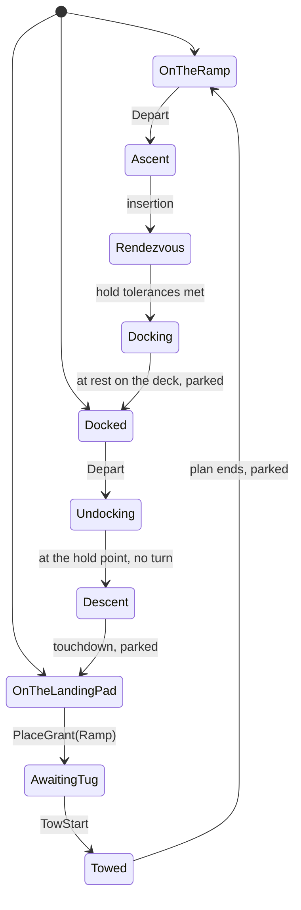
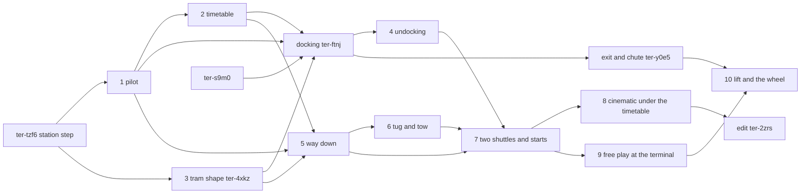

# Live world

Epic: `ter-xr2b`. The design ticket `ter-0pvs` wrote this plan. The work tickets are listed in "Order of the work".

## Goal

The demo becomes a world that the user can join live, as a character, on a stream. Two shuttles fly a fixed route between the launch ramp and the spinning station, and back to a landing pad. A timetable entity sends them on their way at fixed times. The cinematic run and free play run the same world. The cinematic's script drives only its person and the cameras. In free play, the user drives a person through `PersonControl`, in real time.

## What the user decided

The user settled these points on 2026-10-20:

1. The route stays the textbook route of the station step (`ter-tzf6`, docs/plans/blue-danube-demo.md). There is no time warp.
2. The return is real. The shuttle undocks, burns out of orbit and lands on its engine on a landing pad. A tug puts it back on the ramp.
3. A timetable entity sends `Depart` to a shuttle at fixed times. It shares the ramp, the landing pad and the station's slot between the shuttles. Earth does not turn, so the station passes over the launch pad once in each orbit, every 92.4 minutes.
4. Two shuttles fly the route.
5. Free play starts at the launch terminal or on the station's wheel floor.
6. A seat that a player uses straps the player in. The scripted passenger (`Passenger`) keeps its own orders.
7. The cinematic's script drives only its person and the cameras. Every order to a shuttle comes from the timetable and from the shuttles' own legs.

The user's rule of 2026-10-18 applies: only engine changes go to the user. This design settles every demo choice and gives its reason (see "Decisions"). It needs no engine change (see "Engine changes").

## Terms

| Term | Meaning |
|---|---|
| Launch pad | The existing slab under the ramp's bed, scene id `pad` |
| Landing pad | A new raised slab 40 m beside the ramp, where a shuttle lands on its tail, scene id `landing-pad` |
| Pass | A moment at which the station is over the launch pad |
| P_k | The time of the pass in orbit k, in the world's seconds: `OverPadAt + k × T` |
| T | The station's orbital period: 5,544.9 s, 92.41 minutes (`KeplerOrbit.Period(EarthMu)` of the station's orbit) |
| Leg | One part of a shuttle's cycle, such as the ascent or the stay. A leg has one case in the union `ShuttleLeg`. |
| Cycle | The legs of one shuttle from one departure from the ramp to the next |
| Pilot | The component `ShuttlePilot`. It holds the shuttle's leg and flies it. |
| Leg flyer | A class that the pilot owns, which flies the cases of one leg, such as `AscentLeg` |
| Place | One of the three shared places: the ramp, the landing pad and the slot (the enum `Place`) |
| Slot | The station's way in: the axis from the arrival point, 1,500 m out, to the deck, with the hub's slot and the bay |
| Holder | The one shuttle that the timetable lets use a place |
| Ground departure | The `Depart` that the timetable sends to the ramp's holder, 18 s before each pass |
| Station departure | The `Depart` that the timetable sends to the slot's holder, 2,100 s after each pass |
| Hold point | `DemoStation.HoldPoint`, 150 m out on the station's axis, outside its bubble |
| High gate | The point 100 m above the landing pad's top, where the powered braking hands over to the vertical descent |
| Park pose | The pose of a shuttle at rest on the ramp's bed, `DemoSurface.ShuttleParked` with no rotation |
| Step N | The physics step that runs during tick N, from t_N to t_(N+1). Gameplay of tick N reads `self.Time` = t_N. An intent that tick N writes acts in step N + 1. |

## The cycle of one shuttle

### The legs

The times below count from P, the pass of the orbit in which the shuttle departs. A cycle takes three orbits, 3T = 16,634.6 s, 277.2 minutes (see "Why the cycle takes three orbits").

| Leg | What starts it | What ends it | What flies it | Length, with the arithmetic | Tolerances |
|---|---|---|---|---|---|
| Boarding (`OnTheRamp`) | The end of the tow, or the world's start | A ground departure | Nothing. The hull is static on the bed. | From P − T + 300 s, the end of the last cycle's tow, to P − 18 s: T − 318 s = 5,227 s, 87 minutes. At the world's start: 20 s in the cinematic, 180 s in free play at the terminal. | The tow ends exactly on the park pose. |
| Departure (`Ascent`, case `Ramp`) | `Depart`. The pilot unparks the hull (`SetMotion(Dynamic)`) and gives full throttle. | The hull passes the ramp's top and clearance, and the ramp is released. | `AscentLeg`, the main engine and the attitude autopilot | About 5 s. The bed and the ramp are 267 m long. Full throttle less the slope's share of gravity gives 29.4 − 4.9 = 24.5 m/s², and √(2 × 267 / 24.5) = 4.7 s. | The ascent's tests, as today |
| Ascent (`Ascent`, case `Climb`) | The ramp's end | The circle 200 km up | `AscentLeg` | 316 s, from P − 13 s to P + 303 s. The insertion is 340.5 s into today's run, 302.5 s after the pass at 38 s. | As today |
| Rendezvous (`Rendezvous`) | The insertion | The hold tolerances are met at the hold point. | `RendezvousLeg`, the main engine, the translation thrusters and the attitude autopilot | 4,522 s, from P + 303 s to P + 4,825 s: phasing 1,610 s, the transfer 2,547 s to the brake, the brake 24 s, the glide 341 s (the run of 2026-10-20) | 0.5 m, 0.02 m/s and 1 degree at the hold point, as today |
| Docking (`Docking`), model level only | The hold | The hull rests on the deck and is parked. | `DockingLeg` of `ter-ftnj` | A budget of 330 s, to P + 5,155 s: the spin match 60 s, the entry 220 s, the move to the deck 40 s, settling 10 s | `ter-ftnj` sets them. |
| Stay (`Docked`) | The docking's end | A station departure | Nothing. The hull is static on the deck, in the station's frame. | From P + 5,155 s to P + T + 2,100 s: 2,490 s, 41.5 minutes | None |
| Undocking (`Undocking`) | `Depart` while docked | The hull holds at the hold point without a turn. | `UndockingLeg`, the translation thrusters and the attitude autopilot | A budget of 320 s, to P + T + 2,420 s: the lift-off 40 s, the exit 220 s, the spin-down 60 s | The hold point's tolerances, and a turn rate below 0.005 rad/s |
| Wait for the window (`Descent`, case `AwaitingWindow`) | The undocking's end | The angle to the landing pad falls into the window, and the shuttle holds the landing pad. | `DescentLeg`, which holds the hold point and turns the nose against the velocity | 149 s, to P + T + 2,569 s | The window: 193.2 to 192.2 degrees |
| Deorbit burn (`DeorbitBurn`) | The window | The velocity changes by 108.5 m/s. | `DescentLeg`, the main engine at a throttle of 0.10 | 36.2 s at 3.0 m/s², to P + T + 2,606 s | Within 0.5 m/s of the change |
| Coast (`Coast`) | The burn's end. The slot is released. | The braking curve | `DescentLeg`. The nose turns against the velocity. | 2,638 s, 44 minutes, to P + T + 5,244 s | None |
| Powered braking (`PoweredBraking`) | The braking curve: the distance left is v² / (2 × 0.8 × 29.4 m/s²). | The high gate | `DescentLeg`, the main engine near full throttle, the translation thrusters and the attitude autopilot | 346 s and 8,446 m/s, to P + 2T + 45 s | Within 5 m and 1 m/s of the gate at rest |
| Vertical descent (`Vertical`) | The high gate | The touchdown | `DescentLeg`. The nose points up, and the roof faces +Z. | About 75 s for 100 m, to P + 2T + 120 s | At the touchdown: the tail within 0.05 m of the pad's top, and slower than 0.1 m/s |
| On the landing pad (`OnTheLandingPad`) | The touchdown. The pilot parks the hull and asks for the ramp. | `PlaceGrant(Ramp)` | Nothing. The hull is static, upright on its tail. | One tick in the nominal cycle. The ramp is free since the other shuttle left at P + T − 13 s. | None |
| Wait for the tug (`AwaitingTug`) | The ramp's grant. The pilot sends `TowRequest`. | `TowStart` | Nothing | About 40 s: the tug drives about 17 m from its garage, and its cradle rises. | None |
| Tow (`Towed`) | `TowStart` | The end of the tow plan, on the park pose. The pilot parks the hull and releases the landing pad. | The pilot. It follows `TowPlan` with end poses. | 140 s, to about P + 2T + 300 s: lowering 60 s, the carry across 45 s, the carry in 25 s, the set-down 10 s | The tow plan ends exactly on the park pose. |
| Turnaround | The touchdown | The next ground departure | The four ground legs above | From P + 2T + 120 s to P + 3T − 18 s: T − 138 s = 5,407 s, 90 minutes | None |

The sum is the cycle: from P − 18 s to P + 3T − 18 s, 3T.

The times of the way up come from today's run, which ignites 18.47 s before the pass. The timetable's lead of 18.0 s opens the window about 10 s later (see "Departures"), so the times from the window to the docking move about 10 s later. The stay is 10 s shorter. The way down does not move, because its window depends only on the station's place.

### Why the cycle takes three orbits

- The docking ends at P + 5,155 s, which is P_(k+1) − 390 s. The deorbit window of orbit k is at P + 2,569 s, long past. So the first window is the one of orbit k + 1, at P + T + 2,569 s.
- That burn gives a touchdown at P + 2T + 120 s, 120 s after the pass of orbit k + 2. The ground departure of that orbit is 18 s before the pass. The shuttle misses it by 138 s, plus the 180 s on the pad and in tow.
- No faster leg helps. A shuttle that descends from the station's orbit reaches the pad at about the time of a pass. So the landing always falls just after a pass. Only a departure after the pass can take the shuttle in the same orbit, and the route fixes the departure 18 s before the pass.
- So the earliest departure after a cycle is the one of orbit k + 3. One shuttle departs every three orbits.

Two shuttles, offset by one orbit, depart in two orbits of every three. The gaps between departures are 92.4 and 184.8 minutes. A departure in every orbit needs a third shuttle. This design builds two, as the user decided.

### The timeline of one cycle

| Time | What happens | Place event |
|---|---|---|
| P − 18 s | Ground departure. The ignition. | |
| P − 13 s | The climb starts. | Release the ramp. |
| P + 303 s | The insertion. Phasing starts. | |
| P + 1,913 s | The window. The transfer burn. | |
| P + 4,460 s | The brake starts at the arrival point. | Request the slot. |
| P + 4,825 s | The hold point. The docking starts. | |
| P + 5,155 s | Docked | |
| P + T + 2,100 s | Station departure. The undocking starts. | Request the landing pad. |
| P + T + 2,420 s | At the hold point, with no turn | |
| P + T + 2,569 s | The deorbit burn starts. | |
| P + T + 2,606 s | The burn ends. | Release the slot. |
| P + T + 5,244 s | The powered braking starts, 30 km up, 1,360 km before the pad. | |
| P + 2T + 45 s | The high gate | |
| P + 2T + 120 s | The touchdown | Request the ramp. |
| P + 2T + 160 s | The tow starts. | |
| P + 2T + 300 s | Parked on the bed | Release the landing pad. |
| P + 3T − 18 s | The next ground departure | |

### The pilot

Today two layers fly the shuttle: `AscentAutopilot` at priority 0 and `RendezvousAutopilot` at priority 1. The actuators (`AttitudeAutopilot`, `MainEngine`, `TranslationThrusters`) run at priority 10 and take the last event of each tick. Each layer keeps its own state. During the rendezvous, the ascent autopilot sits in `Orbit` and still adds the nose's target, and the rendezvous autopilot overrides it.

The cycle repeats, so layers no longer fit. After the landing, the ascent autopilot stays in `Orbit`, and the rendezvous autopilot stays in `Hold`. Each layer then needs a rule to reset itself, and the states of five layers must agree on what the shuttle does. That is the problem for which the user removed `MotionDriver`: a second value beside the first can disagree with it.

So one component, `ShuttlePilot`, at priority 0, holds one value, `Leg`, of the custom union `ShuttleLeg`. In each tick it switches on the leg with pattern matching. The leg's flyer adds the tick's actuator events and returns the next leg. The actuators stay at priority 10, unchanged.

| Case of `ShuttleLeg` | Its data | The flyer |
|---|---|---|
| `OnTheRamp` | None | None |
| `Ascent(AscentState)` | `Ramp` or `Climb`, with their data as today | `AscentLeg`, today's `AscentAutopilot` without `Parked` and `Orbit` |
| `Rendezvous(RendezvousState)` | `Phasing`, `Transfer`, `Brake`, `AwaitingSlot`, `Glide` or `Hold`, each with its guidance | `RendezvousLeg`, today's `RendezvousAutopilot` without `Standby` and `Halted` |
| `Docking(DockingState)` | `ter-ftnj` designs the cases. | `DockingLeg` |
| `Docked` | None | None |
| `Undocking(UndockingState)` | `LiftOff`, `Exit` or `SpinDown`, each with its guidance | `UndockingLeg` |
| `Descent(DescentState)` | `AwaitingWindow`, `DeorbitBurn(StartVelocity)`, `Coast`, `PoweredBraking` or `Vertical`, with `DescentGuidance` | `DescentLeg` |
| `OnTheLandingPad` | None | None |
| `AwaitingTug` | None | None |
| `Towed(TowPlan)` | The tow plan | The pilot itself |
| `Halted` | None | None. The pilot logs the reason with `self.Log`, as the autopilots do today. |

Each nested state is a custom union, as `AscentState` and `RendezvousState` are today. The pilot also keeps `Held`, a `[Flags]` enum of the places that the timetable granted it. It adds a place at `PlaceGrant` and removes it at its own `PlaceRelease`.

The pilot takes `Depart` only in `OnTheRamp` and `Docked`. In every other leg it ignores `Depart` and logs it. The nominal runs log nothing.



Every leg can go to `Halted` when its frame or its station is not what it expects. The three start states are the three ways in which a world can start a shuttle (see "The starts").

### The ascent and the rendezvous

The flight does not change. These parts of today's code move:

- `Ignition` becomes `Depart`. `AscentState.Parked` becomes the leg `OnTheRamp`.
- `AscentState.Orbit` goes. The ascent ends at the insertion, and the rendezvous starts there, in `Phasing`. `Phasing` keeps the nose on the velocity with the roof away from the planet, as `Orbit` does today. So the attitude of the coast does not change.
- The order `Rendezvous` goes. The window opens at 1,950.6 s, long after both 340.5 s and today's order at about 366 s. So the transfer starts in the same tick.
- The rendezvous gains `AwaitingSlot`. The pilot sends `PlaceRequest(Slot)` when the brake starts. If no grant came by the brake's end, the shuttle holds at the arrival point with the glide's law. It glides on at the grant. The grant comes one tick after the request when the slot is free, so the nominal cycle never waits.
- The pilot sends `PlaceRelease(Ramp)` when the ascent passes from `Ramp` to `Climb`.

### The docking, at model level

`ter-ftnj` designs the docking. This design fixes only what the cycle needs from it:

- The docking is the pilot's leg `Docking`. It starts when the rendezvous meets the hold tolerances.
- It ends with the hull at rest on the deck, in the station's frame. The pilot parks it there with `SetMotion(Static)`, as on the ramp, and the leg becomes `Docked`. A frame with a static hull holds still in its tree parent (ARCHITECTURE.md, "How a frame moves"), so the cabin turns with the station.
- Its budget is 330 s. The spin match at the hold point takes 60 s, and the entry along the axis 220 s. The move of 6 m out to the deck takes 40 s, and the hull settles in 10 s.
- The station turns at 0.31321 rad/s. The attitude autopilot turns at most 0.15 rad/s (`MaxTurnRate`). So the spin match needs a target with a feed-forward angular velocity.
- The move to the deck and the undocking's lift-off push with the translation thrusters. They must beat ω² r and the Coriolis term 2 ω v. At r = 6 m and v = 0.2 m/s, that is 0.0981 × 6 + 0.626 × 0.2 = 0.71 m/s². Today's thrusters give 4,000 N, 0.2 m/s². This design asks for 30,000 N, 1.5 m/s² per axis. The glide's law caps its own push at 0.2 m/s², so the glide does not change.

### The stay

The hull is static on the deck. The cabin floor lies 7.8 m from the axis and feels 0.765 m/s² toward the deck. The stay lasts until the station departure, 41.5 minutes in the nominal cycle. A person can leave and board through the hatch.

### The undocking

The undocking is the docking in reverse:

1. Lift-off. At the station departure, the pilot unparks the hull (`SetMotion(Dynamic)`) and sends `PlaceRequest(LandingPad)`. The translation thrusters lift the hull 6 m in to the axis in about 40 s. The push is at most 0.71 m/s², as for the move to the deck.
2. Exit. The hull flies out along the axis, through the slot, to the hold point 150 m out, in the entry's time of 220 s. It leaves the station's bubble at about 137.5 m. That is the bubble's 120 m, plus the hull's bounding radius of 8.77 m, plus the margin. The margin is the larger of 2.4 m and 8.77 m. So the hold point lies outside the bubble.
3. Spin-down. In `earth-surface`, the hull still turns at 0.31321 rad/s about the axis. The attitude autopilot brings the rate to zero in 60 s, 0.0052 rad/s².

At the hold point, the leg becomes `Descent(AwaitingWindow)`.

### The way down

The way down reads every position and velocity in `earth-surface`, the shuttle's frame after the exit. `DescentLeg` takes G·M from the frame's point gravity, as the other legs do.

The descent's constants live in `DescentPlan`, a record struct like `RendezvousPlan`:

| Constant | Value | Why |
|---|---|---|
| `WindowOpens` | 193.2 degrees | The burn starts 18 s before its center, and its center lies 192.0 degrees before the pad. |
| `WindowCloses` | 192.2 degrees | A burn center between 191 and 192 degrees still lands within 0.6 m in the model. The window is 15.4 s wide. |
| `DeorbitDeltaV` | 108.5 m/s | The burn from the circle 6,771 km out to an orbit with its periapsis 30 km up, 6,401 km out |
| `GateHeight` | 100 m | The high gate |
| `BrakingShare` | 0.8 | The share of full throttle that the braking curve and the time to go assume |
| `MinTimeToGo` | 3 s | The floor of the time to go |
| `TouchSpeed` | 0.3 m/s | The descent speed at the touch |
| `DescentTime` | 30 s | The time constant of the vertical descent's speed |

#### The deorbit window and burn

The angle to the landing pad lies in the orbit's plane. It runs from the shuttle's position to the pad's, in the direction of the motion. It falls by 0.0649 degrees a second at the hold point.

- `AwaitingWindow`: the shuttle holds the hold point with the hold's law and turns its nose against the velocity. When the angle falls into the window and the shuttle holds the landing pad, the burn starts. If the window closes first, the shuttle waits one orbit for the next window.
- `DeorbitBurn`: the main engine pushes against the velocity at 3.0 m/s², a throttle of 0.10. The case keeps the velocity at the burn's start. The burn ends when the velocity changed by `DeorbitDeltaV`. Then the pilot sends `PlaceRelease(Slot)`.

The change of velocity comes from vis-viva. The circle at 6,771 km has 7,672.6 m/s. An orbit from 6,771 km to 6,401 km has a semi-major axis of 6,586 km and 7,564.0 m/s at its apoapsis. The difference is 108.6 m/s, which the model rounds to 108.5 m/s. The burn ends on a constant, not on a two-body solution, because the braking's guidance corrects every error from the state.

The slot covers the hold point. A burn moves the shuttle off the axis, so the slot is released at the burn's end, not at the exit.

#### The coast

The shuttle falls for 2,638 s, 44 minutes, from 400 km to 30 km. The nose stays against the velocity, ready for the braking.

#### The powered braking

`DescentGuidance` is a pure record struct with `Mu` and the plan, like `TransferGuidance`. Its law is zero-effort-miss guidance (ZEM/ZEV): the push that takes out the miss of the free path at the time to go.

- The braking starts when the ground distance left to the pad is at most v² / (2 × `BrakingShare` × full throttle's acceleration). The distance runs along the great circle.
- The time to go is the speed divided by `BrakingShare` × full throttle's acceleration, and never less than `MinTimeToGo`.
- ZEM is the gate less the free path's end, `r + v t + g t² / 2`. ZEV is the gate's velocity, zero, less `v + g t`. The gravity g is `KeplerOrbit.Acceleration` at the shuttle's place, held fixed over the time to go.
- The push is 6 ZEM / t² − 2 ZEV / t, cut to full throttle's acceleration.
- The nose turns toward the push. The main engine takes the part along the nose, and the translation thrusters take the rest, as in the rendezvous's burns.

A two-dimensional model of the whole way down, with an impulsive deorbit, gave these numbers (a scratch script on 2026-10-20). The braking starts 30.0 km up, 12.2 degrees, about 1,360 km, before the pad. It takes 346.4 s and 8,446 m/s. The guidance asks for 31.2 m/s² at its peak, so the push is cut to 29.4 m/s² for a short time. The shuttle reaches the gate within 0.55 m. Burn centers from 191 to 193 degrees gave the same miss.

The model has no attitude lag, no lag of the thrust, and no offset across the plane. The hold point lies 150 m across the orbit's plane, and the pad lies 40 m beside the ground track. The guidance works in three dimensions, so it takes out both offsets. The tests measure the real miss.

#### The vertical descent and the touchdown

At the high gate, the shuttle stands up. The nose points along the pad's up, the direction from Earth's center to the pad. The roof faces +Z of `earth-surface` (`LandingPad.Roof`), so the belly faces -Z.

- The wanted velocity is down at `TouchSpeed` + h / `DescentTime`, with h the tail's height above the pad's top. It also takes out the offset from the pad's center line in 10 s.
- The push takes out the velocity error in 0.5 s and cancels gravity. The main engine takes the part along the nose, and the translation thrusters take the rest.
- The time from the gate is `DescentTime` × ln(1 + 100 / (0.3 × 30)) = 30 × ln 12.1 = 74.8 s.
- Touchdown: the tail is within 0.05 m of the pad's top, and the speed is below 0.1 m/s. The pilot cuts the throttle, parks the hull with `SetMotion(Static)`, and sends `PlaceRequest(Ramp)`. The leg becomes `OnTheLandingPad`.

The hull then stands on its tail with the nose up. `ter-4xkz` must give the tail a flat face to stand on (see "What this design asks of other tickets").

#### What a person inside feels

| Leg | The felt gravity in the cabin |
|---|---|
| Stay | 0.765 m/s² toward the cabin floor |
| Lift-off | It falls toward zero as the hull reaches the axis. On the axis, the hull's turn gives 0.13 m/s² at the seat, away from the hull's long axis. |
| Spin-down | It falls to zero. The Euler term is 0.007 m/s². |
| Deorbit burn | 3.0 m/s², 0.3 g, toward the tail |
| Coast | Weightless, for 44 minutes |
| Powered braking | Up to 29.4 m/s², 3 g, toward the tail, as in the climb |
| Vertical descent and the landing pad | About 9.8 m/s², 1 g, toward the tail. The floor is a wall. |
| Lowering in the tow | It turns from the tail to the floor over 60 s, 1.5 degrees a second. |
| Carry and boarding | 1 g toward the floor |

A belted person is held at the seat whenever the gravity leans more than 45 degrees from the floor's down, or the cabin is weightless. That is the belt law of `Passenger` (see "The seat and the belt"). The scripted passenger leaves the shuttle at the station (`ter-y0e5`), so only a player rides the way down.

### The landing pad

The landing pad is a static box in `earth-surface`, 16 by 16 m, 1.2 m tall. Its center is at (-40, R + 0.6, 30), with R the Earth's radius. Its top at R + 1.2 m is the height of the tug's cradle. It lies 40 m to the side of the ramp, behind the bed. It is clear of the tower at (-11, ·, -4) and of the terminal at x = 22. A still camera, `landing-pad-camera`, looks at it.

The shuttle stays on the landing pad, static and upright, until the timetable grants it the ramp.

### The tow

The tug is a kinematic plain body in `earth-surface`. Its component `Tug` moves it only with end poses (`self.MoveKinematic`), as `Door` moves a door. Its garage, `tug-garage`, is a drawn shed at (-55, ·, 10). The cradle, `tug.cradle`, is a drawn entity attached to the tug, with no body. The tug spawns it on its first tick, so the tug knows its handle.

`TugState` is a custom union: `AtGarage`, `Driving(DrivePlan)`, `Towing(TowPlan)` or `Returning(DrivePlan)`. The tug keeps a queue of the shuttles that sent `TowRequest`, in order. While the locks hold, the queue holds at most one shuttle.

`TowPlan(DPose Landed, double Start)` is a pure record struct. Its methods give the shuttle's pose, the tug's pose and the cradle's offset from the tug, at any time. `DrivePlan(Double3 From, Double3 To, double Start)` is the same for a drive. They are the analogue of `KeplerOrbit`: a pure function of time that each entity follows by itself.

The tow plan, from `Landed`, the shuttle's pose on the landing pad:

1. Lowering, 60 s. The shuttle turns -90 degrees about +X, about the hinge line at the belly's edge of its tail. The nose comes down toward -Z onto the cradle. The turn takes the standing pose to no rotation, the park pose's rotation. The center comes to about (-40, R + 3.2, 20).
2. The carry across, 45 s. The shuttle moves 40 m along +X, to x = 0, at most 1.2 m/s.
3. The carry in, 25 s. The shuttle moves 20 m along -Z, over the bed.
4. The set-down, 10 s. The shuttle comes down 1.18 m onto the bed. The last of the landing's error blends out, so the plan ends exactly on the park pose.

The cradle's two arms lift the hull by its overhang, outside the bed's 4 m width. The hull is 6 m wide. The path of the carry stays at z = 20 until x = 0, so it clears the tower and the terminal.

How the towed shuttle moves itself:

- In tick k, the tug is at the hitch point with its cradle up. It sends `TowStart(Shuttle, Start)` to the shuttle and to its cradle, with Start = t_(k+2) = `self.Time` + 2 dt.
- In tick k + 1, the shuttle reads `TowStart`. It calls `SetMotion(Kinematic)` and writes the end pose `TowPlan.ShuttleAt(t_(k+3))`. Both act in step k + 2, which starts at Start. The guards judge each write by the motion of the step that applies it. So the two writes in one tick are allowed (ARCHITECTURE.md, "Changes of motion").
- In every later tick N, the shuttle, the tug and the cradle each write the plan's value at t_(N+2). That is the end of the step that applies the write.
- Each reads the landed pose from the shuttle's pose in `earth-surface` in the snapshot. The shuttle is static, so all three read the same pose.
- At the plan's end, the shuttle parks with `SetMotion(Static)`, sends `PlaceRelease(LandingPad)`, and its leg becomes `OnTheRamp`. The tug drives back to its garage and serves the next request in its queue.

Every ascent starts from the park pose, so every cycle flies the same flight relative to its pass. The ground departure arrives up to one tick, 1/60 s, after its exact time. The station moves at most 128 m along its orbit in that time, which the rendezvous's guidance corrects from the state.

### The turnaround

The shuttle stays on the bed in `OnTheRamp` until the next ground departure that reaches it as the ramp's holder. In the nominal cycle, that is 87 minutes after the tow, at P + 3T − 18 s.

## The timetable

### The entity and its component

The timetable is an entity in `earth-surface` with no body and no render data, like the airlock entity of the orbit scene. Its component `Timetable` subscribes it to the topic `timetable`. The pilots send their requests and releases to that topic. The timetable answers each event's sender. The topic lets the shuttles spawn before the timetable, which takes the shuttles' handles as its first holders.

The timetable reads only `self.Time` and its own state. It never reads a shuttle.

Its state:

- The holder of each place, or none.
- A queue of waiting shuttles for each place, in the order of their requests.
- The index of the next pass for each kind of departure.

Its constructor takes `OverPadAt`, T, and the first holders. The scene gives the first holders from the world's start (see "The starts").

### The places

| Place | What it covers | Requested | Released | Where a shuttle waits for it |
|---|---|---|---|---|
| `Ramp` | The launch pad, the bed and the ramp | At the touchdown | When the climb starts | On the landing pad, static (`OnTheLandingPad`) |
| `LandingPad` | The landing pad and the tug's path | At the station departure | At the tow's end | At the hold point (`AwaitingWindow`), still holding the slot |
| `Slot` | The station's axis from the arrival point to the deck, with the hold point | When the brake starts | At the deorbit burn's end | At the arrival point (`AwaitingSlot`) |

A request for a free place gets `PlaceGrant` in the next tick. A request for a held place joins the place's queue. A release from the holder frees the place and grants it to the first shuttle in the queue. A release from any other shuttle changes nothing.

### Departures

- Ground departure of orbit k: at P_k − `Timetable.DepartureLead`, 18 s before the pass. It goes to the ramp's holder. If the ramp has no holder, nothing goes.
- Station departure of orbit k: at P_k + `Timetable.StationDepartureDelay`, 2,100 s after the pass. It goes to the slot's holder. If the slot has no holder, nothing goes.

The times are fixed, because the station moves on rails. The timetable sends each `Depart` in the tick N with t_N < the time ≤ t_(N+1). So the shuttle reads it in the first tick at or after the time. At the start, the next pass of each kind is the first whose time is not before the world's start.

Why 18 s: today's run ignites 18.47 s before the pass, so the window opens at 120.4 degrees along the orbit. A lead of 18.0 s moves the window 0.7 degrees later, to about 121.1 degrees, inside the aim of 115 to 125 degrees. A second less of lead opens the window 22 s later and 1.5 degrees further on (docs/plans/blue-danube-demo.md, "How `OverPadAt` sets the window").

Why 2,100 s: the undocking needs 320 s, and the window opens at P + 2,569 s. A start at P + 2,100 s ends the undocking at P + 2,420 s, 149 s before the window.

The user asked for a `Depart` "every N station orbits". In this model, N = 3 for each shuttle. It follows from the places, with no table of shuttles and orbits. The timetable offers a departure in every orbit, and only a ready shuttle holds the ramp.

### Messages

| Message | Payload | From | To | When |
|---|---|---|---|---|
| `Depart` | None | The timetable | The ramp's holder or the slot's holder | At each departure time |
| `PlaceRequest` | `Place` | A pilot | The topic `timetable` | See "The places" |
| `PlaceGrant` | `Place` | The timetable | The requester | When the place is free for it |
| `PlaceRelease` | `Place` | A pilot | The topic `timetable` | See "The places" |
| `TowRequest` | None | A pilot | The topic `tug` | When the ramp is granted on the landing pad |
| `TowStart` | `Entity Shuttle`, `double Start` | The tug | The shuttle and the cradle | When the tug is at the hitch point with its cradle up |

The sender of each event is the event's `Sender`, so no payload names its sender. Every payload is unmanaged and at most 48 bytes.

```mermaid
sequenceDiagram
    participant TT as timetable
    participant A as shuttle-a
    participant B as shuttle-b
    participant Tug as tug
    Note over A: OnTheRamp, holds Ramp
    Note over B: OnTheLandingPad, holds LandingPad
    B->>TT: PlaceRequest(Ramp), on Spawned
    TT->>A: Depart, at P0 - 18 s
    A->>TT: PlaceRelease(Ramp), at the climb
    TT->>B: PlaceGrant(Ramp)
    B->>Tug: TowRequest
    Tug->>B: TowStart(B, Start)
    B->>TT: PlaceRelease(LandingPad), on the bed
    A->>TT: PlaceRequest(Slot), at P0 + 4,460 s
    TT->>A: PlaceGrant(Slot)
    Note over A: docks, Docked at P0 + 5,155 s
    TT->>B: Depart, at P1 - 18 s
    TT->>A: Depart, at P1 + 2,100 s
    A->>TT: PlaceRequest(LandingPad)
    TT->>A: PlaceGrant(LandingPad)
    A->>TT: PlaceRelease(Slot), at P1 + 2,606 s
    B->>TT: PlaceRequest(Slot), at P1 + 4,460 s
    TT->>B: PlaceGrant(Slot)
    Note over A: touchdown at P2 + 120 s
    A->>TT: PlaceRequest(Ramp)
    TT->>A: PlaceGrant(Ramp)
    A->>Tug: TowRequest
    Tug->>A: TowStart(A, Start)
    A->>TT: PlaceRelease(LandingPad), on the bed
    TT->>A: Depart, at P3 - 18 s
```



### Why the places never lock up, and missed departures

The places form one chain in one direction: the ramp, then the slot, then the landing pad, then the ramp again. A shuttle waits for a place only while it holds the place before it, or nothing:

- It waits for the slot while it holds nothing.
- It waits for the landing pad while it holds the slot.
- It waits for the ramp while it holds the landing pad.

The ramp's holder never waits for a place. It waits only for a ground departure, which comes once in each orbit. So the ramp frees within one orbit, then the landing pad, then the slot. No circle of waits can form, with any number of shuttles.

Every wait ends within one orbit, so a late leg costs whole orbits and the cycle heals:

| What is late | What happens |
|---|---|
| A ground departure reaches a shuttle that is still in tow | The pilot ignores it. The shuttle takes the next one, one orbit later. |
| A station departure reaches a shuttle that is still docking | The pilot ignores it. The shuttle takes the next one, one orbit later. |
| The undocking ends after the window, or the landing pad is not granted by then | The shuttle waits at the hold point for the next window, one orbit later. It keeps the slot, so an arriving shuttle waits at the arrival point. |
| The slot is held when a shuttle arrives | The shuttle waits at the arrival point. Its station departure moves by whole orbits. |

The nominal cycle has none of these. The gaps are large. The slot is free for at least 31 minutes before each arrival, and the landing pad for at least 30 minutes before each request.

### The two shuttles' phases

From the cinematic's start, `OverPadAt` = 38 s. Shuttle A starts on the ramp, and shuttle B starts on the landing pad.

| Orbit | Ground departure | Station departure | Touchdown | The ramp after it |
|---|---|---|---|---|
| 0 | A, at 20.0 s | None | None | B, from about 3 minutes after the run starts |
| 1 | B | A | None | Free after B's climb |
| 2 | None | B | A, at P2 + 120 s | A, from P2 + 300 s |
| 3 | A | None | B, at P3 + 120 s | B, from P3 + 300 s |
| 4 | B | A | None | Free after B's climb |
| 5 | None | B | A | A |

Then the pattern repeats every three orbits. A departs in orbits 0, 3 and 6, and B in orbits 1, 4 and 7.

A holds the slot from P0 + 4,460 s to P1 + 2,606 s, and B from P1 + 4,460 s to P2 + 2,606 s. So the slot is free for 1,854 s between A's release and B's request.

### The first departure in each start

- The cinematic: `OverPadAt` = 38 s, as today, so A departs at 20.0 s, tick 1,200. The scripted passenger sits at about 15 s.
- Free play at the terminal: `OverPadAt` = 198 s, so A departs at 180 s. A walk from the terminal to the seat takes about 30 s. Three minutes leave time to look around, and the stream reaches the launch soon.
- Free play on the wheel: `OverPadAt` = -1,500 s. B starts docked, and its station departure comes at 600 s. A starts on the ramp and departs at P1 − 18 s = 4,026.9 s.

## Free play

### The starts

One scene build makes all three worlds. It takes a `WorldStart`:

```csharp
public sealed record WorldStart(double OverPadAt, ShuttleStart A, ShuttleStart B, Viewer Viewer);
public enum ShuttleStart { OnTheRamp, OnTheLandingPad, Docked }
public enum Viewer { ScriptedPassenger, PlayerAtTheTerminal, PlayerOnTheWheel }
```

where

- `OverPadAt` = the time at which the station is over the launch pad, in the world's seconds. The station's spawn and the timetable read it.
- `A`, `B` = where each shuttle starts. Each start gives the shuttle's pose, its motion (always static), its frame, its first leg and the place that it holds.
- `Viewer` = who watches: the scripted passenger of the cinematic, or a player at one of the two places.

| Scene | `OverPadAt` | A | B | Viewer |
|---|---|---|---|---|
| `demo-surface`, the cinematic | 38 s | `OnTheRamp` | `OnTheLandingPad` | `ScriptedPassenger` |
| `live-terminal` | 198 s | `OnTheRamp` | `OnTheLandingPad` | `PlayerAtTheTerminal` |
| `live-wheel` | -1,500 s | `OnTheRamp` | `Docked` | `PlayerOnTheWheel` |

| Shuttle start | Pose and frame | First leg | Holds |
|---|---|---|---|
| `OnTheRamp` | The park pose, in `earth-surface` | `OnTheRamp` | `Ramp` |
| `OnTheLandingPad` | Upright on the landing pad, roof toward +Z, in `earth-surface` | `OnTheLandingPad`. It sends `PlaceRequest(Ramp)` on `Spawned`. | `LandingPad` |
| `Docked` | At rest on the deck, in the station's frame | `Docked` | `Slot` |

The scene refuses a start with both shuttles on the same place. The ids name each shuttle's parts under its prefix: `shuttle-a`, `shuttle-a.seat`, `shuttle-a.cabin-camera`, `shuttle-b.chase-camera`, and so on. One function, `Shuttle.Spawn`, spawns a shuttle with its seat, panes, lamps and cabin cameras, so the two shuttles cannot differ by accident. Only shuttle A carries the clipped pen.

### The player

The player is a character with a capsule, as the person of the spin station. Its components are `PlayerBelt` and `PersonControl`. It subscribes to `Topics.Input`, and it is the scene's first view, so the window starts in its eye. Its id is `player`.

- At the terminal, it spawns standing at `DemoSurface.PersonStart`, (36, R + 0.95, 0), in `earth-surface`, facing the terminal.
- On the wheel, it spawns standing on the wheel floor at the foot of the lift, in the station's frame. It takes `Upright(θ)`, as in the spin station. A character takes no motion intent (`MotionIntentRefusal.Character`). So it spawns at rest in the frame with no first motion intent and no velocity, as the spin station's person does.

The hatch has no door. In orbit a player can float out of the cabin and stay behind when the shuttle burns. The demo leaves it so. The player starts the scene again.

### The seat and the belt

Each shuttle's seat entity gets a component `Seat`. `SeatState` is a custom union: `Free` or `Taken(Entity User)`.

- A `Use` from a person while the seat is free: the seat becomes taken by that person, and it sends `Buckle(Stand)` to the person. `Stand` is a `Waypoint` of the seat's frame and `Shuttle.SeatStand`.
- A `Use` from its user: the seat becomes free, and it sends `Unbuckle`.
- A `Use` from anyone else changes nothing.

`PersonControl` already sends `Use` to every entity within 3 m when the player presses E.

`PlayerBelt` runs at priority -1, before `PersonControl`. `BeltState` is a custom union: `Open`, `Returning(Waypoint Stand)` or `Shut(Waypoint Stand)`.

- `Open`: it does nothing. `Buckle` makes it `Returning`.
- `Returning`: it moves the player to the stand. If the felt gravity holds the player on the floor, it walks the player there with `MoveCharacter`, at most `PersonControl.WalkSpeed`. Otherwise it floats the player with the passenger's float law. Within `BuckleRadius`, 0.1 m, it becomes `Shut`.
- `Shut`: it holds the player at the stand. Where the gravity leans more than 45 degrees from the floor's down, or the cabin is weightless, it uses the passenger's belt law. Otherwise it stands the player still with `MoveCharacter(0)`.
- `Unbuckle` makes it `Open` from any state.
- In `Returning` and `Shut`, it adds the event `Belted` in each tick. `PersonControl` skips its walk, jump and thrust in a tick with `Belted`. It keeps the mouse look and E, so the player looks around and presses E to get up.

The passenger's belt law and float law move out of `Passenger` into one struct, `SeatBelt`, which both `Passenger` and `PlayerBelt` use. The scripted passenger keeps its own orders and its own union. Its behavior does not change.

### Cameras and views

`PersonControl` takes input only while the player's eye is the camera, as today. The V key cycles the scene's views (`SceneInstance.Views`). The other views are for looking.

| View | Frame | Who spawns it |
|---|---|---|
| `player`, the eye | The player's | This design |
| `follow-camera` | Attached to the player, with `ChaseCamera` | This design, as in the cinematic |
| `shuttle-a.chase-camera`, `shuttle-b.chase-camera` | Attached to each shuttle | `Shuttle.Spawn` |
| `pad-camera` | `earth-surface` | Exists |
| `landing-pad-camera` | `earth-surface` | The way down |
| `rim-camera` | The station's | Exists |
| `bay-camera` | The station's | `ter-ftnj` |
| `wheel-camera` | The station's, on the wheel floor by the lift | The lift |

### The lift

On the wheel, the way to the shuttles leads up a spoke. The chute of `ter-y0e5` runs down the spoke at θ = 180 degrees, under the deck. The lift runs in the spoke at θ = 0, so the two never share a tube. It arrives at the bay's wall opposite the deck. From there, the player floats across the bay to the deck, through the weak gravity near the axis.

- The lift is a kinematic plain body in the station's frame. Its component `Lift` moves it with end poses on a fixed cycle, a pure function of the world's time, as `Door` moves a door.
- A trip: about 92 m, from the floor 100 m from the axis to the bay's wall 8 m from it. The lift moves at most 2 m/s and changes its speed by at most 0.4 m/s². Each change of speed takes 5 s and 5 m, so a trip takes 82 / 2 + 2 × 5 = 51 s.
- The cycle: 20 s at the wheel floor, 51 s up, 20 s at the hub, 51 s down, 142 s in all. The felt gravity at the hub is 0.83 m/s², so the platform never drops away from a standing rider.
- The lift reuses the openings that `ter-y0e5` builds in the ceiling and in the hub's walls.

### Real time and the frame budget

Free play runs at 60 ticks a second of wall-clock time. The host moves its schedule when a tick and its draw take longer than 16.7 ms. So the budget of one tick plus one draw is 16.7 ms.

- The world's debug checks (`WorldOptions.DebugChecks`) cost 6.6 ms a tick with the station (`ter-oehq`). They are off by default in the window, so free play runs without them.
- The demo surface's tick took 0.2 to 0.45 ms, and a tick of the orbital coast 0.133 ms. The second shuttle, the tug, the timetable and the lift add a few bodies and a few components. The estimate is at most 0.6 ms a tick.
- The demo surface's draw took 1.7 to 2.3 ms at 720 lines. At 1,080 lines it has 2.25 times the pixels, and at 1,440 lines 4 times. The estimate is 4 to 10 ms.
- Free play runs in Release: `dotnet run -c Release --project src/Tertius.Demo -- --scene live-terminal`.

A timing test in Release, deleted after, as for the debug checks' cost, measures both in the free-play part. It runs `live-terminal` for 10 minutes of world time, through the ascent. Part 10 runs the same measurement on `live-wheel`, through B's undocking. Each run records the mean and the worst tick, and the draw time of a capture at 1,920 by 1,080. If a tick and a draw together pass 12 ms, the part reports where the time goes before it merges.

### Recording a session

The host's `--record <file>` writes a free-play session as an ordinary script (docs/plans/host-and-scripted-runs.md, "Recording free play"). A run of that script with `--script` repeats the session tick for tick, in the window. Nothing new is needed. A tool that turns a record into a filmed video is not part of this design (see "Not in this design").

## The cinematic under the timetable

The long script (`scripts/blue-danube.json`, `BlueDanube.Sections`) keeps only the orders to its person and its cameras:

| Order | Today | After |
|---|---|---|
| `Ignition` to `shuttle` | The script posts it at the start of the section `ignition`, at tick 1,172, 19.5 s. | The timetable's first ground departure, `Depart` to `shuttle-a`, at tick 1,200, 20.0 s |
| `Rendezvous` to `shuttle` | The script posts it at the start of `phasing`, at about 366 s. | The pilot starts the rendezvous at the insertion. |
| `FastenBelt` to `person` | The script posts it at the start of `belt`. | No change. The script drives its person. |
| The cameras and the films | The script | No change |

The generator, `FilmScript.Generate`, rehearses the script and waits for cues. These cues change:

- `on-the-pad` films until shuttle A's leg leaves `OnTheRamp`, instead of for 1 s. So the ignition section starts in the tick of the departure.
- `ignition` and `phasing` post nothing.
- Every cue that reads `AscentAutopilot.State` or `RendezvousAutopilot.State` reads `ShuttlePilot.Leg` instead, with pattern matching. For example, `ramp-top` ends when the leg is `Ascent` with `Climb`, or `Rendezvous`.
- Every cue that names `shuttle` names `shuttle-a`.

The scripted passenger catches its departure because the world is deterministic. Its walk ends at the seat at about 15 s, and the departure comes at 20.0 s. A run test pins at least 2 s between the two. The timetable does not wait for a passenger. If a later change slows the walk, the run test fails before the passenger misses the shuttle.

The passenger's belt is shut long before the first burn of the rendezvous, at the window at about 1,950 s. The existing run test `ThePassengerIsStrappedBeforeTheFirstBurn` pins it.

Shuttle B sits on the landing pad at the start of the cinematic. It is towed onto the ramp during A's climb, and it departs at P1 − 18 s, about 5,565 s into the run. The long script films only A and its passenger.

## Engine changes

None. Every part lives in `src/Tertius.Demo`, `scripts/` and the demo's tests. These claims about the engine were compared with ARCHITECTURE.md and the code of `ter-tzf6`:

| Claim | Where the engine supports it | The test of this design that pins it |
|---|---|---|
| A dynamic hull that owns a frame, with a character inside, enters the turning station's bubble and leaves it again. | "Hand-off", "Turning frames": a body enters at its first touch and leaves outside the bubble plus its margin. The shuttle's bubble, 17.32 m at most, is less than half of the station's 120 m (`FrameBounds.Fits`). `DynamicHullRecordTests` cover a ship that enters a turned station. | The docking's run test, and `TheUndockedShuttleLeavesTheStationsFrameOnItsInertialLine` |
| A static hull that owns a frame spawns and rests in a turning frame, and its contents feel the turn. | "How a frame moves": a frame with a static hull holds still in its tree parent. `FeltGravity` has the rotation terms. | `TheDockedCabinFeelsTheDecksGravity` |
| A hull goes from static to kinematic with an end pose in the same tick, and back to static. | "Changes of motion": the guards judge each write by the motion of the step that applies it. | `TheTowedShuttleAndTheTugMoveTogether` |
| A landing from orbit leaves no falling numeric frame behind. | "Numeric frames": a thrusting group keeps a falling frame only down to 20 m/s. | `TheLandedShuttleRestsInEarthSurfacesOwnSystem` |
| A character spawns at rest in a turning frame with no motion intent. | The spin station's person | `ThePlayerStartsStandingOnTheWheelFloor` |
| A standing character rides a kinematic platform in a turning frame. | A standing character takes the velocity of the ground under it. No test covers a moving platform in a turning frame today. | `ARiderStandsOnTheLiftFromTheWheelToTheHub`. If it fails, the failure is an engine bug for its own ticket, not a change of this design. |
| An entity with no body and no render data runs a component, and subscribes to a topic. | The airlock entity, and the sensor's topic | `TheTimetableGrantsAFreePlaceInTheNextTick` |
| At most one shuttle is in the station's bubble. | No engine rule needs it. The slot gives it. | `TheSlotHasAtMostOneHolder` |

## Design-process tables

### Closed sets

| Set | Form | Why |
|---|---|---|
| `ShuttleLeg` | Custom `[Union]` with nested unions | Cases with data of their own |
| `AscentState`, `RendezvousState`, `DockingState`, `UndockingState`, `DescentState` | Custom `[Union]` | As today's `AscentState` |
| `TugState` | Custom `[Union]` | Cases with plans |
| `SeatState` | Custom `[Union]` | `Taken` carries its user, as `Holding` carries its copy. |
| `BeltState` | Custom `[Union]` | `Returning` and `Shut` carry the stand. |
| `Place` | Enum | No case has data. |
| `ShuttleStart`, `Viewer` | Enum | No case has data. |
| The pilot's `Held` | `[Flags]` enum of `Place` | A set of places |

### Analogues

| New value | Its analogue | What the new value takes from it |
|---|---|---|
| `ShuttlePilot`, `ShuttleLeg` | `AscentAutopilot` and `AscentState` | One component that adds the actuators' events in every tick, with a custom union of cases that each hold their data |
| `AscentLeg`, `RendezvousLeg` | `AscentAutopilot`, `RendezvousAutopilot` | Their code, moved, with the order cases removed |
| `UndockingLeg` | The docking of `ter-ftnj`, reversed | The same laws and budgets |
| `DescentLeg`, `DescentPlan` | `RendezvousAutopilot`, `RendezvousPlan` | A window by an angle along the orbit, burns split between the main engine and the translation thrusters, and a plan of constants |
| `DescentGuidance` | `TransferGuidance`, `ApproachGuidance` | A pure record struct with `Mu` that steers from the state alone, and a braking curve |
| `Depart` | `Ignition` | An order with no payload |
| `Timetable` | `Airlock` | An entity with no body that sends orders to other entities at times |
| `PlaceRequest`, `PlaceGrant`, `PlaceRelease` | `Use`, `CrateOffer`, `CrateTaken` | A request and an answer by message, to the sender |
| `Tug`, `Lift` | `Door` | A kinematic body that moves only by end poses |
| `TowPlan`, `DrivePlan`, the lift's cycle | `KeplerOrbit` | A pure function of time that each entity follows by itself |
| `Cradle` | `ChaseCamera` | An attached drawn entity that sets its own offset |
| `Seat` | `Airlock` | A `Use` that toggles a state |
| `PlayerBelt` | `Passenger`'s `Returning` and `Strapped` | The float back to the seat and the belt law, through `SeatBelt` |
| `Belted` | `Throttle` | An event inside one entity that a later component reads in the same tick |
| `landing-pad`, `tug-garage` | `pad`, `tower` | A static body or a drawn box in `earth-surface` |
| `landing-pad-camera`, `wheel-camera` | `pad-camera`, `rim-camera` | A still view in its frame |
| `WorldStart` | The constants of `DemoSurface` and `DemoStation` | The data that a scene build takes |
| `Shuttle.Spawn` | `Shuttle.Park` | One function for a shuttle's spawn |

### Readers and writers

Step N is the physics step that runs during tick N. A tick reads the state at the end of step N − 1. The intents that tick N writes act in step N + 1.

| Value | Writer, and when | Readers, and when |
|---|---|---|
| `Depart` | The timetable, in tick N with t_N < the departure time ≤ t_(N+1) | The pilot of the holder, in tick N + 1. Its `SetMotion` and actuator events act in step N + 2. |
| `PlaceRequest`, `PlaceRelease` | The pilot, in tick N | The timetable, in tick N + 1 |
| `PlaceGrant` | The timetable, in tick N + 1 | The pilot, in tick N + 2 |
| The holders and the queues | The timetable, in its tick | The timetable in the next tick. The tests, between ticks. |
| `ShuttlePilot.Leg`, `Held` | The pilot, in its tick | The pilot in the next tick. The cues and the tests, between ticks. |
| `TowRequest` | The pilot, in tick N | The tug, in tick N + 1 |
| `TowStart` | The tug, in tick k | The shuttle and the cradle, in tick k + 1. Their first end poses act in step k + 2, from Start. |
| `TugState`, the tug's queue | The tug, in its tick | The tug in the next tick. The tests, between ticks. |
| The end poses of the shuttle, the tug and the lift | Each, in tick N | Physics, in step N + 1 |
| The cradle's offset | The cradle, in tick N | The renderer, from the snapshot of tick N |
| The shuttle's pose and velocity in its frame | Physics in step N, or its end pose, recorded at the sync point after it | The pilot, the tug and the cradle in tick N + 1 |
| The station's pose and velocity | The full sample of `KeplerMotion` for step N, written in tick N − 1 | The pilot in tick N + 1 |
| `SetMotion` of the shuttle | The pilot, in tick N | Physics, from the start of step N + 1 |
| `Use` | `PersonControl`, in tick N | The seat, in tick N + 1 |
| `Buckle`, `Unbuckle` | The seat, in tick N + 1 | `PlayerBelt`, in tick N + 2 |
| `SeatState`, `BeltState` | Their components, in their ticks | The same components in the next tick. The tests, between ticks. |
| `Belted` | `PlayerBelt` (priority -1), in tick N | `PersonControl` (priority 0), in tick N |
| `WorldStart`, `OverPadAt` | The scene, at its build | The station's spawn, the timetable's constructor, the shuttles' spawns, the tests |
| `DescentPlan`, `LandingPad`, `TowPlan`'s durations, `Timetable.DepartureLead`, `Timetable.StationDepartureDelay` | Code | The legs, the tug, the timetable, the cues and the tests |

### The flow per kind of entity

| Entity | What moves it | Its components | Its frame | What it reads |
|---|---|---|---|---|
| Shuttle, a hull that owns the cabin's frame | Physics by the forces of its actuators while dynamic. Its own end poses while towed. Nothing while static. | `ShuttlePilot`, `AttitudeAutopilot`, `MainEngine`, `TranslationThrusters` | `earth-surface`, or the station's frame from the entry to the exit | Its own pose and velocity, the station's pose and velocity, the gravity of its frame, its messages |
| Station | The full samples of `KeplerMotion` | `KeplerMotion` | `earth-surface`, in a following frame of its own | G·M |
| Timetable | Nothing. It has no body. | `Timetable` | `earth-surface` | `self.Time`, its messages |
| Tug | Its own end poses | `Tug` | `earth-surface` | The towed shuttle's pose, `self.Time`, its messages |
| Cradle | Its own attach offset | `Cradle` | Attached to the tug | The towed shuttle's pose, `self.Time`, `TowStart` |
| Seat | Nothing. It rests in the cabin. | `Seat` | The cabin's | `Use` |
| Player, a character | Physics, by `PersonControl`'s walk and thrust, or `PlayerBelt`'s walk and belt | `PlayerBelt`, `PersonControl` | Where it is | Input, its own pose and velocity, the felt gravity of the seat's frame, `Buckle`, `Unbuckle` |
| Scripted passenger, a character | Physics, by `Walker` and `Passenger` | `Walker`, `Passenger` | Where it is | As today |
| Lift | Its own end poses | `Lift` | The station's | `self.Time` |
| Landing pad, garage, cameras | Nothing | None | `earth-surface` or the station's | Nothing |
| The script | It posts orders to its person between ticks, and switches the camera. | | | |

The two shuttles never come near each other in flight. On the ground, the hull on the ramp and the hull on the landing pad are 40 m apart, and both are static. The slot keeps at most one shuttle in the station's bubble and on its axis.

### Built from scratch, compared

A design from scratch, with the whole cycle known, has one pilot with one leg value from the start. It has a hull with a flat tail and translation thrusters strong enough for the docking. It names each shuttle's parts under a prefix from the start. It builds one belt law for every person at a seat. This design ends there, with these differences:

- The pilot replaces two layers that exist. The refactor moves their code into leg flyers, and the run stays the same.
- The thrusters grow from 4,000 N to 30,000 N in the docking's ticket. The glide caps its own push, so it does not change.
- The tail's flat face comes with the new shape of `ter-4xkz`.
- The ids of the cinematic's shuttle change from `shuttle` to `shuttle-a`, and the long script is written again.
- The belt law moves out of `Passenger` into `SeatBelt`.
- From scratch, the departure lead is still a constant set by the rehearsal's window, and `OverPadAt` still sets the station's phase. The timetable reads both, so nothing differs here.

## Tests and screenshots

Every test of physics runs the real World on the real Jolt backend, in `tests/Tertius.Host.Tests`, with the helpers of `tests/Tertius.Testing`. Pure math and pure plans run with no World. Each test gives every value. Each implementation brief asks for hand mutations. For each new test, the agent breaks the line that the test protects, watches the test fail, and restores the line.

The screenshots that end each part come from a headless run of the real renderer: `dotnet run --project src/Tertius.Demo -- --script scripts/<name>.json --headless --out <folder>`. The agent looks at each image first.

### Part 1: the shuttle pilot

- `ShuttlePilotTests`:
  - `AShuttleOnTheRampAddsNoThrottleUntilItDeparts`.
  - `DepartUnparksTheHullAndStartsTheRampInTheSameTick`.
  - `TheRendezvousStartsAtTheInsertion`.
  - `PhasingKeepsTheNoseOnTheVelocityWithTheRoofAwayFromThePlanet`.
  - `ADepartOutsideTheReadyLegsChangesNothing`.
  - `TheActuatorsRunAfterThePilot`.
  - The tests of `AscentAutopilotTests` and `RendezvousAutopilotTests`, moved onto the pilot. The rendezvous's tests start the pilot in `Rendezvous(Phasing)`.
- `BlueDanubeRendezvousRun`: its tests stay green, with the same window, transfer and hold.
- No screenshot, because nothing on screen changes. The part says so.

### Part 2: the timetable and the places

With small hand-written test components that send requests and releases and record what they get:

- `TimetableTests`:
  - `TheTimetableGrantsAFreePlaceInTheNextTick`.
  - `ARequestForAHeldPlaceWaitsUntilTheHolderReleasesIt`.
  - `WaitingShuttlesGetAPlaceInTheOrderOfTheirRequests`.
  - `AReleaseFromAShuttleThatDoesNotHoldThePlaceChangesNothing`.
  - `TheGroundDepartureArrivesInTheFirstTickAtOrAfterItsTime`.
  - `TheGroundDepartureGoesToTheRampsHolder`.
  - `TheStationDepartureGoesToTheSlotsHolder`.
  - `ADepartureWithoutAHolderSendsNothing`.
  - `DeparturesBeforeTheWorldsStartAreSkipped`.
  - `TheDeparturesFollowTheStationsPeriod`.
  - `TheSlotHasAtMostOneHolder`.
- `ShuttlePilotTests`:
  - `TheClimbReleasesTheRamp`.
  - `TheBrakeRequestsTheSlot`.
  - `WithoutTheSlotTheShuttleHoldsAtTheArrivalPoint`, with the short plan of the rendezvous's tests.
  - `TheGrantOfTheSlotStartsTheGlide`.
- No screenshot. The part says so.

### Part 3: the tram shape, with a flat tail

- The tests of `ter-4xkz`, as written.
- `ShuttleTests`:
  - `TheHullStandsOnItsTailOnAFlatPad`: a dynamic hull under 1 g stays upright within 1 degree for 60 s.
  - `TheTailFaceIsFlatAcrossTheCrossSection`.
- Screenshot: the new hull upright on a pad, from the side.

### The docking as the pilot's leg

`ter-ftnj` designs its own tests. This design asks for these two more:

- `TheDockingEndsParkedOnTheDeckInDocked`.
- `TheDockingEndsWithinItsBudget`: 330 s from the hold.

### Part 4: the stay and the undocking

- `UndockingLegTests`, with the station of `DemoStation` and a shuttle spawned docked:
  - `TheDockedCabinFeelsTheDecksGravity`.
  - `TheStationDepartureUnparksTheHullAndRequestsTheLandingPad`.
  - `TheLiftOffBringsTheHullToTheAxis`.
  - `TheExitFliesTheHullThroughTheSlotWithoutAContact`.
  - `TheUndockedShuttleLeavesTheStationsFrameOnItsInertialLine`.
  - `TheSpinDownStopsTheTurnAtTheHoldPoint`.
  - `TheUndockingEndsWithinItsBudget`.
- Screenshots: the hull lifting off the deck, from `bay-camera`. The hull in the slot, from `rim-camera`.

### Part 5: the way down and the landing pad

- `DescentGuidanceTests`, pure:
  - `TheAngleToThePadRunsTheWayOfTheOrbit`.
  - `TheBrakingStartsOnlyInsideTheBrakingCurve`.
  - `TheTimeToGoNeverFallsBelowItsFloor`.
  - `AtTheGateAtRestThePushOnlyCancelsGravity`.
  - `ThePushNeverExceedsFullThrottle`.
  - `TheVerticalWantedSpeedIsTheTouchSpeedAtThePadsTop`.
- `DescentLegTests`, in a root frame with Earth's point gravity, with the landing pad:
  - `TheBurnStartsWhenTheAngleToThePadFallsIntoTheWindow`.
  - `WithoutTheLandingPadTheShuttleWaitsForTheNextWindow`.
  - `TheBurnEndsAtTheDeorbitChangeOfVelocity`: within 0.5 m/s.
  - `TheBurnsEndReleasesTheSlot`.
  - `ThePoweredBrakingBringsTheShuttleToTheHighGate`: from a start 30 km up, before the braking curve, within 5 m and 1 m/s.
  - `TheVerticalDescentTouchesDownWithTheNoseUpAndTheRoofTowardPlusZ`: the nose within 1 degree.
  - `TheTouchdownParksTheHullAndRequestsTheRamp`.
  - `TheLandedShuttleRestsInEarthSurfacesOwnSystem`.
  - `TheLandedShuttleStandsOnItsTail`: 60 s, within 1 mm.
- Screenshots: the braking burn from the chase camera, with Earth below. The hull over the pad in the vertical descent, from `landing-pad-camera`. The hull upright on the pad.

### Part 6: the tug and the tow

- `TowPlanTests`, pure:
  - `ThePlanStartsAtTheLandedPose`.
  - `ThePlanEndsExactlyOnTheParkPose`.
  - `TheLoweringTurnsAboutTheTailsBellyEdge`.
  - `TheCarryNeverPassesOverTheTowerOrTheTerminal`.
  - `TheShuttleMovesSmoothly`: no jump of pose or velocity between ticks.
- `TugTests`:
  - `ATowRequestSendsTheTugToTheHitchPoint`.
  - `TheTugSendsTowStartWhenItsCradleIsUp`.
  - `TheTowedShuttleAndTheTugMoveTogether`: their relative pose stays within 1 mm through the carry.
  - `TheTowEndsWithTheShuttleParkedOnTheBedAndTheLandingPadReleased`.
  - `ATowedPassengerStandsOnTheFloorAfterTheLowering`.
  - `TheTugServesRequestsInOrder`.
  - `TheTugReturnsToItsGarage`.
- Screenshots: the hull half lowered onto the cradle. The tug with the hull passing the tower. The hull set down on the bed.

### Part 7: two shuttles and the world's starts

- `WorldStartTests`:
  - `EachStartPutsEachShuttleOnItsPlaceWithItsFirstLeg`.
  - `TheTimetablesFirstHoldersAreTheStartsPlaces`.
  - `AStartWithTwoShuttlesOnOnePlaceIsRefused`.
  - `BothShuttlesHaveTheSameParts`.
- `LiveWorldReturnRun`, a fixture like `BlueDanubeFilmRun`. It runs `WorldStart(-1500, OnTheRamp, Docked, ScriptedPassenger)` until B is parked on the bed, about 4,350 s, without the debug checks. Its tests:
  - `TheStationDepartureComesAt600s`.
  - `BUndocksBurnsAndTouchesDownWithin2MOfThePadsCenter`.
  - `BTouchesDownAbout120sAfterThePass`: within 30 s.
  - `TheGroundDepartureBeforeBsLandingGoesToA`.
  - `BIsTowedOntoTheRampAfterAsClimb`.
  - `EachPlaceHasAtMostOneHolderInEveryTick`.
  - `TheWorldLogsNoErrors`.
- Screenshots: A on the ramp and B on the landing pad, from `pad-camera`. B over the pad as A climbs.

### Part 8: the cinematic under the timetable

- `BlueDanubeScriptTests` stays as it is, so the script is written again.
- `BlueDanubeRendezvousRun` gains:
  - `ThePassengerSitsAtLeast2sBeforeTheDeparture`.
  - `TheFirstDepartureComesAtTick1200`.
  - `TheScriptPostsNoOrderToAShuttle`.
  - `BIsParkedOnTheRampBeforeAReachesOrbit`.
- Screenshots from the headless video: the countdown on the pad. A's climb, with B on its way to the ramp.

### Part 9: free play at the terminal

- `SeatTests`:
  - `AUseOfAFreeSeatBucklesTheUser`.
  - `AUseFromTheUserUnbucklesIt`.
  - `AUseFromAnotherPersonChangesNothing`.
- `PlayerBeltTests`:
  - `ABuckledPlayerWalksToTheStandOnTheFloor`.
  - `ABuckledPlayerFloatsToTheStandWhenWeightless`.
  - `AShutBeltHoldsThePlayerThroughABurn`: 3 m/s² for 20 s, within 0.1 m.
  - `AShutBeltHoldsThePlayerUprightOnThePad`: 1 g toward the tail, 60 s.
  - `PersonControlIgnoresTheKeysWhileBelted`.
  - `TheMouseLookWorksWhileBelted`.
  - `UnbuckleOpensTheBeltAndGivesBackTheKeys`.
- `PassengerTests` stay green, with the belt law in `SeatBelt`.
- `LiveTerminalTests`:
  - `ThePlayerStartsAtTheTerminalInItsOwnEye`.
  - `APlayerWalksFromTheTerminalToTheSeatBeforeTheDeparture`, by posted input.
  - `TheViewsCycleThroughTheList`.
- The timing measurement (see "Real time and the frame budget").
- Screenshots: the player's eye in the terminal, with the shuttle on the ramp. The player's eye from the seat. The cabin from `shuttle-a.cabin-camera` with the player belted.

### Part 10: the lift and free play on the wheel

- `LiftTests`:
  - `TheLiftFollowsItsCycle`.
  - `ARiderStandsOnTheLiftFromTheWheelToTheHub`.
  - `TheLiftNeverMovesFasterThan2MPerSecond`.
- `LiveWheelTests`:
  - `ThePlayerStartsStandingOnTheWheelFloor`.
  - `BDepartsTheStationAt600s`.
- Screenshots: the player at the foot of the lift, from `wheel-camera`. The view up the spoke from the lift. The bay from the lift's top.

## Cost

- The component tests fly short plans of a few thousand ticks each. The braking test runs about 21,000 ticks.
- `LiveWorldReturnRun` runs about 261,000 ticks. At 0.45 ms a tick in Debug, without the debug checks, it takes about 2 minutes, as `BlueDanubeRendezvousRun` does.
- The cinematic's run gains the second shuttle, the tug and the timetable, a few bodies. The run's time grows by a few percent.
- No test runs a whole cycle of 3 orbits, about 1,000,000 ticks. The return run and the cinematic's run together cover every leg and every place event.

## Order of the work

Each part commits on its own, with its tests green. A part that changes the cinematic's run writes `scripts/blue-danube.json` again. Parts that run at the same time each write the script, so the second to merge writes it again after the merge. No part changes the engine, so no part updates ARCHITECTURE.md.

| Part | Title | What it builds | Depends on | Extends or replaces |
|---|---|---|---|---|
| 1 | Shuttle pilot: one leg value for the whole flight | `ShuttlePilot`, `ShuttleLeg`, `AscentLeg`, `RendezvousLeg`, `Depart` in place of `Ignition`, the rendezvous from the insertion. The script posts `Depart` where it posts `Ignition` today, until part 8. blue-danube-demo.md's text on layers. | `ter-tzf6` | Replaces the layers of the flight program in `ter-tzf6` |
| 2 | Timetable and places | `Timetable`, `Place`, the messages, the departures, the ramp's release at the climb, the slot's request at the brake, `AwaitingSlot` | 1 | New |
| 3 | The tram shape, with a flat tail | `ter-4xkz` as written, plus a flat tail face to stand on | `ter-tzf6` | Extends `ter-4xkz` |
| `ter-ftnj` | The docking as the pilot's leg | `ter-ftnj` as written, as `DockingLeg`, ending parked on the deck in `Docked`. Thrusters of 30,000 N. The attitude target with a feed-forward angular velocity. | 1, 2, 3, `ter-s9m0`, `ter-tzf6` | Extends `ter-ftnj` |
| 4 | Stay and undocking | The station departure in `Docked`, the landing pad's request, `UndockingLeg` | `ter-ftnj` | New |
| 5 | The way down and the landing pad | `DescentLeg`, `DescentPlan`, `DescentGuidance`, `landing-pad`, `landing-pad-camera`, the touchdown, the slot's release, the ramp's request | 1, 2, 3 | New |
| 6 | The tug and the tow | `Tug`, `Cradle`, `tug-garage`, `TowPlan`, `DrivePlan`, the legs `OnTheLandingPad`, `AwaitingTug` and `Towed` | 5 | New |
| 7 | Two shuttles and the world's starts | `WorldStart`, `ShuttleStart`, `Viewer`, `Shuttle.Spawn`, the prefixed ids, the timetable in the scene, B on the landing pad in the cinematic, `LiveWorldReturnRun` | 4, 5, 6 | New |
| 8 | The cinematic under the timetable | The script without orders to a shuttle, the cues on the pilot's leg, the script written again, the run's new tests | 7 | Extends the long script of `ter-tzf6` |
| 9 | Free play at the terminal | `Seat`, `PlayerBelt`, `SeatBelt`, `Belted` in `PersonControl`, the player, `live-terminal`, the views, the timing measurement | 7 | New |
| 10 | The lift and free play on the wheel | `Lift`, `wheel-camera`, `live-wheel` | 9, `ter-y0e5` | New |

The tickets of the parts: part 1 is `ter-yywb`, part 2 `ter-guqz`, part 3 `ter-4xkz`, part 4 `ter-o2j7`, part 5 `ter-irrj`, part 6 `ter-z7ka`, part 7 `ter-51ee`, part 8 `ter-k05j`, part 9 `ter-dd9z` and part 10 `ter-hro7`.



## What this design asks of other tickets

- `ter-4xkz`: the hull must stand on its tail on a flat pad. So the tail is a flat face across the hull's whole cross-section, or it has landing feet at its corners. The engine's nozzle is recessed into the face. The center of mass stays on the long axis.
- `ter-ftnj`: the docking is the pilot's leg `Docking`, with its own custom union `DockingState`. It starts at the hold tolerances, and it ends parked on the deck in `Docked`. Its budget is 330 s. The translation thrusters grow to 30,000 N. The attitude target takes a feed-forward angular velocity for the spin match. The undocking of part 4 flies its laws in reverse.
- `ter-y0e5`: the openings that it builds in the ceiling and the hub also serve a second spoke, at θ = 0. The lift of part 10 runs there.
- `ter-2zrs`: it depends on part 8, because the timetable changes the ignition's tick and the long script.

## Decisions

Only engine changes go to the user (the user's rule of 2026-10-18). So this design settles every demo choice:

| Question | Decision | Reason |
|---|---|---|
| How long a cycle takes | Three orbits, 277.2 minutes | The docking ends after the first deorbit window, and the landing falls 120 s after a pass, after that orbit's departure. |
| How often a shuttle departs | Two shuttles depart in two orbits of every three. | The user chose two shuttles. A departure in every orbit needs a third. |
| What flies the shuttle | One pilot with one leg value, `ShuttleLeg` | A cycle repeats, and layers with their own states need rules to reset and to agree. The user removed `MotionDriver` for the same reason. |
| What the timetable decides | A departure in every orbit to the holder of the ramp or the slot | The departures follow from the places, with no table of shuttles. A late shuttle loses whole orbits and the cycle heals. |
| The times | 18 s before each pass on the ground, 2,100 s after it at the station | The route's window, and the undocking's budget before the deorbit window |
| How the shuttles reach the timetable and the tug | By the topics `timetable` and `tug` | The shuttles spawn before the timetable, which takes their handles as its first holders. |
| When each place is held | See "The places" | The chain of places runs one way, so the waits cannot lock. |
| Where the docked shuttle rests | Static on the deck | Every rest of a shuttle is a park: on the bed, on the deck and on the pad. |
| The deorbit burn | 108.5 m/s against the velocity, at 3.0 m/s², with the window by the angle to the pad | The same burn as the rendezvous's, and the braking corrects every error from the state. No new two-body math is needed. |
| The braking | Zero-effort-miss guidance to a gate 100 m above the pad, from a braking curve at 80 percent of full throttle | The model reached the gate within 0.55 m. The margin of 20 percent covers the saturation. |
| The touchdown | On the tail, nose up, roof toward +Z | The tow's lowering then turns the hull straight to the park pose's rotation. |
| The landing pad | A raised slab 40 m beside the ramp, behind the bed | Clear of the ramp, the tower and the terminal. Its top is the cradle's height. |
| The tow | One pure plan, which the shuttle, the tug and the cradle each follow with their own end poses | Components change only their own entity. A plan that is a function of time keeps the three together exactly. |
| How the tow ends | Exactly on the park pose | Every ascent then starts from the same pose. |
| The first departures | 20.0 s in the cinematic, 180 s at the terminal, 600 s from the station on the wheel | The passenger sits at 15 s, a player has 3 minutes, and a player on the wheel sees a departure within 10 minutes. |
| The scripted passenger's departure | The timetable does not wait. A run test pins 2 s of margin. | The world is deterministic, so the margin cannot change without a failing test. |
| The player's seat | A `Seat` that toggles on `Use`, and a `PlayerBelt` with the passenger's laws | The user's decision, with one belt law for both persons |
| Control in free play | Only in the player's eye, as today | No change to `PersonControl` beyond `Belted`. The other views are for looking. |
| The way up from the wheel | A lift on a fixed cycle in the spoke at θ = 0 | The chute uses the spoke at 180 degrees. A fixed cycle needs no call button. |
| The hatch | No door | Not needed for the stream. A player who floats out starts again. |
| Shuttle B's pen | None | The pen is part of the cinematic's sequence in A. |
| Recording | The existing `--record` | A record runs again with `--script`. |
| The scene ids | Each shuttle's parts under its prefix, `shuttle-a` and `shuttle-b` | One name for one thing, and one spawn function for both shuttles |

## Not in this design

- A third shuttle, for a departure in every orbit.
- A drawn board of departures in the terminal.
- A door on the hatch.
- A tool that turns a free-play record into a filmed video. The record runs again in the window. A later demo ticket can add such a tool. It changes the record's run steps into film steps through the public `Script` API, with no change to the host.
- Control of the player from the follow camera.
- Fuel, an atmosphere, and Earth's turn.
