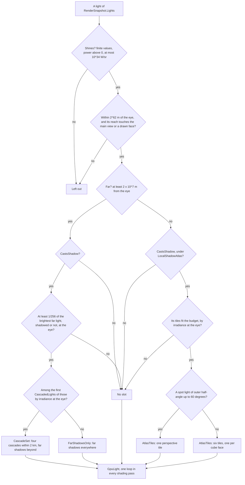

# Point and spot light shadows, and lights instead of one sun

Ticket: `ter-s9cv`, a member of the rendering upgrade epic (`ter-sglu`, [rendering-upgrade.md](rendering-upgrade.md)). The part "Lights instead of one sun" has its own ticket, `ter-bpvl`. The user approved the decisions of the local shadows on 2026-10-11 and those of "Lights instead of one sun" on 2026-10-21 (see "Decisions"). This version, of 2026-10-25, compares the design with main at `5479c5f1`, which has the PBR BRDF, the HDR pipeline with bloom and the automatic exposure with pre-exposure ([pbr-brdf.md](pbr-brdf.md), [auto-exposure.md](auto-exposure.md), ARCHITECTURE.md). It also fits the design to the work in flight on five branches (see "The work in flight on other branches"). Two forks are settled (see "Settled forks").

## Goal

Today the sun is a special light. A scene names one frame as the sun, and only the sun gets cascaded shadow maps, far shadows and its own terms in the impostor captures. Point and spot lights have an explicit range and cast no shadows. After this epic:

- Every light is a property of an entity, in SI units. A star is an entity with a point light, as a lamp is.
- The renderer gets one list of lights and shades them in one loop. A light far from the camera, such as a star, casts its shadows as the sun does today: cascaded shadow maps within 2 km and far shadows beyond. Several stars can do so, within a budget.
- Point and spot lights near the camera cast shadows from a shared atlas of depth tiles, within a tile budget, so that a ship's corridors look right. A tile whose light and casters do not move is not drawn again.

## Terms

| Term | Meaning |
|---|---|
| Light | The `LightData` of an entity: a sphere of radius R that emits a power P, everywhere (a point light) or through a cone (a spot light). |
| Power, P | The radiant power that leaves a light, in W. The renderer treats visible light as one band. |
| Intensity, I | W/sr. A point light: P / (4π). A spot light: P / (2π (1 − cos θ_o)), with θ_o the outer half-angle. |
| Irradiance, E | W/m²: the light that reaches a surface from one light. color × I / d² at distance d, times a spot light's cone. |
| Radiance, L | W/(m²·sr): what emissive materials, glow puffs, the ambient colors, the stars and the HDR image hold. |
| Pre-exposed radiance | Radiance times the exposure scale k = 2^S, at most `MaxRadiance` = 32,256 per channel, capped before the product by `exposed` ([auto-exposure.md](auto-exposure.md), and ARCHITECTURE.md, "Portable Vulkan"). |
| S_max | The highest exposure in stops that a frame can use: `FixedExposure.Stops`, or `AutoExposure.MaxStops`. |
| The cutoff radiance, R_cut | 2⁻¹³: a pre-exposed radiance that both tone curves show below half an 8-bit step of the output (see "The cutoff and the reach"). |
| The cutoff irradiance, E_cut | π · R_cut / 2^S_max, in W/m²: the irradiance at which a white matte surface at the highest exposure sends R_cut. One constant per renderer. |
| Reach | min(√(c_max · I / E_cut), `MaxReach`), in m, with c_max the largest channel of the light's color: where the light's brightest channel falls to E_cut. |
| Far, near | A light is far when its distance from the eye is at least `FarDistance`, 2 × 10⁷ m. Otherwise it is near. |
| Irradiance at the eye | The luminance of color × I / max(d², R², (1 cm)²), with d the light's distance from the eye. The one measure by which lights rank for shadows. |
| Shadow slot | How a light casts shadows in a frame: a `LightShadow`, a union of `CascadeSet`, `FarShadowsOnly` and `AtlasTiles`. Its default holds no case and means no shadows. |
| Cascade set | The four cascaded shadow maps of one far light, fitted to the main view as today's sun cascades are. |
| Far shadows | The analytic test of a light's disc against the bounding sphere of each caster: today's `sunVisibility`, now per light. |
| Occluder range | A run of the frame's occluder list: the far shadows of one light. |
| Caster | An instance with `RenderFlags.CastsShadow`, visible or not. |
| The atlas | `ShadowAtlas`: one 2D array depth image of `Tiles` layers of `TileSize`² texels. |
| Tile, layer | A tile is one layer of the atlas. A spot light takes one, a point light six, one per cube face. |
| Tile view | One tile as a frame uses it: its layer, its light and its aim (the spot's cone or one cube face). |
| The budget | `LocalShadowAtlas.Tiles`, the number of layers. |
| Tile record | What a layer holds: the light, its aim and its casters, relative to the light, from the frame that drew the layer. |
| Stale | A tile record that no longer matches its light and casters by a quarter of a texel or more (see "The cache"). |
| Shadow-map mode | How a shading pass samples the maps: `ShadowMapsNone` (the impostor capture), `ShadowMapsMainView` (lighting, transparent, lit puffs) or `ShadowMapsHolding` (the environment faces). Today's `SunShadows*` of the environment map, renamed. |
| Drawn frame, step | As in [auto-exposure.md](auto-exposure.md) and ARCHITECTURE.md, "The order of a rendered frame". |

## Decisions

The user made the decisions marked (User). This design settled the others by the project's rules. Each has its reason. A decision marked "(kept)" comes from the text that the user approved on 2026-10-21. A decision marked "(changed)" replaces that text, and says why.

### Made by the user

1. Point and spot lights cast shadows within a fixed budget, so that interiors such as a ship's corridors look right. (User, 2026-10-11)
2. All local-light shadows share one atlas. A spot light uses one perspective tile, and a point light six, one for each cube face. (User, 2026-10-11)
3. The renderer ranks the shadow-casting lights by importance each frame, and only the top lights get tiles, within a tile budget. (User, 2026-10-11)
4. The renderer caches a tile while its light and its casters do not move. A cached tile costs nothing to draw. (User, 2026-10-11)
5. The renderer culls casters on the CPU against the light's reach sphere or cone. (User, 2026-10-11)
6. Sampling uses PCF (percentage-closer filtering), with a depth bias scaled to the tile's texel size. (User, 2026-10-11)
7. The GPU cost is measured for 4, 16 and 64 shadowed lights, and the feature is switchable. (User, 2026-10-11)
8. The sun stops being a special case. Every far light gets what the sun gets today: far shadows against its own disc, cascaded shadow maps within a budget, and baking into impostor captures. Its brightness comes from its power over its distance squared. (User, 2026-10-11)
9. Every light quantity is in SI units of radiant energy. (User, 2026-10-21)
10. The renderer gets one list of lights. (User, 2026-10-21)
11. The reach of a light derives from its power. (User, 2026-10-21)
12. `World.SunFrame`, `World.SunColor` and `World.SunIntensity` go away, and a star is an entity with a point light. (User, 2026-10-21)
13. A lamp without a shadow tile lights the far side of a wall within its reach. If a scene shows the leak, the fix is a tile for that lamp, not a range. (User, 2026-10-21)

### Settled by this design

14. A light is far when its distance from the eye is at least `FarDistance` = 10,000 × `ShadowCascades.Distance` = 2 × 10⁷ m, by the pure predicate `LightUnits.IsFar`. Far chooses only how the light casts shadows. (kept) Across the 2 km of the cascades, the direction of a far light changes by at most 10⁻⁴ rad and its irradiance by at most 0.02 %, so one direction serves the whole cascade set.
15. A point light's intensity is P / (4π). A spot light sends its power through its outer cone: I = P / (2π (1 − cos θ_o)), so a narrower cone with the same power is brighter. The fade between the inner and the outer cone is not counted in that solid angle. (kept)
16. The cutoff radiance R_cut is 2⁻¹³ of pre-exposed radiance, and E_cut = π · R_cut / 2^S_max. (changed) The approved text took 1/256 of output white. That is too bright: the sRGB encoding is steep near black, and Hable's curve has a linear toe, so a pre-exposed 1/256 shows as about 10 of 255 under Hable. 2⁻¹³ is the largest power of two that shows below half an 8-bit step under both curves: ACES fitted maps it to black, and Hable to 0.31 of a step. S_max is fixed for the renderer's life, so E_cut is one constant ([auto-exposure.md](auto-exposure.md), decision 12).
17. The reach is at most `MaxReach` = 5 × 10¹⁸ m, a light is kept only within `ShaderInput.PositionLimit` = 2^62 ≈ 4.6 × 10¹⁸ m of the eye, and the largest channel of color × intensity is at most `MaxIntensity` = 10³⁴ W/sr. The batcher multiplies the color and the intensity in doubles (`LightUnits.RadiantIntensity`) and keeps only the product, `PreparedLight.RadiantIntensity`, because I alone can pass the largest float for a narrow, powerful spot light of dim color. So every distance², reach² and irradiance stays a finite 32-bit float in the shaders and on the CPU (see "Portable Vulkan"). The Sun has 3 × 10²⁵ W/sr, and the most luminous known stars about 10³² W/sr. (Settled, 2026-10-26) Main's portable rules met this decision in three limits, and Part 4 settled them so: intensity and radiance are different quantities, so the intensity has its own reader, `ShaderInput.Intensity`, with the limit `MaxIntensity`, and radiances keep `RadianceLimit` = 2^64; the shaders cap each light's irradiance at `IrradianceLimit` = 2^64 W/m² before the BRDF; and main's `PositionLimit` = 2^62 m wins over the old 2 × `MaxReach` (see "Main's limits and decision 17"). The cap touches no real scene: 2^64 W/m² is about 3 × 10¹¹ times the flux at the Sun's surface.
18. The irradiance divides by max(d², R², (1 cm)²). Outside a sphere that emits evenly, the irradiance is exactly I / d², so the light's own radius is the honest floor. The 1 cm floor of today stays for a light of radius 0.
19. Every light follows today's rule of the sun's geometric normal: where the vertex normal faces away from the light, the light adds nothing, whatever the normal map says. One loop has one rule, and the shadow maps need a positive cosine with the geometric normal anyway. A lamp on a normal-mapped surface at a grazing angle loses a little light that it has today.
20. `SceneBatcher` decides whether a light shines, with one pure predicate, `Shines`, and leaves out a light that does not. (changed) The approved text had the snapshot builder drop a light of zero power. The builder copies every light, as it copies every instance, and the batcher drops instances of zero scale with `HasVolume`. One place decides. A light shines when its place, previous place and color are finite, each color channel is 0 or more and one is above 0, its power is finite and above 0, its radius is finite and 0 or more, a spot light's axes and cone angles are finite, and c_max · I is at most `MaxIntensity`.
21. A render light carries its entity's index, `EntityIndex`, as an instance does. A tile record names its light by it. A reused slot with a new entity cannot reuse an old tile, because the record also holds the light's place and casters.
22. A render light carries its previous place, and a spot light its previous axis. The batcher interpolates the place by alpha as it does an instance's, and the axis by a normalized linear interpolation, which falls back to the current axis when the two are nearly opposite. (kept) A spot light is symmetric about its axis, so it carries an axis, not a rotation, and a roll changes no tile.
23. The angular radius of a light at a point is asin(min(R / d, 1)), the exact angle of a sphere. (changed) Today's sun uses atan(r / d) of its owner's bounding radius. For R ≪ d the two agree, and asin with the clamp is also defined inside the sphere.
24. Lights rank for shadows by their irradiance at the eye, far lights for cascade sets and near lights for tiles. Ties keep the order of the snapshot, the slot order of the entity table, which every run shares. (changed for near lights) The approved text ranked near lights by projected size on screen, irradiance and distance. With a reach derived from the power, the reach sphere of nearly every lamp holds the camera, so its projected size is the whole screen for all of them and ranks nothing. The irradiance at the eye folds in the power and the distance, and one measure serves both kinds.
25. A far light that casts shadows gets a slot when its irradiance at the eye is at least `FarShadows.Share` of the brightest far light's, shadowed or not, and no slot otherwise. Of those, the first `RendererOptions.CascadedLights` get a `CascadeSet`, 1 by default and at most 4, and the others `FarShadowsOnly`. (kept) The approved text left the share to measure. It is 1/256: a far light dimmer than that changes a surface that the brightest lights by under a quarter of an 8-bit step, so its shadow cannot show there, and a cascade set or an occluder list for it would cost for nothing. The brightest counts whether it casts shadows or not, because it lights the same surfaces either way. See "Known limits" for the place where it can.
26. Each far light with a slot has its own occluder range, pruned by today's rules against its own angular radius. The split between casters in the maps and casters beyond them exists only for a `CascadeSet`. (kept)
27. The four cascades of each set live in the frame's uniform block, as an array of `ShadowCascades.MaxSets` entries of `GpuCascadeSet`. `MaxSets` is `RendererOptions.MaxCascadedLights`, 4, the one home of the most cascade sets, so `CheckOptions` cannot accept a `CascadedLights` that the array cannot hold. (changed) The approved text moved them to a buffer. At most four sets of 288 bytes fit the block, the CPU writes them per frame like the rest of it, and no binding is added. The splits, blend starts, texel sizes and bias parameters stay single values, because every set has the same map size and the same camera.
28. The cascade sets share one 2D array image of 4 × `CascadedLights` layers, `ShadowMap`, as today's four cascades share one.
29. The atlas is a 2D array image with one tile per layer, as the impostor atlas is. A tile renders through its own layer view, as a cascade does. PCF taps that leave a tile clamp to its edge and never read a neighbor. No packing is needed, because every tile has one size. Tiles of several sizes by importance wait for a measurement that shows a need.
30. `LocalShadowAtlas.Default` has 64 tiles of 512² texels in D32, 64 MB, the memory of the sun's cascades today. 64 layers are within the least `maxImageArrayLayers` that Vulkan guarantees, 256. A 512 texel cube face at 5 m from a lamp has texels of about 2 cm.
31. A point light's six tiles follow the cube faces of the environment map, `CubeFace` and `CubeFaces.Basis` in Vulkan's layer order, one convention for every cube in the renderer. Each tile widens its 90° by `MarginTexels` = 4 texels on every side, as each cascade keeps 4 texels free, so the PCF footprint and the normal offset stay inside the tile at the seams.
32. A spot light whose outer half-angle is above `ShadowTiles.WidestCone`, 60°, takes six tiles, as a point light does. A perspective tile needs tan θ_o, which grows without bound toward 90° and does not exist beyond it. At 60° the texels at the edge are 4 times the size of those at the center.
33. A tile uses a reversed-Z perspective projection with an infinite far plane from the light, near plane max(R, 5 cm), and depth clamping, so a caster nearer than the near plane pancakes onto it, as casters in front of a cascade box do. The tile pass adds the cascades' slope-scaled bias. The lookup moves along the geometric normal by one texel at the receiver's distance times sin(angle to the light). A tile has no receiver-plane term, because its depth is not linear across the tile. (amended in Part 6) The tile pass has its own slope-scaled bias, `LocalShadowPass.SlopeBias` = 2.5, not the cascades' 1.5 (`ShadowPass.SlopeBias`). Measured on a lit floor that casts shadows under a spot light: with 1.5, acne showed on 705 pixels at a light angle of 30° and on 46 pixels at 60°; with 2.5, on none. A receiver-plane term is not the alternative: a tile's depth is not linear across the tile, and its screen derivatives are undefined inside the light loop, which is non-uniform control flow. `ALitFloorUnderASpotLightHasNoAcne` at 0°, 30° and 60° bounds the bias from below, and `AShadowMeetsTheBaseOfAThinCasterOnTheFloor` bounds the bias and the normal offset from above: a shadow still meets the base of a wall 4 cm thick at 30° and of a plate 5 cm thick at 60°, which a bias of 4 or a normal offset of 3 texels breaks.
34. A tile record is stale when its layer passed to another light, the camera's frame changed (`RenderSnapshot.OriginFrameId`), a caster entered or left the tile, the light's aim turned, or a caster moved, turned or scaled against the light by a quarter of the smallest texel where it shows, at its nearest point, or more, and by more than float rounding of its pose (see "The cache"). Positions near the camera are camera-relative floats, so their low bits change as the camera moves. A bitwise key misses every frame, and the impostor captures already compare by an error against a threshold.
35. A light keeps its layers while it stays within the budget, and a light new to the budget takes the lowest free layers. The set of lights with tiles is a pure function of the frame's ranking. Only the mapping to layers keeps state, which the cache needs.
36. The batcher prepares the frame's casters once, interpolated, as `ShadowCaster`s. The cascade sets, the far shadows and the tiles read them. Today `ShadowPass` and `CollectFarShadows` each interpolate every caster.
37. The batcher chooses the far slots. `LocalShadowPass.Prepare` chooses the tiles. `FrameResources.Write` turns each `PreparedLight` into a `GpuLight` after every pass's `Prepare`. A light is prepared once, as an instance is (`PreparedInstance`), and its GPU form is written once, after its slot is complete.
38. The light part of the impostor signature becomes today's rule of the point and spot lights, applied to every light: the sum of the irradiance at the object and the sum of each light's direction in object space weighted by its irradiance. The sun's own terms go. (changed) The approved text kept each light's irradiance and direction in a list per capture. That needs a list of variable length per capture and a match of lights between frames. In a scene lit by one star, the new rule gives the turn of its direction times its share of the total light, which is the approved rule. "Known limits" names its one blind spot.
39. Impostor captures sample no tiles, as they sample no cascades: they bind only sets 0 and 1. Glass, lit puffs and the environment faces sample the tiles.
40. The setting is `RendererOptions.LocalShadows`, a `LocalShadowSetting`: a `[GeneratedUnion]` of `NoLocalShadows`, its zero case, and `LocalShadowAtlas(Tiles, TileSize)`, with a `Problem` check that `CheckOptions` calls. It is on by default and off in `Gpu.Headless` and `GpuTesting.Headless`, as the environment map and the impostors are. The form is the orchestrator's rule for every setting of the epic (environment-map.md, decision 15).
41. `CascadedLights` is a plain `int` option from 0 to 4, beside `ShadowMapSize`, its analogue. 0 gives every shadowed far light far shadows only.
42. `AutoExposure.Default` becomes −14 to +10 stops. A sunlit white hull at 1 AU wants −11, so −14 keeps today's 3 stops of margin. A cabin lit by a household lamp of 2.5 W at 3 m wants +6.4, so +10 keeps more than 3 stops. The impostor atlas needs a second look only above +12 ([auto-exposure.md](auto-exposure.md), "The impostor atlas"). E_cut follows: 3.7 × 10⁻⁷ W/m².
43. Bloom's threshold stays 1. It compares pre-exposed light, which SI units do not change. The Sun's disc, at its real radiance of 2 × 10⁷ W/(m²·sr), shows about 10,000 after pre-exposure in a sunlit view, so its glow grows from a halo of a few disc sizes to one of about 150 px at 1080p. That follows the user's rule for bloom: nothing treats the sun as special, and its glow comes from its brightness alone (User, 2026-10-25, ARCHITECTURE.md, "Bloom").
44. A scene gives a star the whole power of the star, 3.828 × 10²⁶ W for the Sun, so that 1 AU gives the solar constant, 1,361 W/m². A lamp gets the radiant power of its light, about 2.5 W for a household bulb of 800 lumens. The emission of a star's sphere comes from its light, by `PointLightData.SurfaceRadiance` = color × P / (4π² R²), so the two cannot disagree. A scene that puts its "sun" frame near moves the star to 1 AU in the same direction. (kept)
45. No clustered or tiled light list. Each shading pass loops over every kept light, as today. The cost part measures it (see "Cost"), and a ticket follows only if a measurement shows a need.
46. The atlas is G-buffer set binding 8, after SSAO's 7, and the tile views are frame set binding 15, after the environment map's 12 to 14. Both are partially bound, so with `NoLocalShadows` they stay empty, as the environment map's bindings do when it is off.
47. A sized light's highlight, the widened GGX lobe of Karis 2013 for a sphere light, is not part of this epic. Each light now has its radius, which the PBR design waited for (pbr-brdf.md, "Compared with a design from scratch"). The lobe is a change of the BRDF with its own tests, so it becomes a ticket.

## How the lights work today

Each line of this section matches main at `5479c5f1`.

- A scene sets `World.SunFrame`, `World.SunColor` (default white) and `World.SunIntensity` (default 1). Without a sun frame, the snapshot still has a sun, straight down the camera frame's −Y axis, of intensity 1. So a world without any light setting today is lit from above.
- `RenderSnapshotBuilder.BuildSun` gives `RenderSnapshot.Sun` (a `RenderSun`) the direction from the render origin to the sun frame's origin, and the angular radius atan(r / d), where r is the bounding radius of the render row of the frame's owner.
- An entity carries `RenderData.Light`, a `LightData` in `Tertius.Simulation`: `PointLightData(Offset, Color, Intensity, Range)` or `SpotLightData(Offset, Color, Intensity, Range, InnerConeAngle, OuterConeAngle)`. The builder turns it into a `RenderLight` in `Tertius.Core`: `PointRenderLight(Position, Color, Intensity, Range)` or `SpotRenderLight(Position, Direction, Color, Intensity, Range, InnerConeAngle, OuterConeAngle)`, 56 bytes, at the place of the last tick, with no previous place.
- `SceneBatcher.CollectLights` leaves out a light of zero intensity or range, or whose range sphere is outside the frustum, and writes a `GpuLight` of 64 bytes: position and range, color × intensity and kind, the spot's axis and cosines.
- `SceneBatcher.HasSun` decides whether the sun lights the frame. `WriteConstants` writes `sunDirection` (w the angular radius) and `sunRadiance` into the frame constants. `CollectFarShadows` builds one occluder list for the sun, those of casters in the maps first, pruned against the sun's angular radius.
- `ShadowPass` fits four cascades to the main view along `LightBasis.FromSunDirection`, interpolates the casters within 2 km and draws them into the four layers of `ShadowMap`, D32 with linear filtering (D16 as a fallback).
- `lighting.glsl` has `sunVisibility` (far shadows), `sunReaches`, `sunLight`, `lightReaches` with the window of Karis 2013 to the range, `localLights`, `ambientLight`, `surfaceRadiance(s, preExposedEmission, position, V, bool shadowMaps, float exposure)` and `scatteredLight` for lit puffs. The lighting and transparent passes pass `shadowMaps` true, and the impostor capture false with an exposure of 1.
- `ImpostorManager` keeps a `LightSignature` per capture: the sun's radiance times its visibility, both ambient colors, the up, the sum of local irradiance and its direction. It also keeps the sun's direction in object space, whose angle counts in the capture error on its own.
- Every pass that writes the HDR image or the emissive target writes pre-exposed radiance. `AutoExposure.Default` clamps to −8 to +8 stops "in today's units", and says that the lights plan retunes it. Bloom's threshold is 1 after the exposure.
- Six reference images exist in `tests/Tertius.Rendering.Tests/ReferenceImages`: five puff scenes and the frame outlines. `puffs-lit` is lit by the snapshot's sun.

`directLight` and `directRadiance` did not exist on main at `5479c5f1`. The environment map's Part 5 added them, and main has them since the environment map merged (see "The work in flight on other branches"). This design builds on them.

## Lights instead of one sun

### The model

A light is a property of an entity. Every light is the same kind of thing: a sphere that emits a power. A star is an entity with a point light, as a lamp is. (User)

The renderer gets one list of lights. It shades each light per pixel, in one loop, with the direction, the distance and the irradiance at that pixel. Whether a light is far follows from geometry, and far chooses only how the light casts shadows. (kept)

### Units

| Quantity | Unit | Where |
|---|---|---|
| Power | W | `PointLightData.Power`, `SpotLightData.Power`, and the render lights |
| Radius | m | `Radius` of both light cases |
| Intensity | W/sr | Derived in the batcher, `LightUnits` |
| Irradiance | W/m² | The light that reaches a surface, and E_cut |
| Radiance | W/(m²·sr) | Emissive materials, glow puffs (`GlowPuffs.Radiance`), the sky and ground colors of `World.Ambient`, the star field, the HDR image before pre-exposure |

A color is linear RGB and scales a quantity per channel. Two examples set the scale. The Sun, 3.828 × 10²⁶ W, gives 1,361 W/m² at 1 AU, and a sunlit white surface sends 433 W/(m²·sr). A lamp of 2.5 W gives 0.05 W/m² at 2 m.

The hemisphere ambient light keeps its formula, and its colors become radiances. A surface under a uniform sky of radiance L gets the irradiance πL, and a matte surface sends back albedo × L. (kept)

The star field becomes a radiance too. Its scale is settled fork 1: physical stars.

### Light data

In `Tertius.Simulation` (`src/Tertius.Simulation/Entities/LightData.cs`):

```csharp
/// <param name="Offset">The light's pose relative to the entity. A zeroed rotation counts as the identity.</param>
/// <param name="Color">Linear RGB that scales the power per channel.</param>
/// <param name="Power">The radiant power that leaves the light, in W. A light of 0 or less adds no light.</param>
/// <param name="Radius">The radius of the emitting sphere, in m, 0 or more.</param>
/// <param name="CastsShadow">Whether the light casts shadows, within the renderer's budgets.</param>
public readonly record struct PointLightData(Pose Offset, Vector3 Color, float Power, float Radius, bool CastsShadow)
{
    /// <summary>
    /// The radiance that a sphere of <see cref="Radius"/> sends from its surface when it emits <see cref="Power"/> evenly:
    /// Color · Power / (4π² Radius²), in W/(m²·sr). A scene gives a star's sphere this emission.
    /// </summary>
    public Vector3 SurfaceRadiance { get; }
}

public readonly record struct SpotLightData(
    Pose Offset, Vector3 Color, float Power, float Radius, bool CastsShadow, float InnerConeAngle, float OuterConeAngle);
```

`Intensity` and `Range` go. In `Tertius.Core` (`src/Tertius.Core/Seams/RenderLight.cs`), the render cases change in the same way, and gain the entity's index and the previous values:

```csharp
public readonly record struct PointRenderLight(
    uint EntityIndex, Vector3 Position, Vector3 PreviousPosition, Vector3 Color, float Power, float Radius, bool CastsShadow);

public readonly record struct SpotRenderLight(
    uint EntityIndex, Vector3 Position, Vector3 PreviousPosition, Vector3 Direction, Vector3 PreviousDirection,
    Vector3 Color, float Power, float Radius, bool CastsShadow, float InnerConeAngle, float OuterConeAngle);
```

The union `RenderLight` keeps its form and grows from 56 bytes to about 96. `UnionSizeTests` pins the new size.

`RenderSnapshotBuilder.BuildChunk` fills the previous place from the entity's previous pose, by the rule for instances, including the rule for a camera that changed frame: `LightPose(previous, offset)` beside `LightPose(current, offset)`.

### The cutoff and the reach

```
E_cut = π · R_cut / 2^S_max                       R_cut = 2⁻¹³, S_max = FixedExposure.Stops or AutoExposure.MaxStops
reach = min(√(c_max · I / E_cut), MaxReach)       c_max = the largest channel of the color
```

- A white matte surface sends E / π. At the highest exposure, the irradiance E_cut gives the pre-exposed radiance R_cut, which ACES fitted shows as black and Hable's curve as 0.31 of an 8-bit step. So a light below E_cut, alone, changes no pixel at any exposure, and beside other light it changes a pixel by less (decision 16).
- The batcher computes the intensity and the reach in doubles, in each drawn frame, after the interpolation. It culls lights by the reach, and the window of Karis 2013 takes the reach as its range. No second value can disagree with the power. (kept)
- With the new default S_max of +10, E_cut is 3.7 × 10⁻⁷ W/m². A lamp of 2.5 W reaches 730 m, one of 25 W 2.3 km, and the Sun about one light-year. Under `FixedExposure(0)`, which the tests use, E_cut is 3.8 × 10⁻⁴ W/m², and a test light of intensity 1 W/sr reaches 51 m.
- A lamp without a tile lights the far side of a wall within its reach, which is far longer than today's ranges of 8 to 55 m. (User) "Cost" measures what the long reach costs per pixel.

### Far and near

```
FarDistance = 10,000 × ShadowCascades.Distance = 2 × 10⁷ m
IsFar(d) = d ≥ FarDistance          d = the distance from the eye, in doubles
```

- `LightUnits.IsFar` is a pure predicate, and unit tests pin it. (kept)
- A caster h meters above a receiver at distance x from the camera moves its shadow by h · x / d between the true direction and the set's one direction. For a caster 100 m high at the end of the cascades, that is 1 cm, about a two-hundredth of a texel of the last cascade, so a light that crosses the line changes its shadow technique with no visible pop. (kept)
- In normal play no light crosses the line. Lamps sit within meters of the camera, and stars millions of kilometers away. The Sun's own radius, 7 × 10⁸ m, is larger than `FarDistance`, so the Sun is far wherever the camera is.

### Shadows of each light

The shadow slot of a light says how it casts shadows. It is a closed set, so it is a `[GeneratedUnion]` of positional record structs (STYLE.md). Its default holds no case and means no shadows.

```csharp
/// <summary>A run of the frame's occluder list: the far shadows of one light.</summary>
internal readonly record struct OccluderRange(int Start, int Count);

/// <summary>A far light with cascade set <paramref name="Set"/> and far shadows. The first <paramref name="Mapped"/> occluders
/// of <paramref name="Occluders"/> are casters that the set also draws.</summary>
internal readonly record struct CascadeSet(int Set, OccluderRange Occluders, int Mapped);

/// <summary>A far light with far shadows everywhere and no maps.</summary>
internal readonly record struct FarShadowsOnly(OccluderRange Occluders);

/// <summary>A near light with the frame's tile views <paramref name="First"/> to First + Count − 1: one for a spot light,
/// six for a point light, in cube face order.</summary>
internal readonly record struct AtlasTiles(int First, int Count);

[GeneratedUnion(typeof(CascadeSet), typeof(FarShadowsOnly), typeof(AtlasTiles))]
internal readonly partial struct LightShadow;
```

The batcher and the local shadow pass choose the slots with pure predicates, in this order:

1. A light without `CastsShadow` gets no slot.
2. A far light whose irradiance at the eye is below 1/256 of the brightest far light's, shadowed or not, gets no slot (decision 25).
3. The other far lights rank by their irradiance at the eye. Ties keep the snapshot order. (kept)
4. The first `CascadedLights` of them get `CascadeSet` 0, 1, and so on. Each set is four maps of `ShadowMapSize`², 64 MB at the default size. (kept)
5. The rest of them get `FarShadowsOnly`.
6. Under `LocalShadowAtlas`, the near lights get `AtlasTiles` by the ranking of "The budget", in `LocalShadowPass.Prepare`.

Each far light with a slot has its own occluder range. `CollectFarShadows` walks the frame's casters once for each such light, with today's pruning against that light's own angular radius at the camera: a caster beyond the maps must cover a pixel or a fifth of the light's angular radius, and a caster in the maps must hide 4 % of the light from where its far receivers start. Only a `CascadeSet` puts the casters that the maps draw first and counts them by the fade where the maps end. For a `FarShadowsOnly` light every caster is a sphere everywhere. (kept)

A sphere shadow of a long or flat caster near the camera looks wrong. If a scene shows it, the fix is to give that light a cascade set, not a special rule. (kept) The far shadows cost the shadowed far lights times their casters, per pixel. Each list is pruned against its own light, so the cost grows only with shadows that can show.

### Interpolation

Today a light sits at the place of the last tick, while instances interpolate between ticks, so a lamp on a moving ship lags its fixture by up to one tick. The analogue of a light is an instance, so a light interpolates in the same way. (kept)

The batcher interpolates the place by alpha with the instances' alpha, and a spot light's axis by `LightUnits.InterpolateAxis`, before it computes the distance, the reach and `IsFar`.

### Precision

Light positions reach the renderer as floats relative to the render origin, which the builder computes in doubles, as today. (kept)

- A star at 1 AU has a position error of about 8 km, the float step at 1.5 × 10¹¹ m. That turns its direction by less than 10⁻⁷ rad.
- In the shader, `light.positionReach.xyz − position` loses the pixel's position for such a light. The result is the direction from the eye to the star, with the same error, and the same distance to within 10⁻⁸.
- The batcher computes distances in doubles, so a light beyond 2^62 m, short of the 1.8 × 10¹⁹ m where a float's square overflows, is culled by decision 17 and never reaches a shader.

### Exposure, bloom and the HDR image

The exposure ticket built pre-exposure ([auto-exposure.md](auto-exposure.md), "Pre-exposure"). Every writer pre-exposes with the exposure that the frame before decided, and the tone map multiplies by none. This epic changes no writer. In SI units:

- A sunlit white surface sends about 433 W/(m²·sr), and the Sun's disc about 2 × 10⁷. In a sunlit view at −11 stops, they show at 0.21 and about 9,800 before the tone curve, both below the surfaces' cap `MaxRadiance`, 32,256 (ARCHITECTURE.md, "Portable Vulkan").
- The automatic exposure's clamp moves to −14 to +10 stops (decision 42). E_cut follows from +10.
- Highlight metering (`ter-is7n`) maps the bright trim edge to 1.0. A sunlit white hull then wants −8.6 stops, inside the new clamp.
- Bloom's threshold stays 1, and the Sun's glow grows (decision 43). Part 5 reviews it in captures.

### The shaders

The environment map's Part 5 gives `lighting.glsl` the function `directLight`, which sums the sun and the point and spot lights, and a `uint sunShadows` mode in place of `bool shadowMaps`. This epic makes `directLight` one loop over the light list, and renames the modes for every light's maps:

```glsl
// lighting.glsl
const uint ShadowMapsNone = 0u;       // far shadows only: the impostor capture
const uint ShadowMapsMainView = 1u;   // cascades by view depth with their blend bands, and the tiles: lighting, transparent, lit puffs
const uint ShadowMapsHolding = 2u;    // the finest cascade whose box holds the point, and the tiles: the environment faces

// The irradiance in W/m² per channel that `light` sends to `position` before its shadows: color × intensity over
// max(d², R², 1 cm²), times the window of Karis 2013 to the reach and a spot light's cone. 0 at or beyond the reach. L is
// the unit direction toward the light, zero when the position is at the light's center, and d its distance.
vec3 lightIrradiance(GpuLight light, vec3 position, out vec3 L, out float d);

// The share of `light` that its shadow slot lets through at `position`. geometricNdotL is positive.
float lightVisibility(GpuLight light, vec3 position, vec3 L, float d, vec3 geometricNormal, float geometricNdotL,
    uint shadowMaps);

// Every light of the list reflected toward V, in the order of the list, so the sum rounds the same way on every run.
vec3 directLight(ShadingInput s, SurfaceLobes lobes, vec3 position, vec3 V, uint shadowMaps);

// A lit puff: albedo / (4π) times every light's irradiance and visibility at its center, with L as the normal.
vec3 scatteredLight(vec3 albedo, vec3 position);
```

The loop:

```glsl
vec3 directLight(ShadingInput s, SurfaceLobes lobes, vec3 position, vec3 V, uint shadowMaps)
{
    vec3 color = vec3(0.0);
    for (uint i = 0u; i < frame.counts.x; i++)
    {
        GpuLight light = lights[i];
        vec3 L;
        float d;
        vec3 irradiance = lightIrradiance(light, position, L, d);
        float geometricNdotL = dot(s.geometricNormal, L);
        if (irradiance == vec3(0.0) || dot(s.normal, L) <= 0.0 || geometricNdotL <= 0.0)
            continue;
        float visibility = lightVisibility(light, position, L, d, s.geometricNormal, geometricNdotL, shadowMaps);
        if (visibility > 0.0)
            color += brdf(s, lobes, V, L) * irradiance * visibility;
    }
    return color;
}
```

`lightVisibility` switches on `light.shadow.x`:

| Case | Visibility |
|---|---|
| None | 1 |
| Cascade set | `farShadowVisibility` with the fade where the maps end, times `cascadeShadow` (main view) or `cascadeShadowHolding` (faces). The impostor capture takes the far shadows alone with weight 1. |
| Far shadows only | `farShadowVisibility` with weight 1 |
| Atlas tiles | `tileShadow` in the main view and the faces, 1 in the impostor capture |

`shadows.glsl` gets the light's set or tiles as a parameter:

```glsl
float cascadeShadow(uint set, vec3 position, vec3 geometricNormal, float NdotL);          // was sunShadow
float cascadeShadowHolding(uint set, vec3 position, vec3 geometricNormal, float NdotL);   // was sunShadowHolding
float beyondShadowMapsHolding(uint set, vec3 position);                                   // the boxes differ per set
float beyondShadowMaps(vec3 position);                                                     // unchanged: one set of splits
float farShadowVisibility(vec3 position, vec3 L, float angularRadius, uvec4 occluders, float beyondMaps);   // was sunVisibility
float tileShadow(GpuLight light, vec3 position, vec3 L, float d, vec3 geometricNormal, float NdotL);
```

`tileShadow` picks the tile: the one tile of a spot light, or, for a point light, the cube face that holds the direction from the light to the position (`cubeFaceOf` in `cube_faces.glsl`, the GLSL twin of `CubeFaces.Locate`). It moves the lookup along the geometric normal by `NormalOffsetTexels` × the tile's texel size at distance d × sin(angle to the light), projects it with the tile's matrix, and takes the cascades' 4 × 4 hardware PCF taps with zero gradients in the tile's layer.

`frame.glsl`:

```glsl
struct GpuLight
{
    vec4 positionReach;       // xyz world position, w reach in meters
    vec4 intensityKind;       // rgb color × intensity in W/sr, w 0 = point, 1 = spot
    vec4 directionCosOuter;   // xyz unit spot axis, w cos(outer half-angle); zero for a point light
    vec4 spotRadius;          // x cos(inner half-angle), zero for a point light; y the emitter's radius in meters
    uvec4 shadow;             // x the slot: 0 none, 1 cascade set, 2 far shadows only, 3 atlas tiles; y the set or the first tile view; z the tile views
    uvec4 occluders;          // x the first occluder, y the occluders, z how many of the first ones the cascade set also draws
};                            // std430: 96 bytes

struct GpuCascadeSet
{
    mat4 viewProj[4];         // shadow clip space from world space per cascade; xy in [-1, 1], z reversed (1 nearest the light)
    vec4 axisX;               // xyz light-space x axis, w lateral half-extent / depth half-range of the boxes
    vec4 axisY;               // xyz light-space y axis
};

struct GpuShadowTile
{
    mat4 viewProj;            // tile clip space from world space: reversed-Z infinite perspective from the light
    uint layer;               // the atlas layer
    float texelPerMeter;      // the world size of one texel at 1 m from the light
    float near;               // the near plane, in meters
    float unused;
};                            // std430: 80 bytes

// FrameBlock: sunDirection, sunRadiance, shadowViewProj, shadowAxisX and shadowAxisY go. counts.y and counts.w become
// unused, because each light carries its own occluders. At the end:
//     GpuCascadeSet cascadeSets[4];   // ShadowCascades.MaxSets; set i belongs to the light whose slot names it

layout(set = 0, binding = 15, std430) readonly buffer ShadowTileBlock { GpuShadowTile shadowTiles[]; };
```

`gbuffer_inputs.glsl` gains `layout(set = 2, binding = 8) uniform texture2DArray shadowAtlas;`, read with the existing comparison sampler at binding 6.

The C# mirror `GpuLight` (`Scene/GpuTypes.cs`) packs the `LightShadow` union and the `LightSpread` union into the two `uvec4`s and the spot fields, as `GpuInstance` packs `HemisphereUp` into a `Vector4` with a tag. `GpuLight.From(in PreparedLight)` is the one place that encodes them.

### The impostor signature

Today the signature of a capture keeps the sun apart from one sum over the local lights. With one list, its light part is today's rule of the local lights applied to every light (decision 38):

```csharp
private readonly record struct LightSignature(Vector3 Light, Vector3 LightDirection /*, the ambient part */);
```

where

- `Light` = the sum, over the lights that reach the object, of each light's irradiance at the object, per channel, times its far shadows' visibility (`Eclipse.Visibility`, weight 1, as today).
- `LightDirection` = the sum of each light's unit direction in object space times the length of its irradiance.

`Change` takes the length of each part's difference over the larger total, as today. The capture's own sun direction and its angle term go. The environment map's branch makes the ambient part a union, `AmbientSignature`. That part does not change here.

### What goes away

- `World.SunFrame`, `World.SunColor` and `World.SunIntensity`, and their fields in `RenderView`. With them goes the default sun from above: a world without a light has no direct light.
- `RenderSun`, `RenderSnapshot.Sun`, `PreparedScene.Sun`, `SceneBatcher.HasSun` and `RenderSnapshotBuilder.BuildSun`.
- `sunDirection`, `sunRadiance`, `shadowViewProj`, `shadowAxisX` and `shadowAxisY` in the frame constants.
- `LightBasis.FromSunDirection` becomes `LightBasis.FromDirection`. `Eclipse.SunVisibility` becomes `Eclipse.Visibility`, which takes the light's direction and angular radius.
- `ImpostorManager`'s capture sun direction.
- `PreparedScene.MappedOccluderCount`, which each `CascadeSet` now holds.

### Scenes

- Each scene with the Sun (`SunAndEarth`) gives the sun's root entity a point light of 3.828 × 10²⁶ W and radius 6.957 × 10⁸ m that casts shadows, and its sphere the emission `SurfaceRadiance`, about 2 × 10⁷ W/(m²·sr). A root frame is an entity, so the light belongs to the root's entity.
- A scene that puts a "sun" frame near (`SunAt` in `DemoScenes.SurfaceYard`, the frames of `DemoScenes.cs` and `DemoScenes.DemoShuttle.cs` at about 50 m, and the reflections scene of `ter-jxv9`) gets a star entity at 1 AU in the same direction, in the scene's root frame. A star left near becomes a lamp: the old sun of `spin-station`, inside the station on its spin axis 25 m from its center, lit the floor radially, so it became the station's `hub-lamp` (settled 2026-10-26), a point light at the same place with the power 0.6 · 4π · 103² W, which gives the floor its old 0.6 W/m², the radius of a lamp and `CastsShadow`, so that Part 6's atlas gives it shadows without a change of the scene. The part that moves them makes sure that the root frame accepts an entity that far out.
- Every lamp gets a power in watts, a radius and `CastsShadow`. An emissive panel that stands for a lamp gets the radiance P / (π A) of a flat emitter of area A that sends the lamp's power. A lamp's fixture that must not darken its own light leaves `RenderFlags.CastsShadow` off.
- Every emissive material, glow puff look and ambient color gets a radiance in W/(m²·sr).
- Every scene is retuned, and its captures and the six reference images get a real review again (CLAUDE.md, "Testing").

## Point and spot light shadows

### The atlas

`ShadowAtlas` (`Frame/ShadowAtlas.cs`, new) owns one 2D array depth image of `Tiles` layers of `TileSize`², in the format of `ShadowMap.ChooseFormat` (D32 with linear filtering, else D16), a view of each layer for rendering and a view of the whole array for sampling. It is shared by all frames in flight, as the cascades and the impostor atlas are, and every use goes through `BarrierBatch`. Depth is reversed: 1 at the near plane, 0 at infinity, cleared to 0, compared with `GREATER_OR_EQUAL`, so an empty texel shadows nothing.

### The budget

`ShadowTiles.Update`, in `LocalShadowPass.Prepare`, is the one choke point of the tiles. Each drawn frame:

1. The candidates are the near lights of the frame that cast shadows. They rank by irradiance at the eye, ties in list order.
2. In that order, each candidate gets its tiles when they still fit the budget: one for a spot light of outer half-angle up to 60°, six otherwise. A candidate that does not fit is skipped, and a later one that fits still gets its tiles.
3. A light that held layers in the frame before and still has tiles keeps its layers. The others take the lowest free layers. A light that lost its tiles frees its layers.
4. Each light with tiles gets its `AtlasTiles(First, Count)` slot, and the frame's tile views get one entry per tile: the layer, the light and the aim (`ConeAim` for a spot light, `FaceAim(CubeFace)` for each face of a point light).

The set of lights with tiles is a pure function of this frame's lights. Settled fork 2 keeps this pure ranking, with no hysteresis.

### Tile views

`ShadowTiles.ViewProjection` gives each view its matrix, camera-relative world space to tile clip space:

- Spot light: forward along the light's axis, the right and up of `LightBasis.FromDirection(−axis)`, so a roll changes nothing, and tan(half-angle) = tan θ_o × TileSize / (TileSize − 2 × `MarginTexels`).
- Point light, face f: forward, right and up of `CubeFaces.Basis(f)`, and tan(half-angle) = TileSize / (TileSize − 2 × `MarginTexels`), so 90° plus four texels on every side.
- Both: the light's place as the eye, a reversed-Z perspective with an infinite far plane and the near plane max(R, 5 cm), and depth clamping in the pass.

The view's `texelPerMeter` is 2 tan(half-angle) / TileSize: the size of one texel at 1 m from the light along the view axis.

### Casters

Every caster of the frame is a `ShadowCaster`, interpolated once by the batcher (decision 36). For a tile view, a caster is drawn when:

- Its bounding sphere comes within the light's reach: |c − l| − r < reach.
- For a point light's face, the sphere is not outside the face's frustum: `CubeFaces.Culls(f, c − l, r)` is false, with the widened half-angle.
- For a spot light, the sphere is not outside the widened cone.

The pass counts the casters into mesh order with the counting sort of `ShadowPass`, and appends one indirect command per mesh and drawn view.

### The cache

`ShadowTiles` keeps a record for each layer: the light's entity index, the camera frame's id, the aim, the near plane and the half-angle, and the casters in the order of the snapshot, each with its entity index, part, mesh, position relative to the light, rotation and scale. A tile view is drawn when its layer's record is stale (decision 34):

- The layer passed to another light, or the camera's frame changed.
- The list of casters differs: one entered or left, or its mesh changed.
- The aim turned by a quarter of a texel's angle at the tile's edge, 0.5 tan(half-angle) / TileSize × cos²(edge), or more.
- A caster's position relative to the light moved by a quarter of a texel at its nearest point, 0.25 × texelPerMeter × max(|c − l| − r, near) × cos²(widest), or more, or its rotation turned it by that much at its radius, or its scale changed it by that much.

A texel at the angle α off the view axis spans cos²α of a texel on the axis at the same distance, because the projection stretches the image there by 1 / cos²α. So the rule takes the smallest texel where the caster shows. The angle "widest" is the widest angle off the axis at which the sphere shows in the tile: the angle of c − l plus asin(r / |c − l|), at most the edge, and the edge for a sphere that holds the light. The edge is the cone's rim, tan(edge) = tan(half-angle), or a face's corner, tan(edge) = √2 tan(half-angle). cos²(edge) is 1 / (1 + tan²(edge)).

The movement's threshold is at least 8 × 2⁻²³ × max(|c|, |l|, r), camera-relative: float rounding moves a caster by about that much while nothing moves. A hull of a few hundred metres around a lamp shows it. Its camera-relative center rounds to a few ulps of its distance as the camera moves, and the batcher's slerp of two equal rotations differs by about 10⁻⁷ between alphas, which turns its surface by 2 r × 10⁻⁷. Against a quarter of a texel at the near plane, about 5 × 10⁻⁵ m, either one alone would redraw every tile in every frame.

A drawn view replaces its layer's record. A cached view keeps its layer and its record, and its matrix takes the light's current place, which differs from the drawn one by less than a quarter of a texel. Like an impostor capture, the record describes the frame that drew the layer.

The records describe only submitted frames, by main's rule for the environment map's faces (ARCHITECTURE.md, "Portable Vulkan", the row of level 0 of a face that no frame has drawn, `ter-uhls`). A frame that throws after `ShadowTiles.Update` and before its submission must leave the records and the layers' owners as they were. Otherwise the next frame would take a layer that no frame drew as cached and sample its undefined content, where a Linux driver may hold NaN. So Part 6 keeps `Update` the choke point of the choice, but `Update` only reads the records and the owners: the owners and the records of the frame's drawn views take effect in `ShadowTiles.Drew`, which `DrawFrame` calls after `SubmitAndPresent`, beside `EnvironmentMap.Drew`. (Settled in the merge before Part 5: main's rule wins over Part 3's `Update`, which replaces the records itself.)

### Sampling

See "The shaders": `tileShadow`, 4 × 4 hardware PCF taps one texel apart over 5 × 5 texels, the normal offset at the receiver's distance, the tile pass's slope-scaled bias, and no receiver-plane term (decision 33).

### The setting

`src/Tertius.Rendering/LocalShadowSetting.cs` (new, public):

```csharp
/// <summary>No near light casts shadows: the renderer makes no atlas and no local shadow pass.</summary>
public readonly record struct NoLocalShadows;

/// <summary>Near lights cast shadows from an atlas of <paramref name="Tiles"/> depth tiles of <paramref name="TileSize"/>²
/// texels, ranked by their irradiance at the eye (docs/plans/local-light-shadows.md).</summary>
/// <param name="Tiles">The budget: 1 up to the device's largest image array. A spot light takes 1, a point light 6.</param>
/// <param name="TileSize">The side of a tile in texels: a power of two from 64 to 4,096, and at most the device's largest image.</param>
public readonly record struct LocalShadowAtlas(int Tiles, int TileSize)
{
    /// <summary>64 tiles of 512², 64 MB of D32.</summary>
    public static LocalShadowAtlas Default => new(Tiles: 64, TileSize: 512);
}

/// <summary>Whether near lights cast shadows. A generated union; its zero value is <see cref="NoLocalShadows"/>.</summary>
[GeneratedUnion(typeof(NoLocalShadows), typeof(LocalShadowAtlas), ZeroCase = typeof(NoLocalShadows))]
public readonly partial struct LocalShadowSetting
{
    /// <summary>Why the renderer cannot use the setting, or null when it can. The device's limits are checked apart.</summary>
    internal string? Problem { get; }
}
```

`RendererOptions` gains:

```csharp
/// <summary>Whether near lights cast shadows from a shared atlas. The default is <see cref="LocalShadowAtlas.Default"/>.</summary>
public LocalShadowSetting LocalShadows { get; set; } = LocalShadowAtlas.Default;

/// <summary>How many far lights get cascaded shadow maps, 0 to 4. Each takes ShadowMapSize² × 16 bytes. The default is 1.</summary>
public int CascadedLights { get; set; } = 1;
```

`CheckOptions` refuses a `Problem` and `CascadedLights` outside 0 to `RendererOptions.MaxCascadedLights`, with `ArgumentOutOfRangeException`, as it does for `ShadowMapSize`. It runs before the device exists, so it cannot read the device's limits. The `ShadowAtlas` constructor refuses `Tiles` above the device's `maxImageArrayLayers`, as the `ImpostorAtlas` constructor does for `ImpostorTiles` (Part 6). `TileSize` needs no device check: the setting allows at most 4,096, the least `maxImageDimension2D` that Vulkan guarantees. The headless run gains `--local-shadows off|on`, `--local-shadow-tiles N` and `--cascaded-lights N`, for the cost.

## The work in flight on other branches

All five branches below are on main now, and this branch merged main before Part 4 and again before Part 5 (both 2026-10-26). The table keeps what each one meets. The merge before Part 5 also brought the half-resolution reflection trace (`ter-ff6y`) and the environment map's portable rules (`ter-uhls`), which the rows of `ter-jxv9-ssr` and `ter-nl5u-environment-map` and "Portable Vulkan" below take in.

| Branch | What it changes that this epic meets | Must merge first? | What this epic changes in it |
|---|---|---|---|
| `ter-nl5u-environment-map`, [environment-map.md](environment-map.md) | Its faces are lit by the sun's cascades, by the finest box that holds the point, and by the point and spot lights ("How a face is lit"). Its Part 5 adds `directLight`, `directRadiance` and the `SunShadows*` modes to `lighting.glsl`, and `sunShadowHolding` to `shadows.glsl`. Its Part 3 changed `SceneBatcher.CollectLights` to keep the lights of every drawn face, and `ImpostorManager`'s ambient signature. `CubeFaces` is on its branch. | Yes, before Parts 3 and 4. This epic builds on `directLight`, the modes, `CubeFaces` and the face lights. | The modes become `ShadowMaps*` for every light's maps. A face samples every cascade set by the holding rule and the atlas tiles, which do not depend on the view. `CollectLights` keeps a face's light by its reach, not its range. Its doc's "How a face is lit" and decisions 19 and 20 say "every far light's cascade set" for "the sun's cascades". Only the main view ranks lights for tiles, so a lamp that only a face sees has no tile there. |
| `ter-is7n-highlight-metering`, `.tickets/ter-is7n.md` | The exposure target becomes the lower of the average target and a highlight target that maps the bright trim edge to 1.0. The compensation and the clamp apply after. | Yes, before Part 5, so the retune of the clamp and the captures in SI units meet the final meter. Parts 1 to 4 do not wait. | `AutoExposure.Default` becomes −14 to +10. Its captures (orbit-umbra, demo-surface, pbr-spheres) are taken again in SI units by Part 5. Its meter and its tests do not change. |
| `ter-b3h5-ssao`, `ambient-occlusion.md` on its branch | The occlusion scales only the two ambient terms (`AmbientTerms`, `hemisphereAmbient`, `occludedAmbient`). "The sun, the point and spot lights and emission do not take V." G-buffer set binding 7 is the occlusion target. | Yes, before Part 4, so `lighting.glsl` changes in one order, and before Part 6, whose atlas takes binding 8. | No code. Its GPU tests that light with the snapshot's sun, such as `TheSunAndTheLampsLightACornerAsIfThereWereNoOcclusion`, use the test star of `Gpu.Snapshot`. |
| `ter-jxv9-ssr`, `screen-space-reflections.md` on its branch | The trace reads the lit HDR image before the transparent pass, and the ambient specular term only through `ambientTerms`. Its compute shaders, the full-resolution trace, the half-resolution trace and the upsample of `ter-ff6y`, include `lighting.glsl` and `gbuffer_inputs.glsl` through `reflection_pixel.glsl` and bind set 0. Only the full-resolution trace and the upsample read light, the ambient light through `reflectionDelta`; none of them runs the light loop. Its scene `DemoScenes.Reflections` calls `SunAt`. | No. It merged first, so Part 4 changed `lighting.glsl` after it, and Part 4 moved the reflections scene's sun to a star at 1 AU. | No code. The bindings that this epic adds, frame set 15 and G-buffer set 8, are not read by the reflections' shaders, so they need no compute stage, as the cascades' binding 5 needs none: the shaders declare the atlas through `gbuffer_inputs.glsl` but never use it statically. The reflections' shaders bind set 0, so they see the new `FrameBlock` when Part 4 changes it. |
| `ter-mgze-glass` | The transparent pass blends with dual-source blending: outColor + target × transmittance. `lobesRadiance` takes the lobes, and the pane's radiance is capped at 32,256 × (1 − T), `MaxRadiance` × (1 − T), so the blend stays at or below 65,504 (ARCHITECTURE.md, "Portable Vulkan"). | Yes, before Part 4. | `lobesRadiance` calls the one loop through `directLight`, so glass takes every light and its tiles. The cap of 32,256 × (1 − T) follows the loop, so no light can overflow the blend. Glass that sets `CastsShadow` casts an opaque shadow into the tiles, as it does into the cascades today. |

## Every reader and writer

The steps follow ARCHITECTURE.md, "The order of a rendered frame", in a short numbering of this table's own: 3 batching, 4 the shadow maps, then the environment faces and prefilter, 5 the impostor captures, 6 the G-buffer, 7 lighting, 8 transparent. ARCHITECTURE.md numbers the same steps 3, 4, 5 and 6, 7, 8, 11 and 14. Its steps 9, 10, 12 and 13 between them, the depth pyramid, the occlusion, the radiance pyramid and the reflections, read none of the values below but the star field's scale, which the reflections' fallback reads through `environmentSpecular`. Every pass's `Prepare` runs on the CPU in step order, then `FrameResources.Write` writes the frame's buffers ("W" below), then every pass records. The snapshot builder runs at the sync point, step 11 of the tick.

| Value | Written by | When | Read by | When | Stored in | Analogue |
|---|---|---|---|---|---|---|
| `Power`, `Radius`, `CastsShadow` of `PointLightData` and `SpotLightData` | Scenes and components, through `RenderData.Light` of their own entity. Later the content loader and the asset importer. | During a tick | `RenderSnapshotBuilder` | The sync point | The entity's render row | `Intensity` and `Range` today |
| `PointLightData.SurfaceRadiance` | None: derived from the light | | Scenes, for a star's sphere | Scene build | None | `GgxLobe`'s derived values |
| `EntityIndex`, `Power`, `Radius`, `CastsShadow`, `PreviousPosition`, `PreviousDirection` of the render lights | `RenderSnapshotBuilder.BuildChunk` | The sync point, for the finished tick | `SceneBatcher.CollectLights` | Step 3 | `RenderSnapshot.Lights` | `RenderInstance`'s `EntityIndex`, `PreviousPosition` and `PreviousRotation` |
| E_cut | `SceneBatcher`'s constructor, from `RendererOptions.Exposure` | When the renderer is made | `CollectLights`, through `LightUnits.Reach` | Step 3 | `SceneBatcher.CutoffIrradiance` | `ExposureSetting.InitialStops`: derived from the setting |
| A `PreparedLight`: interpolated place and axis, radiant intensity, reach, distance, spread | `SceneBatcher.CollectLights` | Step 3 | `FarShadows.Choose`, `CollectFarShadows`, `ImpostorManager`, `ShadowPass`, `LocalShadowPass`, `FrameResources.Write` | Steps 3 and 4, and W | `PreparedScene.Lights` | `PreparedInstance` in `PreparedScene.Visible` |
| A far light's slot, `CascadeSet` or `FarShadowsOnly` | `FarShadows.Choose`, with empty ranges | Step 3, before the far shadows | `CollectFarShadows`, `ShadowPass`, `ImpostorManager`, `GpuLight.From` | Steps 3 and 4, and W | `PreparedLight.Shadow` | Today's `HasSun`, which gave one light the maps |
| A far light's occluder range and mapped count | `CollectFarShadows` | Step 3 | `GpuLight.From`, `ImpostorManager` (`Eclipse.Visibility`), the shaders | W, then steps 5, 7 and 8 | `PreparedScene.Occluders`, `PreparedLight.Shadow` | Today's one list and `MappedOccluderCount` |
| A frame's casters, `ShadowCaster` | `SceneBatcher.CollectCasters` | Step 3 | `CollectFarShadows`, `ShadowPass`, `LocalShadowPass` | Steps 3 and 4 | `PreparedScene.Casters` | `PreparedScene.Visible`. Replaces two interpolations of each caster. |
| A cascade set: fitted cascades and caster commands | `ShadowPass.Prepare` | Step 4 | `ShadowPass.Record` | Step 4 | `PreparedScene.CascadeSets`, `ShadowCommands` | Today's `PreparedScene.Cascades` |
| `GpuCascadeSet`s | `ShadowPass.Prepare` | Step 4 | `lighting.frag`, `transparent.frag`, `puff.vert`, the environment faces | Steps 4 to 8 | The frame's uniform block | Today's `shadowViewProj`, `shadowAxisX`, `shadowAxisY` |
| The cascade layers | `ShadowPass.Record` | Step 4 | The same shaders | Steps 4 to 8 | `ShadowMap.Image`, layer 4 × set + cascade | Today's four layers |
| A near light's slot, `AtlasTiles` | `ShadowTiles.Update` | Step 4 | `GpuLight.From` | W | `PreparedLight.Shadow` | The far slots |
| Which light holds which layer | `ShadowTiles.Update` chooses, `ShadowTiles.Drew` keeps | Step 4, then after `SubmitAndPresent` | `ShadowTiles.Update` of the next frame | Step 4 | `ShadowTiles` | An impostor tile's owner in `ImpostorManager` |
| A tile record | `ShadowTiles.Update` chooses, for each drawn view, `ShadowTiles.Drew` keeps | Step 4, then after `SubmitAndPresent` | `ShadowTiles.Update` of later frames | Step 4 | `ShadowTiles` | An impostor capture's record |
| The tile views, `GpuShadowTile` | `LocalShadowPass.Prepare` | Step 4 | The shaders, through frame set binding 15 | Steps 4 to 8 | `PreparedScene.ShadowTiles`, then the tile buffer at W | The occluder buffer |
| An atlas layer | `LocalShadowPass.Record`, for a drawn view | Step 4 | The shaders, through G-buffer set binding 8 | Steps 4 to 8 of this frame and of later frames while the record holds | `ShadowAtlas.Image` | An impostor atlas tile |
| `GpuLight` | `FrameResources.Write`, by `GpuLight.From` | W | `lighting.glsl` through binding 3 | Steps 4 to 8 | The light buffer | `GpuInstance` from `PreparedInstance` |
| `RendererOptions.CascadedLights` | The host, tests | Before the renderer is made | `CheckOptions`, `ShadowMap`'s layers, `SceneBatcher` | At creation | `RendererOptions`, then `SceneBatcher` | `RendererOptions.ShadowMapSize` |
| `RendererOptions.LocalShadows` | The host, tests | Before the renderer is made | `CheckOptions`, `VulkanRenderer`, which makes the atlas and the pass only under `LocalShadowAtlas` | At creation | `RendererOptions` | `RendererOptions.EnvironmentMap`, `Bloom` |
| `AutoExposure.Default` | Part 5 | | The renderer's default setting, so E_cut | At creation | `ExposureSetting.cs` | The same value today |
| The light part of the impostor signature | `ImpostorManager.RecordCapture` | Step 3, inside the processors | `CaptureError` | Step 3 of later frames | `ImpostorManager`'s state per capture | Today's `Local` and `LocalDirection` |
| The scale of the star field | Part 5 | | The sky pixels and the reflected stars | Steps 7 and 8, and the reflections' fallback (ARCHITECTURE.md's step 13) | One constant in `sky.glsl` and `StarField.cs` | Today's brightness constants of `starField` |

## The flow of each kind of light



| Kind | Example | Slot | What it costs per frame |
|---|---|---|---|
| The brightest star | The Sun | `CascadeSet` 0 | Four cascades of the casters within 2 km, and its far shadows |
| A second star, bright enough | A binary companion at a tenth of the Sun | `FarShadowsOnly`, or `CascadeSet` 1 with `CascadedLights` 2 | Its far shadows, or a second set |
| A dim star | A companion at a thousandth | None | Its loop iteration |
| A star beyond its reach | | Left out | Nothing |
| A star without `CastsShadow` | A fill light | None | Its loop iteration |
| A spot light with a tile | A corridor lamp | `AtlasTiles(First, 1)` | One tile when stale |
| A wide spot light with tiles | A ceiling lamp of 80° | `AtlasTiles(First, 6)` | Six tiles when stale |
| A point light with tiles | A cabin bulb | `AtlasTiles(First, 6)` | Six tiles when stale |
| A near light past the budget, or without `CastsShadow`, or with `NoLocalShadows` | A distant lamp | None | Its loop iteration. It lights through walls (User). |
| A light of no power, or of a value that is not finite | | Left out | Nothing |

Every kind takes one path. Only the slot differs, and pure predicates choose it.

## Compared with a design from scratch

Built from scratch around "a light is a property of an entity, in physical units", a renderer gets one list of lights, shades them per pixel, and picks a shadow technique per light from geometry. This design is that. The differences:

| From scratch | This design | Why it stays |
|---|---|---|
| A clustered or tiled light list, so a pixel loops only over the lights that reach it | Every shading pass loops over every kept light | Decision 45. The cost part measures it. |
| Shadow tiles of several sizes by importance, or virtual shadow maps | One tile size | Decision 29. No packing, no measured need. |
| One rule for picking a cascade in every view | The main view picks by view depth, the faces by the finest box (environment map) | A change of the main view's shadows is a change of look outside this epic. |
| A sphere light's highlight, the lobe widened by the light's angle | Lights shade as points, and the clamp bounds a pinpoint highlight | Decision 47: a ticket for the BRDF |
| Light from a planet onto a ship | The environment map carries one bounce of it into the ambient light | Out of scope here |
| A hemisphere derived from the lights and the sky | The hemisphere stays a world setting, used only with the map off | (kept) The map replaces it by default. |
| Photometric units with a physical camera (EV100) | Radiometric watts with one band, and the automatic exposure in stops | (User) SI units of radiant energy, and the exposure design of `ter-zzyr` |
| Every far light the same technique | Cascade sets for a budget of far lights, far shadows for the others | (User) The budget of decision 8 |

## Portable Vulkan

The game must run on regular Vulkan on Linux, not only on MoltenVK (CLAUDE.md, "Design preferences"). Every requirement of this design is one that the renderer already has, or one that the Vulkan specification guarantees:

| Requirement | Why NVIDIA, RADV, ANV and lavapipe offer it |
|---|---|
| The atlas's depth format, D32_SFLOAT with `SAMPLED_IMAGE_FILTER_LINEAR` for hardware PCF, as a depth attachment and a sampled image, with D16_UNORM as the fallback | The atlas calls `ShadowMap.ChooseFormat`, which the sun's cascades already require on every device that runs the renderer. The atlas adds no format. |
| A comparison sampler, `GREATER_OR_EQUAL`, clamped to the edge | Core Vulkan 1.0. The atlas reuses the immutable sampler of G-buffer binding 6, which MoltenVK needs immutable (`mutableComparisonSamplers`). |
| Array layers: `Tiles` ≤ `maxImageArrayLayers`, and 4 × `CascadedLights` ≤ 16 | The specification guarantees at least 256 layers, and the default is 64 tiles. All four drivers report 2,048. The `ShadowAtlas` constructor reads the device's limit, as the `ImpostorAtlas` constructor does for `ImpostorTiles`. A GPU test keeps its tiles within 256. |
| Image size: `TileSize` ≤ `maxImageDimension2D` | The specification guarantees 4,096. The default is 512, and the setting allows at most 4,096. |
| `depthClamp` for the tile pass | Already required by `VulkanDevice.MissingFeature` for the cascades |
| A slope-scaled depth bias with no bias clamp | Core: a clamp of 0 needs no `depthBiasClamp` |
| Rendering into one layer of an array image through a 2D view, with dynamic rendering | Core 1.3. `dynamicRendering` is already required, and the cascades render this way. |
| Sampling the atlas in the vertex stage, for lit puffs, with explicit zero gradients | Core. `puff.vert` samples the cascades this way today. |
| Partially bound bindings: G-buffer set 8 and frame set 15 | `descriptorBindingPartiallyBound`, already required by the bindless textures |
| One more storage buffer per stage in the frame set, 9 with the environment map's | The specification guarantees only 4, and the renderer already uses 7. NVIDIA, RADV and ANV report about 10⁶ or more, and lavapipe its `MAX_DESCRIPTORS`. Settled in Part 6's review: the `DescriptorLayouts` constructor refuses a device below `DescriptorLayouts.FrameSetStorageBuffers`, 9, as `DepthPyramidTail.StorageImageProblem` refuses one below 10 storage images, and ARCHITECTURE.md, "Required device features", has the row. |
| A frame uniform block of about 1.6 KB with the cascade sets | The specification guarantees 16 KB of `maxUniformBufferRange`. |

No feature or extension is added. No pass of this epic blends: the tile pass and the cascades write depth only. The lighting loop relies on no Metal behavior, such as a half float blend that stops at 65,504 or a `clamp` that turns NaN into 0, because SPIR-V leaves `clamp`, `min`, `max` and `smoothstep` undefined for a NaN.

Main's rules of ARCHITECTURE.md, "Portable Vulkan" (`ter-lozc`), bind every shader site of this epic: a NaN and an infinity are kept from arising at their sources, never detected; `ShaderInput` reads every value from the CPU into its range once; a `normalize` that can see a zero vector becomes `normalizedOr(v, fallback)` of `vectors.glsl`; and every writer of the HDR image caps its light at `MaxRadiance`, 32,256, with `exposed`, before the product with the exposure. Each new site goes into that document's site table with its verdict. Where a row below and those rules differ, the rules win. The design keeps NaN and infinity out of the sites of this epic:

| Place | Risk | How the design keeps it out |
|---|---|---|
| `lightIrradiance`: d² and reach² | Overflow to infinity, then infinity / infinity | Decision 17: a kept light is within 2^62 m and its reach at most 5 × 10¹⁸ m, so both stay below 10³⁸. |
| `lightIrradiance`: the window d² / reach² | 0 / 0 for a light of reach 0 at the pixel | The function returns 0 when d² ≥ reach², before it divides, so the division sees reach² > d² ≥ 0. |
| `lightIrradiance`: the intensity over the distance floor | Infinity, then infinity × a cone factor of 0 | c_max · I ≤ 10³⁴, multiplied in doubles before it becomes a float, and the floor is at least 10⁻⁴ m², so the irradiance is at most 10³⁸. |
| `smoothstep` of the cone | Undefined when the edges are equal or reversed | `Cone.Of` clamps θ_o to [10⁻³, π] and keeps cos(inner) ≥ cos(outer) + min(10⁻⁴, (1 − cos(outer)) / 2). The fade of today, 10⁻⁴, holds for a cone wider than about 0.014 rad. A narrower cone fades over at most the outer half of its cosines, so its axis gets the whole intensity that `SpotIntensity` spreads over the cone. |
| The direction L at the light's center | A zero vector | `inversesqrt(max(d², 10⁻⁸))` gives a zero L. The surface loop skips it at dot(N, L) ≤ 0 and the puffs' loop at d = 0, so no far shadow or tile sees it. |
| `brdf × irradiance × visibility` | Infinity × 0, and an infinity at all | The irradiance is finite. The loop multiplies by the visibility only when it is above 0, and adds only values of 0 or more. The design's old answer, that the product overflows to +infinity only for an extreme light in a mirror highlight and that `min(+infinity, 65,504)` is defined, did not meet main's rule, under which no infinity may arise. Settled in Part 4: `lightIrradiance` caps each light's irradiance at `IrradianceLimit`, 2^64 W/m², before the product, so each light adds at most about 10²⁷ and the sum over the kept lights stays finite (see "Main's limits and decision 17" below). |
| `asin` of the angular radius | asin above 1 inside the light's sphere, and 0 / 0 at its center | asin(min(R / max(d, 10⁻⁶), 1)) in the shader and in `LightUnits.AngularRadius`. |
| `discCoverage` | As today | Its guards stay: a sun radius floor of 10⁻⁵, asin only outside the occluder, `acos` of clamped finite values. |
| The tile lookup: x / w | 0 / 0 at the light's center, or behind a spot light | A tile is sampled only when the irradiance is above 0, so the point lies inside the cone of a spot light, and for a point light w is at least d / √3 on its face, with d above 10⁻⁴. That holds at the shaded point, but `tileShadow` divides at the lookup, the point after the normal offset, whose w can be smaller. So the divisor is max(w, the tile's near plane): a lookup nearer the light than the near plane gets the depth 1, nearest the light, which no clamped caster passes, so the floor changes no result. |
| An atlas layer that no frame has drawn, read as a cached tile | A frame that throws after `ShadowTiles.Update` and before its submission, whose records would mark undrawn layers as drawn. The layer's content is undefined, and a Linux driver may hold NaN there | `Update` only reads the records, and `ShadowTiles.Drew` keeps them after `SubmitAndPresent`, as `EnvironmentMap.Drew` keeps the faces ("The cache"). A layer is cached only when a submitted frame drew it. |
| The CPU: interpolation, distances, ranking | A NaN place that sorts inconsistently | `Shines` tests every value before anything uses it. Distances and reaches are doubles. The irradiance at the eye has a floor, so every key of the ranking is finite. |
| The cascade fit | A zero direction | A cascade set belongs to a far light, at least 2 × 10⁷ m away. |
| Downstream: the meter, bloom, the tone map | NaN in `log2(max(Y, …))`, or light past the bloom's room | No NaN reaches the HDR image by the rows above, and every writer keeps the image at or below 64,512 by main's caps. The bloom prefilter has no clamp of its own any more. |

### Main's limits and decision 17

Main's `ShaderInput` (`Scene/ShaderInput.cs`) was built for the lights of today, in the old units. Its limits met decision 17 in three places, which Part 4 settled before it wrote `CollectLights`:

| Value | Decision 17 as approved (`LightUnits`) | Main (`ShaderInput`) | The clash |
|---|---|---|---|
| A light's color × intensity | At most `MaxIntensity` = 10³⁴ W/sr per channel | `Radiance` reads it from 0 to `RadianceLimit` = 2^64 ≈ 1.8 × 10¹⁹ | The Sun has 3 × 10²⁵ W/sr, so main's reader would dim every star. Main's bound that no product with the BRDF, the distance attenuation and the exposure leaves the float range holds only below 2^64. |
| The reach | At most `MaxReach` = 5 × 10¹⁸ m | `Range` caps it at `RangeLimit` = 2^63 ≈ 9.2 × 10¹⁸ m | None: 5 × 10¹⁸ m is below 2^63. |
| The distance of a kept light | Within 2 × `MaxReach` = 10¹⁹ m of the eye | `InPositionRange` keeps it within `PositionLimit` = 2^62 ≈ 4.6 × 10¹⁸ m | A light between 2^62 and 10¹⁹ m away passes decision 17 and fails main's check. Main's check is the stricter one, so it wins. |

The first row is the one that changes what the user gets: a star in SI units cannot pass main's reader, and the irradiance over the 1 cm floor, 10³⁸ W/m², times a mirror's BRDF can pass the float range, which main's rule forbids.

Part 4 settled the three rows (2026-10-26):

- The intensity has its own reader, `ShaderInput.Intensity`, which reads each channel of `PreparedLight.RadiantIntensity` as its nearest value from 0 to `LightUnits.MaxIntensity`, 10³⁴ W/sr, and a NaN as 0. An intensity is not a radiance, so it does not pass through `ShaderInput.Radiance` and its 2^64. Every light that `Shines` already lies within the reader's range, so the reader is the boundary's fence and changes no kept light.
- The shaders cap each light's irradiance: `lightIrradiance` returns min(E, `IrradianceLimit`), with `IrradianceLimit` = 2^64 W/m² in `lighting.glsl` and `ShaderInput.IrradianceLimit` in C#, which the impostor signature uses too. The quotient before the cap is at most 10³⁸ W/m², which is finite. After it, a light times the BRDF at the roughness floor stays below about 10²⁷, so the sum over the kept lights stays a finite single float for up to 10¹¹ lights, and `exposed` caps it at `MaxRadiance` before the product with the exposure. ARCHITECTURE.md's site table extends the row of `lightIrradiance` to that sum.
- `PortableFloatTests.TheBrightestLightOneCentimeterFromAMirrorShowsTheCap` mirrors the largest float power whose intensity is at most 10³⁴ W/sr, 1 cm in front of a mirror at the roughness floor. The light is kept, and the pixel shows `MaxRadiance`. On Metal the test cannot see an infinity, because Metal's `min` of +infinity returns the other operand, so it asserts the cap.
- The reach needs no change: `MaxReach`, 5 × 10¹⁸ m, is below 2^63, and the reach is computed, not read.
- The position limit wins: a light is kept only within `ShaderInput.PositionLimit`, 2^62 ≈ 4.6 × 10¹⁸ m, of the eye, which is stricter than 2 × `MaxReach`. A light's radius above 2^62 m reaches the shaders as 2^62 m.


## Known limits

- A lamp without a tile lights through walls within its reach. (User) With the reach from the power, that reach is hundreds of meters.
- Every kept light is in every pixel's loop (decision 45). In a station with many lamps, the lighting pass grows with the lamp count, not with what each pixel sees.
- A far light dimmer than 1/256 of the brightest gets no shadows. Where the brightest is itself shadowed, such as on a moon in a planet's shadow beside a dim second star, the dim star's shadows can show, but the design does not draw them.
- A tile is ranked by the main view, so the environment faces show a lamp that only they see without its shadow.
- The impostor signature sums directions. Two lights that turn the same amount in opposite directions about an object cancel in it, and the capture waits for another change.
- E_cut is set for a matte surface, so the reach cuts a mirror's highlight early. White metal at the roughness floor, 0.045, has a peak of about 19,400 times its irradiance, so at the highest exposure S_max a light at its reach would still give the peak about 7.4 in pre-exposed radiance, far above white. The window takes it to 0 smoothly: about 4.1 at 0.8 of the reach, 1.1 at 0.9 and 0.28 at 0.95. Below the highest exposure, each value is lower by 2^(S − S_max). The highlight dims over the last fifth of the reach, not with the distance. It never pops, because a light adds exactly 0 beyond its reach, kept or not. A cutoff that knows the specular peak is a user decision.
- The Sun's glow covers about 150 px at 1080p in a sunlit view (decision 43).

## Tests

The tests follow tests/STYLE.md: one behavior per test, named as a statement. No test adds a reference image (the epic's rule). The six reference images must stay within their FLIP thresholds, except one that a part changes on purpose and reviews again, as Part 4 did `puffs-lit`. A part that sees one fail opens the reference, the actual image and the FLIP map and describes them (CLAUDE.md, "Testing"). Each builder makes a hand mutation for each new test and names it in its report.

### CPU tests

`LightUnitsTests` (Part 1):

- `APointLightSendsItsPowerEquallyInEveryDirection`.
- `ASpotLightSendsItsPowerThroughItsOuterCone`.
- `ANarrowerSpotLightWithTheSamePowerIsBrighter`.
- `AConeNarrowerThanTheSmallestCountsAsTheSmallest`.
- `TheReachIsWhereTheBrightestChannelFallsToTheCutoff`.
- `AReachLongerThanTheLargestStopsThere`.
- `EachStopOfTheHighestExposureHalvesTheCutoff`.
- `AFixedExposureCutsOffByItsStopsAndAnAutomaticOneByItsHighestStops`.
- `TheCutoffRadianceShowsBelowHalfAnEightBitStepThroughEitherToneCurve`: a C# copy of both published curves and the sRGB encoding in the test, at 2⁻¹³. Also, 1/256 shows more than one step through Hable's curve, the reason for decision 16.
- `ALightIsFarFromTwentyThousandKilometres`.
- `TheAngularRadiusOfASphereIsTheArcsineOfItsRadiusOverItsDistance`, and `InsideItsSphereALightsAngularRadiusIsAQuarterTurn`.
- `TheIrradianceAtTheEyeFloorsTheDistanceAtTheRadius`.
- `TheRadiantIntensityOfAPowerfulNarrowSpotLightOfDimColorIsFinite`.
- `AnAxisInterpolatesBetweenItsPreviousAndCurrentDirection`, and `NearlyOppositeAxesTakeTheCurrentAxis`.

`ConeTests` (Part 1, from the review):

- `TheAxisOfEveryConeGetsTheWholeIntensity`: a theory from `MinConeAngle` to π, with a C# copy of GLSL's `smoothstep`.
- `TheInnerEdgeLiesStrictlyInsideTheOuterEdge`, `AnInnerEdgeInsideTheOuterEdgeStaysWhereItIs` and `AWideConeWithEqualEdgesFadesOverATenThousandthOfACosine`.
- `AConeNarrowerThanTheSmallestCountsAsTheSmallest`, `AConeWiderThanAHalfTurnCountsAsAHalfTurn` and `TheConeKeepsItsAxis`.

`FarShadowsTests` (Part 1):

- `TheBrightestFarLightsAtTheEyeGetTheCascadeSets`.
- `FarLightsOfEqualIrradianceKeepTheOrderOfTheList`.
- `AFarLightOfAtLeastAShareOfTheBrightestGetsFarShadowsOnly`.
- `ADimmerFarLightGetsNoSlot`.
- `AFarLightNearerTheEyeOutranksAMoreIntenseOneFartherAway`, and `AFarLightRanksByTheLuminanceOfItsColor`.
- `AFarLightBelowTheShareGetsNoCascadeSet`.
- `ALightThatCastsNoShadowGetsNoSlot`, and `TheShareCountsFromTheBrightestFarLightEvenWhenItCastsNoShadow`.
- `ANearLightGetsNoFarSlot`.
- `WithNoCascadedLightsEveryShadowedFarLightGetsFarShadowsOnly`.

`LocalShadowSettingTests` (Part 2):

- `TheDefaultValueOfTheSettingIsNoLocalShadows`.
- `ASettingOutsideItsRangeIsRefusedWhenTheRendererIsMade`: a theory with one case per rule.
- `CascadedLightsOutsideZeroToFourAreRefused`.
- `ANewRendererShadowsItsNearLightsAndOneFarLight`: the defaults of `RendererOptions`.

`ShadowTilesTests` (Part 3):

- `TheBrightestNearLightsAtTheEyeGetTiles`, and `ANearLightNearerTheEyeOutranksAMoreIntenseOneFartherAway`.
- `APointLightTakesSixTilesAndASpotLightOne`.
- `ASpotLightWiderThanSixtyDegreesTakesSixTiles`.
- `ALightThatDoesNotFitIsSkippedAndALaterOneThatFitsGetsItsTiles`.
- `EqualLightsKeepTheOrderOfTheList`.
- `AFarLightAndALightThatCastsNoShadowGetNoTiles`.
- `ALightThatStaysInTheBudgetKeepsItsLayers`.
- `ALightNewToTheBudgetTakesTheLowestFreeLayers`.
- `ATileWhoseLightAndCastersStayIsNotDrawnAgain`.
- `ACameraThatMovesLeavesTheTilesCached`: the same world, the camera 3 m away, float rounding and all.
- `ACasterThatMovesAQuarterOfATexelDrawsItsTileAgain`, and `ACasterThatMovesLessKeepsTheTile`.
- `ACasterNearTheRimOfAWideConeThatMovesAQuarterOfARimTexelDrawsItsTileAgain`, `ACasterThatShowsOutToTheRimDrawsItsTileAgainWhenItMovesAQuarterOfARimTexel`, `ACasterAroundTheLightThatMovesAQuarterOfAnEdgeTexelAtTheNearPlaneDrawsItsTilesAgain` and `ASpotLightThatTurnsAQuarterOfARimTexelsAngleDrawsItsTileAgain`: the cos² of the smallest texel.
- `AHullAroundTheLampWhoseFloatsOnlyRoundDifferentlyKeepsItsTiles`: the threshold's floor at float rounding, by the hull's distance and by its radius.
- `ACasterThatEntersOrLeavesTheReachDrawsTheTileAgain`.
- `ACameraThatChangesFrameDrawsEveryTileAgain`.
- `ALayerThatPassesToAnotherLightIsDrawnAgain`.
- `ACasterBeyondTheReachIsNotDrawn`.
- `ACasterOutsideAFaceIsNotDrawnInThatFace`.
- `ACasterOutsideASpotLightsConeIsNotDrawn`.
- `EachFaceOfAPointLightLooksAlongItsCubeFace`.
- `ATileWidensByItsMarginOnEverySide`.
- `NoTwoTileViewsOfAFrameShareALayer`, `TwoLightsInOnePlaceKeepTheirOwnCachedTiles` and `TheInvariantsHoldAfterTheCallerReusesItsViewList`, through `AssertInvariants`.
- `ATileAlongTheConeOfASpotLightWiderThanSixtyDegreesIsRefused`.

Part 4, in Core, Simulation and Rendering:

- `RenderLightUnionTests`, `UnionSizeTests`, `LightDataUnionTests`: the new fields and size.
- `PointLightDataTests.ASphereSendsItsPowerFromItsSurface`.
- `RenderSnapshotLightingTests`, rewritten: `ALightCarriesItsPowerRadiusAndShadowFlagIntoTheSnapshot`, `ALightCarriesTheIndexOfItsEntity`, `ALightOnAMovingEntityCarriesItsPreviousPlace`, `ASpotLightCarriesItsPreviousAxis`, `AfterTheCameraChangesFrameALightsPreviousPlaceIsItsPlace`, `AStarAtTheRootIsALightOfTheRootsEntity`, `AWorldWithoutALightHasNoLight`, `ALightInAnotherFrameTreeIsNotInTheSnapshot`.
- `BatcherLightTests`: `TheBatcherInterpolatesALightsPlaceByAlpha`, `TheBatcherInterpolatesASpotLightsAxisByAlpha`, `ALightThatDoesNotShineIsLeftOut` (a theory over each rule of `Shines`), `ALightWhoseReachMissesEveryViewIsLeftOut`, `ALightTooBrightForAFloatIsLeftOut`, `EachShadowedFarLightHasItsOwnOccluders`, `TheFarShadowsOfALightArePrunedByItsOwnAngularRadius`, `OnlyACascadeSetPutsItsMappedCastersFirst`, `ANearLightHasNoFarShadows`, `TheCastersOfAFrameAreInterpolatedOnce`.
- `ShadowPassTests` (CPU part): `EachCascadeSetFitsItsOwnLightsDirection`, `ACasterIsCulledPerSetAndCascade`.
- `ImpostorManagerTests`: the sun's tests become `AStarThatTurnsAgainstAnObjectRecapturesItByTheTwoOverHRule` and `ALampThatBrightensRecapturesTheObjectsItReaches`.

### GPU tests

All at `FixedExposure(0)`, with validation on, and with no reference image.

`LightUnitsRenderTests` (Part 4): a matte white square of roughness 1 faces the light, with no ambient light, and its pixel is compared with the C# value through `Displayed`, as `BrdfRenderTests` does.

- `APointLightLightsASquareByItsPowerOverFourPiDSquared`.
- `ASpotLightLightsTheSquareOnItsAxisByTheIntensityOfItsCone`.
- `ALightBeyondItsReachAddsNothing`.
- `AFarStarLightsAsTheSunDidForTheSameIrradiance`: the star helper against the C# BRDF.
- `ASecondStarCastsFarShadowsOnly`: a sphere's shadow from the second star on a plane lit by both.
- `TwoCascadedLightsEachShadowWithTheirOwnMaps`: `CascadedLights` 2.
- `ADimStarCastsNoShadow`.
- `ALampBehindTheGeometricNormalAddsNothing`: decision 19.
- `ALitPuffTakesEveryLight`.
- The existing `ShadowTests`, `FarShadowTests`, `BrdfRenderTests`, `LitPuffRenderTests`, `PreExposureTests` and `AutoExposureRenderTests` pass with the star of `Gpu.Snapshot`.

`LocalShadowRenderTests` (Part 6), under `LocalShadowAtlas.Default`:

- `ASpotLightOverABoxShadowsTheFloorUnderIt`.
- `APointLightShadowsEachOfSixPillarsAroundIt`: one pillar on each axis, so every face is tested.
- `AShadowAcrossTheSeamOfTwoFacesHasNoGap`.
- `TheShadowsEdgeIsSoftOverTheFilter`: the edge rises over about four texels at its distance, the span of the 4 × 4 taps one texel apart; the test accepts 2.5 to 5.5.
- `ALitFloorUnderASpotLightHasNoAcne`: a theory over the angle of the light, as `LitGroundHasNoAcne`.
- `AShadowMeetsTheBaseOfAThinCasterOnTheFloor`: the upper-bound partner of the acne test (decision 33).
- `ALightPastTheBudgetLightsWithoutAShadow`.
- `ACachedTileShowsWhatADrawnTileShows`: the frame after a draw and the frame of a fresh renderer give the same bytes, and `RenderStats.ShadowTilesDrawn` is 0 in the first.
- `ACasterThatMovesMovesItsShadowInTheSameFrame`.
- `GlassAndALitPuffTakeTheTileShadows`.
- `AnEnvironmentFaceShowsALampsShadow`, when the environment map has merged.
- `WithLocalShadowsOffNoNearLightIsShadowedAndNoPassIsTimed`.
- `EveryAtlasLayerReadsBackAsItsLightsTile`, through the test hook `ReadShadowTile(int layer)`.

Part 5:

- `AutoExposureRenderTests`: `UnderTheDefaultASunlitWhiteSquareAtOneAuSettlesInsideTheClamp`, and `UnderTheDefaultASquareThatALampLightsAtThreeMetersSettlesInsideTheClamp`.
- Under settled fork 1, physical stars: `TheStarsDoNotShowBesideASunlitSurface` and `TheStarsShowInTheDark`.

### Existing tests

| Tests | What changes | Why |
|---|---|---|
| `Gpu.Snapshot` and every GPU test that uses it | The helper puts a star into `Lights`, at 1.5 × 10¹¹ m along the given direction, of the power that gives the given irradiance, with the old angular radius of 0.00467 rad. A test that edited `snapshot.Sun` edits the star with `Gpu.Star`. | The snapshot has no sun. |
| `RenderSnapshotLightingTests`, `RenderSnapshotTests`, `RenderSnapshotPuffTests`, `RenderSnapshotParallelBuildTests` | Stars and lights instead of `SunFrame` | The world has no sun. |
| `BatcherTests`, `FarShadowTests`, `ShadowTests`, `ImpostorManagerTests` | `new SceneBatcher(exposure, cascadedLights)`, the star for the sun, `LightCount` from `PreparedLight`s, `ReadShadowCascade(set, cascade)` | The new interfaces |
| Host tests that render demo scenes: `OrbitSliceTests`, `BlueDanube*Tests`, `PlumeTests`, `DropBoxSceneTests`, `AmbientFrameTests`, `ShuttleTests`, `ShuttleGlareTests` | Part 4 keeps today's brightness, so they hold. Part 5 reviews each assertion about brightness again in SI units. Done (Part 5): the image tests of the orbit scene's view take a fixed exposure that undoes the Sun's move to SI units, and 10 stops for the stars; the slice tests of the checked-in scripts (walk, windows, airlock, throw, spacewalk) and `ShuttleGlareTests` read what a scripted run shows, through `GpuTesting.LikeAScriptedRun` (the automatic exposure and the environment map), and the assertions that compared lamp light with sunlight or Earth's light now say that the lamps send less than a thousandth of it. Done (Part 6's join): `LikeAScriptedRun` keeps every light setting of a scripted run, the local shadows too, and a test pins it to the options of `ScriptCommand`. So no lamp lights the airlock's chamber through its walls or its shut inner door: the chamber floor seen through the hatch shows only the environment map's light, and the thrown crate a dark blue green. | The scenes move to SI units in Part 5. |
| Benchmarks: `LitPuffRenderBenchmarks`, `PuffRenderBenchmarks`, `OutlineRenderBenchmarks` | The star helper | The snapshot has no sun. |
| The six reference images | Five stay within their thresholds. Part 4 re-approved `puffs-lit`: its star matches the old sun to float rounding, but its lamp of 8 W/sr now reaches past its old range of 2 m. The review: the sunlit puff and the sunlit ground are unchanged; the lamp lights the roof's underside warm out to its edges, the puff in the roof's shadow takes more of the lamp's light and turns from dark blue gray to warm gray, and the roof's shadow on the ground takes a faint warm light. That is what a reach from the power gives. | The irradiance is computed per pixel now. |

## Cost

To measure in Part 7, by the recipe of [rendering-upgrade.md](rendering-upgrade.md), "Measuring the cost of a feature": Release, 1920 × 1080, each build twice, one run at a time, with the load of the machine in the report.

- Local shadows: a hall with 4, 16 and 64 shadowed lights and pillars, as spot lights and as point lights. For 64 point lights, `--local-shadow-tiles 384`. Each with the lights still, so that every tile is cached after the first frame, and with the lights moving, so that every tile is drawn every frame. The report gives the passes "local shadows" and "lighting", the tile and caster counts of `RenderStats`, and the same hall under `--local-shadows off`.
- Far lights: one, two and four stars, under `--cascaded-lights` 0, 1, 2 and 4. The report gives "shadow maps" and "lighting".
- The demo: `scripts/demo-exit.json`, against the base, as every member does.
- Expected: a cached tile costs nothing to draw. A drawn tile costs its casters' depth draws, about a tenth of a cascade. The lighting pass grows with the lights in the list, since the loop runs over every kept light, and with 16 PCF taps per shadowed light where it shines. If 16 shadowed lamps cost the lighting pass more than 2 ms at 1080p, the report says so, and a clustered light list becomes a ticket (decision 45).

Memory, by arithmetic:

| Item | Size |
|---|---|
| The atlas, `LocalShadowAtlas.Default` | 64 × 512² × 4 B = 64 MB |
| Each cascade set | 4 × 2,048² × 4 B = 64 MB |
| `GpuLight` | 96 B per light, from 64 |
| The tile views | 80 B per view, per frame in flight |
| The frame uniform block | about 1.6 KB, from about 0.7 KB |

## Doc changes

| Doc | Change |
|---|---|
| ARCHITECTURE.md, "The order of a rendered frame" | Step 4: the shadow maps of every light: the cascade sets of the far lights, then the stale tiles of the near lights. |
| ARCHITECTURE.md, "The render snapshot" | The sun's bullet goes. The lights' bullet: SI fields, the entity's index and the previous values. |
| ARCHITECTURE.md, "Shading" | Lights in SI units, one list, `GpuLight` of 96 bytes, the one loop, the rule of the geometric normal for every light, the light data, the star field's radiance. "The sun is a directional light" goes. |
| ARCHITECTURE.md, "Shadows" | Rewritten: the slots, the cascade sets, the far shadows per light, the atlas, the budget, the cache, the sampling, the costs of Part 7. The sentence that sends the far lights to this epic goes. |
| ARCHITECTURE.md, "Impostors" | The signature's light part, with no sun direction. |
| ARCHITECTURE.md, "Switches" | Rows for `LocalShadows` and `CascadedLights`. `ShadowMapSize`'s memory is per cascade set. |
| ARCHITECTURE.md, "Host and scripted runs" | Part 2 added `--local-shadows`, `--local-shadow-tiles` and `--cascaded-lights` and their refusals. Part 6 says that the options take effect. |
| ARCHITECTURE.md, "Exposure" | The defaults −14 and +10 with decision 42's reasons, and E_cut. |
| ARCHITECTURE.md, "Bloom" | The Sun's glow in SI units, from Part 5's captures. |
| ARCHITECTURE.md, "Puffs in the renderer" | A lit puff takes every light and its tiles. |
| `RenderFlags.CastsShadow`, in code | "Casts shadows from the sun" becomes "from every light that casts shadows", and "Leave it off the sun itself" becomes "Leave it off a light's own emitter". |
| [auto-exposure.md](auto-exposure.md), "Defaults" | The lights plan set the clamp to −14 to +10, with a link here. |
| [environment-map.md](environment-map.md), once merged | `ShadowMaps*` for `SunShadows*`, "How a face is lit" and decisions 19 and 20 with every far light's set, the tiles and the reach. |
| [content-formats.md](content-formats.md) | The units table: light power in W and radius in m, no intensity and no range. The warning-lamp example gets `power`, `radius` and `castsShadow`. |
| [asset-pipeline.md](asset-pipeline.md) | Decision 11 and "Lights": the power from glTF's candela (P = 4π · cd / 683 for a point light, and the cone's solid angle for a spot light), no cutoff and no range, the `castsShadow` property stays, and "The sun is a value of the scene" becomes "a star is an entity". |
| [editor.md](editor.md) | The overlay "light ranges" becomes "light reaches". |
| [particles.md](particles.md), "Lit puffs" | Every light, not the sun and the lamps. |
| [pbr-brdf.md](pbr-brdf.md), "Compared with a design from scratch" | The radius exists, and the sized light's lobe is the ticket of decision 47. |
| [blue-danube-demo.md](blue-danube-demo.md) | `SunFrame` is no longer a view setting. |
| [rendering-upgrade.md](rendering-upgrade.md), docs/plans/README.md | The row's title: shadows of every light. |

## Order of the work

"Lights instead of one sun" comes first, and the local shadows build on it:

- The tiles rank by the irradiance at the eye and cull casters by the reach. Both derive from the power, which that part brings. An atlas built first on `Range` and `Intensity` ranks and culls by values that the next part deletes. That is a stopgap for planned work.
- The shadow slot union is the one place where the tiles plug in. The local shadows add one case to a loop that already exists, instead of growing `localLights` and rewriting it again.
- The scenes and their captures move to SI units once, and the demo scenes of the local shadows are built in SI units from the start.

The work splits into seven parts. Each part owns its files, so builders of one wave run in one worktree. Each names its interface exactly, and a part that others build against first writes that interface with wrong values, so the solution builds, then turns its tests green. At most four builders run at once (CLAUDE.md). The orchestrator files a ticket for each part and runs coverage of the changed lines after Parts 4 and 6.

| Part | Wave | Waits for |
|---|---|---|
| 1. The C# light math | 1, at once | Nothing |
| 2. The settings | 1, at once | Nothing |
| 3. The C# math of the tiles | 2 | The environment map's merge into main (`CubeFaces`), and Part 1's interface |
| 4. One light list, end to end | 2, beside Part 3 | The merges of the environment map, SSAO and glass into main, and Parts 1 and 2 |
| 5. SI units in every scene | 3 | Part 4, and the merge of highlight metering (`ter-is7n`), which is on main since before Part 4 |
| 6. The atlas on the GPU | 3, beside Part 5 | Parts 3 and 4 |
| 7. The demo scenes of the shadows, the cost, the captures and the docs | 4 | Parts 5 and 6 |

The epic's branch merges main after each awaited merge, before the part that waits for it starts. SSR (`ter-jxv9`) does not hold any part back. The branch merged main before Part 4 (2026-10-26), with the environment map's final tip, SSAO, glass, highlight metering, SSR and the portable rules of `ter-lozc`.

### Part 1: the C# light math

- Files, all new: `src/Tertius.Rendering/Scene/LightUnits.cs`, `Scene/FarShadows.cs`, `Scene/PreparedLight.cs` (`PreparedLight`, `LightSpread` and its cases), `Scene/LightShadow.cs` (the union, its cases and `OccluderRange`), `Scene/ShadowCaster.cs`, `tests/Tertius.Rendering.Tests/LightUnitsTests.cs`, `FarShadowsTests.cs`, `ConeTests.cs`.
- Tests first: `LightUnitsTests` and `FarShadowsTests`. Red for the right reason: the types exist and return wrong values.
- Gives, exactly:

```csharp
/// <summary>The light quantities that the renderer derives (docs/plans/local-light-shadows.md, "The cutoff and the reach").</summary>
internal static class LightUnits
{
    public const float CutoffRadiance = 1f / 8192;                    // R_cut = 2^−13
    public const double FarDistance = 10_000.0 * ShadowCascades.Distance;  // 2 × 10^7 m
    public const double MaxIntensity = 1e34;                          // W/sr, the largest channel of color × intensity
    public const double MaxReach = 5e18;                              // m, so that reach² is a finite float
    public const float MinConeAngle = 1e-3f;                          // rad
    public const float NearestDistance = 0.01f;                       // m, the floor of d for a light of radius 0

    public static float HighestStops(ExposureSetting exposure);       // FixedExposure.Stops or AutoExposure.MaxStops
    public static double CutoffIrradiance(ExposureSetting exposure);  // π · R_cut / 2^HighestStops
    public static double PointIntensity(double power);                // P / (4π)
    public static double SpotIntensity(double power, float outerConeAngle);   // P / (2π (1 − cos θ)), θ in [MinConeAngle, π]
    public static double Reach(double peakIntensity, double cutoffIrradiance); // min(√(peak / cutoff), MaxReach)
    public static bool IsFar(double distance);                        // distance ≥ FarDistance
    public static float AngularRadius(float radius, float distance);  // asin(min(radius / max(distance, 1e-6), 1))
    public static Vector3 RadiantIntensity(Vector3 color, double intensity);   // color × I per channel, multiplied in doubles
    public static float EyeIrradiance(in PreparedLight light);        // luminance(RadiantIntensity) / max(d², R², NearestDistance²)
    public static Vector3 InterpolateAxis(Vector3 previous, Vector3 current, float alpha);   // normalized lerp; current when they cancel
}

/// <summary>A point light's spread: every direction.</summary>
internal readonly record struct EveryDirection;

/// <summary>A spot light's spread: a cone around the unit <paramref name="Axis"/>, OuterAngle in [MinConeAngle, π],
/// CosInner ≥ CosOuter + min(1e-4, (1 − CosOuter) / 2). Of keeps these invariants.</summary>
internal readonly record struct Cone(Vector3 Axis, float CosInner, float CosOuter, float OuterAngle)
{
    public static Cone Of(Vector3 axis, float innerAngle, float outerAngle);   // a unit axis; clamps the angles
}

[GeneratedUnion(typeof(EveryDirection), typeof(Cone), ZeroCase = typeof(EveryDirection))]
internal readonly partial struct LightSpread;

/// <summary>One light of a frame after interpolation and culling, before its GPU form: the analogue of PreparedInstance.</summary>
internal struct PreparedLight
{
    public uint EntityIndex;
    public Vector3 Position;      // camera-relative, interpolated
    public Vector3 RadiantIntensity;   // color × intensity, W/sr per channel, from LightUnits.RadiantIntensity
    public float Radius;          // m
    public float Reach;           // m
    public double Distance;       // from the eye, m
    public bool CastsShadow;
    public LightSpread Spread;
    public LightShadow Shadow;    // the default holds none
}

/// <summary>A caster of a frame, interpolated once: an instance with RenderFlags.CastsShadow.</summary>
internal struct ShadowCaster
{
    public Vector3 Position;      // camera-relative
    public Quaternion Rotation;
    public Vector3 Scale;
    public float Radius;          // bounding radius, world
    public float Distance;        // of the center from the eye
    public int Mesh;
    public uint EntityIndex;
    public ushort Part;
}

/// <summary>The slots of the far lights (docs/plans/local-light-shadows.md, "Shadows of each light").</summary>
internal static class FarShadows
{
    public const float Share = 1f / 256;
    /// <summary>
    /// Writes each far light's slot with empty occluder ranges. The far lights that cast shadows and have at least Share
    /// of the brightest far light's irradiance at the eye, shadowed or not, get a slot: CascadeSet 0 to cascadedLights − 1
    /// for the brightest, ties in list order, and FarShadowsOnly for the rest. Leaves near lights as they are. Allocates nothing.
    /// </summary>
    public static void Choose(Span<PreparedLight> lights, int cascadedLights);
}
```

  and the `LightShadow` union of "Shadows of each light".
- Takes: nothing.
- The fixes of the review (2026-10-25) changed this interface: `PreparedLight` holds `RadiantIntensity` in place of `Color` and `Intensity`, `LightUnits.RadiantIntensity` and `Cone.Of` are new, and `Choose` applies the share before every slot, with the brightest counted over every far light.
- Done: the CPU tests pass in Checked and Release. No other file changes.

### Part 2: the settings

- Files: `src/Tertius.Rendering/LocalShadowSetting.cs` (new), `RendererOptions.cs`, `VulkanRenderer.cs` (`CheckOptions` only), `src/Tertius.Host/ScriptCommand.cs` (the three options), `tests/Tertius.Rendering.Tests/LocalShadowSettingTests.cs` (new), `TestSupport.cs` and `tests/Tertius.Host.Tests/GpuTesting.cs` (`NoLocalShadows` in the fixtures), `tests/Tertius.Host.Tests/ScriptCommandTests.cs` (the options).
- Tests first: `LocalShadowSettingTests` and the options' tests in `ScriptCommandTests`.
- Gives: the C# of "The setting". The renderer reads neither option until Parts 4 and 6, so the look does not change.
- Done: the tests pass in Checked and Release.

### Part 3: the C# math of the tiles

- Files, all new: `src/Tertius.Rendering/Scene/ShadowTiles.cs`, `tests/Tertius.Rendering.Tests/ShadowTilesTests.cs`.
- Tests first: `ShadowTilesTests`.
- Gives, exactly:

```csharp
/// <summary>A spot light's tile looks along its cone.</summary>
internal readonly record struct ConeAim;

/// <summary>One of a point light's six tiles looks along a cube face.</summary>
internal readonly record struct FaceAim(CubeFace Face);

[GeneratedUnion(typeof(ConeAim), typeof(FaceAim), ZeroCase = typeof(ConeAim))]
internal readonly partial struct TileAim;

/// <summary>One tile of a frame: its layer, the index of its light in PreparedScene.Lights, and its aim.</summary>
internal readonly record struct TileView(int Layer, int Light, TileAim Aim);

/// <summary>A tile view to draw this frame, with its casters: CasterIndices[First] to CasterIndices[First + Count − 1].</summary>
internal readonly record struct TileDraw(int View, int First, int Count);

/// <summary>
/// The CPU side of the local shadow atlas (docs/plans/local-light-shadows.md, "The budget", "The cache"): which light holds
/// which layer, and what each layer holds. Invariants, checked by AssertInvariants: a layer belongs to at most one light;
/// a light holds 1 or 6 layers; a layer's record names the entity of the light whose view holds it; no two views of a
/// frame share a layer; a layer without a view of the last frame holds no record.
/// </summary>
internal sealed class ShadowTiles
{
    public const int MarginTexels = ShadowCascades.MarginTexels;
    public const float StaleTexels = 0.25f;
    public const float WidestCone = MathF.PI / 3;

    public ShadowTiles(int layers, int tileSize);
    public int Layers { get; }
    public int TileSize { get; }

    /// <summary>The caster indices of the frame's draws, in mesh order within each draw.</summary>
    public IReadOnlyList<int> CasterIndices { get; }

    /// <summary>
    /// The choke point of a frame: ranks the near lights that cast shadows, gives the top ones layers within the budget,
    /// writes their AtlasTiles slots, fills <paramref name="views"/> in slot order, and adds a draw for each view whose
    /// record is stale, with its casters, replacing that record.
    /// </summary>
    public void Update(
        Span<PreparedLight> lights,
        ReadOnlySpan<ShadowCaster> casters,
        long originFrameId,
        List<TileView> views,
        List<TileDraw> draws
    );

    /// <summary>The tiles that a near light takes: 1 for a spot light of outer half-angle up to WidestCone, else 6.</summary>
    internal static int TilesOf(in PreparedLight light);

    /// <summary>Camera-relative world space to the tile's clip space, row-vector form: reversed-Z, infinite far plane.</summary>
    /// <exception cref="ArgumentException">A cone aim for a point light or a spot light wider than WidestCone.</exception>
    internal static Matrix4x4 ViewProjection(in PreparedLight light, TileAim aim, int tileSize);

    /// <summary>The world size of one texel at 1 m from the light along the view axis: 2 tan(half-angle) / tileSize.</summary>
    /// <exception cref="ArgumentException">A cone aim for a point light or a spot light wider than WidestCone.</exception>
    internal static float TexelPerMeter(in PreparedLight light, TileAim aim, int tileSize);

    internal void AssertInvariants();
}
```

- Takes: Part 1's `PreparedLight`, `LightShadow` and `ShadowCaster`, and the environment map's `CubeFace` and `CubeFaces`.
- Done: the CPU tests pass in Checked and Release, with `AssertInvariants` after every `Update` in the tests.

### Part 4: one light list, end to end

- Files:
  - Core: `src/Tertius.Core/Seams/RenderLight.cs`, `RenderSeam.cs` (`RenderSun` and `RenderSnapshot.Sun` go, and the `CastsShadow` flag's doc changes).
  - Simulation: `src/Tertius.Simulation/Entities/LightData.cs`, `World.cs`, `Internal/Rendering/RenderSnapshotBuilder.cs`.
  - Rendering: `Scene/SceneBatcher.cs` (the constructor, `CollectLights`, `Shines`, `CollectCasters`, the far slots, `CollectFarShadows` per light, `WriteConstants`), `Scene/PreparedScene.cs`, `Scene/GpuTypes.cs` (`GpuLight` and `From`, `GpuCascadeSet`, `GpuFrameConstants`), `Scene/ShadowCascades.cs` (`LightBasis.FromDirection`, and `MaxSets` defined as `RendererOptions.MaxCascadedLights`), `Scene/ImpostorManager.cs` (the signature, `Eclipse.Visibility`), `Frame/ShadowMap.cs` (sets), `Frame/FrameResources.cs` (`GpuLight.From` at W), `Passes/ShadowPass.cs` (sets, the frame's casters), `VulkanRenderer.cs` (the batcher's and the map's arguments, `ReadShadowCascade(set, cascade)`, the stats).
  - Shaders: `frame.glsl`, `lighting.glsl`, `shadows.glsl`, and the mode's name in `lighting.frag`, `transparent.frag`, `impostor_capture.frag`, `puff.vert` and `environment_face.frag`.
  - Demo: every scene file that sets a sun or a light, with today's brightness: a lamp's power is 4π × its old intensity (a spot light's is its old intensity × 2π (1 − cos θ_o)), and a star's power gives its old `SunIntensity` at its distance. The helper `DemoScenes.Star`.
  - Tests: the CPU and GPU tests of Part 4 in "Tests", and every test and benchmark of "Existing tests".
- Tests first: the CPU tests, then `LightUnitsRenderTests`. They fail for the right reason against an interface-first commit whose batcher writes no light.
- Gives:

```csharp
// Core and Simulation: the records of "Light data".
internal sealed class SceneBatcher
{
    public SceneBatcher(ExposureSetting exposure, int cascadedLights);
    public double CutoffIrradiance { get; }
}
internal static class Eclipse
{
    public static float Visibility(Vector3 position, Vector3 towardLight, float angularRadius, ReadOnlySpan<Vector4> occluders);
}
internal readonly record struct LightBasis(Vector3 X, Vector3 Y, Vector3 Z)
{
    public static LightBasis FromDirection(Vector3 towardLight);
}
internal sealed unsafe class ShadowMap
{
    public ShadowMap(VulkanDevice device, DeviceAllocator allocator, int size, int sets);
    public int Sets { get; }
    public ImageView LayerView(int set, int cascade);
}
// PreparedScene: PreparedLight[] Lights and LightCount; ShadowCaster[] Casters and CasterCount; ShadowCascadeArray[]
// CascadeSets of ShadowCascades.MaxSets and CascadeSetCount; ShadowCommands per set and cascade. Sun and
// MappedOccluderCount go.
// GpuTypes: GpuLight (96 B) with static From(in PreparedLight); GpuCascadeSet (288 B); GpuFrameConstants as in "The shaders".
// RenderStats: CascadeSets, beside ShadowCascades.
```

  and the GLSL of "The shaders", with `tileShadow` returning 1 until Part 6.
- `CollectLights` builds every spot light's `Cone` through `Cone.Of`, with the unit axis of `InterpolateAxis`, and every `RadiantIntensity` through `LightUnits.RadiantIntensity`. Today's fallback for a zero axis, −Y, or a refusal in `Shines`, comes before `Cone.Of`, which requires a unit axis. The environment faces read the same `PreparedLight`s.
- Takes: Part 1, Part 2's `CascadedLights`, the environment map's `directLight` and modes, SSAO's `AmbientTerms`, glass's `lobesRadiance`.
- Done: every test passes in Checked and Release, five reference images within their thresholds and `puffs-lit` re-approved after a review, because its lamp now reaches past its old range (see "Existing tests"). The demo's captures look as before, apart from lamps that now reach past their old ranges and the near suns that became stars at 1 AU. The review goes through "Portable Vulkan" line by line, here and in ARCHITECTURE.md, and every new shader site has a row with its verdict in ARCHITECTURE.md's site table.

### Part 5: SI units in every scene

- Files: every scene file of `src/Tertius.Demo`, `src/Tertius.Rendering/ExposureSetting.cs` (`AutoExposure.Default`), the star field's scale in `sky.glsl` and `StarField.cs` (settled fork 1), `tests/Tertius.Rendering.Tests/AutoExposureRenderTests.cs` and `ExposureSettingTests.cs`, and the Host tests whose assertions depend on a scene's brightness.
- Tests first: Part 5's GPU tests.
- Gives: the scenes of "Scenes" in SI units, `AutoExposure.Default` of −14 to +10, and the stars of the chosen option.
- Captures, headless with the real renderer, each looked at by the builder with a one-line caption: orbit by day and in the umbra, the Sun in view, demo-surface in the cabin and on the apron, pbr-spheres, and highlight metering's three captures. The report says where the exposure clamps, how far the Sun's glow reaches, and whether the stars show where the chosen option says.
- Done: every test passes in Checked and Release.

### Part 6: the atlas on the GPU

- Files:
  - New: `src/Tertius.Rendering/Frame/ShadowAtlas.cs`, `Passes/LocalShadowPass.cs`, `tests/Tertius.Rendering.Tests/LocalShadowRenderTests.cs`.
  - Changed: `VulkanRenderer.cs` (the atlas and the pass under `LocalShadowAtlas`, after `ShadowPass` in `Stage.ShadowMaps`, `ReadShadowTile(int layer)`, and the stats), `Frame/FrameGraph.cs` (`FrameContext.ShadowAtlas`), `Frame/DescriptorLayouts.cs` (G-buffer set binding 8 and frame set binding 15, both partially bound, and the pool), `Frame/FrameResources.cs` (binding 15), `Scene/PreparedScene.cs` (`ShadowTiles`, `TileCommands`, `DrawnTiles`), `Scene/GpuTypes.cs` (`GpuShadowTile`), `RenderStats.cs` (`ShadowTilesInUse`, `ShadowTilesDrawn`), the shaders `gbuffer_inputs.glsl`, `frame.glsl`, `shadows.glsl` (`tileShadow`) and `cube_faces.glsl` (`cubeFaceOf`), and `src/Tertius.Host/ScriptCommand.cs` (the options take effect).
- Tests first: `LocalShadowRenderTests`. They fail for the right reason: no near light casts a shadow.
- Gives:

```csharp
internal sealed unsafe class ShadowAtlas : IDisposable
{
    /// <exception cref="ArgumentOutOfRangeException">Tiles is above the device's maxImageArrayLayers.</exception>
    public ShadowAtlas(VulkanDevice device, DeviceAllocator allocator, LocalShadowAtlas setting);
    public int Tiles { get; }
    public int TileSize { get; }
    public Format Format { get; }               // ShadowMap.ChooseFormat
    public GpuImage Image { get; }               // the default view spans every layer
    public ImageView LayerView(int layer);
}

internal sealed unsafe class LocalShadowPass(VulkanDevice device, ShaderLibrary shaders, DescriptorLayouts layouts, ShadowAtlas atlas)
    : RenderPass
{
    public override string Name => "local shadows";
}

[StructLayout(LayoutKind.Sequential)]
internal struct GpuShadowTile     // std430, 80 bytes
{
    public Matrix4x4 ViewProjection;
    public uint Layer;
    public float TexelPerMeter;
    public float Near;
    private float unused;
}
```

- The `ShadowAtlas` constructor refuses `Tiles` above `maxImageArrayLayers`, as the `ImpostorAtlas` constructor does, and a test pins the refusal.
- `ShadowTiles.Update` only reads the records and the layers' owners, and `ShadowTiles.Drew`, called by `DrawFrame` after `SubmitAndPresent`, keeps the frame's ("The cache"). A test pins it as `EnvironmentMapPlumbingTests` pins the faces: a frame that was never submitted leaves the next frame to draw every view it would have drawn.
- Takes: Part 3's `ShadowTiles`, Part 4's lights, casters and `GpuLight`, SSAO's G-buffer binding 7, the environment map's partially bound bindings.
- Done: every test passes in Checked and Release. The review goes through "Portable Vulkan" line by line, with the four drivers' reports.

### Part 7: the demo scenes of the shadows, the cost, the captures and the docs

- Files: the new demo scenes (a spot light over a box, a point light in a room with pillars, the lamp hall with 4, 16 and 64 lamps, and one, two and four stars), their lines in `DemoScenes.cs`, their scripts in `scripts/`, and the docs of "Doc changes".
- The cost first, on a quiet machine, by "Cost".
- Captures, each looked at with a one-line caption: the spot light over the box, the room, the hall with 16 lamps, and two stars over a plane. The user follows from a phone, so the report sends two to four of them.
- Done: ARCHITECTURE.md matches the code, with the costs. The other docs follow "Doc changes". The epic closes after the merge into main.

## Settled forks

Both forks are settled. The first option of each is built.

### 1. The stars in SI units

The user chose A, physical stars, on 2026-10-25. (User)

The star field is a radiance like any other, and today's numbers suit today's units. In SI units a sunlit view sits near −11 stops, so the stars of today vanish there whatever this design does. The scale of the star field is a choice that changes what the user sees.

- A (built if the user does not choose): physical stars. The star field's radiance comes from the brightness of real stars, about 10⁻⁸ W/m² of irradiance for the brightest. A view with a sunlit surface in it shows no stars, as a photograph of the ISS shows none. The stars show when the exposure rises: on the night side, in Earth's shadow, and from a dim cabin looking out. It costs one constant, and every radiance in the renderer then follows one rule.
- B: stars as today. The sky pixels and the reflected stars ignore the exposure and show at today's display brightness at every exposure. The user keeps stars beside sunlit hulls. It costs an exception to "every writer pre-exposes": the stars become the one light that the exposure does not scale, in the sky and in mirrors.

### 2. A light at the edge of the tile budget

The orchestrator settled A, pure ranking, on 2026-10-25, by the user's rule "pure model first". Hysteresis waits until a scene shows the pop. (Orchestrator)

- A (built if the user does not choose): pure ranking each frame. A light whose rank crosses the budget's edge as the camera moves turns its shadows on and off from one frame to the next. The model has no rule beyond the ranking, and the layer mapping keeps only what the cache needs. This follows the user's rule "pure model first": a second rule waits until a scene shows the pop.
- B: hysteresis. A light that held tiles in the frame before keeps them until a light without tiles has twice its irradiance at the eye. Shadows at the edge of the budget pop far less. It costs a second rule in the ranking, which reads the layer owners of the frame before, and a light can keep its tiles while a slightly brighter one waits.
