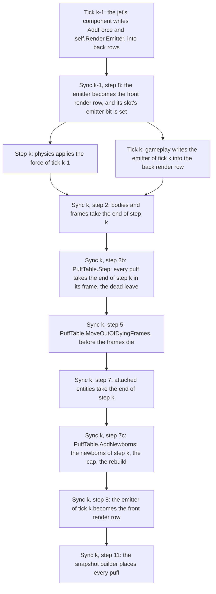
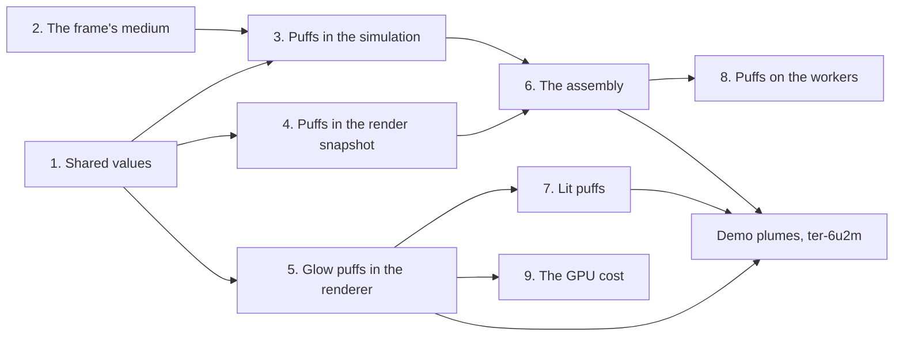

# Particles: puffs

Epic: `ter-4zt6`. Its first user is the demo's plumes (`ter-6u2m`). It builds on parts (`ter-ftk4`), which make each jet of a hull its own attached entity, and on the move of the demo's jets onto parts (`ter-diu0`). The design settled with the user on 2026-10-21, and the user revised the first draft (3da92c5) on the same day. This doc writes out the revised design, and it settles what the user's rules decide. The user settled the draft's two forks on the same day (see "Settled forks").

## Goal

A thrusting hull, a jet or a person's back pack leaves puffs behind it. Each puff leaves its emitter, flies on as a loose body would, fades and dies. A trail of puffs marks the path. Hot exhaust glows and rises in air. Cold gas is pale, lit by every light, and sinks in air. In vacuum both fall with the ship. Puffs only brighten what is behind them. The particle system is general, so it is efficient and minimal.

## The model

A puff is a loose body without a shape. This sentence says how a puff moves, not how the engine stores it. The rest follows from it, from the rules that the engine already has for loose bodies, and from Archimedes' law for the gas that fills a frame.

- A puff is born in the frame of its emitter's entity, and it lives in that frame for its whole life.
- It moves as a loose body in that frame moves: by the frame's linear gravity (its field less its proper acceleration), and in a turning frame by the two-turn update, which holds the Coriolis, the centrifugal and the Euler terms.
- A frame can hold a medium: the gas that fills it, at rest in the frame's axes. The medium pushes on a puff by Archimedes' law. It lifts the puff by a share of the effective gravity, the lift share, which is the medium's density at the puff over the puff's density. The puff is at the medium's pressure, so by the ideal gas law the lift share is the puff's temperature over the medium's, the same at every height. It also drags the puff toward rest in the frame, at the medium's drag times the same lift share. So in vacuum a puff falls with the ship as a loose body does. In air, hot exhaust that is lighter than the air rises, and cold gas that is heavier sinks.
- A puff mixes into the medium as it ages. The share of its own gas falls from 1 at its birth to 0 at the end of its life. Its temperature cools from that of its own gas toward the medium's by the same share. Its light fades by the same share.
- It touches nothing. No collision, no contact, no force on any body.
- It dies at the end of its life.
- When its frame dies, it moves into the nearest surviving ancestor, as every content of a dying frame does. When no ancestor survives, it dies.

Cause, storage and effect stay apart:

- Cause. A component of an entity writes the entity's emitter into its own render row, `self.Render.Emitter`, as it writes its light. The frame's motion, its field and its medium move each puff. The game gives a frame its medium at its spawn and changes it between ticks, as it does for the gravity field.
- Storage. The simulation owns the puffs, in one compact store, `PuffTable`. Puffs are not entities: no handle, no generation, no components, no messages, no render row, no body and no spawn description. A row of the store holds only what differs from puff to puff. The rows of one frame lie together in one span, so no row holds a frame. What an emitter's puffs share lies once in a table of looks, which the rows index. The frame tree holds each frame's medium beside its gravity field.
- Effect. The render snapshot carries each puff relative to the render origin, with a current and a previous position, as it carries an instance. The renderer stays frame-blind and draws each puff as a camera-facing sprite.

Why the simulation owns the puffs. The renderer knows no frames. A time-lapse film draws one tick in 4 to 240. The window skips snapshots and draws some twice. A puff that the renderer stepped would see an irregular sequence of steps, and no frame to step in. A puff that the simulation steps sees every step, in its frame, in doubles, in a headless run as in the window.

## Terms

| Term | Meaning |
|---|---|
| Puff | One particle: a loose body without a shape, in one semantic frame. |
| Emitter | The `PuffEmitter` in an entity's render row, `RenderData.Emitter`. An entity holds one, as it holds one light. |
| Emitter's entity | The entity whose render row holds the emitter. With parts, a jet. |
| Look | What the puffs of an emitter share: their life, their two radii, their temperature ratio and their shading. A `PuffLook`, a field of the emitter. |
| Look table | The store of the looks that live puffs use, each look once, with the count of the puffs that use it. Each row holds the index of its look there. |
| Row | One puff in the store: a `Puff`, with a place, a chord, an age and a look index. |
| Range | The rows of one frame: a `PuffRange` with the frame, the index of its first row and the count of its rows. |
| Step k | The physics step that runs beside tick k (ARCHITECTURE.md, "Changes of motion"). The sync point of tick k comes after it. A force that tick k − 1 writes acts in step k. |
| Front row, back row | The two buffers of a transform or render row. During tick k gameplay reads the front rows and writes the back rows. Step 8 of the sync point makes the back rows the front rows. |
| Place | A puff's position in its frame at the end of the last step, in m, in the frame's axes, as a `Double3`. |
| Chord | A puff's move over the last step divided by the step, in m/s, in the frame's axes. Jolt keeps the same quantity for a body (ARCHITECTURE.md, "Instant velocities and chords"). |
| Instant velocity | The velocity at one moment, in m/s. |
| Linear gravity | The gravity on a loose body at a place in a frame, in m/s², in the frame's axes: the frame's field there less the frame's proper acceleration (`FrameTree.LinearGravity`). It leaves out the rotation terms. |
| Effective gravity | The linear gravity plus the centrifugal and the Euler term of a turning frame at a place (`FrameTree.EffectiveGravity`). It holds no Coriolis term. A medium at rest in the frame presses against it. |
| Turns | V1 and V2 of a frame (`FrameTurns`): the turn of its axes over the step in flight and over the step that ended. |
| Medium | The gas that fills a frame, at rest in the frame's axes: the frame's `MediumField`. |
| Medium's density | The density of the medium at a place, ρ_m, in kg/m³. 0 in vacuum. |
| Medium's drag | κ, in 1/s: how fast the medium brings a puff at the medium's temperature to rest in the frame. |
| Temperature ratio | θ, a pure number above 0: the temperature of a puff's own gas over the medium's temperature. A field of its look. |
| Own share | w = 1 − age / life: the share of its own gas, by mass, that a puff still holds. It is also the weight of the puff's light in the renderer. |
| Puff's temperature ratio | r = 1 + w (θ − 1): the temperature of the mix of the puff's own gas and the medium over the medium's temperature. |
| Puff's density | ρ_p = ρ_m / r, in kg/m³: the density of the puff at the medium's pressure, by the ideal gas law. Nothing stores it or computes it. |
| Lift share | β = ρ_m / ρ_p, a pure number: r where the medium fills the puff's place, and 0 elsewhere. Above 1 for a puff that is hotter than the medium, below 1 for one that is colder. |
| Push | The acceleration that a step gives a puff apart from the two-turn update, in m/s²: the linear gravity less the lift share times the effective gravity. In a frame that does not turn it is g (1 − β). |
| Puff's drag | κ β, in 1/s: the rate at which the medium slows the puff's velocity relative to the frame. |
| Loose-body step | What the last finished step of a frame does to a loose body in it: the frame's field, its proper acceleration as the step found it, its turns, the length of the step of the turns, and its medium. A `LooseBodyStep`. |
| Age | The time since a puff's birth, in s. |
| Life | How long the puffs of a look live, in s. A puff dies when its age reaches its life. |
| Newborn | A puff born during the step that the sync point just closes. |
| Birth phase | The share of the next puff that an emitter has gathered, from 0 up to but not including 1. A column of the entity table. |
| Capacity | The most puffs that live at once, `WorldOptions.PuffCapacity`. |
| Run | A stretch of the transparent pass's sorted list that one draw covers: transparent meshes or puffs. |

## Decisions

The user settled these on 2026-10-21, in the notes of `.tickets/ter-4zt6.md` and in a correction on lift that came with the brief of this revision:

1. A puff is a loose body without a shape, born in its emitter's frame, living there for its whole life. It fades as it ages.
2. The simulation owns the puffs and steps them every tick, in doubles. The snapshot carries each puff with a current and a previous position.
3. Puffs are efficient and minimal, and they are not entities. The user's words: "Since they are a general particle system I would want to make them more efficient and minimal." The rows are grouped by frame, born only by emitters at the sync point into a pool allocated up to the cap, and stepped in bulk, one loop per frame over a contiguous span, with that frame's turns, field and medium of the step.
4. Pure gravity: the emitter has no lift number. The lift comes from the frame's medium. The user's words: "I was hoping that the frame's knowledge about the medium could then impart lift to the puffs based on that, since the puffs are already grouped by frame." For a puff of density ρ_p in a medium of density ρ_m(x) under the frame's gravity g, the net acceleration from gravity and lift is g (1 − ρ_m(x) / ρ_p). By decision 17, ρ_m(x) / ρ_p is the puff's temperature ratio.
5. The frame holds the medium beside its gravity field, as a custom `[Union]`, set by the World's API for frames and read at each step. The emitter carries no drag number. The medium acts only on puffs, for now, and bodies keep their own damping (see "Settled forks").
6. One emitter per entity, in its render row, like its light. Parts make each jet its own entity (`ter-ftk4`).
7. One look with a shading union: glow or lit. Glow for hot exhaust, lit puffs for cold gas.
8. Lit puffs are lit once per puff, at the center.
9. Camera-facing sprites in one instanced draw, additive, sorted together with the transparent instances, so that glass dims only the puffs behind it.
10. A soft fade near opaque surfaces and near the eye.
11. Births spread through the step.
12. A time-lapse frame shows the puffs alive at its tick. There is no "largest force of the frame" rule (`ter-6u2m`, note of 2026-10-21).
13. True size far away. No least size on screen.
14. A cap on live puffs, oldest first, with a switch.
15. A jet's puffs start in the physics step in which its force acts.
16. Slow tracer puffs at tens of m/s that hang behind and mark the path, not real exhaust speed. No collisions with surfaces. Bloom (`ter-63wr`) later, after the plumes.
17. A look holds the temperature ratio of the puff's own gas, not its density. So a puff's lift share and its drag are the same at every height, and they stop at once where the frame's medium ends (see "Settled forks").

This doc settles the rest by the user's rules. Each choice names its reason where it is made:

- A row is a place, a chord, an age and a look index: 56 bytes (see "The row").
- The rows of each frame form one range, and the ranges keep a fixed order (see "The order of the puffs").
- Equal looks share one entry of the look table, and a puff keeps the entry of its birth (see "The look table").
- The step of the old puffs runs at a new step 2b, the births at a new step 7c, and the destroy path of step 5 moves the puffs of each dying frame (see "The sync point"). The first draft stepped the old puffs at step 7c, after step 5, which put the puffs of a dying frame one step of the frame's motion off.
- The medium is a custom `[Union]` with two cases, beside the gravity field, and it matches the gravity field in who sets it, when, which step it describes and where it is stored (see "The frame's medium").
- Lift and drag both follow from the lift share, which is the puff's temperature ratio where the medium fills its place. The puff cools toward the medium by its own share (see "How a puff's lift and drag follow").
- The drag acts as the factor 1 / (1 + drag · dt) per step.
- The emitter has no offset: a part places the nozzle.
- The capacity is the one switch.

## The frame's medium

### The union

`MediumField` is a custom C# 15 `[Union]` in Core, in `src/Tertius.Core/Frames/MediumField.cs` beside `GravityField.cs`, built as `GravityField` is (`src/Tertius.Core/Frames/GravityField.cs`): private fields per case, a kind byte, `TryGetValue` methods, and an empty union that is the all-zero default. The empty union is no medium: vacuum.

| Case | Field | Unit and range | Meaning |
|---|---|---|---|
| `UniformMedium` | `Density`, `float` | kg/m³, 0 or more | The medium's density everywhere in the frame, or only inside `Region` |
| | `Drag`, `float` | 1/s, 0 or more | The medium's drag |
| | `Region`, `BoundingBox?` | m, frame coordinates | The box that the medium fills, or null for the whole frame. Outside it is vacuum. |
| `PlanetMedium` | `Radius`, `double` | m, 0 or more | The radius of the planet at the frame's origin |
| | `SurfaceDensity`, `float` | kg/m³, 0 or more | The medium's density at the planet's surface and below it |
| | `ScaleHeight`, `float` | m, above 0 | The height over which the density falls by the factor e |
| | `Drag`, `float` | 1/s, 0 or more | The medium's drag |

The factories are `MediumField.None`, `MediumField.Uniform(density, drag, region)` and `MediumField.Planet(radius, surfaceDensity, scaleHeight, drag)`. Three members read a medium:

```csharp
// src/Tertius.Core/Frames/MediumField.cs (new code, a sketch)
public bool Fills(Double3 place) => this switch
{
    UniformMedium { Density: var density, Region: var region } =>
        density > 0 && (region is not { } box || box.Contains(place.ToVector3())),
    PlanetMedium { SurfaceDensity: var surface } => surface > 0,
    _ => false,
};

public double DensityAt(Double3 place) => this switch
{
    UniformMedium { Density: var density, Region: var region } =>
        region is { } box && !box.Contains(place.ToVector3()) ? 0 : density,
    PlanetMedium { Radius: var radius, SurfaceDensity: var surface, ScaleHeight: var scale } =>
        surface * Math.Exp(-Math.Max(0, place.Length - radius) / scale),
    _ => 0,
};

public float Drag => this switch
{
    UniformMedium { Drag: var drag } => drag,
    PlanetMedium { Drag: var drag } => drag,
    _ => 0,
};
```

where

- `place` = a place in the frame, in m, in the frame's axes.
- `density`, `surface` = the case's density and surface density, in kg/m³.
- `radius`, `scale` = the planet's radius and the scale height, in m.
- `region`, `box` = the box that a uniform medium fills.
- The result of `Fills` = whether the medium has gas at `place`. A uniform medium fills its region, or the whole frame when it has none, and a planet medium fills the whole frame. Each does so only when its density, or its surface density, is above 0.
- The result of `DensityAt` = the medium's density at `place`, in kg/m³. The result of `Drag` = the medium's drag, in 1/s.

Puffs read `Fills` and `Drag` only, so the step of a puff never calls `Math.Exp`. `DensityAt` serves game code now, and bodies when a later ticket lets them read the medium (see "Settled forks"). The store holds the densities for that reason, so it stays the same when bodies join.

`IsValid` holds when every number is finite, the densities, the drags and the radius are 0 or more, the scale height is above 0, and a region has finite corners. The World refuses a medium that is not valid, as it refuses a gravity field that is not valid.

Why these two cases. Each matches a case of the gravity field. `UniformMedium` matches `UniformGravity`, with the same optional box: the air of a cabin in a ship's frame, whose bubble also holds the vacuum outside the hull. `PlanetMedium` matches `PointGravity`, centred on the frame's origin: the air of `earth-surface` thins with height above Earth's radius, with a surface density of 1.225 kg/m³ and a scale height of 8.5 km. A medium that thins along a fixed axis above a flat ground is left out. No scene needs it, and near the ground a uniform medium serves a flat ground, because the air thins by 1 % over the first 85 m. Below the radius the density stays at the surface density.

### Where it lives, who sets it, and who reads it

`FrameTree` keeps one `MediumField` per frame in an array, `medium`, beside `gravity` (`src/Tertius.Core/Frames/FrameTree.cs:62`). The match with the gravity field, point by point:

| Question | Gravity field | Medium |
|---|---|---|
| Type | `GravityField`, a custom `[Union]` in Core | `MediumField`, a custom `[Union]` in Core |
| Where it is stored | `FrameTree.gravity`, one per frame, set in `AddFrame` (line 155) and resized in `Grow` (line 1299) | `FrameTree.medium`, one per frame, set and resized at the same places |
| Who gives it at the spawn | `FrameSpec.Gravity` (`src/Tertius.Simulation/Entities/SpawnDesc.cs:86`), checked at `World.Entities.cs:203` and passed to `Frames.Create` at line 324 | `FrameSpec.Medium`, checked and passed at the same places |
| Who changes it | The game, between ticks, with `World.SetFrameGravity` (`World.Entities.cs:141`) | The game, between ticks, with `World.SetFrameMedium` |
| When it can change | Outside a tick only. The call throws `InvalidOperationException` during a tick. | The same |
| Which step it describes | The value stored when a step starts is the value of that step. No tick changes it, so the sync point of tick k reads the value of step k. A change between tick k and tick k + 1 acts from step k + 1 on. | The same |
| Who reads it | Physics during the step (`LinearGravity`, `EffectiveGravity`), step 2 for the proper acceleration (`FieldTheStepFound`), game code (`FrameTree.Gravity`, `FeltGravity`), `KeplerMotion`, and the render snapshot builder for the hemisphere up | The step of the puffs at step 2b and the births at step 7c, through `FrameTree.LastLooseBodyStep`, and game code (`FrameTree.Medium`). Physics reads no medium, by the user's choice (see "Settled forks"). |
| The internal writer | `FrameTree.SetGravity` (line 574) | `FrameTree.SetMedium` |
| A numeric frame | Has none, by an invariant (line 636) | Has none, by the same invariant |
| A frame's death | Its contents feel the heir's field from the next step on | Its puffs feel the heir's medium from the next step on |
| The guard | `ArgumentException` for a gone frame or a field that is not valid. The frame keeps its field. | The same, with `MediumField.IsValid` |

So a medium describes the step that the sync point closes, as the gravity field does. The rule that stored state describes the last finished step is about state that intents change between steps. The medium, like the field, is a setting of the World that only changes between ticks, so it needs no derived read for a step in flight.

The medium moves with its frame. A frame that hands off or that the game reparents keeps its medium, so the air of a cabin goes with the ship.

### How a puff's lift and drag follow

The medium is at rest in its frame. So its pressure rises against the effective gravity, and by Archimedes' law it pushes on a puff with the weight of the medium that the puff displaces. Over the puff's mass, that is the lift share times the effective gravity, upward. The drag is a push of the medium on the puff's volume too, so over the puff's mass it scales with the same ratio. One ratio gives both:

- r = 1 + w (θ − 1), with w = 1 − age / life.
- β = r where the medium fills the puff's place x, and 0 elsewhere.
- push = g_lin − β g_eff, with g_lin the linear gravity and g_eff the effective gravity at the puff's place.
- drag = κ β.

In a frame that does not turn, g_eff is g_lin, so the push is g (1 − β), the user's formula. In vacuum, β is 0: the push is the linear gravity and the drag is 0, so the puff moves exactly as a free body. A puff at the medium's temperature has β 1: its push is minus the rotation terms, which with the two-turn update leaves only the Coriolis term, so a neutral puff at rest in the frame stays at rest, and the drag κ brings a moving one to rest.

Why the lift share is the temperature ratio. A puff is a small parcel of gas at the pressure of the medium around it. By the ideal gas law, two gases of the same molar mass at one pressure have densities in the inverse ratio of their temperatures. So the puff's density is ρ_p = ρ_m / r, and the lift share ρ_m / ρ_p is r. The medium's density cancels, so the lift share is the same at every height, and the step reads only whether the medium fills the puff's place. The medium has one temperature in its whole frame. That fits a planet medium, because a density that falls by the factor e per scale height is the profile of air at one temperature. For a gas of another molar mass, θ is the medium's density over the gas's density at its birth, at the same pressure.

Why the lift acts against the effective gravity, not the linear gravity. The medium is held at rest in the frame by the effective gravity, centrifugal and Euler terms included. A spinning station full of air has its pressure rise outward, so hot gas there rises toward the axis. A cabin full of air under thrust has its pressure rise toward the stern, so hot gas there drifts toward the bow. A lift against the linear gravity alone would let hot gas in the station fall outward like a stone.

Why the drag scales with the lift share. Both are forces of the medium on the puff's volume, divided by the puff's mass. A hot puff is lighter than the medium around it, so it is slowed more than a cold puff of the same size. Both are the same at every height, because the lift share is.

Why the puff cools toward the medium with its own share. The fade already says that a puff of age a holds the share 1 − a / life of its own gas, by mass. When both gases hold the same heat per kg per kelvin, the temperature of the mix is the mean of the two temperatures, weighted by those shares. So r moves linearly from θ to 1. A puff that mixes into the medium becomes the medium: at the end of its life it neither rises nor sinks, and the drag brings it to rest. With a fixed temperature, the drag would bring a hot puff to its terminal speed, and it would keep rising at that speed until it vanished, so the top of a cloud would move up as it fades instead of spreading and stopping. The rule costs one division, one multiplication and three additions per puff per step, and it adds no number.

The cost of the same lift at every height, which the user accepted. Lift and drag stop at once where the frame's medium ends. A puff stays in the frame of its birth, so the change comes when the emitter moves into a frame without the medium. In the demo, the bubble of `earth-surface` and its air end at 50 km. The puffs that the main engine makes below that height are in `earth-surface`. They hang in the sky for their whole life, also when they drift above 50 km. The puffs that it makes after the hull hands off into `earth` have no medium, so they fall with the hull.

Numbers for the demo's air, with a medium's drag of 2 per second, under 9.81 m/s². They are the same at every height of the medium:

| Puff | Temperature ratio | Lift share at birth | Push at birth | Drag at birth | Terminal speed at birth | At half its life |
|---|---|---|---|---|---|---|
| Hot exhaust | 3 | 3 | 19.6 m/s² up | 6 per s | 3.27 m/s up | 2.45 m/s up |
| Cold gas | 0.75 | 0.75 | 2.45 m/s² down | 1.5 per s | 1.64 m/s down | 0.70 m/s down |
| Either, in vacuum | | 0 | the linear gravity | 0 | none | |

A tracer puff that leaves at tens of m/s loses most of its speed in the first half second, so it hangs behind and marks the path. The demo's plumes choose the temperature ratios and the media.

The drag acts as the factor 1 / (1 + drag · dt) on the chord of each step, after the push. That is the implicit step of the drag: it lies in (0, 1] at any drag and any step, so it is stable, and a division rounds the same on every platform. At the hot exhaust's drag of 6 per s it keeps 0.909 of the chord per step, where e^(−drag · dt) keeps 0.905. The first draft stored e^(−drag · dt) per puff at its birth, which a drag that changes with the puff's place and age cannot do.

## The emitter and the look

`PuffEmitter` is a struct in `Tertius.Simulation`, in `src/Tertius.Simulation/Entities/PuffEmitter.cs`, beside `LightData`. `RenderData` gains one field, `public PuffEmitter Emitter`. The default emitter makes no puffs.

| Field | Type | Unit and range | Meaning |
|---|---|---|---|
| `Rate` | `float` | puffs per s, 0 or more | How many puffs the emitter makes in each second. 0 makes none. |
| `Speed` | `float` | m/s, 0 or more | The ejection speed: a newborn's velocity relative to the emitter. Tens of m/s for the demo's tracer puffs. |
| `Spread` | `float` | rad, 0 to π | The half-angle of the cone of ejection directions about the local −Z of the entity's pose. |
| `Look` | `PuffLook` | | What its puffs share |

The emitter has no offset. Puffs leave the origin of the emitter's entity along its local −Z, as a spot light points. A light has an offset because lights came before parts. With parts, the part's attach offset places the nozzle, so a second offset in the emitter would be a second number for the same place. An entity that needs an emitter away from its origin attaches a part there.

`PuffLook` is a `readonly record struct` in Core, in `src/Tertius.Core/Seams/PuffSeam.cs`, because the simulation's look table and the render snapshot hold it with the same fields:

| Field | Type | Unit and range | Meaning |
|---|---|---|---|
| `Life` | `float` | s, above 0 | How long each puff lives |
| `StartRadius` | `float` | m, 0 or more | A puff's radius at its birth |
| `EndRadius` | `float` | m, 0 or more | A puff's radius at the end of its life. The radius grows linearly between the two. |
| `TemperatureRatio` | `float` | a pure number, above 0 | The temperature of the puff's own gas over the medium's. 3 for hot exhaust, 0.75 for cold gas, in the examples above. A puff where no medium fills its place does not read it. |
| `Shading` | `PuffShading` | | How the puffs look |

`PuffShading` is a custom C# 15 `[Union]` in the same file, as `HemisphereUp` is (`src/Tertius.Core/Seams/HemisphereUp.cs`):

| Case | Field | Unit | Meaning |
|---|---|---|---|
| `GlowPuffs` | `Radiance`, `Vector3` | linear RGB, the HDR units of `MaterialDesc.Emissive` | The light that a puff emits at its center at its birth. The demo's lamp panels emit (6, 5.4, 4.5). |
| `LitPuffs` | `Albedo`, `Vector3` | linear RGB, 0 to 1 per channel for a physical puff | The share of the light that reaches a puff that it scatters (see "Lit puffs") |

The empty union holds no case. `LightData` and `RenderLight` have their own case types because a light's fields change between the two (an offset becomes a position). A look does not change between the simulation and the snapshot, so one type serves both.

An emitter makes puffs only when its numbers are valid: `Rate` finite and above 0, `Speed` finite and 0 or more, `Spread` from 0 to π, and a valid look. A look is valid when every number is finite, `Life` and `TemperatureRatio` are above 0, both radii are 0 or more, and the shading is valid: it holds a case, and each channel of its color is finite and 0 or more. A light whose range or intensity is zero or less is left out without an error (ARCHITECTURE.md, "Shading"), and an emitter that is not valid is left out the same way. So the default emitter, with rate 0 and an empty look, makes none. A component that switches its jet off and on keeps the emitter value and writes the default over it, as it does for a light.

A component writes the emitter of its own entity only, as every write of the render row goes (`Self.Render`, `src/Tertius.Simulation/Entities/Self.cs:131`). A blueprint carries it in its `RenderData`. The JSON form comes with the light's, in the content formats epic.

The emitter adds 44 bytes to each render row: 12 for the three numbers and 32 for the look. The entity table holds each render row twice, so a slot grows by 88 bytes. The first draft's emitter had 72 bytes, with an offset and a drag.

A component that follows a throttle changes `Rate` and `Speed`, which are not in the look. Then its puffs share one look however its throttle moves. A component that changes the look in every tick makes a new look per tick (see "The look table").

## The puff store

`PuffTable` is an internal sealed class in `src/Tertius.Simulation/Internal/Puffs/PuffTable.cs`, owned by the World, like `Attachments`. Nothing but the World's sync point and its destroy path writes it.

### The row

```csharp
// src/Tertius.Simulation/Internal/Puffs/Puff.cs (new code)
internal struct Puff
{
    public Double3 Place;   // bytes 0 to 23
    public Double3 Chord;   // bytes 24 to 47
    public float Age;       // bytes 48 to 51
    public int Look;        // bytes 52 to 55
}
```

where

- `Place` = the puff's place at the end of the last step, in m, in its frame's axes.
- `Chord` = its move over the last step divided by the step, in m/s, in its frame's axes.
- `Age` = its age at the end of the last step, in s, from 0 up to but not including its life.
- `Look` = the index of its look in the look table.

`Double3` is three doubles (`src/Tertius.Core/Math/Double3.cs:7`), 24 bytes with an alignment of 8, so the row is 56 bytes with no padding. The first draft's row was 104 bytes, because it copied its emitter's life, radii, step damping and shading and kept its own frame handle and birth time.

The row needs nothing more. Each use of a puff reads only these fields, its range's frame and its look:

| Use | What it reads |
|---|---|
| The rule of motion | The place and the chord, which are the last two places in another form. The age and the look's life give the own share, and with the look's temperature ratio they give the puff's temperature ratio. The range gives the frame, its turns, its field and its medium. |
| The death at the end of its life | The age and the look's life |
| The cap | The age |
| A frame's death | The place and the chord |
| The snapshot | The place, and the place one chord back, which is its place at the end of the step before, for the previous position. The age, and the look index. |

What could force more, and why it does not:

- A velocity. The chord is the velocity of the free-body update. The instant velocity is a derived read of the chord, needed only at a birth and a frame's death.
- A birth time. The age replaces it, and it grows by the step at each step.
- A frame handle. The range holds it.
- A per-puff seed. The ejection direction is the only random value, and it is used once, at the birth.

Why the row keeps the place and the chord, not the two places. The free-body update x_(n+1) = 2 R_n x_n − R_n R_(n−1) x_(n−1) keeps the last two places. The place and the chord hold the same information in the same 24 bytes each, with x_(n−1) = x_n − chord · dt. The chord form keeps more digits far from the frame's origin. A step adds the gravity times the square of the step, g dt², to the next place. In the sun's frame at 1 AU, the sun's gravity of 5.9 mm/s² gives 1.6e-6 m per step, while a double there steps by 3.1e-5 m, so the two-place form drops the gravity at each step. A run of both forms in doubles gave these errors, for 200 puffs at up to 30 m/s, against the same rule computed in coordinates relative to each puff's start, which lose no digits:

| Frame and place | After | Two places | Place and chord |
|---|---|---|---|
| `earth`, 6.8e6 m from its origin, at 8.69 m/s² | 2 s | 1.8e-6 m | 5.9e-10 m |
| `earth`, 6.8e6 m from its origin, at 8.69 m/s² | 10 s | 4.6e-5 m | 5.7e-10 m |
| The sun's frame at 1 AU, at 5.9 mm/s² | 10 s | 0.30 m | 4.2e-5 m |

The chord is also what the two-turn update takes (`FrameTurns.FreeChange`), what the chord rule makes at a birth, and what a frame's death converts. So the chord form needs no conversion at any of them, and the snapshot pays one multiply and one subtract per puff for the previous place.

A float chord would make the row 48 bytes, with 4 bytes of padding. It is left out: the user decided that the simulation steps the puffs in doubles.

### Ranges

The table holds its rows in one array, `rows`, and one list of ranges, `ranges`. A range is the rows of one frame:

```csharp
// src/Tertius.Simulation/Internal/Puffs/Puff.cs (new code)
internal readonly record struct PuffRange(FrameHandle Frame, int Start, int Count);
```

where

- `Frame` = the semantic frame that the puffs of the range live in. Never a numeric frame.
- `Start` = the index in `rows` of the range's first row.
- `Count` = the number of its rows.

`FrameHandle` is 16 bytes (`src/Tertius.Core/Handles/Entity.cs:28`), so a range is 24 bytes, once per frame that holds puffs. An explicit start and count per range follows the user's choice of `InboxRange(Start, Count)` over prefix sums.

At the end of each method of the table, each frame has one range at most, and the ranges lie packed from row 0 in list order. So one loop per frame steps a contiguous span, with the frame's loose-body step read once for the range.

A puff lives in a semantic frame, never in a numeric one. A numeric frame exists only to keep Jolt's float velocities and float bounds small (ARCHITECTURE.md, "Numeric frames"). A puff is not in Jolt, and its place and chord are doubles. The emitter's entity has its row frame, the semantic frame, and its physics home, which may be numeric. The puff takes the row frame.

### The order of the puffs

The order of the rows is the order of the steps, of the snapshot and of the draws inside a run, so it must be the same in every run:

- The frames. Each frame keeps the place of its first range in the list. A frame that gets its first puffs takes a new range at the end of the list, in the order of its first newborn.
- Inside a range. The survivors keep their order. Puffs that a frame's death moves in follow the heir's own puffs when the heir's range came first in the list, and come before them when the dying frame's range came first. Newborns come last, in slot order, and in each emitter's order of birth.
- A death at the end of a life, a drop by the cap and the death of a frame with no surviving ancestor remove rows. The rest keep their order, and a range that empties leaves the list, so the other ranges keep theirs.

Adding rows needs a rebuild, because a range that grows would overwrite the next range. The table keeps a second array of the same length, `spare`. The rebuild writes the rows into `spare` in the new order and swaps the two arrays: for each frame in the order of its first range in the list, it copies each of the frame's ranges in list order, leaves out the rows that the cap drops, and then copies the frame's newborns. Then each frame has one range again. A rebuild copies every live row once, a block copy per range. It runs at step 7c when a step made newborns, and at the end of a move out of dying frames. The step of 2b only removes rows, so it compacts the rows in place, toward row 0, with no rebuild.

The newborns of a step wait in a third array, `newborns`, with their own list of ranges by frame, from their birth at step 7c until the rebuild at the end of the same step 7c.

### The look table

`PuffLooks` (`src/Tertius.Simulation/Internal/Puffs/PuffLooks.cs`) holds the looks that live puffs use: an array of `PuffLook`, an array of user counts, a stack of free indices, and a `Dictionary<PuffLook, int>` from each look in use to its index.

- A birth looks its emitter's look up by value, once per emitter and step with newborns. When no entry holds an equal look, it takes a free index, or a new one at the end, and adds the look to the dictionary. Each newborn adds 1 to the count.
- A puff's death subtracts 1 from the count of its look. An entry whose count reaches 0 leaves the dictionary, and its index goes on the free stack.
- An emitter that changes its look while its old puffs live leaves them alone: the old puffs keep the entry of their birth, and the newborns take the entry of the new look. Nothing copies a look into a row. So a change costs one entry while the old puffs live, and nothing when the new look equals one that some puff already uses.
- Emitters with equal looks share one entry, as the side jets of a hull will.

The free stack and the order of births and deaths are the same in every run, so the indices are too. The dictionary's hash codes change from process to process, but they only find entries: no result depends on them.

The look table has at most one entry per live puff, and in the demo a few. A component that writes a new look in every tick, for example a radiance that follows a throttle, makes one entry per tick per emitter while its puffs live: 120 entries for an emitter whose puffs live 2 s.

### Memory

| Store | Size per item | At the default capacity of 4,096 |
|---|---|---|
| `rows` | 56 bytes per row | 224 KiB |
| `spare` | 56 bytes per row | 224 KiB |
| `newborns` | 56 bytes per newborn of one step | The most newborns of one step: about 20 in the demo, 1.1 KiB. At most the capacity. |
| `ranges` | 24 bytes per frame that holds puffs | Under 1 KiB |
| The look table | 32 bytes per look, 4 per count, and a dictionary entry | A few looks in the demo. At most one per live puff. |
| The entity table | 8 bytes of birth phase and 1 bit per slot, and 88 bytes of emitters | Per slot, whether or not it emits |

`rows`, `spare` and `newborns` grow by doubling up to the capacity, at the sync point. After that, a sync point allocates nothing for the puffs. A World whose puffs never reach the capacity never allocates it, so a test World with a few puffs pays a few KiB.

## Two per-slot values in the entity table

- The birth phase, an `EntityTable.Column<double>` that the puff table adds (`EntityTable.AddColumn`, `src/Tertius.Simulation/Internal/Entities/EntityTable.cs:362`). The table clears it when it releases the entity, so a new entity in a reused slot starts at 0. Only the births of step 7c write it.
- The emitter bit, one bit per slot, in a set like `BodySlots` (`src/Tertius.Simulation/Internal/Entities/EntityTable.BodySlots.cs`). It says whether the slot's front render row held an emitter that can make puffs during the last tick, which is the emitter of the step that the sync point closes. The births read this bit instead of every render row, as the numeric update gathers the bodies from a bit per slot (ARCHITECTURE.md, step 6c). The table sets or clears the bit wherever a front render row changes outside a spawn: the copy of step 8 (`CopyRow`, line 1488), which step 8 also runs to end a change outside a tick. A spawn of step 6 writes its front render row in `Activate` (line 559) and leaves its bit clear. `Activate` lists the slot when its row holds such an emitter, and the copy of step 8 sets the bits of the listed slots. So between step 6 and step 8, a new entity's bit is clear, and step 7c does not see its emitter. That is right: the new entity was not in step k. The release of a slot clears its bit.

## Invariants and contracts

`PuffTable` is a core data structure that keeps state coherent with the frame tree and the entity table, so it gets contracts and an invariant check (the user's rule, "Contracts"). Its class comment lists the invariants, and `PuffTable.AssertInvariants` checks all of them. The World's own `AssertInvariants` calls it, so `WorldOptions.DebugChecks` runs it at the end of every sync point.

1. The count of live puffs, the sum of the ranges' counts, is at most the capacity.
2. Every range names a live semantic frame, and no two ranges name the same frame.
3. The ranges lie packed from row 0, in list order, and no range is empty.
4. Every row's place and chord are finite, its age is 0 or more and less than its look's life, and its look index names an entry in use.
5. Each entry's count equals the number of rows that name it. The dictionary maps each entry in use to its index and holds nothing else, and the free stack holds exactly the other indices below the table's end.
6. Every look in use is valid.
7. No newborn waits outside step 7c.
8. Every birth phase is in [0, 1).
9. The entity table's own invariants gain: outside the sync point, the emitter bit of each live slot says whether its front render row holds an emitter that can make puffs.

Contracts, which compile out of Release builds:

- `Step` requires that the frame tree's step records are newer than the rows: the tick of the step is later than the tick of the last step of the table. It ensures invariants 1 to 4.
- `MoveOutOfDyingFrames` requires that each heir is a live ancestor of its dying frame, or null. It ensures invariants 2 and 3.
- `AddNewborns` requires that `Step` ran in the same sync point. It ensures invariants 1 to 7.

A range whose frame is not live at `Step` can come only from a bug, because the destroy path moves every range out of every dying frame. By the user's rule, a Debug build fails a contract there. A Release build drops the range, frees its looks' counts and records it in `World.Errors`.

The public guards are ordinary and always on. A negative `WorldOptions.PuffCapacity` throws `ArgumentOutOfRangeException` when the World is made. `World.SetFrameMedium` and the spawn refuse a medium that is not valid with an `ArgumentException`.

## The sync point

Three places in the sync point touch the puffs, and step 11 places them in the render snapshot:

- Step 2b, a new step at the end of step 2, after every frame took its step record: `PuffTable.Step` steps every puff over step k by the rule of motion, adds the step to its age, and removes the puffs whose age reached their life.
- Step 5: the destroy path calls `PuffTable.MoveOutOfDyingFrames`, which moves the ranges of the dying frames into their heirs, before the frames die.
- Step 7c, a new step after step 7b: `PuffTable.AddNewborns` makes the newborns of step k, applies the cap and rebuilds the ranges.



### Why step 2b

From step 2 on, the bodies' rows, the frame tree and the rows of the entities without a body describe the end of step k. Only the attached entities wait for step 7. The puffs take the end of step k at the same point, so every later step sees them as it sees the bodies:

| Input of the step | Where it comes from | Why it is right at step 2b |
|---|---|---|
| The turns of step k | `FrameTree.Turns`, V1 and V2 | `BeginStep` fixed them for step k in the preparation of tick k. They hold until the preparation of tick k + 1. |
| The linear gravity of step k | The frame's field and its proper acceleration as step k found it (`FieldTheStepFound`, `src/Tertius.Core/Frames/FrameTree.cs:929-930`) | Step 2 copies every frame's proper acceleration before it writes the values of step k's record (`TakeStepRecords`, called from `FollowOwners`, `World.Sync.cs:109`). The copy is the value that physics used in step k, and it is valid from step 2 to the next step 2. |
| The medium of step k | `FrameTree.medium` | No tick changes it, so it is the medium of step k. |

The step of the old puffs cannot wait until after step 5. Step 5 converts the contents of each dying frame with the frame's pose at the end of step k. A puff that still held its place of the end of step k − 1 would then lie off by the frame's move over step k relative to its heir. The first draft stepped the old puffs at step 7c and had this flaw: a puff in the frame of the orbiting station, which moves at 7.5 km/s in earth, would have jumped 125 m when the station's frame died. A body has no such flaw, because physics moved it over step k in its frame before step 5.

The step reads nothing that the physics output writes, only the frame tree. So it runs also when the physics step failed and the sync point drops its output, and in a World without a physics backend.

### Why step 5

Step 5 destroys frames, and after that a handle of a dead frame throws on every read of the frame tree. So the puffs of a dying frame must move before it dies, beside the entities that `World.DestroyDying` moves (`src/Tertius.Simulation/World.Entities.cs:481-501`). `DestroyDying` calls `PuffTable.MoveOutOfDyingFrames` after its rehomes and before `FreeEntity` (line 505). Parts (`ter-ftk4`) split `DestroyDying` after the growth of the destroy batch (docs/plans/parts.md, "Where the push flows up"). The call goes into the piece that rehomes and frees. `World.Destroy` outside a tick runs the same path, and there the puffs and the frame tree both describe the end of the last step, so the same conversion is right. This is not a second piece of automatic machinery. It is the destroy path, which moves every content of a dying frame.

### Why step 7c

Step 7c is the one place where every input of a birth describes step k:

| Input | Where it comes from | Why it is right at step 7c |
|---|---|---|
| The emitter of step k | The front render row, and the slot's emitter bit | Tick k − 1 wrote it, and its force acts in step k. Step 8 replaces it with the emitter of tick k, whose force acts in step k + 1. |
| The emitter's place and velocity at the end of step k | The back transform row | Step 2 writes it for bodies and frame owners, step 5 moves it out of dying frames, and step 7 derives it for attached entities (`DeriveAttachments`, `World.Sync.cs:160`). A jet is attached to its hull, so only after step 7 does its row hold the end of step k. |
| The turns, the linear gravity and the medium of step k | `FrameTree.LastLooseBodyStep` | The same as at step 2b. They hold until the preparation of tick k + 1. |

So the jet's puffs start in the step in which its force acts. Births cannot come later, at step 11, because step 8 has replaced the emitter by then. They cannot come before step 7, because a jet's row does not hold the end of the step yet.

So the puffs have two places in the sync point that are not the destroy path, and each has its reason: the motion of step k must be done before step 5 moves frames, and the births need the rows of step 7. Each is a method of the owner of the state, and the World calls each once per sync point.

### The parallel pieces

The first tasks of the work run the step, the births and the snapshot puffs on the sync thread. A later task measures them, and adds pieces on the workers if the measurements reach a useful threshold, by the rules of the four pieces in ARCHITECTURE.md, "Threads and the tick":

- The step of 2b, in equal slices of the rows. Each slice reads the ranges that it overlaps and compacts its survivors into its own stretch of `spare`, and the sync thread joins the slices in slice order.
- The births, in chunks of slots, joined in slot order.
- The snapshot puffs, by range.

Each slice, chunk or range writes only its own rows, so the result equals the result on one thread, bit for bit.

## The rule of motion

Physics moves a free dynamic body in a turning frame by this expression:

```csharp
// src/Tertius.Physics/JoltPhysicsBackend.Step.cs:715-717
Double3 field = linear + homeAcceleration;
Double3 ahead = behind + turns.FreeChange(semanticPlace, behind, dt) + (turns.Step.Turn.Rotate(field) - homeAcceleration) * dt
                - homeVelocity;
```

where

- `linear` = the linear gravity at the body's center of mass in its home, in m/s².
- `homeAcceleration`, `homeVelocity` = the acceleration and the frame velocity of the body's numeric home relative to its semantic frame. Both are zero when the home is the semantic frame.
- `behind` = the body's semantic chord of the step that ended, in m/s.
- `semanticPlace` = the body's place in its semantic frame at the start of the step in flight, in m.
- `turns` = the semantic frame's `FrameTurns`, and `turns.Step.Turn` the turn of the step in flight.
- `dt` = the length of the step, in s.
- `ahead` = the chord of the step in flight, before Jolt's damping, in m/s.

The two-turn update itself:

```csharp
// src/Tertius.Core/Frames/FrameTurns.cs:41-46
public Double3 FreeChange(Double3 position, Double3 chord, double dt)
{
    Double3 previous = position - chord * dt;
    Double3 next = Step.Turn.Rotate(position) * 2 - TwoSteps.Rotate(previous);
    return (next - position) / dt - chord;
}
```

where

- `position` = the place at the start of the step in flight, in m.
- `chord` = the chord of the step that ended, in m/s.
- `TwoSteps` = the turn over both steps, R_n R_(n−1).
- The result = the change of the chord over the step in flight that keeps a free body on its inertial line, in m/s.

In a frame that does not turn, physics skips the update and adds the gravity as a force, so Jolt adds `linear · dt` to the velocity. A puff lives in its semantic frame, so its home terms are zero, and its rule is the same expression with the push in place of the field and the drag after it. The frame's half of the rule is a new internal struct in Core, `LooseBodyStep` (`src/Tertius.Core/Frames/LooseBodyStep.cs`), which `FrameTree.LastLooseBodyStep(frame)` fills once per range. By the user's rule for the rails library, each function lives in the struct that it belongs to: the rule of a loose body in a frame belongs to the frame's step, and the rule of a puff's look belongs to the puff.

```csharp
// src/Tertius.Core/Frames/LooseBodyStep.cs (new code, a sketch)
internal readonly struct LooseBodyStep
{
    public GravityField Field { get; init; }
    public Double3 ProperAcceleration { get; init; }
    public FrameTurns Turns { get; init; }
    public double TurnsStep { get; init; }
    public MediumField Medium { get; init; }

    public Double3 LinearGravity(Double3 place) => Field.AtPrecise(place) - ProperAcceleration;

    public Double3 EffectiveGravity(Double3 place, Double3 linear) =>
        Turns.Turns ? linear + Turns.Centrifugal(place) + Turns.Euler(place, TurnsStep) : linear;

    public Double3 ChordAhead(Double3 place, Double3 chord, double lift, double drag, double dt)
    {
        Double3 linear = LinearGravity(place);
        Double3 push = lift == 0 ? linear : linear - EffectiveGravity(place, linear) * lift;
        Double3 ahead = Turns.Turns
            ? chord + Turns.FreeChange(place, chord, dt) + Turns.Step.Turn.Rotate(push) * dt
            : chord + push * dt;
        return ahead / (1 + drag * dt);
    }
}
```

where

- `Field` = the frame's gravity field.
- `ProperAcceleration` = the frame's proper acceleration as step k found it, widened to doubles, in m/s².
- `Turns` = the frame's V1 and V2, and `Turns.Turns` whether either is not the identity.
- `TurnsStep` = the length of the step whose turns the store holds, in s.
- `Medium` = the frame's medium.
- `LinearGravity(place)` = the linear gravity that step k applied at `place`. It equals `FieldTheStepFound` to the bit, so it equals what physics read during step k.
- `EffectiveGravity(place, linear)` = the linear gravity plus the centrifugal and the Euler term. It equals `WithRotationTerms` (`src/Tertius.Core/Frames/FrameTree.Turns.cs:212`) to the bit for a semantic frame.
- `lift` = the lift share β, and `drag` = the puff's drag κ β, in 1/s.
- `push` = the push, in m/s². It is the linear gravity itself when `lift` is 0, so a puff in vacuum takes the expression of physics with no home, to the bit.
- `ahead` = the chord of step k after the push. The division by `1 + drag * dt` is exact when `drag` is 0.

`FrameTree.LastLooseBodyStep(FrameHandle frame)` lives in a new partial file, `src/Tertius.Core/Frames/FrameTree.LooseBodyStep.cs`. It reads `gravity`, `properAccelerationTheStepFound`, `turns`, `turnsStep` and `medium` of a semantic frame. Its result is valid from step 2 of a sync point to the `BeginStep` of the next tick. It requires a semantic frame, and it throws `InvalidOperationException` for a stale frame, as every read of the tree does.

The puff's half lives in `Puff`:

```csharp
// src/Tertius.Simulation/Internal/Puffs/Puff.cs (new code, a sketch)
public readonly Puff Stepped(in LooseBodyStep step, in PuffLook look, float dt)
{
    double lift = 0;
    if (step.Medium.Fills(Place))
    {
        double own = 1 - Age / (double)look.Life;
        lift = 1 + own * (look.TemperatureRatio - 1);
    }
    Double3 chord = step.ChordAhead(Place, Chord, lift, step.Medium.Drag * lift, dt);
    return new Puff { Place = Place + chord * dt, Chord = chord, Age = Age + dt, Look = Look };
}
```

where

- `step.Medium.Fills(Place)` = whether the frame's medium has gas at the puff's place.
- `own` = the own share w at the start of step k, in (0, 1], because a live puff's age is below its life.
- `look.TemperatureRatio` = the look's temperature ratio θ.
- `lift` = the lift share β: the puff's temperature ratio r where the medium fills its place, and 0 elsewhere. In a medium it lies between 1 and θ, so it is above 0.
- `dt` = the step, the World's float `DeltaTime` (0.01666666753590107 s). The age adds it as a float.

The range loop reads the loose-body step once, then calls `Stepped` for each row of the range, keeps the rows whose new age is below their look's life, and writes them down toward row 0.

The rule reuses `FrameTurns.FreeChange` and the frame tree's turns as they are. It needs none of the rest of the body update, and each omission has a reason:

| In the body update | Why a puff needs none |
|---|---|
| The velocity shadow (V6 of `docs/plans/spin-gravity.md`) | It takes back Jolt's float rounding. A puff is in doubles. |
| The contact turn | A puff has no contacts. |
| The turn of an impulse and of an intent's force | Nothing pushes a puff but its frame and its medium. |
| The home's offset, velocity and acceleration | A puff lives in its semantic frame, never in a numeric home. |
| The angular form | A puff has no rotation. |
| The wake and sleep | A puff never sleeps. A sleeping body has no velocity relative to its frame, and a puff keeps its velocity. |

The velocity that the drag pulls toward is rest in the frame's axes. In a turning frame that is rest in the turning axes, as the air of the ground turns with the ground.

## Births

### Which emitters make puffs in step k

An emitter makes the puffs of step k when its entity was in step k and is still live at step 7c: its emitter bit is set, and step 5 did not free it. So:

- An entity that step 6 made live makes no puffs at step 7c of the same sync point. Its bit is clear until step 8. Its first puffs are those of the next step, its first.
- An entity that dies in tick k makes no puffs for step k, the last step of its life. Its rows are gone at step 7c. This misses one step, 1/60 s, at the end of an emitter's life. A jet's force of tick k − 1 still acts in step k, so its puffs of that one step are missing. Births at step 5 could read the dying entity's rows, but an attached jet's row there still holds the start of the step, so the puffs would come from the wrong place. The miss is the smaller fault.
- An entity whose frame dies is in the heir at step 7c, moved there by step 5, with its place and velocity converted. Its puffs of step k are born in the heir.
- An entity that a hand-off moved in step k is in its new frame at step 7c. Its puffs of step k are born there. The hand-off converts the place and the instant velocity in doubles, so a newborn there lies where it would have lain in the old frame, to the differences of motion of the two frames over its age, which are of the order of the newborn bounds below.

### Births spread through the step

The birth phase gathers the rate over the step. With p the emitter's birth phase where step k starts, r its rate and dt the step:

- The step makes n = floor(p + r · dt) puffs.
- Puff j, for j = 1 to n, is born at the share s_j = (j − p) / (r · dt) of the step, in (0, 1]. Its age at the end of the step is τ_j = (1 − s_j) · dt.
- The new birth phase is p + r · dt − n.

So the births lie evenly in time at the emitter's rate, across tick boundaries. An emitter at 60 puffs per second makes one puff per step, born at the end of the step to within a few millionths of a step over the first second, because the step is the float 1/60 widened to a double (0.01666666753590107 s). The rate times the step is 1 + 5.2e-8, so the phase gains 5.2e-8 in each step, and after a minute the births lie about 1.9e-4 of a step before the end of their step. (Task 3 corrected this sentence. It first said "a few millionths of a step over the first minute". The arithmetic of the step gives the drift above.) A step makes at most the capacity of puffs, because the cap would drop the rest: of the newborns of all emitters in slot order, only the last ones up to the capacity are made, and the others are skipped without being computed. Only the newborns that live at the end of the step count toward the capacity. A look that lives less than a step makes newborns that are already dead, the oldest ones of the step, and `PuffBirths.FirstLiving` finds the first that lives by a search by halves. (The review of ticket ter-4zt6 corrected this. The first code counted the dead newborns too, so the skip could drop a newborn that would live in favor of one that was already dead, and fewer puffs than the capacity lived.) The phase still gathers the whole rate, so the count of the next step does not change. An emitter that is switched off keeps its phase. The phase is engine state per entity, which no gameplay writes, so it lives in a column that the entity table keeps and clears, as the render builder's `PoseMemory` does.

### The newborn's state

A newborn rides with its emitter until its birth, and then flies free. The emitter's place and velocity at the end of step k come from its back row, through the reads that every tick uses:

```csharp
// src/Tertius.Simulation/Internal/Entities/FrameReads.cs:26-32
public static Double3 VelocityIn(FrameTree frames, Entity entity, in TransformRow row, FrameHandle to)
{
    if (row.Frame.IsNull)
        return frames.ConvertVelocity(OwnFrame(frames, entity), to, Double3.Zero, Double3.Zero);
    Double3 velocity = frames.HomeVelocity(row.PhysicsHome, row.Frame) + row.LinearVelocity;
    return row.Frame == to ? velocity : frames.ConvertVelocity(row.Frame, to, row.Pose.Position, velocity);
}
```

where

- `row` = the emitter's entity's back transform row, and `to` = its row frame `row.Frame`, so no conversion runs and nothing allocates.
- `frames.HomeVelocity(row.PhysicsHome, row.Frame)` = the velocity of the row's numeric home in the row frame, or zero.
- `row.LinearVelocity` = the entity's float velocity relative to its home.
- The owner of a root frame has no row frame, so its puffs are born in the frame that it owns, at that frame's origin, as `FrameReads` reads such an owner.

For an attached jet, step 7 derives that row from the root's:

```csharp
// src/Tertius.Simulation/Internal/Attachments/Attachments.cs:151-155
Frame = rootRow.Frame,
PhysicsHome = rootRow.PhysicsHome,
Pose = rootRow.PhysicsHome == rootRow.Frame ? inHome : new DPose(rootRow.Pose.Position + lever, inHome.Rotation),
HomePosition = inHome.Position,
LinearVelocity = rootRow.LinearVelocity + Double3.Cross(rootRow.AngularVelocity, lever).ToVector3(),
```

where

- `rootRow` = the back row of the chain's root, the hull, which is in the parent frame of the hull's own frame.
- `lever` = the jet's place less the root's, in the root's physics home, in m.

So the jets of a hull put their puffs in the hull's parent frame: on the pad in `earth-surface`, in orbit in `earth`, in the bay in the station. The person's back jet, attached to the person in the cabin, puts its puffs in the shuttle's frame.

With x_e the emitter's place at the end of the step (the entity's pose), R_e its rotation there, v_e its velocity, d the ejection direction (a unit vector in the cone about −Z), and for newborn j its age τ:

- Its ejection velocity is u = `Speed` · R_e d.
- Its lift share at birth is β_b = θ where the medium fills x_e, because its own share is 1 then, and 0 elsewhere. Its drag is k = κ β_b. In vacuum both are 0.
- Its instant velocity at the end of the step is (v_e + u) / (1 + k τ), one implicit step of the drag over its age.
- Its place is x_e − v_e τ + τ (v_e + u) / (1 + k τ). In vacuum that is x_e + u τ.
- Its chord is the chord behind that instant velocity, by the chord rule of ARCHITECTURE.md, "Instant velocities and chords": the instant velocity less half a step of the puff's acceleration (its push and its drag), turned back by the turn of step k in a turning frame, and there also the turn's part with V1 of step k (`FrameTurn.ChordBehind` and `FrameTurn.ChangeBehind`). Physics converts the velocity that a hand-off carries at the end of a step the same way, with V1 of the step that just ended (`HandedOffVelocities`, `src/Tertius.Physics/JoltPhysicsBackend.Chords.cs:327`).
- Its age is τ, and its look is the entry of the emitter's look.

The chord rule matters. A puff that took the emitter's velocity as its chord would leave a coasting ship in orbit at half a step of the gravity, 0.072 m/s, and lie 0.14 m off after 2 s.

What the rule leaves out. In the age τ since its birth, a newborn moves with its emitter apart from its ejection velocity and its drag. Whatever acts differently on the puff and on the emitter in that time is left out. Each is at most its acceleration times one step in velocity, and half that times one step squared in place:

| What acts differently | Demo case | At most, in velocity | At most, in place |
|---|---|---|---|
| The emitter's thrust | The main engine at 3 g | 0.49 m/s | 4.1 mm |
| The lift of hot gas | Exhaust at the temperature ratio 3 on the pad, a push of 19.6 m/s² up | 0.33 m/s | 2.7 mm |
| The Coriolis term on the ejection velocity | A side jet at 30 m/s in the station | 0.31 m/s | 2.6 mm |
| The centrifugal term at an emitter at rest in a turning frame | 8 m from the station's axis | 0.013 m/s | 0.11 mm |
| The turn of the ejection direction | A hull that turns at 0.15 rad/s | 0.0025 rad of direction | |

The births lie evenly over the step, so the mean is half of each. Against a tracer puff at tens of m/s, each is under 2 % of its speed, for one step of its life. From its first full step on, the puff moves by the rule of motion.

The velocity read gives a frame owner the instant velocity of its frame's last record, so a hull's jets ride with it exactly. For a plain dynamic body and for a character, the row keeps Jolt's chord, which lags its instant velocity by half a step of the body's acceleration (ARCHITECTURE.md, "Instant velocities and chords"). A puff of such an emitter in a field is off by that half step: 0.082 m/s at 9.81 m/s². The person's back jet fires while the cabin falls freely, where the linear gravity is near zero, so it rides with the person too.

### Seeds

A puff's ejection direction needs two random numbers. They come from a counter-based hash of three integers: the emitter's entity handle, the tick number of the sync point, and the puff's index j in the step. SplitMix64's finalizer folds them into 64 bits, and the high and the low 32 bits give two numbers in [0, 1). With them, cos θ = 1 − r1 (1 − cos `Spread`) and φ = 2π r2, which spreads the directions evenly over the cone. No generator state persists, so the same puff gets the same numbers in any order of work. Spawned handles are the same in every run as long as no spawn pool runs dry (ARCHITECTURE.md, "Creation and destruction"), so the seeds are too. When a pool runs dry, the World already logs that the run is no longer deterministic. Two emitters at one place get different directions, because their handles differ.

## The flow per kind of frame

A puff is born in its emitter's entity's row frame. One rule moves it in every kind of frame. The table shows what the rule reads in each.

| Kind of frame | Demo case | The linear gravity that the puff gets | The turns | The medium |
|---|---|---|---|---|
| A frame that does not turn and falls freely | `earth`: the shuttle's jets in orbit, the transfer and the brake | Earth's point field at the puff. Earth's proper acceleration is exactly zero (ARCHITECTURE.md, "How a frame moves"). So a puff falls as the ship falls, and stays beside it to tidal precision. | Both the identity, so the update is skipped | None: no lift, no drag |
| A frame that does not turn and holds still in a field | The shuttle's frame while the hull rests on the pad | The frame's field less its proper acceleration, the gravity at its place reversed: a puff falls to the floor, as a crate in a parked cabin does | Identity | The cabin's air, if the demo gives the shuttle a uniform medium in the cabin's box: hot gas rises to the ceiling. Outside the box, none. |
| A turning frame with a medium | `earth-surface`: the main engine on the pad and the ramp | The frame's field less its proper acceleration | The two-turn update, so the rest of the medium is rest in the turning ground | The planet medium: hot exhaust rises, cold gas sinks, and both hang behind a moving hull |
| A turning frame without a medium | The station: the side jets in the bay | The frame's field less its proper acceleration | The two-turn update, so a puff in the bay curves as an inertial line does in the turning axes | None |
| A frame with proper acceleration | The shuttle's frame while the main engine burns: the person's back jet in the cabin | Less the proper acceleration, so a puff falls toward the stern at the thrust, as a loose crate in the cabin does | The update when the hull turns | The cabin's air if the demo gives one: the effective gravity points to the stern, so hot gas drifts toward the bow |
| A root frame | The sun | The root's own field. The rule gives a root no gravity at its place, so its proper acceleration is its own acceleration, zero while it holds still. | The update when its owner turns it | Its own medium, if any |
| A numeric frame | None | A puff is never in one. An emitter's row frame is always semantic. | | A numeric frame has none |

A hull's own jets are not in the hull's frame. They are attached to the hull, so they are in the frame of their chain's root (`ter-ftk4`), the hull's parent. Their puffs fall behind a thrusting hull in its parent frame, by half the thrust times the square of their age, plus their ejection, and in a medium the drag holds them back further.

## The flow per event in a puff's life

| Event | Who causes it | What happens to the puff | Where the result is stored | When |
|---|---|---|---|---|
| Birth | The emitter's component, which writes the emitter in tick k − 1, and the emitter's motion over step k | Born in the emitter's row frame with the newborn's state | A row at the end of its frame's range. The emitter's birth phase. The count of its look. | Step 7c of sync k |
| Each step | The frame's field, its proper acceleration, its turns and its medium, and the puff's look | The rule of motion | The row's place, chord and age | Step 2b of every sync point |
| Its frame hands off, or the game reparents its frame | Physics, or the game | Nothing. Its place and chord are in its frame, which keeps its pose, its velocity and its medium relative to everything else, so the puff moves with it. Its turns are inertial, so a new parent does not change them. | Nothing changes | |
| The game changes its frame's medium | The game, between ticks, with `World.SetFrameMedium` | From the next step on, the puff feels the new medium | The frame tree's medium of the frame | The next step 2b |
| Its frame dies and an ancestor survives | The game's destroy | Moves into the nearest surviving ancestor. Its place converts by `FrameTree.Relative`, its chord by `FrameTree.ConvertVelocity`, as `World.Rehome` converts an entity's row. From the next step on it moves by the heir's field, turns and medium. | The range names the heir, and the rebuild merges it into the heir's range | Step 5, before the frame dies |
| Its frame dies and no ancestor survives | The game's destroy of a root frame | It dies, as every content of the root does | Its rows leave, and its look's count falls | Step 5 |
| Its emitter dies | The game, or the emitter itself | Nothing. The puff lives on. The emitter makes no more puffs, and none for its last step. | The entity table clears the emitter's birth phase and its bit | Step 5 |
| Its emitter changes or switches off | The emitter's component | Nothing. The puff keeps the look of its birth. | | |
| The cap | Births that would pass the capacity | The oldest puffs die first | The rebuild leaves their rows out, and their looks' counts fall | Step 7c |
| The end of its life | Its age reaches its life | It dies | Its row leaves, and its look's count falls | Step 2b of the first sync point whose step brings its age to its life |

The move out of a dying frame uses the same reads as an entity's rehome:

```csharp
// src/Tertius.Simulation/World.Entities.cs:572-574
DPose relative = Frames.Relative(from, to);
Double3 velocity = Frames.ConvertVelocity(from, to, row.Pose.Position, FrameReads.VelocityIn(Frames, entity, row, from));
DPose pose = DPose.Compose(relative, row.Pose);
```

where

- `from` = the dying frame, and `to` = its nearest surviving ancestor.
- `relative` = the pose of the dying frame in the heir, at the moment of its death, which is the end of step k.
- `velocity` = the entity's velocity converted into the heir, with the frame's velocity and its ω × r term.

The heir is an ancestor, so `ConvertVelocity` only walks up the tree and allocates nothing. A puff's chord converts as the entity's row velocity does, with the same rounding. The move converts the rows of the dying frame's range in place and names the heir in the range, and then the rebuild merges the ranges of each heir into one.

## The cap and its switch

`WorldOptions.PuffCapacity` is the most puffs that live at once. The default is 4,096. The survey of 2026-10-21 estimated the demo's peak at about 1,200, at the launch with the ground cloud and in the docking with the side and turning jets, so the default leaves a margin of three times.

When the survivors of step 2b and step 5 and the newborns of step 7c pass the capacity, step 7c drops the oldest first. If the newborns alone reach the capacity, it keeps only the last newborns up to the capacity, in slot order, and drops every survivor. Otherwise it drops the survivors with the greatest age, as many as the excess. Among puffs of equal age, the first in the order of the rows die first. To find them, it copies the ages into a scratch array that grows to the count, sorts it, and reads the age at the edge, and the rebuild leaves out the rows above it and the first rows at it. (The review of ticket ter-4zt6 corrected this sentence. It first said "a scratch array of the capacity" and "a selection". A sort is simpler, and its cost matters little, because it runs only when the cap binds.) All of this runs only when the cap binds. Every step adds the same float step to every age, and adding one float to two others never reverses their order, so the order of the ages is the order of the births, with ties at most.

A capacity of 0 turns puffs off. No emitter makes a puff, the step and the births do nothing, the snapshot has no puff, and the renderer records no puff draw. The capacity is the one switch, because a second switch beside it could disagree with it. It is a world option, not a renderer option, because the simulation owns the puffs and steps them in every tick, also in a headless rehearsal without a renderer. The frame outlines are a view setting of the World for the same reason (ARCHITECTURE.md, "Switches").

Gameplay and physics read nothing of the puffs. So a World with puffs off reaches every state at the same tick as a World with puffs on, and a rehearsal such as the demo's `FilmScript` can turn them off to save their cost.

## Determinism

The same run gives the same puffs, bit for bit, in Debug and in Release, on one thread and on several:

- The table runs at fixed places in the sync point, in a fixed order: the order of the ranges and of the rows in them for the step, slot order for the births, and the order rules of "The order of the puffs" for every removal and every rebuild. Each piece on the workers writes only its own slice, chunk or range, and the sync thread joins them in order.
- The seeds depend only on the entity handle, the tick and the index of the birth.
- The look indices depend only on the order of births and deaths.
- Every value is a double or a float that the same operations make in every build. Contracts compile out, but they change no value.
- The drag is a division, which rounds the same on every platform. The lift share is a multiply and an add, and the step reads no density of the medium, so it calls no `Math.Exp`.
- The renderer adds no randomness and keeps no puff state. So the planned switch for deterministic rendering (`ter-rtxu`) has nothing to do for puffs.

A film step is defined as its expansion, so its images stay byte-identical to those of its expansion: the puffs come from the ticks, not from the captures.

## The render snapshot

`RenderSnapshot` (`src/Tertius.Core/Seams/RenderSeam.cs:163`) gains three members, which `Clear` empties:

| Member | Type | Meaning |
|---|---|---|
| `Puffs` | `List<RenderPuff>` | The live puffs, in the order of the puff table's rows |
| `PuffLooks` | `List<PuffLook>` | The look table at the build, by index, with its free entries |
| `PuffAgeStep` | `float` | The age, in s, that every puff gained since the previous build: the step when this build interpolates and the previous build was of the tick before, and 0 otherwise |

`RenderPuff` is a struct in `src/Tertius.Core/Seams/PuffSeam.cs`:

| Field | Type | Meaning |
|---|---|---|
| `Position` | `Vector3` | The place relative to the render origin, in the axes of the camera's frame, in m |
| `PreviousPosition` | `Vector3` | The place at the previous build, relative to the same origin |
| `Age` | `float` | The age at the snapshot's tick, in s |
| `Look` | `int` | The index of its look in `PuffLooks` |

A `RenderPuff` is 32 bytes. The first draft's was 64, with a previous age and a copy of its look. The previous age is `Age − PuffAgeStep` for every puff, and a newborn's is below 0.

The builder walks the ranges at step 11, after the instances. It places each range through the frame poses that it already computes for every frame, as it places an entity:

```csharp
// src/Tertius.Simulation/Internal/Rendering/RenderSnapshotBuilder.cs:459-463
current = DPose.ComposeUnitParent(relCurrent[denseOfFrame[home.Index]], inHome);
previous = current;
ref PoseMemory last = ref lastEntityPose[entity];
if (renderInterpolate && last.Stamp == buildStamp - 1 && FrameSeen(last.Frame))
    previous = DPose.ComposeUnitParent(relPrevious[denseOfFrame[last.Frame.Index]], last.Pose);
```

where

- `relCurrent[i]` = the pose of the frame with dense index i relative to the camera's physics home at this build, in doubles.
- `relPrevious[i]` = the same pose with the local poses of the last build: a frame that moved between the builds carries its contents along (lines 296-301).
- `denseOfFrame[f]` = the dense index of the frame with index f at this build.
- `renderInterpolate` = whether this build follows the previous build of the same camera in the same frame (lines 189-191).
- `PoseMemory` = an entity's pose at the last build and the frame that it was in.

A puff needs no memory. Its place at the end of the step before follows from its own chord: x − c · dt, in the same frame. For each range, the builder reads the frame's two poses once. Then, for each row:

- `Position` = relCurrent of the range's frame, applied to x, less the render origin.
- `PreviousPosition` = relPrevious of the range's frame, applied to x − c · dt, less the render origin, when `renderInterpolate` holds and the previous build was of the tick before. Otherwise it is `Position`. The builder keeps the tick of its last build for that check. A headless capture builds a second snapshot at the same tick: `renderInterpolate` holds there, but the tick is the same, so that build gives the puffs no motion, as it gives none to the instances.
- `Age` = the row's age, and `Look` = the row's look index.

A puff that its life or the cap removed is not in the snapshot. A puff that its frame's death moved has the place and chord of its heir, and its previous position x − c · dt lies where it was a step ago, to the conversion's rounding. The previous place of a newborn lies upstream in its emitter, and its negative previous age hides it until its birth (see "The batcher").

The puffs are placed relative to the camera's physics home, like everything else, so a puff near the camera is exact however far it is from its frame's origin. A puff in `earth` beside a station 6.8e6 m out lands within a few nm of its true place relative to the eye.

## The renderer

### The batcher

`SceneBatcher` gains a collection of puffs beside its collection of instances. For each `RenderPuff`, with the interpolation alpha α and its look L = `PuffLooks[Look]`:

- The render age is `Age − (1 − α) · PuffAgeStep`. A puff whose render age is below 0, or at its life or more, is not drawn.
- With t the render age over the life, the radius is lerp(`StartRadius`, `EndRadius`, t), and the weight is the own share 1 − t: the puff fades linearly to nothing at the end of its life, as it mixes into the medium.
- The position is lerp(`PreviousPosition`, `Position`, α) less the camera's interpolated offset, as for an instance (`src/Tertius.Rendering/Scene/SceneBatcher.cs:135`).
- A puff whose position or radius is not finite, whose radius is 0 or less, whose look index is outside `PuffLooks`, or whose sphere is outside the frustum is left out.
- The color is the weight times the radiance of a glow puff or the albedo of a lit puff.

The batcher writes one `GpuPuff` of 32 bytes for each puff that it keeps: `vec4 positionRadius` and `vec4 colorKind`, whose `w` holds the case, 0 for glow and 1 for lit, as `GpuInstance` packs the case of `HemisphereUp` into a `w` (ARCHITECTURE.md, "Shading"). The records go into a storage buffer of the frame set, binding 7, the next free one after the outlines at binding 6 (`src/Tertius.Rendering/Shaders/frame.glsl:85`), which grows by doubling as the instance buffer does. `RenderStats.Puffs` counts the drawn puffs.

### Sorting with the transparent instances

The batcher sorts the transparent instances by range and then back to front:

```csharp
// src/Tertius.Rendering/Scene/SceneBatcher.cs:166-171
if ((instance.Flags & RenderFlags.Transparent) != 0)
{
    // Far range first, and back to front inside a range: the inverted distance bits sort ascending.
    int range = DepthRanges.Containing(instance.Depth);
    uint farFirst = ~BitConverter.SingleToUInt32Bits(MathF.Max(instance.Distance, 0f));
    Append(ref transparent, ref transparentCount, new DrawItem(((ulong)range << 32) | farFirst, i));
```

where

- `instance.Depth` = the view depth of the instance's center, and `DepthRanges.Containing` the range that holds it.
- `instance.Distance` = the distance of the center from the eye.
- `DrawItem` = a sort key and the index of the prepared instance.

Each puff joins the same sort, with the same key from its center. At equal keys the instance comes first, and puffs keep the snapshot's order, so the order is fixed. Then the batcher walks the sorted list of each range and cuts it into runs: a stretch of transparent instances becomes indirect commands as today, and a stretch of puffs becomes one run of `GpuPuff` records. Additive blending commutes up to the rounding of the target, so the puffs inside a run need no order among themselves for the look, and the fixed order keeps the images bit-identical. The demo has a few panes in view at most, so a range has a few runs.

A run is a closed set of two kinds, so it is a custom `[Union]`, `TransparentRun`, with the cases `MeshCommands(CommandRange Commands)` and `PuffSprites(int First, int Count)`. `PreparedScene.Transparent` becomes, per range, the ordered list of runs.

### The pass

The transparent pass draws the runs of each range in order:

```csharp
// src/Tertius.Rendering/Passes/TransparentPass.cs:75-82
for (int range = DepthRanges.Far; range <= DepthRanges.Near; range++)
{
    CommandRange commands = scene.Transparent[range];
    if (commands.Count == 0)
        continue;
    GeometryPass.PushDraw(context, scene.RangeViewProjection[range]);
    GeometryPass.DrawIndirect(context, commands);
}
```

where

- `scene.Transparent[range]` = today the indirect commands of the transparent instances of one range.
- `GeometryPass.PushDraw` = pushes the range's view and projection.
- `GeometryPass.DrawIndirect` = one indirect draw over the commands.

The loop becomes: push the range's matrix, then for each run, a `MeshCommands` run binds the transparent pipeline and draws its commands, and a `PuffSprites` run binds the puff pipeline and draws 6 vertices for each of its puffs, `vkCmdDraw(6, Count, 0, First)`. So glass dims a puff behind it and leaves a puff in front of it as it is, from any camera. The pass keeps its stage, after the lighting and before tone mapping, and it binds no depth buffer, as today.

`GraphicsPipelineDesc` has one blend switch today, `bool AlphaBlend` (`src/Tertius.Rendering/Vulkan/GraphicsPipelineDesc.cs:45`, applied at lines 129-135). It becomes an enum, `BlendMode`, with `None`, `Alpha` and `Additive`. The cases carry no fields, so an enum is the right type. `Additive` adds the source color to the HDR target, with the factors One and One, and keeps the target's alpha. The puff pipeline is `puff.vert` and `puff.frag`, with no vertex input, depth clamping on, and the scene layout of the transparent pass.

### The sprite

The vertex shader builds a square from the vertex index, as `impostor.vert` does: centered on the puff, facing the eye, with the puff's radius as half its side. A puff draws in the range that holds its center, with depth clamping on, as a transparent instance does (ARCHITECTURE.md, "Depth ranges"). The fragment shader adds:

color × (1 − ρ²)² × fade

where

- ρ = the distance of the fragment's point from the puff's center over the radius. Outside the circle, ρ is above 1 and the profile is 0.
- fade = clamp((D − d) / r, 0, 1) × clamp(d / r, 0, 1).
- D = the G-buffer distance at the pixel, 0 for sky, which counts as no surface. The first factor is then 1.
- d = the distance of the fragment's point from the eye.
- r = the puff's radius.

That is one rule for both fades: a puff fades within one radius of anything opaque, and the eye counts as an opaque point at distance 0. So a puff that cuts into a wall or a floor shows no hard line, a puff behind a wall draws nothing, and a puff around the eye fades instead of filling the picture with a cut. The transparent pass tests the same distance target with a hard cut today (`src/Tertius.Rendering/Shaders/transparent.frag:25-28`). The puffs replace the cut by the fade, with the puff's radius as the width, which needs no new number.

### Lit puffs

The user chose on 2026-10-21 that a lit puff is lit once per puff, at its center. A puff has no surface and no normal. The model: a lit puff scatters the light that reaches its center equally in every direction. That is the mean, over every facing, of a matte surface lit by the same lights:

- Each light, a star or a lamp: a matte surface reflects albedo / π times the light's irradiance times the cosine of its angle, and the mean of the cosine over every facing is 1/4. So a puff scatters albedo / (4π) times the irradiance.
- The hemisphere ambient light: the mean of the sky's share over every facing is one half, so the puff takes the mean of the sky and the ground color.

So L = albedo × (mean ambient + Σ E_light · V_light / (4π)), where

- mean ambient = the mean of the sky and the ground color of the ambient light.
- E_light = the irradiance of a light at the puff's center: its intensity times its distance attenuation and its cone.
- V_light = the light's visibility at the puff's center, from its shadow slot: a far light's far shadows times its cascade set, or a near light's tiles of the local shadow atlas, sampled with the light's direction as the normal, which gives the least bias (the lights plan, [local-light-shadows.md](local-light-shadows.md), made every light one kind, so the sun is no special term).

The vertex shader computes L once per puff, at the center, from the same functions that `lighting.glsl` uses for surfaces. The cascades use `textureGrad` with zero gradients already (`src/Tertius.Rendering/Shaders/shadows.glsl:45-46`), which works in a vertex shader. The vertex stage needs two grants for it, which the validation layers asked for: the G-buffer set lets the vertex stage read the cascades and their sampler, and the transparent pass prepares the cascades with the image use `SampledVertexFragment`, so that the shadow pass's writes are visible to the vertex shader. Each of the 6 vertices of a puff computes the same value. So a lit puff in Earth's night is dark, a puff in the sun is pale, and a puff under a cabin lamp is lit by it. A puff casts no shadow and is not a light.

A glow puff emits its radiance and takes no light.

### Alpha, captures and time-lapses

In the window, the render thread draws the latest snapshot at the alpha of its clock. A puff moves from its previous to its current place, and its render age follows. A newborn's render age is below 0 until the moment of its birth, so it appears at its birth, not at the start of the step. A puff that died at the last sync point had a weight near 0 at its end, so it vanishes without a step in brightness. The renderer keeps no puff state, so a snapshot that the window draws twice, or one that it skips, changes nothing.

A headless capture draws at alpha 1. A puff draws at its current place and age, exactly. A time-lapse frame shows the puffs alive at its tick, because the simulation stepped every tick in between.

### What puffs do not touch

- Impostors. A puff is not an instance, so it never becomes one. An impostor billboard writes its distance, so it hides puffs behind it and fades those near it.
- Shadows. A puff casts none.
- The frame outlines. A puff grows no contents sphere, and the overlay draws after tone mapping.
- Bloom. Glow puffs saturate through the ACES curve until the bloom ticket (`ter-63wr`) lands, which the user chose to come later.

## Closed sets

| Set | Type | Cases |
|---|---|---|
| The medium of a frame | `MediumField`, a custom `[Union]` in Core | `UniformMedium(Density, Drag, Region)`, `PlanetMedium(Radius, SurfaceDensity, ScaleHeight, Drag)`, or empty |
| The look of a puff's light | `PuffShading`, a custom `[Union]` in Core | `GlowPuffs(Radiance)`, `LitPuffs(Albedo)`, or empty |
| A run of the transparent pass | `TransparentRun`, a custom `[Union]` in Rendering | `MeshCommands(Commands)`, `PuffSprites(First, Count)` |
| A blend of a pipeline | `BlendMode`, an enum, because no case has fields | `None`, `Alpha`, `Additive` |

## The tasks of the work

The work splits into tasks that touch separate files, so that builders run at the same time. Each task writes against the interfaces below, which are exact: type names, fields, units and files. Each task ends green and can merge on its own. Each task is its own ticket and branch, by the repository's rule.



| Task | Waits for | Runs beside | Files |
|---|---|---|---|
| 1. Shared values | Nothing | 2 | `src/Tertius.Core/Seams/PuffSeam.cs` (new), `src/Tertius.Core/Seams/RenderSeam.cs`, `src/Tertius.Simulation/Internal/Puffs/Puff.cs` (new) |
| 2. The frame's medium | Nothing | 1 | `src/Tertius.Core/Frames/MediumField.cs` (new), `LooseBodyStep.cs` (new), `FrameTree.LooseBodyStep.cs` (new), `FrameTree.cs`, `src/Tertius.Simulation/Entities/SpawnDesc.cs`, `src/Tertius.Simulation/World.Entities.cs` |
| 3. Puffs in the simulation | 1 and 2 | 4 and 5 | `src/Tertius.Simulation/Entities/PuffEmitter.cs` (new), `RenderData.cs`, `src/Tertius.Simulation/Internal/Puffs/` (`Puff.cs`, and new `PuffTable.cs`, `PuffLooks.cs`, `PuffBirths.cs`), `src/Tertius.Simulation/Internal/Entities/EntityTable.cs` and a new `EntityTable.EmitterSlots.cs`, `WorldOptions.cs`, `World.cs`, `World.Sync.cs`, `World.Entities.cs` (one call in `DestroyDying`) |
| 4. Puffs in the render snapshot | 1 | 3 and 5 | `src/Tertius.Simulation/Internal/Rendering/RenderSnapshotBuilder.cs` and a new partial file `RenderSnapshotBuilder.Puffs.cs` |
| 5. Glow puffs in the renderer | 1 | 3 and 4 | `src/Tertius.Rendering/` only |
| 6. The assembly | 3 and 4 | 7 | `src/Tertius.Simulation/World.cs` (`BuildRenderSnapshot`), `RenderSnapshotBuilder.cs` (`Build`), `tests/Tertius.Testing/WorldHash.cs` |
| 7. Lit puffs | 5 | 6 and 8 | `src/Tertius.Rendering/Shaders/puff.vert` and the lighting it shares |
| 8. Puffs on the workers | 6 | 7 | `PuffTable.cs`, `PuffBirths.cs`, `RenderSnapshotBuilder.Puffs.cs` |
| 9. The GPU cost | 5 and `ter-yiii` | Every task after 5 | `src/Tertius.Rendering/` measurements |

Tasks 3 and 2 both touch `World.Entities.cs`, but task 3 starts after task 2 merged. Tasks 3, 4 and 5 share no file. Each task updates its own sections of ARCHITECTURE.md, listed with it. Tasks 3 and 4 both edit the list of sync steps in "Threads and the tick", on separate items: task 3 the items of steps 2, 5 and 7, and task 4 the item of step 11. Their other sections differ.

The demo's plumes (`ter-6u2m`) wait for tasks 5, 6 and 7, for parts (`ter-ftk4`) and for the jets on parts (`ter-diu0`).

### The interfaces between the tasks

Task 1 lands these values, which tasks 3, 4 and 5 read:

```csharp
// src/Tertius.Core/Seams/PuffSeam.cs (new code, the members without their bodies)
public readonly record struct GlowPuffs(Vector3 Radiance);   // linear RGB, HDR units of MaterialDesc.Emissive
public readonly record struct LitPuffs(Vector3 Albedo);      // linear RGB, 0 to 1 per channel

[Union]
public readonly struct PuffShading : IEquatable<PuffShading>
{
    public PuffShading(GlowPuffs glow);
    public PuffShading(LitPuffs lit);
    public static PuffShading Glow(Vector3 radiance);
    public static PuffShading Lit(Vector3 albedo);
    public bool HasValue { get; }
    public bool TryGetValue(out GlowPuffs value);
    public bool TryGetValue(out LitPuffs value);
    public object? Value { get; }                             // boxes, for debugging only
    public bool IsValid { get; }                              // holds a case, and every channel is finite and 0 or more
}

public readonly record struct PuffLook(
    float Life,          // s, above 0
    float StartRadius,   // m, 0 or more
    float EndRadius,     // m, 0 or more
    float TemperatureRatio, // a pure number, above 0: the puff's own gas over the medium's
    PuffShading Shading)
{
    public bool IsValid { get; }
}

public struct RenderPuff
{
    public Vector3 Position;           // m, relative to the render origin, in the axes of the camera's frame
    public Vector3 PreviousPosition;   // m, at the previous build, relative to the same origin
    public float Age;                  // s, at the snapshot's tick
    public int Look;                   // index into RenderSnapshot.PuffLooks
}

// src/Tertius.Core/Seams/RenderSeam.cs, in RenderSnapshot
public readonly List<RenderPuff> Puffs = new();
public readonly List<PuffLook> PuffLooks = new();
public float PuffAgeStep;                                     // s: the step, or 0 when the build gives no motion

// src/Tertius.Simulation/Internal/Puffs/Puff.cs (new code)
internal struct Puff { public Double3 Place; public Double3 Chord; public float Age; public int Look; }
internal readonly record struct PuffRange(FrameHandle Frame, int Start, int Count);

internal readonly ref struct PuffView(ReadOnlySpan<Puff> rows, ReadOnlySpan<PuffRange> ranges, ReadOnlySpan<PuffLook> looks, double step)
{
    public ReadOnlySpan<Puff> Rows { get; } = rows;           // the live rows, packed from 0
    public ReadOnlySpan<PuffRange> Ranges { get; } = ranges;  // one per frame, in the order of the rows
    public ReadOnlySpan<PuffLook> Looks { get; } = looks;     // by index, with the free entries
    public double Step { get; } = step;                       // s, the length of the step that the rows describe
}
```

Task 2 lands the medium and the loose-body step, which task 3 reads:

```csharp
// src/Tertius.Core/Frames/MediumField.cs (new code, the members without their bodies)
public readonly record struct UniformMedium(float Density, float Drag, BoundingBox? Region = null);
public readonly record struct PlanetMedium(double Radius, float SurfaceDensity, float ScaleHeight, float Drag);

[Union]
public readonly struct MediumField : IEquatable<MediumField>
{
    public static MediumField None { get; }
    public static MediumField Uniform(float density, float drag, BoundingBox? region = null);
    public static MediumField Planet(double radius, float surfaceDensity, float scaleHeight, float drag);
    public bool HasValue { get; }
    public bool TryGetValue(out UniformMedium value);
    public bool TryGetValue(out PlanetMedium value);
    public object? Value { get; }
    public bool IsValid { get; }
    public bool Fills(Double3 place);                         // whether the medium has gas at place
    public double DensityAt(Double3 place);                   // kg/m³, 0 in vacuum: for game code, and for bodies later
    public float Drag { get; }                                // 1/s, 0 in vacuum
}

// src/Tertius.Core/Frames/FrameTree.cs
public MediumField Medium(FrameHandle frame);
internal void SetMedium(FrameHandle frame, in MediumField value);
public FrameHandle Create(Entity frameOwner, FrameHandle parent, in DPose localPose, FrameBounds frameBounds,
    GravityField field = default, MediumField medium = default);

// src/Tertius.Core/Frames/FrameTree.LooseBodyStep.cs (new code)
internal LooseBodyStep LastLooseBodyStep(FrameHandle frame);  // a semantic frame, from step 2 to the next BeginStep

// src/Tertius.Simulation/Entities/SpawnDesc.cs
public sealed record FrameSpec(FrameBounds Bounds, GravityField Gravity = default, MediumField Medium = default);

// src/Tertius.Simulation/World.Entities.cs
public void SetFrameMedium(FrameHandle frame, in MediumField medium);
```

`LooseBodyStep` is the struct of "The rule of motion", with its members `Field`, `ProperAcceleration`, `Turns`, `TurnsStep`, `Medium`, `LinearGravity`, `EffectiveGravity` and `ChordAhead`.

Task 3 gives task 6 the view of its table, and task 4 gives task 6 its placement:

```csharp
// src/Tertius.Simulation/Internal/Puffs/PuffTable.cs (task 3)
public PuffView View { get; }

// src/Tertius.Simulation/Internal/Rendering/RenderSnapshotBuilder.Puffs.cs (task 4)
// Places the puffs of a view into a snapshot that Build filled in the same build, with the frame poses of that build.
internal void BuildPuffs(RenderSnapshot snapshot, in PuffView puffs);
```

Task 6 then makes `Build(RenderSnapshot snapshot, in RenderView view, in PuffView puffs)` call `BuildPuffs` after the instances, and `World.BuildRenderSnapshot` (`src/Tertius.Simulation/World.cs:399-405`) pass `puffs.View`.

Task 5 reads only the snapshot: `Puffs`, `PuffLooks` and `PuffAgeStep`. Its tests build snapshots by hand, as the renderer's tests do today (`tests/Tertius.Rendering.Tests/TestScene.cs`).

### Rules for every task's tests

Red-green, in BDD names. Every test of puffs in motion runs the real World on the real Jolt backend, as the testing rules require. Each brief asks for hand mutations: break the line that the test protects, watch the test fail, restore it. Each task runs coverage on its changed lines before its merge.

### Task 1: shared values

`PuffShading`, `PuffLook`, `RenderPuff` and the snapshot's members, and the row types `Puff`, `PuffRange` and `PuffView`, with no behavior beyond validity. `RenderSnapshot.Clear` empties the two lists and sets the age step to 0.

Tests, in `tests/Tertius.Core.Tests/PuffSeamTests.cs` and `tests/Tertius.Simulation.Tests/PuffRowTests.cs`:

- `ThePuffShadingUnionHoldsOneCaseAndMatchesWithoutBoxing`, as `LightDataUnionTests` does
- `ALookIsValidOnlyWithAPositiveLifeAndTemperatureRatioFiniteRadiiAndAShading`
- `ClearEmptiesThePuffsAndTheirLooksAndTheAgeStep`
- `APuffRowIs56Bytes` and `ARenderPuffIs32Bytes`

No ARCHITECTURE.md lines: task 4 describes the snapshot's puffs.

### Task 2: the frame's medium

`MediumField`, the frame tree's store and its reads, `LooseBodyStep` and `FrameTree.LastLooseBodyStep`, `FrameSpec.Medium`, the spawn's check, and `World.SetFrameMedium`.

Tests:

- In `tests/Tertius.Core.Tests/MediumFieldTests.cs`: `NoMediumHasNoDensityAndNoDrag`, `AUniformMediumHasItsDensityEverywhereOrOnlyInsideItsRegion`, `AMediumFillsItsRegionOrItsWholeFrameOnlyWhenItsDensityIsAboveZero`, `APlanetMediumThinsByTheFactorEPerScaleHeightAboveItsRadius`, `APlanetMediumKeepsItsSurfaceDensityBelowItsRadius`, `AMediumWithANumberThatIsNotFiniteOrIsNegativeIsNotValid`, `TheMediumFieldUnionHoldsOneCaseAndMatchesWithoutBoxing`.
- In `tests/Tertius.Core.Tests/LooseBodyStepTests.cs`: `TheEffectiveGravityOfTheLastStepEqualsTheFrameTreesToTheBit`, `InVacuumTheChordAheadIsTheFreeBodyUpdateOfPhysicsToTheBit` (against the expression of `ApplyTurningUpdate`, `src/Tertius.Physics/JoltPhysicsBackend.Step.cs:715-717`, with no home), `AFrameThatDoesNotTurnSkipsTheTwoTurnUpdateToTheBit`, `ANeutralBodyAtRestInATurningMediumStaysAtRest`, `ALightBodyRisesAgainstTheEffectiveGravityAndAHeavyOneSinks`, `TheDragKeepsOneOverOnePlusTheDragTimesTheStepOfTheChord`.
- In `tests/Tertius.Physics.Tests/LooseBodyStepPhysicsTests.cs`, with the real World: `TheLinearGravityOfTheLastStepIsTheGravityThatPhysicsReadInThatStep`, in a frame that holds still in a field and in a hull's frame under thrust, where step 2 changes the proper acceleration.
- In `tests/Tertius.Simulation.Tests/FrameMediumTests.cs`: `AFrameSpawnsWithTheMediumOfItsSpec`, `SetFrameMediumGivesAFrameANewMediumBetweenTicks`, `SetFrameMediumThrowsDuringATick`, `SetFrameMediumRefusesAGoneFrameOrAMediumThatIsNotValidAndKeepsTheOldOne`, `ASpawnWithAMediumThatIsNotValidThrows`, `AFrameKeepsItsMediumWhenItHandsOffOrIsReparented`, and the frame tree's invariant that a numeric frame has no medium.
- In `tests/Tertius.Physics.Tests/FrameMediumPhysicsTests.cs`, with the real World: `ABodyMovesTheSameWithAndWithoutAMediumInItsFrame`, bit for bit, a dynamic body and a character. It locks in the first settled fork: physics reads no medium.

ARCHITECTURE.md: "Projects and dependency rules" (Core holds media beside gravity fields), and a new section "Media" after "Gravity", with the analogue table in prose and the rule that only puffs read a medium.

### Task 3: puffs in the simulation

`PuffEmitter` and `RenderData.Emitter`, the emitter bit and its invariant, the birth phase column, `PuffTable` with `Step` at step 2b, `MoveOutOfDyingFrames` in the destroy path and `AddNewborns` at step 7c, the look table, the cap, `Puff.Stepped`, `WorldOptions.PuffCapacity`, the invariants and contracts, and two laps of the sync profile, one for step 2b and one for step 7c. Nothing draws the puffs yet.

Pure rules, with no World, in `tests/Tertius.Simulation.Tests/PuffRuleTests.cs`:

- `APuffInVacuumInAFrameThatDoesNotTurnGainsItsLinearGravityTimesTheStep`
- `APuffInVacuumInATurningFrameTakesTheFreeBodyUpdateOfPhysics`
- `AHotPuffInAMediumRisesAndAColdPuffSinks`
- `APuffAtTheMediumsTemperatureFloatsAndComesToRest`
- `APuffCoolsTowardTheMediumAndItsLiftShareMovesTowardOne`
- `APuffFeelsTheSameLiftAndDragAtEveryHeightOfAPlanetMedium`
- `APuffOutsideTheRegionOfItsFramesMediumFeelsNoLiftAndNoDrag`
- `AnEmitterAtSixtyPuffsPerSecondMakesOnePuffPerStepAtTheEndOfTheStep`
- `TheBirthPhaseCarriesTheShareOfAPuffIntoTheNextStep`
- `AStepMakesAtMostTheCapacityOfPuffsAndThePhaseGathersTheWholeRate`
- `ANewbornInVacuumLiesAheadOfItsEmitterByItsEjectionVelocityTimesItsAge`
- `NewbornsInAMediumLieAlongTheEmittersPathInsteadOfInBeads`
- `ANewbornsChordIsTheChordBehindItsInstantVelocity`
- `TheSeedOfAPuffDependsOnlyOnItsEmitterItsTickAndItsIndex`
- `EjectionDirectionsStayInsideTheConeOfTheSpread`
- `AnEmitterWithNumbersThatAreNotValidMakesNoPuffs`
- `AnEmitterWithAnEmptyLookMakesNoPuffs`

The store, in `tests/Tertius.Simulation.Tests/PuffTableTests.cs`, through emitters in a World:

- `EachFrameHoldsItsPuffsInOneContiguousRange`
- `NewbornsJoinTheEndOfTheirFramesRange`
- `AFrameThatGetsItsFirstPuffsTakesTheLastRange`
- `ARangeThatEmptiesLeavesTheOrderOfTheOthers`
- `EmittersWithEqualLooksShareOneLook`
- `APuffKeepsTheLookOfItsBirthWhenItsEmitterChangesItsLook`
- `ALookIsFreedWithItsLastPuffAndItsIndexIsReused`
- `AStepAndABirthAllocateNothingAfterWarmUp`, in a World without physics, so that the count of allocated bytes holds only the puffs
- `ThePuffTableKeepsItsInvariantsInEverySyncPoint`: `ChaoticWorkload` (`tests/Tertius.Simulation.Tests/InvariantWorkload.cs`) with emitters, frame deaths, media and the cap, with `DebugChecks` on

Task 3 moved the last two tests here from the list of the World with real Jolt. `ChaoticWorkload` lives in `tests/Tertius.Simulation.Tests`, which the physics tests do not reference, and the count of allocations needs a World in which Jolt allocates nothing.

The World with real Jolt, in `tests/Tertius.Physics.Tests/PuffPhysicsTests.cs` and `PuffLifeTests.cs`:

- `APuffInOrbitStaysWithTheFallingShip`: a part with speed 0 on a coasting dynamic hull in orbit in `earth`. After 2 s each puff is within 1 cm of the place on the hull where it was born. A puff that took the read velocity as its chord would be 0.14 m off.
- `APuffInTheSpinningStationCurvesAsAnInertialLineDoes`: an emitter at rest 8 m from the axis of a station that spins at 0.31321 rad/s, at 60 puffs per second, so every newborn is born at the end of its step, to within a few millionths of a step. After 1 s a puff lies on its inertial line, turned into the station's axes, within 1e-6 m.
- `APuffMovesAsALooseBodyThatLeavesTheEmitterWithTheSameVelocity`: the same station, and a small dynamic sphere spawned at the newborn's place with its instant velocity, in a group that collides with nothing. After 1 s they agree within 1e-4 m, the rounding of Jolt's floats.
- `APuffInAThrustingHullsFrameFallsBehindTheHull`: an emitter without a body at rest in the frame of a hull that thrusts at 4.9 m/s². The puff moves toward the stern by half the thrust times the square of its age, as a loose crate in the cabin does.
- `AJetsPuffsFallBehindItsThrustingHullInTheHullsParentFrame`
- `APuffInAFrameThatHoldsStillInAFieldFallsWithTheField`
- `HotExhaustInAMediumRisesAndColdGasSinks`: a frame with a uniform field and a uniform medium.
- `HotGasInASpinningMediumRisesTowardTheAxis`
- `APuffInARootFrameFeelsTheRootsFieldAndNoProperAcceleration`
- `AJetsFirstPuffsAreBornInTheStepOfItsFirstForce`: a component that writes a force and an emitter in tick N. The sync point of tick N has no puff. That of tick N + 1 has the puffs.
- `AnEmitterThatSwitchesOffInTickNMakesItsLastPuffsInStepN`
- `ASpawnedEmitterMakesItsFirstPuffsInTheStepAfterItsSpawn`
- `AnEmitterThatDiesMakesNoPuffsForItsLastStepAndItsPuffsLiveOn`
- `APuffKeepsItsPlaceInItsFrameWhenTheFrameHandsOff`: the person's jet in a ship that climbs out of `earth-surface` into `earth`
- `APuffKeepsItsPlaceInItsFrameWhenTheGameReparentsTheFrame`
- `AJetsPuffsKeepTheirAirAfterTheHullLeavesTheFrameOfTheAirAndItsLaterPuffsHaveNone`: a hull with a jet that climbs out of a frame with a planet medium into the parent frame, which has none. The puffs born before the hand-off keep their lift share. The puffs born after it fall with the hull. It locks in the cost of the second settled fork.
- `APuffInADyingFrameMovesIntoTheNearestSurvivingAncestor`: against an entity without a body at the same place and velocity, which the World rehomes
- `APuffOfAFastFrameThatDiesLandsWhereItWasAtTheEndOfTheStep`: a frame at 7.5 km/s in its heir dies in a tick. The puff lies where the entity beside it lies, within 1e-6 m. A puff converted with its place of the step before would be 125 m off.
- `APuffInADyingRootFrameDiesWithIt`
- `AnEmitterWhoseFrameDiesMakesItsPuffsInTheHeir`
- `APuffMovedIntoAnHeirFeelsTheHeirsMediumFromTheNextStep`
- `ANewMediumActsOnThePuffsFromTheNextStep`
- `APuffIsGoneAtTheFirstSyncPointPastItsLife`
- `TheCapDropsTheOldestPuffsFirst`
- `ACapacityOfZeroMakesNoPuffs`
- `PuffsChangeNothingThatGameplayOrPhysicsReads`: one scene with capacity 0 and with 4,096 gives the same `WorldHash.Of`, which hashes the entities and the instances, bit for bit
- `TheSameRunGivesTheSamePuffsBitForBit`: twice in one process. A test pins a hash of the rows, the ranges and the looks after 300 ticks of a fixed scene, and `tools/test-all.sh` runs it in Debug and in Release, so both builds must give that hash.
- `ARangeInAFrameThatIsNotLiveFailsAContract`: the state that only a bug makes, through an internal edit of the table. In Release the range is dropped and recorded in `World.Errors`.

Measurements, on the reference machine, an Apple M1 Max, in Release:

- The step of 2b per puff per step, on one thread, from 100 to 4,096 puffs, in three frames: `earth` (a point field, no turn, no medium), `earth-surface` (a point field, a turn, a planet medium) and the station (no field, a turn, no medium). The step reads 56 bytes and a look. It evaluates the field (one square root and one division for a point mass) and whether the medium fills the place (a compare, and a box test for a uniform medium with a region). It divides once for the own share and once for the drag, and it computes the lift share with one multiplication and two additions. In a turning frame it turns two vectors by quaternions. It writes 56 bytes. This doc expects tens of nanoseconds per puff, so of the order of 0.1 ms for 4,096 puffs in a tick of 16.7 ms. The measurement replaces this guess.
- A birth per puff, and the rebuild per live puff.
- The render row's growth of 44 bytes: `RowCopyBenchmarks` and `RenderSnapshotBenchmarks` before and after.
- The memory of the table at the default capacity, against the figures of "Memory".
- Allocation after warm-up: none, by test.

What task 3 measured, with `benchmarks/Tertius.Benchmarks/PuffTableBenchmarks.cs`, `RowCopyBenchmarks` and `RenderSnapshotBenchmarks`, on the reference machine in Release. The 1-minute load of the machine was between 9.8 and 15.9 during the runs, above 10 for most of them, so every number is an upper bound.

| Puffs | Step in `earth` | Step in `earth-surface` | Step in the station | Step and births in `earth` | Step and births in `earth-surface` | Step and births in the station |
|---|---|---|---|---|---|---|
| 100 | 2.0 us | 5.4 us | 4.4 us | 5.6 us | 11.6 us | 9.8 us |
| 1,024 | 20.1 us | 55.4 us | 44.3 us | 24.4 us | 62.6 us | 50.7 us |
| 4,096 | 80.4 us | 224.0 us | 177.5 us | 88.8 us | 234.7 us | 188.3 us |

- The step costs about 20 ns per puff in `earth`, 55 ns in `earth-surface` and 43 ns in the station. At 4,096 puffs in `earth-surface`, the step takes 0.22 ms of a tick of 16.7 ms, close to the guess above.
- "Step and births" makes and ends 64 puffs per step and rebuilds the ranges. Its time less that of the step is about 8.5 us in `earth` at 4,096 live puffs and 4.3 us at 1,024. That is about 1.4 ns per live puff for the rebuild and about 45 ns per birth.
- No benchmark allocates.
- At 4,096 live puffs, `rows` and `spare` hold 448 KiB together, as "Memory" says. `newborns` held 4,096 rows (224 KiB) in the benchmark of the step, because its first fill made 4,096 newborns in one step. That is the bound that "Memory" gives.
- The render row grew by 44 bytes. `RenderSnapshotBenchmarks` gave the same times before and after, within 1 percent in every scene (for example `flat` without outlines, 908 us before and 910 us after). `RowCopyBenchmarks --rowcopy 4096 9` gave 40.8 us before and 40.3 us after on the sync thread. That benchmark writes only transforms, so it does not copy render rows, and it shows only that the change costs nothing there.

ARCHITECTURE.md: "Threads and the tick" (step 2b, the move of step 5, step 7c), "Entities" (the render row gains the emitter), "Destroying a frame" (the puffs in a dying frame move with its contents), "Switches" (the capacity, and why it is not a renderer switch), and a new section "Puffs" after "Rendering"'s "The render snapshot": the model, the store and its order, the looks, the rule of motion with the medium, births, the flows, the cap, determinism and the measured costs.

### Task 4: puffs in the render snapshot

`RenderSnapshotBuilder.BuildPuffs`: the placement of each range through its frame's poses, the previous places, the age step, the tick of the last build, and the copy of the looks.

Tests, in `tests/Tertius.Simulation.Tests/RenderSnapshotPuffTests.cs`. They make a builder over an entity table and a frame tree as `RenderSnapshotParallelBuildTests` does (`tests/Tertius.Simulation.Tests/RenderSnapshotParallelBuildTests.cs:112`), and hand it views of rows that the test writes:

- `APuffIsPlacedThroughItsFramesPoseRelativeToTheCamerasHome`
- `APuffsPreviousPositionIsItsPlaceOneChordBackThroughThePreviousFramePose`
- `APuffHasNoMotionAndNoAgeStepInARebuildAtTheSameTickOrAfterACameraCut`
- `APuffFarFromItsFramesOriginIsExactNearTheCamera`
- `TheSnapshotCarriesTheLooksThatThePuffsIndex`
- `PuffsKeepTheOrderOfTheirRanges`
- `ASnapshotWithoutACameraHasNoPuffs`

Measurement: the placement per puff, in `RenderSnapshotBenchmarks`.

ARCHITECTURE.md: "The render snapshot" (the puffs, their looks, their previous places and the age step), and step 11 of "Threads and the tick".

### Task 5: glow puffs in the renderer

`BlendMode`, `GpuPuff` and its binding, the batcher's collection, life curve and culling, the merged sort into `TransparentRun`, the puff pipeline, the sprite and its fade, the pass's runs, and `RenderStats.Puffs`.

Tests, CPU tests in `tests/Tertius.Rendering.Tests/BatcherTests.cs`:

- `PuffsInterpolatePositionAndAgeByAlpha`
- `AtAlphaOneAPuffDrawsAtItsCurrentPlaceAndAge`
- `APuffIsNotDrawnBeforeItsBirthOrAfterItsLife`
- `APuffsRadiusGrowsAndItsWeightFallsLinearlyOverItsLife`
- `APuffOutsideTheFrustumIsCulledByItsRadius`
- `APuffWithANumberThatIsNotFiniteOrALookOutsideTheListIsLeftOut`
- `APuffBehindAPaneDrawsBeforeThePaneAndOneInFrontDrawsAfterIt`
- `PuffsBetweenTwoPanesFormOneRun`
- `APuffDrawsInTheRangeThatHoldsItsCenter`
- `AGpuPuffIs32BytesAndCarriesTheCaseOfItsShading`
- `RenderStatsCountsTheDrawnPuffs`

Snapshot tests with FLIP, in `tests/Tertius.Rendering.Tests/PuffRenderTests.cs`, each reference reviewed against its scene on its first approval, with the reference, the actual image and the heat map opened by the agent:

- `puffs-glow`: a row of glow puffs over a dark ground and against the sky. They only brighten.
- `puffs-glass`: puffs behind and in front of a pane of alpha 0.2. Only those behind are dimmed.
- `puffs-soft`: a puff that cuts into a wall and a floor, and one around the eye. No hard line.
- `puffs-far`: a trail 2.5 km away, in the middle range, at its true size.

Measurement: a headless `Render` at 1280 × 720, as `OutlineRenderBenchmarks` measures, with 0, 100, 1,000 and 4,096 glow puffs, small and filling the screen. With no puff, a frame must cost what it costs today.

ARCHITECTURE.md: "The order of a rendered frame" (the batcher collects and sorts the puffs, and the transparent pass draws them), "Instances and draws" and "Depth ranges" (puffs in the range of their center, sorted with the transparent instances into runs), "Shading" (glow puffs), and "Snapshot tests" (the new reference images).

### Task 6: the assembly

`Build` takes the puff view, and the World passes `puffs.View` at step 11. `WorldHash` gains `OfPuffs(RenderSnapshot snapshot)`, a hash of the snapshot's puffs and their looks, and `WorldHash.Of` stays as it is.

Tests:

- `ASnapshotShowsThePuffsOfTheEmittersInTheWorld`: in `tests/Tertius.Physics.Tests/PuffSnapshotTests.cs`, a jet in a frame and a camera in another. The snapshot's puffs lie where the table's rows lie, through the frame tree.
- `TheSameRunGivesTheSameSnapshotPuffsBitForBit`, with `WorldHash.OfPuffs`.
- A headless run of a test scene with puffs through the real renderer, whose images the agent opens and describes, and the screenshots for the user.

Measurement: the wall time of a script with puffs, against the same script with a capacity of 0.

ARCHITECTURE.md: the end of the new section "Puffs", from the table to the screen.

What task 6 built. The two tests above, and `ASnapshotWithoutACameraShowsNoPuffs`, which locks in that a World without a camera publishes no puffs. The test scene is the demo's `puff-yard`, with `scripts/puff-yard.json`, because the demo's headless runner already draws a scene of the scene list through the real renderer. A script cannot set a world option, so the measurement is not in `benchmarks/Tertius.Benchmarks`, which does not reference the demo. It is the explicit test `PuffScriptCostMeasurement` in `tests/Tertius.Host.Tests`, beside `DemoFrameCostMeasurement`. It runs the script as the command does, with each capacity in turn. In Release, at a 1-minute load of 3.6, the median of 7 runs of 300 ticks and 4 captures was 347.3 ms with puffs (about 760 alive at the end) and 337.3 ms with a capacity of 0: about 33 µs per tick.

### Task 7: lit puffs

The lit case in the vertex shader, with the sun, the far shadows, the cascades, the ambient mean and the point and spot lights.

Tests: the snapshot test `puffs-lit`: lit puffs in the sun, in the shadow of a box, and under a point light. A CPU test of the mean over every facing, if the shader's function has a CPU twin.

Measurement: the headless `Render` of task 5 with lit puffs and eight lights.

ARCHITECTURE.md: "Shading" (lit puffs, and the rule of the mean over every facing).

### Task 8: puffs on the workers

The three pieces of "The parallel pieces", their thresholds from the measurements of tasks 3 and 4, and a test on one thread and on four that compares the rows, the ranges, the looks and the snapshot's puffs bit for bit, with each threshold forced down to 1. If the measurements find no useful threshold, the task records that and closes.

ARCHITECTURE.md: the table of pieces in "Threads and the tick".

### Task 9: the GPU cost

Done (ticket `ter-gk9o`, 2026-10-26). The GPU timer of `ter-yiii` and the GPU trace measured the puffs at 1920 x 1080 in Release on the Apple M1 Max. Only the pass "transparent" draws puffs (the puffs' step is on the CPU). With puffs, 762 puffs per frame in `puff-yard` cost 0.32 ms of GPU time (0.42 ms per 1,000 puffs), and 769 puffs per frame (534 to 964) in the shuttle's ramp run of `blue-danube` cost 0.78 ms (1.0 ms per 1,000 puffs), less than 6 percent of a 12.4 ms frame. The frame spans with and without puffs differ by less than their spread between runs. The method, the runs and the loads are in ARCHITECTURE.md, "The GPU cost of puffs".

## Limits

These follow from the model or from the settled choices, and the design accepts them:

- An emitter makes no puffs for the last step of its life.
- A newborn leaves out what acts differently on it and on its emitter in its age, at most one step (see "The newborn's state").
- A puff of a plain dynamic body or a character in a field is off by half a step of its emitter's acceleration.
- A medium acts only on puffs. Each body keeps its own damping, so the engine has two descriptions of the gas around a body, and they can disagree. The user chose this on 2026-10-21.
- A puff feels the same lift and drag at every height of its frame's medium, and none where that medium does not fill its place. Its temperature does not fall as it rises. In the demo the trail stops hanging in the sky at 50 km, where `earth-surface` and its air end. The user accepted this on 2026-10-21.
- A medium is at rest in its frame. No wind moves it.
- A medium is uniform, uniform in a box, or the medium of a planet at the frame's origin. Nothing else.
- At true size, a puff smaller than a pixel can miss every pixel center and draw nothing, and a far trail can shimmer. The demo has no anti-aliasing.
- Overdraw near the eye has no bound but the capacity. The fade near the eye keeps it from showing.
- No collisions: a puff passes through a wall or the ground, and only the fade hides it.
- A lit puff has one color for its whole sprite: a big puff near the eye or a lamp shows no shadow edge and no fall-off across it. The user chose this on 2026-10-21.
- A component that writes a new look in every tick makes one look per tick while its puffs live.

## Settled forks

The user settled both forks of the draft on 2026-10-21. No fork is open.

1. A frame's medium acts only on puffs, for now. Physics reads no medium, and each body keeps its own damping, `BodyDesc.LinearDamping` and `AngularDamping`, 0.05 per second by default (`src/Tertius.Core/Seams/PhysicsSeam.cs:321-322`), which Jolt applies relative to the body's frame. The reason: no body in the demo needs air yet. The store of the medium stays the same when bodies join, so a later ticket can let bodies read it with no change to the store. The cost: the engine has two descriptions of the gas around a body, and they can disagree. A game that wants air drag on a body sets that body's damping itself. The other side was that bodies feel the medium by the same model. It needed a drag number or a rule from the shape for each body. It also changed the motion of every body in a medium, the shuttle on the pad and the ramp among them.

2. A look holds a temperature ratio, not a density of the puff's own gas. A puff at the medium's pressure has a density that follows the medium's, by the ideal gas law. So its lift share and its drag are the same at every height, and the trail hangs in the sky (see "How a puff's lift and drag follow"). The cost, which the user accepted: lift and drag stop at once where the frame's medium ends. In the demo that is at 50 km, where the bubble of `earth-surface` and its air end. The other side, a density in the look, gave a lift share that fell with the medium's density. High in the climb, the trail stretched out with the hull, and hot exhaust sank above 9.5 km, which real exhaust does not.
