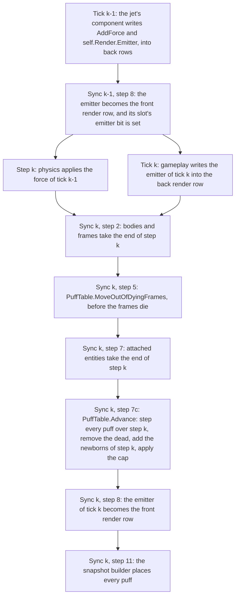

# Particles: puffs

Epic: `ter-4zt6`. Its first user is the demo's plumes (`ter-6u2m`). It builds on parts (`ter-ftk4`), which make each jet of a hull its own attached entity. The design settled with the user on 2026-10-21. This doc writes it out, and it settles what the user's rules decide.

## Goal

A thrusting hull, a jet or a person's back pack leaves puffs behind it. Each puff leaves its emitter, flies on as a loose body would, fades and dies. A trail of puffs marks the path. Hot exhaust glows. Cold gas is pale and lit by the sun and the lamps. Puffs only brighten what is behind them.

## The model

A puff is a loose body without a shape. Everything else follows from that one sentence and from the rules that the engine already has for loose bodies.

- A puff is born in the frame of its emitter's entity, and it lives in that frame for its whole life.
- It moves as a loose body in that frame moves: by the frame's linear gravity (its field less its proper acceleration), and in a turning frame by the two-turn update, which holds the Coriolis, the centrifugal and the Euler terms. A drag pulls its velocity toward rest in its frame. The drag is zero in vacuum.
- It touches nothing. No collision, no contact, no force on any body.
- It fades as it ages, and it dies at the end of its life.
- When its frame dies, it moves into the nearest surviving ancestor, as every content of a dying frame does. When no ancestor survives, it dies.

Cause, storage and effect stay apart:

- Cause. A component of an entity writes the entity's emitter into its own render row, `self.Render.Emitter`, as it writes its light. The frame's motion and field move each puff.
- Storage. The simulation owns the puffs, in one table, `PuffTable`. It steps them at every sync point, in doubles. Nothing else writes the table.
- Effect. The render snapshot carries each puff relative to the render origin, with a current and a previous position, as it carries an instance. The renderer stays frame-blind and draws each puff as a camera-facing sprite.

Why the simulation owns the puffs. The renderer knows no frames. A time-lapse film draws one tick in 4 to 240. The window skips snapshots and draws some twice. A puff that the renderer stepped would see an irregular sequence of steps, and no frame to step in. A puff that the simulation steps sees every step, in its frame, in doubles, in a headless run as in the window.

## Terms

| Term | Meaning |
|---|---|
| Puff | One particle: a loose body without a shape, in one semantic frame, with a place, a chord, a birth time, a life and a look. A row of `PuffTable`. |
| Emitter | The `PuffEmitter` in an entity's render row, `RenderData.Emitter`. An entity holds one, as it holds one light. |
| Emitter's entity | The entity whose render row holds the emitter. |
| Step k | The physics step that runs beside tick k (ARCHITECTURE.md, "Changes of motion"). The sync point of tick k comes after it. A force that tick k − 1 writes acts in step k. |
| Front row, back row | The two buffers of a transform or render row. During tick k gameplay reads the front rows and writes the back rows. Step 8 of the sync point makes the back rows the front rows. |
| Place | A puff's position in its frame at the end of the last step, in m, in the frame's axes, as a `Double3`. |
| Chord | A puff's move over the last step divided by the step, in m/s, in the frame's axes. Jolt keeps the same quantity for a body (ARCHITECTURE.md, "Instant velocities and chords"). |
| Instant velocity | The velocity at one moment, in m/s. |
| Linear gravity | The gravity on a loose body at a place in a frame, in m/s², in the frame's axes: the frame's field there less the frame's proper acceleration (`FrameTree.LinearGravity`). It leaves out the rotation terms. |
| Turns | V1 and V2 of a frame (`FrameTurns`): the turn of its axes over the step in flight and over the step that ended. |
| Age | The time since a puff's birth, in s. |
| Life | How long a puff lives, in s. It dies when its age reaches its life. |
| Newborn | A puff born during the step that the sync point just closes. |
| Birth phase | The share of the next puff that an emitter has gathered, from 0 up to but not including 1. A column of the entity table. |
| Capacity | The most puffs that live at once, `WorldOptions.PuffCapacity`. |
| Step damping | The share of its velocity relative to its frame that a puff keeps over one step: e^(−drag · dt), from its emitter's drag at its birth. |
| Run | A stretch of the transparent pass's sorted list that one draw covers: transparent meshes or puffs. |

## Decisions

The user settled these on 2026-10-21 (`.tickets/ter-4zt6.md`, the last note):

1. A puff is a loose body without a shape, born in its emitter's frame, living there for its whole life, with a drag toward rest in its frame. It fades as it ages.
2. The simulation owns the puffs and steps them every tick, in doubles. The snapshot carries each puff with a current and a previous position.
3. One emitter per entity, in its render row, like its light. Parts make each jet its own entity (`ter-ftk4`).
4. One emitter struct with a shading union: glow or lit. Glow for hot exhaust, lit puffs for cold gas.
5. Camera-facing sprites in one instanced draw, additive, sorted together with the transparent instances, so that glass dims only the puffs behind it.
6. A soft fade near opaque surfaces and near the eye.
7. Births spread through the step.
8. A time-lapse frame shows the puffs alive at its tick. There is no "largest force of the frame" rule (`ter-6u2m`, note of 2026-10-21).
9. True size far away. No least size on screen.
10. A cap on live puffs, oldest first, with a switch.
11. A jet's puffs start in the physics step in which its force acts.
12. The user's choices: slow tracer puffs at tens of m/s that hang behind and mark the path, not real exhaust speed. No collisions with surfaces. Bloom (`ter-63wr`) later, after the plumes.

This doc settles the rest by the user's rules. Each choice names its reason where it is made:

- The puff table is a new subsystem of the World, `PuffTable`, with one choke-point method, `Advance`, that the World calls once per sync point, at a new step 7c. The destroy path of step 5 moves the puffs of each dying frame, as it moves the entities.
- A newborn's state comes from the emitter's back transform row after step 7 and the emitter in its front render row.
- The puffs' rule of motion is the free-body update of physics, with the same `FrameTurns` and the linear gravity that the step used, plus the drag.
- The snapshot places each puff through the frame poses that the builder already computes. A puff's previous position is its place one step back along its chord. No memory per puff.
- Lit puffs scatter light equally in every direction. Their light is computed once per puff, at its center.
- The switch is the capacity: zero turns puffs off.

## The state and its owner

### The emitter

`PuffEmitter` is a struct in `Tertius.Simulation`, beside `LightData`. `RenderData` gains one field, `public PuffEmitter Emitter`. The default emitter makes no puffs.

| Field | Type | Unit and range | Meaning |
|---|---|---|---|
| `Offset` | `Pose` | m, unit quaternion | The emitter's pose relative to the entity. A zeroed rotation counts as the identity, as for a light. Puffs leave along the local −Z of the entity's pose composed with `Offset`, as a spot light points. |
| `Rate` | `float` | puffs per s, 0 or more | How many puffs the emitter makes in each second. 0 makes none. |
| `Speed` | `float` | m/s, 0 or more | The ejection speed: a newborn's velocity relative to the emitter. Tens of m/s for the demo's tracer puffs. |
| `Spread` | `float` | rad, 0 to π | The half-angle of the cone of ejection directions about −Z. |
| `Life` | `float` | s, above 0 | How long each puff lives. |
| `StartRadius` | `float` | m, 0 or more | A puff's radius at its birth. |
| `EndRadius` | `float` | m, 0 or more | A puff's radius at the end of its life. The radius grows linearly between the two. |
| `Drag` | `float` | 1/s, 0 or more | How fast a puff's velocity relative to its frame decays: it keeps e^(−Drag · t) of it after t seconds. 0 in vacuum. |
| `Shading` | `PuffShading` | | How the puffs look. |

`PuffShading` is a custom C# 15 `[Union]` in `Tertius` (Core), as `HemisphereUp` is, because the simulation and the render snapshot both hold it with the same fields. `LightData` and `RenderLight` have their own case types because a light's fields change between the two (an offset becomes a position). A puff's look does not change, so one type serves both.

| Case | Field | Unit | Meaning |
|---|---|---|---|
| `GlowPuffs` | `Radiance`, `Vector3` | linear RGB, the HDR units of `MaterialDesc.Emissive` | The light that a puff emits at its center at its birth. The demo's lamp panels emit (6, 5.4, 4.5). |
| `LitPuffs` | `Albedo`, `Vector3` | linear RGB, 0 to 1 per channel for a physical puff | The share of the light that reaches a puff that it scatters (see "Lit puffs"). |

The empty union holds no case, and an emitter whose shading is empty makes no puffs. So the default emitter, with rate 0 and an empty shading, makes none for two reasons. A component that switches its jet off and on keeps the emitter value and writes the default over it, as it does for a light.

An emitter makes puffs only when its numbers are valid: every number finite, `Rate` and `Life` above 0, `Speed`, `Drag` and both radii 0 or more, and `Spread` from 0 to π. A light whose range or intensity is zero or less is left out without an error (ARCHITECTURE.md, "Shading"), and an emitter with numbers that are not valid is left out the same way.

A component writes the emitter of its own entity only, as every write of the render row goes (`Self.Render`, `src/Tertius.Simulation/Entities/Self.cs:131`). A blueprint carries it in its `RenderData`. The JSON form comes with the light's, in the content formats epic.

The emitter adds 72 bytes to each render row, which the entity table holds twice. The measurements below include the cost to step 8 and to the snapshot build.

### The puff table

`PuffTable` is an internal sealed class in `src/Tertius.Simulation/Internal/Puffs/`, owned by the World, like `Attachments`. It holds one array of `Puff` structs, in the order of birth, oldest first. The step and the snapshot build read the same fields, so the data lives in one struct.

| Field of `Puff` | Type | Meaning |
|---|---|---|
| `Frame` | `FrameHandle` | The semantic frame that the puff lives in. Never a numeric frame. |
| `Place` | `Double3` | The place at the end of the last step, in m. |
| `Chord` | `Double3` | The chord of the last step, in m/s. |
| `BirthTime` | `double` | The world time of the birth, in s. |
| `Life` | `float` | From the emitter, in s. |
| `StartRadius`, `EndRadius` | `float` | From the emitter, in m. |
| `StepDamping` | `float` | e^(−Drag · dt), from the emitter's drag, in (0, 1]. |
| `Shading` | `PuffShading` | From the emitter. |

A puff is about 104 bytes. It keeps no age: its age is the time at the end of the last step less its birth time. It keeps no handle of its emitter: once born, a puff is free of it. So a later change or the death of the emitter changes nothing about the puffs it made.

A puff lives in a semantic frame, never in a numeric one. A numeric frame exists only to keep Jolt's float velocities and float bounds small (ARCHITECTURE.md, "Numeric frames"). A puff is not in Jolt, and its place and chord are doubles. The emitter's entity has its row frame, the semantic frame, and its physics home, which may be numeric. The puff takes the row frame. In earth's frame near the station, 6.8e6 m from its origin, a double steps by 9.3e-10 m. In the sun's frame at 1 AU, it steps by 3.1e-5 m. Both are far below a pixel.

The array grows by doubling up to the capacity, at the sync point. After that, a sync point allocates nothing for the puffs.

### Two per-slot values in the entity table

- The birth phase, an `EntityTable.Column<double>` that the puff table adds (`EntityTable.AddColumn`, `src/Tertius.Simulation/Internal/Entities/EntityTable.cs:362`). The table clears it when it releases the entity, so a new entity in a reused slot starts at 0. Only `PuffTable.Advance` writes it.
- An emitter bit per slot, set while the slot's front render row holds an emitter that can make puffs. The births read this bit instead of every render row, as the numeric update gathers the bodies from a bit per slot (ARCHITECTURE.md, step 6c). The entity table sets or clears the bit wherever it writes a front render row: the copy of step 8, and the method by which step 8 ends a change outside a tick. A spawn of step 6 writes its front render row, but it leaves its bit clear until step 8. So between step 6 and step 8, a new entity's bit is clear, and step 7c does not see its emitter. That is right: the new entity was not in step k.

### Invariants and contracts

`PuffTable` is a core data structure that keeps state coherent with the frame tree and the entity table, so it gets contracts and an invariant check (the user's rule, "Contracts"). Its class comment lists the invariants, and `PuffTable.AssertInvariants` checks all of them. The World's own `AssertInvariants` calls it, so `WorldOptions.DebugChecks` runs it at the end of every sync point.

1. The count is at most the capacity.
2. Every puff's frame is a live semantic frame.
3. Birth times never decrease along the array.
4. Every puff is alive at the end of the last advance: its birth time is at most that time, and its age then is less than its life.
5. Every number is finite. `Life` is above 0, both radii are 0 or more, `StepDamping` is in (0, 1], and the shading holds a case.
6. Every birth phase is in [0, 1).
7. The entity table's own invariants gain: outside the sync point, the emitter bit of each live slot says whether its front render row holds an emitter that can make puffs.

Contracts, which compile out of Release builds:

- `Advance` requires that the end time of its step is later than the end time of the last advance, and it ensures invariants 1 and 3.
- `MoveOutOfDyingFrames` requires that each heir is a live ancestor of its dying frame.

A puff whose frame is not live at an advance can come only from a bug, because the destroy path moves every puff out of every dying frame. By the user's rule, a Debug build fails a contract there. A Release build drops the puff and records it in `World.Errors`.

The public guard is ordinary and always on: a negative `WorldOptions.PuffCapacity` throws `ArgumentOutOfRangeException` when the World is made.

## The sync point

Two places in the sync point touch the puffs. Step 5 moves the puffs of dying frames. A new step, 7c, advances them: it steps every puff over step k, removes the dead ones, adds the newborns and applies the cap. Step 11 places them in the render snapshot.



### Why step 7c

Step 7c is the one place where every input of the advance describes step k:

| Input | Where it comes from | Why it is right at step 7c |
|---|---|---|
| The emitter of step k | The front render row | Tick k − 1 wrote it, and its force acts in step k. Step 8 replaces it with the emitter of tick k, whose force acts in step k + 1. |
| The emitter's place and velocity at the end of step k | The back transform row | Step 2 writes it for bodies and frame owners, step 5 moves it out of dying frames, and step 7 derives it for attached entities. A jet is attached to its hull (`ter-ftk4`), so only after step 7 does its row hold the end of step k. |
| The turns of step k | `FrameTree.Turns`, V1 | `BeginStep` fixed V1 for step k in the preparation of tick k. It holds until the preparation of tick k + 1. |
| The linear gravity of step k | A new internal read, `FrameTree.LinearGravityTheStepFound` | Step 2 gave each frame the proper acceleration of step k's record, so the stored value now belongs to step k + 1. The value that step k used is kept from step 2 to the next step 2 (`FieldTheStepFound`). |

So the jet's puffs start in the step in which its force acts. Births cannot come later, at step 11, because step 8 has replaced the emitter by then. They cannot come before step 7, because a jet's row does not hold the end of the step yet. The step of the old puffs could run elsewhere, but one place for the whole advance keeps one choke-point method on the owner of the state, which the user prefers.

The proper acceleration that step k used is the value that step 2 copied before it wrote the new ones:

```csharp
// src/Tertius.Core/Frames/FrameTree.cs:919
private Double3 FieldOf(int id, Double3 position) => gravity[id].AtPrecise(position) - (Double3)properAcceleration[id];
...
// src/Tertius.Core/Frames/FrameTree.cs:929-930
private Double3 FieldTheStepFound(int id, Double3 position) =>
    gravity[id].AtPrecise(position) - (Double3)properAccelerationTheStepFound[id];
```

where

- `gravity[id]` = the frame's field, a `GravityField`, and `AtPrecise(position)` its acceleration at a place in the frame, in m/s².
- `properAcceleration[id]` = the frame's stored proper acceleration, which after step 2 is the value of step k's record.
- `properAccelerationTheStepFound[id]` = the frame's proper acceleration as step k found it, copied at step 2 before the new values.

`FrameTree.LinearGravityTheStepFound(frame, position)` returns `FieldTheStepFound` for a semantic frame. Physics read `FieldOf` during step k, and `FieldTheStepFound` returns the same value at step 7c, to the bit.

### Why step 5 too

Step 5 destroys frames, and after that a handle of a dead frame throws on every read of the frame tree. So the puffs of a dying frame must move before it dies, beside the entities that `World.DestroyDying` moves (`src/Tertius.Simulation/World.Entities.cs:481-501`). `DestroyDying` calls `PuffTable.MoveOutOfDyingFrames` after its rehomes and before `FreeEntity`. This is not a second piece of automatic machinery. It is the destroy path, which moves every content of a dying frame.

### The parallel pieces

The first ticket runs the advance and the snapshot puffs on the sync thread. The second ticket measures them, and adds pieces on the workers if the measurements reach a useful threshold, by the rules of the four pieces in ARCHITECTURE.md, "Threads and the tick": the step of the old puffs in equal ranges of the array, the births in chunks of slots joined in slot order, and the snapshot puffs in ranges. Each range or chunk writes only its own part, so the result equals the result on one thread, bit for bit.

## The rule of motion

Physics moves a free dynamic body in a turning frame by this expression:

```csharp
// src/Tertius.Physics/JoltPhysicsBackend.Step.cs:715-717
Double3 field = linear + homeAcceleration;
Double3 ahead = behind + turns.FreeChange(semanticPlace, behind, dt) + (turns.Step.Turn.Rotate(field) - homeAcceleration) * dt
                - homeVelocity;
```

where

- `linear` = the linear gravity at the body's center of mass in its home, in m/s².
- `homeAcceleration`, `homeVelocity` = the acceleration and the frame velocity of the body's numeric home relative to its semantic frame. Both are zero when the home is the semantic frame.
- `behind` = the body's semantic chord of the step that ended, in m/s.
- `semanticPlace` = the body's place in its semantic frame at the start of the step in flight, in m.
- `turns` = the semantic frame's `FrameTurns`, and `turns.Step.Turn` the turn of the step in flight.
- `dt` = the length of the step, in s.
- `ahead` = the chord of the step in flight, before Jolt's damping, in m/s.

The two-turn update itself:

```csharp
// src/Tertius.Core/Frames/FrameTurns.cs:41-46
public Double3 FreeChange(Double3 position, Double3 chord, double dt)
{
    Double3 previous = position - chord * dt;
    Double3 next = Step.Turn.Rotate(position) * 2 - TwoSteps.Rotate(previous);
    return (next - position) / dt - chord;
}
```

where

- `position` = the place at the start of the step in flight, in m.
- `chord` = the chord of the step that ended, in m/s.
- `TwoSteps` = the turn over both steps, R_n R_(n−1).
- The result = the change of the chord over the step in flight that keeps a free body on its inertial line, in m/s.

In a frame that does not turn, physics skips the update and adds the gravity as a force, so Jolt adds `linear · dt` to the velocity. A puff lives in its semantic frame, so its home terms are zero, and its rule is the same expression. The new code is a method of the struct that it belongs to, `Puff.Stepped`, by the user's rule for the rails library:

```csharp
// The rule of a puff over one step of length dt, in its frame F (new code, a sketch).
Double3 gravity = frames.LinearGravityTheStepFound(F, Place);
FrameTurns turns = frames.Turns(F);
Double3 ahead = turns.Turns
    ? Chord + turns.FreeChange(Place, Chord, dt) + turns.Step.Turn.Rotate(gravity) * dt
    : Chord + gravity * dt;
Chord = ahead * StepDamping;
Place += Chord * dt;
```

where

- `gravity` = the linear gravity that step k applied at the puff's place, in m/s².
- `turns.Turns` = whether either turn of the frame is not the identity. When neither is, the puff skips the update, as physics does, so a frame that does not turn gives the same bits with or without it.
- `StepDamping` = e^(−drag · dt), the share of the velocity relative to the frame that the puff keeps over the step. The drag acts after the push, where Jolt's damping acts on a body.
- `Place`, `Chord` = the puff's place and chord, which become those of step k.

The rule reuses `FrameTurns.FreeChange` and the frame tree's turns as they are. It needs none of the rest of the body update, and each omission has a reason:

| Part of the body update | Why a puff needs none |
|---|---|
| The velocity shadow (V6 of `docs/plans/spin-gravity.md`) | It takes back Jolt's float rounding. A puff is in doubles. |
| The contact turn | A puff has no contacts. |
| The turn of an impulse and of an intent's force | Nothing pushes a puff. |
| The home's offset, velocity and acceleration | A puff lives in its semantic frame, never in a numeric home. |
| The angular form | A puff has no rotation. |
| The wake and sleep | A puff never sleeps. A sleeping body has no velocity relative to its frame, and a puff keeps its velocity. |

The drag is an exact factor per step, so it is stable at any drag and any step. The velocity that it pulls toward is rest in the frame's axes. In a turning frame that is rest in the turning axes, as the air of the ground turns with the ground.

## Births

### Which emitters make puffs in step k

An emitter makes the puffs of step k when its entity was in step k and is still live at step 7c: its emitter bit is set, and step 5 did not free it. So:

- An entity that step 6 made live makes no puffs at step 7c of the same sync point. Its bit is clear until step 8. Its first puffs are those of the next step, its first.
- An entity that dies in tick k makes no puffs for step k, the last step of its life. Its rows are gone at step 7c. This misses one step, 1/60 s, at the end of an emitter's life. A jet's force of tick k − 1 still acts in step k, so its puffs of that one step are missing. Births at step 5 could read the dying entity's rows, but an attached jet's row there still holds the start of the step, so the puffs would come from the wrong place. The miss is the smaller fault.
- An entity whose frame dies is in the heir at step 7c, moved there by step 5, with its place and velocity converted. Its puffs of step k are born in the heir.
- An entity that a hand-off moved in step k is in its new frame at step 7c. Its puffs of step k are born there. The hand-off converts the place and the instant velocity in doubles, so a newborn there lies where it would have lain in the old frame, to the differences of motion of the two frames over its age, which are of the order of the newborn bounds below.

### Births spread through the step

The birth phase gathers the rate over the step. With p the emitter's birth phase where step k starts, r its rate and dt the step:

- The step makes n = floor(p + r · dt) puffs.
- Puff j, for j = 1 to n, is born at the share s_j = (j − p) / (r · dt) of the step, in (0, 1]. Its age at the end of the step is τ_j = (1 − s_j) · dt.
- The new birth phase is p + r · dt − n.

So the births lie evenly in time at the emitter's rate, across tick boundaries. An emitter at 60 puffs per second makes one puff per step, born at the end of the step to within a few millionths of a step over the first minute, because the step is the float 1/60 widened to a double (0.01666666753590107 s). A step makes at most the capacity of puffs, because the cap would drop the rest. The phase still gathers the whole rate, so the count of the next step does not change. An emitter that is switched off keeps its phase. The phase is engine state per entity, which no gameplay writes, so it lives in a column that the entity table keeps and clears, as the render builder's `PoseMemory` does.

### The newborn's state

A newborn rides with its emitter until its birth, and then flies free. The emitter's place and velocity at the end of step k come from its back row, through the reads that every tick uses:

```csharp
// src/Tertius.Simulation/Internal/Entities/FrameReads.cs:26-32
public static Double3 VelocityIn(FrameTree frames, Entity entity, in TransformRow row, FrameHandle to)
{
    if (row.Frame.IsNull)
        return frames.ConvertVelocity(OwnFrame(frames, entity), to, Double3.Zero, Double3.Zero);
    Double3 velocity = frames.HomeVelocity(row.PhysicsHome, row.Frame) + row.LinearVelocity;
    return row.Frame == to ? velocity : frames.ConvertVelocity(row.Frame, to, row.Pose.Position, velocity);
}
```

where

- `row` = the emitter's entity's back transform row, and `to` = its row frame `row.Frame`, so no conversion runs and nothing allocates.
- `frames.HomeVelocity(row.PhysicsHome, row.Frame)` = the velocity of the row's numeric home in the row frame, or zero.
- `row.LinearVelocity` = the entity's float velocity relative to its home.
- The owner of a root frame has no row frame, so its puffs are born in the frame that it owns, at that frame's origin, as `FrameReads` reads such an owner.

For an attached jet, step 7 derives that row from the root's:

```csharp
// src/Tertius.Simulation/Internal/Attachments/Attachments.cs:151-155
Frame = rootRow.Frame,
PhysicsHome = rootRow.PhysicsHome,
Pose = rootRow.PhysicsHome == rootRow.Frame ? inHome : new DPose(rootRow.Pose.Position + lever, inHome.Rotation),
HomePosition = inHome.Position,
LinearVelocity = rootRow.LinearVelocity + Double3.Cross(rootRow.AngularVelocity, lever).ToVector3(),
```

where

- `rootRow` = the back row of the chain's root, the hull, which is in the parent frame of the hull's own frame.
- `lever` = the jet's place less the root's, in the root's physics home, in m.

So the jets of a hull put their puffs in the hull's parent frame: on the pad in `earth-surface`, in orbit in `earth`, in the bay in the station. The person's back jet, attached to the person in the cabin, puts its puffs in the shuttle's frame.

With x_e the emitter's place at the end of the step (the entity's pose composed with `Offset`), R_e its rotation there, v_e its velocity, d the ejection direction (a unit vector in the cone about −Z), k the drag, and for newborn j its age τ:

- Its ejection velocity is u = `Speed` · R_e d.
- Its share of velocity kept since its birth is e^(−k τ), and the way its velocity carried it is D(τ) = (1 − e^(−k τ)) / k, or τ when k is 0.
- Its place is x_e − v_e τ + (v_e + u) D(τ). In vacuum that is x_e + u τ.
- Its instant velocity at the end of the step is (v_e + u) e^(−k τ).
- Its chord is the chord behind that instant velocity, by the chord rule of ARCHITECTURE.md, "Instant velocities and chords": the instant velocity less half a step of the puff's acceleration (its linear gravity, and the drag's −k times the velocity), and in a turning frame the turn's part with V1 of step k (`FrameTurn.ChordBehind`). Physics converts the velocity that a hand-off carries at the end of a step the same way, with V1 of the step that just ended (`HandedOffVelocities`, `src/Tertius.Physics/JoltPhysicsBackend.Chords.cs:327`).
- Its birth time is the start of step k plus s_j · dt. Its life, radii, step damping (from k) and shading come from the emitter.

The chord rule matters. A puff that took the emitter's velocity as its chord would leave a coasting ship in orbit at half a step of the gravity, 0.072 m/s, and lie 0.14 m off after 2 s.

What the rule leaves out. In the age τ since its birth, a newborn moves with its emitter apart from its ejection velocity and its drag. Whatever acts differently on the puff and on the emitter in that time is left out. Each part is at most its acceleration times one step in velocity, and half that times one step in place:

| What acts differently | Demo case | At most, in velocity | At most, in place |
|---|---|---|---|
| The emitter's thrust | The main engine at 3 g | 0.49 m/s | 4.1 mm |
| The Coriolis term on the ejection velocity | A side jet at 30 m/s in the station | 0.31 m/s | 2.6 mm |
| The centrifugal term at an emitter at rest in a turning frame | 8 m from the station's axis | 0.013 m/s | 0.11 mm |
| The turn of the ejection direction | A hull that turns at 0.15 rad/s | 0.0025 rad of direction | |

The births lie evenly over the step, so the mean is half of each. Against a tracer puff at tens of m/s, each is under 2 % of its speed, for one step of its life. From its first full step on, the puff moves by the rule of motion.

The velocity read gives a frame owner the instant velocity of its frame's last record, so a hull's jets ride with it exactly. For a plain dynamic body and for a character, the row keeps Jolt's chord, which lags its instant velocity by half a step of the body's acceleration (ARCHITECTURE.md, "Instant velocities and chords"). A puff of such an emitter in a field is off by that half step: 0.082 m/s at 9.81 m/s². The person's back jet fires while the cabin falls freely, where the linear gravity is near zero, so it rides with the person too.

### Seeds

A puff's ejection direction needs two random numbers. They come from a counter-based hash of three integers: the emitter's entity handle, the tick number of the sync point, and the puff's index j in the step. SplitMix64's finalizer folds them into 64 bits, and the high and the low 32 bits give two numbers in [0, 1). With them, cos θ = 1 − r1 (1 − cos `Spread`) and φ = 2π r2, which spreads the directions evenly over the cone. No generator state persists, so the same puff gets the same numbers in any order of work. Spawned handles are the same in every run as long as no spawn pool runs dry (ARCHITECTURE.md, "Creation and destruction"), so the seeds are too. When a pool runs dry, the world already logs that the run is no longer deterministic. Two emitters at one place get different directions, because their handles differ.

## The flow per kind of frame

A puff is born in its emitter's entity's row frame. One rule moves it in every kind of frame. The table shows what the rule reads in each.

| Kind of frame | Demo case | The linear gravity that the puff gets | The turns | Drag |
|---|---|---|---|---|
| A frame that does not turn and falls freely | `earth`: the shuttle's jets in orbit, the transfer and the brake | Earth's point field at the puff. Earth's proper acceleration is exactly zero (ARCHITECTURE.md, "How a frame moves"). So a puff falls as the ship falls, and stays beside it to tidal precision. | Both the identity, so the update is skipped | 0 |
| A frame that does not turn and holds still in a field | The shuttle's frame while the hull rests on the pad | The frame's field less its proper acceleration, the gravity at its place reversed: the puff falls to the floor, as a crate in a parked cabin does | Identity | The emitter's |
| A turning frame | The station: the side jets in the bay. `earth-surface`: the main engine on the pad and the ramp. | The frame's field less its proper acceleration | The two-turn update, so a puff in the bay curves as an inertial line does in the turning axes, and in the air of the ground its rest is rest in the turning ground | The air on the pad. 0 in the bay. |
| A frame with proper acceleration | The shuttle's frame while the main engine burns: the person's back jet in the cabin | Less the proper acceleration, so the puff falls toward the stern at the thrust, as a loose crate in the cabin does | The update when the hull turns | 0, or the cabin's air if the demo gives one |
| A root frame | The sun | The root's own field. The rule gives a root no gravity at its place, so its proper acceleration is its own acceleration, zero while it holds still. | The update when its owner turns it | The emitter's |
| A numeric frame | None | A puff is never in one. An emitter's row frame is always semantic. | | |

A hull's own jets are not in the hull's frame. They are attached to the hull, so they are in the frame of their chain's root (`ter-ftk4`), the hull's parent. Their puffs fall behind a thrusting hull in its parent frame, by half the thrust times the square of their age, plus their ejection.

## The flow per event in a puff's life

| Event | Who causes it | What happens to the puff | Where the result is stored | When |
|---|---|---|---|---|
| Birth | The emitter's component, which writes the emitter in tick k − 1, and the emitter's motion over step k | Born in the emitter's row frame with the newborn's state | A new row at the end of the puff table. The emitter's birth phase. | Step 7c of sync k |
| Each step | The frame's field, its proper acceleration and its turns, and the puff's step damping | The rule of motion | The puff's place and chord | Step 7c of every sync point |
| Its frame hands off, or the game reparents its frame | Physics, or the game | Nothing. Its place and chord are in its frame, which keeps its pose and velocity relative to everything else, so the puff moves with it. Its turns are inertial, so a new parent does not change them. | Nothing changes | |
| Its frame dies and an ancestor survives | The game's destroy | Moves into the nearest surviving ancestor. Its place converts by `FrameTree.Relative`, its chord by `FrameTree.ConvertVelocity`, as `World.Rehome` converts an entity's row. From the next step on it moves by the heir's field and turns. | The puff's frame, place and chord | Step 5, before the frame dies |
| Its frame dies and no ancestor survives | The game's destroy of a root frame | It dies, as every content of the root does | Its row is removed | Step 5 |
| Its emitter dies | The game, or the emitter itself | Nothing. The puff lives on. The emitter makes no more puffs, and none for its last step. | The entity table clears the emitter's birth phase | Step 5 |
| Its emitter changes or switches off | The emitter's component | Nothing. The puff keeps the look and the drag of its birth. | | |
| The cap | Births that would pass the capacity | The oldest puffs die first | Rows are removed from the front of the table | Step 7c |
| The end of its life | Its age reaches its life | It dies | Its row is removed | Step 7c of the first sync point whose step ends at or after its birth time plus its life |

The move out of a dying frame uses the same reads as an entity's rehome:

```csharp
// src/Tertius.Simulation/World.Entities.cs:572-574
DPose relative = Frames.Relative(from, to);
Double3 velocity = Frames.ConvertVelocity(from, to, row.Pose.Position, FrameReads.VelocityIn(Frames, entity, row, from));
DPose pose = DPose.Compose(relative, row.Pose);
```

where

- `from` = the dying frame, and `to` = its nearest surviving ancestor.
- `relative` = the pose of the dying frame in the heir, at the moment of its death.
- `velocity` = the entity's velocity converted into the heir, with the frame's velocity and its ω × r term.

The heir is an ancestor, so `ConvertVelocity` only walks up the tree and allocates nothing. A puff's chord converts as the entity's row velocity does, with the same rounding.

## The advance, step by step

`PuffTable.Advance` runs once per sync point, at step 7c. In one pass over the table and one over the emitter bits:

1. Step every puff over step k by the rule of motion.
2. Count the newborns of step k, emitter by emitter in slot order, and update the birth phases.
3. Remove the puffs whose age at the end of step k has reached their life. If the survivors and the newborns pass the capacity, also remove that many of the oldest survivors, and if the newborns alone pass it, keep only the last newborns. The survivors move down in order.
4. Write the newborns at the end, in slot order, and in each emitter's order of birth.

So the table stays in the order of birth step, then slot, then birth in the step, and the cap drops the oldest by that order. The newborns of a step all have later birth times than every survivor, so invariant 3 holds.

## The cap and its switch

`WorldOptions.PuffCapacity` is the most puffs that live at once. The default is 4,096. The survey of 2026-10-21 estimated the demo's peak at about 1,200, at the launch with the ground cloud and in the docking with the side and turning jets, so the default leaves a margin of three times. The first ticket measures the cost at the default.

A capacity of 0 turns puffs off. No emitter makes a puff, the advance does nothing, the snapshot has no puff, and the renderer records no puff draw. The capacity is the one switch, because a second switch beside it could disagree with it. It is a world option, not a renderer option, because the simulation owns the puffs and steps them in every tick, also in a headless rehearsal without a renderer. The frame outlines are a view setting of the World for the same reason (ARCHITECTURE.md, "Switches").

Gameplay and physics read nothing of the puffs. So a world with puffs off reaches every state at the same tick as a world with puffs on, and a rehearsal such as the demo's `FilmScript` can turn them off to save their cost.

## Determinism

The same run gives the same puffs, bit for bit, in Debug and in Release, on one thread and on several:

- The advance runs at one place in the sync point, in a fixed order: the table's order for the step, slot order for the births. Each piece on the workers writes only its own range or chunk, and the sync thread joins them in order.
- The seeds depend only on the entity handle, the tick and the index of the birth.
- Every value is a double or a float that the same operations make in every build. Contracts compile out, but they change no value.
- `Math.Exp` runs at a birth only, for the step damping and the newborn's drag. The step uses the stored factor.
- The renderer adds no randomness and keeps no puff state. So the planned switch for deterministic rendering (`ter-rtxu`) has nothing to do for puffs.

A film step is defined as its expansion, so its images stay byte-identical to those of its expansion: the puffs come from the ticks, not from the captures.

## The render snapshot

`RenderSnapshot` gains a list, `Puffs`, of `RenderPuff`, which `Clear` empties with the other lists:

| Field of `RenderPuff` | Type | Meaning |
|---|---|---|
| `Position` | `Vector3` | The place relative to the render origin, in the axes of the camera's frame, in m |
| `PreviousPosition` | `Vector3` | The place at the previous build, relative to the same origin |
| `Age` | `float` | The age at the snapshot's time, in s |
| `PreviousAge` | `float` | The age at the previous build, in s. Negative for a newborn. |
| `Life` | `float` | In s |
| `StartRadius`, `EndRadius` | `float` | In m |
| `Shading` | `PuffShading` | The look |

A `RenderPuff` is about 64 bytes. The builder writes the puffs in the order of the puff table, at step 11, after the instances. It places each through the frame poses that it already computes for every frame, as it places an entity:

```csharp
// src/Tertius.Simulation/Internal/Rendering/RenderSnapshotBuilder.cs:459-463
current = DPose.ComposeUnitParent(relCurrent[denseOfFrame[home.Index]], inHome);
previous = current;
ref PoseMemory last = ref lastEntityPose[entity];
if (renderInterpolate && last.Stamp == buildStamp - 1 && FrameSeen(last.Frame))
    previous = DPose.ComposeUnitParent(relPrevious[denseOfFrame[last.Frame.Index]], last.Pose);
```

where

- `relCurrent[i]` = the pose of the frame with dense index i relative to the camera's physics home at this build, in doubles.
- `relPrevious[i]` = the same pose with the local poses of the last build: a frame that moved between the builds carries its contents along (lines 296-301).
- `denseOfFrame[f]` = the dense index of the frame with index f at this build.
- `renderInterpolate` = whether this build follows a build of the same camera in the same frame.
- `PoseMemory` = an entity's pose at the last build and the frame that it was in.

A puff needs no memory. Its place at the previous build follows from its own chord: x − c · dt, the place at the end of step k − 1, in the same frame.

- `Position` = relCurrent of the puff's frame, applied to x, less the render origin.
- `PreviousPosition` = relPrevious of the puff's frame, applied to x − c · dt, less the render origin, when `renderInterpolate` holds and the last build was of the tick before. Otherwise it is `Position`. A headless capture builds a second snapshot at the same tick, and that build gives no motion, as it gives none to the instances.
- `Age` = the snapshot's time less the birth time. `PreviousAge` = `Age` less dt in the first case, and `Age` in the other.

A puff that the cap or its life removed at step 7c is not in the snapshot. A puff that its frame's death moved has the place and chord of its heir, and its previous position x − c · dt lies where it was a step ago, to the conversion's rounding. The previous place of a newborn lies upstream in its emitter, and its negative previous age hides it until its birth (see "The batcher").

The puffs are placed relative to the camera's physics home, like everything else, so a puff near the camera is exact however far it is from its frame's origin. A puff in `earth` beside a station 6.8e6 m out lands within a few nm of its true place relative to the eye.

## The renderer

### The batcher

`SceneBatcher` gains a collection of puffs beside its collection of instances. For each `RenderPuff`, with the interpolation alpha α:

- The render age is lerp(`PreviousAge`, `Age`, α). A puff whose render age is below 0 or at its life or more is not drawn.
- With t the render age over the life, the radius is lerp(`StartRadius`, `EndRadius`, t) and the weight is 1 − t: the puff fades linearly to nothing at the end of its life.
- The position is lerp(`PreviousPosition`, `Position`, α) less the camera's interpolated offset, as for an instance (`SceneBatcher.cs:135`).
- A puff whose position or radius is not finite, whose radius is 0 or less, or whose sphere is outside the frustum is left out.
- The color is the weight times the radiance of a glow puff or the albedo of a lit puff.

The batcher writes one `GpuPuff` of 32 bytes for each puff that it keeps: `vec4 positionRadius` and `vec4 colorKind`, whose `w` holds the case, 0 for glow and 1 for lit, as `GpuInstance` packs the case of `HemisphereUp` into a `w` (ARCHITECTURE.md, "Shading"). The records go into a storage buffer of the frame set, binding 7, which grows by doubling as the instance buffer does. `RenderStats.Puffs` counts the drawn puffs.

### Sorting with the transparent instances

The batcher sorts the transparent instances by range and then back to front:

```csharp
// src/Tertius.Rendering/Scene/SceneBatcher.cs:166-171
if ((instance.Flags & RenderFlags.Transparent) != 0)
{
    // Far range first, and back to front inside a range: the inverted distance bits sort ascending.
    int range = DepthRanges.Containing(instance.Depth);
    uint farFirst = ~BitConverter.SingleToUInt32Bits(MathF.Max(instance.Distance, 0f));
    Append(ref transparent, ref transparentCount, new DrawItem(((ulong)range << 32) | farFirst, i));
```

where

- `instance.Depth` = the view depth of the instance's center, and `DepthRanges.Containing` the range that holds it.
- `instance.Distance` = the distance of the center from the eye.
- `DrawItem` = a sort key and the index of the prepared instance.

Each puff joins the same sort, with the same key from its center. At equal keys the instance comes first, so the order is fixed. Then the batcher walks the sorted list of each range and cuts it into runs: a stretch of transparent instances becomes indirect commands as today, and a stretch of puffs becomes one run of `GpuPuff` records. Additive blending commutes, so the puffs inside a run need no order among themselves. The demo has a few panes in view at most, so a range has a few runs.

A run is a closed set of two kinds, so it is a custom `[Union]`, `TransparentRun`, with the cases `MeshCommands(CommandRange Commands)` and `PuffSprites(int First, int Count)`. `PreparedScene.Transparent` becomes, per range, the ordered list of runs.

### The pass

The transparent pass draws the runs of each range in order:

```csharp
// src/Tertius.Rendering/Passes/TransparentPass.cs:75-82
for (int range = DepthRanges.Far; range <= DepthRanges.Near; range++)
{
    CommandRange commands = scene.Transparent[range];
    if (commands.Count == 0)
        continue;
    GeometryPass.PushDraw(context, scene.RangeViewProjection[range]);
    GeometryPass.DrawIndirect(context, commands);
}
```

where

- `scene.Transparent[range]` = today the indirect commands of the transparent instances of one range.
- `GeometryPass.PushDraw` = pushes the range's view and projection.
- `GeometryPass.DrawIndirect` = one indirect draw over the commands.

The loop becomes: push the range's matrix, then for each run, a `MeshCommands` run binds the transparent pipeline and draws its commands, and a `PuffSprites` run binds the puff pipeline and draws 6 vertices for each of its puffs, `vkCmdDraw(6, Count, 0, First)`. So glass dims a puff behind it and leaves a puff in front of it as it is, from any camera. The pass keeps its stage, after the lighting and before tone mapping, and it binds no depth buffer, as today.

`GraphicsPipelineDesc` has one blend switch today, `bool AlphaBlend` (`src/Tertius.Rendering/Vulkan/GraphicsPipelineDesc.cs:45` and `129-135`). It becomes an enum, `BlendMode`, with `None`, `Alpha` and `Additive`. The cases carry no fields, so an enum is the right type. `Additive` adds the source color to the HDR target, with the factors One and One, and keeps the target's alpha. The puff pipeline is `puff.vert` and `puff.frag`, with no vertex input, depth clamping on, and the scene layout of the transparent pass.

### The sprite

The vertex shader builds a square from the vertex index, as `impostor.vert` does: centered on the puff, facing the eye, with the puff's radius as half its side. A puff draws in the range that holds its center, with depth clamping on, as a transparent instance does (ARCHITECTURE.md, "Depth ranges"). The fragment shader adds:

color × (1 − ρ²)² × fade

where

- ρ = the distance of the fragment's point from the puff's center over the radius. Outside the circle, ρ is above 1 and the profile is 0.
- fade = clamp((D − d) / r, 0, 1) × clamp(d / r, 0, 1).
- D = the G-buffer distance at the pixel, 0 for sky, which counts as no surface. The first factor is then 1.
- d = the distance of the fragment's point from the eye.
- r = the puff's radius.

That is one rule for both fades: a puff fades within one radius of anything opaque, and the eye counts as an opaque point at distance 0. So a puff that cuts into a wall or a floor shows no hard line, a puff behind a wall draws nothing, and a puff around the eye fades instead of filling the picture with a cut. The transparent pass tests the same distance target with a hard cut today (`src/Tertius.Rendering/Shaders/transparent.frag:25-28`). The puffs replace the cut by the fade, with the puff's radius as the width, which needs no new number.

### Lit puffs

A puff has no surface and no normal. The model: a lit puff scatters the light that reaches its center equally in every direction. That is the mean, over every facing, of a matte surface lit by the same lights:

- The sun and each point and spot light: a matte surface reflects albedo / π times the light's irradiance times the cosine of its angle, and the mean of the cosine over every facing is 1/4. So a puff scatters albedo / (4π) times the irradiance.
- The hemisphere ambient light: the mean of the sky's share over every facing is one half, so the puff takes the mean of the sky and the ground color.

So L = albedo × (mean ambient + (E_sun · V_sun + Σ E_light) / (4π)), where

- mean ambient = the mean of the sky and the ground color of the ambient light.
- E_sun = the sun's radiance as the shader holds it, and V_sun = its visibility at the puff's center: the far shadows times the cascades, sampled with the sun's direction as the normal, which gives the least bias.
- E_light = the radiance of a point or spot light times its distance attenuation and its cone, at the puff's center.

The vertex shader computes L once per puff, at the center, from the same functions that `lighting.glsl` uses for surfaces. The cascades use `textureGrad` with zero gradients already (`src/Tertius.Rendering/Shaders/shadows.glsl:45-46`), which works in a vertex shader. Each of the 6 vertices of a puff computes the same value. So a lit puff in Earth's night is dark, a puff in the sun is pale, and a puff under a cabin lamp is lit by it. A puff casts no shadow and is not a light.

A glow puff emits its radiance and takes no light.

### Alpha, captures and time-lapses

In the window, the render thread draws the latest snapshot at the alpha of its clock. A puff moves from its previous to its current place, and its render age follows. A newborn's render age is below 0 until the moment of its birth, so it appears at its birth, not at the start of the step. A puff that died at the last sync point had a weight near 0 at its end, so it vanishes without a step in brightness. The renderer keeps no puff state, so a snapshot that the window draws twice, or one that it skips, changes nothing.

A headless capture draws at alpha 1. A puff draws at its current place and age, exactly. A time-lapse frame shows the puffs alive at its tick, because the simulation stepped every tick in between.

### What puffs do not touch

- Impostors. A puff is not an instance, so it never becomes one. An impostor billboard writes its distance, so it hides puffs behind it and fades those near it.
- Shadows. A puff casts none.
- The frame outlines. A puff grows no contents sphere, and the overlay draws after tone mapping.
- Bloom. Glow puffs saturate through the ACES curve until the bloom ticket (`ter-63wr`) lands, which the user chose to come later.

## Closed sets

| Set | Type | Cases |
|---|---|---|
| The look of a puff | `PuffShading`, a custom `[Union]` in Core | `GlowPuffs(Radiance)`, `LitPuffs(Albedo)`, or empty |
| A run of the transparent pass | `TransparentRun`, a custom `[Union]` in Rendering | `MeshCommands(Commands)`, `PuffSprites(First, Count)` |
| A blend of a pipeline | `BlendMode`, an enum, because no case has fields | `None`, `Alpha`, `Additive` |

## Tests

Red-green, in BDD names. Every test of puffs in motion runs the real World on the real Jolt backend, as the testing rules require. Each test brief asks for hand mutations: break the line that the test protects, watch the test fail, restore it.

Pure rules in Simulation, with no World, in `PuffRuleTests`:

- `APuffInAFrameThatDoesNotTurnGainsItsLinearGravityTimesTheStep`
- `APuffInAFrameThatDoesNotTurnSkipsTheTwoTurnUpdateToTheBit`
- `APuffInATurningFrameTakesTheFreeBodyUpdateOfPhysics`, against the expression of `ApplyTurningUpdate` with no home
- `ThePuffKeepsItsStepDampingShareOfItsVelocityEachStep`
- `APuffWithDragAndNoGravityComesToRestAlongItsFirstVelocity`
- `AnEmitterAtSixtyPuffsPerSecondMakesOnePuffPerStepAtTheEndOfTheStep`
- `TheBirthPhaseCarriesTheShareOfAPuffIntoTheNextStep`
- `AStepMakesAtMostTheCapacityOfPuffsAndThePhaseGathersTheWholeRate`
- `ANewbornInVacuumLiesAheadOfItsEmitterByItsEjectionVelocityTimesItsAge`
- `NewbornsInAirLieAlongTheEmittersPathInsteadOfInBeads`
- `ANewbornsChordIsTheChordBehindItsInstantVelocity`
- `TheSeedOfAPuffDependsOnlyOnItsEmitterItsTickAndItsIndex`
- `EjectionDirectionsStayInsideTheConeOfTheSpread`
- `AnEmitterWithNumbersThatAreNotValidMakesNoPuffs`
- `AnEmitterWithAnEmptyShadingMakesNoPuffs`
- `ThePuffShadingUnionHoldsOneCaseAndMatchesWithoutBoxing`, as `LightDataUnionTests` does

The World with real Jolt, in `PuffPhysicsTests` and `PuffLifeTests`:

- `APuffInOrbitStaysWithTheFallingShip`: a part with speed 0 on a coasting dynamic hull in orbit in `earth`. After 2 s each puff is within 1 cm of the place on the hull where it was born. A puff that took the read velocity as its chord would be 0.14 m off.
- `APuffInTheSpinningStationCurvesAsAnInertialLineDoes`: an emitter at rest 8 m from the axis of a station that spins at 0.31321 rad/s, at 60 puffs per second, so every newborn is born at the end of its step, to within a few millionths of a step. After 1 s a puff lies on its inertial line, turned into the station's axes, within 1e-6 m.
- `APuffMovesAsALooseBodyThatLeavesTheEmitterWithTheSameVelocity`: the same station, and a small dynamic sphere spawned at the newborn's place with its instant velocity, in a group that collides with nothing. After 1 s they agree within 1e-4 m, the rounding of Jolt's floats.
- `APuffInAThrustingHullsFrameFallsBehindTheHull`: an emitter without a body at rest in the frame of a hull that thrusts at 4.9 m/s². The puff moves toward the stern by half the thrust times the square of its age, as a loose crate in the cabin does.
- `AJetsPuffsFallBehindItsThrustingHullInTheHullsParentFrame`
- `APuffInAFrameThatHoldsStillInAFieldFallsWithTheField`
- `APuffInARootFrameFeelsTheRootsFieldAndNoProperAcceleration`
- `AJetsFirstPuffsAreBornInTheStepOfItsFirstForce`: a component that writes a force and an emitter in tick N. The sync point of tick N has no puff. That of tick N + 1 has the puffs, and its snapshot shows the hull's first change of velocity.
- `AnEmitterThatSwitchesOffInTickNMakesItsLastPuffsInStepN`
- `ASpawnedEmitterMakesItsFirstPuffsInTheStepAfterItsSpawn`
- `AnEmitterThatDiesMakesNoPuffsForItsLastStepAndItsPuffsLiveOn`
- `APuffKeepsItsPlaceInItsFrameWhenTheFrameHandsOff`: the person's jet in a ship that climbs out of `earth-surface` into `earth`
- `APuffKeepsItsPlaceInItsFrameWhenTheGameReparentsTheFrame`
- `APuffInADyingFrameMovesIntoTheNearestSurvivingAncestor`: against an entity without a body at the same place and velocity, which the World rehomes
- `APuffInADyingRootFrameDiesWithIt`
- `AnEmitterWhoseFrameDiesMakesItsPuffsInTheHeir`
- `APuffIsGoneAtTheFirstSyncPointPastItsLife`
- `TheCapDropsTheOldestPuffsFirst`
- `ACapacityOfZeroMakesNoPuffs`
- `PuffsChangeNothingThatGameplayOrPhysicsReads`: one scene with capacity 0 and with 4,096 gives the same `WorldHash` of the entities, bit for bit
- `TheSameRunGivesTheSamePuffsBitForBit`: twice, and on one thread and four. A test pins the hash of the puff table after 300 ticks of a fixed scene, and `tools/test-all.sh` runs it in Debug and in Release, so both builds must give that hash.
- `AnAdvanceAllocatesNothingAfterWarmUp`
- `ThePuffTableKeepsItsInvariantsInEverySyncPoint`: `InvariantWorkload` with emitters, frame deaths and the cap, with `DebugChecks` on
- `APuffInAFrameThatIsNotLiveFailsAContract`: the state that only a bug makes, through an internal edit of the table. In Release the puff is dropped and recorded in `World.Errors`.

The snapshot builder, as CPU tests in Simulation:

- `APuffIsPlacedThroughItsFramesPoseRelativeToTheCamerasHome`
- `APuffsPreviousPositionIsItsPlaceOneStepBackThroughThePreviousFramePose`
- `APuffHasNoMotionInARebuildAtTheSameTickOrAfterACameraCut`
- `APuffFarFromItsFramesOriginIsExactNearTheCamera`
- `APuffsAgeAndPreviousAgeAreOneStepApart`
- `PuffsKeepTheOrderOfThePuffTable`
- `ASnapshotWithoutACameraHasNoPuffs`

The batcher, as CPU tests in Rendering (`BatcherTests`):

- `PuffsInterpolatePositionAndAgeByAlpha`
- `AtAlphaOneAPuffDrawsAtItsCurrentPlaceAndAge`
- `APuffIsNotDrawnBeforeItsBirthOrAfterItsLife`
- `APuffsRadiusGrowsAndItsWeightFallsLinearlyOverItsLife`
- `APuffOutsideTheFrustumIsCulledByItsRadius`
- `APuffWithANumberThatIsNotFiniteIsLeftOut`
- `APuffBehindAPaneDrawsBeforeThePaneAndOneInFrontDrawsAfterIt`
- `PuffsBetweenTwoPanesFormOneRun`
- `APuffDrawsInTheRangeThatHoldsItsCenter`
- `AGpuPuffIs32BytesAndCarriesTheCaseOfItsShading`
- `RenderStatsCountsTheDrawnPuffs`

Snapshot tests with FLIP, in `PuffRenderTests`, each reference reviewed against its scene on its first approval, with the reference, the actual image and the heat map opened by the agent:

- `puffs-glow`: a row of glow puffs over a dark ground and against the sky. They only brighten.
- `puffs-glass`: puffs behind and in front of a pane of alpha 0.2. Only those behind are dimmed.
- `puffs-soft`: a puff that cuts into a wall and a floor, and one around the eye. No hard line.
- `puffs-lit`: lit puffs in the sun, in the shadow of a box, and under a point light.
- `puffs-far`: a trail 2.5 km away, in the middle range, at its true size.

## Measurements

Each ticket measures its part on the reference machine, an Apple M1 Max, in Release:

1. The advance: the cost of a step per puff and of a birth, on one thread and on all workers, from 100 to 4,096 puffs. The second ticket sets the thresholds of the pieces from these, as ter-sn28 set those of steps 8 and 10.
2. The snapshot build per puff, in `RenderSnapshotBenchmarks`.
3. The render row's growth of 72 bytes: `RowCopyBenchmarks` and `RenderSnapshotBenchmarks` before and after.
4. Memory at the default capacity: about 416 KB for the table, 256 KB for each of the three snapshots, and 128 KB of `GpuPuff` records for each frame in flight. The ticket reports the real figures.
5. A headless `Render` at 1280 × 720, as `OutlineRenderBenchmarks` measures: with 0, 100, 1,000 and 4,096 puffs, small and filling the screen, glow and lit with eight lights. With no puff, a frame must cost what it costs today.
6. The GPU time of the puff runs, when the GPU timer of `ter-yiii` lands.
7. A new lap of the sync profile for step 7c, and the wall time of the long script with the plumes, in `ter-6u2m`.
8. Allocation after warm-up: none, by test.

## ARCHITECTURE.md changes

Each ticket updates its own lines before its merge:

- "Threads and the tick": the sync steps gain step 7c, step 5 gains the move of the puffs of dying frames, and step 11 the puffs of the snapshot. The table of pieces gains the pieces of the second ticket, with their thresholds.
- "Entities": the render row gains the emitter.
- "Destroying a frame": the puffs in a dying frame move with its contents.
- "Gravity": the read of the linear gravity as the step found it.
- A new section, "Puffs", after "Rendering"'s "The render snapshot": the model, the table, the rule of motion, births, the flows, the cap and its switch, and determinism, with the measured costs.
- "The render snapshot": the list of puffs and their previous positions.
- "The order of a rendered frame": the batcher collects and sorts the puffs, and the transparent pass draws them.
- "Instances and draws" and "Depth ranges": puffs in the range of their center, sorted with the transparent instances into runs.
- "Shading": glow puffs and lit puffs, and the rule of the mean over every facing.
- "Switches": the capacity as the world's switch, and why it is not a renderer switch.
- "Snapshot tests": the new reference images.

## Limits

These follow from the model or from the settled choices, and the design accepts them:

- An emitter makes no puffs for the last step of its life.
- A newborn leaves out what acts differently on it and on its emitter in its age, at most one step (see "The newborn's state").
- A puff of a plain dynamic body or a character in a field is off by half a step of its emitter's acceleration.
- At true size, a puff smaller than a pixel can miss every pixel center and draw nothing, and a far trail can shimmer. The demo has no anti-aliasing.
- Overdraw near the eye has no bound but the capacity. The fade near the eye keeps it from showing.
- No collisions: a puff passes through a wall, and only the fade hides it.
- A lit puff has one color for its whole sprite (see "Open forks").

## Tickets

In this order. Each ends green and can merge on its own.

1. Puffs in the simulation. `PuffShading` in Core. `PuffEmitter` and `RenderData.Emitter`. The emitter bit and its invariant in the entity table. `FrameTree.LinearGravityTheStepFound`. `PuffTable` with `Advance` at step 7c, `MoveOutOfDyingFrames` at step 5, its invariants and contracts. `WorldOptions.PuffCapacity`. An internal read of the table for tests. The pure rule tests and the World tests above, on the sync thread. Measurements 1, 3, 4 and 8. Its ARCHITECTURE.md lines. Nothing draws the puffs yet.
2. Puffs on the workers. The three pieces, their thresholds from measurement 1, and the test on one thread and four. It waits for ticket 1. If the measurement finds no useful threshold, the ticket records that and closes. It runs beside tickets 3 to 5.
3. Puffs in the render snapshot. `RenderPuff`, `RenderSnapshot.Puffs`, the builder's placement and previous positions, and the puffs in `WorldHash`. The builder's CPU tests. Measurement 2. It waits for ticket 1.
4. Glow puffs in the renderer. `BlendMode`, `GpuPuff` and its binding, the batcher's collection, life curve and culling, the merged sort into `TransparentRun`, the puff pipeline, the sprite and its fade, the pass's runs, and `RenderStats.Puffs`. The batcher's CPU tests, and the snapshot tests `puffs-glow`, `puffs-glass`, `puffs-soft` and `puffs-far`. Measurement 5 for glow. It waits for ticket 3.
5. Lit puffs. The lit case in the vertex shader, with the sun, the far shadows, the cascades, the ambient mean and the point and spot lights. The snapshot test `puffs-lit`. Measurement 5 for lit. It waits for ticket 4.
6. The GPU cost of the puffs, measurement 6. It waits for ticket 4 and `ter-yiii`, and it does not block the plumes.

The demo's plumes (`ter-6u2m`) wait for tickets 1, 3, 4 and 5, and for parts (`ter-ftk4`).

## Open forks

These change what the user gets, and neither the settled design, ARCHITECTURE.md nor the user's rules decide them.

1. Do puffs in air sink? With gravity, a drag and no collisions, a puff in the air of the pad falls at about g / drag: 4.9 m/s at a drag of 2 per second. It sinks into the ground, and the fade hides it there.
   - Side A: the pure model. Puffs feel the full gravity of their frame. Cost: the exhaust on the pad sinks into the slab, where real smoke rises and spreads.
   - Side B: the emitter gains a number, the lift, as a share of the frame's gravity that the puffs do not feel: 1 floats, above 1 rises. Cost: one more number and one term in the rule, and a puff that no longer moves as a loose body there would.
2. Who holds the air?
   - Side A (recommended, by "leave out what is not needed"): the emitter's drag, a plain number. The jet's component sets it, for example from its altitude, and each puff keeps the drag of its birth. Cost: each emitter's component must know the air where it is, and the engine knows no air.
   - Side B: the frame holds a medium, a custom `[Union]` beside its gravity field: none, uniform, or a density that falls with height, set by a call like `World.SetFrameMedium`. Every puff in the frame takes it at each step. Cost: a new store and an atmosphere model in the engine, and a puff that its frame's death moves takes the heir's air.
3. One light value per lit puff, or one per pixel?
   - Side A (this design): one value at the puff's center, in the vertex shader. Cost: a big puff near the eye or a lamp has one color across its sprite, with no shadow edge and no fall-off across it.
   - Side B: the lighting runs for each pixel of the sprite, at the fragment's point on the sprite's plane. Cost: the light loop and the cascade lookup for each covered pixel, which grows with overdraw, the case of the person's jet that fills the cabin camera.
