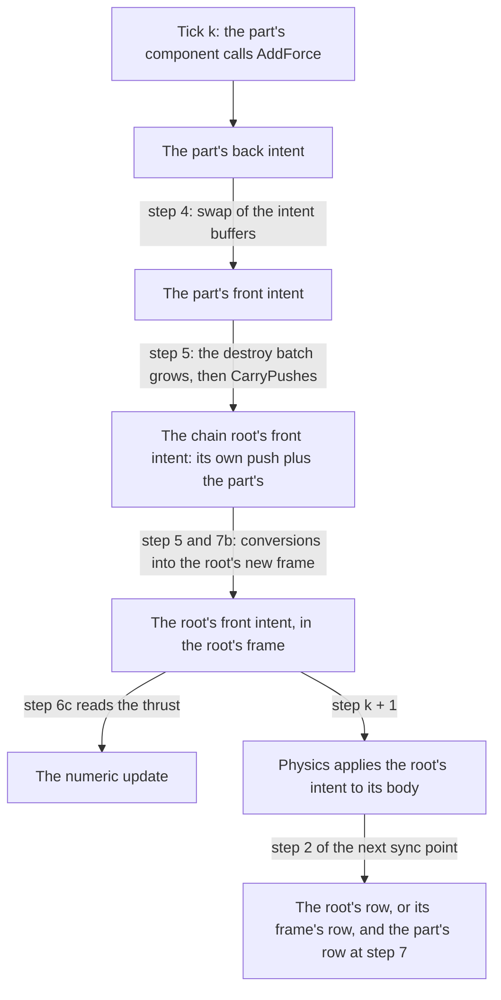

# Parts

Ticket: `ter-ftk4`. It serves the particle epic `ter-4zt6` and the demo's plumes `ter-6u2m`, which waits for both.

## Goal

An attached entity can push the body of its chain's root. So the shuttle's main engine, each of its jets and the person's back jet can each be a separate entity, attached to the hull or to the person, with one particle emitter each, and each one pushes the body that carries it. Such an attached entity is a part.

## The model

The user proposed this on 2026-10-21. It seems odd to the user that several jets and an engine are part of one shuttle entity. An attachment is like the frame tree: an attached thing moves with its parent. The difference is that an attachment has no physics system and no coordinate system of its own, and that effects can bubble up from a part to its parent, not only down from the parent to the part.

The orchestrator refined the model in the chat, and the user did not object:

1. A part is an attached entity. A part writes only its own row, as every entity does. Its component adds a force, a torque or an impulse to its own intent, in its own axes. This doc reads "its own axes" as the axes of the part's frame, by the user's rule that every write stays relative to `self.Frame` and every direction stays in its axes (see "How a part's push converts into the root's push").
2. At the sync point, the engine carries the additive intents of each part up its attachment chain to the body of the chain's root.
3. A part's force acts at the part's place. So it gives the root's body a force and a torque about the body's center of mass.
4. Only the additive intents flow up: the force, the torque, the impulse and the angular impulse. They compose by a sum, with nothing to decide. The exclusive intents stay with the root alone, because two writers of one would need a decider. These are the change of motion, an end pose, a full sample, a steer target, a velocity, a teleport, a character's walk and jump, and a change of collision groups.
5. A part's push is physics, not a message. The root's components do not interpret it, as they do not interpret a contact.
6. The sum runs in a fixed order, so it repeats bit for bit, also when the entities run on several workers.
7. Every reader of a body's force sees the sum, for example the numeric update's estimate of the thrust of a body.
8. Commands from the root's components reach its parts by message, one tick later than today. The demo's turning jets become pairs of forces, so its attitude autopilot gives way to an allocation of jet throttles. That is demo work, not this ticket.

The rest of this doc designs that model and nothing else. It needs no exception: every kind of root and every additive intent takes one path, and each difference in the effect comes from a rule that physics already has for the root's kind of body.

## Terms

| Term | Meaning |
|---|---|
| Part | An attached entity (`SpawnDesc.AttachTo`) that writes an additive intent. Every attached entity can be a part. A part has no body, and it cannot be a frame, as every attached entity today. |
| Chain root | The one entity of an attachment chain that is not attached (ARCHITECTURE.md, "Creation and destruction"). A part's chain root never changes while the part lives, because an entity is attached only at its spawn and dies with its parent. |
| Root body | The body of a part's chain root: a plain body, a hull or a character |
| Additive intent | A field of `PhysicsIntent` that adds up during a tick: `Force`, `Torque`, `Impulse` and `AngularImpulse` (`src/Tertius.Core/Seams/PhysicsSeam.cs`, lines 449 to 452) |
| Exclusive intent | Every other request of `PhysicsIntent`, whose last write in a tick wins: `Velocity`, `AngularVelocity`, `TeleportPose`, `CharacterVelocity`, `JumpSpeed`, the collision groups and mask, `Motion` and `Move` |
| Back intent, front intent | The two buffers of `PhysicsIntent` in the entity table. During a tick, gameplay writes the back intents. The swap of the intent buffers at step 4 of the sync point makes them the front intents, which the next physics step reads (`EntityTable.SwapIntents`). |
| Intent list | The entities whose front intent the next physics step applies, in order (`EntityTable.IntentEntities`). Physics and several passes of the sync point visit it. |
| Destroy batch | The entities that die at step 5 of the sync point: those that asked to die in the tick, then the attached children of each one, then the members of each dying frame that has no surviving ancestor |
| Push | The four additive intents of one entity in one tick, as one value |
| Place in the body | The position of a part relative to the origin of its root body, in the root body's own axes, composed from the offsets of the chain |
| Center of mass | The center of mass of the root body's shape, in the body's own axes, as Jolt computes it for the shape |
| Lever | The place in the body minus the center of mass, turned into the axes of the frame of the intents. It is the arm of the part's force about the center of mass. |
| Front frame | The frame in the front transform row of an entity during a tick. Every intent of the tick names it (`PhysicsIntent.Frame`). |
| Carrying the pushes | The engine's step that moves the push of every part into the intent of its chain root, at step 5 of the sync point (see "Where the push flows up") |
| Tick k, step k | Step k is the physics step that runs beside tick k. The intents that tick k writes act in step k + 1. |

## Cause, storage and effect

Who causes each change is apart from where its result is stored:

| Change | Who causes it | Where it is stored | When |
|---|---|---|---|
| A part asks for a push | The part's own component, by `BodyHandle.AddForce`, `AddTorque`, `AddImpulse` or `AddAngularImpulse` | The part's back intent, in the axes of the part's front frame | Tick k, on the part's worker |
| The push becomes an input of the flow | The swap of the intent buffers | The part's front intent. The swap keeps the part out of the intent list, so no physics step and no pass over that list ever reads it. | Step 4 of the sync point of tick k |
| The push joins the root body's push | The engine, in one choke-point method (`Attachments.CarryPushes`) | The chain root's front intent. The part's front intent becomes empty. | Step 5 of the sync point of tick k, after the destroy batch is known |
| The root's sum moves with the root | The conversions of an intent into its entity's new frame | The chain root's front intent | Steps 5 and 7b of the same sync point |
| The body moves | Physics | Jolt's body, then the root's transform row, or its frame tree row for a hull | Step k + 1, then step 2 of the sync point of tick k + 1 |



A component changes only its own entity. A part changes only its own intent. The engine then carries the push, as physics carries a contact from one body to another. No component of the root runs on it, and no message carries it.

## Where the push flows up

The engine carries the pushes at step 5 of the sync point: after the swap of step 4 and after the destroy batch has grown, before any entity of the batch moves to another frame or dies. Each fact below fixes one bound of that place.

- The swap of step 4. The flow writes the intents of the step that applies them, the front intents after the swap. The swap also hands on the list of the parts that pushed in the tick, as it hands on the list of the owners that wrote a change of motion, and it keeps those parts out of the intent list (see "The state that the change adds"). Before the swap, the written intents hold the same values, but the destroy batch is not known yet.
- The destroy batch. A part that dies at this sync point is not live in step k + 1, so its push must not act, as the last intent of any entity that dies at the sync point does not act (see "Deaths and changes of frame in the same tick"). The batch is known only after it grows in step 5, to the attached children of each dying entity and to the members of each dying frame that has no surviving ancestor. So the flow comes after the growth.
- The changes of frame. A hand-off at step 2 can move the root to another frame, and step 5 can rehome it out of a frame that dies. Both leave the root's row in its new frame and the intents of the tick in the front frame. Before the rehomes of step 5 and before the conversions of steps 5 and 7b, the intents of the part and of its root name the same frame, the front frame of the chain, and the front rows describe the chain in that frame. So the flow adds vectors in one frame and needs no relation between frames. The sum then converts once, as part of the root's intent, by the rule that converts every force today.
- The numeric update of step 6c. It reads the force and the impulse of each body's front intent for its thrust clock (`World.ThrustAcceleration`, see "Readers and writers"). So the flow comes before it, and the update counts the parts' pushes.
- The step in flight. Physics step k ended before the sync point went past its step 1, which waits for it. The flow changes only the intents of step k + 1, which no step reads until the next tick starts that step.
- The rule that stored state describes the last finished step. The flow stores no state that a tick reads. It writes an input of the next step, as the swap does. It reads the front rows, which describe the end of step k - 1, the state that the part's component read when it wrote its push. It also reads the offsets of the chain, which the parts may have written in the tick, as the part writes its push (see "How a part's push converts into the root's push").

Without a physics backend, the swap clears every additive intent of an intent writer (`PhysicsIntent.KeepOnlyMotion`), clears the front intent of every part, and lists no part, so the World skips the flow, as it skips `ApplyCollisionIntents`.

So step 5 becomes:

1. Apply the subscribe and unsubscribe requests of the chunks, as today.
2. Mark the destroy batch and grow it, as today.
3. Carry the pushes (`Attachments.CarryPushes`), with the marks of the batch.
4. Rehome the survivors, convert the intents that name a dying frame, and free the dead, as today.

Today `World.DestroyRequestedEntities` (`src/Tertius.Simulation/World.Sync.cs`, line 570) marks the batch and calls `DestroyDying`, which grows the batch and then rehomes, converts and frees. The build splits `DestroyDying` (`src/Tertius.Simulation/World.Entities.cs`, line 462) after the growth, so that the World calls the three pieces in that order, also in a sync point without destroys. `World.Destroy` outside a tick calls the growth and the rest with no flow between them, as today, because outside a tick no part's push waits (see "Deaths and changes of frame in the same tick").

## How a part's push converts into the root's push

The part writes its push in the axes of its front frame, as every entity writes every direction. The user's rule: every write stays relative to `self.Frame`, and every direction stays in its axes. A part is always in the frame of its chain root, so its front frame is the root's front frame, and both intents name it. So the direction of each vector needs no conversion. Only the lever is new.

The force of a part acts at the part's place. A rigid body takes a force at a place as the same force at its center of mass plus the torque of the force's arm about the center of mass. So for each part, in doubles:

```
placeInBody = Compose(offset_1, Compose(offset_2, ... offset_n)).Position
lever       = q.Rotate(placeInBody - centerOfMass)
force       += F
torque      += T + Cross(lever, F)
impulse     += J
angular     += L + Cross(lever, J)
```

where

- `offset_1` to `offset_n` = the offsets of the chain from the root down to the part (`Self.AttachOffset` of each link), each widened to a double pose by `Poses.Safe(offset).ToDPose()`, as `Attachments.Derive` widens them (`src/Tertius.Simulation/Internal/Attachments/Attachments.cs`, line 128 on). These are the offsets at the sync point, with the writes of the tick: the part's place in the body during the step that applies the push, where step 7 puts the part's row.
- `placeInBody` = the place in the body, in meters, in the root body's own axes, relative to the body's origin.
- `centerOfMass` = the center of mass of the root body's shape, in meters, in the body's own axes. Jolt keeps it as a float vector (`Shape::GetCenterOfMass`), so its widening to doubles is exact. The entity table keeps it from the spawn (see "The state that the change adds").
- `q` = the rotation of the root's front transform row, `entities.FrontRow(root).Pose.Rotation`: the root body's axes in the axes of the front frame. For a hull it is the rotation of the frame in its semantic parent, which is the owner's row. A numeric frame never turns, so its axes are the semantic frame's.
- `lever` = the lever, in meters, in the axes of the front frame.
- `F`, `T`, `J`, `L` = the part's force (N), torque (N·m), impulse (N·s) and angular impulse (N·m·s) from its front intent, widened from floats.
- `force`, `torque`, `impulse`, `angular` = the root's push in doubles: its own four fields, widened, plus the contribution of each of its parts.

The sum for one root starts from the root's own fields and adds its parts' contributions in the order of the list of parts that pushed (see "The order of the sum"). It narrows to floats once, into the root's four fields. A sum of two floats in doubles rounds only when their sizes differ by a factor of more than about 2^28. So two jets whose forces are exact negatives cancel to exactly zero, and the root's own force survives them exactly, as long as no sum on the way rounds. Each narrowing per part would round the root's force at every part.

Why `q` comes from the front row, and not from the root's pose where step k + 1 starts. The part's component wrote `F` in the front frame's axes from the pose that it read, the front row. A jet writes its thrust along its own nozzle, `self.PoseIn(self.Frame).Rotation.Rotate(-Double3.UnitZ) * thrust`, as `MainEngine` does today (`src/Tertius.Demo/MainEngine.cs`, line 51). Its lever then turns by the same rotation as its force. So a jet's push equals the push that the root's own component would write today for the same jet, a force and the torque `Cross(q.Rotate(placeInBody - centerOfMass), F)`, both from the front snapshot, and a pair of opposite jets gives exactly the couple of its jets in the body's axes, turned by one rotation. The root's pose at the start of the step would turn the lever but not the force, by the turn of one step: 2.5 mrad at the demo's fastest turn of 0.15 rad/s. It also needs the relation of the front frame to the root's frame after a hand-off, which this place in the sync point avoids. Every force of every entity today lags by the same step, because its writer reads the front snapshot.

The lever takes the offsets that the parts wrote in the tick, and `q` from the front row. Both follow one rule: what the part writes in the tick, its push and its offset, is its request for the next step, and what it read is the front snapshot. A part that turns its own offset in a tick and pushes along its new nozzle reads the direction from the root's front rotation and its new offset, not from its own front row, which still holds the old offset.

## The flow per kind of root

The flow takes one path for every root: it adds the part's contribution to the root's front intent. What physics does with the sum is the rule that it has today for the root's own push of the same kind of body. The table says, for each kind of root, what a part's push does, and why.

| Kind of chain root | What a part's push does | Why |
|---|---|---|
| Dynamic plain body | The force acts at the center of mass, with the torque of its lever. The impulse and the angular impulse act at the start of the step. The two-turn update of a turning frame turns the force and the torque as it turns the root's own (`JoltPhysicsBackend.ApplyTurningUpdate`). | Physics applies all four fields of a dynamic body's intent (`src/Tertius.Physics/JoltPhysicsBackend.Step.cs`, lines 265 to 283). |
| Dynamic hull | The same. The hull's frame follows the hull, and physics measures the frame's proper acceleration from Jolt's change of velocity, so the frame's contents feel the parts' thrust. | A hull is a dynamic body in its parent's system. |
| Kinematic body, hull or plain | Nothing moves. The sum stays in the intent, and physics ignores it. | Physics applies forces and impulses only to a dynamic body. Step 4 keeps the forces of a hull that turns kinematic for the same reason (`World.ApplyMotionChanges`). A change of motion in the same tick can make the root dynamic in the step, so the write cannot refuse the push. The part's worker also cannot ask the root's motion in the next step: `World.NextStepMotion` reads the root's own writes of the tick, so only the root's worker may ask it. |
| Static body, hull or plain | Nothing moves, as for a kinematic root | The same rule |
| Character, walking or rigid | The force and the impulse change the character's velocity, as its own do. The torque and the angular impulse do nothing. | Physics adds `(Impulse + Force · dt) / mass` to a walking character and reads no torque (`src/Tertius.Physics/JoltPhysicsBackend.Step.cs`, line 386). The rigid form takes the intent as a dynamic body whose rotation is locked (`ApplyRigidCharacterIntent`, line 342), so a torque turns nothing. A character's rotation follows its up. |
| Entity without a body, the owner of a frame without a hull included | The part cannot push. Its write throws an `InvalidOperationException`. | The push has no body to act on. `AddForce` on the root itself throws for the same reason (`World.WritableIntent`, `src/Tertius.Simulation/World.Tick.cs`, line 330). The chain root never changes, so the write can know it. |
| Owner of a root frame | It has no parts. | A root frame's owner is in no frame, so it cannot take an attached child (`Attachments.CheckParent`). |

## The flow per kind of additive intent

| Additive intent | What the root gets | The moment at which it acts |
|---|---|---|
| Force `F` | `F`, and the torque `Cross(lever, F)` | Over the whole step, held in the frame's axes, as every force |
| Torque `T` | `T` | Over the whole step |
| Impulse `J` | `J`, and the angular impulse `Cross(lever, J)` | At the start of the step |
| Angular impulse `L` | `L` | At the start of the step |

A torque and an angular impulse are free vectors, so the part's place does not change them. A force and an impulse act at the part's place, so they get the term of their lever. A part that wants a force at another place is a part at that place.

## The order of the sum

The flow runs on the sync thread. It visits the parts that pushed in the order of the list that the swap handed on: the chunks in chunk order, and in each chunk the parts in the order of their first push in the tick, which is the order in which the chunk ran them. That order is the same in every run, whatever worker ran each chunk, because a chunk runs on one worker and its list belongs to the chunk. For each root, the sum starts from the root's own fields, which the root's components added in the order of their run, and it adds the contributions of its parts in that order. Each root's sum is apart from every other, so the order of the roots changes no sum. It changes only the order of the intent list, where the flow appends each root that wrote nothing itself, in the order of its first part in the list of parts that pushed. That order is fixed too.

The flow has no piece on the workers. The build measures its cost (see "Costs and measurements"). A piece on the workers would come with a threshold, as the four pieces of the sync point have.

## Deaths and changes of frame in the same tick

| Case | What happens | Why |
|---|---|---|
| The part dies at this sync point: it destroys itself, or it gets a `Destroy` message that it acts on | The flow skips it. Its last push does not act. | An entity that dies at the sync point is not live in the next step, and its last intent does not act, as the intent of a body that dies goes with the body. |
| A parent between the part and its root dies | The part dies with its parent, so the flow skips it. | The destroy batch grows to the attached children of each dying entity before the flow. |
| The root dies | The flow skips the root and all its parts. Nothing acts. | Every part of the chain dies with the root, and the root's intent goes with its body. |
| The root and the part die because their frame dies with no surviving ancestor | The same as a dying root | The batch grows to the members of the frame before the flow. |
| The root's frame dies and the root moves to an ancestor | The flow adds the push in the front frame. Then step 5 converts the root's intent, with the sum, into the ancestor, before the frame dies. | The flow comes before the rehomes. The sum converts as the root's own force does. |
| Physics handed the root into another frame in step k | The flow adds the push in the front frame. Step 7b converts the root's intent, with the sum, into the root's new frame. Step 7 moves the part's row into that frame. | The intents of the tick name the front frame. The flow comes before the conversion of 7b. |
| The numeric update moves the root to another numeric frame | Nothing changes for the push. | A numeric frame does not change the semantic frame that the intents name, and it does not turn. |
| The part wrote a new `AttachOffset` in the same tick | The lever takes the new offset. | The new offset is where the part is in the step that applies the push. Step 7 derives the part's row from it too. |
| The root wrote a change of motion in the same tick | The sum stays. Physics applies it if the root is dynamic in step k + 1. | Physics follows the motion of the step, and the forces of the root's own intent follow the same rule. |
| The part or its root spawned in this tick | No push. | A spawn becomes live at step 6 and runs from the next tick, so it wrote nothing. |
| The game destroys the part outside a tick, after the sync point that carried its push | The push acts in the next step. | The push left the part at the flow and is part of the root's intent. A change outside a tick comes after that sync point, as a change at the start of the next tick would. Taking it back would need a record of each part's share, kept beside the root's intent, for a case that only a game's own outside-tick destroy of a jet can make. |

## Exclusive intents stay with the root

A part takes only the additive intents. Every exclusive request on a part throws, as it throws today, because the part has no body: `SetVelocity`, `SetAngularVelocity`, `Teleport`, `MoveCharacter`, `Jump`, `SetCollision`, `SetMotion` and `SteerTo`. `Self.MoveKinematic` and `Self.MoveOnRails` refuse an attached entity by the first rule of the guard of every motion intent (`World.MotionIntentProblem`). Nothing changes in these guards. Two writers of one exclusive intent would need a decider, so there is one writer: the chain root.

## The public API

A part pushes with the same members as a body: `self.Body.AddForce`, `AddTorque`, `AddImpulse` and `AddAngularImpulse`. Today they are:

```csharp
    /// <summary>Adds a force for the next step, in newtons.</summary>
    public void AddForce(Vector3 force) => Intent.Force += force;

    /// <summary>Adds a torque for the next step, in newton-meters.</summary>
    public void AddTorque(Vector3 torque) => Intent.Torque += torque;

    /// <summary>Adds a linear impulse, in newton-seconds.</summary>
    public void AddImpulse(Vector3 impulse) => Intent.Impulse += impulse;

    /// <summary>Adds an angular impulse.</summary>
    public void AddAngularImpulse(Vector3 impulse) => Intent.AngularImpulse += impulse;
...
    private ref PhysicsIntent Intent => ref world.WritableIntent(entity);
```

(`src/Tertius.Simulation/Entities/Self.cs`, lines 230 to 240 and 351)

where

- `world` = the World that runs the tick.
- `entity` = the running entity, whose components the handle serves.
- `Intent` = the running entity's back intent, for writing. `World.WritableIntent` throws an `InvalidOperationException` for an entity without a body.
- `force`, `torque`, `impulse` = a vector in the axes of `self.Frame`: a force in N, a torque in N·m, an impulse in N·s, and in `AddAngularImpulse` an angular impulse in N·m·s.

After the change, the four additive members go through a new `World.WritablePush(entity)` instead of `WritableIntent`. It gives the back intent of an entity with a body, as today (`EntityTable.WritableIntent`). For an attached entity whose chain root has a body, it gives the part's own back intent through `EntityTable.WritablePush`, whose first call in the tick lists the part among the parts that pushed. For every other entity it throws an `InvalidOperationException` that says that the entity has no body and is not part of a chain whose root has one. The guard reads the part's own link and the root's body description, which the entity table keeps from the spawn and nothing writes during a tick, so the part's worker may read them while the root runs on another worker. The other members of `BodyHandle` keep `WritableIntent`, so they throw for a part. The documentation of the four members and of `BodyHandle` says that a part's push acts on its chain root's body at the part's place. Today the documentation of `BodyHandle` says that every method throws for an entity without a body.

So a component that pushes runs on a hull or on a part with the same calls: `MainEngine`, `TranslationThrusters` and the test helper `Thruster` push from a part with no change to their calls of `AddForce`. Each one reads the rotation of its own entity (`self.PoseIn(self.Frame).Rotation`), so on a part it pushes in the part's axes, which are the root's axes turned by the offsets of the chain. `AddForce` keeps one meaning, add a force to my own intent, on every entity that can push.

The reads do not change. `self.Body.Exists` stays false for a part, because the part has no body. `self.Body.NextStepMotion` stays null for a part. `self.Body.Pending` gives the entity's own writes in the tick: a part sees its own push, and a root sees only its own writes, never its parts' pushes, which join at the sync point.

The engine needs no member for a force at a place. A part is that member: a force at a place is a part at that place. A body's own components push at its center of mass, as today.

## The state that the change adds

| State | Owner | Writers | Readers |
|---|---|---|---|
| `Record.BodyCenterOfMass`, a `Vector3` in the body's own axes, in meters, beside `BodyBoundingRadius` | `EntityTable`, in the cold record of each slot | `EntityTable.Activate` at the spawn, with the value that the World asks of `IPhysicsBackend.ShapeCenterOfMass(BodyDesc.Shape)`. Zero without a body or without a backend. | `Attachments.CarryPushes`, through `EntityTable.BodyCenterOfMass(entity)` |
| `ChunkBook.Pushers`, a list per chunk of the parts that pushed in the tick, in the order of their first push | `EntityTable` | `EntityTable.WritablePush` at a part's first push of the tick. It sets the part's `SlotFlags.IntentRegistered` and names the part's front frame in its back intent, as `RegisteredIntent` does for an intent writer, but it lists the part here and not among the chunk's `IntentWriters`. A part can write only a push, so it is never an intent writer. `SwapIntents` hands the list on and clears it. | `SwapIntents` |
| `frontPushers`, the list of the parts whose pushes are in the front intents, in chunk order | `EntityTable` | `SwapIntents`, which clears the old list and fills it from the chunk lists. It clears each part's `IntentRegistered` and leaves the part out of the intent list. Without a backend, it clears each part's front intent to the default instead and lists no part, so the World skips the flow. | `Attachments.CarryPushes`, through `EntityTable.FrontPushers` |
| `Link.Root`, the chain root of each attached entity | `Attachments` | `Attachments.Attach`. It never changes, because an entity is attached only at its spawn and dies with its parent. | `World.WritablePush`, for the guard, and `Attachments.CarryPushes` |
| The sum of each root in doubles, a scratch list and a map from root to its index | `Attachments` | `Attachments.CarryPushes`, which empties both before it returns | `Attachments.CarryPushes` |
| `IPhysicsBackend.ShapeCenterOfMass(ShapeDesc)` | The physics seam. `JoltPhysicsBackend` reads it from the native shape that it builds and keeps for the description, as `ShapeProblem` does, and keeps the answer. The backend already reads that value for a new hull's velocity (`shapes.Get(record.Desc.Shape).CenterOfMass` in `HullVelocityFromTree`, `src/Tertius.Physics/JoltPhysicsBackend.Bodies.cs`, line 231). It is thread-safe, so a spawn during a tick can ask. `FaultInjectingBackend` forwards it. | None: it is a pure answer | `World` at the spawn |

The pure part of the flow is one value type, `Push` (internal, in `src/Tertius.Simulation/Internal/Attachments/Push.cs`): the four vectors in doubles, with the methods that belong to it. `Push.Of(in PhysicsIntent intent)` widens an intent's four fields. `Push.Lever(DQuaternion rotation, Double3 placeInBody, Double3 centerOfMass)` is static, because it takes no push. `push.At(Double3 lever)` gives the push of the root about its center of mass. `sum.Plus(in Push other)` adds. `push.WriteInto(ref PhysicsIntent intent)` narrows once. Unit tests pin each one without a World. `Attachments.CarryPushes` is the one choke-point method: the World calls it once per sync point, it calls the pure methods, and it acts on the intents through the entity table directly. There is no plan object.

The part stays out of the intent list for a reason in the code. `World.FollowFramelessEntities` (`src/Tertius.Simulation/World.Sync.cs`, lines 397 to 422, the assertion at line 412) takes every entity of the intent list that has no body and owns no frame as an entity that moves by its motion intent, and it asserts that such an entity's physics home is its frame:

```csharp
        foreach (Entity entity in entities.IntentEntities.Span)
        {
            // The frame first: in a scene of frames on rails, most intent writers own one.
            if (!entities.OwnedFrame(entity).IsNull || entities.Body(entity) != null)
                continue;
            ref readonly PhysicsIntent intent = ref stepIntents[(int)entity.Index];
            ref readonly TransformRow row = ref entities.BackRow(entity);
            // The guard lets no attached entity write a motion intent, and step 7b of the last sync point converted the intent
            // into the entity's frame, which is its home.
            Contract.Assert(intent.Frame == row.Frame && row.PhysicsHome == row.Frame);
            ...
```

where

- `entities.IntentEntities` = the intent list of the step that ended.
- `stepIntents` = the front intents of that step.
- `row` = the entity's back transform row at step 2 of the sync point.
- `row.PhysicsHome` = the frame whose physics system holds the entity: its frame, or a numeric frame below it.

A part takes its chain root's physics home at step 7 (`Attachments.Derive`, line 152). So a part of a hull that lives in a numeric frame would fail that assertion in every Debug sync point after a push, if the part were in the intent list. The other visitors of the list would visit the part for nothing: physics (`JoltPhysicsBackend.ApplyIntents`, `src/Tertius.Physics/JoltPhysicsBackend.Step.cs`, line 69), the conversions of steps 5 and 7b, `World.AssertInvariants` and `FaultInjectingBackend`. A part's push is no input of physics. Only the root's sum is, so the part stays out of the list, and the flow empties the part's front intent.

The flow adds no closed set. The four additive intents are four fields that all sum, and the flow does not branch on the kind of root, so the change needs no `[Union]` and no kind enum.

### Invariants

`EntityTable.AssertInvariants` gains:

- Each live entity in a chunk's `Pushers` is listed there once, has no body, has a written intent (`SlotFlags.IntentRegistered`), and is not among the chunk's `IntentWriters`. The invariant that a slot with `IntentRegistered` is an intent writer (`EntityTable.cs`, line 1336) becomes: an intent writer or a pusher, not both.
- Each live entity in `frontPushers` is listed once, has no body, is not in the intent list, and holds a default front intent. The checks run at step 3 of the sync point, before the swap, and at its end, after the flow, so the invariant that a slot outside the intent list holds a default front intent (`EntityTable.cs`, line 1339) holds at every check without an exception.
- A record without a body has a zero `BodyCenterOfMass`. A record with a body has a finite one.

`Attachments.AssertInvariants` gains:

- The `Root` of every link is the chain root that a walk up the parents finds, and the root is live.
- Each live entity in the table's `frontPushers` and in each chunk's `Pushers` is attached, and its chain root has a body.
- The scratch of `CarryPushes` is empty.

`World.AssertInvariants`, at the end of a sync point, gains:

- No live attached entity is in the intent list, and its front intent is the default.
- The front row of every live attached entity names the frame of its chain root's front row. Step 7 keeps this, and the flow relies on it.
- With a backend, every body's `BodyCenterOfMass` equals `ShapeCenterOfMass` of its shape.

### Contracts

The operations that change this state get preconditions and postconditions that compile out of Release builds:

- `EntityTable.WritablePush(Entity part)`. Requires: gameplay runs, and the part has no body. Ensures: the part is in its chunk's `Pushers` once and not in its `IntentWriters`, and its intent is registered and names its front frame.
- `EntityTable.AddPush(Entity root, in Push sum)`, which writes a root's sum into its front intent. Requires: gameplay does not run, the root is live and has a body, and the root's front intent names the root's front frame or is empty. A sum that is not finite is no bug of the engine: `AddForce` has no guard, so a component's NaN reaches physics today as the root's own force, and a part's NaN reaches it the same way. Ensures: the root is in the intent list once, and its front intent names its front frame. A root that wrote nothing in the tick gets its intent listed and named here, as `EntityTable.SetFirstMove` lists a spawn's first motion intent.
- `EntityTable.ClearPush(Entity part)`. Requires: the part is not in the intent list. Ensures: the part's front intent is the default.
- `Attachments.CarryPushes`. Requires: gameplay does not run, and the scratch is empty. For each part that it visits, it requires that the part's front intent names the frame of the root's front row. Ensures: every live part in `frontPushers` holds a default front intent, and the scratch is empty.

The guard of the public write is an always-on guard: `World.WritablePush` throws an `InvalidOperationException` for an entity that has no body and is not part of a chain whose root has one, in every build.

A part whose front intent names another frame than its root's front row comes only from a bug. So a Debug build fails the contract, and a Release build skips that part and records the bug in `World.Errors`, as the user decided for the physics output that names a dead frame, and as the sync point does for a physics request with the default question (ARCHITECTURE.md, "Physics queries"). No test can reach that state, because the World alone writes the frames of the part's intent and of the root's row. So the Release branch has no test, and the coverage report of the build names it with this reason.

## Readers and writers

Every reader and every writer of a body's force, torque, impulse and angular impulse in the code today, and every visitor of the intent list, and what each one does after the change:

| Reader or writer | File and line | Today | After the change |
|---|---|---|---|
| `BodyHandle.AddForce`, `AddTorque`, `AddImpulse`, `AddAngularImpulse` (writers) | `src/Tertius.Simulation/Entities/Self.cs`, lines 231 to 240 | Add to the running entity's back intent. Throw for an entity without a body. | The same for a body. A part writes its own back intent, and its first push lists it. |
| `Attachments.CarryPushes` (new writer) | New | None | Adds each part's push to its root's front intent, lists a root that wrote nothing in the intent list, and empties the part's front intent |
| `EntityTable.SwapIntents` (writer) | `src/Tertius.Simulation/Internal/Entities/EntityTable.cs`, line 1042 | Exchanges the buffers. Without a backend, clears the additive fields through `KeepOnlyMotion`. | The same for every intent writer. It hands on the list of the parts that pushed and keeps them out of the intent list. Without a backend, it clears their front intents and lists none. |
| `PhysicsIntent.KeepOnlyMotion` (writer) | `src/Tertius.Core/Seams/PhysicsSeam.cs`, line 519 | Clears the four fields | The same for an intent writer. A part is no intent writer, and the swap clears its front intent whole. |
| `PhysicsIntent.IsEmpty` (reader) | `src/Tertius.Core/Seams/PhysicsSeam.cs`, line 539 | Reads the four fields, for the swap without a backend | The same |
| `World.ConvertIntent` (writer and reader), at steps 5 and 7b | `src/Tertius.Simulation/World.Sync.cs`, lines 720 to 723 | Turns the four fields into the entity's new frame by the relation where the step starts | The same. It converts the root's sum. A part is not in the intent list, so its intent never converts. |
| `World.ThrustAcceleration`, the thrust clock of the numeric update, at step 6c | `src/Tertius.Simulation/World.NumericFrames.cs`, lines 111 to 117 | `(|Force| + |Impulse| / dt) / mass` from the body's front intent | The same read, and it reads the sum, because the flow runs at step 5. A pair of opposite jets gives no thrust, as a torque gives none today. |
| `JoltPhysicsBackend.ApplyBodyIntent` | `src/Tertius.Physics/JoltPhysicsBackend.Step.cs`, lines 265 to 283 | Adds the impulses and records their change of velocity, then adds the force and the torque of a dynamic body | The same, with the sum |
| `JoltPhysicsBackend.ApplyCharacterIntent` | `src/Tertius.Physics/JoltPhysicsBackend.Step.cs`, line 386 | Adds `(Impulse + Force · dt) / mass` to a walking character's pending change of velocity | The same, with the sum. The parts' torques go unread, as the character's own. |
| `JoltPhysicsBackend.ApplyRigidCharacterIntent` | `src/Tertius.Physics/JoltPhysicsBackend.Step.cs`, line 342 | Passes the intent of the rigid form to `ApplyBodyIntent`. The locked rotation takes no torque. | The same, with the sum |
| `JoltPhysicsBackend.ApplyTurningUpdate` | `src/Tertius.Physics/JoltPhysicsBackend.Step.cs`, lines 707 to 719 and 750 to 762 | Reads Jolt's accumulated force and torque, which hold the intent's, and adds their turn in a turning frame | The same. Jolt's accumulated values hold the sum. |
| `FrameWorld.ApproachAcceleration` and `ForceAcceleration` | `src/Tertius.Physics/Internal/FrameWorld.cs`, lines 857 to 879 | Reads Jolt's accumulated force of a dynamic body for the rebound threshold | The same. It holds the sum. |
| The proper and angular accelerations of a dynamic hull (`JoltPhysicsBackend.ComputeProperAccelerations`) | `src/Tertius.Physics/JoltPhysicsBackend.Step.cs`, lines 1178 to 1202 | Measured from Jolt's change of velocity over the step, less the acceleration that the frame gave the hull. The angular acceleration counts the change after the intents, which holds the torque and not the angular impulse. | The same. The proper acceleration holds the parts' thrust, and the angular acceleration, which gives the Euler term of a turning frame, holds the torques of the parts' levers, as it holds the root's own torque. |
| `BodyHandle.Pending` (reader, gameplay) | `src/Tertius.Simulation/Entities/Self.cs`, line 228 | The running entity's writes so far in the tick | The same. A part sees its own push. A root sees only its own writes, because its parts' pushes join its front intent at step 5, after the tick. |
| `FaultInjectingBackend` (reader, tests) | `tests/Tertius.Testing/FaultInjectingBackend.cs`, lines 131 and 158 | Records the intents of each step | Records the sum in the root's intent. It records no intent of a part, because a part is not in the intent list. |

| The visitors of the intent list: `JoltPhysicsBackend.ApplyIntents`, `World.FollowFramelessEntities`, `World.ConvertIntentsOfDyingFrames`, `World.ConvertMovedIntents` and `World.AssertInvariants` | `src/Tertius.Physics/JoltPhysicsBackend.Step.cs`, line 69. `src/Tertius.Simulation/World.Sync.cs`, lines 403 and 621. `src/Tertius.Simulation/World.Entities.cs`, line 544. `src/Tertius.Simulation/World.cs`, line 345. | Visit every entity whose front intent the next step applies | The same. They visit a root that only its parts pushed, which the flow lists, and never a part (see "The state that the change adds"). |

No other code reads or writes these fields. The demo's writers are the components that call the four members above.

## Left out

- A force at a place for a body's own components. A part is that member.
- A part's push on another chain than its own. A part pushes only its chain root.
- The parts' pushes in the body facts of the snapshot or in a state dump. No reader needs them.
- A piece of the flow on the workers. It waits for a measurement that shows the need.
- A torque on a character. A character's rotation follows its up, so physics reads no torque of it, as today.

## Tests

The tests use the real World and the real Jolt backend. A test that compares a part's push with a root's own push runs both worlds from the same scene, and the root's own component computes the same expression in doubles and narrows once. "Bit for bit" means the poses and velocities of every row are equal as doubles.

Physics, in `tests/Tertius.Physics.Tests/PartPushTests.cs`:

- `APartOnTheLineThroughTheCenterOfMassPushesItsRootAsTheRootsOwnForceDoesBitForBit`
- `APartOffTheCenterOfMassPushesItsRootAsTheRootsOwnForceAndTheTorqueOfTheLeverDoBitForBit`
- `TheLeverOfAPartIsMeasuredFromTheCenterOfMassOfAHullShapeAndNotFromTheBodysOrigin`
- `TwoOppositeJetsAtOppositePlacesTurnTheirRootAndLeaveItsCenterOfMassAtRest`
- `APartsPushAddsToTheForceThatTheRootWritesItself`
- `ATorqueOfAPartTurnsItsRootAsTheRootsOwnTorqueDoes`
- `AnImpulseOfAPartGivesItsRootTheAngularImpulseOfItsLever`
- `AGrandchildPushesTheChainRootAtTheGrandchildsPlace`
- `APartPushesFromTheOffsetThatItWroteInTheSameTick`
- `APartsPushActsInTheStepAfterTheTickThatWritesIt`
- `ThePushOfAPartOnAKinematicRootMovesNothing`
- `ThePushOfAPartOnAStaticRootMovesNothing`
- `ThePushOfAPartOnACharacterChangesItsVelocityAsTheCharactersOwnForceDoesInBothForms`, walking and rigid
- `APartWhoseRootHasNoBodyCannotPush`
- `APartCannotSetAVelocityTeleportOrWriteAMotionIntent`
- `APartThatDestroysItselfGivesNoPushInTheNextStep`
- `APartWhoseParentDiesGivesNoPushInTheNextStep`
- `APartsPushInTheTickOfItsRootsHandOffConvertsWithTheRootsOwnForce`, in `Scenes.ApproachToBubble`
- `APartsPushInTheTickThatItsRootsFrameDiesConvertsIntoTheSurvivingAncestor`
- `APartOfAHullInANumericFramePushesItsHullAsTheHullsOwnForceDoes`, with `WorldOptions.DebugChecks` on, in Debug and Release
- `APartIsNoIntentOfTheStepAndItsRootIsOne`: the step's intent list, as `FaultInjectingBackend` records it, holds the root and not the part, also for a root that wrote nothing itself
- `WithoutABackendAPartsPushIsClearedAndNoRootGetsAnIntent`
- `APartThatTheGameDestroysOutsideATickAfterItsPushFlowedStillPushesInTheNextStep`
- `TheThrustClockCountsThePushOfAPartAsTheRootsOwnForce`
- `TheProperAccelerationOfAHullThatItsPartsPushIsTheirThrustOverItsMass`
- `APartsPushInASpinningStationTakesTheTurnOfTheStepAsTheRootsOwnForceDoes`
- `ThePushesOfManyPartsSumToTheSameIntentsOnOneThreadAndOnTheWorkers`
- `TheComponentsOfTheRootDoNotSeeThePushesOfItsParts`
- `CarryingThePushesAllocatesNothingAfterWarmUp`

The backend, in `tests/Tertius.Physics.Tests/ShapeCenterOfMassTests.cs`:

- `TheCenterOfMassOfABoxASphereAndACapsuleIsTheirOrigin`
- `TheCenterOfMassOfAShapeIsWhereJoltPutsTheCenterOfMassOfABodyAtRestAtTheOrigin`, for a convex hull and a compound

The demo, in `tests/Tertius.Host.Tests/ShuttleTests.cs`, because only that project references `Tertius.Demo`. The test `TheCenterOfMassStaysStillWhileTheFreeHullSpins` (line 242) already holds the demo's value within 1 mm of where Jolt puts the center. The new test asks the backend's value directly:

- `TheShuttlesHullHasItsCenterOfMassWithinAMillimeterOfTheLoftsIntegral`

The pure value, in `tests/Tertius.Simulation.Tests/PushTests.cs`, with no World:

- `AForceAtTheCenterOfMassGivesNoTorque`
- `TheLeverIsThePlaceInTheBodyLessTheCenterOfMassTurnedByTheRootsRotation`
- `AnImpulseAtALeverGivesItsCrossProductAsAngularImpulse`
- `ATorqueAndAnAngularImpulseIgnoreTheLever`
- `TwoOppositeForcesAtOppositePlacesSumToExactlyZeroForce`
- `TheRootsOwnForceSurvivesAPairOfOppositeJetsExactly`
- `TheSumNarrowsToFloatsOnceAndNotOncePerPart`

The entity table, in `tests/Tertius.Simulation.Tests/EntityTablePushTests.cs`:

- `TheFirstPushOfAPartInATickListsItOnce`
- `TheSwapHandsThePartsThatPushedOnAndLeavesThemOutOfTheIntentList`
- `ARootThatWroteNothingGetsAnIntentThatNamesItsFrontFrame`
- `TheCenterOfMassOfABodyIsKeptFromItsSpawn`

Tests that lock in the decisions:

- `TheLeverTurnsWithTheRotationThatTheWriterRead`: a root that spins fast, with one jet off its center of mass that pushes along its own axis. The torque in the root's intent equals the cross product of the jet's lever and its force, with the lever turned by the root's rotation in the front row, and not by its rotation where the step starts.
- `APartsPushNamesTheFrontFrameOfItsChainAtTheFlow`: the invariant that the flow relies on, after a hand-off and after a rehome in the same tick.
- `ThePushOfADyingPartIsSkippedBecauseTheDestroyBatchIsKnownFirst`: the place of the flow after the growth of the batch.
- `APartOfAHullInANumericFramePushesItsHullAsTheHullsOwnForceDoes`, above, locks in that a part stays out of the intent list: a part in the list breaks the assertion of `World.FollowFramelessEntities` in Debug.

The hand mutations of each new test name the line that the test protects, as every brief asks.

## The changes to ARCHITECTURE.md

The build makes these changes before its merge:

1. "Creation and destruction", the paragraph on `SpawnDesc.AttachTo`: an attached entity can push the body of its chain's root with the additive intents, as a part. Its push acts at its place. It still has no body and cannot be a frame. Its chain root never changes.
2. "Component rules": a part changes only its own intent. The engine carries its push to the root's body at the sync point, as physics carries a contact, and the root's components do not see it.
3. "Ownership of transforms": the additive intents of a part flow to its root's body, and the exclusive intents stay with the root. A part's push needs a root with a body.
4. "Threads and the tick", step 4: the swap hands on the list of the parts that pushed, as it hands on the list of the owners that wrote a change of motion, and it keeps the parts out of the intent list. Without a backend, it clears their pushes.
5. "Threads and the tick", step 5: the engine carries the pushes after the destroy batch grows and before its rehomes, with the reasons of "Where the push flows up".
6. "Entities": the cold record of a body keeps its center of mass from the spawn, beside its bounding radius.
7. "Physics": `IPhysicsBackend.ShapeCenterOfMass` and where Jolt's value comes from.
8. "Numeric frames", the row "Who gets one": the force and impulse intents of a body include the pushes of its parts.
9. "Turning frames": a force and a torque of the intent include the pushes of the parts, which the update turns as the root's own.
10. The invariant lists of the entity table, the attachments and the World, as "Invariants" above gives them.

## Costs and measurements

Costs:

- Commands from a root's components reach its parts by message, one tick later than today. A hull's autopilot sends each jet its throttle in tick k, the jet pushes in tick k + 1, and physics applies the push in step k + 2. The attitude autopilot reads the hull's state two steps late today, and three steps late after the change, against a `RateTime` of 20 steps.
- The flow visits only the parts that pushed. For each one it reads one link, composes the offsets of its chain, turns one vector and takes two cross products, and it looks up its root's sum.
- Each slot's cold record grows by 12 bytes, the center of mass.
- A main engine that a part pushes gives the hull a torque when its line of thrust misses the center of mass that Jolt computes. Today `MainEngine` pushes at the center of mass, whatever the nozzle's place.

The build must measure:

- The lap of the flow in `SyncProfile`, with 10,000 parts that push in every tick, on 1 worker and on all workers, and with no part. With no part, the lap reads nothing measurable.
- The allocations of a sync point with parts that push in every tick, after warm-up: none.
- In the demo, after its own ticket moves the jets onto parts: the miss of the docking and the settle time of the attitude loop with the extra tick, beside today's.

## The demo's use

The demo work is in `ter-6u2m`, not in this ticket. Each actuator becomes a part with one emitter:

- The main engine: one part at the place of `Shuttle.NozzlePose`, on the line of thrust through the center of mass, with `MainEngine` on it. The hull's flight program sends it the `Throttle` of each tick as a message. The part's offset keeps the hull's rotation and not the rotation of `NozzlePose`, which turns the nozzle's mesh a quarter turn about X (`src/Tertius.Demo/DemoScenes.Shuttle.cs`, lines 203 and 204). `MainEngine` pushes along its own entity's -Z (`src/Tertius.Demo/MainEngine.cs`, line 51), so on a part with that rotation it would push along the hull's +Y. Today the nozzle is a separate entity in the shuttle's frame with no component. The demo ticket decides whether the nozzle's mesh moves onto the part.
- The side jets: one part for each of the six directions of `TranslationThrusters`, on a line through the center of mass, or as pairs placed on both sides of it so that their torques cancel. Today a layer of the flight program adds the `Translation` to its own entity's events for `TranslationThrusters` on the same entity. After the change it sends it as a message to each jet, and the jets split it.
- The turning jets: pairs of opposite jets at opposite places, so that each pair gives a couple about one of the hull's axes. `AttitudeAutopilot` keeps its law, and it ends in an allocation of the throttles of the pairs, which gives the torque that it asks for within each jet's thrust. Each jet gets its throttle by message. The two jets of a pair compute their forces as exact negatives, for example from the same axis of the hull, so that the pair gives the hull no net force at all. Forces that only nearly cancel leave a force of the order of 1e-7 of the thrust.
- The person's back jet: one part on the person, which `Passenger.Steer` and `PersonControl` send the float force as a message. A character reads no torque, so the jet's place off the person's center of mass turns nothing. The jet can turn its own `AttachOffset` toward the force, so that its plume points against the push.

## Open forks

### Fork 1: the center of mass in the body facts

The engine now keeps each body's center of mass, which Jolt computes. The demo keeps its own value from the integral of the loft (`Shuttle.CenterOfMass`, `src/Tertius.Demo/DemoScenes.Shuttle.cs`, line 183), which a test holds within 1 mm of Jolt's. The demo's jet allocation needs the levers of the jets about the center of mass, and the main engine's part must sit on the line through it.

- Side A (Recommended): `BodyFacts` gains `CenterOfMass`, read through `Snapshot.TryGetBody`. Its analogue is published already: the bounding radius, which the entity table also keeps from the spawn, is `BodyFacts.BoundingRadius` (`src/Tertius.Simulation/Snapshot.cs`, line 75). The demo places its parts and allocates its throttles from the engine's one value, and it drops its own. The value then lives in one place, as the G·M of a planet does, so a jet pair's couple and the main engine's line never miss Jolt's center of mass. It costs one more public fact with its documentation and test, and a change of the demo's constructors that take the center of mass today.
- Side B: the engine keeps the value internal, and the demo keeps its own. The public API gets no new fact. It costs two values that can differ by up to the 1 mm that the test allows. At the main engine's full thrust of 588,600 N, a line of thrust 1 mm off the center of mass gives a torque of up to 589 N·m, which the attitude autopilot must hold against.
