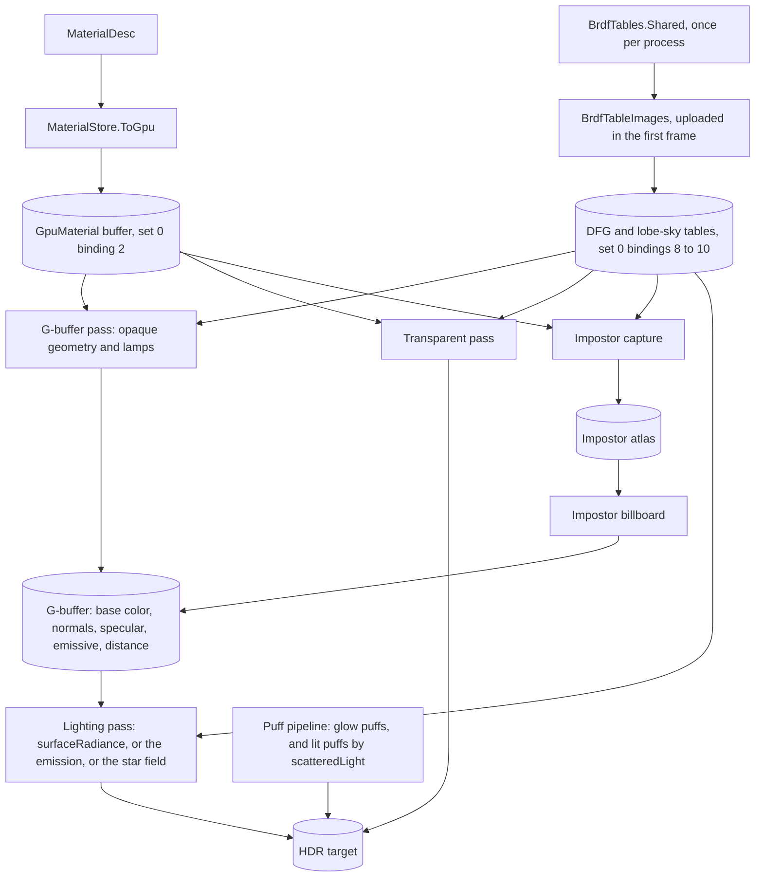

# PBR BRDF

Ticket: `ter-ptft`, the first member of the rendering upgrade epic (`ter-sglu`, [rendering-upgrade.md](rendering-upgrade.md)). The user chose the design on 2026-10-24, in the ticket's "Design decisions". This doc fills in the details. One point is open, see "Open fork".

## Goal

Replace the energy-normalized Blinn-Phong model of `lighting.glsl` with a physically based BRDF. A BRDF (bidirectional reflectance distribution function) says how much of the light that arrives from one direction a surface sends toward another direction. After this ticket:

- A metal reflects in its own color and has no diffuse light.
- A non-metal reflects white light, with an F0 near 0.04.
- A rough surface has the long highlight tail of GGX.
- A metal that only the hemisphere ambient light reaches is not black.

Every other member of the epic tunes against this BRDF, so it comes first.

## Terms

| Term | Meaning |
|---|---|
| Base color, b | The linear RGB color of the material, times its base color map. For a non-metal it is the diffuse color. For a metal it is the color of the reflection. |
| Metallic, m | 0 for a non-metal, 1 for a metal, times the B channel of the metallic-roughness map. |
| Roughness, r₀ | The perceptual roughness of the material, 0 to 1, times the G channel of the metallic-roughness map. |
| Floored roughness, r | r₀ clamped to the range 0.045 to 1. Everything that the BRDF computes uses r. |
| α | r². The width of the GGX lobe. |
| Reflectance, ρ | 0 to 1. It sets the F0 of a non-metal: 0.16 ρ². Today's specular intensity, renamed. |
| F0 | The share of light that the surface reflects head-on, per color channel. |
| Diffuse color | b (1 − m). |
| The lobe | The GGX specular part of the BRDF. |
| μ | n·v, the cosine between the shading normal and the direction toward the eye. |
| The lobe albedo, E₁(μ, r) | The share of the light from a uniform white sky that the lobe reflects toward the eye, with single scattering and F = 1. |
| The Schlick part, S(μ, r) | The same integral, with each direction weighted by (1 − v·h)⁵. |
| The specular albedo, E(μ, r) | The same share with the material's Fresnel term: S + F0 (E₁ − S). |
| The energy compensation, c | The factor that gives back the light that single scattering loses: 1 + F0 (1 / E₁ − 1). |
| The normal's sky share, s_n | How much of the hemisphere ambient light reaches the surface from the sky: (1 + n·up) / 2. Today's `skyFraction`. |
| The dominant direction, d | The direction where the lobe gathers most of its light. It lies between the mirror direction and the normal. |
| The lobe's sky share, s_l | How much of the light that the lobe gathers comes from the sky. New. |
| The DFG table | A 2D table of S and E₁ over μ and r. |
| The lobe-sky table | A 2D table of the lobe's sky share over the cosine between d and up, and r. |
| The tables | The DFG table and the lobe-sky table. |
| The specular target | The G-buffer target that holds m, r₀, ρ and s_l. Today's specular-gloss target. |
| The base color target | The G-buffer target that holds b. Today's albedo target. |

## Decisions

The user made the decisions marked (User). This design settled the others by the project's rules. Each has its reason.

1. Metallic-roughness parameters: base color, metallic and perceptual roughness. Khronos archived glTF's specular-glossiness extension, and the asset pipeline imports glTF. (User)
2. Non-metals keep a reflectance, today's specular intensity renamed, with F0 = 0.16 ρ². A reflectance of 0.5 gives 0.04. The canopy keeps its anti-reflective coating. (User)
3. Diffuse: Lambert, diffuse color / π. (User)
4. Specular: GGX with the height-correlated Smith visibility term and Schlick's Fresnel term. (User)
5. α = r², with a floor of 0.045 on r. (User) The value is Filament's floor for desktop GPUs.
6. Multiple-scattering energy compensation with a DFG table that the renderer computes once at start. (User) The form is Filament's, see "The energy compensation".
7. The hemisphere ambient light gets a specular part: its colors along the lobe, weighted by the DFG table. (User) SSR later fades its off-screen rays to it.
8. The specular target becomes RGBA8: metallic, roughness, reflectance, and the lobe's sky share. Only the G-buffer pass knows the instance's up, so only it can compute that share. (User)
9. The C# copy of the BRDF is production code, because it computes the tables. CPU tests test it, and one GPU test pins the shaders to it. (User)
10. The metallic-roughness map has glTF's layout: roughness in G, metallic in B. (User)
11. The demo materials convert by α = √(2 / (n + 2)) from the Blinn-Phong exponent n, so each highlight keeps about its size and its peak. (User)
12. No `RendererOptions` switch back to Blinn-Phong, because the material model changes with the BRDF. (User) This overrides the epic's rule of one switch per member.
13. The diffuse and the specular parts add with no coupling: today's factor (1 − F) on the diffuse part goes. The user's formula for the diffuse part has no such factor, and the BRDF stays one function for every light. Filament scales the diffuse part of its image-based light by (1 − E), but not the diffuse part of its direct lights. Unreal Engine 4 (Karis 2013) couples neither. This design couples neither, so the ambient light and the direct lights share one model. A white non-metal can then reflect a little more than it receives, by its specular albedo, which is 0.04 head-on.
14. The lobe's sky share comes from a second table, the lobe-sky table, not from a formula with a tuned width. The real lobe of a smooth metal sees a sharp horizon, and a rough one sees a soft blend. The table integrates the same GGX lobe as the DFG table, under the same split-sum assumption (Karis 2013). A formula would be a look-alike with a constant. The table costs 4 KB and one sample in each pass that shades. (Project rule: the real mechanism over a look-alike.)
15. The shading passes clamp their output to 65,504, the largest finite half float. GGX can reflect far more than that: glass of the canopy's roughness, 0.5 m from a lamp of intensity 50 and seen at a grazing angle, reflects about 200,000 at the mirror image of the lamp. The HDR target would store infinity, and the tone curve would turn it into NaN. The lights plan already clamps pre-exposed radiance to 65,504 ([local-light-shadows.md](local-light-shadows.md), "Exposure and the HDR image"), so the clamp stays when that plan adds exposure.
16. The texture slots of `MaterialDesc` are renamed `BaseColorMap`, `NormalMap` and `MetallicRoughnessMap`, and the albedo target of the G-buffer becomes the base color target. For a metal, the base color is not an albedo, so the old name would name two things. The factor already holds the name `BaseColor`, and the content formats plan names its planned emissive slot `EmissiveMap`, so every slot ends in "Map".
17. `Roughness` is a required field of `MaterialDesc`, and `MaterialDesc.Color` takes it. No roughness is neutral, so a default would be a convenience value. A new field of a seam type is required or defaults to its honest zero (project memory, "No test defaults in production"). `Metallic` defaults to its honest zero, a non-metal. `Reflectance` keeps the default of the field that it renames, 0.5, the reflectance of a common dielectric and of glTF's default index of refraction, 1.5.
18. The reflectance has no map channel. glTF puts occlusion in the R channel of a packed map, and no producer has a reflectance map. The material's factor is the reflectance of every texel.
19. The tables are computed once per process, on first use, into an immutable `BrdfTables.Shared`. Each renderer uploads them in its first frame. A test process creates many renderers, and each computation takes about 3 million BRDF samples.
20. The lit puffs do not change. A lit puff scatters the mean of a matte surface over every facing ([particles.md](particles.md), "Lit puffs"). The Lambert part of the new BRDF is that matte surface, so `scatteredLight` gives the same light.
21. The six reference images of today's snapshot tests are re-rendered and re-approved, each with a real review. Every ground, wall, box and pane in them takes the new BRDF. Re-approval is not an addition, so the epic's rule of no new reference images holds.
22. A scene of spheres, `pbr-spheres`, joins the demo for the screenshots. The demo has no metal, so without it no screenshot shows the acceptance criteria.

## The BRDF

### Inputs and derived values

```
At one surface point, after the maps:
  b   base color, linear RGB
  m   metallic, 0 to 1
  r₀  roughness, 0 to 1
  ρ   reflectance, 0 to 1

  r      = clamp(r₀, 0.045, 1)                 the roughness floor
  α      = r²                                  Burley 2012
  c_diff = b · (1 − m)                         a metal has no diffuse color
  F0     = (1 − m) · 0.16 ρ² + m · b           per channel; ρ = 0.5 gives 0.04
```

### The terms

n is the shading normal, v the unit direction toward the eye, l the unit direction toward the light, and h = normalize(l + v).

```
μ      = clamp(n·v, 1e-4, 1)
D(h)   = α² / (π · ((n·h)² · (α² − 1) + 1)²)
Vis    = 0.5 / ((n·l) · sqrt(μ² · (1 − α²) + α²) + μ · sqrt((n·l)² · (1 − α²) + α²))
F(v·h) = F0 + (1 − F0) · (1 − v·h)⁵

f_ss(l, v) = c_diff / π + D · Vis · F          single scattering
f(l, v)    = c_diff / π + D · Vis · F · c      with the energy compensation c below
```

- D is the GGX distribution of the microfacet normals (Trowbridge and Reitz 1975; Walter, Marschner, Li and Torrance 2007, "Microfacet Models for Refraction through Rough Surfaces").
- Vis is G₂ / (4 (n·l) μ), with G₂ the height-correlated Smith masking-shadowing term of Heitz 2014 ("Understanding the Masking-Shadowing Function in Microfacet-Based BRDFs", JCGT 3(2)). The form above is an exact rewrite of it, as Filament writes it.
- F is Schlick's approximation (Schlick 1994, "An Inexpensive BRDF Model for Physically-based Rendering").
- The diffuse part is Lambert's.
- μ has a floor of 10⁻⁴, as in Filament. A normal map can turn the shading normal away from the eye, and the visibility term divides by μ.

### Lights

The sun and each point and spot light add f(l, v) · E · (n·l) where n·l > 0. E is the irradiance that reaches the point, as today:

- The sun: `frame.sunRadiance` times the sun's visibility, the far shadows times the cascades (`sunReaches`).
- A point or spot light: its radiance times the distance attenuation and the cone (`lightReaches`).

The rule of the geometric normal stays: where the vertex normal faces away from the sun, the sun adds nothing, whatever the normal map says. Each light is still a point or a direction. A light with a size, whose highlight on a smooth surface shows its disc, waits for the radius of the lights plan (`ter-bpvl`, see "Compared with a design from scratch").

### The roughness floor

r = clamp(r₀, 0.045, 1), so α is at least 0.002025. At that α, D peaks at 1 / (π α²), about 77,600. The floor is applied in one place in each copy of the BRDF: `GgxLobe`'s constructor in C# and `flooredRoughness` in `brdf.glsl`. The G-buffer stores the material's r₀, not r, so that the floor stays one rule.

### The tables

Both tables integrate the GGX lobe with the same sample sequence. The C# copy computes them, and the renderer uploads them.

#### The DFG table

| Property | Value |
|---|---|
| Size | 32 × 32 texels |
| Format | R16G16_SFLOAT |
| Across, u | μ. Texel i holds μ = (i + 0.5) / 32. |
| Down, v | r. Row j holds r = (j + 0.5) / 32. Row 0 is the first row of the image. |
| R | The Schlick part S(μ, r) |
| G | The lobe albedo E₁(μ, r) |
| Sampling | Linear, clamp to edge, at (μ, r), level 0. Each texel holds the integral at its center, so (μ, r) is the texture coordinate itself. |

The two channels are those of Filament's table for multiple scattering, after Karis's split sum (Karis 2013, "Real Shading in Unreal Engine 4"):

```
E₁(μ, r) = ∫ D · Vis · (n·l) dω_l                    over the hemisphere, F = 1
S(μ, r)  = ∫ D · Vis · (n·l) · (1 − v·h)⁵ dω_l
E(μ, r)  = F0 · E₁ + (1 − F0) · S = S + F0 · (E₁ − S)
```

The resolution: the steepest part of the table is S at small roughness, which tends to (1 − μ)⁵. Its second derivative is at most 20, so bilinear filtering between texel centers 1/32 apart errs by at most 20 · (1/32)² / 8, about 0.0024. That is less than one step of an 8-bit output, 0.0039. Half floats hold 11 bits of mantissa, a relative error of about 5 · 10⁻⁴, and every Vulkan device filters R16G16_SFLOAT and R16_SFLOAT linearly. 32-bit floats need an optional feature to filter.

#### The lobe-sky table

| Property | Value |
|---|---|
| Size | 64 × 32 texels |
| Format | R16_SFLOAT |
| Across, u | (cos + 1) / 2, where cos is d·up. Texel i holds cos = 2 (i + 0.5) / 64 − 1. |
| Down, v | r. Row j holds r = (j + 0.5) / 32. |
| R | The lobe's sky share for that tilt and roughness |
| Sampling | Linear, clamp to edge, at ((cos + 1) / 2, r), level 0 |

Under the split-sum assumption, the lobe is the lobe of n = v, centered on the mirror direction, which is then n itself. Its sky share depends only on the angle between that center and up, and on r. At small roughness the share is a step at the horizon. 64 texels across make one texel 1/32 of the cosine, about 1.8° of elevation at the horizon, so the step blurs over less than 2°. The rows follow the DFG table.

#### Computing them

```
Hammersley point k of N:  (u₁, u₂) = (k / N, radicalInverse₂(k))       radicalInverse₂ reverses the bits of k
GGX half vector of α:     φ = 2π u₁
                          cos θ_h = sqrt((1 − u₂) / (1 + (α² − 1) · u₂))
                          h = (sin θ_h cos φ, sin θ_h sin φ, cos θ_h)       in tangent space, n = +Z

DFG texel (μ, r), α = r², v = (sqrt(1 − μ²), 0, μ):
  for k = 0 to N − 1:
    l = 2 (v·h) h − v
    if n·l > 0:
      w  = 4 · Vis(n·l, μ) · (n·l) · (v·h) / (n·h)
      S  += w · (1 − v·h)⁵
      E₁ += w
  S /= N;  E₁ /= N

Lobe-sky texel (cos, r), α = r², v = n = +Z, up = (sqrt(1 − cos²), 0, cos):
  for k = 0 to N − 1:
    l = 2 (n·h) h − n
    if n·l > 0:
      total += n·l
      if l·up > 0:  above += n·l
  share = above / total
```

- N is 1,024 samples per texel, as in Filament. The Hammersley set (Hammersley and Handscomb 1964) is a fixed low-discrepancy sequence, so its error is near 10⁻³ for these smooth integrals, and the tables are the same on every run.
- The GGX half vectors are drawn with density D(h) (n·h) (Walter and others 2007), so w is the estimator of the integrand over that density. The lobe-sky weights by n·l, as Karis's prefiltering does.
- The work is (32 × 32 + 64 × 32) × 1,024, about 3.1 million samples, in doubles, then rounded to half floats.
- Determinism. Each texel sums its samples in the order of k, so its value is the same bits on every run. No texel reads another, so rows may run on several threads without a change of value. Part 1 measures the time on one thread. If it is over 100 ms, the rows run in parallel. `Math.Sin` and `Math.Cos` may differ in the last bit between platforms; the reference images come from one machine anyway (ARCHITECTURE.md, "Snapshot tests").

### The energy compensation

Single-scattering GGX loses the light that bounces between microfacets more than once. The loss grows with roughness: at normal incidence and r = 1, E₁ = 1 − ln 2, about 0.31. The form is Filament's ("Energy loss in specular reflectance", after Kulla and Conty 2017, "Revisiting Physically Based Shading at Imageworks"):

```
c(μ, r) = 1 + F0 · (1 / E₁(μ, r) − 1)          per channel
```

- With F0 = 1, the compensated lobe reflects E₁ · (1 / E₁) = 1: a white metal loses nothing at any angle or roughness.
- With F0 = 0, c = 1.
- For F0 between 0 and 1, the compensated specular albedo E · c is a product of two linear functions of F0 with a positive square term, so it is largest at an end, and no material reflects more than it receives.
- c depends on μ, not on l. The compensated BRDF is therefore not reciprocal. It approximates a reciprocal multiple-scattering lobe whose shape it does not model. The tests check reciprocity on f_ss.

Fdez-Agüera 2019 ("A Multiple-Scattering Microfacet Model for Real-Time Image-based Lighting") gives a form for image-based light only. Filament's form serves the direct lights and the ambient light with one factor from one table, so this design takes it.

### The ambient light's specular part

The hemisphere ambient light has the sky's radiance above the horizon of its up and the ground's radiance below. Its diffuse part does not change: a Lambert surface sends back c_diff times the mix of the two by the normal's sky share. Its specular part is the mix by the lobe's sky share, times the compensated specular albedo:

```
ambient = c_diff · mix(ground, sky, s_n)  +  E(μ, r) · c(μ, r) · mix(ground, sky, s_l)

s_n = clamp((1 + n·up) / 2, 0, 1)                     today's skyFraction
R   = reflect(−v, n)
d   = normalize(mix(n, R, (1 − α) · (sqrt(1 − α) + α)))
s_l = lobeSky(d·up, r)                                the lobe-sky table
```

- d is the specular dominant direction of Lagarde and de Rousiers 2014 ("Moving Frostbite to Physically Based Rendering 3.0", the listing `getSpecularDominantDir`), with α, which the notes call roughness. A rough lobe gathers its light nearer the normal than the mirror direction.
- Up is the instance's `HemisphereUp`, as for s_n. With the even mix (no gravity), s_l is 0.5, as s_n is.
- The G-buffer pass computes s_l and stores it in the alpha of the specular target, as it stores s_n in the alpha of the emissive target. The transparent pass and the impostor capture compute both shares themselves, as they compute s_n today.

### The clamp

`surfaceRadiance` in `lighting.glsl` returns min(ambient + sun + lights + emission, 65,504) per channel. The lighting pass, the transparent pass and the impostor capture write its result. The transparent pass blends the clamped value, and alpha blending of two finite values stays finite.

## The material model

### MaterialDesc

```csharp
/// <summary>
/// A metallic-roughness material (docs/plans/pbr-brdf.md). Colors are linear RGB. BaseColor.W is opacity, used only with
/// <see cref="RenderFlags.Transparent"/>. A map left at its default is no map. The metallic-roughness map has glTF's
/// layout: roughness in G, metallic in B. Each map channel multiplies its factor.
/// </summary>
public sealed record MaterialDesc(
    Vector4 BaseColor,
    float Roughness,
    float Metallic = 0f,
    float Reflectance = 0.5f,
    Vector3 Emissive = default,
    TextureId BaseColorMap = default,
    TextureId NormalMap = default,
    TextureId MetallicRoughnessMap = default
)
{
    public static MaterialDesc Color(Vector4 color, float roughness) => new(BaseColor: color, Roughness: roughness);
}
```

| Field | Range | Default | Replaces |
|---|---|---|---|
| `BaseColor` | Linear RGBA | Required | `BaseColor` |
| `Roughness` | 0 to 1, clamped by `MaterialStore.ToGpu` | Required | `Gloss` |
| `Metallic` | 0 to 1, clamped | 0 | New |
| `Reflectance` | 0 to 1, clamped | 0.5 | `SpecularIntensity` |
| `Emissive` | Linear RGB radiance, at least 0 | 0 | `Emissive` |
| `BaseColorMap` | A texture, sRGB | None: white | `Albedo` |
| `NormalMap` | A texture, UNORM | None: flat | `Normal` |
| `MetallicRoughnessMap` | A texture, UNORM: G roughness, B metallic, R and A unread | None: white | `SpecularGloss` |

The default material, the slot that `MaterialId.None` resolves to, is `new(BaseColor: Vector4.One, Roughness: 0.5f)`: a white non-metal of roughness 0.5, the middle of the scale, and reflectance 0.5.

A metallic-roughness map must be created with `TextureData.Srgb` false, as the specular-gloss map had to be. No guard checks it, as none checked it before.

### GpuMaterial

```csharp
/// <summary>One material in the material storage buffer (std430). 52 bytes of fields, padded to 64, the struct's alignment of 16.</summary>
[StructLayout(LayoutKind.Sequential, Size = 64)]
internal struct GpuMaterial
{
    public Vector4 BaseColor;          // offset 0
    public Vector3 Emissive;           // 16
    public float Metallic;             // 28
    public float Roughness;            // 32, r₀: the floor is the BRDF's
    public float Reflectance;          // 36
    public uint BaseColorMap;          // 40, bindless indices, already resolved to the defaults
    public uint NormalMap;             // 44
    public uint MetallicRoughnessMap;  // 48
}
```

```glsl
struct GpuMaterial
{
    vec4 baseColor;              // linear RGB, alpha for transparent objects
    vec3 emissive;               // linear RGB radiance
    float metallic;
    float roughness;             // r₀, before the floor
    float reflectance;
    uint baseColorMap;           // bindless indices, already resolved to the default textures
    uint normalMap;
    uint metallicRoughnessMap;   // glTF layout: roughness in G, metallic in B
};                               // std430: 52 bytes of members, a stride of 64
```

In std430, a struct with a `vec4` or a `vec3` member aligns to 16 bytes, and its size rounds up to that. So the array stride is 64, and `Size = 64` makes the C# struct match. The struct grows from 48 bytes. Packing the three indices into fewer bits could keep 48, at the cost of unpacking per pixel, for 16 bytes per material. Materials are few, so the struct stays plain.

### Textures

`TextureStore` keeps three built-in slots:

| Slot | Constant | Texel | Format |
|---|---|---|---|
| 0 | `White` | (255, 255, 255, 255) | RGBA8 sRGB, the default base color map |
| 1 | `FlatNormal` | (128, 128, 255, 255) | RGBA8 UNORM, the default normal map |
| 2 | `DefaultMetallicRoughness` | (255, 255, 255, 255) | RGBA8 UNORM, the default metallic-roughness map: it leaves both factors as they are |

`material.glsl` reads the map as glTF does:

```glsl
vec4 metallicRoughness = sampleTexture(m.metallicRoughnessMap, uv);
s.metallic = m.metallic * metallicRoughness.b;
s.roughness = m.roughness * metallicRoughness.g;
s.reflectance = m.reflectance;
```

### The G-buffer

| Target | Format | Contents |
|---|---|---|
| Base color | RGBA8 sRGB | b. Alpha 0 marks an unlit impostor pixel. Today's albedo target. |
| Normals | RGBA16 SNORM | Unchanged |
| Specular | RGBA8 UNORM | R metallic, G roughness r₀, B reflectance, A the lobe's sky share s_l. An impostor billboard writes zero. |
| Emissive | RGBA16F | Unchanged: emitted radiance, alpha s_n |
| Distance | R32F | Unchanged |

In `RenderTargets`: `BaseColorFormat = Format.R8G8B8A8Srgb`, `SpecularFormat = Format.R8G8B8A8Unorm`, and the properties `BaseColor` and `Specular`. In the shaders: `outBaseColor` and `outSpecular` (a `vec4`, location 2), and `gbufferBaseColor` and `gbufferSpecular` in `gbuffer_inputs.glsl`.

### The frame set

The tables go into the frame set (set 0), because the impostor capture binds only sets 0 and 1, and set 2 holds the targets that the G-buffer pass writes. Every pass that reads the tables binds set 0.

| Binding | Type | Stage | Contents |
|---|---|---|---|
| 8 | Sampled image | Fragment | The DFG table |
| 9 | Sampled image | Fragment | The lobe-sky table |
| 10 | Sampler, immutable | Fragment | Linear filtering, clamp to edge, one level, no anisotropy |

`FrameResources` writes bindings 8 and 9 once, when it makes each frame set. The tables never change.

### The shaders

A new file, `brdf.glsl`, holds the BRDF's terms and the table reads. `lighting.glsl` and `hemisphere.glsl` include it.

```glsl
// brdf.glsl. Each function has a C# twin in Tertius.Rendering.Shading, which BrdfShaderTests pins.
const float MinRoughness = 0.045;   // GgxLobe.MinRoughness
const float MinNdotV = 1e-4;

float flooredRoughness(float roughness);                       // clamp(roughness, MinRoughness, 1)
float ggxDistribution(float NdotH, float alpha);               // D
float smithVisibility(float NdotL, float NdotV, float alpha);  // Vis = G₂ / (4 NdotL NdotV), height-correlated
vec3 schlickFresnel(vec3 f0, float VdotH);                     // F
vec3 specularDominantDirection(vec3 N, vec3 R, float alpha);   // d, unit
vec2 dfgAt(float NdotV, float roughness);                      // (S, E₁) from the DFG table, floored roughness
float lobeSkyAt(float cosine, float roughness);                // s_l from the lobe-sky table, floored roughness
```

```glsl
// lighting.glsl
struct ShadingInput
{
    vec3 baseColor;
    vec3 normal;              // shading normal, after normal mapping
    vec3 geometricNormal;     // interpolated vertex normal: the surface the shadow map sees
    float metallic;
    float roughness;          // r₀, before the floor
    float reflectance;
    float skyFraction;        // s_n
    float lobeSkyFraction;    // s_l
};

// The values that every light at one pixel shares, computed once per pixel.
struct SurfaceLobes
{
    vec3 diffuseColor;
    vec3 f0;
    float alpha;
    float NdotV;              // clamped to MinNdotV
    vec3 specularAlbedo;      // E
    vec3 energyCompensation;  // c
};

SurfaceLobes lobesOf(ShadingInput s, vec3 V);
vec3 brdf(ShadingInput s, SurfaceLobes lobes, vec3 V, vec3 L);   // f · max(n·l, 0): radiance per unit irradiance
vec3 ambientLight(ShadingInput s, SurfaceLobes lobes);
vec3 sunLight(ShadingInput s, SurfaceLobes lobes, vec3 position, vec3 V, bool shadowMaps);
vec3 localLights(ShadingInput s, SurfaceLobes lobes, vec3 position, vec3 V);
vec3 surfaceRadiance(ShadingInput s, vec3 emission, vec3 position, vec3 V, bool shadowMaps);   // the clamped sum
vec3 scatteredLight(vec3 albedo, vec3 position);   // unchanged
```

```glsl
// hemisphere.glsl
float skyFraction(vec4 hemisphere, vec3 position, vec3 normal);                                // unchanged
float lobeSkyFraction(vec4 hemisphere, vec3 position, vec3 normal, vec3 V, float roughness);  // s_l
```

`skyFraction` and `lobeSkyFraction` share one private function that finds the up of the instance, so the two cannot disagree about it.

`material.glsl`'s `SurfaceSample` holds `baseColor`, `normal`, `metallic`, `roughness`, `reflectance` and `emissive`. The lighting pass, the transparent pass and the impostor capture all call `surfaceRadiance`. Today the capture adds its own sum, because `shadeSurface` always samples the cascades. The `shadowMaps` parameter ends that second path.

### The C# BRDF

The C# copy lives in `src/Tertius.Rendering/Shading`, in doubles. Functions belong to the type of their data (STYLE.md, "Put a function into the type that it belongs to").

```csharp
/// <summary>The GGX lobe of one roughness (docs/plans/pbr-brdf.md, "The terms").</summary>
internal readonly record struct GgxLobe
{
    public const double MinRoughness = 0.045;

    /// <summary>Clamps <paramref name="roughness"/> to the range from <see cref="MinRoughness"/> to 1.</summary>
    public GgxLobe(double roughness);

    public double Roughness { get; }   // r, after the floor
    public double Alpha { get; }       // r²

    public double Distribution(double nDotH);                    // D, per steradian
    public double Visibility(double nDotL, double nDotV);        // Vis
    public Double3 SampleHalfVector(double u1, double u2);       // tangent space, +Z the normal
    public Double3 DominantDirection(Double3 normal, Double3 mirror);   // d, unit
}

/// <summary>A material at one point, after its maps, as the BRDF reads it.</summary>
internal readonly record struct MaterialSample(Double3 BaseColor, double Metallic, double Roughness, double Reflectance)
{
    public Double3 DiffuseColor { get; }
    public Double3 F0 { get; }
    public GgxLobe Lobe { get; }

    public Double3 Fresnel(double vDotH);
    public Double3 SingleScatteringBrdf(Double3 normal, Double3 toView, Double3 toLight);           // f_ss, per steradian
    public Double3 Reflected(Double3 normal, Double3 toView, Double3 toLight, BrdfTables tables);    // f · max(n·l, 0)
    public Double3 ReflectedHemisphere(
        Double3 normal, Double3 toView, Double3 sky, Double3 ground,
        double normalSkyShare, double lobeSkyShare, BrdfTables tables);                             // the ambient formula
}

/// <summary>A Hammersley point set of <see cref="Count"/> points in the unit square.</summary>
internal readonly record struct Hammersley(int Count)
{
    public (double U, double V) this[int index] { get; }
}

/// <summary>The DFG and lobe-sky tables, computed once per process (docs/plans/pbr-brdf.md, "The tables").</summary>
internal sealed class BrdfTables
{
    public const int DfgSize = 32;
    public const int LobeSkyWidth = 64;
    public const int LobeSkyHeight = 32;
    public const int SamplesPerTexel = 1024;

    public static BrdfTables Shared { get; }   // computed on first use, thread-safe

    public static BrdfTables Compute();

    public ReadOnlySpan<Half> Dfg { get; }       // DfgSize² texels of two halves, (S, E₁), row by row from r = 0
    public ReadOnlySpan<Half> LobeSky { get; }   // LobeSkyWidth × LobeSkyHeight halves, row by row from r = 0

    /// <summary>Bilinear between texel centers, clamped at the edges, as the GPU samples.</summary>
    public (double SchlickPart, double LobeAlbedo) SampleDfg(double nDotV, double roughness);
    public double SampleLobeSky(double cosine, double roughness);

    internal static (double SchlickPart, double LobeAlbedo) IntegrateDfg(double nDotV, double roughness, int samples);
    internal static double IntegrateLobeSky(double cosine, double roughness, int samples);
}
```

The GPU side:

```csharp
/// <summary>The BRDF tables on the GPU, uploaded in the first frame (docs/plans/pbr-brdf.md, "The tables").</summary>
internal sealed class BrdfTableImages : IDisposable
{
    public BrdfTableImages(VulkanDevice device, DeviceAllocator allocator);
    public GpuImage Dfg { get; }        // R16G16_SFLOAT, 32 × 32
    public GpuImage LobeSky { get; }    // R16_SFLOAT, 64 × 32
    public void Upload(CommandBuffer commandBuffer, StagingArena staging, BarrierBatch barriers);   // records the copies once
    public void Dispose();
}
```

`VulkanRenderer` makes it beside `TextureStore` and `MaterialStore`, calls `Upload` in the upload step with them, and passes it to each `FrameResources`. `DescriptorLayouts` makes the immutable table sampler.

## Every reader and writer

| Value | Written by | When | Read by | When | Stored in | Analogue |
|---|---|---|---|---|---|---|
| Metallic | Scene code through `MaterialDesc.Metallic`, and the B channel of its map | At `CreateMaterial`, uploaded in step 1 of the next rendered frame | `sampleMaterial` in the G-buffer pass, the transparent pass and the impostor capture | Steps 4, 5 and 7 | `GpuMaterial.Metallic`, then R of the specular target | Specular intensity today |
| Roughness | `MaterialDesc.Roughness`, and the G channel of its map | As metallic | As metallic, and `lobeSkyFraction` | As metallic | `GpuMaterial.Roughness`, then G of the specular target | Gloss today |
| Reflectance | `MaterialDesc.Reflectance` | As metallic | As metallic | As metallic | `GpuMaterial.Reflectance`, then B of the specular target | Specular intensity, renamed |
| The lobe's sky share | The G-buffer pass for opaque geometry. The transparent pass and the capture compute their own and store none. | Step 5 | The lighting pass | Step 6 | A of the specular target | The normal's sky share, in the alpha of the emissive target |
| The DFG table | `BrdfTables.Compute`, then `BrdfTableImages.Upload` | Once per process on first use; uploaded in step 1 of each renderer's first frame | `dfgAt` in the lighting pass, the transparent pass and the capture | Steps 4, 6 and 7 | `BrdfTables.Shared` on the CPU, one image per renderer | The built-in default textures and the default material: data the renderer owns, uploaded in its first frame, never changed |
| The lobe-sky table | As the DFG table | As the DFG table | `lobeSkyAt` in the G-buffer pass, the transparent pass and the capture | Steps 4, 5 and 7 | As the DFG table | As the DFG table |
| The specular target | The G-buffer pass: geometry writes its values, billboards write zero | Step 5, each rendered frame | The lighting pass | Step 6 | `RenderTargets.Specular` | The specular-gloss target |

The step numbers are those of ARCHITECTURE.md, "The order of a rendered frame". Each ordering rule has its reason:

- The tables are uploaded in step 1 of the first frame, before steps 4 to 7 read them, because the barrier of the upload makes them readable.
- The G-buffer pass writes the lobe's sky share in step 5, and the lighting pass reads it in step 6, as for the normal's share: only the G-buffer pass knows the instance's up.
- The lights add in the order of the light list, as today, so the sum rounds the same way on every run.
- The clamp applies to the whole sum, emission included, because the target's range bounds what it stores, whatever the parts.

## The flow of each kind



| Kind | Reads the material | Computes s_n and s_l | Shades with | Writes |
|---|---|---|---|---|
| Opaque geometry | The G-buffer pass | The G-buffer pass, stored | `surfaceRadiance`, shadow maps on, in the lighting pass | The HDR target |
| Emissive-only lamps and the sun's sphere | As opaque geometry: a black base color and a reflectance of 0 | As opaque geometry | As opaque geometry | The HDR target |
| Transparent geometry | The transparent pass | The transparent pass | `surfaceRadiance`, shadow maps on, then alpha blending | The HDR target |
| Impostor captures | The capture pass | The capture pass | `surfaceRadiance`, shadow maps off | The impostor atlas |
| Impostor billboards | None: the capture holds the light | None | Nothing: the lighting pass passes the emission through, because the base color alpha is 0 | The G-buffer, then the HDR target |
| Lit puffs | None: a puff has an albedo and no surface | None | `scatteredLight`, unchanged | The HDR target, added |
| Glow puffs | None | None | Their own radiance | The HDR target, added |
| Sky pixels | None | None | The star field in the lighting pass, at distance 0 | The HDR target |

Every surface with a material takes `surfaceRadiance`. Only the pass that reads the material, and whether the cascades apply, differ. The lamps are opaque geometry, not a kind of their own. Billboards, puffs and the sky have no material and take no BRDF.

## Compared with a design from scratch

A deferred renderer built from scratch around this BRDF would have the same material model, the same terms, Filament's compensation, a base color target in sRGB, octahedral normals, a material target in RGBA8 and an HDR emission target. It would add the lobes with no coupling, as Unreal Engine 4 does. This design is that, with these differences:

| From scratch | This design | Why it stays |
|---|---|---|
| Environment maps or probes, prefiltered along the lobe, and irradiance for the diffuse part | The two colors of the hemisphere ambient light, with the lobe-sky table in place of the prefiltered map | Probes and image-based lighting are out of the epic's scope. The table is the same split sum over the environment that the scenes define. |
| The fourth channel of the material target holds a material value, such as occlusion or a shading model | It holds s_l, a value of the environment | Only the G-buffer pass knows the instance's up. The normal's share sits in the emissive alpha for the same reason. |
| Lights with a size: a smooth surface shows the sun's disc and a lamp's bulb, and the radiance stays bounded | Points and a direction, so a very smooth surface shows a pinpoint, and the clamp bounds the stored value | The lights plan gives each light an emitter radius (`ter-bpvl`). A widened lobe for a sized light then fits into `brdf`. The demo's smoothest material has r = 0.18, whose lobe is wider than the sun. |
| Glass that blends its diffuse part by opacity and keeps its specular part (Filament's transparent mode) | Alpha blending fades the whole color, the specular part too, as today | It is the blend of the transparent pass, not the BRDF. A change brightens both glasses' highlights about fivefold and undoes the canopy's tuning. It belongs to a later decision about glass. |
| A DFG table baked offline as an asset | Computed at start by the C# copy | (User) No asset pipeline exists yet, and the C# copy is the reference that the tests pin. |
| Specular anti-aliasing on normal maps | None in the renderer | The asset pipeline widens the roughness of bumpy mips (Toksvig), and the demo has no normal maps. The anti-aliasing plan keeps it optional. |
| SI units and pre-exposed radiance | Today's units | `ter-bpvl` and `ter-zzyr`. The ticket keeps the units. |

## Tests

The tests follow tests/STYLE.md: one behavior per test, named as a statement. No test adds a reference image (the epic's rule).

### CPU tests of the C# BRDF

In `tests/Tertius.Rendering.Tests`. Integrals that check the code use an independent midpoint quadrature over the hemisphere, not the Hammersley sampler.

`GgxLobeTests`:

- `TheDistributionIntegratesToOneOverTheProjectedHalfVectors`: ∫ D (n·h) dω = 1 for α from the floor to 1.
- `TheVisibilityTermIsSymmetricInTheLightAndTheView`.
- `TheRoughnessFloorKeepsAlphaAtTheFloorSquared`: a roughness of 0 gives α = 0.045², and 1 gives 1.
- `ASmoothLobesDominantDirectionIsTheMirrorDirectionAndARoughOneLeansToTheNormal`.
- `AtSixtyDegreesTheGgxTailIsOverAHundredTimesTheBlinnPhongTailOfTheSameHighlight`: at r = 0.6, D at θ_h = 60° against the normalized Blinn-Phong distribution with n = 2 / α² − 2 (about 300 times).

`MaterialSampleTests`:

- `AReflectanceOfOneHalfGivesANonMetalAnF0OfFourPercent`.
- `ANonMetalsF0IsTheSameInEveryChannelWhateverItsBaseColor`.
- `AMetalTakesItsF0FromItsBaseColorAndHasNoDiffuseColor`.
- `FresnelHeadOnIsF0`.
- `FresnelAtAGrazingAngleIsOne`. Under option B of the open fork, it is f90.
- `TheSingleScatteringBrdfIsReciprocal`: f_ss(l, v) = f_ss(v, l) over a grid of directions and materials.
- `TheLambertPartUnderAUniformSkyReflectsExactlyTheDiffuseColor`.
- `TheSingleScatteringLobeNeverReflectsMoreThanItReceives`: E₁ ≤ 1 for every μ and r.
- `WithTheCompensationAWhiteMetalReflectsAllTheLightAtEveryAngleAndRoughness`: the white furnace, within 0.01.
- `WithTheCompensationNoMetalReflectsMoreThanItReceives`: for F0 from 0 to 1.
- `UnderAUniformSkyTheAmbientPartIsTheDiffuseColorPlusTheCompensatedSpecularAlbedo`.

`BrdfTablesTests`:

- `EachDfgTexelHoldsTheIntegralsAtItsCenterWithinOneThousandth`: a spread of texels against the midpoint quadrature.
- `AtNormalIncidenceAndRoughnessOneTheLobeAlbedoIsOneMinusLnTwo`: `IntegrateDfg(1, 1)`. With α = 1 and v = n, D is 1/π, the mirror of h at θ_h lies at 2θ_h, and the integral comes to 1 − ln 2 in closed form.
- `TheSmoothestRowReflectsEverythingAndItsSchlickPartIsOneMinusMuToTheFifth`.
- `ARougherLobeNeverReflectsMore`: E₁ falls down each column, within 10⁻³.
- `ASmoothLobeSeesOnlyTheSkyAboveTheHorizonAndOnlyTheGroundBelow`: the first row of the lobe-sky table is 0 below the horizon and 1 above it.
- `TheSkySharesOfATiltAndOfItsMirrorTiltAddUpToOne`: within 2 · 10⁻³, the error of the sample set.
- `TheLobesSkyShareRisesAsTheLobeTiltsUp`.
- `SamplingBetweenTexelCentersIsBilinearAndClampsAtTheEdges`.
- `TwoComputationsGiveTheSameBits`.

### The GPU test that pins the shaders to the C# copy

`BrdfShaderTests.TheShadersShadeEachMaterialAsTheCSharpBrdfDoes`, a theory over opaque and transparent:

- A grid of flat squares faces the camera at tilts of 0°, 45° and 70°, each with its own material: non-metals and metals at roughnesses from 0.2 to 0.8. The sun lights them, and the hemisphere ambient light has distinct sky and ground colors and the up +Y. No instance casts a shadow, so the sun's visibility is 1.
- The test computes each square's light at its center with `MaterialSample.Reflected` and `ReflectedHemisphere`, with v, n and both shares from the scene's geometry.
- It renders the same squares a second time with no sun and no ambient light, each black, with a reflectance of 0 and the expected light as its emission. With no light, nothing reflects, so each square shows its emission.
- The two images agree within 2 of 255 in each channel at each center. Both go through the same tone curve, so the test needs no copy of it, as `LitPuffRenderTests` compares lit puffs with glow puffs.
- The materials use values that the targets store exactly: roughness 0.2, 0.4, 0.6 and 0.8 are 51, 102, 153 and 204 of 255, and the base colors are decoded sRGB bytes. In the opaque case, the C# side rounds s_l to the nearest 1/255, as the specular target stores it.
- The tilts and the roughnesses spread over both axes of both tables, so a flipped axis, a lost channel or a wrong row order fails.

### GPU tests of the acceptance criteria

`BrdfRenderTests`:

- `AMetalShowsAHighlightInItsBaseColorAndNoDiffuseLight`: a gold metal sphere, base color (1, 0.71, 0.29) and roughness 0.2, in sunlight from behind the camera, with no ambient light. The sun is dim enough that the highlight stays below 1 before the tone curve, which turns any bright color white. The highlight's red is above its green, and its green above its blue. A pixel 60° from the highlight, which the sun lights at n·l = 0.5 and where the C# lobe gives less than 10⁻⁵ of its peak, is black. A non-metal of that base color would show its diffuse light there.
- `ANonMetalsHighlightIsWhiteWithAnF0NearFourPercent`: a red non-metal square, base color (1, 0, 0) and reflectance 0.5, head-on to the camera and the sun. Green and blue are equal, so the highlight is white. Its green lies between the greens of two emissive squares whose emission is the C# head-on highlight for F0 = 0.036 and for F0 = 0.044.
- `ARoughSurfacesHighlightHasTheLongTailOfGgx`: a red non-metal ground of roughness 0.6 in sunlight, with no ambient light, so its green is the lobe alone. At the pixel where the C# lobe falls to a twentieth of its peak, about 46° between h and n, the green lies between emissive squares at 0.8 and 1.2 times the C# value. The Blinn-Phong lobe of the same highlight gives less than a fifth of it there. Nearer the peak the two lobes differ less, and GGX at this roughness never falls below 1.7 % of its peak.
- `AMetalLitOnlyByTheAmbientLightIsNotBlack`: a metal sphere of roughness 0.2 under a red sky and a blue ground, with no sun. Its top is red and its bottom blue.
- `AHighlightBrighterThanTheHdrTargetHoldsShowsWhite`: a smooth white metal square at the mirror image of a point light of intensity 1,000, 0.3 m away. The C# value is over 65,504, and the pixel is white, not NaN.

In `HemisphereTests`, a theory over opaque, transparent and impostor:

- `AShinyMetalReflectsTheSkyAboveItsHorizonAndTheGroundBelow`: a metal sphere of roughness 0.1 under a red sky and a blue ground with the up +Y. A point whose dominant direction rises 10° above the horizon is red, and one 10° below it is blue. Each of the three passes computes s_l, so each is tested.

### Existing tests

| Test | What changes | Why |
|---|---|---|
| `BatcherTests`, the struct sizes | `GpuMaterial` from 48 to 64 bytes | The new layout |
| `ContractChangeTests`, `UploadQueueTests`, `ResourceTests` | The slot names | The rename |
| The six reference images: `frame-outlines.png` (`OutlineRenderTests`), `puffs-glow.png`, `puffs-glass.png`, `puffs-soft.png`, `puffs-far.png` (`PuffRenderTests`), `puffs-lit.png` (`LitPuffRenderTests`) | Re-rendered and re-approved, each reviewed with the reference, the actual image and the FLIP heat map (CLAUDE.md) | Every ground, wall, box and pane in them takes the new BRDF and the ambient light's specular part. The puffs themselves do not change. |
| `ShuttleGlareTests` (Host) | Its bound of 64 levels is expected to hold. The numbers in its doc comment, "192 of 255" and "about 40", are measured again. | GGX's tail lights the glass beside the highlight more than Blinn-Phong did. |
| `DeepYardSliceTests` | The report line that names "the Blinn-Phong highlight" | The text |
| Tests whose comments say "no specular" with a specular intensity of 0: `HemisphereTests`, `ResourceTests`, `FrameTests.TransparentObjectsBlendOverOpaqueAndAreHiddenBehindIt`, the grounds of the puff and outline tests | The comments say "a reflectance of 0". Their bounds are expected to hold. | Under option A of the open fork, a reflectance of 0 keeps the Schlick part at grazing angles, which is small at their view angles. |
| Every other GPU test with a brightness bound: `FrameTests`, `HookAndCameraTests`, `ShadowTests`, `SceneTests`, `ImpostorTests` | Expected to hold | Their bounds are relative or loose, and the conversion keeps each highlight's size. The impostor tests compare two paths that both change. |

The test materials convert by the same rule as the demo's, so their highlights keep their sizes:

| Gloss | 0.1 | 0.15 | 0.2 | 0.3 | 0.45 | 0.5 | 0.6 | 0.7 | 0.8 | 0.85 | 0.9 |
|---|---|---|---|---|---|---|---|---|---|---|---|
| Roughness | 0.75 | 0.70 | 0.65 | 0.55 | 0.42 | 0.38 | 0.32 | 0.26 | 0.22 | 0.20 | 0.18 |

A test that fails after the conversion gets its new bound from the C# model and a comment with the reason, never from the new render alone.

## The demo materials

The rule: n = 2^(1 + 11 · gloss), α = √(2 / (n + 2)), roughness = √α, rounded to two places. The GGX peak 1 / (π α²) is then (n + 2) / (2π), the peak of the normalized Blinn-Phong lobe, so each highlight keeps its size. Gloss 0.5 gives n = 90.5, α = 0.147 and a roughness of 0.38. Gloss 0.9 gives n = 1,911, α = 0.032 and a roughness of 0.18. Specular intensity becomes reflectance with the same value. No demo material is a metal.

Two demo constants hold the converted values: `DemoScenes.UsualRoughness = 0.38f`, the old default gloss of 0.5, and `DemoScenes.GlassRoughness = 0.18f`, the gloss of 0.9 of both glasses. Each doc comment names this section.

| Material | Where | Old: base color, specular intensity, gloss, emissive | New: base color, metallic, roughness, reflectance, emissive |
|---|---|---|---|
| Painted parts: every `Drawn(...)` and every `MaterialDesc.Color(color)` | `DemoScenes.Drawn`, which most scene files call; `MaterialDesc.Color` in `DeepYard.cs` (tool, crate), `DemoScenes.cs` (crate), `SpinStation.cs` (crate), `WheelCoda.cs` (boxes), `SurfaceYard.cs` (two), `DemoSurface.cs`, `DemoExit.cs`, `Station.cs` (crate) | Its color, 0.5, 0.5, none | Its color, 0, 0.38, 0.5, none |
| Lamp panels | `DemoScenes.cs`, `SpinStation.cs`, `DemoStation.cs`, `StationExit.cs`, `DemoSurface.cs`, `Shuttle.cs` | Black, 0, 0.5, (6, 5.4, 4.5) | Black, 0, 0.38, 0, (6, 5.4, 4.5) |
| The station's lamp | `Station.cs` | Black, 0, 0.5, (2, 1.8, 1.5) | Black, 0, 0.38, 0, (2, 1.8, 1.5) |
| The sun's sphere | `DemoScenes.cs`, `SunAndEarth` | Black, 0, 0.5, (60, 55, 45) | Black, 0, 0.38, 0, (60, 55, 45) |
| The orbit scene's glass | `DemoScenes.cs` | (0.45, 0.65, 1, 0.2), 1, 0.9, none | (0.45, 0.65, 1, 0.2), 0, 0.18, 1, none |
| The canopy's glass | `Shuttle.cs` | (0.45, 0.65, 1, 0.2), `AntiReflective` 0.18, 0.9, none | (0.45, 0.65, 1, 0.2), 0, 0.18, `AntiReflective` 0.18, none |
| Earth | `DemoScenes.cs` and `DemoExit.cs` | White with the `EarthGrid` texture, 0.1, 0.5, none | White with `EarthGrid` as `BaseColorMap`, 0, 0.38, 0.1, none |
| The Moon | `DemoScenes.cs` | (0.55, 0.55, 0.53), 0.05, 0.5, none | (0.55, 0.55, 0.53), 0, 0.38, 0.05, none |
| Markers: the suit and the orange crate | `WeightlessPush.cs` (two), `OrbitCluster.cs` (two), `Station.cs` | Their color, 0.5, 0.5, `MarkerGlow` | Their color, 0, 0.38, 0.5, `MarkerGlow` |

`AntiReflective` keeps its value and its doc comment, with "specular intensity" changed to "reflectance": F0 = 0.16 · 0.18², about 0.5 %. The canopy's coating holds as the user tuned it.

## Cost

The GPU timers come from ticket `ter-yiii`, which another builder writes now. The measurement is the last code step, after that ticket merges into main and main into this branch.

What to measure, in Release, with validation off, headless at 1920 × 1080, as the median of 200 frames after 30 frames of warm-up, with the load of the machine noted:

- The GPU time of the G-buffer pass, the lighting pass, the transparent pass and the impostor captures, from the per-pass times that `ter-yiii` adds to `RenderStats`.
- Two scenes. The frame of `LitPuffRenderBenchmarks` without puffs: the ground, 100 boxes, and eight point and spot lights. And the shuttle cabin of `demo-surface` from its window camera: lamps, glass and many surfaces.
- Before and after. Before is main at the merge of the timers, with Blinn-Phong. After is this branch. The benchmark file is new in this ticket, so the "before" run uses a copy of it with the old field names in a scratch worktree of main.
- The time of `BrdfTables.Compute` on one thread, and with rows in parallel if Part 1 chose that.

Memory and bandwidth, by arithmetic:

| Item | Before | After | Change |
|---|---|---|---|
| Specular target at 1920 × 1080 | RG8, 4.1 MB | RGBA8, 8.3 MB | +4.1 MB |
| The tables | None | 4 KB + 4 KB | +8 KB per renderer |
| Material buffer | 48 B per material | 64 B per material | +4 KB at the initial capacity of 256 |
| Specular target traffic per frame | | | +2 B per covered pixel written by the G-buffer pass, +2 B per pixel read by the lighting pass: at least 8.3 MB per frame at 1080p, about 0.5 GB/s at 60 frames per second |

The table reads hit 8 KB in all, so they stay in the texture cache. The lighting pass reads the DFG table once per pixel, not once per light.

## Doc changes

| Doc | Change |
|---|---|
| ARCHITECTURE.md, "Shading" | The Blinn-Phong list and paragraph become the BRDF of this doc: the terms and their sources, the floor, the tables, the compensation, the ambient light's specular part and the clamp. The G-buffer table gets the base color and specular rows above. A paragraph gives the material model, `GpuMaterial`'s 64 bytes, the default textures and the map layout, and the frame set bindings 8 to 10. The costs from Part 3. |
| ARCHITECTURE.md, "The order of a rendered frame" | Step 1 also uploads the BRDF tables in the first frame. |
| ARCHITECTURE.md, "Puffs in the renderer" | A lit puff is the mean of a Lambert surface. The formula does not change. |
| ARCHITECTURE.md, "Impostors" | A capture bakes the ambient light with its specular part. |
| ARCHITECTURE.md, "Switches" | The BRDF has no switch, with the reason. (User) |
| docs/plans/asset-pipeline.md | Decision 12: materials import from glTF metallic-roughness as they are. Metallic, roughness and the base color pass through, and the reflectance is clamp(√(Y(F0d) / 0.16), 0, 1), which gives 0.5 for the default index of refraction. Decision 13: metals look right; environment reflections still wait for their plan, and the hemisphere's specular part lights metals meanwhile. "Materials": the formulas, the roughness-to-gloss table and `metalAlbedo` go. The texture role `specularGloss` becomes `metallicRoughness`, with glTF's layout. Toksvig in the mips converts roughness to n by n = 2 / α² − 2, applies the factor, and converts back. The examples, the preview tiles, the lobe test of step 10 and the later-work note follow. |
| docs/plans/content-formats.md | The material keys become `baseColor`, `metallic`, `roughness`, `reflectance`, `emissive`, `baseColorMap`, `normalMap`, `metallicRoughnessMap` and `emissiveMap`. `TextureSlot` gets `BaseColor` and `MetallicRoughness`. |
| docs/plans/editor.md | The display mode "specular and gloss" shows the four channels of the specular target. |
| docs/plans/anti-aliasing.md | Toksvig widens roughness, not gloss. |
| docs/plans/host-and-scripted-runs.md, docs/plans/blue-danube-demo.md | The pane's material values, and "the highlights of Blinn-Phong" become the new model's. |
| docs/plans/rendering-upgrade.md | The PBR row's design column links this doc. |
| docs/plans/README.md | A row for this doc and `ter-ptft`. |
| CLAUDE.md | No change. No line there names Blinn-Phong any more. |

## Open fork

Schlick's term as the ticket names it reaches 1 at a grazing angle for every F0, even F0 = 0. The fork is whether a low F0 also dims the grazing reflection.

| Option | What it gives | What it costs |
|---|---|---|
| A. Plain Schlick, F = F0 + (1 − F0)(1 − v·h)⁵ (Recommended) | The ticket's model and today's. The canopy keeps the strong grazing highlights on its side and roof glass that the comment of `AntiReflective` describes. | A reflectance of 0 is not "no specular": the black lamps and the test grounds show a faint sheen of the sky at grazing views, now that the ambient light has a specular part. |
| B. Schlick with f90 = clamp(50 · F0, 0, 1) (Schüler 2009, "An Efficient and Physically Plausible Real-Time Shading Model"; Lagarde and de Rousiers 2014) | F0 below 0.02 counts as baked occlusion. A reflectance of 0 reflects nothing at any angle. | The coated canopy reflects at most 26 % at grazing angles, so its side and roof highlights fade to about a quarter, and its tuning changes. Earth's limb reflects at most 8 %. E becomes F0 (E₁ − S) + f90 S, from the same table. One multiply per pixel. The tests of the Fresnel limits and the grazing sheen change. |

This doc is written for A. Under B, the formula of F, the formula of E and the test `FresnelAtAGrazingAngleIsOne` change, and nothing else.

## Order of the work

The switch is one part. A half switch either fails the build, because `MaterialDesc`, `GpuMaterial`, the shaders and every call site change together, or needs an interim mapping from the new fields to Blinn-Phong, which is a stopgap. The C# BRDF, the cost and the docs are separate parts with separate files.

| Part | Runs | Waits for |
|---|---|---|
| 1. The C# BRDF and the tables | At once, beside Part 2 | Nothing |
| 2. The switch | At once, beside Part 1 | Part 1's merge, before its step 2 |
| 3. The cost | Beside Part 4 | Part 2, and the merge of `ter-yiii` into main |
| 4. The review scene, the screenshots and the docs | Beside Part 3 | Part 2. Its cost paragraph waits for Part 3. |

At most two builders run at once, by CLAUDE.md: Parts 1 and 2, then Parts 3 and 4. Each builder makes hand mutations for each new test (CLAUDE.md, "Testing") and names them in its report.

### Part 1: the C# BRDF and the tables

- Files, all new: `src/Tertius.Rendering/Shading/GgxLobe.cs`, `MaterialSample.cs`, `Hammersley.cs`, `BrdfTables.cs`; `tests/Tertius.Rendering.Tests/GgxLobeTests.cs`, `MaterialSampleTests.cs`, `BrdfTablesTests.cs`.
- Tests first: the CPU tests of "Tests". Red for the right reason first: the types exist and return wrong values.
- Gives: the C# interface of "The C# BRDF", exactly.
- Takes: `Double3` from Core.
- Done: the CPU tests pass in Checked and Release. The report names the hand mutations and the time of `BrdfTables.Compute` in Release on one thread, and says whether the rows run in parallel. No other file changes.

### Part 2: the switch

- Files:
  - Core: `src/Tertius.Core/Seams/RenderSeam.cs`.
  - Rendering: `Scene/GpuTypes.cs`, `Resources/MaterialStore.cs`, `Resources/TextureStore.cs`, `Resources/UploadQueue.cs`, `Resources/BrdfTableImages.cs` (new), `Frame/RenderTargets.cs`, `Frame/DescriptorLayouts.cs`, `Frame/FrameResources.cs`, `Passes/ImpostorPass.cs` (its comment), `VulkanRenderer.cs`.
  - Shaders: `frame.glsl`, `brdf.glsl` (new), `material.glsl`, `hemisphere.glsl`, `lighting.glsl`, `gbuffer.frag`, `gbuffer_inputs.glsl`, `lighting.frag`, `transparent.frag`, `impostor.frag`, `impostor_capture.frag`.
  - Demo: the files of "The demo materials".
  - Tests and benchmarks: every call site in `tests/Tertius.Rendering.Tests`, `tests/Tertius.Host.Tests`, `tests/Tertius.Core.Tests` and `benchmarks/Tertius.Benchmarks`; the new `BrdfShaderTests.cs` and `BrdfRenderTests.cs`; the new theory in `HemisphereTests.cs`; the six reference images.
- Steps:
  1. The seam, `GpuMaterial`, the material path and every call site, with the conversion, so that the solution builds. This step needs nothing from Part 1, and it is the longest.
  2. Merge Part 1, then write the new GPU tests, whose expected values come from the C# copy. They fail against the old shading for the right reason, for example a metal that shows diffuse light. The state of steps 1 and 2 is never committed.
  3. `BrdfTableImages`, the frame set bindings, `brdf.glsl`, the new `lighting.glsl`, the lobe's sky share and the specular target.
  4. Every test passes in Checked and Release.
  5. The six reference images are re-approved, each reviewed with the three images.
  6. Hand mutations, and coverage of the changed lines.
- Takes: Part 1's C# interface.
- Gives: the GLSL interface of "The shaders", and the material model of "The material model".
- Done: the full Checked and Release runs pass. The report describes each re-approved reference image and names the hand mutations and the coverage of the changed lines.

### Part 3: the cost

- Files: `benchmarks/Tertius.Benchmarks/ShadingRenderBenchmarks.cs` (new).
- Takes: the per-pass GPU times of `ter-yiii`.
- Gives: the numbers of "Cost", before and after, to Part 4.
- Done: a table of the numbers in the report, with the load of the machine.

### Part 4: the review scene, the screenshots and the docs

- Files: `src/Tertius.Demo/DemoScenes.PbrSpheres.cs` (new), its line in the scene list of `DemoScenes.cs`, `scripts/pbr-spheres.json` (new), and the docs of "Doc changes".
- The scene: two rows of six spheres on a gray ground, roughness 0.05, 0.2, 0.4, 0.6, 0.8 and 1 across, gold metals above and red non-metals below, in sunlight, under the hemisphere ambient light, with one lamp. Its script captures a front view and a low view at a grazing angle.
- Screenshots: `pbr-spheres`, `demo-surface` (the cabin's lamps and the canopy), `orbit` (the glass, Earth and the Moon) and `surface-yard` (a sunlit ground with crates), headless with the real renderer. The builder looks at each image and gives each a one-line caption.
- Done: ARCHITECTURE.md matches the code, with the numbers of Part 3. The other docs follow "Doc changes". The ticket closes after the merge into main.
