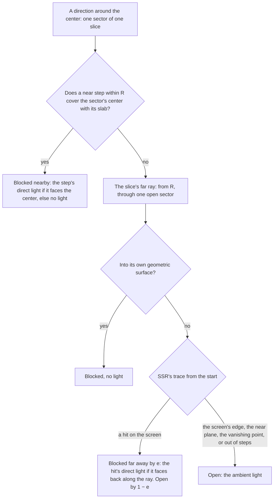
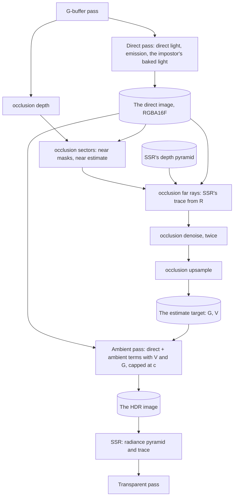

# Bounce light

Ticket: `ter-a24f`, a member of the rendering upgrade epic (`ter-sglu`, [rendering-upgrade.md](rendering-upgrade.md)). The design ticket is `ter-zi4i`. The user chose the design on 2026-10-25 in two steps, which the ticket's last two notes record. First: one estimate of the light around each point, gathered in the crease shadowing's slices with masks of sectors, from this frame's direct light, with a blur and nothing carried over between frames. Then, the same day: "near and far". The same estimate continues beyond the crease radius with rays through the reflections' depth pyramid, only in the directions that the near sectors leave open. This doc fills in the details. Its three open points are settled, see "Settled forks".

The doc is written against main at `bcaf139e`, which holds the crease shadowing ([ambient-occlusion.md](ambient-occlusion.md), `ter-b3h5`), and against five designs on their branches:

| Design | Branch | What this doc takes from it |
|---|---|---|
| Screen-space reflections, [screen-space-reflections.md](screen-space-reflections.md) (`ter-jxv9`) | `ter-jxv9-ssr` | The depth pyramid, the trace `traceRay` and its C# copy `ScreenRay`, the edge fade, the thickness share κ, the compute stage on the frame set and the G-buffer set, `surfaceAt` and `ambientTerms` |
| The environment map, [environment-map.md](environment-map.md) (`ter-nl5u`) | `ter-nl5u-environment-map` | The ambient source `environmentAmbient`, the reflected stars' footprint from fragment derivatives, `directLight` and `directRadiance` |
| The lights, [local-light-shadows.md](local-light-shadows.md) (`ter-s9cv`) | `ter-s9cv-light-shadows` | One loop over the light list in `directLight`, G-buffer set binding 8 for the shadow atlas |
| The shader audit, ARCHITECTURE.md, "Portable Vulkan" (`ter-lozc`) | `ter-lozc-portable-nan` | `MaxRadiance` = 32,256, the surfaces' share of the HDR image's range, and `exposed`, which caps before it multiplies |
| XeGTAO's tuned set, `.tickets/ter-sdks.md` | Held for this doc | The seven tuned constants, which "XeGTAO's tuned set in sector masks" sorts |

## Goal

Today a surface gets light only straight from the sun, from local lights and from the ambient source. The crease shadowing darkens the ambient light where nearby geometry hides it, but nothing takes the place of the light that it removes. A sunlit floor does not light the underside of a table, and a red wall does not tint the floor beside it red. After this ticket:

- Each direction around a surface point is one of three: blocked nearby, blocked far away, or open to the sky. A blocked direction brings the light of the surface that blocks it. An open direction brings the ambient light. No direction counts twice, and none is lost.
- Nearby, within the crease radius, the crease shadowing's slices find the blockers with masks of 32 sectors each (Therrien, Levesque and Gilet 2023). They give the sharp contact shadows and the bounce close up.
- Beyond the crease radius, one ray per slice continues through the reflections' depth pyramid, in a direction that the near sectors leave open. It reaches as far as the screen shows. Off the screen, everything fades back to the ambient light.
- The light that bounces is this frame's direct light: the sun, the local lights and emission. One bounce, the same in every run.
- The lighting pass splits into a direct pass and an ambient pass. The reflections read the image after the ambient pass, so they show the bounce.
- A still scene gives the same image in every frame. Nothing carries over between frames.
- One switch turns the crease shadowing and the bounce light off together, because they are one estimate.

## Terms

| Term | Meaning |
|---|---|
| Crease shadowing | The darkening of the ambient light where surfaces on the screen hide it: 1 − V. ARCHITECTURE.md calls it ambient occlusion. |
| The bounce, G | The cosine-weighted mean radiance that reaches a surface point from the surfaces that block its hemisphere, near or far. The diffuse light that it adds is c_diff · G. The images hold it pre-exposed, `ShadingInput.bounce` holds it as plain radiance. |
| The occlusion, V | The share of the cosine-weighted hemisphere above a surface point, around its shading normal, that no surface on the screen blocks, near or far. 1 means fully open. In [ambient-occlusion.md](ambient-occlusion.md) V counted only blockers within the radius. This doc keeps the name and widens the meaning. `ShadingInput.occlusion` holds it. |
| The estimate | The pair (G, V) of one half-resolution texel or one full-resolution pixel. |
| The direct light | The light that a surface sends toward the eye from the sun, the point and spot lights and its emission, pre-exposed: no ambient light. |
| The direct image | The full-resolution RGBA16F image of the direct light of each pixel, 0 for sky. The direct pass writes it. |
| The direct pass | The fullscreen pass that writes the direct image. Today's lighting pass without the ambient light. |
| The ambient pass | The fullscreen pass after the occlusion passes that writes the HDR image: the direct light plus the ambient light with the estimate applied. |
| The radius, R | `VisibilityBitmaskLight.RadiusMeters`. The boundary between the near range and the far range. |
| The near range | The blockers whose surface point lies within R of the center: what the near steps find. |
| The far range | The blockers that a far ray meets beyond R. |
| Full resolution, half resolution, the representative pixel, view space, the view depth z, t_x, t_y, the texel width p(z), the radius in texels ρ, a slice, a step | As in [ambient-occlusion.md](ambient-occlusion.md), "Terms". Each half-resolution texel (i, j) stands for the 2 × 2 block of pixels from (2i, 2j), and its representative pixel is (2i, 2j). |
| The center, c | The view position of a texel's representative pixel, moved toward the eye by XeGTAO's center bias. |
| V̂ | The unit vector from the center toward the eye: `toEye` in `gtao.glsl`. |
| ô | The unit vector in a slice's plane at right angles to V̂, toward the slice's plus side, the side of the step offset +s · ω. |
| The angle in a slice, θ | The signed angle of a direction in the slice plane from V̂, positive toward ô. |
| The normal angle, γ | The signed angle of the projected normal in the slice: `nAngle` of `gtao.glsl`. |
| \|n_p\| | The length of the shading normal projected into the slice plane. |
| The slice's arc, T | cos γ + γ sin γ: the cosine-weighted measure of the slice's hemisphere, the directions from γ − π/2 to γ + π/2. GTAO's slice of an open surface. |
| The slice weight, W | \|n_p\| · T: the share of the texel's estimate that one slice carries, before the division by the texel's total. |
| The measure fraction, m(θ) | The share of the slice's arc from its edge at γ − π/2 to θ, from 0 to 1. |
| A sector | One of the 32 equal shares of a slice's arc: sector j holds the directions with m from j / 32 to (j + 1) / 32. Each carries the weight W / 32. |
| A sector mask | 32 bits, one per sector of a slice: bit j is set when sector j is blocked nearby. |
| The thickness share, κ | `ThicknessShare` = 0.1, SSR's constant: a surface at view depth z fills the depths from z to z (1 + κ) behind it, along its view ray. |
| A slab | The depths that one visible surface point fills under κ: from the point to the point times (1 + κ), in view space with the eye at the origin. |
| A blocker | A surface point that blocks some directions of the center: the surface of a near step or a far ray's hit. |
| Faces the receiver | A blocker's geometric normal has a positive cosine with the direction back toward the point that it blocks: toward the center for a near step, back along the ray for a far ray's hit. |
| A far ray | The ray of one slice beyond R, through the center of one open sector. It stands for every open sector of its slice. |
| The open share of a slice, U | W · (open sectors) / 32 over the texel's total weight: the share of the texel's estimate that the slice's far ray decides. |
| The edge fade, e | SSR's `edgeFade`: 0 on the screen's edges, 1 a tenth of the shorter side inside them. |
| The depth pyramid, the trace, `ScreenRay` | SSR's min-max pyramid of inverse depth, its Hi-Z walk `traceRay` in `reflection.glsl`, and their C# copy (screen-space-reflections.md, "The method" and "The C# copy"). |
| The estimate target | The full-resolution RGBA16F image of the estimate: rgb the bounce, pre-exposed, and a the occlusion. It replaces the occlusion target. |
| Terms A and B | The two half-resolution RGBA16F images of the estimate that the occlusion passes write in turn, rgb the bounce and a the occlusion. |
| The sector masks buffer | The storage buffer of every texel's sector masks, one 32-bit word per slice: the near search writes it and the far rays read it. |
| The occlusion passes | The compute passes "occlusion depth", "occlusion sectors", "occlusion far rays", "occlusion denoise" and "occlusion upsample", in that order. |
| The exposure scale, k | 2 to the power of the frame's exposure in stops. Pre-exposed light is radiance times k. |
| `MaxRadiance`, c | 32,256 on the audit's branch, 65,504 before it: the most light that a surface writes into a pixel of the HDR image. |
| The ambient source, T_d, T_s, D(n) | As in [environment-map.md](environment-map.md), "Terms": the function that gives `AmbientTerms`, its diffuse term c_diff · D(n) and its specular term. D(n) is the ambient diffuse radiance at the normal. |
| The tuned set | XeGTAO's seven tuned constants that `ter-sdks` holds: see "XeGTAO's tuned set in sector masks". |
| A furnace | A scene in which every surface that can block emits the ambient light's radiance and reflects nothing. A receiver there gets the same light whatever blocks it. |

## Decisions

### Made by the user

1. One estimate of the light around each point, in two ranges. (User, 2026-10-25) Near: inside the crease radius R, the sector masks of the visibility bitmask (Therrien, Levesque and Gilet 2023) in the crease shadowing's slices. Far: beyond R, rays only in the directions that the near sectors leave open, through SSR's depth pyramid with SSR's trace. A far ray that hits gives the light of the hit point, from this frame's direct light. A far ray that leaves the screen or reaches the sky gives the ambient light. Each direction is exactly one of three, so nothing is counted twice or lost. The far rays reach as far as the screen shows, and off the screen everything fades back to the ambient light.
2. This frame's direct light bounces, exactly one bounce, the same in every run. So the lighting pass splits into a direct pass (the sun, the local lights, emission) and an ambient pass, which runs after the occlusion passes and adds the ambient light, the crease shadowing and the bounce. (User)
3. Blur only: the crease shadowing's fixed noise and edge-aware blur. Nothing carries over between frames. (User)
4. The far range reuses SSR's depth pyramid, its trace and its C# copy `ScreenRay`, with no second tracer. So the build waits for `ter-jxv9`. (User)
5. The default radius is the orchestrator's pick from captures: "whatever feels most dramatic, but not overly so". (User) "The default radius and steps" says how the captures pick it.
6. Before decision 1, the user chose XeGTAO's tuned set over the physical constants for darker creases (fork 1 of [ambient-occlusion.md](ambient-occlusion.md)). Sector masks replace the horizon angles that the set works on. "XeGTAO's tuned set in sector masks" sorts its constants, and the user then chose none of them (fork 1). (User)
7. The ticket's and the epic's rules: a `RendererOptions` switch, the cost measured at 1080p, deterministic in tests, GPU pixel tests of the acceptance criteria, no reference images. (User)
8. The decisions of [ambient-occlusion.md](ambient-occlusion.md) stay where this doc does not change them: half resolution (its decision 2), compute passes (3), XeGTAO as the reference (4), the estimate scales only the ambient light (5), the distance target and the G-buffer normals as the inputs (6), fixed spatial noise (7), no multi-bounce brightening (8), a union switch (9), one place in `lighting.glsl` where the estimate applies (14). (User and orchestrator)

### Settled by this design

Each by the user's decisions and the project's rules, with its reason.

9. The sector masks replace GTAO's horizons. They are not a second case of the setting. The pure model first: a horizon is the mask at infinite thickness (see "At infinite thickness: GTAO's horizons"), so one method covers both. A second case is a second estimate with another meaning of V. It is also an estimate without a bounce, which loses the light of every blocked direction, against decision 1.
10. The setting is one union, `ScreenSpaceLightSetting`: `NoScreenSpaceLight`, its zero case, or `VisibilityBitmaskLight(RadiusMeters, Slices, StepsPerSide, FarSteps)`. It replaces `AmbientOcclusionSetting`, because the old name no longer says what the feature does. It has no case with the crease shadowing and no bounce, by decision 9.
11. A slice has 32 sectors, and each is an equal share of the slice's cosine-weighted arc around the projected normal. The paper's sectors are equal in angle and weight each sample's light by the receiver's cosine. Equal shares put that cosine into the sectors themselves. So the count of blocked bits is the blocked share. Also, a uniform pick among the open sectors is then a cosine-weighted pick, which the far ray needs. 32 is the paper's count and one 32-bit word, the width of Vulkan's core bit instructions.
12. A step blocks the sectors whose centers lie between the directions to its surface point and to the back of its slab: from floor(32 m + ½) to floor(32 m' + ½) − 1. The paper's listing marks every sector that the interval touches (floor at one end, ceiling at the other), which adds about one sector per step and side and darkens. Its text marks a sector that is half covered. The center rule counts neither more nor less on average. `floor(x + 0.5)` replaces `round`, whose ties GLSL leaves to the driver.
13. The thickness is SSR's: a surface at view depth z fills z to z (1 + κ), κ = 0.1. One model of what is solid serves both ranges, so a direction that the near steps call blocked is one that the trace also calls blocked. The paper uses a constant length t. SSR's share grows with the distance (SSR's decision 7, the user's). `ThicknessShare` moves from `ScreenRay` and `reflection.glsl` to `CellBounds` and `depth_pyramid.glsl`, because it says what the depth image means, and both ranges read it.
14. A step blocks only when its surface point lies within R of the center, GTAO's hard edge. So the masks reduce to GTAO's horizons at infinite thickness.
15. A blocker gives its direct light, read from the direct image at its own pixel, when it faces the receiver, and no light otherwise. A blocker that faces away shows the receiver its back, whose light no pixel holds. The light is not weighted by the blocker's cosine, as the paper weights it. A Lambert blocker sends the same radiance in every direction, and the sector's share already holds the blocker's solid angle and the receiver's cosine. The paper's factor dims a wall that the point sees at a grazing angle a second time.
16. The light that a blocker sends toward the eye stands for the light that it sends toward the receiver. That is exact for its diffuse part. For a glossy blocker, the highlight that the eye sees bounces, and the one toward the receiver does not. The exact light needs every light evaluated again toward the receiver at every step, the cost of the direct pass once per step.
17. The estimate of a texel is normalized by its total slice weight, ΣW, so the open, the near and the far shares sum to exactly 1 in every texel. GTAO divides by the number of slices, so an open surface comes to 1 only in the mean over slices, and its upsample clamps the excess. A texel whose total weight is below 10⁻⁶ holds no information and takes the open estimate, (0, 0, 0, 1). That needs one slice with a normal at right angles to its plane.
18. Each slice has one far ray (fork 2), through the center of one open sector, which the fixed noise picks: the next value of the R1 sequence that shifts the slice's steps. Its outcome stands for every open sector of its slice.
19. A far ray starts at R from the center along its direction, moved off the surface by SSR's origin offset, and SSR's trace finds the first slab beyond the start. So the far range begins where the near range ends. A direction that the near steps block runs no ray, so no direction counts twice. A blocker beyond R is the far ray's, so none is lost to the boundary. "The far ray of a slice" names the one case that falls between.
20. The outcome of a far ray, one case per way that SSR's trace ends:
    - A hit: the slice's open share is blocked by the edge fade e at the hit, with the hit's direct light if the hit faces back along the ray. The rest, 1 − e, stays open. A hit is a blocker, as a near step is.
    - The image leaves the screen, reaches the near plane or its vanishing point, or runs out of steps: open.
    - The ray points into its own geometric surface: blocked, with no light. Only a normal map tilts the shading hemisphere below the geometric surface, and that surface itself blocks the ray.
    - The start lies at or behind the near plane: open. The ray leaves the view through the near plane before it reaches R.
    SSR's entry share q, which fades a reflection that enters a slab from behind, is not used: a ray that meets a slab is blocked, and the facing test says whether its light reaches the receiver.
21. The far rays run at half resolution, in the texels and slices of the near masks, because they continue the near estimate's directions. They run at every distance, so GTAO's fade below one pixel goes: where R spans at most the nearest step, 1.3 texels, the near range holds no step, and the far rays give the whole estimate. A fade toward full visibility drops the far blockers, against decision 1. GTAO's decision 6 still holds for the near range, which "fades out where it covers less than a pixel" by holding no step.
22. The near search and the far rays are two passes, "occlusion sectors" and "occlusion far rays". The GPU timers then report each, as GTAO's decision 28 wants, and the near loop does not carry the trace's registers. The sector masks buffer passes the masks from one to the other: 6.2 MB at 1080p and 3 slices.
23. The occlusion passes take the layout of SSR's compute passes: sets 0 to 2 of `SceneLayout` and their own set 3. The far ray pass includes `gtao.glsl` for the slices and SSR's `reflection.glsl` for the trace, so both must see the same sets. The camera then has one store, the frame constants, and the push constants keep only the setting. GTAO's decision 29 put the camera in push constants because the frame set had no compute stage. SSR adds it.
24. The direct pass writes its own image, the direct image, and the ambient pass, a fragment pass, reads it and writes the HDR image once: min(direct + ambient, c). Three reasons. The environment map's reflected stars take their footprint from fragment derivatives (its decision 33), which a compute pass lacks. A blend cannot cap the sum, because a fragment shader cannot read the color attachment that it blends into. And the HDR image needs no storage usage, so SSR's decision 30 stays. It costs 16.6 MB at 1080p.
25. A near step reads the direct light and the geometric normal of its representative pixel 2t from the full-resolution direct image and normals target, and a far ray reads them at its hit pixel. No half-resolution copy. One store of the direct light, and each step reads the light of the very pixel whose depth it used. If the cost shows the sectors pass bound by these reads, a copy beside the view depth image, written by the depth pass, is the measured fix (see "Cost").
26. The estimate target replaces the occlusion target: one RGBA16F image at full size, rgb the bounce and a the occlusion, because one estimate makes both. It is cleared to (0, 0, 0, 1) in the first frame after each creation, as the occlusion target was cleared to 1.
27. The images hold the bounce pre-exposed, and `ShadingInput.bounce` holds it as plain radiance: the reader divides by k. Pre-exposed, the bounce is a weighted mean of direct pixels, at most c, so it fits a half float. Plain radiance passes 65,504 in a sunlit scene in SI units at a low exposure.
28. The bounce enters the ambient light in `occludedAmbient`, the one place where the estimate applies. The diffuse term becomes T_d · V + c_diff · G. The specular term becomes T_s · V_s, with V_s from V by Lagarde's fit as before. The bounce is diffuse light only. Light that the screen reflects is SSR's.
29. The transparent pass and the impostor capture shade with V = 1 and G = 0. A pane is not in the G-buffer, and the estimate at its pixel belongs to the opaque surface behind it, which takes that estimate. A capture has no screen around it. The environment faces take no ambient light at all (environment-map.md, decision 17). A lit puff keeps the mean ambient light of `scatteredLight`, because it has no surface and no slices.
30. Exactly one bounce: the direct image holds no ambient light, so no ambient light bounces. One exception: an impostor billboard's pixel holds its captured light, which includes the capture's ambient light, and that light bounces. Impostors are smaller than 200 px, so the extra is small, and no capture holds a direct part apart.
31. An open direction takes the ambient source's mean light, T_d · V, as GTAO's decision 14 has it. The paper's ambient light per open cone needs the source along each open direction, and the hemisphere source has no up at the estimate's texels. "Known limits" names what this costs with the environment map on.
32. The direct and ambient passes run in both cases of the setting (fork 3). With `NoScreenSpaceLight`, the estimate target holds (0, 0, 0, 1), and the ambient pass applies it exactly.
33. The depth pyramid gets its own owner, `DepthPyramidImage`, made when the reflections or the bounce need it. SSR's design keeps it in `ReflectionTargets`, which exists only with reflections on. One store, with one condition for its existence: any reader.
34. Masks are 32-bit words, read and written with `bitCount`, `bitfieldInsert` and `findLSB`. Vulkan allows its core bit instructions only on 32-bit integers, which these are. No shift by 32, which GLSL leaves undefined.
35. The defaults: R 1 m and `StepsPerSide` 3 until the captures pick them, `Slices` 3, and `FarSteps` 64, SSR's default for `MaxSteps`.
36. `FarSteps` is checked from 1 to 1,024, as SSR checks `MaxSteps`. A value of 0 is a case without a far range, against decision 1.
37. The headless host's `--screen-space-light off|<meters>` replaces `--ambient-occlusion off|<meters>`.
38. No new device feature. The formats and the limits are in "Portable Vulkan".

## Sources

- Therrien, Levesque and Gilet 2023, "Screen Space Indirect Lighting with Visibility Bitmask", The Visual Computer (arXiv 2301.11376). A bit field of N = 32 sectors per slice replaces GTAO's two horizon angles, centered on the projected normal. Each sample's back point lies a thickness t behind it, and the sample marks the sectors between the angles of its front and its back. A sample's light counts for the sectors that it newly blocks, b_j & ~b_i, and the occlusion is 1 − countbits(b_i) / N. The paper states that GTAO without falloff equals an infinite t. It uses t = 0.2 at a radius of 2. Its times at 1080p on an RTX 2080: occlusion alone in 0.51 to 1.13 ms, against GTAO's 0.49 to 1.12 ms. Indirect light with 16 samples at half resolution takes 0.97 ms, with 0.1 ms of denoise. Its temporal accumulation and its feedback of the indirect light into the next frame's light buffer are left out by decisions 2 and 3.
- Jimenez, Wu, Pesce and Jarabo 2016, "Practical Real-Time Strategies for Accurate Indirect Occlusion": GTAO, the slices and the cosine-weighted inner integral (equation 7), which gives the sectors' measure here.
- Intel's XeGTAO (MIT), `src/Tertius.Rendering/ThirdParty/XeGTAO`: the port that `gtao.glsl` holds.
- Uludag 2014 and McGuire and Mara 2014, through SSR's trace, which the far rays call as it is.
- Lagarde and de Rousiers 2014: the specular occlusion V_s.

## The method

### One estimate in two ranges



Every slice has 32 sectors. A near step blocks some of them, in the order of the steps, nearest first, so the nearest blocker of a direction owns it. The far ray of the slice decides its open sectors together. So every sector of every slice ends as exactly one of three: blocked nearby with a light, blocked far away with a light, or open. The diffuse ambient light of the point is

```
L_diffuse = c_diff · (V · D(n) + G)

V = Σ over open sectors of the sector's weight          G = Σ over blocked sectors of the sector's weight × its light
```

where

- `c_diff` = the diffuse color b (1 − m).
- `D(n)` = the ambient diffuse radiance of the ambient source at the shading normal: the hemisphere's mix today, the environment map's irradiance over π while the map is on.
- the sector's weight = W / (32 · ΣW): the slice's weight over the texel's total, shared evenly by its 32 sectors. The weights of all the sectors of a texel sum to 1.
- its light = the direct light of the sector's blocker, or 0 when the blocker does not face the receiver.

In a furnace, every blocker's light is D(n), so L_diffuse = c_diff · D(n) · (V + blocked shares) = c_diff · D(n) whatever blocks the point. That is the test of "nothing counted twice or lost" (see "Tests").

### The slice and its sectors

The slice is GTAO's (ambient-occlusion.md, "The occlusion horizons pass"): its direction φ, V̂, the projected normal's length \|n_p\| and angle γ. The cosine-weighted measure of a set of directions of the slice is the paper's inner integrand:

```
μ(θ₁, θ₂) = ∫ from θ₁ to θ₂ of cos(θ − γ) · |sin θ| dθ

F(h) = ∫ from 0 to h of cos(θ − γ) · |sin θ| dθ  =  sign(h) · sliceArc(h, γ)
sliceArc(h, γ) = ¼ · (−cos(2h − γ) + cos γ + 2h · sin γ)                       gtaoSliceArc

T = F(γ + π/2) − F(γ − π/2) = cos γ + γ sin γ                                  the slice's arc
m(θ) = (F(clamp(θ, γ − π/2, γ + π/2)) − F(γ − π/2)) / T                        the measure fraction
```

where

- `θ` = the angle in the slice, from V̂, positive toward ô.
- `|sin θ|` = the solid angle of the slices around the view axis, which crowd near V̂.
- `sliceArc` = XeGTAO's half of the inner integral. For h < 0 it gives the measure from h to 0, so F is the measure signed by h.
- `T` = at least 1 for γ in [−π/2, π/2], so the division is safe.
- `clamp` = keeps m monotone: outside the hemisphere the integrand turns negative.

Sector j holds the directions with m(θ) from j / 32 to (j + 1) / 32. Each sector is 1/32 of the slice's arc, whatever its width in angle. The slice weight is W = \|n_p\| · T, GTAO's slice of an open surface, so each sector carries W / 32.

The angle at the center of sector j is the inverse of m at (j + ½) / 32. m has no closed inverse, so `sectorCenterAngle` halves the interval [γ − π/2, γ + π/2] 12 times, to within π / 4,096. The far ray uses it, once per slice.

### A near step

The steps are GTAO's: `StepsPerSide` on each side of the slice, at the R1-shifted fractions of the radius beyond 1.3 texels, snapped to texels, with GTAO's clamp beyond the image (ambient-occlusion.md, "The occlusion horizons pass"). For the step at texel t on the side σ (+1 or −1):

```
s_f = P(t)                                       the step's surface point, view space
s_b = s_f · (1 + κ)                              the back of its slab: the same view ray, at the view depth z (1 + κ)
skip the step when t lies outside the image, or when |s_f − c| ≥ R
θ_f = σ · acos(clamp(dot(normalize(s_f − c), V̂), −1, 1))
θ_b = σ · acos(clamp(dot(normalize(s_b − c), V̂), −1, 1))
sectors = run(floor(32 · m(min(θ_f, θ_b)) + ½),  floor(32 · m(max(θ_f, θ_b)) + ½))
fresh   = sectors & ~blocked
light  += bitCount(fresh) · (faces(t) ? direct(2t) : 0)
blocked |= fresh
```

where

- `P(t)` = the view position of texel t's representative pixel at its view depth, `gtaoTexelPosition`.
- `σ` = the side of the step. A step on the plus side lies on ô's side of V̂, so its angles are positive.
- `run(a, b)` = the bits from a to b − 1, none when b ≤ a.
- `blocked` = the slice's sector mask, 0 before its first step.
- `faces(t)` = dot(n_g(2t), c − s_f) > 0, with `n_g(2t)` the view-space geometric normal of the step's representative pixel.
- `direct(2t)` = the direct image at that pixel, pre-exposed.
- `light` = the slice's sum of newly blocked sectors times their light. The slice's weight W / 32 multiplies it at the end.

The two sides of a step index run in XeGTAO's order, plus side first. A step adds light only to the sectors that no nearer step has blocked, so the nearest blocker of each direction owns it. The back point lies on the step's own view ray, so it stays on the step's side of V̂. As z grows along that ray, the direction from c turns away from the eye, so the run reaches from the surface's angle toward the edge of the hemisphere on that side.

### The far ray of a slice

After the near steps, for each slice with at least one open sector:

```
open   = ~blocked                                count = bitCount(open), from 1 to 32
η      = fract(ξ_y + (k + n²) · 0.6180339887498949)       the next value of the slice's R1 sequence
j      = the open sector of rank min(floor(η · count), count − 1), from bit 0
θ_j    = sectorCenterAngle(j)
ω      = cos θ_j · V̂ + sin θ_j · ô                         unit, view space
U      = W · count / (32 · ΣW)                              the slice's open share

if dot(ω, n_g) ≤ 0:        the ray points into its own surface: blocked, no light
start  = c + R · ω
if start.z ≤ 0.05 m:       open: the ray leaves the view through the near plane before R
origin = start + n_g · (2 · start.z · θ_px)                SSR's origin offset, two pixel footprints
trace  = traceRay(depth pyramid, screenRayOf(origin, ω), FarSteps)
hit at pixel h, position x:  V −= U · e(x)    G += U · e(x) · (dot(n_g(h), −ω) > 0 ? direct(h) : 0)
no hit:                      open
```

where

- `ξ_y` = the texel's step noise, `gtaoNoise(texel).y`. Step j of slice k takes index k + j · n in the R1 sequence, with n = `StepsPerSide`, so k + n² is the first index past the slice's steps.
- `k` = the slice's index.
- `n_g` = the view-space geometric normal of the representative pixel.
- `θ_px` = the angle of one pixel, `frame.params.z`.
- `screenRayOf`, `traceRay`, `edgeFade` = SSR's functions in `reflection.glsl`, called as they are, in the camera-relative world axes: the start, the origin and ω turn from view space into world axes by the frame's unit camera axes.
- `FarSteps` = the most cells that the trace examines.
- `e(x)` = SSR's edge fade at the hit's screen position.
- `n_g(h)`, `direct(h)` = the geometric normal and the direct image at the hit pixel.

The ray's outcome stands for all of the slice's open sectors, so the slice's three shares still sum to its weight. The sectors are equal shares of the cosine-weighted arc, so a uniform pick among the open sectors picks a direction by its cosine weight. The rank comes from a fixed function of the texel, so a still camera traces the same rays in every frame.

The two ranges meet as follows. The near steps own every direction that they block, whatever the distance along it to the back of the slab. The far ray runs only in the other directions and starts at R, and SSR's trace finds every slab that the ray's image meets from the pixel after the start's pixel. One case falls between them: a slab whose surface point lies beyond R while its back reaches inside R, met by the ray before its start. That needs a surface nearer the eye than the sphere of radius R around the center, seen at the edge of that sphere, with its slab of κ z reaching back into the sphere. The trace then misses it, and the direction stays open. Sparse steps leave a second, larger gap inside R: a blocker between two steps (see "Known limits").

### The estimate of a texel

```
ΣW = Σ over slices of W_k
V  = (Σ_k W_k · bitCount(~blocked_k) / 32  −  Σ_k ΣW · U_k · b_k) / ΣW
G  = (Σ_k W_k · light_k / 32  +  Σ_k ΣW · U_k · b_k · L_k) / ΣW
ΣW < 10⁻⁶: (G, V) = (0, 1)
```

where

- `b_k` = the share of slice k's open share that its far ray blocks: e at a hit, 1 into its own surface, 0 otherwise.
- `L_k` = the far ray's light: the hit's direct light when it faces back along the ray, else 0.

The sectors pass writes the near estimate, the same sums without the far terms, and the far ray pass moves each slice's open share by its ray. Both normalize by ΣW, so V lies in [0, 1] and the shares sum to 1 in every texel. The far pass's subtraction can leave V a rounding below 0, which the upsample's clamp removes.

### At infinite thickness: GTAO's horizons

As κ grows without bound, each step's back point moves away from the eye along its view ray, and the direction from c to it turns to the edge of the hemisphere on the step's side. Each step's run then reaches from its surface's angle to the edge. The union of the runs of one side's steps is the run from the angle of that side's step nearest to V̂, GTAO's horizon h, to the edge. So the open sectors are those between h₀ and h₁, and their count over 32 is (sliceArc(h₀, γ) + sliceArc(h₁, γ)) / T to within one sector, by the center rule. The slice's open weight W · count / 32 is then \|n_p\| · â, GTAO's slice, to within W / 32. With no far blocker and no bounce, V is GTAO's sum of slices over ΣW, where GTAO divides by the number of slices: the same in the mean for an open surface, where ΣW / S comes to 1. `SectorSearchTests.AtInfiniteThicknessTheOpenSectorsAreTheSectorsBetweenTheHorizons` pins this.

### Where the near range is empty

With ρ at most `NearestStepTexels`, 1.3, the nearest step already lies at R or beyond, so the sectors pass takes no step: every mask is 0, and the near estimate is (0, 1). The far rays then start at R, a fraction of a texel from the center, and give the whole estimate. At 1080p with R = 1 m and a vertical field of view of 60°, ρ = 1.3 at 360 m. So surfaces in the middle and the far ranges, a cliff 50 km away or a planet's limb, take the estimate of their far rays alone. GTAO wrote 1 for them.

### The noise

The noise is GTAO's (ambient-occlusion.md, "The noise"): XeGTAO's Hilbert index of a 64 × 64 tile drives the R2 sequence, ξ_x turns the slices and ξ_y shifts the steps. The far ray takes the next value of each slice's step sequence. Everything is a fixed function of the texel's coordinates, so a still camera sees the same noise in every frame, and a moving camera sees the 128 px pattern stay fixed on the screen while the surfaces move under it.

The near masks vary between neighbor texels as GTAO's horizons do. The far rays add a binary choice per slice: a slice's open share is blocked or open by one ray. Where far blockers cover half of a slice's open sectors, one texel's far share has a standard deviation of about 0.5 / √3 of the open share at 3 slices. The two blurs and the upsample average about 10 to 25 texels with their weights, which brings it to about 0.06 to 0.09. Fork 2 weighs more rays against their cost.

### The shaders

`sectors.glsl` (new) holds the sector math beside the port. The paper publishes no code, so the file is engine code, and XeGTAO's notice stays in `gtao.glsl`:

```glsl
// The sectors of a slice and the light of its blockers (docs/plans/screen-space-illumination.md, "The method").
// SliceSectors, SectorMask and SectorSearch in Shading/ are the C# copy. Change both together.
#ifndef TERTIUS_SECTORS_GLSL
#define TERTIUS_SECTORS_GLSL

#include "gtao.glsl"
#include "depth_pyramid.glsl"

const uint SectorCount = 32u;
// The halvings of the search for the angle at a sector's center: π / 4,096 at the end (SliceSectors.AngleHalvings).
const int AngleHalvings = 12;
// The total slice weight below which a texel holds no estimate (SectorSearch.MinTotalWeight).
const float MinTotalWeight = 1e-6;

// One slice around a texel, in view space with XeGTAO's axes.
struct SliceGeometry
{
    vec3 toEye;          // V̂
    vec3 side;           // ô: in the slice plane, at right angles to V̂, toward the plus side
    float normalAngle;   // γ
    float arc;           // T = cos γ + γ sin γ
    float weight;        // W = |n_p| T
};

// F(h): the cosine-weighted measure from 0 to h, signed by h. gtaoSliceArc gives the measure between 0 and h.
float signedArc(float h, float gamma)
{
    return h >= 0.0 ? gtaoSliceArc(h, gamma) : -gtaoSliceArc(h, gamma);
}

// m(θ): the share of the slice's arc from its edge at γ − π/2 to the angle, from 0 to 1.
float measureFraction(SliceGeometry g, float angle)
{
    float low = g.normalAngle - GtaoHalfPi;
    float clamped = clamp(angle, low, g.normalAngle + GtaoHalfPi);
    return (signedArc(clamped, g.normalAngle) - signedArc(low, g.normalAngle)) / g.arc;
}

// The first sector whose center lies at or after the measure fraction m, from 0 to 32. floor(x + 0.5), not round,
// whose ties GLSL leaves to the driver.
uint sectorBoundary(float m)
{
    return uint(floor(m * float(SectorCount) + 0.5));
}

// The sectors from start to end − 1, none when end ≤ start. bitfieldInsert never shifts by 32.
uint sectorRun(uint start, uint end)
{
    return end > start ? bitfieldInsert(0u, 0xFFFFFFFFu, int(start), int(end - start)) : 0u;
}

// θ of a direction in the slice, from V̂. side, +1 or −1, is the side of the step whose point the direction reaches.
float sliceAngle(SliceGeometry g, vec3 direction, float side)
{
    return side * acos(clamp(dot(normalize(direction), g.toEye), -1.0, 1.0));
}

// The sectors whose centers lie between the directions to a step's surface point and to the back of its slab.
uint stepSectors(SliceGeometry g, vec3 center, vec3 samplePosition, float side)
{
    float front = sliceAngle(g, samplePosition - center, side);
    float back = sliceAngle(g, samplePosition * (1.0 + ThicknessShare) - center, side);
    return sectorRun(sectorBoundary(measureFraction(g, min(front, back))),
                     sectorBoundary(measureFraction(g, max(front, back))));
}

// The direct light that a blocker at a full-resolution pixel gives the directions that it blocks: all of it when its
// geometric normal faces towardReceiver (view space), and none when the receiver sees its back.
vec3 blockerLight(ivec2 pixel, vec3 towardReceiver)
{
    return dot(geometricNormalAt(pixel), towardReceiver) > 0.0 ? texelFetch(gbufferDirect, pixel, 0).rgb : vec3(0.0);
}

// θ at the center of a sector: the inverse of measureFraction at (sector + ½) / 32, by halving.
float sectorCenterAngle(SliceGeometry g, uint sector)
{
    float target = (float(sector) + 0.5) / float(SectorCount);
    float low = g.normalAngle - GtaoHalfPi;
    float high = g.normalAngle + GtaoHalfPi;
    for (int i = 0; i < AngleHalvings; i++)
    {
        float middle = 0.5 * (low + high);
        if (measureFraction(g, middle) < target)
            low = middle;
        else
            high = middle;
    }
    return 0.5 * (low + high);
}

// The open sector of a rank, counted from sector 0. open has more than rank bits set.
uint openSectorOfRank(uint open, uint rank)
{
    for (uint i = 0u; i < rank; i++)
        open &= open - 1u;
    return uint(findLSB(open));
}

#endif
```

`gtao.glsl` gains `gtaoSliceGeometry(texel setup, slice)`, which computes V̂, ô, γ, T and W in the lines that `gtaoEstimate` has today, and `gtaoStepOffset(slice, step, ...)`, which computes the snapped offset as today. `gtaoEstimate` and its horizon cosines go: the sectors replace them. The slice loop of `occlusion_sectors.comp`, which replaces `occlusion_horizons.comp`:

```glsl
for (int slice = 0; slice < slices; slice++)
{
    SliceGeometry g = gtaoSliceGeometry(setup, slice);
    uint blocked = 0u;
    vec3 light = vec3(0.0);
    // Where R spans at most the nearest step, the near range holds no step (decision 21).
    for (int stepIndex = 0; radiusInTexels > NearestStepTexels && stepIndex < stepsPerSide; stepIndex++)
    {
        ivec2 offset = gtaoStepOffset(setup, slice, stepIndex, radiusInTexels);
        for (int sideIndex = 0; sideIndex < 2; sideIndex++)
        {
            float side = sideIndex == 0 ? 1.0 : -1.0;
            ivec2 t = texel + (sideIndex == 0 ? offset : -offset);
            if (!insideHalf(t))
                continue;
            vec3 samplePosition = gtaoTexelPosition(t);
            if (!(length(samplePosition - setup.center) < occlusion.radiusMeters))
                continue;
            uint fresh = stepSectors(g, setup.center, samplePosition, side) & ~blocked;
            if (fresh == 0u)
                continue;
            blocked |= fresh;
            light += float(bitCount(fresh)) * blockerLight(2 * t, setup.center - samplePosition);
        }
    }
    sectorMasks[maskIndex(texel, slice)] = blocked;
    totalWeight += g.weight;
    open += g.weight * float(bitCount(~blocked));
    bounce += g.weight * light;
}
vec4 estimate = totalWeight > MinTotalWeight ? vec4(bounce, open) / (float(SectorCount) * totalWeight) : vec4(0, 0, 0, 1);
imageStore(occlusionTermA, texel, estimate);
```

`occlusion_far_rays.comp` (new) rebuilds the same setup and slice geometry, reads term A and the masks, and moves each slice's open share by its ray:

```glsl
vec4 estimate = imageLoad(occlusionTermA, texel);
for (int slice = 0; slice < slices; slice++)
{
    SliceGeometry g = gtaoSliceGeometry(setup, slice);
    uint open = ~sectorMasks[maskIndex(texel, slice)];
    uint count = uint(bitCount(open));
    if (count == 0u)
        continue;
    float share = g.weight * float(count) / (float(SectorCount) * totalWeight);
    float noise = fract(setup.noise.y + float(slice + stepsPerSide * stepsPerSide) * 0.6180339887498948482);
    uint sector = openSectorOfRank(open, min(uint(noise * float(count)), count - 1u));
    float angle = sectorCenterAngle(g, sector);
    FarOutcome outcome = farRay(setup, cos(angle) * g.toEye + sin(angle) * g.side);
    estimate.a -= share * outcome.blocked;
    estimate.rgb += share * outcome.light;
}
imageStore(occlusionTermA, texel, estimate);
```

where `farRay` applies the steps of "The far ray of a slice" and returns the blocked share b and the light b · L. It returns `FarOutcome(1, 0)` into its own surface, and `FarOutcome(0, 0)` for a start at the near plane and for every trace without a hit. A hit gives `FarOutcome(e, e · blockerLight(hitPixel, −ω))`. A sky texel returns before the loop, and so does a texel whose total weight is below `MinTotalWeight`.

### The denoise and the upsample

Both stay XeGTAO's and GTAO's, with the estimate's four channels in place of one. The denoise blurs the vec4 with the edges' weights, so the bounce and the occlusion of a texel take the same neighbors. The upsample's weights stay those of the tangent plane and the bilinear footprint, and they apply to all four channels. It writes (rgb, clamp(a, 0, 1)) into the estimate target. The rgb needs no clamp: it is a sum of non-negative weights times direct light of at most c, over a total weight, and each blur and the upsample average it with non-negative weights that sum to 1.

## The lighting split



### The direct pass

`direct.frag` (new, from today's `lighting.frag`) writes the direct image, for each pixel:

| Pixel | Writes |
|---|---|
| Sky, distance 0 | 0. No reader reads it: a sky texel blocks nothing, and the trace never hits sky. |
| An impostor billboard, base color alpha 0 | The emissive target: the capture's pre-exposed light |
| A lit surface | min(exposed(directLight(s, lobes, P, V, ShadowMapsMainView), k) + emission, c) |

where `directLight` is the environment map's function, one loop over the light list on the lights' branch, and `exposed(x, k)` = min(x, c / k) · k, the audit's cap before the product. It is the main view's analogue of the environment faces' `directRadiance`, pre-exposed. The pass reads the G-buffer and the shadow maps, and binds the G-buffer set without reading bindings 7 and 9.

### The ambient pass

`ambient.frag` (new, from the rest of `lighting.frag`):

```glsl
void main()
{
    ivec2 pixel = ivec2(gl_FragCoord.xy);
    vec3 direction = normalize(inRay);
    // The footprint of the reflected stars first, in uniform control flow (environment-map.md, decision 33).
    float footprint = reflectionFootprint(...);
    if (texelFetch(gbufferDistance, pixel, 0).r <= 0.0)
    {
        outColor = vec4(preExposed(starField(direction)), 1.0);
        return;
    }
    vec3 direct = texelFetch(gbufferDirect, pixel, 0).rgb;
    // An impostor's light is baked, ambient light included: the direct pass already wrote all of it.
    if (texelFetch(gbufferBaseColor, pixel, 0).a == 0.0)
    {
        outColor = vec4(direct, 1.0);
        return;
    }
    ShadingInput s = surfaceAt(pixel);
    s.reflectionFootprint = footprint;
    SurfaceLobes lobes = lobesOf(s, -direction);
    vec3 ambient = exposed(ambientLight(s, lobes, -direction), exposureScale());
    outColor = vec4(min(direct + ambient, vec3(MaxRadiance)), 1.0);
}
```

`surfaceAt` (SSR's `gbuffer_surface.glsl`) reads the estimate target at the pixel:

```glsl
vec4 estimate = texelFetch(gbufferEstimate, pixel, 0);
s.occlusion = estimate.a;
// The images hold the bounce pre-exposed. k = exp2(stops) is a normal float above 0, and the quotient stays below
// c · 2⁶⁴, a finite single float.
s.bounce = estimate.rgb / exposureScale();
```

and `occludedAmbient` in `lighting.glsl` applies the estimate in its one place:

```glsl
// The one place where the estimate applies (docs/plans/screen-space-illumination.md): the open share V of the source's
// diffuse term, plus the bounce G under the diffuse color, and the specular term by V_s. It reads nothing about the
// source of the terms.
AmbientTerms occludedAmbient(AmbientTerms terms, ShadingInput s, SurfaceLobes lobes)
{
    terms.diffuse = terms.diffuse * s.occlusion + lobes.diffuseColor * s.bounce;
    terms.specular *= specularOcclusion(lobes.NdotV, s.occlusion, lobes.alpha);
    return terms;
}
```

`ShadingInput` gains `vec3 bounce; // G, plain radiance: 0 where no estimate exists`.

### The cap at `MaxRadiance`

Before the split, `surfaceRadiance` capped the whole sum once: min(exposed(ambient + direct, k) + emission, c). After it:

```
direct image(p) = min(exposed(direct light, k) + emission, c)                     at most c
HDR(p)          = min(direct image(p) + exposed(ambient light, k), c)              at most c
```

- Each term is finite and at most c, so their sum is at most 2c = 64,512 in a 32-bit float, and the min brings it to c. So the surfaces keep their share of the HDR image, and the puffs' budget and the glass blend keep their bound of the audit ("Portable Vulkan" on `ter-lozc`).
- Where no cap binds, the two give the same light, up to one rounding more: the direct image rounds the direct light to a half float before the ambient pass adds the ambient light. That is at most half a step of the half float, 2⁻¹² of the value.
- Before the audit merges, c is 65,504 and `exposed` is `preExposed`'s min(x · k, c). The same argument holds.

### Where the ambient pass meets the environment map and SSR

- The environment map changes only the source that `ambientTerms` calls (environment-map.md, "The one source of the ambient light"). The ambient pass calls `ambientLight`, which calls `ambientTerms` and then `occludedAmbient`. The ambient pass is a fragment pass, so the footprint of the reflected stars keeps its derivatives. The pass binds the map's frame set bindings 12 to 14 and has the specialization constant `environmentMapOn`, as the lighting pass has today.
- SSR's trace reads the ambient specular term through `ambientTerms` at its origin pixel (screen-space-reflections.md, "The one place where SSR reads the ambient light"). It reads V from the estimate target through `surfaceAt`, so its fallback is the term that the ambient pass wrote. The bounce changes only the diffuse term, so SSR's delta f · (W · C − a · k · T_s) does not change.
- SSR's radiance pyramid reads the HDR image after the ambient pass (stage `Reflections` after stage `AmbientLight`), so a reflection shows the bounce of the surface that it reflects.

### The passes that keep V = 1 and no bounce

| Pass | V, G | Reason |
|---|---|---|
| Transparent, a pane | 1, 0 | A pane is not in the G-buffer, so no estimate exists at its own surface. The estimate at its pixel is the opaque surface's behind it, which takes it. |
| Impostor capture | 1, 0 | A capture has no screen around it. A billboard's distance still blocks the ground around it. |
| Environment faces | None | A face takes no ambient light (environment-map.md, decision 17). |
| Lit puffs | None | `scatteredLight` uses the mean ambient light: a puff has no surface and no slices. |

## The setting

`src/Tertius.Rendering/ScreenSpaceLightSetting.cs` (new, public), in place of `AmbientOcclusionSetting.cs`:

```csharp
namespace Tertius.Rendering;

/// <summary>No screen-space light: the ambient light reaches every surface in full, with no crease shadowing and no bounce.</summary>
public readonly record struct NoScreenSpaceLight;

/// <summary>
/// One estimate of the light around each surface point, from what the screen shows (docs/plans/screen-space-illumination.md):
/// masks of sectors in GTAO's slices within the radius, and one ray per slice beyond it through the depth pyramid. A
/// blocked direction brings the direct light of its blocker, an open one the ambient light. It runs at half resolution.
/// </summary>
/// <param name="RadiusMeters">Where the near range ends and the far rays start, in m: above 0, at most 10⁶.</param>
/// <param name="Slices">How many slices each half-resolution texel takes, 1 to 16.</param>
/// <param name="StepsPerSide">How many depth samples each slice takes on each side within the radius, 1 to 16.</param>
/// <param name="FarSteps">The most cells of the depth pyramid that one far ray examines, 1 to 1,024.</param>
public readonly record struct VisibilityBitmaskLight(float RadiusMeters, int Slices, int StepsPerSide, int FarSteps)
{
    /// <summary>The renderer's default: 1 m, 3 slices, 3 steps on each side, 64 far steps, until captures pick them.</summary>
    public static VisibilityBitmaskLight Default => new(RadiusMeters: 1, Slices: 3, StepsPerSide: 3, FarSteps: 64);
}

/// <summary>
/// Whether the renderer estimates the light around each point from the screen: <see cref="NoScreenSpaceLight"/> or
/// <see cref="VisibilityBitmaskLight"/>. The default value is NoScreenSpaceLight. It is a generated union.
/// </summary>
[GeneratedUnion(typeof(NoScreenSpaceLight), typeof(VisibilityBitmaskLight), ZeroCase = typeof(NoScreenSpaceLight))]
public readonly partial struct ScreenSpaceLightSetting
{
    public const float MaxRadiusMeters = 1e6f;
    public const int MaxSlices = 16;
    public const int MaxStepsPerSide = 16;
    public const int MaxFarSteps = 1024;

    /// <summary>Why the renderer cannot use the setting, or null when it can.</summary>
    internal string? Problem => ...;
}
```

`RendererOptions.AmbientOcclusion` becomes `RendererOptions.ScreenSpaceLight`, by default `VisibilityBitmaskLight.Default`. The test fixtures `Gpu.Headless` and `GpuTesting.Headless` set `NoScreenSpaceLight`. The setting is fixed for the renderer's life.

| Field | Rule | Reason |
|---|---|---|
| `RadiusMeters` | Finite, above 0, at most 10⁶ m | As GTAO's: a radius of 0 is no near range, and the sky lies at 10¹⁸ m |
| `Slices` | 1 to 16 | As GTAO's. The sector masks buffer takes 4 B per slice and texel, 33 MB at 16 slices at 1080p. |
| `StepsPerSide` | 1 to 16 | As GTAO's |
| `FarSteps` | 1 to 1,024 | SSR's bound for `MaxSteps`. 0 removes the far range, against decision 1. |

| Setting | Form | Zero case | Default | Test fixtures |
|---|---|---|---|---|
| `Exposure` | `ExposureSetting` | `FixedExposure(0)` | `AutoExposure.Default` | `FixedExposure(0)` |
| `Reflections` (`ter-jxv9`) | `ReflectionSetting`, by its fork 3 | `NoReflections` | `ConeTracedReflections` | `NoReflections` |
| `EnvironmentMap` (`ter-nl5u`) | `EnvironmentMapSetting` | `NoEnvironmentMap` | `SceneEnvironmentMap` | `NoEnvironmentMap` |
| `ScreenSpaceLight` | `ScreenSpaceLightSetting` | `NoScreenSpaceLight`, the frame of the split passes with V = 1 and G = 0 | `VisibilityBitmaskLight.Default` | `NoScreenSpaceLight` |

The host's `--screen-space-light off|<meters>` gives `NoScreenSpaceLight` or `VisibilityBitmaskLight.Default with { RadiusMeters = number }`, and is refused without `--headless`, as `--ambient-occlusion` is today.

## Images and buffers

| Image or buffer | Format | Size | Memory at 1920 × 1080 | Usage | Owner | Exists |
|---|---|---|---|---|---|---|
| The direct image | R16G16B16A16_SFLOAT | Full | 16,588,800 B | Color attachment, sampled, transfer source | `RenderTargets.Direct` | Always |
| The estimate target | R16G16B16A16_SFLOAT | Full | 16,588,800 B | Sampled, storage, transfer source and destination | `RenderTargets.Estimate` | Always |
| The view depth image | R32_SFLOAT | Half: 960 × 540 | 2,073,600 B | Storage | `OcclusionImages` | Under `VisibilityBitmaskLight` |
| The edges image | R8_UNORM | Half | 518,400 B | Storage | `OcclusionImages` | The same |
| Term A, term B | R16G16B16A16_SFLOAT | Half | 4,147,200 B each | Storage | `OcclusionImages` | The same |
| The sector masks buffer | 32-bit words, `Slices` per texel | Half × `Slices` | 6,220,800 B at 3 slices | Storage buffer | `OcclusionImages.SectorMasks` | The same |
| The depth pyramid | RG32_SFLOAT, mips for levels 1 to L | SSR's | 5.5 MB | SSR's | `DepthPyramidImage` | Under reflections or `VisibilityBitmaskLight` |

Under `VisibilityBitmaskLight` the bounce takes 50.3 MB, and 55.8 MB with the depth pyramid when the reflections are off. GTAO took 6.74 MB. Under `NoScreenSpaceLight` the direct image and the estimate target take 33.2 MB, where the occlusion target took 2.07 MB (fork 3). `RenderTargets` checks R16G16B16A16_SFLOAT for color attachment, sampling, storage and transfer, which the spec's table of required formats guarantees. `OcclusionImages` keeps its check of storage for R32_SFLOAT and R8_UNORM.

## The frame

### The order of the passes

`FrameGraph.Stage` becomes, with the branches merged:

1. `ShadowMaps`, `EnvironmentFaces`, `EnvironmentPrefilter`, `ImpostorCaptures`, `GBuffer`, as their designs give them.
2. `DepthPyramid` (SSR's stage): "depth pyramid", under reflections or `VisibilityBitmaskLight`. It reads the distance target that the G-buffer pass finished.
3. `DirectLight` (today's `Lighting`): "direct light", always. It reads the G-buffer and the shadow maps.
4. `AmbientOcclusion`: under `VisibilityBitmaskLight`, "occlusion depth", "occlusion sectors", "occlusion far rays", "occlusion denoise" (two dispatches) and "occlusion upsample". After the direct pass, because the sectors and the far rays read the direct image, and after the depth pyramid, which the far rays read.
5. `AmbientLight` (new): "ambient light", always. After the occlusion passes, whose estimate target it reads.
6. `Reflections` (SSR's): after the ambient pass, so that the radiance pyramid holds the bounce.
7. `Transparent`, `Exposure`, `Bloom`, `ToneMap`, `AntiAliasing`, `Overlay`, `Readback`, as today.

In the first frame after `RenderTargets` creates the estimate target, `RecordEstimateClear` clears it to (0, 0, 0, 1) with the uploads, as `RecordOcclusionClear` does today.

### Dispatches and barriers

Every compute shader keeps the local size 8 × 8. The depth, sectors, far ray and denoise dispatches cover the half-resolution image, the upsample the full one. Every use goes through `BarrierBatch`. The uses are the existing ones: `ImageUse.StorageCompute` and `SampledCompute`, SSR's `SampledComputeGeneral`, and `BufferUse.ComputeRead` and `ComputeWrite` of the exposure ticket.

| Pass | Image or buffer | Use | Discard | The barrier it makes, from the use before |
|---|---|---|---|---|
| Direct light | The G-buffer targets, the shadow maps | `SampledFragment` | | The G-buffer pass's writes, the shadow pass's writes |
| | The direct image | `ColorAttachment` | Yes | The last frame's ambient pass read, so the write waits for it |
| | The exposure buffer | `ShaderRead` | | As the lighting pass today |
| Occlusion depth | The distance target | `SampledCompute` | | Read to read after the direct pass's fragment read |
| | The view depth image | `StorageCompute` | Yes | The last frame's reads |
| Occlusion sectors | The view depth image | `StorageCompute` | | The depth pass's write |
| | The normals target, the distance target | `SampledCompute` | | Read to read |
| | The direct image | `SampledCompute` | | The direct pass's color write to the compute read, a layout change |
| | The edges image, term A | `StorageCompute` | Yes | The last frame's reads |
| | The sector masks buffer | `ComputeWrite` | | The last frame's far ray read |
| Occlusion far rays | The sector masks buffer | `ComputeRead` | | The sectors pass's write |
| | Term A | `StorageCompute` | | The sectors pass's write. Each invocation reads and writes its own texel only |
| | The view depth image, the normals, the direct image | As in the sectors pass | | Read to read |
| | The depth pyramid | `SampledComputeGeneral` | | The depth pyramid pass's last write |
| Occlusion denoise | Term A, term B, the edges image | As today | | As today |
| Occlusion upsample | Term A, the view depth image | `StorageCompute` | | The last denoise write |
| | The estimate target | `StorageCompute` | Yes | The last frame's ambient pass read, and SSR's trace read |
| Ambient light | The estimate target | `SampledFragment` | | The upsample's write, or the clear's write |
| | The direct image, the G-buffer targets | `SampledFragment` | | Read to read |
| | The HDR image | `ColorAttachment` | Yes | The last frame's last reader |
| | The environment map's images, the exposure buffer | As the lighting pass today | | As today |
| SSR's radiance pyramid | The HDR image | `SampledCompute` | | The ambient pass's color write, as SSR's design has the lighting pass's |
| SSR's trace | The estimate target | `SampledCompute` | | Read to read after the ambient pass |

Under `NoScreenSpaceLight`, only the rows of the direct and ambient passes and of SSR remain, and the estimate target comes from its clear.

### Push constants and sets

All five occlusion pipelines share `DescriptorLayouts.OcclusionLayout`: sets 0 to 2 of `SceneLayout` (the frame set, the textures, the G-buffer set, with the compute stage that SSR adds) and set 3, the occlusion set:

| Binding | Type | Holds |
|---|---|---|
| 0 | Storage image, r32f | The view depth image |
| 1 | Storage image, r8 | The edges image |
| 2 | Storage image, rgba16f | Term A |
| 3 | Storage image, rgba16f | The estimate target |
| 4 | Storage buffer | The sector masks buffer |
| 5 | Sampled image, all mips, `General` | The depth pyramid |
| 6 | Storage image, rgba16f | The denoise source |
| 7 | Storage image, rgba16f | The denoise destination |

`OcclusionImages` writes two such sets, `SetAToB` with term A and term B in bindings 6 and 7, and `SetBToA` the other way. Every pass binds `SetAToB`, except the last denoise dispatch. Vulkan guarantees at least 4 bound sets, which these use. The distance and the normals come from set 2, bindings 4 and 1, which the sets 0 of today's layout repeated.

The G-buffer set changes:

| Binding | Holds | Stages |
|---|---|---|
| 7 | The estimate target, RGBA16F, in place of the R8 occlusion target | Fragment, compute |
| 9 (new) | The direct image | Fragment, compute |

Binding 8 is the lights' shadow atlas (local-light-shadows.md, decision 46), so the direct image takes 9 whatever merges first.

`OcclusionPushConstants` keeps only the setting, 20 bytes:

```csharp
/// <summary>The push constants of the occlusion passes (Shaders/occlusion.glsl): the setting alone. The camera comes from
/// the frame constants. 20 bytes.</summary>
[StructLayout(LayoutKind.Sequential)]
internal struct OcclusionPushConstants
{
    public float RadiusMeters;
    public uint Slices;
    public uint StepsPerSide;
    public uint FarSteps;

    /// <summary>1 in the last denoise dispatch, 0 otherwise.</summary>
    public uint LastDenoise;

    public static OcclusionPushConstants For(VisibilityBitmaskLight setting, bool lastDenoise);
}
```

`gtao.glsl` takes the tangents and the unit camera axes from the frame constants: t_x = \|`frame.cameraRight.xyz`\|, t_y = \|`frame.cameraUp.xyz`\|, the unit right `frame.cameraRight.xyz` / t_x, and so on. The frame constants hold the camera that the lighting pass reads, so the passes read the one store.

### GPU timers

"direct light" replaces "lighting", and "ambient light", "occlusion sectors" (in place of "occlusion horizons") and "occlusion far rays" join `RenderStats.GpuTimings`. With every member of the epic, the graph holds about 25 passes, within `GpuTimer.MaxPasses`, 31. The last ticket of the epic to merge counts them.

### Resize

`VulkanRenderer.ResizeTargets` resizes `RenderTargets`, which recreates the direct image and the estimate target, rewrites G-buffer bindings 7 and 9 and marks the estimate target for its clear. Then `DepthPyramidImage` resizes, then `OcclusionImages.Resize`, which recreates the half-resolution images and the sector masks buffer and rewrites both occlusion sets, binding 5 with the new pyramid.

### When the switch is off

Under `NoScreenSpaceLight`, the renderer makes no `OcclusionImages` and no occlusion pass, and no depth pyramid unless the reflections need it. The direct and ambient passes run. The estimate target holds (0, 0, 0, 1): the ambient pass multiplies the diffuse term by exactly 1, adds the diffuse color times exactly 0, and V_s is exactly 1. So the image is the image before this ticket up to the one rounding of the direct image (see "The cap at `MaxRadiance`"), which moves a pixel by at most one 8-bit step after the tone curve, and rarely that.

## Portable Vulkan

The design keeps to the Vulkan specification and to what NVIDIA, RADV, ANV and lavapipe offer (CLAUDE.md, the user's rule of 2026-10-25).

| Requirement | Why every driver has it |
|---|---|
| `bitCount`, `bitfieldInsert`, `findLSB` on 32-bit `uint` | Core GLSL 4.60 and core SPIR-V (`OpBitCount`, `OpBitFieldInsert`, GLSL.std.450 `FindILsb`). Vulkan restricts the bit instructions to 32-bit operands unless an extension widens them, and the masks are 32 bits. |
| R16G16B16A16_SFLOAT as a storage image, a color attachment and a sampled image | The spec's table of required formats. `rgba16f` is a base format qualifier, so it needs no `shaderStorageImageExtendedFormats`. |
| R8_UNORM and R32_SFLOAT storage images | As GTAO today: `shaderStorageImageExtendedFormats` for `r8`, which the renderer requires already |
| A storage buffer in a compute shader | Core |
| 4 bound sets | The spec's least `maxBoundDescriptorSets` is 4 |
| 6 storage images per compute stage | The same count as GTAO's layout today. NVIDIA, RADV, ANV and lavapipe allow far more, and MoltenVK runs today's layout. |
| Derivatives in the ambient pass | Core in fragment shaders |
| No new device feature | |

No value relies on `clamp`, `min` or `max` to turn a NaN into a number, which SPIR-V leaves undefined. Each site keeps NaN and infinity from arising:

| Site | The input that breaks it | Verdict |
|---|---|---|
| `sliceAngle`'s `acos` | A dot product that rounding puts past ±1 | Fixed: clamped to [−1, 1] |
| `sliceAngle`'s `normalize` | A step at the center | Safe: a step lies at least 1.3 texels away on another view ray, so s − c and s (1 + κ) − c are at least about one texel width long, far above the smallest normal float |
| `measureFraction`'s division by T | T = 0 | Safe: T = cos γ + γ sin γ is at least 1 for γ in [−π/2, π/2] |
| `sectorBoundary`'s conversion to `uint` | A value outside 0 to 32 | Safe: m lies in [0, 1] after its clamp, so 32 m + ½ lies in [½, 32.5] |
| `sectorRun` | A shift by 32 | Fixed: `bitfieldInsert` with start + count at most 32, and no call when the run is empty |
| `openSectorOfRank` | `findLSB` of 0, which returns −1 | Safe: the rank is below the count of open bits |
| The far ray's rank | A rank equal to the count | Fixed: `min(..., count − 1)` |
| The normalization's division by ΣW | ΣW = 0 | Fixed: a texel below 10⁻⁶ takes the open estimate |
| ô, the normalized slice direction | A slice direction along V̂ | Safe: V̂ has a view-space z of at least 0.05 / distance in size, so the slice direction, at right angles to forward, is never along it. `gtao.glsl` normalizes the same vector today |
| The far ray's start | A start behind the eye, where `screenRayOf` divides by its view depth | Fixed: a start at or behind the near plane, 0.05 m, is open without a trace |
| SSR's trace | SSR's sites | SSR's audit (screen-space-reflections.md) |
| `texelFetch` of the direct image and the normals at 2t | A pixel outside the image | Safe: t lies inside the half image, ⌈W / 2⌉ texels, so 2t ≤ W − 1 for even and odd W |
| `texelFetch` at a far ray's hit pixel | A pixel outside the screen | Safe: SSR's `cellBounds` gives the empty bounds outside, so a hit lies inside |
| The sector masks buffer index | An index past its end | Safe: the texel lies inside the half image, and the buffer holds `Slices` words per texel |
| The bounce over k | k = 0 or a quotient past the float range | Safe: k = exp2(stops) is at least 2⁻⁶⁴, and the bounce is at most c, so the quotient stays below 2⁷⁹ |
| The ambient pass's sum | Two capped terms that pass the float range | Safe: at most 2c = 64,512 |
| The upsample's clamp of V | A NaN | Safe: no NaN arises upstream, so the clamp only removes the far pass's rounding below 0 |

## The flow of each kind of pixel


| Kind | As a center | As a near blocker | As a far ray's hit | What the ambient pass does |
|---|---|---|---|---|
| An opaque surface in the near range | Near steps within R and far rays beyond | Its slab blocks, and its direct light bounces where it faces the receiver | The same | Direct + ambient with V and G |
| An opaque surface where R spans at most 1.3 texels: the middle and far ranges, the near range beyond about 360 m | Far rays alone | Beyond R of every near point, so never a near blocker of another's | Its slab, κ z deep, blocks a far ray | The same |
| An emissive surface, a lamp | As an opaque surface. Its base color is black, so the bounce and the ambient light give it nothing | Its emission is in the direct image, so it lights the surfaces near it | The same | Its emission is in the direct image |
| An impostor billboard | Estimated, unread | Its distance blocks as its object's shape does, and its baked light bounces, the capture's ambient light included | The same | Copies the direct image: the baked light |
| Sky | None: the depth pass writes `SkyDepth`, and the sectors pass the open estimate | 10¹⁸ m away, never within R | Never: its cells are empty | The star field |
| Glass | None | None: not in the distance target | None | The transparent pass, after the ambient pass and SSR, with V = 1 and G = 0. The surface behind it has its own estimate |
| A puff | None | None | None | The transparent pass adds it. `scatteredLight` is unchanged |

## Every reader and writer

| Value | Written by | When | Read by | When | Stored in | Analogue |
|---|---|---|---|---|---|---|
| `RendererOptions.ScreenSpaceLight` | The host (`ScriptCommand`, `WindowHost`), tests | Before the renderer is made | `CheckOptions`. `VulkanRenderer`, which makes `OcclusionImages`, the occlusion passes and the depth pyramid only under `VisibilityBitmaskLight`. Each occlusion pass, for its push constants | At creation, then in every frame | `RendererOptions`, then the passes' fields | `RendererOptions.AmbientOcclusion`, which it replaces |
| The direct image | The direct pass | Stage `DirectLight`, every frame | The sectors pass (at 2t), the far ray pass (at the hit), the ambient pass (at the pixel), the test hook `ReadDirect` | The same frame | `RenderTargets.Direct`, G-buffer binding 9 | The HDR image: one pass writes it, later passes of the frame read it |
| The view depth image, the edges image | As GTAO | As GTAO | As GTAO, and the far ray pass reads the view depth | The same frame | `OcclusionImages` | Unchanged |
| Term A | The sectors pass (the near estimate), the far ray pass (the estimate), the last denoise | Stage `AmbientOcclusion` | The far ray pass, the first denoise, the upsample | The same frame | `OcclusionImages.TermA` | GTAO's term A, which held the estimate before and after the blur |
| Term B | The first denoise | The same | The last denoise | The same | `OcclusionImages.TermB` | GTAO's |
| The sector masks buffer | The sectors pass | The same | The far ray pass | The same frame | `OcclusionImages.SectorMasks` | The edges image: one occlusion pass writes it for a later one |
| The estimate target | `RecordEstimateClear` (first frame after a creation), the upsample (every frame under `VisibilityBitmaskLight`) | Before the graph, then stage `AmbientOcclusion` | The ambient pass, SSR's trace through `surfaceAt`, the test hook `ReadEstimate` | The same frame | `RenderTargets.Estimate`, G-buffer binding 7 | The occlusion target, which it replaces |
| The depth pyramid | SSR's `DepthPyramidPass` | Stage `DepthPyramid` | SSR's trace, the far ray pass | The same frame | `DepthPyramidImage` | SSR's, with one owner for both readers |
| `ShadingInput.occlusion` | `surfaceAt` from the estimate's a. `transparent.frag` and `impostor_capture.frag`: 1 | Per pixel | `occludedAmbient` | Per pixel | None: a value in the shader | Unchanged in form, now near and far |
| `ShadingInput.bounce` | `surfaceAt` from the estimate's rgb over k. `transparent.frag` and `impostor_capture.frag`: 0 | Per pixel | `occludedAmbient` | Per pixel | None | `ShadingInput.occlusion` |
| `AmbientTerms` after `occludedAmbient` | `occludedAmbient` | Per pixel | `ambientLight`, SSR's trace | Per pixel | None | Unchanged: its diffuse term gains the bounce |
| `OcclusionPushConstants` | Each occlusion pass | Each dispatch | The occlusion shaders | The dispatch | Push constants | `ReflectionPushConstants`: the setting alone |
| The occlusion sets | `OcclusionImages` | At creation and on every resize | The occlusion passes | Every frame | `OcclusionImages.SetAToB`, `SetBToA` | GTAO's occlusion and denoise sets |
| The noise, the far ray's rank | None: fixed functions of the texel | | The sectors and far ray passes | | None | GTAO's noise |
| A far ray and its outcome | None: computed in the far ray pass | | The far ray pass | | None | SSR's ray |
| The HDR image | The ambient pass, then SSR's trace, the transparent pass | Stage `AmbientLight` and later | SSR's radiance pyramid and the passes after | The same frame | `RenderTargets.Hdr` | Today, with the ambient pass in the lighting pass's place |

Each value describes the frame whose G-buffer and direct passes finished, as the collision rows describe the last finished step. Nothing carries over between frames. No pass uses atomics, every sum runs in a fixed order, and the far rays' directions are fixed functions of the texel, so one GPU gives the same bits on every run.

## XeGTAO's tuned set in sector masks

`ter-sdks` holds the seven constants that the user chose before decision 1. Each sorted by one test: does it keep the one estimate, where every direction is blocked nearby, blocked far away or open, and the shares sum to 1?

| Constant | XeGTAO | What it does to horizons | In sector masks | Verdict |
|---|---|---|---|---|
| `RadiusMultiplier` | 1.457 | Lengthens the radius | Moves the boundary between the near and the far range out. With the far rays, the radius no longer bounds what blocks, so it changes how much the sharp near masks decide and how much the noisier far rays do. A multiplier on the radius is the same as a radius 1.457 times as long. | Carries, as a longer default radius: the captures pick the radius |
| `SampleDistributionPower` | 2 | Bunches the steps near the pixel | Bunches the near steps near the center: sharper contact shadows, wider gaps between the outer steps. It changes where the samples land, not what a sample means. | Carries |
| `FalloffRange` | 0.615 | A step's weight falls to 0 over the outer 61.5 % of the radius | A mask bit is set or not. A fading weight leaves the step's sectors partly blocked and partly open, and the far ray starts only at R, so a blocker between 0.385 R and R counts partly in neither range. The light that it blocks is lost. | Contradicts |
| `FinalValuePower` | 2.2 | V^2.2 | Removes V − V^2.2 of the sky's share and gives it to no blocker. At V = 0.5, 28 % of the hemisphere's ambient light vanishes, and the furnace test fails. XeGTAO's README says it has no basis in physical light transfer. | Contradicts |
| The small-radius term | Up to +0.05 where ρ < 10 | Adds open share to small radii | Adds open share without removing a blocked one, so the shares sum past 1. The near range's emptiness below 1.3 texels and the far rays replace its job. | Contradicts |
| The slope fudge | 0.05 | Lerps \|n_p\| 5 % toward 1 against an unexplained darkening on slopes | Scales a whole slice, its open and blocked sectors alike, so it moves no light between them, but the weights of a steep slice's directions then sum past their share of the hemisphere, up to 5 %. The darkening that it corrects was XeGTAO's horizons', and no measurement shows it in masks. | Contradicts, mildly |
| The floor | V ≥ 0.03 | Forbids full occlusion | Adds open share to a fully blocked texel, so the shares sum past 1. It has no reason here: a fully blocked point gets the light of its blockers, so V = 0 is not black. | Contradicts |

Two carry and five contradict. The user chose none of the seven (fork 1).

## The default radius and steps

With the far rays, darkness no longer grows with the radius as it did in GTAO: blockers beyond R still block. The radius decides how much of the estimate the near masks give, sharp and with little noise, and how much the far rays give, noisier but unbounded. The steps decide how often a blocker within R falls between two steps and lets light through.

Part 7 captures, headless with the real renderer, each looked at by the builder with a one-line caption:

- `demo-surface` (the cabin and the apron), `demo-exit`, `pbr-spheres`, and the two acceptance scenes of the GPU tests (the red wall and the raised box), as review captures.
- Each at R of 0.5 m, 1 m, 1.457 m and 2 m, with `StepsPerSide` 3 and 6, and with the setting off.
- With fork 2's options on the cabin and the red wall.

The orchestrator picks the radius and the steps by the user's words, "most dramatic, but not overly so". The pick has the strongest contact shadows and color bleeding that show no lines of light under walls, the sign of too few steps for the radius. It also shows no fixed pattern of the far rays in flat areas. Between two that look alike, the cheaper one wins, by the timings of "Cost". The user sees the picks with the captures.

## Compared with a design from scratch

A renderer built from scratch around screen-space bounce light has five parts:

- a buffer of direct light apart from the final image
- one gather that returns visibility and indirect light together
- rays beyond the near field
- a temporal filter
- a composite that adds the indirect light to the direct light.

This design has the same parts, with these differences:

| From scratch | This design | Why it stays |
|---|---|---|
| Rays for every direction, near and far (the design that the user did not choose) | Sector masks within R, rays only beyond it | (User) Rays alone make creases noisy: a crease needs many rays to resolve, while the masks resolve it from the steps that GTAO already takes, and the crease shadowing hands its job to the rays. |
| Stochastic rays turned every frame, with temporal accumulation and reprojection | Fixed noise, two blurs, nothing kept | (User) Each frame stands alone: determinism and stability, at the cost of a fixed pattern that the blur does not remove in full. |
| Multi-bounce by feeding the last frame's indirect light back into the light buffer, as the paper does | One bounce of this frame's direct light | (User) The same image in every run and no history to go wrong. Interiors that only bounced light reaches stay dark. |
| The ambient light sampled along each open direction (the paper's several cones, or a bent normal) | The source's mean light times the open share | Decision 31. The hemisphere has no up at the estimate's texels, and the environment map's ambient source is a separate design. "Known limits" names the cost. |
| A shared depth hierarchy for every screen-space effect | SSR's min-max pyramid for the far rays, GTAO's view depth image for the near steps | The near steps want one exact depth per texel, which GTAO's view depth image holds. The trace wants exact bounds per cell. |
| A thickness from a pass of back faces | κ of the view depth, SSR's | (SSR's decision 7, the user's) One model of what is solid for both ranges, with no second geometry pass. |
| A full-resolution gather | Half resolution with GTAO's upsample | (GTAO's decision 2, the user's) |
| A world-space cache of radiance for what the screen does not show (probes, voxels, distance fields) | The ambient source, with the edge fade | (User) Off the screen, the ambient light. The environment map is the far field. |
| The composite in one compute pass that writes the final image | A fragment pass that writes the HDR image once | Decision 24: the reflected stars' derivatives, and one cap on the whole sum |
| Light toward each receiver from each blocker's BRDF | The light toward the eye | Decision 16: exact for the diffuse part, one read per blocker |

## Known limits

- With the environment map on, the open share takes the map's mean light, and the map holds the near surfaces too. Take a wall that blocks a share b of a point's hemisphere, and that the map at the camera also sees over a share b. The open share 1 − b then takes b of its light from the wall, in place of the far field. So b (1 − b) of the wall's light counts twice, and as much of the far field's light is lost: a quarter at most, at b = ½. With the hemisphere as the source, no surface is in the source. The fix samples the source along the open directions, the paper's several cones, which needs the source per direction at the estimate's texels: a later ticket.
- Light passes between two steps within R: a wall that lies between the floor's last step and the wall's first, at a low elevation, blocks no sector there. More steps close the gap. The captures choose the steps.
- A slab whose surface point lies beyond R while its back reaches inside R, met by a far ray before its start, is in neither range (see "The far ray of a slice").
- κ z is one thickness for everything: a thin pole 20 m away is 2 m thick, and a thick wall 0.5 m away is 5 cm thick, so light leaks behind it there.
- A blocker that faces away from the receiver gives no light, even when its back is lit.
- A glossy blocker bounces the light that it sends toward the eye (decision 16).
- Glass and puffs neither block nor bounce.
- An impostor bounces its captured light, its ambient light included (decision 30).
- Off the screen, or within a tenth of the shorter side of its edge, the ambient light replaces the blockers.
- On a normal-mapped surface, the near hemisphere follows the shading normal, and the far ray's test of its own surface uses the geometric normal.

## Tests

The tests follow tests/STYLE.md: one behavior per test, named as a statement. No test adds a reference image (the epic's rule). The fixtures use `NoScreenSpaceLight`, and a test of the effect asks for `VisibilityBitmaskLight` itself.

### CPU tests

In `tests/Tertius.Rendering.Tests`. An integral that checks the code uses an independent midpoint quadrature.

`SliceSectorsTests`:

- `TheSlicesArcIsTheVisibilityOfAnOpenSlice`: T = cos γ + γ sin γ, against the quadrature of the measure over [γ − π/2, γ + π/2].
- `EachSectorHoldsAThirtySecondOfTheSlicesArc`: the quadrature between the angles where m = j / 32 and (j + 1) / 32, for a spread of γ.
- `TheMeasureFractionRisesFromZeroAtOneEdgeOfTheHemisphereToOneAtTheOther`: monotone, 0 and 1 at the edges, and clamped outside them.
- `TheCenterAngleOfASectorIsWhereItsMeasureFractionIsItsCenter`: within π / 4,096.
- `AnIntervalBlocksTheSectorsWhoseCentersItCovers`, and `ACenterOnTheBoundaryGoesToTheLaterSector`.
- `AnIntervalBeyondTheHemisphereBlocksNothingThere`.
- `AFullRunBlocksAllThirtyTwoSectors`: the run from 0 to 32, with no shift by 32.

`SectorMaskTests`:

- `TheOpenSectorOfRankRIsTheRthOpenBitFromSectorZero`.
- `AnEmptyRunBlocksNothing`.

`SectorSearchTests`:

- `AStepGivesItsLightOnlyToTheSectorsThatNoNearerStepBlocked`.
- `AtInfiniteThicknessTheOpenSectorsAreTheSectorsBetweenTheHorizons`: against `HorizonSlice.Visibility` of the same steps, to within one sector.
- `AThinSlabLetsTheSkyThroughBehindIt`: a pole in front of the slice's sky leaves the sectors past its slab open.
- `AStepAtTheRadiusOrBeyondItBlocksNothing`.
- `ABlockerThatFacesAwayBlocksWithoutLight`.
- `ABlockersLightDoesNotDependOnTheAngleAtWhichThePointSeesIt`.
- `WhereTheRadiusSpansAtMostTheNearestStepTheNearRangeHoldsNoStep`.
- `TheFarRayGoesThroughTheCenterOfAnOpenSector`, and `TheFarRayOfASliceWithNoOpenSectorIsNotTraced`.
- `TheFarRayTakesTheNextValueOfItsSlicesStepSequence`.

`AmbientEstimateTests`:

- `TheOpenTheNearAndTheFarSharesOfATexelSumToOne`.
- `AnOpenSurfaceHasFullVisibilityAndNoBounceAtAnyTilt`.
- `ATexelWhoseSlicesHaveNoWeightIsOpen`.
- `InAFurnaceTheSkyLightAndTheBounceSumToTheSkyLight`: every blocker's light equals the sky's, near and far, so V · L + G = L for any blockers.
- `AFarRayThatHitsMovesItsSlicesOpenShareToTheHitsLightByTheEdgeFade`.
- `AFarRayThatLeavesTheScreenLeavesItsSlicesOpenShareOpen`.
- `AFarRayIntoItsOwnSurfaceBlocksWithoutLight`.
- `AFarRayWhoseStartLiesAtOrBehindTheNearPlaneIsOpen`.

`FarRayTests` (Part 5, on SSR's `ScreenRay` and `DepthPyramid`):

- `AFarRayStartsAtTheRadiusAlongItsDirectionWithTheOriginOffset`.
- `AFarRayFindsAWallBeyondTheRadiusThatTheNearStepsMissed`.
- `AFarRayThatEntersASlabFromBehindIsBlockedWithoutLight`: the facing test, not the entry share.

`OcclusionUpsampleTests`: the existing tests over the four channels, and `TheBounceTakesTheWeightsOfTheOcclusion`.

`AmbientTermsTests`: `TheOccludedDiffuseTermAddsTheBounceUnderTheDiffuseColor`, and `WithNoBounceTheOccludedTermsAreThoseOfBefore` (the same bits).

`MaterialSampleTests`: `ReflectedHemisphere` with a bounce: `TheBounceAddsItsLightTimesTheDiffuseColor`.

`LightingSplitTests`:

- `TheDirectAndTheAmbientPassesSumToTheOnePassLightBelowTheCap`: the C# copy of `exposed` and the two caps against one cap, for random light below c.
- `TheTwoPassesKeepAPixelWithinTheSurfacesShare`: light at the cap in both parts.

`ScreenSpaceLightSettingTests`: the four fields' rules, the zero case, the default, and `CreateHeadlessRefusesAnInvalidSettingBeforeItMakesADevice`. The host's tests: `TheScreenSpaceLightOptionTurnsTheEstimateOffOrSetsItsRadius`, and its refusal.

### GPU tests of the acceptance criteria

`BounceLightRenderTests`, at 640 × 360 with `VisibilityBitmaskLight.Default` unless a test says otherwise, `FixedExposure(0)`, and the hooks `ReadHdr`, `ReadDirect` and `ReadEstimate`:

- `ALitRedWallTintsTheFloorBesideItRed` (User): a white floor and a red wall, both under the sun, a white ambient light. The red share of a pixel is R / (R + G + B). With the setting on, the floor pixels within 0.3 m of the wall have a red share at least 0.02 above two others: the same pixels with the setting off, and the floor pixels 3 m away.
- `ASunlitFloorBrightensTheUndersideOfABoxAboveIt` (User): a box 0.3 m above a white sunlit floor, a black ambient light. The underside's pixels are 0 with the setting off, and above 0 in every pixel with it on.
- `ASceneWithNoDirectLightGetsNoBounce` (User): the corner of the crease tests under only the ambient light. The estimate target's rgb is 0 in every pixel, bit for bit.
- `InAFurnaceACreaseGetsTheLightOfTheOpenFloor`: a white matte floor and two walls that meet, the walls emissive at the ambient light's radiance with a black base color, the floor reflecting. The floor pixel 0.1 m from both walls differs from the open floor pixel 3 m away by at most 3 of 255. This test pins the one estimate: a power on V fails it.
- `AWallBeyondTheRadiusStillLightsTheFloorThroughTheFarRays`: a lit red wall 3 m from the floor's measured pixels, with R = 0.5 m. The red share rises with the setting on.
- `ALitWallOffTheScreenGivesTheFloorNoBounce`: the red wall just past the screen's edge: the estimate's rgb is 0 at the floor, and V is that of an open floor within 0.02.
- `TheSectorPassGathersWhatTheCSharpCopyGathers`: at four texels of the corner, the near estimate of the GPU, read with `ReadOcclusionTerm` after a frame whose far ray pass is skipped by a test hook, against `SectorSearch` fed the read-back view depth, normals and direct image. Within one sector per slice, 1/32 of a slice's weight.
- `TheAmbientPassAddsTheBounceAsTheCSharpCopyDoes`: as `AmbientOcclusionShaderTests` today, with V and G read from the estimate target and `MaterialSample.ReflectedHemisphere(..., occlusion: V, bounce: G / k)`.
- `AStillSceneHasTheSameBounceInEveryFrame`: the red wall rendered five times, the first and the fifth captures the same bytes.
- `AResizedRendererStillBouncesLightAtItsNewSize`.
- `ThePassesKeepAPixelWithinTheSurfacesShare`: a lamp's mirror highlight at the cap with a bright ambient light: no HDR value above c.

In `GpuTimingTests`: `WithVisibilityBitmaskLightTheFiveOcclusionPassesRunBetweenTheDirectAndTheAmbientPass`, and `WithNoScreenSpaceLightTheFrameHasTheDirectAndTheAmbientPassAndNoOcclusionPass`.

### Existing tests

| Test | Rule | What changes |
|---|---|---|
| `AnInnerCornerGetsLessAmbientLightThanTheOpenFloor` | Keeps its meaning | The scene has only the ambient light, so no bounce. The walls block near and far. The builder reports the difference. |
| `AnOpenFloorKeepsItsAmbientLight` | Keeps its meaning, with its scene's rule widened from "nothing within R" to "nothing on the screen that a ray from the floor's middle meets" | The builder checks that the scene holds no such object |
| `NoDarkHaloAppearsBesideANearSilhouette` | Keeps its meaning | The box's slab, 0.2 m deep, lies 10 m in front of the wall. A far ray from the wall meets the box only in the box's true solid angle, under 1 % of the wall's hemisphere |
| `AFloorBesideAWallLosesTheShareOfItsHemisphereThatTheWallHidesWithinTheRadius` | Splits in two by the ranges | `AFloorBesideALowWallLosesTheShareThatTheWallHides`: a wall 0.4 m tall and 0.8 m long, whose every point lies within R of the measured lines, against the C# quadrature for a ray length of R with the slab model. And `AFloorBesideATallWallLosesTheShareThatTheScreenShowsTheWallHiding`: today's 40 m wall, against the quadrature over rays of any length that block where they meet the wall within R, or beyond R at a point on the screen, by the edge fade there. Both at 16 slices and 16 steps, within 0.03. If the far rays' noise needs more, the report shows it before the tolerance moves |
| `ASurfaceWhoseRadiusCoversLessThanOneTexelKeepsItsAmbientLightExactly` | Changes by the rule that the far rays reach as far as the screen shows | Becomes `AnInnerCornerFarAwayIsDarkerThanTheOpenGroundBesideIt`: the corner 200 m away, with no near step there. The C# copy pins the empty near range |
| `TheSunAndTheLampsLightACornerAsIfThereWereNoOcclusion` | Keeps its meaning on the direct image | The direct image is the same bytes with the setting on and off (`ReadDirect`). The HDR image now differs, because the lit walls bounce |
| `AStillSceneHasTheSameOcclusionInEveryFrame`, `AResizedRendererStillDarkensTheCornerAtItsNewSize` | Keep their meaning | Read the estimate's a |
| `TheGroundBesideAnImpostorDarkensAsBesideItsGeometry` | Keeps its meaning | Compares the estimate's a, within 0.05 |
| `TheLightingPassDimsTheAmbientLightOfEachPixelAsTheCSharpCopyDoes` | Moves to the ambient pass | `TheAmbientPassAddsTheBounceAsTheCSharpCopyDoes` |
| `HorizonSliceTests`, `HorizonSearchTests` | `HorizonSlice` stays, as the slice geometry and the reference of the reduction. `HorizonSearch.Fade` and `Faded` go with the fade | The fade's three tests go, replaced by the empty near range's |
| `GpuTimingTests`, `ScriptCommandCaptureTests` | The new pass list | "direct light", the five occlusion passes, "ambient light" |
| The six reference images | Pass within their FLIP tolerance of 0.1 | The fixtures are off, and the split rounds the direct light once more. The builder reports the largest FLIP value of each. Any failure gets the three-image review of CLAUDE.md |
| `BatcherTests`, the struct sizes | `OcclusionPushConstants` is 20 bytes | |
| `OcclusionImagesTests` | The terms are RGBA16F, the sector masks buffer exists, two sets | |

## Cost

To measure in Part 7, by [rendering-upgrade.md](rendering-upgrade.md), "Measuring the cost of a feature": Release, `scripts/demo-exit.json` at 1920 × 1080, the branch against its base, each build twice, one run at a time, with the load of the machine in the report. The runs: the default, `--screen-space-light off`, the radii and steps of "The default radius and steps", and fork 2's options.

The table gives the memory traffic per frame at 1080p and the default setting, by arithmetic. The expected time comes from the rate that each kind of pass reached in GTAO's measurements (ARCHITECTURE.md, "Ambient occlusion", "Cost"):

- the upsample moved 76.7 MB in 0.78 ms, about 98 GB/s
- the denoise moved 25.9 MB in 0.16 ms, about 160 GB/s
- the horizons pass moved 53.4 MB in 0.70 ms, about 76 GB/s.

| Pass | Today | Reads | Writes | Expected |
|---|---|---|---|---|
| Direct light | Lighting: 1.64 ms | 58.1 MB of the G-buffer (28 B per pixel), the shadow maps | 16.6 MB | 1.5 to 1.7 ms: today's lighting pass less the ambient terms |
| Occlusion depth | 0.13 ms | 2.1 MB | 2.1 MB | 0.13 ms, unchanged |
| Occlusion sectors | Horizons: 0.70 ms | 51.8 MB as today (5 depths, 18 steps, 1 normal per texel), and up to 149.3 MB more where every step blocks: 16 B of normal and light for each of 18 steps | 0.5 MB of edges, 4.1 MB of term A, 6.2 MB of masks | 0.9 to 2.8 ms |
| Occlusion far rays | None | 1.56 million rays. At about 20 cells of 8 B per ray, 249 MB, mostly from the coarse levels that stay in the cache. 6.2 MB of masks, 4.1 MB of term A, 4.1 MB of normals, up to 25 MB at the hits | 4.1 MB | 1.1 to 3.4 ms: SSR expects 1 to 3 ms for 2.07 million coherent rays, and diffuse rays scatter more |
| Occlusion denoise | 0.16 ms | 2 × 39.9 MB: 9 terms of 8 B and 5 edges per texel and dispatch | 2 × 4.1 MB | 0.5 to 0.6 ms |
| Occlusion upsample | 0.78 ms | 124.4 MB: 60 B per pixel, where 4 terms of 2 B were 8 | 16.6 MB, where 1 B per pixel was 2.07 MB | 1.4 to 1.5 ms |
| Ambient light | None | 91.3 MB: the G-buffer, the direct image and the estimate target | 16.6 MB | 0.3 to 0.7 ms |

So the occlusion passes are expected to take 4.0 to 8.4 ms together, against 1.7 ms today, and the split 0.3 to 0.7 ms more. That is far over the 1 ms limit of the crease shadowing, which it already passed. The report says so with the measured numbers. Three levers, each measured before it moves, the first two in the same run:

- Fork 2's option B: a third of the far rays.
- A half-resolution copy of the direct light and the geometric normal, written by the depth pass beside the view depth image, if the sectors pass reads near its worst case (decision 25).
- `ter-izsu`, which profiles the upsample, now with four channels.

With `NoScreenSpaceLight`, the split costs the ambient pass and the direct image's round trip: about 0.3 to 0.7 ms and 31.1 MB more than today (fork 3).

## Doc changes

| Doc | Change |
|---|---|
| ARCHITECTURE.md, "The order of a rendered frame" | The direct pass after the depth pyramid, the occlusion passes after it, the ambient pass after them and before the reflections, with the reasons. Step 1 clears the estimate target. |
| ARCHITECTURE.md, "Ambient occlusion" | Becomes "Screen-space light", the crease shadowing and the bounce as one estimate: the model, the sectors, the thickness, the near steps, the far rays, the normalization, the empty near range, the noise, the denoise and upsample in four channels, the images, the layout, the barriers, the switch off, the flow of each kind, the determinism and the measured cost |
| ARCHITECTURE.md, "Shading" | The lighting pass is two passes. `occludedAmbient` adds the bounce. The G-buffer set's binding 7 holds the estimate target and binding 9 the direct image |
| ARCHITECTURE.md, "Screen-space reflections" (from `ter-jxv9`) | The depth pyramid's owner, `DepthPyramidImage`, and its two readers. `ThicknessShare` in `CellBounds` and `depth_pyramid.glsl`. The radiance pyramid after the ambient pass. |
| ARCHITECTURE.md, "Exposure", "Pre-exposure" | The writers' table: the direct pass and the ambient pass in place of the lighting pass, and the estimate target's pre-exposed bounce |
| ARCHITECTURE.md, "Portable Vulkan" | The rows of this doc's sites, the two caps and the bit instructions |
| ARCHITECTURE.md, "Impostors" | A capture takes V = 1 and G = 0. A billboard's baked light bounces |
| ARCHITECTURE.md, "Switches", "GPU timings", "Host and scripted runs" | `ScreenSpaceLight`, its default, cost and memory. The pass names. `--screen-space-light` |
| docs/plans/ambient-occlusion.md | A note at the top: the sector masks of this doc replace the horizons, and fork 1 here settles `ter-sdks` |
| docs/plans/rendering-upgrade.md | The row of `ter-a24f` links this doc and waits for SSR |
| docs/plans/README.md | A row for this doc |

## Other tickets

| Ticket | What it meets here | What it does |
|---|---|---|
| SSR (`ter-jxv9`) | The depth pyramid, the trace, `ScreenRay`, the edge fade, κ, `surfaceAt`, `ambientTerms`, the compute stage on sets 0 and 2, `BindSceneSets` at the compute bind point | Merges first. This ticket moves the depth pyramid to `DepthPyramidImage` and κ to `CellBounds`, and `surfaceAt` reads the estimate target |
| The environment map (`ter-nl5u`) | `ambientTerms`, `environmentAmbient`, the reflected stars' footprint, `directLight` | Its lighting pass becomes the ambient pass, which keeps its derivatives. Its known limit of the map's near surfaces meets decision 31 |
| The lights (`ter-s9cv`) | `directLight`'s one loop, G-buffer binding 8 | Its loop runs in the direct pass. The direct image takes binding 9 |
| The shader audit (`ter-lozc`) | `MaxRadiance`, `exposed` | The two passes keep the surfaces' share by "The cap at `MaxRadiance`". Its tables gain this doc's rows |
| XeGTAO's tuned set (`ter-sdks`) | The seven constants | The user chose none of it (fork 1). `ter-sdks` closes unbuilt |
| The profile of the occlusion passes (`ter-izsu`) | The upsample, now in four channels, and the new passes | It profiles the passes of this design |
| The snapshot tests (`ter-rtxu`) | The deterministic switch | The estimate has no temporal part, so it needs no case of that switch |
| The atmosphere (`ter-6vhj`) | The ambient source | Its sky light is what open directions get |
| SMAA, bloom, the exposure, glass | None | Unchanged |

## Order of the work

| Part | Runs | Waits for |
|---|---|---|
| 1. The C# copy of the sector math | At once | Nothing |
| 2. The lighting split | After SSR merges into main | `ter-jxv9` (Part 2's seam). It adapts to the environment map, the lights and the audit, whichever have merged |
| 3. The occlusion passes take the scene layout | After Part 2 | Part 2, and SSR's Part 4 (the compute stage on sets 0 and 2) |
| 4. The sectors | After Parts 1 and 3 | Parts 1 and 3 |
| 5. The far rays | After Part 4 | Part 4 and SSR's Part 5 (`traceRay`) |
| 6. The acceptance tests and the wiring | After Part 5 | Part 5 |
| 7. The cost, the captures, the defaults and the docs | After Part 6 | Part 6 |

Parts 1 and 2 touch separate files, so two builders run them at once. Part 3 changes `DescriptorLayouts.cs`, `VulkanRenderer.cs` and `occlusion.glsl`, which Part 2 also changes, so it follows Part 2. Parts 4 and 5 change the same shaders and `OcclusionImages.cs`. Each builder writes its tests first, sees them fail for the right reason, makes a hand mutation for each new test (CLAUDE.md, "Testing") and names them in its report. The orchestrator runs coverage of the changed lines after Part 6.

### Part 1: the C# copy of the sector math

- Files, new: `src/Tertius.Rendering/Shading/SliceSectors.cs`, `SectorMask.cs`, `SectorSearch.cs`, `AmbientEstimate.cs`, and the tests `SliceSectorsTests.cs`, `SectorMaskTests.cs`, `SectorSearchTests.cs`, `AmbientEstimateTests.cs`, `LightingSplitTests.cs`. Changed: `Shading/OcclusionUpsample.cs` (four channels), `Shading/AmbientTerms.cs` (the bounce), `Shading/MaterialSample.cs` (`ReflectedHemisphere` with a bounce), `Shading/HorizonSearch.cs` (the fade goes), and their tests.
- Tests first: the CPU tests of "Tests" for these types. Red for the right reason: the types exist and return wrong values.
- Gives, in doubles as `HorizonSlice`:

```csharp
/// <summary>
/// The 32 sectors of one slice: equal shares of its cosine-weighted arc around the projected normal
/// (docs/plans/screen-space-illumination.md, "The slice and its sectors"). sectors.glsl computes the same.
/// </summary>
internal readonly record struct SliceSectors
{
    public const int Count = 32;
    public const int AngleHalvings = 12;

    public SliceSectors(HorizonSlice slice);
    public HorizonSlice Slice { get; }
    /// <summary>T = cos γ + γ sin γ.</summary>
    public double Arc { get; }
    /// <summary>W = |n_p| T.</summary>
    public double Weight { get; }
    /// <summary>m(θ), from 0 at γ − π/2 to 1 at γ + π/2, clamped outside.</summary>
    public double MeasureFraction(double angle);
    /// <summary>The angle where m is (sector + ½) / 32, by AngleHalvings halvings.</summary>
    public double CenterAngle(int sector);
    /// <summary>The sectors whose centers lie between the two angles: floor(32 m + ½) at each end.</summary>
    public SectorMask Covering(double angleA, double angleB);
    /// <summary>cos θ V̂ + sin θ ô, in view space.</summary>
    public Double3 DirectionAt(double angle);
}

/// <summary>The sectors of a slice that are blocked nearby, one bit each.</summary>
internal readonly record struct SectorMask(uint Bits)
{
    public static SectorMask None => new(0);
    /// <summary>The sectors from start to end − 1, none when end ≤ start.</summary>
    public static SectorMask Run(int start, int end);
    public int Count { get; }
    public SectorMask Open { get; }
    public SectorMask Union(SectorMask other);
    public SectorMask Except(SectorMask other);
    /// <summary>The rank-th set bit, counted from bit 0. The mask has more than rank bits set.</summary>
    public int SectorOfRank(int rank);
}

/// <summary>One near step as the search sees it, in view space.</summary>
internal readonly record struct NearStep(Double3 Position, Double3 GeometricNormal, Double3 DirectLight, int Side);

/// <summary>A slice after its near steps: its blocked sectors and the sum of newly blocked sectors times their light.</summary>
internal readonly record struct NearSlice(SectorMask Blocked, Double3 Light);

/// <summary>What a far ray decides for its slice's open sectors: the share it blocks, from 0 to 1, and that share times its light.</summary>
internal readonly record struct FarOutcome(double Blocked, Double3 Light)
{
    public static FarOutcome Open => new(0, Double3.Zero);
    public static FarOutcome IntoItsOwnSurface => new(1, Double3.Zero);
}

internal static class SectorSearch
{
    public const double MinTotalWeight = 1e-6;
    public static (double Front, double Back) StepAngles(Double3 center, Double3 toEye, Double3 position, int side, double thicknessShare);
    public static bool Faces(Double3 geometricNormal, Double3 towardReceiver);
    /// <summary>The near steps of one slice, in order, nearest first: each blocks what it covers and no nearer step blocked.</summary>
    public static NearSlice Near(SliceSectors sectors, Double3 center, double radius, double thicknessShare, ReadOnlySpan<NearStep> steps);
    public static float FarRayNoise(float stepNoise, int slice, int stepsPerSide);
    public static int FarRaySector(SectorMask blocked, float farRayNoise);
}

/// <summary>The estimate of a texel or a pixel: G, the bounce, pre-exposed, and V, the occlusion.</summary>
internal readonly record struct AmbientEstimate(Double3 Bounce, double Occlusion)
{
    public static AmbientEstimate Open => new(Double3.Zero, 1);
    /// <summary>The near estimate: each slice's open share and light by its weight, over the total weight.</summary>
    public static AmbientEstimate OfSlices(ReadOnlySpan<SliceSectors> sectors, ReadOnlySpan<NearSlice> near);
    /// <summary>The estimate after one slice's far ray: openShare times the outcome moves from open to blocked.</summary>
    public AmbientEstimate WithFarRay(double openShare, FarOutcome outcome);
}

// Shading/AmbientTerms.cs: the C# copy of occludedAmbient with the bounce, in plain radiance.
public AmbientTerms Occluded(double occlusion, Double3 bounce, Double3 diffuseColor, double nDotV, GgxLobe lobe);
```

- Takes: `HorizonSlice`, `GgxLobe`.
- Done: the CPU tests pass in Checked and Release, with the hand mutations in the report.

### Part 2: the lighting split

- Files:
  - New: `src/Tertius.Rendering/Shaders/direct.frag`, `ambient.frag`, `Passes/DirectLightPass.cs`, `Passes/AmbientLightPass.cs` (from `LightingPass.cs`, which goes).
  - Changed: `Shaders/lighting.glsl` (`ShadingInput.bounce`, `occludedAmbient`), `gbuffer_inputs.glsl` (bindings 7 and 9), `gbuffer_surface.glsl` (SSR's `surfaceAt` reads the estimate), `transparent.frag` and `impostor_capture.frag` (bounce 0), `occlusion.glsl` and `occlusion_upsample.comp` (the target is `rgba16f`, its rgb 0 until Part 4), `Frame/RenderTargets.cs` (`Direct`, `Estimate`, `RecordEstimateClear`, the formats), `Frame/DescriptorLayouts.cs` (G-buffer binding 9, binding 7's stages), `Frame/FrameGraph.cs` (`Stage.DirectLight`, `Stage.AmbientLight`), `VulkanRenderer.cs` (the two passes, `ReadDirect`, `ReadEstimate` in place of `ReadOcclusion`).
  - Tests: `LightingSplitTests` from Part 1 if it has merged, the existing GPU tests by the table of "Existing tests", `GpuTimingTests`.
- Tests first: the GPU test that the direct image is the same bytes with the crease shadowing on and off, and `GpuTimingTests`' new pass list, red against today's single pass.
- Gives:

```csharp
// Frame/RenderTargets.cs
public const Format DirectFormat = Format.R16G16B16A16Sfloat;
public const Format EstimateFormat = Format.R16G16B16A16Sfloat;
public const uint EstimateBinding = 7;
public const uint DirectBinding = 9;
/// <summary>The direct light of each pixel, pre-exposed, 0 for sky. The direct pass writes it.</summary>
public GpuImage Direct { get; }
/// <summary>The estimate of each pixel: rgb the bounce, pre-exposed, a the occlusion. Cleared to (0, 0, 0, 1) in the first frame after each creation.</summary>
public GpuImage Estimate { get; }
public void RecordEstimateClear(Vk vk, CommandBuffer commandBuffer, BarrierBatch barriers);

// VulkanRenderer.cs, test hooks that wait for the device to be idle, rows from the top, four floats per pixel
internal float[] ReadDirect();
internal float[] ReadEstimate();
```

```glsl
layout(set = 2, binding = 7) uniform texture2D gbufferEstimate;  // RGBA16F: rgb the bounce G, pre-exposed, a the occlusion V
layout(set = 2, binding = 9) uniform texture2D gbufferDirect;    // RGBA16F: the direct light, pre-exposed, 0 for sky
```

- Takes: SSR's `surfaceAt` and `ambientTerms`. The environment map's `directLight` and footprint, the lights' loop and the audit's `exposed`, whichever have merged, and today's functions otherwise.
- Done: every test passes in Checked and Release, the six reference images within their tolerance with the largest FLIP values reported, and the hand mutations in the report.

### Part 3: the occlusion passes take the scene layout

- Files: `Frame/DescriptorLayouts.cs` (`OcclusionSet` as set 3, `OcclusionLayout` with sets 0 to 3, the pool), `Frame/OcclusionImages.cs` (`SetAToB`, `SetBToA`), `Passes/OcclusionPipeline.cs` (binds sets 0 to 2 with SSR's `BindSceneSets(PipelineBindPoint.Compute, layout)`), `Scene/GpuTypes.cs` (`OcclusionPushConstants` without the camera, 16 bytes until Part 5), `Shaders/occlusion.glsl` (set 3, the frame constants' camera), `gtao.glsl`, and the tests of the push constants and of `OcclusionImages`.
- Tests: none new. A refactor that changes no value: the crease shadowing's GPU tests and `OcclusionImagesTests` guard it. The hand mutations: swap t_x and t_y in `gtao.glsl`, and bind `SetBToA` for the first denoise. Each fails a crease test.
- Gives: the layout of "Push constants and sets", without bindings 4 and 5, which Parts 4 and 5 add.
- Takes: Part 2's estimate target, SSR's compute stage on sets 0 and 2.
- Done: every test passes in Checked and Release.

### Part 4: the sectors

- Files: new `Shaders/sectors.glsl`, `Shaders/occlusion_sectors.comp` (in place of `occlusion_horizons.comp`), `Passes/OcclusionSectorsPass.cs` (in place of `OcclusionHorizonsPass.cs`). Changed: `gtao.glsl` (`gtaoSliceGeometry`, `gtaoStepOffset`, the horizons go), `occlusion_denoise.comp` and `occlusion_upsample.comp` (four channels), `occlusion.glsl` (binding 4 and the terms as `rgba16f`), `OcclusionImages.cs` (RGBA16F terms, `SectorMasks`), `DescriptorLayouts.cs` (binding 4), the setting (`ScreenSpaceLightSetting.cs` in place of `AmbientOcclusionSetting.cs`, `RendererOptions.cs`, `CheckOptions`, `ScriptCommand.cs` and its tests), the occlusion passes' constructors, `VulkanRenderer.cs`. Tests: `TheSectorPassGathersWhatTheCSharpCopyGathers`, the acceptance tests that need no far ray (the red wall within R, the raised box, no direct light, the furnace), the setting tests, and the existing tests by their rules.
- Tests first: the GPU tests, red for the right reason: the passes write the estimate with no bounce.
- Gives: the GLSL of "The shaders" except the far ray pass, and

```csharp
// Frame/OcclusionImages.cs
/// <summary>Slices words per half-resolution texel, row by row: each slice's mask of sectors blocked nearby.</summary>
public GpuBuffer SectorMasks { get; }
```

- Takes: Part 1's C# copy, Part 3's layout.
- Done: every test passes in Checked and Release, with the hand mutations in the report.

### Part 5: the far rays

- Files: new `Frame/DepthPyramidImage.cs` (from SSR's `ReflectionTargets.DepthImage`), `Shaders/occlusion_far_rays.comp`, `Passes/OcclusionFarRaysPass.cs`, `Shading/FarRay.cs` and `FarRayTests.cs`. Changed: SSR's `ReflectionTargets.cs` (the trace set reads `DepthPyramidImage`), `DepthPyramidPass.cs` (writes it), `Shading/DepthPyramid.cs` and `ScreenRay.cs` (`ThicknessShare` moves to `CellBounds`), `depth_pyramid.glsl` and `reflection.glsl` (the same in GLSL), `occlusion.glsl` (binding 5), `DescriptorLayouts.cs` (binding 5), `GpuTypes.cs` (`FarSteps`, 20 bytes), `VulkanRenderer.cs` (the depth pyramid under either reader, the far ray pass). Tests: `AWallBeyondTheRadiusStillLightsTheFloorThroughTheFarRays`, `ALitWallOffTheScreenGivesTheFloorNoBounce`, the tall wall's test, the far corner's test.
- Tests first: the far tests, red: the far ray pass exists and moves nothing.
- Gives:

```csharp
/// <summary>The far ray of one slice (docs/plans/screen-space-illumination.md, "The far ray of a slice"): from R along
/// its direction, through SSR's trace. occlusion_far_rays.comp computes the same.</summary>
internal static class FarRay
{
    public static FarOutcome Trace(
        Double3 centerView, Double3 directionView, Double3 geometricNormalView, double radius, in CameraView camera,
        DepthPyramid pyramid, int maxSteps, Func<(int X, int Y), (Double3 GeometricNormalView, Double3 DirectLight)> pixelAt);
}

/// <summary>SSR's depth pyramid with one owner: made when the reflections or the screen-space light read it.</summary>
internal sealed class DepthPyramidImage : IDisposable
{
    public GpuImage Image { get; }       // RG32F, mips 0 to TopLevel − 1 hold levels 1 to TopLevel
    public int TopLevel { get; }
    public DescriptorSet LevelSet(int level);
    public void Resize(Extent2D extent);
}
```

- Takes: Part 4, SSR's `traceRay`, `screenRayOf`, `edgeFade`, `ScreenRay` and `DepthPyramid`.
- Done: every test passes in Checked and Release, SSR's tests unchanged, with the hand mutations in the report.

### Part 6: the acceptance tests and the wiring

- Files: `BounceLightRenderTests.cs` (the rest of the acceptance tests), `GpuTimingTests.cs`, `ScriptCommandCaptureTests.cs`, and `VulkanRenderer.cs` for what the tests show missing.
- Done: every test of "Tests" passes in Checked and Release, and the orchestrator runs coverage of the changed lines.

### Part 7: the cost, the captures, the defaults and the docs

- The cut of `ter-izsu` comes first (see "Settled forks", "The cost"). Then the cost, on a quiet machine, by "Cost", and the captures of "The default radius and steps", with fork 2's options. The orchestrator picks the defaults, and the user sees them and decides fork 2.
- Files: the docs of "Doc changes", `VisibilityBitmaskLight.Default` by the pick, and the forks' choices.
- Done: ARCHITECTURE.md matches the code, with the measured cost. The ticket closes after the merge into main.

## Settled forks

The user and the orchestrator settled the three forks on 2026-10-25. The ticket's notes have the user's words.

### 1. XeGTAO's tuned set in sector masks

None of the seven, by the user: "Let's just not do the tuned set". The sector masks keep the physical constants: even steps, no falloff, no power on V, no small-radius term, no slope fudge and no floor. The radius multiplier has no constant of its own, because the captures of Part 7 pick the radius. `InAFurnaceACreaseGetsTheLightOfTheOpenFloor` pins the one estimate. `ter-sdks` closes unbuilt.

### 2. The number of far rays

Decided from the captures and the measured cost of Part 7, as the fork's text says. The build makes option A, one ray per slice. Part 7 measures A and B and shows both on the cabin and the red wall, and the user weighs the look against the time.

### 3. The split with the switch off

Option A, the direct and ambient passes in both cases, settled by the orchestrator by the rule to start from one model and add an exception only for a misbehavior that can be named. Part 7 measures the cost with the switch off, and that number can name the exception later.

### The cost

The arithmetic of "Cost" gives 4.0 to 8.4 ms for the occlusion passes at 1080p, far over the 1 ms limit. The user chose to build as designed, then cut: after Part 6, ticket `ter-izsu` measures the passes on a quiet machine and tries the three levers of "Cost", each with captures, before Part 7 picks the defaults.
