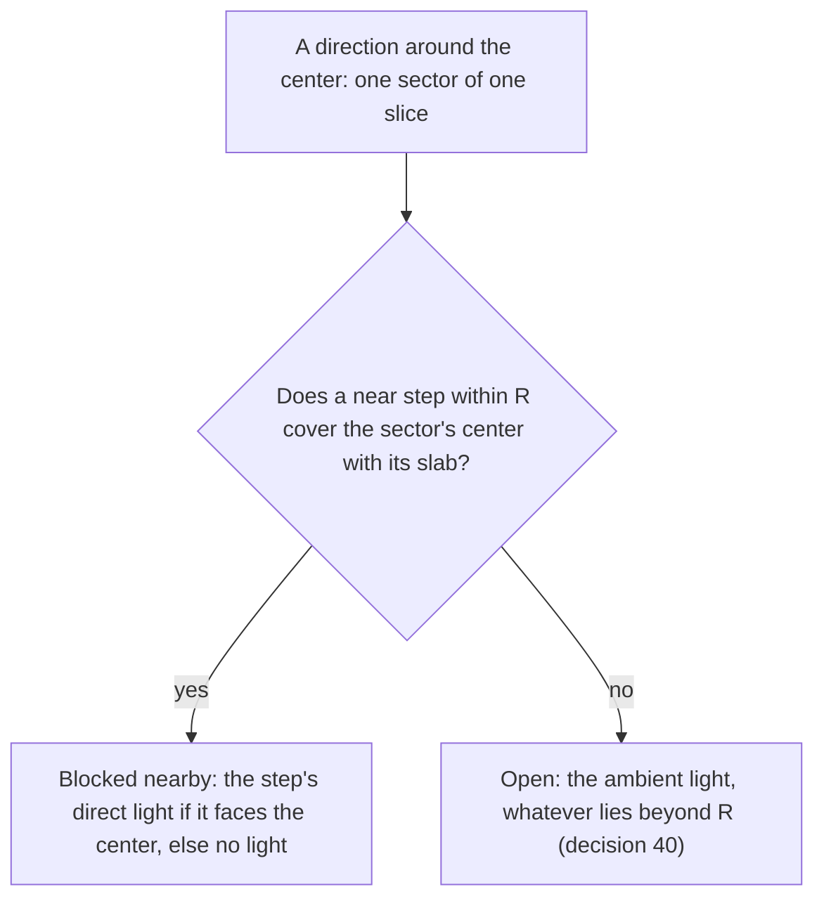
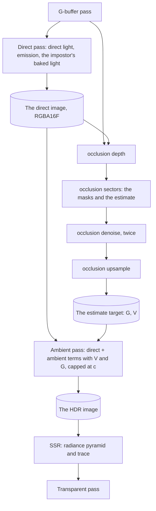
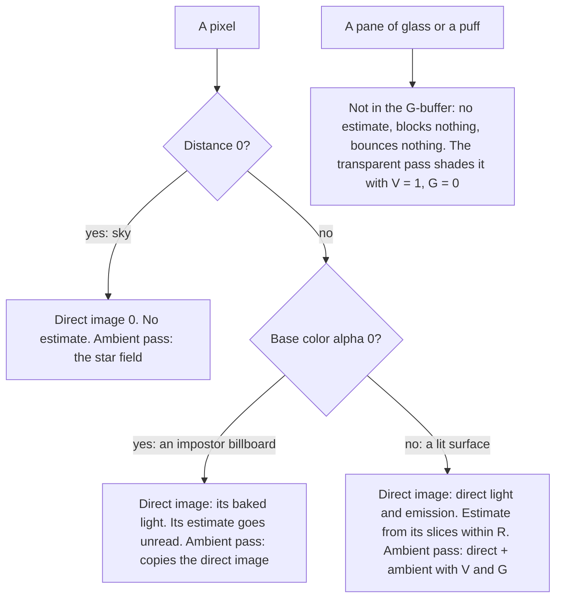

# Bounce light

Ticket: `ter-a24f`, a member of the rendering upgrade epic (`ter-sglu`, [rendering-upgrade.md](rendering-upgrade.md)). The design ticket is `ter-zi4i`. The user chose the design on 2026-10-25 in two steps, which the ticket's last two notes record. First: one estimate of the light around each point, gathered in the crease shadowing's slices with masks of sectors, from this frame's direct light, with a blur and nothing carried over between frames. Then, the same day: "near and far". The same estimate continues beyond the crease radius with rays through the reflections' depth pyramid, only in the directions that the near sectors leave open. This doc fills in the details. Its three open points are settled, see "Settled forks".

On 2026-10-26 the user downscoped the bounce light to the near range (decision 40, `ter-ehxp`). The far rays went, and beyond the crease radius an open sector takes the ambient light. The doc describes the near-only design. "Later" holds the far rays and the commits that built them.

The doc is written against main at `bcaf139e`, which holds the crease shadowing ([ambient-occlusion.md](ambient-occlusion.md), `ter-b3h5`), and against five designs on their branches:

| Design | Branch | What this doc takes from it |
|---|---|---|
| Screen-space reflections, [screen-space-reflections.md](screen-space-reflections.md) (`ter-jxv9`) | `ter-jxv9-ssr` | The thickness share κ, the compute stage on the frame set and the G-buffer set, `surfaceAt` and `ambientTerms`. The far rays also took the depth pyramid, the trace `traceRay`, its C# copy `ScreenRay` and the edge fade, until decision 40 |
| The environment map, [environment-map.md](environment-map.md) (`ter-nl5u`) | `ter-nl5u-environment-map` | The ambient source `environmentAmbient`, the reflected stars' footprint from fragment derivatives, `directLight` and `directRadiance` |
| The lights, [local-light-shadows.md](local-light-shadows.md) (`ter-s9cv`) | `ter-s9cv-light-shadows` | One loop over the light list in `directLight`, G-buffer set binding 8 for the shadow atlas |
| The shader audit, ARCHITECTURE.md, "Portable Vulkan" (`ter-lozc`) | `ter-lozc-portable-nan` | `MaxRadiance` = 32,256, the surfaces' share of the HDR image's range, and `exposed`, which caps before it multiplies |
| XeGTAO's tuned set, `.tickets/ter-sdks.md` | Held for this doc | The seven tuned constants, which "XeGTAO's tuned set in sector masks" sorts |

## Goal

Today a surface gets light only straight from the sun, from local lights and from the ambient source. The crease shadowing darkens the ambient light where nearby geometry hides it, but nothing takes the place of the light that it removes. A sunlit floor does not light the underside of a table, and a red wall does not tint the floor beside it red. After this ticket:

- Each direction around a surface point is one of two: blocked nearby, or open. A blocked direction brings the light of the surface that blocks it. An open direction brings the ambient light. No direction counts twice, and none is lost.
- Within the crease radius, the crease shadowing's slices find the blockers with masks of 32 sectors each (Therrien, Levesque and Gilet 2023). They give the sharp contact shadows and the bounce close up.
- Beyond the crease radius, an open sector takes the ambient light, as in the crease shadowing before this ticket (decision 40).
- The light that bounces is this frame's direct light: the sun, the local lights and emission. One bounce, the same in every run.
- The lighting pass splits into a direct pass and an ambient pass. The reflections read the image after the ambient pass, so they show the bounce.
- A still scene gives the same image in every frame. Nothing carries over between frames.
- One switch turns the crease shadowing and the bounce light off together, because they are one estimate.

## Terms

| Term | Meaning |
|---|---|
| Crease shadowing | The darkening of the ambient light where surfaces on the screen hide it: 1 − V. ARCHITECTURE.md calls it ambient occlusion. |
| The bounce, G | The cosine-weighted mean radiance that reaches a surface point from the surfaces that block its hemisphere within R. The diffuse light that it adds is c_diff · G. The images hold it pre-exposed, `ShadingInput.bounce` holds it as plain radiance. |
| The occlusion, V | The share of the cosine-weighted hemisphere above a surface point, around its shading normal, that no surface on the screen blocks within R. 1 means fully open. As in [ambient-occlusion.md](ambient-occlusion.md), V counts only blockers within the radius (decision 40). `ShadingInput.occlusion` holds it. |
| The estimate | The pair (G, V) of one half-resolution texel or one full-resolution pixel. |
| The direct light | The light that a surface sends toward the eye from the sun, the point and spot lights and its emission, pre-exposed: no ambient light. |
| The direct image | The full-resolution RGBA16F image of the direct light of each pixel, 0 for sky. The direct pass writes it. |
| The direct pass | The fullscreen pass that writes the direct image. Today's lighting pass without the ambient light. |
| The ambient pass | The fullscreen pass after the occlusion passes that writes the HDR image: the direct light plus the ambient light with the estimate applied. |
| The radius, R | `VisibilityBitmaskLight.RadiusMeters`. Where the near range ends. Beyond it, an open sector takes the ambient light. |
| The near range | The blockers whose surface point lies within R of the center: what the near steps find. |
| Full resolution, half resolution, the representative pixel, view space, the view depth z, t_x, t_y, the texel width p(z), the radius in texels ρ, a slice, a step | As in [ambient-occlusion.md](ambient-occlusion.md), "Terms". Each half-resolution texel (i, j) stands for the 2 × 2 block of pixels from (2i, 2j), and its representative pixel is (2i, 2j). |
| The center, c | The view position of a texel's representative pixel, moved toward the eye by XeGTAO's center bias. |
| V̂ | The unit vector from the center toward the eye: `toEye` in `gtao.glsl`. |
| ô | The unit vector in a slice's plane at right angles to V̂, toward the slice's plus side, the side of the step offset +s · ω. |
| The angle in a slice, θ | The signed angle of a direction in the slice plane from V̂, positive toward ô. |
| The normal angle, γ | The signed angle of the projected normal in the slice: `nAngle` of `gtao.glsl`. |
| \|n_p\| | The length of the shading normal projected into the slice plane. |
| The slice's arc, T | cos γ + γ sin γ: the cosine-weighted measure of the slice's hemisphere, the directions from γ − π/2 to γ + π/2. GTAO's slice of an open surface. |
| The slice weight, W | \|n_p\| · T: the share of the texel's estimate that one slice carries, before the division by the texel's total. |
| The measure fraction, m(θ) | The share of the slice's arc from its edge at γ − π/2 to θ, from 0 to 1. |
| A sector | One of the 32 equal shares of a slice's arc: sector j holds the directions with m from j / 32 to (j + 1) / 32. Each carries the weight W / 32. |
| A sector mask | 32 bits, one per sector of a slice: bit j is set when sector j is blocked nearby. |
| The thickness share, κ | `ThicknessShare` = 0.1, SSR's constant: a surface at view depth z fills the depths from z to z (1 + κ) behind it, along its view ray. |
| A slab | The depths that one visible surface point fills under κ: from the point to the point times (1 + κ), in view space with the eye at the origin. |
| A blocker | A surface point that blocks some directions of the center: the surface of a near step. |
| Faces the receiver | A blocker's geometric normal has a positive cosine with the direction from the blocker toward the center. |
| The estimate target | The full-resolution RGBA16F image of the estimate: rgb the bounce, pre-exposed, and a the occlusion. It replaces the occlusion target. |
| Terms A and B | The two half-resolution RGBA16F images of the estimate that the occlusion passes write in turn, rgb the bounce and a the occlusion. |
| The occlusion passes | The compute passes "occlusion depth", "occlusion sectors", "occlusion denoise" and "occlusion upsample", in that order. |
| The exposure scale, k | 2 to the power of the frame's exposure in stops. Pre-exposed light is radiance times k. |
| `MaxRadiance`, c | 32,256 on the audit's branch, 65,504 before it: the most light that a surface writes into a pixel of the HDR image. |
| The ambient source, T_d, T_s, D(n) | As in [environment-map.md](environment-map.md), "Terms": the function that gives `AmbientTerms`, its diffuse term c_diff · D(n) and its specular term. D(n) is the ambient diffuse radiance at the normal. |
| The tuned set | XeGTAO's seven tuned constants that `ter-sdks` holds: see "XeGTAO's tuned set in sector masks". |
| A furnace | A scene in which every surface that can block emits the ambient light's radiance and reflects nothing. A receiver there gets the same light whatever blocks it. |

## Decisions

### Made by the user

1. One estimate of the light around each point, in two ranges. (User, 2026-10-25) Near: inside the crease radius R, the sector masks of the visibility bitmask (Therrien, Levesque and Gilet 2023) in the crease shadowing's slices. Far: beyond R, rays only in the directions that the near sectors leave open, through SSR's depth pyramid with SSR's trace. A far ray that hits gives the light of the hit point, from this frame's direct light. A far ray that leaves the screen or reaches the sky gives the ambient light. Each direction is exactly one of three, so nothing is counted twice or lost. The far rays reach as far as the screen shows, and off the screen everything fades back to the ambient light. Decision 40 replaces the far range: beyond R, an open sector takes the ambient light.
2. This frame's direct light bounces, exactly one bounce, the same in every run. So the lighting pass splits into a direct pass (the sun, the local lights, emission) and an ambient pass, which runs after the occlusion passes and adds the ambient light, the crease shadowing and the bounce. (User)
3. Blur only: the crease shadowing's fixed noise and edge-aware blur. Nothing carries over between frames. (User)
4. Replaced by decision 40, which has no far range and so no far tracer. The far range reused SSR's depth pyramid, its trace and its C# copy `ScreenRay`, with no second tracer. So the build waits for `ter-jxv9`. (User)
5. The default radius is the orchestrator's pick from captures: "whatever feels most dramatic, but not overly so". (User) "The default radius and steps" says how the captures pick it.
6. Before decision 1, the user chose XeGTAO's tuned set over the physical constants for darker creases (fork 1 of [ambient-occlusion.md](ambient-occlusion.md)). Sector masks replace the horizon angles that the set works on. "XeGTAO's tuned set in sector masks" sorts its constants, and the user then chose none of them (fork 1). (User)
7. The ticket's and the epic's rules: a `RendererOptions` switch, the cost measured at 1080p, deterministic in tests, GPU pixel tests of the acceptance criteria, no reference images. (User)
8. The decisions of [ambient-occlusion.md](ambient-occlusion.md) stay where this doc does not change them: half resolution (its decision 2), compute passes (3), XeGTAO as the reference (4), the estimate scales only the ambient light (5), the distance target and the G-buffer normals as the inputs (6), fixed spatial noise (7), no multi-bounce brightening (8), a union switch (9), one place in `lighting.glsl` where the estimate applies (14). (User and orchestrator)

The user downscoped the design after the cost and the captures of `ter-izsu`:

40. The bounce light keeps only the near range. (User, 2026-10-26: "Let's just downscope bounce light to just the local stuff.") It replaces decision 1's far range and decision 4. The far rays through the depth pyramid go, with fork 2 and the option B of `ter-izsu`. Within R, the sector masks work as decision 1 says. Beyond R, an open sector takes the ambient light, as the crease shadowing's open directions did before Part 5. Where the near range holds no step (decision 21), the estimate is open except for the sectors below the receiver's own geometric plane (decision 39), so (0, 1) where the shading normal is the geometric one. So each direction is one of two, blocked nearby or open, and the shares still sum to 1. The user also said: "I'm perfectly fine to have it be the whole hemisphere along the normal for now". So the open share takes the ambient source's mean light over the hemisphere around the normal (decision 31), until `ter-fs7b` reads the environment map in each open direction. The user decided after two results of `ter-izsu`: the far rays took 6.2 ms of the 9.1 ms of the occlusion passes at 1080p, 2.6 ms at a third of the rays, and they left a white speckle in the lamp-lit cabin. "Later" keeps the far rays.

### Settled by this design

Each by the user's decisions and the project's rules, with its reason.

9. The sector masks replace GTAO's horizons. They are not a second case of the setting. The pure model first: a horizon is the mask at infinite thickness (see "At infinite thickness: GTAO's horizons"), so one method covers both. A second case is a second estimate with another meaning of V. It is also an estimate without a bounce, which loses the light of every blocked direction, against decision 1.
10. The setting is one union, `ScreenSpaceLightSetting`: `NoScreenSpaceLight`, its zero case, or `VisibilityBitmaskLight(RadiusMeters, Slices, StepsPerSide)`. It replaces `AmbientOcclusionSetting`, because the old name no longer says what the feature does. It has no case with the crease shadowing and no bounce, by decision 9.
11. A slice has 32 sectors, and each is an equal share of the slice's cosine-weighted arc around the projected normal. The paper's sectors are equal in angle and weight each sample's light by the receiver's cosine. Equal shares put that cosine into the sectors themselves. So the count of blocked bits is the blocked share. 32 is the paper's count and one 32-bit word, the width of Vulkan's core bit instructions.
12. A step blocks the sectors whose centers lie between the directions to its surface point and to the back of its slab: from floor(32 m + ½) to floor(32 m' + ½) − 1. The paper's listing marks every sector that the interval touches (floor at one end, ceiling at the other), which adds about one sector per step and side and darkens. Its text marks a sector that is half covered. The center rule counts neither more nor less on average. `floor(x + 0.5)` replaces `round`, whose ties GLSL leaves to the driver.
13. The thickness is SSR's: a surface at view depth z fills z to z (1 + κ), κ = 0.1. One model of what is solid serves the near steps and SSR's trace, so a surface is as thick for the bounce as for a reflection. The paper uses a constant length t. SSR's share grows with the distance (SSR's decision 7, the user's). `ThicknessShare` moves from `ScreenRay` and `reflection.glsl` to `CellBounds` and `depth_pyramid.glsl`, because it says what the depth image means, and both the near steps and the trace read it.
14. A step blocks only when its surface point lies within R of the center, GTAO's hard edge. So the masks reduce to GTAO's horizons at infinite thickness.
15. A blocker gives its direct light, read from the direct image at its own pixel, when it faces the receiver, and no light otherwise. A blocker that faces away shows the receiver its back, whose light no pixel holds. The light is not weighted by the blocker's cosine, as the paper weights it. A Lambert blocker sends the same radiance in every direction, and the sector's share already holds the blocker's solid angle and the receiver's cosine. The paper's factor dims a wall that the point sees at a grazing angle a second time.
16. The light that a blocker sends toward the eye stands for the light that it sends toward the receiver. That is exact for its diffuse part. For a glossy blocker, the highlight that the eye sees bounces, and the one toward the receiver does not. The exact light needs every light evaluated again toward the receiver at every step, the cost of the direct pass once per step.
17. The estimate of a texel is normalized by its total slice weight, ΣW, so the open and the blocked shares sum to exactly 1 in every texel. GTAO divides by the number of slices, so an open surface comes to 1 only in the mean over slices, and its upsample clamps the excess. A texel whose total weight is below 10⁻⁶ holds no information and takes the open estimate, (0, 0, 0, 1). That needs one slice with a normal at right angles to its plane.
18. Replaced by decision 40. It gave each slice one far ray (fork 2), through the center of one open sector that the fixed noise picked, whose outcome stood for every open sector of its slice.
19. Replaced by decision 40. It started a far ray at R from the center along its direction, so the far range began where the near range ended.
20. Replaced by decision 40. It gave the outcome of a far ray for each way that SSR's trace ends: a hit blocked the slice's open share by the edge fade at the hit, a ray into its own geometric surface blocked it with no light, and every other end left it open.
21. The estimate runs at half resolution, in the texels and slices of the crease shadowing. GTAO's fade below one pixel goes: where R spans at most the nearest step, 1.3 texels, the near range holds no step, and the texel's estimate is open except for the sectors below its own geometric plane (decisions 39 and 40). GTAO's decision 6 still holds, and the near range "fades out where it covers less than a pixel" by holding no step. A fade toward full visibility ends at the same estimate where the shading normal is the geometric one, so the step to it needs no fade of its own. Before decision 40, the far rays gave the whole estimate there.
22. Replaced by decision 40. It split the near search and the far rays into two passes, "occlusion sectors" and "occlusion far rays", with a buffer of sector masks between them. The near search is the sectors pass alone, and no buffer of masks exists.
23. The occlusion passes take the layout of SSR's compute passes: sets 0 to 2 of `SceneLayout` and their own set 3. The camera then has one store, the frame constants, and the push constants keep only the setting. GTAO's decision 29 put the camera in push constants because the frame set had no compute stage. SSR adds it.
24. The direct pass writes its own image, the direct image, and the ambient pass, a fragment pass, reads it and writes the HDR image once: min(direct + ambient, c). Three reasons. The environment map's reflected stars take their footprint from fragment derivatives (its decision 33), which a compute pass lacks. A blend cannot cap the sum, because a fragment shader cannot read the color attachment that it blends into. And the HDR image needs no storage usage, so SSR's decision 30 stays. It costs 16.6 MB at 1080p. (Merge of main, 2026-10-26: the map as merged takes a G-buffer pixel's footprint from the G-buffer, `reflectionFootprintAt` in `surfaceAt`, not from derivatives, so the first reason no longer binds. The other two stand.)
25. A near step reads the direct light and the geometric normal of its representative pixel 2t from the full-resolution direct image and normals target. No half-resolution copy. One store of the direct light, and each step reads the light of the very pixel whose depth it used. If the cost shows the sectors pass bound by these reads, a copy beside the view depth image, written by the depth pass, is the measured fix (see "Cost"). (`ter-izsu`, 2026-10-26: the profile showed the sectors pass near the worst case of these reads, so the fix is in. The depth pass copies the direct light and the geometric normal of pixel 2t into two half-resolution images, which it rewrites in every frame from the direct pass's image of that frame, so the copy is a derived read of the one store and never disagrees with it. A step reads the copies at its texel t. The image is the same bytes.)
26. The estimate target replaces the occlusion target: one RGBA16F image at full size, rgb the bounce and a the occlusion, because one estimate makes both. It is cleared to (0, 0, 0, 1) in the first frame after each creation, as the occlusion target was cleared to 1.
27. The images hold the bounce pre-exposed, and `ShadingInput.bounce` holds it as plain radiance: the reader divides by k. Pre-exposed, the bounce is a weighted mean of direct pixels, at most c, so it fits a half float. Plain radiance passes 65,504 in a sunlit scene in SI units at a low exposure.
28. The bounce enters the ambient light in `occludedAmbient`, the one place where the estimate applies. The diffuse term becomes T_d · V + c_diff · G. The specular term becomes T_s · V_s, with V_s from V by Lagarde's fit as before. The bounce is diffuse light only. Light that the screen reflects is SSR's.
29. The transparent pass and the impostor capture shade with V = 1 and G = 0. A pane is not in the G-buffer, and the estimate at its pixel belongs to the opaque surface behind it, which takes that estimate. A capture has no screen around it. The environment faces take no ambient light at all (environment-map.md, decision 17). A lit puff keeps the mean ambient light of `scatteredLight`, because it has no surface and no slices.
30. Exactly one bounce: the direct image holds no ambient light, so no ambient light bounces. One exception: an impostor billboard's pixel holds its captured light, which includes the capture's ambient light, and that light bounces. Impostors are smaller than 200 px, so the extra is small, and no capture holds a direct part apart.
31. An open direction takes the ambient source's mean light, T_d · V, as GTAO's decision 14 has it. The paper's ambient light per open cone needs the source along each open direction, and the hemisphere source has no up at the estimate's texels. "Known limits" names what this costs with the environment map on.
32. The direct and ambient passes run in both cases of the setting (fork 3). With `NoScreenSpaceLight`, the estimate target holds (0, 0, 0, 1), and the ambient pass applies it exactly.
33. Replaced by decision 40. It gave the depth pyramid its own owner for its two readers, the reflections and the far rays. With no far rays, the pyramid stays SSR's, in `ReflectionTargets`, which exists only with the reflections on.
34. Masks are 32-bit words, read and written with `bitCount` and `bitfieldInsert`. Vulkan allows its core bit instructions only on 32-bit integers, which these are. No shift by 32, which GLSL leaves undefined.
35. The defaults: R 1 m and `StepsPerSide` 3 until the captures pick them, and `Slices` 3.
36. Replaced by decision 40. It checked `FarSteps` from 1 to 1,024, the most cells that one far ray examined.
37. The headless host's `--screen-space-light off|<meters>` replaces `--ambient-occlusion off|<meters>`.
38. No new device feature. The formats and the limits are in "Portable Vulkan".
39. The receiver's own geometric surface blocks the sectors whose centers lie below it, with no light, before the near steps (review of Part 4). It is decision 13's one model of what is solid: the receiver's own surface is solid below its plane. Only a normal map or a smooth-shaded mesh tilts the shading hemisphere below the geometric plane. Without the rule, the receiver's own steps, which lie in that plane, block those sectors, and the facing test of decision 15 gives them the surface's own direct light or none by the sign of a dot product of about 0, which rounding decides from pixel to pixel. A plane that holds the slice, whose normal projects to less than 10⁻⁶ in it, blocks nothing.

## Sources

- Therrien, Levesque and Gilet 2023, "Screen Space Indirect Lighting with Visibility Bitmask", The Visual Computer (arXiv 2301.11376). A bit field of N = 32 sectors per slice replaces GTAO's two horizon angles, centered on the projected normal. Each sample's back point lies a thickness t behind it, and the sample marks the sectors between the angles of its front and its back. A sample's light counts for the sectors that it newly blocks, b_j & ~b_i, and the occlusion is 1 − countbits(b_i) / N. The paper states that GTAO without falloff equals an infinite t. It uses t = 0.2 at a radius of 2. Its times at 1080p on an RTX 2080: occlusion alone in 0.51 to 1.13 ms, against GTAO's 0.49 to 1.12 ms. Indirect light with 16 samples at half resolution takes 0.97 ms, with 0.1 ms of denoise. Its temporal accumulation and its feedback of the indirect light into the next frame's light buffer are left out by decisions 2 and 3.
- Jimenez, Wu, Pesce and Jarabo 2016, "Practical Real-Time Strategies for Accurate Indirect Occlusion": GTAO, the slices and the cosine-weighted inner integral (equation 7), which gives the sectors' measure here.
- Intel's XeGTAO (MIT), `src/Tertius.Rendering/ThirdParty/XeGTAO`: the port that `gtao.glsl` holds.
- Uludag 2014 and McGuire and Mara 2014, through SSR's trace, which the far rays called as it is ("Later").
- Lagarde and de Rousiers 2014: the specular occlusion V_s.

## The method

### One estimate within the radius



Every slice has 32 sectors. A near step blocks some of them, in the order of the steps, nearest first, so the nearest blocker of a direction owns it. So every sector of every slice ends as exactly one of two: blocked nearby with a light, or open. The diffuse ambient light of the point is

```
L_diffuse = c_diff · (V · D(n) + G)

V = Σ over open sectors of the sector's weight          G = Σ over blocked sectors of the sector's weight × its light
```

where

- `c_diff` = the diffuse color b (1 − m).
- `D(n)` = the ambient diffuse radiance of the ambient source at the shading normal: the hemisphere's mix today, the environment map's irradiance over π while the map is on.
- the sector's weight = W / (32 · ΣW): the slice's weight over the texel's total, shared evenly by its 32 sectors. The weights of all the sectors of a texel sum to 1.
- its light = the direct light of the sector's blocker, or 0 when the blocker does not face the receiver.

In a furnace, every blocker's light is D(n), so L_diffuse = c_diff · D(n) · (V + blocked shares) = c_diff · D(n) whatever blocks the point. That is the test of "nothing counted twice or lost" (see "Tests").

### The slice and its sectors

The slice is GTAO's (ambient-occlusion.md, "The occlusion horizons pass"): its direction φ, V̂, the projected normal's length \|n_p\| and angle γ. The cosine-weighted measure of a set of directions of the slice is the paper's inner integrand:

```
μ(θ₁, θ₂) = ∫ from θ₁ to θ₂ of cos(θ − γ) · |sin θ| dθ

F(h) = ∫ from 0 to h of cos(θ − γ) · |sin θ| dθ  =  sign(h) · sliceArc(h, γ)
sliceArc(h, γ) = ¼ · (−cos(2h − γ) + cos γ + 2h · sin γ)                       gtaoSliceArc

T = F(γ + π/2) − F(γ − π/2) = cos γ + γ sin γ                                  the slice's arc
m(θ) = (F(clamp(θ, γ − π/2, γ + π/2)) − F(γ − π/2)) / T                        the measure fraction
```

where

- `θ` = the angle in the slice, from V̂, positive toward ô.
- `|sin θ|` = the solid angle of the slices around the view axis, which crowd near V̂.
- `sliceArc` = XeGTAO's half of the inner integral. For h < 0 it gives the measure from h to 0, so F is the measure signed by h.
- `T` = at least 1 for γ in [−π/2, π/2], so the division is safe.
- `clamp` = keeps m monotone: outside the hemisphere the integrand turns negative.

Sector j holds the directions with m(θ) from j / 32 to (j + 1) / 32. Each sector is 1/32 of the slice's arc, whatever its width in angle. The slice weight is W = \|n_p\| · T, GTAO's slice of an open surface, so each sector carries W / 32.


### A near step

The steps are GTAO's: `StepsPerSide` on each side of the slice, at the R1-shifted fractions of the radius beyond 1.3 texels, with GTAO's clamp beyond the image (ambient-occlusion.md, "The occlusion horizons pass"). Each step has an exact place on the slice line, and it reads the texel t nearest that place. For the step at the exact place x on the side σ (+1 or −1):

```
before the first step:
blocked = run(0, floor(32 · m(γ_g − π/2) + ½))  |  run(floor(32 · m(γ_g + π/2) + ½), 32)      the receiver's own surface
γ_g     = γ + atan2(dot(n_g, û⊥), dot(n_g, û)),  none when |(dot(n_g, û), dot(n_g, û⊥))| < 10⁻⁶

for each step:
t   = round(x)                                   the texel nearest the exact place, whose depth, plane and light the step reads
s_f = r(x) · dot(n_g(2t), P(t)) / dot(n_g(2t), r(x))     the step's surface point on the slice, view space
d   = {z(t), z(t + (sgn(x − t)_x, 0)), z(t + (0, sgn(x − t)_y))}     the depths around the exact place
s_b = s_f · (1 + κ)                              the back of its slab: the same view ray, at the view depth z (1 + κ)
s_f = P(t) in its place when the view depth of s_f lies outside [b · min d, max d / b]
skip the step when t lies outside the image or on sky, when the quotient of s_f is not positive, or when |s_f − c| ≥ R
θ_f = σ · acos(clamp(dot(normalize(s_f − c), V̂), −1, 1))
θ_b = σ · acos(clamp(dot(normalize(s_b − c), V̂), −1, 1))
sectors = run(floor(32 · m(min(θ_f, θ_b)) + ½),  floor(32 · m(max(θ_f, θ_b)) + ½))
fresh   = sectors & ~blocked
light  += bitCount(fresh) · (faces(t) ? direct(2t) : 0)
blocked |= fresh
```

where

- `x` = the step's exact place on the slice line, in half-resolution texels: the center texel plus σ times the offset of `gtaoExactStepOffset`, before any snap.
- `r(x)` = the view ray, whose z is 1, through the exact place.
- `P(t)` = the view position of texel t's representative pixel at its view depth, `gtaoTexelPosition`.
- `s_f` = where the view ray through the exact place meets the plane of the texel's surface, `stepSurfacePoint`. It lies on the slice, since every view ray through a place on the slice line lies in the slice plane. A quotient that is not positive means the ray meets that plane only behind the eye or never: the surface does not reach the slice there, and the step blocks nothing, as a step on sky.
- `z(t)` = the view depth of a half-resolution texel, `viewDepthAt`: `SkyDepth` for sky, and the border texel's for a texel outside the image.
- `d` = the depths around the exact place, `depthsAround`: those of t and of t's two neighbors toward x, along the row and along the column. `sgn` is −1, 0 or 1, so on an axis where x and t agree the neighbor is t itself.
- `b` = `CenterBias`, 0.99999: the depths' own precision widens the range by 10⁻⁵ of a depth on each side.
- `σ` = the side of the step. A step on the plus side lies on ô's side of V̂, so its angles are positive.
- `run(a, b)` = the bits from a to b − 1, none when b ≤ a.
- `blocked` = the slice's sector mask: before its first step, the sectors whose centers lie below the receiver's geometric plane (decision 39).
- `n_g` = the receiver's view-space geometric normal, at the representative pixel of its texel.
- `û`, `û⊥` = cos γ V̂ + sin γ ô, the unit projected shading normal's direction in the slice, and −sin γ V̂ + cos γ ô, at right angles to it toward the plus side.
- `γ_g` = the angle of the projected geometric normal in the slice, taken within π of γ, so the geometric plane's two edges in the slice are γ_g ± π/2. A direction lies below the plane where its angle lies farther than π/2 from γ_g.
- `n_g(2t)` = the view-space geometric normal of the step's representative pixel.
- `faces(t)` = dot(n_g(2t), c − s_f) > 0.
- `direct(2t)` = the direct image at that pixel, pre-exposed.
- `light` = the slice's sum of newly blocked sectors times their light. The slice's weight W / 32 multiplies it at the end.

Why the surface point lies on the slice (`ter-rxjr`). GTAO's step reads the texel nearest its exact place, and XeGTAO measures that texel's own point, P(t). P(t) lies off the slice plane by up to half a texel's diagonal on the screen, and θ is the angle of its full direction from V̂. On a floor seen at a grazing angle, one texel row spans several texel widths of floor in depth. So a texel one row nearer the eye than the slice line holds a floor point whose direction lies well inside the hemisphere, though the floor's own line in the slice is the hemisphere's edge. The slab of that step then blocks a run of sectors at the edge of the slice, and CenterBias lifts the center a little above the floor, so the step faces the center and gives it the floor's own light. On a sunlit flat floor at 640 × 360, 4,293 of 26,000 floor texels blocked sectors, and the bounce reached 1.2 % of the floor's direct light. A projection of P(t) onto the slice plane at right angles does not remove it: the projection of a floor point leaves the floor, and the largest bounce that remained fell only from 1.15 × 10⁻³ to 0.89 × 10⁻³. The step's surface point on the slice, the meeting of the exact ray and the texel's plane, lies on the floor for every floor step, so a floor step's angle is the floor's own edge, up to the lift of CenterBias, and it blocks nothing above the floor. A curved surface keeps the texel's tangent plane over at most half a texel's diagonal. The step reads the normal of its texel for every step, before the radius, not only for a step that blocks.

Why the surface point lies between the depths around its exact place (`ter-y1s7`). The plane of the texel's surface is the surface only near the texel. At a convex edge, the texel t can lie on a side face S that the eye sees nearly edge-on, while the exact place lies over the front face F. The exact ray then crosses S's plane in front of F, so s_f floats in the air before F, and its slab blocks sectors above F that nothing blocks. A box whose front face is the plane z = 5 m and whose side face, the plane x = 0.5 m, the eye sees about 6° off its view rays, under a level camera at 640 × 360 and the default setting: 31 of 8,460 texels of F blocked 1 to 6 of the 32 sectors of a slice, up to about 51° above F's plane and up to 0.182 m from the edge, on the CPU and on the GPU alike. The depth image tells where the plane holds: a plane's 1 / z is an affine function of the screen position, so its depth at any point of a triangle of texels lies between its depths at the triangle's corners. The exact place lies within half a texel of t on each axis, so it lies inside the triangle of t and its two neighbors toward it, along the row and along the column. Where one surface's plane covers the three texels, s_f lies between their depths; where it does not, as before F, s_f lies outside them, and the step stands at P(t), the real point that it read, XeGTAO's point. So a step stands on its slice where the depth image supports its texel's plane, and otherwise at the nearest real surface sample that it read. P(t) never floats in the air: beside the convex edge it lies on S, behind F's plane, and blocks nothing above F. Its only fault is ter-rxjr's, a point off the slice by up to half a texel's diagonal, which a floor never meets, since a floor's plane holds at every step. A step that blocked nothing in place of P(t) failed a texel whose normal disagrees with its depth: an impostor writes its quad's facing as its geometric normal while its depth has the real shape (`impostor.frag`), so most of its steps fell outside the depths around them, and the floor beside an impostor of a box rose to 0.11 above the V beside the box itself (`TheGroundBesideAnImpostorDarkensAsBesideItsGeometry`, at most 0.05). With P(t), it stays within 0.02. The impostor's normal is a ticket of its own. The triangle is the fewest reads that keep every plane: two texels hold the exact place only on the segment between them, which the slice line rarely crosses, and the four texels of a bilinear footprint need one read more for the same guarantee. t's own depth is read already, so the rule costs two depth reads per step. The range is widened by the depths' precision, the 10⁻⁵ of `CenterBias`. Without it, a wall square to the view has one depth at all three texels, and the rounding of its decoded normal puts s_f about 10⁻⁷ of the depth in front of the wall or beyond it, so about half its steps would stand at P(t), off their slice, at random. With the camera, a floor and such a wall turned together by 63° about the vertical, the blocked sectors of all the masks were 191,274 straight and 191,314 turned without the widening, and 191,273 turned with it. Had a rejected step blocked nothing, the loss was larger: 170,093 of 186,022 at 20°. Sky counts with its depth, `SkyDepth`, so the plane of a surface beside the sky is kept up to half a texel toward it (see "Known limits"). The faces-away blocker of `TheSectorPassGathersWhatTheCSharpCopyGathers`, the low box's top extended over its front face, was this defect: the test now takes the floor behind the plane of the box's front face, whose genuine steps on that face face away from it.

The receiver's own surface comes first, so a step gives no light to a direction below it. The two sides of a step index run in XeGTAO's order, plus side first. A step adds light only to the sectors that no nearer step has blocked, so the nearest blocker of each direction owns it. The back point lies on the step's own view ray, so it stays on the step's side of V̂. As z grows along that ray, the direction from c turns away from the eye, so the run reaches from the surface's angle toward the edge of the hemisphere on that side.

### The estimate of a texel

```
ΣW = Σ over slices of W_k
V  = Σ_k W_k · bitCount(~blocked_k) / (32 · ΣW)
G  = Σ_k W_k · light_k / (32 · ΣW)
ΣW ≤ 10⁻⁶: (G, V) = (0, 1)
```

where

- `W_k` = the weight of slice k.
- `blocked_k` = the slice's sector mask after its near steps.
- `light_k` = the slice's sum of newly blocked sectors times their light.

The sectors pass writes this estimate into term A. It normalizes by ΣW, so V lies in [0, 1], and the open and the blocked shares sum to 1 in every texel. An open sector takes the ambient light whatever lies beyond R along it (decision 40). The two blurs and the upsample average V with non-negative weights that sum to 1, and the upsample's clamp removes the rounding of their sums.

### At infinite thickness: GTAO's horizons

As κ grows without bound, each step's back point moves away from the eye along its view ray, and the direction from c to it tends to that view ray's own direction, at θ = σ (π − α), where α is the angle at the eye between the center's view ray and the step's. That direction lies at or past the edge of the hemisphere on the step's side, γ + σ π/2, when α ≤ π/2 − σ γ. Within the domain α ≤ π/2 − |γ|, each step's run then reaches from its surface's angle to the edge. Outside it, a grazing normal near the eye, the runs stop short of the edge, and the masks block fewer sectors than GTAO's horizons: the slab lies along the step's view ray (decision 13), not along the direction from c. The union of the runs of one side's steps is the run from the angle of that side's step nearest to V̂, GTAO's horizon h, to the edge. So the open sectors are those between h₀ and h₁, and their count over 32 is (sliceArc(h₀, γ) + sliceArc(h₁, γ)) / T to within one sector, by the center rule. The slice's open weight W · count / 32 is then \|n_p\| · â, GTAO's slice, to within W / 32. With no bounce, V is GTAO's sum of slices over ΣW, where GTAO divides by the number of slices: the same in the mean for an open surface, where ΣW / S comes to 1. `SectorSearchTests.AtInfiniteThicknessTheOpenSectorsAreTheSectorsBetweenTheHorizons` pins this within the domain: its center lies 2 m from the eye, so its steps keep α below 0.47 rad.

### Where the near range is empty

With ρ at most `NearestStepTexels`, 1.3, the nearest step already lies at R or beyond, so the sectors pass takes no step: each slice's mask holds only the sectors below the receiver's own geometric plane (decision 39), and the estimate is open except for them (decision 40). Where the shading normal is the geometric one, that mask is 0 and the estimate is (0, 1). At 1080p with R = 1 m and a vertical field of view of 60°, ρ = 1.3 at 360 m. So surfaces in the middle and the far ranges, a cliff 50 km away or a planet's limb, keep their ambient light in full apart from those sectors, as GTAO wrote 1 for them.

### The noise

The noise is GTAO's (ambient-occlusion.md, "The noise"): XeGTAO's Hilbert index of a 64 × 64 tile drives the R2 sequence, ξ_x turns the slices and ξ_y shifts the steps. Everything is a fixed function of the texel's coordinates, so a still camera sees the same noise in every frame, and a moving camera sees the 128 px pattern stay fixed on the screen while the surfaces move under it.

The near masks vary between neighbor texels as GTAO's horizons do, and the two blurs and the upsample average about 10 to 25 texels with their weights.

### The shaders

`sectors.glsl` (new) holds the sector math beside the port. The paper publishes no code, so the file is engine code, and XeGTAO's notice stays in `gtao.glsl`:

```glsl
// The sectors of a slice and the light of its blockers (docs/plans/screen-space-illumination.md, "The method").
// SliceSectors, SectorMask and SectorSearch in Shading/ are the C# copy. Change both together.
#ifndef TERTIUS_SECTORS_GLSL
#define TERTIUS_SECTORS_GLSL

#include "gtao.glsl"
#include "depth_pyramid.glsl"

const uint SectorCount = 32u;
// The total slice weight below which a texel holds no estimate (SectorSearch.MinTotalWeight).
const float MinTotalWeight = 1e-6;

// One slice around a texel, in view space with XeGTAO's axes.
struct SliceGeometry
{
    vec3 toEye;          // V̂
    vec3 side;           // ô: in the slice plane, at right angles to V̂, toward the plus side
    float normalAngle;   // γ
    float arc;           // T = cos γ + γ sin γ
    float weight;        // W = |n_p| T
};

// F(h): the cosine-weighted measure from 0 to h, signed by h. gtaoSliceArc gives the measure between 0 and h.
float signedArc(float h, float gamma)
{
    return h >= 0.0 ? gtaoSliceArc(h, gamma) : -gtaoSliceArc(h, gamma);
}

// m(θ): the share of the slice's arc from its edge at γ − π/2 to the angle, from 0 to 1.
float measureFraction(SliceGeometry g, float angle)
{
    float low = g.normalAngle - GtaoHalfPi;
    float clamped = clamp(angle, low, g.normalAngle + GtaoHalfPi);
    return (signedArc(clamped, g.normalAngle) - signedArc(low, g.normalAngle)) / g.arc;
}

// The first sector whose center lies after the measure fraction m, from 0 to 32: a tie goes to the later sector.
// floor(x + 0.5), not round, whose ties GLSL leaves to the driver.
uint sectorBoundary(float m)
{
    return uint(floor(m * float(SectorCount) + 0.5));
}

// The sectors from start to end − 1, none when end ≤ start. bitfieldInsert never shifts by 32.
uint sectorRun(uint start, uint end)
{
    return end > start ? bitfieldInsert(0u, 0xFFFFFFFFu, int(start), int(end - start)) : 0u;
}

// θ of a direction in the slice, from V̂. side, +1 or −1, is the side of the step whose point the direction reaches.
float sliceAngle(SliceGeometry g, vec3 direction, float side)
{
    return side * acos(clamp(dot(normalize(direction), g.toEye), -1.0, 1.0));
}

// The sectors whose centers lie between the directions to a step's surface point and to the back of its slab.
uint stepSectors(SliceGeometry g, vec3 center, vec3 samplePosition, float side)
{
    float front = sliceAngle(g, samplePosition - center, side);
    float back = sliceAngle(g, samplePosition * (1.0 + ThicknessShare) - center, side);
    return sectorRun(sectorBoundary(measureFraction(g, min(front, back))),
                     sectorBoundary(measureFraction(g, max(front, back))));
}

// The sectors whose centers lie below the receiver's own geometric plane, which its surface blocks with no light
// (decision 39). The plane's angle in the slice, γ_g, is taken within π of γ, so its edges in the slice are γ_g ± π/2.
// A normal with no part in the slice plane blocks nothing, and atan(0, 0) is undefined.
uint ownSurfaceSectors(SliceGeometry g, vec3 geometricNormal)
{
    vec3 shading = cos(g.normalAngle) * g.toEye + sin(g.normalAngle) * g.side;
    vec3 acrossShading = cos(g.normalAngle) * g.side - sin(g.normalAngle) * g.toEye;
    vec2 inSlice = vec2(dot(geometricNormal, shading), dot(geometricNormal, acrossShading));
    if (length(inSlice) < MinProjectedNormalLength)
        return 0u;
    float planeAngle = g.normalAngle + atan(inSlice.y, inSlice.x);
    return sectorRun(0u, sectorBoundary(measureFraction(g, planeAngle - GtaoHalfPi)))
           | sectorRun(sectorBoundary(measureFraction(g, planeAngle + GtaoHalfPi)), SectorCount);
}

// The least and the greatest view depth of the texels around a step's exact place: its texel t, at tDepth, and t's two
// neighbors toward the place, along the row and along the column, whose triangle holds the place (ter-y1s7).
vec2 depthsAround(ivec2 t, float tDepth, vec2 towardPlace)
{
    ivec2 across = ivec2(sign(towardPlace));
    float alongRow = viewDepthAt(t + ivec2(across.x, 0));
    float alongColumn = viewDepthAt(t + ivec2(0, across.y));
    return vec2(min(tDepth, min(alongRow, alongColumn)), max(tDepth, max(alongRow, alongColumn)));
}

// s_f: where the view ray through a step's exact place meets the plane of its texel's surface (ter-rxjr). False where
// the ray meets the plane only behind the eye, never, or at a view depth of farthestDepth or more. texelPosition, P(t),
// at a view depth outside the depths around the exact place widened by 1 − CenterBias (ter-y1s7).
bool stepSurfacePoint(vec3 exactRay, vec3 texelPosition, vec3 texelNormal, vec2 depthsAround, float farthestDepth,
                      out vec3 point)
{
    float planeOffset = dot(texelNormal, texelPosition);
    float rayAlongNormal = dot(texelNormal, exactRay);
    bool inFront = planeOffset * rayAlongNormal > 0.0;
    float depthTimesRay = abs(planeOffset);
    float rayLength = abs(rayAlongNormal);
    bool betweenAround = depthTimesRay >= rayLength * depthsAround.x * CenterBias
                         && depthTimesRay <= rayLength * depthsAround.y / CenterBias;
    if (!inFront)
        return false;
    // The plane does not reach the place: the step stands at the real point that it read, P(t).
    if (!betweenAround)
    {
        point = texelPosition;
        return true;
    }
    if (!(depthTimesRay < rayLength * farthestDepth))
        return false;
    point = exactRay * (planeOffset / rayAlongNormal);
    return true;
}

// The direct light that a blocker of direct light `direct` gives the directions that it blocks: all of it when its
// view-space geometric normal faces towardReceiver, and none when the receiver sees its back.
vec3 blockerLight(vec3 direct, vec3 geometricNormal, vec3 towardReceiver)
{
    return dot(geometricNormal, towardReceiver) > 0.0 ? direct : vec3(0.0);
}

#endif
```

`gtao.glsl` gains the receiver's geometric normal in the texel setup, `gtaoSliceGeometry(texel setup, slice)`, which computes V̂, ô, γ, T and W in the lines that `gtaoEstimate` has today, and `gtaoExactStepOffset(slice, step, ...)`, which computes the offset of today before its snap (`ter-rxjr`). `gtaoEstimate` and its horizon cosines go: the sectors replace them. The slice loop of `occlusion_sectors.comp`, which replaces `occlusion_horizons.comp`:

```glsl
for (int slice = 0; slice < slices; slice++)
{
    SliceGeometry g = gtaoSliceGeometry(setup, slice);
    // The receiver's own surface first, so no step gives light to a direction below it.
    uint blocked = ownSurfaceSectors(g, setup.geometricNormal);
    vec3 light = vec3(0.0);
    // Where R spans at most the nearest step, the near range holds no step (decision 21). SectorSearch.SliceSteps is
    // the C# copy of this loop: change both together.
    for (int stepIndex = 0; radiusInTexels > NearestStepTexels && stepIndex < stepsPerSide; stepIndex++)
    {
        vec2 exactOffset = gtaoExactStepOffset(setup, slice, stepIndex);
        // The texel nearest the step's exact place, whose depth, plane and light the step reads.
        ivec2 offset = ivec2(round(exactOffset));
        // Plus side first, as XeGTAO's order: a step gives light only to the sectors that no nearer step blocked.
        for (int sideIndex = 0; sideIndex < 2; sideIndex++)
        {
            float side = sideIndex == 0 ? 1.0 : -1.0;
            ivec2 t = texel + (sideIndex == 0 ? offset : -offset);
            if (!insideHalf(t))
                continue;
            float sampleDepth = viewDepthAt(t);
            // Sky blocks nothing. Its view position, SkyDepth times a long view ray, would square past the single
            // float range, so the depth decides before the length (ARCHITECTURE.md, "Portable Vulkan").
            if (sampleDepth >= SkyDepth)
                continue;
            // The depth pass's copies of pixel 2t: half-resolution reads keep the steps' reads dense in the cache.
            vec3 sampleNormal = texelGeometricNormalAt(t);
            // A half-resolution texel spans two pixels, 2 / W of the screen.
            vec2 exactPlace = centerPlace + side * exactOffset * 2.0 / vec2(fullSize());
            vec2 around = depthsAround(t, sampleDepth, side * (exactOffset - vec2(offset)));
            vec3 samplePosition;
            bool onSlice = stepSurfacePoint(gtaoViewPosition(exactPlace, 1.0),
                                            gtaoViewPosition(pixelScreenPosition(2 * t), sampleDepth),
                                            sampleNormal, around, setup.center.z + occlusion.radiusMeters,
                                            samplePosition);
            // GTAO's hard edge: a step blocks only within the radius.
            if (!onSlice || !(length(samplePosition - setup.center) < occlusion.radiusMeters))
                continue;
            uint fresh = stepSectors(g, setup.center, samplePosition, side) & ~blocked;
            if (fresh == 0u)
                continue;
            blocked |= fresh;
            light += float(bitCount(fresh)) * blockerLight(imageLoad(occlusionDirect, t).rgb, sampleNormal,
                                                        setup.center - samplePosition);
        }
    }
    totalWeight += g.weight;
    // Beyond the radius, an open sector takes the ambient light (decision 40).
    open += g.weight * float(bitCount(~blocked));
    bounce += g.weight * light;
}
// Normalized by the total weight, so the open and the blocked shares sum to 1 (decision 17).
vec4 estimate = totalWeight > MinTotalWeight ? vec4(bounce, open) / (float(SectorCount) * totalWeight)
                                             : vec4(0.0, 0.0, 0.0, 1.0);
imageStore(occlusionTermA, texel, estimate);
```

### The denoise and the upsample

Both stay XeGTAO's and GTAO's, with the estimate's four channels in place of one. The denoise blurs the vec4 with the edges' weights, so the bounce and the occlusion of a texel take the same neighbors. The upsample's weights stay those of the tangent plane and the bilinear footprint, and they apply to all four channels. It writes (rgb, clamp(a, 0, 1)) into the estimate target, and the clamp keeps the rounding of the blurs' sums within [0, 1]. The rgb needs no clamp: it is a sum of non-negative weights times direct light of at most c, over a total weight, and each blur and the upsample average it with non-negative weights that sum to 1.

## The lighting split



### The direct pass

`direct.frag` (new, from today's `lighting.frag`) writes the direct image, for each pixel:

| Pixel | Writes |
|---|---|
| Sky, distance 0 | 0. No reader reads it: a sky texel blocks nothing. |
| An impostor billboard, base color alpha 0 | The emissive target: the capture's pre-exposed light |
| A lit surface | min(exposed(directLight(s, lobes, P, V, ShadowMapsMainView), k) + emission, c) |

where `directLight` is the environment map's function, one loop over the light list on the lights' branch, and `exposed(x, k)` = min(x, c / k) · k, the audit's cap before the product. It is the main view's analogue of the environment faces' `directRadiance`, pre-exposed. The pass reads the G-buffer and the shadow maps, and binds the G-buffer set without reading bindings 7 and 9.

### The ambient pass

`ambient.frag` (new, from the rest of `lighting.frag`):

```glsl
void main()
{
    ivec2 pixel = min(ivec2(gl_FragCoord.xy), textureSize(gbufferDistance, 0) - 1);
    vec3 direction = normalize(inRay);
    if (texelFetch(gbufferDistance, pixel, 0).r <= 0.0)
    {
        outColor = vec4(preExposed(skyRadiance(direction) + starRadiance(direction)), 1.0);
        return;
    }
    vec3 direct = texelFetch(gbufferDirect, pixel, 0).rgb;
    // An impostor's light is baked, ambient light included: the direct pass already wrote all of it.
    if (texelFetch(gbufferBaseColor, pixel, 0).a == 0.0)
    {
        outColor = vec4(direct, 1.0);
        return;
    }
    // surfaceAt sets the reflected stars' footprint from the G-buffer (environment-map.md, "Where it runs").
    ShadingInput s = surfaceAt(pixel);
    SurfaceLobes lobes = lobesOf(s, -direction);
    vec3 ambient = exposed(ambientLight(s, lobes, -direction), exposureScale());
    outColor = vec4(min(direct + ambient, vec3(MaxRadiance)), 1.0);
}
```

`surfaceAt` (SSR's `gbuffer_surface.glsl`) reads the estimate target at the pixel:

```glsl
vec4 estimate = texelFetch(gbufferEstimate, pixel, 0);
s.occlusion = estimate.a;
// The images hold the bounce pre-exposed. k = exp2(stops) is a normal float above 0, and the quotient stays below
// c · 2⁶⁴, a finite single float.
s.bounce = estimate.rgb / exposureScale();
```

and `occludedAmbient` in `lighting.glsl` applies the estimate in its one place:

```glsl
// The one place where the estimate applies (docs/plans/screen-space-illumination.md): the open share V of the source's
// diffuse term, plus the bounce G under the diffuse color, and the specular term by V_s. It reads nothing about the
// source of the terms.
AmbientTerms occludedAmbient(AmbientTerms terms, ShadingInput s, SurfaceLobes lobes)
{
    terms.diffuse = terms.diffuse * s.occlusion + lobes.diffuseColor * s.bounce;
    terms.specular *= specularOcclusion(lobes.NdotV, s.occlusion, lobes.alpha);
    return terms;
}
```

`ShadingInput` gains `vec3 bounce; // G, plain radiance: 0 where no estimate exists`.

### The cap at `MaxRadiance`

Before the split, `surfaceRadiance` capped the whole sum once: min(exposed(ambient + direct, k) + emission, c). After it:

```
direct image(p) = min(exposed(direct light, k) + emission, c)                     at most c
HDR(p)          = min(direct image(p) + exposed(ambient light, k), c)              at most c
```

- Each term is finite and at most c, so their sum is at most 2c = 64,512 in a 32-bit float, and the min brings it to c. So the surfaces keep their share of the HDR image, and the puffs' budget and the glass blend keep their bound of the audit ("Portable Vulkan" on `ter-lozc`).
- Where no cap binds, the two give the same light, up to one rounding more: the direct image rounds the direct light to a half float before the ambient pass adds the ambient light. That is at most half a step of the half float, 2⁻¹¹ of the value.
- Before the audit merges, c is 65,504 and `exposed` is `preExposed`'s min(x · k, c). The same argument holds.

### Where the ambient pass meets the environment map and SSR

- The environment map changes only the source that `ambientTerms` calls (environment-map.md, "The one source of the ambient light"). The ambient pass calls `ambientLight`, which calls `ambientTerms` and then `occludedAmbient`. The ambient pass reads the footprint of the reflected stars through `surfaceAt`, which takes it from the G-buffer (`reflectionFootprintAt`, environment-map.md, "Where it runs"), as the reflections' trace does, so the trace takes away the very term that the ambient pass added. The pass binds the map's frame set bindings 12 to 14 and has the specialization constant `environmentMapOn`, as the lighting pass had. The direct pass has the constant too, and reads none of the map. `materialAt` sets the footprint to its floor p, which the direct light does not read.
- SSR's trace reads the ambient specular term through `ambientTerms` at its origin pixel (screen-space-reflections.md, "The one place where SSR reads the ambient light"). It reads V from the estimate target through `surfaceAt`, so its fallback is the term that the ambient pass wrote. The bounce changes only the diffuse term, so SSR's delta f · (W · C − a · k · T_s) does not change.
- SSR's radiance pyramid reads the HDR image after the ambient pass (stage `Reflections` after stage `AmbientLight`), so a reflection shows the bounce of the surface that it reflects.

### The passes that keep V = 1 and no bounce

| Pass | V, G | Reason |
|---|---|---|
| Transparent, a pane | 1, 0 | A pane is not in the G-buffer, so no estimate exists at its own surface. The estimate at its pixel is the opaque surface's behind it, which takes it. |
| Impostor capture | 1, 0 | A capture has no screen around it. A billboard's distance still blocks the ground around it. |
| Environment faces | None | A face takes no ambient light (environment-map.md, decision 17). |
| Lit puffs | None | `scatteredLight` uses the mean ambient light: a puff has no surface and no slices. |

## The setting

`src/Tertius.Rendering/ScreenSpaceLightSetting.cs` (new, public), in place of `AmbientOcclusionSetting.cs`:

```csharp
namespace Tertius.Rendering;

/// <summary>No screen-space light: the ambient light reaches every surface in full, with no crease shadowing and no bounce.</summary>
public readonly record struct NoScreenSpaceLight;

/// <summary>
/// One estimate of the light around each surface point, from what the screen shows (docs/plans/screen-space-illumination.md):
/// masks of sectors in GTAO's slices within the radius. A blocked direction brings the direct light of its blocker, an
/// open one the ambient light, also beyond the radius. It runs at half resolution.
/// </summary>
/// <param name="RadiusMeters">Where the near range ends, in m: above 0, at most 10⁶.</param>
/// <param name="Slices">How many slices each half-resolution texel takes, 1 to 16.</param>
/// <param name="StepsPerSide">How many depth samples each slice takes on each side within the radius, 1 to 16.</param>
public readonly record struct VisibilityBitmaskLight(float RadiusMeters, int Slices, int StepsPerSide)
{
    /// <summary>The renderer's default: 1 m, 3 slices, 3 steps on each side, until captures pick them.</summary>
    public static VisibilityBitmaskLight Default => new(RadiusMeters: 1, Slices: 3, StepsPerSide: 3);
}

/// <summary>
/// Whether the renderer estimates the light around each point from the screen: <see cref="NoScreenSpaceLight"/> or
/// <see cref="VisibilityBitmaskLight"/>. The default value is NoScreenSpaceLight. It is a generated union.
/// </summary>
[GeneratedUnion(typeof(NoScreenSpaceLight), typeof(VisibilityBitmaskLight), ZeroCase = typeof(NoScreenSpaceLight))]
public readonly partial struct ScreenSpaceLightSetting
{
    public const float MaxRadiusMeters = 1e6f;
    public const int MaxSlices = 16;
    public const int MaxStepsPerSide = 16;

    /// <summary>Why the renderer cannot use the setting, or null when it can.</summary>
    internal string? Problem => ...;
}
```

`RendererOptions.AmbientOcclusion` becomes `RendererOptions.ScreenSpaceLight`, by default `VisibilityBitmaskLight.Default`. The test fixtures `Gpu.Headless` and `GpuTesting.Headless` set `NoScreenSpaceLight`. The setting is fixed for the renderer's life.

| Field | Rule | Reason |
|---|---|---|
| `RadiusMeters` | Finite, above 0, at most 10⁶ m | As GTAO's: a radius of 0 is no near range, and the sky lies at 10¹⁸ m |
| `Slices` | 1 to 16 | As GTAO's |
| `StepsPerSide` | 1 to 16 | As GTAO's |

| Setting | Form | Zero case | Default | Test fixtures |
|---|---|---|---|---|
| `Exposure` | `ExposureSetting` | `FixedExposure(0)` | `AutoExposure.Default` | `FixedExposure(0)` |
| `Reflections` (`ter-jxv9`) | `ReflectionSetting`, by its fork 3 | `NoReflections` | `ConeTracedReflections` | `NoReflections` |
| `EnvironmentMap` (`ter-nl5u`) | `EnvironmentMapSetting` | `NoEnvironmentMap` | `SceneEnvironmentMap` | `NoEnvironmentMap` |
| `ScreenSpaceLight` | `ScreenSpaceLightSetting` | `NoScreenSpaceLight`, the frame of the split passes with V = 1 and G = 0 | `VisibilityBitmaskLight.Default` | `NoScreenSpaceLight` |

The host's `--screen-space-light off|<meters>` gives `NoScreenSpaceLight` or `VisibilityBitmaskLight.Default with { RadiusMeters = number }`, and is refused without `--headless`, as `--ambient-occlusion` is today.

## Images and buffers

| Image or buffer | Format | Size | Memory at 1920 × 1080 | Usage | Owner | Exists |
|---|---|---|---|---|---|---|
| The direct image | R16G16B16A16_SFLOAT | Full | 16,588,800 B | Color attachment, sampled, transfer source | `RenderTargets.Direct` | Always |
| The estimate target | R16G16B16A16_SFLOAT | Full | 16,588,800 B | Sampled, storage, transfer source and destination | `RenderTargets.Estimate` | Always |
| The view depth image | R32_SFLOAT | Half: 960 × 540 | 2,073,600 B | Storage | `OcclusionImages` | Under `VisibilityBitmaskLight` |
| The copy of the direct light (decision 25) | R16G16B16A16_SFLOAT | Half | 4,147,200 B | Storage, transfer source | `OcclusionImages.Direct` | The same |
| The copy of the geometric normal (decision 25) | R16G16_SNORM, octahedral | Half | 2,073,600 B | Storage, transfer source | `OcclusionImages.GeometricNormal` | The same |
| The edges image | R8_UNORM | Half | 518,400 B | Storage | `OcclusionImages` | The same |
| Term A, term B | R16G16B16A16_SFLOAT | Half | 4,147,200 B each | Storage | `OcclusionImages` | The same |

The masks live in registers only, one word per slice in the sectors pass, so no buffer holds them. Under `VisibilityBitmaskLight` the bounce takes 50.3 MB with the two copies of decision 25. Before decision 40, the sector masks buffer took 6.2 MB more, and the depth pyramid 11.2 MB more when the reflections were off. GTAO took 6.74 MB. Under `NoScreenSpaceLight` the direct image and the estimate target take 33.2 MB, where the occlusion target took 2.07 MB (fork 3). `RenderTargets` checks R16G16B16A16_SFLOAT for color attachment, sampling, storage and transfer, which the spec's table of required formats guarantees. `OcclusionImages` keeps its check of storage for R32_SFLOAT and R8_UNORM, and checks R16G16B16A16_SFLOAT and R16G16_SNORM for the copies.

## The frame

### The order of the passes

`FrameGraph.Stage` becomes, with the branches merged:

1. `ShadowMaps`, `EnvironmentFaces`, `EnvironmentPrefilter`, `ImpostorCaptures`, `GBuffer`, as their designs give them.
2. `DepthPyramid` (SSR's stage): "depth pyramid", under reflections only. It reads the distance target that the G-buffer pass finished.
3. `DirectLight` (today's `Lighting`): "direct light", always. It reads the G-buffer and the shadow maps.
4. `AmbientOcclusion`: under `VisibilityBitmaskLight`, "occlusion depth", "occlusion sectors", "occlusion denoise" (two dispatches) and "occlusion upsample". After the direct pass, because the depth pass copies the direct image for the sectors pass.
5. `AmbientLight` (new): "ambient light", always. After the occlusion passes, whose estimate target it reads.
6. `Reflections` (SSR's): after the ambient pass, so that the radiance pyramid holds the bounce.
7. `Transparent`, `Exposure`, `Bloom`, `ToneMap`, `AntiAliasing`, `Overlay`, `Readback`, as today.

In the first frame after `RenderTargets` creates the estimate target, `RecordEstimateClear` clears it to (0, 0, 0, 1) with the uploads, as `RecordOcclusionClear` does today.

### Dispatches and barriers

Every compute shader keeps the local size 8 × 8. The depth, sectors and denoise dispatches cover the half-resolution image, the upsample the full one. Every use goes through `BarrierBatch`. The uses are the existing ones: `ImageUse.StorageCompute` and `SampledCompute`.

| Pass | Image or buffer | Use | Discard | The barrier it makes, from the use before |
|---|---|---|---|---|
| Direct light | The G-buffer targets, the shadow maps | `SampledFragment` | | The G-buffer pass's writes, the shadow pass's writes |
| | The direct image | `ColorAttachment` | Yes | The last frame's ambient pass read, so the write waits for it |
| | The exposure buffer | `ShaderRead` | | As the lighting pass today |
| Occlusion depth | The distance target, the normals target | `SampledCompute` | | Read to read after the direct pass's fragment read |
| | The direct image | `SampledCompute` | | The direct pass's color write to the compute read, a layout change |
| | The view depth image, the copies of the direct light and the geometric normal | `StorageCompute` | Yes | The last frame's reads |
| Occlusion sectors | The view depth image | `StorageCompute` | | The depth pass's write |
| | The normals target, the distance target | `SampledCompute` | | Read to read |
| | The copies of the direct light and the geometric normal | `StorageCompute` | | The depth pass's writes |
| | The edges image, term A | `StorageCompute` | Yes | The last frame's reads |
| Occlusion denoise | Term A, term B, the edges image | As today | | As today |
| Occlusion upsample | Term A, the view depth image | `StorageCompute` | | The last denoise write |
| | The estimate target | `StorageCompute` | Yes | The last frame's ambient pass read, and SSR's trace read |
| Ambient light | The estimate target | `SampledFragment` | | The upsample's write, or the clear's write |
| | The direct image, the G-buffer targets | `SampledFragment` | | Read to read |
| | The HDR image | `ColorAttachment` | Yes | The last frame's last reader |
| | The environment map's images, the exposure buffer | As the lighting pass today | | As today |
| SSR's radiance pyramid | The HDR image | `SampledCompute` | | The ambient pass's color write, as SSR's design has the lighting pass's |
| SSR's trace | The estimate target | `SampledCompute` | | Read to read after the ambient pass |

Under `NoScreenSpaceLight`, only the rows of the direct and ambient passes and of SSR remain, and the estimate target comes from its clear.

### Push constants and sets

All four occlusion pipelines share `DescriptorLayouts.OcclusionLayout`: sets 0 to 2 of `SceneLayout` (the frame set, the textures, the G-buffer set, with the compute stage that SSR adds) and set 3, the occlusion set:

| Binding | Type | Holds |
|---|---|---|
| 0 | Storage image, r32f | The view depth image |
| 1 | Storage image, r8 | The edges image |
| 2 | Storage image, rgba16f | Term A |
| 3 | Storage image, rgba16f | The estimate target |
| 4 | Storage image, rgba16f | The denoise source |
| 5 | Storage image, rgba16f | The denoise destination |
| 6 | Storage image, rgba16f | The copy of the direct light (decision 25) |
| 7 | Storage image, rg16_snorm | The copy of the geometric normal (decision 25) |

`OcclusionImages` writes two such sets. `SetAToB` holds term A and term B in bindings 4 and 5, and `SetBToA` the other way. Every pass binds `SetAToB`, except the last denoise dispatch. Vulkan guarantees at least 4 bound sets, which these use. The distance and the normals come from set 2, bindings 4 and 1, which the sets 0 of today's layout repeated.

The G-buffer set changes:

| Binding | Holds | Stages |
|---|---|---|
| 7 | The estimate target, RGBA16F, in place of the R8 occlusion target | Fragment, compute |
| 9 (new) | The direct image | Fragment, compute |

Binding 8 is the lights' shadow atlas (local-light-shadows.md, decision 46), so the direct image takes 9 whatever merges first.

`OcclusionPushConstants` keeps only the setting, 16 bytes:

```csharp
/// <summary>The push constants of the occlusion passes (Shaders/occlusion.glsl): the setting alone. The camera comes from
/// the frame constants. 16 bytes.</summary>
[StructLayout(LayoutKind.Sequential)]
internal struct OcclusionPushConstants
{
    public float RadiusMeters;
    public uint Slices;
    public uint StepsPerSide;

    /// <summary>1 in the last denoise dispatch, 0 otherwise.</summary>
    public uint LastDenoise;

    public static OcclusionPushConstants For(VisibilityBitmaskLight setting, bool lastDenoise);
}
```

Before decision 40 it held `FarSteps` and `FarRayPerTexel` too, 24 bytes.

`gtao.glsl` takes the tangents and the unit camera axes from the frame constants: t_x = \|`frame.cameraRight.xyz`\|, t_y = \|`frame.cameraUp.xyz`\|, the unit right `frame.cameraRight.xyz` / t_x, and so on. The frame constants hold the camera that the lighting pass reads, so the passes read the one store.

### GPU timers

"direct light" replaces "lighting", and "ambient light" and "occlusion sectors" (in place of "occlusion horizons") join `RenderStats.GpuTimings`. With every member of the epic, the graph holds about 25 passes, within `GpuTimer.MaxPasses`, 31. The last ticket of the epic to merge counts them. After the merge of main's deformation (2026-10-27), a captured frame with every switch at its default holds 25 passes, the deformation first (`ScriptCommandCaptureTests.FramePasses`). A frame that also captures an impostor adds "impostor captures", 26 passes, still within 31. On MoltenVK the timers hold only for the frame span and for the sum of a pass and its neighbour, because a stamp can latch after the next pass's work (ARCHITECTURE.md, "GPU timings", `VulkanRenderer.StampsLatchLate`). So the per-pass costs of this design come from Metal System Traces (`tools/gpu-trace.sh`), and a timer figure below is marked as one.

### Resize

`VulkanRenderer.ResizeTargets` resizes `RenderTargets`, which recreates the direct image and the estimate target, rewrites G-buffer bindings 7 and 9 and marks the estimate target for its clear. Then `OcclusionImages.Resize` recreates the half-resolution images and rewrites both occlusion sets.

### When the switch is off

Under `NoScreenSpaceLight`, the renderer makes no `OcclusionImages` and no occlusion pass. The depth pyramid belongs to the reflections under either case. The direct and ambient passes run. The estimate target holds (0, 0, 0, 1): the ambient pass multiplies the diffuse term by exactly 1, adds the diffuse color times exactly 0, and V_s is exactly 1. So the image is the image before this ticket up to the one rounding of the direct image (see "The cap at `MaxRadiance`"), which moves a pixel by at most one 8-bit step after the tone curve, and rarely that.

## Portable Vulkan

The design keeps to the Vulkan specification and to what NVIDIA, RADV, ANV and lavapipe offer (CLAUDE.md, the user's rule of 2026-10-25).

| Requirement | Why every driver has it |
|---|---|
| `bitCount` and `bitfieldInsert` on 32-bit `uint` | Core GLSL 4.60 and core SPIR-V (`OpBitCount`, `OpBitFieldInsert`). Vulkan restricts the bit instructions to 32-bit operands unless an extension widens them, and the masks are 32 bits. |
| R16G16B16A16_SFLOAT as a storage image, a color attachment and a sampled image | The spec's table of required formats. `rgba16f` is a base format qualifier, so it needs no `shaderStorageImageExtendedFormats`. |
| R8_UNORM and R32_SFLOAT storage images | As GTAO today: `shaderStorageImageExtendedFormats` for `r8`, which the renderer requires already |
| 4 bound sets | The spec's least `maxBoundDescriptorSets` is 4 |
| 8 storage images per compute stage, in set 3 | The spec's least `maxPerStageDescriptorStorageImages` is 4, so the count is a limit to check, as GTAO's 6 were. NVIDIA, RADV, ANV and lavapipe allow far more, and MoltenVK runs the layout. The two copies of decision 25 added 2, and the sector masks buffer and the depth pyramid went with decision 40 |
| Derivatives in the ambient pass | Core in fragment shaders |
| No new device feature | |

No value relies on `clamp`, `min` or `max` to turn a NaN into a number, which SPIR-V leaves undefined. Each site keeps NaN and infinity from arising:

| Site | The input that breaks it | Verdict |
|---|---|---|
| `sliceAngle`'s `acos` | A dot product that rounding puts past ±1 | Fixed: clamped to [−1, 1] |
| `stepSurfacePoint`'s quotient | A view ray along the texel's plane, or one that meets it behind the eye or far beyond R | Fixed: the quotient is taken only when its two terms share a sign, the depth lies within the depths around the exact place widened by b (`ter-y1s7`), and it lies below z_c + R, each tested by products, so it is positive and finite. Outside the depths around, the point is P(t), a finite point of a texel that is not sky. A point at that depth or beyond lies R or more from c, so the test skips only steps that the hard edge skips. Sky's 10¹⁸ m divided by b and times \|dot(n, r)\| stays far below the float range |
| `depthsAround`'s `sign`, its conversion to `ivec2`, and its `min` and `max` | A NaN or an infinite place; a NaN depth; a neighbor outside the image | Safe: the exact place and t are finite, so `sign` gives −1, 0 or 1. The depths come from the view depth image, finite and never NaN, sky at 10¹⁸ m. `viewDepthAt` reads the border texel for a texel outside the image |
| `sliceAngle`'s `normalize` | A step at the center | Safe: a step lies at least 1.3 texels away on another view ray, so s − c and s (1 + κ) − c are at least about one texel width long, far above the smallest normal float |
| `measureFraction`'s division by T | T = 0 | Safe: T = cos γ + γ sin γ is at least 1 for γ in [−π/2, π/2] |
| `sectorBoundary`'s conversion to `uint` | A value outside 0 to 32 | Safe: m lies in [0, 1] after its clamp, so 32 m + ½ lies in [½, 32.5] |
| `ownSurfaceSectors`'s `atan` | `atan(0, 0)`, which GLSL leaves undefined | Fixed: a geometric normal whose part in the slice plane is below 10⁻⁶ blocks nothing, before the `atan` |
| `sectorRun` | A shift by 32 | Fixed: `bitfieldInsert` with start + count at most 32, and no call when the run is empty |
| The normalization's division by ΣW | ΣW = 0 | Fixed: a texel below 10⁻⁶ takes the open estimate |
| ô, the normalized slice direction | A slice direction along V̂ | Safe: V̂ has a view-space z of at least 0.05 / distance in size, so the slice direction, at right angles to forward, is never along it. `gtao.glsl` normalizes the same vector today |
| The depth pass's `texelFetch` of the direct image and the normals at 2t | A pixel outside the image | Safe: t lies inside the half image, ⌈W / 2⌉ texels, so 2t ≤ W − 1 for even and odd W |
| The sectors pass's `imageLoad` of the copies at t | A texel outside the half image | Safe: the step loop skips a t outside the half image before it reads |
| The bounce over k | k = 0 or a quotient past the float range | Safe: k = exp2(stops) is at least 2⁻⁶⁴, and the bounce is at most c, so the quotient stays below 2⁷⁹ |
| The ambient pass's sum | Two capped terms that pass the float range | Safe: at most 2c = 64,512 |
| The upsample's clamp of V | A NaN | Safe: no NaN arises upstream, so the clamp only removes the rounding of the blurs' sums |

## The flow of each kind of pixel



| Kind | As a center | As a near blocker | What the ambient pass does |
|---|---|---|---|
| An opaque surface in the near range | Near steps within R. Its open sectors take the ambient light | Its slab blocks, and its direct light bounces where it faces the receiver | Direct + ambient with V and G |
| An opaque surface where R spans at most 1.3 texels: the middle and far ranges, the near range beyond about 360 m | No step: open except for the sectors below its own geometric plane (decision 39), so (0, 1) where the shading normal is the geometric one, as GTAO's 1 | Beyond R of every near point, so never a near blocker of another's | The same |
| An emissive surface, a lamp | As an opaque surface. Its base color is black, so the bounce and the ambient light give it nothing | Its emission is in the direct image, so it lights the surfaces near it | Its emission is in the direct image |
| An impostor billboard | Estimated, unread | Its distance blocks as its object's shape does, and its baked light bounces, the capture's ambient light included | Copies the direct image: the baked light |
| Sky | None: the depth pass writes `SkyDepth`, and the sectors pass the open estimate | 10¹⁸ m away, never within R | The star field |
| Glass | None | None: not in the distance target | The transparent pass, after the ambient pass and SSR, with V = 1 and G = 0. The surface behind it has its own estimate |
| A puff | None | None | The transparent pass adds it. `scatteredLight` is unchanged |

## Every reader and writer

| Value | Written by | When | Read by | When | Stored in | Analogue |
|---|---|---|---|---|---|---|
| `RendererOptions.ScreenSpaceLight` | The host (`ScriptCommand`, `WindowHost`), tests | Before the renderer is made | `CheckOptions`. `VulkanRenderer`, which makes `OcclusionImages` and the occlusion passes only under `VisibilityBitmaskLight`. Each occlusion pass, for its push constants | At creation, then in every frame | `RendererOptions`, then the passes' fields | `RendererOptions.AmbientOcclusion`, which it replaces |
| The direct image | The direct pass | Stage `DirectLight`, every frame | The depth pass (at 2t, for its copy), the ambient pass (at the pixel), the test hook `ReadDirect` | The same frame | `RenderTargets.Direct`, G-buffer binding 9 | The HDR image: one pass writes it, later passes of the frame read it |
| The view depth image, the edges image | As GTAO | As GTAO | As GTAO | The same frame | `OcclusionImages` | Unchanged |
| The copies of the direct light and the geometric normal (decision 25) | The depth pass, from the direct image and the normals target at 2t | Stage `AmbientOcclusion`, every frame | The sectors pass (at t), the test hooks `ReadOcclusionDirect` and `ReadOcclusionGeometricNormal` | The same frame | `OcclusionImages.Direct`, `GeometricNormal`, occlusion set bindings 6 and 7 | The view depth image: the depth pass derives it from a full-resolution target of the same frame |
| Term A | The sectors pass (the estimate), the last denoise | Stage `AmbientOcclusion` | The first denoise, the upsample, the test hook `ReadOcclusionTerm` | The same frame | `OcclusionImages.TermA` | GTAO's term A, which held the estimate before and after the blur |
| Term B | The first denoise | The same | The last denoise | The same | `OcclusionImages.TermB` | GTAO's |
| The estimate target | `RecordEstimateClear` (first frame after a creation), the upsample (every frame under `VisibilityBitmaskLight`) | Before the graph, then stage `AmbientOcclusion` | The ambient pass, SSR's trace through `surfaceAt`, the test hook `ReadEstimate` | The same frame | `RenderTargets.Estimate`, G-buffer binding 7 | The occlusion target, which it replaces |
| `ShadingInput.occlusion` | `surfaceAt` from the estimate's a. `transparent.frag` and `impostor_capture.frag`: 1 | Per pixel | `occludedAmbient` | Per pixel | None: a value in the shader | Unchanged in form and in meaning: blockers within R |
| `ShadingInput.bounce` | `surfaceAt` from the estimate's rgb over k. `transparent.frag` and `impostor_capture.frag`: 0 | Per pixel | `occludedAmbient` | Per pixel | None | `ShadingInput.occlusion` |
| `AmbientTerms` after `occludedAmbient` | `occludedAmbient` | Per pixel | `ambientLight`, SSR's trace | Per pixel | None | Unchanged: its diffuse term gains the bounce |
| `OcclusionPushConstants` | Each occlusion pass, from the setting | Each dispatch | The occlusion shaders | The dispatch | Push constants | `ReflectionPushConstants`: the setting alone |
| The occlusion sets | `OcclusionImages` | At creation and on every resize | The occlusion passes | Every frame | `OcclusionImages.SetAToB`, `SetBToA` | GTAO's occlusion and denoise sets |
| The noise | None: a fixed function of the texel | | The sectors pass | | None | GTAO's noise |
| The HDR image | The ambient pass, then SSR's trace, the transparent pass | Stage `AmbientLight` and later | SSR's radiance pyramid and the passes after | The same frame | `RenderTargets.Hdr` | Today, with the ambient pass in the lighting pass's place |

Each value describes the frame whose G-buffer and direct passes finished, as the collision rows describe the last finished step. Nothing carries over between frames. No pass uses atomics, every sum runs in a fixed order, and the noise is a fixed function of the texel, so one GPU gives the same bits on every run.

## XeGTAO's tuned set in sector masks

`ter-sdks` holds the seven constants that the user chose before decision 1. Each sorted by one test: does it keep the one estimate, where every direction is blocked nearby or open, and the shares sum to 1? The verdicts came before decision 40, and they hold after it, because the test is the same with the far range gone.

| Constant | XeGTAO | What it does to horizons | In sector masks | Verdict |
|---|---|---|---|---|
| `RadiusMultiplier` | 1.457 | Lengthens the radius | Moves the boundary of the near range out, so more blockers count. A multiplier on the radius is the same as a radius 1.457 times as long. | Carries, as a longer default radius: the captures pick the radius |
| `SampleDistributionPower` | 2 | Bunches the steps near the pixel | Bunches the near steps near the center: sharper contact shadows, wider gaps between the outer steps. It changes where the samples land, not what a sample means. | Carries |
| `FalloffRange` | 0.615 | A step's weight falls to 0 over the outer 61.5 % of the radius | A mask bit is set or not. A fading weight leaves the step's sectors partly blocked and partly open, so a blocker between 0.385 R and R gives only part of its light, and the rest of its share takes the ambient light that it hides. | Contradicts |
| `FinalValuePower` | 2.2 | V^2.2 | Removes V − V^2.2 of the sky's share and gives it to no blocker. At V = 0.5, 28 % of the hemisphere's ambient light vanishes, and the furnace test fails. XeGTAO's README says it has no basis in physical light transfer. | Contradicts |
| The small-radius term | Up to +0.05 where ρ < 10 | Adds open share to small radii | Adds open share without removing a blocked one, so the shares sum past 1. The empty near range below 1.3 texels does its job: an estimate that is open except for the sectors below the receiver's own plane. | Contradicts |
| The slope fudge | 0.05 | Lerps \|n_p\| 5 % toward 1 against an unexplained darkening on slopes | Scales a whole slice, its open and blocked sectors alike, so it moves no light between them, but the weights of a steep slice's directions then sum past their share of the hemisphere, up to 5 %. The darkening that it corrects was XeGTAO's horizons', and no measurement shows it in masks. | Contradicts, mildly |
| The floor | V ≥ 0.03 | Forbids full occlusion | Adds open share to a fully blocked texel, so the shares sum past 1. It has no reason here: a fully blocked point gets the light of its blockers, so V = 0 is not black. | Contradicts |

Two carry and five contradict. The user chose none of the seven (fork 1).

## The default radius and steps

Darkness and the bounce grow with the radius, as in GTAO, because only blockers within R block (decision 40). A longer radius also spreads the steps, so the steps decide how often a blocker within R falls between two steps and lets light through.

Part 7 captures, headless with the real renderer, each looked at by the builder with a one-line caption:

- `demo-surface` (the cabin and the apron), `demo-exit`, `pbr-spheres`, and the two acceptance scenes of the GPU tests (the red wall and the raised box), as review captures.
- Each at R of 0.5 m, 1 m, 1.457 m and 2 m, with `StepsPerSide` 3 and 6, and with the setting off.

The orchestrator picks the radius and the steps by the user's words, "most dramatic, but not overly so". The pick has the strongest contact shadows and color bleeding that show no lines of light under walls, the sign of too few steps for the radius. Between two that look alike, the cheaper one wins, by the timings of "Cost". The user sees the picks with the captures.

### The pick (Part 7, `ter-7s3g`)

The default stays `VisibilityBitmaskLight.Default`: a radius of 1 m, 3 slices and 3 steps on each side. No code changes. R 1 m with 3 steps is the strongest setting without visible grain. At the default, the four occlusion passes take about 2.2 ms, and the ambient pass reads 0.15 ms less than with the setting off ("Cost", "Part 7"). R 1.457 m with 6 steps is stronger, but it also shows the grain on the cabin's dark wall, and its four occlusion passes took 3.92 ms, 1.7 ms more than the default, in a run over the load limit.

What the captures showed, per setting and per scene:

- No setting shows a line of light under a wall or under a hull base. So the rule against such lines picked nothing out, and the choice fell to the grain and the cost.
- R 1.457 m with 3 steps changes the stills about as much as R 1 m with 6 steps, for about 1 ms less. But it shows a fine grain on dark walls beside sunlit floors, in `demo-surface`'s cabin (the capture at the seat), which R 1 m with 6 steps does not. So the two do not look alike, and the cheaper one does not win.
- R 2 m shows clear grain in dark areas. In `pbr-spheres` it shows bright dots on the floor where the spheres' highlights bounce ("Known limits").
- 6 steps add 1.0 to 1.5 ms to the sectors pass for a smoother look at the same strength. That is not worth its cost at R 1 m.
- At every setting, `demo-exit`'s cabin wall beside the lamp panel shows soft bright blotches of 10 to 20 px (`ter-vtc7`, "Known limits"). The setting does not remove them.

## Compared with a design from scratch

A renderer built from scratch around screen-space bounce light has five parts:

- a buffer of direct light apart from the final image
- one gather that returns visibility and indirect light together
- rays beyond the near field, which this design leaves out (decision 40)
- a temporal filter
- a composite that adds the indirect light to the direct light.

This design has the same parts, with these differences:

| From scratch | This design | Why it stays |
|---|---|---|
| Rays for every direction, near and far (the design that the user did not choose) | Sector masks within R, and the ambient light beyond it | (User) Rays alone make creases noisy: a crease needs many rays to resolve, while the masks resolve it from the steps that GTAO already takes. The far rays went for their cost and their speckle (decision 40, "Later"). |
| Stochastic rays turned every frame, with temporal accumulation and reprojection | Fixed noise, two blurs, nothing kept | (User) Each frame stands alone: determinism and stability, at the cost of a fixed pattern that the blur does not remove in full. |
| Multi-bounce by feeding the last frame's indirect light back into the light buffer, as the paper does | One bounce of this frame's direct light | (User) The same image in every run and no history to go wrong. Interiors that only bounced light reaches stay dark. |
| The ambient light sampled along each open direction (the paper's several cones, or a bent normal) | The source's mean light times the open share | Decision 31. The hemisphere has no up at the estimate's texels, and the environment map's ambient source is a separate design. "Known limits" names the cost. |
| A shared depth hierarchy for every screen-space effect | GTAO's view depth image for the near steps, SSR's min-max pyramid for the reflections alone | The near steps want one exact depth per texel, which GTAO's view depth image holds. |
| A thickness from a pass of back faces | κ of the view depth, SSR's | (SSR's decision 7, the user's) One model of what is solid for the near steps and the reflections, with no second geometry pass. |
| A full-resolution gather | Half resolution with GTAO's upsample | (GTAO's decision 2, the user's) |
| A world-space cache of radiance for what the screen does not show (probes, voxels, distance fields) | The ambient source | (User) Beyond R and off the screen, the ambient light. The environment map is the far field. |
| The composite in one compute pass that writes the final image | A fragment pass that writes the HDR image once | Decision 24: one cap on the whole sum, and no storage usage on the HDR image (the reflected stars' derivatives no longer bind) |
| Light toward each receiver from each blocker's BRDF | The light toward the eye | Decision 16: exact for the diffuse part, one read per blocker |

## Known limits

- With the environment map on, the open share takes the map's mean light, and the map holds the near surfaces too. Take a wall that blocks a share b of a point's hemisphere, and that the map at the camera also sees over a share b. The open share 1 − b then takes b of its light from the wall, in place of the far field. So b (1 − b) of the wall's light counts twice, and as much of the far field's light is lost: a quarter at most, at b = ½. With the hemisphere as the source, no surface is in the source. The fix samples the source along the open directions, the paper's several cones, which needs the source per direction at the estimate's texels: a later ticket.
- A blocker beyond R neither darkens nor bounces: its directions take the ambient light (decision 40). The upper part of a tall wall, a building across a street and a cliff behind a valley give no bounce, and their hidden sky still lights the point. The far rays of "Later" would close it.
- Light passes between two steps within R: a wall that lies between the floor's last step and the wall's first, at a low elevation, blocks no sector there. More steps close the gap. The captures choose the steps.
- κ z is one thickness for everything: a thin pole 20 m away is 2 m thick, and a thick wall 0.5 m away is 5 cm thick, so light leaks behind it there.
- A blocker that faces away from the receiver gives no light, even when its back is lit.
- Sky counts with its depth, 10¹⁸ m, among the depths around a step's exact place, so the plane of a surface beside the sky is kept up to half a texel toward it. A face that the eye sees nearly edge-on can so reach up to half a texel of screen past its silhouette against the sky, which is a long way in depth.
- A glossy blocker bounces the light that it sends toward the eye (decision 16).
- Glass and puffs neither block nor bounce.
- An impostor bounces its captured light, its ambient light included (decision 30).
- A blocker off the screen blocks nothing: a step whose texel lies outside the image is left out, so its directions take the ambient light.
- On a normal-mapped surface, the near hemisphere follows the shading normal, and the receiver's own surface blocks by its geometric normal (decision 39).
- A lamp panel's emission bounces twice (`ter-vtc7`, found by Part 7). The emission is in the direct image, and the sector pass bounces the direct image, so the panel lights its neighbors through the bounce on top of its point light, which already sends the same power. In `demo-exit`, the cabin wall beside the lamp shows soft bright blotches of 10 to 20 px at every setting. An experiment that left the emission out of the bounce source removed them, and twice the slices did not. Whether emission bounces at all waits for the user. The ticket is filed on main and waits for this branch's merge.
- A highlight toward the eye bounces as if every direction saw it (`ter-vtc7`, found by Part 7). The direct image holds the light that a surface sends toward the eye (decision 16), and the bounce sends it in all directions, so a bright specular highlight lights the surfaces around it as much as a diffuse surface of the same brightness would. At R 2 m this gives bright dots on the floor where the spheres' highlights of `pbr-spheres` bounce, which is one reason for the default radius of 1 m.

## Tests

The tests follow tests/STYLE.md: one behavior per test, named as a statement. No test adds a reference image (the epic's rule). The fixtures use `NoScreenSpaceLight`, and a test of the effect asks for `VisibilityBitmaskLight` itself.

### CPU tests

In `tests/Tertius.Rendering.Tests`. An integral that checks the code uses an independent midpoint quadrature.

`SliceSectorsTests`:

- `TheSlicesArcIsTheVisibilityOfAnOpenSlice`: T = cos γ + γ sin γ, against the quadrature of the measure over [γ − π/2, γ + π/2].
- `EachSectorHoldsAThirtySecondOfTheSlicesArc`: the quadrature between the angles where m = j / 32 and (j + 1) / 32, for a spread of γ.
- `TheMeasureFractionRisesFromZeroAtOneEdgeOfTheHemisphereToOneAtTheOther`: monotone, 0 and 1 at the edges, and clamped outside them.
- `AnIntervalBlocksTheSectorsWhoseCentersItCovers`, and `ACenterOnTheBoundaryGoesToTheLaterSector`.
- `AnIntervalBeyondTheHemisphereBlocksNothingThere`.
- `AFullRunBlocksAllThirtyTwoSectors`: the run from 0 to 32, with no shift by 32.
- `TheSectorsBelowAGeometricPlaneAreThoseWhoseCentersLieBelowIt`, `AGeometricPlaneAtRightAnglesToTheShadingNormalBlocksNoSector` and `AGeometricPlaneThatHoldsTheSliceBlocksNoSector` (decision 39).

`SectorMaskTests`:

- `AnEmptyRunBlocksNothing`.

`SectorSearchTests`:

- `AStepGivesItsLightOnlyToTheSectorsThatNoNearerStepBlocked`.
- `AtInfiniteThicknessTheOpenSectorsAreTheSectorsBetweenTheHorizons`: against `HorizonSlice.Visibility` of the same steps, to within one sector.
- `AThinSlabLetsTheSkyThroughBehindIt`: a pole in front of the slice's sky leaves the sectors past its slab open.
- `AStepAtTheRadiusOrBeyondItBlocksNothing`.
- `AStepsSurfacePointIsWhereItsExactRayMeetsItsTexelsPlane`, and `AStepWhosePlaneItsExactRayMeetsOnlyBehindTheEyeOrNeverHasNoSurfacePoint` (`ter-rxjr`).
- `AStepWhosePlaneMeetsItsExactRayOutsideTheDepthsAroundItsExactPlaceStandsAtItsTexelsOwnPoint`, in front of them and beyond them, and `AStepOnAWallSquareToTheViewKeepsItsSurfacePointThroughTheRoundingOfItsNormal`, the widening by b, which keeps s_f on its exact ray (`ter-y1s7`).
- `OnATiltedPlaneEveryStepOfEverySliceKeepsItsSurfacePointOnThePlane`: a plane whose depth changes along rows and columns keeps all 6 steps of each of 16 slices on the plane and on the slice line, not at P(t), so the three texels around each exact place hold it. `AStepBetweenTheLastRowOfAFloorAndTheSkyKeepsItsSurfacePointBeyondThatRow`: sky counts with `SkyDepth`. `AStepAtTheImagesCornerReadsNoTexelOutsideTheImage`: a neighbor outside the image reads the border texel (`ter-y1s7`).
- `TheStepsOfASliceComeNearestFirstAndPlusSideFirst`, and `AStepWhoseTexelLiesOutsideTheImageIsLeftOut`: `SectorSearch.SliceSteps`, the C# copy of the step loop of `occlusion_sectors.comp`.
- `ABlockerThatFacesAwayBlocksWithoutLight`.
- `TheReceiversOwnSurfaceBlocksTheSectorsBelowItBeforeAnyStep`, and `AStepOnTheReceiversOwnPlaneGivesNoLightToTheSectorsBelowIt` (decision 39).
- `ABlockersLightDoesNotDependOnTheAngleAtWhichThePointSeesIt`.
- `AnOpenSectorBeyondTheRadiusTakesTheAmbientLight`: a wall whose steps lie beyond R blocks nothing, the estimate is open, and the occluded diffuse term is the source's (decision 40).
- `ATexelWhoseNearRangeHoldsNoStepTakesTheAmbientLight`: where R spans at most the nearest step, the slice holds no step, and on a receiver whose shading normal is its geometric one the estimate is open (decisions 21 and 40).

`FlatFloorSectorsTests`: `AFlatFloorBlocksOnlyTheSectorsBelowItselfAndBouncesNothingOnItself`, every texel of an endless floor under a level camera at 640 × 360 through the C# copy, whose step loop is `SectorSearch.SliceSteps` (`ter-rxjr`).

`ConvexEdgeSectorsTests`: `AReceiverOnAFaceBesideAGrazingConvexEdgeBlocksOnlyTheSectorsBelowItsFace`, every texel of the front face F of the box of "A near step", whose side face the eye sees about 6° off its view rays, through the C# copy: 31 of 8,460 texels blocked sectors above F before the depths around the exact place, and none after (`ter-y1s7`). `AmbientOcclusionRenderTests.TheGroundBesideAnImpostorDarkensAsBesideItsGeometry` pins the step at P(t) on the GPU.

`HorizonSearchTests`: `AStepsExactPlaceLiesOnItsSliceLineBeforeTheSnap`.

`AmbientEstimateTests`:

- `TheOpenAndTheBlockedSharesOfATexelSumToOne`.
- `AnOpenSurfaceHasFullVisibilityAndNoBounceAtAnyTilt`.
- `ATexelWhoseSlicesHaveNoWeightIsOpen`.
- `InAFurnaceTheSkyLightAndTheBounceSumToTheSkyLight`: every blocker's light equals the sky's, so V · L + G = L for any blockers.

Before decision 40, `AmbientEstimateTests` also pinned the far outcomes, and `FarRayTests` and `TexelFarRayTests` pinned the far ray's trace. They went with the far rays ("Later").

`OcclusionUpsampleTests`: the existing tests over the four channels, and `TheBounceTakesTheWeightsOfTheOcclusion`.

`AmbientTermsTests`: `TheOccludedDiffuseTermAddsTheBounceUnderTheDiffuseColor`, and `WithNoBounceTheOccludedTermsAreThoseOfBefore` (the same bits).

`MaterialSampleTests`: `ReflectedHemisphere` with a bounce: `TheBounceAddsItsLightTimesTheDiffuseColor`.

`LightingSplitTests`:

- `ExposedLightIsTheRadianceTimesTheExposureBelowTheCap`.
- `TheBrightestRadianceAtTheLargestExposureGivesTheCap`. The order of the cap and the product is not visible in C#, whose min of infinity and c is c: the GLSL audit keeps it.
- `TheDirectAndTheAmbientPassesSumToTheOnePassLightBelowTheCap`: `ShaderInput.SurfaceLight`, the C# copy of the passes' caps, for the two passes against the one pass, for random light below c.
- `TheTwoPassesKeepAPixelWithinTheSurfacesShare`: light at the cap in both parts. The direct image is c, and so is the pixel.

`ScreenSpaceLightSettingTests`: the three fields' rules, the zero case, the default, and `CreateHeadlessRefusesAnInvalidSettingBeforeItMakesADevice`. The host's tests: `TheScreenSpaceLightOptionTurnsTheEstimateOffOrSetsItsRadius`, and its refusal.

### GPU tests of the acceptance criteria

`BounceLightRenderTests`, at 640 × 360 with `VisibilityBitmaskLight.Default` unless a test says otherwise, `FixedExposure(0)`, and the hooks `ReadHdr`, `ReadDirect` and `ReadEstimate`:

- `ALitRedWallTintsTheFloorBesideItRed` (User): a white floor and a red wall, both under the sun, a white ambient light. The red share of a pixel is R / (R + G + B). With the setting on, the floor pixels within 0.3 m of the wall have a red share at least 0.02 above two others: the same pixels with the setting off, and the floor pixels 3 m away.
- `ASunlitFloorBrightensTheUndersideOfABoxAboveIt` (User): a box 0.3 m above a white sunlit floor, a black ambient light. The underside's pixels are 0 with the setting off, and above 0 in every pixel with it on.
- `ASceneWithNoDirectLightGetsNoBounce` (User): the corner of the crease tests under only the ambient light. The estimate target's rgb is 0 in every pixel, bit for bit.
- `InAFurnaceACreaseGetsTheLightOfTheOpenFloor`: a white matte floor and two walls that meet, the walls emissive at the ambient light's radiance with a black base color, the floor reflecting. The floor pixel 0.1 m from both walls differs from the open floor pixel 3 m away by at most 3 of 255. This test pins the one estimate: a power on V fails it.
- `AWallBeyondTheRadiusGivesTheFloorNoBounceAndLeavesItOpen`: a lit red wall 2.9 to 3.1 m from the floor's measured pixels, beyond R = 0.5 m. The estimate's rgb is 0 there, and V is at least 0.999 (decision 40).
- `ALitWallOffTheScreenGivesTheFloorNoBounce`: the red wall just past the screen's edge: V is at least 0.98 at the floor, as on an open floor, and the estimate's rgb is 0.
- `AFlatFloorAloneBlocksNothingAndBouncesNothingOnItself`: the sunlit floor of that test without the wall, with the denoise and the upsample skipped: no floor texel blocks a sector, which term A's V of 1 shows, and term A's rgb is 0 at every floor texel (`ter-rxjr`).
- `AFaceBesideAGrazingConvexEdgeBlocksNothingAndGetsNoBounce`: the box of `ConvexEdgeSectorsTests` under the sun, the denoise and the upsample skipped: no texel of its front face blocks a sector, by term A's V, and term A's rgb is 0 there. Before the depths around the exact place, 31 of 8,460 texels blocked (`ter-y1s7`).
- `AWallSquareToTheViewBlocksAsMuchWhicheverWayTheCameraFaces`: a floor and a wall square to the view 3 m ahead, once along −Z and once with the camera and the scene turned together by 63° about the vertical. The blocked shares of term A, Σ(1 − V), agree within 10⁻⁴ (`ter-y1s7`). When the test read the masks, they were 191,274 and 191,273 blocked sectors, and 191,314 without the widening by b.
- `TheSectorPassGathersWhatTheCSharpCopyGathers`: at four texels of the corner, a texel of the floor 5 cm beside a low box, behind the plane of the box's front face, which faces away from it, and a texel of a platform whose normal map tilts its shading hemisphere below its top, the GPU's estimate, read with `ReadOcclusionTerm` after a frame whose denoise and upsample a test hook skips, against `SectorSearch` fed the read-back view depth, the scene's normals and the direct image. The estimate matches within the half floats of term A, 10⁻⁴ of the brightest direct light, and the share of the sectors that such a tie flips.
- `TheAmbientPassAddsTheBounceAsTheCSharpCopyDoes`: as `AmbientOcclusionShaderTests` today, with V and G read from the estimate target and `MaterialSample.ReflectedHemisphere(..., occlusion: V, bounce: G / k)`.
- `AStillSceneHasTheSameBounceInEveryFrame`: the red wall rendered five times, the first and the fifth HDR images the same bits.
- `AResizedRendererStillBouncesLightAtItsNewSize`: the red wall at 640 × 360, then at 800 × 450. Each floor point 0.1 to 0.3 m from the wall, at x of −3.5, 0 and 3.5 m, which at the new size reach past the old 640 pixels, keeps its red share within 0.01.
- `ThePassesKeepAPixelWithinTheSurfacesShare`: a lamp's mirror highlight at the cap with a bright ambient light, below c on its own: the direct image and the HDR image are c at the highlight, and no HDR value lies above c.

In `GpuTimingTests`: `WithVisibilityBitmaskLightTheFourOcclusionPassesRunBetweenTheDirectAndTheAmbientPass`, and `WithNoScreenSpaceLightTheFrameHasTheDirectAndTheAmbientPassAndNoOcclusionPass`.

### Existing tests

| Test | Rule | What changes |
|---|---|---|
| `AnInnerCornerGetsLessAmbientLightThanTheOpenFloor` | Keeps its meaning | The scene has only the ambient light, so no bounce. The walls block within R. |
| `AnOpenFloorKeepsItsAmbientLight` | Keeps its meaning: nothing within R of the floor's middle | Under the far rays its rule was widened to "nothing on the screen that a ray from the floor's middle meets". Decision 40 brings it back |
| `NoDarkHaloAppearsBesideANearSilhouette` | Keeps its meaning | The box's slab, 0.2 m deep, lies 10 m in front of the wall, beyond R of every wall point |
| `AFloorBesideAWallLosesTheShareOfItsHemisphereThatTheWallHidesWithinTheRadius` | Splits in two | `AFloorBesideALowWallLosesTheShareThatTheWallHides`: a wall 0.4 m tall and 0.8 m long, whose every point lies within R of the measured lines, against the C# quadrature for a ray length of R with the slab model. And `AFloorBesideATallWallLosesOnlyTheShareThatTheWallHidesWithinTheRadius`: today's 40 m wall, against the quadrature over rays that block only where they meet the wall within R (decision 40). Both at 16 slices and 16 steps, within 0.03. Under the far rays, the tall wall's test also counted the rays that met the wall beyond R on the screen |
| `ASurfaceWhoseRadiusCoversLessThanOneTexelKeepsItsAmbientLight` (named `...Exactly` before Part 2, which found V one half-float step below 1) | Keeps its meaning by decision 40 | The inner corner 200 m away, the cliff 50 km away and the planet's limb 3,600 km away keep their ambient light, within 1 of 255 in every pixel. Under the far rays, it became `AnInnerCornerFarAwayIsDarkerThanTheOpenGroundBesideIt` and `APlanetsLimbInTheFarRangeGetsAFiniteEstimateFromItsFarRays`, which went with them |
| `TheSunAndTheLampsLightACornerAsIfThereWereNoOcclusion` | Keeps its meaning on the direct image | The direct image is the same bytes with the setting on and off (`ReadDirect`). The HDR image now differs, because the lit walls bounce |
| `AStillSceneHasTheSameOcclusionInEveryFrame`, `AResizedRendererStillDarkensTheCornerAtItsNewSize` | Keep their meaning | Read the estimate's a |
| `TheGroundBesideAnImpostorDarkensAsBesideItsGeometry` | Keeps its meaning | Compares the estimate's a, within 0.05 |
| `TheLightingPassDimsTheAmbientLightOfEachPixelAsTheCSharpCopyDoes` | Moves to the ambient pass | `TheAmbientPassAddsTheBounceAsTheCSharpCopyDoes` |
| `HorizonSliceTests`, `HorizonSearchTests` | `HorizonSlice` stays, as the slice geometry and the reference of the reduction. `HorizonSearch.Fade` and `Faded` go with the fade | The fade's three tests go, replaced by the empty near range's |
| `GpuTimingTests`, `ScriptCommandCaptureTests` | The new pass list | "direct light", the four occlusion passes, "ambient light" |
| The six reference images | Pass within their FLIP tolerance of 0.1 | The fixtures are off, and the split rounds the direct light once more. The builder reports the largest FLIP value of each. Any failure gets the three-image review of CLAUDE.md |
| `BatcherTests`, the struct sizes | `OcclusionPushConstants` is 16 bytes. It was 24 bytes with `FarSteps` and `FarRayPerTexel` | |
| `OcclusionImagesTests` | The terms are RGBA16F, two sets, no sector masks buffer | |

## Cost

Part 7 measured it by [rendering-upgrade.md](rendering-upgrade.md), "Measuring the cost of a feature" (see "Part 7" below): Release, `scripts/demo-exit.json` at 1920 × 1080, one run at a time, with the load of the machine in the report. The runs: `--screen-space-light off`, and the radii and steps of "The default radius and steps".

The table gives the memory traffic per frame at 1080p and the default setting, by arithmetic. The expected time came from the rate that each kind of pass reached in GTAO's measurements (ARCHITECTURE.md, "Ambient occlusion", "Cost"). The last column holds the time that `ter-izsu` measured instead in a Metal System Trace, after the half-resolution copy below, mean of two runs, three for option B (ARCHITECTURE.md, "Ambient occlusion", "Cost", has each run, the method and the load). The "Today" column came from the GPU timers of the renderer before main's per-frame environment maps, another instrument: a trace of main gave its lighting pass 2.96 ms (ARCHITECTURE.md, "The environment map", "Cost"). The expected times were fit to those timers:

- the upsample moved 76.7 MB in 0.78 ms, about 98 GB/s
- the denoise moved 25.9 MB in 0.16 ms, about 160 GB/s
- the horizons pass moved 53.4 MB in 0.70 ms, about 76 GB/s.

| Pass | Today | Reads | Writes | Expected | Measured |
|---|---|---|---|---|---|
| Direct light | Lighting: 1.64 ms by the timers, 2.96 ms in a trace of main | 58.1 MB of the G-buffer (28 B per pixel), the shadow maps | 16.6 MB | 1.5 to 1.7 ms: today's lighting pass less the ambient terms, so below 2.96 ms in the trace | 2.09 ms |
| Occlusion depth | 0.13 ms | 2.1 MB of distances, and for the copies of decision 25 the direct image (8 B) and the normals (8 B) at each texel's pixel 2t: 10.4 MB | 2.1 MB of view depth, and 6.2 MB of the copies (8 B of direct light and 4 B of geometric normal per texel): 8.3 MB | 0.13 ms, unchanged | 0.07 ms |
| Occlusion sectors | Horizons: 0.70 ms | 51.8 MB as today (5 depths, 18 steps, 1 normal per texel), 37.3 MB of the 4 B geometric normal of each of 18 steps from the dense copy, which finds its surface point on the slice (`ter-rxjr`), 74.6 MB of the two 4 B depths around each of 18 steps' exact place (`ter-y1s7`), and up to 74.6 MB more where every step blocks: 8 B of light for each of 18 steps from the dense copy of the direct light | 0.5 MB of edges, 4.1 MB of term A | 0.9 to 2.8 ms | 1.93 ms |
| Occlusion far rays, gone by decision 40 | None | 1.56 million rays. At about 20 cells of 8 B per ray, 249 MB, mostly from the coarse levels that stay in the cache. 6.2 MB of masks, 4.1 MB of term A, 4.1 MB of normals, up to 25 MB at the hits | 4.1 MB | 1.1 to 3.4 ms: SSR expects 1 to 3 ms for 2.07 million coherent rays, and diffuse rays scatter more | 5.86 ms, 2.38 ms with option B |
| Occlusion denoise | 0.16 ms | 2 × 39.9 MB: 9 terms of 8 B and 5 edges per texel and dispatch | 2 × 4.1 MB | 0.5 to 0.6 ms | 0.14 ms |
| Occlusion upsample | 0.78 ms | 124.4 MB: 60 B per pixel, where 4 terms of 2 B were 8 | 16.6 MB, where 1 B per pixel was 2.07 MB | 1.4 to 1.5 ms | 0.33 ms |
| Ambient light | None | 91.3 MB: the G-buffer, the direct image and the estimate target | 16.6 MB | 0.3 to 0.7 ms | 0.67 ms |

The two depths around each step's exact place (`ter-y1s7`) cost no time that the GPU timers could tell from the noise. On `demo-surface.json` at 1280 × 720 in Release on the M1 Max, two runs of 7 frames per build, with the 1-minute load from 7.9 to 11.1, the sectors pass took a mean of 2.304 and 2.054 ms (median 2.225 and 2.087 ms) before, and 2.304 and 2.310 ms (median 2.247 and 2.197 ms) after: the difference lies within the 0.25 ms between two runs of one build. These are the renderer's timer, which on MoltenVK can move work between the sectors pass and its neighbours (see "GPU timers"), so they say only that the change is small.

So the occlusion passes were expected to take 4.0 to 8.4 ms together, against 1.7 ms for GTAO's by the timers (0.97 ms for depth, horizons and upsample in a trace of main, ARCHITECTURE.md, "GPU timings"), and the split 0.3 to 0.7 ms more. As built they took 8.9 to 9.2 ms on the M1 Max at 1080p, over the expectation and far over the 1 ms limit of the crease shadowing. The split costs about nothing: the direct and the ambient pass took 2.85 to 2.88 ms together as built, and 2.5 to 2.8 ms after the changes below, where main's one lighting pass took 2.96 ms in a trace of the same frames. The expected 0.3 to 0.7 ms more came from the timers' 1.64 ms. The arithmetic still gives the reasons, and the counters of a GPU trace show where it missed:

- The far rays took 6.2 ms, nearly twice the top of the expected range. Their trace loop is bound by arithmetic, not by memory (ALU 88 %, last-level cache 29 %): with one far step the pass took 0.79 ms. The expectation came from SSR's estimate of the time per ray, not from the traffic of the table.
- The sectors pass took 2.3 ms, within the expected range, near its top. Its reads were near their worst case (ALU 72 %, last-level cache 71 %).
- The upsample took 0.32 ms, a quarter of the expected 1.4 to 1.5 ms. The 124.4 MB of the table are requests, and the caches serve them: the counters show about 4 MB from memory each way. The denoise took 0.13 ms, also a quarter of its expectation, for the same reason.
- The direct pass took 2.0 to 2.2 ms. Against the timers' 1.64 ms it looked above the expected 1.5 to 1.7 ms, but it is main's lighting pass, 2.96 ms in the trace, less its ambient terms, as expected. Its fragment occupancy is 19 %.

The three levers, each measured on its own (`ter-izsu`, 2026-10-26):

- Fork 2's option B, a third of the far rays: on its own, without the copy, the far rays took 2.6 to 2.8 ms in place of 6.2 ms, and the five passes about 5.4 ms (5.24 and 5.66 ms). With the copy, the five passes took 4.9 to 5.0 ms, and 4.7 to 4.8 ms once the review made its pick find the direction once (ARCHITECTURE.md). It changed the image, the bounce's speckle grew, so it was a setting, `VisibilityBitmaskLight.FarRays`, with option A as the default, until decision 40 removed the far rays.
- The half-resolution copy of the direct light and the geometric normal (decision 25): in matched pairs of runs the sectors pass took 0.25 to 0.36 ms less and the frame span about 0.5 ms less, and the image is the same bytes. It is the new behavior.
- The upsample, which the profile shows needs no change.

With the copy and option B, the occlusion passes took 4.7 to 4.8 ms. The far rays' trace loop remained the largest cost. Its other levers changed the image, such as `FarSteps`, or changed the reflections' shared `traceRay`. Decision 40 removed the far rays instead.

With `NoScreenSpaceLight`, the split costs the ambient pass and the direct image's round trip: about 0.3 to 0.7 ms and 31.1 MB more than today (fork 3).

### After decision 40

`ter-ehxp` measured the near-only passes on 2026-10-26 by the same method: `tools/gpu-trace.sh --no-counters`, `scripts/demo-exit.json` at 1920 × 1080 in Release, 120 frames from frame 399, one run at a time, each after the one-minute load fell below 10. The times are the trace's busy times in ms, one value per run:

| Pass | With the far rays, `869f7654` | Near only, `ter-ehxp` |
|---|---|---|
| Direct light | 1.94 / 2.02 | 2.02 / 1.97 / 1.76 |
| Occlusion depth | 0.07 / 0.07 | 0.07 / 0.08 / 0.07 |
| Occlusion sectors | 1.87 / 1.86 | 1.89 / 1.77 / 1.43 |
| Occlusion far rays | 5.81 / 5.70 | None |
| Occlusion denoise | 0.13 / 0.13 | 0.15 / 0.39 / 0.24 |
| Occlusion upsample | 0.32 / 0.33 | 0.41 / 0.44 / 0.41 |
| Ambient light | 0.65 / 0.67 | 0.76 / 0.78 / 0.70 |
| The occlusion passes | 8.20 / 8.08 | 2.52 / 2.69 / 2.15 |
| Frame span | 19.13 / 18.78 | 14.20 / 19.05 / 17.11 |
| Frame span, timer | 19.08 / 18.66 | 14.16 / 18.92 / 17.00 |
| Load at the start of the trace | 9.62 / 8.94 | 10.29 / 9.78 / 9.91 |

The far rays took 5.7 to 5.8 ms, and without them the four occlusion passes take 2.1 to 2.7 ms, against 8.1 to 8.2 ms with them. Passes that the change does not touch also moved: in every near-only run the upsample took 0.08 to 0.12 ms more, the ambient pass 0.03 to 0.13 ms more and the denoise 0.02 to 0.26 ms more than in both runs with the far rays. A pass's busy time moves with its neighbours and with the load, as ARCHITECTURE.md says, so these shifts are not a cost of the change. Other work on the machine disturbed the second and the third run of the near-only build: their frame spans have a p95 of 31.1 and 25.8 ms, against 22.5 ms in the first, and the load reached 21 during the third. So the frame span is read from the first run, about 4.6 to 4.9 ms below the runs with the far rays, close to the far rays' own time. The four passes still take more than GTAO's 1.7 ms by the timers, about twice GTAO's time in a trace of main (depth, horizons and upsample 0.97 ms, ARCHITECTURE.md, "GPU timings"), and more than the 1 ms limit of the crease shadowing. The sectors pass is most of it.

### Part 7

`ter-7s3g` measured the branch at `fba0eab8`, merged with the lights epic and its lamps and before the merge of main's deformation, on 2026-10-27 by the same method as above: `tools/gpu-trace.sh --no-counters`, `scripts/demo-exit.json` at 1920 × 1080 in Release, Apple M1 Max, MoltenVK. The times are the trace's busy time in ms, the mean over 121 traced frames from frame 399. One run at a time, each started at a one-minute load below 10. "Load" is the one-minute load when the run started, then when `xctrace` started. "Occlusion sum" is depth, sectors, denoise and upsample together. "Span" is the frame span of the trace: mean, median and 95th percentile. "Timer span" is the frame span by the renderer's own GPU timers, as a mean. A dash is a pass that the setting does not run. R is the radius, and the steps are `StepsPerSide`; the slices are 3 in every run.

| Run | Load | Direct | Depth | Sectors | Denoise | Upsample | Ambient | Occlusion sum | Span mean / median / p95 | Timer span |
|---|---|---|---|---|---|---|---|---|---|---|
| off, run 1 | 9.14 / 8.19 | 8.32 | - | - | - | - | 1.02 | 0 | 20.22 / 20.19 / 22.57 | 20.13 |
| off, run 2 | 7.33 / 7.06 | 8.11 | - | - | - | - | 1.01 | 0 | 19.99 / 19.48 / 22.52 | 19.88 |
| R 0.5 m, 3 steps | 9.75 / 9.75 | 8.45 | 0.06 | 1.41 | 0.12 | 0.32 | 0.86 | 1.91 | 22.31 / 22.39 / 23.45 | 22.19 |
| R 0.5 m, 6 steps | 6.58 / 6.29 | 7.82 | 0.06 | 2.51 | 0.12 | 0.32 | 0.87 | 3.02 | 22.52 / 22.21 / 25.89 | 22.39 |
| R 1 m, 3 steps, run 1 (the default) | 9.64 / 9.18 | 7.64 | 0.06 | 1.65 | 0.13 | 0.33 | 0.86 | 2.17 | 21.37 / 20.63 / 24.91 | 21.26 |
| R 1 m, 3 steps, run 2 (the default) | 7.49 / 7.49 | 8.08 | 0.07 | 1.70 | 0.13 | 0.33 | 0.86 | 2.22 | 22.06 / 21.76 / 24.76 | 21.96 |
| R 1 m, 6 steps | 8.84 / 8.61 | 8.53 | 0.07 | 2.87 | 0.12 | 0.32 | 0.87 | 3.39 | 23.70 / 24.29 / 26.12 | 23.61 |
| R 1.457 m, 3 steps | 9.35 / 8.92 | 8.27 | 0.07 | 1.81 | 0.13 | 0.33 | 0.86 | 2.33 | 22.39 / 22.23 / 25.14 | 22.31 |
| R 1.457 m, 6 steps | 8.31 / 11.51 | 8.61 | 0.07 | 3.34 | 0.14 | 0.36 | 0.95 | 3.92 | 25.25 / 25.66 / 29.70 | 25.13 |
| R 2 m, 3 steps | 8.95 / 8.88 | 8.76 | 0.07 | 2.00 | 0.13 | 0.35 | 0.91 | 2.55 | 23.78 / 23.48 / 28.82 | 23.68 |
| R 2 m, 6 steps | 8.53 / 8.65 | 8.43 | 0.06 | 3.04 | 0.12 | 0.32 | 0.86 | 3.55 | 23.92 / 24.12 / 25.81 | 23.82 |

What the table shows:

- At the default, the four occlusion passes take 2.17 to 2.22 ms, 1.65 to 1.70 ms of it in the sectors pass. The frame span (mean) is 21.4 to 22.1 ms, against 20.0 to 20.2 ms with the setting off: 1.1 to 2.1 ms more.
- The sectors pass grows with the radius, 1.41 ms at R 0.5 m to 2.00 ms at R 2 m with 3 steps, and 6 steps add 1.0 to 1.5 ms at the same radius.
- The ambient pass takes 0.86 ms at the default and 1.01 to 1.02 ms with the setting off. These runs do not show why.
- With the setting off, the direct and the ambient pass take 9.34 and 9.12 ms together. Main's one lighting pass took 9.906 ms in a trace of the same deck (ARCHITECTURE.md, "GPU timings", one run at a load of 6.0). So with the switch off, the split of the lighting pass costs nothing that these runs show.
- The R 1.457 m run with 6 steps started at a load of 8.31, but the load was 11.51 when `xctrace` started, over the limit of 10. Against the R 1.457 m run with 3 steps, its denoise, upsample and ambient passes, which the steps do not change, read 0.01, 0.03 and 0.09 ms higher, and its span is not comparable with the others.
- The direct pass takes 7.6 to 8.8 ms in every run, the setting off included. It is the lights epic's cost of the lamps in `demo-exit`, not a cost of the bounce light: main's ARCHITECTURE.md gives the lighting pass 7.2 to 7.3 ms there by the timers after the lights epic, and 9.906 ms in a trace ("GPU timings"). So the frame span is far above the 14.2 ms of the near-only run above, and the cost of the bounce light is read from the occlusion sum and from the span against the setting off.
- Two runs of one setting differ by 0.05 ms in the occlusion sum and by 0.7 ms in the frame span (the default's runs 1 and 2), so spans closer than that do not tell the settings apart.

## Doc changes

| Doc | Change |
|---|---|
| ARCHITECTURE.md, "The order of a rendered frame" | The direct pass after the depth pyramid, the occlusion passes after it, the ambient pass after them and before the reflections, with the reasons. Step 1 clears the estimate target. |
| ARCHITECTURE.md, "Ambient occlusion" | Becomes "Screen-space light", the crease shadowing and the bounce as one estimate: the model, the sectors, the thickness, the near steps, the ambient light beyond R (decision 40), the normalization, the empty near range, the noise, the denoise and upsample in four channels, the images, the layout, the barriers, the switch off, the flow of each kind, the determinism and the measured cost |
| ARCHITECTURE.md, "Shading" | The lighting pass is two passes. `occludedAmbient` adds the bounce. The G-buffer set's binding 7 holds the estimate target and binding 9 the direct image |
| ARCHITECTURE.md, "Screen-space reflections" (from `ter-jxv9`) | `ThicknessShare` in `CellBounds` and `depth_pyramid.glsl`, read by the trace and the near steps. The radiance pyramid after the ambient pass. The depth pyramid stays in `ReflectionTargets` (decision 40) |
| ARCHITECTURE.md, "Exposure", "Pre-exposure" | The writers' table: the direct pass and the ambient pass in place of the lighting pass, and the estimate target's pre-exposed bounce |
| ARCHITECTURE.md, "Portable Vulkan" | The rows of this doc's sites, the two caps and the bit instructions |
| ARCHITECTURE.md, "Impostors" | A capture takes V = 1 and G = 0. A billboard's baked light bounces |
| ARCHITECTURE.md, "Switches", "GPU timings", "Host and scripted runs" | `ScreenSpaceLight`, its default, cost and memory. The pass names. `--screen-space-light` |
| docs/plans/ambient-occlusion.md | A note at the top: the sector masks of this doc replace the horizons, and fork 1 here settles `ter-sdks` |
| docs/plans/rendering-upgrade.md | The row of `ter-a24f` links this doc and waits for SSR |
| docs/plans/README.md | A row for this doc |

## Other tickets

| Ticket | What it meets here | What it does |
|---|---|---|
| SSR (`ter-jxv9`) | κ, `surfaceAt`, `ambientTerms`, the compute stage on sets 0 and 2, `BindSceneSets` at the compute bind point | Merges first. This ticket moves κ to `CellBounds`, and `surfaceAt` reads the estimate target. Part 5 moved the depth pyramid to `DepthPyramidImage` for the far rays, and `ter-ehxp` moved it back (decision 40) |
| The environment map (`ter-nl5u`) | `ambientTerms`, `environmentAmbient`, the reflected stars' footprint, `directLight` | Its lighting pass becomes the ambient pass, which takes the footprint from the G-buffer through `surfaceAt`. Its known limit of the map's near surfaces meets decision 31 |
| The map in each open direction (`ter-fs7b`) | The open share's light | Reads the environment map along the open directions in place of its mean light (decision 40) |
| The lights (`ter-s9cv`) | `directLight`'s one loop, G-buffer binding 8 | Its loop runs in the direct pass. The direct image takes binding 9 |
| The shader audit (`ter-lozc`) | `MaxRadiance`, `exposed` | The two passes keep the surfaces' share by "The cap at `MaxRadiance`". Its tables gain this doc's rows |
| XeGTAO's tuned set (`ter-sdks`) | The seven constants | The user chose none of it (fork 1). `ter-sdks` closes unbuilt |
| The profile of the occlusion passes (`ter-izsu`) | The upsample, now in four channels, and the new passes | It profiles the passes of this design |
| The snapshot tests (`ter-rtxu`) | The deterministic switch | The estimate has no temporal part, so it needs no case of that switch |
| The atmosphere (`ter-6vhj`) | The ambient source | Its sky light is what open directions get |
| SMAA, bloom, the exposure, glass | None | Unchanged |

## Order of the work

| Part | Runs | Waits for |
|---|---|---|
| 1. The C# copy of the sector math | At once | Nothing |
| 2. The lighting split | After SSR merges into main | `ter-jxv9` (Part 2's seam). It adapts to the environment map, the lights and the audit, whichever have merged |
| 3. The occlusion passes take the scene layout | After Part 2 | Part 2, and SSR's Part 4 (the compute stage on sets 0 and 2) |
| 4. The sectors | After Parts 1 and 3 | Parts 1 and 3 |
| 5. The far rays: built, then removed by `ter-ehxp` (decision 40) | After Part 4 | Part 4 and SSR's Part 5 (`traceRay`) |
| 6. The acceptance tests and the wiring | After Part 5 | Part 5 |
| 7. The cost, the captures, the defaults and the docs | After Part 6 | Part 6 |

Parts 1 and 2 touch separate files, so two builders run them at once. Part 3 changes `DescriptorLayouts.cs`, `VulkanRenderer.cs` and `occlusion.glsl`, which Part 2 also changes, so it follows Part 2. Parts 4 and 5 change the same shaders and `OcclusionImages.cs`. Each builder writes its tests first, sees them fail for the right reason, makes a hand mutation for each new test (CLAUDE.md, "Testing") and names them in its report. The orchestrator runs coverage of the changed lines after Part 6.

### Part 1: the C# copy of the sector math

- Files, new: `src/Tertius.Rendering/Shading/SliceSectors.cs`, `SectorMask.cs`, `SectorSearch.cs`, `AmbientEstimate.cs`, and the tests `SliceSectorsTests.cs`, `SectorMaskTests.cs`, `SectorSearchTests.cs`, `AmbientEstimateTests.cs`, `LightingSplitTests.cs`. Changed: `Shading/OcclusionUpsample.cs` (four channels), `Shading/AmbientTerms.cs` (the bounce), `Shading/MaterialSample.cs` (`ReflectedHemisphere` with a bounce), `Shading/HorizonSearch.cs` (the fade goes), and their tests.
- Tests first: the CPU tests of "Tests" for these types. Red for the right reason: the types exist and return wrong values.
- Gives, in doubles as `HorizonSlice`:

```csharp
/// <summary>
/// The 32 sectors of one slice: equal shares of its cosine-weighted arc around the projected normal
/// (docs/plans/screen-space-illumination.md, "The slice and its sectors"). sectors.glsl computes the same.
/// </summary>
internal readonly record struct SliceSectors
{
    public const int Count = 32;
    public const int AngleHalvings = 12;

    public SliceSectors(HorizonSlice slice);
    public HorizonSlice Slice { get; }
    /// <summary>T = cos γ + γ sin γ.</summary>
    public double Arc { get; }
    /// <summary>W = |n_p| T.</summary>
    public double Weight { get; }
    /// <summary>m(θ), from 0 at γ − π/2 to 1 at γ + π/2, clamped outside.</summary>
    public double MeasureFraction(double angle);
    /// <summary>The angle where m is (sector + ½) / 32, by AngleHalvings halvings.</summary>
    public double CenterAngle(int sector);
    /// <summary>The sectors whose centers lie between the two angles: floor(32 m + ½) at each end.</summary>
    public SectorMask Covering(double angleA, double angleB);
    /// <summary>cos θ V̂ + sin θ ô, in view space.</summary>
    public Double3 DirectionAt(double angle);
}

/// <summary>A set of a slice's sectors, one bit each. A slice's blocked sectors and its open sectors are both such sets.</summary>
internal readonly record struct SectorMask(uint Bits)
{
    public static SectorMask None => new(0);
    /// <summary>The sectors from start to end − 1, none when end ≤ start.</summary>
    public static SectorMask Run(int start, int end);
    public int Count { get; }
    public SectorMask Open { get; }
    public SectorMask Union(SectorMask other);
    public SectorMask Except(SectorMask other);
    /// <summary>The rank-th set bit, counted from bit 0. The mask has more than rank bits set.</summary>
    public int SectorOfRank(int rank);
}

/// <summary>The side of a slice on which a step lies, as the sign of its angles: plus on ô's side of V̂.</summary>
internal enum SliceSide { Plus = 1, Minus = -1 }

/// <summary>One near step as the search sees it, in view space.</summary>
internal readonly record struct NearStep(Double3 Position, Double3 GeometricNormal, Double3 DirectLight, SliceSide Side);

/// <summary>A slice after its near steps: its sectors, its blocked sectors and the sum of newly blocked sectors times their light.</summary>
internal readonly record struct NearSlice(SliceSectors Sectors, SectorMask Blocked, Double3 Light);

/// <summary>What a far ray decides for its slice's open sectors: the share it blocks, from 0 to 1, and that share times its light.</summary>
internal readonly record struct FarOutcome(double Blocked, Double3 Light)
{
    public static FarOutcome Open => new(0, Double3.Zero);
    public static FarOutcome IntoItsOwnSurface => new(1, Double3.Zero);
}

internal static class SectorSearch
{
    public const double MinTotalWeight = 1e-6;
    public static (double Front, double Back) StepAngles(Double3 center, Double3 toEye, Double3 position, SliceSide side, double thicknessShare);
    public static bool Faces(Double3 geometricNormal, Double3 towardReceiver);
    /// <summary>The near steps of one slice, in order, nearest first: each blocks what it covers and no nearer step blocked.</summary>
    public static NearSlice Near(SliceSectors sectors, Double3 center, double radius, double thicknessShare, ReadOnlySpan<NearStep> steps);
    public static float FarRayNoise(float stepNoise, int slice, int stepsPerSide);
    /// <summary>The open sector of rank min(floor(η · count), count − 1). Null when no sector is open: the slice traces no far ray.</summary>
    public static int? FarRaySector(SectorMask blocked, float farRayNoise);
}

/// <summary>The estimate of a texel or a pixel: G, the bounce, pre-exposed, and V, the occlusion.</summary>
internal readonly record struct AmbientEstimate(Double3 Bounce, double Occlusion)
{
    public static AmbientEstimate Open => new(Double3.Zero, 1);
    /// <summary>ΣW: the sum of the weights of a texel's slices.</summary>
    public static double TotalWeight(ReadOnlySpan<NearSlice> slices);
    /// <summary>The near estimate: each slice's open share and light by its weight, over the total weight.</summary>
    public static AmbientEstimate OfSlices(ReadOnlySpan<NearSlice> slices);
    /// <summary>U = W · count / (32 ΣW): the share of the texel's estimate that the slice's far ray decides.</summary>
    public static double OpenShare(NearSlice slice, double totalWeight);
    /// <summary>The estimate after one slice's far ray: openShare times the outcome moves from open to blocked.</summary>
    public AmbientEstimate WithFarRay(double openShare, FarOutcome outcome);
}

// Scene/ShaderInput.cs: the C# copy of the cap of lobesRadiance, of the direct pass and of the ambient pass:
// min(exposed(radiance, k) + preExposedLight, c), with the emission or the direct image as the pre-exposed light.
public static Vector3 SurfaceLight(Vector3 radiance, Vector3 preExposedLight, float exposure);

// Shading/AmbientTerms.cs: the C# copy of occludedAmbient with the bounce, in plain radiance.
public AmbientTerms Occluded(double occlusion, Double3 bounce, Double3 diffuseColor, double nDotV, GgxLobe lobe);
```

- Decision 40 removed the members that only the far rays used: `SliceSectors.AngleHalvings` and `CenterAngle`, `SectorMask.SectorOfRank`, `FarOutcome`, `SectorSearch.FarRayNoise` and `FarRaySector`, and `AmbientEstimate.OpenShare` and `WithFarRay`.
- Takes: `HorizonSlice`, `GgxLobe`.
- Done: the CPU tests pass in Checked and Release, with the hand mutations in the report.

### Part 2: the lighting split

- Files:
  - New: `src/Tertius.Rendering/Shaders/direct.frag`, `ambient.frag`, `Passes/DirectLightPass.cs`, `Passes/AmbientLightPass.cs` (from `LightingPass.cs`, which goes).
  - Changed: `Shaders/lighting.glsl` (`ShadingInput.bounce`, `occludedAmbient`), `gbuffer_inputs.glsl` (bindings 7 and 9), `gbuffer_surface.glsl` (SSR's `surfaceAt` reads the estimate), `transparent.frag` and `impostor_capture.frag` (bounce 0), `occlusion.glsl` and `occlusion_upsample.comp` (the target is `rgba16f`, its rgb 0 until Part 4), `Frame/RenderTargets.cs` (`Direct`, `Estimate`, `RecordEstimateClear`, the formats), `Frame/DescriptorLayouts.cs` (G-buffer binding 9, binding 7's stages), `Frame/FrameGraph.cs` (`Stage.DirectLight`, `Stage.AmbientLight`), `VulkanRenderer.cs` (the two passes, `ReadDirect`, `ReadEstimate` in place of `ReadOcclusion`).
  - Tests: `LightingSplitTests` from Part 1 if it has merged, the existing GPU tests by the table of "Existing tests", `GpuTimingTests`.
- Tests first: the GPU test that the direct image is the same bytes with the crease shadowing on and off, and `GpuTimingTests`' new pass list, red against today's single pass.
- Gives:

```csharp
// Frame/RenderTargets.cs
public const Format DirectFormat = Format.R16G16B16A16Sfloat;
public const Format EstimateFormat = Format.R16G16B16A16Sfloat;
public const uint EstimateBinding = 7;
public const uint DirectBinding = 9;
/// <summary>The direct light of each pixel, pre-exposed, 0 for sky. The direct pass writes it.</summary>
public GpuImage Direct { get; }
/// <summary>The estimate of each pixel: rgb the bounce, pre-exposed, a the occlusion. Cleared to (0, 0, 0, 1) in the first frame after each creation.</summary>
public GpuImage Estimate { get; }
public void RecordEstimateClear(Vk vk, CommandBuffer commandBuffer, BarrierBatch barriers);

// VulkanRenderer.cs, test hooks that wait for the device to be idle, rows from the top, four floats per pixel
internal float[] ReadDirect();
internal float[] ReadEstimate();
```

```glsl
layout(set = 2, binding = 7) uniform texture2D gbufferEstimate;  // RGBA16F: rgb the bounce G, pre-exposed, a the occlusion V
layout(set = 2, binding = 9) uniform texture2D gbufferDirect;    // RGBA16F: the direct light, pre-exposed, 0 for sky
```

- Takes: SSR's `surfaceAt` and `ambientTerms`. The environment map's `directLight` and footprint, the lights' loop and the audit's `exposed`, whichever have merged, and today's functions otherwise.
- Done: every test passes in Checked and Release, the six reference images within their tolerance with the largest FLIP values reported, and the hand mutations in the report.

### Part 3: the occlusion passes take the scene layout

- Files: `Frame/DescriptorLayouts.cs` (`OcclusionSet` as set 3, `OcclusionLayout` with sets 0 to 3, the pool), `Frame/OcclusionImages.cs` (`SetAToB`, `SetBToA`), `Passes/OcclusionPipeline.cs` (binds sets 0 to 2 with SSR's `BindSceneSets(PipelineBindPoint.Compute, layout)`), `Scene/GpuTypes.cs` (`OcclusionPushConstants` without the camera, 16 bytes until Part 5), `Shaders/occlusion.glsl` (set 3, the frame constants' camera), `gtao.glsl`, and the tests of the push constants and of `OcclusionImages`.
- Tests: none new. A refactor that changes no value: the crease shadowing's GPU tests and `OcclusionImagesTests` guard it. The hand mutations: swap t_x and t_y in `gtao.glsl`, and bind `SetBToA` for the first denoise. Each fails a crease test.
- Gives: the layout of "Push constants and sets", without bindings 4 and 5, which Parts 4 and 5 add.
- Takes: Part 2's estimate target, SSR's compute stage on sets 0 and 2.
- Done: every test passes in Checked and Release.

### Part 4: the sectors

- Files: new `Shaders/sectors.glsl`, `Shaders/occlusion_sectors.comp` (in place of `occlusion_horizons.comp`), `Passes/OcclusionSectorsPass.cs` (in place of `OcclusionHorizonsPass.cs`). Changed: `gtao.glsl` (`gtaoSliceGeometry`, `gtaoStepOffset`, the horizons go), `occlusion_denoise.comp` and `occlusion_upsample.comp` (four channels), `occlusion.glsl` (binding 4 and the terms as `rgba16f`), `OcclusionImages.cs` (RGBA16F terms, `SectorMasks`), `DescriptorLayouts.cs` (binding 4), the setting (`ScreenSpaceLightSetting.cs` in place of `AmbientOcclusionSetting.cs`, `RendererOptions.cs`, `CheckOptions`, `ScriptCommand.cs` and its tests), the occlusion passes' constructors, `VulkanRenderer.cs`. Tests: `TheSectorPassGathersWhatTheCSharpCopyGathers`, the acceptance tests that need no far ray (the red wall within R, the raised box, no direct light, the furnace), the setting tests, and the existing tests by their rules.
- Tests first: the GPU tests, red for the right reason: the passes write the estimate with no bounce.
- Gives: the GLSL of "The shaders" except the far ray pass, and

```csharp
// Frame/OcclusionImages.cs
/// <summary>Slices words per half-resolution texel, row by row: each slice's mask of sectors blocked nearby.</summary>
public GpuBuffer SectorMasks { get; }
```

- The sector masks buffer that it gave went with decision 40, because only the far rays read it.
- Takes: Part 1's C# copy, Part 3's layout.
- Done: every test passes in Checked and Release, with the hand mutations in the report.

### Part 5: the far rays

Built at `80c185d4` and removed by `ter-ehxp` after the user's decision 40. "Later" says where the code is. The plan as it was:

- Files: new `Frame/DepthPyramidImage.cs` (from SSR's `ReflectionTargets.DepthImage`), `Shaders/occlusion_far_rays.comp`, `Passes/OcclusionFarRaysPass.cs`, `Shading/FarRay.cs` and `FarRayTests.cs`. Changed: SSR's `ReflectionTargets.cs` (the trace set reads `DepthPyramidImage`), `DepthPyramidPass.cs` (writes it), `Shading/DepthPyramid.cs` and `ScreenRay.cs` (`ThicknessShare` moves to `CellBounds`), `depth_pyramid.glsl` and `reflection.glsl` (the same in GLSL), `occlusion.glsl` (binding 5), `DescriptorLayouts.cs` (binding 5), `GpuTypes.cs` (`FarSteps`, 20 bytes), `VulkanRenderer.cs` (the depth pyramid under either reader, the far ray pass). Tests: `AWallBeyondTheRadiusStillLightsTheFloorThroughTheFarRays`, `ALitWallOffTheScreenGivesTheFloorNoBounce`, the tall wall's test, the far corner's test.
- Tests first: the far tests, red: the far ray pass exists and moves nothing.
- Gives:

```csharp
/// <summary>The far ray of one slice (docs/plans/screen-space-illumination.md, "The far ray of a slice"): from R along
/// its direction, through SSR's trace. occlusion_far_rays.comp computes the same.</summary>
internal static class FarRay
{
    public static FarOutcome Trace(
        Double3 centerView, Double3 directionView, Double3 geometricNormalView, double radius, in CameraView camera,
        DepthPyramid pyramid, int maxSteps, Func<(int X, int Y), (Double3 GeometricNormalView, Double3 DirectLight)> pixelAt);
}

/// <summary>SSR's depth pyramid with one owner: made when the reflections or the screen-space light read it.</summary>
internal sealed class DepthPyramidImage : IDisposable
{
    public GpuImage Image { get; }       // RG32F, mips 0 to TopLevel − 1 hold levels 1 to TopLevel
    public int TopLevel { get; }
    public DescriptorSet LevelSet(int level);
    public void Resize(Extent2D extent);
}
```

- Takes: Part 4, SSR's `traceRay`, `screenRayOf`, `edgeFade`, `ScreenRay` and `DepthPyramid`.
- Done: every test passes in Checked and Release, SSR's tests unchanged, with the hand mutations in the report.

### Part 6: the acceptance tests and the wiring

- Files: `BounceLightRenderTests.cs` (the rest of the acceptance tests), `GpuTimingTests.cs`, `ScriptCommandCaptureTests.cs`, and `VulkanRenderer.cs` for what the tests show missing.
- Done: every test of "Tests" passes in Checked and Release, and the orchestrator runs coverage of the changed lines.

### Part 7: the cost, the captures, the defaults and the docs

- The cut of `ter-izsu` comes first (see "Settled forks", "The cost"), and after it `ter-ehxp`, which removes the far rays (decision 40). Then the cost, on a quiet machine, by "Cost", and the captures of "The default radius and steps". The orchestrator picks the defaults, and the user sees them.
- Files: the docs of "Doc changes", `VisibilityBitmaskLight.Default` by the pick, and the forks' choices.
- Done: ARCHITECTURE.md matches the code, with the measured cost. The ticket closes after the merge into main.
- Status: done on the branch. The commits are `e8ee7f93` (the headless option `--screen-space-light-steps`) and `fba0eab8` (the two acceptance scenes, `bounce-red-wall` and `bounce-raised-box`, as demo scenes and scripts). The defaults stayed `VisibilityBitmaskLight.Default`, by "The default radius and steps", "The pick", and the cost is in "Cost", "Part 7". The two limits it found are in "Known limits", both in `ter-vtc7`.

## Settled forks

The user and the orchestrator settled the three forks on 2026-10-25. The ticket's notes have the user's words.

### 1. XeGTAO's tuned set in sector masks

None of the seven, by the user: "Let's just not do the tuned set". The sector masks keep the physical constants: even steps, no falloff, no power on V, no small-radius term, no slope fudge and no floor. The radius multiplier has no constant of its own, because the captures of Part 7 pick the radius. `InAFurnaceACreaseGetsTheLightOfTheOpenFloor` pins the one estimate. `ter-sdks` closes unbuilt.

### 2. The number of far rays

Moot after decision 40: no far rays remain. Before it, the build made option A, one ray per slice, and `ter-izsu` measured option B, one ray per texel, as the setting `FarRays.OnePerTexel`. The user then removed the far rays.

### 3. The split with the switch off

Option A, the direct and ambient passes in both cases, settled by the orchestrator by the rule to start from one model and add an exception only for a misbehavior that can be named. Part 7 measures the cost with the switch off, and that number can name the exception later.

### The cost

The arithmetic of "Cost" gives 4.0 to 8.4 ms for the occlusion passes at 1080p, far over the 1 ms limit. The user chose to build as designed, then cut: after Part 6, ticket `ter-izsu` measures the passes on a quiet machine and tries the three levers of "Cost", each with captures, before Part 7 picks the defaults.

## Later

### The far rays

Part 5 built the far rays at `80c185d4` ("ter-a24f: the far rays (part 5)"). `869f7654` ("ter-izsu: fix the review findings") is the last commit that holds them, with the half-resolution copy of decision 25 and the profile's fixes. `ter-ehxp` removed them by decision 40. A later epic that brings them back starts from `869f7654`.

What they were:

- After the near steps, one ray per slice (fork 2's option A, the default) or one per texel (option B, `FarRays.OnePerTexel`), through the center of one open sector that the fixed noise picked.
- Each ray started at R from the center along its direction and ran SSR's trace `traceRay` through the depth pyramid, at most `FarSteps` cells, 64 by default.
- A hit blocked the slice's open share by SSR's edge fade at the hit, with the hit's direct light where the hit faced back along the ray. A ray into its own geometric surface blocked the share with no light. Every other end of the trace left it open.
- The pass "occlusion far rays" ran between the sectors pass and the denoise. The sector masks buffer carried the masks from the sectors pass to it, 6.2 MB at 1080p. The depth pyramid had its own owner, `DepthPyramidImage`, under either of its readers.
- The C# copy was `FarRay.Trace`, `SectorSearch.TexelFarRay` and `AmbientEstimate.WithFarRay`, with `FarRayTests` and `TexelFarRayTests`.

Why they went:

- The cost. In `ter-izsu`'s trace at 1080p on the M1 Max, the far ray pass took 5.86 ms with option A and 2.38 ms with option B, the largest share of the occlusion passes. Its trace loop was bound by arithmetic, not by memory.
- The noise. One ray decides a slice's whole open share, so the far share of a texel is a binary choice per slice, and the blurs leave a speckle. The white speckle in the lamp-lit cabin was the sign that the user saw.

A return needs a cheaper trace and a far share with less variance per texel, with no temporal accumulation (the user's rule).

### The environment map in each open direction

`ter-fs7b`: the open share takes the map's light along its open directions in place of the map's mean light. "Known limits" names what the mean costs.
