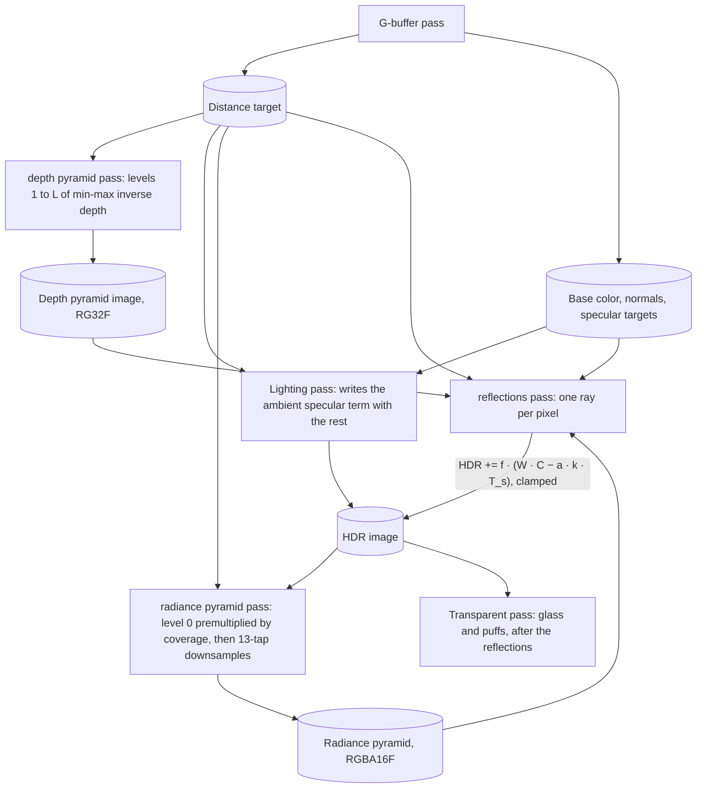
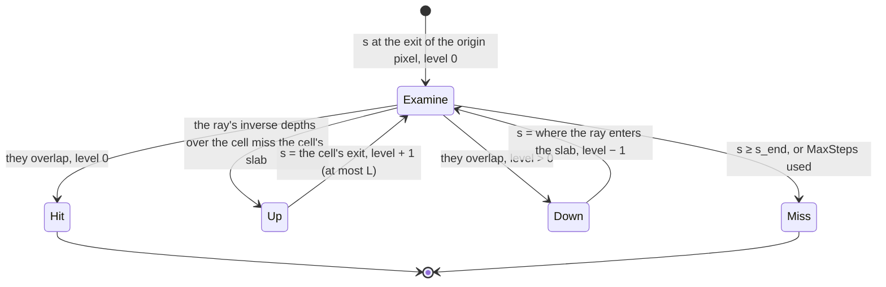
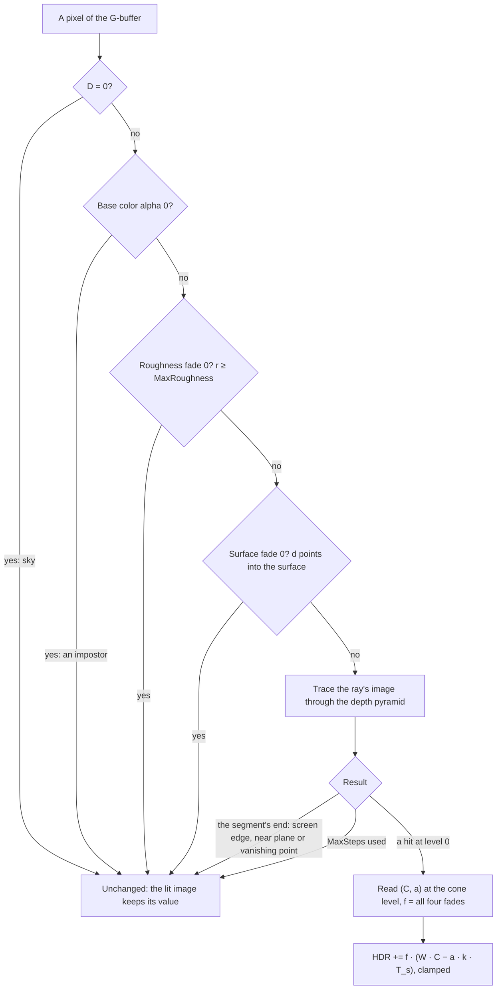

# Screen-space reflections

Ticket: `ter-jxv9`, a member of the rendering upgrade epic (`ter-sglu`, [rendering-upgrade.md](rendering-upgrade.md)). The user chose the design on 2026-10-25, in the ticket's "Design decisions". This doc fills in the details. Three points are open, see "Open forks".

## Goal

Today a glossy surface reflects only the lights and the ambient specular term. The ambient specular term is the light of the ambient light along the specular lobe, weighted by the BRDF tables ([pbr-brdf.md](pbr-brdf.md), "The ambient light's specular part"). Today the hemisphere of two colors gives that light. So a glossy floor, a metal hull or a canopy frame shows no image of the objects around it. After this ticket:

- A smooth floor shows the objects on the screen above it, in their own colors, weighted by the Fresnel term and the energy compensation of the PBR BRDF. A metal floor tints them with its own color.
- The reflection blurs as the roughness rises, with no noise, and it blurs less where the reflected object touches the floor.
- Where a reflected ray leaves the screen, finds nothing, or reaches the sky, the surface shows the ambient specular term, with no hard edge between the two.
- One pass serves all three depth ranges.
- A switch turns it off, and with the switch off the frame is the frame from before.

## Terms

| Term | Meaning |
|---|---|
| Distance, D | The value of the G-buffer's distance target at a pixel: the Euclidean distance from the eye in m, 0 for sky. |
| View ray of a pixel, r(p) | forward + x_ndc · right · tan(h) − y_ndc · up · tan(v), at the pixel's center. It is not a unit vector, and its component along forward is 1. `lighting.vert` interpolates the same vector. |
| View depth, z | The distance of a point along the camera's forward axis, in m. For a pixel, z = D / \|r(p)\|. |
| Inverse depth, w | 1 / z, in 1/m. Infinitely far points have w = 0. A surface has w of at most 20, because the near plane is 5 cm away. |
| Pixel angle, θ_px | The angle that one pixel covers at the center of the screen, `CameraView.PixelAngle`, in `frame.params.z`. |
| Cell | Level k of a pyramid splits the screen into cells of 2^k by 2^k pixels. Cell (i, j) of level k covers pixels i · 2^k to (i + 1) · 2^k − 1 across, and the same down, clipped to the screen. |
| Bounds of a cell | The largest and the smallest inverse depth of the surface pixels in the cell: (w_near, w_far). A cell with no surface pixel has the empty bounds (0, 10^30). |
| The depth pyramid | The bounds of every cell of every level from 0 to the top level L. Level 0 is the distance target itself. The depth pyramid image, RG32F, holds levels 1 to L. |
| Top level, L | The level whose single cell covers the screen: ⌈log₂ max(width, height)⌉, at least 1. 11 at 1920 × 1080. |
| Thickness share, κ | 0.1. A surface at view depth z is assumed to fill the depths from z to z (1 + κ) behind it. |
| Slab of a cell | The inverse depths [w_far / (1 + κ), w_near]: every depth that a surface of the cell fills under the thickness share. The empty bounds give an empty slab. |
| The ray | The reflected ray of one pixel: its origin O and its unit direction d, in the camera-relative world axes of the shaders. |
| The ray's image | The ray projected on the screen: a straight segment S(s) = S₀ + s · ΔS in pixels, with the inverse depth w(s) = w₀ + s · Δw, for s from 0 to the segment's end s_end. |
| Entry share, q | Where the ray enters the slab of the pixel that it hits: 0 at the front of the slab, 1 at its back. |
| The radiance pyramid | One RGBA16F image with levels 0 to L. Level 0 holds the lit image times the surface coverage in RGB, and the coverage in A. Each next level is a filtered half-size copy of the one before. |
| Surface coverage, m | 1 for a pixel with D > 0, 0 for sky. |
| The cone | The cone around the ray that stands for the specular lobe and the gap to the next ray. Its half angle θ_c has tan θ_c = max(1.7602 α, f · s). |
| Cone level, λ | The level of the radiance pyramid that the cone's footprint at the hit selects. |
| Traced radiance C, traced coverage a | The RGB and the A of the radiance pyramid at the hit and the cone level. C is premultiplied by the coverage. |
| The fade, f | The product of four factors from 0 to 1: the roughness fade, the surface fade, the edge fade and 1 − q. |
| Specular weight, W | E · c, per color channel: the specular albedo times the energy compensation, from the DFG table. `lobes.specularAlbedo * lobes.energyCompensation` in `lighting.glsl` today. |
| The ambient specular term, T_s | The specular part of the ambient light that a surface point sends toward the eye: `ambientTerms(...).specular` in `lighting.glsl`. Today W · mix(ground, sky, s_l), the hemisphere's light along the lobe. While the environment map of `ter-nl5u` is on, W times the map's prefiltered light. While SSAO (`ter-b3h5`) is on, also times its specular occlusion. The HDR image holds it pre-exposed, k · T_s. |
| Exposure scale, k | 2 to the power of the frame's exposure in stops ([auto-exposure.md](auto-exposure.md), "Terms", on branch `ter-zzyr-auto-exposure` until it merges). Every value in the HDR image is pre-exposed by it. |
| The reflection delta, Δ | What the trace adds to a pixel of the HDR image: f · (W · C − a · k · T_s). |
| Origin pixel | The pixel whose reflection the trace computes. |

## Decisions

The user made the decisions marked (User). This design settled the others by the decisions and the project's rules. Each has its reason.

### Made by the user

1. Hi-Z tracing over a min-max pyramid of depth, which SSGI (`ter-a24f`) can reuse. (User)
2. The rays read this frame's lit HDR image, before the transparent pass, so glass and puffs do not show in reflections. (User)
3. Rough surfaces blur by a cone over a mip chain of that image, sized by the roughness, with no noise. (User)
4. The trace runs at full resolution. (User) On 2026-10-25 the user allowed every technique of `docs/plans/rendering-performance.md`, "The techniques", half-resolution reflections included, for the profile ticket `ter-ff6y`, and forbade every temporal technique. That ticket made a trace at half resolution the default, with an upsample that respects depth and normal edges, because full resolution stayed above the 3 ms that this design expected. Full resolution stays the setting `TraceResolution.Full`. See "The half-resolution trace". (User, the ticket's note of 2026-10-25) On 2026-10-26 the user saw the 2× crops of the mirror spheres, whose reflected edges step by 2 pixels, and the cabin at both resolutions side by side, and kept the half-resolution trace as the default. (User)
5. Where a ray hits, its radiance replaces the ambient specular term, with the same weight from the BRDF tables and the same energy compensation. Where it leaves the screen, hits nothing or reaches the sky, it fades back to the ambient specular term with no hard edge. (User) The ticket's words name the hemisphere term. On 2026-10-25 the user chose a scene environment map (`ter-nl5u`), which replaces the hemisphere as the ambient light while it is on. So the fallback is the ambient specular term, whatever light produces it, and SSR reads that light in one place (see "The one place where SSR reads the ambient light"). (Orchestrator, from the user's decision of 2026-10-25)
6. Above a maximum roughness, SSR fades out. (User)
7. The rays read the distance target, so one pass serves all three depth ranges, and the assumed thickness grows with distance. (User)
8. Compute passes, so the build waits for the compute pipelines of the exposure ticket (`ter-zzyr`). (User)
9. A union switch `NoReflections` or `ConeTracedReflections(MaxRoughness, MaxSteps)` in `RendererOptions`, on by default and off in the test fixtures. (User)
10. GPU pixel tests: a bright object above a mirror floor shows in the floor, a rougher floor blurs it, the reflection fades at the screen edge. No reference images (the epic's rule). (User)
11. The cost is measured at 1080p, and the user sees captures before the merge. (User)
12. No temporal accumulation and no noise (the ticket, and the epic's rule for temporal effects). (User)

### Settled by this design

13. The depth pyramid holds inverse depth w = 1/z, not the distance. Along the image of a straight ray, w is an affine function of the screen position, and z and D are not (McGuire and Mara 2014). So the trace can test a whole cell against a ray exactly, with no march inside it. A 32-bit float keeps the same relative precision at 5 cm and at 10,000 km, so one pyramid serves all three depth ranges. Sky and infinity are both w = 0.
14. Level 0 of the depth pyramid is the distance target, read through one function that converts D to w. The pyramid image holds only levels 1 and up. A copy of level 0 is a second store of the distance.
15. A cell's bounds cover its surface pixels only, and a cell with no surface has the empty bounds (0, 10^30). Sky is not a surface: a ray never hits it, and it ends at the segment's end. The empty bound is a large finite number, not infinity, because a shader compiler's fast math may assume that no value is infinite, on any Vulkan driver and on MoltenVK alike. A cell outside its level, beside the screen, has the empty bounds too.
16. The thickness is a share of the view depth: a surface at depth z fills z to z (1 + κ), with κ = 0.1. In inverse depth the slab is [w / (1 + κ), w], so one constant serves every range: 0.5 m behind a crate 5 m away, 50 m behind a ship 500 m away. The captures of Part 6 check the value.
17. The ray follows the specular dominant direction d of Lagarde and de Rousiers 2014, not the mirror direction. The ambient specular term gathers along d: the lobe's sky share reads d today, and an environment map samples along d. So a hit and a miss read the same direction of the lobe, and the fade between them changes no direction. For a smooth surface, d is the mirror direction.
18. The origin moves off the surface along the geometric normal by 2 z θ_px, two pixel footprints, and at most z / 2. A ray that starts on the surface hits its own neighbor pixels by rounding. The geometric normal is the surface that the depth sees. The cap (the portable float audit, 2026-10-25) keeps the origin at least half as deep as the surface, because θ_px passes 1/2 in a window a few pixels tall or at a field of view near a half turn, where two footprints along the normal of a surface that faces the eye reach the eye's plane.
19. The cone's half angle comes from Uludag's rule, translated to GGX: tan θ_c = α √((1 − ξ) / ξ) with ξ = 0.244, about 1.7602 α. The cone level is log₂ of the cone's radius at the hit, in pixels (Uludag 2014). See "The cone".
20. One trilinear sample of the radiance pyramid at the hit gives the traced radiance. This is open fork 1. The doc is written for it.
21. The radiance pyramid is premultiplied by the surface coverage, so a cone whose footprint covers sky gives a coverage below 1, and that share of the cone keeps the ambient specular term. This applies decision 5 to the inside of a cone: sky in a footprint counts as a miss, as a ray that reaches the sky does. It also keeps the black star field of space out of blurred reflections. With an environment map, the stars come back through the map.
22. The radiance pyramid filters with the 13-tap downsample of Jimenez 2014, the same weights as the bloom's down filter. One filter serves both chains, and its smooth kernel keeps trilinear reads free of blocks.
23. No fade by the direction of the ray toward the eye. Uludag fades such rays because a trace without thickness takes the back faces of objects for their front faces. Here a ray that enters a slab from behind has q = 1, and so no weight. So the slab rule already gives back faces no weight, and a ray toward the eye that meets a front face keeps it. Pure model first: a fade comes only if the captures show a misbehavior that the slab rule misses, and the report names it.
24. No fade by the length of the ray. A length limit cuts the reflection of a far planet in a near floor, which is on screen and valid. The edge fade and the slab rule already make every transition smooth.
25. The roughness fade is Unreal Engine 4's: full weight up to half the maximum roughness, and 0 at it. f_rough = clamp(2 − 2 r / MaxRoughness, 0, 1). It needs no second constant.
26. The edge fade is Uludag's form: a smoothstep across a band at each edge, multiplied over the two axes. The band is a tenth of the shorter side of the screen, 108 px at 1080p, the same on all four edges.
27. The trace adds the reflection delta to the HDR image, which already holds the ambient specular term. The lighting pass does not change. See "Where SSR splits the ambient specular term from the lit image".
28. SSAO's specular occlusion multiplies the ambient specular term, never the traced radiance. See "How SSR meets SSAO".
29. Two new stages: `DepthPyramid` after `GBuffer`, and `Reflections` after `Lighting`. Three passes: "depth pyramid", "radiance pyramid" and "reflections". At half resolution, the default since ticket `ter-ff6y`, a fourth pass "reflection trace" runs before "reflections", which then upsamples it. So the GPU timings show each part, and SSGI can use the depth pyramid without the reflections.
30. The HDR image gets the storage usage only while reflections are on. Then a frame without reflections is the frame from before, image for image.
31. The defaults: `MaxRoughness` 0.6, Unreal Engine 4's default, which the user chose from the captures of Part 6 (open fork 2), with the profile ticket `ter-ff6y` for its cost; and `MaxSteps` 128. Part 6 checked 64, 128 and 256 steps against 512 in the review captures. At 64 steps the edge view's glossy box face shows horizontal streaks, where rays run out of steps and their neighbors hit. At 128 the streaks are gone. The user wanted the fewest steps whose difference does not show to the naked eye (2026-10-25), and that is 128. See "Cost", "Results of Part 6".
32. The validation: `MaxRoughness` above the roughness floor 0.045 and at most 1, and `MaxSteps` from 1 to 1,024. Below the floor no surface reflects, and that setting is `NoReflections`, as bloom refuses a strength of 0.
33. A review scene, `reflections`, and the headless flag `--reflections on|off`, as the PBR ticket added `pbr-spheres` and bloom added `--bloom`. The demo's surfaces have the roughness 0.38 and no metal, so no other scene shows the acceptance criteria.
34. An impostor pixel starts no ray, because its light is baked into the atlas and the G-buffer holds no material for it. It is a valid hit.
35. Transparent surfaces get no SSR. They are not in the G-buffer, and a trace in the transparent pass reads the image that it blends into. The environment map gives glass its reflections (`ter-nl5u`).
36. The C# copy of the pyramid, the ray's image, the trace and the cone is production code in `src/Tertius.Rendering/Shading`, as the BRDF's and the exposure meter's copies are. CPU tests test it, and a GPU test pins the shader to it. Its level count sets the size of the GPU images.

## Sources

- Uludag 2014, "Hi-Z Screen-Space Cone-Traced Reflections", GPU Pro 5, pp. 149–192: the hierarchical trace through a min-Z pyramid, cell by cell, one level up after each crossing and one level down after each hit of a cell, with a small step past each cell's edge. Also the cone from the specular lobe, with ξ = 0.244, the cone's footprint, by the radius of its circle, as the level of a blurred chain of the lit image, and the screen edge fade. The chapter's code was never published.
- McGuire and Mara 2014, "Efficient GPU Screen-Space Ray Tracing", JCGT 3(4): the ray's image as a 2D segment along which inverse depth interpolates linearly, perspective-correct. Also the clip at the near plane, and each pixel as a slab of a thickness behind the depth.
- Stachowiak 2015, "Stochastic Screen-Space Reflections", SIGGRAPH Advances in Real-Time Rendering, with Uludag: the hierarchical trace in Frostbite's SSR, and its requirements of contact hardening and blur by the roughness. Its stochastic rays, ray reuse, half resolution and temporal filter are left out by decisions 3, 4 and 12.
- Lagarde and de Rousiers 2014, "Moving Frostbite to Physically Based Rendering 3.0": the specular dominant direction, and the specular occlusion that SSAO uses, with the remark after listing 26 that a screen-space reflection already holds the visibility that the specular occlusion estimates.
- Karis 2013, "Real Shading in Unreal Engine 4": the split sum, which weights the light along the lobe by the DFG table.
- Walter, Marschner, Li and Torrance 2007: the GGX sampling of half vectors, whose inverse gives the share of half vectors inside a cone.
- Jimenez 2014, "Next Generation Post Processing in Call of Duty: Advanced Warfare", SIGGRAPH: the 13-tap downsample.
- Unreal Engine 4's screen-space reflections: the default maximum roughness 0.6, and the fade from half the maximum.

## The method

One frame of SSR has three steps after the G-buffer and the lighting passes: build the depth pyramid from the distance target, build the radiance pyramid from the lit image, and trace one ray per pixel, which adds its delta to the HDR image.



### 1. The depth pyramid

Level 0 is the distance target. The bounds of pixel p are

```
w(p) = |r(p)| / D(p)                    when D(p) > 0
bounds(p) = (w(p), w(p))                a surface
bounds(p) = (0, 10^30)                  sky: the empty bounds
```

Level k ≥ 1 merges the up to four cells of level k − 1 under each cell:

```
merge((n₁, f₁), (n₂, f₂)) = (max(n₁, n₂), min(f₁, f₂))
size_k = ⌈size_{k−1} / 2⌉ per axis      so cell (i, j) of level k covers exactly the pixels (i, j) · 2^k + (0 … 2^k − 1), clipped
```

- With the sizes rounded up, the pixels of a cell are the pixels whose coordinates shifted right by k give the cell. So the trace finds the cell of a screen position by a division, and the last row and column of an odd level have one or two children. Uludag rounds down and adds a row and a column at odd sizes. Rounding up needs no special case.
- The merge of an empty cell with anything gives the other: max(0, n) = n and min(10^30, f) = f.
- The image's mip m holds level m + 1, RG32F: R is w_near and G is w_far.
- At 1920 × 1080, level 1 is 960 × 540 and level 11 is 1 × 1. The image is padded to 1024 × 1024, so that each mip holds its level (see "Images").

The pass dispatches once per level, each level reading the one before. `depth_pyramid_first.comp` reads the distance target for level 1, and `depth_pyramid_down.comp` reads level k − 1 for each later level.

### 2. The ray

The trace reads the G-buffer at the origin pixel p:

```
D = distance(p);  stop when D ≤ 0 (sky) or the base color's alpha is 0 (an impostor)
s = surfaceAt(p)                                     the shading input that the lighting pass reads (Part 2)
r = flooredRoughness(s.roughness);  α = r²
f_rough = clamp(2 − 2 r / MaxRoughness, 0, 1);  stop when it is 0          Unreal Engine 4
u = normalize(r(p));  P = u · D;  V = −u             the surface point and the direction toward the eye
d = specularDominantDirection(n, reflect(−V, n), α)  Lagarde and de Rousiers 2014, as brdf.glsl computes it
f_surface = clamp(d · n_g / 0.05, 0, 1);  stop when it is 0
z = D / |r(p)|
O = P + n_g · min(2 θ_px, 1/2) z                      the origin, two pixel footprints off the surface, at most z / 2
```

where n is the shading normal and n_g the geometric normal of the G-buffer.

- d leans from the mirror direction toward n as the roughness rises (decision 17).
- f_surface fades a ray that leaves below the geometric surface. Only a normal map can turn the shading normal so far from the geometric one. The demo has no normal maps, so the factor is 1 there.
- The offset of 2 z θ_px: a ray that rises from a flat surface at a grazing angle stays within half a pixel's depth step of the surface over the next pixel. A point at height b above the surface lies in front of the surface along every view ray when b > z θ_px cos φ / 2, where φ is the angle between the view ray and the surface. 2 z θ_px is four times that bound at any φ, and covers the error of the 16-bit normals.

### 3. The ray's image on the screen

A point X in the camera-relative axes projects to the pixel position

```
z(X) = X · forward
pixel(X) = ((X · right) / (tan h · z(X)) + 1, −(X · up) / (tan v · z(X)) + 1) · (width, height) / 2
```

with right and up unit vectors, x to the right and y down, as `gl_FragCoord` counts. It is the inverse of the view ray: pixel(r(p)) is p's center.

Along the ray X(t) = O + t d, the screen position moves on a straight line, and w = 1 / z(X) is an affine function of the screen position on it (McGuire and Mara 2014). The trace takes the image from two points of the ray:

```
z₀ = z(O);  dz = d · forward
t₁ = z₀                        when dz ≥ −1/2, so that z(X(t₁)) = z₀ (1 + dz) ≥ z₀ / 2
t₁ = z₀ / (2 (−dz))            when dz < −1/2, so that z(X(t₁)) = z₀ / 2 > 0
S₀ = pixel(O);   ΔS = pixel(O + t₁ d) − S₀            pixels per unit of s
w₀ = 1 / z₀;     Δw = 1 / z(O + t₁ d) − w₀            1/m per unit of s
S(s) = S₀ + s ΔS;   w(s) = w₀ + s Δw
```

The second point always lies in front of the eye, at least half as deep as the origin and at most z₀ from it, so both projections are finite and its depth does not cancel. A rule of z₀ / (2 (−dz)) for every ray toward the eye would put the second point of a ray nearly parallel to the image plane millions of z₀ away, where the rounding of its components exceeds its depth, and its image could flip. The segment ends at the first of three places:

```
s_screen  where S(s) leaves the screen, [0, width] × [0, height]
s_near    where w(s) reaches 1 / 0.05 m, the near plane, when Δw > 0: the ray comes toward the eye
s_far     where w(s) reaches 0, the vanishing point of d, when Δw < 0: the ray goes away to infinity
s_end = min(s_screen, s_near, s_far)
```

- A ray parallel to the image plane has Δw = 0 and ends at the screen's edge.
- A ray that goes to infinity ends at its vanishing point, where w = 0. If the vanishing point lies on the screen, the ray has looked at everything on its way to infinity, and the segment ends there.
- A ray with no screen motion, ΔS = 0, runs along its own view ray, ends at once, and misses.

### 4. The trace through the pyramid

The trace walks the ray's image from cell to cell (Uludag 2014), with min-max cells and a slab test in place of his test against the nearest depth.



For each step, at level k and parameter s:

```
cell    = floor((S(s) + ε · sign(ΔS)) / 2^k)    when s stands on an edge   ε = 0.01 px, so it belongs to the cell ahead
cell    = floor(S(s) / 2^k)                     when s is a slab entry solved strictly inside a cell
s_exit  = min(s at the cell's far edge on x, s at its far edge on y, s_end)
(n, f)  = bounds(k, cell)                       the empty bounds for a cell outside its level
high    = n;   low = f / (1 + κ)                            the slab
w_in    = w(s) after a crossing, the slab bound after a descent;   w_out = w(s_exit)
overlap = max(min(w_in, w_out), low) ≤ min(max(w_in, w_out), high)
```

- The nudge ε is for a position on a cell's edge only: the start at the exit of the origin pixel, every crossing, and a descent that leaves s where it was or moves it to s_exit. A slab entry that a descent solves strictly between s and s_exit lies inside a cell, and takes no nudge. With the nudge, an entry within ε of a far edge would go to the cell ahead, and the trace would skip the sliver of the cell where the ray meets its slab: in a test of 10,000 random rays, 27 such grazing contacts moved the hit to a surface up to 8 px further along the ray. Without it, the trace finds the pixel that a pixel-by-pixel march finds.
- No overlap: no surface of the cell, with its thickness, meets the ray inside the cell. The ray crosses the cell: s = max(s, s_exit), and the level rises by one, up to L, for a longer step next time. s never moves back: an entry solved inside a cell can round past that cell's exit, and the next descent then finds the entry at s, keeps s on an edge, and the nudge moves the walk on.
- A cell outside its level, which a ray reaches when its origin lies up to about two pixels beside the screen or when the nudge pushes it past an edge, has the empty bounds: no surface lies beyond the screen's edges. The cap of the level at L matters only for such a ray, which crosses top-level cells beside the screen.
- An overlap at a level above 0: the ray can meet a surface inside the cell. The trace moves s to where the ray enters the slab, and looks at the finer level:

  ```
  s_entry = s                          when low ≤ w_in ≤ high: the ray is already inside the slab
  s_entry = (high − w₀) / Δw           when w_in > high: the ray is in front and comes toward the slab's front
  s_entry = (low − w₀) / Δw            when w_in < low: the ray is behind and comes toward the slab's back
  s = clamp(s_entry, s, s_exit);  w_in = clamp(w_in, low, high);  level − 1
  ```

- An overlap at level 0 is a hit in that pixel. The entry share comes from where the ray stands at the pixel's edge, w_edge = w(s_pixel), where s_pixel is the later of the ray's crossings of the pixel's two near edges. After a descent, s is a solved slab entry, not the pixel's edge, so w_in does not serve (see "Precision and determinism"):

  ```
  q = 0                                    when w_edge > high: the ray enters through the front of the surface
  q = (high − w_edge) / (high − low)       when it is inside the slab at the pixel's edge
  q = 1                                    when w_edge < low: the ray enters from behind, so it meets the back of the object
  ```

  The hit position is S(s_entry), clamped into the pixel.

- The steps count every examined cell. When `MaxSteps` steps end with no decision, the ray misses.

The slab rule decides the two cases that a trace without thickness gets wrong:

- A ray that passes behind an object by more than κ z misses its slab, crosses its pixels and goes on. It can hit something behind the object, or miss.
- A ray that enters an object's slab across a pixel's edge, at a depth inside the slab, hits it with the weight 1 − q. So the weight falls to 0 as the ray passes deeper behind the surface, and the step from "hits the object" to "passes behind it" has no hard edge.

The trace starts at level 0 at the exit of the origin pixel. Uludag starts at level 2 to save steps. Level 0 cannot skip a hit near the contact of an object with the floor.

### 5. The radiance pyramid

```
level 0:  R(p) = (L(p) · m(p), m(p))                        L the HDR image, m the surface coverage
level k:  R_k(q) = jimenez13(R_{k−1}) at the center of texel q              k from 1 to the top mip, Vulkan's mip sizes
```

- L is the lit image after the lighting pass: pre-exposed radiance with the ambient specular term of every surface, before the transparent pass and before any reflection. So the reflected surfaces carry their own ambient light, and a reflection shows no reflection of a reflection. A metal object in a mirror is therefore not black: its ambient specular term is in its pixels.
- jimenez13 is the filter of `bloom_down.frag`: 13 bilinear taps of the level below at offsets of 0, ±1 and ±2 texels, five boxes of four taps, the inner box weighted 0.5 and the four corner boxes 0.125 each (Jimenez 2014). It applies to the four channels alike. Premultiplied, a texel of sky adds nothing to the color and nothing to the coverage, so the color of level k over its coverage is the mean radiance of its surface pixels.
- The levels are the image's mips, so their sizes halve and round down, from the screen's size to 1 × 1: mips 0 to 10 at 1080p. The center of texel q lies on the source texel corner 2q + 1 where the source has an even size, as in `bloom_down.frag`. The taps clamp to the edge.

`radiance_pyramid_first.comp` writes level 0, and `radiance_pyramid_down.comp` writes each later level with one dispatch per level.

### 6. The cone

The cone stands for the specular lobe around the ray. Uludag sizes it from the Phong lobe: the reflected directions within the angle θ = acos(ξ^(1/(n+1))) of the mirror direction hold the share 1 − ξ of the lobe, with ξ = 0.244, and the cone's half angle is θ / 2.

For GGX, the share of the half vectors within θ_h of the normal follows from the GGX sampling (Walter and others 2007):

```
cos θ_h = sqrt((1 − u) / (1 + (α² − 1) u))   for a uniform u   ⇔   tan² θ_h = α² u / (1 − u)
share(θ_h) = tan² θ_h / (α² + tan² θ_h)
```

A reflected direction deviates from the mirror direction by about 2 θ_h. So the angle that holds the share 1 − ξ of the reflected directions is 2 θ_h(1 − ξ), and Uludag's half of it is θ_h(1 − ξ):

```
tan θ_c = α · sqrt((1 − ξ) / ξ) = 1.7602 α
```

| Roughness r | 0.045 (the floor) | 0.1 | 0.2 | 0.38 (the demo's paint) | 0.5 | 0.6 |
|---|---|---|---|---|---|---|
| tan θ_c | 0.0036 | 0.0176 | 0.0704 | 0.254 | 0.440 | 0.634 |
| θ_c | 0.20° | 1.0° | 4.0° | 14.3° | 23.8° | 32.4° |

At the hit, the cone's radius is t tan θ_c in m, where t is the length of the ray from O to the hit point. The eye sees that radius at the hit's distance D_hit:

```
ρ_px = t · tan θ_c / (D_hit · θ_px)          the cone's radius at the hit, in pixels
λ = clamp(log₂ ρ_px, 0, L)                   the cone level
```

- The cone level is log₂ of the radius, as in Uludag, not of the diameter. A bilinear read of level λ spreads over 2^λ pixels on each side of its center, which is the radius.
- t grows from the contact of the object with the floor, so a reflection is sharp where the object touches the floor and blurs with the distance from it: contact hardening, a requirement of Stachowiak 2015.
- D_hit and t come from the hit pixel's distance: X_hit = normalize(r(S_hit)) · D(hit pixel), t = |X_hit − O|. The ray's own inverse depth near a far hit has too little precision (see "Precision and determinism").
- Example at 1080p and a vertical field of view of 60°, θ_px = 0.00097: a floor of roughness 0.2, 4 m from the eye, reflects a box 2 m away from the reflecting point. ρ_px = 2 · 0.0704 / (4 · 0.00097) = 36 px, so λ = 5.2.

The cone also covers the gap to the next ray (ticket `ter-cuf9`, the user's choice of 2026-10-26: soft mirrors at half resolution over full-resolution rays). A mirror's lobe alone gives a point read, and the rays of neighboring texels hit points 2 or more pixels apart, so the point reads alias and reflected edges snap to the grid of the texels. The cone's tangent is the larger of two spreads, both lengths at the hit per metre of ray:

```
tan θ_c = max(1.7602 α, f · s)
```

- f is the pixel's reflection footprint (docs/plans/environment-map.md, decision 33): the chord from d to the d of a neighboring pixel. f · s is the distance between this ray's point and the next ray's point at the same length t, for small f · s.
- s is the side of the trace's texel in pixels: 1 for the full-resolution trace, 2 for the half-resolution trace. Each trace passes its own s as a constant to the one `traceReflection`.
- The rough lobe keeps its cone wherever its spread is the larger: a flat floor's f is about θ_px, so at r = 0.2 the lobe's 0.0704 passes f · s by 36 times or more.
- The term holds the spread of the rays' directions, not of their origins, which lie s pixels apart on the surface. A flat mirror's cone covers s · t / D_hit pixels, so the reflections of far objects soften and a reflection near the contact stays sharp. A curved mirror's f is many times θ_px, and its cone covers the gap at both resolutions.
- Where neighboring rays hit different surfaces, as at the outline of an object before a farther one in the reflection, the hits lie far apart and each cone blurs only its own surroundings, so no cone can place the outline between them. There the upsample traces each pixel's own ray (see "Rays at outlines").

The trace reads the radiance pyramid once, at the hit position and the cone level, with a trilinear sampler:

```
(C, a) = textureLod(radiancePyramid, S_hit / (width, height), λ)
```

### 7. The fades

| Factor | Formula | Reaches 0 where | Source |
|---|---|---|---|
| Roughness fade | clamp(2 − 2 r / MaxRoughness, 0, 1) | r ≥ MaxRoughness. Full weight up to half of it. | Unreal Engine 4 |
| Surface fade | clamp(d · n_g / 0.05, 0, 1) | The ray points into its own geometric surface. | This design |
| Edge fade | e(x) e(y), with e(x) = smoothstep(0, 1, min(x, width − x) / B) and B = 0.1 min(width, height) | The hit lies on the screen's edge. | Uludag 2014 |
| Entry fade | 1 − q | The ray enters the slab from behind, or at its back. | This design, after the slab of McGuire and Mara 2014 |

- A miss has no fade: it adds no delta, which is the same as f = 0. So every transition into a miss is continuous where its neighbor's weight reaches 0: at the screen's edge by the edge fade, behind an object by the entry fade, and above the maximum roughness by the roughness fade.
- The sky never stops a ray. A ray that reaches the sky misses at the segment's end. A cone whose footprint covers sky gets a coverage a below 1, and that share keeps the ambient specular term.
- A ray toward the eye needs no fade of its own (decision 23). It hits the back of an object with q = 1, and so no weight. It leaves through the near plane with a miss.
- One transition stays hard: two neighbor rays where one hits an object and the other passes beside it and misses. That edge is the reflected silhouette of the object, which a mirror shows.
- A ray that runs out of steps misses, and its neighbor can hit. `MaxSteps` must be large enough that the review scenes show no such edge (Part 6).

### 8. The reflection replaces the ambient specular term

Of the cone, the fade's share f resolves on the screen, and within it the coverage a falls on surfaces. The rest keeps the ambient specular term:

```
specular light = f · W · C + (1 − f · a) · k · T_s
```

- C is pre-exposed: it comes from the HDR image of the same frame, with the same k. T_s is radiance, so k pre-exposes it, as the lighting pass does for the whole reflected light.
- W is the weight of the ambient specular term: T_s is W times the light along the lobe. So with f = 1 and a = 1, the reflection is W · C, the traced radiance under the weight of the ambient specular term, with its Fresnel term and its energy compensation (decision 5).
- With f = 0, it is k · T_s, the ambient specular term itself.

The lighting pass already wrote k · T_s into the pixel. So the trace adds the difference:

```
Δ = f · (W · C − a · k · T_s)
HDR(p) = clamp(HDR(p) + Δ, 0, 32,256)          per channel, in 32-bit floats, then stored as half floats
```

The clamp is `MaxRadiance`, 32,256, the surfaces' share of the HDR image (ARCHITECTURE.md, "Portable Vulkan"). It keeps the stored value finite: a mirror that reflects a pixel at the cap adds up to that much again, the puffs over the pixel add up to as much again, and a half float above 65,520 rounds to infinity, which the tone curve turns into NaN.

### Precision and determinism

- The ray's inverse depth w(s) = w₀ + s Δw carries an absolute error of about |Δw| · 6 · 10⁻⁸. A far object's slab is narrower than that when seen from a near origin: a planet 10⁷ m away has a slab 9 · 10⁻⁹ /m thick, against an error of 3 · 10⁻⁸ /m for a floor 2 m away. The trace still hits it right: a ray toward the planet reaches such a small w only within a pixel of its vanishing point, and at every other pixel its w is far above the planet's slab. In the pixel of the vanishing point, w spans from 0 to about 5 · 10⁻⁴, which overlaps the slab, and the ray stands in front of the planet at the pixel's edge, so q = 0. So a mirror shows the far planet that lies at the vanishing point of its ray, which is what a ray to infinity sees. The entry share depends on w only at the pixel's edges, never on a solved s, for this reason. For the same reason the overlap test never recomputes w at a solved s: after a descent, the ray's inverse depth at s is the slab bound that s was solved for (w_in clamped to the slab), and only a crossing recomputes w(s). Near the vanishing point the rounding of w₀ + s Δw at a solved entry is larger than the planet's slab, so a recomputed w_in can fall behind the slab of the finer cell, which the descent's own bound says it cannot be. Part 5's GPU test of the far planet missed in that way at 20° above the horizon, and a C# sweep of 3,613 floor rays found the same miss in the C# copy before the change.
- Each invocation reads only images that no invocation of its dispatch writes, and writes only its own pixel of the HDR image. The trace has no noise and no history. So the same frame gives the same bits on every run on one GPU.

## The ambient specular term

### Where SSR splits the ambient specular term from the lit image

The lighting pass writes the whole reflected light of a pixel into the HDR image, the ambient specular term included. SSR must replace that term where it hits. Three designs do that:

| Design | What changes | Costs | Its problems |
|---|---|---|---|
| A. The trace adds the reflection delta f · (W · C − a · k · T_s) to the HDR image. | The trace pass. The lighting pass does not change. | Nothing stored. W and T_s are computed again in the trace, by the same functions. | A sum that the lighting pass capped at 32,256 lacks its part above the cap. Such a pixel is thousands of times display white, so it shows white with or without the delta. |
| B. The lighting pass writes the ambient specular term into a target of its own and leaves it out of the HDR image. A resolve adds f · W · C + (1 − f · a) · k · T_s. | The lighting pass, in two shaders: with and without the term. A new full-size RGBA16F target, 16.6 MB at 1080p. | A second store of a part of the light. | The radiance pyramid must add the term back, because a reflected surface carries its own ambient specular light. With SSR off, the lighting pass needs its other shader. |
| C. The lighting pass leaves the term out, and the trace computes it for every pixel. | The lighting pass, in two shaders, and the trace for every pixel. | Nothing stored. | The same problem with the radiance pyramid as B, and the trace must run for every pixel, also above the maximum roughness. |

This design takes A, by the project's rules:

- One store for each piece of state. B stores a part of the light in a second target, beside the image that holds the sum.
- The pure model first. The ambient specular term stays the model's answer for the light along the lobe. SSR says how much the light that its ray finds differs from that answer, under the same weight. In real numbers, f W C + (1 − f a) k T_s − k T_s = f · (W · C − a · k · T_s) exactly. In floats, the error is the HDR image's own rounding.
- The automatic machinery lives in one place. The trace pass owns the whole replacement: the lighting pass, the transparent pass and the impostor capture keep one path each, and with the switch off nothing runs.
- The clamp caveat of A applies only to a pixel whose pre-exposed light passes 32,256, which is thousands of times display white ([auto-exposure.md](auto-exposure.md), "Puffs and the clamp"). The trace clamps its result again.

### The one place where SSR reads the ambient light

The ambient specular term comes from different light: the hemisphere today, and the environment map of `ter-nl5u` while it is on. SSAO's specular occlusion multiplies it while SSAO is on. SSR must not depend on either. So `lighting.glsl` gets one function that gives the ambient light of a surface point in its two terms, and every reader of the ambient light reads it only through that function: `ambientLight`, which the lighting pass, the transparent pass and the impostor capture call, and the trace. The names follow the SSAO design ([ambient-occlusion.md](ambient-occlusion.md), "The lighting pass", on branch `ter-b3h5-ssao` until it merges):

```glsl
// W = E · c: the weight of the light that arrives along the specular lobe in the light toward the eye. Every ambient
// source and the reflection trace weight specular light by it.
vec3 specularWeight(SurfaceLobes lobes)
{
    return lobes.specularAlbedo * lobes.energyCompensation;
}

// The hemisphere as the ambient source (docs/plans/ambient-occlusion.md): the diffuse term by the normal's sky share,
// the specular term by the lobe's.
AmbientTerms hemisphereAmbient(ShadingInput s, SurfaceLobes lobes)
{
    vec3 ground = frame.ambientGround.rgb;
    vec3 sky = frame.ambientSky.rgb;
    AmbientTerms terms;
    terms.diffuse = lobes.diffuseColor * mix(ground, sky, s.skyFraction);
    terms.specular = specularWeight(lobes) * mix(ground, sky, s.lobeSkyFraction);
    return terms;
}

// The ambient light of a surface point in its two terms, from the ambient source and occluded
// (docs/plans/screen-space-reflections.md, "The one place where SSR reads the ambient light"). ambientLight and the
// reflection trace read the ambient light only through this function. V points from the surface to the eye.
AmbientTerms ambientTerms(ShadingInput s, SurfaceLobes lobes, vec3 V)
{
    return occludedAmbient(hemisphereAmbient(s, lobes), s, lobes);
}

vec3 ambientLight(ShadingInput s, SurfaceLobes lobes, vec3 V)
{
    AmbientTerms terms = ambientTerms(s, lobes, V);
    return terms.diffuse + terms.specular;
}
```

- `AmbientTerms` and `hemisphereAmbient` are SSAO's, with the weight named `specularWeight`, because the trace weights C by the same W.
- SSAO's `occludedAmbient` returns the occluded terms instead of their sum. The trace needs the specular term alone, and a sum hides it. `occludedAmbient` stays the one place where ambient occlusion applies, and the light that `ambientLight` gives does not change:

  ```glsl
  AmbientTerms occludedAmbient(AmbientTerms terms, ShadingInput s, SurfaceLobes lobes)
  {
      terms.diffuse *= s.occlusion;
      terms.specular *= specularOcclusion(lobes.NdotV, s.occlusion, lobes.alpha);
      return terms;
  }
  ```

- The environment map's ticket adds its source, which returns `AmbientTerms` from the prefiltered map, and changes only the source call inside `ambientTerms`. That source samples the map along the dominant direction, which follows from s, the lobe and V, so `ambientTerms` takes V and passes it. Nothing in SSR changes.
- `ambientLight` takes V as well, and `surfaceRadiance` passes it.
- The order of the merges does not matter. If SSR's Part 2 merges before SSAO, it writes `AmbientTerms`, `hemisphereAmbient`, `specularWeight` and an `ambientTerms` without `occludedAmbient`, and SSAO adds `occludedAmbient` inside `ambientTerms`. If SSAO merges first, SSR's Part 2 changes `occludedAmbient` to return the terms and adds `ambientTerms` around it.

### How SSR meets SSAO

SSAO (`ter-b3h5`, [ambient-occlusion.md](ambient-occlusion.md)) is designed at the same time: GTAO at half resolution, whose occlusion V multiplies the ambient diffuse term, and whose specular occlusion V_s, Lagarde's fit, multiplies the ambient specular term. The two meet in the ambient specular term:

- V_s multiplies T_s inside `ambientTerms`. So the lighting pass writes k · V_s · T_s from the source, and the trace's fallback is the same value, through the same function at the same pixel. The trace needs nothing more. At half resolution the pass that adds the delta is the upsample, and it too takes T_s at its own pixel.
- V_s never multiplies the traced radiance C. The SSAO design leaves this choice to SSR ("Other tickets").

The physical reason: the source's light stands for distant light, the sky or the environment. The specular occlusion estimates the share of the lobe that nearby geometry blocks from that distant light. Where the trace's ray finds the nearby geometry, C is the light of that geometry, so the blocking is already in C, and a second factor darkens the reflection of the very object that blocks the lobe. Lagarde and de Rousiers make the same point in the remark after their listing 26, and they still apply the specular occlusion to the cube map light behind the reflections. The share of the cone that SSR does not resolve, 1 − f · a, still looks past the nearby geometry toward the distant light, so V_s keeps multiplying it. One rule: the specular occlusion multiplies the ambient specular term wherever it is used, and nothing else.

- SSAO's occlusion at a pixel enters `ShadingInput.occlusion` through `surfaceAt(pixel)` (Part 2), which the lighting pass and the trace both call. SSAO reads it from G-buffer set binding 7, so that binding gains the compute stage with the others (see "Descriptor sets").
- Shared images: none, except the distance target. SSR's depth pyramid holds the exact bounds of inverse depth at full resolution, which a hierarchical trace needs. SSAO's view depth image holds the view depth of one pixel of each block of 2 × 2, at half resolution, which its horizon search needs. Neither serves the other. SSGI reuses SSR's depth pyramid (decision 1), and can read SSAO's image too.
- Shared uses: both designs add `ImageUse.StorageCompute` and require `shaderStorageImageExtendedFormats`. SSR's `StorageCompute` adds the sampled read to SSAO's two storage bits (see "Barriers"). Whichever merges second keeps one definition with all three bits.
- Order in the frame: SSAO runs before the lighting pass, which applies it. The trace runs after the lighting pass, so SSAO's result exists when the trace reads it.

## The half-resolution trace

Ticket `ter-ff6y` added this section under the user's allowance of 2026-10-25 (decision 4). The profile found the full-resolution trace ALU-bound at about 21 steps per pixel. After the changes that keep the image, the three passes took 6.76 ms in the Metal System Trace, against the 3 ms that this design expected. A ray for each block of 2 × 2 pixels does a quarter of that work. It follows SSAO's half-resolution horizons and their upsample (docs/plans/ambient-occlusion.md, "The upsample"), so one model serves both effects.

`ConeTracedReflections` gains a third member, `Resolution`, a `TraceResolution` of `Half` (the default) or `Full`. It is an enum, not a union, because the choice carries no data. `Problem` refuses a value that the enum does not name. `Full` keeps the one pass of "The passes".

At `Half`, two passes replace the trace:

1. "reflection trace" (`reflection_half_trace.comp`): one invocation for each texel (i, j) of an RGBA16F image of ⌈W / 2⌉ × ⌈H / 2⌉ texels. The texel traces the ray of its representative pixel (2i, 2j), the top-left pixel of its block, through the same gates and the same trace as the full-resolution pass. `reflection_pixel.glsl` holds the gates and the delta, and `reflection_ray.glsl` the ray, and both passes include them. The texel stores the ray's result (C, a) times the ray's own fades, 0 for a miss, or a coverage of −1 when the representative pixel starts no ray.
2. "reflections" (`reflection_upsample.comp`): one invocation for each pixel. A pixel that the gates let through takes the mean of the results of the up to four texels around it under the weight bilinear · max(0, 1 − h / p) · max(0, n · n_t)^8, and adds the delta of "8. The reflection replaces the ambient specular term" with that mean in place of its own ray. Here h is the distance of the texel's representative pixel from the pixel's tangent plane, p is the width of a texel at the pixel (2 pixel footprints), n is the pixel's geometric normal, and n_t the texel's. A texel with a coverage of −1 gets no weight. If no texel keeps a weight, the pixel keeps the ambient specular term, as for a ray that finds nothing. A sum of weights below the smallest normal float, 2^−126, counts as none: a GPU may flush it to 0, and Vulkan bounds a division's error only for a larger divisor.

The delta's fallback k · T_s is the pixel's own, not a texel's. The pixel's gates read its surface through `surfaceAt`, which also sets the reflection's footprint f by `reflectionFootprintAt` (docs/plans/environment-map.md, decision 33), so `ambientTerms` gives the very term that the lighting pass added at that pixel: the map's specular term and its reflected stars while the map is on, the hemisphere's while it is off. Only the rays' results (C, a) cross from the texels to the pixel. The trace's texel reads its representative pixel through the same gates, so its footprint is that pixel's, which its cone reads ("The cone"), but the trace adds no delta and so reads no ambient light. Its compiled code holds no access of the map.

The plane weight is SSAO's: a texel across a silhouette lies off the pixel's plane and gives it nothing. The normal weight is new, because a reflection turns with the normal and occlusion barely does: a texel across a crease lies on the pixel's plane at the crease, but its ray leaves a surface that faces another way. The power 8 keeps 0.89 of the weight for a turn of 10°, about the turn between two facets of a sphere of 32 segments, and 0.06 for 45°. The upsample computes it by three squarings, because `pow` is `exp2` of a `log2`, which is infinite at 0, and fast math can assume finite values. The fallback to the ambient specular term is the miss of decision 5, so the pure model needs no nearest-texel rule like SSAO's.

Each workgroup of 8 × 8 pixels reads its 5 × 5 texels, their rays, positions and normals, into shared memory once, and waits at a barrier of the workgroup before any invocation returns. `ReflectionUpsample` in `src/Tertius.Rendering/Shading` is the C# copy of the weights, beside `OcclusionUpsample`, and both walk a block's texels through `OcclusionUpsample.BlockTexels`.

The trace image adds 4.1 MB at 1080p, and the hit depth image of "Rays at outlines" 2.1 MB. The set of the trace gains bindings 4 and 5, the trace image and the hit depth image as storage images, which the trace writes and the upsample reads. Both are `StorageCompute` in both passes, and the trace discards their old content, because it writes every texel.

The half-resolution trace changes the image where a reflection holds an edge finer than a block: reflected edges step by 2 pixels. The user saw the captures on 2026-10-26, the 2× crops of the mirror spheres and the cabin at both resolutions side by side, and accepted them: the half-resolution trace stays the default, and full resolution stays a setting. (User)

`ReflectionTargets.Trace` holds the trace's images as a built-in union `ReflectionTrace` of `FullTrace`, with no image, and `HalfTrace(Traced, HitDepths)`, so no nullable image sits beside a resolution field. `ReflectionPass` takes the step `Trace` or `Upsample` and reads the case from the targets: `Trace` traces at the case's resolution, and the constructor refuses `Upsample` over a `FullTrace`. A resize remakes the images in the same case.

### Rays at outlines

Ticket `ter-cuf9` widened the cone to the gap between neighboring rays ("The cone"), which softens a reflection inside a reflected surface. But the outline of a reflected object still stepped by 2 pixels: there neighboring rays hit different surfaces, and no blend of their results places an edge between two different hits. On 2026-10-26 the user chose full-resolution rays at outlines only, over keeping the steps and over full-resolution rays on every mirror pixel. (User)

The rule: in the upsample, a reflecting pixel traces its own ray, exactly as the full-resolution trace does (`reflectingPixel`, `traceReflection` with s = 1, `reflectionDelta`), when the rays of the texels that it blends disagree. A texel is blended when it has a ray and its weight is at least the smallest normal float, 2^−126; a smaller weight counts as none, because a GPU may flush it to 0, so every driver blends the same texels. The rays disagree when:

- one of them hits and another misses: a coverage of at least 2^−14 beside a coverage of 0, or
- the view depths of their hits differ by more than the trace's slab thickness: the farthest lies past (1 + 0.1) times the nearest ("4. The trace through the pyramid", where a surface at depth z fills z to 1.1 z). Then the hits lie on different surfaces.

Otherwise the pixel keeps the blend. A pixel whose own ray misses keeps the ambient specular term, as at full resolution. The test is a product of the four texels' data that the upsample already reads, so a pixel inside a reflected surface, whose texels hit one surface, traces no ray. The upsample still costs more at every pixel: ARCHITECTURE.md, "Screen-space reflections", holds the measured cost and its likely causes. A color edge on one surface, such as a stripe on a wall, keeps the blend: its texels hit at one depth, and the cone softens it.

The trace classes each texel once, by its coverage: −1 for no ray, an exact 0 for a miss, and at least 2^−14, the smallest normal half float, for a hit. A hit of smaller coverage stores as a miss, (0, 0, 0, 0) with a depth of 0, such as a ray that meets a slab from behind, whose q of 1 gives a coverage of exactly 0. A driver may flush a half float's denormal to 0 on its store or its load, and the rounding of the conversion is undefined, so one GPU would class such a texel as a hit and another as a miss, and a coverage a rounding below 0 would become no ray. The upsample tests no ray as `ray.a < -0.5`, with a margin from each stored value (found in the review of ticket `ter-cuf9`).

The trace stores the view depth of each texel's hit, `hitDistance / length(viewRayThrough(hit))`, in a second image of the same size, R32F, 0 for a miss or no ray. View depth is the quantity that the slab thickness measures. A distance from the eye would differ between two hits on a wall that faces the eye, and a ray length does not say where the hit lies. R32F and not R16F: a half float overflows past 65,504 m, and a hit can lie on a far planet (`AFarPlanetShowsInANearMirror`), so the half float would hold an infinity, which the portable rules forbid at the source. Its memory, 2.1 MB at 1080p, is the price. A second image and not a change of the trace image's format: RGBA16F holds (C, a) in all four channels, and RGBA32F would double the trace image to 8.3 MB to hold the same four values.

`traceReflection` gains an `out float hitDepth`, which the full-resolution trace and the upsample's own ray ignore. The upsample reads the hit depths into shared memory with the rays, binds the pyramids for its own rays, and declares them `SampledComputeGeneral`. `ReflectionUpsample.Ray` returns an `UpsampledRay`, a generated union of `TexelMean(Mean)`, `NoTexelOfWeight` and `OwnRay`, and a texel's ray is a `TexelRay`, a generated union of `TexelHit(Result, HitDepth)`, `TexelMiss` and `NoRay`, the coverages of at least 2^−14, of 0 and of −1 in the trace image. `ReflectionUpsample.RaysDisagree` is the pure predicate of the rule.

## The setting

`src/Tertius.Rendering/ReflectionSetting.cs` (new, public) takes the form of the other settings with an off case, `ExposureSetting`, `AmbientOcclusionSetting` and `BloomSetting`: a generated union of positional record structs with a valid zero case, a static `Default` on the case that carries data, and a `Problem` that `CheckOptions` throws (open fork 3, settled by the orchestrator on 2026-10-25):

```csharp
namespace Tertius.Rendering;

/// <summary>
/// No screen-space reflections: the renderer builds no pyramids and no reflection pass, and every glossy surface keeps
/// the ambient specular term.
/// </summary>
public readonly record struct NoReflections;

/// <summary>
/// Reflections of what is on the screen, traced through a min-max depth pyramid and blurred by a cone sized by the
/// roughness (docs/plans/screen-space-reflections.md). Where a ray finds nothing on the screen, the surface keeps the
/// ambient specular term.
/// </summary>
/// <param name="MaxRoughness">The roughness at which reflections have faded out, above 0.045 and at most 1. Surfaces up to half of it reflect in full.</param>
/// <param name="MaxSteps">The most cells that one ray examines, 1 to <see cref="MaxStepsLimit"/>. A ray that uses them all misses.</param>
public readonly record struct ConeTracedReflections(float MaxRoughness, int MaxSteps)
{
    /// <summary>The most steps a ray takes. 8 times the default, far past any measured need; it bounds the worst frame.</summary>
    public const int MaxStepsLimit = 1024;

    /// <summary>The renderer's default: reflections up to a roughness of 0.6, Unreal Engine 4's default, in 128 steps.</summary>
    public static ConeTracedReflections Default => new(MaxRoughness: 0.6f, MaxSteps: 128);

    /// <summary>The weight of the reflection of a surface of this floored roughness: 1 up to half the maximum, 0 at it.</summary>
    internal float RoughnessFade(float roughness) => Math.Clamp(2 - 2 * roughness / MaxRoughness, 0, 1);
}

/// <summary>
/// Whether glossy surfaces reflect what is on the screen, and how (docs/plans/screen-space-reflections.md, "The
/// setting"): <see cref="NoReflections"/> or <see cref="ConeTracedReflections"/>. The default value is NoReflections,
/// the look from before the reflections. It is a generated union (see <see cref="GeneratedUnionAttribute"/>).
/// </summary>
[GeneratedUnion(typeof(NoReflections), typeof(ConeTracedReflections), ZeroCase = typeof(NoReflections))]
public readonly partial struct ReflectionSetting
{
    /// <summary>Why the renderer cannot use the setting, or null when it can.</summary>
    internal string? Problem =>
        this switch
        {
            NoReflections => null,
            ConeTracedReflections reflections => ProblemOf(reflections),
        };

    private static string? ProblemOf(ConeTracedReflections reflections)
    {
        // Below the floor no surface reflects, which is NoReflections. The negated comparison also refuses NaN.
        bool roughnessInRange = reflections.MaxRoughness is > ((float)GgxLobe.MinRoughness) and <= 1;
        if (!roughnessInRange)
            return $"ConeTracedReflections.MaxRoughness must lie above the roughness floor {GgxLobe.MinRoughness} and at most 1, not {reflections.MaxRoughness}.";
        if (reflections.MaxSteps is < 1 or > ConeTracedReflections.MaxStepsLimit)
            return $"ConeTracedReflections.MaxSteps must be 1 to {ConeTracedReflections.MaxStepsLimit}, not {reflections.MaxSteps}.";
        return null;
    }
}
```

`RendererOptions` gains:

```csharp
/// <summary>
/// Reflections of what is on the screen in glossy surfaces, or <see cref="NoReflections"/>. On by default. The
/// pyramids take about 33 MB at 1920 × 1080 (docs/plans/screen-space-reflections.md, "Images").
/// </summary>
public ReflectionSetting Reflections { get; set; } = ConeTracedReflections.Default;
```

| Field | Unit | Valid range | Default | Validated by |
|---|---|---|---|---|
| `MaxRoughness` | Perceptual roughness, the floored r | Finite, above 0.045, at most 1 | 0.6 (open fork 2) | `Problem`, which `VulkanRenderer.CheckOptions` throws as `ArgumentOutOfRangeException` |
| `MaxSteps` | Examined cells per ray | 1 to 1,024 | 128 | The same |
| The union | | `NoReflections` or `ConeTracedReflections` | `ConeTracedReflections.Default`, (0.6, 128) | None needed: its default value is `NoReflections`, a valid case |
| The screen under `ConeTracedReflections` | px per side | At most 16,384 (`ReflectionTargets.MaxSide`) | | `CheckOptions` for an explicit `Width` and `Height`, and `RenderTargets` at creation and on each resize, as `ArgumentOutOfRangeException` (see "Descriptor sets") |

`new ConeTracedReflections()` gives zeros, which only `CheckOptions` refuses, as for the other settings.

The analogues:

| Property | `ToneCurve` | `ExposureSetting` | `BloomSetting` | `AmbientOcclusionSetting` | `ReflectionSetting` |
|---|---|---|---|---|---|
| Form | An enum: no case carries data | A generated union of two record structs, with `FixedExposure` as its zero case | A generated union of two record structs, with `NoBloom` as its zero case | A generated union of two record structs, with `NoAmbientOcclusion` as its zero case | A generated union of two record structs, with `NoReflections` as its zero case |
| Stored in | `RendererOptions.ToneCurve` | `RendererOptions.Exposure` | `RendererOptions.Bloom` | `RendererOptions.AmbientOcclusion` | `RendererOptions.Reflections` |
| When it changes | Before the renderer is made, fixed for its life | The same | The same | The same | The same |
| What reads it | `ToneMapPass`, as a push constant | `VulkanRenderer` and the exposure pass | `VulkanRenderer`, which adds the bloom pass and its levels only for `Bloom`, and `BloomPass` | `VulkanRenderer`, which adds the occlusion passes only for `GroundTruthOcclusion`, and the passes' push constants | `VulkanRenderer`, which adds the pyramids and the three passes only for `ConeTracedReflections`, and `ReflectionPass`, which pushes `MaxRoughness` and `MaxSteps` |
| Validation | None needed | `Problem`, which `CheckOptions` throws | `Problem`, which `CheckOptions` throws | `Problem`, which `CheckOptions` throws | `Problem`, which `CheckOptions` throws, and the side of the screen |
| Off | No off | No off | `NoBloom`: no levels, no pass | `NoAmbientOcclusion`: no passes, the occlusion target cleared to 1 | `NoReflections`: no images, no sets, no passes, no storage usage on the HDR image |
| Default | `AcesFitted` | `AutoExposure.Default` | `Bloom.Default` | `GroundTruthOcclusion.Default` | `ConeTracedReflections.Default` |
| Test fixtures | The default | `FixedExposure(0)` | `NoBloom` | `NoAmbientOcclusion` | `NoReflections` |
| Headless flag | `--tone-curve aces\|hable` | None | `--bloom on\|off` | `--ambient-occlusion off\|<meters>` | `--reflections on\|off` |

## Images, sets and constants

### Images

| Image | Format | Size at 1920 × 1080 | Levels | Memory | Usage | Owner |
|---|---|---|---|---|---|---|
| The depth pyramid image | RG32F: R w_near, G w_far, in 1/m | 1024 × 1024 at its mip 0, padded (`ReflectionTargets.DepthImageExtent`); level 1, 960 × 540, fills its top left | Mips 0 to 10 hold levels 1 to 11 | 11.2 MB | Sampled, storage, transfer source | `ReflectionTargets.DepthImage` |
| The radiance pyramid | RGBA16F: premultiplied pre-exposed radiance, coverage | 1920 × 1080 at mip 0 | Vulkan's full chain, each mip halved and rounded down: mips 0 to 10 hold levels 0 to 10, the last 1 × 1 | 22.1 MB | Sampled, storage, transfer source | `ReflectionTargets.RadianceImage` |
| The half-resolution trace (ticket `ter-ff6y`) | RGBA16F: the ray's premultiplied pre-exposed radiance times its fades, its coverage times its fades or −1 for no ray | ⌈W / 2⌉ × ⌈H / 2⌉, 960 × 540 | 1 | 4.1 MB, only at `TraceResolution.Half` | Storage, transfer source | `HalfTrace.Traced` in `ReflectionTargets.Trace` |
| The hit depths of the half-resolution trace (ticket `ter-cuf9`) | R32F: the view depth of the ray's hit in m, 0 for a miss or no ray | ⌈W / 2⌉ × ⌈H / 2⌉, 960 × 540 | 1 | 2.1 MB, only at `TraceResolution.Half` | Storage, transfer source | `HalfTrace.HitDepths` in `ReflectionTargets.Trace` |
| The HDR image | RGBA16F, unchanged | Unchanged | 1 | 0 more | Gains storage, only while reflections are on | `RenderTargets.Hdr` |

Both pyramids take 33.3 MB at 1080p. A Vulkan mip halves its image and rounds down, but a level of the depth pyramid halves the screen and rounds up (see "The depth pyramid"). So `DepthImageExtent` gives the smallest image whose mip m holds level m + 1 on each axis, with one mip per level, and the builds fill the padding with the empty bounds. At 1080p, level 10 is 2 × 2, which only a mip 9 of 2 × 2, from an image 1024 px a side, holds. The radiance pyramid's levels need no padding: its levels are the mips. Both live in the `General` layout for their whole life, because each dispatch of a build reads one mip and writes the next, and `BarrierBatch` keeps one state per image. Each has a sampled view of all its mips, for the trace, and a view of each mip, for the builds. `ReflectionTargets` makes the view of each mip with `GpuImage.CreateLayerView(0, mip)` and destroys it before the image, as `ShadowMap` does with its layer views. The view of all mips is the image's own `View`.

`ReflectionTargets` (`src/Tertius.Rendering/Frame/ReflectionTargets.cs`, new) owns the two pyramids, their level sets and the trace set. `RenderTargets` owns one when reflections are on, makes its images in `Create` and destroys them in `DestroyImages`, so a resize remakes them with the other targets. Without reflections there is none: a valid absence, handled once in `VulkanRenderer`, which passes the `ReflectionTargets` to the passes it makes.

### Descriptor sets

Every SSR pipeline layout takes sets 0 to 2 of `SceneLayout` and adds its own set 3, as `ImpostorLayout` adds the atlas set. So the shaders include `frame.glsl` and `gbuffer_inputs.glsl` as they are, and the passes bind sets 0 to 2 at the compute bind point. The bindings of set 0 that the shaders read (0 the frame constants, 8 to 10 the BRDF tables and their sampler, 11 the exposure buffer) and of set 2 (0 to 4, the G-buffer, and 7, SSAO's occlusion target, once SSAO merges) gain the compute stage. The trace calls the lighting functions, which read the frame constants, the BRDF tables and the ambient colors, so it binds the frame set. SSAO's design passes the camera in push constants instead, because its decision 29 takes the frame set as graphics only. With the compute stage on these bindings, SSAO can read the frame set too, which is SSAO's choice.

The pyramid level set, set 3 of `PyramidLayout`, with no push constants:

| Binding | Type | Holds |
|---|---|---|
| 0 | Sampled image, compute | The source: the HDR image (radiance level 0, `ShaderReadOnlyOptimal`), or the view of mip k − 1 of the same pyramid (`General`). Unwritten in the set of depth level 1, whose shader reads the distance target from set 2. |
| 1 | Storage image, compute | The view of the mip that the dispatch writes, `General` |

The trace set, set 3 of `ReflectionLayout`, with the push constants `ReflectionPushConstants` for the compute stage:

| Binding | Type | Holds |
|---|---|---|
| 0 | Sampled image, compute | The depth pyramid image, all mips, `General` |
| 1 | Sampled image, compute | The radiance pyramid, all mips, `General` |
| 2 | Sampler, immutable | The impostor atlas's sampler: linear, linear between mips, clamped to the edge, no LOD clamp |
| 3 | Storage image, compute | The HDR image, `General`, read and written at each invocation's own pixel |
| 4 | Storage image, compute | At half resolution, the trace image (ticket `ter-ff6y`) |
| 5 | Storage image, compute | At half resolution, the hit depth image (ticket `ter-cuf9`) |

`ReflectionTargets` allocates its sets once, for the largest pyramid: 14 depth level sets (levels 1 to 14), 15 radiance level sets (levels 0 to 14) and one trace set. A 16,384 px side halves to 1 px in 14 levels. A device may allow a larger image, so under `ConeTracedReflections` the renderer refuses a side above `ReflectionTargets.MaxSide`, 16,384 px, with an `ArgumentOutOfRangeException`: `CheckOptions` for an explicit `Width` and `Height`, before the device, and `RenderTargets` at creation and at each resize, before it destroys a target. A resize rewrites the sets in use. The descriptor pool grows by 30 sets, 31 sampled images, 30 storage images and 1 sampler.

The push constants of the trace:

```csharp
/// <summary>The push constants of reflection_trace.comp: the setting of the reflections.</summary>
[StructLayout(LayoutKind.Sequential)]
internal struct ReflectionPushConstants
{
    public float MaxRoughness;
    public uint MaxSteps;
}
```

The shaders find the top level with `textureQueryLevels`, so the push constants carry only the setting.

### Constants

Each constant has its C# twin, as `brdf.glsl`'s constants have.

| Constant | Value | C# | GLSL |
|---|---|---|---|
| Thickness share κ | 0.1 | `ScreenRay.ThicknessShare` | `ThicknessShare` |
| Uludag's share ξ | 0.244 | `ReflectionCone.UludagShare` | Used only through the next |
| Cone tangent per α | √((1 − ξ) / ξ) = 1.7602 | `ReflectionCone.TangentPerAlpha` | `ConeTangentPerAlpha` |
| Edge fade band | 0.1 of the shorter side | `CameraView.EdgeFadeShare` | `EdgeFadeShare` |
| Crossing nudge ε | 0.01 px | `ScreenRay.CrossingNudge` | `CrossingNudge` |
| Origin offset | 2 pixel footprints | `ScreenRay.OriginOffsetPixels` | `OriginOffsetPixels` |
| Surface fade cosine | 0.05 | `ScreenRay.SurfaceFadeCosine` | `SurfaceFadeCosine` |
| Empty far bound | 10^30 /m | `CellBounds.EmptyFar` | `EmptyFar` |
| Near plane | 0.05 m | `DepthRanges.NearPlane` | `NearPlane` |
| Largest pyramid | 14 levels | `DepthPyramid.MaxLevels` | None |
| Longest screen side with reflections | 2^14 = 16,384 px | `ReflectionTargets.MaxSide` | None |

### Every reader and writer

| Value | Written by | When | Read by | When | Stored in | Analogue |
|---|---|---|---|---|---|---|
| `RendererOptions.Reflections` | The host (`ScriptCommand`, `WindowHost`), tests | Before the renderer is made | `CheckOptions`. `VulkanRenderer`, which makes `ReflectionTargets` and the three passes only for `ConeTracedReflections`. `RenderTargets`, for the HDR image's storage usage. `ReflectionPass`, for its push constants. | At creation, and each frame for the push constants | `RendererOptions` | `RendererOptions.Bloom` |
| The depth pyramid image | `DepthPyramidPass` | Step 6 of each frame, after the G-buffer pass | `ReflectionPass`, later SSGI, and the test hook `ReadDepthPyramidLevel` | Step 9 | `ReflectionTargets.DepthImage` | The G-buffer targets: written and read on the GPU in one frame, shared by the frames in flight through `BarrierBatch` |
| The radiance pyramid | `RadiancePyramidPass` | Step 8, after the lighting pass | `ReflectionPass` and the test hook `ReadRadiancePyramidLevel` | Step 9 | `ReflectionTargets.RadianceImage` | The bloom levels |
| The HDR image after the reflections | `ReflectionPass`, at the pixels whose ray hits | Step 9 | The transparent pass, the exposure meter, bloom, the tone map, and the test hook `ReadHdr` | Steps 10 to 13 | `RenderTargets.Hdr` | The transparent pass, which also writes over the lit image |
| The pyramid level sets and the trace set | `ReflectionTargets` | At creation and on every resize | The pyramid passes and the trace | Each frame | `ReflectionTargets` | `RenderTargets.GlowSources` |
| `ReflectionPushConstants` | `ReflectionPass.Record` | Each frame | `reflection_trace.comp` | Step 9 | The command buffer | `BloomPushConstants` |
| The ambient terms | `ambientTerms` in `lighting.glsl`, from the ambient source and SSAO's occlusion | Called per pixel | `ambientLight` (lighting pass, transparent pass, impostor capture), the trace | Steps 4, 7, 9, 10 | Not stored: a function of the G-buffer and the frame | SSAO's `AmbientTerms`, which `occludedAmbient` reads |
| The specular weight | `specularWeight` in `lighting.glsl` | Called per pixel | Every ambient source, the trace | The same | Not stored | `lobesOf` |
| The shading input of a G-buffer pixel | `surfaceAt` in `gbuffer_surface.glsl` | Called per pixel | `lighting.frag`, the trace | Steps 7 and 9 | The G-buffer targets | Today's inline reads in `lighting.frag` |

The step numbers are those of "The order of a frame" below.

## The flow of each kind of pixel

Every pixel of the HDR image takes one path through the trace. The rule for starting a ray decides by the distance, the base color's alpha, the roughness and the direction alone. Transparent surfaces and puffs are not on this path, because they are not in the G-buffer.



The kinds of pixel:

| Pixel | Starts a ray | What SSR does at the pixel | What the pixel gives as a hit, or inside a cone |
|---|---|---|---|
| A smooth metal floor in the near range | Yes | Traces along d, which is the mirror direction. A hit adds f · (W · C − a · k · T_s), with W near the metal's color, so the floor shows the object tinted by the metal. The cone level is near 0 close to the contact and rises with the ray's length. | Its own lit radiance, with its ambient specular term, not its reflection |
| A rough dielectric, up to `MaxRoughness` | Yes, with the roughness fade | A wide cone: at r = 0.38, λ is 6 to 8 for rays of a few meters, so it shows a blurred image of what is around it. W is about 0.04 head on and up to about 0.3 at grazing views, so the change is faint except at grazing views. | Its lit radiance |
| A surface at or above `MaxRoughness` | No | Keeps the ambient specular term | Its lit radiance |
| An impostor billboard | No: base color alpha 0. Its light, ambient specular term included, is baked into the atlas. | Unchanged | Its baked radiance, a surface of the distance target |
| Sky | No: D = 0 | Unchanged: the star field | Never hit, because its cells are empty. Inside a footprint it has coverage 0, so that share keeps the ambient specular term. |
| A far planet | Yes, by the same rule | The same math at w near 10⁻⁷. Its rays mostly leave into space and miss. | Hit by a ray from a near surface in the pixel of the ray's vanishing point (see "Precision and determinism"). Its slab is 10⁶ m deep at 10⁷ m. |
| A transparent object or a puff | No: it is not in the G-buffer | The opaque pixel behind it reflects. Then the transparent pass blends the glass or adds the puff over it. Glass keeps its own ambient specular term. | Not in the lit image yet, so not in any reflection (decision 2) |
| A lamp | Yes, as any opaque surface, by its own material | As for its material | Its emission: lamps show in glossy floors |

The kinds of ray:

| Ray | What the trace does | What the origin pixel shows |
|---|---|---|
| A ray that leaves the screen | Ends at the screen edge with a miss | The ambient specular term. A hit near the edge fades by the edge fade, so the reflection fades into the term toward the edge. |
| A ray that passes behind an object | Behind the slab by more than κ z: it crosses the object's pixels and goes on. Inside the slab: a hit with the entry share q. | What lies behind the object, or the term. Inside the slab, the object with the weight 1 − q. |
| A ray toward the eye | Meets front faces as any ray does. Enters slabs from behind with q = 1. Ends at the near plane with a miss. | A front face that it meets, or the term. The back of an object gives no weight. |
| A ray that reaches the sky | Crosses the empty cells to the segment's end, a miss | The ambient specular term |
| A ray that uses all its steps | A miss | The ambient specular term |

## The order of a frame

The frame with SSR on, from the steps of ARCHITECTURE.md, "The order of a rendered frame", with the exposure, SSAO and bloom branches merged. The new steps are 6, 8 and 9.

1. Uploads.
2. Batching on the CPU.
3. The shadow maps.
4. Impostor captures.
5. The G-buffer pass.
6. The depth pyramid, stage `DepthPyramid`: one dispatch per level, from the distance target. SSAO's stage `AmbientOcclusion` follows it, before the lighting pass. Neither reads the other.
7. The lighting pass, into the HDR image, with the ambient specular term.
8. The radiance pyramid, stage `Reflections`, first pass: level 0 from the HDR image and the distance target, then one dispatch per level.
9. The reflections, stage `Reflections`, second pass: one dispatch over the screen, which adds each pixel's delta to the HDR image.
10. The transparent pass.
11. The exposure meter and adapt step.
12. Bloom.
13. The tone map, the overlay and the readback.

`FrameGraph.Stage` gains `DepthPyramid` right after `GBuffer`, before SSAO's `AmbientOcclusion` and `Lighting`, and `Reflections` between `Lighting` and `Transparent`. Each with its reason, as the enum's doc comments say:

- The depth pyramid comes right after the G-buffer pass, because it describes the G-buffer's distance, and every screen-space reader after that can use it. SSGI will.
- The reflections come after the lighting pass, because they read the lit image (decision 2), and before the transparent pass, so glass and puffs neither show in reflections nor lose them.
- The exposure meter, after the transparent pass, meters the reflections, which the viewer sees. Bloom makes them glow when they are bright.

### The passes

`DepthPyramidPass` (`Passes/DepthPyramidPass.cs`, new), named "depth pyramid":

1. The distance target: `SampledCompute`. The depth pyramid image: `StorageCompute`. Flush. Bind `depth_pyramid_first`, sets 0 to 2 at the compute bind point, set 3 = the level set of level 1. Dispatch ⌈size₁ / 8⌉ workgroups on each axis.
2. For each level k from 2 to L: the depth pyramid image: `StorageCompute`, which gives a barrier from the last write. Flush. Bind `depth_pyramid_down` and the level set of level k. Dispatch. The levels whose mip holds at most 512 texels are the tail (`DepthPyramidTail`, ticket `ter-ff6y`): after the last dispatch below it, one barrier, then `depth_pyramid_tail` writes them all in one workgroup, through the depth tail set, which binds the mip before the tail and the tail's mips.

`RadiancePyramidPass` (`Passes/RadiancePyramidPass.cs`, new), named "radiance pyramid":

1. The HDR image and the distance target: `SampledCompute`. The radiance pyramid: `StorageCompute`. Flush. Bind `radiance_pyramid_first` and the level set of level 0. Dispatch.
2. For each level k from 1 to L: the radiance pyramid: `StorageCompute`. Flush. Bind `radiance_pyramid_down` and the level set of level k. Dispatch.

`ReflectionPass` (`Passes/ReflectionPass.cs`, new), named "reflections":

1. Both pyramids: `SampledComputeGeneral`. The base color, normal, specular and distance targets: `SampledCompute`. The HDR image: `StorageCompute`. The exposure buffer: `BufferUse.ComputeRead`. The BRDF tables need no use here: the upload left them in `SampledFragmentCompute` (see "Barriers"). Flush.
2. Bind `reflection_trace`, sets 0 to 3, and push `ReflectionPushConstants` from the setting. Dispatch ⌈width / 8⌉ × ⌈height / 8⌉.

At `TraceResolution.Half` (ticket `ter-ff6y`), `VulkanRenderer` makes two `ReflectionPass` steps instead, each with the G-buffer targets and the occlusion target `SampledCompute`:

1. "reflection trace": both pyramids `SampledComputeGeneral`, the trace image and the hit depth image `StorageCompute` with their old content discarded. Bind `reflection_half_trace`. Dispatch ⌈⌈width / 2⌉ / 8⌉ × ⌈⌈height / 2⌉ / 8⌉.
2. "reflections": both pyramids `SampledComputeGeneral`, for the pixels that trace their own rays, the trace image, the hit depth image and the HDR image `StorageCompute`, the exposure buffer `BufferUse.ComputeRead`. Bind `reflection_upsample`. Dispatch ⌈width / 8⌉ × ⌈height / 8⌉.

All workgroups are 8 × 8 invocations.

### Barriers

`BarrierBatch` derives each barrier from the uses above. SSR uses three uses of the closed set of `ResourceState.cs`, one that SSAO added and two of its own:

| Use | Layout | Stages | Access |
|---|---|---|---|
| `ImageUse.StorageCompute` (SSAO's) | `General` | `ComputeShaderBit` | `ShaderStorageReadBit`, `ShaderStorageWriteBit`, `ShaderSampledReadBit` |
| `ImageUse.SampledComputeGeneral` | `General` | `ComputeShaderBit` | `ShaderSampledReadBit` |
| `ImageUse.SampledFragmentCompute` | `ShaderReadOnlyOptimal` | `FragmentShaderBit`, `ComputeShaderBit` | `ShaderSampledReadBit` |

`StorageCompute` gains the sampled read, because a pyramid's build reads one mip through a sampled view while it writes the next. SSAO defined it with the two storage bits only, and its passes lose nothing by a wider access mask. `SampledComputeGeneral` is the exposure branch's `SampledCompute` in the `General` layout, for an image that is also a storage image. `SampledFragmentCompute` is the use of the BRDF tables after their upload: the lighting reads them in fragment shaders and the trace in a compute shader, and no pass declares them again.

| Image or buffer | From | To | Kind | Reason |
|---|---|---|---|---|
| Distance target | G-buffer pass (color attachment write) | Depth pyramid (`SampledCompute`) | Write to read | The pyramid reads the finished distance. |
| Distance target | Depth pyramid (compute read) | Lighting pass (`SampledFragment`) | Read to read | A chain to the fragment stage. |
| Depth pyramid image | The last frame's trace (compute read) | Level 1 (`StorageCompute`) | Read to write | The build must not overwrite a pyramid that the last frame's trace still reads. A barrier orders against earlier submissions on the queue. |
| Depth pyramid image | Level k − 1 (compute write) | Level k (`StorageCompute`) | Write to write | Level k reads level k − 1. |
| Depth pyramid image | Level L (compute write) | Trace (`SampledComputeGeneral`) | Write to read | The trace reads every level. |
| HDR image | Lighting pass (color attachment write) | Radiance level 0 (`SampledCompute`) | Write to read, a layout change | The pyramid reads the finished lit image. |
| Radiance pyramid | The last frame's trace | Level 0 (`StorageCompute`) | Read to write | As for the depth pyramid |
| Radiance pyramid | Level k − 1 | Level k | Write to write | Each level reads the one before. |
| Radiance pyramid | Level L | Trace (`SampledComputeGeneral`) | Write to read | |
| HDR image | Radiance level 0 (`SampledCompute`) | Trace (`StorageCompute`) | Read to write, a layout change to `General` | The trace writes the image that the pyramid read. |
| HDR image | Trace (compute write) | Transparent pass (color attachment) | Write to write, a layout change | The glass blends over the reflections. |
| Base color, normal, specular | Lighting pass (fragment read) | Trace (`SampledCompute`) | Read to read | A chain to the compute stage. |
| BRDF tables | The first frame's copy (transfer write) | `SampledFragmentCompute`, in `BrdfTableImages.Upload` | Write to read, a layout change | Every later reader, the lighting passes and the trace alike, reads tables that no pass writes again. So the one barrier after the copy makes them visible to both stages, and no pass declares them. |
| Exposure buffer | The frame's shading reads | Trace (`BufferUse.ComputeRead`) | Read to read | `BarrierBatch` adds the compute stage to the buffer's read stages. So the barrier of the adapt step, which writes the buffer after the transparent pass, waits for the trace's read. |

### GPU timings

`FrameGraph.Record` times every pass with no work of its own, so three lines join `RenderStats.GpuTimings` and `gpu-timings.json`: "depth pyramid", "radiance pyramid" and "reflections". The graph holds at most 31 passes (`GpuTimer.MaxPasses`), and SSR adds three. With the exposure pass, bloom, SMAA and SSAO's four passes, the last of those tickets to merge checks the count, as the SSAO design says.

### Resize

`RenderTargets.Resize` refuses a side above `ReflectionTargets.MaxSide` under `ConeTracedReflections` before it destroys anything. Then it destroys and makes again every target, and with them the two pyramids: the depth image at `DepthImageExtent`, with `DepthPyramid.LevelCount` mips, and the radiance pyramid at the screen's size, with Vulkan's full chain. `ReflectionTargets` then writes the level sets in use and the trace set, with the new views and the new HDR image. The sets stay allocated. The device is idle during a resize, as for every target.

### When the switch is off

`NoReflections` makes no `ReflectionTargets`, no pyramid images, no sets and no passes, and the HDR image has no storage usage. The descriptor layouts and the pool's sizes exist either way, and they cost nothing per frame. So a frame without reflections is the frame from before SSR, pixel for pixel, and its GPU timings name no new pass.

## The shaders

The GLSL port of the method, with the names that the parts share.

### screen.glsl (new)

```glsl
// The screen's geometry in the camera-relative world axes (docs/plans/screen-space-reflections.md, "The ray's image on
// the screen"). CameraView's ViewRayThrough, PixelOf and InverseDepthOf are the C# copy. Change both together.
#ifndef TERTIUS_SCREEN_GLSL
#define TERTIUS_SCREEN_GLSL

#include "frame.glsl"

// The view ray through a position on the screen, in pixels from the top left: forward + x right tan h − y up tan v. Not
// a unit vector; its component along forward is 1. lighting.vert interpolates the same vector.
vec3 viewRayThrough(vec2 pixel)
{
    vec2 ndc = pixel * frame.viewport.zw * 2.0 - 1.0;
    return frame.cameraForward.xyz + ndc.x * frame.cameraRight.xyz - ndc.y * frame.cameraUp.xyz;
}

// The position on the screen of a point in front of the eye, in pixels from the top left. cameraRight and cameraUp
// carry the tangents of the half angles, so a dot over their squared length is the coordinate over that tangent.
vec2 pixelOf(vec3 point)
{
    float depth = dot(point, frame.cameraForward.xyz);
    vec2 ndc = vec2(
        dot(point, frame.cameraRight.xyz) / dot(frame.cameraRight.xyz, frame.cameraRight.xyz),
        -dot(point, frame.cameraUp.xyz) / dot(frame.cameraUp.xyz, frame.cameraUp.xyz)) / depth;
    return (ndc + 1.0) * 0.5 * frame.viewport.xy;
}

#endif
```

Part 4 writes `viewRayThrough`, and Part 5 adds `pixelOf`.

### depth_pyramid.glsl (new)

```glsl
// The depth pyramid (docs/plans/screen-space-reflections.md, "The depth pyramid"). The bounds of a cell are the largest
// and the smallest inverse view depth of its surface pixels, in 1/m: (w_near, w_far), or the empty bounds (0, EmptyFar)
// for a cell with no surface. Level 0 is the distance target; mip m of the pyramid image holds level m + 1. DepthPyramid
// and CellBounds are the C# copy. Change both together.
#ifndef TERTIUS_DEPTH_PYRAMID_GLSL
#define TERTIUS_DEPTH_PYRAMID_GLSL

#include "gbuffer_inputs.glsl"
#include "screen.glsl"

// Far above any surface's inverse depth, which is at most 1 / 0.05 m. Not infinity: fast math may assume none.
const float EmptyFar = 1e30;

vec2 pixelBounds(ivec2 pixel)
{
    float distanceToEye = texelFetch(gbufferDistance, pixel, 0).r;
    if (distanceToEye <= 0.0)
        return vec2(0.0, EmptyFar);
    return vec2(length(viewRayThrough(vec2(pixel) + 0.5)) / distanceToEye);
}

vec2 mergedBounds(vec2 a, vec2 b)
{
    return vec2(max(a.x, b.x), min(a.y, b.y));
}

// A cell outside its level holds no surface: no surface lies beyond the screen's edges. The test also keeps every
// texelFetch inside its image, because the Vulkan spec leaves a fetch out of range undefined without the robustness
// features.
vec2 cellBounds(texture2D pyramid, uint level, ivec2 cell)
{
    ivec2 size = level == 0u ? textureSize(gbufferDistance, 0) : textureSize(pyramid, int(level) - 1);
    if (any(lessThan(cell, ivec2(0))) || any(greaterThanEqual(cell, size)))
        return vec2(0.0, EmptyFar);
    return level == 0u ? pixelBounds(cell) : texelFetch(pyramid, cell, int(level) - 1).rg;
}

#endif
```

### The pyramid shaders (new)

`depth_pyramid_first.comp` merges the bounds of the up to four pixels under each cell of level 1 and writes them with `imageStore` into `layout(set = 3, binding = 1, rg32f) uniform writeonly image2D destination`. `depth_pyramid_down.comp` does the same with the four cells of the level below, read with `texelFetch` from `layout(set = 3, binding = 0) uniform texture2D source`. Both skip a child whose coordinates lie outside the size of its level.

`radiance_pyramid_first.comp`:

```glsl
layout(set = 3, binding = 0) uniform texture2D source;                         // the HDR image
layout(set = 3, binding = 1, rgba16f) uniform writeonly image2D destination;   // level 0

void main()
{
    ivec2 pixel = ivec2(gl_GlobalInvocationID.xy);
    if (any(greaterThanEqual(pixel, imageSize(destination))))
        return;
    float coverage = texelFetch(gbufferDistance, pixel, 0).r > 0.0 ? 1.0 : 0.0;
    imageStore(destination, pixel, vec4(texelFetch(source, pixel, 0).rgb * coverage, coverage));
}
```

`radiance_pyramid_down.comp` reads the 13 bilinear taps of `bloom_down.frag` from its source with `tableSampler` (set 0 binding 10: linear, clamped, one level, which is the source view's one mip), and writes `jimenez13` of them. `downsample.glsl` (new) holds `jimenez13` for `vec4`, and `bloom.glsl` includes it for its `vec3` taps. If the bloom branch has not merged when Part 4 starts, Part 4 adds `downsample.glsl`, and the bloom merge moves its copy there.

### reflection.glsl (new)

```glsl
// The trace and the cone of the screen-space reflections (docs/plans/screen-space-reflections.md, "The method").
// ScreenRay, ReflectionCone and CameraView.EdgeFade are the C# copy. Change both together.
#ifndef TERTIUS_REFLECTION_GLSL
#define TERTIUS_REFLECTION_GLSL

#include "depth_pyramid.glsl"
#include "screen.glsl"

const float ThicknessShare = 0.1;         // ScreenRay.ThicknessShare
const float ConeTangentPerAlpha = 1.7602; // ReflectionCone.TangentPerAlpha: sqrt((1 − 0.244) / 0.244)
const float EdgeFadeShare = 0.1;          // CameraView.EdgeFadeShare
const float CrossingNudge = 0.01;         // ScreenRay.CrossingNudge, in pixels
const float OriginOffsetPixels = 2.0;     // ScreenRay.OriginOffsetPixels
const float SurfaceFadeCosine = 0.05;     // ScreenRay.SurfaceFadeCosine
const float NearPlane = 0.05;             // DepthRanges.NearPlane
// The parameter of a segment that no limit ends. Not infinity: fast math may assume none.
const float NoEnd = 1e30;

// The ray's image: S(s) = start + s · step in pixels, w(s) = startW + s · stepW in 1/m, for s from 0 to end.
struct ScreenRay
{
    vec2 start;
    vec2 step;
    float startW;
    float stepW;
    float end;
};

// The parameter at which a coordinate that moves by step per unit has moved by offset, or otherwise when it stands
// still. The divisor is never 0: the Vulkan spec leaves a division by 0 undefined, even in a lane that a select drops.
float parameterAt(float offset, float step, float otherwise)
{
    return step != 0.0 ? offset / (step != 0.0 ? step : 1.0) : otherwise;
}

// Where a coordinate that moves by step per unit reaches 0 or limit, or NoEnd when it stands still.
float segmentEnd(float position, float step, float limit)
{
    return parameterAt(step > 0.0 ? limit - position : -position, step, NoEnd);
}

ScreenRay screenRayOf(vec3 origin, vec3 direction)
{
    vec3 forward = frame.cameraForward.xyz;
    float originDepth = dot(origin, forward);
    float towardDepth = dot(direction, forward);
    // A second point in front of the eye and within one view depth of the origin, so that both projections are
    // finite and its depth does not cancel: one view depth along the ray, or halfway to the eye's plane for a ray
    // that comes toward it faster than half its length. Either way the second point lies at least half as deep.
    float along = towardDepth >= -0.5 ? originDepth : 0.5 * originDepth / -towardDepth;
    vec3 second = origin + direction * along;
    ScreenRay ray;
    ray.start = pixelOf(origin);
    ray.step = pixelOf(second) - ray.start;
    ray.startW = 1.0 / originDepth;
    ray.stepW = 1.0 / dot(second, forward) - ray.startW;
    float end = min(segmentEnd(ray.start.x, ray.step.x, frame.viewport.x),
        segmentEnd(ray.start.y, ray.step.y, frame.viewport.y));
    // The near plane for a ray toward the eye, the vanishing point for a ray away from it.
    ray.end = min(end, segmentEnd(ray.startW, ray.stepW, 1.0 / NearPlane));
    return ray;
}

// The parameter where the image leaves a cell of a level, on its far edge across or down, or the segment's end.
float cellExit(ScreenRay ray, uint level, ivec2 cell, vec2 travel)
{
    vec2 edge = (vec2(cell) + max(travel, 0.0)) * float(1u << level);
    float exitX = parameterAt(edge.x - ray.start.x, ray.step.x, NoEnd);
    float exitY = parameterAt(edge.y - ray.start.y, ray.step.y, NoEnd);
    return min(min(exitX, exitY), ray.end);
}

// The parameter where the image enters a pixel: the later of its crossings of the pixel's near edges.
float pixelEntry(ScreenRay ray, ivec2 pixel, vec2 travel)
{
    vec2 edge = vec2(pixel) + max(-travel, 0.0);
    float entryX = parameterAt(edge.x - ray.start.x, ray.step.x, -NoEnd);
    float entryY = parameterAt(edge.y - ray.start.y, ray.step.y, -NoEnd);
    return max(entryX, entryY);
}

// q: 0 when the ray stands in front of the slab [low, high] where it enters the pixel, 1 behind it, and between inside.
float entryShareOf(float edgeW, float low, float high)
{
    if (edgeW > high)
        return 0.0;
    if (edgeW < low)
        return 1.0;
    return (high - edgeW) / (high - low);
}

// The parameter where the ray enters a slab that it meets: its front from in front, its back from behind, or s when it
// is already inside.
float slabEntry(ScreenRay ray, float s, float inW, float low, float high)
{
    if (inW > high)
        return parameterAt(high - ray.startW, ray.stepW, s);
    if (inW < low)
        return parameterAt(low - ray.startW, ray.stepW, s);
    return s;
}

// Walks the ray's image through the depth pyramid (Uludag 2014, with min-max cells and the slab of McGuire and Mara
// 2014). On a hit, gives the hit's position in pixels, its pixel and the entry share q.
bool traceRay(texture2D pyramid, ScreenRay ray, uint maxSteps, out vec2 hit, out ivec2 hitPixel, out float entryShare)
{
    uint topLevel = uint(textureQueryLevels(pyramid));
    vec2 travel = sign(ray.step);
    float s = cellExit(ray, 0u, ivec2(floor(ray.start)), travel);
    // The inverse depth at s. After a descent it is the slab bound that s was solved for, not w(s): near the vanishing
    // point the rounding of that sum is larger than a far surface's slab.
    float inW = ray.startW + ray.stepW * s;
    uint level = 0u;
    // Whether s stands on a cell's edge, where the crossing nudge gives it to the cell ahead. A slab entry that a
    // descent solves strictly inside a cell is not on an edge, and takes no nudge.
    bool onEdge = true;
    for (uint step = 0u; step < maxSteps && s < ray.end; step++)
    {
        vec2 nudge = onEdge ? travel * CrossingNudge : vec2(0.0);
        ivec2 cell = ivec2(floor((ray.start + ray.step * s + nudge) / float(1u << level)));
        float exit = cellExit(ray, level, cell, travel);
        vec2 bounds = cellBounds(pyramid, level, cell);
        float high = bounds.x;
        float low = bounds.y / (1.0 + ThicknessShare);
        float outW = ray.startW + ray.stepW * exit;
        if (max(min(inW, outW), low) > min(max(inW, outW), high))
        {
            // Never back: an entry solved inside a cell can round past the cell's exit. The next descent then finds
            // the entry at s, keeps s on an edge, and the nudge moves the walk on.
            s = max(s, exit);
            inW = ray.startW + ray.stepW * s;
            onEdge = true;
            level = min(level + 1u, topLevel);
            continue;
        }
        // min and max, not clamp: exit can lie a rounding below s, and clamp is undefined when its minimum passes its
        // maximum.
        float entry = min(max(slabEntry(ray, s, inW, low, high), s), exit);
        if (level == 0u)
        {
            hit = clamp(ray.start + ray.step * entry, vec2(cell), vec2(cell) + 1.0);
            hitPixel = cell;
            // From the inverse depth where the image enters the pixel, never at a solved s, which keeps a far
            // surface's thin slab exact ("Precision and determinism").
            entryShare = entryShareOf(ray.startW + ray.stepW * pixelEntry(ray, cell, travel), low, high);
            return true;
        }
        bool entryInsideCell = entry > s && entry < exit;
        onEdge = !entryInsideCell && (onEdge || entry >= exit);
        s = entry;
        // The overlap above keeps low at most high, so this clamp is defined.
        inW = clamp(inW, low, high);
        level--;
    }
    return false;
}

// The level of the radiance pyramid that the cone's radius at the hit selects (Uludag 2014). The cone's tangent is the
// larger of the lobe's spread and the chord f · texelSide to the next texel's ray, so that the read covers the gap
// between neighboring rays ("The cone"). The floor keeps log2 finite for a hit at the origin; any level below 0 reads
// level 0.
float coneLevel(float alpha, float footprint, float texelSide, float rayLength, float hitDistance, float topLevel)
{
    float spread = max(ConeTangentPerAlpha * alpha, footprint * texelSide);
    float radiusPixels = rayLength * spread / (hitDistance * frame.params.z);
    return clamp(log2(max(radiusPixels, 1e-6)), 0.0, topLevel);
}

// 0 on the screen's edges, 1 a tenth of the shorter side inside them (Uludag 2014).
float edgeFade(vec2 pixel)
{
    vec2 size = frame.viewport.xy;
    vec2 inside = clamp(min(pixel, size - pixel) / (EdgeFadeShare * min(size.x, size.y)), 0.0, 1.0);
    vec2 smoothed = inside * inside * (3.0 - 2.0 * inside);
    return smoothed.x * smoothed.y;
}

#endif
```

### reflection_trace.comp (new)

```glsl
#version 460
#extension GL_GOOGLE_include_directive : require
#extension GL_EXT_samplerless_texture_functions : require
// The screen-space reflections (docs/plans/screen-space-reflections.md, "The method"): one ray per pixel through the
// depth pyramid, one trilinear read of the radiance pyramid at the hit, and the reflection delta
// f · (W · C − a · k · T_s) added to the lit HDR image, which already holds k · T_s.
#include "frame.glsl"
#include "exposure.glsl"
// gbuffer_surface.glsl includes lighting.glsl after the G-buffer's bindings, which its shadows read.
#include "gbuffer_surface.glsl"
#include "reflection.glsl"

layout(local_size_x = 8, local_size_y = 8) in;

layout(set = 3, binding = 0) uniform texture2D depthPyramid;     // RG32F, mip m = level m + 1
layout(set = 3, binding = 1) uniform texture2D radiancePyramid;  // RGBA16F: premultiplied radiance, coverage
layout(set = 3, binding = 2) uniform sampler mipSampler;         // linear, linear between mips, clamped
layout(set = 3, binding = 3, rgba16f) uniform image2D hdrImage;  // the lit image, read and written at this pixel only

layout(push_constant, std430) uniform ReflectionPush
{
    float maxRoughness;
    uint maxSteps;
} reflection;

const float TexelSide = 1.0;  // in pixels: each pixel traces its own ray ("The cone")

void main()
{
    ivec2 pixel = ivec2(gl_GlobalInvocationID.xy);
    if (any(greaterThanEqual(pixel, imageSize(hdrImage))))
        return;
    float distanceToEye = texelFetch(gbufferDistance, pixel, 0).r;
    // Sky starts no ray, and neither does an impostor, whose light the atlas holds.
    if (distanceToEye <= 0.0 || texelFetch(gbufferBaseColor, pixel, 0).a == 0.0)
        return;
    ShadingInput s = surfaceAt(pixel);
    float roughness = flooredRoughness(s.roughness);
    float roughnessFade = clamp(2.0 - 2.0 * roughness / reflection.maxRoughness, 0.0, 1.0);
    if (roughnessFade <= 0.0)
        return;

    vec3 ray = viewRayThrough(vec2(pixel) + 0.5);
    vec3 toSurface = normalize(ray);
    vec3 V = -toSurface;
    float alpha = roughness * roughness;
    vec3 direction = specularDominantDirection(s.normal, reflect(-V, s.normal), alpha);
    float surfaceFade = clamp(dot(direction, s.geometricNormal) / SurfaceFadeCosine, 0.0, 1.0);
    if (surfaceFade <= 0.0)
        return;
    float viewDepth = distanceToEye / length(ray);
    vec3 origin = toSurface * distanceToEye + s.geometricNormal * (OriginOffsetPixels * viewDepth * frame.params.z);

    vec2 hit;
    ivec2 hitPixel;
    float entryShare;
    if (!traceRay(depthPyramid, screenRayOf(origin, direction), reflection.maxSteps, hit, hitPixel, entryShare))
        return;

    // The hit's surface point from its own distance, not from the ray's inverse depth, which is coarse far away.
    float hitDistance = texelFetch(gbufferDistance, hitPixel, 0).r;
    vec3 hitPoint = normalize(viewRayThrough(hit)) * hitDistance;
    float level = coneLevel(alpha, s.reflectionFootprint, TexelSide, length(hitPoint - origin), hitDistance,
        float(textureQueryLevels(radiancePyramid) - 1));
    vec4 traced = textureLod(sampler2D(radiancePyramid, mipSampler), hit * frame.viewport.zw, level);

    SurfaceLobes lobes = lobesOf(s, V);
    float fade = roughnessFade * surfaceFade * edgeFade(hit) * (1.0 - entryShare);
    // The ambient specular term as the lighting pass wrote it, pre-exposed (the one place: ambientTerms).
    vec3 ambientSpecular = preExposed(ambientTerms(s, lobes, V).specular);
    vec3 delta = fade * (specularWeight(lobes) * traced.rgb - traced.a * ambientSpecular);
    vec4 lit = imageLoad(hdrImage, pixel);
    imageStore(hdrImage, pixel, vec4(clamp(lit.rgb + delta, 0.0, MaxRadiance), lit.a));
}
```

### gbuffer_surface.glsl (new)

```glsl
// The lit surface that the G-buffer holds at a pixel (docs/plans/screen-space-reflections.md, "The one place where SSR
// reads the ambient light"). The lighting pass and the reflection trace read a lit pixel's surface only through it.
#ifndef TERTIUS_GBUFFER_SURFACE_GLSL
#define TERTIUS_GBUFFER_SURFACE_GLSL

#include "gbuffer_inputs.glsl"
#include "octahedral.glsl"
#include "lighting.glsl"

ShadingInput surfaceAt(ivec2 pixel)
{
    ShadingInput s;
    s.baseColor = texelFetch(gbufferBaseColor, pixel, 0).rgb;
    vec4 normals = texelFetch(gbufferNormal, pixel, 0);
    s.normal = octDecode(normals.rg);
    s.geometricNormal = octDecode(normals.ba);
    vec4 specular = texelFetch(gbufferSpecular, pixel, 0);
    s.metallic = specular.r;
    s.roughness = specular.g;
    s.reflectance = specular.b;
    s.lobeSkyFraction = specular.a;
    s.skyFraction = texelFetch(gbufferEmissive, pixel, 0).a;
    return s;
}

#endif
```

`lighting.frag` keeps its reads of the emission and of the base color's alpha, and takes the rest from `surfaceAt`.

## The C# copy

In `src/Tertius.Rendering`, in 32-bit floats as the GPU computes, so that the precision tests mean what the shader does. Functions belong to the type of their data (STYLE.md).

```csharp
// CameraView (Scene/PreparedScene.cs) gains:
/// <summary>The share of the shorter side of the screen over which a reflection fades out toward each edge.</summary>
public const float EdgeFadeShare = 0.1f;

/// <summary>The view ray through a position on the screen, in pixels from the top left. Its component along Forward is 1.</summary>
public readonly Vector3 ViewRayThrough(Vector2 pixel);

/// <summary>The position on the screen of a camera-relative point in front of the eye, in pixels from the top left.</summary>
public readonly Vector2 PixelOf(Vector3 point);

/// <summary>1 over the view depth of a camera-relative point, in 1/m.</summary>
public readonly float InverseDepthOf(Vector3 point);

/// <summary>The edge fade at a position on the screen: 0 on the edges, 1 a band of EdgeFadeShare inside them.</summary>
public readonly float EdgeFade(Vector2 pixel);
```

```csharp
/// <summary>The bounds of a cell of the depth pyramid, in inverse view depth (docs/plans/screen-space-reflections.md).</summary>
/// <param name="Near">The largest inverse depth of the cell's surface pixels, in 1/m: its nearest surface. 0 without a surface.</param>
/// <param name="Far">The smallest, its farthest surface. <see cref="EmptyFar"/> without a surface.</param>
internal readonly record struct CellBounds(float Near, float Far)
{
    public const float EmptyFar = 1e30f;
    public static CellBounds Empty => new(0, EmptyFar);
    public static CellBounds OfSurface(float inverseDepth) => new(inverseDepth, inverseDepth);
    public CellBounds Merge(CellBounds other);
    /// <summary>The inverse depths that the cell's surfaces fill with their thickness: [Far / (1 + share), Near].</summary>
    public (float Low, float High) Slab(float thicknessShare);
}

/// <summary>The depth pyramid on the CPU: the C# copy of depth_pyramid.glsl and the pyramid shaders.</summary>
internal sealed class DepthPyramid
{
    /// <summary>The most levels of a pyramid: a 16,384 px side halves to 1 px in 14 levels.</summary>
    public const int MaxLevels = 14;

    /// <summary>The top level L, whose one cell covers the screen: ⌈log₂ max(width, height)⌉, at least 1.</summary>
    public static int LevelCount(int width, int height);

    /// <summary>The size of a level in cells: each side halved and rounded up, level times.</summary>
    public static (int Width, int Height) LevelSize(int width, int height, int level);

    /// <summary>A pyramid over inverse depths given row by row from the top, 0 for sky.</summary>
    public static DepthPyramid FromInverseDepths(ReadOnlySpan<float> inverseDepths, int width, int height);

    public int Width { get; }
    public int Height { get; }
    public int TopLevel { get; }
    /// <summary>The bounds of a cell, or the empty bounds for a cell outside its level.</summary>
    public CellBounds Bounds(int level, int x, int y);
}

/// <summary>The cone that stands for the specular lobe around a reflected ray (docs/plans/screen-space-reflections.md, "The cone").</summary>
internal readonly record struct ReflectionCone(float TanHalfAngle)
{
    /// <summary>ξ of Uludag 2014: the cone's lobe holds the share 1 − ξ of the reflected directions, before he halves its angle.</summary>
    public const double UludagShare = 0.244;
    public static readonly float TangentPerAlpha = (float)Math.Sqrt((1 - UludagShare) / UludagShare);

    /// <summary>The cone of a roughness r₀, floored as the BRDF floors it: tan θ_c = TangentPerAlpha · r².</summary>
    public static ReflectionCone OfRoughness(float roughness);

    /// <summary>The cone of a ray in a trace of texel side s: tan θ_c = max(TangentPerAlpha · r², f · s).</summary>
    public static ReflectionCone Of(float roughness, float footprint, int texelSide);

    /// <summary>log₂ of the cone's radius at the hit in pixels, clamped to 0 to topLevel.</summary>
    public float Level(float rayLength, float hitDistance, float pixelAngle, int topLevel);
}

/// <summary>Where the image of a ray ends on the screen.</summary>
internal enum SegmentEnd
{
    ScreenEdge,
    NearPlane,
    VanishingPoint,
}

/// <summary>The image of a reflected ray on the screen: the C# copy of ScreenRay in reflection.glsl.</summary>
internal readonly record struct ScreenRay(
    Vector2 Start, Vector2 Step, float StartInverseDepth, float StepInverseDepth, float End, SegmentEnd EndsAt)
{
    public const float ThicknessShare = 0.1f;
    public const float CrossingNudge = 0.01f;
    public const float OriginOffsetPixels = 2;
    public const float SurfaceFadeCosine = 0.05f;

    /// <summary>The image of the ray from origin along the unit direction, both in the camera-relative axes.</summary>
    public static ScreenRay Of(Vector3 origin, Vector3 direction, in CameraView camera);

    /// <summary>The image of the reflected ray of a surface point: its origin off the surface by OriginOffsetPixels footprints.</summary>
    public static ScreenRay FromSurface(Vector3 point, Vector3 geometricNormal, Vector3 direction, in CameraView camera);

    /// <summary>The fade of a ray that points into its own geometric surface.</summary>
    public static float SurfaceFade(Vector3 direction, Vector3 geometricNormal);

    /// <summary>Walks the image through the pyramid, as traceRay in reflection.glsl does.</summary>
    public RayTrace Trace(DepthPyramid pyramid, int maxSteps);
}

/// <summary>A ray that met a slab at level 0.</summary>
/// <param name="Position">The hit on the screen, in pixels.</param>
/// <param name="Pixel">The pixel of the hit.</param>
/// <param name="EntryShare">q: 0 entering through the front of the slab, 1 through its back.</param>
/// <param name="Steps">The cells examined.</param>
internal readonly record struct RayHit(Vector2 Position, (int X, int Y) Pixel, float EntryShare, int Steps);

/// <summary>A ray that reached the end of its segment with no hit.</summary>
internal readonly record struct RayLeftTheSegment(SegmentEnd End, int Steps);

/// <summary>A ray that used all its steps with no hit.</summary>
internal readonly record struct RayOutOfSteps(int Steps);

/// <summary>The result of a trace.</summary>
[GeneratedUnion(typeof(RayHit), typeof(RayLeftTheSegment), typeof(RayOutOfSteps))]
internal readonly partial struct RayTrace;
```

`RenderTargets` sizes the GPU pyramids with `DepthPyramid.LevelCount` and `DepthPyramid.LevelSize`, so the C# copy and the GPU share one rule for the sizes.

## Compared with a design from scratch

A deferred renderer built from scratch around SSR has one depth pyramid of the G-buffer for every screen-space effect, a pyramid of the lit image, and a reflection composite that adds the specular light of the environment and of SSR under the DFG weight (Frostbite's way). This design is that, with these differences:

| From scratch | This design | Why it stays |
|---|---|---|
| The lighting pass leaves out the ambient specular term, and one composite pass adds f W C + (1 − f a) T_s | The lighting pass keeps the term, and the trace adds the difference | The same light in real numbers. No second store, one path with the switch off, and the radiance pyramid gets the full lit image of each surface. See "Where SSR splits the ambient specular term". |
| One depth pyramid for SSAO, SSGI and SSR | SSR's min-max pyramid, which SSGI reuses. SSAO keeps XeGTAO's averaged chain. | GTAO needs averaged depths and a min-max pyramid needs exact bounds. A shared chain changes GTAO's result. |
| Stochastic GGX rays with spatial and temporal filters (Stachowiak 2015) | One cone per pixel over a prefiltered pyramid | (User) No noise and no accumulation. The cone keeps the same image in every frame. |
| Rays at half resolution with an upsample | Full resolution | (User) |
| The previous frame's final image, reprojected, so that glass and earlier reflections show | This frame's lit image, before the transparent pass | (User) Deterministic, no reprojection error, and one bounce. |
| A thickness from a pass of back faces (a second depth layer) | A thickness proportional to the view depth | (User) The thickness grows with distance. A back-face pass costs a second geometry pass. |
| A visibility pyramid that weights each part of the cone by how much of its cell the front surface covers (Uludag 2014) | The surface coverage only | Open fork 1 |
| Reflections on transparent surfaces | None | A trace in the transparent pass reads the image that it blends into. The environment map (`ter-nl5u`) gives glass its reflections. |
| Linear view depth in the G-buffer | The Euclidean distance, converted per fetch | The distance target serves the lighting, the transparent pass and the puffs as it is. The conversion is one length and one division. |

## Tests

The tests follow tests/STYLE.md: one behavior per test, named as a statement. No test adds a reference image (decision 10). The test fixtures `Gpu.Headless` and `GpuTesting.Headless` set `NoReflections`, so every existing GPU test and the six reference images render as before. The SSR tests make their renderer with their own `Headless(ReflectionSetting)`, as `BloomTests` does, at `FixedExposure(0)`. Most GPU tests compare linear HDR values, read with the test hook `ReadHdr`, so they need no copy of the tone curve.

### CPU tests of the C# copy (Part 1)

`CameraViewTests`:

- `TheViewRayThroughAPixelsCenterProjectsBackToThatCenter`.
- `AViewRaysComponentAlongForwardIsOne`.
- `InverseDepthIsAffineAlongTheImageOfAStraightRay`: three points of a ray, their pixels and inverse depths lie on one line within float rounding.
- `TheEdgeFadeIsZeroOnTheEdgeAndOneABandInside`.
- `TheEdgeFadeHasTheSameBandOnEveryEdge`.
- `TheEdgeFadeIsASmoothstepAcrossTheBand`: a quarter of the way in, 5/32. A linear fade also gives one half in the middle of the band.

`DepthPyramidTests`:

- `TheTopLevelOfA1920By1080ScreenIsEleven`, and `AOnePixelScreenHasOneLevel`.
- `EachLevelHalvesItsSidesRoundingUp`: 1920 × 1080 gives the sizes of "The depth pyramid".
- `ACellHoldsTheNearestAndTheFarthestInverseDepthOfItsSurfacePixels`.
- `SkyAddsNoSurfaceToACell`.
- `ACellOfOnlySkyHasEmptyBoundsAndAnEmptySlab`.
- `ACellOutsideItsLevelHoldsNoSurface`.
- `TheLastCellOfAnOddLevelCoversTheRemainingPixels`.
- `TheTopCellBoundsEveryPixel`.
- `AThicknessShareOfOneTenthFillsATenthOfTheDepthBehindASurface`: the slab of a surface at 5 m reaches 5.5 m.

`ReflectionConeTests`:

- `TheConeHoldsTheShareOneMinusXiOfTheGgxHalfVectors`: integrated over `GgxLobe.Distribution` with the independent midpoint quadrature of `GgxLobeTests`, for α from the floor to 0.36, within 10⁻³.
- `ARougherSurfaceHasAWiderCone`.
- `TheRoughnessFloorGivesTheNarrowestCone`: r₀ = 0 gives the cone of 0.045.
- `AFootprintOfOnePixelOrLessReadsLevelZero`.
- `DoublingTheRayLengthRaisesTheLevelByOne`.
- `DoublingTheDistanceOfTheHitLowersTheLevelByOne`.
- `TheLevelNeverPassesTheTopLevel`.

`ScreenRayTests` (synthetic pyramids from `FromInverseDepths` and a `CameraView` built by hand, as `ImpostorManagerTests` builds one):

- `ARayRisingFromAFlatFloorDoesNotHitTheFloor`: from every pixel of a floor seen at 10° to 60°, rays at 5° to 80° above it.
- `ARayHitsTheFrontOfAWallInThePixelWhereItMeetsIt`, with an entry share of 0 and the hit position where it meets the wall.
- `ARayThatStartsBesideTheScreenCrossesIntoItAndHitsAWall`: the origin two screen widths left of an 8 px screen, so the trace climbs to the top level in cells outside the screen.
- `ARayThatPassesFarBehindAWallMissesIt`.
- `ARayThatEntersAWallsSlabFromBehindHasAnEntryShareOfOne`.
- `ARayThatEntersASlabHalfwayInHasAnEntryShareOfOneHalf`, within 10⁻³.
- `ARayThatLeavesTheScreenEndsAtTheScreenEdge`.
- `ARayTowardTheEyeEndsAtTheNearPlane`.
- `ARayAwayFromTheEyeWhoseVanishingPointIsOnTheScreenEndsThere`.
- `ARayFromANearFloorHitsAPlanetAtItsVanishingPoint`: a floor 2 m away and a planet surface 10⁷ m away that covers the vanishing point. The hit is the vanishing point's pixel with an entry share of 0.
- `TheHierarchicalTraceFindsThePixelThatAPixelByPixelMarchFinds`: over 10,000 rays from a fixed seed in a scene of floor, walls, boxes and sky, against a march in the test that applies the same slab rule at every pixel of the segment. Every ray gives the same pixel and an entry share within 10⁻³, or a miss in both, and every hit position lies inside its pixel.
- `ASlabEntryThatRoundsOntoItsCellsFarEdgeFindsThePixelThatTheMarchFinds`: five rays out of 2,000,000, kept as float bits, whose slab entry, solved inside a cell, rounds onto that cell's far edge.
- `OverEmptySpaceATraceTakesFewerStepsThanThePixelsItCrosses`: a ray across a 1,024 px screen of sky takes fewer than 40 steps.
- `ATraceThatUsesAllItsStepsMisses`.
- `AFlatSurfacesOriginLiesTwoPixelFootprintsAboveIt`.
- `ARayIntoItsOwnSurfaceHasNoSurfaceFadeAndAGrazingOneHalf`.

### CPU tests of the setting (Part 4)

`ReflectionSettingTests`:

- `TheDefaultValueIsNoReflections`.
- `TheDefaultTracesUpToARoughnessOf0Point6In64Steps`.
- `TheDefaultAndTheLimitsOfEveryFieldAreAccepted`.
- `AMaximumRoughnessAtOrBelowTheFloorAboveOneOrNotFiniteIsRefused`: a theory of `Problem`.
- `StepsOutsideOneTo1024AreRefused`: a theory of `Problem`.
- `TheRendererRefusesAConeTracedReflectionsOfZerosBeforeItMakesADevice`.
- `TheRendererRefusesReflectionsOnAScreenWithASideAbove16384PxBeforeItMakesADevice`: a theory.
- `TheDefaultTracesUpToARoughnessOf0Point6In64Steps`.
- `TheRoughnessFadeIsFullUpToHalfTheMaximumAndZeroAtIt`.

### GPU tests of the pyramids (Part 4)

`PyramidRenderTests`, with a scene of a floor, boxes, a lamp and sky:

- `EachDepthPyramidCellHoldsTheBoundsOfThePixelsUnderIt`: levels 1, 3 and L from `ReadDepthPyramidLevel` equal `DepthPyramid.FromInverseDepths` of the inverse depths that the test computes from `ReadDistance` and `CameraView.ViewRayThrough`, within 2 · 10⁻⁷ relative.
- `ACellOfOnlySkyHoldsTheEmptyBounds`.
- `RadianceLevelZeroIsTheLitImageTimesTheSurfaceCoverage`: against `ReadHdr` and `ReadDistance` of a frame drawn without reflections, so the HDR image is the lit image plus the transparent pass, which the scene does not use.
- `EachRadianceLevelIsTheThirteenTapDownsampleOfTheLevelBelow`: level 2 against the test's own 13-tap of level 1, within half-float rounding.
- `ThePyramidsFollowAResize`.
- `NoReflectionsTimesNoPyramidOrReflectionPass`: the GPU timings name none of the three passes.

### GPU tests of the reflections (Part 5)

`ReflectionRenderTests`. The scenes use a floor of base color white, metallic 1 for a mirror, under a black ambient light and no sun unless a test says otherwise, so the floor shows only what the trace adds:

- `ABrightObjectAboveAMirrorFloorShowsInTheFloor`: an emissive box of radiance L above the floor. The floor pixel at the box's mirror image holds W · L, with W from the C# `MaterialSample` at that pixel's view, within 2 %. (User's first test)
- `ARougherFloorBlursTheReflection`: the same box over floors of roughness 0.1, 0.2 and 0.3. The width from 10 % to 90 % of the reflected edge grows with the roughness, and at 0.3 lies within a factor of 2 of the cone's diameter at that edge from the C# `ReflectionCone`. (User's second test)
- `TheReflectionFadesAtTheScreenEdgeWithNoHardEdge`: a long bright bar whose reflection runs off the side of the screen. Along the reflection, no two neighbor pixels differ by more than 3 % of the reflection's peak, and the outermost pixel holds what the scene shows with `NoReflections`, within 1 of 255. (User's third test)
- `AHitReplacesTheAmbientSpecularTermUnderTheSameWeight`: a dielectric floor of roughness 0.1 under a gray ambient light reflects a large emissive wall of radiance L. Away from the wall's edges and the screen's edges, f = 1 and a = 1, so the floor holds its value with `NoReflections` minus T_s plus W · L, with W and T_s from the C# BRDF, within 1 %.
- `AFloorWithNothingAboveItShowsTheAmbientSpecularTerm`: an empty mirror floor under a gray ambient light, with `ConeTracedReflections` and with `NoReflections`, gives the same HDR values within half-float rounding. No ray hits its own floor, and every miss leaves the term as it is.
- `AFloorRougherThanTheMaximumKeepsTheAmbientSpecularTerm`: roughness 0.7 under a maximum of 0.6.
- `AMetalFloorReflectsInItsOwnColor`: a gold floor under a white emissive box: the reflection's red is above its green, and its green above its blue.
- `ARayThatPassesFarBehindAnObjectShowsWhatLiesBehindIt`: a red emissive plate near the eye that covers the path of the ray of a far floor pixel in screen space, and a green wall behind it. The floor pixel is green.
- `AReflectionIsSharpWhereTheObjectTouchesTheFloorAndBlursAwayFromIt`: a tall bar on a floor of roughness 0.2. The reflected edge is narrower near the contact than at the bar's top.
- `GlassAndPuffsDoNotShowInReflections`: a pane and a glow puff above a mirror floor, placed so that their reflections and not themselves fall on the measured pixels. The pixels hold what the scene without the pane and the puff holds.
- `AnImpostorKeepsItsBakedLightAndShowsInReflections`: with impostors on, a glossy object's billboard holds the same values with and without reflections, and its image shows in a mirror floor.
- `AFarPlanetShowsInANearMirror`: a mirror floor whose rays reach a planet in the far range. The pixels show the planet.
- `TwoRendersGiveTheSameBits`: two renderers draw the same snapshot, and `ReadHdr` gives the same bits.
- Added by Part 5, for the hand mutations that the list above let survive: `AMirrorGivesNoWeightToASurfaceThatItsRayMeetsFromBehind` (a mirror wall whose rays come back toward the eye and enter a box's slab from behind), `ARayThatPointsIntoItsOwnSurfaceAddsNothing` (a normal map that leans every mirror ray into the floor), `AReflectionOnAFloorAtTheCapStaysAtTheCap`, and `TheTraceRunsAfterTheRadiancePyramidAndBeforeTheTransparentPass`. `AHitReplacesTheAmbientSpecularTermUnderTheSameWeight` runs at 0 and 2 stops, so that it sees the pre-exposure of T_s, and `ARayThatPassesFarBehindAnObjectShowsWhatLiesBehindIt` puts the plate 6 m ahead, between the ray's origin and its hit. The edge fade test renders at 1280 × 720: at 640 × 360 the band is 36 px, and the smoothstep's steepest step is 4.2 % of the peak, above the 3 % of the test.
- `ScreenRayTests.EveryFloorPixelWhoseVanishingPointAPlanetCoversHitsThePlanet` (Part 5): 3,613 floor rays toward a planet 10⁷ m away, which pins the carried slab bound of "Precision and determinism".

`ReflectionShaderTests` pins the shader to the C# copy. Its floors take a normal map of the flat texel (128, 128, 255), whose lean of about 0.3° (`ter-v0yz`) the C# trace takes too, so that both start from the normal the G-buffer holds:

- `TheGpuTraceReflectsThePixelThatTheCSharpTraceHits`: a mirror floor of the roughness floor below a wall of 16 × 8 emissive tiles, each of its own color. For a grid of floor pixels, the test traces the C# `ScreenRay` over `DepthPyramid.FromInverseDepths` of the frame's distance, with the `CameraView` of the test's camera. Where the C# trace hits with f = 1, the floor's HDR value equals W times the `NoReflections` frame's value at the C# hit pixel, within 2 %. A wrong cell, axis or sign hits another tile.
- `TheGpuConeReadsTheLevelThatTheCSharpConeGives`: floors of roughness 0.3 and 0.5 reflecting a wall checkered at the period of one level of the pyramid, under a gray ambient light. Each floor pixel matches its lit value plus the C# delta from a trilinear sample of the read-back pyramid at `ReflectionCone.Level`, with its coverage, within 3 % of the bright squares' reflection. The checks make the read depend on the level and on the height of the hit, which the dominant direction decides.
- `TheGpuUpsampleMixesTheTexelsRaysUnderTheWeightsOfTheCSharpUpsampleOrTracesTheOwnRayThatItChooses` (ticket `ter-ff6y`, extended by `ter-cuf9`): at half resolution, the tiled wall's mirror floor with a white mirror sphere, a ramp in a crease of 20° with the floor and a slab 3 cm high, about one texel width. For every pixel to which the upsample adds light, the color that it adds matches, within 0.01 in each channel's share, the color of the C# `ReflectionUpsample.Ray` over the read-back trace image, distance and G-buffer normals (`ReadNormals`). The sphere's rim, the crease and the step give more than 200 pixels whose texels disagree, so a normal power of 1, a texel width of 4 pixel footprints or uneven bilinear weights each fail it. Since ticket `ter-cuf9`, a pixel for which the C# upsample, over the read-back hit depths too, chooses its own ray matches a full-resolution render of the scene within 10⁻³ of its value instead, and more than 100 pixels do (434 on this Mac), where a reflection passes from the wall to the sky or from one surface to another.
- `EachTexelOfTheHalfResolutionTraceHoldsTheViewDepthOfItsRaysHit` (ticket `ter-cuf9`): every texel of the tiled wall's mirror floor whose ray hits holds 9.5 m, the view depth of the wall's front, within 10⁻³ of it, where the distances of the hit pixels from the eye grow toward the wall's sides and top.
- `AtHalfResolutionTheReflectedOutlineOfABoxBeforeAFartherWallMatchesTheFullResolutionTrace` (ticket `ter-cuf9`): a red box 12 m ahead before a green wall 15 m ahead, on a mirror floor. Within 3 pixels of the box's two reflected side edges, on every row of the floor from 9.5 m to 11.5 m ahead, the half-resolution image matches the full-resolution image within 5 % of the radiance. Before the ticket, a pixel there differed by 1.69.
- `AtHalfResolutionAColorEdgeOnOneReflectedSurfaceKeepsTheMeanOfItsTexelsRays` (ticket `ter-cuf9`): in the same scene, the wall turns from green to blue at an odd pixel boundary of its reflection. The odd pixel right of it shows more than a quarter of the radiance in green, which its own ray does not see: its texels hit the wall at one depth, so it keeps their mean.
- `ReflectionTraceTests` (ticket `ter-ff6y`), with no render: a resize remakes the half-resolution trace's image at half the new size and keeps a full-resolution trace with no image, validation stays silent, and a `ReflectionPass` of the step `Upsample` over a `FullTrace` is refused when it is made.

### Hand mutations

Each builder breaks the line that each new test protects, watches the test fail, and restores it (CLAUDE.md, "Testing"). For a shader, the mutation builds only the test project and runs only the test class, under `timeout 120`: a broken trace can loop up to `MaxSteps` per pixel, and a broken loop bound forever. Examples:

- Swap `max` and `min` in `mergedBounds`.
- Drop `/ (1.0 + ThicknessShare)`.
- Return an `entryShare` of 0 always.
- Take `entryShare` from `inW` instead of the pixel's entry edge.
- Drop the crossing nudge.
- Nudge a slab entry solved inside a cell.
- Return a cell outside its level from `texelFetch` instead of the empty bounds.
- Use the mirror direction for d.
- Take `coneLevel` from the diameter.
- Drop `traced.a` from the delta.
- Drop `exposureScale()`.
- Ticket `ter-cuf9`, in the upsample: never trace the own ray; always trace it; drop the depth rule; drop the hit-and-miss rule; trace the own ray at s = 2. In the trace: store the hit's distance instead of its view depth. In `ReflectionUpsample`: drop each rule, widen or drop the slab, keep the last hit's depth instead of the nearest, and blend a texel whose weight lies below the smallest normal float. Each fails a test. Counting a miss as a hit (`ray.a >= 0.0`) survives, and it is equivalent since the review's fix: the trace stores every miss with a depth of 0, a hit of coverage below 2^−14 included, and every hit with a depth above 0, so beside a hit the depth rule disagrees in its place, and texels that all miss blend zeros either way. Before the fix it was not equivalent, but untested: a ray that met a slab from behind stored a coverage of 0 at its real depth, and the mutant counted it as a hit on the same surface as its neighbors. The review's fixes: in the half trace, keep every hit, keep a hit of a coverage above 0 but below 2^−14 (the test's mirrors hold one of 2.9 · 10^−5), or keep a miss's depth; each fails `EachTexelOfTheHalfTraceHoldsNoRayOrAMissOfZerosOrAHitAtItsDepthWhoseCoverageAHalfFloatHoldsAsANormal`. In the footprint, step to the pixel itself in the first column, or in the first row; each fails the screen-edge star test. In `ReflectionUpsample`, blend a texel with no ray as a miss; that fails a unit test. Two survive. Testing no ray as `ray.a < 0.0` is equivalent: the trace stores no value between −1 and 0. Dropping the guard of the first column reads `texelFetch` at −1, which is undefined; MoltenVK returns 0 there, which reads as sky, so the step to it is a jump and the smaller step is the right one, and no test on this Mac can see it.

### Existing tests

| Test | What changes | Why |
|---|---|---|
| Every GPU test that makes its renderer with `Gpu.Headless` or `GpuTesting.Headless` | Unchanged | The fixtures set `NoReflections`. |
| The six reference images | Unchanged, bit for bit | The same |
| `BrdfShaderTests`, `HemisphereTests`, `FrameTests` and the impostor tests | Unchanged, and they guard Part 2's refactor of `lighting.glsl` and `lighting.frag` | Part 2 changes no value. |
| `ScriptCommandCaptureTests.AHeadlessFilmWritesTheGpuTimeOfEachPassOverItsFinishedFramesToAFileWhosePathItPrints` | The pass list gains "depth pyramid" after "G-buffer", and "radiance pyramid" and "reflections" after "lighting" | The scripted run uses the default, which reflects. |
| `ScriptCommandTests` | Gains the cases of `--reflections`: `off` sets `NoReflections`, `on` and no flag keep the default, and the flag is refused without `--headless` or with another value | As `--bloom` |
| Tests that call `CreateHeadless` with their own options, such as `DeviceTests` | Expected to hold. One whose assertions depend on pixel values sets `NoReflections`. | Their assertions are about sizes, files and clear colors. |
| The render benchmarks and the cost measurements of the Host tests | Their frames include the reflections | They measure what the demo runs. |

## Cost

To measure in Part 6, by the recipe of [rendering-upgrade.md](rendering-upgrade.md), "Measuring the cost of a feature": `scripts/demo-exit.json` at 1920 × 1080 in Release, the branch against its base, each build twice, one run at a time, with the 1-minute load of the machine in the report.

- The three new passes: mean, median and p95. Expected: the depth pyramid near 0.1 ms (it reads 8.3 MB of distance and writes 5.5 MB of levels into its padded image in 11 dispatches), the radiance pyramid near 0.2 ms (16.6 MB of the HDR image and 8.3 MB of distance read, 22.1 MB written), the reflections 1 to 3 ms. The profile ticket `ter-ff6y` brought the three passes to 3.27 ms in the mean of two traces (3.29 and 3.25 ms) at the default half-resolution trace, 0.27 ms above 3 ms, and the user decided on 2026-10-26 that this overshoot gets no more work: the frame span of `demo-exit` is 9.76 ms, under the budget of 12 ms, and the coda's part for the whole frame (`ter-3g1g`) shares out the budget ("Results of the profile"). (User) The demo's painted surfaces have a roughness of 0.38, under the default maximum of 0.6, so nearly every surface pixel traces a ray. If the reflections take more than 3 ms, the report says so, beside the fork on the default maximum.
- The lighting, transparent and tone map passes: expected within the spread between runs. The HDR image's storage usage can cost them time on some GPUs, and the report says whether it does.
- A second branch run with `--reflections off` against the base: no new pass, and every pass within the spread, which checks "When the switch is off".
- The trace's cost against the share of pixels that trace: one run of `demo-exit.json` with the default maximum set to 0.3 in a scratch commit, not committed, so the user can weigh fork 2 by its cost.
- `MaxSteps`: the review captures at 64 and at 512 steps. If any reflection differs by more than 2 of 255, the default rises to the smallest of 128 and 256 whose captures match 512. The user replaced this rule on 2026-10-25: the default is the fewest steps whose difference does not show to the naked eye ("Results of Part 6").

Memory, by arithmetic: 11.2 MB for the padded depth pyramid image and 22.1 MB for the radiance pyramid at 1080p, 33.3 MB in all, and nothing with the switch off. The sets and pipelines are small.

### Results of Part 6

Measured on 2026-10-25 at 1920 × 1080 on the development Mac (Apple M1 Max, MoltenVK 1.4.2), in Release, on `scripts/demo-exit.json`. ARCHITECTURE.md, "Screen-space reflections", "The cost", holds the full tables with the load of the machine. The times are the means of two runs, in ms.

- At 64 steps and a maximum roughness of 0.6: the depth pyramid 0.29 and 0.30, the radiance pyramid 0.93 and 0.92, the reflections 5.86 and 5.76. The sum of the means of all passes is 12.00 and 11.86, against 5.88 and 5.80 for the base. The reflections are above the 3 ms that this design expected at most.
- At the default of 128 steps, after the merge of main on 2026-10-25 (two runs, loads 7.67 and 5.42 before them; mean / median / p95): the depth pyramid 0.31 / 0.28 / 0.48 and 0.30 / 0.27 / 0.48, the radiance pyramid 0.91 / 0.89 / 1.11 and 0.91 / 0.90 / 1.10, the reflections 6.52 / 6.43 / 8.41 and 6.52 / 6.51 / 8.33. The reflections take 0.71 ms more than at 64 steps, and the three passes about 7.7 ms together. The sum of the means of all passes is 12.42 in both runs; it also holds main's changes since the runs at 64 steps.
- At a maximum roughness of 0.3 (a scratch change), the reflections take 0.25 and 0.28 ms, because the demo's paint, of roughness 0.38, then traces nothing, and the demo shows no reflection. The user chose 0.6 from the captures (fork 2), and the profile ticket `ter-ff6y` takes the cost.
- `MaxSteps`: the three views of the `reflections` scene at 64, 128 and 256 steps against 512, as the largest difference of any pixel in levels of 255: at 64 steps 36 (front), 57 (low) and 41 (edge); at 128 steps 10, 39 and 1; at 256 steps 0, 0 and 0. At 64 steps the edge view's glossy box face has horizontal streaks at actual size, where rays run out of steps and their neighbors hit: 3,935 pixels differ by more than 10 levels. At 128 steps the streaks are gone: no pixel of the front and the edge views differs by more than 10 levels, and 50 pixels in a strip at the low view's horizon do. The design's rule of 2 levels gives 256. The user's condition, the fewest steps whose difference does not show to the naked eye (2026-10-25), gives 128, the default.

### Results of the profile (ticket `ter-ff6y`)

Measured on 2026-10-25 and 2026-10-26 on the same Mac and script. ARCHITECTURE.md, "Screen-space reflections", "The profile", holds the profile, the changes and the tables with the load of the machine.

- The Metal System Traces before the ticket: the depth pyramid 0.259 and 0.263 ms, the radiance pyramid 0.790 and 0.806 ms, the reflections 6.080 and 5.955 ms, at 92 % ALU and a compute occupancy of 28 %.
- Three changes that keep the image, each within 1 level of 255 in the captures: fewer divisions in each step of the trace, selects instead of branches in each step, and one workgroup for the depth pyramid's small mips. The three passes fell from 7.13 and 7.02 ms to 6.76 ms in the traces. The first change rests on one trace; the second trades the work of the outcome that a lane does not take for no divergence in each step, which helps only where the compiler keeps the branch (ARCHITECTURE.md, "The profile").
- The trace at half resolution: the three passes take 3.29 and 3.25 ms in the traces, 3.27 ms in the mean, about 0.27 ms above the 3 ms of "Cost". The frame span of the timing runs fell from 12.05 and 12.07 ms at full resolution to 9.76 and 9.76 ms.
- The user's two decisions of 2026-10-26: the half-resolution trace stays the default, after the user saw the 2× crops of the mirror spheres and the cabin side by side; and the 0.27 ms above 3 ms gets no more work, because the frame span of 9.76 ms is under the budget of 12 ms and the coda's part for the whole frame (`ter-3g1g`) shares out the budget. (User)
- `scripts/reflections.json`, whose floors and boxes are mirrors: at the default the three passes take about 2.2 ms in the traces, and at full resolution the reflections take 2.2 and 2.6 ms, both below demo-exit's deck. Every trace pass is ALU-bound at a compute occupancy of 26 to 34 %; the headless trace gives no register count (ARCHITECTURE.md, "The profile of the mirror scene").
- Two changes that kept every pixel within 1 level without anti-aliasing are left out: one workgroup for the radiance pyramid's small mips (0.06 ms less) and a downsample of the radiance pyramid through shared memory (0.05 ms less). Their filters weigh the texels a little differently from the sampler, and SMAA turns that into differences of 9 levels on three edge pixels of `demo-surface`'s apron, above the rule of 2 levels for a change that keeps the image.

## Doc changes

| Doc | Change |
|---|---|
| ARCHITECTURE.md, "The order of a rendered frame" | The depth pyramid after the G-buffer pass. The radiance pyramid and the reflections after the lighting pass, before the transparent pass. The reasons for both. |
| ARCHITECTURE.md, a new section "Screen-space reflections", after "Shading" | The method, the setting and its defaults, the pyramids and their encoding, the trace, the cone, the fades, the delta and the clamp, the meeting with SSAO and the environment map, the passes and their barriers, the determinism, and the cost from Part 6. |
| ARCHITECTURE.md, "Shading" | The ambient specular term, `ambientTerms` as the one place where the shaders read the ambient light, `specularWeight`, and `surfaceAt`. The sentence "Later screen-space reflections fade their off-screen rays to this specular part" becomes a link to the new section. |
| ARCHITECTURE.md, "Depth ranges" | The depth pyramid serves all three ranges in inverse depth. |
| ARCHITECTURE.md, "GPU timings" | The three pass names. |
| ARCHITECTURE.md, "Switches" | A row for `Reflections`: `ConeTracedReflections(0.6, 128)` by default, `NoReflections` for tests, its cost and memory. |
| ARCHITECTURE.md, "Snapshot tests" | The reference scenes render with reflections off. |
| ARCHITECTURE.md, "Host and scripted runs" | `--reflections on\|off`, and its refusals. |
| docs/plans/rendering-upgrade.md | The row of `ter-jxv9` links this doc. |
| docs/plans/README.md | A row for this doc and `ter-jxv9`. |
| The design doc of SSGI (`ter-a24f`), when it is written | The depth pyramid's encoding and `depth_pyramid.glsl` are its interface. |

## Order of the work

| Part | Runs | Waits for |
|---|---|---|
| 1. The C# copy | At once | Nothing |
| 2. The shading seam | At once, beside Part 1 | Nothing |
| 3. The review scene | At once, beside Parts 1 and 2 | Nothing |
| 4. The setting and the pyramids | After Part 1 | Part 1, for `DepthPyramid` and `CameraView.ViewRayThrough` |
| 5. The trace | After Parts 2 and 4 | Parts 1, 2 and 4 |
| 6. The cost, the defaults, the screenshots and the docs | After Parts 3 and 5 | Parts 3 and 5 |

- The build starts from main after the exposure branch (`ter-zzyr`) merges (decision 8). Parts 4 and 5 need its compute pipelines, and Part 2 changes `lighting.glsl`, whose `surfaceRadiance` that branch changes.
- Parts 1, 2 and 3 share no file, so three builders run them at once, within the four building agents of CLAUDE.md. Parts 4 and 5 both change `VulkanRenderer.cs`, and Part 5's tests need Part 4's pyramids, so they run one after the other.
- Each builder writes its tests first, sees them fail for the right reason, and names its hand mutations in its report. The orchestrator runs coverage of the changed lines after Part 5.

### What Parts 4 and 5 need from the exposure branch

| Piece | Exposure doc | Used by |
|---|---|---|
| `ComputePipelineDesc` | "Compute pipelines" | The four pyramid pipelines and the trace |
| A graphics queue family that supports compute | Decision 26 | Every dispatch |
| `ImageUse.SampledCompute` and `BufferUse.ComputeRead` | "Compute pipelines" | The pyramid builds and the trace |
| `.comp` shaders in the build and in `ShaderLibrary` | "Compute pipelines" | Every SSR shader |
| `exposure.glsl` with `exposureScale()` and `MaxRadiance`, and frame set binding 11 | "The shader interface" | The trace's k and its clamp |

If that branch merges without one of them, Part 4 adds it as the exposure doc specifies, and the exposure branch's later merge keeps one copy. Without pre-exposure at all, k is 1, the trace drops `exposureScale()`, and `MaxRadiance` stays in `lighting.glsl`.

### Part 1: the C# copy

- Files: changed `src/Tertius.Rendering/Scene/PreparedScene.cs` (the `CameraView` members). New `src/Tertius.Rendering/Shading/DepthPyramid.cs` (`DepthPyramid`, `CellBounds`), `Shading/ReflectionCone.cs`, `Shading/ScreenRay.cs` (`ScreenRay`, `SegmentEnd`, `RayHit`, `RayLeftTheSegment`, `RayOutOfSteps`, `RayTrace`). Tests new: `CameraViewTests.cs`, `DepthPyramidTests.cs`, `ReflectionConeTests.cs`, `ScreenRayTests.cs`.
- Tests first: the CPU tests of "CPU tests of the C# copy". Red for the right reason: the types exist and return wrong values.
- Gives: the signatures of "The C# copy". It writes `DepthPyramid.LevelCount`, `LevelSize` and `CameraView.ViewRayThrough` first, which Part 4 needs.
- Takes: `GgxLobe` (the floor and the distribution) and `GeneratedUnion`.
- Done: the CPU tests pass in Checked and Release, with the hand mutations in the report.

### Part 2: the shading seam

- Files: new `src/Tertius.Rendering/Shaders/gbuffer_surface.glsl`. Changed `Shaders/lighting.glsl` (`specularWeight`, `AmbientTerms`, `hemisphereAmbient`, `ambientTerms`, `ambientLight` with V, `surfaceRadiance` passing V, and `occludedAmbient` returning the terms if SSAO has merged) and `Shaders/lighting.frag` (reads through `surfaceAt`).
- Tests: no new test. It changes no value, and `BrdfShaderTests`, `HemisphereTests`, the impostor tests and the reference images guard it. The hand mutations: swap the sky and the ground in the specular term of `hemisphereAmbient`, and drop the energy compensation from `specularWeight`. Each fails `HemisphereTests` or `BrdfShaderTests`.
- Gives: the GLSL of "The one place where SSR reads the ambient light" and of `gbuffer_surface.glsl`.
- Done: every test passes in Checked and Release, the six reference images unchanged.

### Part 3: the review scene

- Files: new `src/Tertius.Demo/DemoScenes.Reflections.cs` and `scripts/reflections.json`. Changed `src/Tertius.Demo/DemoScenes.cs` (the scene's name in the list).
- The scene `reflections`: a floor of six strips, 2 m wide and 12 m long, side by side: dielectrics of roughness 0 (the floor), 0.1, 0.2, 0.3 and 0.45, and a gold metal (base color (1, 0.71, 0.29)) of roughness 0.1. On it, a red box, a white emissive bar 2 m tall, a blue sphere, and a lamp. Under a gray ambient light and the sun. Three views: `low-camera`, 0.3 m above the floor and looking along the strips, `front-camera`, 3 m up and looking down at 30°, and `edge-camera`, placed so that the bar's reflection runs off the bottom of the screen. Its doc comment lists them, as `PbrSpheres` does.
- The script captures each view, and films 200 frames of `front-camera` for the GPU timings.
- The lean demo process (project memory): one builder, its own look at the frames, one review-and-fix agent. Until Part 5 merges, the strips show only the ambient specular term.

### Part 4: the setting and the pyramids

- Files:
  - New: `src/Tertius.Rendering/ReflectionSetting.cs`, `Frame/ReflectionTargets.cs`, `Passes/DepthPyramidPass.cs`, `Passes/RadiancePyramidPass.cs`, `Shaders/screen.glsl` (`viewRayThrough`), `Shaders/depth_pyramid.glsl`, `Shaders/depth_pyramid_first.comp`, `Shaders/depth_pyramid_down.comp`, `Shaders/radiance_pyramid_first.comp`, `Shaders/radiance_pyramid_down.comp`, `Shaders/downsample.glsl`.
  - Changed:
    - `RendererOptions.cs`: the `Reflections` property.
    - `VulkanRenderer.cs`: `CheckOptions`, `ReflectionTargets` and the two pyramid passes under `ConeTracedReflections`, and the hooks `ReadDistance`, `ReadHdr`, `ReadDepthPyramidLevel` and `ReadRadiancePyramidLevel`, each waiting for the device to be idle as `ReadImpostorTile` does.
    - `Frame/RenderTargets.cs`: owns the `ReflectionTargets`, the HDR image's storage usage, and the format checks.
    - `Frame/DescriptorLayouts.cs`: the compute stage on sets 0 and 2, `PyramidLevelSet`, `ReflectionSet`, `PyramidLayout`, `ReflectionLayout`, `AllocatePyramidLevelSet`, `AllocateReflectionSet`, `WriteImage` with a view and a layout, `WriteStorageImage`, and the pool.
    - `Frame/FrameGraph.cs`: `Stage.DepthPyramid`, `Stage.Reflections`, and `FrameContext.BindSceneSets` at a given bind point and layout.
    - `Vulkan/ResourceState.cs`: the two uses.
    - `Vulkan/VulkanDevice.cs`: requires and enables `shaderStorageImageExtendedFormats`, which the `rg32f` format qualifier needs, as the SSAO design does (its decision 35). MoltenVK supports it. Whichever merges second keeps one copy.
    - `Shaders/bloom.glsl`: includes `downsample.glsl`, if bloom has merged.
    - `src/Tertius.Host/ScriptCommand.cs`: `--reflections on|off`.
  - Tests new: `ReflectionSettingTests.cs` and `PyramidRenderTests.cs`.
  - Tests changed: `TestSupport.cs` (`Reflections = new NoReflections()`), `tests/Tertius.Host.Tests/GpuTesting.cs` (the same), `ScriptCommandCaptureTests.cs` (the two pyramid passes in the list), and `ScriptCommandTests.cs` (the flag).
- `CheckOptions` throws the setting's `Problem`, and a screen side above `ReflectionTargets.MaxSide`, as an `ArgumentOutOfRangeException`. `RenderTargets.CheckFormats`, with reflections on, refuses a device whose R32G32_SFLOAT lacks sampled or storage use or whose R16G16B16A16_SFLOAT lacks storage use or linear filtering, with a `NotSupportedException`, as for the other formats.
- Gives, exactly:

```csharp
internal sealed class ReflectionTargets : IDisposable
{
    public ReflectionTargets(VulkanDevice device, DeviceAllocator allocator, DescriptorLayouts layouts);
    public GpuImage DepthImage { get; }         // RG32F, mips 0 to TopLevel − 1 hold levels 1 to TopLevel
    public GpuImage RadianceImage { get; }      // RGBA16F, mips 0 to TopLevel hold levels 0 to TopLevel
    public int TopLevel { get; }
    public DescriptorSet DepthLevelSet(int level);     // level 1 to TopLevel: the set whose dispatch writes it
    public DescriptorSet RadianceLevelSet(int level);  // level 0 to TopLevel
    public DescriptorSet TraceSet { get; }             // set 3 of ReflectionLayout, written
    internal void Create(Extent2D extent, GpuImage hdr);
    internal void DestroyImages();
    public void Dispose();
}

// DescriptorLayouts gains:
public DescriptorSetLayout PyramidLevelSet { get; }
public DescriptorSetLayout ReflectionSet { get; }
public PipelineLayout PyramidLayout { get; }      // FrameSet, TextureSet, GBufferSet, PyramidLevelSet; no push constants
public PipelineLayout ReflectionLayout { get; }   // FrameSet, TextureSet, GBufferSet, ReflectionSet; ReflectionPushConstants, compute

// FrameContext gains:
public void BindSceneSets(PipelineBindPoint bindPoint, PipelineLayout layout);   // sets 0 to 2; the graphics form keeps its call
```

  and the bindings of "Descriptor sets", the uses of "Barriers", the stages of "The order of a frame", and the GLSL of `screen.glsl` and `depth_pyramid.glsl`. `ReflectionTargets` writes the trace set's four bindings, so that Part 5 only binds it.
- Takes: Part 1's `DepthPyramid.LevelCount`, `LevelSize` and `FromInverseDepths`, `CellBounds`, and `CameraView.ViewRayThrough`.
- Done: every test passes in Checked and Release, the reference images unchanged, with the hand mutations in the report.

### Part 5: the trace

- Files: new `src/Tertius.Rendering/Shaders/reflection.glsl`, `Shaders/reflection_trace.comp`, `Passes/ReflectionPass.cs`. Changed `Shaders/screen.glsl` (`pixelOf`), `Scene/GpuTypes.cs` (`ReflectionPushConstants`), `VulkanRenderer.cs` (adds `ReflectionPass` to `Stage.Reflections` after `RadiancePyramidPass`, under `ConeTracedReflections`). Tests new: `ReflectionRenderTests.cs` and `ReflectionShaderTests.cs`. Tests changed: `ScriptCommandCaptureTests.cs` ("reflections" in the pass list).
- Tests first: `ReflectionShaderTests`, then `ReflectionRenderTests`. Red for the right reason: with the pass in the graph and the shader adding no delta, the floor shows only the ambient specular term.
- Gives:

```csharp
internal sealed unsafe class ReflectionPass(
    VulkanDevice device, ShaderLibrary shaders, DescriptorLayouts layouts, ReflectionTargets targets, ConeTracedReflections setting)
    : RenderPass
{
    public override string Name => "reflections";
}
```

- Takes: Part 1's C# copy, for `ReflectionShaderTests`. Part 2's `surfaceAt`, `ambientTerms` and `specularWeight`. Part 4's `ReflectionTargets`, layouts, uses, stages, hooks and GLSL.
- Done: every test passes in Checked and Release, with the hand mutations in the report. The orchestrator runs coverage of the changed lines.

### Part 6: the cost, the defaults, the screenshots and the docs

- Files: the docs of "Doc changes", and the defaults in `RendererOptions.cs` if the measurements of "Cost" move them.
- The cost first, on a quiet machine, by "Cost". The report gives the tables with the load of the machine.
- Screenshots, headless with the real renderer and with reflections on and off, each looked at by the builder with a one-line caption: the three views of `reflections`, the PBR spheres' `low-camera`, and the cabin and the apron of `demo-surface`. With them, the captures that settle fork 2: the same views at a maximum roughness of 0.3 and 0.6.
- The captures check the thickness share: no reflection with holes behind a box (too thin), and no smear of the bar's reflection far behind it (too thick). A change of κ comes with the captures that show why.
- Done: ARCHITECTURE.md matches the code, with the numbers of the cost. The ticket closes after the merge into main, after the user has seen the captures (decision 11).

## Open forks

The orchestrator settled forks 1 and 3 on 2026-10-25 (the ticket's notes). The user settled fork 2 on 2026-10-25 from the captures of Part 6.

### 1. One sample at the hit, or Uludag's march of circles

The decisions say "a cone over a mip chain", which both options are.

| Option | What it gives | What it costs |
|---|---|---|
| A. One trilinear sample of the radiance pyramid at the hit, at the level of the cone's footprint there, with the surface coverage (Recommended) | The blur of the footprint at the hit. Contact hardening from the ray's length. Sky in the footprint falls back to the ambient specular term. One sample per pixel. | Where the footprint covers an object and the background far behind it, the two blend in proportion to their pixels, though the cone can see more of one. |
| B. Uludag's march: circles inscribed in the cone's image, from the hit back toward the origin, each sampled at its own level and weighted by a visibility pyramid, until the weights add up to 1 | The published method in full. Each sample weighs how much of its cell the front surface covers, so a blur across a depth edge favors the front. | A third pyramid, the visibility of each cell (about 3 MB at 1080p, and one more pass), and up to about 7 to 14 samples per pixel. The circles near the origin sample the reflecting surface itself, and the weighting was the part of the chapter that implementers found hardest to get right. |

Why A is recommended: it is the simpler mechanism, its result follows from one footprint that a CPU test pins, and the surface coverage handles the one depth edge that matters most, the sky. If the captures show a blur across a depth edge as a fault, B is a later ticket.

### 2. The default maximum roughness

Settled by the user on 2026-10-25: option A, 0.6, from the captures of Part 6. The profile ticket `ter-ff6y` takes its cost ("Results of Part 6"). The fork as it was asked:

The demo paints every part with a roughness of 0.38, and has no metal. So the default decides whether the demo's ordinary surfaces show SSR.

| Option | What it gives | What it costs |
|---|---|---|
| A. 0.6, the default of Unreal Engine 4 | Painted parts reflect what is around them at 73 % of the full weight, in a blur of about 14° of half angle: a faint, soft image of nearby walls and lamps, strongest at grazing views. Under an overhang, the ambient specular light of the paint becomes the overhang's light instead of the sky's. | Nearly every surface pixel of the demo traces a ray, expected 1 to 3 ms at 1080p. |
| B. 0.3 | Only surfaces glossier than the paint reflect: the review scene, the PBR spheres, and later metals and glass of the asset pipeline. The demo's existing views look as today. | Few pixels trace in the demo, so the reflections pass costs little more than its pyramids there. |

Recommended: choose from the captures of Part 6, which show both, with the cost of each, as SSAO's radius is chosen from captures. The doc is written for A until then. Either way, the field stays in `ConeTracedReflections`, and the choice changes one default.

### 3. The form of the setting

Settled by the orchestrator on 2026-10-25: option B, the form of STYLE.md's table for struct cases, which the exposure, SSAO and bloom settings now share. "The setting" shows the code. The fork as it was asked:

The epic has two forms for a setting with an off case. Bloom's branch built one, and the exposure's branch built the other, which SSAO's design follows. The brief of this design names bloom's as the analogue, so the doc is written for A.

| Option | What it gives | What it costs |
|---|---|---|
| A. Bloom's form: a built-in union of sealed record classes. `ConeTracedReflections` checks its values in its constructor, and `CheckOptions` refuses the union's empty default. | An invalid `ConeTracedReflections` cannot exist: the constructor throws where the caller makes it. The same form as `BloomSetting`. | The union's default value holds no case, an illegal state that only `CheckOptions` catches. A different form from `ExposureSetting` and `AmbientOcclusionSetting`. |
| B. The exposure's form: a generated union of record structs, with `NoReflections` as its zero case, a static `ConeTracedReflections.Default`, and a `Problem` that `CheckOptions` throws | The union's default value is `NoReflections`, today's look, so the union has no empty value. The same form as `ExposureSetting` and `AmbientOcclusionSetting`. | `new ConeTracedReflections()` gives zeros, which only `CheckOptions` catches. A different form from `BloomSetting`. |

Recommended: one form for every setting of the epic, chosen once for bloom, SSAO and SSR together. Either choice changes only `ReflectionSetting.cs`, `RendererOptions.cs`, `CheckOptions` and the setting's tests here.
