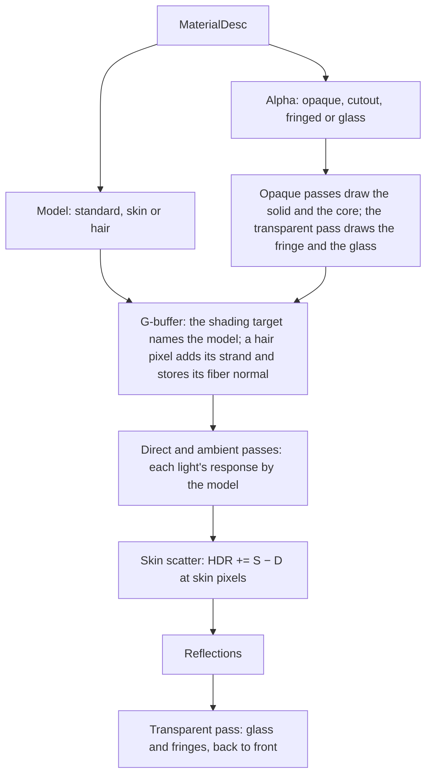
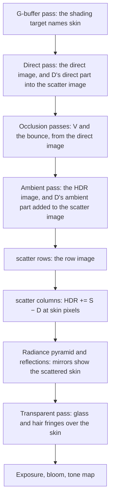
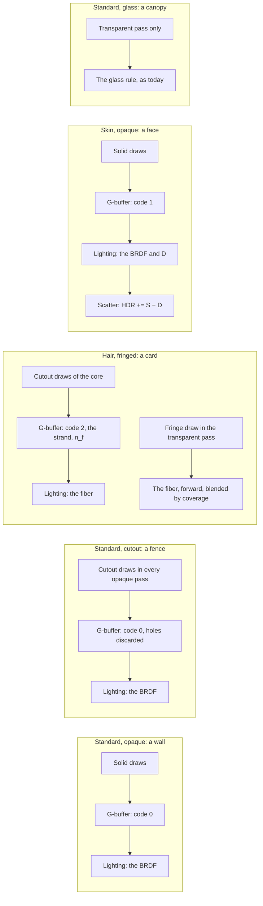

# Skin and hair shading

Ticket: `ter-7lg5`, the design of the epic `ter-n7lw`, a member of the rendering upgrade (`ter-sglu`, [rendering-upgrade.md](rendering-upgrade.md)). The user added the epic on 2026-10-26 and said that it closes the upgrade's scope. This doc is written against main at `c2152136`. It assumes two merges that are close:

| Design | Branch | What this doc takes from it |
|---|---|---|
| The lights, [local-light-shadows.md](local-light-shadows.md) (`ter-s9cv`) | `ter-s9cv-light-shadows` | One loop over the light list, and the shadow atlas, whose tiles draw casters as the cascades do (`LocalShadowPass`) |
| The bounce light, `docs/plans/screen-space-illumination.md` (`ter-a24f`) | `ter-a24f-ssgi` | The split of the lighting pass into the direct pass (`direct.frag`, the direct image) and the ambient pass (`ambient.frag`), the stages `DirectLight`, `AmbientOcclusion` and `AmbientLight`, and G-buffer binding 9 |

The skinning and morph targets (`ter-4vzc`, `docs/plans/skinning-and-morphs.md`) are designed beside this doc. "Other tickets" says where the two meet.

## Goal

The humans of the demo come from MPFB, the MakeHuman add-on for Blender (`ter-1qce`, [asset-pipeline.md](asset-pipeline.md), "Humans from MPFB"): an astronaut and a crew member. Their skin is MakeHuman's skin image, opaque. Their hair (afro01), eyebrows and eyelashes are meshes of cards whose image has alpha, and they export as glTF `BLEND`. Their renders so far come from Blender's Cycles, because the importer does not exist yet. In the engine today:

- Skin shades as any surface, with Lambert and GGX. The light stops at the terminator with a gray edge, and a shadow edge on a face is as hard as one on a wall.
- A `BLEND` part draws as glass (ARCHITECTURE.md, "Transparent objects"). The glass rule adds the specular part of every light and of the ambient light in full on every texel, also where the alpha is 0. So each card shows as a glossy rectangle.
- The cards of one hair mesh draw in the order of their triangles, not in depth order, and write no depth. So an inner card can cover an outer one, and the occlusion passes, the reflections and the bounce light do not see the hair.
- A card with `CastsShadow` casts the shadow of its whole rectangle, because `CastsShadow` alone decides what the shadow pass draws.
- A card's light follows the card's plane: each card has its own flat highlight and its own Lambert shade, so the planes show.

After this epic:

- A material names its shading model: standard, skin or hair.
- Skin scatters its diffuse light under the surface in a screen-space pass. Red light reaches past the terminator and into the edges of shadows, and fine detail softens.
- A material names its alpha mode: opaque, cutout, fringed or glass. A hair card is fringed. Its texels at or above a cutoff are opaque in every pass that draws opaque surfaces, with depth, shadows and the crease shadowing. Its texels below the cutoff blend over what lies behind by their coverage. A clear texel draws nothing.
- Hair shades as fibers along its strands, not as the plane of its card: a diffuse part and two highlights shifted along the strand.
- glTF `MASK` materials draw as cutouts.

Not in scope, by the user's list: an eye material, two specular lobes for skin, and contact shadows.

## Terms

| Term | Meaning |
|---|---|
| Shading model | How a surface sends the light that reaches it: standard, skin or hair. `MaterialDesc.Model`, a `ShadingModel`. |
| Alpha mode | How a material's alpha draws: opaque, cutout, fringed or glass. `MaterialDesc.Alpha`, an `AlphaMode`. |
| Alpha, a | The base color's alpha times the alpha of its map, from 0 to 1. |
| Coverage | The share of a texel that the surface covers. Under a cutout or a fringed alpha mode, the alpha is the coverage. |
| Opacity | Under the glass alpha mode, the alpha is the pane's opacity, as today. |
| The cutoff | The alpha at and above which a texel of a cutout or fringed material counts as fully covered: glTF's `alphaCutoff`. |
| The core | The texels of a cutout or fringed material whose alpha is at least the cutoff. They draw in every opaque pass. |
| The fringe | The texels of a fringed material whose alpha is above 0 and below the cutoff. They draw in the transparent pass, blended by their coverage. |
| An opaque pass | A pass that draws opaque surfaces with depth: the G-buffer pass, the shadow maps (the cascades and the atlas tiles), the environment faces and the impostor captures. |
| A solid draw, a cutout draw | An opaque pass's draw of an instance whose material is opaque or glass, and of one whose material is cutout or fringed. |
| The strand, T | A hair fiber's unit direction at a point, from root to tip, in world axes. |
| Strand direction | The texture axis along which a hair material's strands run from root to tip: +u, −u, +v or −v. `HairShading.Strands`. |
| The fiber normal, n_f | The unit vector across the strand toward the eye: V − T (T·V), normalized. The side of the fiber that the eye sees. |
| The longitudinal angle, θ | The signed angle of a direction from the plane at right angles to the strand, positive toward the tip: sin θ = T·d. θ_i for the light, θ_r for the eye, θ_h = (θ_i + θ_r) / 2. |
| The azimuth, φ | The angle between the light and the eye around the strand, between their parts at right angles to it. 0 when both lie on one side. |
| The shading target | The new G-buffer target, `R8G8B8A8_UINT`: R and G a hair pixel's strand, B 0, A the shading model's code. |
| The diffuse light, D | For a skin pixel, the diffuse part of the light that it sends toward the eye, pre-exposed: the diffuse terms of the lights and of the ambient light, with the occlusion and the bounce applied, all with the diffuse color in them. |
| The scatter image | Full resolution, `RGBA16F`: D in rgb and 1 in a at a skin pixel, 0 at every other pixel. |
| The row image | Full resolution, `RGBA16F`: the scatter image after the pass along the rows. |
| The scattered light, S | D after the pass along the rows and the pass along the columns. |
| The profile, R_c(r) | The skin's diffusion profile in color channel c: the share of the light that enters at a point and leaves at distance r from it, per square meter. A sum of six Gaussians (d'Eon, Luebke and Enderton 2007). |
| The kernel, P_c(x) | The profile's marginal along one axis: P_c(x) = ∫ R_c(√(x² + y²)) dy. |
| A tap | One sample of the kernel: an offset x_i in meters and a weight w_{i,c} per channel. |
| The reach | 8 mm, the largest tap offset. |
| The view depth, z | A pixel's distance along the camera's forward axis: d / \|r\|, with d its distance and r its view ray with a forward component of 1, as in [ambient-occlusion.md](ambient-occlusion.md). |
| Pixels per meter, s(z) | How many pixels one meter across the view covers at view depth z: H / (2 z tan(φ_y / 2)), with H the image's height and φ_y the vertical field of view. |
| The slope limit | tan 60°, √3: the steepest rise of depth per meter across the view that a tap still counts as the center's surface. |
| k, MaxRadiance | As in ARCHITECTURE.md, "Exposure" and "Portable Vulkan": pre-exposed light is radiance times the exposure scale k, and a surface writes at most MaxRadiance, 32,256, into the HDR image. |

## Decisions

### Made by the user

1. Skin gets basic screen-space subsurface scattering, not a pre-integrated table. (User, 2026-10-26)
2. Hair gets whatever the renderer needs so that its cards do not show. (User, 2026-10-26)
3. Out of scope: an eye material, two specular lobes for skin, and contact shadows. With this epic and the skinning, the rendering upgrade's scope is closed. (User, 2026-10-26)
4. No technique blends a pixel across frames: no temporal accumulation, no TAA, no temporal denoise or upscaling. (User, 2026-10-25, [rendering-performance.md](rendering-performance.md), decision 8) This rules out the dithered and hashed transparency of hair that most engines use.
5. The renderer runs on regular Vulkan on Linux, not only on MoltenVK. (User, 2026-10-25)

### Settled by this design

Each by the user's decisions and the project's rules, with its reason.

6. A material's shading model is a closed set: the generated union `ShadingModel` of `StandardShading(Metallic)`, `SkinShading` and `HairShading(Strands)`, with the standard case as its zero value. `MaterialDesc.Metallic` moves into `StandardShading`. Reason: a skin or a hair has no metallic, so a metallic beside the model would mean something for one model only (STYLE.md, "Make illegal states unrepresentable"). The metallic-roughness map keeps glTF's layout, and only the standard model reads its B channel.
7. A material's alpha mode is a second closed set: the generated union `AlphaMode` of `OpaqueAlpha`, `CutoutAlpha(Cutoff)`, `FringedAlpha(Cutoff)` and `GlassAlpha`, with opaque as its zero value. It is orthogonal to the shading model: a hair card is a hair model with a fringed alpha, a leaf a standard model with a cutout, a face a skin model, opaque. Reason: the pure model has two independent questions, how a surface sends light and how much of a texel it covers, and every pair of answers has a meaning.
8. Glass moves into the alpha mode as `GlassAlpha`, and `RenderFlags.Transparent` goes (open fork 2, recommended). Reason: one store of how a material's alpha draws. With the flag kept, a transparent instance with a fringed material has two answers.
9. The G-buffer gets a sixth target, the shading target, `R8G8B8A8_UINT` (see "The shading target", which gives the cost of the other place). Reason: every channel of the five targets has a job, and the free codes of the map code would tie the number of models to the number of maps.
10. A hair pixel stores its fiber normal as its shading normal, and its strand in the shading target. Reason: every reader of the shading normal, the ambient light, the occlusion passes, the bounce light and the reflections, then works for hair unchanged and sees the fiber, not the card's plane.
11. Skin scatters by the separable screen-space method of Jimenez et al. 2015 ("Separable Subsurface Scattering", Computer Graphics Forum 34(6)), with the skin profile of d'Eon, Luebke and Enderton 2007 ("Efficient Rendering of Human Skin", EGSR; GPU Gems 3, chapter 14). Reason: it is the spatial method that needs no temporal step: two passes of a fixed kernel, the same image in every frame. Burley's normalized diffusion in screen space (Golubev 2018) samples a disk with few taps and noise, and relies on temporal accumulation (decision 4). Texture-space diffusion (d'Eon 2007) needs an irradiance texture per object and passes over every skinned mesh's unwrap. A pre-integrated table is out by decision 1.
12. The scatter blurs the diffuse light with the diffuse color in it, "pre-scatter texturing" in d'Eon's terms. Reason: the lighting passes already compute the diffuse terms with the color, so the scatter needs no division by the color and the composite no read of it. Its cost: detail of the skin image softens a little, most in red, where the profile is widest. Post-scatter texturing is under "Later".
13. The scatter adds a difference to the HDR image: HDR += S − D at each skin pixel. Reason: the lighting passes keep writing the whole light of skin, so the bounce light's direct image keeps the direct light that a skin blocker bounces, and a renderer with the scatter off draws skin with no second path. It has the form of the reflections' delta, which adds W · C − a · k · T_s.
14. The direct pass writes D's direct part into the scatter image, and the ambient pass adds its ambient part through an additive blend on the scatter image alone. That needs the device feature `independentBlend` (see "Portable Vulkan"). Reason: D needs both parts, and neither pass sees the other's. A second image for the direct part costs 16.6 MB at 1080p, and a second light loop in the ambient pass costs the direct pass's lights again at every skin pixel.
15. Each tap reads the one pixel nearest its position, with `imageLoad`, and no filtering. Reason: each tap's tests of the mask and the depth then hold for the very pixel whose light it takes, and the C# copy gives the same sums. A tap less than half a pixel from the center lands on the center.
16. A tap gives way to the center's own light when its pixel is not skin, and when the depth between it and the center rises faster than the slope limit. Reason: Jimenez's rule that the kernel follows the surface, with a tolerance that grows with the tap's offset, not one constant. Past 60°, the surface turns so far from the eye that the true scatter covers fewer pixels than the screen-space kernel. The sky, the impostor billboards and every surface that is not skin are not skin.
17. The kernel is computed once in C#, in doubles, when the renderer is made, and uploaded with the first frame. Reason: it depends only on the profile and the tap count, and the C# copy is then the one source of the weights.
18. The scatter runs after the ambient pass and before the reflections' radiance pyramid. Reason: D must hold the ambient light, the crease shadowing and the bounce, which the ambient pass adds, and a mirror must show the scattered skin. The transparent pass, the exposure and bloom come after, as for every surface.
19. The environment faces and the impostor captures shade skin as the standard model, with no scatter. Reason: a face texel at W = 128 covers 1.2 cm at 1 m, and an impostor of a person of 1.8 m is below 200 px, about 9 mm per pixel. Both are as wide as the red light's scatter and wider than the green and blue light's.
20. No transmission through thin skin, such as an ear before a light (open fork 1, recommended). Reason: the user asked for basic scattering, and transmission costs a part of its own. See "Later".
21. Hair cards draw as a cutout core in every opaque pass and as a blended fringe in the transparent pass. Reason: the core gets depth, shadows, the crease shadowing, the bounce and the reflections, as a surface, and the fringe keeps the soft edges. The other methods: alpha to coverage needs multisampling, which this deferred renderer does not have. Hashed and dithered alpha need a temporal step (decision 4). Order-independent transparency by lists per pixel needs atomics and memory, and a sort per pixel to fix its order. Weighted blended transparency (McGuire and Bavoil 2013) approximates the colors of every overlap. A sort of the cards per frame costs CPU time per triangle.
22. The fringe blends by its coverage, Porter and Duff's "over": radiance a · L and transmittance 1 − a, through the glass's dual-source blend, `BlendMode.Transmittance`. Reason: one blend mode, and the glass's proof that a pane keeps the shares of the HDR image holds, because the fringe writes at most MaxRadiance · a = MaxRadiance · (1 − T).
23. The fringe of one instance is not sorted inside the instance: its triangles draw in index order. Reason: a sort needs work per triangle per frame. Two fringe texels in the wrong order give the right total coverage and mix their colors in the wrong weights, and the fringes of one hair have one color.
24. A fringed or glass instance never becomes an impostor. A cutout instance can, and its capture tests the cutoff. Reason: a capture has no transparent pass, and a fringe drawn as a core would thicken the hair's edge.
25. In each view of an opaque pass, the cutout draws run after the solid draws, with a pipeline whose fragment shader can discard. Reason: the solid pipeline keeps its early depth writes, and the solid surfaces drawn first hide many hair fragments before their shader runs.
26. Hair shades as fibers: a diffuse part along the strand (Kajiya and Kay 1989), normalized so that an even light returns the fiber's color, and two highlights shifted along the strand (Scheuermann 2004), each a Gaussian of unit area in the longitudinal angle with Marschner's azimuthal term (Marschner, Jensen, Cammarano, Worley and Hanrahan 2003). Its ambient light is the ambient source's at the fiber normal. Reason: the light then depends on the strand, the eye and the light, never on the card's plane, and the ambient light, its occlusion and the reflections need no hair path.
27. A hair pixel takes the light of every light, from either side of its card, and its shadow lookups use the geometric normal turned toward the light. Reason: a fiber is lit from every side. The shadow maps, in which the cards cast, say what hides it.
28. The strand comes from the shading frame of the vertex: the vertex tangent, made perpendicular to the shading normal, along +u, and the bitangent along +v, as `normalMapped` builds them. The strand direction picks one of the four. A normal map tilts the strand with the frame. Reason: glTF meshes carry tangents, and the importer makes them where a file has none (asset-pipeline.md, "Meshes"), so the vertex format does not change.
29. The setting is `RendererOptions.Subsurface`, the generated union `SubsurfaceSetting` of `NoSubsurface`, its zero case, and `SeparableSubsurface(TapsPerSide)`. The default is `SeparableSubsurface.Default`: 8 taps per side, 17 per pass, as Jimenez's high setting. The test helpers set `NoSubsurface`, as they set `NoReflections`. Reason: the rule of every member, a switch and its measured cost.
30. No renderer switch for the fringe or for the hair model. Reason: a material chooses them, and a switch beside the material would be a second store that can disagree with it. A `CutoutAlpha` in place of a `FringedAlpha` turns a fringe off.
31. The importer names a material's shading model and its fringe through glTF `extras` (see "The importer's mapping from glTF"). Reason: no ratified KHR extension describes a diffusion profile or a hair fiber.

## The model

This section describes the model as a renderer built from scratch would have it. The next section lists how it differs from today's code.

A material says two things about a surface. Its shading model says how the surface sends the light that reaches it. Its alpha mode says how much of each texel the surface covers. The two are independent.

A deferred renderer shades in screen space, so each pixel must name its shading model and carry the data of that model. A standard pixel needs nothing more. A skin pixel needs only the fact that it is skin. A hair pixel needs its strand, because a fiber sends light by its direction, not by a surface normal.

Skin is a standard surface whose diffuse light does not leave where it entered. It enters, scatters under the surface and leaves within a few millimeters, more for red light than for blue. On the screen, that is a convolution of the skin pixels' diffuse light with the skin's profile, scaled to each pixel's depth, and limited to the skin's own surface. The specular light reflects at the surface and does not scatter.

Hair is fibers, and a card is a sheet of them with holes. Where a texel is fully covered, the card is a surface with depth, which every screen-space effect and the shadow maps can use. Where it is partly covered, only a blend can draw it, and where it is not covered, nothing is there. The light of a fiber depends on its direction, so the card's plane never enters the hair's light.



### How it differs from today's code

| Today | This design |
|---|---|
| `MaterialDesc.Metallic` | `StandardShading(Metallic)` in `MaterialDesc.Model` |
| `RenderFlags.Transparent` on an instance makes it glass | `GlassAlpha` in `MaterialDesc.Alpha`. The flag goes. |
| glTF `MASK` draws as glass (asset-pipeline.md, AS3003) | `CutoutAlpha(Cutoff)` |
| `GpuMaterial` holds 52 bytes of fields | 60 bytes: a shading word and the cutoff, in the same stride of 64 |
| The batcher knows the material slots' count only | It reads each slot's `MaterialInfo`, its alpha mode |
| One opaque command range per depth range, per cascade, per atlas tile and per face range | `OpaqueRuns(Solid, Cutout)` in each |
| `TransparentRun` is `MeshCommands` or `PuffSprites` | `GlassCommands` (the renamed `MeshCommands`), `FringeCommands` or `PuffSprites` |
| Five G-buffer targets | Six: the shading target |
| `brdf()` returns the reflected light of one light as one sum | `respond()` returns `DirectTerms` (diffuse, specular) by the shading model |
| `ShadingInput` and `SurfaceSample` have no model | Both gain `model` and `strand` |
| No subsurface pass | Two compute passes, "scatter rows" and "scatter columns", in the new stage `SkinScatter` |
| The device needs no `independentBlend` | `VulkanDevice` requires it |

What stays: the BRDF and its tables, the ambient sources, the occlusion and the bounce, the reflections, the glass rule, the puffs, the exposure, bloom, the tone map, the vertex format and every existing pass's place in the frame.

## The material API

`src/Tertius.Core/Seams/ShadingModel.cs` (new):

```csharp
/// <summary>The direction in a hair card's texture along which its strands run from root to tip.</summary>
public enum StrandDirection : byte { PlusU, MinusU, PlusV, MinusV }

/// <summary>Lambert diffuse and GGX with glTF's metallic (docs/plans/pbr-brdf.md).</summary>
public readonly record struct StandardShading(float Metallic);

/// <summary>The standard light of a non-metal, whose diffuse light scatters under the skin (docs/plans/skin-and-hair.md).</summary>
public readonly record struct SkinShading;

/// <summary>Fibers along the strands of the card's texture (docs/plans/skin-and-hair.md, "The hair model").</summary>
public readonly record struct HairShading(StrandDirection Strands);

[GeneratedUnion(typeof(StandardShading), typeof(SkinShading), typeof(HairShading), ZeroCase = typeof(StandardShading))]
public readonly partial struct ShadingModel;
```

`src/Tertius.Core/Seams/AlphaMode.cs` (new):

```csharp
/// <summary>The alpha is not drawn: every texel is covered.</summary>
public readonly record struct OpaqueAlpha;

/// <summary>glTF's MASK: a texel whose alpha is below the cutoff is not there.</summary>
public readonly record struct CutoutAlpha(float Cutoff);

/// <summary>A cutout core, and the texels below the cutoff blended over what lies behind by their coverage.</summary>
public readonly record struct FringedAlpha(float Cutoff);

/// <summary>A pane whose alpha is its opacity, which reflects in full (ARCHITECTURE.md, "Transparent objects").</summary>
public readonly record struct GlassAlpha;

[GeneratedUnion(typeof(OpaqueAlpha), typeof(CutoutAlpha), typeof(FringedAlpha), typeof(GlassAlpha), ZeroCase = typeof(OpaqueAlpha))]
public readonly partial struct AlphaMode;
```

`MaterialDesc` in `RenderSeam.cs`:

```csharp
public sealed record MaterialDesc(
    Vector4 BaseColor,
    float Roughness,
    float Reflectance = 0.5f,
    Vector3 Emissive = default,
    TextureId BaseColorMap = default,
    TextureId NormalMap = default,
    TextureId MetallicRoughnessMap = default,
    ShadingModel Model = default,
    AlphaMode Alpha = default
)
{
    public static MaterialDesc Color(Vector4 color, float roughness) => new(BaseColor: color, Roughness: roughness);
}
```

where

- `Model` = the shading model. The default is `StandardShading(0)`, a non-metal.
- `Alpha` = the alpha mode. The default is `OpaqueAlpha`. `BaseColor.W` is the coverage under a cutout or fringed mode, the opacity under glass, and unread under opaque.
- `Cutoff` = a value above 0 and at most 1. `VulkanRenderer.CreateMaterial` throws `ArgumentOutOfRangeException` for any other value, a NaN included. A cutoff of 0 would make every texel core, which `OpaqueAlpha` says.

Usage:

```csharp
MaterialId gold = renderer.CreateMaterial(new(
    BaseColor: new(1, 0.71f, 0.29f, 1), Roughness: 0.1f, Model: new StandardShading(Metallic: 1)));
// Skin's F0 is about 0.028, a reflectance of 0.42.
MaterialId skin = renderer.CreateMaterial(new(
    BaseColor: Vector4.One, Roughness: 0.45f, Reflectance: 0.42f, BaseColorMap: skinImage, Model: new SkinShading()));
// Keratin's F0 is about 0.046 (an index of 1.55), a reflectance of 0.54.
MaterialId hair = renderer.CreateMaterial(new(
    BaseColor: Vector4.One, Roughness: 0.35f, Reflectance: 0.54f, BaseColorMap: hairImage,
    Model: new HairShading(Strands: StrandDirection.PlusV), Alpha: new FringedAlpha(Cutoff: 0.5f)));
MaterialId canopy = renderer.CreateMaterial(new(
    BaseColor: new(0.8f, 0.9f, 1, 0.2f), Roughness: 0.05f, Alpha: new GlassAlpha()));
```

The callers change in two ways. `Metallic: 1` becomes `Model: new StandardShading(Metallic: 1)`, at 4 places in the demo and about 20 in the tests. An instance with `RenderFlags.Transparent` takes a material with `Alpha: new GlassAlpha()`, at 2 places in the demo and about 30 in the tests. The flag's bit, 1 << 2, stays unused.

### The material on the GPU

`GpuMaterial` gains two fields in its padding:

```csharp
internal struct GpuMaterial
{
    public Vector4 BaseColor;
    public Vector3 Emissive;
    public float Metallic;         // StandardShading.Metallic, 0 for skin and hair
    public float Roughness;
    public float Reflectance;
    public uint BaseColorMap;
    public uint NormalMap;
    public uint MetallicRoughnessMap;
    public uint Shading;           // bits 0 and 1: the model's code; bits 2 and 3: a hair's strand direction
    public float AlphaCutoff;      // the cutoff of a cutout or fringed material, 0 otherwise
}                                  // 60 bytes of fields, a stride of 64 as before
```

where

- `Shading` = `ShadingCode.Word(model)`: the code 0 standard, 1 skin, 2 hair, and for hair the `StrandDirection` in bits 2 and 3. `frame.glsl` mirrors the struct.
- `AlphaCutoff` = read only by the pipelines that test the cutoff, so 0 under opaque and glass is never read.

`MaterialStore` keeps the CPU's facts of each slot beside the buffer:

```csharp
/// <summary>What the batcher needs of a material slot: how its alpha draws.</summary>
internal readonly record struct MaterialInfo(AlphaMode Alpha);

public ReadOnlySpan<MaterialInfo> Infos { get; }   // one per slot, the default material's first, filled by Upload
```

A material never changes after `CreateMaterial`, and `Upload` writes its GPU row and its `MaterialInfo` from one `MaterialDesc`, in slot order. So the two cannot disagree. `SceneBatcher.Prepare` takes `ReadOnlySpan<MaterialInfo> materials` in place of `int materialCount`, as it takes the meshes' `MeshInfo`.

## The shading target

The two places that the G-buffer offers, at 1920 × 1080:

| Place | Memory | Cost per pixel | What it ties |
|---|---|---|---|
| A sixth target, `R8G8B8A8_UINT` (chosen) | 8.3 MB | One more 4-byte write per G-buffer fragment, one more 4-byte read in the direct and ambient passes | Nothing |
| The free codes of the map code, 1 to 172, for the model, and two 8-bit channels for the strand | 0 | None | The map code would name a pair of map and model: 42 maps times 3 models uses 126 of its 128 indices, so a fourth model would lower `MaxMaps`. The strand needs two channels, and the only free one beside the specular target's metallic is that target's alpha, the lobe's sky share while the map is off. |

The shading target's channels:

| Channel | Standard | Skin | Hair |
|---|---|---|---|
| R, G | 0 | 0 | The strand's octahedral code, 8 bits each |
| B | 0 | 0 | 0 |
| A | 0 | 1 | 2 |

```glsl
// The strand's octahedral code (docs/plans/skin-and-hair.md, "The shading target"). StrandCode is the C# twin. floor(x + 0.5)
// rounds, because GLSL's round leaves its ties to the driver.
uvec2 strandCode(vec3 strand) { return uvec2(clamp(floor((octEncode(strand) * 0.5 + 0.5) * 255.0 + 0.5), 0.0, 255.0)); }
vec3 strandOfCode(uvec2 code) { return octDecode(vec2(code) / 255.0 * 2.0 - 1.0); }
```

where

- `octEncode`, `octDecode` = the normals target's encoding (`octahedral.glsl`).
- `strand` = a unit vector, so its octahedral code lies in [−1, 1]² and the clamp only bounds rounding.

The target is a `UINT` format, so it holds integers and its codes need no rule for the rounding of a conversion. It is cleared to 0, so the sky and every pixel that nothing draws read as standard. `gbuffer.frag` writes it for every lit fragment, and `impostor.frag` writes 0: a billboard's pixel is unlit, which the base color's alpha of 0 already says. `surfaceAt` reads it at G-buffer set binding 10, after the lights' atlas at 8 and the bounce's direct image at 9. `StrandCode` and `ShadingCode` are the C# twins, and a GPU test pins the shaders to them.

## Hair

### The alpha modes in the passes

| Alpha mode | G-buffer pass | Shadow maps (cascades, atlas tiles) | Environment faces | Impostor | Transparent pass |
|---|---|---|---|---|---|
| Opaque | A solid draw | A solid draw, with `CastsShadow` | A solid draw | May become one, as today | No |
| Cutout | A cutout draw: a texel below the cutoff is discarded | A cutout draw, with `CastsShadow` | A cutout draw | May become one: its capture discards a texel below the cutoff | No |
| Fringed | A cutout draw: the core | A cutout draw of the core, with `CastsShadow` | A cutout draw: the core | Never | The fringe: discards a ≥ cutoff and a = 0, and blends by coverage |
| Glass | No | A solid draw, with `CastsShadow`, as today | No | Never | The glass rule, as today |

The batcher reads each instance's alpha mode once, from its material slot's `MaterialInfo`, into `PreparedInstance.Alpha`, and every decision of the frame reads that field:

- The opaque sort key becomes (range, cutout, mesh), with solid before cutout, so each view's commands form a solid run and then a cutout run.
- `PreparedScene.Opaque` per depth range, `ShadowCommands` per cascade, each atlas tile's commands and each `EnvironmentFaceDraw`'s `Far`, `Middle` and `Near` become an `OpaqueRuns`:

  ```csharp
  /// <summary>The opaque commands of one view: the solid draws, then the cutout draws.</summary>
  internal readonly record struct OpaqueRuns(CommandRange Solid, CommandRange Cutout);
  ```

- A fringed instance goes into the opaque list and into the transparent list. The transparent list sorts it with the glass and the puffs by its center, back to front, as today.
- `TransparentRun` gains a case:

  ```csharp
  internal readonly record struct GlassCommands(CommandRange Commands);   // the renamed MeshCommands
  internal readonly record struct FringeCommands(CommandRange Commands);

  [GeneratedUnion(typeof(GlassCommands), typeof(FringeCommands), typeof(PuffSprites))]
  internal readonly partial struct TransparentRun;
  ```

  The transparent pass draws a `FringeCommands` run with the fringe pipeline. It has the scene layout, so the sets and the push constants stay bound between runs, as for the puffs.
- `ImpostorManager` keeps out `NoImpostor` and `Celestial` instances by their flags, as today, and a glass or fringed instance by `PreparedInstance.Alpha`.

### The cutout test

The specialization constant `cutoutAlpha` makes the cutout variant of each opaque pass's pipeline. `material.glsl` holds the one test:

```glsl
layout(constant_id = ShaderConstants.CutoutAlpha) const bool cutoutAlpha = false;

SurfaceSample sampleMaterial(uint materialIndex, vec2 uv, vec3 vertexNormal, vec4 vertexTangent, vec3 V)
{
    GpuMaterial m = materials[materialIndex];
    SurfaceSample s;
    s.baseColor = m.baseColor * sampleTexture(m.baseColorMap, uv);
    ...
    // After every sample, so the implicit derivatives of the quad stay defined (discard demotes to a helper).
    if (cutoutAlpha && s.baseColor.a < m.alphaCutoff)
        discard;
    return s;
}
```

where

- `cutoutAlpha` = false in the solid pipelines, so the driver drops the test and the pipeline keeps its early depth writes.
- `s.baseColor.a` = the alpha, read into [0, 1] by `ShaderInput.Fraction` and the UNORM map, so the comparison sees finite values.

The pipelines with a cutout variant: the G-buffer pass (`gbuffer.frag`), the environment faces (`environment_face.frag`), the impostor captures (`impostor_capture.frag`), and the shadow maps. The shadow pipelines are depth only today, with `shadow.vert`. Their cutout variant is `shadow_cutout.vert`, which also passes the texture coordinate and the material, and `shadow_cutout.frag`, which samples the base color's alpha and discards below the cutoff. The cascades' pass (`ShadowPass`) and the atlas's pass (`LocalShadowPass`) draw each view's solid run, then its cutout run.

### The fringe

`fringe.frag` (new) is `transparent.frag` with coverage in place of opacity:

```glsl
void main()
{
    vec3 V = towardEye(inPosition);
    SurfaceSample s = sampleMaterial(inMaterialAndMap.x, inTexCoord, inNormal, inTangent, V);
    ShadingInput shading = forwardShading(s, inPosition, inNormal, inHemisphere, inMaterialAndMap.y, V);
    float coverage = s.baseColor.a;
    // The core drew in the G-buffer pass, and a clear texel covers nothing.
    if (coverage >= materials[inMaterialAndMap.x].alphaCutoff || coverage <= 0.0)
        discard;
    float opaqueDistance = texelFetch(gbufferDistance, ivec2(gl_FragCoord.xy), 0).r;
    if (opaqueDistance > 0.0 && length(inPosition - draw.eye.xyz) > opaqueDistance)
        discard;
    float exposure = exposureScale();
    vec3 radiance = surfaceRadiance(shading, exposed(s.emissive, exposure), inPosition, V, SunShadowsMainView, exposure);
    outColor = vec4(radiance * coverage, 0.0);
    outTransmittance = vec4(vec3(1.0 - coverage), 0.0);
}
```

where

- `forwardShading` = the filling of `ShadingInput` that `transparent.frag`, `fringe.frag`, `impostor_capture.frag` and `environment_face.frag` share, from today's lines in `transparent.frag`: the reflection's footprint from derivatives before any discard, the sky shares while the map is off, and an occlusion of 1 and a bounce of 0, because the fringe is not in the G-buffer.
- `surfaceRadiance` = the whole light of the texel, pre-exposed and capped at MaxRadiance.
- `outColor`, `outTransmittance` = the dual-source outputs of `BlendMode.Transmittance`: the target becomes outColor + target · outTransmittance.

So a texel of coverage a over a target v writes a · L + (1 − a) · v, and a clear texel writes nothing. The fringe draws after the reflections and before the exposure, as the glass does.

### The hair model

The inputs at a hair point:

- T = the strand, V = the unit direction toward the eye, L = the unit direction toward the light.
- E = the light's irradiance on a surface that faces it: `frame.sunRadiance` times the sun's visibility, or a light's color times its intensity and its attenuation.
- b = the base color, ρ the reflectance, F0 = 0.16 ρ², r = the floored roughness, β = r².

The longitudinal angles and the azimuth:

```
sin θ_i = T·L          sin θ_r = T·V          θ_h = (θ_i + θ_r) / 2          cos θ_i = √(1 − sin² θ_i)
cos φ = L⊥ · V⊥        L⊥, V⊥ = the parts of L and V at right angles to T, normalized
```

The light that the point sends toward the eye, per light:

```
L_out = E · (f_d + f_p + f_s)

f_d = b · cos θ_i / π²                                               the diffuse part (Kajiya-Kay)
f_p = F(V·H) · M(θ_h − α_p, β_p) · N(φ) · cos θ_i                     the primary highlight
f_s = F0 · b · M(θ_h − α_s, β_s) · N(φ) · cos θ_i                     the secondary highlight

M(x, β) = exp(−x² / (2β²)) / (2β √(2π))          N(φ) = ¼ cos(φ / 2)
α_p = −5° (toward the root)     α_s = +7.5° (toward the tip)     β_p = β     β_s = 2β
```

where

- `cos θ_i` = the share of the light that the fiber intercepts: a fiber's width across the light.
- `f_d` = the fiber's diffuse part. Under an even light of radiance L_in from every direction, it sends b · L_in, because ∫ cos θ_i dω over the sphere is π². So a white fiber in an even light shows that light, as a white Lambert surface does.
- `F(V·H)` = Schlick's Fresnel term at the half vector of L and V, `schlickFresnel(F0, V·H)`. V·H is the cosine of half the angle between L and V, Marschner's cosine for the primary highlight.
- `M(x, β)` = a Gaussian of unit area over θ_r around the lobe's cone. In θ_h it has the width β, so over θ_r the width 2β and the factor ½.
- `N(φ)` = Marschner's azimuthal term of the primary highlight, of unit area over φ from −π to π. Both highlights use it. It peaks where the eye lies on the light's side of the fiber.
- `α_p`, `α_s`, `β_s / β_p` = Marschner's shifts and widths for the cuticle's tilt: the primary highlight shifts toward the root, the secondary toward the tip by 1.5 times as much, and the secondary is twice as wide.
- The secondary highlight takes the base color: light that crossed the fiber twice, tinted as Scheuermann's second highlight.

So each part sends at most its weight of the light that the fiber intercepts: b for the diffuse part, F for the primary highlight and F0 · b for the secondary, because ∫ M N cos² θ_r dθ_r dφ ≤ 1. The parts add with no coupling, as the standard BRDF's do. A light along the strand adds nothing, because cos θ_i is 0.

The ambient light of a hair point is the ambient source's at the fiber normal, through `ambientTerms` with the shading normal n_f: the diffuse term b · D(n_f) and the specular term E · c · S(d, r) at the dominant direction about n_f. Under an even light the diffuse term is b · L_in, as `f_d` gives. The occlusion and the bounce apply in `occludedAmbient`, as for every surface.

`hair.glsl` (new) holds the response, and `HairFiber` is its C# copy:

```glsl
const float PrimaryShift = -0.08726646;     // −5°, toward the root
const float SecondaryShift = 0.13089969;    // +7.5°, toward the tip
const float InversePiSquared = 0.10132118;

// M: a Gaussian of unit area over θ_r around a lobe's cone. width ≥ 0.045², the floored roughness squared.
float longitudinalLobe(float thetaH, float shift, float width)
{
    float x = thetaH - shift;
    return exp(-x * x / (2.0 * width * width)) / (2.0 * width * sqrt(2.0 * PI));
}

DirectTerms hairResponse(ShadingInput s, SurfaceLobes lobes, vec3 V, vec3 L)
{
    vec3 T = s.strand;
    float sinI = clamp(dot(T, L), -1.0, 1.0);
    float sinR = clamp(dot(T, V), -1.0, 1.0);
    float cosI = sqrt(1.0 - sinI * sinI);
    float thetaH = 0.5 * (asin(sinI) + asin(sinR));
    // A direction along the strand has no part across it, and takes the fiber normal.
    vec3 lAcross = normalizedOr(L - T * sinI, s.normal);
    vec3 vAcross = normalizedOr(V - T * sinR, s.normal);
    float azimuth = 0.25 * sqrt(0.5 + 0.5 * clamp(dot(lAcross, vAcross), -1.0, 1.0));
    vec3 primary = schlickFresnel(lobes.f0, dot(V, halfVectorOf(L, V, s.normal))) * longitudinalLobe(thetaH, PrimaryShift, lobes.alpha);
    vec3 secondary = lobes.f0 * lobes.diffuseColor * longitudinalLobe(thetaH, SecondaryShift, 2.0 * lobes.alpha);
    DirectTerms terms;
    terms.diffuse = lobes.diffuseColor * (cosI * InversePiSquared);
    terms.specular = (primary + secondary) * (azimuth * cosI);
    return terms;
}
```

where

- `s.strand` = T. `s.normal` = n_f.
- `lobes.alpha` = β, the floored roughness squared, at least 0.045² = 0.002.
- `lobes.diffuseColor` = b, because a hair has no metallic. `lobes.f0` = F0.
- `halfVectorOf(L, V, fallback)` = the unit half vector of L and V, with fallback (here the fiber normal) where L = −V. It is a new function of `lighting.glsl`, which Part 4 moves out of the lines in `brdf()` that compute the half vector today, so both responses use it.
- `DirectTerms` = the diffuse and the specular light of one light per unit irradiance (see "The light of each model").

### The strand and the fiber normal

`material.glsl`:

```glsl
// T: the strand from root to tip, the texture axis of the shading frame that the material names (StrandDirection).
vec3 strandOf(uint direction, vec3 n, vec4 vertexTangent)
{
    vec3 t = vertexTangent.xyz - n * dot(n, vertexTangent.xyz);
    float tangentLengthSq = dot(t, t);
    t = tangentLengthSq > 1e-12 ? t * inversesqrt(tangentLengthSq) : anyPerpendicular(n);
    vec3 b = cross(n, t) * (vertexTangent.w < 0.0 ? -1.0 : 1.0);
    vec3 alongU = direction < 2u ? t : b;
    return (direction & 1u) == 0u ? alongU : -alongU;
}

// n_f: across the strand toward the eye. A strand along the line of sight takes the card's normal, which is across it.
vec3 fiberNormal(vec3 strand, vec3 V, vec3 cardNormal)
{
    return normalizedOr(V - strand * dot(strand, V), cardNormal);
}
```

where

- `direction` = the strand direction's code: 0 +u, 1 −u, 2 +v, 3 −v.
- `n` = the shading normal, after the normal map. `t` and `b` are the frame that `normalMapped` builds, so a normal map tilts the strand.
- `cardNormal` = the shading normal. `strandOf` made T perpendicular to it, so it is across the strand.

`sampleMaterial` sets, for a hair material, `s.strand = strandOf(...)` and then `s.normal = fiberNormal(s.strand, V, s.normal)`. Every pass that calls it, deferred or forward, so gets the fiber normal as the shading normal, and the G-buffer pass computes the sky shares at it while the map is off.

### Hair in each pass

| Pass | What it does with a hair pixel |
|---|---|
| G-buffer | Writes n_f as the shading normal, the card's vertex normal as the geometric normal, the strand's code and 2 into the shading target, and metallic 0 |
| Direct light | `hairResponse` for each light, which it takes from either side of its card. Its shadow lookups use the geometric normal turned toward the light. |
| Occlusion and bounce | As any surface, around n_f |
| Ambient light | `ambientTerms` at n_f, with the occlusion and the bounce |
| Reflections | As any surface, along the dominant direction about n_f |
| Transparent (fringe) | The same functions, forward, with an occlusion of 1 and a bounce of 0 |
| Environment faces, impostor captures | The same functions, forward: the core only |

## Skin

### The light of each model

Each light's response becomes a pair, as the ambient source's already is. `lighting.glsl`:

```glsl
// The light of one light toward V per unit irradiance, its diffuse part and its specular part (docs/plans/skin-and-hair.md).
// The diffuse part has the diffuse color in it, as AmbientTerms.diffuse has.
struct DirectTerms
{
    vec3 diffuse;
    vec3 specular;
};

DirectTerms respond(ShadingInput s, SurfaceLobes lobes, vec3 V, vec3 L)
{
    return s.model == ShadingHair ? hairResponse(s, lobes, V, L) : surfaceResponse(s, lobes, V, L);
}

// Whether a light from L reaches the point at all, before its shadows: a fiber takes light from every side, a surface
// only from the side that both its normals face.
bool takesLight(ShadingInput s, vec3 L)
{
    return s.model == ShadingHair || (dot(s.normal, L) > 0.0 && dot(s.geometricNormal, L) > 0.0);
}
```

where

- `surfaceResponse` = today's `brdf()` with its two parts apart: c_diff / π · (n·l) and D · Vis · F · c · (n·l). Skin uses it, with metallic 0.
- `directLight` sums `DirectTerms` over the lights in the list's order, and `lobesRadiance` and `directRadiance` add the two parts where they added one sum before.
- A skin pixel's light in the lighting passes is the standard model's. Only the scatter makes it skin.

### The profile and the kernel

The profile of human skin, a sum of six Gaussians, G(v, r) = exp(−r² / (2v)) / (2πv), with these variances and weights per channel (d'Eon, Luebke and Enderton 2007):

| Variance (mm²) | Red | Green | Blue |
|---|---|---|---|
| 0.0064 | 0.233 | 0.455 | 0.649 |
| 0.0484 | 0.100 | 0.336 | 0.344 |
| 0.187 | 0.118 | 0.198 | 0 |
| 0.567 | 0.113 | 0.007 | 0.007 |
| 1.99 | 0.358 | 0.004 | 0 |
| 7.41 | 0.078 | 0 | 0 |

Each channel's weights sum to 1, so the profile keeps the light that enters. A 2D Gaussian is the product of two 1D Gaussians, so the kernel is the same sum in one dimension:

```
P_c(x) = Σ_k w_{k,c} · exp(−x² / (2 v_k)) / √(2π v_k)
```

The separable scatter applies P_c(x) along the rows and then P_c(y) along the columns: the product P_c(x) P_c(y). It keeps the profile's light and its marginal along each axis, and it is exact for one Gaussian. For the sum, it is Jimenez et al.'s separable approximation of the radial profile.

`SkinProfile.Kernel(tapsPerSide)` makes the taps, with n = tapsPerSide:

```
x_i = sign(i) · Reach · (i / n)²                          i = −n … n,  Reach = 8 mm
w_{i,c} = ∫ from b_i to b_{i+1} of P_c(x) dx              b_i = (x_{i−1} + x_i) / 2,  b_{−n} = −∞,  b_{n+1} = +∞
```

The taps crowd toward the center, where the profile is steep. The widest Gaussian has σ = 2.72 mm, so the reach is three of its widths, and the outermost taps hold the tails beyond them. The center tap holds the narrowest Gaussians, which at n = 8 lie within its interval of ±0.0625 mm. Each channel's weights sum to exactly 1. `SkinProfile` integrates each interval in doubles, by the error function. The renderer uploads the kernel with the first frame as 2n + 1 `vec4`: rgb the weights, a the offset in meters.

### The diffuse light D

The direct pass and the ambient pass write the scatter image beside their own outputs, when the setting is `SeparableSubsurface`:

```glsl
// direct.frag
DirectTerms direct = directLight(s, lobes, position, V, SunShadowsMainView, EveryMap);
outDirect = vec4(min(exposed(direct.diffuse + direct.specular, k) + emission, vec3(MaxRadiance)), 1.0);
outScatter = s.model == ShadingSkin ? vec4(exposed(direct.diffuse, k), 1.0) : vec4(0.0);

// ambient.frag; the blend adds outScatter to the scatter image
AmbientTerms ambient = ambientTerms(s, lobes, V);
outColor = vec4(min(direct + exposed(ambient.diffuse + ambient.specular, k), vec3(MaxRadiance)), 1.0);
outScatter = s.model == ShadingSkin ? vec4(exposed(ambient.diffuse, k), 0.0) : vec4(0.0);
```

where

- `k` = the exposure scale. `exposed(x, k)` = min(x, MaxRadiance / k) · k, at most MaxRadiance.
- `outDirect`, `outColor` = the direct image and the HDR image, as the bounce light's design writes them.
- `outScatter` = location 1 of each pass. The direct pass clears the scatter image and writes it. The ambient pass adds to it with the factors One and One. The HDR image takes no blend, so the two attachments of the ambient pass have different blend states.

So the scatter image holds D = exposed(diffuse of the lights) + exposed(diffuse of the ambient light) at each skin pixel, at most 2 · MaxRadiance = 64,512, with 1 in alpha, and 0 everywhere else: at the sky, at an impostor billboard and at every pixel that is not skin.

### The two passes

`skin_scatter.glsl` holds the loop of one pass at one skin pixel, and `SkinScatter.Pass` is its C# copy:

```glsl
// One pass of the separable scatter (docs/plans/skin-and-hair.md, "The two passes"). source is the scatter image for the rows
// and the row image for the columns, center its value at the pixel. Each tap reads one pixel.
vec3 scatterAlong(ivec2 pixel, ivec2 axis, vec3 center)
{
    float depth = viewDepthAt(pixel);
    float pixelsPerMeter = frame.viewport.y / (2.0 * depth * length(frame.cameraUp.xyz));
    if (Reach * pixelsPerMeter < 0.5)
        return center;
    ivec2 last = imageSize(scatterImage) - 1;
    vec3 sum = vec3(0.0);
    for (int i = 0; i <= 2 * scatterTapsPerSide; i++)
    {
        vec4 tap = kernel[i];
        // Clamped as a float first: a tap far past the image would overflow the conversion to an integer.
        float offset = clamp(floor(tap.a * pixelsPerMeter + 0.5), -MaxSide, MaxSide);
        ivec2 at = clamp(pixel + axis * int(offset), ivec2(0), last);
        vec3 light = center;
        if (i != scatterTapsPerSide && imageLoad(scatterImage, at).a > 0.0)
        {
            float rise = abs(viewDepthAt(at) - depth) / (abs(tap.a) * SlopeLimit);
            light = mix(center, sourceAt(at), clamp(2.0 - rise, 0.0, 1.0));
        }
        sum += tap.rgb * light;
    }
    return sum;
}
```

where

- `viewDepthAt(p)` = z at pixel p, from the distance target and the view ray.
- `frame.viewport.y` = H. `length(frame.cameraUp.xyz)` = tan(φ_y / 2). So `pixelsPerMeter` = s(z).
- `kernel[i]` = tap i of the kernel buffer: rgb its weights, a its offset x_i in meters. Tap n, `scatterTapsPerSide`, is the center, with offset 0.
- `MaxSide` = 16,384, the largest image side.
- `imageLoad(scatterImage, at).a` = 1 at a skin pixel, 0 elsewhere: the mask.
- `rise` = the tap's depth step over the depth step of the slope limit across its offset. Up to 1 the tap keeps its own light, and from 1 to 2 it gives way to the center's.
- `sourceAt(at)` = the source image at the tap.

The passes:

1. "scatter rows" (`skin_scatter_rows.comp`): for each pixel, if the scatter image's alpha is 1, the row image gets `vec4(scatterAlong(pixel, ivec2(1, 0), D), 1.0)`. Every other pixel of the row image gets 0, so the image holds no value from an earlier frame.
2. "scatter columns" (`skin_scatter_columns.comp`): for each pixel whose scatter image's alpha is 1, S = `scatterAlong(pixel, ivec2(0, 1), rows)`, and the HDR image's pixel becomes clamp(HDR + S − D, 0, MaxRadiance). Every other pixel keeps its value.

The weights sum to 1 and every tap's light is a mix of finite values from 0 to 64,512, so S is too. A skin pixel lit evenly with its neighbors keeps its light: S = D up to rounding. A skin pixel that is lit beside one that is not loses light to it, and the red light goes farthest. That is the soft red edge at the terminator and at the edges of shadows.

Both passes are compute passes with a local size of 8 × 8. They bind the frame set and the G-buffer set of the scene layout, as the reflections' passes do, and their own set 3: the scatter image, the row image and the HDR image as storage images, and the kernel buffer. The HDR image has the storage usage when the reflections or the scatter are on.

### Where the scatter sits



| Pass | What it does with skin |
|---|---|
| G-buffer | Writes 1 into the shading target, and metallic 0 |
| Direct light | The standard response. Writes D's direct part. The direct image holds the whole direct light, which the bounce bounces |
| Occlusion and bounce | As any surface |
| Ambient light | The standard ambient light. Adds D's ambient part |
| Scatter rows, scatter columns | The scatter, at skin pixels only |
| Reflections | After the scatter: the pyramid holds the scattered skin, and the delta adds the specular reflection, which does not scatter |
| Transparent | A glass skin is shaded as standard, with no scatter |
| Environment faces, impostor captures | The standard model (decision 19) |
| Lit puffs | None |

With `NoSubsurface`, the renderer makes no scatter images, no kernel buffer and no scatter passes, and the direct and ambient pipelines have one color attachment each. A skin pixel then shades exactly as the standard model.

## Every new value, its writers and its readers

The stages are those of `FrameGraph.Stage` with the lights and the bounce merged. The uploads come before the graph, and batching on the CPU before it too.

| Value | Written by | When | Read by | When | Stored in | Analogue |
|---|---|---|---|---|---|---|
| `MaterialDesc.Model`, `MaterialDesc.Alpha` | Scenes, components, the importer later, through `CreateMaterial` | Any thread, before the material's upload | `MaterialStore.Upload` | The uploads | The upload queue | `MaterialDesc.Metallic` |
| `GpuMaterial.Shading`, `GpuMaterial.AlphaCutoff` | `MaterialStore.ToGpu` | The uploads | `sampleMaterial` in every mesh pass, `shadow_cutout.frag`, `fringe.frag` | `ShadowMaps` to `Transparent` | The material buffer | `GpuMaterial.NormalMap` |
| `MaterialInfo` of a slot | `MaterialStore.Upload` | The uploads | `SceneBatcher.Prepare` | Batching | `MaterialStore.Infos` | `MeshInfo` |
| `PreparedInstance.Alpha` | `SceneBatcher`, from the slot's `MaterialInfo` | Batching | The opaque sort, the runs, the transparent list, `ImpostorManager` | Batching | The prepared scene | `PreparedInstance.Flags` |
| `OpaqueRuns` of each view | `SceneBatcher` | Batching | `GeometryPass`, `ShadowPass`, `LocalShadowPass`, `EnvironmentFacePass` | `ShadowMaps`, `EnvironmentFaces`, `GBuffer` | `PreparedScene` | Today's `CommandRange` per view |
| `FringeCommands` runs | `SceneBatcher` | Batching | `TransparentPass` | `Transparent` | `PreparedScene.Transparent` | `MeshCommands` |
| The kernel | `SkinProfile.Kernel`, once at creation, then uploaded | The first frame's uploads | The scatter passes | `SkinScatter` | The kernel buffer of `ScatterImages` | The BRDF tables |
| `SurfaceSample.model`, `.strand`, the fiber normal | `sampleMaterial` | Per fragment | `gbuffer.frag`, the forward passes | Per fragment | None: values in the shader | `SurfaceSample.normal` |
| The shading target | `gbuffer.frag`, `impostor.frag` | `GBuffer` | `surfaceAt` in the direct pass, the ambient pass and the reflections, and the test hook `ReadShading` | `DirectLight`, `AmbientLight`, `Reflections` | `RenderTargets.Shading`, G-buffer binding 10 | The specular target |
| `ShadingInput.model`, `.strand` | `surfaceAt`, `forwardShading` | Per pixel | `respond`, `takesLight`, the scatter writes | Per pixel | None | `ShadingInput.map` |
| `DirectTerms` | `respond` | Per light | `directLight` and its callers | Per pixel | None | `AmbientTerms` |
| The scatter image | The direct pass (clears, writes D's direct part and the mask), the ambient pass (adds D's ambient part) | `DirectLight`, `AmbientLight` | The rows pass (taps), the columns pass (mask, D at the center), the test hook `ReadScatter` | `SkinScatter` | `ScatterImages.Scatter` | The bounce's direct image |
| The row image | The rows pass | `SkinScatter` | The columns pass | `SkinScatter` | `ScatterImages.Rows` | Occlusion term B |
| The HDR image at skin pixels | The columns pass adds S − D | `SkinScatter` | The radiance pyramid and every later pass | `Reflections` and later | `RenderTargets.Hdr` | The reflections' delta |
| `RendererOptions.Subsurface` | The host (`--subsurface on|off`), tests | Before the renderer is made | `CheckOptions`, the pipelines of the direct and ambient passes, `ScatterImages`, the scatter passes | At creation | `RendererOptions` | `RendererOptions.Reflections` |

Each ordering rule has its reason:

- The uploads write a material's GPU row and its `MaterialInfo` before batching, so the batcher never sees a slot that the buffer lacks.
- The solid run comes before the cutout run in each view, so the solid pipeline's early depth writes hide the hair fragments behind solid surfaces (decision 25).
- The direct pass writes the scatter image before the ambient pass adds to it, because the ambient pass reads the direct image and runs after the occlusion passes.
- The scatter runs after the ambient pass and before the reflections (decision 18).
- The fringe draws in the transparent pass, after the reflections, as the glass does, so the reflections neither show it nor lose it.

Stored state describes the last finished step: the shading target describes the G-buffer pass of this frame, the scatter image the lighting passes of this frame, the row image the rows pass of this frame. Nothing carries over between frames. Every sum runs in a fixed order and no pass uses atomics, so one GPU gives the same bits on every run.

## The flow of each kind of object



| Kind | Opaque passes | G-buffer code | Lighting | Scatter | Transparent pass | Impostor |
|---|---|---|---|---|---|---|
| Standard, opaque | Solid | 0 | BRDF | No | No | May |
| Standard, cutout | Cutout | 0 | BRDF | No | No | May, with holes |
| Standard, fringed | Cutout (core) | 0 | BRDF | No | Fringe, BRDF | Never |
| Standard, glass | Shadow only | None | None | No | Glass rule | Never |
| Skin, opaque | Solid | 1 | BRDF, D | Yes | No | May, as standard |
| Skin, cutout or fringed | Cutout (core) | 1 | BRDF, D | The core | The fringe, BRDF | As its alpha mode |
| Hair, fringed | Cutout (core) | 2 | Fiber | No | Fringe, fiber | Never |
| Hair, cutout | Cutout | 2 | Fiber | No | No | May, with holes |
| Hair, opaque | Solid | 2 | Fiber | No | No | May |
| Sky, impostor billboard | None | 0 | None, as today | No | No | |

Every kind takes one path. Only the alpha mode's runs and the model's response differ, and pure predicates choose them.

## Portable Vulkan

### Required device features

| Requirement | Why the renderer needs it | Why the Linux drivers offer it |
|---|---|---|
| `independentBlend`, new | The ambient pass blends its scatter output additively and writes the HDR image with no blend (decision 14) | A Vulkan 1.0 feature that NVIDIA, RADV and ANV offer on every GPU that they support, as Direct3D 10 and later require blend states per render target. lavapipe sets it, as llvmpipe blends each render target on its own. MoltenVK offers it on every Mac GPU. `VulkanDevice` checks it before it creates the device. The reviewer of Part 5 checks these claims against the drivers' feature tables. |
| `R8G8B8A8_UINT` as a color attachment and a sampled image | The shading target | The spec requires both for this format of every device |
| `R16G16B16A16_SFLOAT` as a blended color attachment and a storage image | The scatter image and the row image | The spec requires both for this format of every device. A storage image of this format needs no `shaderStorageImageExtendedFormats` |

### The new sites

| Site | The input that would break it | Verdict |
|---|---|---|
| The cutout test (`material.glsl`), the fringe's tests (`fringe.frag`, `shadow_cutout.frag`) | A NaN alpha or cutoff | Safe: `ShaderInput.Fraction` reads the base color's alpha into [0, 1] with a NaN as 0, a UNORM map gives [0, 1], and `CreateMaterial` refuses a cutoff that is not in (0, 1] |
| The fringe's output | A sum past 65,504 in the blend | Safe: `surfaceRadiance` caps the light at MaxRadiance, so the output is at most MaxRadiance · a = MaxRadiance · (1 − T): the glass's bound (ARCHITECTURE.md, "Portable Vulkan") |
| `strandOf` | A zero tangent, or one along the normal | Fixed: `anyPerpendicular(n)`, as `normalMapped` does |
| `fiberNormal` | A strand along the line of sight | Fixed: `normalizedOr` with the card's normal, which is across the strand |
| `hairResponse`: `asin`, `sqrt` | An operand past ±1 by rounding | Fixed: the sines are clamped to [−1, 1], and the operands of `sqrt` are 1 − sin² ≥ 0 and 0.5 + 0.5 · cos φ ≥ 0 |
| `hairResponse`: the projections across the strand | A light or the eye along the strand | Fixed: `normalizedOr` with the fiber normal. cos θ_i is then 0 for the light, and the response 0 |
| `longitudinalLobe` | A width of 0 | Safe: the width is at least 0.045² ≈ 0.002, so the divisions are finite. The exponent is at least −π² / (2 · 0.002²), and exp of it is 0 or a subnormal that a driver may flush to 0 |
| `strandCode` | An octahedral value past [−1, 1] by rounding | Safe: the clamp to [0, 255] runs on finite values, and the conversion to `uint` sees an integer value in range |
| The shading model's code | None: an integer comparison | Safe |
| `pixelsPerMeter` in `scatterAlong` | A view depth or a field of view of 0 | Safe: a skin pixel has a distance above 0, and its view ray lies inside the frustum, so its forward cosine is above 0. tan(φ_y / 2) ≥ tan(5 · 10⁻⁷) by the field of view's floor. A very near pixel with a narrow field gives a large but finite value |
| The tap's offset | A product past the range of an `int` | Fixed: the offset is clamped to ±16,384 as a float before the conversion, and the pixel is clamped to the image |
| `rise` | A tap offset of 0 | Safe: the center tap, the only one at offset 0, skips the test. Every other offset is at least Reach / n² = 0.031 mm at n = 16 |
| The scatter image's blend | A sum past 65,504 | Safe: each part is at most MaxRadiance, so the exact sum is at most 64,512, which a half float holds exactly, and a blend that rounds to nearest or toward zero gives at most that |
| The columns pass's store | A negative or a too large sum | Safe: every input is finite and at most 64,512, and the clamp to [0, MaxRadiance] acts on finite values |

No new value relies on a clamp to turn a NaN into a number, and no new value is tested for a NaN.

## Tests

The tests follow tests/STYLE.md: one behavior per test, named as a statement. Each is written first and seen to fail for the right reason. No test adds a reference image. The GPU tests use small outputs, 160 × 90 or 320 × 180, and the helpers' settings, with the feature under test turned on. Each builder makes a hand mutation for each new test (CLAUDE.md, "Testing") and names it in the report.

### Part 1: the material API and glass in the material

`MaterialDescTests` (new, Tertius.Rendering.Tests):

- `TheDefaultMaterialIsAStandardNonMetalAndOpaque`
- `ACutoffOutsideZeroToOneIsRefused`: 0, −0.1, 1.5 and NaN throw `ArgumentOutOfRangeException` from `CreateMaterial`. 1 does not.

`MaterialStoreTests` (new):

- `AStandardMaterialKeepsItsMetallic`
- `ASkinOrHairMaterialHasNoMetallic`
- `TheShadingWordNamesTheModelAndAHairsStrandDirection`: every model, every strand direction, against `ShadingCode.Word`.
- `ACutoutOrFringedMaterialCarriesItsCutoff`, `AnOpaqueOrGlassMaterialCarriesNone`
- `EachSlotsInfoHoldsItsAlphaMode`, `TheDefaultSlotIsOpaque`

`BatcherTests` changes its transparent instances to glass materials. New:

- `AGlassMaterialDrawsInTheTransparentPassOnly`
- `AnOpaqueMaterialWithTheGlassBitOfOldIsOpaque`: no flag of an instance makes it glass.

`ImpostorManagerTests`: `AGlassMaterialNeverBecomesAnImpostor`.

The existing GPU tests of glass, puffs and the transparent pass pass unchanged in their pixels, with glass materials.

### Part 2: the math in C#

`SkinProfileTests` (new):

- `EachChannelOfTheHumanProfileSumsToOne`
- `RedScattersFartherThanGreenAndGreenFartherThanBlue`: the marginals' variances, Σ w_k v_k per channel, in that order.
- `TheKernelsWeightsSumToOneInEachChannel`, for 1 to 16 taps per side.
- `TheKernelIsSymmetric`
- `TheTapsCrowdTowardTheCenter`: x_1 = Reach / n², x_n = Reach.
- `TheOutermostTapsHoldTheTails`: w_n is the integral from b_n to infinity.
- `TheKernelsSecondMomentIsTheProfilesVariance`: Σ w_i x_i² within 5 % of Σ w_k v_k at 8 taps per side. The test records the measured error.

`SkinScatterTests` (new), each on a small `ScatterField`:

- `AnEvenlyLitSkinRowScattersToItself`
- `LightCrossesALitEdgeIntoTheDarkAndRedGoesFarthest`
- `ATapOnAPixelThatIsNotSkinGivesWayToTheCenter`
- `ATapAcrossADepthStepGivesWayToTheCenter`
- `ATapWithinTheSlopeLimitKeepsItsOwnLight`
- `AKernelBelowHalfAPixelLeavesThePixelAsItWas`
- `TwiceTheDepthHalvesThePixelsOfTheKernel`
- `TapsPastTheImageReadTheEdgePixel`

`HairFiberTests` (new):

- `UnderEvenLightTheDiffusePartSendsTheBaseColorTimesTheLight`: a numerical integral over the sphere.
- `EachHighlightSendsAtMostItsWeightOfTheInterceptedLight`
- `ThePrimaryHighlightPeaksFiveDegreesTowardTheRootOfTheMirrorAngle`
- `TheSecondaryHighlightPeaksTowardTheTipAndTakesTheBaseColor`
- `ALightAlongTheStrandAddsNothing`
- `TheHighlightsPeakWhereTheEyeIsOnTheLightsSideOfTheFiber`
- `TheStrandFollowsTheTextureAxisThatTheMaterialNames`: all four directions.
- `ANormalMapTiltsTheStrandWithItsFrame`
- `AZeroTangentGivesAStrandAcrossTheNormal`
- `TheFiberNormalFacesTheEyeAcrossTheStrand`
- `AStrandAlongTheLineOfSightTakesTheCardsNormal`

`StrandCodeTests` (new): `EveryUnitStrandSurvivesTheEightBitCodeWithinOneDegree`, over a dense set of directions. The test records the largest error. `ShadingCodeTests` (new): `EachModelHasItsOwnCode`, `TheStandardCodeIsZeroAsInAClearedTarget`.

`DirectTermsTests` (new): `TheTwoPartsOfTheStandardResponseSumToTheBrdf`, against `MaterialSample.Reflected`.

### Part 3: cutout and fringe drawing

`BatcherTests` gains:

- `ACutoutMaterialDrawsAfterTheSolidOnesInItsRange`
- `AFringedMaterialDrawsItsCoreWithTheCutoutsAndItsFringeWithTheTransparentObjects`
- `AFringeSortsWithTheGlassAndThePuffsByItsCenter`
- `ACutoutCasterDrawsInTheCutoutRunOfEachCascade` and `...OfEachAtlasTile`
- `AFaceDrawsTheCoreOfAFringedMaterial`

`ImpostorManagerTests`: `AFringedMaterialNeverBecomesAnImpostor`, `ACutoutMaterialMayBecomeAnImpostor`.

`CutoutRenderTests` (new, GPU), with a card whose image has stripes of alpha 0, 0.4 and 1, and a cutoff of 0.5:

- `ATexelBelowTheCutoffShowsWhatLiesBehind`
- `ATexelAtTheCutoffOrAboveWritesTheGBuffer`
- `ACutoutCasterShadowsOnlyWhereItsTexelsReachTheCutoff`, in a cascade and in an atlas tile.
- `AnEnvironmentFaceSeesOnlyTheCore`
- `AnImpostorCaptureKeepsTheHolesOfACutout`
- `ASolidMaterialDrawsAsBeforeBitForBit`

`FringeRenderTests` (new, GPU):

- `AClearTexelOfAFringedCardLeavesThePixelBehindItAsItWas`: the acceptance of "the cards do not show". A strong light at the mirror angle of the card, where a glass pane shows its highlight. Behind the clear half, the pixels equal the scene without the card, bit for bit. The same card as glass shows the highlight there, which shows that the test can fail.
- `AFringeTexelCoversThePixelByItsAlpha`: 0.4 · the card's light + 0.6 · the background, within the half float's rounding.
- `AFringeBehindAnOpaqueSurfaceDrawsNothing`
- `TheFringeOfANearCardBlendsOverTheCoreOfAFarCard`
- `AFringeAtTheCapKeepsTheSurfacesShareOfTheHdrImage`

### Part 4: the shading target and hair shading

`ShadingTargetTests` (new, GPU):

- `TheGBufferWritesEachModelsCode`
- `TheGBufferWritesTheStrandThatStrandCodeGives`
- `AnImpostorBillboardAndTheSkyHoldTheStandardCode`

`HairRenderTests` (new, GPU), with a card facing the eye whose strands run along +v:

- `AHairPixelSendsTheLightThatHairFiberGives`: a point light and the sun at several angles, against the C# copy, within the half float's rounding.
- `TwoCardsWithOneStrandAndDifferentNormalsShadeAlike`: the acceptance of "the planes do not show". The same cards as standard shade apart.
- `TheHighlightMovesAlongTheStrandAsTheLightMoves`
- `AHairPixelTakesLightFromBehindItsCard`
- `TheHairsAmbientLightIsTheSourcesAtTheFiberNormal`, with the map on and off.
- `TheFringeShadesAsTheCoreBesideIt`: with an occlusion of 1, a fringe texel's light over its coverage equals a core pixel's of the same strand.
- `AnEnvironmentFaceAndACaptureShadeHairAsFibers`
- `StandardPixelsKeepTheirLight`: within the existing tests' tolerances. The six reference images pass.

### Part 5: the skin scatter

`SubsurfaceSettingTests` (new): `TheZeroValueIsNoSubsurface`, `TheDefaultTakesEightTapsPerSide`, `TapsOutsideOneToSixteenAreRefused`.

`SkinScatterRenderTests` (new, GPU). The scenes: a skin sphere of radius 0.1 m, the size of a head, lit from the side by a spot light, with a small sphere in front as a nose. A skin plane beside an emissive plane that is not skin. A skin plane 0.5 m in front of another.

- `TheScatterImageHoldsTheDiffuseLightOfSkinPixelsAndNothingElse`: against the C# copy of the BRDF and the ambient light.
- `ThePassesMatchTheirCopyInCSharp`: HDR with the scatter minus HDR without it, against `SkinScatter` run on the read scatter image and distances.
- `ScatterCarriesRedPastTheTerminatorFartherThanBlue`: the acceptance. Past the terminator, the ratio of red to blue rises above that of the scatter off.
- `ScatterLeavesAnEvenlyLitSkinPlaneAsItWas`
- `ScatterLeavesEveryPixelThatIsNotSkinAsItWas`: bit for bit.
- `ScatterTakesNoLightFromASurfaceThatIsNotSkin`
- `ScatterCrossesNoDepthStep`
- `ScatterSpansHalfThePixelsAtTwiceTheDistance`
- `WithoutTheScatterSkinShadesAsTheStandardModel`: bit for bit against a standard material of metallic 0.
- `AMirrorShowsTheScatteredSkin`

`FrameGraphTests`: `TheScatterRunsAfterTheAmbientLightAndBeforeTheReflections`. `DeviceFeatureTests`: `TheDeviceRequiresIndependentBlend`. `GpuTimingTests`: the two passes appear only under `SeparableSubsurface`.

### The existing tests

| Test | What changes | Why |
|---|---|---|
| The six reference images | Unchanged | Their materials are standard and opaque, and the split of `brdf()` into two parts rounds within FLIP's tolerance. Any reference that changes gets a real review |
| Tests that set `Metallic` | `Model: new StandardShading(Metallic: ...)` | Decision 6 |
| Tests that set `RenderFlags.Transparent` | A glass material | Decision 8 |
| Tests that call `SceneBatcher.Prepare` | Pass the material infos | `MaterialInfo` |
| Tests of `GpuMaterial`'s layout | 60 bytes of fields, a stride of 64 | Two new fields |

## Cost

### Memory

At 1920 × 1080, 2,073,600 pixels:

| Item | Arithmetic | Memory |
|---|---|---|
| The shading target, always | 4 B × 2,073,600 | 8.3 MB |
| The scatter image and the row image, under `SeparableSubsurface` | 2 × 8 B × 2,073,600 | 33.2 MB |
| The kernel buffer | 17 × 16 B | 272 B |
| `GpuMaterial` | Unchanged: the new fields take its padding | 0 |
| `PreparedInstance.Alpha`, on the CPU | 8 B × 20,000 instances | 160 KB |

At 3840 × 2160 the images take four times as much: 33.2 MB and 132.7 MB.

### GPU time, estimated

The estimates rest on the measured passes of ARCHITECTURE.md at 1080p on the development Mac: the G-buffer pass about 0.9 ms with 28 bytes of targets per fragment, the lighting pass about 1.8 ms, the occlusion upsample about 0.8 ms for a full-screen read and write of a few bytes per pixel. Part 6 measures each.

| Work | Estimate | Reason |
|---|---|---|
| The shading target's write in the G-buffer pass | 0.05 to 0.1 ms | 4 more bytes per fragment over 28, about 14 % of a pass that is mostly bandwidth |
| Its reads in the direct and ambient passes | 0.01 to 0.02 ms each | 4 bytes per pixel |
| The scatter image's writes, under `SeparableSubsurface`, with no skin on screen | 0.1 to 0.15 ms | The direct pass writes 8 bytes per pixel, the ambient pass blends 8 bytes per pixel |
| The scatter passes, with no skin on screen | 0.05 to 0.1 ms | Each reads the mask, 8 bytes per pixel, and the rows pass writes the row image |
| The scatter passes, with a face over 20 % of the screen | 0.3 to 0.6 ms | 415,000 skin pixels, 17 taps of 12 bytes in each pass, mostly from the cache, as neighbors share their taps |
| A head of card hair over 15 % of the screen | 0.5 to 1 ms | About six layers of cards: the cutout draws shade every layer's fragments, and the fringe shades the soft texels in front of the core with the full light loop, about a third of them |
| The same hair at the game's distance, over 2 % of the screen | About 0.1 ms | The same work over a seventh of the pixels |
| The hair model in place of the BRDF | Within the spread between runs | About the same arithmetic per light |

## Known limits

- The scatter sees only what the screen shows. Light that would scatter in from skin behind an edge or past the image's edge is missing, and the taps there take the center's light.
- At grazing angles the screen-space kernel covers more of the surface than the scatter does. The slope limit cuts part of it.
- The separable kernel approximates the radial profile: a lit point spreads as a soft cross more than a disk.
- The scatter uses one profile, that of human skin, with no width per material.
- Pre-scatter texturing softens the skin image's detail, most in red (decision 12).
- In an extreme close-up, about 10 cm from the eye at 1080p, the kernel reaches about 75 pixels with 17 taps, and the outer taps show as steps at sharp shadow edges. More taps per side buy it back.
- No transmission: an ear in front of a light stays dark but for its ambient light and its scatter (fork 1).
- The environment faces and the impostor captures do not scatter (decision 19).
- The fringe of one hair is not sorted inside the hair (decision 23).
- At the core's edge the coverage steps from the cutoff to 1. SMAA softens the step. A higher cutoff makes the step smaller and the core and its shadows thinner.
- Mipmaps of an alpha image lower the alpha with the distance, so a far hair has less core and more fringe, and its shadows thin. The importer's mips that keep the coverage at the cutoff (Castaño 2010) are later work of the importer.
- The strand has 8 bits per axis in the shading target, an error below 1°. A highlight narrower than about 5°, a roughness below 0.3, shows the steps.
- The hair's ambient specular light is a GGX lobe about the fiber normal, so the environment map gives no band along the strands. The band comes from the lights.
- No light scatters from fiber to fiber, so light hair is darker than real hair.
- The highlights have no noise per strand, which Scheuermann's shift texture gives.
- The fringe casts no shadow, and the fringe takes no crease shadowing: its occlusion is 1.
- The highlights lose the light that Marschner's 1 / cos² θ_d returns at views along the strand. A card is rarely seen along its strands.
- A fringed instance never becomes an impostor, so a far human's hair draws as geometry.

## Compared with a design from scratch

| From scratch | This design | Why it stays |
|---|---|---|
| A diffuse HDR image and a specular HDR image for every pixel | One HDR image, a scatter image of skin's diffuse light, and a delta | A second full image costs 16.6 MB and a write at every pixel, and the bounce reads one direct image |
| A material index per pixel, which reads the material buffer | The shading model's code and the strand in the shading target | The strand varies per pixel with the normal map, and a material read per pixel per pass costs a dependent fetch |
| Strands as geometry | Cards | The assets are cards |
| Order-independent transparency for the fringe | An unsorted fringe over a cutout core | Lists per pixel need atomics, memory and a sort per pixel, and the error of one-colored hair is small (decision 23) |
| Burley's normalized diffusion with sampled disks | The separable sum of Gaussians | Its few noisy samples need a temporal step (decision 4) |
| A kernel in the tangent plane of each pixel | A kernel across the view, with the slope limit | Golubev's tangent-plane kernel needs a disk of samples. See "Later" |
| Transmission through thin skin | None | Fork 1 |

## Later

Each item is left out because nothing needs it yet.

| Item | What it adds | When it is needed |
|---|---|---|
| Transmission through thin skin (Jimenez, Whelan, Sundstedt and Gutierrez 2010) | Ears and nostrils glow red against a light: a raw-depth read of the shadow maps per light gives the thickness, and the profile its transmittance | When fork 1 takes option B, or a capture of a backlit face shows the need |
| Post-scatter texturing | The skin image's detail stays sharp: the scatter blurs the light without the diffuse color, and the composite multiplies it back | When a close-up shows the skin's detail too soft |
| A scatter width per material | Skin of other creatures, wax, marble | When a material needs another profile |
| Coverage-keeping alpha mips in the importer | Far hair keeps its core and its shadows | When the importer imports hair |
| A shift texture per strand | Broken highlights along the strands | When a close-up shows the bands too even |
| A kernel in the tangent plane | Less scatter at grazing angles | When a profile view shows too much scatter |
| Tiles of skin for the scatter passes | The passes skip the screen without skin | When the cost with no skin shows |

## The importer's mapping from glTF

The importer of [asset-pipeline.md](asset-pipeline.md) does not exist in src yet. When it is built, it maps a glTF material this way:

| glTF | Engine |
|---|---|
| `alphaMode` `OPAQUE` | `OpaqueAlpha` |
| `alphaMode` `MASK`, `alphaCutoff` c (default 0.5) | `CutoutAlpha(c)` |
| `alphaMode` `BLEND` | `GlassAlpha`, as asset-pipeline.md maps `BLEND` today |
| `alphaMode` `MASK` or `BLEND` with `extras.tertius_alpha` = `"fringe"` | `FringedAlpha(c)`, with c the `alphaCutoff` when the file has one, else 0.5 |
| No `extras.tertius_shading`, or `"standard"` | `StandardShading(metallicFactor)` |
| `extras.tertius_shading` = `"skin"` | `SkinShading` |
| `extras.tertius_shading` = `"hair"`, with `extras.tertius_strand` = `"+u"`, `"-u"`, `"+v"` or `"-v"` | `HairShading(...)`. A hair material without `tertius_strand` is an error, with a new code beside AS3004 |

Blender writes a material's custom properties into its glTF `extras`, because the build tool exports with `export_extras=True`. glTF's `BLEND` composites by Porter and Duff's "over", which `FringedAlpha(1)` draws exactly. The importer keeps `GlassAlpha` as the default of `BLEND`, so a glass made in Blender stays the user's glass rule. No ratified KHR extension fits: `KHR_materials_volume` and `KHR_materials_diffuse_transmission` describe a thick or a thin translucent medium, not a diffusion profile or a fiber.

The changes to asset-pipeline.md: the key `alphaMask` and the warning AS3003 go, because `MASK` draws as a cutout. `ModelPart` loses `Transparent`, because the material holds it. The MPFB step `mpfb.freeze` sets `tertius_shading` on the skin, `tertius_shading`, `tertius_strand` and `tertius_alpha` on the hair, the eyebrows and the eyelashes. That is the work of `ter-omuj`, which waits for this epic.

## Doc changes

| Doc | Change |
|---|---|
| ARCHITECTURE.md, "Shading" | The material paragraph: `Model` and `Alpha`, the shading word and the cutoff, `MaterialInfo`. The G-buffer table: the shading target. `ShadingInput.model` and `.strand`, `DirectTerms`, `respond`, `takesLight`. The hair model as a subsection |
| ARCHITECTURE.md, "Transparent objects" | Glass from the material's alpha mode. The fringe, its blend and its order |
| ARCHITECTURE.md, "Instances and draws" | `OpaqueRuns`, the cutout runs, `GlassCommands`, `FringeCommands` |
| ARCHITECTURE.md, "Shadows" | Cutout casters in the cascades and the atlas |
| ARCHITECTURE.md, "Impostors" | A glass or fringed material never becomes an impostor. A cutout's capture keeps its holes |
| ARCHITECTURE.md, "The environment map", "The faces" | A face draws the cores |
| ARCHITECTURE.md, "The order of a rendered frame" | The stage `SkinScatter` between the ambient pass and the reflections |
| ARCHITECTURE.md, new section "Skin scatter" | The profile, the kernel, D, the two passes, the setting, the cost from Part 6, the known limits |
| ARCHITECTURE.md, "Switches" | `Subsurface` |
| ARCHITECTURE.md, "GPU timings" | "scatter rows" and "scatter columns" appear only under `SeparableSubsurface` |
| ARCHITECTURE.md, "Portable Vulkan" | The new site rows, and `independentBlend` in "Required device features" |
| docs/plans/asset-pipeline.md | "Materials", "Alpha modes": the mapping above. The key `alphaMask` and AS3003 go. `ModelPart.Transparent` goes |
| docs/plans/rendering-upgrade.md | A row for `ter-n7lw` that links this doc |
| docs/plans/README.md | A row for this doc |

## Other tickets

- `ter-4vzc`, skinning and morph targets. Its deformation applies in every vertex shader that draws a mesh. This doc adds one, `shadow_cutout.vert`, and changes none of the vertex inputs. The part that lands second adds the other's change: the deformation in `shadow_cutout.vert`, or the cutout variant over a skinned vertex shader. A skinned strand's tangent turns with the skin, which the deformation of the tangent gives.
- `ter-omuj`, hair cards that read as hair. It waits for this epic. It sets the extras of the MPFB parts and tunes the hair's cutoff and textures in the model scripts.
- `ter-kge6`, the asset pipeline. Its importer maps the materials as "The importer's mapping from glTF" says.
- `ter-pq5y`, the performance coda. It profiles the scatter passes and the hair's passes with the rest of the frame.
- `ter-rtxu`, the snapshot tests. A reference image of skin and hair comes with them.

## Order of the work

Six parts. Each part is a commit that builds and passes every test in Checked and Release. At most four builders run at once (CLAUDE.md).

| Part | Runs | Waits for |
|---|---|---|
| 1. The material API and glass in the material | At once | Nothing |
| 2. The math in C# | At once, beside Part 1, and beside Part 3 | Part 1's `ShadingModel.cs`, which Part 1 writes first |
| 3. Cutout and fringe drawing | After Part 1, beside Part 2 | Part 1, and the merge of the lights (`ter-s9cv`) |
| 4. The shading target and hair shading | After Parts 2 and 3 | Parts 2 and 3, and the merge of the bounce light (`ter-a24f`) |
| 5. The skin scatter | After Part 4 | Parts 2 and 4 |
| 6. The cost, the captures and the docs | After Part 5 | Part 5 |

Parts 3, 4 and 5 run one after another because they share the shaders of the opaque passes, `lighting.glsl`, `DescriptorLayouts.cs` and `VulkanRenderer.cs`.

### Part 1: the material API and glass in the material

- Files: `src/Tertius.Core/Seams/ShadingModel.cs` (new), `src/Tertius.Core/Seams/AlphaMode.cs` (new), `src/Tertius.Core/Seams/RenderSeam.cs` (`MaterialDesc`, `RenderFlags`); `src/Tertius.Rendering/Resources/MaterialStore.cs`, `Scene/GpuTypes.cs`, `Shaders/frame.glsl` (the `GpuMaterial` mirror), `Scene/SceneBatcher.cs`, `Scene/PreparedScene.cs` (`PreparedInstance.Alpha`, `GlassCommands`), `Scene/ImpostorManager.cs`, `Passes/TransparentPass.cs` (the renamed case), `VulkanRenderer.cs` (the cutoff's guard, `MaterialInfo` to the batcher); `src/Tertius.Rendering/Shading/ShadingCode.cs` (new); the demo's scenes; every test that sets `Metallic` or `Transparent` or calls `Prepare`.
- Writes first: `ShadingModel.cs` with `StrandDirection`, so Part 2 builds against it.
- Tests first: Part 1's tests of "Tests".
- Gives:

  ```csharp
  public readonly partial struct ShadingModel;      // StandardShading(float Metallic), SkinShading, HairShading(StrandDirection Strands)
  public readonly partial struct AlphaMode;         // OpaqueAlpha, CutoutAlpha(float Cutoff), FringedAlpha(float Cutoff), GlassAlpha
  public enum StrandDirection : byte { PlusU, MinusU, PlusV, MinusV }
  internal readonly record struct MaterialInfo(AlphaMode Alpha);
  internal static class ShadingCode { public const uint Standard = 0, Skin = 1, Hair = 2; public static uint Word(ShadingModel model); }
  public void Prepare(RenderSnapshot snapshot, float alpha, int width, int height, ReadOnlySpan<MeshInfo> meshes,
      ReadOnlySpan<MaterialInfo> materials, EnvironmentDraw environment, PreparedScene scene);
  ```

- Done: every frame draws as before, with glass from the material. A cutout or fringed material draws as opaque until Part 3, which no scene has.

### Part 2: the math in C#

- Files, all new in `src/Tertius.Rendering/Shading/`: `SkinProfile.cs`, `SkinScatter.cs`, `HairFiber.cs`, `StrandCode.cs`, `DirectTerms.cs`, and their tests.
- Tests first: Part 2's tests of "Tests".
- Gives:

  ```csharp
  internal readonly record struct ProfileGaussian(double Variance, Double3 Weight);           // variance in m²
  internal sealed record SkinProfile(ImmutableArray<ProfileGaussian> Gaussians)
  {
      public const double Reach = 0.008;                                                      // m
      public static SkinProfile Human { get; }
      public Double3 Marginal(double x);                                                      // P_c(x), per meter
      public ScatterKernel Kernel(int tapsPerSide);
  }
  internal readonly record struct ScatterTap(double Offset, Double3 Weight);                 // offset in m
  internal sealed record ScatterKernel(ImmutableArray<ScatterTap> Taps);

  internal enum ScatterAxis { Rows, Columns }
  internal sealed record ScatterField(int Width, int Height, Double3[] Light, bool[] Skin, double[] ViewDepth, double TanHalfY);
  internal static class SkinScatter
  {
      public const double SlopeLimit = 1.7320508075688772;                                    // tan 60°
      public static double PixelsPerMeter(double viewDepth, int height, double tanHalfY);
      public static Double3 Pass(ScatterField field, ReadOnlySpan<Double3> source, int x, int y, ScatterAxis axis, ScatterKernel kernel);
  }

  internal readonly record struct DirectTerms(Double3 Diffuse, Double3 Specular);
  internal readonly record struct HairFiber(Double3 BaseColor, double Roughness, double Reflectance)
  {
      public static Double3 Strand(Double3 normal, Double3 tangent, double bitangentSign, StrandDirection direction);
      public static Double3 FiberNormal(Double3 strand, Double3 toView, Double3 cardNormal);
      public DirectTerms Reflected(Double3 strand, Double3 toView, Double3 toLight);         // per unit irradiance
  }

  internal static class StrandCode
  {
      public static (byte X, byte Y) Encode(Vector3 strand);
      public static Vector3 Decode(byte x, byte y);
  }
  ```

- Done: every rule of the scatter and the fiber is tested on its own, with no GPU.

### Part 3: cutout and fringe drawing

- Files: `Scene/SceneBatcher.cs` (the sort key, `OpaqueRuns`, the fringe in the transparent list), `Scene/PreparedScene.cs` (`OpaqueRuns`, `FringeCommands`), `Scene/EnvironmentDraw.cs` (`EnvironmentFaceDraw`'s runs), `Scene/ImpostorManager.cs`; `Passes/GeometryPass.cs`, `Passes/ShadowPass.cs`, `Passes/LocalShadowPass.cs`, `Passes/EnvironmentFacePass.cs`, `Passes/ImpostorPass.cs`, `Passes/TransparentPass.cs`; `ShaderConstants.cs` (`CutoutAlpha`); `VulkanRenderer.cs` (the pipelines); the shaders `material.glsl` (the test), `shadow_cutout.vert` (new), `shadow_cutout.frag` (new), `fringe.frag` (new), `transparent.frag` (`forwardShading` moves out of it, into `lighting.glsl`).
- Tests first: Part 3's tests of "Tests". The GPU tests fail first because a cutout draws as opaque.
- Gives:

  ```csharp
  internal readonly record struct OpaqueRuns(CommandRange Solid, CommandRange Cutout);
  internal readonly record struct FringeCommands(CommandRange Commands);
  // TransparentRun: GlassCommands, FringeCommands, PuffSprites
  ```

  and in GLSL the constant `cutoutAlpha` and `ShadingInput forwardShading(SurfaceSample s, vec3 position, vec3 vertexNormal, vec4 hemisphere, uint map, vec3 V)`.
- Takes: Part 1's `AlphaMode`, `MaterialInfo`, `GpuMaterial.AlphaCutoff`.
- Done: a fringed card shows no rectangle, and a cutout casts the shadow of its core. The reviewer checks the Linux claims of the new site rows.

### Part 4: the shading target and hair shading

- Files: `Frame/RenderTargets.cs` (the shading target), `Frame/DescriptorLayouts.cs` (G-buffer binding 10), `Passes/GeometryPass.cs` (the sixth attachment), `Passes/DirectLightPass.cs`, `Passes/AmbientLightPass.cs` (the G-buffer set), `VulkanRenderer.cs` (the test hook `ReadShading`); the shaders `material.glsl` (`strandOf`, `fiberNormal`, the model), `hair.glsl` (new), `lighting.glsl` (`ShadingInput`, `DirectTerms`, `respond`, `takesLight`, the shadow lookups' normal for hair), `gbuffer.frag`, `impostor.frag`, `gbuffer_inputs.glsl`, `gbuffer_surface.glsl`, `direct.frag`, `ambient.frag`, `transparent.frag`, `fringe.frag`, `environment_face.frag`, `impostor_capture.frag`.
- Tests first: Part 4's tests of "Tests".
- Gives: in GLSL `struct DirectTerms`, `DirectTerms respond(ShadingInput s, SurfaceLobes lobes, vec3 V, vec3 L)`, `bool takesLight(ShadingInput s, vec3 L)`, `DirectTerms directLight(...)` with today's parameters, `ShadingInput.model`, `ShadingInput.strand`, the constants `ShadingStandard`, `ShadingSkin` and `ShadingHair`, and the shading target at G-buffer binding 10.
- Takes: Part 2's `HairFiber`, `StrandCode` and `DirectTerms` as the copies the GPU tests pin to, and Part 3's `forwardShading` and `fringe.frag`.
- Done: hair shades as fibers in every pass, and skin as standard with its code. The reviewer checks the hair's sites of "Portable Vulkan".

### Part 5: the skin scatter

- Files: `src/Tertius.Rendering/SubsurfaceSetting.cs` (new, public), `RendererOptions.cs`, `Frame/ScatterImages.cs` (new: the two images, the kernel buffer, set 3), `Passes/SkinScatterPass.cs` (new, one class with the step `Rows` or `Columns`, as `ReflectionPass`), `Frame/FrameGraph.cs` (the stage), `Frame/DescriptorLayouts.cs` (`ScatterLayout`), `Frame/RenderTargets.cs` (the HDR image's storage usage), `Passes/DirectLightPass.cs`, `Passes/AmbientLightPass.cs` (the second attachment and its blend), `Vulkan/VulkanDevice.cs` (`independentBlend`), `ShaderConstants.cs` (`SubsurfaceOn`, `ScatterTapsPerSide`), `VulkanRenderer.cs` (`CheckOptions`, the wiring, the test hook `ReadScatter`); the shaders `skin_scatter.glsl`, `skin_scatter_rows.comp`, `skin_scatter_columns.comp` (new), `direct.frag`, `ambient.frag`; `src/Tertius.Host/ScriptCommand.cs` (`--subsurface on|off`); the test helpers `Gpu.Headless` and `GpuTesting.Headless` (`NoSubsurface`).
- Tests first: Part 5's tests of "Tests".
- Gives:

  ```csharp
  public readonly record struct NoSubsurface;
  public readonly record struct SeparableSubsurface(int TapsPerSide)
  {
      public const int MaxTapsPerSide = 16;
      public static SeparableSubsurface Default => new(TapsPerSide: 8);
  }
  [GeneratedUnion(typeof(NoSubsurface), typeof(SeparableSubsurface), ZeroCase = typeof(NoSubsurface))]
  public readonly partial struct SubsurfaceSetting { internal string? Problem { get; } }
  // RendererOptions.Subsurface, default SeparableSubsurface.Default
  ```

- Takes: Part 2's `SkinProfile.Kernel` and `SkinScatter`, Part 4's `DirectTerms`, the shading target and `ShadingSkin`, and the bounce light's direct and ambient passes.
- Done: skin scatters. Part 5 checks that the frame graph holds no more passes than `GpuTimer.MaxPasses`, 31, with every setting on. The reviewer checks the Linux claims of `independentBlend`.

### Part 6: the cost, the captures and the docs

- Files: `src/Tertius.Demo/DemoScenes.SkinAndHair.cs` (new), `scripts/skin-and-hair.json` (new), and the docs of "Doc changes".
- The scene, made in code: the head of "Tests", a skin sphere with a nose, lit from the side by a spot light, for the terminator; a skin disk 3 mm thick, the size of an ear, between the camera and a point light, for thin skin before a light; a block of twelve hair cards in a fan, with an image of strands made in code along +v, soft across each strand and fading toward the tips, with dark and light brown bases; and a glass pane of the same image beside them, for comparison.
- The cost first, on a quiet machine, by [rendering-upgrade.md](rendering-upgrade.md), "Measuring the cost of a feature": `scripts/demo-exit.json` at 1920 × 1080, the branch against its base, each build twice, for the shading target's cost with no skin and no hair; and `scripts/skin-and-hair.json` with the scatter on and off, for the scatter passes, the fringe and the cutout draws. The report gives each pass, its p95, the frame span and the memory by arithmetic, with the load of the machine.
- Captures, headless with the real renderer, each looked at with a one-line caption: the head with the scatter off and on; the ear before the light; the hair block as fringed hair, as cutout hair and as glass, the cards' look before this epic. The report sends two to four of them, the hair block first.
- Done: ARCHITECTURE.md matches the code, with the numbers of the cost. The other docs follow "Doc changes". The epic closes after the merge into main.

## Open forks

### 1. Transmission through thin skin

- Option A (recommended): leave it out. An ear or a nostril before a light shows its ambient light and the scatter from its lit neighbors, and stays dark against the light. It costs nothing.
- Option B: add it in Part 5. For each light with shadows, a skin pixel reads the raw depth of the light's shadow map at its position moved inward along its normal, takes the thickness to the light's side, and adds the light that the profile lets through that thickness (Jimenez et al. 2010). Ears glow red against a light. It costs a part's work: a view of the cascades and of the atlas without the comparison sampler, the depth of three projections, and its tests. At a face close-up it adds about 0.05 to 0.1 ms, an estimate from one more fetch per light per skin pixel.

The user asked for basic scattering, so A. The scene of Part 6 shows the ear before the light, so the user can see what B would add.

### 2. Where glass lives

- Option A (recommended): glass moves into the material as `GlassAlpha`, and `RenderFlags.Transparent` goes. One store says how a material's alpha draws. Game code makes a pane with a glass material, and an instance can no longer make an opaque material glass: that needs a second material. About 40 places change, most in the tests.
- Option B: the flag stays. The material's alpha mode has opaque, cutout and fringed only. An instance with the flag draws only in the transparent pass with the glass rule and ignores its material's alpha mode. Fewer places change, but two stores hold how an alpha draws, and the rule for their meeting is an exception.

The project's rule of one store for each piece of state and glTF's alpha mode, which is a material's, both point to A.
