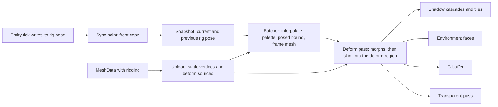
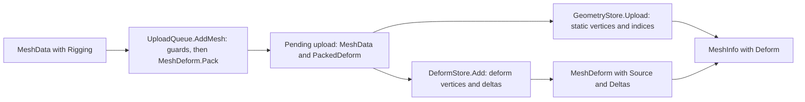
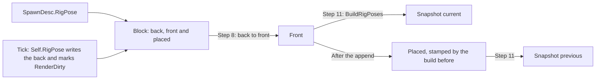
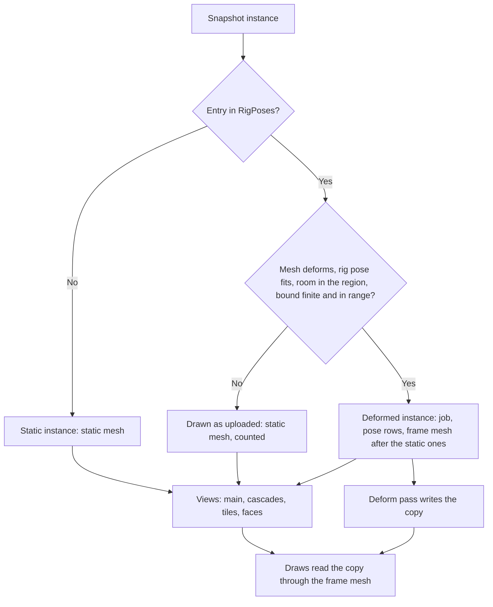
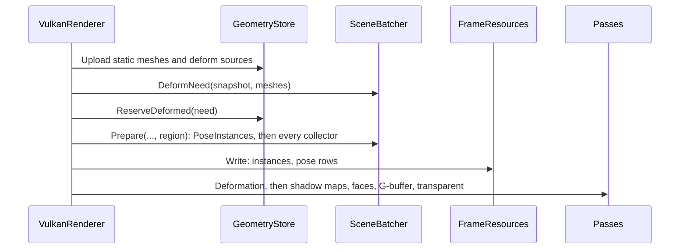

# Skinning and morph targets

Ticket: `ter-3pah` writes this design for the epic `ter-4vzc`, a member of the rendering upgrade (`ter-sglu`, [rendering-upgrade.md](rendering-upgrade.md)). On 2026-10-26 the user asked to add skinning and morph targets to the rendering upgrade. The skin and hair shading of the same request is a separate epic, `ter-n7lw`. This doc is written against main at `c2152136` and the shadow branch `ter-s9cv-light-shadows` at `840df22e`, which merges into main before Part 4 of this epic.

## Goal

Today every mesh is rigid. The renderer draws the uploaded vertices of a mesh with one transform per instance (ARCHITECTURE.md, "Instances and draws"). The MPFB humans of `ter-1qce` leave Blender frozen in one pose: `mpfb.freeze` applies the pose, removes the rig and keeps the bone weights only as vertex groups.

After this epic:

- A mesh can carry a rig: joints in a tree, a skin of up to four weighted joints per vertex, and morph targets that move positions, normals and tangents.
- An entity with a rig pose writes, in its own tick, the pose of each of its joints relative to the joint's parent, and a weight for each morph.
- Every pass that draws a mesh draws the posed shape: the sun's cascades, the local shadow tiles, the environment faces, the G-buffer and the transparent pass. So a shadow and a reflection match the body.
- A demo scene shows a bending cylinder, a morphing box and a cylinder that does both, with their shadows.
- Animation clips do not exist yet. A component writes the rig pose by hand. A later animation epic becomes one more writer of the rig pose.

## Terms

| Term | Meaning |
|---|---|
| Model space | The axes and the origin in which a mesh's vertices lie. The instance's position, rotation and scale take model space into the world, as today. |
| A joint | A rigid frame of a rig. It has a name, a parent joint or none, and a rest pose. |
| A root joint | A joint without a parent. Its poses are relative to the model's origin. |
| A joint pose | A joint's `Pose` (a position and a rotation) relative to its parent joint, or to the model's origin for a root joint. |
| The model pose of a joint | M_j, the pose of joint j in model space: its joint pose for a root joint, and Compose(M_parent, its joint pose) otherwise. |
| A morph | A named weight of a rig, with a rest weight. |
| A morph weight | The value of a morph. 0 adds none of a target's deltas, and 1 adds all of them. |
| A rig | The joints of a model, parents before children, and its morphs. The type is `Rig`. The parts of one model share one rig. |
| A rig pose | A joint pose for every joint of a rig and a weight for every morph. The type is `RigPose`. An entity's rig pose is its state. |
| The rest pose | The rig pose of the rest poses and rest weights, `Rig.Rest`. |
| A skin | For each vertex of a mesh, up to four joints with weights, and for each joint of the rig an inverse bind. The type is `MeshSkin`. |
| An inverse bind | IB_j, the pose that takes a point of model space at the bind into the space of joint j. For a mesh bound in the rest pose, IB_j is the inverse of M_j at rest. |
| A skin pose | S_j = Compose(M_j, IB_j): the rigid map of joint j from model space at the bind to model space in the current pose. At the bind, every S_j is the identity. |
| A morph target | One morph's deltas of position, normal and tangent for one mesh, one of each per vertex. The type is `MorphTarget`. |
| The rigging of a mesh | Its rig, its skin or none, and its morph targets. The type is `MeshRigging`. |
| A deforming mesh | A mesh with rigging. |
| A posed instance | An instance of the snapshot whose entity has a rig pose. The snapshot holds an entry for it in `RigPoses`. |
| Fits | A rig pose fits a deforming mesh when it has as many joint poses and weights as the mesh's rig has joints and morphs. |
| The palette joints | The joints whose skin poses the deformation reads: the rig's joints for a mesh with a skin, and one identity joint for a mesh without one. |
| A palette | The skin poses of one posed instance in one frame, as three `vec4` rows per palette joint, the layout of `GpuInstance`'s model rows. |
| The pose rows | One posed instance's palette, followed by its morph weights, four to a `vec4` row. |
| A deformed copy | The vertices of a deforming mesh after its morphs and its skin, for one posed instance in one frame. The deform pass writes it. |
| The deform region | The part of the global vertex buffer after the uploaded vertices that holds the frame's deformed copies. |
| A static mesh | An uploaded mesh as it was uploaded, an entry of `GeometryStore.Meshes`. |
| A frame mesh | An entry of `PreparedScene.Meshes`: the static meshes first, then one entry per deformed copy of the frame. |
| A deformed instance | A posed instance whose frame mesh is a deformed copy. |
| Drawn as uploaded | A posed instance that draws its static mesh, because its rig pose does not fit, its pose is not finite, the region is full, or the deformation is off. |
| A job | The work of one deformed copy: `DeformJob`. |
| An influence sphere | For each joint of a skin, a sphere in model space at the bind that holds every vertex with a weight above 0 on that joint. A mesh without a skin has one, centered at the origin, with the mesh's radius. |
| The longest delta | m_k, the length of the longest position delta of morph target k. |
| The posed bound | A radius about the model's origin that holds every vertex of a deformed copy. The batcher computes it in every frame from the palette and the weights. |

## Decisions

Decisions 1 to 6 were settled before this design: decision 1 by the user's request, and 2 to 6 by the orchestrator from the user's rules. This design settles decisions 7 to 33, each with its reason.

1. Meshes with joints and weights deform by a pose of their joints, and meshes with morph targets blend them by weights, in every pass that draws a mesh. (User)
2. The rig pose is entity state. An entity writes the joint poses and the morph weights of its own rig pose, relative to itself. (User's rules)
3. The snapshot carries the rig pose of the last finished tick and of the tick before. (User's rules)
4. The renderer interpolates the rig pose as it interpolates transforms. (User's rules)
5. Animation clips, blending and state machines are left out. Later they become one writer of the rig pose. (User's rules)
6. Physics does not change. There are no skinned colliders. (User's rules)

Settled by this design:

7. A mesh's rigging lives in `MeshData.Rigging`, one record of its rig, its skin and its morph targets. Reason: one store per mesh, and the importer makes all three from one glTF mesh.
8. A `Rig` is an object of its own that the meshes of one model share. Reason: an entity has one rig pose, and every part of its model reads that pose. A fit is a test of counts, so two meshes of one rig fit one rig pose.
9. Joints are rigid: a joint pose is a `Pose`, with no scale. Reason: `Pose` is the engine's rigid transform, a rigid skin pose turns a normal with no inverse transpose, and the instance's scale already scales the whole model. The importer refuses a joint with a scale (AS2020).
10. A vertex has at most four joint influences, in one `VertexSkin`. Reason: glTF's `JOINTS_0` and `WEIGHTS_0` hold four, and four fit one `vec4` of weights. The importer keeps the four largest (AS2021).
11. The skin is linear blend skinning: the deformed position is the sum over the influences of weight times S_j applied to the position. Reason: it is the glTF definition, its C# copy is short, and it needs no new math type. Dual quaternion skinning keeps volume at a twisted joint, and "Later" lists it.
12. Morphs apply before the skin. Reason: glTF's order. A morph's deltas are authored in model space at the bind, so the skin turns them with the joints.
13. A morph target holds deltas of position, normal and tangent. The renderer stores them sparsely, a list per vertex, and leaves out an entry whose three deltas are exactly zero. Reason: a face morph moves a few thousand vertices of a body of twenty thousand.
14. A deforming mesh without a skin deforms by one identity joint, with the weights (1, 0, 0, 0) on every vertex. Reason: one shader path serves skins and morphs alike.
15. One compute pass, the deform pass, writes a deformed copy of each deformed instance into the deform region, before the shadow maps. Every pass then draws the copy through its frame mesh, unchanged. Reason, against a skinning vertex shader:
    - A frame draws a mesh up to 15 times: three depth ranges, four cascades, up to six tiles per shadowed point light, the environment faces and the transparent pass. A vertex shader repeats the deformation in each draw. The compute pass does it once.
    - The shadows, the faces and the G-buffer read the same bits, so a shadow cannot drift from its body.
    - No vertex shader, no pass and no pipeline changes. `mesh.vert` and `shadow.vert` stay as they are.
    - The cost is the memory of the deform region, one pass, and a second upload of each deforming mesh (decision 16).
16. The deform pass reads its sources from a buffer of its own, the deform vertices, 80 bytes each. So a deforming mesh is uploaded twice: as 48-byte static vertices and as 80-byte deform vertices. Reason: reading the static vertices needs a storage binding of the whole global vertex buffer, which can pass the spec's least `maxStorageBufferRange`, 128 MB. The static copy also serves every instance drawn as uploaded.
17. The deform region lies inside the global vertex buffer, after the static capacity. Reason: each depth range and each cascade issues one `vkCmdDrawIndexedIndirect` over one bound vertex buffer. A copy in another buffer needs a draw of its own.
18. One deform region serves every frame in flight. A barrier at the start of the deform pass orders its writes after the vertex reads of the frame before. Reason: the sun's shadow map is one image for every frame slot, and the transparent pass shades with it. So frame N's shadow pass already waits for frame N − 1's transparent pass, and the deform pass's first barrier waits for no pass that ends later. A region per slot doubles the memory and buys no overlap.
19. The rig pose of an entity lives in one block per posed slot of the `EntityTable`, with three copies: the back, which the entity writes, the front, which step 8 of the sync point copies from the back, and the placed copy, the snapshot builder's memory of the last build. A write of the rig pose marks the slot's `RenderDirty`, and step 8 copies the render row and the rig pose together. Reason: the rig pose is render state, and `SlotFlags` is a byte with all eight bits in use. A ninth flag widens every slot's flags for a feature that few slots use. The extra copy is about 1.5 KB for a posed entity that wrote only its render row.
20. The snapshot carries the rig poses in three lists beside the instances: `RigPoses`, sorted by instance, with ranges into `JointPoses` and `MorphWeights`. `RenderInstance` keeps its size. Reason: the instance row is the hot row of 20,000 instances, and posed instances are few. `RigPoses` is the snapshot's one store of the rig pose. It names its instance by index and holds nothing that the instance holds.
21. The interpolation of a joint pose lerps the position and turns the rotation through `SceneBatcher.Interpolate`, the slerp that the instance rotations use. A weight lerps. A joint or a weight whose two ends are equal takes its current value as alpha 1 gives it. Reason: one rule for every rotation in the renderer. A still rig then gives the same palette bits in every frame, which the shadow tiles' cache needs (fork 1).
22. The batcher deforms every posed instance that it places, whether a view sees it or not. Reason: the cascades, the tiles and the faces are culled after posing, from the posed bound. A copy per view, or a union of the views, costs more than the copy itself, about 0.02 to 0.05 ms per human.
23. The posed bound is computed in every frame from the palette, the influence spheres and the weights: the largest |S_i(c_i)| + r_i over the palette joints, plus the sum over the targets of |w_k| times m_k. Reason: it is automatic and conservative (see "The posed bound"), and it costs one point transform per joint. A radius set by hand misses a pose that the author did not try.
24. The render row's `BoundingRadius` still overrides the posed bound when it is above 0, as it overrides the mesh's radius today. Reason: one rule for the override.
25. A deformed instance never becomes an impostor. Reason: an impostor is a captured image of a mesh, and its key (`ImpostorKey`) knows nothing of the pose. ARCHITECTURE.md already says to keep an object that changes every frame out of the impostors. A posed instance drawn as uploaded is a static instance and follows the usual rules.
26. The shadow tiles' cache treats a posed caster by fork 1, written here as its recommendation B: the tile record keeps the caster's pose rows and compares them bit for bit.
27. The guards. `IRenderResources.CreateMesh` refuses rigging that does not match its mesh, with `ArgumentException`. `ShaderInput.MorphWeight` turns a NaN weight into 0 and clamps a weight to ±1,024. A rig pose that does not fit, or whose posed bound is not finite or passes the position limit, draws its instance as uploaded, and `RenderStats.UndeformedPosedInstances` counts it. Reason: the rules of ARCHITECTURE.md, "Portable Vulkan": no NaN or infinity reaches a shader, and the CPU boundary stops it.
28. `RendererOptions.Deformation`, on by default. Off, the renderer passes an empty deform region, so every posed instance draws as uploaded and is counted. Reason: every member of the rendering upgrade has a switch, and an empty region is the same path as a full one.
29. The choke points. `SceneBatcher.PoseInstances` is the one place that decides which instance deforms, by the pure predicates `MeshDeform.Fits`, the bound's test and the room left in the region, and it acts directly. `GeometryStore.ReserveDeformed` is the one place that grows the region. `ShadowTiles.Update` stays the one place of the tiles' cache. No planner and no plan object.
30. Nothing attaches to a joint. An entity attached to a posed entity follows its origin. Reason: an attachment to a joint needs the joint's model pose in the simulation, which only the renderer computes. "Later" lists it.
31. The rig pose's shape, its joint count and its weight count, is fixed at spawn. Reason: the block of the slot is pooled by shape, and the rig of a mesh never changes.
32. `RenderSnapshot.AddRigPose` is the one writer of the snapshot's rig pose lists, and four read methods give the spans of an entry. Reason: the layout of the lists lives in one place, which the builder and the tests both use.
33. The test meshes are made in code, in `Primitives`: `BendingCylinder`, `MorphingBox` and `TwistingBendingCylinder`. Reason: the importer does not exist yet. These meshes test and show every path: a skin, morphs without a skin, and both.

## The model

This section describes the model as a renderer built from scratch has it. The next section lists how it differs from today's code.

A deforming mesh is a function. Its inputs are the mesh's data, which never changes, and a rig pose, which changes in every tick. Its output is a set of vertices in model space. Everything else in the renderer is already a function of vertices in model space: the transform of an instance, the culling of a view, the draws of every pass. So the model computes the function once per posed instance and per frame, and hands its output to the rest of the renderer as one more mesh.

The rig pose is the entity's state, like its transform. The entity writes it in its tick, the sync point publishes it, and the snapshot carries it for two ticks, so that the renderer interpolates it at the frame's alpha. The renderer turns the interpolated rig pose into a palette, one rigid skin pose per joint, and into a posed bound, a sphere that holds every deformed vertex. The palette, the weights and the mesh's sources go to the GPU, where one compute pass writes the deformed copies. The draws then read the copies.



An example of use, with the bending cylinder:

```csharp
MeshData cylinder = Primitives.BendingCylinder(radius: 0.2f, length: 2f);
Rig rig = cylinder.Rigging!.Rig;
MeshId mesh = resources.CreateMesh(cylinder);
world.Spawn(
    new SpawnDesc
    {
        Frame = room,
        Render = new RenderData { Mesh = mesh, Material = paint },
        RigPose = rig.Rest,
        Components = [new RigSway(rig)],
    }
);

// In RigSway.Handle, once per tick:
RigPoseWriter pose = self.RigPose;
float angle = 0.6f * MathF.Sin(self.Tick * (MathF.Tau / 120));
pose.Joints[tip] = rig.Joints[tip].Rest with { Rotation = Quaternion.CreateFromAxisAngle(Vector3.UnitZ, angle) };
```

where

- `cylinder` = a tube along +Y, 2 m long, with the joints `Base` at the origin and `Tip` 1 m up.
- `rig` = the cylinder's rig: two joints and no morphs.
- `RigPose = rig.Rest` = the entity's rig pose at spawn, which fixes its shape: two joint poses and no weights.
- `RigSway` = a demo component that writes the rig pose in every tick.
- `self.RigPose` = a writer of the back copy of the entity's own rig pose. Its use marks the slot's `RenderDirty`.
- `tip` = the index of `Tip` in the rig, which `RigSway` finds once with `rig.JointNamed("Tip")`.
- `angle` = the bend of the tip about +Z, in radians, a sway of 0.6 rad with a period of 120 ticks, 2 s.

## How it differs from today's code

| Today | This design | Why |
|---|---|---|
| `MeshData(Vertices, Indices)` | Plus `MeshRigging? Rigging` | Decision 7 |
| A mesh's `MeshInfo` holds its ranges and radius | Plus `MeshDeform? Deform`, the CPU side of a deforming mesh | The batcher poses from it |
| The global vertex buffer holds the static vertices | Plus the deform region after the static capacity, and storage use | Decisions 15 and 17 |
| `SpawnDesc` and `Self` have no rig pose | `SpawnDesc.RigPose`, `Self.RigPose` | Decision 2 |
| `RenderSnapshot` holds instances | Plus `RigPoses`, `JointPoses` and `MorphWeights` | Decisions 3 and 20 |
| The batcher draws an instance's static mesh | It draws its frame mesh, a deformed copy for a deformed instance | Decision 15 |
| `ShadowPass` and `ImpostorPass` read `context.Geometry.Meshes` (and `LocalShadowPass` on the shadow branch) | Every pass reads `context.Scene.Meshes`, the frame meshes | One mesh table per frame |
| The first stage of the frame graph is `ShadowMaps` | `Deformation` comes first | Decision 15 |
| A tile record compares a caster's mesh index | It compares the static mesh and, for a posed caster, its pose rows | Fork 1 |

## The mesh data

Part 1 adds the types of the seam, in `src/Tertius.Core/Seams/Rig.cs` and `RenderSeam.cs`, all public, in the namespace `Tertius`:

```csharp
public readonly record struct RigJoint(string Name, int? Parent, Pose Rest);

public readonly record struct RigMorph(string Name, float Rest);

public sealed class Rig
{
    public const int MaxJoints = 65_535;

    public Rig(ImmutableArray<RigJoint> joints, ImmutableArray<RigMorph> morphs);

    public ImmutableArray<RigJoint> Joints { get; }
    public ImmutableArray<RigMorph> Morphs { get; }
    public RigPose Rest { get; }

    public int? JointNamed(string name);
    public int? MorphNamed(string name);
}

public sealed record RigPose(ImmutableArray<Pose> Joints, ImmutableArray<float> Weights);

[StructLayout(LayoutKind.Sequential)]
public readonly record struct VertexSkin(ushort Joint0, ushort Joint1, ushort Joint2, ushort Joint3, Vector4 Weights);

public sealed record MeshSkin(VertexSkin[] Vertices, ImmutableArray<Pose> InverseBinds);

public sealed record MorphTarget(int Morph, Vector3[] Positions, Vector3[] Normals, Vector3[] Tangents);

public sealed record MeshRigging(Rig Rig, MeshSkin? Skin, ImmutableArray<MorphTarget> Morphs);

public sealed record MeshData(Vertex[] Vertices, uint[] Indices)
{
    public MeshRigging? Rigging { get; init; }
}
```

where

- `RigJoint.Parent` = the index of the parent joint, below the joint's own index, or null for a root joint.
- `RigJoint.Rest` = the joint pose at rest, relative to the parent joint or to the model's origin.
- `RigMorph.Rest` = the morph weight at rest, usually 0.
- `Rig.MaxJoints` = 65,535, the most joints that a 16-bit joint index names.
- `Rig.Rest` = the rest pose: every joint's `Rest` and every morph's `Rest`.
- `JointNamed`, `MorphNamed` = the index of the joint or morph of that name, or null when the rig has none.
- `VertexSkin.Joint0` to `Joint3` = the rig's indices of the vertex's four joints. An unused slot holds joint 0 with weight 0.
- `VertexSkin.Weights` = the four weights, each at least 0, with a sum above 0. The renderer scales them to sum to 1.
- `MeshSkin.Vertices` = one `VertexSkin` per vertex of the mesh.
- `MeshSkin.InverseBinds` = one inverse bind per joint of the rig, in the rig's order. A skin's joints are the rig's joints, with no subset and no remap.
- `MorphTarget.Morph` = the index of its morph in the rig. Two targets of one mesh never share a morph.
- `MorphTarget.Positions`, `Normals`, `Tangents` = each either empty, which means all zero, or one delta per vertex of the mesh. A tangent delta moves the tangent's xyz and never its sign.
- `MeshData.Rigging` = the mesh's rigging, or null for a rigid mesh.

The `Rig` constructor throws `ArgumentException` for a parent that does not come before its joint, a joint or morph name that repeats, a rest pose or weight that is not finite, a rest rotation that is not a rotation (its squared length is not finite or is at most 10^−12, the rule of `SceneBatcher.Interpolate`), or more than `MaxJoints` joints. Each joint pose of the rest is kept as given. The renderer normalizes every rotation where it composes.

`UploadQueue.AddMesh` keeps today's guards and adds the guards of rigging, each an `ArgumentException` from `CreateMesh`:

- The skin has one `VertexSkin` per vertex and one inverse bind per joint of the rig.
- Every joint index of the skin is below the rig's joint count. Every weight is finite and at least 0, and the four weights of a vertex sum to more than 0.
- Every inverse bind is finite, and its rotation is a rotation.
- Every target names a morph of the rig, and no two targets of the mesh name the same morph.
- Every delta array is empty or has one entry per vertex. Every delta is finite. A normal or tangent delta is at most 2 long, the longest difference of two unit vectors.
- A deforming mesh has at most 64 × 65,535 = 4,194,240 vertices, the vertices of one row of the deform pass's grid (see "Portable Vulkan").

`AddMesh` then calls `MeshDeform.Pack` and keeps its result beside the mesh. A deforming mesh whose deform data passes the device's limit throws `InvalidOperationException`, as `AddTexture` does when the texture store is full (see "Buffers and the region").

## The rig pose in the simulation

The `EntityTable` keeps a `RigPoseBlock` for each live slot whose entity spawned with a rig pose, in a new partial file `EntityTable.RigPoses.cs`. A block holds three copies of the rig pose, each J joint poses and W weights:

| Copy | Written by | When | Read by |
|---|---|---|---|
| Back | The entity, through `Self.RigPose` | Its tick | The entity, and step 8 |
| Front | Step 8 of the sync point, from the back, for a slot with `RenderDirty` | The sync point | The snapshot builder |
| Placed | The snapshot builder, from the front, with the stamp of the build | Step 11 | The snapshot builder in the next build |

A spawn takes a block of its shape (J, W) from the table's pool, or makes one, and writes the spawn's rig pose into all three copies, with a stamp that no build has. A destruction returns the block to the pool. So a world whose posed entities only come and go allocates nothing once its pool holds every shape.

The writer that `Self` gives is a ref struct over the back copy:

```csharp
public readonly ref struct RigPoseWriter
{
    public Span<Pose> Joints { get; }
    public Span<float> Weights { get; }
}

// Self
public RigPoseWriter RigPose => world.Entities.WritableRigPose(Entity);

// SpawnDesc
public RigPose? RigPose { get; init; }
```

where

- `RigPoseWriter.Joints` = the J joint poses of the back copy, in the rig's order.
- `RigPoseWriter.Weights` = the W morph weights of the back copy.
- `WritableRigPose(entity)` = marks the slot's `RenderDirty`, puts it in its chunk's dirty list as `WritableRender` does, and returns the writer. It throws `InvalidOperationException` for an entity without a rig pose.
- `SpawnDesc.RigPose` = the rig pose at spawn, or null for none. It fixes J and W.

The spawn guards throw `ArgumentException` for a rig pose without a render row, a joint pose or weight that is not finite, a rotation that is not a rotation, or more than `Rig.MaxJoints` joints. A tick can still write any value into the spans. The renderer's guards catch it (decision 27).

Rules that follow from the user's rules:

- An entity writes only its own rig pose. No other entity reads it, and no message carries it.
- The rig pose is relative to the entity, so a hand-off to another frame changes nothing in it.
- `EntityTable.AssertInvariants` adds: a slot has a block exactly when it is live and spawned with a rig pose, a block's three copies have its shape, and no pooled block belongs to a slot. `WorldOptions.DebugChecks` runs them at every sync point.

## The rig pose in the snapshot

```csharp
public readonly record struct RenderRigPose(int Instance, int JointStart, int JointCount, int WeightStart, int WeightCount);

// RenderSnapshot
public List<RenderRigPose> RigPoses { get; } = [];
public List<Pose> JointPoses { get; } = [];
public List<float> MorphWeights { get; } = [];

public void AddRigPose(
    int instance,
    ReadOnlySpan<Pose> joints,
    ReadOnlySpan<Pose> previousJoints,
    ReadOnlySpan<float> weights,
    ReadOnlySpan<float> previousWeights
);

public ReadOnlySpan<Pose> JointsOf(in RenderRigPose pose);
public ReadOnlySpan<Pose> PreviousJointsOf(in RenderRigPose pose);
public ReadOnlySpan<float> WeightsOf(in RenderRigPose pose);
public ReadOnlySpan<float> PreviousWeightsOf(in RenderRigPose pose);
```

where

- `RenderRigPose.Instance` = the index in `Instances` of the posed instance.
- `JointStart`, `JointCount` = the entry's first joint pose in `JointPoses` and J. The current joint poses come first, then the previous ones, so the entry holds 2J joint poses.
- `WeightStart`, `WeightCount` = the same for `MorphWeights` and W.
- `AddRigPose` = appends one entry and its four spans. It throws `ArgumentException` when `instance` is not above the last entry's instance or not below `Instances.Count`, or when a span's length differs from its partner's.
- `JointsOf` and the other three = the spans of an entry.

`Clear` empties the three lists and keeps their capacity, as it does for the other lists.

The builder adds one step, `BuildRigPoses`, after the parallel chunks join, on the calling thread. Each chunk notes its posed instances, by its local instance index and slot, in a list of its own. `BuildRigPoses` walks the chunks' lists in chunk order, so the entries come in instance order. For each, it appends the front copy as the current rig pose. The previous rig pose is the placed copy when render interpolation is on and the block's stamp is the build before, and the front copy otherwise, the rule of the previous transforms. It then copies the front into the placed copy and stamps it with this build.

Reasons for the order:

- After the join, because an entry needs its instance's index in the joined list.
- On one thread in chunk order, so the entries do not depend on the threads of the build, and the lists stay sorted by instance.

## Posing in the batcher

`SceneBatcher.Prepare` gains a parameter, the deform region, and a first step, `PoseInstances`, before `CollectVisible`:

```csharp
internal readonly record struct DeformRegion(int Base, int Capacity)
{
    public static DeformRegion None => new(Base: 0, Capacity: 0);
}

internal readonly record struct DeformJob(int Mesh, int Target, int Pose);

internal readonly record struct MeshInfo(uint FirstIndex, uint IndexCount, int VertexOffset, float Radius, MeshDeform? Deform);
```

where

- `DeformRegion.Base` = the first vertex of the region in the global vertex buffer, a multiple of 16.
- `DeformRegion.Capacity` = the number of vertices that the region holds.
- `DeformJob.Mesh` = the static mesh of the job.
- `DeformJob.Target` = the first vertex of the copy, counted from the region's base.
- `DeformJob.Pose` = the first of the job's pose rows in `PreparedScene.Poses`.
- `MeshInfo.Deform` = the CPU side of a deforming mesh, or null for a rigid mesh and for a deformed copy.

`PoseInstances` walks `snapshot.RigPoses` in order. For each entry, it decides the instance's frame mesh:

1. If the instance's mesh is not on the GPU, the entry is skipped, and the instance is skipped later as today.
2. If the mesh has no `Deform`, or `Deform.Fits(JointCount, WeightCount)` is false, the instance draws as uploaded.
3. If the next target plus the mesh's `VertexCount` passes the region's `Capacity`, the copy does not fit, and the instance draws as uploaded.
4. Otherwise `MeshDeform.PoseInto` writes the job's pose rows and returns the posed bound. If the bound is not finite or passes `PositionLimit`, the rows are dropped, and the instance draws as uploaded.
5. Otherwise the batcher appends the job and a frame mesh `(FirstIndex, IndexCount, Base + Target, bound, null)`, the static mesh's index range over the copy's vertices. The instance's frame mesh is `StaticMeshCount + k`, where k counts the jobs before it.

Each instance drawn as uploaded adds 1 to `UndeformedPosedInstances`. Each deformed instance adds 1 to `DeformedInstances` and its vertices to `DeformedVertices`.

Every later step reads frame meshes. `CollectVisible`, `CollectCasters` and `BatchFaces` each walk `RigPoses` with a cursor beside the instances, so an instance with an entry takes its frame mesh. `Batch`, the casters' radius and every command read `scene.Meshes`. So a deformed instance is culled by its posed bound, in every view, and every command points at its copy. An instance that `Place` leaves out after its job was made, because its position passes the position limit, leaves a job that no draw reads, in a case that only a bug produces.

`PreparedScene` gains:

```csharp
public ReadOnlySpan<MeshInfo> Meshes { get; }
public int StaticMeshCount { get; }
public bool IsDeformed(int mesh) => mesh >= StaticMeshCount;
public ReadOnlySpan<DeformJob> Deforms { get; }
public ReadOnlySpan<Vector4> Poses { get; }
public DeformedMeshes Deformed { get; }
public int DeformedInstances { get; }
public int DeformedVertices { get; }
public int UndeformedPosedInstances { get; }

internal readonly ref struct DeformedMeshes
{
    public bool IsDeformed(int mesh);
    public int SourceOf(int mesh);
    public ReadOnlySpan<Vector4> PoseOf(int mesh);
}
```

where

- `Meshes` = the static meshes, then one frame mesh per job. It keeps its static part between frames and copies only the meshes uploaded since the frame before, because static meshes never change once uploaded.
- `SourceOf(mesh)` = the static mesh of a frame mesh: itself for a static mesh, and its job's `Mesh` for a deformed copy.
- `PoseOf(mesh)` = the pose rows of a deformed copy, and an empty span for a static mesh.

`SceneBatcher.DeformNeed(snapshot, meshes)` returns the sum of the vertex counts of the entries whose mesh deforms. The renderer calls it after the uploads and before `Prepare`, and `GeometryStore.ReserveDeformed` grows the region to it.

## The deformation on the GPU

### Buffers and the region

- The deform vertices and the morph deltas live in `DeformStore`, two device-local storage buffers that grow by doubling, as the geometry does. Each holds at most the device's `maxStorageBufferRange`.
- The global vertex buffer gains `StorageBufferBit`. Its layout is the static capacity, then the deform region. The region's base is a multiple of 16 vertices, 768 bytes, which is a multiple of 48 and of 256, the largest `minStorageBufferOffsetAlignment` that the spec allows.
- `GeometryStore.ReserveDeformed(vertices, ...)` grows the region to the next power of two of the need, times 16 vertices, at most `maxStorageBufferRange / 48`. A growth makes a new vertex buffer, copies the static vertices, and retires the old buffer until the frames that use it finish, as a static growth does today. The region needs no copy, because every frame writes it anew. A static growth moves the region with it.
- Each frame slot holds two host-visible storage buffers, which grow to the frame: the pose buffer, of the frame's pose rows, and the job table, of one `GpuDeformJob` per job. It also holds a deform descriptor set. `FrameResources.Write` copies `PreparedScene.Poses` into the slot's pose buffer and writes the job table from `PreparedScene.Deforms`, after `Prepare`, as it copies the instances.

### The layouts

```glsl
struct DeformVertex {
    vec3 position;  uint morphStart;
    vec3 normal;    uint morphCount;
    vec4 tangent;
    vec2 texCoord;  uvec2 joints;
    vec4 weights;
};

struct MorphDelta {
    vec3 position;  uint morph;
    vec3 normal;    float pad0;
    vec3 tangent;   float pad1;
};

struct Job {
    uint source;
    uint deltas;
    uint target;
    uint count;
    uint palette;
    uint weights;
    uint firstGroup;
};

layout(set = 0, binding = 4) readonly buffer JobBlock { Job jobs[]; };

layout(push_constant) uniform DeformPush {
    uint jobCount;
    uint groups;
} frame;
```

where

- `DeformVertex`, 80 bytes, `GpuDeformVertex` in C# = a vertex as uploaded, with its morph list and its skin.
- `morphStart`, `morphCount` = the vertex's first delta, counted from the mesh's first delta, and the number of its deltas. Its deltas come in morph order.
- `joints` = the four joint indices, two 16-bit halves per word, joint 0 in the low half of `x`. The packing needs no 16-bit storage feature.
- `MorphDelta`, 48 bytes, `GpuMorphDelta` in C# = one morph's deltas for one vertex, and its morph's index.
- `Job`, 28 bytes, `GpuDeformJob` in C# = one record of the job table: the work of one job of the frame.
- `source` = the mesh's first deform vertex in `DeformStore`.
- `deltas` = the mesh's first morph delta in `DeformStore`.
- `target` = the copy's first vertex, counted from the region's base.
- `count` = the mesh's vertex count.
- `palette` = the job's first pose row.
- `weights` = the job's first weight row: `palette` plus three rows per palette joint.
- `firstGroup` = the job's first workgroup of the frame's dispatch: the sum of ⌈count / 64⌉ over the jobs before it.
- `jobs` = the job table, one record per job, in job order. `GpuDeformJob.FromJobs` writes it from `PreparedScene.Deforms` and the static meshes.
- `frame.jobCount` = the records of the job table, at least 1.
- `frame.groups` = the frame's workgroups: the sum of ⌈count / 64⌉ over every job.

`DeformPushConstants` is the 8-byte C# struct of the push block.

### The pass

`deform.comp` runs 64 invocations per workgroup, one per vertex, and one dispatch per frame over every job. A job has ⌈count / 64⌉ workgroups, and its workgroups follow those of the job before it. Its set holds five storage buffers: binding 0 is the window, the region's range of the vertex buffer as a `float` array, because std430 pads a `vec3` to 16 bytes and a vertex is 48 bytes. Bindings 1, 2, 3 and 4 are the deform vertices, the morph deltas, the pose buffer and the job table.

The grid of the dispatch is `DeformPass.Grid(groups)`: as few rows as hold the workgroups with at most 65,535 per row, and rows as short as hold them. So it stays within the spec's least `maxComputeWorkGroupCount` of 65,535 per dimension, and it ends fewer than one row's count of workgroups past the last, which return at once.

Each workgroup finds its job by a binary search of the job table: its job is the last whose `firstGroup` is at most the workgroup's index. The index is the same for every invocation of the workgroup, so the search is uniform and costs about log2 of the job count reads, 7 for 100 jobs. `DeformPass.JobOf` is its C# copy.

```glsl
uint jobOf(uint g)
{
    uint low = 0, high = frame.jobCount - 1;
    while (low < high) {
        uint middle = (low + high + 1) / 2;
        if (jobs[middle].firstGroup <= g)
            low = middle;
        else
            high = middle - 1;
    }
    return low;
}

void main()
{
    uint g = gl_WorkGroupID.y * gl_NumWorkGroups.x + gl_WorkGroupID.x;
    if (g >= frame.groups)
        return;
    Job job = jobs[jobOf(g)];
    uint i = (g - job.firstGroup) * 64 + gl_LocalInvocationID.x;
    if (i >= job.count)
        return;
    DeformVertex v = sources[job.source + i];
    vec3 p = v.position, n = v.normal, t = v.tangent.xyz;
    for (uint e = 0; e < v.morphCount; e++) {
        MorphDelta d = deltas[job.deltas + v.morphStart + e];
        float w = poses[job.weights + d.morph / 4][d.morph % 4];
        p += w * d.position;
        n += w * d.normal;
        t += w * d.tangent;
    }
    vec3 sp = vec3(0), sn = vec3(0), st = vec3(0);
    for (uint s = 0; s < 4; s++) {
        uint r = job.palette + 3 * jointOf(v.joints, s);
        float a = v.weights[s];
        sp += a * vec3(dot(poses[r], vec4(p, 1)), dot(poses[r + 1], vec4(p, 1)), dot(poses[r + 2], vec4(p, 1)));
        sn += a * vec3(dot(poses[r].xyz, n), dot(poses[r + 1].xyz, n), dot(poses[r + 2].xyz, n));
        st += a * vec3(dot(poses[r].xyz, t), dot(poses[r + 1].xyz, t), dot(poses[r + 2].xyz, t));
    }
    writeVertex(job.target + i, sp, normalizedOr(sn, vec3(0)), vec4(normalizedOr(st, vec3(0)), v.tangent.w), v.texCoord);
}
```

where

- `g` = the workgroup's index in the frame's dispatch, row after row of the grid.
- `jobOf(g)` = the index of the workgroup's job in the job table.
- `i` = the vertex of the mesh.
- `p`, `n`, `t` = the position, normal and tangent after the morphs.
- `w` = the morph's weight in this frame, from the job's weight rows.
- `jointOf(joints, s)` = the joint index of slot s, unpacked from the two words.
- `r` = the first palette row of that joint.
- `a` = the vertex's weight on that joint.
- `sp`, `sn`, `st` = the sums over the four slots: the deformed position, normal and tangent before normalization.
- `normalizedOr(v, vec3(0))` = v at unit length, or zero when its squared length is below the smallest normal float, from `vectors.glsl`.
- `writeVertex(k, ...)` = writes the 12 floats of `Vertex` at float 12k of the window.

A slot with weight 0 adds exactly 0, so the shader needs no branch for unused slots. Joint 0 always exists, so the read stays in the palette.

Why one dispatch for every job, and not one per job:

- The prefilter profile (`ter-of1p`) measured a fixed cost of 17 to 30 µs per dispatch and about 15 µs per barrier under MoltenVK. One dispatch per job costs 2 to 3 ms for 100 humans before any work.
- The copies never overlap, but dispatches per job all write through the one window of the region, so the synchronization validation sees two writes to one range and needs a barrier between them. Each such barrier also drains the GPU. One dispatch writes each vertex once, through one binding, so no barrier is needed and the validation has no hazard to report.
- One pass that deforms every posed instance is the model of decision 15. The dispatches per job were only its first shape.

### Barriers and the frame graph

- `FrameGraph.Stage.Deformation` is a new first stage, before `ShadowMaps`. The deform pass is its one pass, named "deformation" in the GPU timings. On the shadow branch the graph holds at most 24 passes, with every switch on, so one more stays under `GpuTimer.MaxPasses`, 31.
- With no job, the pass records nothing.
- Otherwise it moves the vertex buffer from `BufferUse.VertexInput` to `ComputeWrite`, which orders its writes after every earlier vertex read, the frame before's included (decision 18). It records its one dispatch, with no barrier inside it, then moves the buffer back to `VertexInput`, before the first draw of the frame.
- The uploads move `DeformStore`'s buffers from `TransferDestination` to `ComputeRead` in the upload step's barrier batch.
- The host writes of the pose buffer and the job table become visible to the device at the submission.

## The math, and its C# copy

Part 3 writes the deformation in C#, in `src/Tertius.Rendering/Shading/MeshDeform.cs`. The GPU tests of Part 4 pin `deform.comp` to it.

```csharp
internal sealed record MeshDeform
{
    public int VertexCount { get; }
    public int Joints { get; }
    public int Morphs { get; }
    public int PaletteJoints { get; }
    public int PoseRows => 3 * PaletteJoints + (Morphs + 3) / 4;
    public int Source { get; init; }
    public int Deltas { get; init; }

    public static PackedDeform? Pack(MeshData mesh);

    public bool Fits(int joints, int weights);

    public float PoseInto(
        ReadOnlySpan<Pose> previousJoints,
        ReadOnlySpan<Pose> joints,
        ReadOnlySpan<float> previousWeights,
        ReadOnlySpan<float> weights,
        float alpha,
        Span<Vector4> rows
    );

    public static Vertex Deformed(
        in GpuDeformVertex source,
        ReadOnlySpan<GpuMorphDelta> deltas,
        ReadOnlySpan<Vector4> rows,
        int paletteJoints
    );
}

internal sealed record PackedDeform(MeshDeform Deform, GpuDeformVertex[] Vertices, GpuMorphDelta[] Deltas);
```

where

- `Joints`, `Morphs` = the rig's joint and morph counts.
- `PaletteJoints` = `Joints` for a mesh with a skin, and 1 without one.
- `PoseRows` = the pose rows of one job.
- `Source`, `Deltas` = the mesh's first deform vertex and first delta in `DeformStore`. `Pack` leaves them 0, and `DeformStore.Add` sets them with `with`.
- `Pack` = makes the deform vertices, the sparse deltas, the influence spheres and the longest deltas, or returns null for a mesh without rigging. It scales each vertex's weights to sum to 1 and makes the normal and tangent unit or zero, as `GeometryStore.Staged` does.
- `Fits(joints, weights)` = true when `joints == Joints` and `weights == Morphs`.
- `PoseInto` = interpolates the rig pose at `alpha`, writes the `PoseRows` rows, and returns the posed bound.
- `Deformed` = the C# copy of `deform.comp` for one vertex: `deltas` are the vertex's own deltas, and `rows` are the job's pose rows.

`PoseInto` works in this order:

1. Each joint pose: the position is the current one when both ends are equal, and `Vector3.Lerp(previous, current, alpha)` otherwise. The rotation is `SceneBatcher.Interpolate(current, current, 1)` when both ends are equal, and `SceneBatcher.Interpolate(previous, current, alpha)` otherwise.
2. Each weight: the current one when both ends are equal, and previous + (current − previous) × alpha otherwise. Then `ShaderInput.MorphWeight`.
3. Model poses, parents first, the rig's order: M_j = L_j for a root and `Pose.Compose(M_parent, L_j)` otherwise.
4. Skin poses S_j = `Pose.Compose(M_j, IB_j)`, written as three rows, (R row r, position r) for r from 0 to 2, where R is the rotation's matrix. A mesh without a skin writes the identity rows once, whatever the joints.
5. The weight rows, four weights per row, zero after the last.
6. The posed bound (below).

`Deformed` sums the morph deltas in the vertex's order, which is morph order, then the four skin slots in order 0 to 3, then normalizes as the shader does. Both use the same order, because a float sum depends on its order. The GPU can fuse a multiply and an add, so the tests compare within a tolerance of 10^−5 times (1 + |expected|) per component.

### The posed bound

For a vertex v at the bind, with its morphs it is v' = v + Σ w_k d_k(v), and the skin gives Σ a_i S_i(v'), where the a_i are at least 0 and sum to 1. So:

- The skinned position is a convex sum, so its length is at most the largest |S_i(v')| over the vertex's joints.
- S_i is rigid, so |S_i(v')| ≤ |S_i(v)| + |Σ w_k d_k(v)| ≤ |S_i(v)| + Σ |w_k| m_k.
- v lies in joint i's influence sphere (c_i, r_i), and S_i keeps distances, so |S_i(v)| ≤ |S_i(c_i)| + r_i.

So every deformed position lies within B = max over the palette joints with a sphere of (|S_i(c_i)| + r_i), plus Σ |w_k| m_k, of the model's origin. `Pack` computes each sphere from the vertices with a weight above 0 on its joint: the center of their bounding box, and the largest distance from it. A mesh without a skin has one sphere at the origin with the mesh's radius. The frame mesh's `Radius` is B, so `MeshExtent`, B times the largest |scale|, works unchanged. The tests allow the GPU's rounding, 10^−5 relative.

## Every pass that draws a mesh

| Pass | What changes |
|---|---|
| Sun shadow cascades (`ShadowPass`) | Reads `context.Scene.Meshes`. A posed caster's `Mesh` is its frame mesh, so the cascade draws the copy and culls it by its posed bound. |
| Local shadow tiles (`LocalShadowPass`, `ShadowTiles`) | Reads `context.Scene.Meshes`. The cache follows fork 1. |
| Environment faces | `BatchFaces` uses the frame meshes, so the faces draw the copies. |
| Impostor captures (`ImpostorPass`) | Reads `context.Scene.Meshes`, whose static part is `context.Geometry.Meshes`, so every pass reads one table. A deformed instance never becomes an impostor (decision 25), so no capture draws a copy. |
| G-buffer and transparent | No change: their commands come from the batcher with the copy's vertex offset. |
| Occlusion, reflections, lighting, puffs, overlay | No change: they draw no mesh. |

`ImpostorManager` adds one rule to its eligibility: `scene.IsDeformed(instance.Mesh)` keeps the instance as geometry.

## The flows, per kind

A deforming mesh, from `CreateMesh` to the GPU:



A rig pose, from the entity to the snapshot:



An instance in a frame, by kind:



A frame, in order:



## The importer's glTF mapping

The asset importer (`ter-kge6`, [asset-pipeline.md](asset-pipeline.md)) does not exist yet. This section gives the mapping that it follows when it is built, and the doc changes put it into asset-pipeline.md.

| glTF | Engine | Notes |
|---|---|---|
| The joints of every skin of a piece's meshes | `Rig.Joints`, one rig per piece | The union of the joints, sorted parents first, siblings in glTF node order. Names follow the name rules, and a repeated name takes AS2008's suffix. |
| A joint node's transform | `RigJoint.Rest` | Relative to its parent joint, or to the piece's origin for a root joint. The bake's turn and uniform scale apply. A scale or shear left after the bake is error AS2020. |
| `skin.inverseBindMatrices` | `MeshSkin.InverseBinds` | Identity when absent, as glTF says, then the bake: IB_j becomes IBM_j composed with the inverse of the bake. A rig joint outside the mesh's skin takes the inverse of its model rest pose, and no vertex names it. |
| `JOINTS_n`, `WEIGHTS_n` | `VertexSkin` | Joint indices remapped from the skin's list to the rig. The four largest of every set are kept (info AS2021) and scaled to sum to 1. A sum of 0 is error AS2022. |
| `targets[].POSITION`, `NORMAL`, `TANGENT` | `MorphTarget.Positions`, `Normals`, `Tangents` | Positions turn and scale with the bake. Normals and tangents only turn. |
| `mesh.extras.targetNames` | `RigMorph.Name` | A target without a name is named `target{i}`, by its index in the mesh. |
| `mesh.weights`, or `node.weights`, which wins | `RigMorph.Rest` | Two meshes of a piece that give one morph different weights are warning AS2023. The first in glTF order wins. |
| A mesh node whose parent is a joint, without a skin | A `MeshSkin` with every vertex on that joint, weight 1 | So a helmet modeled on the head bone follows the head. |
| More than 65,535 joints in a piece | None | Error AS2024. |
| Animations | Ignored | Info AS2005. |

The skinned mesh node's own transform is ignored, as glTF says, and its vertices are baked from the bind space into the piece's axes. Every step of "Meshes" that copies or reorders vertices carries the skin and the deltas: the back copies of double-sided materials, the weld, which compares them as attributes, the vertex fetch order and the LODs. The cooked mesh format gains the rigging. The parts of a model share the piece's one `Rig`, so the entity's one rig pose fits each of them. The scripted MPFB humans keep their `game_engine` rig, 53 joints with Unreal-like names, and export the armature at rest instead of freezing it.

The codes:

| Code | Severity | Meaning |
|---|---|---|
| AS2005 | Info | Animations are ignored. (Changed: skins are no longer ignored.) |
| AS2006 | None | Retired: morph targets are no longer ignored. The code is not used again. |
| AS2020 | Error | A joint or an inverse bind has a scale or a shear after the bake. Joints are rigid. |
| AS2021 | Info | A vertex has more than four joint influences. The four largest are kept. |
| AS2022 | Error | A vertex's skin weights sum to 0. |
| AS2023 | Warning | Two meshes of a piece give one morph different default weights. The first in glTF order wins. |
| AS2024 | Error | A piece's rig has more than 65,535 joints. |

## Portable Vulkan

The deformation follows the Vulkan specification, so it runs on NVIDIA, RADV, ANV and lavapipe as on MoltenVK. It needs no new device feature.

| Requirement | Why every driver has it |
|---|---|
| `StorageBufferBit` on the vertex buffer, beside `VertexBufferBit` | Core. Any buffer can have both uses. |
| Five storage buffers in the deform set, in the compute stage | Above the spec's least `maxPerStageDescriptorStorageBuffers`, 4. But the renderer already refuses a device whose stages see fewer storage buffers than the frame set's nine (`DescriptorLayouts.StorageBufferProblem`), and the deform pipeline's layout holds the deform set alone, so its compute stage sees five. NVIDIA, RADV, ANV and lavapipe offer far more. |
| A window offset that is a multiple of 768 bytes | The spec's `minStorageBufferOffsetAlignment` is at most 256. |
| A window, a deform store, a pose buffer and a job table within `maxStorageBufferRange` | The spec's least is 2^27 bytes. The renderer reads the device's value from `VulkanDevice.Properties` and stays within it. |
| One dispatch of every job's workgroups, on a grid of at most 65,535 per row and per column | The spec's least `maxComputeWorkGroupCount` is 65,535 in each dimension, so the grid holds up to 65,535² workgroups. A mesh has at most 4,194,240 vertices, one row (the guard of `AddMesh`). |
| 64 invocations per group | The spec's least `maxComputeWorkGroupInvocations` and `maxComputeWorkGroupSize[0]` are 128. |
| Push constants of 8 bytes | The spec's least `maxPushConstantsSize` is 128. |
| Joint indices packed in 32-bit words | No `storageBuffer16BitAccess`. |
| Stores from a compute shader | Core. `vertexPipelineStoresAndAtomics` is not needed, because no vertex shader writes. |
| No atomics, no float blend, and no barrier inside the pass | Each invocation writes only its own vertex, and one dispatch writes each vertex once. |

The new shader sites for the site table of ARCHITECTURE.md, "Portable Vulkan":

| Site | The input that would break it | Verdict |
|---|---|---|
| `deform.comp`, the morph sum p + Σ w × d | A NaN or infinite weight, or a sum past the float range | Safe: `ShaderInput.MorphWeight` turns NaN into 0 and clamps to ±1,024. The deltas are finite (`AddMesh`). The posed bound is at least every deformed position's length, and an instance whose bound is not finite or passes 2^62 draws as uploaded, so every sum stays far inside the float range. |
| `deform.comp`, the skin sum Σ a × S(p) | Weights that do not sum to 1, a palette with a NaN | Safe: `Pack` scales the weights to sum to 1, and each is at least 0. `SceneBatcher.Interpolate` gives a unit rotation and never a NaN. A position that is not finite makes the bound not finite, and the instance draws as uploaded. |
| `normalizedOr(sn, vec3(0))`, `normalizedOr(st, vec3(0))` | A zero normal after the morphs, or a long one | Safe: zero below the smallest normal float. A normal or tangent delta is at most 2 long and a weight at most 1,024, so the sum stays finite. |
| `poses[job.palette + 3 × joint]` | A joint past the palette | Safe: `AddMesh` refuses a joint past the rig, and a rig pose that does not fit draws as uploaded, so the palette has every joint. |
| `poses[job.weights + morph / 4]` | A morph past the weights | Safe: `AddMesh` refuses a morph past the rig, and `Fits` makes the weights the rig's. |
| `jobs[jobOf(g)]` | A read past the job table | Safe: a frame with a job has `jobCount` at least 1, and the search stays within 0 to `jobCount` − 1. A workgroup past `frame.groups` returns before it searches. |
| `region[12 × (job.target + i) + c]` | A write past the region | Safe: i < count, and the batcher makes a job only when target + count fits the region. |
| `sources[job.source + i]`, `deltas[job.deltas + start + e]` | A read past the stores | Safe: `Pack` writes each vertex's start and count inside its mesh's deltas, and `DeformStore.Add` places the mesh. |

No new value relies on a clamp to turn a NaN into a number, and no new pass blends.

A finding outside this epic: the frame set binds eight storage buffers in the vertex and fragment stages, above the spec's least `maxPerStageDescriptorStorageBuffers`, 4, and "Required device features" does not list that limit. The desktop drivers offer far more, so nothing breaks. The orchestrator files a ticket to list it.

## Every new value, its writers and its readers

The steps are those of ARCHITECTURE.md, "The order of a rendered frame", with the new step 4, the deformation. Every later step moves down by one: 5 the sun's shadow maps and the tiles, 6 the environment faces, 7 the prefilter, 8 the impostor captures, 9 the G-buffer, 15 the transparent pass. The simulation's steps are those of the sync point.

| Value | Written by | When | Read by | When | Stored in | Analogue |
|---|---|---|---|---|---|---|
| `MeshData.Rigging` | The caller: `Primitives`, later the importer | Before `CreateMesh` | `UploadQueue.AddMesh` | `CreateMesh` | `MeshData` | `MeshData.Vertices` |
| `PackedDeform` | `MeshDeform.Pack` | `CreateMesh` | `GeometryStore.Upload`, `DeformStore.Add` | Step 1 | The pending uploads | The pending `MeshData` |
| `MeshInfo.Deform` | `GeometryStore.Upload` | Step 1 | The batcher, `DeformPass` | Steps 3, 4 | The mesh list of `GeometryStore` | `MeshInfo.Radius` |
| Deform vertices and deltas | `DeformStore.Upload` | Step 1 | `deform.comp` | Step 4 | `DeformStore`'s buffers | The static vertices |
| The back rig pose | The entity, through `Self.RigPose` | Its tick | Step 8 | The sync point | The block's back copy | The back render row |
| The front rig pose | Step 8, for a slot with `RenderDirty` | The sync point | `BuildRigPoses` | Step 11 | The block's front copy | The front render row |
| The placed rig pose and its stamp | `BuildRigPoses` | Step 11 | `BuildRigPoses` | Step 11 of the next build | The block's placed copy | `PoseMemory` |
| `RigPoses`, `JointPoses`, `MorphWeights` | `RenderSnapshot.AddRigPose`, from `BuildRigPoses` | Step 11 | `DeformNeed`, the batcher | Steps 1, 3 | The snapshot | `PreviousPosition`, `PreviousRotation` |
| The region's need | `SceneBatcher.DeformNeed` | Step 1, after the uploads | `GeometryStore.ReserveDeformed` | Step 1 | None: a derived read | |
| The deform region | `ReserveDeformed` and a static growth | Step 1 | The batcher, the deform set | Steps 3, 4 | `GeometryStore` | The static capacity |
| Frame meshes | `PoseInstances` | Step 3 | Every collector, `Batch`, `BatchFaces`, the shadow passes, `ImpostorPass`, `ShadowTiles` | Steps 3 to 15 | `PreparedScene.Meshes` | `GeometryStore.Meshes` |
| Jobs and pose rows | `PoseInstances` | Step 3 | `DeformPass`, `ShadowTiles` | Steps 3, 4 | `PreparedScene` | The indirect commands |
| The slot's pose buffer | `FrameResources.Write` | After `Prepare` | `deform.comp` | Step 4 | The slot's host buffer | The slot's instance buffer |
| The slot's job table and its workgroups | `FrameResources.Write`, through `GpuDeformJob.FromJobs` | After `Prepare` | `DeformPass`, `deform.comp` | Step 4 | The slot's host buffer, and `FrameResources.DeformGroups` | The slot's light buffer |
| The deformed copies | `deform.comp` | Step 4 | Every pass that draws a mesh | Steps 5 to 15 | The deform region | The static vertices |
| The three counts | `PoseInstances` | Step 3 | `RenderStats` | After the frame | `PreparedScene`, then `RenderStats` | `VisibleInstances` |
| A tile record's pose rows (fork 1, B) | `ShadowTiles.Record` | Step 3 | `IsStale` | Step 3 of a later frame | `TileRecord` | `RecordedCaster` |

Each ordering rule has its reason:

- The entity writes the back in its tick, and step 8 copies it to the front. The builder reads only the front, which no tick writes.
- `BuildRigPoses` runs after the join, in chunk order (see "The rig pose in the snapshot").
- `DeformNeed` runs after the uploads, because it reads this frame's mesh table, and `ReserveDeformed` before `Prepare`, so that the batcher gets the grown region.
- `PoseInstances` runs first in `Prepare`, in snapshot order, because every collector reads the frame meshes and their bounds.
- A palette composes joints parents first, because a joint's model pose needs its parent's. The rig keeps parents first.
- `FrameResources.Write` copies the pose rows after `Prepare`, as it copies the instances.
- The deform stage comes before the shadow maps, because every pass that draws a mesh reads the copies.
- One dispatch deforms every job, and a job's workgroups follow those of the job before it. Each invocation writes only its own vertex, so the order of the workgroups changes no bits.
- The morph deltas sum in morph order and the skin slots in slot order, in the shader and in its C# copy.

## Stored state, one store, determinism and no temporal rendering

- Stored state describes the last finished step. The front rig pose describes the last finished tick, and the placed copy the last build. The back copy is the tick in flight, which only its entity reads. The deformed copies describe the frame that wrote them. A tile record describes the frame that drew it.
- One store for each piece of state. The rig pose has one block per slot, whose three copies each describe their own step, like the back and front rows and `PoseMemory`. The snapshot's lists are its one store of the rig pose. A mesh's rigging lives in its `MeshData`, and its CPU side in its `MeshInfo`. The frame mesh of an instance is derived in every frame.
- Closed sets. No kind enum is added. A frame mesh is a deformed copy exactly when its index is at least `StaticMeshCount`, an index range, not a flag beside the index.
- An entity writes only itself: `Self.RigPose` gives its own block.
- Determinism. The rig pose is written only by its entity's tick. The snapshot's entries follow the instance order, independent of threads. The batcher poses in snapshot order on one thread. The shader's sums run in a fixed order, and each invocation writes only its own vertex. A film draws the same copies on every run on one device.
- No temporal rendering ([rendering-performance.md](rendering-performance.md), decision 8). The interpolation of the rig pose is the interpolation of state between two ticks, as for transforms. No pixel blends with an earlier frame's.

## Memory and cost

Memory, by arithmetic, for a human of V = 20,000 vertices, J = 53 joints and W morphs:

| Item | Size | For a human |
|---|---|---|
| Static vertices, as today | 48 B × V, once per mesh | 0.96 MB |
| Deform vertices | 80 B × V, once per mesh | 1.6 MB |
| Morph deltas | 48 B per nonzero entry, once per mesh | 4.8 MB for 50 face targets of 2,000 vertices each, 0 for the MPFB rig without shape keys |
| The deform region | 48 B × V per deformed instance, shared by the frames in flight, grown to a power of two | 0.96 MB per instance |
| The pose buffer | 16 B × (3J + ⌈W / 4⌉) per deformed instance, per frame slot | 2.5 KB, and 2.7 KB with W = 50 |
| The job table | 28 B per deformed instance, per frame slot | 28 B |
| The simulation's block | 3 × (28 B × J + 4 B × W) per posed entity | 4.5 KB, and 5.1 KB with W = 50 |
| The snapshot | 2 × (28 B × J + 4 B × W) + 20 B per posed entity, per snapshot buffer, three buffers | 3 KB per buffer |
| `MeshDeform` on the CPU | 16 B per influence sphere, 28 B per inverse bind, 4 B per target | 2.3 KB per mesh |
| A tile record's pose rows (fork 1, B) | 16 B × the pose rows per posed caster | 2.5 KB per caster per tile |

The cost on the GPU is an estimate. Part 5 measures it. A vertex of the deform pass reads 80 bytes of source and writes 48 bytes, and its palette rows stay in the cache. For a human of 20,000 vertices that is 2.56 MB of memory traffic, about 0.01 ms at the M1 Max's bandwidth, plus one dispatch and two barriers per frame. So the deform pass is expected at 0.02 to 0.05 ms per human, and about 1 ms for 100 humans. The draws of a copy cost what the draws of a static mesh cost. A frame without a posed instance records nothing, so `demo-exit` and the other scenes keep their cost.

The cost on the CPU: `PoseInstances` costs one slerp, two compositions, one point transform and three row writes per joint, about 60 ns. That is about 3 µs per human, and 0.3 ms for 100 humans. The build of the snapshot copies about 3 KB per posed entity. The cursors of the collectors cost one comparison per instance.

The deform pass's GPU time holds the wait at its first barrier for the frame before, which the shadow pass's time holds today. Part 5 also measures it with `FramesInFlight` 1, where no frame before it is in flight, and reports both.

## Tests

The tests follow tests/STYLE.md: one behavior per test, named as a statement. Each is written first and seen to fail for the right reason. No test adds a reference image. The GPU tests use `Gpu.Headless` at 160 × 90 or 320 × 180. A hand-built snapshot adds its rig poses with `RenderSnapshot.AddRigPose`. Each builder makes a hand mutation for each new test (CLAUDE.md, "Testing") and names it in the report.

### Part 1: the seam

`RigTests` (Core.Tests):

- `RigRefusesAJointWhoseParentIsNotBeforeIt`
- `RigRefusesTwoJointsWithOneName`
- `RigRefusesTwoMorphsWithOneName`
- `RigRefusesARestPoseThatIsNotFinite`
- `RigRefusesARestRotationThatIsNotARotation`
- `RigRefusesARestWeightThatIsNotFinite`
- `RigRefusesMoreJointsThanMaxJoints`
- `RestHoldsEachJointsRestPoseAndEachMorphsRestWeight`
- `JointNamedFindsTheJointOfAName`
- `JointNamedIsNullForANameOfNoJoint`

`RenderSnapshotRigPoseTests` (Core.Tests):

- `AddRigPoseKeepsTheCurrentAndThePreviousApart`
- `AddRigPoseRefusesAnInstanceThatIsNotAfterTheLastEntry`
- `AddRigPoseRefusesAnInstanceOutsideTheInstances`
- `AddRigPoseRefusesSpansOfDifferentLengths`
- `ClearEmptiesTheRigPoses`

`PrimitivesRigTests` (Core.Tests):

- `RiggingHasOneEntryPerVertex`, for each of the three meshes.
- `BendingCylinderWeightsSumToOneAtEveryVertex`
- `BendingCylinderBindsItsLowestRingToTheBaseOnly`
- `BendingCylinderBindsItsHighestRingToTheTipOnly`
- `BendingCylinderInverseBindsUndoTheRestModelPoses`
- `MorphingBoxStretchMovesOnlyTheTopVertices`
- `MorphingBoxLeanTiltsTheNormalsOfTheFacesThatItShears`
- `TwistTurnsEachRingByItsHeight`

### Part 2: the simulation and the snapshot

`RigPoseTests` (Simulation.Tests):

- `SnapshotCarriesTheSpawnRigPoseOfANewEntity`
- `RigPoseWrittenInATickReachesTheNextSnapshot`
- `SnapshotCarriesTheRigPoseOfTheBuildBeforeAsThePrevious`
- `FirstSnapshotOfAnEntityHasEqualCurrentAndPreviousRigPoses`
- `PreviousRigPoseIsTheCurrentWithRenderInterpolationOff`
- `RigPoseOfAnEntityThatWritesNothingStaysAsItWas`
- `RigPoseEntriesFollowTheOrderOfTheInstances`
- `EntityWithoutARigPoseHasNoEntry`
- `SelfRigPoseThrowsForAnEntityWithoutARigPose`
- `SpawnRefusesARigPoseThatIsNotFinite`
- `SpawnRefusesARigPoseWithoutARenderRow`
- `HandOffKeepsTheRigPose`
- `RespawnOfAShapeInThePoolAllocatesNoBlock`
- `SnapshotBuildWithPosedEntitiesAllocatesNothingInTheSteadyState`
- `DebugChecksHoldWhilePosedEntitiesComeAndGo`

`RenderSnapshotParallelBuildTests` gains `ParallelBuildGivesTheSerialRigPoses`.

### Part 3: the deformation in C#

`MeshDeformTests` (Rendering.Tests):

- `PackGivesOneDeformVertexPerVertex`
- `PackListsEachVertexsDeltasInMorphOrder`
- `PackLeavesOutDeltasThatAreExactlyZero`
- `PackScalesTheWeightsOfAVertexToSumToOne`
- `PackGivesAMeshWithoutASkinOneIdentityJoint`
- `PackGivesNothingForAMeshWithoutRigging`
- `RestPoseLeavesEveryVertexInPlace`
- `BentTipTurnsTheTipRingsAboutTheTipJoint`
- `RingBetweenTheJointsBlendsBothJoints`
- `MorphAtWeightOneAddsItsWholeDelta`
- `MorphAtWeightHalfAddsHalfItsDelta`
- `MorphAddsItsTangentDeltaAndKeepsTheSign`
- `MorphsApplyBeforeTheSkin`: the twist at weight 1 with the tip bent 90° puts a top vertex at S(v + d), not at S(v) + d.
- `DeformedNormalsAndTangentsAreUnitOrZero`
- `PoseInterpolatesJointRotationsBySlerp`
- `PoseLerpsJointPositionsAndWeights`
- `PoseTakesTheCurrentValueWhereBothEndsAreEqual`: the rows are equal bit for bit at alpha 0.3 and 0.7.
- `PosedBoundHoldsEveryDeformedVertex`: 64 poses from a fixed seed.
- `PosedBoundGrowsByEachWeightTimesItsLongestDelta`
- `PosedBoundOfAMeshWithoutASkinIsItsRadiusPlusTheMorphs`
- `PosedBoundIsNotFiniteForAJointPositionThatIsNot`
- `FitsNeedsTheRigsJointAndMorphCounts`

`ShaderInputTests` gains `MorphWeightTurnsNaNIntoZero` and `MorphWeightClampsToTheLargestMorphWeight`.

`UploadQueueRiggingTests`:

- `AddMeshRefusesASkinOfAnotherVertexCount`
- `AddMeshRefusesAJointPastTheRig`
- `AddMeshRefusesANegativeWeight`
- `AddMeshRefusesWeightsThatSumToZero`
- `AddMeshRefusesInverseBindsOfAnotherJointCount`
- `AddMeshRefusesAnInverseBindThatIsNotFinite`
- `AddMeshRefusesAMorphPastTheRig`
- `AddMeshRefusesTwoTargetsOfOneMorph`
- `AddMeshRefusesADeltaArrayOfAnotherLength`
- `AddMeshRefusesANormalDeltaLongerThanTwo`
- `AddMeshRefusesADeformingMeshPastTheLargestDispatch`
- `AddMeshThrowsWhenTheDeformDataPassesTheDeviceLimit`

`GpuDeformTypesTests`: `GpuDeformVertexIs80Bytes`, `GpuMorphDeltaIs48Bytes`, and, from Part 4b's one dispatch, `GpuDeformJobIs28Bytes` and `DeformPushConstantsAre8Bytes`, each with the offsets of its fields.

### Part 4: posing and the deform pass

`BatcherDeformTests` (Rendering.Tests, Part 4a):

- `PosedInstanceDrawsItsDeformedCopy`
- `TwoPosedInstancesOfOneMeshGetTwoCopies`
- `CopiesLieEndToEndInTheRegion`
- `JobsFollowTheSnapshotOrder`
- `InstanceWithoutARigPoseDrawsItsStaticMesh`
- `RigPoseThatDoesNotFitDrawsTheStaticMeshAndIsCounted`
- `RigPoseOnARigidMeshDrawsTheStaticMeshAndIsCounted`
- `PosedInstancesPastTheRegionDrawTheirStaticMeshAndAreCounted`
- `EmptyRegionDrawsEveryPosedInstanceAsUploaded`
- `PoseWhoseBoundPassesThePositionLimitDrawsAsUploaded`
- `PosedInstanceIsCulledByItsPosedBound`: a tip bent outside the rest radius keeps the instance in view.
- `RenderRowBoundingRadiusOverridesThePosedBound`
- `ShadowCastersOfAPosedInstanceDrawItsCopy`
- `EnvironmentFacesDrawTheDeformedCopy`
- `DeformNeedCountsTheVerticesOfEveryPosedDeformingInstance`
- `PrepareWithPosedInstancesAllocatesNothingInTheSteadyState`

`ImpostorManagerTests` gains `DeformedInstanceNeverBecomesAnImpostor` and `PosedInstanceDrawnAsUploadedCanBecomeAnImpostor`.

`ShadowTilesTests` gains, for fork 1's recommendation B:

- `TileWithAStillPosedCasterStaysCached`
- `TileRedrawsWhenAJointOfAPosedCasterTurns`
- `TileRedrawsWhenAMorphWeightOfAPosedCasterChanges`
- `TileRedrawsWhenACasterTurnsFromStaticToPosed`

`DeformationGpuTests` (Rendering.Tests, Part 4b), through `ReadDeformedVertices`:

- `DeformedCylinderMatchesTheCSharpDeformation`
- `DeformedBoxMatchesTheCSharpDeformation`
- `DeformedTwistingCylinderMatchesTheCSharpDeformation`
- `TwoInstancesOfOneMeshDeformApart`
- `BentCylinderDrawsItsTipWhereThePoseMovedIt`: `ReadDistance` holds a surface where the bent tip lies and none where the tip rests.
- `BentCylinderShadowFollowsItsTip`: with the sun straight down, `ReadShadowCascade` holds a depth nearer the sun than the ground under the bent tip.
- `RegionGrowsForMorePosedInstances`
- `StaticMeshesStillDrawAfterTheRegionGrows`
- `DeformationOffDrawsTheStaticMesh`
- `OneDispatchDeformsEveryJobOfTheFrame`: four copies of three meshes, of 7, 1, 7 and 7 workgroups, in one dispatch, each equal to the C# copy.

`DeformJobsTests` (Rendering.Tests, Part 4b's one dispatch), without a GPU:

- `RecordNamesTheMeshsSourcesAndTheJobsCopyAndRows`
- `EachJobsWorkgroupsFollowThoseOfTheJobBefore`
- `EveryWorkgroupFindsTheJobWhoseVerticesItHolds`
- `FirstAndLastWorkgroupOfAJobFindIt`
- `JobOfOneVertexHasOneWorkgroupBetweenItsNeighbours`
- `SingleJobOwnsEveryWorkgroup`
- `GridOfAtMostTheLeastMaxWorkgroupCountIsOneRow`
- `GridPastTheLeastMaxWorkgroupCountTakesAsFewRowsAsHoldIt`
- `GridStaysWithinEveryDeviceAndEndsLessThanOneRowPastTheLastWorkgroup`

`DescriptorLayoutsTests.TheDeformLayoutBindsNoMoreStorageBuffersThanTheFrameSetNeedsOfEveryDevice` replaces the test of four.

### Part 5: the scene and the end

`RigsSceneTests` (Host.Tests):

- `RigsSceneDeformsEveryPosedInstance`: `DeformedInstances` counts the scene's posed instances, and `UndeformedPosedInstances` is 0.
- `RigsSceneGivesTheSameRigPosesOnEveryRun`

## Known limits

- Joints are rigid (decision 9). A rig with a scaled joint does not import (AS2020).
- Linear blend skinning loses volume at a sharply bent joint and pinches at a twisted one, the candy wrapper. A rig with twist joints, such as MPFB's `game_engine` rig, spreads a twist over two joints.
- At most four joints per vertex (decision 10).
- A deformed instance never becomes an impostor (decision 25), so a far crowd costs full geometry and full deformation.
- Every placed posed instance deforms in every frame, whether a view sees it or not (decision 22).
- Nothing attaches to a joint (decision 30). A held tool or a helmet as its own entity follows the entity's origin, not the hand or the head.
- Physics ignores the rig pose (decision 6).
- No clips, no blending and no state machines (decision 5). A component writes each joint by hand.
- The MPFB humans stay frozen until the importer exists.
- The posed bound is a sphere about the model's origin. A human's origin at its feet gives a sphere about twice the size of its body's own, so culling is looser.
- The shape of a rig pose is fixed at spawn (decision 31). An entity that switches its mesh to one of another rig draws as uploaded and is counted.
- A deforming mesh is uploaded twice, 128 bytes per vertex in all (decision 16).
- The deform region never shrinks.
- A morph weight is clamped to ±1,024.
- Normals and tangents blend linearly and are then normalized. A morph's normal deltas are linear in its weight, so a weight between 0 and 1 gives a normal between the two shapes, not the exact normal of the blended surface.
- With fork 1's B, a posed caster whose pose changes redraws the tiles that it shows in, in every frame. A human that breathes in a lit cabin redraws its lamps' tiles.

## Compared with a design from scratch

| From scratch | This design | Why it stays |
|---|---|---|
| The deform pass reads the static vertices, so each mesh is uploaded once | A second copy, 80 bytes per vertex | A storage binding of the whole vertex buffer can pass the spec's least `maxStorageBufferRange` (decision 16) |
| `RenderInstance` holds the index of its rig pose | A side list sorted by instance | The instance row is the hot row, and posed instances are few (decision 20) |
| A dirty flag of its own for the rig pose | `RenderDirty` covers it | `SlotFlags` is a full byte (decision 19) |
| A deform region per frame slot | One region with a barrier | The shared shadow map already orders the frames (decision 18) |
| Deforming only what some view sees | Every placed posed instance | The views are culled from the posed bound, which comes from the pose (decision 22) |
| Joints with scale | Rigid joints | Decision 9 |

## Later

Each item is left out because nothing needs it yet.

| Item | What it adds | When it is needed |
|---|---|---|
| Animation clips, blending and state machines | A writer of the rig pose from data | The animation epic |
| Attachments to a joint | An entity that follows a hand or the head | A held tool, a helmet as its own entity |
| Dual quaternion skinning | Volume kept at twisted joints | When a capture shows the candy wrapper |
| Impostors of posed instances | A far crowd at the cost of a billboard | When a scene shows a far crowd |
| Deformation only of what a view sees | No cost for posed instances out of every view | When a scene's posed instances out of view cost |
| Joint scale | Squash and stretch, scaled bones | When an asset needs it |
| Half-float morph deltas | Half the memory of the deltas | When a morph-heavy asset's memory matters |
| Entries that share their rig pose | One rig pose for every part of a model | When the snapshot writes one instance per part (the asset pipeline's models) |
| Skinned colliders | Hit boxes on limbs | When gameplay needs them |
| More than four joints per vertex | Smoother skin where many joints meet | When an asset shows the loss |

## Settled forks

The orchestrator settled fork 1 as B on 2026-10-26 and told the user. B keeps the image exactly, as A does, and the tile cache's rule redraws a tile only when its result can change. A would redraw 24 tiles per frame for a still crew member in a lit cabin, about 1 ms at the measured 0.04 ms per tile.

### Fork 1: the shadow tiles' cache with a posed caster

The local shadow tiles of `ter-s9cv` cache each tile and redraw it only when its record goes stale: a caster that moved by a quarter of a texel, another light, another projection, or other casters. A posed caster changes its shape without moving, so the record has to know the pose.

| Option | What it gives | What it costs |
|---|---|---|
| A: a tile with a posed caster is stale in every frame | Simple: one test in `IsStale` | A still human in a lit cabin redraws up to six tiles per shadowed point lamp in every frame. The cabin's four lamps redraw 24 tiles. |
| B: the record keeps each posed caster's pose rows and compares them bit for bit (Recommended) | A still pose keeps its tiles, exactly. The palette of a still rig has the same bits in every frame (decision 21). | About 40 lines in `ShadowTiles`, and 2.5 KB per posed caster per tile record. |

The recommendation is B, because a seated crew member in a lit cabin is the scene that motivates the epic. This doc writes B everywhere it matters: decision 26, "Every new value" and the tests of Part 4a.

## Doc changes

| Doc | Change |
|---|---|
| ARCHITECTURE.md, "Entities" | The rig pose: `SpawnDesc.RigPose`, `Self.RigPose`, the block of three copies, `RenderDirty` covers it, and the invariants |
| ARCHITECTURE.md, "The render snapshot" | `RigPoses`, `JointPoses`, `MorphWeights`, `AddRigPose` and the previous rig pose's rule |
| ARCHITECTURE.md, "The order of a rendered frame" | Step 1: the region's need and its growth. A new step 4, the deformation. The steps after it move down by one. |
| ARCHITECTURE.md, "Instances and draws" | Frame meshes, the deform region, and a new subsection "Skinning and morph targets": the terms, the data, the posing, the bound, the pass, the guards, the cost from Part 5 and the known limits |
| ARCHITECTURE.md, "Shadows" and the local shadows | The casters draw frame meshes, and the tile record keeps a posed caster's pose rows |
| ARCHITECTURE.md, "Impostors" | A deformed instance never becomes an impostor |
| ARCHITECTURE.md, "GPU timings" | The pass "deformation" |
| ARCHITECTURE.md, "Portable Vulkan" | The new site rows, and the limits of the requirements table |
| ARCHITECTURE.md, "Switches" | `Deformation` |
| docs/plans/asset-pipeline.md | Decision 17 says skinning and morph targets are built by this doc and animation is later. "Meshes" maps `JOINTS_n`, `WEIGHTS_n` and the targets. "Diagnostics" changes AS2005, retires AS2006 and adds AS2020 to AS2024. "Engine changes" names `MeshData.Rigging`. "Out of scope and later" keeps animation only. |
| docs/plans/rendering-upgrade.md | A row for `ter-4vzc` that links this doc |
| docs/plans/README.md | A row for this doc and `ter-4vzc` |

## Order of the work

The work splits into five parts, and Part 4 has two builders. Each part is a commit, or for Part 4 one commit of both builders, that builds and passes every test in Checked and Release. At most four builders run at once (CLAUDE.md).

| Part | Runs | Waits for |
|---|---|---|
| 1. The seam: rig types, rigging, the snapshot's lists, the test meshes | First | Nothing |
| 2. The rig pose in the simulation and the snapshot | Beside Part 3 | Part 1 |
| 3. The deformation in C#: packing, posing, the bound, the copy, the guards | Beside Part 2 | Part 1 |
| 4a. Posing in the batcher, the frame meshes, the tiles and the impostors | Beside 4b, in one worktree | Part 3, and the merge of `ter-s9cv` into main |
| 4b. The deform pass on the GPU | Beside 4a, in one worktree | Part 3, and the merge of `ter-s9cv` into main |
| 5. The scene, the cost, the captures and the docs | Last | Parts 2 and 4 |

Part 4 waits for `ter-s9cv`, because that branch rewrites `SceneBatcher`, adds `ShadowTiles`, `LocalShadowPass` and the casters, and changes `VulkanRenderer` and the frame graph. Parts 1 to 3 touch little that it touches. Part 4 also rebases on whatever `ter-pq5y`'s performance work lands in the batcher by then. The skin and hair shading of `ter-n7lw` changes shaders and materials, and no file of this epic.

### Part 1: the seam

- Tests first: `RigTests`, `RenderSnapshotRigPoseTests` and `PrimitivesRigTests`.
- Files: `src/Tertius.Core/Seams/Rig.cs` (new), `src/Tertius.Core/Seams/RenderSeam.cs`, `src/Tertius.Core/Seams/Primitives.cs`, and the three test files in `tests/Tertius.Core.Tests`.
- Gives: the types of "The mesh data", `RenderRigPose` and the members of `RenderSnapshot` of "The rig pose in the snapshot", and in `Primitives`:

  ```csharp
  public static MeshData BendingCylinder(float radius, float length, int segments = 24, int rings = 16);
  public static MeshData MorphingBox(Vector3 halfExtents);
  public static MeshData TwistingBendingCylinder(float radius, float length, int segments = 24, int rings = 16);
  ```

  - `BendingCylinder`: an open tube along +Y from 0 to `length`, `rings` + 1 rings of `segments` + 1 vertices, radial normals, tangents along the ring with sign 1. Its rig has `Base` at the origin and `Tip` at `length` / 2, children after parents. A vertex at height y has the weight t = clamp((y − (length / 2 − b)) / 2b, 0, 1) on `Tip` and 1 − t on `Base`, with b = `length` / 8. The inverse binds are the inverses of the rest model poses.
  - `MorphingBox`: `Box(halfExtents)` with a rig of no joints and the morphs `Stretch` and `Lean`, rest 0, and no skin. `Stretch` moves every top vertex by 2 h.y along +Y. `Lean` moves every top vertex by h.x along +X, with the normal deltas that tilt the ±X faces. Their tangents lie along Z, so `Lean` has no tangent deltas.
  - `TwistingBendingCylinder`: `BendingCylinder` with the morph `Twist`, which turns the ring at height y by (π / 2)(y / `length`) about +Y. Its deltas are the turned position, normal and tangent minus the old ones, so they cover all three kinds.
- Done: the solution builds, and every test passes in Checked and Release. Nothing reads the new types yet.

### Part 2: the rig pose in the simulation and the snapshot

- Tests first: `RigPoseTests` and the parallel build test.
- Files: `src/Tertius.Simulation/Internal/Entities/EntityTable.cs`, `EntityTable.RigPoses.cs` (new), `src/Tertius.Simulation/Entities/Self.cs`, `SpawnDesc.cs`, `RigPoseWriter.cs` (new), the spawn guards where `SpawnDesc` is checked, `src/Tertius.Simulation/Internal/Rendering/RenderSnapshotBuilder.cs`, `benchmarks/Tertius.Benchmarks/RenderSnapshotBenchmarks.cs`, and the tests in `tests/Tertius.Simulation.Tests`.
- Takes: Part 1's `RigPose` and `RenderSnapshot.AddRigPose`.
- Gives: `SpawnDesc.RigPose`, `Self.RigPose` and `RigPoseWriter` as in "The rig pose in the simulation", and snapshots that carry the rig poses.
- Done: `RenderSnapshotBenchmarks` gains a case of 1,000 posed entities of 53 joints. Its build time and its allocations, zero in the steady state, are in the report, beside main's numbers.

### Part 3: the deformation in C#

- Tests first: `MeshDeformTests`, the two `ShaderInputTests`, `UploadQueueRiggingTests` and `GpuDeformTypesTests`.
- Files: `src/Tertius.Rendering/Shading/MeshDeform.cs` (new), `src/Tertius.Rendering/Scene/GpuDeformTypes.cs` (new), `src/Tertius.Rendering/Resources/UploadQueue.cs`, `src/Tertius.Rendering/Scene/ShaderInput.cs`, one line of `VulkanRenderer.cs`, the construction of the `UploadQueue` from `device.Properties.Limits`, and the tests that make an `UploadQueue` (`UploadQueueTests`, `ShaderInputTests`). The pending uploads keep a list `Deforms` of `PackedDeform?` beside `Meshes`, so `GeometryStore` does not change until Part 4b.
- Takes: Part 1's types.
- Gives:

  ```csharp
  // MeshDeform, PackedDeform: as in "The math, and its C# copy"
  [StructLayout(LayoutKind.Sequential)] internal struct GpuDeformVertex { ... }       // 80 bytes, the layout of DeformVertex
  [StructLayout(LayoutKind.Sequential)] internal struct GpuMorphDelta { ... }         // 48 bytes, the layout of MorphDelta
  [StructLayout(LayoutKind.Sequential)] internal struct DeformPushConstants { ... }   // 24 bytes, the layout of DeformPush
  public const float LargestMorphWeight = 1024;                                       // ShaderInput
  public static float MorphWeight(float weight);                                      // ShaderInput
  public UploadQueue(int maxTextureSize, long deformBytesLimit);
  ```

  where `deformBytesLimit` = the device's `maxStorageBufferRange`, the most bytes that the deform vertices, and separately the deltas, take in all.
- Done: the math and the guards are tested on their own. The renderer still draws every posed instance as uploaded.

### Part 4: posing and the deform pass

Two builders share one worktree. They write against the interfaces of this doc and commit together, after one full Checked run. Part 4a writes `Scene/DeformJob.cs` and the new members of `PreparedScene` first, because Part 4b builds against them.

Part 4a, posing on the CPU:

- Tests first: `BatcherDeformTests`, the two `ImpostorManagerTests` and the four `ShadowTilesTests`.
- Files: `src/Tertius.Rendering/Scene/SceneBatcher.cs` (`MeshInfo`, `PoseInstances`, `DeformNeed`, the cursors), `PreparedScene.cs`, `DeformJob.cs` (new: `DeformRegion`, `DeformJob`, `DeformedMeshes`), `ShadowTiles.cs`, `ImpostorManager.cs`, and the tests that make `MeshInfo` by hand.
- Gives:

  ```csharp
  public void Prepare(
      RenderSnapshot snapshot,
      float alpha,
      int width,
      int height,
      ReadOnlySpan<MeshInfo> meshes,
      int materialCount,
      EnvironmentDraw environment,
      DeformRegion region,
      PreparedScene scene
  );
  public static int DeformNeed(RenderSnapshot snapshot, ReadOnlySpan<MeshInfo> meshes);
  public void Update(                                     // ShadowTiles
      Span<PreparedLight> lights,
      ReadOnlySpan<ShadowCaster> casters,
      DeformedMeshes deformed,
      long originFrameId,
      List<TileView> views,
      List<TileDraw> draws
  );
  ```

  and the members of `PreparedScene` of "Posing in the batcher".

Part 4b, the deform pass on the GPU:

- Tests first: `DeformationGpuTests`. They fail first because every posed instance draws as uploaded.
- Files: `src/Tertius.Rendering/Resources/GeometryStore.cs` (the region, storage use, `ReserveDeformed`, `MeshInfo.Deform`), `Resources/DeformStore.cs` (new), `Passes/DeformPass.cs` (new), `Shaders/deform.comp` (new), `Frame/DescriptorLayouts.cs` (the deform set), `Frame/FrameGraph.cs` (`Stage.Deformation`), `Frame/FrameResources.cs` (the pose buffer and the deform set per slot), `Passes/ShadowPass.cs`, `Passes/LocalShadowPass.cs`, `Passes/ImpostorPass.cs` (`context.Scene.Meshes`), `VulkanRenderer.cs` (the wiring, the need, the region, the counts, `ReadDeformedVertices`), `RendererOptions.cs`, `RenderStats.cs`.
- Gives:

  ```csharp
  public bool Deformation { get; set; } = true;                 // RendererOptions
  public int DeformedInstances { get; init; }                   // RenderStats
  public int DeformedVertices { get; init; }                    // RenderStats
  public int UndeformedPosedInstances { get; init; }            // RenderStats
  internal Vertex[] ReadDeformedVertices();                     // VulkanRenderer, a test hook
  public DeformRegion Region { get; }                           // GeometryStore
  public void ReserveDeformed(int vertices, CommandBuffer commandBuffer, BarrierBatch barriers, DeferredReleases releases, long frame);
  public MeshDeform Add(PackedDeform packed);                   // DeformStore
  public void Upload(CommandBuffer commandBuffer, StagingArena staging, BarrierBatch barriers, DeferredReleases releases, long frame);
  ```

  where `ReadDeformedVertices` = waits for the device, then copies the last frame's deformed vertices, job after job, as the test hooks of the shadow cascade do.
- Then the one dispatch (settled by the orchestrator on 2026-10-26): `GpuDeformJob` and `GpuDeformJob.FromJobs` (`Scene/GpuDeformTypes.cs`), the job table and `DeformGroups` per slot (`FrameResources`), the fifth binding (`DescriptorLayouts`), `DeformPass.JobOf`, `DeformPass.Grid` and the test hook `DeformPass.Dispatches`, and the 8-byte `DeformPushConstants`. Tests first: `DeformJobsTests` and `OneDispatchDeformsEveryJobOfTheFrame`.
- The reviewer checks the claims of "Portable Vulkan" against the Linux drivers, the two barriers of the pass and none inside it, and that a frame with no job records nothing.
- Done for both: the user's model, end to end. A posed instance deforms in every pass that draws it, its shadow and its reflection follow, and the counts say so.

### Part 5: the scene, the cost, the captures and the docs

- Tests first: `RigsSceneTests`.
- Files: `src/Tertius.Demo/DemoScenes.Rigs.cs` (new), `src/Tertius.Demo/RigSway.cs` (new), `src/Tertius.Demo/DemoScenes.cs` (the scene's name), `scripts/rigs.json` and `scripts/rigs-crowd.json` (new), `tests/Tertius.Host.Tests/RigsSceneTests.cs` (new), `benchmarks/Tertius.Benchmarks/SceneBatcherBenchmarks.cs`, and the docs of "Doc changes".
- The scene `rigs`: a ground plane, the sun, and one point lamp with shadows. A swaying `BendingCylinder`, a breathing `MorphingBox` and a `TwistingBendingCylinder` that bends and twists, each driven by `RigSway`. The crowd variant has 100 cylinders of 20,000 vertices each (`segments` 99, `rings` 199).
- The cost first, on a quiet machine, by [rendering-upgrade.md](rendering-upgrade.md), "Measuring the cost of a feature": `scripts/demo-exit.json` at 1920 × 1080, the branch against its base, which shows no change, and `scripts/rigs-crowd.json`, which gives the deform pass's GPU time, also with `FramesInFlight` 1. `SceneBatcherBenchmarks` gains cases of 1 and 100 posed instances with a rig of 53 joints in a chain, made in the benchmark. The report gives the numbers, the memory by arithmetic and the machine's load.
- Captures, headless with the real renderer, `dotnet run --project src/Tertius.Demo -- --script scripts/rigs.json --headless --out <folder>`, each looked at with a one-line caption: the cylinder bent each way with its shadow, the box stretched and leaning, and the twisting cylinder. The report sends two to four of them.
- Done: ARCHITECTURE.md matches the code, with the measured cost. The other docs follow "Doc changes". The epic closes after the merge into main.
