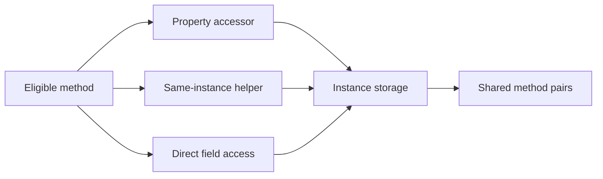

# Cohesion through properties and helpers, with explicit applicability

Ticket: ter-6na6. This records the design selected in the conversation.

## One model

Each eligible method has a set of instance storage locations that it can access
through statically resolvable execution on the same instance. Two eligible
methods share state when these sets intersect. A field, a property over that
field and a helper that accesses the field identify the same storage.

Use one analysis for all these paths. Do not add a separate score for properties
or helper calls. Preserve named source evidence and deterministic ordering.

## Cohesion rules

- Keep the existing eligible pair population: declared visible ordinary
  instance methods, with no pairs across types. Private helpers and accessors
  contribute state access to callers, not new denominator entries.
- Map automatic properties to their synthesized storage. Explicit accessors
  contribute the fields that the accessed getter or setter uses. A read must
  not inherit fields used only by a setter, or vice versa. Compound operations
  can use both accessors. Constant computed properties contribute no state.
- Follow source-available, statically resolvable calls on this instance,
  including helper chains and recursive cycles. Follow explicit base calls
  when their implementation is available. Deduplicate storage and terminate
  recursive analysis. Preserve the distinction between this and another
  instance of the same type, including object initializers.
- Invoked local helpers that capture this are part of the same execution model.
  Unused local functions and unexecuted lambda bodies must not invent access.
- Do not traverse methods on dependency objects. Reading the containing
  instance's dependency field still counts as reading that field.
- Exclude nameof and declaration/attribute references. Retain partial-method,
  inherited-storage and generated-source rules.
- An unresolved potential access to this instance's state is incomplete
  evidence. Dynamic dispatch, unavailable accessor/helper bodies and relevant
  binding failures must not silently become complete zero-sharing evidence.
  Do not infer a runtime override from its base declaration. Exact dispatch
  (for example private, sealed or explicit base calls) can be resolved.
- Keep known fields, known shared pairs, possible pairs and the unresolved
  source locations in the detailed report even when a score is incomplete.

## Applicability and project pooling

There are three distinct outcomes: a measured ratio (including zero), not
applicable with a reason, and incomplete with source evidence. No substitute
numeric default represents either missing outcome.

For cohesion, fewer than two eligible methods is not applicable. A type known
to have no instance storage is also not applicable. Otherwise unresolved state
access makes its score incomplete. Do not assert no storage when unavailable
base-type information prevents that conclusion. Complete eligible types with
no sharing retain a real zero.

Pool cohesion counts from complete, applicable types only. Report complete,
not-applicable and incomplete type counts so that a smaller analyzed population
cannot silently appear to improve quality. Keep excluded absolute evidence in
the type rows. When none is measurable, show no applicable data or incomplete
evidence as appropriate, without a numeric zero.

For depth, a type without handwritten implementation has no implementation
depth to assess. This includes declaration-only interfaces, enums, delegates
and automatic-property/field-only payloads. Keep their API counts in detail,
but exclude their surface from project implementation-depth pooling. Types
with actual implementation retain the existing WMC and API-entry definitions.
Private-only implementation with no API entries remains not applicable per
type, but its WMC still contributes to the project numerator as before.
An interface with a handwritten default implementation has implementation.
If the project depth denominator is empty, show not applicable.

No subjective payload classifier, API-entry discounts, validation-branch
threshold or new WMC definition is introduced. A constructor with a handwritten
body remains implementation under the existing function rules. The report's
reasons describe source structure, not a good/bad judgment of its role.

## Compatibility and presentation

Advance counting provenance to type-metrics-v3. Retain v2 notes and historical
reference data as v2. Never show deltas between incompatible counting versions.
Old serialized notes must remain readable without fabricated applicability
counts. Current JSON, notes, CSV, pre-commit addenda and pre-push summaries must
preserve/display applicability and incomplete-evidence information coherently.
Existing backfill must not overwrite incompatible summaries.

Remeasure Tertius and the six pinned external source populations with v3 and
the same metadata references. Retain the v2 dataset and document the changed
population as well as changed ratios. This task does not introduce thresholds
or change erosion, verbosity, the touched-finding policy or historical notes
en masse.

## Verification

Use red-green tests for property/field equivalence, helper extraction, recursive
calls, getter/setter distinction, automatic properties, other-instance access,
unused versus invoked local helpers, incomplete calls, applicable zero,
not-applicable reasons, pooling and serialized history/report compatibility.
Run Slop tests in Checked and Release and the Python hook-report tests. Inspect
coverage and perform scoped hand mutations. Run normal hooks and the required
integration suites before merge. No engine behavior is changed.
