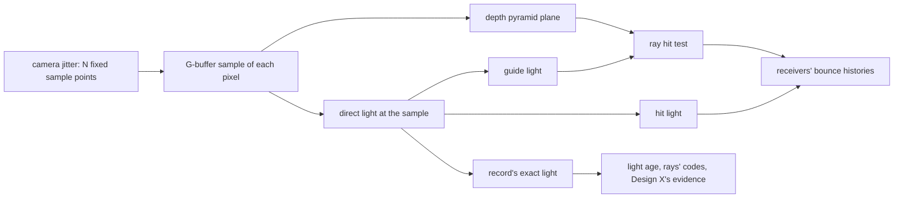

# The light at a hit under the camera's jitter (t0-qwx8)

Ticket `t0-qwx8`, under the epic `ter-8hyd` ([renderer-finish.md](renderer-finish.md)). It comes from `ter-g3tk` (cause 1), from `t0-3kyb` (young light-age records in a still) and from decision X3 of [bounce-light-confidence.md](bounce-light-confidence.md) (Design X). Status: design, 2026-11-14. Nothing is built.

The software-design skill was not available to this session: the Skill tool did not know it. Sections 4, 13 and 14 compare the design with the skill in the form that bounce-light-confidence.md, sections 5, 16 and 17, uses.

## 1. What the user gets

- When the sun turns a little, the cabin's bounce light no longer steps. Today the middle third of the cabin view (region r11) falls by 33 % between world ticks 300 and 306. That is the bounce light alone, under FSR at 1920 × 1080 (section 2). `ter-g3tk` measured −43 % for the first bounce alone, with the clamp off. After the change, the expected bounce light does not depend on where a thin sunlit strip lies between the jitter's sample positions.
- The bounce light no longer depends on the render scale in this way. At 8 jitter phases (native jitter, or FSR at render scale 1), the same cabin view has no bounce light from the sunlit sill today. At 18 phases (FSR at render scale 2/3), it has twice the bounce light.
- In a still view with still lights, no light-age record stays young because of the jitter. Today about 0.136 % of the pixels do (the census of `t0-3kyb`, section 2.4). So Design X's light evidence fires only on real light changes.
- Two designs differ in where the light of a thin strip is averaged over the draws (section 6). The user chooses.

## 2. The mechanism, measured

### 2.1 The takes

All takes ran on main `b93ab3570` (the probe binary `/tmp/t7-3e22/lagM/probe-bin`) on the Mac under the shared GPU lock. Each take holds 16 continued stills per tick (`TERTIUS_PROBE_STILL_CONTINUES=1`, 33 draws apart). The scene is `orbit` with the person's camera. r11 is the middle third of the image in both axes. The values are the mean luminance of r11 in probe units at a fixed exposure, over stills 1 to 15 (still 0 follows a reset).

| Take | Setting | Jitter phases | r11, tick 300 | r11, tick 306 | Change | Std over stills |
|---|---|---|---|---|---|---|
| bD | Bounce light alone, filter off, native 1280 × 720, no jitter | none | 0.1153 | 0.1153 | 0.0 % | 0.0011 |
| bB | The same, jitter in every draw (`TERTIUS_DEBUG_JITTER=always`) | 8 | 0.1184 | 0.1184 | +0.1 % | 0.0024 |
| bF | The same under FSR at render scale 1 (render and output 1280 × 720) | 8 | 0.1137 | 0.1138 | 0.0 % | 0.0013 |
| bC | The same under FSR at 1920 × 1080 (render 1280 × 720) | 18 | 0.2528 | 0.1684 | −33.4 % | 0.0080 / 0.0037 |

Two more takes show the direct light:

- dA, the direct light alone, native 1280 × 720, jitter in every draw. Each still shows one jitter phase, because 33 draws step the 8-phase cycle by one. 1,067 pixels (0.116 % of the image) change between phases by more than a factor of 4. They lie on the side windows' jambs and sills. Their sunlit samples are equal at ticks 300 and 306 (median ratio 1.00000, largest 1.0035). The far window's sill shows no sunlit sample in any of the 8 phases: its crop holds at most 0.00103, the wall's level, in all 8.
- dE, the direct light alone under FSR at 1920 × 1080 (18 phases), FSR's output. The far window's sill shows as one lit row (output row 563). The row's light above the wall falls from 2.31 to 1.87 (−19 %) between the two ticks.

The bounce light of r11 thus steps only under 18 phases, and only the 18-phase render lights the far sill at all. The render size, the upscaler and the scene are the same in bF and bC. Only the phase count differs.

### 2.2 The quantity that depends on the jitter

The jitter moves the projection of every draw by a sub-pixel offset (`VulkanRenderer.ApplyRenderProjection`, VulkanRenderer.cs:860-890). The offset of a draw is AMD's:

```csharp
public static int JitterPhaseCount(uint renderWidth, uint outputWidth) =>
    Math.Max(1, (int)(8f * MathF.Pow((float)outputWidth / renderWidth, 2f)));
...
public static Vector2 JitterOffset(int index, int phaseCount) =>
    new(Halton(index % phaseCount + 1, 2) - 0.5f, Halton(index % phaseCount + 1, 3) - 0.5f);
```

where

- `JitterPhaseCount` = the length of the jitter cycle, in draws: 8 at a render scale of 1, 18 at 2/3 (Fsr3Upscaler.cs:381-382).
- `JitterOffset` = the sub-pixel offset of draw `index`, each axis from −0.5 to 0.5 render pixels: the Halton sequence of base 2 (x) and base 3 (y) from its second point (Fsr3Upscaler.cs:395-396).
- `FrameHistory.Jitter` (FrameHistory.cs:340-347) calls it with `DrawIndex % phases`. So the same `phaseCount` positions repeat forever.

So the G-buffer of a draw shows, in each pixel, the surface at one of `phaseCount` fixed points of the pixel. The direct pass shades that point. Three readers take this draw's direct light at that point as the light of the whole pixel:

1. The hit light. The ray plan writes the light that leaves each pixel q, and a ray's hit reads it (`leavingLightOf`, screen_trace.glsl:483-494):

   ```glsl
   vec3 light = factors.diffuse * (imageLoad(directDiffuseLight, q).rgb + diffuseHistory) + glowAt(q);
   ```

   where

   - `directDiffuseLight` = this draw's direct diffuse light, demodulated and pre-exposed, shaded at q's jittered sample point.
   - `diffuseHistory` = q's bounce light of the last draw, read through the pixel history rule.
   - `factors.diffuse` = q's diffuse material factor.
   - `glowAt(q)` = the light that q sends.
   - `light` = the light toward a diffuse ray that hits q. The reflection layer adds q's specular part.

2. The guide light, which aims a quarter of the diffuse rays at bright pixels (`guideLightAt`, light_pyramid_finest.comp:20-31): the luminance of `factors.diffuse * directDiffuseLight + glow` at the same point.

3. The light-age record's exact light (`exactLightAt`, screen_trace_plan.comp:30-38): the luminance of `directDiffuseLight + glow` at the same point, with the pre-exposure undone.



The ray's hit test also takes q's surface of this draw: the depth pyramid's finest level holds the plane of q's jittered sample (ARCHITECTURE.md, "The screen tracer", "The images"). So in a draw whose sample lands on a thin face, q is that face for the rays, with its plane and its light.

The shadow taps are not the cause. Every view takes all 16 taps since `ter-yfb5`, and the sunlit samples of dA are equal at both ticks. The hit light image's half floats are not the cause: their relative error is at most 2⁻¹¹. The filter and the clamp are not the cause: bC has the filter off, and `ter-g3tk` measured the step with the clamp off. The guided rays change only where the rays go, and their weights keep the expected value.

### 2.3 Why the step is so large

The receivers' bounce estimate of a pixel q averages, over the draws, the light of q's sample in each draw. Let N be the phase count, and k the number of the cycle's sample positions that land on the sunlit part. Over a cycle, the estimate is then k / N of the sunlit light. For a strip of width w (in pixels), the true share is w. When w is small against 1/N, k is 0, 1 or 2, so the estimate is 0 or a large multiple of the truth.

Four facts make it large in the cabin:

- The contrast. A sunlit sample of dA is up to 7.5 probe units at −4 stops, against about 0.001 for the lamp-lit wall: some thousands of times brighter. In space the sun gives about 1,361 W/m², far above the cabin's lamps.
- One row, one phase. The far sill is one row of pixels along the far window's bottom edge, about 90 render pixels long. The jitter is one offset for the whole image, so every pixel of the row lands on the strip in the same draws. Its errors add up and do not average out along the row.
- The place. The far sill lies in the middle of the view and faces the cabin's far ceiling and floor, which r11 holds.
- The fixed cycle. The cycle repeats, so the error is a fixed bias, not noise. The bias changes at one moment only: the moment that the sunlit part moves past one of the N sample positions. The sun's turn moves the shadow edge on the sill, and so the sunlit part.

A model fits both ticks. Let c be the r11 bounce light of a far sill lit in every draw. Without the sill, r11 holds about 0.114 (bF). Tick 300 holds 0.139 more, and tick 306 holds 0.054 more. With c ≈ 0.85, k = 3 of 18 gives 0.142, and k = 1 of 18 gives 0.047. At 8 phases, the eight y positions are the multiples of 1/9 from 1/9 to 8/9. The sill's band lies between two of them, so k = 0 (dA). One phase more or less on the sill thus moves r11 by about 40 % of its lamp-lit level.

The same count explains why the sill can look too bright: FSR averages the sill's samples over the cycle, so it shows k / N of the sunlit light. Where k / N is above the strip's width, the sill shows too bright. Where k is 0, the sill does not show at all.

The files /tmp/t7-3e22/qwx8/d/sim.py and sim2.py hold this model, with w = 0.1 pixel and c = 0.85. It gives the per-still spread of bC: 7 % of 0.114, as measured. It also gives a jump of 41 % of 0.114 between two strip offsets 1/100 pixel apart.

### 2.4 Why the records stay young in a still

In the cabin's still with the lamps on, `t0-3kyb` found young records at about 0.13 % of the pixels. A young record here counted a change less than 32 draws ago. A census with the jitter off settles the cause:

| Census (t11bin3, cabin "on" control, frames 100 to 459) | Own-young share | r10 | r11 | r12 |
|---|---|---|---|---|
| FSR's jitter, 18 phases (`t0-3kyb`, REC-on) | 0.136 % | 0.64 % | 0.09 % | 0.55 % |
| No jitter (`TERTIUS_DEBUG_JITTER=none`, this design, m3/NJ) | 0.000 % | 0 | 0 | 0 |

So the jitter alone keeps them young. The record compares this draw's exact light at the jittered point with the 3 × 3 range of the last records. If the light stays outside that range for `LightChangeDraws` = 4 draws in a row, the record counts a change (screen_trace_plan.comp:58-126). Its 2 % share and its 3 × 3 range were set for a shadow's edge, not for a jump by the sun's whole contrast. A pixel on a thin strip, whose neighbors do not span both of its lights, sees such jumps. Some sequences of the jitter keep one side for 4 draws, so the record counts a change, and later the other side counts one too.

The code already names this effect. The comment of `lightChangeMaskAt` (screen_trace.glsl:116-123) speaks of a feature thinner than a pixel. Under the jitter, it changes the records "in a line one or two pixels wide, which the opening removes". So FSR's mask removes these lines. But the rays still carry their codes, and Design X's blocks take them as light evidence.

### 2.5 The screen's limit for faces seen edge-on

The far sill's top face lies almost edge-on to the eye: it covers less than a render pixel. The cabin's ceiling and floor see it at a steep angle, where it is much larger. In a draw whose sample lands on it, the depth pyramid holds its plane, so the rays from the ceiling see roughly its true size. In the other draws, the pixel holds the wall below or the window, and the face is invisible to every ray. So the screen tracer brings at best k / N, or w in expectation, of the face's real bounce light. This is a limit of one surface per pixel, not of the jitter. Neither design removes it. The real bounce light of the sunlit sill is probably much brighter than any of these takes.

## 3. Terms

| Term | Meaning | Unit and range |
|---|---|---|
| Jitter | The sub-pixel offset of a draw's projection. | render pixels, −0.5 to 0.5 per axis |
| Phase count N | AMD's cycle length: `JitterPhaseCount`. | 8 at render scale 1, 18 at 2/3 |
| Sample point | The point of a pixel that a draw's G-buffer shows: the pixel's center moved by the jitter. | |
| Strip | A sunlit part of a surface, or a face, thinner than a render pixel. | width w in pixels, below 1 |
| Footprint mean | The mean of a value over all sample points of a pixel: what a texel stands for under the pixel history rule. | |
| k | The number of a cycle's sample points that land on a strip. | 0 to N |
| r11 | The middle third of the image in both axes. | |
| Line change | A change of records that covers no 3 × 3 block of pixels: a line one or two pixels wide. | |
| Area change | A change of records that covers a 3 × 3 block around the pixel. | |
| Camera jitter period | The period of the new jitter sequence: 2¹⁰ × 3⁶ = 746,496 draws. | draws |

## 4. One model for the old and the new

The model: a pixel's value is the mean over its footprint, and the jitter is the sampler of that mean. Some readers keep a pixel's value across draws or pass it to another pixel. Each of them must see an estimate whose expected value is that mean, for every sub-pixel layout. No reader counts the sampler's own spread as a change of the scene.

It covers what exists:

- The pixel history rule (`tiunr-4b2g`, "jitter is not motion"): a history texel stands for its whole pixel, averaged over all jitter offsets.
- FSR's light-change mask (`t1-4hij`): jitter changes are lines, and the mask's opening removes them.
- The shadow comb of `ter-yfb5`: a per-draw choice (the quarter of the shadow taps) that locked to the jitter's parity made each column see a fixed mix. That is the same class of fault as this ticket: a per-draw choice correlated with a fixed set of sample points.

And it covers the new work:

- The first clause asks for a sampler that visits every band of a pixel in proportion to its width. AMD's 8 or 18 fixed points do not, for a band thinner than 1/N. A long Halton sequence does (section 5.1).
- The second clause asks the record to count only area changes, by the mask's existing rule (section 5.2).
- The two designs differ in where the footprint mean of a strip's light is formed over the draws: in the receivers' bounce history (Design R) or in a footprint image at the hit (Design H).

One exception remains, with a named misbehavior. Native rendering (`NoUpscaling`) keeps no jitter. Its sample point stays the pixel's center, so a strip that crosses a center still switches its light on or off there. Without a temporal resolve, the jitter shakes the displayed image by up to half a pixel in every draw. The game's default is FSR. The pixel tests select native rendering on purpose.

## 5. Shared by both designs

### 5.1 The camera jitter: one long Halton sequence

The camera takes the Halton sequence of bases 2 and 3 from its second point, as AMD does. But its period is the camera jitter period of 2¹⁰ × 3⁶ draws, not N. Draw i after a reset takes point i + 1, so the first 18 draws are AMD's 18 phases.

```csharp
// Sketch, Fsr3Upscaler.cs.
/// The period of the camera's jitter: whole powers of both bases, so that in each period every band of a pixel gets a
/// share of the draws equal to its width, within 1/2^10 in x and 1/3^6 in y (t0-qwx8).
public const int CameraJitterPeriod = 1024 * 729;

/// The camera's jitter in draw <paramref name="drawIndex"/> since the last reset, in render pixels from −0.5 to 0.5.
public static Vector2 CameraJitter(long drawIndex) =>
    JitterOffset((int)(drawIndex % CameraJitterPeriod), CameraJitterPeriod);
```

where

- `CameraJitterPeriod` = 746,496 draws, about 3.5 hours at 60 draws per second.
- `JitterOffset` = AMD's function, unchanged, which the golden test `TheJitterOffsetOfEachIndexAndPhaseCountIsAmds` keeps. Its radical inverse moves to integer division, which is exact for every index below the period.
- `drawIndex` = `FrameHistory`'s draw index since the last reset.

Readers: `FrameHistory.Jitter` (this draw's), `VulkanRenderer.ApplyRenderProjection` (the last draw's, for `PreviousJitter`) and the tests that predict the jitter (`PixelHistoryTests`, lines 309-312).

FSR keeps AMD's phase count as its constant `JitterPhaseCount` (Fsr3Constants.cs:114-120). FSR uses it only for the lifetime of its thin-feature locks: `fLifetimeDecrease = 0.1 / JitterSequenceLength()` (ffx_fsr3upscaler_accumulate.h:86). That number has its own reason, AMD's tuning, and stays a separate constant. A comment at both places states it.

What this gives, by the model of section 2.3 (w = 0.1 pixel, a receiver window of 32 draws):

| Sampler | Jump of r11 between two strip offsets 1/100 pixel apart | Spread of r11's bounce light over the draws |
|---|---|---|
| AMD's 18 phases (now) | 41 % of 0.114 | 7 to 8 % |
| AMD's 18 phases, a random shift per cycle (Cranley and Patterson) | below 1 % | 14 % |
| The long Halton sequence | 0 % | 9 to 11 % |

So the long sequence removes the step and keeps the spread near today's. The expected far-sill share becomes w × c, about 0.085 in r11, at every render scale.

### 5.2 The record counts only area changes

A pending change of the record counts (age 0) only where the opening of the changing pixels holds the pixel: some 3 × 3 block around it, in the last records, is changing whole. This is the rule of FSR's mask, moved one step earlier so that the rays carry it. A line change that lasts 4 draws becomes the record's new light without a change: the age goes on, so it gives no evidence.

```glsl
// Sketch, screen_trace_plan.comp, the end of lightAgeOf.
if (pendingDraws >= LightChangeDraws)
    return insideChangedArea(lastLightAge, center) ? vec2(light, 0.0) : vec2(light, older);
return vec2(lastLight, recordAgeOf(older, pendingDraws));
```

where

- `pendingDraws` = the draws in a row with this pixel's light outside the 3 × 3 range of the last records.
- `insideChangedArea` = the opening of `lightChangeMaskAt`, extracted into one function of `screen_trace.glsl`: whether a 3 × 3 block of the 5 × 5 records around `center` shows `changingLight` in every record. The pixel itself counts as changing. The mask calls it on this draw's records in the resolve, and the record on the last draw's records in the plan.
- `center` = the tap of the largest weight of the record's reprojection: the pixel's own texel in a still.
- `older` = the last age moved on by one draw.

A real change over an area keeps its timing: in its fourth draw, every record of the area showed a pending change in the last draw, so the opening holds. The 25 reads happen only at a pixel whose pending change reaches its fourth draw. In a still, that is a few line pixels per draw.

The cost: a light change that covers only a line one or two pixels wide gives no light evidence. FSR's mask already ignores such changes. A thin lamp that switches also changes the light of the surfaces around it. Those are areas, and the rays that hit them carry the evidence.

Both designs keep this rule unchanged, so it builds and merges first, on its own branch (section 17). It unblocks the evidence census of Design X (take T12).

## 6. The two designs

The two designs differ in where a strip's light is averaged over the draws.

- Design R, "the receivers average": a hit reads this draw's sample, as now. The bounce light's slow history of a block without evidence grows to 128 draws instead of 32. This folds in `t0-70v1`.
- Design H, "the hit averages": the ray plan keeps a footprint image, the mean of each pixel's leaving light without history over its still draws. The hit light and the guide light read it. The receivers keep 32 draws.

| Design | A hit and the guide read | Bounce history in a block without evidence | Spread of r11 in a still, model | Far sill's sun in r11 | Changes without evidence follow at | A light change on a thin line reaches the hits | Memory at 1280 × 720 | GPU at 1280 × 720 |
|---|---|---|---|---|---|---|---|---|
| R | This draw's sample at the pixel | 128 draws. 32 with motion evidence. `FastCap` with light evidence | 2.6 % | Its expected share, w × c, about +0.085 | 1/128 per draw | In the same draw | 0 | about 0 |
| H | The pixel's footprint mean over its still draws | 32 draws, as now | 2 % (footprint of 64 draws) | Less than w × c, by an amount that take T2 measures (section 6.2) | 1/32 per draw, as now | At 1/64 per draw | +7.03 MiB | about +0.03 ms, to measure |

The model numbers come from /tmp/t7-3e22/qwx8/d/sim3.py: the far sill as a band of 0.1 pixel under the long Halton sequence, with c = 0.85.

### 6.1 Design R, usage

```glsl
// Sketch, accumulate_spatial.comp, after Design X's evidence (bounce-light-confidence.md, section 8.4).
historyLength = evidence == LightEvidence ? fastCap
    : evidence == MotionEvidence ? min(historyLength, movingCap)
    : historyLength;
```

where

- `historyLength` = L after this draw's blend. The temporal dispatch now caps it at `StillCap`, 128, for the bounce light.
- `movingCap` = 32, the bounce light's cap of today, a push constant.
- `fastCap`, `LightEvidence`, `MotionEvidence` = Design X's.

R keeps the true expected value of every pixel, because each draw's hit brings its own sample's light. It quiets the strip only where the block has no evidence, and only after 128 draws. Its cost is the lag of the causes without a signal (bounce-light-confidence.md, section 9: the sky's light, a base color, a surface lit only by bounce light): they follow at 1/128 per draw instead of 1/32. Design X's acceptance 9 (the lag films) must be measured again. `t0-70v1` named one more check, which R takes: at a weight of 1/128, the RGBA16F history rounds away a step smaller than about 6 % of its value.

### 6.2 Design H, usage

```glsl
// Sketch, screen_trace_plan.comp.
// The pixel's footprint light: the mean of its leaving light without history over the still draws that show a surface.
vec4 footprintOf(ivec2 pixel, vec3 light)
{
    vec4 last = imageLoad(footprint, pixel);
    bool restarts = frame.reset || movesOnScreen(pixel) || insideChangedArea(lastLightAge, pixel);
    float count = restarts ? 1.0 : min(last.a + 1.0, FootprintDraws);
    vec3 kept = last.rgb * historyRatio(exposureStops, previousStops);
    return vec4(restarts ? light : mix(kept, light, 1.0 / count), count);
}
```

where

- `footprint` = a new RGBA16F image at the render size. Only the ray plan reads and writes it, at the pixel's own texel. So one image is enough: no invocation reads another's texel.
- `light` = this draw's `factors.diffuse * directDiffuseLight + glow` at the pixel, capped at `MaxRadiance`, as the hit light computes it now.
- `movesOnScreen` = Design X's test that the pixel's motion target is at least `LeastMotion`, 1/32 pixel per draw.
- `insideChangedArea` = the predicate of section 5.2, on the records that `changingLight` marks: a pending change, or a change of the last 8 draws (`LightChangeMaskFrames`). So an area change restarts the footprint from its second draw on, for as long as FSR's mask marks it.
- `FootprintDraws` = 64.
- `historyRatio` = the exposure ratio that the histories take (accumulate_temporal.comp:300-301).
- A draw whose pixel shows the sky, or no traced surface, leaves the footprint as it is.

The hit light then reads `footprint.rgb + factors.diffuse * diffuseHistory` for its diffuse part. The reflection layer keeps this draw's direct specular light. The light pyramid's finest level reads the footprint's luminance instead of shading the pixel again, so it moves after the plan in the tracer's passes.

H keeps the receivers as they are, so no lag changes. It quiets the strip in every still view after 64 draws. But it averages the light of a pixel apart from the plane that the rays hit in each draw. At the far sill, the pixel's sample changes surface between draws: the sill's top face, the wall below it, the window. A draw whose plane is the sunlit face then reads the mean of all the pixel's surfaces. So H sends less of a thin face's sun than its expected share. The geometry suggests about the sunlit face's share of the pixel's surface draws, but take T2 measures it. At a strip of light on one surface, such as a shadow's edge on a floor, H keeps the expected value.

H's footprint uses no surface test and no 3 × 3 clamp, unlike the histories:

- The surface test makes a history follow one surface. The footprint must hold every surface that the jitter shows in the pixel.
- The jitter is one offset for every pixel. So in a draw that misses a strip, the whole row misses it. A 3 × 3 clamp of this draw's samples then removes the strip.

So the footprint restarts instead: on a reset, while the pixel moves on screen, and on an area change of the records.

### 6.3 What both share

- The camera jitter: one Halton sequence with a period of 2¹⁰ × 3⁶ draws (section 5.1).
- The record counts only area changes (section 5.2). It builds and merges first.
- No new closed set. Design X's evidence levels stay three.
- Both build after Design X merges. R needs its evidence levels. H needs its `movesOnScreen` and its tracer bindings.
- Native rendering keeps no jitter (section 4).
- The direct specular light at a hit stays this draw's sample. It depends on the eye's direction, and a reflection ray sees it only as an approximation now.
- The screen's limit for edge-on faces (section 2.5) stays.
- The tests of section 16, and the takes T1 and T3.
- Vulkan portability (section 11): no new device feature, no subgroup operation, no reliance on MoltenVK.

## 7. Questions for the user

The two points are independent, so any mix of the answers is a design.

1. What does a hit read at a pixel that a thin strip crosses?
   - (Recommended) This draw's sample, as now (Design R's side). Each hit keeps the true expected light, with no new memory or GPU time. Without question 2's longer history, r11 spreads by about 10 % over the draws in the cabin's still. The reason for the recommendation: H's mean changes the expected light where a pixel shows two surfaces. The user prefers the real mechanism to a look-alike.
   - The pixel's footprint mean (Design H's side). r11 spreads by about 2 % with the present 32-draw history, for 7.03 MiB and about 0.03 ms. A thin face seen edge-on sends less light. A light change on a line one or two pixels wide reaches the hits over about 64 draws.
2. How long does the bounce history grow in a block without evidence?
   - 32 draws, as now (Design H's side). Changes without evidence keep following at 1/32 per draw, as Design X's acceptance 9 measured. The strip's spread stays at the level that question 1 gives. `t0-70v1` stays a ticket of its own.
   - 128 draws (Design R's side, folds in `t0-70v1`). In a still view, the spread from strips falls by about 3.5 times. Changes without evidence follow 4 times slower, at 1/128 per draw. The work waits for Design X's merge and for `t0-70v1`'s check of the half-float history.

## 8. Borrowed techniques and their source situations

| Technique | Made for | Our situation | What we take |
|---|---|---|---|
| AMD's jitter: Halton (2, 3), 8 × scale² phases (FSR 2 and 3) | The upscaler's reconstruction of the displayed image. Each output pixel must see its render samples within the lifetime of its locks. A thin feature's error of 1/N of its coverage shows at most as faint aliasing. | The same samples are the light sources of the screen tracer. A strip some thousands of times brighter than its surroundings turns 1/N of coverage into 40 % of a region's bounce light per phase. | AMD's sequence and its first 18 points. Not its short period, except as FSR's lock constant. |
| The Halton sequence (Halton 1960) | Quasi-Monte Carlo integration over many points, with an error of about (log M)² / M. | The tracer's histories integrate the sample points over 32 to 128 draws. | The sequence itself, over a long period. The model gives no step and a spread like today's. |
| The random shift of Cranley and Patterson (1976) | Unbiased quasi-Monte Carlo with error bars from several independent random shifts of a large point set. | One shift per cycle of 18 points, read by a 32-draw window. | Nothing: the model gives 14 % spread against 9 to 11 % for the long sequence. |
| Morphological opening (FSR's light-change mask, `t1-4hij`) | Already in the renderer, for FSR's mask from the same records. | The same records under the same jitter. | The same predicate, one function, now also for the record's count and H's restart. |
| Temporal supersampling (Yang and others 2009, Karis 2014), for Design H | The displayed color, one sample per pixel per frame, a 3 × 3 clamp against ghosting. | A hit's light, where the 3 × 3 clamp removes a strip in the draws that miss it. | The running mean, without the clamp, restarted by the record's area changes and by motion. |
| A longer history where no change is seen (A-SVGF, Schied and others 2018, in the form of `t0-70v1`), for Design R | Path tracing, where a change detector bounds each history. | Design X's evidence is the change detector. The history is RGBA16F. | The cap of 128 in blocks without evidence, with the half-float check. |

## 9. Effect on Design X and on r11

- Young records in a still: section 5.2 removes the line changes from the record, in both designs. The census with the jitter off gave 0 %. With the rule, the target is at most 0.01 % (take T3). So Design X's blocks get no light evidence in a still from the strips, and they keep the wide box and their history.
- Recent codes of real changes keep their timing, except for changes that cover only a line one or two pixels wide.
- The r11 step: both designs remove it (section 5.1). In R, r11's expected bounce light becomes about 0.114 + w × c. By the model, that is about 0.20 at both ticks and at every render scale. In H it lies between 0.114 and that value.
- The stand film of `ter-g3tk` and regions r10 and r12 of the honest walk measure: their ±5 % wander comes partly from the same cycle. By the model, both designs remove its step part. Acceptance 7 of bounce-light-confidence.md can then require the stand film again.
- The per-pixel light-age cut before the blend is gone already (2026-11-13). Neither design brings it back.

## 10. Cost at 1280 × 720

| Part | Memory | GPU time | Notes |
|---|---|---|---|
| The camera jitter | 0 | 0 | CPU, one function per draw. |
| The record's area rule | 0 | below 0.01 ms in a still | 25 reads of the last records, only at a pixel whose pending change reaches its fourth draw. At a lamp switch, once for each pixel of the changed area. |
| Design R | 0 | 0 | A cap and a push constant. |
| Design H | +7.03 MiB (921,600 pixels × 8 bytes) | about +0.03 ms | One RGBA16F read and write per pixel in the plan. The finest pass of the light pyramid reads 8 bytes instead of the direct light and the material, so it gets cheaper. One barrier more, between the plan and the finest pass. A Metal System Trace of the deck's timing view measures it, as for `ter-67y3`. |

## 11. Vulkan portability and determinism

- The jitter is CPU arithmetic in integers, the same on every machine.
- The area rule reads RG32F records with `imageLoad`, as the plan does now. It needs no subgroup operation and no atomic. Its result depends only on the last records, so one machine gives the same bits in every run.
- Design H: RGBA16F storage needs no device feature. Each invocation reads and then writes only its own texel, so the dispatch has no race. The values stay at most `MaxRadiance`, 32,256, below the largest half float. The image adds one storage image to the tracer's compute stage. Main needs 20, Design X's branch 21, and H then 22. NVIDIA, RADV and ANV report a million or more, and lavapipe its descriptor maximum. `DescriptorLayouts` raises its check by one. The Mac passes 21 today, but its limit under MoltenVK is not written down. So the build first reads it with `vulkaninfo`.
- Design R: the history stays RGBA16F. The rounding at a weight of 1/128 is a question of precision, not of portability. But the Vulkan spec lets an image store round to the nearest half or toward 0. So the check runs on the RTX 2000 Ada of the workbench too.

## 12. Classes of bugs made impossible, and what remains

Impossible by construction:

1. A reader's expected value that depends on which fixed sub-pixel points the jitter visits. In each period, a band of a pixel gets a share of the draws equal to its width, within 1/2¹⁰ (x) or 1/3⁶ (y). This covers the r11 step, the far sill that vanishes at 8 phases, and the sill that looks too bright at 18.
2. The jitter's on and off at a feature thinner than three pixels counted as a light change: by the records, by the rays' codes, by Design X's blocks and, in H, by the footprint's restart.
3. Two rules that disagree about what a jitter line is. The record, FSR's mask and H's footprint call one predicate.
4. In H: a hit's light that flickers with the jitter at a strip of light on one surface.

Still possible, by name:

- The screen's limit for faces seen edge-on (section 2.5).
- Native rendering's fixed sample point (section 4).
- A light change that covers only a line one or two pixels wide gives no light evidence (section 5.2).
- In H: where a pixel shows two surfaces, the footprint mean lowers the light of a thin face (section 6.2). A thin line's light change reaches the hits at 1/64 per draw.
- In R: changes without evidence follow at 1/128 per draw.
- Found on the way, outside this ticket: the block's chosen pixel turns with `trace.drawIndex + hash` modulo 4 (`chosenPixelOf`, screen_trace.glsl:348). Its column is the draw index's parity plus a constant, and the jitter's x half is the parity too. So each block starts its rays only from one half of its two columns' width. This is the class of `ter-yfb5`, small here because the ray's start moves the received light little. It needs a ticket of its own.

## 13. Red flags of the software-design skill that the design keeps

| Red flag | Where | Reason |
|---|---|---|
| Non-obvious code | FSR gets AMD's phase count while the camera takes a longer period. | The two numbers have separate reasons: the camera's sampler and FSR's lock lifetime. A comment at both places names the other. |
| Information leakage | In H, the record's area predicate is known to the plan's footprint, the plan's record and the resolve's mask. | One function in `screen_trace.glsl` holds it. Before, the mask's copy was the only one, and the record had none. |
| Conjoined methods | In H, the finest pass of the light pyramid reads what the plan wrote, so the stage order changes. | The guide must aim by the light that the hits read. One comment at the order of the passes states it. |
| Special-general mixture | In H, the footprint is a history without a surface test. | A footprint must hold every surface of its pixel (section 6.2). It is private to the plan, so no reader of the histories meets it. |

## 14. Readers and writers of every new or changed value

The step numbers are those of section 17.

| Value | Writers (step) | Readers (step) |
|---|---|---|
| `CameraJitter`, `CameraJitterPeriod` | Fsr3Upscaler.cs (2) | `FrameHistory.Jitter` (2). `VulkanRenderer.ApplyRenderProjection`'s last jitter (2). `PixelHistoryTests` (2). Checked non-readers: FSR's `JitterPhaseCount`, `UpscalingRenderTests` line 1016 and `Fsr3UpscalerTests` lines 945-959, which drive FSR with AMD's offsets of their own |
| `insideChangedArea` | screen_trace.glsl (1) | `lightAgeOf` in the plan (1). `lightChangeMaskAt` in the resolve (1). H's `footprintOf` (3H) |
| The record's age after a line change (no reset) | `lightAgeOf` (1) | The rays' codes and the resolve's sample age, no code change (1). The reflections' cut on main and Design X's blocks, no code change. `VulkanRenderer.ReadLightAge`, the tests' hook, no change |
| R: `StillCap` 128 and `movingCap` 32 | `SignalParameters` for the bounce light and the push constants (3R) | Temporal dispatch's cap (3R). Spatial dispatch after Design X's evidence (3R). The variance dispatch's young limit and σr's window read L as before, no code change |
| H: `ScreenTraceImages.Footprint`, RGBA16F, one image | `footprintOf` in the plan (3H) | The plan's `leavingLightOf` (3H). `light_pyramid_finest.comp` (3H). Barriers in `ScreenTracePass` and the light pyramid's pass (3H). GPU memory table of ARCHITECTURE.md (4) |
| H: the order of the tracer's passes | `FrameGraph` stage order, `LightPyramidPass` (3H) | The rays, which read the pyramid and the hit light, no code change |
| H: the storage-image requirement, one more than Design X's 21 | `DescriptorLayouts` (3H) | "Required device features" in ARCHITECTURE.md (4) |
| The snapshot references under FSR | Re-approval with the three-image review (2) | The snapshot tests (2) |

## 15. Settled points

The design settles these points by its own rules:

- The sampler is the long Halton sequence, not a random shift per cycle: the model gives it less spread, and it needs no random numbers.
- Its period is 2¹⁰ × 3⁶, whole powers of both bases, so that a period holds whole strata of both axes.
- FSR's `JitterPhaseCount` keeps AMD's value.
- The record's rule is the mask's opening, not a stored range of each pixel's own lights. A range that learns every sample also learns a real change in its first draw, and then the change never counts. A range that learns only the samples that stayed inside never learns the jitter's other light.
- The opening reads the last records around the reprojected center, as the 3 × 3 range does.
- A line change that lasts 4 draws becomes the record's light, without a new age.
- H's footprint is one image at the pixel's own texel, private to the plan.
- H's `FootprintDraws` is 64: the model's spread falls to about 2 %, and a real change of an area restarts it in any case.
- H restarts on motion instead of reprojecting, because a moving pixel's sub-pixel content moves with it.
- R's `StillCap` is 128, the value that `t0-70v1` names.
- The record's rule merges first, alone (section 17).
- The sampler merges together with the chosen design's averaging. Alone it removes the step but raises the cabin's spread from 7 % to about 10 % of r11.

## 16. Tests and takes

Tests, each red on main first (tests/STYLE.md):

- Sampler (CPU, `Fsr3HostTests` or a new `CameraJitterTests`):
  - `EveryBandOfAPixelGetsAShareOfTheCameraJittersEqualToItsWidth`. Take the first 2⁶ × 3⁶ draws after a reset, and bands from 1/27 to 1 pixel wide at 100 offsets. Each band holds a share of the offsets within 1/27 of its width. AMD's 18-phase cycle fails it for a band of 1/20 between two of its y values.
  - `TheFirstEighteenCameraJittersAreAmdsPhases`.
  - `AResetStartsTheCameraJitterAtTheSequencesSecondPoint`.
- Record (`LightAgeHistoryTests`, the real tracer, with the jitter on):
  - `APixelThatTheJitterMovesOnAndOffAThinStripKeepsNoRecentLightAge`. A still sliver about 0.7 pixel wide lies on a plane for 300 draws. After the first 32 draws, no record has an age of 0 to 6.
  - `ALightChangeOverAnAreaCountsInItsFourthDraw`: keeps today's timing.
  - `ALightChangeOnALineTwoPixelsWideCountsNoLightAge`: locks the decision of section 5.2.
- End to end (`ScreenTraceRenderTests`, FSR jitter on):
  - `TheBounceFromAStripThinnerThanAPixelDoesNotDependOnItsSubPixelOffset`. A bright strip 0.2 pixel tall lies above a receiver, at two offsets 1/27 pixel apart. Over 243 draws, the receiver's mean bounce light differs by less than 5 % between them.
- Design R (`AccumulatorRenderTests`): `ABlockWithoutEvidenceAveragesUpTo128Draws`, `MotionEvidenceKeepsTheBounceHistoryAt32Draws`, and a test of the half-float rounding at 1/128.
- Design H (`LightAgeHistoryTests` or a new `FootprintTests`): `TheFootprintOfAStillPixelIsTheMeanOfItsSurfaceDraws`, `AnAreaChangeRestartsTheFootprintInItsSecondDraw`, `APixelThatMovesOnScreenKeepsNoFootprint`, `ASkyDrawLeavesTheFootprintAsItIs`.

Short takes on the Mac under the shared GPU lock, about 3 minutes each, with the scripts in /tmp/t7-3e22/qwx8/m, m2 and m3:

- T1, the step. The bounce light alone, with the filter off, at bC's and bF's settings. Each takes 16 continued stills at ticks 300 and 306. Between the ticks, r11 must change by less than two standard deviations of its stills. The two settings must agree within the same bound. Main fails it: −33.4 % against a spread of 3 %.
- T2, the far sill's share. The same, with the direct light alone too: r11's level at both ticks, against the model's 0.20 for R, and H's level beside it.
- T3, the census. m3/run.sh on the cabin's "on" control: the own-young share of frames 100 to 459 at most 0.01 % (main 0.136 %, jitter off 0.000 %).
- For R: a still film of 300 draws, r11's spread over the draws with the filter on, and Design X's lag films (acceptance 9).
- For H: the Metal System Trace of section 10.
- Two to four screenshots of the cabin at tick 300 and 306 for the user.

## 17. Order of the work

| Step | Work | Files | Builder | After |
|---|---|---|---|---|
| 1 | The record counts only area changes (section 5.2): extract `insideChangedArea`, use it in `lightAgeOf`, its three tests, ARCHITECTURE.md ("The screen tracer", the light-change age). Branch `t0-qwx8-area-changes`. Merge into main | screen_trace.glsl, screen_trace_plan.comp, LightAgeHistoryTests.cs, ARCHITECTURE.md | one | Nothing. It can run beside step 2. Design X's branch then merges main |
| 2 | The camera jitter (section 5.1): `CameraJitter`, its readers, its tests, the snapshot re-approvals under FSR | Fsr3Upscaler.cs, FrameHistory.cs, VulkanRenderer.cs, Fsr3HostTests.cs, PixelHistoryTests.cs, references | one, in parallel with step 1 | Nothing. It waits on its branch for step 3 |
| 3R | Design R: the caps and their tests | accumulate_temporal.comp, accumulate_spatial.comp, TemporalSignal.cs, SignalParameters, AccumulatorRenderTests.cs | one | Design X merged, step 2 |
| 3H-a | Design H, the C# side: the image, the binding (the first free tracer binding after Design X, 28 on its branch today), the barriers, the stage order, the device check | ScreenTraceImages.cs, DescriptorLayouts.cs, ScreenTracePass.cs, LightPyramidPass.cs, FrameGraph | one | Design X's merge, step 1 |
| 3H-b | Design H, the shaders: `footprintOf`, the hit light, the finest pass, their tests | screen_trace_plan.comp, screen_trace.glsl, light_pyramid_finest.comp, a new FootprintTests.cs | one, in parallel with 3H-a, by the binding number above | Design X's merge, step 1 |
| 4 | The takes T1 to T3 and the chosen design's takes. Coverage and mutation testing of the changed lines (CLAUDE.md, "Testing"). ARCHITECTURE.md: the jitter, the record, the chosen design, the memory and device tables. Notes on `t0-qwx8`, `ter-g3tk`, `t0-70v1` and Design X's acceptance 7 | | one | step 3 |
| 5 | Merge steps 2 and 3 together into main, run the Release tests, push | | | step 4 |

Step 1 changes `lightAgeOf` and `screen_trace.glsl`, which Design X's branch also changes (the record's moved bit). The builder of step 1 merges main into a scratch copy of Design X's branch once, to see the conflict before Design X's merge.

## 18. Files

- Takes: /tmp/t7-3e22/qwx8/m (bB, bC, bD and dA, from the previous designer), /tmp/t7-3e22/qwx8/m2 (dE, bF), /tmp/t7-3e22/qwx8/m3 (NJ, the census with the jitter off).
- Analysis and models: /tmp/t7-3e22/qwx8/d (a1 to a6, table.py, sim.py, sim2.py, sim3.py, runs.py, young.py, and the maps B300.png, C300.png, Cdiff_strips.png).
- The census of `t0-3kyb`: /tmp/t7-3e22/plateau (REC-on, recmap.py).
