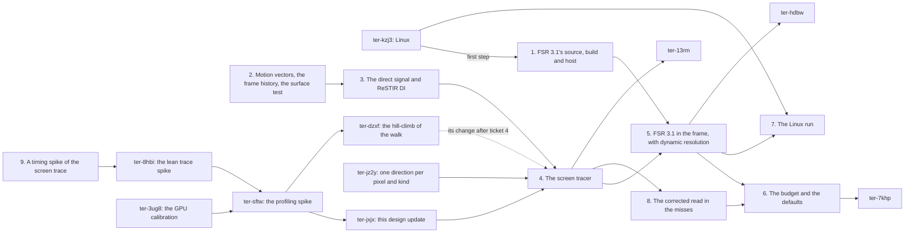
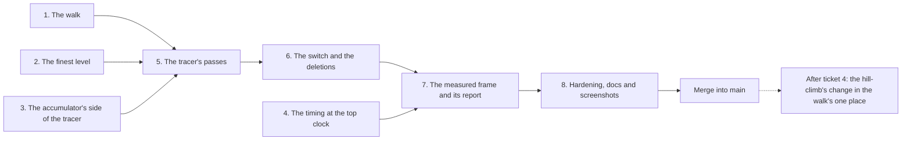

# The temporal renderer

Ticket: `ter-vges`, the design of epic `ter-89xq`. The user decided on 2026-11-02 that the renderer moves from spatial reuse to temporal reuse. This document says what to build, and its last section gives the order of the work as a list of tickets.

## Goal

The renderer reuses each pixel's light from earlier frames. Every lit surface gets reflections up to a roughness limit, the demo's paint of roughness 0.38 included. Bounce light comes from the screen at any distance on screen, and it bounces again in every frame. Direct light costs about the same for 4 lamps and for 64. FSR 3.1 upscales the frame from a render size that a controller changes each frame, so that the game holds 60 frames per second.

## Terms

- Output size: the size of the image that the window or a capture shows, for example 1920 × 1080.
- Render size: the size of the images that the passes before FSR draw. It changes from frame to frame.
- Largest render size: the output size times the largest render scale. Every render-size image has this size.
- Active part: the top-left rectangle of a render-size image that this frame draws, of the render size.
- Render scale: the render size over the output size, on each axis, from 0.5 to 1.
- Signal: one kind of light that a noisy estimator gives each pixel in each frame. There are three: direct light, diffuse light and specular light.
- Sample: one frame's noisy estimate of a signal at one pixel.
- History: a signal's accumulated value at each pixel, kept from frame to frame, with the number of frames that it holds.
- Slow history: the history that averages many frames. Fast history: the history that averages a few frames, so that it shows a change soon.
- Demodulated light: light divided by the material's response, so that the history holds no texture detail. The composite multiplies the material back in.
- Surface test: the one test per frame of whether each pixel's surface existed in the last frame, and where.
- Previous place: the position in the last frame's image of what a pixel shows now.
- Reset: a frame from which no history of the last frame counts.
- Still: a headless draw that does not continue the last drawn frame, because its step is 0, endless or long (section 10). It starts with a reset and warm-up draws.
- Warm-up draw: a draw of a still's snapshot before the shown draw, which builds the histories and takes no capture.
- Hand-over band: the roughness range in which the reflection rays hand over to the reuse of the diffuse rays (decision 27).
- Key: the identity of an object from frame to frame: its entity's slot, its entity's generation and its render part.
- Ray budget: the rule that says which pixels trace their own rays in a frame.
- Reservoir: ReSTIR's record of the one light that a pixel chose, with its weight and its count of candidates. Removed with ReSTIR DI on 2026-11-04 (`ter-9nrc`).
- Pre-exposed: multiplied by k = 2^S, the scale of the frame's exposure S in stops, as today (ARCHITECTURE.md, "Pre-exposure").
- Walk: the steps of one ray through the depth pyramid. Each step reads one texel.
- Step cap: the most steps that a walk takes. A walk that reaches it ends as a miss.
- Two-depth walk: the walk of decision 40, V6 of the profiling spike. It reads the near and the far bound of each cell.
- Finest level: level 0 of the depth pyramid, the inverse view depth w of each pixel's center.
- Own-ray share: the own rays of one kind in a frame, as a share of the pixels of the render size.
- Top clock: the GPU's highest clock, 1296 MHz on the M1 Max. A window whose frame rate the GPU limits runs at it ([gpu-calibration.md](../research/temporal-renderer/gpu-calibration.md) calls that clock the windowed clock).
- Tile bias: the mean signed difference of two converged images over tiles of 16 × 16 pixels, as a share of the reference's mean ([lean-trace-spike.md](../research/temporal-renderer/lean-trace-spike.md)).

## Decisions

### Made by the user

These come from `.tickets/ter-89xq.md`, the brief of this ticket and its notes. The design holds them and does not reopen them.

1. The renderer is temporal. Decision 8 of [rendering-performance.md](rendering-performance.md) no longer holds. (User, 2026-11-02)
2. FSR 3.1's upscaler is the one TAA and the one upscaler, with dynamic resolution from the start. Frame generation is out of this epic (`ter-hdbw`). (User, 2026-11-02 and 2026-11-03)
3. No world ray trace. Everything that the screen does not show comes from the environment maps (spike `ter-afyv`, [metal-trace-spike.md](../research/metal-trace-spike.md)). (User, 2026-11-02)
4. One screen tracer. Diffuse rays and reflection rays go through one traversal of the depth pyramid. The four occlusion passes are deleted. A diffuse miss reads the environment's light, "its irradiance for a diffuse ray" in the user's words, and a reflection miss its prefiltered map. Decision 26 gives the read. Above the reflection rays' roughness limit, rough reflections reuse the diffuse rays' hits. (User, 2026-11-03) Decision 40 gives the walk of that traversal (2026-11-04).
5. Decision 41 of [screen-space-illumination.md](screen-space-illumination.md) holds: a blocked direction brings the blocker's light, an open one the environment's light from that direction. (User, 2026-10-27, kept on 2026-11-03)
6. Reflection rays start from every surface up to a roughness limit, the demo's paint of 0.38 included. The radiance pyramid, the reflection trace, the reflections pass and SMAA are deleted. (User, 2026-11-03)
7. One accumulator module with a parameter set per signal. It has slow and fast histories, a history fix for new pixels, anti-lag and demodulated light. It runs the surface test once per frame. The reflection adds its own tests of the hit distance and the reflected point. Each history keeps the render size of the frame that wrote it. (User and orchestrator, 2026-11-03)
8. Stochastic shadow taps: a few of the shadow taps per frame, in a pattern that turns each frame. (User, 2026-11-03) Changed on 2026-11-09 (`ter-yfb5`): the pattern made a fixed comb under FSR, and every view takes all 16 taps again (decision 34).
9. A ray budget driven by history length: more rays where the history is short. (User, 2026-11-03) Decision 43 adds no limit to these rays at the first build (2026-11-04).
10. Many-light sampling, ReSTIR DI, for direct light, which then becomes a temporal signal through the same accumulator module. (User, 2026-11-03) Changed on 2026-11-04 (`ter-9nrc`): the user removed ReSTIR DI. Every light is shaded exactly, and the direct light keeps no history (section 7).
11. Time-sliced maps (`ter-7khp`) and a world-space radiance cache (`ter-13rm`) are later tickets, outside this design. (User, 2026-11-03)
12. FSR 3.1's path: the engine's own C# host code over AMD's GLSL shaders from FidelityFX SDK v1.1.4 (upscaler 3.1.4), compiled with glslang. The host repeats AMD's host calculations exactly. The 3.1.5 and 3.1.6 fixes are compared before the pin. The baseline is 32-bit math and the variant without subgroup operations. The format defect of `rw_luma_history` is resolved under the Vulkan validation layer on MoltenVK and lavapipe. AMD's MIT notices stay. (Orchestrator, 2026-11-03) Note of 2026-11-03 (ticket `ter-7m38`): the baseline stays the only build, by the user's choice. AMD's 16-bit modules, the pyramids with quad subgroup operations, and both together matched the reference image and passed every FSR test under validation. In 60 alternating rounds from 1280 × 720 to 1920 × 1080 on the M1 Max, the median of all frames was 2.826 ms for today's build and 2.769 ms for a byte copy of it. The variants took 2.797, 2.788 and 2.776 ms, so by this median none gained more than the copy's spread. By the median of the per-round differences of the run medians, the copy lies within 0.038 ms of today's build, and the build with both changes is 0.085 ms faster. The paired reading is the sound one. But the build with both changes needs `shaderFloat16`, which AMD's Polaris GPUs and Vega M lack under Linux, so the user kept the baseline for a gain of about 0.08 ms. The pin carries AMD's 3.1.6 fix of the 16-bit reprojection (`src/Tertius.Rendering/ThirdParty/Fsr3/README.md`, "The 16-bit and subgroup builds").
13. Dynamic resolution: images at the largest render size, with the active part changing each frame. A camera cut resets the histories, and a change of the render size does not. (Orchestrator, 2026-11-03)
14. Motion vectors hold no jitter. Each object has a stable key, and the snapshot gains the previous scale. Last frame's deformed vertices are kept. The previous camera is expressed relative to this frame's camera. (Orchestrator, 2026-11-03)
15. Bloom and tone mapping move after FSR, at the output size. (Orchestrator, 2026-11-03)
16. The project's rules hold: portable Vulkan only, and determinism with a reason for each ordering rule. Each piece of state has one store, no mechanism runs in parallel to another, and the code follows [STYLE.md](../../STYLE.md).
17. Many bounces. A diffuse ray's hit also brings the hit's own indirect diffuse light of the last frame, so light bounces again in every frame. This replaces decision 30 of [screen-space-illumination.md](screen-space-illumination.md), "exactly one bounce". The user chose it with the orchestrator's model of the later bounces' lag. In that model, the gap shrinks by e every 32 / (1 − g) frames. Decision 25 shortens that lag (section 6). (User, 2026-11-03)

### Settled by this design

Each decision gives its reason. The important ones also give the second design and why it lost. The sections below hold the details.

18. The light model of a lit pixel is one sum: the material times each signal, plus the emission. The three signals are demodulated, accumulated light. The composite is the one place that multiplies the material back in.
19. The frame's stocks are the three signals' histories, the surface history, the reservoirs and the placement history. Changed on 2026-11-04 (`ter-9nrc`): the reservoirs and the direct signal's history are gone, so two signals remain. The previous camera, FSR's state and the controller's state are stocks too. Section 1 gives the owner of each.
20. `FrameHistory` owns the CPU state of the last drawn frame and the rules that decide whether a frame continues it. Its one choke-point method, `Begin`, derives each draw's pending state: whether the draw is part of a still, whether it resets, and the previous camera. Every history owner, the exposure's adapt step and the map's refresh read that answer. `Drew` commits the pending state after the submission. Reason: one place holds the rules, and a frame that throws changes no stock. Section 3 gives the interface.
21. The snapshot counts camera cuts, `RenderSnapshot.CameraCuts`, instead of a flag. A renderer that skips a snapshot still sees the cut, because the count differs.
22. The previous rows of each object come from the placement history, joined by key, not from the snapshot's previous transform. Section 3 gives both designs.
23. A pixel without a history of its own gets a previous place outside the last frame's image. FSR and every accumulator then treat it as new, with no flag of its own.
24. The surface test writes the device depth that FSR reads, the surface history and the motion of the sky. It is one pass, because each of these reads the distance target once.
25. A hit of the screen tracer brings this frame's accumulated direct light. It also brings the hit's own indirect light of the last frame, from its fast histories (decision 17). A diffuse ray's hit leaves out the hit's specular light. This frame's material at the hit multiplies the light. No lit image is kept. Section 6 gives both designs, and the reason for the fast history over the slow one. Changed on 2026-11-04 (`ter-9nrc`): the direct light keeps no history, so a hit reads this frame's direct light from the direct light's two images. Changed on 2026-11-08 (`ter-9371`): a diffuse ray's hit reads the diffuse filter's output, not the diffuse fast history (section 6, after decision 17's tables).
26. A diffuse miss reads the environment map along the ray's own direction, through the map's specular image at roughness 0.5. Reason: decision 41 asks for the environment's light from that direction. The irradiance at the normal, D(n), counts a near blocker twice, the fault that decision 42 removed. So this design reads the user's "irradiance" of decision 4 through the user's own note on decision 41. That note of 2026-10-27 says: "read the environment map in each open direction". Section 6 gives the details.
27. The roughness limit of the reflection rays is the setting `MaxRoughness`, 0.5 by default. In the hand-over band, from `MaxRoughness` − `HandOverWidth` to `MaxRoughness`, the reflection rays hand over to the reuse of the diffuse rays. `HandOverWidth` is a named constant of 0.1. Reason: below 0.4 the cosine-weighted diffuse rays sample a GGX lobe badly. At 0.38 their weight reaches about 12 times the mean. Ticket 4's first captures test the default.
28. ReSTIR resamples the sampled lights: every light of the main view except the exact lights. The exact lights are the lights whose shadow slot is a cascade set, which `FarShadows.Choose` gives to the brightest shadowed far lights. There are at most `RendererOptions.CascadedLights` of them, 1 by default and 4 at most (user, 2026-11-03). They take the exact loop with the frame's taps, outside the resampling, because a cascade map has no bounds image. A far light is any light at least `LightUnits.FarDistance` from the eye, the test that already gives a light cascade shadows instead of shadow tiles. A star is far because of its distance, not its kind: there is no star type. ReSTIR shades the chosen light with its exact unshadowed contribution and a stochastic visibility. A candidate's target is 0 where the bounds of its shadow tile show it fully shadowed. The candidates come from a table weighted by each sampled light's rank irradiance at the eye, mixed half and half with a uniform choice. Section 7 gives both designs. Changed on 2026-11-04 (`ter-9nrc`): the user removed ReSTIR DI, so no light is sampled. A light with a cascade set is shaded by the same loop as every other light (section 7).
29. The exact loop over every light stays as the zero case of the direct light's setting, `EveryLight`. The forward passes use it too. Reason: the tests need an exact direct light, and the bias of ReSTIR needs a reference. Section 7 gives both designs. Changed on 2026-11-04 (`ter-9nrc`): the exact loop is the only direct path, so the setting `DirectLight` and its cases are gone (section 7).
30. FSR's reactive mask comes from AMD's generator, in a dispatch of its own before the upscale. The generator reads a copy of the image before the transparent pass and the final color. FSR gets no transparency and composition mask. Reason: AMD's 3.1.4 has no generator for that mask, and the reactive mask already marks the glass. Section 9 gives both designs.
31. FSR's pre-exposure constant comes from the GPU's exposure buffer, through a small copy into FSR's constant buffer. AMD's shaders stay unchanged. Section 5 gives the reason. Ticket `ter-k63u` corrected this decision on 2026-11-03: AMD's 3.1.4 shaders have one such constant, `deltaPreExposure`, and the exposure image is AMD's default (section 5, "The host").
32. If a headless draw's step is 0, endless or at least `MeteringStepSeconds`, 0.09 s, the draw is a still. This is today's rule of the metering draw, so one predicate decides both. A still resets every history, then draws warm-up draws of the same snapshot before the shown draw. Their count is `WarmUpFrames`, 32 by default, or 0 where no history holds more than one frame. The first warm-up draw takes over the metering draw's two jobs, the exposure and the refresh of every face. Section 10 gives the rule and what a still depends on. Changed on 2026-11-04 (`ter-9nrc`): no history holds more than one frame until the screen tracer, so `WarmUpFrames` is gone. A still draws one warm-up draw under `AutoExposure` and none under a fixed exposure. `ter-gayt` brings the count back with its histories.
33. Headless scripted runs use a fixed render scale, 2/3 by default, and the window uses the controller. Reason: a controller that follows GPU timings breaks the determinism of headless captures. A scale of 2/3 gives the budget's size, 1280 × 720 at a 1080p output.
34. Every view takes all 16 shadow taps, under `Fsr3Upscaling` as under `NoUpscaling`. Changed on 2026-11-09 (`ter-yfb5`). Until then, the main view under `Fsr3Upscaling` took a turning quarter of the 16 taps, by the reason "only an image that FSR averages can take a quarter". That reason assumed that FSR averages the four quarters at each output pixel. It does not:
    - The quarter's horizontal tap offset is −0.5 texel or +0.5 texel, by the parity of the draw index plus the pixel's column.
    - FSR's jitter is Halton base 2 over the draw index in x, so a sample lands in the right half of its render pixel exactly in the draws of even index.
    - So the offset that a sample carries depends on where the sample lands. At a render scale of 2/3, each output column gathers a fixed mix of the two offsets, which repeats every 3 output columns. A comb of that period showed in every soft shadow, about 5 levels of 8 bits in `UpscalingRenderTests.ASoftSunShadowEdgeShowsNoStripeThreeOutputColumnsWideUnderFsr` and plainly on the demo's apron and the shuttle's window bars.
    - A hash per draw in place of the parity would break the correlation, but it would turn the comb into noise that FSR must average, in every penumbra. The full filter has neither. The full filter costs about 0.24 ms more at a 1920 × 1080 output (FSR 2/3), about 1.1 % of the frame: the median of the 5 paired rounds in which both builds ran in the GPU's quiet mode, at 1296 MHz. Two Android emulators of another project shared the GPU, so the paired medians over all rounds, +0.05 ms (18 rounds, 90 % interval −0.63 to +0.95 ms) and +0.38 ms (12 rounds, +0.16 to +1.32 ms), are wider. ARCHITECTURE.md, "Temporal upscaling and render size", gives the method. That cost buys one clean filter, so the quarter's code is gone and no hashed quarter replaces it.
35. Updated on 2026-11-05 (`ter-7tnv`): every corrected specular reader uses analytic box projection, not a distance-cube search. One automatically fitted enclosure covers the geometry already assigned to each map group, in that semantic frame's axes. The intersection chooses a map direction; it is not a real geometry hit. The settled source, fallback rules and limits are in [semantic-frame-box-projection.md](semantic-frame-box-projection.md). A diffuse miss keeps its directional read. The earlier search design and its measured costs remain historical evidence, not the production algorithm or a box-projection cost estimate.
36. An impostor billboard writes its instance's light mark, as a mesh does. So a lamp that draws as a billboard sends its light once to the tracer's hits, by the rule that the closed `ter-coy0` carries forward. Section 6 gives the cost.
37. The frame submits its work in two parts: the passes up to the bloom, then the passes that write the output image. Only the second part waits for the swapchain image. Reason: the controller's measure of the first part then holds no wait (section 4).
38. Every pixel gets a sample of each of its signals in every frame. The ray plan gives a pixel its own ray where its history is short or where its block's ray does not fit its surface. The plan reads each signal's history length, the one store of how long a history is. Reason: no pixel is then without both a history and a sample, and the surface history needs no age of its own. Section 6 gives the rule.
39. The dark panel of `ter-m24j` waits for the panel lights of `ter-80o1`. From ticket 4, the demo's paint shows a cabin's panel lamp as a dark square around the small highlight of its light. The panel lights of `ter-80o1` end this after tickets 5 and 6. Reason: the project prefers the real mechanism over a look-alike. The user also accepted the same dark panel in the map's reflections on 2026-10-31 (`ter-ylzk`). The second design grows each cabin lamp's light to about 0.6 m before ticket 4, which gives a round highlight where the panel is square. (Orchestrator, 2026-11-03, under the user's rule for small choices inside a chosen design)

### Added on 2026-11-04

These come from the spikes after the first version and from the user's decisions of 2026-11-04. The design update `ter-jxjx` wrote them. Each says what it replaces. Section 6 and section 11 give the details.

40. The two-depth walk. Both ray kinds take one walk, V6 of the profiling spike ([profiling-spike.md](../research/temporal-renderer/profiling-spike.md), "Recommendation", items 1, 2 and 4). A step reads the near and the far bound of a cell from today's depth pyramid, or a pixel's center w from the finest level. A ray that passes in front of a cell's slab or behind it crosses the cell in one step. At the finest level, a pixel is a flat slab, and a hit on a surface that faces away from the ray is no hit. The ray's setup, its walk and its shading run in one kernel. The pyramid keeps one owner and one builder, which gains the finest level, and no second pyramid exists. Reason: at the top clock, its reflection rays take 20 to 32 % less time than those of the lean walk V1. At full length, it finds V1's hits. The second design, V1's step for the diffuse rays, buys nothing at equal image quality and needs a second step function. This replaces the first version's walk: today's trace, with its pixel planes at level 0. (Orchestrator, 2026-11-04, from the profiling spike's recommendation)
41. The step caps. A reflection walk takes at most 128 steps, and a diffuse walk at most 62. At 62 steps, the two-depth walk's diffuse images are at least as good as V1's at 64 steps in both measured views. Its diffuse rays then take V1's time within 0.015 ms. This replaces the diffuse cap of 64. (User, 2026-11-04) The reflection cap was 256 until 2026-11-12. The GPU runs the rays in groups of 32 lanes, and a group runs until its longest walk ends. So the few long walks set the time of every group. At 128 steps the deck's frame takes 0.22 ms less of 8.92 ms on an RTX 2000 Ada, in five runs of each cap. On the M1 Max it takes 0.5 to 0.7 ms less of 20.7 ms, and 0.3 ms less with pass time stamps. The mean of a capture changes by at most 0.07 % in 145 captures of 26 scripts. In 15 captures of the hair scenes, it changes by at most 0.23 %. A cap of 64 fails: it brightens the floor of the scene `doorway` by 3 to 8 %. The cap of 256 came from ticket `ter-r5hb`, for hair rays at a grazing angle. Under today's walk the hair scenes show no fault at 128 steps. The measurements are in `docs/research/frame-time-sweep-2026-11-11/acceptance-ter-w1o3/README.md`, and in section A10 of the addendum beside it. The measurements of this document that name the caps of decision 41 used 256 and 62 steps. (User, 2026-11-12)
42. The budget. A frame takes at most 12.0 ms of GPU time on demo-exit's deck at the top clock. The output is 1920 × 1080, and the render size 1280 × 720. The controller's runtime limit stays 15.0 ms (section 4). The two trace dispatches get an estimated 2.94 to 3.76 ms (section 11). This replaces the first version's target of 15.0 ms and its 0.8 to 1.7 ms for the whole tracer. (User, 2026-11-04. The budget decision of 2026-10-25 in [rendering-performance.md](rendering-performance.md), 12 ms with 4.7 ms of headroom for heavier scenes, still holds.)
43. Full rays at the first build. Ticket 4 traces every 2 × 2 block's ray of each kind, plus the own rays of section 6, "The ray budget". The spikes measured the budget's rays with own rays for 10 % of the pixels of each kind. Ticket 4 adds no ray limit. It measures the real frame on demo-exit's deck at the top clock, and it reports that frame. If the measured frame stays over 12.0 ms after the hill-climb (`ter-dzxf`) lands, a ray limit follows as a ticket of its own. Otherwise none comes. Own rays for 25 % of the pixels fit the budget in no setting (section 11). This replaces the first version's rule: if the whole tracer exceeded 1.7 ms, ticket 4 stopped and reported. (User, 2026-11-04)
44. The words form. A per-ray input that the trace kernel reads from a buffer reaches the walk's loop only through an operation before the loop. Examples are `uintBitsToFloat` of a word of a `uvec4` buffer, and a comparison. Reason: SPIRV-Cross writes a plain buffer load again at each use, so MoltenVK's code read such a value from memory at each step. In the speed-of-light walk, the words form cut 5.48 ms to 3.57 ms. After each change of the walk, `tools/sol-walk/loop-reads.py` counts the buffer accesses inside the loop of MoltenVK's code dump, and the count must be 0. Texel fetches and push constants need no such form. The form is plain GLSL and relies on no behavior of MoltenVK. (Orchestrator, 2026-11-04, from the profiling spike's recommendation, item 3)
45. The walk's one place. One function, `walkScreen` in `screen_walk.glsl`, holds the step and the loop to the cap, for both kinds. The hill-climb (`ter-dzxf`) changes the walk's speed, one measured change at a time, and keeps its hits. Its winning change replaces the step and the loop in that function after ticket 4. (User, 2026-11-03, for the climb. Orchestrator, 2026-11-04, for the one place)
46. Level 0 in an image of its own. The finest level is an R32F image beside today's RG32F pyramid image, as the profiling spike measured it. The pyramid image's mip m holds level m + 1. The second design puts level 0 into mip 0 of one RG32F image. In the speed-of-light walk, that saved 5 to 7 % of a step, but its saving in the trace is unmeasured. Its level 0 takes the pyramid's padded size and 8 bytes per texel: about 34 MB at a 1080p render size, against 8.3 MB. The hill-climb's fixed test setup runs the measured layout, so the second design is a candidate of the climb, not of the first build. (`ter-jxjx`, under the user's rule for small choices inside a chosen design)

## 1. The model

### The light of a pixel

Every pixel that the G-buffer holds gets this light, pre-exposed and capped at `MaxRadiance` as today:

```glsl
vec3 lit = diffuseFactor * (directDiffuse + indirectDiffuse)
         + specularFactor * (directSpecular + indirectSpecular)
         + preExposed(emission);
```

where

- `diffuseFactor` = the material's diffuse response: c_diff for the standard and the skin model, the base color for hair.
- `specularFactor` = the material's specular albedo: E · c from the DFG table for the standard and the skin model, 1 for hair.
- `directDiffuse`, `directSpecular` = the two parts of the direct signal, the light of the light list divided by each factor, pre-exposed.
- `indirectDiffuse` = the diffuse signal: the cosine-weighted mean of the light that reaches the point from every direction, pre-exposed.
- `indirectSpecular` = the specular signal: the light that the specular lobe gathers, divided by `specularFactor`, pre-exposed.
- `emission` = the material's emission, all of it, as today.

`materialFactors` in a new `signals.glsl` computes the two factors, one function for the producers that divide and for the composite that multiplies. A factor below 2⁻¹⁴ divides as 2⁻¹⁴, so a metal's diffuse sample stays finite, and the composite multiplies it by 0.

The caps keep every value below the half float maximum, 65,504:

- Each sample and each history holds demodulated light capped at `MaxRadiance`, 32,256 per channel (`exposure.glsl`). The producer caps the light after it divides it by the factor.
- The composite caps its sum at `MaxRadiance`, as today's ambient pass does.
- The puffs of the transparent pass add at most half as much, `ShaderInput.PuffBudget`. So the HDR image that FSR reads stays at or below 64,512, as today.

A cap of demodulated light removes the light above `MaxRadiance` times the factor. For a dielectric's specular factor of about 0.04, that is 1,290 in pre-exposed units. A mirror's glint of the Sun, at a daylight exposure, stays below it (Known limits).

### Stocks and flows

```mermaid
flowchart LR
    subgraph CPU
        SN[Snapshot] --> FB[FrameHistory.Begin: still, reset, draw index, previous camera]
        FR[(Last drawn frame: camera, cut count, placement history)] --> FB
        RC[(Render scale controller)] --> FB
        FB --> BA[SceneBatcher.Prepare: motion rows]
        FR --> BA
        BA --> FD[FrameHistory.Drew, after the submission]
        FD --> FR
        GT[GPU timings of the first part] --> RC
    end
    subgraph GPU, fixed size
        DF[Deformation] --> KP[(Kept deformed positions)]
    end
    subgraph GPU, render size
        BA --> GB[G-buffer and motion target]
        KP --> GB
        GB --> ST[Surface test]
        SH[(Surface history)] --> ST
        ST --> SH
        GB --> DL[Direct light]
        DL --> DI[(Direct light's images)]
        DI --> TR[Screen tracer]
        HI[(Diffuse and specular histories)] --> TR
        ENV[(Environment maps)] --> TR
        TR --> AI[Accumulate diffuse and specular]
        AI --> HI
        DI --> CO[Composite]
        HI --> CO
        CO --> TP[Scatter, haze, transparent]
        TP --> MT[Exposure: meter and adapt step]
        MT --> EB[(Exposure buffer: stops, previous stops)]
        EB --> AI
    end
    subgraph GPU, output size
        TP --> FSR[FSR 3.1: reactive mask, upscale]
        EB --> FSR
        FS[(FSR state)] --> FSR
        FSR --> FS
        FSR --> BT[Bloom, tone map, outlines, capture]
    end
```

A box in parentheses is a stock. Each arrow into a stock is a flow that changes it. The arrows from the exposure buffer and from the last drawn frame are reads. Changed on 2026-11-04 (`ter-9nrc`): the light candidates, the reservoirs, the direct history, accumulate direct, the light table and the light keys are gone. The direct pass writes the direct light's two images, which hold this frame's light alone, so they are not a stock that carries light across frames.

| Stock | Owner | What it holds | Written by | Reset |
|---|---|---|---|---|
| Direct history | `TemporalSignal` of the direct signal | Slow and fast history of each of the two parts, length | Accumulate direct | Removed on 2026-11-04 (`ter-9nrc`). The direct light's two images hold this frame's light alone (section 7) |
| Diffuse history | `TemporalSignal` of the diffuse signal | Slow and fast history, length | Accumulate diffuse | Every frame reset |
| Specular history | `TemporalSignal` of the specular signal | Slow and fast history, length, hit distance | Accumulate specular | Every frame reset |
| Surface history | `SurfaceHistory` | The last frame's geometric normal and roughness at each pixel, and its device depth, which holds its view depth | Surface test | Every frame reset |
| Reservoirs | `LightReservoirs` | One reservoir per pixel | Light candidates, direct light | Removed on 2026-11-04 (`ter-9nrc`). |
| The last drawn frame | `FrameHistory` | Its eye, frame id and rotation. Its unjittered projection, root rotation, render size and jitter. Its snapshot's count of cuts. Its placement history: the rows of each keyed instance relative to its eye, its mesh and its deformed copy's place. The count of drawn frames, and the draw index since the last reset | `FrameHistory.Drew`, after the submission | The draw index restarts at 0. The rest stays, so the motion vectors stay exact across a reset |
| Kept deformed positions | `DeformPass` | The last frame's position of each deformed vertex | Deformation | Never |
| FSR's state | `Fsr3Upscaler` | AMD's histories, locks and luminance history at the output size | FSR's dispatches | Every frame reset |
| Controller's state | `RenderScaleController` | The current render scale, the filtered fixed and per-pixel GPU times, and the scale of each frame in flight by its number | `RenderScaleController.Next` and `Measure` | Never |
| Exposure buffer | `ExposureResources` | The stops that this frame uses, and now also the stops that the last frame used | Seed, adapt step | Unchanged. A still's draws adapt it by section 10's rule |

Every render-size history has the render size of the last drawn frame, because each active history is written in every drawn frame. So `FrameHistory`'s record holds that size once, for every owner (decision 7). Each owner of a pair of images that alternate takes its parity from the record's count of drawn frames.

Four flows cross the CPU and the GPU:

- `FrameHistory.Begin` runs before batching. It derives the draw's pending state, such as the reset, the draw index and the previous camera relative to this frame's eye. It is the one place of the still and reset rules (section 3, "The frame history").
- `SceneBatcher.Prepare` joins the snapshot's instances with the record's placement history and writes the frame's motion rows. It writes this frame's placements into the pending state. Changed on 2026-11-04 (`ter-9nrc`): it no longer joins the light keys for ReSTIR's remap.
- `FrameHistory.Drew` commits the pending state after the submission.
- `RenderScaleController.Measure(timings)` reads each finished frame's GPU timings and sets the next render scale (section 4).

### The settings

| Option | Cases | Zero case | Renderer default | Replaces |
|---|---|---|---|---|
| `Upscaling` | `NoUpscaling`, `Fsr3Upscaling(RenderScale, Sharpness)` | `NoUpscaling`: no jitter, render size = output size | `Fsr3Upscaling(FrameTimeTarget.Default, Sharpness: chosen in ticket 5)` | `AntiAliasing` (`None`, `Smaa`) |
| `RenderScale`, inside `Fsr3Upscaling` | `FixedRenderScale(Scale)`, `FrameTimeTarget(Milliseconds, MinScale, MaxScale)` | None: a required field | `FrameTimeTarget(1000 / 60, 0.5, 1)` | Nothing |
| `ScreenTrace` | `NoScreenTrace`, `ScreenTrace(MaxRoughness, ReflectionSteps, DiffuseSteps)` | `NoScreenTrace`: every direction open, the composite reads the environment's terms in closed form | `ScreenTrace(0.5, 128, 62)`. The diffuse cap was 64 until 2026-11-04, and the reflection cap was 256 until 2026-11-12 (decision 41) | `ScreenSpaceLight`, `Reflections` |
| `DirectLight` | `EveryLight`, `ResampledLights(Candidates, SpatialNeighbors)` | `EveryLight`: the exact loop over the light list | `ResampledLights(4, 2)` | Removed on 2026-11-04 (`ter-9nrc`). |
| `WarmUpFrames` | An integer, 1 to 256 | None. Under the three zero cases a still draws no warm-up draws (section 10) | 32 | Removed on 2026-11-04 (`ter-9nrc`). `ter-gayt` brings it back |

Each union has `Problem`, which `VulkanRenderer.CheckOptions` turns into an `ArgumentOutOfRangeException`, as the settings of today do. The test helpers `Gpu.Headless` and `GpuTesting.Headless` set `NoUpscaling` and `NoScreenTrace`, as they set `NoScreenSpaceLight` and `NoReflections` today. So a test's frame keeps no noise and no jitter. Each signal's parameter set follows the settings. Changed on 2026-11-04 (`ter-9nrc`): no `DirectLight` setting is left, because every renderer takes every light exactly, and the direct light keeps no history (section 7).

## 2. The frame's order

The frame records in this order. "Fixed" passes have sizes of their own, "render" passes draw the active part of the largest render size, and "output" passes draw the output size. Each reason names the read that forces the order.

1. CPU: `FrameHistory.Begin`, then the batch. The batch joins the record's placement history and writes the motion rows, the light table and the light remap of ReSTIR (section 7). The light table and the remap were removed on 2026-11-04 (`ter-9nrc`).
2. Uploads and the exposure readback, as today.
3. Deformation (fixed). It writes this frame's deformed copies and their positions into the kept positions of this frame's slot. It comes first because every pass that draws a mesh draws the copies.
4. Shadow maps and local shadows (fixed). Unchanged.
5. Environment faces and the prefilter (fixed). Unchanged. Before the tracer, whose misses read the maps.
6. Impostor captures (fixed). Unchanged.
7. G-buffer (render). Jittered. It adds the motion target. After the deformation, whose current and kept positions it reads.
8. Surface test (render). It reads the distance, the normals and the motion target, and the surface history. It writes the surface test image, the new surface history, FSR's device depth and the sky's motion. After the G-buffer, whose targets it reads.
9. Depth pyramid (render). As today, over the active part. One more dispatch writes the finest level: each pixel's center w (decision 40). After the G-buffer.
10. Light candidates (render, under `ResampledLights`). The candidates and the temporal reuse of the reservoirs. After the surface test, whose previous places it reads. Removed on 2026-11-04 (`ter-9nrc`).
11. Direct light (render). The spatial reuse and the shading of the chosen light, or the loop over every light under `EveryLight`. It writes the direct signal's sample. Changed on 2026-11-04 (`ter-9nrc`): the loop over every light, into the direct light's two images.
12. Accumulate direct (render). Before the tracer, whose hits read this frame's accumulated direct light. Removed on 2026-11-04 (`ter-9nrc`). The hits read the direct light's images.
13. Screen trace (render). Four passes: the ray plan, the trace of the reflection rays, the trace of the diffuse rays and the resolve. It writes the samples of the diffuse and the specular signal. After the depth pyramid, the direct light's images and the environment maps. Changed on 2026-11-04 (`ter-jxjx`): the first version held one pass of three dispatches. A pass for each kind gives each kind's time in the GPU timings, which section 11 holds against the budget.
14. Accumulate diffuse, then accumulate specular (render). After the tracer.
15. Composite (render). It takes the place of the ambient pass. It writes the HDR image and, at skin pixels, the diffuse image. After every accumulation.
16. Scatter rows and scatter columns (render). Unchanged, after the composite, whose diffuse image they read.
17. Haze (render). Unchanged.
18. Transparent (render). Jittered. It begins with the copy of the HDR image into the opaque-only image, which AMD's reactive mask generator reads.
19. Exposure (render). The meter reads the active part.
20. FSR 3.1 upscale (output). Its constants step, then AMD's reactive mask generator in a dispatch of its own, then AMD's upscale dispatches. The generator reads the opaque-only image and the HDR image and writes the reactive mask at the render size. The upscale reads the HDR image, the reactive mask, the device depth, the motion target and the exposure buffer, and writes the output HDR image.
21. Bloom (output). It reads the output HDR image.
22. Tone map (output). It writes the output.
23. Overlay (output). The outlines, with their depth from the render-size distance.
24. Capture (output). Unchanged.
25. CPU: after the submission, `FrameHistory.Drew` and the other owners' `Drew`.

The frame submits in two parts (decision 37). The first part holds steps 3 to 21. The second part holds steps 22 to 24, which write the output image, and only it waits for the swapchain image. The frame graph holds 26 passes, under `GpuTimer.MaxPasses`, 31. Changed on 2026-11-04: without light candidates and accumulate direct (`ter-9nrc`), and with the screen trace in four passes (`ter-jxjx`), the graph holds 27 passes. `GpuTimer.MaxPasses` is 40 on main.

### The fate of today's passes

The list follows section 1 of [pass-map.md](../research/temporal-renderer/pass-map.md).

| Pass today | Fate | What changes |
|---|---|---|
| Deformation | Changed | It also writes each deformed vertex's position into the kept positions of this frame's slot (section 3). |
| Shadow maps | Kept | The maps do not change. Their readers take all 16 taps (decision 34). |
| Local shadows | Kept | The same. |
| Environment faces | Kept | Their surfaces take all 16 taps, as today. |
| Environment prefilter | Kept | The tracer's misses read its specular image. |
| Impostor captures | Kept | A billboard moves by its instance's rows, so it has a motion vector. |
| G-buffer | Changed | Render size, jitter, the mip bias of the render scale, and the motion target. |
| Depth pyramid | Changed | It serves the tracer and covers only the active part. It gains the finest level (decision 40). Its owner moves from `ReflectionTargets` to `ScreenTraceImages`, and `DepthPyramidPass` stays its one builder. |
| Direct light | Changed | It writes the direct light's demodulated two parts, with the loop over every light (section 7, changed on 2026-11-04). |
| Occlusion depth, sectors, denoise and upsample | Deleted | The tracer's diffuse rays find the blocked directions (decision 4). |
| Ambient light | Changed | It becomes the composite. |
| Scatter rows, scatter columns | Kept | Render size. |
| Radiance pyramid | Deleted | A hit reads the histories (decision 25). |
| Reflection trace, reflections | Deleted | The tracer's reflection rays and the specular signal take their place. |
| Haze | Kept | Render size. |
| Transparent | Changed | Jitter and the copy of the opaque-only image at its start. |
| Exposure | Changed | The meter reads the active part. |
| Bloom | Changed | After FSR, at the output size. |
| Tone map | Changed | After FSR, at the output size. |
| SMAA edges, weights and blending | Deleted | FSR 3.1 is the one anti-aliasing (decision 2). |
| Outlines | Changed | Output size, with the render-size distance and the unjittered camera. |
| Capture | Kept | The output. |
| New: surface test | New | Section 3 and section 8. |
| New: light candidates | New | Removed on 2026-11-04 (`ter-9nrc`). |
| New: accumulate diffuse and specular | New | Section 8. Accumulate direct was removed on 2026-11-04 (`ter-9nrc`). |
| New: screen trace | New | Section 6. Four passes: the ray plan, the trace of each kind and the resolve. |
| New: FSR 3.1 upscale | New | Section 5. |

## 3. Motion vectors and the previous frame's state

A motion vector gives, for each pixel, the place in the last drawn frame's image where the same surface point was. FSR, the surface test and the accumulators read it. ReSTIR read it too, until its removal on 2026-11-04 (`ter-9nrc`). Section 3 of [pass-map.md](../research/temporal-renderer/pass-map.md) lists what the engine lacks today. This section adds each piece.

### The key of an object

The key of an instance is its entity's slot, its entity's generation and its render part. `RenderInstance` gains `EntityGeneration`, a `uint`, beside `EntityIndex`. The snapshot builder writes it from the entity's handle. A slot that a new entity reuses then gets a new key, so the new entity gets no history of the old one. STYLE.md already forbids a bare slot between modules, and the key closes that gap for the render seam.

The builder writes the instances in slot order and each entity's parts in order (ARCHITECTURE.md, "The render snapshot"). So the keys rise strictly along `RenderSnapshot.Instances`. The batcher depends on this order. An instance whose slot and part are not above the ones before it has no identity. One example is a hand-built test snapshot whose instances all keep the default index 0. Such an instance draws as still in the camera's frame. Its previous rows are its rows of this frame, moved by the eye's step since the last frame.

`RenderLight`'s two cases gain `EntityGeneration` too, because ReSTIR keys its lights (section 7). Changed on 2026-11-04 (`ter-9nrc`): no pass reads it since ReSTIR's removal, and `ter-nt65` removes it.

### The placement history

`FrameHistory`'s record of the last drawn frame holds the placement history. It holds the keys of that frame's placed instances in rising order, with these values for each:

- The three model rows of its `GpuInstance`, relative to that frame's eye, in the axes of the camera's frame.
- Its frame mesh's static mesh, and for a deformed copy its first vertex in that frame's kept positions and its vertex count.

Two designs for the previous rows:

| Design | Previous rows from | Exact when | Cost |
|---|---|---|---|
| A: the snapshot's previous transform | `RenderInstance.PreviousPosition` and `PreviousRotation`, at the last frame's alpha | The last frame drew the same snapshot, or the snapshot before at alpha 1 | No CPU work, no stock |
| B: the placement history, joined by key | The rows that the last frame drew | In every frame, at any alpha and after a skipped snapshot | One merge of two sorted lists per frame |

B wins. A window draws at any alpha and skips snapshots under load, and then A's rows describe a moment that no frame drew. B stores what the GPU drew, the state of the last finished step, as the project's rule asks.

`SceneBatcher.Prepare` walks the snapshot's instances and the history's keys together, as a merge of two sorted lists. It needs no hash. For each placed instance it writes one `GpuMotion` row into the frame's motion buffer:

```csharp
/// <summary>Where one drawn instance of the main view was in the last frame. 64 bytes in std430.</summary>
[StructLayout(LayoutKind.Sequential, Size = 64)]
internal struct GpuMotion
{
    /// <summary>The last frame's model rows, relative to the last frame's eye.</summary>
    public Vector4 PreviousRow0;
    public Vector4 PreviousRow1;
    public Vector4 PreviousRow2;

    /// <summary>The first vertex of the last frame's deformed copy in the kept positions, or NoKeptCopy.</summary>
    public uint PreviousFirstVertex;

    /// <summary>MotionKind.Moved, MotionKind.Still or MotionKind.New.</summary>
    public uint Kind;
}
```

where

- `PreviousRow0` to `PreviousRow2` = the rows of the 3 × 4 model matrix, as `GpuInstance` holds them.
- `PreviousFirstVertex` = where the last frame wrote this key's deformed copy, for a deformed instance whose copy has the same vertex count.
- `Kind` = one of three values. `Moved`: the last frame drew the key. `Still`: the instance has no identity. `New`: the last frame did not draw the key, or its mesh changed.

The motion buffer is indexed like the instance array and holds only the main view's instances, because only the G-buffer writes motion. `GpuInstance` keeps its 96 bytes, so the shadow views and the faces read no more memory. The batch writes this frame's keys and rows into the pending state. `FrameHistory.Drew` makes them the placement history after the submission. A frame that throws before its submission leaves the history as it was, as `EnvironmentMap.Drew` does.

### The previous scale

`RenderInstance` gains `PreviousScale`, written by the builder by the rule of the previous transforms. The batcher interpolates the scale as it interpolates the place. A growing object then has a motion vector, and its bound follows its size.

### Kept deformed positions

The deformation writes each deformed vertex's position, three floats, into the kept positions of this frame's slot as well as into the deform region. `DeformPass` owns two position buffers. It writes the buffer of the parity of `FrameHistory`'s count of drawn frames, and the G-buffer reads the other one. A frame that throws does not advance the count. So the next frame writes the same buffer again and reads the last finished frame's. The G-buffer reads the last frame's buffer at `PreviousFirstVertex` plus the vertex's place in its copy. Its first barrier already orders its writes after the last frame's vertex reads (ARCHITECTURE.md, "Skinning and morph targets"). The same barrier covers the position buffers. They take 12 bytes per deformed vertex each: 24 MB each for `rigs-crowd`, under the spec's least `maxStorageBufferRange`.

A copy of another vertex count, or a mesh that changed, is new: its `Kind` is `New`.

### The previous camera and the frame tree

Every position of the snapshot is relative to the render origin, in the axes of the camera's frame. The render origin moves to the camera at each tick. So two frames' camera-relative positions differ by the camera's own step, and the step must come from somewhere exact.

`FrameHistory` keeps the last drawn frame's eye as a double position in the camera's semantic frame: `OriginInFrame` plus the interpolated eye offset. It also keeps `OriginFrameId`. This frame's eye step is the difference of the two positions in doubles, narrowed to floats:

```csharp
Double3 eyeInFrame = snapshot.OriginInFrame + Double3.From(camera.Offset);
Vector3 previousEye = (previous.EyeInFrame - eyeInFrame).ToVector3();
```

where

- `snapshot.OriginInFrame` = the render origin, in m, in the camera's semantic frame (ARCHITECTURE.md, "The render snapshot").
- `camera.Offset` = the interpolated eye's offset from the render origin, in m, which the batcher already computes.
- `previous.EyeInFrame` = the last drawn frame's `eyeInFrame`.
- `previousEye` = where the last frame's eye was, relative to this frame's eye, in m, in the axes of the camera's frame.

A semantic frame never moves its own origin under its contents. Only numeric frames do, and `OriginInFrame` is in the semantic frame. So the difference is the eye's true step, and it is exact for steps of any length. The frame's id must match. A change of the camera's frame is a camera cut by the builder's rule (below).

The frame constants gain the previous camera: `previousEye`, the last frame's unjittered view-projection without translation, and the last frame's root rotation for the stars. A point p, relative to this frame's eye, projects into the last frame's image by that matrix applied to p − `previousEye`. An instance's previous rows are relative to the last frame's eye already, so they take the matrix with no step.

### Jitter

The G-buffer, the transparent pass and the puffs draw with the jittered projection, because FSR's color input holds them. Every pass that rebuilds a position from the distance target uses the jittered view ray of its pixel. The tracer and ReSTIR are such passes. So a rebuilt point is the point that the pixel shows. The motion vectors leave the jitter out: `mesh.vert` computes this frame's and the last frame's position with the two unjittered projections. FSR's jitter cancellation stays off, as AMD's guide asks for vectors without jitter.

The motion target is RGBA16F at the largest render size. Its xy holds the last frame's place minus this frame's place, in units of the image's width and height. Its z holds the ratio of the point's view depth in the last frame to its view depth in this frame. FSR reads only xy, and the surface test reads z (section 8). The ratio stays near 1, so half precision holds it at any distance. FSR reads it with the scale of this frame's render size (section 5).

### The sky

The G-buffer clears the motion target. The surface test writes each sky pixel's motion from the view ray alone. The stars are fixed in the root's axes. So a sky pixel's previous place is its ray, turned by the change of the root's rotation, through the last frame's camera. The sky then reprojects in FSR, and the stars, one pixel wide, keep their place.

### The frame history

`FrameHistory` owns the record of the last drawn frame (section 1) and the rules that relate each draw to it. Two designs for the rule of a still:

| Design | Who decides a still | Who decides the metering and the map's full refresh | A frame that throws |
|---|---|---|---|
| A: a rule of ticks beside today's rule | `FrameHistory`, from the snapshot's `Tick` | `VulkanRenderer.Render`, from the clock step, as today | It already changed the record, so it consumed its cut |
| B: one owner | `FrameHistory`, from the clock step | The same answer of `FrameHistory` | `Drew` commits after the submission, so it changes nothing |

B wins. The two rules of A disagree for a film of 2 to 5 ticks per frame, and each change of the rule must edit both. B keeps the user's rule of 2026-10-25 for the metering draw (auto-exposure.md, "A headless still after a long step"). By that rule, a real-time film continues, and a time-lapse film draws stills.

The usage code:

```csharp
// In VulkanRenderer.Render: a draw that continues the last frame is 1 draw, and a still adds its warm-up draws.
int draws = history.DrawsOf(step);
for (int draw = 0; draw < draws; draw++)
{
    PendingFrame pending = history.Begin(snapshot: snapshot, step: step, draw: draw, renderSize: RenderSizeOf(frameNumber));
    if (!DrawFrame(snapshot: snapshot, alpha: alpha, pending: pending, takeCapture: draw == draws - 1))
        return;
}
clock = next;

// In DrawFrame, right after output.SubmitAndPresent(frame), beside EnvironmentMap.Drew.
history.Drew(pending);
```

The interface comment:

```csharp
/// <summary>
/// The record of the last drawn frame, and the rules that relate each draw to it (docs/plans/temporal-renderer.md,
/// "The frame history"). DrawsOf gives the number of draws of a snapshot at a clock step: 1 for a draw that continues the
/// last frame, and for a headless still also its warm-up draws. Begin derives one draw's pending state: whether it resets
/// every history, its draw index since the last reset, its jitter, its exposure step, whether it refreshes every face of
/// the map, and the record relative to this draw's eye. The batch writes the draw's placements and light keys into the
/// pending state. Drew commits it after the submission. A draw that throws before Drew leaves the record, the count of
/// drawn frames and so every parity as they were. No other owner keeps a copy of these values.
/// </summary>
internal sealed class FrameHistory
{
    public int DrawsOf(float step);
    public PendingFrame Begin(RenderSnapshot snapshot, float step, int draw, Extent2D renderSize);
    public void Drew(PendingFrame pending);
}
```

where

- `step` = the clock step of the snapshot, in s: endless before the first draw, and 0 at the same snapshot time (`FrameClock.Step`).
- `draw` = the draw of the snapshot, from 0. The last one is the shown draw.
- `renderSize` = the draw's render size: the fixed scale's, or the controller's `Next` in a window (section 4).
- `PendingFrame` = a derived read of the pending intent, with no rule of its own. Every pass reads it through `FrameContext`.

### Resets

`FrameHistory.Begin` is the one choke point of the resets. If one of these holds, a draw resets every history, FSR's included:

1. It is the renderer's first drawn frame.
2. `RenderSnapshot.CameraCuts` differs from the record's. The builder adds 1 whenever it does not interpolate the camera: a first build, another camera, or another frame of the camera. A count, not a flag, so a renderer that skips the snapshot with the cut still sees it. The record takes the count only in `Drew`, so a frame that throws does not consume the cut. The count also serves `ter-enp7`, the map's refresh on a cut.
3. The output size changed. FSR's context and every image are made again.
4. It is the first draw of a still in a headless renderer (section 10).

A change of the render size, a change of the exposure and a skipped snapshot reset nothing. Inside a frame that does not reset, these pixels have no history:

- A pixel of an instance whose motion kind is `New`: a new key, a new generation, or a changed mesh or vertex count.
- A pixel whose surface fails the surface test (section 8): a disocclusion.
- A specular pixel whose reflection fails its own tests (section 8).

A new instance's pixels get a previous place outside the last frame's image (decision 23). `mesh.vert` writes the motion vector (2, 2) for them, which moves every place by two image widths. FSR treats a place outside the image as a disocclusion. The surface test treats it as a failed test, so no accumulator needs a flag. FSR's dilation of the motion vectors can give the ring of pixels around a new object the same vector for one frame. That ring then loses its history too. This costs one frame of history at a spawn.

## 4. Dynamic resolution

### The images

Every render-size image has the largest render size. The renderer makes it with the other targets, and makes it again only after a change of the output size. Each frame draws its active part. The frame constants carry the render size, and every pass reads it there:

- A raster pass sets its viewport and scissor to the active part.
- A compute pass dispatches over the active part and tests its invocation against it.
- A pass that samples a render-size image with normalized coordinates scales them by the active part over the image's size.
- No shader reads `textureSize` or `imageSize` of a render-size image for the screen's size. The exposure meter and the depth pyramid read it today, and ticket 5 changes them.
- The depth pyramid's cells outside the active part hold the empty bounds, so a ray that reaches the active part's edge leaves the screen. The walk tests each cell against the active part at every level, the finest level included (`beyondTheScreen`). So it reads no texel outside the active part.

The render size is a multiple of 8 pixels on each axis, rounded down from the output size times the scale, and at least 8. Each axis rounds alone, so the aspect stays within 8 pixels of the output's. The material lookups of the G-buffer and the transparent pass take the mip bias log2(render width / output width) − 1. This is the formula of AMD's manual, "Mipmap biasing". At a scale of 2/3 that is −1.58. The bias comes from the frame constants, because it changes per frame. Ticket 5 keeps AMD's formula unless its captures show shimmer on the demo's textures.

### The controller

`RenderScaleController` owns the render scale under `FrameTimeTarget`. Its flows:

```csharp
/// <summary>
/// Holds the frame's GPU time near a target by the render scale (docs/plans/temporal-renderer.md, "Dynamic resolution").
/// Next gives the scale of the frame that the renderer records now, and keeps it under the frame's number. Measure takes
/// the GPU timings of a finished frame, which arrive FramesInFlight frames late, and finds that frame's scale by its
/// number. A frame whose timings never arrive changes nothing. The scale stays inside the setting's range.
/// </summary>
internal sealed class RenderScaleController
{
    public RenderScaleController(FrameTimeTarget target);
    public float Next(long frame);
    public void Measure(GpuTimings timings);
}
```

What it measures: the time of the frame's first part, the sum of the pass times from the deformation to the bloom. The render-size passes are neighbors in it, from the G-buffer to the exposure, and their sum gives the scaling part. A sum of neighboring passes holds on MoltenVK too (ARCHITECTURE.md, "GPU timings"). The second part, from the tone map, waits for the swapchain image in a window (decision 37). So its times can hold idle time, and the controller leaves them out. Their own cost, about 0.3 ms today, lies inside the target's margin.

Two designs keep the wait out of the measure:

| Design | How | Cost |
|---|---|---|
| A: two submissions | `FrameResources` gains a second command buffer. `IOutputTarget.SubmitAndPresent` submits the first part with no wait, then the second part with the wait at the color attachment output stage | One more submission per frame |
| B: one submission and a copy | The tone map writes an image of its own, and a last copy into the swapchain image waits at the copy stage | One more image and copy at the output size. A swapchain image need not allow copies into it, because the spec requires only the color attachment use |

A wins. B depends on a use that the spec does not require, and a headless output then needs a second path.

The model: span = F + a · r. Here a is the render size's share of the largest render size's pixels. r is the GPU time per share. F is the time of the passes that do not scale. Each measurement gives a new F and r, and the controller follows each by an exponential filter with a weight of 0.2 per frame.

The target: the setting's `Milliseconds` times 0.9, 15.0 ms for 60 frames per second by default. The 10 % leaves room for the frame's CPU waits and the spread from frame to frame.

The response: the wanted share is a* = (target − F) / r. If the scale must fall, it moves toward √a* by a quarter of the gap per frame. If it can rise, it moves by a twentieth. So a sudden load falls within about 10 frames, and the scale does not swing. A gap below 3 % of the target changes nothing. The scale is clamped to `MinScale` and `MaxScale`, 0.5 and 1 by default. The default range covers FSR's performance mode, 2 × per axis, up to native anti-aliasing.

A reset does not touch the controller, because its state describes the GPU, not the image.

### How tests fix the render size

`FixedRenderScale(Scale)` gives every frame the same render size. The test helpers keep `NoUpscaling`, so their render size is the output size. A test of the upscaler names its own `FixedRenderScale`. The controller's own tests are CPU tests: they feed it a series of timings and read its scales, with no GPU. One series holds a wait of 10 ms in the tone map's time, and the scale must not change.

The headless host chooses `FixedRenderScale(2 / 3)` for scripted runs, and `--render-scale <scale>` changes it (decision 33). Only a window runs the controller. So every headless run gives the same images on every run.

## 5. FSR 3.1

### The pinned source

The source is AMD's FidelityFX SDK v1.1.4: the upscaler's ten GLSL entry points under `sdk/src/backends/vk/shaders/fsr3upscaler/` and their includes under `sdk/include/FidelityFX/gpu/`. They go into `src/Tertius.Rendering/ThirdParty/Fsr3/`, unchanged, with AMD's MIT notices and a README that names the revision. `THIRD-PARTY-NOTICES.md` gains the notice.

Before the pin, ticket 1 compares two later fixes and writes the comparison into the README:

- The sharpening fix of upscaler 3.1.5 (SDK v2.0.0).
- The precision and reprojection changes of upscaler 3.1.6 (FSR SDK v2.4.0), which ship in HLSL only.

If a fix changes the shaders' results, the ticket ports it into the pinned GLSL by hand and puts its diff in the README. Otherwise the README records why the ticket did not take it. Ticket `ter-7m38` ported the one shader line of the 3.1.6 fix, which only a 16-bit build compiles (2026-11-03). The research found no source build of the 3.1.6 Vulkan shaders, so the GLSL of 3.1.4 stays the base.

### The build

The Nix dev shell compiles the shaders with glslang, as AMD's Vulkan build does, for Vulkan 1.3. Two defines give the portable baseline:

- `FFX_HALF=0`: 32-bit math. lavapipe offers 16-bit floats only on some CPUs.
- `FFX_SPD_NO_WAVE_OPERATIONS=1`: the luminance pyramid reduces through shared memory, with no subgroup operations.

The SPIR-V goes into the engine's assembly beside the other shaders, and `spirv-val` runs on each module in the build. A faster variant, 16-bit math or subgroup operations, comes only after a comparison on the four Linux drivers and the Mac, as a later ticket. Ticket `ter-7m38` made that comparison on the Mac on 2026-11-03. By the median of all frames, no variant was faster than the noise between two copies of the baseline. By the paired run medians, the build with both changes was 0.085 ms faster. The user kept the baseline, because that build needs `shaderFloat16`, which AMD's Polaris GPUs and Vega M lack under Linux (decision 12).

### The format defect

AMD's GLSL declares `rw_luma_history` as `rgba8`, while AMD's host makes the image `R16G16B16A16_SFLOAT`. A storage image's declared format must match its view's format, or the result is undefined, so neither side can stay as it is. Ticket 1 resolves it in this order:

1. If the 3.1.5 or 3.1.6 source declares the image otherwise, take that declaration.
2. Otherwise, change the one declaration to `rgba16f`, the format of AMD's host, and record the change in the README. The host's format is the one that AMD's HLSL path runs with on every Windows driver.

Ticket 1 then runs FSR under `VK_LAYER_KHRONOS_validation` with its synchronization validation, on MoltenVK and on lavapipe. The run must show no message. lavapipe runs on Linux: a Linux machine, or a Linux VM on the Mac through Nix. That is the first step of `ter-kzj3`.

### The host

`Fsr3Upscaler` is the boundary. It owns FSR's internal images, its constant buffers, its pipelines and its per-view state. It repeats AMD's host code, `ffx_fsr3upscaler.cpp` of v1.1.4, in C#. The repeated parts are the resource descriptions and formats, the dispatch order and sizes, and the constants. They also include the jitter, the depth conversion, the reset and the dynamic resolution. Its usage code:

```csharp
// Once, when the targets are made or the output size changes.
var fsr = new Fsr3Upscaler(
    device: device,
    allocator: allocator,
    shaders: shaders,
    maxRenderSize: targets.LargestRenderSize,
    outputSize: targets.OutputSize,
    framesInFlight: framesInFlight
);

// Each frame, in the frame graph's stage Upscale.
fsr.Record(
    commandBuffer: frame.CommandBuffer,
    barriers: frame.Barriers,
    inputs: new Fsr3Inputs
    {
        Color = targets.Hdr,
        OpaqueOnly = targets.OpaqueOnly,
        Reactive = targets.Reactive,
        Depth = surfaces.DeviceDepth,
        Motion = targets.Motion,
        Output = targets.OutputHdr,
        Exposure = frame.ExposureBuffer,
        Frame = new Fsr3Frame
        {
            RenderSize = frame.RenderSize,
            Jitter = frame.Pending.Jitter,
            FrameMilliseconds = frame.Pending.FsrFrameMilliseconds,
            NearMeters = DepthRanges.NearPlane,
            VerticalFov = frame.Camera.VerticalFov,
            Reset = frame.Pending.Reset,
        },
    }
);
```

where

- `Reactive` = the reactive mask, R8_UNORM at the largest render size, which `Record` writes with AMD's generator before the upscale (section 9). `Record` refuses another format.
- `Exposure` = the exposure buffer, whose first two floats are this frame's stops and the last frame's.
- `FsrFrameMilliseconds` = the draw's step in ms, or 1000 / 60 in the draws of a still. AMD's shaders read it only in their own automatic exposure, which is off, because the engine passes its exposure.

The interface comment:

```csharp
/// <summary>
/// AMD's FSR 3.1 upscaler over AMD's own shaders, with AMD's host calculations repeated (ARCHITECTURE.md, "Upscaling: FSR
/// 3.1"). It upscales the jittered, pre-exposed HDR color of the render size to the output size. Each
/// <see cref="Record"/> takes one frame's <see cref="Fsr3Inputs"/>. <see cref="JitterOffset"/> gives the jitter that the
/// frame draws with.
/// </summary>
internal sealed unsafe class Fsr3Upscaler : IDisposable
{
    public Fsr3Upscaler(
        VulkanDevice device,
        DeviceAllocator allocator,
        ShaderLibrary shaders,
        Extent2D maxRenderSize,
        Extent2D outputSize,
        int framesInFlight
    );

    public static int JitterPhaseCount(uint renderWidth, uint outputWidth);
    public static Vector2 JitterOffset(int index, int phaseCount);
    public void Record(CommandBuffer commandBuffer, BarrierBatch barriers, in Fsr3Inputs inputs);
}
```

The members of `Fsr3Inputs` and `Fsr3Frame` carry the units: the jitter in render pixels, negated against the offset that the projection moved by, the field of view in radians, and the near plane in meters. Ticket `ter-k63u` built this interface. The sketch of this design had `Record(FrameContext, in Fsr3Inputs)` with flat frame values, and a depth parameter in the constructor.

`FrameHistory` gives the jitter index: the draw index since the last reset modulo the phase count. AMD's phase count follows the render width over the output width: 18 at 1280 to 1920. So it changes with the render size, and the index follows it.

The inputs:

| Input | Source | Note |
|---|---|---|
| Color | The HDR image after the transparent pass, render size | Pre-exposed, at most 64,512 (section 1), before bloom and the tone map |
| Depth | The surface test's device depth, R32F | Reversed and infinite, from the distance and the near plane of 5 cm (decision 24), because the three depth ranges leave no single depth buffer |
| Motion vectors | The motion target's xy, RGBA16F | Units of the image's size, scale = the render size, no jitter |
| Exposure | AMD's default 1 × 1 image, cleared to 0, which AMD's shaders read as 1 | AMD's shaders multiply the color by the exposure and divide the history by it before the output, so the pre-exposed color needs 1 |
| Pre-exposure | The exposure step writes 2^S / 2^S_prev into `deltaPreExposure` of FSR's constant buffer | Decision 31 |
| Reactive mask | AMD's generator, `ffxFsr3UpscalerContextGenerateReactiveMask`, from the opaque-only image and the color, in a dispatch of its own | Section 9 |
| Transparency and composition mask | None. AMD's shaders then read a cleared 1 × 1 image | Section 9 |
| Frame values | The step in ms, the near plane, the vertical field of view, 1 m per view unit | AMD's host turns them into the constants |

The exposure step. The renderer knows the exposure only on the GPU, a few frames late on the CPU (ARCHITECTURE.md, "The exposure buffer"). FSR rescales its histories by the ratio of this frame's pre-exposure to the last frame's. So the CPU writes every other field of the constant buffer as AMD's host does. Then a dispatch of one invocation, `fsr_exposure.comp`, writes the ratio of the two pre-exposures from the exposure buffer. It runs before the first FSR dispatch. The exposure buffer gains a second float, `previousStops`. The adapt step writes the stops that this frame used into it, before it writes the next stops. Under `FixedExposure` both are the setting's stops. The accumulators read the same two floats (section 8). Patching AMD's shaders to read the buffer works too, but keeps a diff on every later pin.

Corrections from ticket `ter-k63u` (2026-11-03):

- The exposure image. AMD's 3.1.4 shaders never divide the color by the pre-exposure. They multiply the color by the exposure image, and divide the history by it again before the output. So for the pre-exposed color, the exposure that gives "the color itself" is 1, not 2^S. The host binds AMD's default exposure image, 0, which the shaders read as 1, and `fsr_exposure.comp` writes only the ratio 2^S / 2^S_prev into the constant buffer's `deltaPreExposure`. The design said 2^S and two constants. The inputs table, the exposure step and decision 31 now say what the host does.
- The interface. `Record` takes the command buffer and the barrier batch, so that the GPU tests can call it without a frame, and the frame's values are one `Fsr3Frame` in `Fsr3Inputs`. Ticket 5 passes those of the `FrameContext`. The constructor takes the allocator, the shader library and the frames in flight, and no depth parameter: the engine has one depth convention, reversed and infinite. The usage code and the interface comment above are the built ones.
- The format defect. Two of AMD's declarations differ from the images that AMD's host binds, `rw_luma_history` and `rw_output_autoreactive`. The rule above resolved both (`src/Tertius.Rendering/ThirdParty/Fsr3/README.md`).

The host's own tests compare its calculations with AMD's. A small C++ tool in `tools/fsr3-golden/` builds in the dev shell from AMD's host sources. For a table of inputs, it prints the jitter, the phase counts, the depth constants, the dispatch sizes and the constant buffer. The C# tests hold those values. AMD's host code needs no Windows header for those pure functions, so the tool builds on the Mac.

### Where FSR loses

At a render scale of 0.77, the FSR 1 experiment saw tiny bright lights merge and fade. Thin struts softened, and far thin geometry broke up (the closed `ter-htg7`). FSR 3.1 recovers detail over frames, but a star of one pixel at 2/3 scale still falls between samples in some frames. `ter-esoe`, stars defined by their light at every resolution, matters more now.

## 6. The screen tracer

The screen tracer gives the diffuse and the specular signal their samples. It records four passes: the ray plan, the trace of the reflection rays, the trace of the diffuse rays and the resolve. Its images belong to `ScreenTraceImages`, which also owns the depth pyramid. Changed on 2026-11-04 (`ter-jxjx`): the first version held one pass, "screen trace", of three dispatches. A pass for each kind gives each kind's time in the GPU timings, the figure that section 11 holds against the budget.

### The traversal

Changed on 2026-11-04 (`ter-jxjx`, decisions 40 to 46). The first version walked today's trace, `traceRay` of `reflection.glsl`, with its pixel planes at level 0. Ticket 9 measured that trace at about 10 ms at 1280 × 720 with own rays for 10 % of the pixels ([trace-timing-spike.md](../research/temporal-renderer/trace-timing-spike.md)). The lean trace spike and the profiling spike then built and measured leaner walks ([lean-trace-spike.md](../research/temporal-renderer/lean-trace-spike.md), [profiling-spike.md](../research/temporal-renderer/profiling-spike.md)). Git holds the first text.

Both ray kinds take the two-depth walk, `walkScreen` in `screen_walk.glsl` (decision 40). It reads two images of the depth pyramid:

- The finest level, an R32F image at the largest render size. Each texel holds the inverse view depth w = 1 / z of its pixel's center, from `inverseDepthAlong`, or 0 for sky. Its image is apart from the pyramid's image (decision 46).
- Today's pyramid, an RG32F image whose mip m holds level m + 1. A texel holds the near and the far bound of the surfaces under its cell (ARCHITECTURE.md, "The depth pyramid and the trace").

A cell of a level above 0 is a slab from its far bound times 1 / (1 + κ) to its near bound. A pixel at level 0 is a flat slab from its center's w to w / (1 + κ). κ is 0.1, `CellBounds.ThicknessShare`. So a surface at view depth z fills z to 1.1 z, as in the first version (decision 13 of [screen-space-illumination.md](screen-space-illumination.md)). Each step reads one texel and does one of three things:

1. If the ray passes in front of the cell's slab or behind it, the walk crosses the cell and goes up a level. So a ray that passes behind every slab in a cell crosses the cell in one step.
2. If the ray meets the slab of a cell above level 0, the walk goes down a level, to where the ray enters the slab.
3. If the ray meets a pixel's flat slab, the ray hits. A surface that faces away from the ray is no hit, and the walk crosses the pixel and goes on. This is the facing test.

Each cell's slab holds the flat slab of every pixel under it, so the tests above level 0 skip no hit. The lean walk V1 walks the flat slabs alone. At full length, the two-depth walk finds V1's hits in fewer steps (profiling-spike.md, "V6, the two-depth walk"). The top level is the smaller of the pyramid's levels and 8. The walk tests each cell against the active part, so a cell beyond the active part holds no surface.

Hair. A hair receiver passes the card code of its own card. At level 0, a pixel of that card is no hit, and the walk crosses it as it crosses a surface that faces away. So a hair pixel's rays pass through its own card, as the first version planned and the sector pass's steps did. The spikes' views held no hair, so this rule is unmeasured.

The image. A flat slab at a steep pixel stands in front of the pixel's plane. Without the facing test, it made the deck's reflection light 18 % darker than today's trace. Take the facing test and the caps of decision 41. On the deck, the walk's tile bias against today's trace is then −6.2 % for the reflection light and −7.5 % for the diffuse light. On the floor view it is +1.6 % and +0.8 % (profiling-spike.md, "V6 at V1's image quality"). Today's trace also reads light through the backs of surfaces, so a difference from it is not an error against the truth.

The caps. A reflection walk takes at most `ReflectionSteps`, 128 steps, and a diffuse walk at most `DiffuseSteps`, 62 steps (decision 41). A walk that reaches its cap ends as a miss, an open direction.

The kernel. A kind's ray setup, walk and shading run in one invocation (decision 40). A walk in a pass of its own runs at a higher occupancy, but it takes the time of the whole trace. Its setup and shading passes then add 0.6 to 0.9 ms (profiling-spike.md, "The parts of the trace"). The kernel reads each per-ray input from a buffer in the words form (decision 44). One kernel source serves both kinds and both dispatches of a kind, by specialization constants.

The one place. `walkScreen` holds the step and the loop to the cap (decision 45). Ticket 4 takes the profiling spike's `twoDepthStep` and `leanWalkOf` from `lean_trace.glsl` on the branch `ter-sftw-profiling-spike`. It keeps their slab tests and adds the hair rule. The port replaces the spike's 0.005 px position nudge with explicit cell tracking through `childAt` and `solved`. The nudge skipped a slab entered within 0.005 px of its far edge on 978 of 1,000,000 random rays (commit `17ccadd9c`). The port removes those missed hits. It drops the spike's counters and the coarse levels of V4. So the hill-climb's change, which it makes on the spike's walk, ports by hand to this one place. The climb uses decision 41's diffuse cap of 62, and its change does not depend on the cap. Its winning changes port in ter-rgg9 after this ticket.

These changes keep the hits, and each waits for a measurement through the hill-climb or a ticket of its own:

- Level 0 in mip 0 of the pyramid's image (decision 46).
- The bounds of level 1 from the 4 centers' w alone. Today's first level bounds each pixel's plane from the reads of five pixels, for the first version's plane test at level 0. The two-depth walk makes no such test, so bounds of the flat slabs are tighter and cheaper to build.
- Both kinds in one dispatch, so that one kind's rays fill the cores that the other kind's tail leaves idle (trace-timing-spike.md, "Limits", item 3).
- The unrolled step loop, persistent lanes and the other candidates of `ter-dzxf`.

A ray ends in one of two ways:

- A hit: the ray meets a pixel's flat slab from the front, and the pixel's surface faces the ray. The result is the hit pixel q, the hit distance, and the entry share e. The entry share is where the ray enters the slab: 0 at its front and 1 at its back.
- A miss: the ray leaves the active part, reaches the sky, passes behind every slab, or runs out of steps.

The edge fade of today's trace stays. In the band of a tenth of the screen at each edge, a hit's light blends into the miss's light. The entry fade 1 − e blends the same way.

### The ray kinds

| Kind | Direction | Estimator weight | Steps | Starts from |
|---|---|---|---|---|
| Reflection | The view direction reflected about a half vector from GGX's visible normals (Dupuy and Benyoub 2023), at α = r², r floored at 0.045 | F(v·h) · G2 / G1, divided by the specular factor | `ReflectionSteps`, 128. It was 256 until 2026-11-12 (decision 41) | Pixels of roughness up to `MaxRoughness`, 0.5 |
| Diffuse | Cosine-weighted around the shading normal, the fiber normal for hair | 1: the mean of the rays is the cosine-weighted mean of the light | `DiffuseSteps`, 62. It was 64 until 2026-11-04 (decision 41) | Every lit pixel |

A ray needs no length in meters: it runs to the edge of the screen or to the end of its steps. A diffuse ray that runs out of steps counts as a miss, an open direction. A direction below the pixel's geometric plane brings no light, for both kinds: the receiver's own surface blocks it, decision 39 of [screen-space-illumination.md](screen-space-illumination.md). A ray starts at its pixel's surface point, as today's trace starts. `screen_trace.glsl` is the one owner of the rules of a ray's start and of its hit point. Today `reflection_pixel.glsl` and `reflection_ray.glsl` hold them, and ticket 9's spike copied them (trace-timing-spike.md, "What ticket 4 must change in the spike's code", item 3). `MaxRoughness` reaches the shaders as a push constant.

### Where a hit's light comes from

Two designs:

| Design | A hit's light | Bounces | New store | Reads per hit |
|---|---|---|---|---|
| A: a kept lit image | The last frame's composite before the haze, at the hit's previous place | Many | One render-size image, and a second one of diffuse light alone for diffuse rays | 1 |
| B: the histories | This frame's accumulated direct light at q, and q's own indirect history of the last frame, times this frame's material at q | Many, for both ray kinds (decision 17) | None | About 6 |

B wins. A keeps a second store of light beside the histories. The two stores can disagree, for example after a reset of one of them. B reads more per hit, but a frame has at most about 0.5 million hits at 1280 × 720.

Changed on 2026-11-12 (`ter-67y3`): the ray plan computes B's light of every pixel once per frame into an image, and a hit reads one texel of it. The image is no second store: the plan writes it from this frame's images before any ray reads it, so it cannot disagree with the histories.

```glsl
Light history = indirectHistoryAt(q);
vec3 hitLight = factors.diffuse * (directDiffuseAt(q) + history.diffuse)
              + factors.specular * (directSpecularAt(q) + history.specular) * float(isReflection)
              + preExposed(glowSent(emissionAt(q), lightMarkAt(q)));
```

where

- `q` = the hit pixel.
- `factors` = `materialFactors` of q's surface in this frame's G-buffer.
- `directDiffuseAt`, `directSpecularAt` = this frame's direct light at q, from the direct light's two images. Changed on 2026-11-04 (`ter-9nrc`): the direct light keeps no history, and "accumulate direct" is gone.
- `indirectHistoryAt` = the fast diffuse and specular histories of the last frame at q's previous place, rescaled by the exposure ratio. Since 2026-11-08 (`ter-9371`), the diffuse filter's output stands for the fast diffuse history while the filter is on. "How the later bounces settle" below gives the reason for the fast history. Where q fails the surface test, it gives the environment's closed form at q instead: D(n_q) and the map's specular term along q's dominant direction. In a reset frame, no pixel has a history, so every hit takes the closed form.
- `history.diffuse`, `history.specular` = the two parts of that read.
- `isReflection` = whether the ray is a reflection ray. A diffuse ray brings only light that leaves the hit alike in every direction, so it leaves out the hit's highlight.
- `emissionAt`, `lightMarkAt` = q's emission and light mark in this frame's G-buffer. The light mark is 1 where q's entity holds a light.
- `glowSent` = today's rule that a lamp's glow is its light's face and sends no light of its own (`frame.glsl`).

The hit's indirect diffuse light has no switch, because no setting and no test needs a single bounce (decision 17). The hit is in this frame's image, so its direct light, its material and its glow are current. Only its indirect light is one frame old.

An impostor billboard writes its instance's light mark, as `gbuffer.frag` does for a mesh (decision 36). Today `impostor.frag` writes 0. So a hit on a far lamp's billboard brings the lamp's glow, and the lamp's light counts twice. The closed `ter-coy0` found this case in today's reflections. The billboard's emission holds the lit housing and the glow as one sum, so a hit on a lamp's billboard brings neither. The lamp's light reaches the receiver through its light alone. A billboard is smaller than 200 px, and a lamp's housing sends little light beside its glow.

### How the later bounces settle

A model gives the pace of the many bounces of decision 17. It treats a room as uniform. Let g be the share of the light at a surface that the room sends back per bounce. It is the walls' albedo times the share of directions that hit a wall on screen. Let E be the first bounce: the indirect light that reaches the surface after one bounce. Each frame's diffuse sample is then E plus g times the hits' indirect light of the last frame. The settled light is E / (1 − g).

The model is tool code: `docs/research/temporal-renderer/bounce_model.py` simulates section 8's accumulator on a torus of 32 × 32 pixels with a still camera. Its noise is a gamma distribution of mean 1. Its figures with noise are means over 4 or 8 seeds. `python3 -I docs/research/temporal-renderer/bounce_model.py` prints every figure of this section in about 3 minutes. Ticket 6 runs it again when it tunes `ClampSigmas` and `AntiLagShare`.

Each bounce passes through a history again, so the lag can compound. Two designs for the history that a hit reads, from the model at g = 0.8:

| Design | A hit reads | The gap shrinks by e every | The still | Frame 160 | The clamp's bias | Spread of the slow history |
|---|---|---|---:|---:|---:|---:|
| A: the slow history | q's slow history, cap 32 | 32 / (1 − g) frames: 160 | 66 % | 85 % | 2.2 % low | 12.5 % |
| B: the fast history | q's fast history, cap 4 | 36 frames | 75 % | 99 % | 0.6 % low | 13.7 % |

where

- "The gap shrinks by e every" = the time in which the gap to the settled light shrinks by a factor of e. It counts from after the history fills. It comes from the model without noise and without the clamp.
- "The still" = the shown draw of a still, draw 33 after its reset, as a share of the settled light. It comes from the model without noise and without the clamp, with the reset frame's hits at the closed form.
- "Frame 160" = the same share at frame 160 after a reset, without noise and without the clamp.
- "The clamp's bias" = how far below the light without the clamp the settled light stays, under a skewed noise of 100 % per sample.
- "Spread of the slow history" = the standard deviation of the settled slow history over the pixels, as a share of its mean. It takes the same noise.

B wins. Under A, each bounce adds the slow history's lag of 32 frames, so the lag compounds, and so does the clamp's bias. Under B, the fast history follows its samples within about 4 / (1 − g) frames. So the shown light lags by about the slow history's own 32 frames, up to g = 0.875, where 4 / (1 − g) reaches 32. B costs about 10 % more spread at g = 0.8, and 3 % at g = 0.5. The reason is that each bounce brings the noise of a mean of 4 frames. The receiver's own history averages most of that noise. B also makes the tracer read the last frame's fast history through `TemporalSignal.Set` (section 8).

Changed on 2026-11-08 (`ter-9371`), for the diffuse kind only. The user asked that the hits read the filtered diffuse light, so that a speck does not pass into the next bounce. The diffuse filter filters the slow history, so a diffuse hit now reads design A's history, filtered, and the model predicts A's lag. The orbit cabin, from empty histories, shows no such lag. With the filter on, its mean linear light at a fixed exposure is 10, 7 and 5 % above the light with the filter off at draws 10 to 14 (ceiling, floor, left wall), 11, 4 and 3 % above at draws 30 to 36, and +4, 0 and −4 % at draws 150 to 159. Nobody measured a lamp that switches on, or a scene with a bounce gain near 0.8. The switch `TERTIUS_DIFFUSE_FILTER=off` restores design B. The reflection kind keeps design B.

A still shows draw 33 after its reset (section 10). Under B, without noise and without the clamp:

| g | Settled light | The gap shrinks by e every | 99 % of the settled light at | The still, start from the closed form | The still, dark start |
|---:|---:|---|---|---:|---:|
| 0.5 | 2 E | 32 frames, 0.5 s at 60 fps | Frame 71 | 97 % | 93 % |
| 0.8 | 5 E | 36 frames, 0.6 s at 60 fps | Frame 149 | 75 % | 68 % |

In the reset frame, every hit takes the closed form, which holds the map's single bounce. Where the closed form equals the first bounce, a still starts one bounce ahead, and the fifth column holds. Where the closed form is dark at the hits, the last column holds. Under A, the same stills show 95 and 90 % at g = 0.5, and 66 and 57 % at g = 0.8. `WarmUpFrames` stays 32, the count with which the user chose decision 17. Each extra warm-up draw costs a still about 10 ms of GPU time.

The clamp and the anti-lag of section 8 do not hold the later bounces down:

- During a rise, the fast history leads the slow history, because it averages only the last 4 samples. The clamp's box is centered on the fast histories. So the clamp can only lift the slow history toward the current light.
- Without noise, the rise does not oscillate. In each frame, the fast history's gap to the settled light changes by a factor of 1 − w_f (1 − g). The slow history's gap to its input changes by a factor of 1 − w. Here w_f and w are the blend weights of the two histories, from 1/4 and 1/32 to 1. Each factor lies between 0 and 1, so the light rises and stays below the settled light.
- How much the clamp lifts depends on the noise. If the fast history has almost no spread, the box is narrow. The clamp then pulls the slow history to the fast one in every frame. A still then shows 99.7 % at g = 0.5 and 86 to 89 % at g = 0.8, under either design.
- At a noise of 25 % per sample, the box is wider than the gap between the two histories. So the clamp lifts the still only a little. Under B, the still shows 97 % at g = 0.5 and 78 % at g = 0.8, against 97 % and 74 % without the clamp.
- Take a skewed noise of 100 % per sample. The clamp then leaves the settled light low by 0.4 % for one bounce, 0.5 % at g = 0.5 and 0.6 % at g = 0.8. Under A, the bias compounds through the slow histories, to 0.9 % and 2.2 %.
- In the window, the same rates hold after a lamp switches on. The anti-lag cuts a history length only where the box catches the first bounce's step, and a noisy diffuse sample widens the box. After such a cut, the plain mean starts again from the fast cap. Ticket 6 tunes `ClampSigmas` and `AntiLagShare` on captures of a lamp that switches on, and it measures the bias.

The screen shows many bounces, but the environment map's faces hold one. A wall that leaves the screen falls back to the map's single bounce. If the camera turns away from a bright room's walls, the room dims a little. Its indirect light then loses up to the share g that the later bounces hold. `ter-bsxh`, a fill of the later bounces in the map, closed on 2026-11-03 without its work. So `ter-13rm`, the world-space radiance cache, alone closes this gap.

### Misses

- A diffuse miss reads `environmentLobe(map, ω, 0.5)`: the map's specular image along the ray's direction ω at roughness 0.5. The sector pass gives an open piece the same read today. The map is the receiver's, from its map code, as today.
- A reflection miss reads `environmentSpecular`: the existing prefiltered map at the material's roughness, with the reflected stars and the pixel's footprint. Box projection chooses the lookup direction but does not rescale roughness or apply the discarded search's cone.

The shared `environmentSpecular` reader receives the receiving position, reflection direction, geometric normal, roughness and pixel footprint. `ShadingInput.position` owns the receiving position, including hit-surface shading. Ticket `ter-7tnv` replaces the original distance-cube search with one analytic ray/enclosure intersection. Geometry contributes its full conservative mesh sphere, including deformation and interpolated scale, before main-view culling. Each geometry instance enlarges only its existing assigned map group's enclosure. Captured ancestor geometry does not enlarge a child's enclosure.

The receiver and direction turn into the selected map's axes. The direction from the capture eye to the strictly forward enclosure intersection selects the existing prefiltered map read. Its ray parameter must be positive, not zero. An inward ray starting on a boundary uses the opposite exit. An outward boundary ray with no positive intersection keeps its original direction. Empty, invalid, degenerate or unusable enclosures and unusable intersections keep a finite directional read. Parallel axes are handled explicitly. A fully open level-zero sky direction stays directional, using the existing map alpha. Roughness and stars' original world direction stay unchanged. The intersection distance never enters reflected-motion or history hit-distance records.

The enclosure is conservative and can be loose. A child capture also contains ancestor radiance, which the same local enclosure corrects approximately. A large or sparse root group may barely improve parallax. This does not reconstruct separate captured objects, and it does not fix tracer noise. The [replacement report](../research/temporal-renderer/automatic-box-projection.md) separates this model's evidence from the superseded search.

The original scope comparison below explains why diffuse reads stay unchanged. Its search counts describe the superseded search, not work done by box projection:

| Design | Misses that take it | Searches per frame at 1280 × 720 | A rough reflection above `MaxRoughness` |
|---|---|---|---|
| A: the readers of the specular term | Reflection misses, and every other reader of `environmentSpecular` | About 0.1 to 0.4 million | The plain read of the diffuse rays' misses |
| B: every miss | Both kinds | About 2 to 3 times as many | The corrected read |

A wins. It is the scope that `ter-s6zr` built: every reader of the specular term, with the diffuse light's reads unchanged (decision 23 of environment-map-distances.md). The diffuse signal averages its misses over the hemisphere, so their parallax error stays small. A lobe above roughness 0.5 averages in the same way. B pays for the most frequent misses with the least visible gain.

### Rough reflections reuse the diffuse rays

Above `MaxRoughness`, a pixel traces no reflection ray. Its specular sample comes from the diffuse rays that its resolve reads. A diffuse ray of direction ω has the density cos θ / π. So it estimates the specular integral as L(ω) · f_s(ω) · π, divided by the specular factor. In the hand-over band, from `MaxRoughness` − `HandOverWidth` to `MaxRoughness`, the specular sample blends the two estimates linearly by the roughness. So no edge shows where the limit falls. `ScreenTrace.Problem` refuses a `MaxRoughness` outside `HandOverWidth` to 1, so the band always lies inside the roughness range. The miss of a diffuse ray reads the map at 0.5 with the plain read, which a lobe of roughness 0.5 to 1 accepts.

### The ray budget

Each lit pixel of the render size gets a diffuse sample and a specular sample in every frame (decision 38). The budget decides which rays make them:

- Block rays. Each 2 × 2 block traces one diffuse ray. If a pixel of the block starts reflection rays, the block also traces one reflection ray. The ray starts from the block's chosen pixel. The chosen pixel turns through the block's four pixels, by the draw index plus a hash of the block, so neighboring blocks choose different pixels. A pixel that cannot start the ray, such as sky or a rough pixel for a reflection ray, passes the turn to the next one.
- Own rays. A pixel traces its own ray of kind k in two cases. In the first, its history of kind k is short: its length at the previous place is below `FullRateFrames`, 8. In the second, its block's ray of kind k does not fit it. The chosen pixel's plane then misses this pixel's center by more than the thickness, or their normals differ by more than 25°. Under the precise specular history, a block's reflection ray also fits a pixel only inside the pixel's reflection lobe ("Shared reflection rays by lobe fit" below).

The history length is the signal's one store of how long its history is. The ray plan reads it from the alpha of the last frame's slow history, at the previous place. It takes the same taps, pass bits and weights as the accumulator's reprojection (section 8). So a pixel that the accumulator finds without a history has a length of 0 there, and it traces its own rays. The specular signal's plan reads the surface place alone, because the reflected place needs this frame's hit distance. If the specular tests later reject both places, the pixel still has a sample. It comes from its own ray or from its block's ray that fits it.

So a new or a disoccluded surface traces own rays for its first 8 frames. So does a pixel whose anti-lag cut its length below 8, for example after a lamp switches on. Under the original and the precise-capped specular history, a mirror's specular cap is 4 (section 8), so a mirror always traces its own reflection rays. A converged diffuse pixel inside a surface shares its block's ray, about a quarter of a ray per pixel per frame. The pixels along the edges of surfaces trace own rays, because the block's ray does not fit them.

#### Shared reflection rays by lobe fit

Under the uncapped precise specular history, the default since 2026-11-07 (`tiunr-ipmk`), the history has no age cap, so the cap no longer keeps a smooth pixel at its own reflection ray. The lobe fit holds under both precise histories. The block's reflection ray serves a pixel when the ray lies inside the pixel's own reflection lobe (ticket `ter-4oow`, design B of the proposal of 2026-11-09, chosen by the user). The lobe is the cone of directions from which the surface reflects light toward the eye.

The test compares the mirror directions of the pixel p and the block's chosen pixel c. A mirror direction is a pixel's view direction reflected about its lobe normal, the center of its reflection lobe. The angle between the two must stay below `LobeFitShare` times the reflected lobe's width, 2 atan α_p. atan α is the angle of the GGX half vectors at which D falls to about a quarter of its peak, and a half vector that turns by an angle turns the reflected direction by twice that angle. The shader compares the chord between the two unit directions with that angle, because a cosine near 1 loses the precision for the 0.004 rad lobe of the roughness floor. Up to `MaxRoughness` the chord stays within 0.25 % of its angle. The bound is not the angle's chord through sin, because the Vulkan spec allows sin an absolute error of 2^-11, half the bound at the roughness floor.

The rule follows the cause of a blurred or noisy share. A neighbor's ray serves a pixel only where it lands in the core of the pixel's lobe. Outside the core, the resolve's weight f_p / pdf_c is small for most rays and large for a rare few, and its cap of 4 cuts those few, so the shared light comes out dark and noisy. Two things move a neighbor's mirror direction: its normal and its view direction.

- A curved mirror's normal turns by more than its thin lobe from one pixel to the next, so its pixels keep their own rays.
- A flat mirror at the roughness floor shares only with the neighbors whose view turns little enough. One pixel's turn of the view moves the mirror direction by about 0.0015 rad at 1280 × 720 and 60°, and 0.0029 rad at 640 × 360. At a share of 0.5, the allowed distance at the floor is 0.002 rad. So at 1280 × 720 the pixels beside the chosen pixel share and the diagonal one keeps its own ray. At 640 × 360 the pixels near the image's middle keep their own, and the view turns less toward the sides, where the side neighbors share: about a tenth of a floor's pixels. A first version compared the normals alone. It shared the flat mirror's rays at 640 × 360, and a glowing panel's mirror image lost 3 to 5 % of its light to the cap (`ScreenTraceRenderTests`).
- A rough surface's wide lobe holds its neighbors' rays, and a bumpy normal map keeps own rays where the bumps are sharp.

The test reads p's roughness alone. At a block that holds two roughnesses, a pixel can take the ray of a pixel whose lobe is much wider or much narrower than its own. The resolve's capped weight then darkens the pixel's reflection, for example along the edges of polished tile and grout. Under the original rule only a rough pixel could take a smooth pixel's ray. Under the lobe fit a smooth pixel can also take a rough pixel's ray. Ticket `ter-8nhf` holds the repair.

The share. `LobeFitShare` is 0.5. The measurement settled it as far as it could (ticket `ter-4oow`). On demo-exit's deck, shares of 0.25 and 0.5 gave the same reflection rays, 2.65 ms against 9.65 ms before, so the deck's surfaces fit or miss by a wide margin. On a flat floor of roughness 0.2, the reflected lobe is about 0.08 rad wide, so the floor shares at either share, and the rough reflection plate's noise is the same. The share decides only the smoothest flat surfaces, near the roughness floor. There 0.5 lets the side neighbors share at 1280 × 720, and the smooth plate's noise rose from 1.00 to 2.85 W/(m² sr). The mirror stills kept their sharpness (FLIP of 0.0064 on `mirror-balls` against the build without the lobe fit). The user accepted the lobe fit at 0.5 on 2026-11-10, with the rough plate's noise at 14.02 against 5.53 and a grain on glossy floors at a low angle.

The two other rules stay: a history younger than `FullRateFrames` keeps its own ray, and the plane and 25° test of `fits` still applies. `fits` holds the lobe fit too, so one function decides whether a block's ray fits a pixel. `TERTIUS_SPECULAR_HISTORY=original` keeps the original rule as a control.

The own-ray share. The spikes drew own rays at random for 10 % or 25 % of the pixels. Section 11's budget holds the 10 % (decision 43). The rule above gives a share that depends on the scene. Edges, new surfaces and smooth pixels count: under the original and the precise-capped history, a pixel whose specular cap stays below `FullRateFrames` always traces own reflection rays, up to a roughness of about 0.19. Under the default, the lobe fit decides ("Shared reflection rays by lobe fit"). Ticket 4 adds no limit to the share. It counts the share of each kind on the deck and the floor, and it reports it. An estimate, linear in the rays, from the spike's times at 10 % and 25 %: on the deck, each further 1 % of the pixels with own rays of both kinds costs about 0.1 ms at the top clock.

After a reset. In a reset frame no pixel has a history, so every lit pixel traces own rays of both kinds. A camera cut is a reset, so this holds for the first 8 frames after each cut. A disoccluded region does the same at a smaller scale. By the same linear estimate, such a frame on the deck spends about 10 ms in the trace. That is about 6 ms more than a converged frame. Decision 43 adds no limit, so these frames run long. Ticket 4 measures them (section 14, "The parts of ticket 4", part 7).

The ray plan dispatch runs one invocation per pixel. It appends each pixel with an own ray of a kind to that kind's own-ray list, in the layout of `OwnRayList` today. Each kind's trace pass dispatches one invocation per block, then one per listed pixel through the indirect dispatch of `OwnRayDispatch`. The list has one owner in GLSL, an include file, and `OwnRayDispatch` takes the pipeline and the layout. Ticket 9's spike copied both (trace-timing-spike.md, "What ticket 4 must change in the spike's code", item 2). The list's order follows the GPU's schedule, but each ray's result depends only on its pixel, so the image does not.

### The resolve

The resolve runs one invocation per pixel and writes the pixel's two samples:

- Its own ray, where it traced one.
- Otherwise the block's ray, reweighted for this pixel: the ratio of this pixel's estimator weight to the chosen pixel's density. For a diffuse ray that is max(0, n_p · ω) / max(2⁻¹⁴, n_c · ω). For a reflection ray it is f_p(ω) cos θ_p / pdf_c(ω), divided by the specular factor (Stachowiak 2015). The weight is clamped to 4, which trades a small bias for no fireflies.

The plan gave an own ray to every pixel that its block's ray does not fit. So the resolve has a ray for every lit pixel. A block ray's record of 16 bytes holds what the resolve needs. It holds the hit light in three halves, the hit distance, the direction in an octahedral code and the density. The record holds the density as its base-2 logarithm. At the roughness floor and an n · v below about 0.3, a reflection ray's density exceeds 65,504, the largest half float. Ticket 9's review found this (trace-timing-spike.md, "What ticket 4 must change in the spike's code", item 4).

| Image | Format | Size | Use |
|---|---|---|---|
| Depth pyramid | RG32F | As today, over the largest render size | Levels 1 and up, unchanged |
| Finest level | R32F | Largest render size | Level 0: each pixel's center w, 0 for sky (decision 40) |
| Block rays | 2 × (RGBA16F and RGBA16_UINT) | A quarter of the largest render size | The records of the block rays of each kind |
| Own-ray lists | Two buffers, one per kind | One entry per render pixel at most, each | The pixels with own rays of the kind |
| Diffuse sample | RGBA16F | Largest render size | rgb the demodulated sample, a 1 |
| Specular sample | RGBA16F | Largest render size | rgb the demodulated sample, a the hit distance |

The two samples belong to their `TemporalSignal`s, which the tracer writes. The tracer owns the rest.

### Randomness

Every random number comes from `pcg3d` of three values: the pixel, the draw index since the last reset, and a constant per kind and dimension. The spike drew its rays the same way. The block's turn uses the same draw index. So a still draws the same rays on every run (section 10).

The block's chosen pixel traces no own ray of a kind for which it already traces the block's ray. Its own sample is the block ray at weight 1. Reason: under the rule above, its own ray draws the same direction as the block ray, so a second trace adds no information (`ter-jz2y`, found in the review of the trace timing spike). The plan knows the chosen pixel from the turn. The second design, a constant of its own for block rays, gives that pixel two independent samples at the cost of a second trace. (Orchestrator, 2026-11-03) A blue-noise sequence spreads the error better, and it is a later measured change, not part of this design.

## 7. Direct light: every light, exactly

Changed on 2026-11-04 (`ter-9nrc`): the user removed ReSTIR DI. This section first gave ReSTIR's design: candidates from an alias table, reservoirs, a temporal and a spatial reuse, and the exact loop as the zero case `EveryLight`. Git holds that text, and ARCHITECTURE.md held its measures until this ticket.

### The model

The direct light of a pixel is the sum of the contributions of the main view's lights. A light's contribution is its response times its irradiance times its visibility. One fullscreen pass, "direct light", takes this sum with the loop over every light that the forward passes use (`directLight` in `lighting.glsl`). It writes the two parts, the diffuse and the specular light, each divided by its material factor and pre-exposed, into the two RGBA16F images `RenderTargets.DirectDiffuse` and `DirectSpecular`. The composite multiplies them back by their factors (decision 18), and the occlusion depth pass reads the diffuse part. The direct light keeps no history, because an exact sum has no noise to average.

The user's decision of 2026-11-04 and its reasons:

1. The ReSTIR paper (Bitterli and others 2020) targets 7,500 to 3.4 million emissive triangles, with ray-traced visibility, 32 candidates and a denoiser. It never compares against shading every light. Our scenes have tens of lights.
2. On `lamp-hall-64`, the sampling saved 1.5 to 2.2 ms headless at 1280 × 720, about 0.9 to 1.4 ms at the windowed clock. It also put grain over the whole floor.
3. On demo-exit's deck, the sampling cost 2.9 ms more than the loop.
4. It kept a second direct path and the sparkle bug `ter-x31x`, which closed as obsolete.

A short-lived rule of the same day, "exact lights when they are few", kept both paths and chose one per frame. The user replaced it with the removal. The same day, the user deferred tile light lists (`ter-69s8`), because every lamp's reach covers the whole of `lamp-hall-64`, so a tile list cannot drop a lamp there. The user chose a runtime cap on the lights that the main view keeps (`ter-bqun`) as the next step.

Two designs for the direct light's image:

| Design | Store | Cost |
|---|---|---|
| A: keep the direct signal's history, with a cap of 1 | `TemporalSignal`'s slow and fast histories of two parts, and two accumulation dispatches | 80 bytes per pixel, and 0.3 to 1.2 ms of dispatches that copy the sample |
| B: the sample is the direct light | Two images in `RenderTargets` | 16 bytes per pixel, and no dispatch |

B wins. Under the exact loop, A's history equals the sample, so its images are a second store of the same light. The screen tracer (`ter-gayt`) reads this frame's direct light at a hit, which B's images hold. `TemporalSignal` and `AccumulatePass` stay for the tracer's two indirect signals (section 8).

### Visibility

`lightVisibility` stays the one function of a light's shadow: the cascade sets, the far shadows and the tiles of the local shadow atlas. Every view takes the full set: the 4 × 4 bilinear taps, one texel apart, of equal weight.

Until `ter-yfb5`, the main view under FSR took the frame's quarter: 4 of the 16 taps, tap (i, j) in group (i mod 2) + 2 (j mod 2), and the group of a pixel (draw index + x + 2y) mod 4. The tiles computed their quarter from 4 gathers. FSR did not average the quarters, because its jitter correlates with the parity of the draw index, so the quarter made a fixed comb (decision 34).

### Panel lights

`ter-80o1` adds lights in the shape of their glowing surface, with the exact formula of linearly transformed cosines (LTC, Heitz and others 2016). Such a light fits the loop with no change: its contribution is the LTC integral over its polygon, and its visibility comes from its shadow tiles, from the panel's center. The LTC tables go into the frame set beside the BRDF tables.

### The cost

The loop costs each pixel one unshadowed evaluation for each light in reach, plus a shadow lookup for each shadowed light. Ticket `ter-9nrc` measured the removal in Release, in 5 rounds interleaved with the base `badb6ac67`, under the GPU lock, with `gpu-clock` beside each run. Each time below is the mean over the rounds, converted to the windowed clock of 1296 MHz (time × the run's clock / 1296). On MoltenVK the timer cannot split the direct pass from its neighbours, so the table gives the sum of the neighbouring passes from the end of "surface test" through "composite": the depth pyramid, the light passes, the occlusion passes and the composite.

| View | Size | Base, ReSTIR: span, neighbouring passes, ms | After: span, neighbouring passes, ms |
|---|---|---|---|
| demo-exit's deck, from frame 399 | 1280 × 720 | 10.29, 6.53 | 7.10, 3.71 |
| demo-exit's deck | 1920 × 1080 | 19.49, 13.72 | 13.08, 7.56 |
| `lamp-hall-64`'s film | 1280 × 720 | 5.92, 3.74 | 6.90, 4.77 |
| `lamp-hall-64`'s film | 1920 × 1080 | 10.43, 7.33 | 12.38, 9.23 |

So the deck's frame takes 3.2 ms less at 1280 × 720 and 6.4 ms less at 1920 × 1080. The hall's frame takes 1.0 ms and 2.0 ms more, where the loop pays for 64 shadowed lamps at every pixel. Every lamp's reach covers the whole hall, so tile light lists cannot lower that cost there. The runtime light cap of `ter-bqun` bounds it. ARCHITECTURE.md, "The removal of ReSTIR DI", holds the runs.

## 8. The accumulator

### The model

The accumulator turns a signal's noisy samples into its history. One module, `TemporalSignal`, does this for each of the three signals, with a parameter set for each (decision 7). `SurfaceHistory` owns the surface test, which all three read.

Two more terms:

- History length: the number of frames that a history holds, a float from 0 to the cap.
- Cap: a signal's largest history length. The slow history's weight never falls below 1 / cap.

Each frame, a signal's history at a pixel takes five steps:

1. Reproject. Read the last frame's slow and fast histories at the pixel's previous place, through the taps that pass the surface test. Multiply them by the exposure ratio.
2. Blend. Add 1 to the history length, up to the cap. Blend the sample into the slow history with the weight 1 / length. Blend it into the fast history with the weight 1 / min(length, fast cap).
3. Fix. If the length is short, replace the slow history with a mean of the neighbors' slow histories.
4. Clamp. Clamp the slow history into the box of the fast history around the pixel. Shorten the length by how far the clamp moved it. This is the anti-lag.
5. Write the slow history, the fast history and the length.

Until the length reaches the cap, a blend with the weight 1 / length is the plain mean of the frames so far. After that, it is an exponential mean over about cap frames. The fast history does the same with its fast cap of 4 frames. While the length is at most the fast cap, the slow history holds no more frames than the fast history. So it has no lag for the clamp to remove, and the step skips the clamp. A signal with a cap of 1 thus passes its sample through unchanged.

The fix writes only the slow history. So after a fix, the slow history holds its neighbors' light, which the fast history never held. The first clamp, at a length of one above the fast cap, pulls that light into the box of the fast histories around the pixel. If the fix was far off, the anti-lag also shortens the length.

The exposure ratio is 2^(S − S_last), from the exposure buffer's `stops` and `previousStops` (section 5). Both histories hold pre-exposed light, so the ratio keeps them in this frame's scale.

A sample that is not finite counts as no sample. `isnan` and `isinf` test it, because a clamp of NaN gives no defined result in Vulkan. A pixel without a sample reprojects its history and keeps its length, and the fix and the clamp still run. A pixel without a history and without a finite sample takes the environment's closed form as its sample. That is D(n) for the diffuse signal, the map's specular term for the specular signal and 0 for the direct signal. Every producer writes a sample at every pixel in every frame (decision 38). So only a fault of a producer reaches this rule, and the result is still defined.

The step runs in two dispatches. The temporal dispatch reprojects and blends. The spatial dispatch fixes and clamps, because both read the neighbors' results of the temporal dispatch. The temporal dispatch writes into a scratch image, so that no dispatch reads an image that it writes. The three signals accumulate one after another, so they share the scratch images.

### The surface test

`SurfaceHistory` owns two RGBA16F images, which alternate between frames by the parity of `FrameHistory`'s count of drawn frames. Each holds the view depth, the geometric normal in octahedral code in the axes of the camera's frame, and the roughness. The render size of the last one is the record's (section 1).

The surface test pass runs one invocation per pixel of the active part. For a pixel p that shows a surface:

1. Find the previous place: p's place plus the motion target's xy. If the previous place lies outside the last frame's active part, the test fails.
2. Rebuild p's last point x′: the last frame's view ray through the previous place, times p's view depth times the motion target's z.
3. Take the 2 × 2 texels of the last surface history around the previous place, in the last frame's render size. Rebuild each texel's point x_t.
4. Apply the surface test to each tap. The plane test: |(x_t − x′) · n_p| is at most 0.01 times x′'s view depth. The normal test: n_t · n_p is at least cos 25°. If both tests hold, the tap passes.
5. Apply the specular test to each tap. If a tap passes the surface test and its roughness differs from p's by at most 0.1, it passes.
6. Write the surface test image, R8_UINT: one bit per tap for each of the two tests.
7. Write this frame's surface history: p's normal and roughness. The device depth holds p's view depth.

n_p is p's geometric normal. Its current direction stands in for its last direction. For an object that turns, the plane test's error is then the tap's distance from x′ times the sine of the turn, which is small.

The pass also writes FSR's device depth at every pixel and the sky's motion at each sky pixel (section 3). A sky pixel has no surface and no signal, so only FSR keeps its history.

Changed on 2026-11-03 (ticket `ter-ohqr`, its hardening): the surface history no longer holds the view depth. A half float holds at most 65,504 m, so a farther surface, such as a planet's ground seen from orbit, failed the test in every frame, and its light would never settle. The device depth, R32F, is now the one store of the view depth. `SurfaceHistory` keeps two device depths by the same parity as the two surface histories. The test reads the last frame's and gets the last view depth as 0.05 m over it. FSR reads this frame's. The surface history's x stays unused.

Each accumulator computes the bilinear weights of the previous place, multiplies them by the pass bits, and divides them by their sum. If the sum is below 0.05, the pixel has no history, and its length starts from 0. The ray plan reads the history length through the same function, `reprojectedLength` in `signals.glsl` (section 6).

Two designs for the reprojection filter:

| Design | Filter | At an edge | Reads per image |
|---|---|---|---|
| A: bilinear over the passing taps | 2 × 2 texels, weights over the passing taps | A failing tap drops out, with no ringing | 4 |
| B: Catmull-Rom | 4 × 4 texels in 5 bilinear reads | Sharper. Its negative lobes ring, and a failing tap leaves a lobe without its partner | 5, and 16 surface tests |

A wins. A history holds demodulated light, which has no texture detail, so B's sharpness buys little. A blurs a mirror's specular history a little in each frame. A mirror's cap of 4 frames limits that blur.

### The specular signal's own tests

Reflected content moves otherwise than its surface (decision 7). So the specular accumulation tests a second candidate place: the place of the reflected point. It uses the same tap function, `surfaceTaps` in `signals.glsl`, as the surface test.

```glsl
vec3 reflected = point + normalize(point) * hitDistance;
vec2 reflectedPlace = previousPlace(reflected - frame.previousEye);
```

where

- `point` = the pixel's surface point, relative to this frame's eye, in m, in the axes of the camera's frame.
- `hitDistance` = the hit distance of this frame's specular sample, in m.
- `reflected` = the virtual point: where a flat mirror shows the hit, behind the mirror along the view ray.
- `frame.previousEye` = where the last frame's eye was, relative to this frame's eye (section 3).
- `previousPlace` = the projection by the last frame's unjittered view-projection, to a place in the last frame's image.
- `reflectedPlace` = the reflected point's place in the last frame's image.

The rules:

1. A miss has an infinite hit distance. Its reflected place is the last frame's place of the view direction, as for the sky. A camera that only moves then keeps a mirror's reflection of the sky.
2. In the hand-over band and above, from `MaxRoughness` − `HandOverWidth`, only the surface place counts. There the sample's hit distance belongs to a diffuse ray, not to the lobe.
3. Validate the two places separately. The surface place follows the receiving surface, so its taps keep the plane, geometric-normal and roughness tests without a hit-distance test. The reflected place follows the reflected image. Its taps also test hit distance: stored and current distances must differ by at most half of the larger one. Two misses count as equal. A failed reflected place never rejects a valid surface place.
4. If both places pass, compare their fast histories with the mean of this frame's finite specular samples over the 3 × 3 pixels. Include only neighbors that pass `sameSurface`. Take the place whose fast history lies nearer in luminance. If one place passes, take it. If neither passes, the pixel has no history.

Rule 3 follows the user's approved design A of the `ter-gayt` continuation. History estimates reflected light, not the identity of one random ray hit. Independent rays can hit different depths under unchanged light, even on a smooth receiver. A surface history therefore never takes the single-ray distance veto. The reflected place keeps its existing roughness eligibility from rule 2, not a new near-mirror cutoff.

The luminance comparison chooses between valid places; it does not establish that their light is still current. The existing blend, fast history and spatial clamp provide the response to changed light. No new image, distance filter, ray count or cap is added. A short mirror history still takes new samples at its existing weight even when its length is too short for the spatial clamp. GPU tests pin the existing ten-frame bound for replacing 90% of a light step, including a real glowing panel that moves or stops emitting. This bound does not promise an instant noise-free image or cover every moving scene. A single bright sample must not restart otherwise useful rough history, and neighboring samples are not treated as independent evidence.

The reflected place is exact only for a flat mirror that does not move. On a curved or a moving mirror, the surface place wins the comparison, or both fail.

### The fix

If the length n is below min(`HistoryFixFrames`, cap), the slow history becomes a weighted mean over 3 × 3 pixels, the pixel included. The pixels lie 2^(`HistoryFixFrames` − 1 − n) pixels apart, so n = 1 reads a 9 × 9 area. A neighbor's weight is its length where `sameSurface` holds, and 0 elsewhere. The pixel's own weight is its length, which is at least 1 after the blend, because every pixel has a sample or a history. So the sum of the weights is never 0. `sameSurface` is ReSTIR's test of a neighbor: view depths within 10 %, normals within 25° and the same shading model. The fixed value goes into the stored slow history, as in ReLAX. So a new pixel starts from its neighbors' light.

### The clamp and the anti-lag

```glsl
vec3 low = mean - p.clampSigmas * sigma;
vec3 high = mean + p.clampSigmas * sigma;
vec3 clamped = clamp(slow, low, high);
float lag = luminance(abs(slow - clamped)) / max(luminance(mean), 1e-4);
historyLength = max(p.fastCap, historyLength * (1.0 - min(1.0, lag / p.antiLagShare)));
slow = clamped;
```

where

- `mean`, `sigma` = the mean and the standard deviation of this frame's fast history over the 3 × 3 pixels, per color channel. The pixel is included. Of its neighbors, only those for which `sameSurface` holds count.
- `p` = the signal's parameter set.
- `p.clampSigmas` = the box's half width, in standard deviations.
- `slow` = the slow history after the blend and the fix.
- `lag` = the clamp's move, as a share of the mean's luminance.
- `p.antiLagShare` = the share at which the length falls all the way to the fast cap.
- `historyLength` = the history length.
- `p.fastCap` = the fast cap, in frames.

A light that changes moves the fast history within about 4 frames. The slow history then falls outside the fast history's box, and the clamp pulls it in. The length falls with the size of the move, so the next frames weigh their samples more.

The box follows the fast history, so during a slow rise the clamp can only lift the slow history. Section 6, "How the later bounces settle", gives how the clamp and the anti-lag act on the later bounces.

### The parameter sets

| Parameter | Direct | Diffuse | Specular |
|---|---|---|---|
| Cap, frames | 16, or 1 where the sample has no noise | 32 | 4 up to roughness 0.1, then linear to 32 at roughness 0.7 |
| Fast cap, frames | 4 | 4 | 4, or the cap where the cap is lower |
| `HistoryFixFrames` | 4 | 4 | 4 |
| `ClampSigmas` | 2 | 2 | 1.5 |
| `AntiLagShare` | 0.5 | 0.5 | 0.25 |
| Places | Surface | Surface | Surface and reflected point |

The direct light has no noise, because the direct pass takes every light exactly, and it keeps no history (section 7, changed on 2026-11-04, `ter-9nrc`). The diffuse cap follows the research's starting range of 16 to 32 frames ([signals.md](../research/temporal-renderer/signals.md), section 3). A sharp reflection keeps few frames, because its lag shows. A rough reflection reuses the diffuse rays, so it is as noisy as the diffuse signal and takes the same cap. These values are unmeasured, and ticket 6 tunes them from captures. The diffuse box is wide for a noisy sample, so ticket 6 also tunes it on a lamp that switches on (section 6).

### Images

| Image | Format | Count | Holds |
|---|---|---|---|
| Surface history | RGBA16F | 2 | x unused, normal, roughness |
| Device depth | R32F | 2 | The near plane over the view depth, 0 for sky. FSR reads this frame's, the surface test the last frame's |
| Surface test image | R8_UINT | 1 | The pass bits |
| Slow history, per part | RGBA16F | 1 | rgb the light, a the length |
| Fast history, per part | RGBA16F | 2 | rgb the light, a the hit distance for the specular signal and, since `ter-9371`, the deviation of the samples' luminance for the diffuse signal |
| Sample, per part | RGBA16F | 1 | The producer's sample |
| Scratch, shared | RGBA16F | 2 | The temporal dispatch's slow history |

The direct signal has two parts, the diffuse and the specular. The other signals have one each.

### The interface

Changed on 2026-11-04 (`ter-9nrc`, `ter-jxjx`). The direct signal is gone. A signal takes the surface history at its creation, so `Accumulate` takes the frame alone. The tracer binds `HitSet`, which ticket 4 adds (section 14, "The parts of ticket 4", part 3). Git holds the first version's sketch.

The usage code:

```csharp
// With the targets: one module per indirect signal, each with its parameter set.
var diffuse = new TemporalSignal(device, allocator, layouts, shaders, targets, surfaces, SignalParameters.Diffuse, name: "indirect diffuse", parts: 1);
var specular = new TemporalSignal(device, allocator, layouts, shaders, targets, surfaces, SignalParameters.Specular, name: "indirect specular", parts: 1);

// Each frame, in the order of section 2.
surfaceTest.Record(frame);
directLight.Record(frame);
tracer.Record(frame, diffuse, specular);
diffuse.Accumulate(frame);
specular.Accumulate(frame);
composite.Record(frame, diffuse, specular);
```

The interface comment:

```csharp
/// <summary>
/// The history of one signal: demodulated, pre-exposed light accumulated over frames at each pixel of the render size
/// (docs/plans/temporal-renderer.md, "The accumulator"). Its producer writes its sample in each frame. Accumulate then
/// reprojects the last frame's history through the surface test, rescales it by the exposure ratio, blends the sample
/// in, fixes short histories from their neighbors and clamps the slow history into the fast history's box. A pixel
/// whose sample is missing or not finite keeps its history. In a reset frame, every pixel's history starts from its
/// sample. ReadSet binds the slow history of each part, which the composite reads. HitSet binds, for a parity of the
/// drawn frames, the sample of each part as a storage image, which the tracer's resolve writes, and the last frame's
/// fast history of each part as a sampled image, which the tracer's hits read. The render size of both is the last
/// drawn frame's, from FrameHistory.
/// </summary>
internal sealed class TemporalSignal : IDisposable
{
    public DescriptorSet ReadSet { get; }
    public DescriptorSet HitSet(int parity);
    public void Accumulate(FrameContext context);
}
```

`ReadSet` and `HitSet` follow today's image owners, such as `OcclusionImages`: a pass binds one set for each owner that it reads. The scratch images stay inside `Accumulate`. The fast history's two images alternate by the parity of the count of drawn frames. So the tracer reads the one that the last frame wrote, while this frame's `Accumulate` writes the other.

### The zero cases

Under `NoScreenTrace`, the tracer and the two indirect accumulations do not run. The composite reads the environment's closed forms with every direction open, as `NoScreenSpaceLight` and `NoReflections` give today. The direct light keeps no history (section 7, changed on 2026-11-04, `ter-9nrc`). So a test frame under the two zero cases depends on its snapshot alone.

## 9. The composite, the masks and the post passes

### The composite

`CompositePass` takes the place of `AmbientLightPass`, and `composite.frag` takes the place of `ambient.frag`. It draws the active part once. At each G-buffer pixel, it writes the light of section 1 into the HDR image, capped at `MaxRadiance`. It reads the G-buffer, the three slow histories and `materialFactors`. At skin pixels it also writes the diffuse image, the diffuse factor times the two diffuse terms, which the scatter passes read as today. The sky's pixels get the sky as today.

The composite is the one place that multiplies the material back in (decision 18). Under `NoScreenTrace`, it computes the two indirect terms in closed form, from the environment map, instead of reading the histories (section 8).

Ticket 3 lands the composite before the tracer exists. Until ticket 4, its two indirect terms are today's ambient terms, `ambientTerms` of `ambient_pass.glsl` with the occlusion passes' estimate, behind `materialFactors`. The reflections pass still adds to the HDR image after the composite, as it adds after the ambient pass today. Ticket 4 then swaps the composite's indirect inputs for the two slow histories, and it deletes the occlusion passes and the reflections pass.

### FSR's masks

FSR takes two masks, and both are optional. The reactive mask marks the pixels whose color does not follow the motion vectors. Examples are a particle that the transparent pass blends and a reflection in glass. FSR then trusts its history less there. The transparency and composition mask marks other light that moves on its own. If a dispatch gets no such mask, AMD's shaders read a cleared 1 × 1 image (AMD's manual).

In 3.1.4, AMD's generator `ffxFsr3UpscalerContextGenerateReactiveMask` makes only the reactive mask. It is a call of its own, which reads the opaque-only image and the color before the upscale and writes the mask. AMD's header marks the generator of the transparency and composition mask "DEPRECATED - NO LONGER SUPPORTED", and none of the ten shaders implements it. Two designs for the second mask (decision 30):

| Design | The transparency and composition mask | Cost | Device need |
|---|---|---|---|
| A: none | FSR reads its cleared image, and the reactive mask alone covers the glass | Nothing | None |
| B: the transparent pass writes its coverage | `transparent.frag` writes its coverage into an R32UI storage image with `imageAtomicMax`, whose result does not depend on the order of the fragments | One image at the largest render size, 8.3 MB, and one atomic per transparent fragment | `fragmentStoresAndAtomics`, which the four drivers offer |

A wins. The generator marks every pixel whose color the transparent pass changed, so a pane of glass with a reflection is reactive already. B adds a second producer of a mark for the same pixels. Ticket 5 makes sure that A holds. It films demo-exit's glass and exhaust plumes while the camera moves, and it looks for ghosts of the glass's reflections. If ghosts show, B becomes a ticket of its own.

The transparent pass begins with a copy of the HDR image's active part into the opaque-only image. FSR's pass first runs the generator, in a dispatch of its own, into the reactive mask at the render size, and then AMD's upscale. The generator's scale, threshold and binary value start at the values of AMD's sample, and ticket 5 names them from the pinned source. Ticket 5 then tunes them on demo-exit's exhaust plumes and its glass.

The haze draws before the copy, so it is not reactive. It changes slowly and follows the depth, so FSR's motion vectors fit it.

### The post passes

| Pass | Size | What changes |
|---|---|---|
| Exposure | Render size | Before FSR. The meter reads the active part. The adapt step also writes `previousStops` (section 5). |
| FSR 3.1 | Output size | Its sharpening runs at `Sharpness`, which ticket 5 chooses from captures. |
| Bloom | Output size | After FSR. Its glow is then a fixed count of output pixels, so it no longer widens as the render scale falls. The closed `ter-ch7z` carries this idea forward. |
| Tone map | Output size | After the bloom, as today. |
| Outlines | Output size | Each output pixel reads the distance target at its place in the render size, with the unjittered camera. FSR does not smear the outlines, because they draw after it. |
| Capture | Output size | Unchanged. |

## 10. Determinism and tests

### What a frame depends on

A temporal frame depends on every frame since the last reset. Its image is a function of these values since the reset: the snapshots and their interpolation fractions, the options, the render sizes and the exposures. The draw index since the reset is part of each frame's state. On one GPU and one driver, the same values give the same image.

Each ordering rule and its reason:

1. The batcher builds the light table and its alias table in the light list's order, in doubles. Reason: the same lights give the same table on every run. Removed on 2026-11-04 (`ter-9nrc`).
2. ReSTIR combines in a fixed order. The candidates come first, in the order of their draws, then the temporal reservoir, then the spatial neighbors in the order of their pattern. Reason: weighted reservoir sampling depends on the order of its random numbers. Removed on 2026-11-04 (`ter-9nrc`).
3. The order of each own-ray list follows the GPU's schedule, but each ray writes only its own pixel's record. Reason: then no result depends on the order of the list. No pass adds light with atomic operations.
4. No dispatch reads an image that it writes. Reason: no read can then see a write of the same dispatch, whatever the order of the invocations.
5. The draw index counts drawn frames, not ticks. The noise, the block's turn and FSR's jitter index derive from it. Reason: a window that skips a snapshot still draws a new noise pattern in its next frame.
6. `FrameHistory.Drew` and the other owners' `Drew` run after the submission, and only then. Reason: a frame that throws then changes no stock, so the next frame starts from the last finished frame.

Two GPUs, or two drivers, give images that differ in their last bits. The reference images of the snapshot tests come from one machine, as today.

### The still rule

`FrameHistory` decides the rule in one place (section 3, "The frame history"). If a headless draw's clock step is 0, endless or at least `MeteringStepSeconds`, 0.09 s, the draw is a still. The step is endless before the renderer's first draw, and 0 at the snapshot time of the last draw. A `run` step of the script, a camera step after one, and a second capture of the same snapshot are examples. This is today's rule of the metering draw (auto-exposure.md, "A headless still after a long step"). So a real-time film, whose frames step 1 to 4 ticks, continues its histories as the window does. A time-lapse film, whose frames step 6 ticks or more, draws a still at each frame. Today it draws a metering draw at each frame.

A still's draws follow in this order:

1. The reset. The first draw resets every history, FSR's included, and its draw index is 0.
2. The warm-up draws. Changed on 2026-11-04 (`ter-9nrc`): `WarmUpFrames` is gone until `ter-gayt`, so W is 1 under `AutoExposure` and 0 otherwise. Their count W is `WarmUpFrames`, 32 by default, where some history holds more than one frame. That is the case under `Fsr3Upscaling`, under `ScreenTrace`, or under `ResampledLights`. Under the three zero cases W is 0. Under `AutoExposure`, W is at least 1, so that the exposure has a draw to adapt in.
3. The shown draw, draw W + 1 since the reset, 33 by default. It takes the capture.

The exposure. Each warm-up draw adapts the exposure by the still's step divided by W. Where the still's step is 0 or endless, each warm-up draw adapts by an endless step. The shown draw adapts it by 0. So the exposure adapts while the histories converge, and the last warm-up draws meter the nearly settled light. With W = 1, the one warm-up draw is today's metering draw. The first warm-up draw shades with the exposure of the draw before the still. If the exposure then moves by more than about 15 stops, the first draw's samples can reach `MaxRadiance`. They hold about 3 % of the shown draw's diffuse history.

The map. The first draw of a still refreshes every face of the environment map, as today's metering draw does. The later draws refresh the faces in turn, of the same snapshot. FSR gets a frame time of 1000 / 60 ms in every draw of a still (section 5).

The timings. The warm-up draws take no capture and no readback. The shown draw is captured, so `RenderStats` and the run's `gpu-timings.json` describe it alone (ARCHITECTURE.md, "GPU timings"). A shown draw after 32 draws of the same snapshot finds every shadow tile cached, so a still's timings understate a window's. The budget's measurements therefore run films (section 11).

What a still depends on. Under `FixedExposure`, or at a step of 0 or endless, a still is a function of its snapshot and the options, as today's still is. The caches that today's stills also keep, such as the impostor atlas and the shadow tiles, hold the same content for the same snapshot. After a finite long step under `AutoExposure`, the still also depends on the exposure of the draw before it. This is the user's rule that the eye adapts for the time since the frame before (auto-exposure.md).

A film that captures one frame per tick is not a still after its first frame. Its histories carry from frame to frame, as in the window. A camera cut in a film resets the histories, and its next frames show the noise that a window shows after a cut.

The cost: at about 10 ms per draw, a still with W = 32 takes about 0.33 s of GPU time. A script of 20 stills takes about 7 s more than today. Under the three zero cases, W is 0, so the GPU tests of today take no longer. A GPU test that names a temporal setting pays its warm-up draws for each still, about 0.3 s.

### The tests

Every GPU test of today runs under the two zero cases, `NoUpscaling` and `NoScreenTrace`, and keeps its expectations. The third zero case, `EveryLight`, became the only direct light on 2026-11-04 (`ter-9nrc`). A test of a deleted pass goes with its pass. Section 12 gives the fate of the three tests that assert no history.

CPU tests, with no GPU:

| Module | The behaviors under test |
|---|---|
| `FrameHistory` | Each reset rule resets. A change of the render size or the exposure does not. A skipped snapshot that holds a cut still resets. A frame that throws before `Drew` leaves the record, the cut count, the draw index and the parities as they were. The still rule: a step of 0, an endless step and a step of 0.09 s give a still, and a film of 4 ticks per frame continues. The warm-up count and the exposure step of each draw of a still. The draw index and the jitter index. The previous eye after a step of 10 km, exact to 1 mm. |
| The placement history | The merge join gives `Moved`, `Still` and `New`. A reused slot with a new generation gives `New`. A changed mesh or vertex count gives `New`. |
| `RenderScaleController` | A series of timings settles at the target. A sudden load falls within 10 frames. The clamp to the range. A gap below 3 % changes nothing. A wait of 10 ms in the tone map's time changes nothing. Timings that never arrive change nothing. |
| `Fsr3Upscaler`'s host calculations | Each value equals the golden value of `tools/fsr3-golden/`. |
| The light table | Each sampled light's probability equals its share to 1e-12. A light with a cascade set has no entry, and a far light without one has an entry. The remap of each index. |
| The C# twins of the shaders | `ScreenRay`'s image of a ray as today. GGX's visible normals integrate to 1. The block ray's reweighting is unbiased for a flat receiver. Under design A of fork 2 (section 14, "Open forks of ticket 4"), the walk has a C# copy. At a cap of 4,096, the copy finds the hit of a march over the flat slabs on 1,000,000 random rays. Behind a block, it takes fewer steps than the march. |

GPU tests, through `Gpu.Headless` with the named options:

| Area | The behaviors under test |
|---|---|
| Motion vectors | A cube that moves by a known step gives the analytic motion. A turning, a growing and a deformed mesh do too. A new instance gives (2, 2). The sky's motion follows a turning root. |
| The surface test | Every pixel of a still scene passes. An object that moves uncovers pixels that fail, and their history length starts from 0. |
| The accumulator | A constant sample stays constant. After a step of the sample, the history reaches 90 % of the step within a bound that the anti-lag sets. A pixel without a sample keeps its history. A NaN sample counts as no sample. A pixel without a history and with a NaN sample takes the closed form. |
| ReSTIR (removed on 2026-11-04, `ter-9nrc`) | One light gives the exact light. On `lamp-hall-64`, the bias against `EveryLight` stays under the bound that ticket 3 measures. In a closed box lit by a lamp, with a bright light that holds a cascade set shadowed outside it, the box's light matches `EveryLight` within that bound. |
| The tracer | A white furnace: under an environment of uniform light L with no blocker, both indirect signals converge to L within 1 %. A mirror in front of a lamp shows it at its analytic place. A blocker of known light takes its share of a receiver's light (decision 41). In a closed box of known albedo, the diffuse light rises with no overshoot toward the sum of the bounces. It stays within the model of section 6. A lamp's impostor billboard sends no glow to a hit. A pixel whose block's ray leaves from another surface traces its own ray, so every lit pixel has a sample. Added on 2026-11-04 (`ter-jxjx`): at a cap of 4,096, the walk finds the hit of a march over the flat slabs on every ray of a test scene. A walk that reaches its cap is a miss. A surface that faces away from the ray, and a pixel of a hair receiver's own card, are no hits. The finest level holds each pixel's center w and 0 for sky. The block record's density survives its base-2 code. A block's chosen pixel traces no own ray of its block's kind (`ter-jz2y`). |
| The corrected read | The automatic enclosure cases in `EnvironmentBoxTests`, `EnvironmentBoxShaderTests` and `EnvironmentBoxRenderTests`, plus the complete skinning/morph extents in `BatcherDeformTests`. Real readers follow the independently predicted box lookup, preserve diffuse/sky behavior, accumulate history and never record a proxy intersection as a real hit. Old search-specific physical-wall expectations are superseded. |
| FSR | A still at `FixedRenderScale(2 / 3)` gives the same image on every run. A reset frame reads no history. |

The snapshot tests' references come again under the new defaults. The first approval of each is a real review of the reference, the actual image and the FLIP heat map, as CLAUDE.md asks. Each ticket runs its GPU tests once under `VK_LAYER_KHRONOS_validation` with synchronization validation on MoltenVK. Ticket 7 does the same on lavapipe and the Linux drivers.

## 11. The budget

Changed on 2026-11-04 (`ter-jxjx`, decision 42). The first version set a target of 15.0 ms per frame at an output of 1920 × 1080. It estimated the frame at 7.4 to 10.7 ms at a render size of 1280 × 720, from headless times whose clock no run recorded. It gave the whole screen tracer 0.8 to 1.7 ms, a guess from today's sector pass and reflection trace. The lean trace spike took 1.1 ms of that for the two trace dispatches. The calibration (`ter-3ug8`) restated the first estimate at the top clock as 9.1 to 11.5 ms ([gpu-calibration.md](../research/temporal-renderer/gpu-calibration.md), "Section 11 at the windowed clock"). Git holds the first table. The figures of 1.7 ms and 1.1 ms are withdrawn, and no rule of this design reads them.

The target is at most 12.0 ms of GPU time per frame on demo-exit's deck, at the top clock (decision 42). The output is 1920 × 1080, and the render size 1280 × 720. The controller's runtime limit stays 15.0 ms (section 4), so heavier scenes keep room above the target.

### The frame before the trace

The table builds the deck's frame from the frame that `ter-9nrc` measured after the removal of light sampling. It removes the passes that the design deletes and adds the passes that it builds. Each row says whether its figure is measured, an estimate or an allowance:

- Measured: a time at a clock that the run recorded over its timed span.
- Estimate: a measured time converted to the top clock by the calibration's rule, time × the run's clock / 1296 MHz. The rule holds within about 15 % either way (gpu-calibration.md, "The rule that converts a headless time to the windowed clock").
- Allowance: time reserved for work that no run measured.

The calculation is [trace-budget-12ms.md](../research/temporal-renderer/trace-budget-12ms.md), and the last column gives its row letters.

| Part | ms at the top clock | Kind | Source |
|---|---:|---|---|
| The frame after `ter-9nrc` at 1280 × 720, with the old occlusion, reflection and SMAA passes | 7.03 to 7.32 | Estimate. The runs recorded the clock over the whole run, not over the timed span | `ter-9nrc`'s five rounds on the deck (section 7, "The cost"). Row A |
| Less the four occlusion passes | −1.42 to −1.46 | Estimate, the sum of the adjacent passes | Row B |
| Less the radiance pyramid, the reflection trace and the reflections | −0.42 to −0.46 | Estimate, the sum of the adjacent passes | Row C |
| Less bloom to capture at 1280 × 720, SMAA included | −0.27 to −0.29 | Estimate, the sum of the adjacent passes | Row D |
| The kept frame | 4.89 to 5.11 | Estimate, subtracted within each run | Section 3 of the calculation |
| FSR 3.1 from 1280 × 720 to 1920 × 1080 | 1.93 to 1.99 | Measured at 1257 MHz over the timed span. The low end converts it to the top clock | gpu-calibration.md, "FSR at the windowed clock". Row E |
| Bloom, tone map, outlines and capture at 1920 × 1080 | 0.40 | Estimate | `ter-9nrc`'s runs at 1920 × 1080. Row F |
| The ray plan and the resolve | 0.60 | Allowance, 0.3 ms each | [lean-trace-spike.md](../research/temporal-renderer/lean-trace-spike.md), "Which variant fits the budget". Row G |
| The finest level | 0.024 to 0.025 | Allowance. A run measured it alone, at a clock that it did not record | [profiling-spike.md](../research/temporal-renderer/profiling-spike.md), "The clock levels". Row H |
| The frame before the dispatches, replacement only | 7.84 to 8.13 | Sum | Section 3 of the calculation |
| Accumulate diffuse and specular | 0.20 to 0.40 | Allowance, the first version's guess | Row I |
| The corrected read of ticket 8 | 0.16 to 0.49 | Estimate: the first version's 0.2 to 0.6 ms at an assumed 1050 MHz | gpu-calibration.md, "Section 11 at the windowed clock". Row J |
| The copy of the opaque-only image | 0.04 | Estimate from the first version's rounded rows | Row K |
| The frame before the dispatches, complete design | 8.24 to 9.06 | Sum | Section 3 of the calculation |

So under 12.0 ms, the two trace dispatches get an estimated 2.94 to 3.76 ms. Without the accumulations, the corrected read and the copy, they get 3.87 to 4.16 ms. That replacement-only room cannot pay for the rest of the design a second time. With the rule's 15 % on every converted row, the room spans 1.74 to 4.87 ms. Under the controller's 15.0 ms, the dispatches get 5.94 to 6.76 ms.

### The trace against its room

The profiling spike timed the two-depth walk at the top clock. Each kind's trace ran 20 times in its pass, so the GPU stayed busy. The source is profiling-spike.md, "V6 and V1 at the top clock" and "V6 at V1's image quality". Each time below is measured, for both kinds with miss reads, at the reflection cap of 256 steps:

| View | Own rays | Diffuse cap 64, ms | Diffuse cap 62, ms | Diffuse cap 54, ms |
|---|---|---:|---:|---:|
| Deck | 10 % | 3.93 | 3.90 | 3.78 |
| Floor | 10 % | 3.50 | 3.47 | 3.35 |
| Deck | 25 % | 5.38 | 5.34 | 5.17 |
| Floor | 25 % | 4.77 | 4.71 | 4.54 |

At the caps of decision 41 and 10 % own rays, the trace takes 3.90 ms on the deck. So the deck's frame is an estimated 12.1 to 13.0 ms until the hill-climb lands (`ter-dzxf`). No complete frame of the floor exists after `ter-9nrc`, so the floor's rows hold only against the deck's room. Own rays for 25 % of the pixels fit in no setting. Decision 43 sets what follows: ticket 4 traces full rays, measures the frame and reports it.

The port's cell tracking was compared with the spike's nudged V6 on 2026-11-04 by `ScreenWalkTests.RandomRays`: 1,000,000 random rays, seed 20261104, a 128 × 96 room and a cap of 4,096. The mean was 10.470271 cells for the port and 10.454608 for nudged V6, a difference of 0.015663 cells, about 0.15 %. The port still agreed with the flat-slab march for every ray. This CPU cell-count comparison is not a GPU timing and does not rescale V6's 3.90 ms or attribute the deck's measured 8.27 ms. The log is `/private/tmp/gayt-fix/walk-steps.log`.

What the spike's times leave out:

- The spike's hit read the direct image, the distance and the normal. The design's hit also reads the material, the emission and the light mark. It reads the last frame's fast histories at the hit's previous place too (section 6, "Where a hit's light comes from"). No run measured that cost.
- A trace that repeats can keep more of its inputs in the caches than one trace in a frame. The spike did not measure the effect.
- The spike drew own rays at random. The ray plan of section 6 gives own rays where a history is short or a block's ray does not fit. Their share and their coherence differ (section 6, "The ray budget").
- The 64-lamp hall has an estimated room of 2.94 to 3.65 ms, and no measured trace.

Ticket 4 measures each of these in the real frame (section 14, "The parts of ticket 4", part 7).

Measured on 2026-11-04 (`ter-gayt`, part 7). The note on `ter-gayt` holds the report. All 42 runs ran at the top clock, 1295.7 to 1296.0 MHz, so no pair was left out:

- The median frame span at 1280 × 720 under `NoUpscaling` was 17.15 ms on the deck, against 17.15 ms for its byte copy, and 13.58 ms on the floor. As "The frame before ticket 5" builds it, the deck's frame is 19.15 to 19.21 ms, 7.2 ms above 12.0 ms, and the floor's 15.59 to 15.65 ms.
- A trace of the deck gave the tracer's passes 11.80 ms in sum: the reflection rays 8.27 ms, the diffuse rays 1.03 ms, the plan 0.32 ms, the resolve 0.24 ms, the depth pyramid with its finest level 0.27 ms, and the two accumulations 0.51 and 1.16 ms.
- The ray plan gave own reflection rays to 59 % of the deck's pixels in a converged frame, and to 37 % of the floor's on average, from 31 to 63 %. Own diffuse rays went to about 1.2 % on both. The spike's 10 % held for the diffuse rays, not for the reflection rays. Section 6, "The ray budget", names two causes that keep a pixel at its own reflection ray in every frame: a roughness below about 0.19, whose specular cap of 4 stays below `FullRateFrames`, and an anti-lag that cuts the history below 8 frames. Part 7 did not split the deck's share between them. On a flat floor of roughness 0.38, the own reflection rays fell from 81,220 to 2,133 pixels in 12 frames, so the plan's rule works where the block's ray fits.
- In the 8 frames after a camera cut, 70.5 % of the pixels traced own rays of both kinds, and the deck's mean frame span over the cuts was 21.9 ms, with a p95 of 30.6 ms (`scripts/demo-exit-deck-cuts.json`).
- The 64-lamp hall was not timed in part 7. Part 7's enumerated measurement list names only the deck, floor and camera cuts, so the builder left the hall outside those runs. The omission does not establish a hall time or satisfy the broader list above.

### The frame before ticket 5

Until ticket 5, a frame draws at its output size under `NoUpscaling`, with SMAA and the post passes at the render size. So ticket 4 holds this sum against 12.0 ms: its measured span at 1280 × 720, less bloom to capture with SMAA, plus FSR's 1.93 to 1.99 ms and the output passes' 0.40 ms. From ticket 5, a run measures the frame whole.

### The controller's scale

At a render scale of 1, the render-size passes cost 2.25 times as much. The first version put the controller's scale on demo-exit at 0.86 to 1, and the calibration at 0.81 to 0.97. A rough estimate from this section's frame follows. The fixed passes take about 1.55 ms: the deformation, the shadow maps, the local shadows, and the environment faces and prefilter (gpu-calibration.md). FSR and the output passes take about 2.35 ms. So at a scale of 2/3, the render-size passes take about 8.2 to 9.1 ms. The controller's 15.0 ms then holds them at a scale of about 0.74 to 0.77. Ticket 5 measures the scale.

### How each ticket measures its part

Every measurement runs in Release on the M1 Max, under the GPU lock `/tmp/tertius-gpu-measure.lock`, which it takes only through `tools/gpu-lock.sh` (tools/README.md, "The GPU lock"). It follows the recipe of `ter-8bda`, which [environment-map-distances.md](environment-map-distances.md), "The measurement plan", writes out:

1. Build three binaries: the base, which is main at the branch's merge base, a byte copy of the base as the control, and the branch.
2. Run 7 interleaved rounds of demo-exit's deck and floor windows of 120 frames, in a rotated order of base, control and branch. Run each run through `tools/demo-timing.sh`, which records the GPU clock over the run's timed span in `gpu-timings.json` (tools/README.md, "The GPU clock of a timed run"). Record the 1-minute load at each start.
3. In each round, check the base and control pair and the base and branch pair with `tools/gpu_clock.py compare`. Leave out each pair whose clocks differ by more than 3 %, as `tools/fsr3-timing/analyze.py` does, and say how many pairs you left out. Report the median frame span and each pass's mean from `gpu-timings.json` over the pairs that remain. The control's distance from the base is the noise. Use the estimates at the windowed clock only to hold a figure against the budgets of section 11, not to compare two builds.
4. For a pass's own time, take three interleaved traces, base, branch and base, with `tools/gpu-trace.sh --no-counters`. For a cost below the drift between runs, use its paired mode.

A ticket that lands before ticket 5 runs at an output of 1280 × 720 under `NoUpscaling`, the budget's render size. After ticket 5, the runs take an output of 1920 × 1080 and `FixedRenderScale(2 / 3)`.

A figure near a budget's limit needs a run at the top clock, not an estimate (gpu-calibration.md). Ticket 4's frame is such a figure (decision 43). A headless film waits for each frame, so its GPU idles between frames and runs at about 800 MHz at 1280 × 720. Section 14, "Open forks of ticket 4", gives two ways to keep the GPU at its top clock.

| Ticket | What it measures | Against |
|---|---|---|
| 1 | FSR's dispatches from 1280 × 720 to 1920 × 1080, by GPU timestamps around `Record` in its GPU test | 1.0 to 2.0 ms |
| 2 | The G-buffer with the motion target, and the surface test | 0.22 ms and 0.10 ms |
| 3 | Light candidates, direct light and accumulate direct, on demo-exit and `lamp-hall-64`. ReSTIR's bias against `EveryLight`, also in the cabin of `cabin-light` | 0.6 to 1.3 ms, and 0.15 to 0.30 ms. Changed on 2026-11-04: `ter-9nrc` removed the sampling and measured the frame span and the sum of the passes around the direct pass against the base, with the GPU clock beside each run (section 7, "The cost") |
| 4 | The real frame on demo-exit's deck at the top clock, and each pass of the tracer and of the two accumulations. The own-ray share of each kind, and the frames after a camera cut (section 14, "The parts of ticket 4", part 7) | 12.0 ms for the frame ("The frame before ticket 5"). 2.94 to 3.76 ms for the two trace passes, 0.6 ms for the plan and the resolve, and 0.20 to 0.40 ms for the accumulations. Changed on 2026-11-04 (decision 43): the first version held the tracer against 0.8 to 1.7 ms. Measured on 2026-11-04 (`ter-gayt`): the frame 19.15 to 19.21 ms, the two trace passes 9.30 ms, the plan and the resolve 0.56 ms, and the accumulations 1.66 ms ("The trace against its room") |
| 8 | The corrected read's cost in the screen trace and the transparent pass | 0.2 to 0.6 ms |
| 9 | The trace dispatch alone, at the budget's ray counts, over today's frame at 1280 × 720 | The trace's part of 0.8 to 1.7 ms. Done: about 10.0 ms at 10 % own rays (trace-timing-spike.md) |
| 5 | The frame, and the controller's scale in a window run of demo-exit that logs it | 12.0 ms at `FixedRenderScale(2 / 3)`, and a scale of about 0.74 to 0.77 at the controller's 15.0 ms. Changed on 2026-11-04 (decision 42): the first version gave 7.4 to 10.7 ms and a scale of about 0.86 to 1 |
| 6 | Every pass at the scales 2/3 and 1 | 12.0 ms for the frame at a scale of 2/3, and the controller's 15.0 ms. Changed on 2026-11-04 (decision 42): the first version gave 15.0 ms for the frame |

Ticket 7 measures no time, because lavapipe's times say nothing about a GPU.

Memory, at an output of 1920 × 1080 with the largest render scale of 1. An RGBA16F image of that size takes 16.6 MB.

| Store | Images | MB |
|---|---|---:|
| The three signals: 4 parts of 4 images, and 2 shared scratch images | 18 × RGBA16F | 299. Changed on 2026-11-04 (`ter-9nrc`): the direct signal's 8 images, 133 MB, are gone, and the direct light's 2 × RGBA16F take 33 MB |
| Surface history, the last device depth and the surface test image | 2 × RGBA16F, 1 × R32F, 1 × R8_UINT | 44 |
| Reservoirs | 2 × RG32UI | 33. Removed on 2026-11-04 (`ter-9nrc`), so 0 |
| Motion target, device depth, opaque-only image, reactive mask | RGBA16F, R32F, RGBA16F, R8_UNORM | 44 |
| Block rays and the own-ray lists | Quarter size, and a buffer per kind | 33. Changed on 2026-11-04 (`ter-jxjx`): a list per kind, 8.3 MB each |
| The depth pyramid's finest level | 1 × R32F | 8 (decision 40) |
| The own rays' records and the ray plan | 2 × RGBA16F and 2 × RGBA16UI, each of 2 layers, and 1 × R8_UINT | 68. Added on 2026-11-04 (`ter-gayt`): the first version left out the full-size records of the own rays |
| FSR's own images and the output HDR image | AMD's list | About 140, which ticket 1 measures |
| Deleted: occlusion, radiance pyramid, reflection and SMAA images | | About −70 |
| Total | | About +0.57 GB |

The kept positions add 24 MB per buffer in `rigs-crowd` and less than 1 MB in demo-exit.

## 12. Deletions, and the docs and code to edit

Each ticket deletes the files whose last caller it removes, with their tests.

| Ticket | Deletes |
|---|---|
| 3 | `AmbientLightPass`, `ambient.frag` and `ambient_pass.glsl`, which the composite replaces |
| 4 | The four occlusion passes, `OcclusionPipeline`, `OcclusionImages`, `occlusion_*` and `occlusion.glsl`, `sectors.glsl`, `estimate.glsl` and `gtao.glsl`. Also `texel_surface.glsl`, `EstimatePacking` and the estimate target of `RenderTargets` (`ter-jxjx`) |
| 4 | `RadiancePyramidPass` and its shaders, `ReflectionPass`, `ReflectionTargets`, `ReflectionTrace`, `TraceResolution` and the `reflection_*` shaders. Changed on 2026-11-04 (`ter-jxjx`): the first version kept the trace as `screen_trace.glsl`. The two-depth walk replaces `traceRay` and `meetsPixelSurface` (decision 40). Of `reflection.glsl`, only the ray's image and the cells' geometry stay, in `screen_ray.glsl` |
| 4 | The C# twins of the deleted shaders, such as `SectorSearch`, `SliceSectors`, `HorizonSlice`, `OcclusionUpsample`, `ReflectionCone` and `ReflectionUpsample`. `ScreenRay.Trace` and `ScreenRay.MeetPixel`, the C# copy of `traceRay`, take the fate that fork 2 chooses (section 14, "Open forks of ticket 4") |
| 4 | `ScreenSpaceLightSetting` and `ReflectionSetting`, which `ScreenTrace` replaces |
| 5 | `SmaaPass`, `SmaaTargets`, the `smaa_*` shaders and `smaa.glsl`, SMAA's lookup textures and their notice, and `AntiAliasing`, which `Upscaling` replaces |

`OwnRayDispatch`, `ScreenRay`, `DepthPyramid` and `CardCode` stay: the tracer uses them. A twin's last caller decides its fate. So ticket 4 lists each candidate's callers before it deletes it. Changed on 2026-11-04 (`ter-jxjx`): `OwnRayDispatch` and `OwnRayList` serve the list of each kind. `PyramidBuild` and `DepthPyramidTail` stay with the depth pyramid. `ScreenRay` keeps the image of a ray, and `DepthPyramid` the bounds of the cells. `CardCode` serves the hair rule at level 0. The walk's C# copy follows fork 2.

The docs to edit. Each ticket edits ARCHITECTURE.md as its last step, by the project's rule:

| ARCHITECTURE.md section, or doc | Edit | Ticket |
|---|---|---|
| "The render snapshot" | `EntityGeneration`, `PreviousScale`, `CameraCuts` | 2 |
| "Skinning and morph targets" | The kept positions | 2 |
| "The order of a rendered frame" and "GPU timings" | The new passes and their order | 2 to 5 |
| "Anti-aliasing" and the post passes | FSR 3.1, its masks, bloom and the tone map after it, the outlines at the output size | 5 |
| "Pre-exposure" and "The exposure buffer" | `previousStops`, and FSR's pre-exposure | 5 |
| "Shading" | The direct signal, the composite and ReSTIR DI. ReSTIR DI and the direct history were removed on 2026-11-04 (`ter-9nrc`) | 3 |
| "Local shadows" | The stochastic taps | 5 |
| "Ambient occlusion" and "Screen-space reflections" | The screen tracer replaces them. The part "The depth pyramid and the trace" moves into it and describes the two-depth walk and the finest level (decisions 40 and 46) | 4 |
| [rendering-performance.md](rendering-performance.md) | Decision 8 is superseded | This ticket |
| [screen-space-illumination.md](screen-space-illumination.md), [screen-space-reflections.md](screen-space-reflections.md) | A note at the top: superseded by this design. Decisions 13, 39 and 41 of the first stay in force through it. Its decision 30, exactly one bounce, gives way to decision 17 | 4 |
| "Impostors" | A billboard writes its instance's light mark | 4 |
| "The environment map" | The corrected read in every reader of the map's specular term | 8 |
| [environment-map-distances.md](environment-map-distances.md) | A note at the top: the corrected read serves the tracer's reflection misses and the forward passes (decision 35). Its decision 8 gives way to this design | 8 |
| `THIRD-PARTY-NOTICES.md` | AMD's notice. SMAA's notice goes | 1, 5 |
| `tools/README.md` | `tools/fsr3-golden/` | 1 |
| `tools/README.md` | `tools/sol-walk/loop-reads.py`, and its run after each change of the walk (decision 44) | 4 |
| rendering-performance.md, "The techniques" and "Out of scope" | Their mentions of decision 8 and of dynamic resolution point to this design | 5 |
| [rendering-upgrade.md](rendering-upgrade.md), line 47 | The rule that no member blends a pixel with earlier frames gets a note: superseded by this design | 3 |
| [renderer-snapshot-tests.md](renderer-snapshot-tests.md), lines 16 and 19 | The renderer now has temporal effects. The test helpers' three zero cases and the still rule of section 10 take the place of the planned deterministic switch | 3 |
| [ambient-occlusion.md](ambient-occlusion.md), lines 53, 72, 211, 350, 568 and 578 | A note at the top: the occlusion passes are deleted, and the screen tracer takes their place | 4 |
| [screen-space-artifacts.md](screen-space-artifacts.md), line 16 | Its decision 2, decision 8 of rendering-performance.md, no longer holds | 4 |
| [environment-maps-per-frame.md](environment-maps-per-frame.md), lines 507 and 513 | The faces still blend no pixel with an earlier frame's. The main view does, by this design | 3 |
| [skinning-and-morphs.md](skinning-and-morphs.md), lines 784 and 791 | The kept deformed positions give the motion vectors the last frame's positions. The bullet "No temporal rendering" points to this design | 2 |
| [skin-and-hair.md](skin-and-hair.md), lines 75, 101, 111, 721, 792 and 1307 | Its decision 4 loses its premise, and a note says so. Decisions 11 and 21 stay as built. Their reasons named the missing temporal step, so hashed hair and Burley's diffusion become a later choice for the user, outside this design. Lines 721 and 792 stay true, because the scatter stays spatial | 5 |

The code comments and the tests that state the old decision:

| Place | Fate | Reason |
|---|---|---|
| `skin_scatter_rows.comp`, line 4 | Kept | The scatter stays spatial, so its row image still holds no value from an earlier frame. |
| `gtao.glsl`, line 141, and `OcclusionNoise.cs`, line 5 | Deleted in ticket 4 | Their pass goes with the occlusion passes. |
| `AmbientOcclusionRenderTests.AStillSceneHasTheSameOcclusionInEveryFrame`, line 374 | Deleted in ticket 4 | Its pass goes. The tracer's still test of section 10 asserts the same determinism. |
| `ReflectionRenderTests.TwoRendersGiveTheSameBits`, line 694 | Deleted in ticket 4 | Its pass goes. Section 10's FSR row and the tracer's still test assert that a still gives the same bits on every run. |
| `ReflectionShaderTests.AFrameAfterOneWithMoreOwnRaysShowsWhatTheSameFrameShowsInAFreshRenderer`, line 401 | Ported in ticket 4 | The own-ray lists stay (section 6), and the test guards their counts. The port draws a still of the first scene, then a still of the second, and compares the second with a fresh renderer's still, bit for bit. The still resets every history, so the two must agree. A dispatch that reads past the list's count still changes the first warm-up draw, and so the shown draw. |

## 13. The fate of open tickets

On 2026-11-03 the user closed 26 tickets of the renderer before this design, without their work merged (main's commit 9dd66085f). Epic `ter-89xq` supersedes them. The list: `ter-sglu`, `ter-pq5y`, `ter-b2da`, `ter-0saa`, `ter-16vv`, `ter-3g1g`, `ter-5aak`, `ter-8hk9`, `ter-bsxh`, `ter-bytc`, `ter-ch7z`, `ter-cklj`, `ter-coy0`, `ter-efa0`, `ter-enb1`, `ter-g6af`, `ter-htg7`, `ter-ikm1`, `ter-ku9c`, `ter-nw4a`, `ter-olhk`, `ter-pn1w`, `ter-prio`, `ter-s6zr`, `ter-u102` and `ter-ww0h`. Four of their last notes carry an idea forward, and section 14 puts each into the build ticket that takes it:

| Closed ticket | The idea | Build ticket |
|---|---|---|
| `ter-s6zr` | The corrected read: a ray that misses the screen reads the map where it ends. Branch `ter-s6zr-corrected-read` at 570fdbbf8 | 8 |
| `ter-coy0` | A lamp that draws as an impostor billboard must send its light once to what reads the lit image | 4 |
| `ter-ch7z` | The bloom's width follows the output size | 5 |
| `ter-htg7` | The split of the render size from the output size on branch `experiment-fsr1` at 3be9aef99 | 5 |

The fates of the rendering tickets that stay open use three words:

- Kept: it stays as it is. The reason says what changes around it.
- Changed: it stays, but its text or its dependencies no longer match this design. The reason gives the edit.
- Later: a ticket of this epic after the order of work.

This list proposes the fates. This ticket edits no other ticket.

| Ticket | Subject | Fate | Reason |
|---|---|---|---|
| `ter-13rm` | A world-space radiance cache | Later, after ticket 4 | With `ter-bsxh` closed, it alone closes the gap between the screen's many bounces and the map's single bounce (section 6). It needs a design of its own. |
| `ter-hdbw` | FSR 3.1's frame generation | Later, after ticket 5 | Decision 2. |
| `ter-7khp` | Time-sliced maps and far cascades | Later, after ticket 6 | Decision 11. |
| `ter-kzj3` | Vulkan on Linux | Kept | Ticket 1's lavapipe run needs its first step, and ticket 7 needs it. |
| `ter-1r63` | Specular anti-aliasing for normal-mapped assets, on top of FSR 3.1 | Kept | Its new title matches this design. After the asset pipeline, it decides whether the normal maps still need their variance filter under FSR. |
| `ter-7gtc` | Rendering after the asset pipeline, an epic | Changed | Its text says that its tickets keep decision 8, which no longer holds. Its tickets can use FSR and the accumulator. Its dependency on the closed `ter-sglu` is met. |
| `ter-p349` | Volumetric light | Changed | Its text rules out temporal reprojection by decision 8. Now it can reproject over frames, and FSR averages its jitter. Its design decides whether its froxels follow the accumulator's rules. |
| `ter-80o1` | Panel lights, an epic | Changed | It waits for `ter-pq5y` and `ter-htg7`, which closed without their work. The user's order put it after FSR and the performance work, so those two dependencies move to tickets 5 and 6. Section 7 fits the LTC formula into ReSTIR. |
| `ter-vcfa` | The design of panel lights | Changed | The same two dependencies move to tickets 5 and 6. Its design reads section 7, "Panel lights". |
| `ter-m24j` | A cabin panel lamp in a mirror | Changed | Ticket 4 makes it visible in the demo. Its text says that no demo view shows it, because no floor lies below roughness 0.37. Decision 6 turns on reflection rays up to 0.5, the paint of 0.38 included. A lamp's glow is dark in every reflection by today's `glowSent` rule (`frame.glsl`), which the tracer's hits keep. So the paint can reflect a 1.2 m panel as a dark square around the small highlight of its light of 5 cm. It waits for the panel lights of `ter-80o1` (decision 39). |
| `ter-u5be` | A light cutoff that knows the specular peak | Kept | The light list's reach serves both cases of `DirectLight`. |
| `ter-qi9z` | Unshadowed lamps light through walls | Kept | ReSTIR keeps the leak of an unshadowed lamp, because its visibility comes from the shadow maps. Since ReSTIR's removal on 2026-11-04 (`ter-9nrc`), the exact loop keeps the same leak, for the same reason. Its dependency on the closed `ter-0saa` is met. |
| `ter-7l43`, `ter-d7rb` | The stars' diffuse and reflected light | Kept | The tracer's misses read the map and the reflected stars as today's readers do. |
| `ter-esoe` | Stars defined by their light | Kept | It matters more, because a star of one pixel can fall between samples below a scale of 1 (section 5). |
| `ter-enp7` | A camera cut in the map's snapshot | Kept | Ticket 2 adds `CameraCuts`, which it can read. |
| `ter-h1z6` | An impostor's geometric normal | Kept | It matters more: the surface test and the resolve's test of a block ray's plane read the geometric normal. Ticket 4 also changes `impostor.frag`, for the light mark. |
| `ter-c8ab` | Sunlight in the impostor captures of a closed hull | Kept | The captures do not change. |
| `ter-2o8j` | Cull small objects in the map's faces | Kept | The faces do not change. |
| `ter-28vm` | Whether an invisible entity casts a shadow | Kept | The shadow maps do not change. |
| `ter-bdt3`, `ter-egcv`, `ter-fu8n` | The shadow tiles' holders and the slope bias | Kept | The shadow maps do not change, and the stochastic taps read the same maps (removed by `ter-yfb5`). |
| `ter-qril` | An invalid layout barrier after a frame that throws | Kept | The map's prefilter does not change. |
| `ter-rtxu` | Renderer snapshot tests, an epic | Changed | Its dependency on the closed `ter-sglu` is met. The frame's defaults change until ticket 6, so it moves after ticket 6, and its references come from the new defaults. |
| `ter-ed76`, `ter-g25a` | gpu-trace's counter traces and its leftover recordings | Kept | Ticket 6 traces with gpu-trace. `ter-g25a` stays open with no parent, and its dependency on the closed `ter-b2da` is met. |
| `ter-viyi` | Encode captures off the render thread | Kept | The capture does not change. |
| `ter-hadv` | Two late storage-image checks | Changed | Ticket 4 deletes `OcclusionImages`, with its check and `OcclusionImagesTests`. So the ticket keeps only the check of the depth tail. |
| `ter-c4eb` | Descriptor pool needs from one schema of the bindings | Kept | Tickets 2 to 5 add four image owners and delete `SmaaTargets`. If it lands first, the new owners follow its schema. |
| `ter-gnwg` | One upload entry for each mesh and its deformation | Kept | Ticket 2 keeps the deformed positions in `DeformPass`, not in the upload queue. |
| `ter-e3xg` | Planet surfaces with terrain, a design | Kept | Its far patches draw as impostors, which this design keeps. |

The list matches the `.tickets` folder on 2026-11-03. It holds every open ticket with the tag `rendering`, and every open ticket that names code in `src/Tertius.Rendering`. Content tickets outside the renderer do not change, for example `ter-trz2`, the cracks in the demo's geometry, and the asset pipeline's tickets under `ter-kge6`.

## 14. The order of work

The ticket-8 search instructions below are historical. Decision 35 and [semantic-frame-box-projection.md](semantic-frame-box-projection.md) supersede their algorithm, search twins and search-specific acceptance expectations. Their recorded search costs and limits must not be treated as box-projection results.



| # | Ticket | Sections | What the user sees | Depends on |
|---|---|---|---|---|
| 1 | FSR 3.1's source, build and host | 5 | Nothing: FSR runs only in its tests | `ter-kzj3`'s first step, for the lavapipe run |
| 2 | Motion vectors, the frame history and the surface test | 3, 8 ("The surface test") | Nothing. Its result is the measured time of the G-buffer and the surface test | None |
| 3 | The direct signal: the accumulator, the composite, ReSTIR DI and the still rule | 7, 8, 9 ("The composite"), 10 ("The still rule") | Direct light of many lamps at a lower cost. Its noise settles over a few frames | 2 |
| 4 | The screen tracer | 6, 12 | Reflections on every surface up to roughness 0.5, the demo's paint included. Bounce light from the whole screen, with many bounces | 3, 9, and since 2026-11-03 and 2026-11-04 the spikes `ter-8hbi`, `ter-sftw` and `ter-3ug8`, `ter-jz2y`, and this update `ter-jxjx` |
| 5 | FSR 3.1 in the frame, with dynamic resolution | 4, 5, 9, decision 34 | FSR's anti-aliasing and upscaling. SMAA goes, and the controller holds the frame time | 1, 4 |
| 6 | The budget and the defaults | 11 | The tuned parameter sets and controller | 5, 8 |
| 7 | The Linux run | "Portable Vulkan" | Nothing on the Mac | 5, `ter-kzj3` |
| 8 | The corrected read in the misses | 6 ("Misses"), decision 35 | A reflection that leaves the screen shows the near room where it stands, for example the terminal's sunlit door in its floor | 4 |
| 9 | A timing spike of the screen trace | 6 ("The traversal", "The ray kinds", "The ray budget"), 11 | Nothing. Its result is the measured time of the trace on the M1 Max | None |

Each ticket's acceptance, beyond the end that every build ticket shares (below):

1. Ticket 1 pins the GLSL of v1.1.4 with AMD's notices, and its README records the comparison with 3.1.5 and 3.1.6. The dev shell builds the shaders with `FFX_HALF=0` and `FFX_SPD_NO_WAVE_OPERATIONS=1`, and `spirv-val` passes. The format defect is resolved by the order of section 5. Each host value equals the golden value of `tools/fsr3-golden/`. A GPU test upscales a known input under the validation layer with no message, on MoltenVK and on lavapipe. The ticket measures FSR's time.
2. Ticket 2 adds `EntityGeneration`, `PreviousScale` and `CameraCuts` to the snapshot. It adds `FrameHistory` with `Begin`, `Drew` and the reset rules, the placement history, the kept deformed positions, the motion target and the surface test. Section 10's rows for `FrameHistory`, the placement history, the motion vectors and the surface test pass.
3. Ticket 3 adds `TemporalSignal`, `CompositePass`, ReSTIR's light table, reservoirs and two passes, the exact light of the lights with a cascade set, `WarmUpFrames` and the still rule. Its composite reads today's ambient terms until ticket 4 (section 9). Its first measured result is ReSTIR's noise and bias against `EveryLight`. It measures them on `lamp-hall-64`, on demo-exit's deck, and on the cabin of `cabin-light`, which its lamps light under the star. One light gives the exact light. The screenshots show `lamp-hall-64`, the deck and the cabin before and after.
4. Ticket 4 adds the tracer's four passes and the finest level of the depth pyramid. Both ray kinds take the two-depth walk at the caps of decision 41. It adds the ray budget with full rays (decision 43), the plain misses and the many bounces of the hits. It starts from the walk of the profiling spike and the ray code of ticket 9 ("The parts of ticket 4" below). `impostor.frag` writes its instance's light mark (decision 36, from the closed `ter-coy0`). The ticket makes the deletions of section 12, and `ScreenTrace` replaces `ScreenSpaceLight` and `Reflections`. `WarmUpFrames` comes back. Section 10's tracer rows pass. The ticket measures the real frame on demo-exit's deck at the top clock and reports it beside section 11's rows. No figure stops the ticket (decision 43). The screenshots show the deck's paint and a room's bounce light. Changed on 2026-11-04 (`ter-jxjx`): the first version started from ticket 9's trace. Its rule was: if the whole tracer exceeds 1.7 ms, the ticket stops and reports.
5. Ticket 5 adds the largest render size with its active part, the controller, the two submissions of decision 37, and `Upscaling` in place of `AntiAliasing`. It adds FSR's reactive mask and exposure step, the stochastic taps (decision 34) and AMD's mip bias in the frame constants. Its films of demo-exit's glass make sure that the glass needs no transparency and composition mask (section 9). It starts from the split of `RenderTargets.Extent` from `OutputExtent`, the stage Upscale and `FrameContext.RenderResult` on branch `experiment-fsr1` at 3be9aef99 (from the closed `ter-htg7`). Bloom, the tone map and the outlines move after FSR, at the output size. So the glow's width follows the output size (from the closed `ter-ch7z`). SMAA goes. The controller's CPU tests and section 10's FSR rows pass. The screenshots show demo-exit at a scale of 2/3 against today's native image.
6. Ticket 6 measures every pass at the scales 2/3 and 1, against section 11. It tunes the parameter sets, `ClampSigmas` and `AntiLagShare` on captures, among them a lamp that switches on (section 6). It runs `bounce_model.py` again with the tuned values and updates section 6's figures. If the frame exceeds 15.0 ms at the controller's scale, the ticket asks the user what to cut before any default changes. Changed on 2026-11-04 (decision 42): if the frame exceeds 12.0 ms at a scale of 2/3, the ticket asks the user what to cut. The controller keeps its limit of 15.0 ms.
7. Ticket 7 runs every GPU test on lavapipe and on the Linux drivers, under the validation layer with synchronization validation, with no message.
8. Ticket 8 ports the corrected read from branch `ter-s6zr-corrected-read` at 570fdbbf8, from the closed `ter-s6zr`. It ports `mapHit`, the corrected `environmentSpecular`, `ShadingInput.position` and the twin test of `MapSearch`. Every reader of `environmentSpecular` after ticket 4 takes it, and a diffuse miss keeps its plain read (decision 35). The branch also holds the one owner of the lobe's cone of the closed `ter-bytc`. Ticket 4 deletes the reflections' cone, so that owner keeps only the search's use. Section 10's rows for the corrected read pass, each red first. The ticket measures its cost by section 11. The screenshots show the terminal floor, the floor film and pbr-spheres before and after. The user accepted the read of S + Q2 on 2026-11-02 with these misses, so the captures are judged against them as the expected result:
   - Soft ghosts of near objects on far walls, such as the terminal's pillar and kiosk, and deck-late's glass building.
   - The terminal door's overshoot: about 110 against the reference's 64.
   - The pillar's sharp foot.
   - 11 misses of `ter-s6zr`'s acceptance boxes, with a mean box error of 4.87 against the reference.
9. Ticket 9 is a spike on a branch of its own, as `ter-afyv` was. It adds the trace dispatch to today's frame at an output of 1280 × 720, over today's depth pyramid and G-buffer. It traces both ray kinds at the budget's counts. These are 230,400 block rays of each kind, plus own rays for 10 % and for 25 % of the pixels. A hit reads today's direct image in place of the histories. It measures the trace by `tools/gpu-trace.sh` under the GPU lock, on demo-exit's deck and floor views. If the trace exceeds the budget's 1.7 ms, the orchestrator takes the result to the user before ticket 4 starts. Its report goes into `docs/research/temporal-renderer/`, and ticket 4 takes its trace code. Done on 2026-11-03 ([trace-timing-spike.md](../research/temporal-renderer/trace-timing-spike.md)): the trace took about 10.0 ms at 10 % own rays, 5.9 times the first budget's 1.7 ms. The lean trace spike, the calibration and the profiling spike followed, and decisions 40 to 46 came from them.

Each reason for the order:

1. Tickets 1, 2 and 9 touch different code, so they run side by side. Ticket 1 changes no pass, and ticket 9 merges no code.
2. Ticket 2 comes before every temporal pass, because each reads the motion vectors and the surface test.
3. Ticket 3 comes before ticket 4, because the tracer's hits read the accumulated direct light. ReSTIR is the accumulator's first real user, so the two land together. Changed on 2026-11-04 (`ter-9nrc`): the hits read the direct light's two images, which hold no history, and the tracer's signals are the accumulator's first real users.
4. Ticket 4 comes before ticket 5. So no pass that ticket 4 deletes ever needs the active part of dynamic resolution.
5. Ticket 5 lands FSR and dynamic resolution together, as decision 2 asks. Until then, every frame draws at the output size under `NoUpscaling`, with SMAA.
6. The still rule lands in ticket 3, with the first default that accumulates. From then on, every headless still warms up.
7. Ticket 8 follows ticket 4, because the tracer's reflection misses are its main reader. It changes only the map's read, so it runs beside ticket 5. Ticket 6 waits for it, because its cost belongs in the budget.

The three riskiest unknowns come first. FSR 3.1 on MoltenVK and lavapipe is ticket 1, and the tracer's cost on the M1 Max is ticket 9. Both start at once. Ticket 9 found the trace far over its budget. So two spikes and a calibration of the GPU followed before ticket 4 (decisions 40 to 46). ReSTIR's noise in direct light is ticket 3's first measured result, after ticket 2.

Each build ticket ends as the project asks. It ends with its tests of section 10, its coverage and mutation testing, its edits of section 12, the Release tests, and screenshots.

### The parts of ticket 4

Added on 2026-11-04 (`ter-jxjx`). Ticket 4 builds in eight parts. A part owns its files: no other part of the same stage edits them. The acceptance stays item 4 of the list above.



| Stage | Parts | When |
|---|---|---|
| 1 | 1, 2, 3 and 4 | Side by side, within the project's limit of four building agents |
| 2 | 5 | After parts 1, 2 and 3 |
| 3 | 6 | After part 5 |
| 4 | 7 | After parts 4 and 6 |
| 5 | 8 | After part 7 |

The parts of stage 1 share one file, `VulkanRenderer.cs`. Part 2 adds one test hook to it, and part 3 changes at most the test hook `CreateSignal`. Each edits only its own member, so their merge is mechanical.

#### Part 1: the walk

- Files: `Shaders/screen_walk.glsl`, new. `Shaders/screen_ray.glsl`, new: the image of a ray and the cells' geometry, which move from `reflection.glsl`. `Shaders/reflection.glsl` includes `screen_ray.glsl` until part 6 deletes it. Under design A of fork 2, also `Shading/ScreenRay.cs`, `Shading/DepthPyramid.cs` and their CPU tests.
- Source: `twoDepthStep` and `leanWalkOf` of `lean_trace.glsl` on the branch `ter-sftw-profiling-spike`. The part keeps their slab tests, adds the hair rule and replaces the position nudge with exact cell tracking, as "The traversal" records. It drops the spike's counters and V4's coarse levels (section 6, "The traversal").
- Under design A of fork 2, the C# copy of today's trace stays beside the new copy until part 6. Today's reflection tests pin `traceRay` to it.

The part gives part 5 this interface:

```glsl
ScreenWalk screenWalkOf(ScreenRay ray, vec3 direction, uint ownCard);
uint walkScreen(texture2D finest, texture2D bounds, inout ScreenWalk walk, uint cap, out vec2 hit, out float entryShare);
```

where

- `ray` = the image of the ray on the screen, from `screenRayOf`.
- `direction` = the ray's unit direction in the camera-relative axes, which the facing test reads.
- `ownCard` = the card code of the receiver's hair card, or `NoCard` for a receiver that is not hair.
- `finest` = the finest level, R32F.
- `bounds` = today's RG32F pyramid, whose mip m holds level m + 1.
- `cap` = the kind's step cap, `ReflectionSteps` or `DiffuseSteps`.
- The result = `WalkHit` or `WalkMiss`. A walk that reaches its cap gives `WalkMiss`.
- `hit` = the hit's position in pixels.
- `entryShare` = the entry share e of the hit, from 0 at the slab's front to 1 at its back.

Done when: under design A of fork 2, the CPU tests of section 10's row of the C# twins pass. Under design B, the part has no test of its own, and the walk's tests are GPU tests of part 5.

#### Part 2: the finest level

- Files: `Shaders/depth_pyramid_finest.comp`, new, from the spike. `Shaders/depth_pyramid.glsl` gains `inverseDepthAlong`, from the spike. `Passes/DepthPyramidPass.cs` records the finest level's dispatch after the pyramid's levels, in the same pass. `Frame/ReflectionTargets.cs` holds the finest image and its set until part 5 moves both. A GPU test file, and one test hook in `VulkanRenderer.cs`.
- The finest level's set takes the layout of the pyramid's level sets, as in the spike. So the part does not edit `DescriptorLayouts.cs`.
- Gives part 5: the finest level, written in every frame in which the depth pyramid runs.
- Done when: a GPU test reads back the finest level and the distance target. Each pixel's texel equals 1 over the view depth of its center, to float precision, and sky holds 0. Every test of today's depth pyramid and reflections passes.

#### Part 3: the accumulator's side of the tracer

- Files: the C# owners `Frame/TemporalSignal.cs`, `Frame/SignalParameters.cs` and `Frame/DescriptorLayouts.cs`. The shaders `accumulate_temporal.comp`, `accumulate_spatial.comp`, `accumulate.glsl` and `signals.glsl`. The tests `AccumulatorRenderTests.cs` with their own sample pass. At most `CreateSignal` in `VulkanRenderer.cs`.
- What it adds:
  - The parameter sets `SignalParameters.Diffuse` and `SignalParameters.Specular` of section 8. The specular cap follows the roughness.
  - The specular signal's own tests: the reflected point's place and the hit distance (section 8).
  - The closed form as the sample of a pixel with neither a finite sample nor a history: D(n) for the diffuse signal, the map's specular term for the specular signal. Today the accumulator takes 0 there.
  - Scratch images that the two signals share (section 8, "Images").
  - `reprojectedLength` in `signals.glsl`: the history length at a pixel's previous place, by the accumulator's own taps, pass bits and weights.
  - `TemporalSignal.HitSet(parity)` (section 8, "The interface").
- Gives part 5: `HitSet`, `reprojectedLength`, the two parameter sets and the closed form.
- Done when: `AccumulatorRenderTests` show these behaviors. A mirror's reflected place keeps its history while the camera moves along the mirror. A tap whose hit distance differs by more than half fails. The specular cap follows the roughness. A pixel without a sample or a history takes the closed form. `reprojectedLength` equals the length that the accumulation reads at the same pixel. Section 10's accumulator rows pass.

#### Part 4: the timing at the top clock

- Files: by fork 1 (below). Under design A, the headless host's frame loop in `src/Tertius.Host`, `tools/demo-timing.sh`, `tools/README.md` and the host's tests. Under design B, the window host in `src/Tertius.Host`, `tools/gpu-calibration/window.sh` and `tools/README.md`.
- Gives part 7: one command that films demo-exit's deck at the top clock and writes `gpu-timings.json` with the clock of its timed span.
- Done when: on main, three runs of the deck's film record a span clock within 3 % of 1296 MHz, the tolerance of `tools/gpu_clock.py`. Their frame spans agree within 3 %.

#### Part 5: the tracer's passes

- Files:
  - `Frame/ScreenTraceImages.cs`, new. The pyramid image and the finest level move here from `ReflectionTargets`, which binds them from the new owner until part 6. The owner also holds the block rays' records and the two own-ray lists.
  - `Passes/ScreenTracePass.cs`, new: the four passes. `Passes/DepthPyramidPass.cs` reads its images from the new owner.
  - `Shaders/screen_trace.glsl`, new: the ray kinds, the randomness, the rules of a ray's start and of its hit point, the hit's light, the misses and the record.
  - `Shaders/screen_trace_plan.comp`, `Shaders/screen_trace_rays.comp` and `Shaders/screen_trace_resolve.comp`, new. The rays' kernel serves both kinds and both dispatches of a kind, by specialization constants. Changed on 2026-11-04 (`ter-gayt`): the block rays and the own rays have separate kernels, `screen_trace_block_rays.comp` and `screen_trace_own_rays.comp`, each for both kinds by a specialization constant. Each kernel's loop then holds only its own dispatch's reads.
  - `Shaders/own_rays.glsl`, new: the own-ray list's GLSL, moved from `reflection_own_rays.glsl`, which includes it until part 6. `Passes/OwnRayDispatch.cs` takes the pipeline and the layout.
  - `ScreenTraceSetting.cs`, new: `ScreenTrace` and `NoScreenTrace`. `RendererOptions.cs` gains `ScreenTrace`, and the old settings stay until part 6.
  - `Frame/DescriptorLayouts.cs`, `Frame/FrameGraph.cs`, `ShaderConstants.cs`, `VulkanRenderer.cs`, and the new `ScreenTraceRenderTests.cs`.
- Sources: part 1's walk, and the ray code of ticket 9 on the branch `ter-toaw-trace-timing-spike`, `screen_trace.glsl` and `trace_spike.glsl`. The part fixes the four defects that ticket 9's review found (trace-timing-spike.md, "What ticket 4 must change in the spike's code"): one direction per pixel and kind (section 6, "Randomness"), one own-ray list, one owner of the start rules, and the density's base-2 code.
- Gives part 6: `tracer.Record(frame, diffuse, specular)`, which writes both samples in each frame under `ScreenTrace`. Also the four passes in the GPU timings, and a test hook that reads the counts of the two own-ray lists.
- Done when:
  - Section 10's tracer rows that need no composite pass. These are the white furnace, the mirror in front of a lamp, the blocker's share and the closed box. Also a sample at every lit pixel, and the walk's rows. A still gives the same bits on every run.
  - `tools/sol-walk/loop-reads.py` finds no access of a device buffer inside the walk's loop in MoltenVK's code of each rays kernel (decision 44). `MVK_CONFIG_SHADER_DUMP_DIR` dumps that code.
  - The old frame still draws under the old settings, and every test of today passes.

#### Part 6: the switch and the deletions

- Files: `Passes/CompositePass.cs`, `Shaders/composite.frag` and `Shaders/composite_pass.glsl`. The composite reads the two slow histories in place of today's ambient terms, and the closed forms under `NoScreenTrace` (section 9).
- `RendererOptions.cs`: `ScreenTrace` replaces `ScreenSpaceLight` and `Reflections`, and `WarmUpFrames` comes back. `Frame/FrameHistory.cs` takes the warm-up count of section 10, "The still rule".
- `Shaders/impostor.frag` writes its instance's light mark (decision 36). `Passes/DepthPyramidPass.cs` runs under `ScreenTrace`.
- The test helpers `Gpu.Headless` and `GpuTesting.Headless` set `NoScreenTrace`. The part makes the deletions of section 12 with their tests, and it ports the own-ray test of section 12's last table.
- Done when: every GPU test of today passes under the zero cases with its expectations. Section 10's remaining tracer rows pass: a lamp's billboard sends no glow to a hit, and a still draws its warm-up draws. The full Checked tests and the Release tests pass. A reference image that changes gets the review that CLAUDE.md asks for.

#### Part 7: the measured frame and its report

- Files: no file in `src`. A script of demo-exit's deck with a camera cut goes into `scripts/`. The runs' folders go into `captures/`, which git ignores. The report is a note on `ter-gayt`.
- Measures, with part 4's command, under the GPU lock, in 7 interleaved rounds with a byte copy of the branch as the control:
  1. The deck's frame span at 1280 × 720 at the top clock. Each pass's mean: the depth pyramid with its finest level, the ray plan, each kind's trace, the resolve and the two accumulations.
  2. The same on the floor view.
  3. The own-ray share of each kind on both views, from part 5's hook.
  4. The frames 1 to 8 after a camera cut on the deck.
  5. The frame against 12.0 ms, as section 11, "The frame before ticket 5", builds it.
- Gives: a report that holds each figure beside its row of section 11. The orchestrator takes it to the user. No figure stops the ticket (decision 43).

#### Part 8: hardening, docs and screenshots

- Coverage of the changed lines, and the table of mutants. `tools/mutate.py` runs the mutants of Rendering's C# and GLSL. Core, Simulation and Physics do not change, so no Stryker run applies.
- ARCHITECTURE.md and the other docs of section 12. `tools/README.md` gains `loop-reads.py`. Section 11 of this plan gains part 7's measured rows.
- Two to four screenshots: the deck's paint and a room's bounce light.
- The Release tests, before the merge.

#### After ticket 4: the hill-climb's change

When `ter-dzxf` reports, its winning change replaces the step and the loop of `walkScreen`, and nothing else (decision 45). The walk's tests pass, `loop-reads.py` finds no read in the loop, and part 7's measurement runs again. If that frame stays over 12.0 ms, the orchestrator files the ray limit ticket (decision 43). The orchestrator decides whether the port is the last step of `ter-dzxf` or a ticket of its own.

### Open forks of ticket 4

Added on 2026-11-04 (`ter-jxjx`). The results and the decisions above leave two questions open. Each has two designs, and the user chooses. Part 4 waits for fork 1, and part 1 waits for fork 2.

Settled on 2026-11-04: the user chose design A of both forks. Ticket 4 timed its frame with a busy headless film, `--in-flight 2`, and `ScreenRay.Walk` is the C# copy of the walk.

#### Fork 1: how ticket 4 keeps the GPU at its top clock

Settled on 2026-11-04: design A. `RendererOptions.CapturesInFlight` keeps two frames in flight, and the Host's `--in-flight 2` sets it. All 42 runs of part 7 recorded a span clock of 1295.7 to 1296.0 MHz.

A headless film waits for each frame, so the GPU idles between frames. At 1280 × 720 it then runs at about 800 MHz ([gpu-calibration.md](../research/temporal-renderer/gpu-calibration.md), "The clock under our runs"). Decision 43 asks for the frame at the top clock. No tool measures a real frame there today. The profiling spike repeated the trace alone, and a window run writes no times of passes.

| Design | How the GPU reaches the top clock | What changes | Cost |
|---|---|---|---|
| A: a busy headless film | A timed film keeps two frames in flight, as the window does, so the GPU never waits for the CPU | The headless host's frame loop in a timed film, and `tools/demo-timing.sh` | Code in the host and its tests. The film's images stay the same, because its snapshots and its draws stay the same. The span's clock shows whether the GPU reached the top clock |
| B: a window run that writes its times | The demo in a window whose frame rate the GPU limits, where the calibration found the top clock | The window host writes `gpu-timings.json` at its exit, and `tools/gpu-calibration/window.sh` records the span | Code in the window host. This Mac's display is 1080 pixels wide, so a 1280 × 720 window does not fit before ticket 5's render scale. A 1080 × 720 window holds 0.84 of the budget's pixels. Each run opens a window on the display |

A sketch of each run:

```bash
# Sketch, A: a headless film with two frames in flight.
nix develop --command bash tools/demo-timing.sh captures/gayt/deck-a scripts/demo-exit.json --start 399 --frames 120 --size 1280x720 --in-flight 2
# Sketch, B: a window run that writes its times.
nix develop --command bash tools/gpu-calibration/window.sh captures/gayt/deck-b scripts/window-deck.json --size 1080x720 --timings
```

Both designs share the GPU lock and the record of the span's clock of `ter-qk78`. They also share the interleaved rounds with a byte copy as the control, and the deck's view from frame 399.

#### Fork 2: the C# copy of the walk

Settled on 2026-11-04: design A. `ScreenRay.Walk` and `DepthPyramid`'s finest level are the copy. Part 6 deleted `ScreenRay.Trace` and `ScreenRay.MeetPixel` with `traceRay`.

Today's trace has a C# copy, `ScreenRay.Trace` with `ScreenRay.MeetPixel`, as production code. CPU tests hold it against a march through every pixel on 1,000,000 random rays. GPU tests pin the shader to it (ARCHITECTURE.md, "The depth pyramid and the trace"). The two-depth walk replaces `traceRay`, so that copy loses its shader.

| Design | The walk's copy | Tests | Cost |
|---|---|---|---|
| A: a C# copy of the two-depth walk | `ScreenRay` walks the two-depth walk, and `DepthPyramid` gains the finest level | CPU tests against a march over the flat slabs, on 1,000,000 random rays. GPU tests pin the shader to the copy | About 150 lines of C# that repeat the step's rules, so a change of the rules edits both. The hill-climb keeps the hits, so its change leaves the copy alone |
| B: no copy of the walk | `ScreenRay` keeps only the image of a ray, and `DepthPyramid` only the bounds | GPU tests compare the walk at a cap of 4,096 with a march over the flat slabs in test code, on a few scenes | No second copy of the step. A test scene holds thousands of rays, not 1,000,000, so a fault that only rare rays meet can pass. Part 1 then has no test of its own |

A sketch of each test:

```csharp
// Sketch, A: the C# copy against the march, on random rays.
RayTrace walked = ray.Walk(pyramid, maxSteps: 4096);
walked.Hit.Should().Be(FlatSlabMarch.FirstHit(pyramid, ray));

// Sketch, B: the shader against the march, on one scene's rays.
var hits = renderer.ReadWalkHits(scene, cap: 4096);
hits.Should().Equal(FlatSlabMarch.FirstHits(renderer.ReadDepthFinest(), rays));
```

Both designs take the march over the flat slabs as the reference of the hits. Both keep the hill-climb's gate on its dumped frames and the GPU tests of section 10.

## Portable Vulkan

The design keeps to the Vulkan spec and to what the desktop Linux drivers (NVIDIA, RADV, ANV) and lavapipe offer (decision 16):

| Need | Where | Why it holds |
|---|---|---|
| A seventh color attachment | The G-buffer's motion target | `maxColorAttachments` is 8 on the four drivers and on MoltenVK. Ticket 2 makes the renderer throw `NotSupportedException` at start on a device with fewer, as `OcclusionImages` does for its formats. |
| Storage images of RGBA16F, RG32UI and R32F | The histories, the device depth, and the reservoirs until their removal on 2026-11-04 (`ter-9nrc`) | The spec requires storage support for these formats. |
| Storage images of R8_UINT | The surface test image | `shaderStorageImageExtendedFormats`, which the four drivers offer. Each owner tests the format at the creation of its images, as `OcclusionImages` does. |
| No subgroup operations and no 16-bit math in FSR | Section 5 | `FFX_SPD_NO_WAVE_OPERATIONS=1` and `FFX_HALF=0`. |
| NaN | The accumulators | `isnan` and `isinf` test each sample. No pass relies on a clamp of NaN. Without `SignedZeroInfNanPreserve`, a driver may fold both tests to false (`ter-dbzx`). |
| The half float range | Every history and sample | Each holds demodulated light capped at `MaxRadiance`, 32,256. The HDR image stays at or below 64,512, as today (section 1). Both lie below the half float maximum of 65,504. No pass blends history in fixed function. Added on 2026-11-04 (`ter-gayt`): the resolve caps each sample after its ray weights, which reach 4, and a record holds a hit distance of at most 65,504 m. |
| A blend with two sources | The transparent pass, as today | The reactive mask comes from AMD's generator, and FSR gets no transparency and composition mask. So the pass needs no second output (section 9). |
| Two submissions per frame | The frame's two parts (decision 37) | Core Vulkan 1.0. The second part's semaphore wait is the one that today's single submission holds. |
| Timestamps | The controller | `timestampComputeAndGraphics`, which the four drivers and MoltenVK offer. If a device has no timestamps, the controller holds the largest scale. |
| Indirect dispatch and image copies | The tracer's own rays, the opaque-only copy | Core Vulkan 1.0. |
| A storage image of R32F | The depth pyramid's finest level | The spec requires storage support for R32F. |
| 15 storage images in one compute stage | The tracer's set | `maxPerStageDescriptorStorageImages`, which NVIDIA, RADV and ANV give as a million or more, and lavapipe as its descriptor maximum. The renderer refuses a device below 15 at start. |
| Storage images of R8_UINT and RG32F, and RGBA16UI | The ray plan, the pyramid's bounds, and the records' rays | `shaderStorageImageExtendedFormats` for the first two. The spec requires storage support for RGBA16UI. |
| log2 of a density of 0 | The records' density code | The spec leaves its value undefined, so a density below 2^−100 takes a code of its own, which decodes to exactly 0. |
| The words form | The trace kernel's reads from buffers | Plain GLSL: `uintBitsToFloat` of a word of a `uvec4` load. It relies on no behavior of MoltenVK. It only keeps MoltenVK's code from a read at each step (decision 44). |
| No subgroup operations in the walk | The trace | The two-depth walk uses none. The vote exit of the lean trace spike needed them, and the design leaves it out. Each change of the hill-climb keeps to core Vulkan, and an unrolled loop must cost no time on the other drivers (`ter-dzxf`). |

Ticket 1 lists the SPIR-V capabilities of AMD's modules and the storage images that each of FSR's passes binds. Ticket 7 runs every GPU test on lavapipe and on the Linux drivers.

## Known limits

1. The screen shows only what it shows. Light from hidden and off-screen surfaces comes from the environment maps (decision 3). After ticket 8, a reflection miss reads the map where its ray ends (decision 35). A diffuse miss, and a rough reflection above `MaxRoughness` that reuses it, keep the capture's parallax.
2. A surface fills 10 % of its view depth behind it. A ray that passes behind a thicker object counts as a miss, so a little light leaks behind it.
3. A history lags a change of light. The first bounce lags by up to the diffuse cap, 32 frames, about 0.5 s. A hit reads the fast history, so the later bounces add little to that lag up to g = 0.875 (section 6). Since `ter-9371`, a diffuse hit reads the diffuse filter's output instead (section 6). Their gap shrinks by e every 32 frames at g = 0.5 and every 36 frames at g = 0.8. At frames 71 and 149, 99 % of the settled light shows. A still of 32 warm-up draws shows 93 to 97 % of the settled light at g = 0.5, and 68 to 75 % at g = 0.8. The anti-lag shortens the lag only where the fast history's box catches a change, and a noisy diffuse sample widens the box.
4. The reflected place is exact only for a flat mirror that does not move (section 8).
5. A disoccluded pixel shows noise for its first frames, at the edges of moving objects. The own rays and the fix limit it to about 8 frames.
6. ReSTIR's choices trade a measured bias for speed (section 7). Removed on 2026-11-04 (`ter-9nrc`).
7. In the hand-over band, from `MaxRoughness` − `HandOverWidth` to `MaxRoughness`, the specular sample blends two estimators. A reflection miss blurs a little past its lobe (section 6).
8. A star of one pixel can fall between samples at render scales below 1 (section 5).
9. Two GPUs or drivers give images that differ in their last bits (section 10).
10. The design takes about 0.57 GB more memory at a 1080p output (section 11).
11. Under `NoUpscaling`, the main view takes all 16 shadow taps. So the GPU tests with the zero cases do not see the noise of the stochastic taps. Ticket 5's tests cover the taps under `Fsr3Upscaling`. Removed on 2026-11-09 (`ter-yfb5`): every view takes all 16 taps (decision 34).
12. The screen shows many bounces, and the map's faces hold one. A wall that leaves the screen falls back to the map's single bounce. If the camera turns away from a bright room's walls, the room dims a little. Its indirect light then loses up to the share g that the later bounces hold. Only `ter-13rm` closes this gap, because `ter-bsxh` closed without its work.
13. The clamp leaves the settled light a little low. The model of section 6 takes a skewed noise of 100 % per sample. The settled light is then 0.4 % low for one bounce, 0.5 % at g = 0.5 and 0.6 % at g = 0.8.
14. A hit on a lamp's impostor billboard brings no light, also not the light of the lamp's lit housing (decision 36).
15. A demodulated value is capped at `MaxRadiance`. So a highlight brighter than `MaxRadiance` times its specular factor loses its excess, about 1,290 in pre-exposed units for a dielectric. The tone map shows both as white, but the bloom of such a glint is weaker than today's (section 1).
16. Updated on 2026-11-05: automatic box projection cannot recover separate captured depths. Captured ancestor radiance shares the child's local correction, and large or sparse groups can give loose enclosures. The earlier search's soft ghosts, doorway overshoot, pillar-foot behavior and eleven failed acceptance boxes remain historical observations, not new box-projection measurements. The replacement report records its own evidence and limits.
17. Under `AutoExposure`, a still's first warm-up draw shades with the exposure of the draw before it. If the exposure moves by more than about 15 stops, that draw's samples reach `MaxRadiance`. Then about 3 % of the shown draw's diffuse history is wrong (section 10).
18. From ticket 4, a cabin's panel lamp shows in the paint as a dark panel around the small highlight of its light. The panel lights of `ter-80o1` end it (`ter-m24j`, decision 39).
19. A far light without a cascade set is a sampled light, and its target leaves out its far shadows. If a planet eclipses such a light while near lamps light the view, ReSTIR wastes some samples on it, and the lamps' noise settles more slowly (decision 28). Removed on 2026-11-04 (`ter-9nrc`).
20. The two-depth walk's flat slabs and its facing test give images that differ from today's trace. Take the caps of decision 41. On the deck, the tile bias is then −6.2 % for the reflection light and −7.5 % for the diffuse light. On the floor view it is +1.6 % and +0.8 % (section 6, "The traversal").
21. For 8 frames after a reset, such as a camera cut, every lit pixel traces own rays of both kinds. On the deck, such a frame spends an estimated 10 ms in the trace, about 6 ms more than a converged frame. Until a ray limit or the controller bounds it, a cut shows as a few long frames (section 6, "The ray budget"). Measured on 2026-11-04 (`ter-gayt`): the deck's mean frame span over 15 cuts was 21.9 ms against 17.15 ms converged, with a p95 of 30.6 ms.
22. A ray's hit shows the light before the passes after the composite: no haze along the ray and no skin scatter (`ter-x8bz`).
23. Near a vanishing point, the rounding of a ray's inverse depth passes the slab of a far surface. On a floor that reflects a planet, the walk misses the planet on 209 of 3,613 test rays (`ter-186q`).
24. The slow history's clamp cuts rare bright samples, so a small glowing shape takes less than its share of a pixel's diffuse light (`ter-18hc`).
25. The ray plan gives own reflection rays to 59 % of the deck's pixels in a converged frame, not the 10 % of the profiling spike, so the reflection rays take 8.3 ms (section 11, "The trace against its room").

## Sources

- AMD, [FidelityFX SDK v1.1.4](https://github.com/GPUOpen-LibrariesAndSDKs/FidelityFX-SDK/tree/v1.1.4), its header `sdk/include/FidelityFX/host/ffx_fsr3upscaler.h`, and the [FSR 3.1 upscaler manual](https://gpuopen.com/manuals/fidelityfx_sdk/techniques/super-resolution-upscaler/): "Mipmap biasing", the masks and "Frame Time Delta Input".
- The research of this epic: [fsr31-integration.md](../research/temporal-renderer/fsr31-integration.md), [signals.md](../research/temporal-renderer/signals.md) and [pass-map.md](../research/temporal-renderer/pass-map.md). The model of the bounces: [bounce_model.py](../research/temporal-renderer/bounce_model.py). The spike: [metal-trace-spike.md](../research/metal-trace-spike.md).
- The spikes and the calculation of 2026-11-03 and 2026-11-04: [trace-timing-spike.md](../research/temporal-renderer/trace-timing-spike.md), [lean-trace-spike.md](../research/temporal-renderer/lean-trace-spike.md), [gpu-calibration.md](../research/temporal-renderer/gpu-calibration.md), [profiling-spike.md](../research/temporal-renderer/profiling-spike.md) and [trace-budget-12ms.md](../research/temporal-renderer/trace-budget-12ms.md).
- AMD, FidelityFX SDK v1.1.4, `FFX_SSSR_HierarchicalRaymarch` and `FFX_SSSR_ValidateHit`: the stackless walk that the lean walk follows.
- Bitterli, Wyman, Pharr, Shirley, Lefohn and Jarosz, "Spatiotemporal reservoir resampling for real-time ray tracing with dynamic direct lighting", SIGGRAPH 2020.
- Heitz, Hill and McGuire, "Combining analytic direct illumination and stochastic shadows", I3D 2018.
- Heitz, Dupuy, Hill and Neubelt, "Real-time polygonal-light shading with linearly transformed cosines", SIGGRAPH 2016.
- Dupuy and Benyoub, "Sampling visible GGX normals with spherical caps", HPG 2023.
- Stachowiak, "Stochastic screen-space reflections", SIGGRAPH 2015 course.
- NVIDIA, [NRD](https://github.com/NVIDIA-RTX/NRD): ReLAX's history fix, history clamping and anti-lag.
- Vose, "A linear algorithm for generating random numbers with a given distribution", IEEE Transactions on Software Engineering, 1991.
- Jarzynski and Olano, ["Hash functions for GPU rendering"](https://jcgt.org/published/0009/03/02/paper.pdf), JCGT 2020: `pcg3d`.
