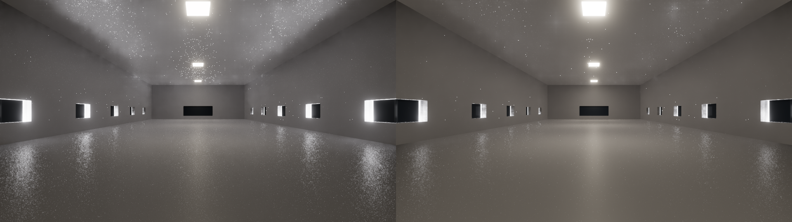
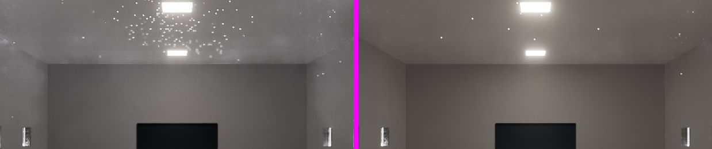
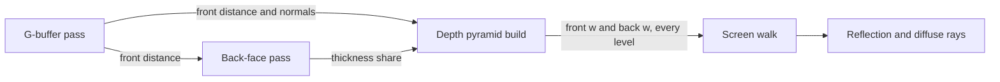
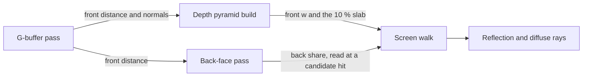
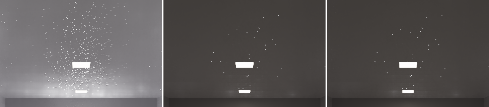
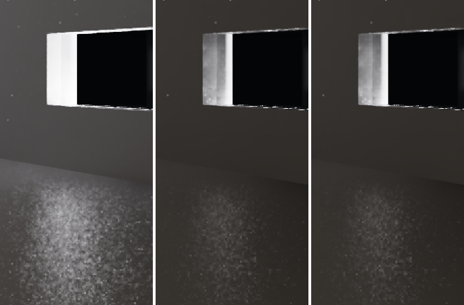
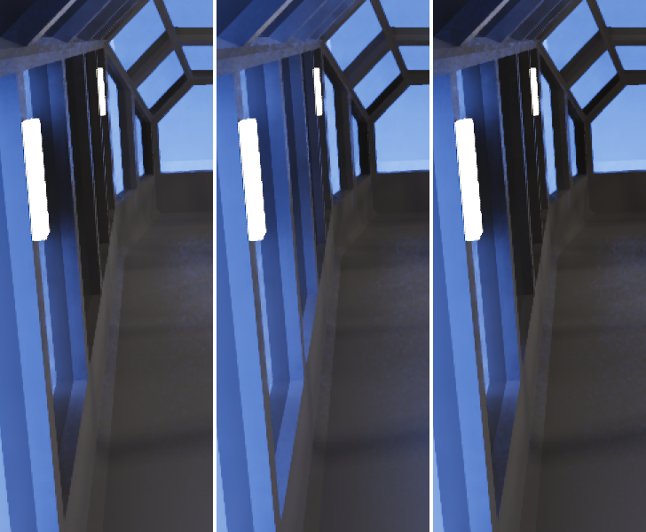
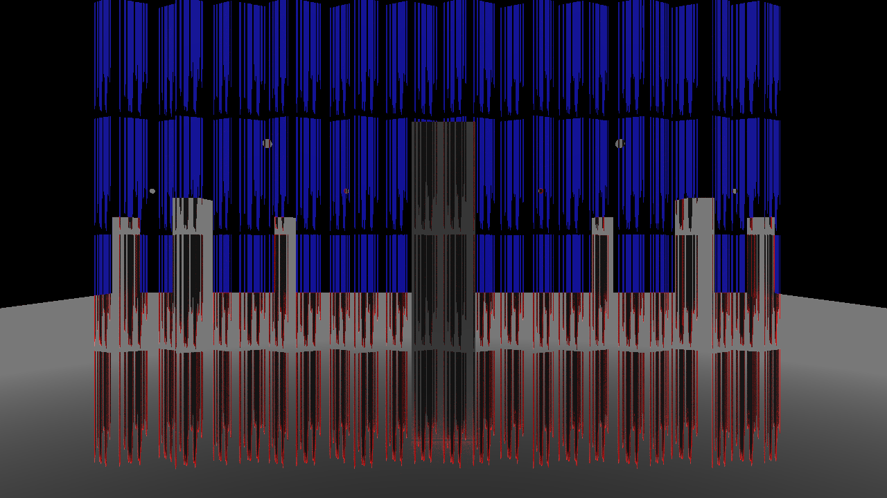

# The back-face depth layer: sources, cost and two designs

This is the record of stage 1 of the epic `ter-kh4g`, of 2026-11-14. It holds three parts: the sources of the technique, the measured cost of a throwaway back-face pass, and two designs. It decides nothing. Alexis chooses between the designs, and the design document in `docs/plans/` follows that choice.

The companion file [sources.md](sources.md) holds every source with exact quotes and the addresses of the pages. A research child agent wrote it from the pages that it read on 2026-11-14.

## The terms of this record

- The screen walk is the march of a ray across the screen's depth image (`walkScreen` in `src/Tertius.Rendering/Shaders/screen_walk.glsl`).
- The front surface of a pixel is the surface that the G-buffer shows at the pixel's center.
- The inverse depth w of a point is 1 over its view depth, in 1/m. A larger w is nearer to the eye.
- The slab of a pixel is the range of depths behind its front surface that the screen walk counts as solid.
- The thickness share κ is `ThicknessShare`, 0.1: today a slab reaches from the front surface's view depth z to z · (1 + κ).
- The 10 % rule is that fixed slab.
- The back layer is a screen image that holds, for each pixel, where the solid behind its front surface ends.
- The back share of a pixel is its front surface's distance to the eye over its back face's distance to the eye. It lies between 0 and 1, and the probe stores 0 for a pixel without a back face.
- The real thickness of a pixel is the distance from its front surface to its back face, in m. It runs along the view ray through the pixel's center.
- The entry share e of a hit says how deep in the slab the ray enters the pixel. It is 0 at the slab's front and 1 at the slab's back.
- A false sill hit is a hit on the sunlit window sill of `rect-lamps`. Its ray already left through the window (ticket `ter-ukw6`).

## The result in short

1. No large engine that the sources cover gives its screen walk a back layer. Unreal's Lumen, Unity's HDRP, Godot, Blender's EEVEE and AMD's reflection kit all use one depth layer with a fixed or tuned thickness. Two small sources draw back faces for a reflection walk: kode80's Unity effect of 2015 and an optional mode of Babylon.js. Neither gives a time.
2. The back layer fits Tertius better than it fits those engines, for two measured reasons. Tertius draws closed geometry: 99.99 % to 100 % of the surface pixels of the three measured views have a back face behind them. And the pass that draws the layer costs little: see "The cost".
3. A back-face pass that keeps the nearest back face of a pixel fails. In the cabin of `orbit`, the camera stands inside the person's own body mesh. The nearest back face then lies 0.3 m from the eye at every pixel. The pass must keep the first back face behind the pixel's front surface.
4. At the sill of `rect-lamps`, the real thickness is 0.50 m. The 10 % rule gives 3.95 m there. By the saved probe data, a back layer removes about 66 % of the bright reflection light of the ceiling's glow area. About 8 % stays as hits that the probe counts as false. This is an estimate from saved data, not a new probe run.
5. The real thickness is larger than the 10 % rule on 33 % to 46 % of the surface pixels. So a design that replaces the 10 % rule makes many slabs thicker, and a design that only shortens it does not. This is the main point where the two designs differ.
6. The pass alone adds 0.04 to 0.05 ms per frame on the RTX 2000 Ada and 0.03 to 0.05 ms on the M1 Max. A second texel read at every step of the walk's finest level costs about five times as much, so a design must avoid it.
7. Two stills of `rect-lamps` show the effect of a slab that ends at the back face: the ceiling's bright clouds and most of its specks are gone.

## The problem and the code today

The screen holds one depth layer, so the screen walk does not know where a surface's solid ends. `walkScreen` gives each cell a slab by the 10 % rule:

```glsl
const float backShare = 1.0 / (1.0 + ThicknessShare);
...
float near = cellBounds.x;
float back = cellBounds.y * backShare;
float inW = walk.ray.startW + walk.ray.stepW * s;
float outW = walk.ray.startW + walk.ray.stepW * exit;
bool inFront = near <= 0.0 || min(inW, outW) > near;
bool behind = !inFront && max(inW, outW) < back;
bool meetsSlab = !inFront && !behind;
```

where

- `ThicknessShare` = κ, 0.1 (`thickness.glsl`, and `CellBounds.ThicknessShare` in C#).
- `cellBounds` = at the finest level, the w of the pixel's center in both parts. At a coarser level, the largest and the smallest w of the cell's surfaces.
- `near` = the w of the slab's front, in 1/m. 0 marks a cell without a surface.
- `back` = the w of the slab's back, in 1/m: the farthest surface's w over 1 + κ.
- `s`, `exit` = the ray's parameters where its image enters and leaves the cell.
- `inW`, `outW` = the ray's w where it enters and where it leaves the cell.
- `inFront` = whether the ray passes the cell in front of the slab, or the cell holds no surface.
- `behind` = whether the ray passes the cell behind the slab.
- `meetsSlab` = whether the ray is inside the slab somewhere in the cell.

At the finest level, a ray that meets the slab of a pixel whose surface faces it is a hit. `traceFrom` in `screen_trace.glsl` then fades the hit by its entry share:

```glsl
float fade = edgeFade(hit) * (1.0 - entryShare);
result.light = mix(missLight, hitLightOf(hitPixel, kind), fade);
```

where

- `edgeFade(hit)` = 1 inside the screen, falling to 0 toward the screen's edge.
- `entryShare` = the entry share e of the hit.
- `missLight` = the environment's light for a ray that misses.
- `hitLightOf(hitPixel, kind)` = the light that leaves the hit pixel toward a ray of this kind.

So a ray that passes up to 10 % of the view depth behind a thin surface still takes part of that surface's light. In `rect-lamps` the sill lies 39.5 m from the eye, so its slab is 3.95 m deep.

Three other places read κ. They change with any design:

- `TargetDepthShare`, κ / 2: the depth of the box at which a guided diffuse ray aims.
- The ray plan's fit test, which uses κ as a tolerance of a plane, not as a thickness.
- `ScreenRay.Walk`, the C# copy of the walk.

## The sources

[sources.md](sources.md) holds 15 papers and talks and 7 engines. This table holds the ones that bear on the choice. "Fits" compares the source's situation with the situation of Tertius:

- Ship and station interiors with tens of lights.
- A render size of 1280 × 720 under FSR 3.1.
- An M1 Max and an RTX 2000 Ada, with a goal of 12 ms per frame.
- No world-space tracer behind the screen walk.


| Source | Its situation | What it does about thickness | Does it fit Tertius? |
|---|---|---|---|
| McGuire and Mara 2014, "Efficient GPU Screen-Space Ray Tracing" | A research ray caster, 1080p, a GeForce Titan. A linear walk, no depth pyramid. | One constant `zThickness` for the image. It names several peeled depth layers as an input, and it draws no back-face buffer. | Partly. It is the source of the fixed slab, not of a back layer. |
| Mara and others 2016, "Deep G-Buffers" | 1080p on a GTX 980, scenes of 10 thousand to 5.9 million triangles, a temporal filter. | A second layer of the next surface at least 50 cm behind the first, not of back faces. The ray still uses a constant thickness on both layers. The second layer took 0.1 to 1.7 ms. | No. It answers another question: what lies behind the first object. Its single pass needs a geometry shader and the last frame's depth. |
| Ritschel and others 2009, "Approximating Dynamic Global Illumination in Image Space" | A GeForce 8800 GTX, 1600 × 1200, short-range occlusion and one bounce. | Two peeled layers: for a closed mesh the second depth is the back of the object, and a point between the two depths is inside it. Overhead 30 % to 160 % of the frame. | The model fits: it is the front and back pair. Its cost is of 2009 hardware and of a full second peel. It assumes closed meshes. |
| kode80 2015, a Unity 5 reflection effect | One author's open effect. A linear walk. No times. | A second depth buffer with front faces culled. Thickness is back depth minus front depth. It still adds a constant offset. A buffer 6 times smaller was acceptable in some scenes. | The technique fits. The source gives no cost and no rule for open meshes. |
| Babylon.js, optional mode of its reflection pipeline | A web engine. A linear walk. No time for the pass. | Draws the back faces again into a depth texture. Off by default. | The technique fits. It reports "nasty artifacts" for meshes with only front faces. |
| Unreal Engine 5, Lumen | Games at 60 frames per second on consoles. Distance fields or ray tracing hardware behind the screen walk. | One layer, a thickness relative to depth: 0.02 for diffuse rays and 0.005 for reflection rays. A ray that goes behind a surface returns to its last visible point, and the world-space tracer resumes it. With no such tracer, a setting doubles the thickness. | Its answer does not fit: Tertius has no tracer that resumes the ray. Its numbers do bear on Tertius: its thickness is 5 to 20 times smaller than Tertius's 10 %. |
| Unity HDRP | A general engine with probes, denoisers and an accumulation mode. | One tuned thickness for the whole screen, relative to depth. A separate feature, Compute Thickness, draws both faces and sums signed depths, but only materials read it. | Its walk's answer is the fixed slab. Compute Thickness shows the cost of open meshes: the docs ask for separate layers for closed and open meshes. |
| AMD FidelityFX SSSR | A reflection kit with a denoiser and an environment map behind it. | No thickness inside the march. It checks the end point once, and blends a weak hit with the environment map. | Partly. Tertius already fades a hit by its entry share, which is the same idea. |
| Frostbite 2015, Wronski 2014, GTAO 2016 | Shipped games of their years. | Each names a second depth buffer as a possible answer. None builds it. GTAO calls depth peeling "impractical in our case". | They show that the idea is old and that studios did not pay for it then. |

Facts that the pages support:

- The engines with a world-space tracer behind the screen (Lumen, AMD's hybrid sample) stop the screen ray early and hand it over.
- The engines with only probes or an environment map keep a tuned constant and filter the result. Tertius is in this group.
- Every source that pairs a front depth with a back depth assumes closed meshes or reports faults on open meshes.
- No source gives a measured time for a back-face depth pass on current hardware.
- No source covers a G-buffer drawn in several depth ranges, or a min-max depth pyramid that holds a second layer.

My reading of them:

- The large engines do not skip the back layer because it fails. They skip it for three reasons. Their scenes hold much open geometry: foliage, cards and cloth. A second geometry pass costs them milliseconds. And a world-space tracer catches the screen walk's errors. Tertius differs on all three points. Its scenes are closed hulls and rooms. Its geometry pass is cheap (see "The cost"). It has no second tracer.
- So the situation check does not speak against the back layer. It does say that the technique is unproven in shipped games, and that the open-mesh rule is the part where the sources report trouble.
- The same sources name a cheaper answer: a smaller constant. "What a smaller constant gives" below measures it against the data.

What I did not check: the Unreal defaults come from the child's reading of Unreal's console variable reference. My own second fetch of that page reached only its first part, so one reading stands behind those numbers. The child did not read Uludag's chapter in GPU Pro 5 or Wyman's paper of 2005 in full.

## The throwaway probe

The probe has two parts. Stage 2 removes both.

1. The pass. The branch's commit "THROWAWAY: a cost probe of a back-face depth pass" holds it.
2. The walk's read of the pass's target. It is not on the branch, because it adds a shader binding and a specialization constant that 333 tests of the Rendering project pin. The file [probe-with-walk-read.patch](probe-with-walk-read.patch) holds both parts as one patch against `ab54c785e`. The cloud jobs ran it from scratch commits, which the job log names.

The pass "back faces" runs after the G-buffer pass:

- It draws the one-sided opaque runs of each of the three depth ranges again, with front faces culled, into one R32F target. Each range keeps its own projection and the frame's jitter. The pass reuses the G-buffer's depth image.
- Its vertex stage reads only the position. Its fragment stage reads the pixel's front distance from the G-buffer and discards a back face that is not behind it. The depth test keeps the nearest back face that stays.
- It draws the cutout run as solid, so it runs no alpha test. It draws no two-sided run, so hair cards have no back face of their own.
- It writes the back share.

The environment variable `TERTIUS_BACK_FACE_PROBE` selects the probe's mode:

| Mode | What runs | Where |
|---|---|---|
| `off` | Main's frame. No pass, and the walk reads nothing. This is the default, so every test draws main's frame. | The branch and the patch |
| `on` | The pass. Nothing reads its target. | The branch and the patch |
| `read` | The pass, and the walk reads the back share at each step of the finest level and ignores it. | The patch |
| `walk` | The pass, and the walk ends a pixel's slab at its back face where that is nearer than the 10 % rule. | The patch |

The walk's change in the patch:

```glsl
if (backFaceWalk != 0u && level == 0 && near > 0.0)
{
    float share = texelFetch(backFaceShare, ivec2(cell), 0).r;
    back = max(back, near * (backFaceWalk == 2u ? min(share, 0.0) : share));
}
```

where

- `backFaceWalk` = the mode as a specialization constant: 0 for `off` and `on`, 1 for `walk`, 2 for `read`.
- `level` = the level of the depth pyramid at which the walk stands. 0 is the finest.
- `near` = the w of the pixel's center, in 1/m.
- `backFaceShare` = the pass's target, the back share of each pixel.
- `back` = the w of the slab's back. A pixel's back face lies at `near * share`, because both points lie on one view ray. A larger w is nearer, so `max` keeps the nearer of the back face and the 10 % rule.

The mode `walk` is the reading rule of Design 2 below, but with one read at every step of the finest level. It is not Design 1: the coarse levels of the pyramid keep the 10 % rule in the probe.

## What the back layer holds

A dump of the front and back distances of one captured frame gave these numbers. A surface pixel is a pixel that does not show the sky.

| View | Render size | Surface pixels with a back face behind them | Real thickness at most 10 % of the front distance | Real thickness above 10 % |
|---|---|---:|---:|---:|
| `rect-lamps` (the cabin of `orbit`, the person's camera) | 848 × 480 | 99.99 % | 57.8 % | 42.2 % |
| The cabin of `demo-exit` (`cabin-camera`) | 1280 × 720 | 100 % | 67.0 % | 33.0 % |
| The deck of `demo-exit` (`deck-camera`) | 1280 × 720 | 100 % | 54.5 % | 45.5 % |

Three findings:

1. The first run kept the nearest back face of each pixel, without the test against the front distance. In `rect-lamps` every pixel then held a back face 0.30 to 0.46 m from the eye. The camera stands inside the person's body mesh, whose front faces the G-buffer culls. So the layer must hold the first back face behind the front surface. A closed mesh around the camera is a normal case in a first-person game.
2. In these views nearly every pixel has a back face behind it, because the rooms and hulls are closed boxes with thick walls. The numbers say nothing about views with hair, which the probe did not draw as two-sided.
3. The real thickness is above the 10 % rule on a third to a half of the pixels. Those are floors, walls and ceilings seen at a low angle, where the view ray runs a long way inside the slab of the wall.

The sill. In `rect-lamps` the sill is the bottom face of the end window's opening in a wall 0.5 m thick, 39.5 m from the eye. At the pixels under the opening, the front distance is 39.52 to 39.62 m and the back distance is 40.02 to 40.12 m. So the real thickness is 0.50 m, 1.27 % of the distance, and the 10 % rule gives 3.95 m.

The probe data of `ter-ukw6`. The file `/tmp/t7-3e22/robust/hits9/hits-true.txt` holds the bright reflection samples of the ceiling's glow area by their fade, in 32 steps. The fade is `edgeFade · (1 − e)`. The hit pixels lie near the screen's center, so the edge fade is 1 there, and the fade gives e.

- A ray inside the real 0.50 m enters at e of at most 0.0125 / 0.0909 = 0.1375, so its fade is at least 0.8625. That is the fade steps 28 to 31.
- The steps 1 to 27 hold 8,029,078 of the 12,112,338 units of bright light: 66.3 %. These rays enter the slab behind the real back face. A back layer rejects them.
- The steps 28 to 31 hold 4,083,260 units: 33.7 %. The probe counts 3,085,337 units, 25.5 %, as real hits on the sill. If all of those lie in the steps 28 to 31, then 997,923 units stay, 8.2 %. The probe counts them as false, and a back layer keeps them.

So the false light falls from about 74 % to about 8 % of today's bright light. That is about a quarter of the bright light that stays. The rays that stay pass within the sill's real 0.50 m of depth and within one pixel of its surface. The acceptance of the epic asks for "about 0". This estimate does not reach it, and a new probe run in stage 2 must measure it. The estimate assumes that every bright hit pixel lies at the sill's distance. I did not run the probe again.

### What a smaller constant gives

The sources name the cheap alternative: Lumen's thickness is 2 % of the depth for diffuse rays, and 4 % with no fallback tracer. A constant of 2 % in place of 10 % rejects the fade steps 1 to 25 of the same saved data. They hold 57 % of the bright light. It costs nothing. But the same dump shows what it gives up. In `rect-lamps` only 5.3 % of the surface pixels have a real thickness of at most 5 % of the distance. In the cabin 37.5 % have. So a small constant makes nearly every wall and floor thinner than it is, and rays pass behind them. That is the leak behind thick objects that design A of the handoff was rejected for. A back layer gives the thin slab at the sill and the thick slab at the wall from one rule.

### What the trimmed slab does to the image

Two stills of `rect-lamps` came from one frozen Release binary on the Mac, at 1920 × 1080 through FSR 3.1, after the script's 240 draws. The left still ran the mode `off`, which is main's frame. The right still ran the mode `walk`.





What the eye sees:

- The ceiling of the left still holds wide bright clouds and many specks. The right still holds neither the clouds nor most of the specks. In the crop of the far ceiling, the cluster of more than 100 specks around the far lamps falls to about 6.
- The floor of the left still holds bright sparkling patches in front of each side window. In the right still they shrink to a small part.
- The glow around the side windows on the walls is weaker in the right still.
- The right still shows no new hole and no new leak that I can find at this size.

Limits of this comparison:

- The automatic exposure differs between the two stills, because the false bright light is gone in the right one. So the right floor looks brighter. The stills do not compare levels of light.
- The comparison is one still per side, with no reference beside it.
- It shows the rule of Design 2. Design 1 also makes the thick slabs thicker, and no still shows that.
- The sill is not the only source of the false light. The side faces of every window opening are sunlit strips in a wall 0.5 m thick, and they act as the sill does.

## The cost

The numbers below are GPU frame spans: the GPU time from a frame's first time stamp to its last, in ms. Each run films 120 frames at an output of 1920 × 1080 through FSR 3.1, so the render size is 1280 × 720. A run's value is the median of its 120 frames.

The three views:

- The deck: `scripts/temporal-upscale-timing.json`, the deck camera of `demo-exit`.
- The cabin: `scripts/ter-kh4g-cabin-timing.json`, the cabin camera of `demo-exit`.
- `rect-lamps`: `scripts/ter-kh4g-rect-lamps-timing.json`, the person's camera in the cabin of `orbit`.

### On the RTX 2000 Ada

Two workbench jobs ran `tools/runpod/ab_run.sh` with five runs per side. Each job compares its variants with main (`ab54c785e`) inside the job. The spread is the highest run minus the lowest run of one side.

| View | Job | Main, median (spread) | The pass alone (`on`) | The pass and the ignored read (`read`) | The pass and the trimmed slab (`walk`) |
|---|---|---:|---:|---:|---:|
| Deck | 1 | 8.438 ms (0.024) | +0.047 ms | not in this job | +0.268 ms |
| Cabin | 1 | 9.411 ms (0.046) | +0.045 ms | not in this job | +0.345 ms |
| `rect-lamps` | 1 | 7.143 ms (0.008) | +0.037 ms | not in this job | +0.143 ms |
| Deck | 2 | 8.386 ms (0.022) | not in this job | +0.255 ms | +0.276 ms |
| Cabin | 2 | 9.371 ms (0.053) | not in this job | +0.289 ms | +0.335 ms |

Facts:

- In every row, every run of a variant lies above every run of main.
- On the deck, the first run of each variant was about 0.57 ms slower than its other four runs, in both jobs. The other four runs lie within 0.03 ms. The median ignores the slow run.
- The pass's own time is 0.043 ms on the deck, 0.052 ms in the cabin and 0.044 ms in `rect-lamps`. The surface test after it rises by 0.012 ms.
- In the mode `walk`, the reflection rays rise by 0.080 to 0.175 ms and the diffuse rays by 0.072 to 0.106 ms.
- The mode `walk` costs 0.021 ms more than the mode `read` on the deck and 0.046 ms more in the cabin. That is the cost of the rays that walk on after a rejected hit.
- The mode `read` costs 0.255 and 0.289 ms against its own main, and the pass alone costs 0.047 and 0.045 ms against its own main. So the read itself costs about 0.21 to 0.24 ms. This compares two jobs, each against its own main.

### On the M1 Max

Every run used one frozen Release binary built from the patch, with the mode from the environment variable. The mode `off` records main's frame. The runs went in interleaved rounds, each run alone under the exclusive GPU lock and beside the GPU clock sampler, with `--in-flight 2 --pass-timestamps off`. All runs held the top clock of 1296 MHz. The 1-minute load at the runs' starts was 4 to 29, because the other track and one test run of this branch used the machine.

A cell gives the median, then the lowest and the highest value and the count of runs or rounds. A difference pairs two modes inside one round.

| View | Main's frame (`off`), ms | `on` minus `off` | `read` minus `off` | `walk` minus `off` | `walk` minus `read` |
|---|---:|---:|---:|---:|---:|
| Deck | 18.571 (18.535 to 18.607, 3) | +0.031 (−0.002 to +0.063, 2) | +0.352 (1) | +0.353 (+0.305 to +0.394, 3) | −0.047 (1) |
| Cabin | 20.453 (20.354 to 20.454, 3) | +0.030 (+0.028 to +0.033, 2) | +0.426 (1) | +0.542 (+0.508 to +0.579, 3) | +0.082 (1) |
| `rect-lamps` | 14.758 (14.742 to 14.774, 2) | +0.047 (+0.035 to +0.058, 2) | not measured | +0.170 (1) | not measured |

Facts:

- The pass alone adds 0.03 to 0.05 ms by the medians. Main's own runs spread by 0.03 to 0.10 ms, so the pass costs about as much as one run differs from the next.
- The trimmed slab with one read per step adds 0.17 to 0.54 ms by the medians, far above the spread.
- The one round with the mode `read` gives the same split as the RTX card: the read costs nearly all of it.

What I did not check on the Mac: the GPU queue was full, so the modes have few rounds. The counts in the table say how few. Two timing sets stopped at the time limit of their command before their last rounds. A first set of five runs ran without the clock sampler and is not in the table. No Metal System Trace gives the pass's own time.

### Against the budget

- The deck's frame is 18.5 to 18.6 ms on the Mac in this setup and 8.4 ms on the RTX card. The goal is under 12 ms.
- The pass alone is 0.2 % to 0.3 % of the Mac's frame and 0.5 % to 0.6 % of the card's frame. It does not break the budget.
- A second texel read at every step of the finest level costs 1.2 % to 2.7 % of the Mac's frame. A design avoids it in one of two ways: it puts the back w into the texel that the walk reads anyway, or it reads only at a candidate hit.
- These views are rooms of boxes. A view with dense meshes pays more vertex work in the pass, and no such view was timed.

### Memory at 1280 × 720

| Image | Format | Size |
|---|---|---:|
| The probe's target | R32F | 3.52 MiB |
| Design 1: the finest level grows from R32F to RG32F | RG32F | 3.52 MiB more |
| Design 1 with a pass that does not draw into the finest level: a side target | R16F | 1.76 MiB |
| Design 2: the side image of the back share | R16F | 1.76 MiB |

The pass reuses the G-buffer's depth image, so it needs no depth image of its own.

## Two designs

Both designs draw the same pass. They differ in what the back layer means to the screen walk.

### What both designs share

- The writer is one raster pass after the G-buffer pass and before the depth pyramid. It draws the same indirect commands as the G-buffer pass, in the same three depth ranges, with the same projections and the same jitter. So the front surface and the back face of a pixel come from one frame's placements. A moving or skinned object needs no extra rule, because the pass draws this frame's deformed copies.
- The pass keeps the first back face behind the pixel's front surface. It reads the G-buffer's distance for that test.
- The pass stores the thickness as a share of the distance, not the distance. A half float then holds a thin slab to 1 part in 2,048 of its own size at any distance.
- Glass, fringes and puffs draw after the composite and are not in the G-buffer. The screen walk does not see them today, and neither design changes that.
- The guided diffuse rays aim at a box of κ / 2 of the depth behind a bright pixel. Under both designs the box must not reach behind the back face, or guided rays aim where the walk rejects them. The estimate stays unbiased either way, because a rejected guided ray counts as a miss with density 0. Only the gain of the guiding falls.
- The C# copy `ScreenRay.Walk` and its tests change with the shader.
- The pass needs no new device feature. It draws depth and one color target in a core format.
- Known limit of both: where two closed objects pass through each other, the first back face behind the front surface can belong to the inner object. The slab then ends early there.

### The designs side by side

| Point | Design 1: the back layer is the slab | Design 2: the back layer trims the slab |
|---|---|---|
| The model of thickness | A pixel's view column holds one solid interval, from its front surface to the first back face behind it. The screen measures it. | Nobody knows how deep a surface's solid is, so the walk assumes 10 % of the depth. A back face that the screen shows nearer than that proves an earlier end. |
| The 10 % rule | Removed from the walk. `ThicknessShare` stays only as the guided box and the plan's tolerance, under names of their own. | Stays. The slab is the nearer of the 10 % rule and the back face. |
| A slab can become thicker than today | Yes, on the 33 % to 46 % of pixels whose real thickness is above 10 %. | No. A slab only becomes thinner. |
| A pixel without a back face behind it, and a two-sided card | A sheet: thickness 0. A ray that crosses it inside the pixel hits, and a ray behind it passes. | Unchanged: the 10 % rule. |
| Where the layer is stored | In the depth pyramid. The finest level holds the front w and the back w of each pixel. The far bound of a coarser cell is the smallest back w of its pixels. | In a side image of the back share, half floats at the render size. The pyramid does not change. |
| Who reads it | The pyramid's build, once per frame. The walk reads the pyramid as today, one texel per step. | The walk, once per candidate hit, after the facing test. |
| The walk's loop | One rule at every level: the slab runs from the texel's second part to its first part. The multiply by `backShare` goes. | Today's loop, with one more test at a hit. |
| Coarse levels | Their slabs follow the real thickness, so the walk skips empty space behind thin objects and stops at thick ones. | Their slabs keep the 10 % rule. The walk descends as today and the veto acts at the finest level only. |
| The one-image pyramid (`ter-y3k4`) | The finest level becomes a pair like every other level, so one RG32F image for all levels is the natural form. `ter-y3k4`'s measurement decides whether to merge the two images. | Independent of it. |
| Contact darkening | Changes in both directions: less behind thin objects, more behind thick ones. | Changes in one direction: less behind thin objects. |
| Memory at 1280 × 720 | 3.52 MiB more, or 5.27 MiB with a side target for the pass. | 1.76 MiB more. |
| Per-stage limits | No new binding in the tracer. The pyramid's build reads one more sampled image. | One more sampled image in the tracer's compute stage: 18, where it has 17 today and the spec guarantees 16. No new storage image. |
| Expected frame cost | The pass, plus the rays that walk on after a rejected hit. Measured parts on the RTX card: 0.04 to 0.05 ms and 0.02 to 0.05 ms. On the Mac: 0.03 to 0.05 ms for the pass, and the second part is inside the spread. The wider finest texel and the changed build are not measured. | The same two parts, plus one read per candidate hit. The probe measured one read per step: 0.21 to 0.24 ms on the RTX card and about 0.35 to 0.43 ms on the Mac. A read per candidate hit is rarer, and its cost is not measured. |
| Size of the change | Larger: the pass, the pyramid's build and its C# copy, the walk at every level, and the tests that pin the slab. | Smaller: the pass, one binding, and one test in the walk and its C# copy. |

### A usage example of each

These are sketches of the walk's test, not code in the tree.

Design 1. The walk reads the slab from the pyramid at every level:

```glsl
vec2 cellBounds = level == 0 ? texelFetch(finest, ivec2(cell), 0).rg : texelFetch(bounds, ivec2(cell), level - 1).rg;
float near = cellBounds.x;
float back = cellBounds.y;
```

where

- `finest` = the finest level, RG32F: the front w of the pixel's center and its back w. A sheet holds the same w twice.
- `bounds` = the coarser levels, RG32F: the largest front w and the smallest back w of the cell.
- `near`, `back` = the w of the slab's front and back, as today. No constant enters.

Design 2. The walk asks the side image only where it found a hit:

```glsl
if (meetsSlab && hitsPixel(walk, ivec2(cell)) && reachesSolid(ivec2(cell), near, max(inW, outW)))
```

where

- `meetsSlab`, `hitsPixel` = today's tests: the ray is inside the 10 % slab, and the surface faces the ray.
- `reachesSolid(pixel, near, deepestW)` = a new test. It reads the pixel's back share. It returns whether `deepestW` is at or in front of the back face's w, `near * share`. Without a back face it returns true.
- `deepestW` = the ray's nearest w inside the cell, in 1/m.

### The data flow

Design 1:



Design 2:



### The points of the handoff's list

| Point | Design 1 | Design 2 |
|---|---|---|
| Single cards and hair cards | The pass draws the two-sided runs with no face culled and with the cutout test. A fragment at the front surface's own distance counts, so the pixel holds thickness 0. A ray from a hair pixel still passes its own card by today's rule. Rays no longer stop in the 10 % behind a card, so hair occludes less than today. | The pass does not draw them. A card pixel reads the back face of what lies behind it, such as the head, or the 10 % rule, whichever is nearer. Never thicker than today. |
| Glass and other transparent surfaces | Not in the G-buffer. No change. | The same. |
| Moving and skinned objects | The pass draws this frame's commands. No lag. | The same. |
| Particles | Puffs are not in the G-buffer. No change. | The same. |
| FSR's jitter | The pass uses the frame's jittered projection, so both layers shift together. A strip thinner than a pixel shows in some frames only, and its back face shows with it. | The same. |
| Coarse levels of the pyramid | The far bound of a cell is the smallest back w of its pixels, never farther than the pixel plane's far corner. | Unchanged. |
| The walk's extra read per step | None. The finest texel grows from 4 to 8 bytes. | None per step. One read per candidate hit. |
| Linux drivers | Core formats only: RG32F as a storage image is already required. The pass needs no blend and no new feature. | Core formats only: R16F as a color target and a sampled image. The tracer's stage rises to 18 sampled images, far below the limits that RADV, ANV and lavapipe report. NVIDIA's limit is not read from a source in ARCHITECTURE.md. |
| The `rect-lamps` sill | The slab at the sill falls from 3.95 m to 0.50 m. | The same. |
| Contact darkening near objects | Changes where the real thickness is not 10 %: both thinner and thicker slabs. The acceptance asks for no visible change, so stage 2 must compare stills. | Changes only behind objects thinner than 10 % of their distance. |
| The one-image pyramid (`ter-y3k4`) | Builds toward it. | Leaves it open. |

### What neither design settles yet

- The fade by the entry share. Both keep `1 − e` over the slab that the walk uses. Under Design 1 a thick slab then fades a deep entry more slowly per meter than today. Stage 2 looks at stills before it changes the rule.
- Whether the layer can be smaller than the render size. kode80 reports a buffer 6 times smaller as acceptable in some scenes. The pass is cheap at the full size (see "The cost"). A thin strip such as the sill needs the full size. So both designs keep the render size.

## The questions for Alexis

The designs differ on three points. Each point has its own answer, so a hybrid is possible. For example, the layer can live in the pyramid as in Design 1 and still only trim the slab as in Design 2: the pyramid's build then stores the nearer of the back face and the 10 % rule.

### 1. What does the back layer mean to the screen walk?

| Option | What Alexis gets | What it costs |
|---|---|---|
| The layer is the slab (Design 1) | One rule for thin and thick things, and no thickness constant in the walk. | Slabs become thicker than today on a third to a half of the pixels. Contact darkening can change in both directions, and no still shows that yet. |
| The layer trims the 10 % slab (Design 2) | The image changes only behind things thinner than 10 % of their distance. The two stills above show this rule. | The 10 % constant stays as a second rule beside the layer. A thick wall still ends at 10 %. |

I mark no option. The stills cover only the second option.

### 2. What is a surface with no back face behind it?

This is a single card, a hair card or an open shell.

| Option | What Alexis gets | What it costs |
|---|---|---|
| A sheet with no thickness | A ray hits such a surface only where it crosses it inside the pixel. A card is what it is. | Hair and cards no longer stop the rays that pass behind them, so the darkening near hair becomes weaker. |
| The 10 % rule, as today | No change at hair and cards. | The constant stays for these pixels. |
| Solid without end | The strongest darkening. | Every ray behind a card hits it, which is wrong for a card. |

I mark no option. No measured view holds hair, and only 0.01 % of the measured pixels have no back face behind them.

### 3. Where does the layer live, and who reads it?

| Option | What Alexis gets | What it costs |
|---|---|---|
| In the depth pyramid (Recommended) | The walk reads no second image. The measurement shows that a second read per step is nearly the whole cost of the probe's walk: 0.21 to 0.24 ms on the RTX card and about 0.35 to 0.43 ms on the Mac. It also prepares the one-image pyramid of `ter-y3k4`. | 3.52 MiB more. The pyramid's build, its C# copy and their tests change. |
| In a side image, read at a candidate hit | The pyramid stays as it is. 1.76 MiB more. | One more sampled image in the tracer's stage. The cost of the read per candidate hit is not measured. On Apple's GPU, more code in a loop cost time before (`t2-x53j`). |

The reason for the mark is the measurement: the first option removes the measured cost by its construction.

## The answers of Alexis

Alexis answered the three questions on 2026-11-14.

1. The layer is the slab, as in Design 1. The real back face replaces the 10 % rule. Alexis chose it with two known costs. Slabs grow on a third to a half of the pixels, and contact darkening can change in both directions.
2. A surface with no back face behind it is a sheet with no thickness.
3. The layer lives in the depth pyramid, with the front depth and the back depth at every level. The parent agent settled this from answer 1: the coarse levels need the back depth.

Stage 1b then looks for a misbehavior of this model that has a name: a new leak, a new hole, or contact darkening that looks wrong. It also measures the false sill hits and the cost of the pyramid store. The side image of Design 2 is out.

## Stage 1b: the evidence for the chosen model

Stage 1b ran from 2026-11-14 to 2026-11-15. Three tickets hold its work, and each has its own record beside this file:

- [stage-1b/probe.md](stage-1b/probe.md): the throwaway probe of the chosen model (`t1-n8x9`).
- [stage-1b/cost.md](stage-1b/cost.md): the frame cost on both machines (`t1-stwp`).
- [stage-1b/pictures.md](stage-1b/pictures.md): the false sill hits, the stills and the sheets (`t1-gxzg`).

A sheet is a surface pixel with no back face behind it. The chosen model gives it no thickness.

### The probe

The probe stores a front w and a back w at every level of the depth pyramid. Only the pyramid's build applies the slab rule, and the walk multiplies by no constant. One binary holds every rule. The probe is a patch, [stage-1b/probe-slab-in-pyramid.patch](stage-1b/probe-slab-in-pyramid.patch), and not code on the branch.

Measured facts, all on the M1 Max:

- Main rendered twice gives the same capture and the same 240 film frames, byte for byte.
- The 10 % rule through the new store gives main's capture and film, byte for byte. So the store alone changes no pixel.
- Under the layer as the slab, the sill of `rect-lamps` has a slab of 0.50 m. Under the 10 % rule it has 3.96 m.
- The slab of every cell of level 1 holds the slab of every pixel under it. Four views show no exception.
- `rect-lamps` holds 23 sheets among 399,704 surface pixels. The deck holds 8, and the cabin none.
- The hair view of `lamp-hall-16-hair` holds 80,465 sheets among 270,728 surface pixels.

### The cost of the pyramid store

The measurement compares four sides: main, the layer as the slab, the 10 % rule through the new store with the back-face pass, and the new store without the pass. A cell gives the layer as the slab minus main, in ms per frame at a render size of 1280 × 720. The run range is main's slowest run minus its fastest.

| Scene | RTX 2000 Ada: main | Its run range | The chosen model minus main | M1 Max: main | Its run range | The chosen model minus main |
|---|---:|---:|---:|---:|---:|---:|
| Deck | 8.447 | 0.018 | +0.031 | 18.615 | 0.107 | +0.060, inside the noise |
| Cabin | 9.318 | 0.037 | +0.055 | 20.291 | 0.105 | +0.140 |
| `rect-lamps` | 7.120 | 0.011 | −0.109 | 14.812 | 0.062 | −0.141 |
| Crowd: 100 skinned figures, 2.0 million vertices | 9.176 | 0.015 | +0.446 | 15.369 | 0.174 | +1.014 |

The card's numbers come from four rounds after a slow first round, and the Mac's from 9 to 12 kept rounds of 12.

More measured facts:

- The new store without the pass is not slower than main. On the card it is 0.028 to 0.036 ms faster in every scene, and on the Mac the difference is inside the noise.
- The pass alone costs 0.032 to 0.062 ms in the three rooms on the card, and it is inside the noise there on the Mac.
- In the crowd the pass alone costs 0.453 ms on the card and 0.801 ms on the Mac. Its own time on the card is 0.485 ms, against 1.294 ms for the G-buffer pass.
- The layer rule alone, without the pass and the store, costs 0.013 to 0.029 ms in the deck and the cabin on the card. On the Mac it costs 0.058 to 0.122 ms there. In `rect-lamps` it saves 0.112 ms on the card and 0.172 ms on the Mac.
- Memory at 1280 × 720: the finest level grows from 3.52 MiB to 7.03 MiB. The back share takes 3.52 MiB as R32F, or 1.76 MiB as R16F.
- The cloud jobs of the cost ticket counted $0.20.

My reading: the store is free, and the walk's rule costs little. The pass is the cost, and it grows with the vertex count, because it draws every one-sided solid mesh a second time. A view of rooms pays about 0.05 ms for it. A view with many skinned figures pays for it in proportion.

### The false sill hits

A census classes each bright reflection sample of the ceiling's glow area by where its ray really crosses the hit pixel's plane. A false hit is a hit whose crossing lies in an opening. The numbers are sums over 400 draws of `rect-lamps` on the RTX 2000 Ada, at one fixed exposure. Light is the sum of the samples' luminance.

| Rule | False hits: samples / light | Real hits: samples / light | False share of the rule's own bright light | False light against the 10 % rule |
|---|---|---|---:|---:|
| The 10 % rule | 6,783 / 3,011,681 | 1,260 / 1,036,322 | 74.34 % | 100 % |
| The layer as the slab | 4 / 483 | 602 / 488,239 | 0.099 % | 0.016 % |
| The trimmed slab | 4 / 483 | 602 / 488,239 | 0.099 % | 0.016 % |

- Under the 10 % rule, 99.5 % of the false light lands on one render row: the first row below the end window's opening.
- Stage 1 estimated that about 8 % of the bright light stays false under a back layer. That estimate does not hold. Those rays entered within 0.5 m of the edge row's own sample, which is not the same as inside the wall. Under the layer they no longer hit.
- The 4 samples that stay land on one pixel at the bottom edge of a side window.
- A count of every sample, bright or not, keeps the real hits: 2,692,654 under the layer against 2,695,727 under the 10 % rule. Their light falls by 48 %, because the room is darker without the false bounce light.
- The census cannot see the sill's top face, which is 0.2 render rows tall. It names a hit through that face false. The layer keeps 742,533 dim samples of that kind, with 3.7 % of the 10 % rule's false light. By the ticket lead's reading they are real hits. No measurement shows it.

So the chosen model removes the bright false sill hits, and they need no other mechanism.

### The stills

Each comparison has three columns at one fixed exposure and an output of 1920 × 1080: the 10 % rule, the layer as the slab, and the layer with the fade over at most the first 10 % of depth. The third column keeps the layer's hit decision and changes only the fade. A change counts where a tile of 16 × 16 pixels differs by more than the noise floor: the largest tile difference between two settled frames of the 10 % rule.

| View | What changes under the layer as the slab | Size, in 1/255 of the 8-bit image |
|---|---|---|
| `rect-lamps` | The ceiling, the far wall, the upper side walls, the window jambs and the floor's patches become darker. Nothing becomes brighter. | 1,972 of 8,040 tiles, about −64 on the mean |
| The cabin of `demo-exit` | The left wall's window frames and the jamb between two pillars become brighter. The corridor's far end becomes darker. | +19.8 on the mean and +43.8 at the peak, and −6.9 |
| The deck of `demo-exit` | The ship's interior behind its glass becomes a little darker. | 46 tiles, about −5.5, against a noise floor of 4.66 |
| The hair views | A strip of the far floor beside the glowing bar of `hair-rugs` becomes darker. The cards do not change. | 52 tiles, about −7 |



The far ceiling of `rect-lamps`. Left, the 10 % rule: a bright ceiling with a cloud of specks. Middle and right, the layer and the layer with the short fade: a dark ceiling with a few dozen specks.



The nearest right window of `rect-lamps`, in a wall of 0.5 m. Left: a white jamb and a bright sparkling patch on the floor. Middle and right: a gray jamb with uneven vertical bands, and a dimmer patch.



The cabin's left wall. Left, the 10 % rule: the recess between two pillars is a black strip. Middle, the layer: the strip is as light as the frames beside it. Right, the layer with the short fade: the strip is dark again, but lighter than on the left.

My reading of the cabin: this is the candidate for contact darkening that looks wrong. A ray that passes behind a thick pillar's outline enters the pillar's slab from the side. The walk then gives it the light of the pillar's front pixel, faded by one minus the entry share. On a slab deeper than 10 %, the same depth is a smaller entry share, so more of the front's light stays. That light belongs to a face that the ray does not reach. No reference image exists, so this reading is not a measurement (`t1-g4p1`).

No view shows a new hole. The record names no leak with certainty.

### Surfaces with no back face

| View | Surface pixels | Sheets | Share |
|---|---:|---:|---:|
| `lamp-hall-16-hair`, the hair camera | 605,660 | 174,764 | 28.9 % |
| `skin-and-hair`, the hair camera | 380,324 | 8,982 | 2.4 % |
| `hair-rugs`, the low camera | 764,691 | 17 | 0.0 % |
| `demo-meshes`, the view of dense geometry | 641,644 | 10 | 0.0 % |

The sheets of the lamp hall are the hair cards' pixels with only the sky behind them.

The borrowed back face is a misbehavior of the probe's model with a name. The probe's pass draws the one-sided solid runs only. A hair card in front of the floor then takes the floor's back face, and its slab spans the air between the two. In the lamp hall, 131,399 card pixels get a slab with a median of 4.12 m.

| Rule | Reflection rays | Their hits | Hits whose crossing lies behind the ray's start |
|---|---:|---:|---:|
| The 10 % rule | 3,646,708 | 74,176 | 4,448 |
| The layer as the slab | 3,635,373 | 860,419 | 817,466 |

A crossing behind the start means that the ray moves away from the surface that the hit pixel shows. So 95.0 % of the layer's reflection hits there are hits on a surface that the ray never reaches.



The lamp hall under the layer. Gray is the front distance, blue marks the sheets, and red marks the hit pixels. The red lies on the cards below the horizon, in front of the floor.

My reading of the borrowed back face: part of it comes from my own decision that the probe's pass leaves out the two-sided runs. Design 1 above draws them with no face culled, so a card's own fragment ends its slab at the front's distance. An open one-sided mesh still has no back face of its own, and it still borrows one. Stage 2's design must state the rule (`t1-yy2f`).

A ray can hit a slab of zero thickness. But the sheets lose real hits. A real hit is a hit whose ray crosses the hit pixel's plane ahead of its start, where the eye sees that surface.

| View and ray kind | Real hits on sheets under the 10 % rule | A sheet with no thickness keeps | A sheet as deep as its own plane keeps |
|---|---:|---:|---:|
| Lamp hall, reflection | 2,588 | 687 (26.5 %) | 1,333 (51.5 %) |
| Lamp hall, diffuse | 9,975 | 2,484 (24.9 %) | 5,271 (52.8 %) |
| `skin-and-hair`, reflection | 192 | 76 (39.6 %) | 142 (74.0 %) |
| `skin-and-hair`, diffuse | 445 | 249 (56.0 %) | 396 (89.0 %) |

The cause of the loss is not known (`t1-i54g`). The stair case of the probe's ticket is a weak candidate, because 99.7 % of those sheets face the camera. The stills of the hair views show no change, because the hit light and the miss light behind the cards are alike there.

### What stage 1b says about the chosen model

1. It removes the false sill hits, which was its reason: 0.016 % of the false light stays.
2. Its store costs nothing, and its pass costs about 0.05 ms in rooms. The pass costs in proportion to the vertex count in dense views (`t1-kiaw`).
3. It makes `rect-lamps` much darker at a fixed exposure. By my reading, that is the room without the false bounce light.
4. It has two open points on thick slabs and open surfaces: the fade on a slab deeper than 10 %, and the borrowed back face.
5. A sheet with no thickness loses a quarter to three quarters of its real hits, by a cause that nobody found yet.

### What stage 1b did not check

- No reference image: no path tracer ran. So "right" and "wrong" in the stills are readings.
- No view holds a bright object behind hair cards. So the visible size of the borrowed back face and of the sheets' lost hits is open.
- The probe did not draw the two-sided runs in its pass, so Design 1's own rule for cards did not run.
- The pictures ran on the RTX 2000 Ada, and the probe's controls on the M1 Max. Nothing ran on RADV, ANV or lavapipe.
- The pass's own time on the Mac.
- The cause of the slow first run of a tree with the pass on a fresh cloud worker.
- Part 2 has one to four crops per view. The images of the changed regions cover the rest.

### Tickets and dollars of stage 1b

- Closed: the probe (`t1-n8x9`), the cost (`t1-stwp`) and the pictures (`t1-gxzg`).
- Open, for stage 2's design: the borrowed back face (`t1-yy2f`) and the sheets' lost hits (`t1-i54g`).
- Open, for stage 2's design too: the fade on a thick slab (`t1-g4p1`) and the pass's vertex cost (`t1-kiaw`).
- Open bugs: two cloud jobs that send one commit at once (`t2-a59b`), and the warm-up and the order of `ab_run.sh` (`t1-s5c1`).
- An open chore: a stale comment in `thickness.glsl` (`t1-pim3`).
- The cloud jobs counted $1.24 by the job log's estimates: $0.20 for the cost and $1.03 for the pictures, of a budget of $3.

## What I did not check

This list is stage 1's. Stage 1b measured the first four points and the dense view: see the section above.

- No new probe run measured the false sill hits. The 66 % and 8 % above are estimates from saved data.
- No still compares contact darkening between main and either design.
- Design 1's reading rule did not run: the probe's coarse levels keep the 10 % rule.
- The probe drew no two-sided run and no alpha test, and no measured view holds hair.
- The pass was not timed in a scene with dense geometry. The measured views are rooms and hulls of boxes.
- The probe ran on MoltenVK and on NVIDIA's Linux driver. It did not run on RADV, ANV or lavapipe.
- The stills come from the Mac alone. A cloud stills job timed out before it returned an image.

## Where the evidence is

- The branch `ter-kh4g-back-face-depth-layer` holds the probe's pass in the commit "THROWAWAY: a cost probe of a back-face depth pass".
- [probe-with-walk-read.patch](probe-with-walk-read.patch) holds the pass and the walk's read.
- The job log `~/.local/state/tertius/gpu-jobs/jobs.jsonl` holds the three cloud jobs of the agents `ter-kh4g-cost` and `ter-kh4g-stills`, with the commits of their trees. They counted $0.26 by the log's estimates: $0.09 and $0.08 for the two timing jobs, and $0.09 for the stills job that timed out.
- The raw Mac runs, the dumps and the stills are in `/private/tmp/ter-kh4g/`. That folder does not survive a restart of the Mac.
- The folder [stage-1b](stage-1b) holds the three records of stage 1b, the probe's patch, the census patch, 13 comparison images and the tools. Its raw runs are in `/private/tmp/ter-kh4g/1b/`.
- The saved probe data of `ter-ukw6` is in `/tmp/t7-3e22/robust/hits9/hits-true.txt`, with the same limit.

## Tickets from this stage

- `t1-fudm`: `tools/gpu-lock.sh` fails outside the dev shell, because the Mac's own bash has no `SRANDOM`.
- `t1-lw1f`: a cloud stills job of a script with a long film passes a timeout of 500 s and returns nothing.
