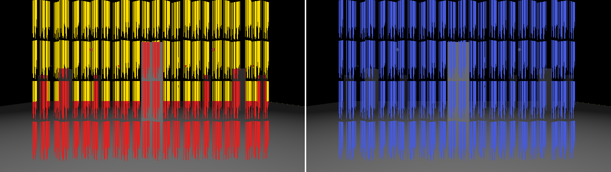
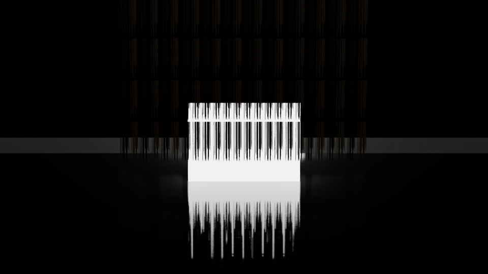
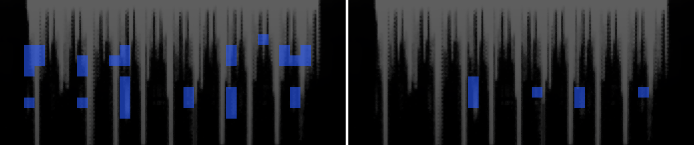
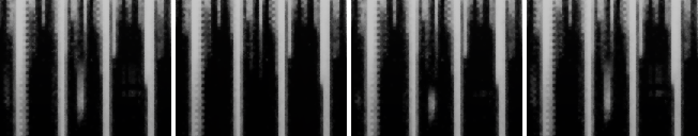
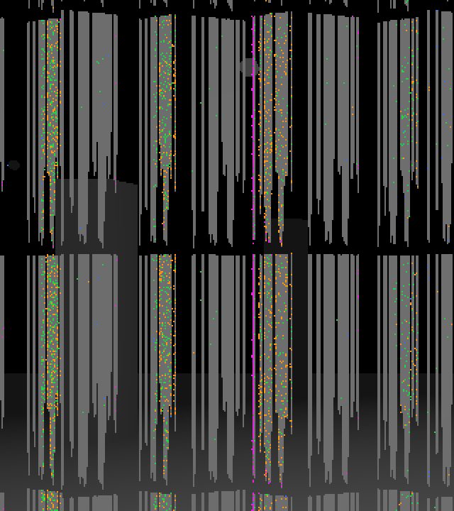

# Stage 2: the borrowed back face and the sheet census

This record holds the experiment of ticket `t1-yy2f`, the borrowed back face. Its part 3 is the census of ticket `t1-i54g`. The ticket's section "Design of the experiment (stage 2, 2026-11-15)" defines the three parts. The probe is a throwaway build on top of the census probe of stage 1b ([../stage-1b/pictures.md](../stage-1b/pictures.md)).

Each section gives the measured facts first. A paragraph that starts with "Reading:" holds my interpretation.

## Terms

- The back share of a pixel is its front distance divided by its back distance. A share of 0 means that the pixel has no back face.
- A sheet is a surface pixel whose slab has no thickness. Under the pass of part 1, a pixel with a share of exactly 1 is also a sheet: its own fragment ends its slab.
- The borrowed back face is the misbehavior of stage 1b. A card pixel that the pass does not draw takes the back face of the solid behind it.
- A real hit is a hit of class 1 in the census. Its ray crosses the hit pixel's plane ahead of its start, where the eye sees a surface within 2 %.
- A crossing behind the start is a hit of class 3 with reason 2. The ray meets the hit pixel's plane only behind its own start.
- The plane span of a pixel is the depth that its surface plane covers over a square footprint of half-width a pixels.
- The 10 % rule, `layer` and `layer/plane` are the probe modes of stage 1b ([../stage-1b/probe.md](../stage-1b/probe.md)).

## Summary

- Part 1: the pass of Design 1 removes the borrowed back face. In the lamp hall, all 139,646 hair pixels hold their own fragment, a share of 1. Under the pass of stage 1b, 59,188 of them borrowed a back face with a median slab of 4.10 m.
- Part 1: no demo scene that a script renders holds an open one-sided opaque mesh. Five meshes are closed only because the test pairs edges by count. Without that, the station's spokes, chute, chute brake, body and the ship are open.
- Part 2: under `layer` with the new pass, no reflection hit on a card has its crossing behind the start in either view. The lamp hall's hits with the crossing behind the start fall from 817,466 to 1,525.
- Part 3: the sheet rules lose real hits. In the lamp hall, no thickness keeps 31.7 % of the reflection hits that land on the card that the crossing shows. The plane span keeps 58.8 % with a = 0.5 and 89.0 % with a = 1.5.
- Part 2: in `cards-glow`, the still under the new pass differs from the 10 % rule in 7 tiles of 16 pixels. The pass of 1b differs in 31. All lie in the floor's reflection of the curtain.
- Part 3: 42 % to 44 % of the lost hits in the lamp hall cross another surface than the hit pixel's card. Reading: those are no hits of the visible face, and the 10 % rule keeps them falsely.
- Part 3: a fourth rule, the plane's bounds on both sides of the pixel, keeps 75.8 % of the lamp hall's reflection hits on the visible card. It lies between a = 0.5 and a = 1.5 in kept hits and in false hits.

## Part 1: the pass draws what Design 1 says

### What I built

The probe's back-face pass has a second rule, selected by the environment variable `TERTIUS_BACK_FACE_PASS=cards`. The default `1b` keeps the pass of stage 1b. I built the ticket's second approach: no face culled, and a fragment shader that drops the front faces of closed one-sided instances. It has two pipelines only because solid and cutout runs need different shaders. A flag per instance tells the fragment shader whether the mesh is a closed one-sided solid. So every closed one-sided mesh draws its front faces too, and the shader discards them.

| Run | Pipeline | Flag `ProbeBackFacesOnly` | Fragments that count |
|---|---|---|---|
| One-sided solid, closed mesh | `cardsSolid` | 1 | Back faces behind the front |
| One-sided cutout, closed mesh | `cardsCutout` | 1 | Back faces behind the front where the texture is opaque |
| Two-sided, solid or cutout | `cardsSolid` or `cardsCutout` | 0 | Both faces at or behind the front |
| One-sided, open mesh | as its material | 0 | Both faces at or behind the front |

The fragment rule, from `back_face_cards.glsl`:

```glsl
const float BehindShare = 1e-4;
...
    float back = length(position - draw.eye.xyz);
    float front = texelFetch(gbufferDistance, ivec2(gl_FragCoord.xy), 0).r;
    if (front <= 0.0)
        discard;
    if (backFacesOnly != 0u)
    {
        if (gl_FrontFacing || back <= front * (1.0 + BehindShare))
            discard;
        outDistance = front / back;
        return;
    }
    if (back < front * (1.0 - BehindShare))
        discard;
    outDistance = back <= front * (1.0 + BehindShare) ? 1.0 : front / back;
```

where

- `back` = the fragment's distance from the eye, in meters.
- `front` = the G-buffer's distance at the pixel, in meters. A value of 0 or less marks the sky.
- `BehindShare` = the tolerance, as a fraction of `front`, within which a fragment counts as the front itself.
- `backFacesOnly` = the instance's flag: the mesh is closed and one-sided.
- `outDistance` = the back share that the pass stores. The pass's depth test keeps the nearest fragment that is not discarded.

A fragment at the front's own distance writes a share of exactly 1. The finest level of the pyramid then stores the back w equal to the center w. `slabBack` treats a share of 1 like a share of 0.

One owner holds whether a mesh is closed. `MeshClosure.IsClosed(indices, positions)` runs once at upload, in `StagedMesh.Of`. `GeometryStore` copies the flag into the mesh record. `SceneBatcher` sets the instance flag from it and the material's `TwoSided`.

```csharp
ProbeBackFacesOnly = meshes[instance.Mesh].Closed && !instance.TwoSided ? 1u : 0u,
```

### The closed-mesh test

The test welds positions before it pairs edges. It quantizes each position to a grid of the mesh's extent times 2^−20. It skips triangles with two equal welded corners. Then it counts each directed edge and its reverse. In a closed mesh, the mesh has a triangle and the two counts are equal for every edge.

| Check mesh | Closed | Welded positions | Triangles used | Unpaired edges |
|---|---|---:|---:|---:|
| Box, 24 vertices | Yes | 8 | 12 of 12 | 0 |
| Single quad | No | 4 | 2 of 2 | 4 |
| Box less one face | No | 8 | 10 of 10 | 4 |
| UV sphere, 1,225 vertices | Yes | 1,106 | 2,208 of 2,304 | 0 |

- Exact equality of positions called the UV spheres open: the lamps, the earth, the moon and the sun. Float noise at the poles split their vertices. The weld fixed that.
- The sphere's 96 skipped triangles are the degenerate triangles at the poles.
- The ticket's term says "exactly two triangles" per edge. Some demo meshes have edges that four triangles share, in pairs of opposite winding. The pairing rule calls them closed, and the strict rule calls them open. I chose the pairing rule, because each such mesh bounds a solid volume. The census lists them.

### The census of open meshes

`Tertius.Demo --probe-meshes scripts <report>` builds every scene that a script in `scripts/` renders. It lists the one-sided opaque meshes that the test calls open. The report is [meshes.txt](meshes.txt): 45 scenes from 66 scripts.

| Result | Count |
|---|---:|
| Scenes with an open one-sided opaque mesh | 0 |
| Distinct meshes closed only by the pairing rule | 5 |

The five meshes are `station-spokes` (32 shared directed edges), `station-chute`, `station-chute-brake`, `station` (4 each) and `ship` (4). They occur in `demo-exit`, `demo-surface`, `earth-system`, `station`, `orbit`, `orbit-cluster` and `weightless-push`.

Not counted: meshes that a scene spawns at run time after its build, and scenes that no script renders.

### What the pass stores on card pixels

The dump writes the back share and the shading model of one draw, on the Mac at 848 by 480. I compare the pass of stage 1b with the new pass on the same frame.

| View | Pass | Hair pixels with share 0 | Hair pixels with a borrowed back face | Hair pixels with share 1 | Other pixels with share 0 |
|---|---|---:|---:|---:|---:|
| Lamp hall, `hair-one.json` | 1b | 80,458 | 59,188, median 4.10 m | 0 | 7 |
| Lamp hall | cards | 0 | 0 | 139,646 | 7 |
| `skin-and-hair`, `skin-one.json` | 1b | 4,000 | 0 | 0 | 2 |
| `skin-and-hair` | cards | 0 | 0 | 4,000 | 2 |
| `cards-glow`, `cards-glow-one.json` | 1b | 45,497 | 12,807, median 1.27 m | 0 | 0 |
| `cards-glow` | cards | 0 | 0 | 58,304 | 0 |

- In `skin-and-hair`, every hair pixel lies against the sky. So the hair pixels are sheets under both passes.
- The lamp hall dump holds 0 instances whose mesh is open.

[cards-share-lamp-hall.png](cards-share-lamp-hall.png) shows the lamp hall's dump under both passes. Left is 1b, right is cards. Yellow marks share 0, red a hair pixel with a borrowed back face, blue share 1. Gray is a pixel with its own back face, darker farther.



### A fault that I fixed: the main view's mip bias

The first build left 4,207 near hair pixels without their own fragment. The cutout pipeline of the pass sampled the texture without the main view's mip bias. The G-buffer pass samples with it, so its alpha test let more texels pass. After I set `MainView = true` on the cutout pipeline, all 139,646 hair pixels hold a share of 1. A tolerance of 1e-2 instead of 1e-4 changed nothing. An `invariant gl_Position` changed nothing.

Reading: the real pass must test alpha exactly as the G-buffer pass does, with the same mip bias. Else a pixel near a strand's edge falls through to the next surface.

## Part 2: a bright object behind hair cards

### The view `cards-glow`

`DemoScenes.CardsGlow.cs` builds the scene. A curtain of 4 by 24 cutout cards faces the camera. Its middle stands 0.75 m above a mirror plate. A glowing box of half extents 0.5, 0.35 and 0.05 m stands 1.2 m behind the curtain. The plate is a box of half extents 4, 0.01 and 4 m, with roughness 0.05. The camera `curtain-camera` stands at (0, 0.55, 2.2) and looks at (0, 0.45, 0).

### The sheet census

Each run counts the draws 16 to 47 at 1280 by 720. Even draws count the reflection rays and odd draws the diffuse rays. `cards_report.py` counts the files.

| View | Rule | Reflection hits | Crossing behind the start | Diffuse hits | Crossing behind the start | Sheets per surface pixel |
|---|---|---:|---:|---:|---:|---:|
| Lamp hall | 10 % rule | 74,176 | 4,448 | 61,879 | 12,709 | 28.9 % |
| Lamp hall | `layer`, pass of 1b | 860,419 | 817,466 | 466,835 | 436,114 | 28.9 % |
| Lamp hall | `layer`, pass of part 1 | 58,828 | 1,525 | 22,516 | 1,395 | 50.4 % |
| `cards-glow` | 10 % rule | 321,091 | 1,963 | 262,629 | 16,001 | 17.0 % |
| `cards-glow` | `layer`, pass of 1b | 703,996 | 203,319 | 441,049 | 211,383 | 17.0 % |
| `cards-glow` | `layer`, pass of part 1 | 248,713 | 1,423 | 165,963 | 1,159 | 21.9 % |

The hits on sheets alone. Both rows of a view count the same sheets: the pixels that are sheets under the pass of part 1, which include every card pixel. The 10 % rule's rows come from the runs `rules`, which use the pass of part 1 for the sheet mark only.

| View | Rule | Reflection hits on sheets | Of class 1 | Crossing behind the start | Diffuse hits on sheets | Of class 1 | Crossing behind the start |
|---|---|---:|---:|---:|---:|---:|---:|
| Lamp hall | 10 % rule | 11,280 | 4,393 | 2,451 | 41,318 | 16,698 | 10,095 |
| Lamp hall | `layer`, pass of part 1 | 1,400 | 1,185 | 0 | 4,936 | 4,146 | 6 |
| `cards-glow` | 10 % rule | 87,904 | 18,172 | 613 | 127,116 | 41,146 | 14,014 |
| `cards-glow` | `layer`, pass of part 1 | 17,365 | 15,682 | 0 | 31,258 | 27,749 | 2 |

- Two lamp hall rows equal those of stage 1b's job `b5311dd8`, hit for hit. They are the 10 % rule and `layer` with the pass of 1b.
- The 10 % rule's hit counts do not depend on the pass. Its runs under both passes give equal hits.
- Under the pass of part 1, the sheets also count the card pixels in front of the floor. So the share of sheets rises from 28.9 % to 50.4 % in the lamp hall.
- Under `layer` with the pass of part 1, no reflection hit on a sheet has its crossing behind the start. 8 diffuse hits do: 6 in the lamp hall and 2 in `cards-glow`.
- I did not look at those 8 diffuse hits. The census counts them only in sums. So the ticket's acceptance criterion holds for the reflection rays, and it stays open for 8 of 36,194 diffuse hits on sheets.
- Every card pixel is a sheet under the pass of part 1. So the other hits with the crossing behind the start in the table above are not on cards.

Reading: the borrowed back face caused the hits with the crossing behind the start in stage 1b. The pass of part 1 removes them on the cards. The rest is the base rate of solid surfaces, as `demo-meshes` showed in stage 1b.

### The stills

The job `20b546ce` rendered 240 draws of `stills-cards-glow.json` at 1920 by 1080, without bloom. All three columns use the stops of frame 239 under the 10 % rule, −11.056582. The first stills job measured those stops. `regions.py` of stage 1b compares each column with the 10 % rule in tiles of 16 pixels. Its noise floor is the largest tile difference between the frames 231 and 239 of the 10 % rule.

| Column | Mean absolute luminance difference (1/255) | Tiles above the noise floor of 10.59 | Largest tile difference |
|---|---:|---:|---:|
| Noise pair, the 10 % rule at frames 231 and 239 | 0.293 | | 10.59 |
| `layer`, pass of 1b | 0.465 | 31 darker, 0 brighter | −52.24 |
| `layer`, pass of part 1 | 0.283 | 7 darker, 0 brighter | −36.97 |

[cards-glow-view.png](cards-glow-view.png) shows the whole view under the 10 % rule at half size. The glowing box shows through the curtain, and the floor reflects both.



[cards-glow-regions.png](cards-glow-regions.png) shows where the columns differ, on the floor's reflection below the curtain. Left is `layer` with the pass of 1b, right is `layer` with the pass of part 1. Blue marks a tile that is darker than under the 10 % rule. The crop is x 700 to 1220 and y 780 to 1000.



[cards-glow-floor.png](cards-glow-floor.png) zooms x 816 to 976 and y 848 to 976 three times. The first column is the 10 % rule. Then come `layer` with the pass of 1b and `layer` with the pass of part 1. The last column is the 10 % rule at frame 231.



- All differences lie in the floor's reflection of the curtain's lower edge. The glowing box shows there between the strands.
- Under the 10 % rule, a gray streak lies in one dark gap between two reflected strands, at about x 890. The frame 231 shows it too.
- Under `layer` with the pass of 1b, the gap is dark. Under the pass of part 1, a shorter gray patch lies lower in the same gap.
- The cards themselves, the glowing box and the floor beside the curtain show no tile above the noise floor.
- The mean luminance of the zoomed box is 59.7 under the 10 % rule. It is 54.3 under `layer` with the pass of 1b and 57.7 under the pass of part 1.

Reading: the pass of part 1 brings the floor's reflection back near the 10 % rule. Its 7 darker tiles lie in the same gaps as 7 of the 31 tiles of the pass of 1b. I cannot say which column is right in those gaps, because I made no reference image. A reflection reference of this view can settle it.

The lamp hall's still under `layer` with the pass of part 1 came from the same job, at the stops of stage 1b, 5.4094524. I compared it with the pack of stage 1b's job `fc9145da`, an earlier job.

| Column against the 10 % rule of stage 1b | Mean absolute luminance difference | Tiles above the noise floor of 3.72 |
|---|---:|---:|
| `layer`, pass of 1b, stage 1b | 0.203 | 8 darker |
| `layer`, pass of part 1 | 0.169 | 0 |

Reading: in the lamp hall, the hit light and the miss light behind the cards are alike, as stage 1b found. So the still shows no effect of the pass.

## Part 3: the real hits that a sheet rule loses, by reason

### How the census records them

Under `TERTIUS_PROBE_SHEET_RULES=1`, the resolve pass walks each 10 % rule hit on a sheet again under each sheet rule. It writes one record of 16 words per traced ray into `records.bin`. The record holds the hit pixel, the crossing's place, the slab and the plane's gradient. It also holds the angle, the light, the cards at the start and the hit, and each rule's outcome. `sheet_rules.py` reads the records. A rule keeps a hit in one case: its walk again gives a real hit.

The finest level marks a sheet by a negative back w, under the specialization constant `probeSheetMark`. The marked pyramid gives the same 10 % rule hits as an unmarked one: the census files are equal.

The four sheet rules, all at the finest level of the pyramid:

| Rule | Back w of a sheet |
|---|---|
| 1, no thickness | the center w |
| 2, plane span, a = 0.5 | `min(w, pixelBounds.y)`, the stage 1b rule `layer/plane` |
| 3, plane span, a = 1.5 | `min(w, w - 1.5 * (abs(gx) + abs(gy)))` |
| 4, the plane's bounds | front at `pixelBounds.x` and back at `pixelBounds.y`, from the pixel's square |

where

- `w` = the center w of the finest level at that pixel, in meters along the view axis.
- `gx`, `gy` = the change of the plane's w per pixel along x and y.
- `pixelBounds` = the nearest and farthest w of the pixel's plane over its own square, a = 0.5.

Rule 4 is mine. It moves both ends of the slab, not only the back.

All four rules act at the finest level only. The coarser levels keep the 10 % rule's slab of the run, which holds every sheet rule's slab. So the walk descends into cells that a real layer pyramid can skip. Rules 3 and 4 move a sheet's slab past the plane's bounds over the pixel's square, which level 1 stores. A real build of either rule must widen level 1 too, or it breaks the invariant of stage 1b's control 4: each cell's slab holds the slab of every pixel under it. Reading: such a build can keep fewer hits than the probe.

### A fault in the first records

The first census job `0c0f0ac7` and the rules job `af537b80` wrote stale records. The resolve pass cleared a pixel's record only after its early return for the sky. A pixel that turned into sky kept the record of an earlier draw, and the renderer appended that record again in each later draw. The reviewer found it: in the Mac run of the lamp hall, 6,066 of 60,736 records had a ray kind that did not match their draw.

The fix clears the record before the early return. The rules job `a03383d4` ran again on the fixed probe. Its records equal its census files, and every table of part 3 comes from it. The stale records had raised the real hits on sheets by 2 % to 19 %. In the lamp hall and `cards-glow`, the shares that each rule keeps moved by at most 1.3 points. In `skin-and-hair`, with few hits, they moved by up to 3.3 points.

### The reasons

`sheet_rules.py` gives each lost hit one reason, in this order:

1. Reason 4: the crossing's place shows another card or surface than the hit pixel's card. This is not the ticket's candidate 4, a crossing in a cutout gap. Such a crossing is class 0, an opening, so it is never a lost real hit. I used the number 4 for the nearest case that the records can name.
2. Reason 5: the crossing's place lies off screen.
3. Reason 1: the crossing lies inside the hit pixel, by Chebyshev distance 0.
4. Reason 2: the crossing lies one pixel before the hit pixel.
5. Reason 3: the crossing lies two or more pixels before the hit pixel.

### Measured: what each rule keeps

These numbers come from the rules job `a03383d4`, draws 16 to 47. The first census job wrote stale records, which the section "A fault in the first records" describes. In this job, the records count the same hits on sheets as the census file of each run. No record has the wrong ray kind for its draw.

Real hits on sheets under the 10 % rule, split by whether the crossing shows the hit pixel's own card. Each rule's column gives the share of those hits that it keeps.

| View | Kind | Real hits, crossing on the hit pixel's card | No thickness | a = 0.5 | a = 1.5 | Rule 4 | Real hits, crossing on another surface | Kept by a = 1.5 | Kept by rule 4 |
|---|---|---:|---:|---:|---:|---:|---:|---:|---:|
| Lamp hall | Reflection | 2,859 | 31.7 % | 58.8 % | 89.0 % | 75.8 % | 1,534 | 3.0 % | 1.0 % |
| Lamp hall | Diffuse | 11,040 | 28.3 % | 56.7 % | 85.9 % | 71.4 % | 5,658 | 2.0 % | 0.3 % |
| `cards-glow` | Reflection | 17,889 | 86.4 % | 90.1 % | 93.0 % | 91.5 % | 283 | 3.5 % | 1.8 % |
| `cards-glow` | Diffuse | 37,970 | 71.9 % | 83.1 % | 92.9 % | 87.8 % | 3,176 | 0.6 % | 0.7 % |
| `skin-and-hair` | Reflection | 119 | 38.7 % | 75.6 % | 93.3 % | 80.7 % | 73 | 69.9 % | 61.6 % |
| `skin-and-hair` | Diffuse | 234 | 44.0 % | 76.9 % | 92.7 % | 88.9 % | 211 | 75.8 % | 62.6 % |

The false hits that each rule keeps. Class 0 is an opening: the eye sees no surface within 2 % at the crossing.

| View | Kind | Class 0 hits of the 10 % rule | No thickness | a = 0.5 | a = 1.5 | Rule 4 |
|---|---|---:|---:|---:|---:|---:|
| Lamp hall | Reflection | 4,399 | 373 | 484 | 1,396 | 565 |
| Lamp hall | Diffuse | 14,482 | 1,224 | 1,543 | 5,155 | 1,886 |
| `cards-glow` | Reflection | 69,119 | 1,708 | 1,803 | 2,515 | 1,848 |
| `cards-glow` | Diffuse | 71,945 | 3,769 | 4,464 | 9,040 | 5,051 |

Reading: rule 4 lies between a = 0.5 and a = 1.5 in two counts. They are the hits that it keeps on the visible card and the class 0 hits that it keeps. In the lamp hall, it keeps about 40 % of the class 0 hits that a = 1.5 keeps.

### Measured: the lost hits of no thickness by reason

The columns "Kept by" count the lost hits of no thickness that each other rule keeps.

Lamp hall, reflection, 3,484 lost real hits:

| Reason | Lost hits | Share | Share of light | Depth into the slab, 25/50/75 % (spans) | Angle to the plane, median | Start on a card | Kept by a = 0.5 | Kept by a = 1.5 | Kept by rule 4 |
|---|---:|---:|---:|---|---:|---:|---:|---:|---:|
| 1, inside the hit pixel | 160 | 4.6 % | 6.4 % | 0.21 / 0.53 / 1.01 | 22.2° | 99.4 % | 96 | 160 | 124 |
| 2, one pixel before | 943 | 27.1 % | 34.0 % | 0.45 / 0.89 / 1.40 | 22.7° | 100 % | 520 | 943 | 904 |
| 3, two or more pixels before | 849 | 24.4 % | 21.7 % | 0.93 / 1.88 / 3.82 | 13.5° | 100 % | 158 | 534 | 274 |
| 4, another surface at the crossing | 1,532 | 44.0 % | 38.0 % | 16.7 / 27.9 / 38.1 | 21.0° | 100 % | 6 | 44 | 13 |
| 5, off screen | 0 | | | | | | | | |

Lamp hall, diffuse, 13,564 lost real hits:

| Reason | Lost hits | Share | Share of light | Depth, 25/50/75 % (spans) | Angle, median | Start on a card | Kept by a = 0.5 | Kept by a = 1.5 | Kept by rule 4 |
|---|---:|---:|---:|---|---:|---:|---:|---:|---:|
| 1 | 132 | 1.0 % | 0.4 % | 0.05 / 0.20 / 0.43 | 18.1° | 100 % | 89 | 132 | 90 |
| 2 | 3,351 | 24.7 % | 28.0 % | 0.31 / 0.63 / 1.04 | 20.6° | 100 % | 2,437 | 3,351 | 3,252 |
| 3 | 4,430 | 32.7 % | 41.0 % | 1.20 / 1.91 / 3.84 | 17.3° | 100 % | 611 | 2,874 | 1,621 |
| 4 | 5,651 | 41.7 % | 30.6 % | 13.2 / 23.9 / 31.9 | 21.3° | 100 % | 7 | 108 | 9 |

`cards-glow`, reflection, 2,715 lost real hits:

| Reason | Lost hits | Share | Share of light | Depth, 25/50/75 % (spans) | Angle, median | Start on a card | Kept by a = 0.5 | Kept by a = 1.5 | Kept by rule 4 |
|---|---:|---:|---:|---|---:|---:|---:|---:|---:|
| 1 | 357 | 13.1 % | 14.8 % | 0.11 / 0.21 / 1.09 | 58.0° | 23.5 % | 165 | 320 | 208 |
| 2 | 725 | 26.7 % | 30.7 % | 0.15 / 0.52 / 1.08 | 26.4° | 64.7 % | 482 | 672 | 640 |
| 3 | 1,354 | 49.9 % | 45.3 % | 6.33 / 68.6 / 174 | 53.9° | 28.2 % | 26 | 190 | 86 |
| 4 | 279 | 10.3 % | 9.2 % | 19.6 / 29.2 / 40.9 | 20.0° | 100 % | 2 | 6 | 2 |

`cards-glow`, diffuse, 13,852 lost real hits:

| Reason | Lost hits | Share | Share of light | Depth, 25/50/75 % (spans) | Angle, median | Start on a card | Kept by a = 0.5 | Kept by a = 1.5 | Kept by rule 4 |
|---|---:|---:|---:|---|---:|---:|---:|---:|---:|
| 1 | 2,927 | 21.1 % | 15.9 % | 0.12 / 0.36 / 0.98 | 33.9° | 2.3 % | 1,661 | 2,872 | 2,086 |
| 2 | 4,334 | 31.3 % | 37.3 % | 0.20 / 0.76 / 1.34 | 30.0° | 17.6 % | 2,399 | 4,117 | 3,697 |
| 3 | 3,416 | 24.7 % | 35.4 % | 2.53 / 5.92 / 13.0 | 26.5° | 36.6 % | 236 | 994 | 531 |
| 4 | 3,175 | 22.9 % | 11.4 % | 28.4 / 51.1 / 82.8 | 22.1° | 13.1 % | 1 | 18 | 21 |

- `skin-and-hair` loses 130 reflection and 287 diffuse real hits. The share of reason 4 there is 43.8 % and 54.4 %. Its hits of reason 4 lie at a median depth of 2.1 to 2.2 spans, against 24 to 28 in the lamp hall.
- The light is the luminance of the hit's light times its fade, summed. Its share is the share of the lost hits' sum.
- A check of the records: some lost hits have a ray that does not stay behind the center w across the hit cell. Per view and ray kind, they are at most 3.8 %.

[lost-hits-lamp-hall.png](lost-hits-lamp-hall.png) shows where the lost real hits of no thickness land in the lamp hall. It comes from a Mac run of the fixed probe, with the same checks. It crops x 210 to 530, y 160 to 520, at twice the size. Gray is the front distance. Each hit pixel takes the color of most of its lost hits: blue reason 1, green 2, orange 3, magenta 4.



- The lost hits cluster on a few cards, not on all cards. I did not find out why.
- Most of the magenta is one column of pixels along a card edge, at render x 388. There the crossing falls on the next card or the floor.

### Reading: is each reason a hit of the visible face

| Reason | A hit of the visible face | Why |
|---|---|---|
| 1, inside the hit pixel | Yes | The ray crosses the card's plane inside the pixel that shows the card. |
| 2, one pixel before | Yes | The crossing lies on the same card, one pixel away. |
| 3, two or more pixels before | Yes | The crossing shows the same card. In the lamp hall, the ray meets the card at a median of 13° to 17°. |
| 4, another surface at the crossing | No | The eye sees another card or the floor at the crossing. The 10 % slab catches the ray behind the hit pixel's card. |
| 5, off screen | No case | None of the views had one. |

Reading: in the lamp hall, the cause of reasons 1 to 3 is the flat center w of the finest level. A sheet's slab is the single w of the pixel's center. A ray whose crossing lies a pixel away passes that w outside the cell, so the walk misses it. This is the stair case of ticket `t1-n8x9`, spread across neighbors. There, reasons 2 and 3 lie at a median depth of 0.9 to 1.9 spans, and a = 1.5 keeps all hits of reason 2.

In `cards-glow`, I do not know the cause of reason 3. It is the largest reason of the reflection rays there: 49.9 % of the lost hits and 45.3 % of their light. Those rays meet the card at a median of 53.9°, and they lie a median of 68.6 spans behind the center w. 71.8 % of them start on another surface than a card. Neither the stair case nor a ray along the card's plane fits these numbers.

Reading: reason 4 losses are correct losses. The 10 % rule finds them only because its thick slab catches a ray that passes behind the card. A sheet rule lets that ray go on to what the eye sees through the gap.

The ticket states reason 1 as a crossing "in the half where the plane is nearer than the center". In the lamp hall, 140 of 160 reflection crossings of reason 1 lie in the other half, where the plane is farther than the center. In `cards-glow`, only 207 of 357 do.

Reading: in the lamp hall, the loss of reason 1 lies mostly in the farther half. A ray that crosses the plane there passes behind the center w inside the cell. I cannot explain the 150 lost crossings of `cards-glow` in the nearer half.

## Commands and refs

The scratch commits hold the probe on top of `refs/scratch/ter-kh4g-1b-sill-census-ahead`. [probe-cards.patch](probe-cards.patch) is the diff of `ter-kh4g-2-cards-fix` against that base.

| Ref | Commit | Holds |
|---|---|---|
| `refs/scratch/ter-kh4g-2-cards-census` | `a5c72ba5` | The pass, the census and part 3's records with rules 1 to 3 |
| `refs/scratch/ter-kh4g-2-cards` | `3c57be59` | Also the stills scripts and a control against the census tree of stage 1b |
| `refs/scratch/ter-kh4g-2-cards-rules` | `86a05188` | Also rule 4, a control of run to run, and stills at fixed stops |
| `refs/scratch/ter-kh4g-2-cards-fix` | `66dae25e` | Also the record cleared before the sky's early return, and the record controls |

The cloud jobs, all through `tools/runpod/gpu_job.py submit` with `--tree t=<ref>`:

| Job | Ref | Command | Estimated cost |
|---|---|---|---:|
| `0c0f0ac7` | `ter-kh4g-2-cards-census` | `bash t/tools/bf1b/job-cards.sh census` | $0.0502 |
| `6e81457d` | `ter-kh4g-2-cards` | `bash t/tools/bf1b/job-cards.sh stills`, ran out of time at 840 s | $0.1468 |
| `20b546ce` | `ter-kh4g-2-cards-rules` | `bash t/tools/bf1b/job-cards.sh stills` | $0.1145 |
| `af537b80` | `ter-kh4g-2-cards-rules` | `bash t/tools/bf1b/job-cards.sh rules`, stale records | $0.0383 |
| `a03383d4` | `ter-kh4g-2-cards-fix` | `bash t/tools/bf1b/job-cards.sh rules` | $0.0389 |
| Total | | | $0.3887 |

The Mac runs used a Release build of the export of each ref, with `tools/gpu-lock.sh --shared`:

```
dotnet build src/Tertius.Demo -c Release -nologo -v:q -p:RunAnalyzers=false -p:TreatWarningsAsErrors=false -o <bin>
TERTIUS_BACK_FACE_PASS=cards TERTIUS_BACK_FACE_PROBE=ten TERTIUS_PROBE_SHEET_CENSUS=1 TERTIUS_PROBE_SHEET_RULES=1 \
  TERTIUS_PROBE_CENSUS_OUT=<out> TERTIUS_PROBE_CENSUS_FROM=16 TERTIUS_PROBE_CENSUS_TO=48 \
  <bin>/Tertius.Demo --script tools/bf1b/census-cards-glow.json --headless --out <out>/run --bloom off --video none
<bin>/Tertius.Demo --probe-meshes scripts meshes.txt
python3 -I tools/sheet_rules.py <census folder> ...
python3 -I tools/lost_map.py lost-hits-lamp-hall.png 210 160 530 520 <census folder>
python3 -I tools/share_map.py <png> <dump folder of 1b> <dump folder of cards>
```

The tools of this folder:

| File | What it does |
|---|---|
| [tools/job-cards.sh](tools/job-cards.sh) | The cloud job: parts `census`, `stills` and `rules` |
| [tools/sheet_rules.py](tools/sheet_rules.py) | Part 3's tables from `records.bin` |
| [tools/cards_report.py](tools/cards_report.py) | Part 2's counts from `census.txt` |
| [tools/share_map.py](tools/share_map.py) | The map of back shares |
| [tools/lost_map.py](tools/lost_map.py) | The map of lost hits by reason |
| [tools/scratch-ref.sh](tools/scratch-ref.sh) | A scratch commit of an exported tree |

## Controls

- With `TERTIUS_BACK_FACE_PASS` unset, the probe gives the census files and maps of stage 1b byte for byte on the Mac. It also gives the same hair still as the binary of stage 1b.
- The 10 % rule gives equal census files under both passes.
- The sheet census gives equal files with and without `TERTIUS_PROBE_SHEET_RULES`.
- Job `6e81457d` ran the census tree of stage 1b and this tree in one job, on one worker. It ran the lamp hall under `layer` with the pass of 1b. All eight maps were equal byte for byte: the hits per pixel, the sheets and the distances.
- In that job, one census sample of 3.6 million reflection rays moved from class 0 to class 1, on a solid pixel. The census job `0c0f0ac7` showed the same against job `b5311dd8`.
- The rules jobs `af537b80` and `a03383d4` each ran this tree's census of the same view twice. Both runs gave equal census files and maps. Their census equals that of tree t in job `6e81457d`.
- In job `a03383d4`, the records of each run count the same hits on sheets and the same real hits as its census file. No record has a ray kind that differs from its draw's parity. `sheet_rules.py` prints both checks.
- The census files of the rules runs in jobs `0c0f0ac7` and `a03383d4` are equal, except for the count of records.

Reading: the moved sample comes from the build of the probe, not from run-to-run noise. The probe changes the shader code of the census, and the compiler can then round one sum differently. One sample of 3.6 million does not change a count in this record.

## What I did not check

- Meshes that a scene spawns at run time, and scenes that no script renders.
- A two-sided card that lies exactly on another surface. Both faces then give a share near 1, and the tolerance decides.
- The pixels between the hit pixel and a crossing of reason 3. I did not test whether a rule that reads the neighbors' w keeps those hits.
- The 8 diffuse hits on sheets with the crossing behind the start under the new pass.
- No run happened on RADV, ANV or lavapipe. The runs used MoltenVK on the Mac and the cloud's RTX 2000 Ada.
- The cost of the pass. Ticket `t1-kiaw` measures it.
- I did not try reasons other than the five. Reason 5 had no case.

## Notes for the design

This record does not change the design document. Both tickets' acceptance criteria need its text: the rule for a mesh that is not closed, and the chosen sheet rule.

- The real closed-mesh test needs a weld. Without it, every UV sphere is open.
- The ticket's term "exactly two triangles" calls five demo meshes open. The pairing rule calls them closed. The design must choose one.
- The cutout test of the pass must use the G-buffer's mip bias.
- The probe built the ticket's second approach: no face culled, and front faces of closed one-sided meshes dropped in the fragment shader. The batcher's runs have no key for a closed mesh. So the approach "more pipelines" also needs a new run key. Ticket `t1-kiaw` measures the choice.
- Rules a = 1.5 and 4 widen a sheet's slab past the plane's bounds. A real build of either must widen level 1 of the pyramid too.
- A two-sided or open surface behind the front of a closed solid can end that solid's slab under the new pass. In the dumps of the three views, the back share of no pixel that is not hair changed between the passes. That is 131,082, 164,065 and 201,685 pixels.
- The weld rounds positions to a grid. Two near positions can fall on the two sides of a grid line and stay apart. The real test needs a weld with a tolerance.
- Two coincident faces of opposite winding pass the pairing rule as closed. The pass then discards the back face as the front, so such a sheet borrows the back face behind it again. No demo scene was checked for this.
- The probe's `MeshInfo(..., bool Closed = false)` makes a forgotten flag mean "open". The real mesh record must make the field required.
- A fragment at the front's own distance needs its own share value. A share of 1 works as the mark, because `slabBack` already treats it as no back face.
