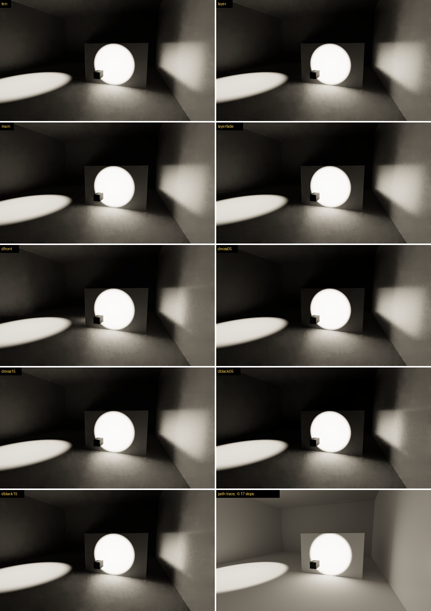
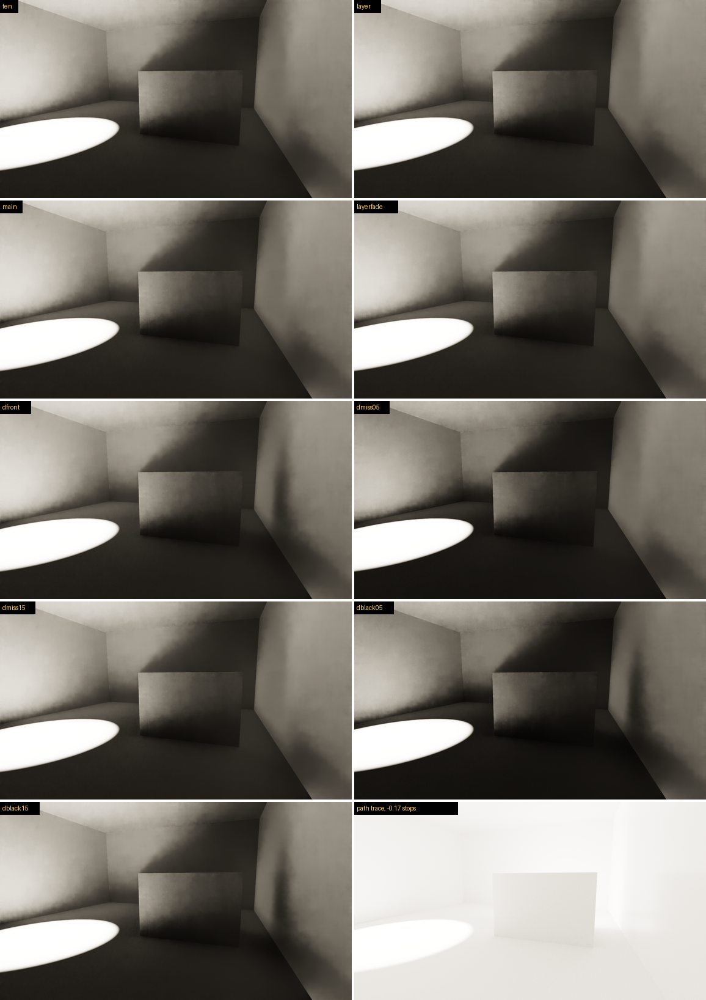
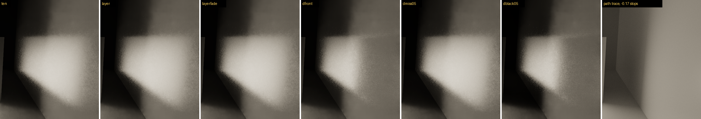
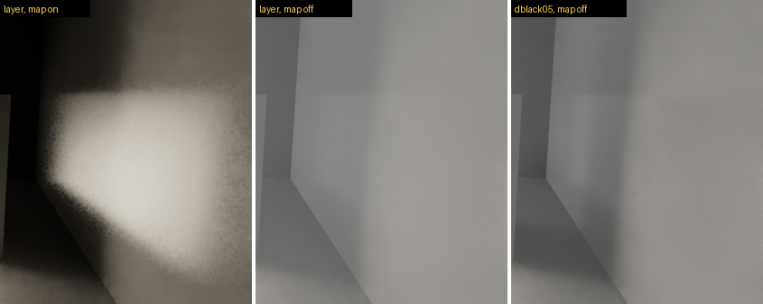
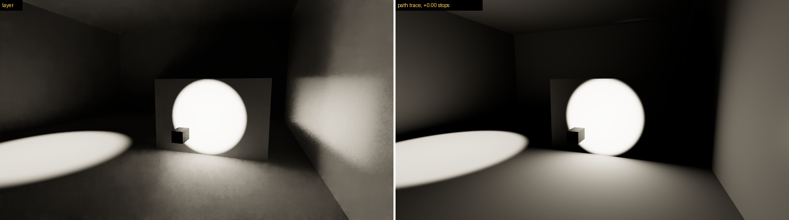
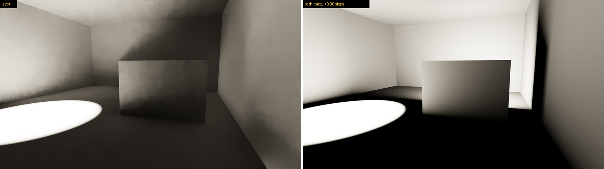
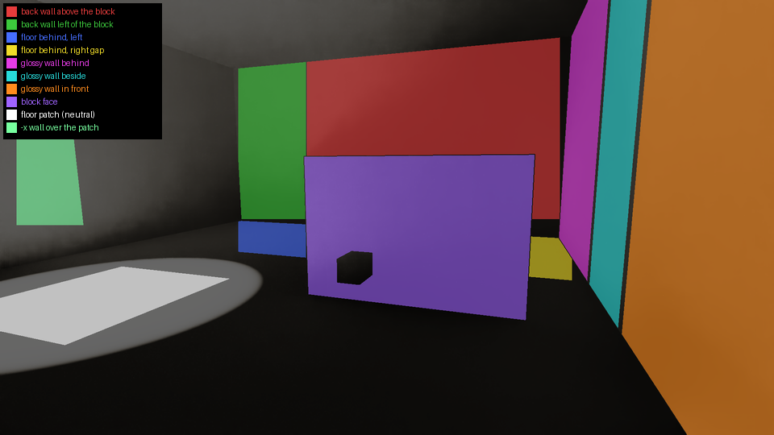

# The fade at a lit front and a dark back

This is the record of ticket `t1-r9vj`, of 2026-11-22. It tests the rule for the light of a blocked ray in a scene where the block's visible face and its hidden faces are lit very differently. The terms are those of [reference.md](reference.md), the record of the reference experiment.

A paragraph that starts with "Reading:" holds my interpretation. Every other sentence states a measurement, a count or what an image shows.

## The result in short

1. `main` does not agree with `layer` within the frame noise. In every receiver region of both views, main 906d1c260 is 0.4 % to 3 % brighter than the probe's `layer`. Two runs of each column gave byte-identical frames, and the change of a ratio from frame 231 to frame 239 is at most 0.9 %. So the difference is a difference of code: the probe's base lies 143 commits behind 906d1c260. An eye sees no difference between the two. Their difference image holds only 8-bit contour lines on the dark back wall.
2. No rule looks better than `layer` in either view. The eye sees the same picture in `ten`, `layer`, `main`, `layerfade` and `dmiss15`. `dfront`, `dblack05` and `dblack15` add a hard vertical step (lit front) or a dark stain (lit back) on the glossy wall. `dmiss05` and `dblack05` darken the room behind the block. So there is no fork for the user.
3. In the lit front, every column shows a bright trapezoid on the glossy wall beside and behind the block. The path trace shows an even wall there. With `--environment-map off`, the trapezoid is gone. Bug ticket `t2b-d2m6`.
4. In the lit back, every column loses the light of the hidden lit face. In `layer`, the receivers behind the block get 9 to 71 times less light than in the path trace, and up to 22 times less than in a path trace with one bounce. The rules change this light by at most a factor of 2.3, and the rules that change it most make it darker. Bug ticket `t2b-xeo7`.
5. No rule is nearer to the path trace than `layer` in every cell of all four views. In the reference experiment, `layer` was the nearest column on the cabin's pillar face at z −5.7 under full lights. In the regions behind the block, the columns differ from each other by at most a factor of 2.3, and from the path trace by a factor of 5 to 71. There the order of the columns does not rank the rules.
6. The engine's neutral floor patch reads 0.2222 W/(m²·sr). The path trace reads 0.2494 with all bounces and 0.2221 with one bounce.

Reading: the slab rule is not what this scene tests most. Both faults that an eye sees come from light that no rule of the slab controls: the environment map's view from the eye (lit front), and a lit face that neither the screen nor the map sees (lit back). The fade over the real slab neither causes them nor hides them.

All takes ran on the base 906d1c260, before the walk fix of `ter-186q` and `t53-eyrv` (main a819b10b2). The line orchestrator chose this, so that all columns share one code.

## The scene

The scene is a throwaway scene of the probe: [probe-lit-block.patch](probe-lit-block.patch), on the scratch ref `refs/scratch/t1-r9vj-lit-block`. It is a closed room with one block, with no sun, no Earth and no sky.

- The room is 8 m wide (x from −6 to 2 m), 10 m long (z from −4 to 6 m) and 4 m tall inside. Every slab is light gray (base color 0.7) with roughness 0.9. The wall at +X is the glossy receiver: the same gray with roughness 0.2.
- The block is 2.4 m wide, 1.6 m tall and 1.5 m deep, on the floor at the origin. A gap of 0.8 m lies between its +X face and the glossy wall.
- The camera stands at (1, 1.5, 4.5) m and looks toward (−0.8, 0.7, −1) m. It stands below the block's top (1.6 m), so the top face is hidden. It stands inside the plane of the block's +X face (x = 1.2 m), so that face is hidden too. The camera sees the block's +Z face only.
- Along a view ray to the +Z face, the camera is 3.8 to 4.6 m from the face. The block is 1.5 m deep, which is 33 % to 39 % of that distance. So the 10 % rule and the real slab differ.
- The key lamp is a spot lamp of 10 W with a shadow, an inner half-angle of 25° and an outer one of 30°. It stands 0.8 m above the floor and 1.4 m from the lit face, and it aims straight at that face's center. At the face, its cone has a radius of 0.81 m: it lights a disk of the face and ends on the face.
- The floor lamp is a spot lamp of 10 W with a shadow, with half-angles of 18° and 25°. It hangs 3.9 m above (−3.5, 1.5) m and aims straight down. It lights the neutral floor patch.

The two views have one camera and two places of the key lamp:

| View | Scene | Key lamp | The block's face toward the camera | The block's hidden faces |
|---|---|---|---|---|
| Lit front | `lit-block-front` | At (0, 0.8, 2.15) m, toward −Z | +Z, lit directly | −Z, ±X, top: bounce light only |
| Lit back | `lit-block-back` | At (0, 0.8, −2.15) m, toward +Z | +Z, bounce light only | −Z lit directly; ±X and top bounce light only |

### What lights each region

| Region | Lit front | Lit back |
|---|---|---|
| The block's +Z face (visible) | The key lamp directly, in a disk of 0.81 m radius; bounce elsewhere | Bounce only |
| The block's −Z face (hidden) | Bounce only | The key lamp directly |
| The block's ±X and top faces (hidden) | Bounce only | Bounce only |
| The back wall at z = −4 m, behind the block | Bounce only. It sees the dark −Z face 3.25 m away | Bounce only, most of it from the lit −Z face 3.25 m away |
| The floor and the −X wall behind the block, seen left of it | Bounce only | Bounce only, from the lit −Z face and the back wall |
| The glossy +X wall beside and behind the block | Bounce only: from the lit +Z face where z > 0.75 m, which sees that face, and from the room | Bounce only, from the lit −Z face where z < −0.75 m |
| The neutral floor patch at (−3.5, 1.5) m | The floor lamp directly | The floor lamp directly |

A receiver ray that meets the block's hidden faces lands, on the screen, inside the outline of the +Z face. So in the lit front, the hit pixel's light is the lit front's, and the true light is a dark face's. In the lit back, the hit pixel's light is the dark front's, and the true light of the −Z face is the key lamp's.

## The takes

Each column is frame 239 of a film of 240 frames at 1920 × 1080, with `--bloom off`, on the Mac (M1 Max, MoltenVK), under the shared GPU lock. Each view has one fixed exposure: the stops of frame 239 of an automatic-exposure run of `ten`. These are 2.6805701 stops for the lit front and 6.7897105 for the lit back. Each column also keeps frame 231, for its frame noise.

The columns are those of [reference.md](reference.md), "The columns", from the probe `refs/scratch/ter-kh4g-2-ref-controls` with the scene's patch, plus one more:

| Column | Binary | Hit light of a blocked ray |
|---|---|---|
| `ten` | Probe, mode `ten` | The 10 % rule |
| `layer` | Probe, mode `layer` | The fade over the real slab: the design |
| `main` | main 906d1c260 with the scene's patch, no probe | What main ships |
| `layerfade` | Probe, mode `layer+fade` | The fade over at most 10 % |
| `dfront` | Probe, mode `layer+known/front/0.5` | No fade by the entry share |
| `dmiss05`, `dmiss15` | Probe, `layer+known/miss/<a>` | The known-light rule with the miss light |
| `dblack05`, `dblack15` | Probe, `layer+known/black/<a>` | The known-light rule with black |

The load of the Mac stood between 4 and 52 during the takes, and no take measures time. Many runs waited for the GPU lock behind other lines' timing runs, up to 14 minutes each.

`main` against `layer`: the lit front's frames of two separate runs of `layer` are byte-identical, and so are those of two runs of `main`. The ratios of `main` are 0.4 % to 3 % above those of `layer` in every receiver region of both views. Each region's ratio changes by at most 0.9 % from frame 231 to frame 239.

## What the eye sees

Each sheet shows the columns side by side, then the path trace. The path trace is shown through the engine's tone curve at the exposure that gives its floor patch the luminance of `ten`'s floor patch in the lit front: −0.167 stops from the engine's.



[lit-front-sheet.png](lit-front-sheet.png), the lit front.

| Column | What an eye sees |
|---|---|
| `ten` | A dark room. The lit disk on the block. A bright trapezoid on the glossy wall right of the block, from the back corner forward, with a hard lower edge. |
| `layer` | The same as `ten`. |
| `main` | The same as `layer`. |
| `layerfade` | The same as `layer`. |
| `dfront` | The back wall and the floor left of the block a little lighter. A hard vertical step cuts the trapezoid: its near part is dimmer. |
| `dmiss05` | The same as `layer`, with a darker back wall. |
| `dmiss15` | The same as `layer`. |
| `dblack05` | A darker back wall. The trapezoid has the step of `dfront`. |
| `dblack15` | The trapezoid has the step of `dfront`. |
| Path trace | An evenly lit gray room. The glossy wall is even, with a soft change of tone and no trapezoid. |



[lit-back-sheet.png](lit-back-sheet.png), the lit back, at the same match.

| Column | What an eye sees |
|---|---|
| `ten` | A dim room. The left wall is lit by the floor patch. A dark diagonal wedge on the back wall above the block's right half. The block's face is dark. |
| `layer` | The same as `ten`. |
| `main` | The same as `layer`. |
| `layerfade` | The same as `layer`. |
| `dfront` | A dark vertical stain on the glossy wall beside the block. |
| `dmiss05` | A darker back wall and floor behind the block. |
| `dmiss15` | The same as `layer`. |
| `dblack05` | A darker back wall, and the stain of `dfront` on the glossy wall. |
| `dblack15` | The stain of `dfront` on the glossy wall. |
| Path trace | Near white: the lit hidden face lights the whole room. |

No fault in these views changes over time: frames 231 and 239 of each column differ by at most 0.9 % in each region. So there is no video.

### The glossy wall of the lit front



[lit-front-glossy-wall.png](lit-front-glossy-wall.png), x 1300–1920, y 150–900, at 0.45 size: `ten`, `layer`, `layerfade`, `dfront`, `dmiss05`, `dblack05`, then the path trace. Every column has the trapezoid. `dfront` and `dblack05` cut it with a vertical step. The path trace's wall is even.



[lit-front-glossy-map-off.png](lit-front-glossy-map-off.png), the same box: `layer` with the environment map, then `layer` and `dblack05` with `--environment-map off`. Without the map, the trapezoid is gone in both. The room is then lit by the hemisphere's ambient light instead.

Reading: the environment map is one capture at the eye, and the eye sees the spot's lit disk. A ray from the glossy wall that the screen walk does not resolve takes its light from the map in the ray's direction. Many such rays point at the disk's direction from the eye, so the wall shows the disk's light where the true rays meet the block's dark +X face. `dfront` and `dblack` replace part of that light with the front pixel's light or black, and the boundary of that part is the step.

### The one-bounce path trace



[lit-front-one-bounce.png](lit-front-one-bounce.png): `layer`, then the path trace with one bounce, at the same exposure. The two look alike, except for the trapezoid on the glossy wall.



[lit-back-one-bounce.png](lit-back-one-bounce.png): the same for the lit back. The path trace's back wall and the glossy wall behind the block are bright, from the lit hidden face. In `layer` they are dark.

## The regions

Each region is the pixels of one face inside a box, filtered by the face's normal and a range of its position, and one pixel off its edge (the method of [reference.md](reference.md), "The regions"; the code is [tools/lit-block/regions.py](tools/lit-block/regions.py)). The positions are camera-relative in the export; the table gives them in the scene's frame.



[lit-block-regions.png](lit-block-regions.png)

| Region | Face | Range | Pixels |
|---|---|---|---:|
| Back wall above | The back wall, normal +z, above and right of the block | z −4.1 to −3.9 m | 174,418 |
| Back wall left | The back wall left of the block | z −4.1 to −3.9 m | 62,978 |
| Floor behind, left | The floor left of the block, behind it | z −4 to −0.8 m | 13,404 |
| Floor behind, gap | The floor in the gap between the block and the glossy wall, behind the block | z −4 to −0.8 m | 9,762 |
| Glossy wall behind | The glossy wall, normal −x | z −4 to −0.8 m | 50,814 |
| Glossy wall beside | The glossy wall | z −0.7 to 0.7 m | 64,597 |
| Glossy wall in front | The glossy wall | z 0.8 to 3 m | 356,608 |
| Floor patch (neutral) | The floor under the floor lamp, normal +y | x −4.5 to −2.5 m, z 0.5 to 2.5 m | 58,948 |

The tool also prints the block's +Z face and the −X wall over the patch. They are not receivers of the hidden faces, and the tables leave them out.

## The ratios

Each cell is a region's mean linear luminance over the floor patch's, in percent. For the lit back, the floor patch is that of the lit-front frame of the same column (see "Changes to the method"). The largest frame noise of an engine cell is 0.71 % of its value in the lit front and 0.90 % in the lit back. The path trace's seed noise is at most 0.15 % of a cell. Run: `python3 -I tools/lit-block/lit_ratios.py tools/lit-block/views-lit-block.json lit-block <set>`, with the set `front`, `back`, `front-b1` or `back-b1`. The tool prints each cell with its own noise.

The lit front:

| Column | Back wall above | Back wall left | Floor behind, left | Floor behind, gap | Glossy wall behind | Glossy wall beside | Glossy wall in front |
|---|---:|---:|---:|---:|---:|---:|---:|
| `ten` | 0.763 | 1.36 | 0.844 | 1.07 | 4.89 | 15.7 | 24.0 |
| `layer` | 0.762 | 1.36 | 0.858 | 1.10 | 4.90 | 15.8 | 24.3 |
| `main` | 0.774 | 1.38 | 0.881 | 1.12 | 4.93 | 15.8 | 24.5 |
| `layerfade` | 0.759 | 1.35 | 0.846 | 1.09 | 4.90 | 15.8 | 24.7 |
| `dfront` | 0.802 | 1.44 | 1.11 | 1.11 | 4.89 | 15.4 | 16.9 |
| `dmiss05` | 0.544 | 0.990 | 0.596 | 0.958 | 4.89 | 15.6 | 24.6 |
| `dmiss15` | 0.780 | 1.40 | 0.867 | 1.12 | 4.92 | 15.8 | 25.3 |
| `dblack05` | 0.472 | 0.915 | 0.499 | 0.815 | 4.66 | 14.6 | 15.8 |
| `dblack15` | 0.770 | 1.39 | 0.843 | 1.03 | 4.83 | 14.9 | 16.5 |
| Path trace, all bounces | 7.67 | 8.18 | 7.68 | 5.60 | 8.27 | 9.83 | 25.4 |
| Path trace, one bounce | 1.18 | 1.39 | 0.001 | 0.002 | 0.141 | 0.294 | 12.7 |

The lit back:

| Column | Back wall above | Back wall left | Floor behind, left | Floor behind, gap | Glossy wall behind | Glossy wall beside | Glossy wall in front |
|---|---:|---:|---:|---:|---:|---:|---:|
| `ten` | 0.549 | 1.25 | 0.524 | 0.295 | 0.791 | 0.966 | 1.08 |
| `layer` | 0.549 | 1.24 | 0.522 | 0.298 | 0.793 | 0.965 | 1.09 |
| `main` | 0.558 | 1.27 | 0.535 | 0.304 | 0.807 | 0.979 | 1.10 |
| `layerfade` | 0.546 | 1.24 | 0.516 | 0.297 | 0.794 | 0.984 | 1.09 |
| `dfront` | 0.564 | 1.28 | 0.566 | 0.291 | 0.784 | 0.679 | 1.03 |
| `dmiss05` | 0.346 | 0.857 | 0.253 | 0.232 | 0.737 | 0.908 | 0.951 |
| `dmiss15` | 0.567 | 1.28 | 0.542 | 0.308 | 0.807 | 0.999 | 1.12 |
| `dblack05` | 0.326 | 0.829 | 0.229 | 0.200 | 0.668 | 0.522 | 0.789 |
| `dblack15` | 0.561 | 1.28 | 0.541 | 0.288 | 0.781 | 0.649 | 1.02 |
| Path trace, all bounces | 19.5 | 11.1 | 11.0 | 21.3 | 28.0 | 14.8 | 9.84 |
| Path trace, one bounce | 8.49 | 2.98 | 0.795 | 6.44 | 7.15 | 0.294 | 1.13 |

More measured facts:

- Lit front, against the path trace with all bounces: every column gives the back wall and the floor behind the block 6 % to 20 % of the trace's ratio, and `layer` 10 % to 20 %. Every column gives the glossy wall beside the block 148 % to 161 % of it. On the glossy wall in front of the block, the columns without a step lie within 6 % of the trace, and `dfront`, `dblack05` and `dblack15` give 62 % to 67 % of it.
- Lit front, against the path trace with one bounce: every column gives the glossy wall beside the block 50 to 54 times the trace's ratio, and the glossy wall behind it 33 to 35 times.
- Lit back, against the path trace with all bounces: `layer` gives the five regions behind the block (the back wall, the floor behind and the glossy wall behind) 1.4 % to 11 % of the trace's ratio, a factor of 9 to 71. The other columns give them 0.9 % to 12 %.
- Lit back, against the path trace with one bounce: every column gives the back wall above the block 4 % to 7 % of the trace's ratio, the floor in the gap 3 % to 5 %, and the glossy wall behind the block 9 % to 11 %.
- In each view, the columns differ from `layer` by at most a factor of 2.3 in a region: `dblack05` on the lit back's floor behind the block, left, 0.229 against 0.522.

### The column nearest to the path trace

Nearest means the smallest absolute difference of the ratio from the path trace's. The table counts the seven receiver regions of each view where a column is nearer than `layer`.

| Column | Lit front, all bounces | Lit back, all bounces | Lit front, one bounce | Lit back, one bounce |
|---|---:|---:|---:|---:|
| `ten` | 2 | 3 | 6 | 2 |
| `main` | 6 | 7 | 2 | 6 |
| `layerfade` | 1 | 2 | 2 | 1 |
| `dfront` | 5 | 3 | 4 | 4 |
| `dmiss05` | 2 | 0 | 4 | 1 |
| `dmiss15` | 6 | 7 | 2 | 6 |
| `dblack05` | 1 | 0 | 5 | 1 |
| `dblack15` | 3 | 3 | 7 | 4 |

- No column is nearer than `layer` in all seven regions of all four sets.
- `main` runs the same rule as `layer` and is nearer in 6 and 7 of 7 regions against the full trace, because it is 0.4 % to 3 % brighter. `dmiss15` is nearer by the same kind of margin: on the lit back's wall above the block, 0.567 against 0.549, where the trace reads 19.5.
- `dblack15` is nearer in all 7 regions of the lit front against the one-bounce trace, and in 4 of 7 of the lit back. Its gain in the lit front is on the glossy wall, the trapezoid's region: 14.9 against 15.8 beside the block, where the trace reads 0.294.
- In the reference experiment's two views, `layer` was the nearest column on the cabin's pillar face at z −5.7 under full lights ([reference.md](reference.md), "The column nearest to the reference"). So no rule is nearer than `layer` in every cell of the four views.

Reading: in these two views, the columns' order against the path trace follows small margins inside gaps of 5 to 71 times. A column that is a little brighter wins in the lit back, and one that is a little darker wins on the lit front's glossy wall. The order says nothing about which rule is better. By the user's bar, every finding of this part is a number with no difference for the eye, and none of them is a reason to change the engine.

### The floor against the path trace

The engine's floor patch in the lit front reads 0.2222 W/(m²·sr) in `ten` and `layer`, and 0.2215 to 0.2225 in the other columns. The path trace's reads 0.2494 with all bounces and 0.2221 with one bounce. In the lit back's path trace, the patch reads 0.2435 and 0.2198.

Reading: the floor lamp's direct light and its first bounce agree within 0.1 %. The factor of 1.12 to the full trace is light of more bounces. It explains at most 12 % of a gap, and the gaps behind the block are factors of 5 to 71. So the gaps are not a difference of light units or exposure.

## Bug tickets

| Ticket | What an eye sees | Crop |
|---|---|---|
| `t2b-d2m6` | A bright trapezoid on the glossy wall beside a spot-lit block, which the path trace lacks. It goes with `--environment-map off`. | [lit-front-glossy-wall.png](lit-front-glossy-wall.png), [lit-front-glossy-map-off.png](lit-front-glossy-map-off.png) |
| `t2b-xeo7` | Lost light: a lamp that lights only faces the camera does not see sends no bounce, so the room behind the block stays dark. | [lit-back-one-bounce.png](lit-back-one-bounce.png), [lit-back-sheet.png](lit-back-sheet.png) |

## The commands

The build copies, outside the checkout: a `git archive` of `refs/scratch/ter-kh4g-2-ref-controls` in `/private/tmp/t1-r9vj/probe` and one of 906d1c260 in `/private/tmp/t1-r9vj/main`, each with [probe-lit-block.patch](probe-lit-block.patch) applied. Each builds as in [reference.md](reference.md), "The commands":

```bash
nix develop --command bash -c 'cd /private/tmp/t1-r9vj/probe && dotnet build src/Tertius.Demo -c Release -nologo -v:q -p:RunAnalyzers=false -p:TreatWarningsAsErrors=false -o /private/tmp/t1-r9vj/bin-probe'
```

The columns of one view, in the dev shell, with [tools/lit-block/mac-columns.sh](tools/lit-block/mac-columns.sh) and the scripts [tools/lit-block/stills-lit-block-front.json](tools/lit-block/stills-lit-block-front.json) and [stills-lit-block-back.json](tools/lit-block/stills-lit-block-back.json):

```bash
NOSUN=0 MAIN=/private/tmp/t1-r9vj/bin-main MAINTREE=/private/tmp/t1-r9vj/main bash tools/lit-block/mac-columns.sh /private/tmp/t1-r9vj/bin-probe /private/tmp/t1-r9vj/probe tools/lit-block/stills-lit-block-front.json <out>/front
```

The scene export of frame 239, one run per view:

```bash
TERTIUS_SCENE_EXPORT=<export>/front TERTIUS_SCENE_EXPORT_AT=239 TERTIUS_BACK_FACE_PROBE=layer bash tools/gpu-lock.sh --shared <log> /private/tmp/t1-r9vj/bin-probe/Tertius.Demo --script tools/lit-block/stills-lit-block-front.json --headless --out <out> --size 1920x1080 --bloom off --exposure 2.6805701
```

The path trace, in the assets shell (`nix develop .#assets`), under the shared GPU lock. The geometry images take `REF_OVERRIDE=normal` or `position` and 1 sample. Each seed of a view is one full frame, with no `REF_SKIP_LIGHTS`, because the scene has no sun. The one-bounce trace adds `REF_MAX_BOUNCES=1`:

```bash
bash tools/gpu-lock.sh --shared <log> $TERTIUS_BLENDER -b --factory-startup --python tools/cycles_scene.py -- <export>/front <out.exr> 2048 1 METAL
$TERTIUS_BLENDER -b --factory-startup --python tools/exr_to_npy.py -- <out.exr> <out.npy>
```

A full seed took 302 to 395 s, and a one-bounce seed 139 to 191 s.

The analysis, in the dev shell, from this folder:

```bash
python3 -I tools/lit-block/lit_ratios.py tools/lit-block/views-lit-block.json lit-block front
python3 -I tools/lit-block/lit_sheet.py tools/lit-block/views-lit-block.json lit-block front lit-front-sheet.png 0.3
python3 -I tools/lit-block/lit_sheet.py tools/lit-block/views-lit-block.json lit-block front lit-front-glossy-wall.png 0.45 1300 150 1920 900 -- ten layer layerfade dfront dmiss05 dblack05
python3 -I tools/lit-block/region_map.py tools/lit-block/views-lit-block.json lit-block back lit-block-regions.png
python3 -I tools/lit-block/test_ratio_rows.py
python3 -I tools/lit-block/test_regions.py
```

[tools/lit-block/views-lit-block.json](tools/lit-block/views-lit-block.json) names every input. The inputs are under `/Users/alexispurslane/.t3/worktrees/tertius/t3-2b720d96-b40221aeff8f27f7-evidence/`. The environment-map test ran `layer` and `dblack05` of the lit front with `--environment-map off` and the same exposure.

## Scratch refs and dollars

| Ref | Commit | What it adds |
|---|---|---|
| `refs/scratch/t1-r9vj-lit-block` | `7f858c759` | On `refs/scratch/ter-kh4g-2-ref-controls`: the scenes `lit-block-front` and `lit-block-back`. [probe-lit-block.patch](probe-lit-block.patch) is its `src` against main 906d1c260 and applies to both trees. |

Every take and every path trace ran on the Mac. The cloud cost nothing.

## Changes to the method

- One camera and two lightings, not two cameras on two sides of the block. A first version put a camera on each side of the block. Its only receivers whose rays met the hidden faces were 9 m behind the block, and the lit back's receivers saw the lit face at 0.06 sr. With one camera, both views share one set of regions and one pair of geometry images.
- The receivers behind the block are seen beside it and over it on the back wall, not on the floor over it. A camera above the block's top sees the floor behind it. But then the hit pixel of a ray toward the hidden back face is the top face, not the lit front, and the view does not test the lit front.
- Every column keeps its frames 231 and 239, so each column has its own frame noise ([tools/lit-block/mac-columns.sh](tools/lit-block/mac-columns.sh)). The reference experiment had `ten`'s alone.
- A run that cannot start Vulkan now runs again, up to three times. In the first batch, four lit-front runs and the lit back's first run failed with `vkCreateInstance failed: ErrorIncompatibleDriver` while another line's timing run held the GPU. They ran again in a later batch with no change to the binaries, and no run failed after that.
- The neutral region of the lit back is the floor patch of the lit-front frame of the same column (`neutral_from` in [tools/lit-block/views-lit-block.json](tools/lit-block/views-lit-block.json)). At the lit back's exposure, 84 % of the patch's pixels are at 250 or more in 8 bits. The same floor lamp lights the patch in both views. In the path trace, the patch differs between the two lightings by 2.4 % with all bounces and by 1.0 % with one bounce. The −X wall over the patch was no neutral region: the rules change it by up to 38 %.
- A second path trace with one bounce (`REF_MAX_BOUNCES=1`, new in [tools/cycles_scene.py](tools/cycles_scene.py)). The full path trace has 32 bounces, and in this closed room of albedo 0.7 most of its light comes from many bounces. The engine does not carry that light, so the full trace alone cannot show what the rule of the slab does.
- [tools/lit-block/lit_sheet.py](tools/lit-block/lit_sheet.py) matches the path trace's exposure on the neutral region's pixels, not on its box as `sheet.py` did. The box of the floor patch also holds dark floor, where the path trace's many bounces count. On the box, the match was −0.557 stops; on the pixels, −0.167 stops.

## What I did not measure

- The walk fix of `ter-186q` and `t53-eyrv` (main a819b10b2). Every take ran on 906d1c260 and on the probe's older base.
- Why `main` is 0.4 % to 3 % brighter than the probe's `layer`. The probe's base lies 143 commits behind 906d1c260, and I did not bisect them.
- A camera that moves. Both views are still frames of a still camera, so a fault that shows over time, such as the room's light changing as the camera turns toward the lit face, was not filmed.
- A second camera place or a second block size. The scene has one camera and one block.
- The spot lamp's edge in the path trace. Cycles' spot blend and the engine's cone falloff differ in shape between the inner and outer angles. The regions avoid both lamps' edges, but the lit disk on the block is not a region.
- The 8-bit lit disk: 44 % of the lit front's block face is at 250 or more. The block's face is not a receiver, and the tables leave it out.
- Which ray kind, diffuse or reflection, carries the glossy wall's trapezoid. The environment-map test removes both kinds' map light at once.
- Any GPU but the M1 Max under MoltenVK. Nothing ran on NVIDIA, RADV, ANV or lavapipe.
- A pointer to this record in [the stage README](../README.md). The orchestrator adds it.
