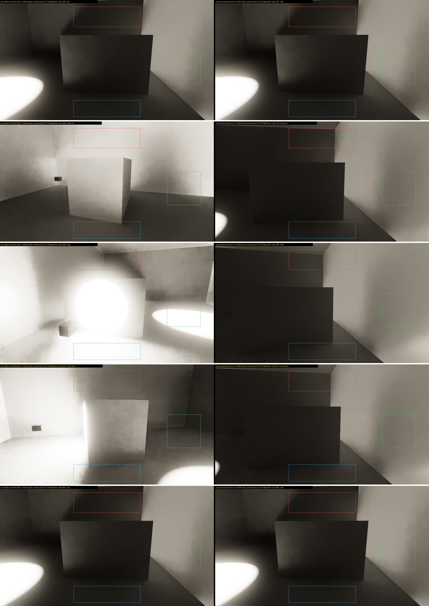
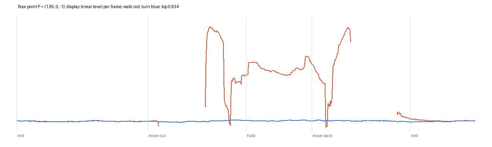
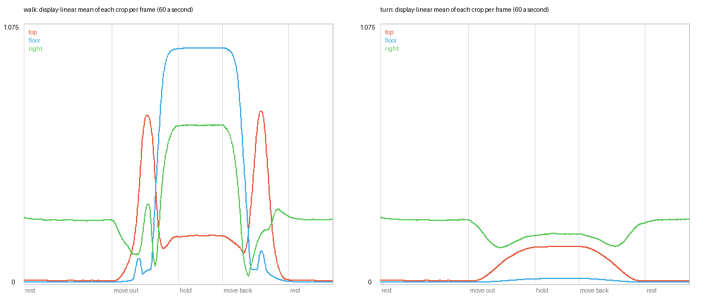

# The lit back in motion: a walk round the block and a turn in place (t2b-xeo7)

The research take of t1-r9vj found the lit back's room 9 to 71 times darker than the path trace
([fade-lit-front.md](../fade-lit-front.md), bug t2b-xeo7). The lit face points away from the eye, so neither the screen's
rays nor the environment map see it. The user's bar accepts lost light but no visible change over time. This film shows
whether the room's light changes when the eye comes to see the lit face.

## The two films

[lit-back-walk-and-turn.mp4](lit-back-walk-and-turn.mp4), real engine frames, 840 draws at 60 a second (14 s), one tick
per draw, H.264 at CRF 12. Both films are 1280 × 720 at the default headless render scale 2/3, with a fixed exposure of
6.79 stops, the lit back's exposure of the research take.

| Side | Scene | Camera |
|---|---|---|
| Left | `lit-block-back-walk` | The eye, 1.5 m up, walks round the block by −X on an ellipse, from (0.3, 3.45) in front of the dark face to (−1, −3.45) behind the lit face, and back. It always looks at the block's center (0, 0.8, 0). |
| Right | `lit-block-back-turn` | The eye rests at the walk's start. The look turns from the block's center to the gap behind the block's +X side, (1.6, 0.8, −2.5), and back. |

The timing is the same in both films:

| Draws | 0–239 | 240–419 | 420–539 | 540–719 | 720–839 |
|---|---|---|---|---|---|
| Phase | rest | move out (smoothstep) | hold | move back | rest |

The scenes and the camera's path come from a scratch patch, [tools/film-probe.patch](tools/film-probe.patch), on main
4add7e4ae. The patch adds the lit block of refs/scratch/t1-r9vj-lit-block, a component that writes its own view's end pose
per tick, and a log of the environment map's faces per draw. [tools/film.sh](tools/film.sh) runs one film.

`lit-back-film-sheet.png`: draws 200 (rest), 330 (move out), 480 (hold), 610 (move back) and 800 (rest). The walk is on
the left, the turn on the right. The colored boxes are the screen crops of the chart below.

## The same floor point in both films

P = (1.95, 0, −1) is a floor point in the gap behind the block's +X side. No lamp reaches it directly, so all its light is
bounce. [tools/point.py](tools/point.py) follows it through both films: it projects P with each draw's pose and takes the
display-linear mean of the 5 × 5 pixels around it. A draw where the block hides P is left out.

`lit-back-point.png`: P's level per draw, the walk in red and the turn in blue.

| Film | Rest before (draws 180–239) | Hold (draws 420–539) | Rest after (draws 780–839) |
|---|---:|---:|---:|
| Walk | 0.0778 | 0.5066 | 0.0811 |
| Turn | 0.0768 | 0.0832 | 0.0801 |

- From the hold pose of the walk, where the eye sees the lit face, P is 6.5 times as bright as at rest. In the turn, the
  eye never sees the lit face, and P moves by at most 8 %.
- On the way back, P falls to 0.098 at draw 720, when the eye is back at its start, then to 0.087 at draw 740, 0.081 at
  draw 760 and 0.079 at draw 780. The turn ends 4 % above its start too (0.0801 against 0.0768), so that last 4 % is not
  the walk's.
- The two peaks near 0.9 on the way out and on the way back are draws where the eye sees P at a grazing angle beside the
  glossy wall. Reading: the 5 × 5 pixels there take some of the wall's reflection. I did not check this.

Reading: P's bounce light depends on what the eye sees. When the walk brings the lit face onto the screen, the floor
behind the block lights up about 6.5 times. When the face leaves the screen, the floor goes dark again within about 40
draws (0.7 s). A player who walks round the block sees the room brighten as the lit face comes into view, and darken as
it goes.

## The room's level in three screen crops

[tools/levels.py](tools/levels.py) gives the display-linear mean of three screen boxes per draw: `top` (x 440–840,
y 40–160), `floor` (x 440–840, y 600–700) and `right` (x 1000–1200, y 300–500). In the walk the boxes see other surfaces as
the eye moves, so only the rests compare the same surfaces from the same pose. [levels.txt](levels.txt) has every number.

`lit-back-levels.png`: the three crops per draw, walk left and turn right.

| Film | Crop | Rest before | Rest after | Change |
|---|---|---:|---:|---:|
| Walk | top | 0.0170 | 0.0170 | −0.1 % |
| Walk | floor | 0.0113 | 0.0112 | −0.8 % |
| Walk | right | 0.2660 | 0.2680 | +0.8 % |
| Turn | top | 0.0170 | 0.0169 | −0.5 % |
| Turn | floor | 0.0113 | 0.0111 | −1.5 % |
| Turn | right | 0.2669 | 0.2687 | +0.7 % |

After the return, `top` is within 1 % of its rest level from draw 769 in the walk and from draw 776 in the turn. `floor` is
within 1 % from draws 824 and 828. `right` stays 0.7 to 0.8 % above its rest level in both films. So the walk leaves no
lasting change: the room at the start pose is the same before and after the walk.

## The environment map's faces per draw

The probe logged 872 draws in each film, numbered 0 to 871 without a gap, for 840 captured frames.
[faces-walk.txt](faces-walk.txt) has the walk's log: the draw, then the face mask of the one served map (1 to 32 for one
face, 63 for all six). Draw 0 draws all six faces. Every later draw draws one face, in turn, so each face is drawn 145 or
146 times. The turn's log is the same. This answers the user's question with a measurement: the dim room is not an
unfinished render. By the kept frame of the research take (frame 239), every face had been drawn about 40 times.

## What I did not check

- Which of the two (the screen's rays or the environment map) carries the lit face's light to P. The film runs both, and
  I did not turn either off.
- Where the environment map stands, so whether its faces see the lit face from the hold pose.
- Why the run draws 32 more frames than it captures.
- The render scale near 1 and any other exposure.
- A path trace of P. So the film does not say which of P's two levels is nearer the truth. The research take's path trace
  read the floor gap behind the block 9 to 71 times brighter than the engine at the lit back's view. Its numbers are
  scene-linear, and this film's are display-linear at a fixed exposure, so they do not compare directly.
