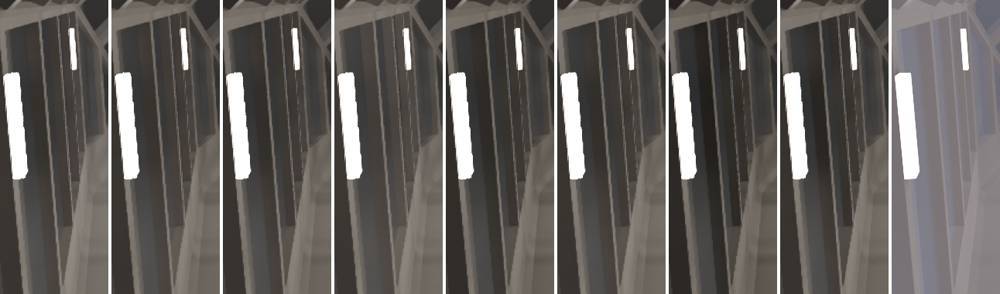
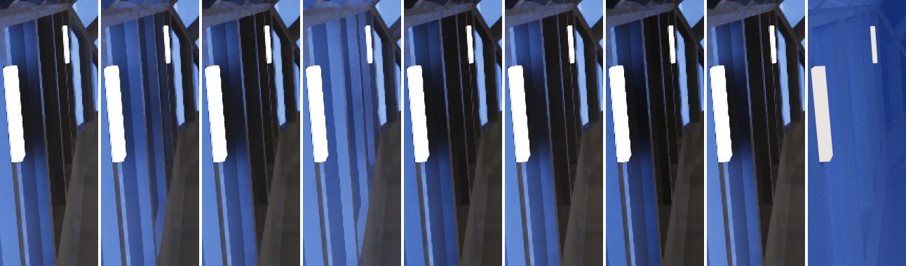
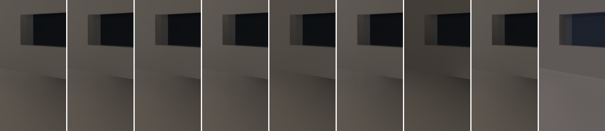
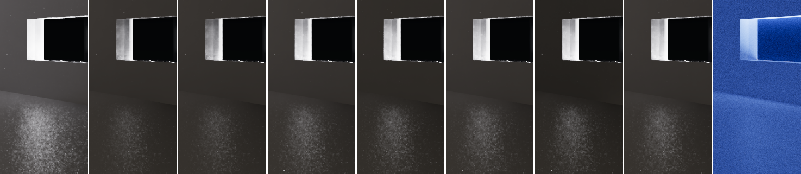
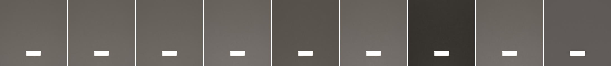
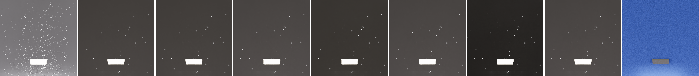
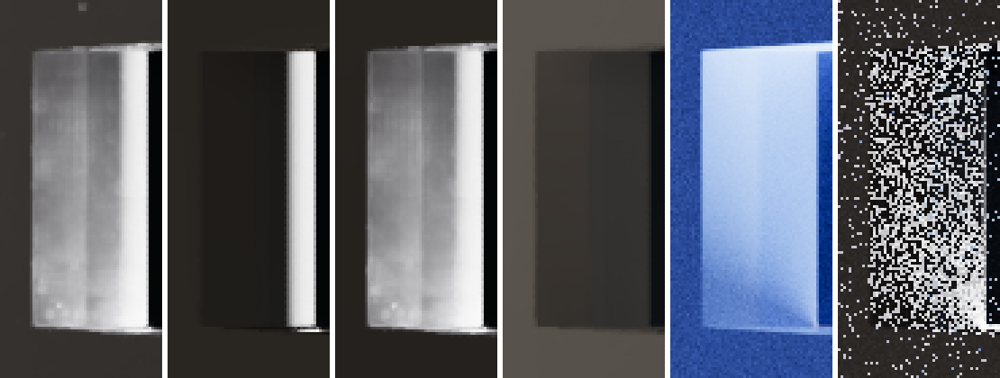

# A reference for the fade on a thick slab

This is the record of ticket `t1-g4p1`, of 2026-11-15. It renders a reference of two views with an offline path tracer. It then judges four rules of the screen walk beside it and tests the known-light rule. It also names the cause of the bands on a window jamb. The terms are those of the ticket, of [the record of stage 1](../README.md) and of [stage-1b/probe.md](../stage-1b/probe.md).

A paragraph that starts with "Reading:" holds my interpretation. Every other sentence states a measurement, a count or what an image shows.

## The result in short

1. The reference is Blender's Cycles path tracer on a scene that the probe exports from the engine's own frame 239. It shares the engine's geometry, materials, lights, camera, light units and tone curve.
2. Under the lights of the stage 1b stills, the reference's neutral regions are 16 times (cabin) and 58 times (`rect-lamps`) as bright as the engine's. The reference's light there is blue.
3. A control without the sun removes the sun and Earth's reflection of it in both renderers. The neutral regions then differ by 2.5 times and 2.0 times. The ticket's local question is answered there and checked under full lights.
4. In the cabin, the pillars' faces toward the camera are the faces whose light changes with the rule. In the reference, they are not dark: their ratio to the floor is 0.78 to 0.80 without the sun. Every column gives them 0.19 to 0.40.
5. Column B fades over the real slab, and column C over at most 10 %. B is nearer to the reference on every pillar region, in both light sets.
6. Column B has the same hit decision as column D. Against B, the known-light rule with the miss light or black moves both pillar faces away from the reference, at both footprints. With the front pixel's light, the rule comes nearest at three of four pillar regions in each set. But it overshoots one region under full lights by 67 %.
7. No rule is nearest in all regions of either view.
8. The bright band on the outer quarter of the `rect-lamps` jamb stays with the screen tracer off and goes without the sun. A cap on the walk's level, the back share and the fade do not change it. The reference has no such band. Bug ticket `t8-rjno`.

Reading: Earth's sunlit day side lights both views in the truth, through the station's open hub and the windows. The engine's environment map is one capture at the eye, where walls hide Earth. That is the cause of the factors of 16 and 58.

Reading: on a slab deeper than 10 %, the brightening that stage 1b saw goes toward the truth. The hypothesis that a hidden face's light is unknown and dark fails at the cabin's pillars. The band on the jamb is direct sunlight that the engine's sun shadow lets through. The layer makes it stand out, because the rest of the jamb lost its false light.

Recommendation for the fade rule, within the limits of two views on one GPU:

- On a slab deeper than 10 %, take B, the fade over the real slab, and not C. B was nearer than C at all four cabin pillar regions, in both light sets.
- Do not adopt the known-light rule with the miss light or with black. Against B, it moved both pillar faces away from the reference, in both sets and at both footprints.
- These numbers do not establish `dfront`, the front pixel's light with no fade. It overshoots the face at z −5.7 under full lights by 67 %. Part of its gain can make up for the light of several bounces that the engine does not carry.

## Part 1: the reference

### What the reference is

The probe got a throwaway export, `SceneExport.cs` in [reference-switch-and-export.patch](reference-switch-and-export.patch). Under `TERTIUS_SCENE_EXPORT=<folder>`, the geometry and material stores keep a CPU copy of what they upload. At the capture of index `TERTIUS_SCENE_EXPORT_AT` (239, the settled frame), it writes the frame's placed instances, materials, lights and camera. All positions are camera-relative, in the engine's world axes, in m.

| View | Script | Placed instances | Meshes | Lights |
|---|---|---:|---:|---|
| The cabin of `demo-exit` | `stills-cabin.json`, `cabin-camera` | 88 | 66 | 21 rectangle lamps and the sun |
| `rect-lamps` | `stills-rect-lamps.json`, the person's camera | 34 | 11 | 5 rectangle lamps and the sun |

[tools/cycles_scene.py](tools/cycles_scene.py) builds the Cycles scene from the export and renders it on the Mac's GPU under the shared GPU lock. Each crop has two seeds of 2,048 samples, with no denoiser and no clamp, and up to 32 diffuse bounces. [tools/exr_to_npy.py](tools/exr_to_npy.py) turns each EXR into a NumPy array of scene-linear radiance.

The reference is independent of the screen walk. It traces rays through the exported triangles, so the light at a point does not depend on what the screen shows.

### Why it is true for the engine's scene

The script keeps these parts of the engine by construction:

- Each instance has its mesh, its vertex normals, its transform and its material slot.
- The material is the BRDF of `lighting.glsl`: Lambert diffuse with c_diff = b (1 − m), plus GGX with Schlick's Fresnel from F0 = (1 − m) 0.16 ρ² + m b. It adds the two lobes without layering, as the engine does. Cycles' Metallic BSDF with a white F82 tint is that Fresnel term, with multiple scattering.
- A point light of I W/sr gets a power of 4πI, and a rectangle light a power of πI, one-sided as the engine's. The sun, a point light 1.49 × 10¹¹ m away, becomes a sun lamp of I / d²: 1,361 W/m² in the cabin and 1,372 W/m² in `rect-lamps`.
- A light-holding glow shows to camera rays only, because the engine's glow bounces no light. A glass pane also shows to camera rays only, as its color blended at its alpha of 0.2. The engine's glass casts no shadow and is not in the G-buffer.
- An instance without `CastsShadow` blocks no shadow ray. A box around the eye, the person's own box in `rect-lamps`, is hidden from the camera, as the engine's back-face culling hides it.
- The world is black: the camera's air has no painted sky in either view (`atmosphere` in `scene.json`).

A calibration render checked the light units. It lit a white Lambert plate from 1 m with each kind of light, at 1 W/sr or 1 W/m². [tools/calibrate.py](tools/calibrate.py) made it. The plate's radiance was 0.31830 for a point light, a spot light and the sun. It was 0.31803 for a rectangle of 5 cm. The exact value is 1/π = 0.31831.

The camera matches: at 16 samples, the lamps of the full cabin view sit at the same pixels as in the engine's still.

### Where it differs from the engine by construction

- Material model: the same BRDF, but the engine's multiple-scattering compensation is Filament's table, and Cycles' is its own.
- Earth's texture: the export holds no texture coordinates. Earth takes the area-weighted mean of `EarthGrid` in linear light, (0.0840, 0.1655, 0.4655).
- Earth as a light: Earth emits its own Lambert reflection of the sun, albedo × E × max(n · s, 0) / π, with no BSDF. Cycles then samples Earth as a light. The full cabin view gave a floor of 3.26 W/(m²·sr) with Earth path traced, at 16 samples. With Earth as an emitter, it gave 3.29 at 64 samples.
- Light reach: the engine cuts each light at its reach with a window. The reference has no cut. Every reach here is 80 m or more, beyond the rooms.
- Tone curve and exposure: the reference is linear radiance. [tools/tone.py](tools/tone.py) applies the engine's exposure, ACES fit and sRGB curve to show it. It also inverts them, to turn an engine's 8-bit frame back into linear radiance.
- Pixel filter: Cycles' Blackman-Harris filter of 1.5 px against FSR 3.1's reconstruction from 1280 × 720.

### The control without the sun

The first renders showed that the truth under full lights differs from the engine everywhere, not only at thick slabs. In the cabin, the crop's mean needs 2.16 stops less exposure in the reference. Its light is blue. Earth's sunlit day side is 394 km below the station. In `rect-lamps`, the side windows look out below the horizon's dip of about 20°.

So I added a control: `TERTIUS_NO_SUN=1` drops every light beyond 10⁹ m in the probe, and `REF_SKIP_LIGHTS` drops the sun in the reference. Earth then sends no light in either renderer.

Reading: Earth's light enters the cabin through the open ends of the station's hub, and `rect-lamps` through its side windows. The engine gets Earth's light only through its environment map, one capture at the eye. The walls hide Earth from that point.

| Set | Cabin: neutral region, engine `ten` / reference, W/(m²·sr) | `rect-lamps`: neutral region, engine `ten` / reference, W/(m²·sr) |
|---|---|---|
| Full lights | 0.1961 / 3.161: 16.1 times | 0.02036 / 1.19: 58 times |
| Without the sun | 0.1815 / 0.4602: 2.5 times | 0.01615 / 0.03274: 2.0 times |

Reading: the remaining factor of 2 to 2.5 without the sun is light of several bounces that the engine does not carry. Both rooms are closed boxes of light-gray surfaces.

## Part 2: the columns against the reference

### The columns

Each column ran on the Mac (M1 Max, MoltenVK) with one binary, the probe's patch plus the new switches. Each kept the film's frame 239 at 1920 × 1080 with `--bloom off` and one fixed exposure per view and light set.

| Column | Probe mode | Hit decision | Hit light |
|---|---|---|---|
| A, `ten` | `ten` | The 10 % rule | The front pixel's light, faded by the entry share over the 10 % slab |
| B, `layer` | `layer` | The layer as the slab | The same, faded over the real slab |
| C, `layerfade` | `layer+fade` | The layer as the slab | The same, faded over at most the first 10 % |
| D, `dmiss05`, `dmiss15` | `layer+known/miss/<a>` | The layer as the slab | The known-light rule, with the miss light for a hidden face |
| D, `dblack05`, `dblack15` | `layer+known/black/<a>` | The layer as the slab | The known-light rule, with black for a hidden face |
| D, `dfront` | `layer+known/front/0.5` | The layer as the slab | The front pixel's light with no fade by the entry share |

The suffix 05 means a footprint half-width a of 0.5 pixel, and 15 means 1.5 pixels. With the front pixel's light for a hidden face, the rule does not depend on a. So `dfront` is column B without the fade, not column B itself.

The exposures: under full lights, stage 1b's stops, −0.3901896 for the cabin and 2.7868438 for `rect-lamps`. Without the sun, the stops of frame 239 of an automatic-exposure run of `ten`: 0.9178147 and 3.849491.

### The switch of column D

`entersVisibleFace` in `screen_walk.glsl` takes the hit pixel's plane from `pixelPlane`. Its plane span is a (|∂w/∂x| + |∂w/∂y|). When the ray's entry w is at least the pixel's center w minus that span, it returns true. An edge-on plane and a sky pixel count as the visible face. The walk hands out the entry w as `clamp(inW, back, near)`: the slab's front from in front, its back from behind, or the cell's entry from inside. In `traceFrom`, the rule replaces the fade by the entry share, and `edgeFade` stays.

```glsl
vec3 hitLight = hitLightOf(hitPixel, kind);
vec3 unknownFaceLight = knownLightRule == 1u ? missLight : knownLightRule == 2u ? vec3(0.0) : hitLight;
fade = edgeFade(hit);
result.light = mix(missLight,
    entersVisibleFace(hitPixel, entryW, visibleFootprint) ? hitLight : unknownFaceLight, fade);
```

The rule and a are specialization constants 15 and 16. The mode suffix `+known/<miss|black|front>/<a>` sets them.

### The control

With the switch off, the new binary gives the frozen stage 1b probe's frames exactly. At `rect-lamps` under full lights, frame 239 of `ten` and of `layer` and frame 231 of `ten` have 0 differing pixels. The binary that later got the walk's top-level cap still gave the same `layer` frame with the cap at its default.

### The regions

Each region is the pixels of one face inside a box. A normal image and a position image of the export, rendered with one sample, name the faces. A face region loses its edge pixels, one pixel deep. [cabin-regions.png](cabin-regions.png) and [rect-lamps-regions.png](rect-lamps-regions.png) show them over the dimmed `ten` still, at half size.

| View | Region | Box (x0, y0, x1, y1) | Face | Pixels | Color in the map |
|---|---|---|---|---:|---|
| Cabin | Pillar face z −5.7 | 578, 400, 660, 700 | Normal +z, z from −5.8 to −5.6 m | 4,285 | Red |
| Cabin | Pillar face z −7.7 | 578, 400, 660, 700 | Normal +z, z from −7.8 to −7.6 m | 2,342 | Green |
| Cabin | Pillar side −5.7 to −7.7 | 578, 400, 660, 700 | Normal +x, z between the two pillars | 2,755 | Blue |
| Cabin | Pillar side −7.7 to −9.7 | 578, 400, 660, 700 | Normal +x | 1,013 | Yellow |
| Cabin | Floor right, the neutral region | 1300, 950, 1500, 1070 | Normal +y | 23,364 | Magenta |
| `rect-lamps` | Jamb, room half | 1770, 492, 1787, 588 | Normal +z | 1,410 | Red |
| `rect-lamps` | Jamb, behind the glass | 1791, 492, 1807, 588 | None: the pane covers it | 1,536 | Green |
| `rect-lamps` | Floor below the window | 1700, 700, 1920, 880 | Normal +y | 38,854 | Blue |
| `rect-lamps` | Far ceiling | 720, 120, 1200, 400 | Normal −y, y from 5.33 to 5.40 m, so no lamp face | 131,526 | Yellow |
| `rect-lamps` | Floor near, the neutral region | 800, 950, 1100, 1070 | Normal +y | 35,164 | Magenta |

The cabin's left wall has pillars every 2 m, at z = −3.7, −5.7, −7.7 and −9.7 m. The camera sees each pillar's face toward the camera (normal +z) and its face toward the room (normal +x). A ray that leaves a pillar's +z face toward the camera's side meets the back face of the nearer pillar. The screen does not show that face. The pillar faces are the black strip of the stage 1b image.

No region is fully neutral, because every rule changes some indirect light everywhere. Each neutral region is a floor patch that changed little across the columns. Their changes against `ten`:

| Neutral region | Without the sun | Under full lights |
|---|---|---|
| Cabin, floor right | −7.5 % to −2.1 % | −10.6 % to +6.0 % |
| `rect-lamps`, floor near | −7.7 % to +0.8 % | −25.1 % to −16.9 % |

Under full lights in `rect-lamps`, every column but `ten` has a near floor 17 % to 25 % darker than `ten`'s. No floor patch of that view stays near `ten`.

Reading: the columns with the layer lost the false bounce light of the sunlit sill, which lit the whole floor in `ten`.

### The ratios

Each cell is a region's mean linear luminance over the neutral region's, in the same image. The reference's ± is half the difference of its two seeds' ratios. The last row is the engine's frame noise: the change of each ratio from frame 231 to frame 239 of `ten`. Run: `python3 -I tools/ratios.py tools/views.json <view> <set>`.

The cabin without the sun:

| Column | Pillar face z −5.7 | Pillar face z −7.7 | Pillar side −5.7 to −7.7 | Pillar side −7.7 to −9.7 | Floor right, W/(m²·sr) |
|---|---:|---:|---:|---:|---:|
| A `ten` | 0.292 | 0.304 | 0.519 | 0.764 | 0.1815 |
| B `layer` | 0.313 | 0.336 | 0.516 | 0.720 | 0.1751 |
| C `layerfade` | 0.284 | 0.294 | 0.504 | 0.714 | 0.1743 |
| D `dfront` | 0.360 | 0.399 | 0.539 | 0.743 | 0.1777 |
| D `dmiss05` | 0.245 | 0.269 | 0.484 | 0.671 | 0.1714 |
| D `dmiss15` | 0.289 | 0.297 | 0.509 | 0.725 | 0.175 |
| D `dblack05` | 0.190 | 0.220 | 0.458 | 0.627 | 0.1679 |
| D `dblack15` | 0.250 | 0.258 | 0.497 | 0.716 | 0.1732 |
| Reference | 0.782 ± 0.000 | 0.796 ± 0.000 | 0.957 ± 0.000 | 1.052 ± 0.001 | 0.4602 |
| `ten`, frame 231 against 239 | 0.002 | 0.001 | 0.003 | 0.004 | |

The cabin under full lights:

| Column | Pillar face z −5.7 | Pillar face z −7.7 | Pillar side −5.7 to −7.7 | Pillar side −7.7 to −9.7 | Floor right, W/(m²·sr) |
|---|---:|---:|---:|---:|---:|
| A `ten` | 0.718 | 0.302 | 0.558 | 0.788 | 0.1961 |
| B `layer` | 1.362 | 0.812 | 0.675 | 0.753 | 0.1964 |
| C `layerfade` | 0.787 | 0.297 | 0.547 | 0.742 | 0.1877 |
| D `dfront` | 2.015 | 1.433 | 0.843 | 0.851 | 0.2079 |
| D `dmiss05` | 0.591 | 0.264 | 0.532 | 0.712 | 0.179 |
| D `dmiss15` | 0.790 | 0.284 | 0.547 | 0.750 | 0.1888 |
| D `dblack05` | 0.509 | 0.216 | 0.504 | 0.666 | 0.1753 |
| D `dblack15` | 0.736 | 0.251 | 0.536 | 0.741 | 0.1866 |
| Reference | 1.205 ± 0.001 | 1.142 ± 0.000 | 1.189 ± 0.000 | 1.059 ± 0.002 | 3.161 |
| `ten`, frame 231 against 239 | 0.007 | 0.001 | 0.006 | 0.003 | |

`rect-lamps` without the sun:

| Column | Jamb, room half | Jamb, behind the glass | Floor below the window | Far ceiling | Floor near, W/(m²·sr) |
|---|---:|---:|---:|---:|---:|
| A `ten` | 0.387 | 0.355 | 0.612 | 0.872 | 0.01615 |
| B `layer` | 0.388 | 0.356 | 0.611 | 0.878 | 0.01616 |
| C `layerfade` | 0.389 | 0.357 | 0.611 | 0.859 | 0.01612 |
| D `dfront` | 0.384 | 0.352 | 0.614 | 0.928 | 0.01628 |
| D `dmiss05` | 0.402 | 0.371 | 0.588 | 0.705 | 0.01551 |
| D `dmiss15` | 0.381 | 0.353 | 0.615 | 0.920 | 0.01621 |
| D `dblack05` | 0.355 | 0.346 | 0.563 | 0.380 | 0.0149 |
| D `dblack15` | 0.373 | 0.352 | 0.615 | 0.914 | 0.01617 |
| Reference | 0.365 ± 0.000 | 0.372 ± 0.000 | 0.851 ± 0.000 | 0.760 ± 0.000 | 0.03274 |
| `ten`, frame 231 against 239 | 0.001 | 0.002 | 0.000 | 0.001 | |

`rect-lamps` under full lights:

| Column | Jamb, room half | Jamb, behind the glass | Floor below the window | Far ceiling | Floor near, W/(m²·sr) |
|---|---:|---:|---:|---:|---:|
| A `ten` | 28.569 | 36.383 | 1.339 | 2.370 | 0.02036 |
| B `layer` | 3.604 | 9.121 | 0.729 | 1.030 | 0.01655 |
| C `layerfade` | 3.622 | 9.168 | 0.728 | 1.006 | 0.0165 |
| D `dfront` | 9.907 | 15.221 | 0.831 | 1.152 | 0.01691 |
| D `dmiss05` | 10.021 | 15.975 | 0.776 | 0.859 | 0.01582 |
| D `dmiss15` | 9.882 | 15.384 | 0.819 | 1.143 | 0.0168 |
| D `dblack05` | 11.019 | 16.653 | 0.760 | 0.569 | 0.01525 |
| D `dblack15` | 9.772 | 15.381 | 0.820 | 1.139 | 0.01677 |
| Reference | 6.029 ± 0.002 | 6.518 ± 0.001 | 1.320 ± 0.000 | 1.719 ± 0.001 | 1.19 |
| `ten`, frame 231 against 239 | 3.346 | 4.462 | 0.024 | 0.273 | |

### The column nearest to the reference

Nearest means the smallest absolute difference of the ratio from the reference's.

| View and set | Region | Nearest | Next |
|---|---|---|---|
| Cabin, without the sun | Pillar face z −5.7 | `dfront` 0.360 | `layer` 0.313 |
| Cabin, without the sun | Pillar face z −7.7 | `dfront` 0.399 | `layer` 0.336 |
| Cabin, without the sun | Pillar side −5.7 to −7.7 | `dfront` 0.539 | `ten` 0.519 |
| Cabin, without the sun | Pillar side −7.7 to −9.7 | `ten` 0.764 | `dfront` 0.743 |
| Cabin, full lights | Pillar face z −5.7 | `layer` 1.362 | `dmiss15` 0.790 |
| Cabin, full lights | Pillar face z −7.7 | `dfront` 1.433 | `layer` 0.812 |
| Cabin, full lights | Pillar side −5.7 to −7.7 | `dfront` 0.843 | `layer` 0.675 |
| Cabin, full lights | Pillar side −7.7 to −9.7 | `dfront` 0.851 | `ten` 0.788 |
| `rect-lamps`, without the sun | Jamb, room half | `dblack15` 0.373 | `dblack05` 0.355 |
| `rect-lamps`, without the sun | Jamb, behind the glass | `dmiss05` 0.371 | `layerfade` 0.357 |
| `rect-lamps`, without the sun | Floor below the window | `dmiss15` and `dblack15` 0.615 | `dfront` 0.614 |
| `rect-lamps`, without the sun | Far ceiling | `dmiss05` 0.705 | `layerfade` 0.859 |
| `rect-lamps`, full lights | Jamb, room half | `layerfade` 3.622 | `layer` 3.604 |
| `rect-lamps`, full lights | Jamb, behind the glass | `layer` 9.121 | `layerfade` 9.168 |
| `rect-lamps`, full lights | Floor below the window | `ten` 1.339 | `dfront` 0.831 |
| `rect-lamps`, full lights | Far ceiling | `dfront` 1.152 | `dmiss15` 1.143 |

More measured facts:

- No column is nearest in all regions of a view, in either light set.
- B is nearer than C on all four cabin regions in both sets. In `rect-lamps`, B and C differ by at most 0.047 in every region: 9.121 against 9.168 on the jamb behind the glass, under full lights.
- In the cabin, B is nearer to the reference than every D column with the miss light or black. This holds on both pillar faces, in both sets. On the pillar sides, one is nearer: `dmiss15` has 0.725 against B's 0.720, on the side from −7.7 to −9.7 without the sun.
- In the cabin without the sun, every column gives the pillar faces 24 % to 50 % of the reference's ratio.
- In `rect-lamps` without the sun, every column lies within 11 % of the reference on the jamb. Every column gives the floor below the window 66 % to 73 % of the reference's ratio.
- `dblack05` darkens the far ceiling of `rect-lamps` to half of B's ratio without the sun: 0.380 against 0.878.
- Under full lights, `ten`'s jamb ratios move by 3.3 and 4.5 between two settled frames. So the jamb regions under full lights do not rank B, C and D with any confidence.

### What the eye sees

Each image puts the columns side by side, then the reference. The order is `ten`, `layer`, `layerfade`, `dfront`, `dmiss05`, `dmiss15`, `dblack05` and `dblack15`. Each crop is at full size. The reference is shown through the engine's tone curve, at the exposure that gives its neutral region the luminance of `ten`'s neutral region. [tools/sheet.py](tools/sheet.py) made them.



[cabin-nosun.png](cabin-nosun.png), x 540–680, y 340–720, reference at −1.34 stops. In the engine's columns, the pillar faces between the lamps are dark strips. They are lightest in `dfront` and darkest in `dblack05`. In the reference, the same faces are a light gray-blue, close to the faces beside them, and the wall has little contrast.



[cabin-full.png](cabin-full.png), the same box, reference at −4.01 stops. `ten`, `layerfade` and the miss and black columns show a black strip. `layer` shows it mid-gray, and `dfront` shows it light blue. The reference is an even blue: Earth's light lights every face alike, and the lamp's face shows gray.



[rect-lamps-window-nosun.png](rect-lamps-window-nosun.png), x 1700–1920, y 440–880, reference at −1.02 stops. The engine's columns look alike, except `dblack05`, whose wall and floor are darker. The jamb has two tones in every column and in the reference. The reference's floor below the window is lighter than the engine's.



[rect-lamps-window-full.png](rect-lamps-window-full.png), the same box, reference at −5.87 stops. `ten` has a white jamb and a bright, sparkling floor patch. The others have a gray jamb with a white strip at its outer edge and a dimmer patch. The D columns' jambs are lighter than `layer`'s. The reference is blue: Earth's light lights the wall, the jamb and the floor evenly, and the window pane shows blue.



[rect-lamps-ceiling-nosun.png](rect-lamps-ceiling-nosun.png), x 840–1080, y 120–360, reference at −1.02 stops. No column has specks. `dblack05` is much darker, and `dmiss05` a little darker. The reference is an even gray, a little darker than every column but `dmiss05` and `dblack05`. Its ratio is 0.760, against 0.859 to 0.928 for those columns.



[rect-lamps-ceiling-full.png](rect-lamps-ceiling-full.png), the same box, reference at −5.87 stops. `ten` has the bright ceiling with a cloud of specks. The other columns are dark with a few dozen specks, and `dblack05` is the darkest. The reference is an even blue with no specks.

### The reading of the fade rule and of the known-light rule

Reading: the pillar faces of the cabin are the case of the ticket. Rays from them meet the hidden back face of the nearer pillar. In the truth, that face is lit about as the visible faces are. So the light that a hidden face sends is not near zero here. Black and the miss light, which is the environment map from the eye, both underestimate it. The known-light rule as written, with either value, moves the image away from the truth.

Reading: the front pixel's light is the best stand-in for the hidden face in this view. B keeps most of it on a thick slab, because a deep entry is a smaller entry share there. C takes most of it away. So the fade over the real slab, column B, is the better of the ticket's two fade rules on a slab deeper than 10 %. Stage 1b's brightening of the black strip goes toward the truth.

Reading: no column reaches the truth at the pillars, and one reason is not about the slab at all. The engine carries less light of several bounces than the reference, so every column is dark there. `dfront` comes nearest partly because it adds light, and it overshoots the face at z −5.7 under full lights. So these numbers rank the rules. They do not show that `dfront` is right.

Reading: in `rect-lamps` without the sun, the rules differ little on the jamb and the floor. The rule matters most on the far ceiling. There black at a = 0.5 halves the light, and black at a = 1.5 does not. So most of that drop comes from visible faces that the narrow footprint calls hidden. The reference's 0.760 lies between `dmiss05`'s 0.705 and the fades. But `dmiss05` has the same misjudged faces, so it is no bound on a hidden face's light.

## Part 3: the bands on the jamb

Under full lights, the jamb of the nearest right side window of `rect-lamps` shows vertical bands under the layer. The jamb is the window's far side face, normal +z, at z = −11 m. Its room half spans output x 1768–1789. Its outer half, x 1789–1810, lies behind the glass pane, which sits in the middle of the 0.5 m wall.

### The measurements

A profile across the jamb averages the linear luminance over rows 500–579 at each output column. [tools/jamb_profile.py](tools/jamb_profile.py) prints it, and its docstring names the input frames.



[rect-lamps-jamb-strip.png](rect-lamps-jamb-strip.png) shows the jamb at three times its size, x 1756–1815, y 470–609. [tools/jamb_strip.py](tools/jamb_strip.py) made it. Its panels, from left to right:

1. `layer` under full lights, at 2.7868438 stops.
2. `layer` with `--screen-trace off`, at 2.7868438 stops.
3. `layer` with the walk capped at level 2, at 2.7868438 stops.
4. `layer` without the sun, at 3.849491 stops.
5. The reference under full lights, at 2.7868438 − 5.869 stops.
6. The reference with the sun and a black Earth, 2,560 samples, at 2.7868438 stops.

The first four panels have the bright strip at the jamb's outer edge. The two reference panels have none.

| Measurement | Result |
|---|---|
| The back share across the jamb, from the probe's dump of `layer` at 1280 × 720 (render x 1178–1205) | It rises smoothly by about 0.0018 per render pixel, from 0.9508 to 0.9984. The slab along the view ray falls linearly from 0.570 m to 0.018 m. No step. |
| The profile of `layer` at frame 239 | It rises from 0.047 to 0.074 W/(m²·sr) on the room half, dips to 0.053 at x 1789, and rises to 0.065 at x 1798. From x 1799 to 1808 it climbs to 0.471: 8.0 times its value at x 1795. |
| The same in the other columns | The strip is in every column: 8.0 times in `layer` and `layerfade`, 4.2 times in the D columns and 1.9 times in `ten`. The dip at x 1788–1789 is in every column too. |
| The strip's onset at three output sizes | 1920 × 1080: x 1799.5, render x 1199.7, 0.75 of the jamb's width. 1440 × 810: x 1345, render x 896.7, 0.76. 1760 × 990: x 1649.5, render x 1094.7, 0.79. |
| The walk capped at level 2, then at level 4 (`TERTIUS_WALK_TOP`) | On the strip, x 1799–1808, the profile is the same within 1 %, with the onset at x 1799–1800. On the room half it differs by up to 3.5 % at level 2 and 7.6 % at level 4. That is inside the frame noise of 39 %. |
| The screen tracer off (`--screen-trace off`) | The strip stays: 0.008 at x 1799 and 0.374 at x 1808, against 0.007 on the rest of the jamb. |
| No sun (`TERTIUS_NO_SUN=1`), every column | No strip. The outer half is flat at 0.0058 to 0.0059 from x 1789 to 1808. |
| The reference under full lights | A gentle rise from 7.43 at x 1795 to 8.34 at x 1808: 1.12 times. A dip at the glass edge, from 8.22 at x 1787 to 7.28 at x 1791. |
| The reference with the sun and a black Earth, 2,560 samples | 0.07 to 0.11 across the whole jamb. No strip. |
| Frame noise, stage 1b's `layer` frames 231 and 239 | The room half differs by 39 % on the mean and 55 % at most. The strip differs by 12 %. `ten`'s room half on the Mac differs by 9 %. |

### The cause of each band

| Band | Measured evidence | In the reference | In every column |
|---|---|---|---|
| The bright strip on the outer quarter, x 1799–1809 | It stays with the tracer off and goes without the sun. | No | Yes |
| The dip at x 1788–1789 | It sits at the glass pane's edge. | Yes | Yes |
| The uneven patches on the room half | Two settled frames of `layer` differ there by 39 %. | No, a smooth gradient | Measured in `layer` only |

Reading: the strip is direct sunlight that the engine's sun shadow lets through, so it is not a fault of the layer. The dip is the edge of the pane's blend, because the outer half is seen through the pane. The patches are noise of few samples. They show under the layer because the false light that hid them is gone.

The other candidates do not hold. The back share has no step. The pyramid's cells are not the cause, because a walk that never climbs above level 2 gives the same strip. The fade over a long slab at a grazing angle is not the cause either. The D columns have no fade by the entry share, and they keep the strip.

Reading: the strip is a fault of the sun's shadow, not of the screen walk. The 10 % rule's false light, 28.6 times the floor on the room half, made it look like part of a white jamb. The leak covers about the outer 0.12 m of the wall. Stage 1b's "sunlit sill" can be the same leak. Bug ticket `t8-rjno` holds the measurements.

## The commands

The probe's build, from a `git archive` export of `refs/scratch/ter-kh4g-2-ref-controls` in `/private/tmp/t1-g4p1/src`:

```bash
nix develop --command bash -c 'cd /private/tmp/t1-g4p1/src && dotnet build src/Tertius.Demo -c Release -nologo -v:q -p:RunAnalyzers=false -p:TreatWarningsAsErrors=false -o /private/tmp/t1-g4p1/bin'
```

The export, one run per view, from the source export's root:

```bash
TERTIUS_SCENE_EXPORT=/private/tmp/t1-g4p1/export/cabin TERTIUS_SCENE_EXPORT_AT=239 bash ../stage-1b/tools/still.sh /private/tmp/t1-g4p1/bin <out> layer tools/bf1b/stills-cabin.json --size 1920x1080 --bloom off --exposure -0.3901896
```

The columns, in the dev shell, with [tools/mac-columns.sh](tools/mac-columns.sh). Without `STOPS` the script reads the stops of an automatic-exposure run, and `NOSUN=1` is its default:

```bash
NOSUN=0 STOPS=-0.3901896 bash tools/mac-columns.sh /private/tmp/t1-g4p1/bin /private/tmp/t1-g4p1/src tools/bf1b/stills-cabin.json /private/tmp/t1-g4p1/full/cabin
bash tools/mac-columns.sh /private/tmp/t1-g4p1/bin /private/tmp/t1-g4p1/src tools/bf1b/stills-cabin.json /private/tmp/t1-g4p1/nosun/cabin
```

The reference, in the assets shell (`nix develop .#assets`), under the shared GPU lock. The box is in output pixels, and `REF_SKIP_LIGHTS` names the sun's index in `scene.json`, 21 in the cabin and 0 in `rect-lamps`:

```bash
REF_SKIP_LIGHTS=21 bash tools/gpu-lock.sh --shared <log> $TERTIUS_BLENDER -b --factory-startup --python tools/cycles_scene.py -- /private/tmp/t1-g4p1/export/cabin <out.exr> 2048 1 METAL 520 300 760 900
$TERTIUS_BLENDER -b --factory-startup --python tools/exr_to_npy.py -- <out.exr> <out.npy>
```

`REF_OVERRIDE=normal` or `position` renders the geometry images, and `REF_EARTH_BLACK=1` keeps Earth black. The dump of part 3 uses [tools/rect-lamps-dump.json](tools/rect-lamps-dump.json) with `TERTIUS_BACK_FACE_DUMP=<folder>`.

The analysis, in the dev shell:

```bash
python3 -I tools/ratios.py tools/views.json cabin nosun
python3 -I tools/sheet.py tools/views.json cabin nosun 540 340 680 720 cabin-nosun.png
```

[tools/views.json](tools/views.json) names every input path, region and exposure of parts 1 and 2. The inputs are under `/private/tmp/t1-g4p1/`. Part 3's scripts take that folder as their first argument, and their docstrings name the inputs:

```bash
python3 -I tools/jamb_profile.py /private/tmp/t1-g4p1
python3 -I tools/jamb_profile.py /private/tmp/t1-g4p1 2.7868438 /private/tmp/t1-g4p1/top/2/s-000239.png
python3 -I tools/jamb_strip.py /private/tmp/t1-g4p1 rect-lamps-jamb-strip.png
```

## Scratch refs and dollars

| Ref | Commit | What it adds |
|---|---|---|
| `refs/scratch/ter-kh4g-2-ref-columns` | `7f331d558` | On the stage 1b stills tree: the known-light switch, the scene export and [tools/job-columns.sh](tools/job-columns.sh). |
| `refs/scratch/ter-kh4g-2-ref-controls` | `fe3bd3e0d` | The control without the sun and the cap of the walk's top level. [reference-switch-and-export.patch](reference-switch-and-export.patch) is this tree's `src` against the probe, `refs/scratch/ter-kh4g-1b-off`. |

The cloud jobs failed. Four jobs on `refs/scratch/ter-kh4g-2-ref-columns` ran four columns each and timed out at 804, 804, 653 and 654 s with no output. They counted $0.51 by the job log's estimates. Stage 1b's cabin job had run four columns in 631 s. Every column of this record then ran on the Mac, which costs nothing.

## Changes to the method

- Earth emits its own reflection of the sun in the reference. Without it, Earth's light reaches the cabin only by paths that hit Earth at random, which left 64 samples very noisy.
- The control without the sun is new. Under full lights, the reference differs from the engine everywhere, by Earth's light, and that hides the ticket's local question.
- The columns ran on the Mac and not in the cloud, after four timed-out jobs. So the control compares with the frozen stage 1b probe on the Mac, not with stage 1b's cloud images.
- The regions are faces from the export's normal and position images, not boxes alone. The ratio in a box mixes faces, and the jitter moves their edges.
- Part 3 adds two switches: the walk's top-level cap and the probe's control without the sun. It also renders the jamb at two more output sizes.

## What I did not check

- The engine's light of several bounces against the reference's, on its own. The factor of 2 to 2.5 without the sun is my reading of its cause.
- A view where the hidden face is lit very differently from the visible face, such as a pillar lit from behind. There `dfront` can fail.
- The cause of the sun's shadow leak inside the engine (`t8-rjno`).
- Whether stage 1b's "sunlit sill" is sunlit in the truth.
- Earth's texture: the reference uses its mean color.
- The reach window of the lights, which the reference leaves out. No reach is shorter than 80 m here.
- Any GPU but the M1 Max under MoltenVK. Nothing ran on NVIDIA, RADV, ANV or lavapipe.
- The noise of the columns B, C and D on the Mac. The frame-noise row is `ten`'s. Part 3's 39 % is stage 1b's `layer`, from the cloud.
- How many visible faces the footprint of a = 0.5 calls hidden. The drop of `dblack05` on the far ceiling points to such failures.
- A control with a black Earth in the cabin. Only `rect-lamps` has one.
- The size of the sun's leak in the engine. The strip reaches 0.37 W/(m²·sr) above the rest of the jamb with the tracer off. The engine's sun-only light on the jamb was not separated from it.
- A pointer to this record in [the stage README](../README.md). The orchestrator adds it.
