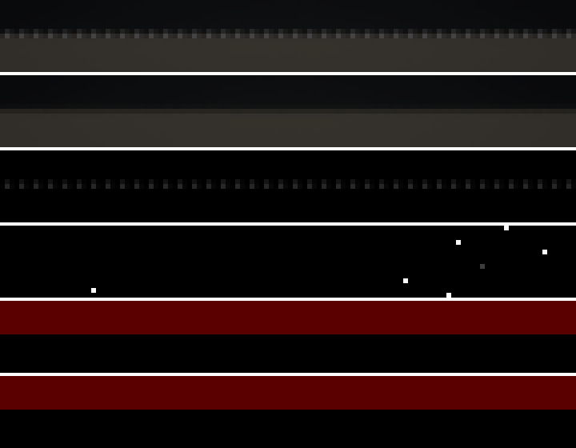

# Which bright strips the sun really lights, and the cause of the leak in the sun's shadow

This is the record of ticket `t1-3j2j`, of 2026-11-15. It is the diagnosis of bug ticket `t8-rjno`. It judges each bright strip of sunlight by geometry. It finds the part of the sun's shadow that lets the light through, and it names what a fix must change. The terms are those of [reference.md](reference.md) and of ARCHITECTURE.md, "Shadows".

A paragraph that starts with "Reading:" holds my interpretation. Every other sentence states a measurement, a count or what an image shows.

## Part 1: which strips the sun lights in the truth

### The three measurements

Each view is frame 239 of a film at 1920 × 1080, with `--bloom off`, `--screen-trace off` and one fixed exposure: 2.7868438 stops for `rect-lamps` and −0.3901896 stops for the cabin. The probe is the reference experiment's, with new switches (part 2). [tools/leak-still.sh](tools/leak-still.sh) runs one still.

1. The engine's direct sunlight of a pixel is a difference of linear luminance. The still under full lights gives the first term, the still without the sun (`TERTIUS_NO_SUN=1`) the second. [tools/strips.py](tools/strips.py) computes it. Its noise floor is about 0.002 W/(m²·sr): 61 pixels of `rect-lamps` fall below −0.002.
2. The path trace renders the exported frame with the sun alone and a black Earth: `REF_EARTH_BLACK=1`, and `REF_SKIP_LIGHTS` drops every lamp. It holds the truth's direct sunlight and its bounces, 256 samples, one seed.
3. The geometry's answer comes from [tools/sun_cast.py](tools/sun_cast.py). It casts a camera ray through each pixel's center to the nearest front face that the engine's G-buffer holds. From that point, it casts 256 lines to points spread evenly over the sun's disc, through every caster's triangles and every celestial body's sphere. The share of the lines that reach the sun is the point's sunlit share. A line mode does the same along a world line, at 1 mm steps.

The sun's disc has an angular radius of 0.00467 rad. In `rect-lamps` it stands 0.26° from the world's +y axis: the direction toward it is (0.0000060, 0.99999, 0.00454).

A fourth measurement joins them: [tools/engine_shadow.py](tools/engine_shadow.py) repeats the engine's cascade filter on the CPU, from the probe's dump of the four cascades at frame 239. It gives the engine's lit share at any world point, also on a strip thinner than a pixel. On the jamb of `rect-lamps`, x 1801 to 1808, each column's direct sunlight in W/(m²·sr) is 0.84 to 1.03 times that lit share.

### The table

| Strip | View | Engine: lit part, m | Engine: lit part, pixels | Engine's direct sunlight, W/(m²·sr) | Truth: lit part, m | Truth: lit part, pixels | Verdict |
|---|---|---:|---:|---|---:|---:|---|
| The far jamb of the nearest right side window, normal +z | `rect-lamps` | 0.119, from x 9.881 to 10.000 m | 10, x 1800 to 1809 | 0.02 at x 1800 to 0.37 at x 1808, 0.22 on the mean | 0.001 to 0.005 at the hull's outer face | under 0.5 | Only in the engine |
| The sill of the end window, normal +y, which the ceiling reflects | `rect-lamps` | 0.111, from z −39.889 to −40.000 m | under 0.1: the sill's top spans 0.2 rows | 0.004 on the mean of row 563, 0.009 at most | 0.001: one point at the outer edge, lit share 0.004 | 0 | Only in the engine |
| The sills of the side windows, normal +y | `rect-lamps` | 0.119, from x 9.881 to 10.000 m | 609 pixels in the frame | 1.80 at most | 0.006 at the hull's outer face | under 0.5 | Only in the engine |
| The sill strips of the cabin | The cabin of `demo-exit` | None | 0 | None | None | 0 | No such strip in this frame |

The jamb's lit share in the engine rises from 0.018 at x 1800 to 0.47 at x 1809. In the truth it is 0.5 at the outer face, 0.27 at 1 mm in and 0 at 2 to 5 mm in. The lit width in the truth grows with the height below the wall above: 1 mm at y 0.47 m, 3 mm at y −0.006 m, 5 mm at y −0.48 m. The engine's lit width is 0.119 m at all three heights.

All jambs and sills of the frame:

- 7,143 pixels of `rect-lamps` carry more than 0.002 W/(m²·sr) of the engine's direct sunlight. The truth lights 103 of them, each within 5 mm of the hull's outer face.
- Those 103 pixels carry 6.7 of the 835 W/(m²·sr) summed over the 7,143 pixels.
- The jambs, normal +z, hold 4,385 of the pixels and 742 of the sum. The sills, normal +y, hold 609 pixels and 38 of the sum. 1,976 pixels see no surface at their center, because they lie on a strip's edge with an opening behind it.
- The path trace on the jamb, rows 500 to 579, has a median of 0 in every part. Its mean is 0.105 on x 1800 to 1809, 0.068 on x 1789 to 1799 and 0.079 on the room half. 6 % to 8 % of its pixels are single bright samples above 0.5.

The cabin:

- The line cast at every second pixel, 518,400 points, finds no sunlit point. 6,765 of the points at every eighth pixel face the sun. The hub's walls, instance 8, block the line to the sun at 4,463 of them, and the cabin's own walls, instance 38, at 2,244.
- The CPU copy of the engine's filter gives no visible point any lit share. Every point reads cascade 0, with the stored caster 1.9 m to 21 m nearer the sun.
- The still's sun-only light is 0.70 W/(m²·sr) on the mean of the hub's walls, which the camera sees through the windows. On the cabin's own surfaces it is 0.0011 on the mean.
- The path trace with the sun alone and a black Earth covers the hub's walls in x 1500 to 1799, y 480 to 719. Its mean there is 0.37 W/(m²·sr), and the engine's sun-only mean is 0.45.

Reading: no strip of direct sunlight exists in the cabin's frame. The sun-only light on the hub's walls is not direct sunlight. Direct light on a wall that faces the sun at a cosine of 0.74 is about 160 W/(m²·sr), and the engine's map shadows those walls. It is light that the sun sends in by other paths, and Earth's light, which also goes dark without the sun. The cabin's thin bright strips of the handoff must have another source in another frame or view.

### The crops

[leak-rect-lamps-jamb.png](leak-rect-lamps-jamb.png): the jamb, x 1756 to 1815, y 470 to 609, at three times its size. The panels, from left to right:

1. The engine under full lights.
2. The engine without the sun.
3. The engine's direct sunlight.
4. The path trace with the sun alone.
5. The engine's lit share from the CPU copy of its filter.
6. The geometry's lit share.

The engine's white strip at the outer edge shows in panels 1, 3 and 5. The path trace shows scattered single bright samples over the whole crop and no strip. The geometry's panel is black on the whole jamb. Dark red marks pixels that see no surface.

[leak-rect-lamps-end-sill.png](leak-rect-lamps-end-sill.png): the end window's lower edge, x 900 to 1019, y 556 to 570, at six times its size. It holds the same panels, from top to bottom. The engine shows a dotted bright row at the sill, and its direct sunlight shows the same row. The path trace shows only scattered single samples. Neither map has a pixel center on the sill, because its top spans 0.2 rows.

Reading: every strip that the engine lights is a leak, but for its outer 1 to 6 mm. The sun stands almost overhead and the hull's roof hides the whole room from it. The engine's lit part is the outer 2 texels of cascade 0 on every jamb and sill (part 2).

## Part 4: Earth in the engine and in the path trace

### Where Earth is

The export holds the engine's own placed instances of frame 239, camera-relative. In `rect-lamps`, Earth's center lies at (−37.67, −6,770,998, −63.08) m, with a radius of 6,371,000 m. Its angular radius is 70.21°, so its limb lies 19.8° below the horizontal plane. The engine's frame constants place the planet's center for the air at the same point, with the same radius. In the cabin, Earth lies 6,771,007 m away along (0.99911, 0.04213, −0.0000014): to the side of the station's world axes.

The camera of neither view sees Earth:

- The line cast of `rect-lamps` at every fourth pixel meets the hull at 126,626 points and nothing at 2,394 points, behind the windows. No point meets Earth or the Moon.
- The cast of the cabin at every second pixel meets the cabin, the hub and the props at all 518,400 points.
- The side window's pane of `rect-lamps`, x 1811 to 1815 of the jamb's crop, has empty space behind 510 of its 700 points.
- The cabin's top right corner is x 1700 and more, y under 200. It shows the cabin's own surfaces at 9,069 points and the hub's walls at 1,931.

So the check takes a third view of the same scene: `orbit` with the `chase` camera, frame 239 at 1920 × 1080, at −7 stops ([tools/stills-orbit-chase.json](tools/stills-orbit-chase.json)). Earth fills the lower part of that frame.

| Column | Earth's first row in the engine's still, blue above 40 of 255 | Earth's first row by the line cast |
|---:|---:|---:|
| 0 | 852 | 852 |
| 240 | 793 | 794 |
| 480 | 747 | 748 |
| 1440 | 747 | 748 |
| 1680 | 794 | 795 |
| 1912 | 850 | 851 |

### The radiance of a directly seen Earth pixel

The crop is x 1340 to 1459, y 900 to 979, at every fourth pixel: 600 Earth pixels. Every one shows EarthGrid's deep blue in the engine, (60, 130, 219) or (61, 130, 219) of 255, with no clipped channel. The path trace has the sun and Earth as the emitter of its own reflection, 64 samples. Its luminance varies by 0.1 % over the crop. The cosine of the sun's angle at the seen points is 0.990 to 0.993. The sun's irradiance is 1,372.3 W/m².

| Quantity | Engine | Path trace |
|---|---:|---:|
| The albedo that it uses, linear | EarthGrid's deep blue, (0.0168, 0.0908, 0.4020) | EarthGrid's area-weighted mean, (0.0840, 0.1655, 0.4655) |
| Median luminance, W/(m²·sr) | 42.3 | 73.6 |
| Median luminance over albedo × 1,372.3 × cos / π | 1.001 | 1.000 |
| Median blue channel over the same | 1.007 | 1.000 |

The mean's luminance is 1.741 times the deep blue's. The engine's 8-bit levels limit its ratio to about one level, 2 % to 3 % at this brightness.

Reading: both renderers put Earth at the same place and give it the radiance of albedo × E × cos / π. The path trace's Earth is the engine's texture averaged over its area. So the light that Earth sends into a room is the same in both. The two doubts come from surfaces that are not Earth. In `rect-lamps`, the pane shows its own color at an alpha of 0.2, lit by the room. The path trace's room is 58 times brighter. In the cabin, the corner shows the cabin's and the hub's walls. So the factors 16 and 58 stand as Earth's light.

## The other line's strip

The other line (Design X) measured a bright row in the scene `orbit` with the camera entity `person`, at world ticks 300 and 306. That is the scene and camera of `rect-lamps`. Its row is output row 563, columns 892 to 1030: render row 375 and render columns 595 to 687 at 1280 × 720. The engine's lit part of the end window's sill projects to render row 375.6 at every tick below. So their strip is this record's end sill.

[tools/ticks-export.sh](tools/ticks-export.sh) runs [tools/ticks-orbit-person.json](tools/ticks-orbit-person.json): the camera `person`, then captures at world ticks 60, 300 and 306. Each run exports one capture's frame and dumps its cascades. The camera's place and axes are those of frame 239. The sun moves with the ship's turn:

| Frame | The direction toward the sun | Angle from +y |
|---|---|---:|
| Tick 60 | (0.000001, 0.999999, 0.001135) | 0.065° |
| Film frame 239 | (0.000006, 0.999990, 0.004540) | 0.260° |
| Tick 300 | (0.000008, 0.999984, 0.005673) | 0.325° |
| Tick 306 | (0.000009, 0.999983, 0.005786) | 0.332° |

The lines are those of part 1, at 1 mm steps, with the CPU copy of the engine's filter on each tick's dump. Render pixels count at 1280 × 720.

| Tick | Strip | Engine: lit part, m | Engine: lit part, render pixels | Engine: mean lit share over it, peak | Truth: lit part | Verdict |
|---|---|---:|---:|---|---|---|
| 60 | End sill, x 0 and x 2 | 0.121 | 0.047 rows | 0.258, 0.515 | 7 mm at the outer edge, peak 0.348 | Only in the engine but for the outer 7 mm |
| 300 | End sill, x 0 and x 2 | 0.108 | 0.042 rows | 0.229, 0.458 | None | Only in the engine |
| 306 | End sill, x 0 and x 2 | 0.049 | 0.019 rows | 0.103, 0.206 | None | Only in the engine |
| 60, 300, 306 | Far jamb of the nearest right side window | 0.120 | 6.7 columns | 0.255, 0.51 | 3 mm, peak 0.5 | Only in the engine but for the outer 3 mm |
| 60, 300, 306 | Sill of the nearest right side window | 0.120 | 7.4 columns | 0.255, 0.51 | 6 mm, peak 0.5 | Only in the engine but for the outer 6 mm |

The end sill's lit part is under 0.05 render rows tall at each tick. Between ticks 300 and 306, one texel of the shadow map changes on the sill's line. Column 1205 turns from empty to the roof, 6.849 m nearer the sun. The roof's stored edge thus moves out by one texel. The lit part shrinks from 0.108 m to 0.049 m. The lit share times the lit length falls by 79 %, from 0.0247 to 0.0051 m.

Reading: the other line's sill row is the same leak as part 1. The engine's lit part of the sill is under one twentieth of a render row tall. So only the jitter phases whose sample lands on that sliver see it, and at 8 phases it is possible that none lands there. Their fall of 19 % between the ticks goes in the same direction as the shrinking lit part. Their row also holds other light, so the two numbers measure different things. The side windows' jambs and sills are lit 6.7 to 7.4 render pixels wide. I did not measure their changes between phases.
