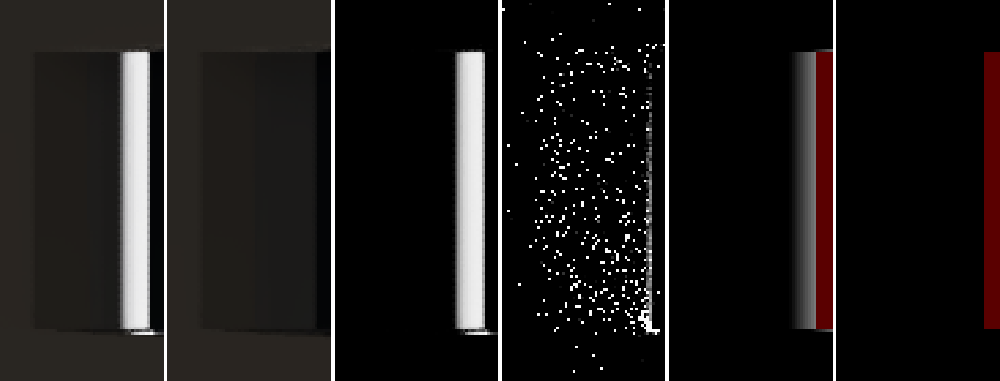
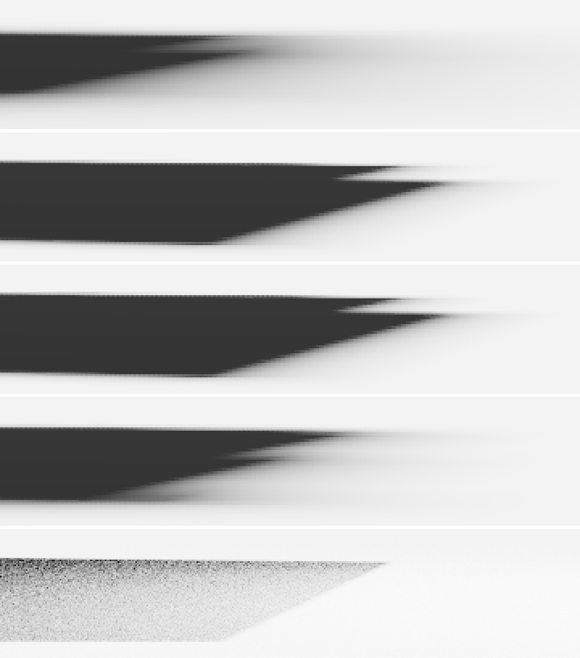

# Which bright strips the sun really lights, and the cause of the leak in the sun's shadow

This is the record of ticket `t1-3j2j`, of 2026-11-15. It is the diagnosis of bug ticket `t8-rjno`. It judges each bright strip of sunlight by geometry. It finds the part of the sun's shadow that lets the light through, and it names what a fix must change. The terms are those of [reference.md](reference.md) and of ARCHITECTURE.md, "Shadows".

A paragraph that starts with "Reading:" holds my interpretation. Every other sentence states a measurement, a count or what an image shows. The list below holds both, and each item names its kind.

A strip's lit length is the distance from its first lit point to the hull's outer face, along the line cast's 1 mm steps. A lit part that is only the point on the outer face has a length under 1 mm. Output pixels count at 1920 × 1080, and render pixels at 1280 × 720.

## The result in short

1. Measured: in the truth, the sun lights at most the outer 5 mm of each jamb and sill of `rect-lamps`, at the hull's outer face. The engine lights the outer 0.110 to 0.119 m.
2. Measured: the engine lights the end window's sill in the same way. The ceiling reflects that sill. The other line's sill row at ticks 60, 300 and 306 is the same sill. Its lit part is under one twentieth of a render row tall.
3. Measured: frame 239 of the cabin has no strip of direct sunlight in either renderer.
4. Measured: the 4 × 4 filter of the sun's cascades reaches 2.5 texels past the roof's edge at the hull's outer face. Those texels hold no caster. No bias setting changes the strip, and one tap takes 92 % of it away. Reading: the filter's reach is the cause.
5. Measured: candidate A scales the filter's reach to the sun's penumbra. It takes 87 % of the strip away and darkens no lit pixel of a grazed floor. It brings a box's shadow nearer the truth. Reading: a fix must change the filter's reach where the gap to the caster is large.
6. Measured: Earth stands at the same place in both renderers. Both give a directly seen Earth pixel the radiance of albedo × E × cos / π, each with its own albedo.
7. Measured: in the truth, the sun's light in `rect-lamps` is 0.0086 W/(m²·sr) on the side wall, 0.066 on the jamb and 0.0112 on the floor patch. A shadow-only cap over the hull takes all of it away. A cap over the lips of the openings alone takes away the same. Reading: the light enters through the lit lips at the hull's outer face.

## Part 1: which strips the sun lights in the truth

### The three measurements

Each view is frame 239 of a film at 1920 × 1080, with `--bloom off` and `--screen-trace off`. Each view has one fixed exposure: 2.7868438 stops for `rect-lamps` and −0.3901896 stops for the cabin. The probe is the reference experiment's, with new switches (part 2). [tools/leak-still.sh](tools/leak-still.sh) runs one still.

1. The engine's direct sunlight of a pixel is a difference of linear luminance. The still under full lights gives the first term, the still without the sun (`TERTIUS_NO_SUN=1`) the second. [tools/strips.py](tools/strips.py) computes it. Its noise floor is about 0.002 W/(m²·sr): 61 pixels of `rect-lamps` fall below −0.002.
2. The path trace renders the exported frame with the sun alone and a black Earth: `REF_EARTH_BLACK=1`, and `REF_SKIP_LIGHTS` drops every lamp. It holds the truth's direct sunlight and its bounces, 256 samples, one seed.
3. The geometry's answer comes from [tools/sun_cast.py](tools/sun_cast.py). It casts a camera ray through each pixel's center to the nearest front face that the engine's G-buffer holds. From that point, it casts 256 lines to points spread evenly over the sun's disc, through every caster's triangles and every celestial body's sphere. The share of the lines that reach the sun is the point's sunlit share. A line mode does the same along a world line, at 1 mm steps.

The sun's disc has an angular radius of 0.00467 rad. In `rect-lamps` it stands 0.26° from the world's +y axis: the direction toward it is (0.0000060, 0.99999, 0.00454).

A fourth measurement joins them: [tools/engine_shadow.py](tools/engine_shadow.py) repeats the engine's cascade filter on the CPU, from the probe's dump of the four cascades at frame 239. It gives the engine's lit share at any world point, also on a strip thinner than a pixel. On the jamb of `rect-lamps`, x 1801 to 1808, each column's direct sunlight in W/(m²·sr) is 0.84 to 1.03 times that lit share.

### The table

| Strip | View | Engine: lit part, m | Engine: lit part, pixels | Engine's direct sunlight, W/(m²·sr) | Truth: lit part, m | Truth: lit part, pixels | Verdict |
|---|---|---:|---:|---|---:|---:|---|
| The far jamb of the nearest right side window, normal +z | `rect-lamps` | 0.119, from x 9.881 to 10.000 m | 10 output columns, x 1800 to 1809 | 0.02 at x 1800 to 0.37 at x 1808, 0.22 on the mean | under 0.001 to 0.004 at the hull's outer face | under 0.5 | Only in the engine |
| The sill of the end window, normal +y, which the ceiling reflects | `rect-lamps` | 0.110, from z −39.890 to −40.000 m | 0: no pixel center lies on the lit part | 0.004 on the mean of output row 563, 0.009 at most | under 0.001: the point at the outer edge, lit share 0.004 | 0 | Only in the engine |
| The sills of the side windows, normal +y | `rect-lamps` | 0.119, from x 9.881 to 10.000 m | 609 output pixels in the frame | 1.80 at most | 0.005 at the hull's outer face | under 0.5 | Only in the engine |
| The sill strips of the cabin | The cabin of `demo-exit` | None | 0 | None | None | 0 | No such strip in this frame |

The jamb's lit share in the engine rises from 0.018 at x 1800 to 0.47 at x 1809. In the truth, on the mid line y −0.006 m, it is 0.5 at the outer face and 0.27 at 1 mm in. It is 0.09 at 2 mm in and 0 at 3 to 5 mm in. The truth's lit length grows with the height below the lintel: under 1 mm at y 0.47 m, 2 mm at y −0.006 m, 4 mm at y −0.48 m. The engine's lit length is 0.119 m at all three heights.

All jambs and sills of the frame:

- 7,143 pixels of `rect-lamps` carry more than 0.002 W/(m²·sr) of the engine's direct sunlight. The truth lights 103 of them, each within 5 mm of the hull's outer face.
- Those 103 pixels carry 6.7 of the 835 W/(m²·sr) summed over the 7,143 pixels.
- The jambs, normal +z, hold 4,385 of the pixels and 742 of the sum. The sills, normal +y, hold 609 pixels and 38 of the sum. 1,976 pixels see no surface at their center, because they lie on a strip's edge with an opening behind it.
- The path trace on the jamb, rows 500 to 579, has a median of 0 in every part. Its mean is 0.105 on x 1800 to 1809, 0.068 on x 1789 to 1799 and 0.079 on the room half. 6 % to 8 % of its pixels are single bright samples above 0.5.

The cabin:

- The line cast at every second pixel, 518,400 points, finds no sunlit point. 6,765 of the points at every eighth pixel face the sun. The hub's walls, instance 8, block the line to the sun at 4,463 of them, and the cabin's own walls, instance 38, at 2,244.
- The CPU copy of the engine's filter gives no visible point any lit share. Every point that faces the sun reads cascade 0. Its stored caster lies 0.55 m to 21.98 m nearer the sun.
- The still's sun-only light is 0.70 W/(m²·sr) on the mean of the hub's walls, which the camera sees through the windows. On the cabin's own surfaces it is 0.0011 on the mean.
- The path trace with the sun alone and a black Earth covers the hub's walls in x 1500 to 1799, y 480 to 719. Its mean there is 0.37 W/(m²·sr), and the engine's sun-only mean is 0.45.

[tools/extra_tables.py](tools/extra_tables.py) `cabin` prints the counts of the first two items.

Reading: no strip of direct sunlight exists in the cabin's frame. The sun-only light on the hub's walls is not direct sunlight. Direct light on a wall that faces the sun at a cosine of 0.74 is about 160 W/(m²·sr), and the engine's map shadows those walls. It is light that the sun sends in by other paths, and Earth's light, which also goes dark without the sun. The cabin's thin bright strips of the handoff must have another source in another frame or view. So this record leaves the cause of the cabin's cycle of 18 draws open.

### The crops



[leak-rect-lamps-jamb.png](leak-rect-lamps-jamb.png): the jamb, output x 1756 to 1815, y 470 to 609, at three times its size. The panels, from left to right:

1. The engine under full lights.
2. The engine without the sun.
3. The engine's direct sunlight.
4. The path trace with the sun alone.
5. The engine's lit share from the CPU copy of its filter.
6. The geometry's lit share.

The engine's white strip at the outer edge shows in panels 1, 3 and 5. The path trace shows scattered single bright samples over the whole crop and no strip. Its columns 1809 and 1810 hold a faint line, with medians of 0.015 and 0.035 W/(m²·sr). Its other columns have a median of 0. The geometry's panel is black on the whole jamb. Dark red marks pixels that see no surface.


[leak-rect-lamps-end-sill.png](leak-rect-lamps-end-sill.png): the end window's lower edge, output x 900 to 1019, y 556 to 570, at six times its size. It holds the same panels, from top to bottom. The engine shows a dotted bright row at the sill, and its direct sunlight shows the same row. The path trace shows only scattered single samples. The sill's top spans 0.30 output rows. No pixel center lies on the sill's lit part, so neither map shows it.

Reading: every strip that the engine lights is a leak, but for its outer 5 mm at most. The sun stands almost overhead and the hull's roof hides the whole room from it. The engine's lit part is the outer 2 texels of cascade 0 on every jamb and sill (part 2).

## Part 2: the cause of the leak

### The shadow map along the strip

[tools/map_line.py](tools/map_line.py) reads the dumped cascade 0 of `rect-lamps` along the jamb's mid line, y −0.006 m, z −11.0 m. Cascade 0 has texels of 0.05847 m, and one unit of its depth is 1,915.8 m along the sun.

| Receiver x, m | Texel (column, row) | Receiver's depth | Stored depth | Stored caster's gap toward the sun, m |
|---:|---|---:|---:|---|
| 9.80 | (1702, 1191) | 0.5000908 | 0.5031472 | 5.856 |
| 9.85 | (1702, 1192) | 0.5000908 | 0.5031472 | 5.856 |
| 9.90 | (1702, 1193) | 0.5000908 | 0.5031472 | 5.856 |
| 9.95 | (1702, 1194) | 0.5000908 | 0.5031472 | 5.856 |
| 10.00 | (1702, 1195) | 0.5000908 | 0 | No caster |
| 10.05 | (1702, 1195) | 0.5000908 | 0 | No caster |
| 10.10 | (1702, 1196) | 0.5000908 | 0 | No caster |

The stored caster lies 5.856 m nearer the sun. A point at y 5.9 m on the same line meets it at a gap of −0.051 m. Rows 1195 and beyond hold the cleared value 0: no caster.

Reading: the stored caster is the roof's top face, at y 5.85 m.

The three biases at this receiver, in m along the sun:

- The slope-scaled bias: 2.5 times the roof's depth change per texel, 0.00454 × 0.05847 m, which gives 0.0007 m.
- The constant bias: half a texel of depth, 0.029 m.
- The normal offset moves the lookup by one texel, 0.058 m, along the jamb's normal +z. That direction lies under the roof, along the edge.

The CPU copy of the filter places the lookup of x 9.881 m at texel row 1193.0. There, the bilinear footprint of its tap at +1.5 texels first reaches row 1195, the first texel with no caster. Its lit share rises linearly from there to 0.51 at x 10.0 m.

### The switches

Each switch is an environment variable of the probe, `ShadowProbe.cs` in [probe-shadow-leak.patch](probe-shadow-leak.patch). Each run is a still of `rect-lamps` with the screen tracer off, at the fixed exposure of part 1. Its direct sunlight is its still minus part 1's still without the sun. The profile is the mean of rows 500 to 579. [tools/switch_table.py](tools/switch_table.py) prints the table. The CPU columns come from each run's own dump.

| Run | Switch | Strip's first column above 0.01 | Columns above 0.01 | Mean of x 1800–1809, W/(m²·sr) | Peak | CPU: first lit x, m | CPU: lit share at x 10.0 |
|---|---|---:|---:|---:|---:|---:|---:|
| Default | Slope bias 2.5, constant 0.5 texel, normal offset 1 texel, 4 × 4 taps, map 2048 | 1800 | 11 | 0.222 | 0.368 | 9.881 | 0.510 |
| `slope0` | `TERTIUS_SHADOW_SLOPE=0` | 1800 | 11 | 0.222 | 0.368 | 9.881 | 0.510 |
| `slope1` | `TERTIUS_SHADOW_SLOPE=1` | 1800 | 11 | 0.222 | 0.368 | 9.881 | 0.510 |
| `const0` | `TERTIUS_SHADOW_CONSTANT=0` | 1800 | 11 | 0.222 | 0.368 | 9.881 | 0.510 |
| `normal0` | `TERTIUS_SHADOW_NORMAL=0` | 1800 | 11 | 0.221 | 0.367 | 9.881 | 0.510 |
| `nobias` | All three biases at 0 | 1800 | 11 | 0.221 | 0.367 | 9.881 | 0.510 |
| `filter1` | `TERTIUS_SHADOW_FILTER=1`: one bilinear tap | 1807 | 4 | 0.017 | 0.108 | 9.969 | 0.538 |
| `map4096` | `TERTIUS_SHADOW_MAP_SIZE=4096`: texels of 0.02918 m | 1806 | 5 | 0.049 | 0.173 | 9.950 | 0.437 |

The CPU copy's lit share on the mid line at x 9.900, 9.925, 9.950, 9.975 and 10.000 m:

| Run | 9.900 | 9.925 | 9.950 | 9.975 | 10.000 |
|---|---:|---:|---:|---:|---:|
| Default | 0.082 | 0.189 | 0.296 | 0.403 | 0.510 |
| One tap | 0 | 0 | 0 | 0.111 | 0.538 |
| Map 4096 | 0 | 0 | 0.008 | 0.223 | 0.437 |

The strip's lit length in the CPU copy is 0.119 m with texels of 0.05847 m, 2.04 texels. With texels of 0.02918 m it is 0.050 m, 1.71 texels. The record of [reference.md](reference.md), part 3, puts the strip's onset at the same 0.75 to 0.79 of the jamb at three output sizes. The texel size does not change with the output size.

The caster set: the roof is in cascade 0 up to texel row 1194, the row that holds the hull's outer face. With every bias at 0, the strip stays.

Reading: no caster is missing from the map. The texels past row 1194 lie outside the hull.

### The cause

The 4 × 4 filter of the sun's cascades reaches 2.5 texels from the lookup. Past the roof's edge at the hull's outer face, those texels hold no caster. A receiver under the roof within 2 texels of that edge, 0.119 m in cascade 0, takes up to half of the sun's light.

One tap at the lookup takes 92 % of the strip's mean light away, from 0.222 to 0.017 W/(m²·sr). No bias setting moves the mean by more than 0.001. What stays with one tap is the bilinear tap's own reach of one texel: the outer 0.031 m.

Reading: the filter's reach carries the whole strip, and the biases carry none of it. ARCHITECTURE.md's four known limits of "Shadow bias" do not name this limit. The third limit is about the slope-scaled bias, which moves a steep caster back by millimeters here. The engine's penumbra is 2 × 2.5 texels = 0.29 m wide in all, centered on the roof's edge. Its inner half is the leak. The true edge of a jamb's shadow is the lintel at the hull's outer face, 0.5 m to 1.5 m above the jamb's points. Its half-penumbra is under 1.5 m × 0.00467 = 7 mm, the same millimeter scale as the truth's lit lengths. The map stores the roof's top face, 5.86 m above, in place of the lintel. So a filter that scales with the gap to the stored caster still finds the roof's gap. The leak shows at every edge where the map holds no caster beside a roof: the hull's outer faces under a high sun.

## Part 3: what a fix must do

### The three candidates

| Candidate | What it changes | Known limit of "Shadow bias" that it touches | Built in the probe |
|---|---|---|---|
| A: the filter's reach scaled to the sun's penumbra | A blocker search reads the 5 × 5 texels around the lookup and takes the mean depth of those nearer the sun. The taps' reach becomes the penumbra's half-width, gap × tan(the sun's angular radius), over 2.5 texels, at most 1. | Limits 1, 2 and 4 shrink with the reach. None of the four names this leak. | Yes: `TERTIUS_SHADOW_FILTER=2` |
| B: finer texels in cascade 0 | A map of 4096² in place of 2048², or a nearer split. | Limit 3: coarse texels. | The map size: `TERTIUS_SHADOW_MAP_SIZE=4096` |
| C: the map dilated by the filter's reach | Each texel takes the depth of the caster nearest the sun within 2 texels, as `shadow_bounds.comp` keeps per window for the tiles. | Limit 2 grows: every shadow widens on its lit side. | No: the CPU copy only, `ENGINE_DILATE=2` |

Candidate A comes from percentage-closer soft shadows (Fernando, 2005). It was made for area lights in real-time games, with one shadow map, where a penumbra spans many texels. Its cost is the blocker search: 25 texel reads per lookup in the probe, not timed. Ours is a sun of angular radius 0.00467 rad with texels of 0.0585 m in cascade 0. Its true half-penumbra stays under one texel for gaps under 12.5 m, and under the filter's 2.5 texels for gaps under 31 m. So in rooms the filter shrinks to one bilinear tap. The search's only gain over one tap is the soft edge of a far caster. The probe takes the sun's angular radius as a constant, 0.00467. A fix reads it from the light.

### The measurements

On the jamb of `rect-lamps`, with the probe as in part 2:

| Run | Strip's first column above 0.01 | Mean of x 1800–1809, W/(m²·sr) | Peak | CPU: lit width, m |
|---|---:|---:|---:|---:|
| Default | 1800 | 0.222 | 0.368 | 0.119 |
| A, `filter2` | 1807 | 0.028 | 0.130 | 0.047 |
| One tap, `filter1` | 1807 | 0.017 | 0.108 | 0.031 |
| B, `map4096` | 1806 | 0.049 | 0.173 | 0.050 |
| C, CPU copy only | | | | 0.003 |

Part 1 picked 7,143 pixels of `rect-lamps`. Over them, the CPU copy's summed lit share is 1,012.8 with the default map and 0.53 with candidate C.

The first view that must not change is a lit floor: `bounce-raised-box` ([tools/stills-raised-box.json](tools/stills-raised-box.json)). It holds a box raised over a floor under a sun 30° high, with no ambient light. Each run is frame 239 at 1920 × 1080 with the screen tracer off, at −6 stops. The floor is rows 560 and below, 998,400 pixels, of which 936,785 are lit: above 0.8 times the floor's median.

| Run | Lit floor pixels darker by more than 2 levels | Floor pixels changed by more than 2 levels | Largest change, levels |
|---|---:|---:|---:|
| A, `filter2` | 0 | 42,229 | 179 |
| One tap, `filter1` | 0 | 42,271 | 179 |
| B, `map4096` | 0 | 35,479 | 166 |

The changed pixels lie at the edges of the box's shadow. A line cast of the crop x 600 to 959, y 575 to 654, at every second pixel, gives the truth. Each run's lit share is judged against it. The CPU copy matches the default still's floor within 0.012 in lit share on the mean, and the one-tap still within 0.016.

| Run | Mean of the lit share's error against the truth | Points darker than the truth by more than 0.1 | Points brighter by more than 0.1 |
|---|---:|---:|---:|
| Default | 0.207 | 3,127 | 1,268 |
| A | 0.125 | 1,607 | 74 |
| One tap | 0.125 | 1,607 | 74 |
| C | 0.442 | 3,950 | 0 |



[leak-raised-box-edges.png](leak-raised-box-edges.png): the end of the box's shadow, x 600 to 959, y 575 to 654, at twice its size. From top to bottom: the default, candidate A, one tap, candidate B, and the path trace with the sun alone at 64 samples. The default's shadow ends in a wide blur. A and one tap end in a hard parallelogram with one spike, B in a narrower blur. The path trace's shadow is a hard parallelogram that ends near where A's does. It is lighter inside from the floor's bounce, which the engine's still lacks with the screen tracer off.

The second view is a face that the sun grazes: the hull's back face, normal +z, in `orbit`'s chase still of part 4. The sun meets it at a cosine of 0.00454, 0.26° from the face's plane. Each run is frame 239 at −4 stops, with the screen tracer off. Its sun-only light is its still minus the still without the sun. The line cast of that still at every eighth pixel finds 1,243 points on the face, all with a sunlit share of 1.0. The table holds those points.

| Run | CPU: lit share, min and mean | CPU: points below 0.99 | Still's sun-only light, mean, W/(m²·sr) | 1st to 99th percentile | Points below half the median |
|---|---|---:|---:|---|---:|
| Default | 0.702, 0.776 | 1,243 | 20.52 | 20.11 to 21.66 | 3 |
| A, `filter2` | 1.000, 1.000 | 0 | 20.87 | 20.68 to 21.75 | 3 |

The still without the sun shows the face black, so Earth's light lit by the sun is part of the sun-only light. Between the two stills, 59 output pixels of the frame change by more than 2 levels, by 17 levels at most. Neither still shows a patch or a stripe on the face.

Reading: candidate A takes 87 % of the strip's light away, keeps lit ground free of acne, and brings the box's shadow nearer the truth. Candidate B halves the strip and leaves the class. Candidate C removes the leak but moves the whole error onto the lit side of every shadow. So A is the best candidate by these measurements. At the sizes of these rooms it acts as one tap, and its remaining leak is one bilinear tap's reach, 0.03 to 0.05 m. On the grazed back face, the default filter darkens the direct sunlight to 0.78 of the truth on the mean, and A gives it all. In the map, the face lies along the edge of the hull's top face, so the default's taps also reach that top face. That is the leak's reach, on the lit side of the edge. A hard edge shows the texel grid in motion, which I did not measure.

### The scenes that each candidate can change

Each candidate acts on the sun's cascades only. The local lights' tiles share the bias model but keep their filter.

- Every frame with a cascaded sun shadow changes at its shadows' edges. These are `rect-lamps`, `orbit`, `demo-exit` with its deck and spinward room, `puff-yard`, `surface-yard`, `bounce-raised-box` and the others with a `Star`. In `bounce-raised-box`, A and B give a narrower edge, and C widens the shadow by 2 texels on the CPU copy.
- In `rect-lamps`, the sunlit strips on every jamb and sill go away, and so does the light that they send on.

Reading: the light that the strips send on includes the false sill hits of `ter-ukw6` and the specks of the ceiling. I did not run a candidate with the screen tracer on, so this stays unmeasured.
- The snapshot references `puffs-lit.png`, `puffs-far.png`, `puffs-glass.png`, `puffs-glow.png` and `puffs-soft.png` hold the sun's shadow of `puff-yard`. `puffs-lit.png` holds limit 2's darkened roof face.
- The shadow tests that measure an edge or a reach: `AShadowReachesTheBaseOfAWallOnAFloorThatTheSunGrazes`, `ShadowIsContinuousAcrossCascadeSeamsAndDoesNotCreepOntoTheSunlitSide`, `GroundJustBelowAThinCasterUnderAHighSunIsInItsShadow`, `LitGroundHasNoAcne` and `BoxCastsAShadowOnTheGroundAndTheEclipseTermStillApplies`.

## Part 4: Earth in the engine and in the path trace

### Where Earth is

The export holds the engine's own placed instances of frame 239, camera-relative. In `rect-lamps`, Earth's center lies at (−37.67, −6,770,998, −63.08) m, with a radius of 6,371,000 m. Its angular radius is 70.21°, so its limb lies 19.8° below the horizontal plane. The engine's frame constants place the planet's center for the air at the same point, with the same radius. In the cabin, Earth lies 6,771,007 m away along (0.99911, 0.04213, −0.0000014): to the side of the station's world axes.

The camera of neither view sees Earth:

- The line cast of `rect-lamps` at every fourth pixel meets the hull at 126,626 points and nothing at 2,394 points, behind the windows. No point meets Earth or the Moon.
- The cast of the cabin at every second pixel meets the cabin, the hub and the props at all 518,400 points.
- The side window's pane of `rect-lamps`, x 1811 to 1815 of the jamb's crop, has empty space behind 510 of its 700 points.
- The cabin's top right corner is x 1700 and more, y under 200. It shows the cabin's own surfaces at 9,069 points and the hub's walls at 1,931.

So the check takes a third view of the same scene: `orbit` with the `chase` camera, frame 239 at 1920 × 1080, at −7 stops ([tools/stills-orbit-chase.json](tools/stills-orbit-chase.json)). Earth fills the lower part of that frame.

| Column | Earth's first row in the engine's still, blue above 40 of 255 | Earth's first row by the line cast |
|---:|---:|---:|
| 0 | 852 | 852 |
| 240 | 793 | 794 |
| 480 | 747 | 748 |
| 1440 | 747 | 748 |
| 1680 | 794 | 795 |
| 1912 | 850 | 851 |

### The radiance of a directly seen Earth pixel

The crop is x 1340 to 1459, y 900 to 979, at every fourth pixel: 600 Earth pixels. Every one shows EarthGrid's deep blue in the engine, (60, 130, 219) or (61, 130, 219) of 255, with no clipped channel. The path trace has the sun and Earth as the emitter of its own reflection, 64 samples. Its luminance varies by 0.1 % over the crop. The cosine of the sun's angle at the seen points is 0.990 to 0.993. The sun's irradiance is 1,372.3 W/m².

| Quantity | Engine | Path trace |
|---|---:|---:|
| The albedo that it uses, linear | EarthGrid's deep blue, (0.0168, 0.0908, 0.4020) | EarthGrid's area-weighted mean, (0.0840, 0.1655, 0.4655) |
| Median luminance, W/(m²·sr) | 42.3 | 73.6 |
| Median luminance over albedo × 1,372.3 × cos / π | 1.001 | 1.000 |
| Median blue channel over the same | 1.007 | 1.000 |

The mean's luminance is 1.741 times the deep blue's. The engine's 8-bit levels limit its ratio to about one level, 2 % to 3 % at this brightness.

Reading: both renderers put Earth at the same place and give it the radiance of albedo × E × cos / π for their own albedo. The two doubted crops show surfaces that are not Earth. In `rect-lamps`, the pane shows its own color at an alpha of 0.2, lit by the room. In the cabin, the corner shows the cabin's and the hub's walls. This check covers only Earth's position and its radiance per unit of albedo. It does not test the light that Earth sends into a room, which depends on the albedo over the whole visible disc.

## The other line's strip

The other line (Design X) measured a bright row in the scene `orbit` with the camera entity `person`, at world ticks 300 and 306. That is the scene and camera of `rect-lamps`. Its row is output row 563, columns 892 to 1030: render row 375 and render columns 595 to 687 at 1280 × 720. The engine's lit part of the end window's sill projects to render row 375.6 at every tick below.

Reading: their strip is this record's end sill.

[tools/ticks-export.sh](tools/ticks-export.sh) runs [tools/ticks-orbit-person.json](tools/ticks-orbit-person.json): the camera `person`, then captures at world ticks 60, 300 and 306. Each run exports one capture's frame and dumps its cascades. The camera's place and axes are those of frame 239. The sun moves with the ship's turn:

| Frame | The direction toward the sun | Angle from +y |
|---|---|---:|
| Tick 60 | (0.000001, 0.999999, 0.001135) | 0.065° |
| Film frame 239 | (0.000006, 0.999990, 0.004540) | 0.260° |
| Tick 300 | (0.000008, 0.999984, 0.005673) | 0.325° |
| Tick 306 | (0.000009, 0.999983, 0.005786) | 0.332° |

The lines are those of part 1, at 1 mm steps, with the CPU copy of the engine's filter on each tick's dump. [tools/extra_tables.py](tools/extra_tables.py) `ticks` prints the table.

| Tick | Strip | Engine: lit length, m | Engine: lit part, render pixels | Engine: mean lit share over it, peak | Truth: lit length | Verdict |
|---|---|---:|---:|---|---|---|
| 60 | End sill, x 0 and x 2 | 0.120 | 0.047 render rows | 0.258, 0.515 | 6 mm at the outer edge, peak 0.348 | Only in the engine but for the outer 6 mm |
| 300 | End sill, x 0 and x 2 | 0.107 | 0.042 render rows | 0.229, 0.458 | None | Only in the engine |
| 306 | End sill, x 0 and x 2 | 0.048 | 0.019 render rows | 0.103, 0.206 | None | Only in the engine |
| 60, 300, 306 | Far jamb of the nearest right side window | 0.119 | 6.7 render columns | 0.255, 0.51 | 2 mm, peak 0.5 | Only in the engine but for the outer 2 mm |
| 60, 300, 306 | Sill of the nearest right side window | 0.119 | 7.4 render columns | 0.255, 0.51 | 5 mm, peak 0.5 | Only in the engine but for the outer 5 mm |

The end sill's lit part is under 0.05 render rows tall at each tick. Between ticks 300 and 306, one texel of the shadow map changes on the sill's line. Column 1205 turns from empty to the roof, 6.849 m nearer the sun. The roof's stored edge thus moves out by one texel. The lit length shrinks from 0.107 m to 0.048 m. The lit share summed along the line, times the line's 1 mm step, falls by 79 %, from 0.0247 to 0.0051 m.

Reading: the other line's sill row is the same leak as part 1. The engine's lit part of the sill is under one twentieth of a render row tall. So only the jitter phases whose sample lands on that sliver see it, and at 8 phases it is possible that none lands there. Their fall of 19 % between the ticks goes in the same direction as the shrinking lit part. Their row also holds other light, so the two numbers measure different things. The side windows' jambs and sills are lit 6.7 to 7.4 render pixels wide. I did not measure their changes between phases.

## Part 5: where the sun's light enters the room in the truth

The parent agent's full-frame path traces of `rect-lamps`, frame 239, show sunlight in the room with a median of 0. [tools/sun-sources.sh](tools/sun-sources.sh) traces the output crop x 1300 to 1899, y 300 to 879. Each trace has the sun alone and a black Earth, at 512 samples. Each variant removes one candidate source. [tools/sun_sources.py](tools/sun_sources.py) gives each box's mean.

- `moon`: the Moon, instance 2, drawn black. It is the only lit body outside.
- `cap`: a rectangle 0.65 m above the hull's roof, over x −11 to 11 m and z −41 to 21 m. Only shadow rays see it. It keeps the sun from every surface of the hull.
- `rims`: three such rectangles 0.2 m wide, over the hull's outer edges: x 9.9 to 10.1 m, x −10.1 to −9.9 m, and z −40.1 to −39.9 m. They keep the sun from the lips of the openings. They also shade the outer 0.1 m of the roof's top and the outer faces below these edges.
- `outer`: the hull's 190 outer faces drawn black, with the roof's top and the side faces among them. The lips of the openings keep their color.
- `reveal`: the hull's faces of the openings drawn black, the jambs, sills and lintels with their lips. The outer faces keep their color.

[tools/cycles_scene.py](tools/cycles_scene.py)'s `REF_BLACK_FACES` sorts the hull's faces by their place on the hull's bounding box. An outer face has its center on the box and its normal pointing out. An inner face lies on the box shrunk by the wall's 0.5 m, with its normal pointing in. Every other face is a face of an opening.

| Trace | Side wall, x 1300–1499, y 300–439 | Jamb, x 1760–1797, y 500–579 | Floor patch, x 1700–1899, y 700–879 |
|---|---:|---:|---:|
| Sun alone, seed 1 | 0.00841 | 0.06963 | 0.01113 |
| Sun alone, seed 2 | 0.00884 | 0.06240 | 0.01136 |
| Sun alone, mean of both ± half their difference | 0.00862 ± 0.00022 | 0.0660 ± 0.0036 | 0.01124 ± 0.00012 |
| The Moon black, seed 1 | 0.00841 | 0.06962 | 0.01112 |
| The cap over the hull, seeds 1 and 2 | 0.00000 | 0.00001 | 0.00000 |
| The cap and the Moon black | 0.00000 | 0.00000 | 0.00000 |
| The rims alone | 0.00000 | 0.00001 | 0.00000 |
| The outer faces black, seed 1 | 0.00841 | 0.06963 | 0.01113 |
| The faces of the openings black, seed 1 | 0.00000 | 0.00000 | 0.00000 |
| The parent's `sun.npy`, full frame | 0.00841 | 0.06963 | 0.01113 |

All values are mean linear luminance in W/(m²·sr). The median of every box is 0 in every trace. On the jamb, the two seeds give 20.4 % of the pixels a value above 0. Pixels above 1 W/(m²·sr) carry 1.7 % of the mean. My seed 1 equals the parent's `sun.npy` in each box to five decimals. Over the whole crop, the trace with the outer faces black differs from seed 1 by 0.0001 %. The trace with the faces of the openings black keeps 0.008 % of seed 1's mean.

The line casts of part 1 find the hull's lit lips: at most 5 mm of each jamb and sill at the hull's outer face. A line cast of every second pixel of each box toward the Moon's disc finds no point that sees it. The hull's outer faces take the sun at a cosine of 0.0000060 on the sides, 0.00454 on the back, and none on the front. No point inside the room sees the outer faces or the roof's top.

The engine's direct sunlight in the three boxes, still minus still without the sun with the screen tracer off: 0.00005, 0.00007 and 0.00007 W/(m²·sr).

Reading: in the truth, the sun's light enters this room only from the lit lips of the openings at the hull's outer face. The Moon gives none, and the hull's outer faces give none. The sills' lips face the sun at a cosine near 1, so they are about 350 W/(m²·sr) bright, but at most 5 mm wide. So a path from the room finds them rarely. That makes the median 0, and the mean settles slowly. At 512 samples, the two seeds differ by 5 % on the side wall and 11 % on the jamb. They differ by 2 % on the floor patch.

The room's sun-only light in the truth, for the acceptance of the changed look:

| Box | Sun-only light in the truth, W/(m²·sr) | Source |
|---|---:|---|
| Side wall | 0.0086 ± 0.0002 | The lit lips of the openings at the hull's outer face |
| Jamb | 0.066 ± 0.004 | The same |
| Floor patch | 0.0112 ± 0.0001 | The same |

## The commands

The probe is `refs/scratch/t1-3j2j-shadow-probe` (`7f4ff471e`), on `refs/scratch/ter-kh4g-2-ref-controls`. [probe-shadow-leak.patch](probe-shadow-leak.patch) is its `src` against that ref. Its build, from a `git archive` export of the ref in `/private/tmp/t1-3j2j/src`:

```bash
nix develop --command bash -c 'cd /private/tmp/t1-3j2j/src && dotnet build src/Tertius.Demo -c Release -nologo -v:q -p:RunAnalyzers=false -p:TreatWarningsAsErrors=false -o /private/tmp/t1-3j2j/bin'
```

A still with the dump and the export, in the dev shell, from the worktree. `NOSUN=1` drops the sun, and the `TERTIUS_SHADOW_*` switches pass through:

```bash
TERTIUS_SHADOW_DUMP=/private/tmp/t1-3j2j/dump/rect-lamps TERTIUS_SCENE_EXPORT=/private/tmp/t1-3j2j/export/rect-lamps TERTIUS_SCENE_EXPORT_AT=239 bash tools/leak-still.sh /private/tmp/t1-3j2j/bin /private/tmp/t1-3j2j/src tools/bf1b/stills-rect-lamps.json 2.7868438 /private/tmp/t1-3j2j/stills/rect-lamps/full
```

The paths `tools/...` without a folder are in this record's `stage-2/tools`, and `tools/bf1b/...` is in the probe's tree. The line casts, in the assets shell (`nix develop .#assets`):

```bash
$TERTIUS_BLENDER -b --factory-startup --python tools/sun_cast.py -- /private/tmp/t1-3j2j/export/rect-lamps /private/tmp/t1-3j2j/cast/rl-jamb-line--0.006.npz line 9.5 -0.006 -11.0 10.0 -0.006 -11.0 0 0 1 501
$TERTIUS_BLENDER -b --factory-startup --python tools/sun_cast.py -- /private/tmp/t1-3j2j/export/rect-lamps /private/tmp/t1-3j2j/cast/rl-pick.npz pixels /private/tmp/t1-3j2j/cast/rl-pick.npy
CAST_SUN_SAMPLES=16 $TERTIUS_BLENDER -b --factory-startup --python tools/sun_cast.py -- /private/tmp/t1-3j2j/export/cabin /private/tmp/t1-3j2j/cast/cabin-map8.npz box 0 0 1920 1080 8
CAST_SUN_SAMPLES=4 $TERTIUS_BLENDER -b --factory-startup --python tools/sun_cast.py -- /private/tmp/t1-3j2j/export/cabin /private/tmp/t1-3j2j/cast/cabin-map2.npz box 0 0 1920 1080 2
CAST_SUN_SAMPLES=64 $TERTIUS_BLENDER -b --factory-startup --python tools/sun_cast.py -- /private/tmp/t1-3j2j/export/box /private/tmp/t1-3j2j/cast/box-edges.npz box 600 575 960 655 2
CAST_TARGET=2 CAST_SUN_SAMPLES=16 $TERTIUS_BLENDER -b --factory-startup --python tools/sun_cast.py -- /private/tmp/t1-3j2j/export/rect-lamps /private/tmp/t1-3j2j/cast/moon-wall.npz box 1300 300 1500 440 2
```

The Moon's casts of the jamb and the floor patch take the boxes 1760 500 1798 580 and 1700 700 1900 880. The ticks' line casts take the same `line` arguments as part 1, on each tick's export. The path traces, in the assets shell, are [tools/ref-crop.sh](tools/ref-crop.sh) for parts 1, 3 and 4 and [tools/sun-sources.sh](tools/sun-sources.sh) for part 5. The header of `ref-crop.sh` lists the arguments of each crop.

```bash
bash tools/ref-crop.sh /private/tmp/t1-3j2j/export/rect-lamps /private/tmp/t1-3j2j/ref/rl-jamb 256 1 1,2,3,4,5 1756 470 1816 610
bash tools/sun-sources.sh /private/tmp/t1-3j2j/export/rect-lamps /private/tmp/t1-3j2j/part5 512
```

The analysis, in the dev shell:

```bash
python3 -I tools/strips.py pick <full.png> <nosun.png> 2.7868438 0.002 /private/tmp/t1-3j2j/cast/rl-pick.npy
python3 -I tools/strips.py judge <full.png> <nosun.png> 2.7868438 /private/tmp/t1-3j2j/cast/rl-pick.npz
python3 -I tools/engine_shadow.py /private/tmp/t1-3j2j/dump/rect-lamps /private/tmp/t1-3j2j/export/rect-lamps/scene.json <cast.npz> <out.npz>
python3 -I tools/map_line.py /private/tmp/t1-3j2j/dump/rect-lamps /private/tmp/t1-3j2j/export/rect-lamps/scene.json 0 9.80 -0.006 -11.0 10.10 -0.006 -11.0 7
python3 -I tools/switch_table.py /private/tmp/t1-3j2j full slope0 slope1 const0 normal0 nobias filter1 filter2 map4096
python3 -I tools/leak_sheet.py 1756 470 1816 610 3 2.7868438 <full.png> <nosun.png> /private/tmp/t1-3j2j/ref/rl-jamb.npy 1756 470 /private/tmp/t1-3j2j/cast/rl-jamb-box.npz /private/tmp/t1-3j2j/cast/eng-rl-jamb-box.npz leak-rect-lamps-jamb.png
python3 -I tools/leak_sheet.py 900 556 1020 571 6 2.7868438 <full.png> <nosun.png> /private/tmp/t1-3j2j/ref/rl-sill.npy 880 552 /private/tmp/t1-3j2j/cast/rl-sill-box.npz /private/tmp/t1-3j2j/cast/eng-rl-sill-box.npz leak-rect-lamps-end-sill.png
python3 -I tools/extra_tables.py box /private/tmp/t1-3j2j leak-raised-box-edges.png
python3 -I tools/extra_tables.py ticks /private/tmp/t1-3j2j
python3 -I tools/extra_tables.py cabin /private/tmp/t1-3j2j
python3 -I tools/earth_check.py <orbit scene.json> <cast.npz> <still.png> -7 <ref.npy> 1340 900
python3 -I tools/sun_sources.py /private/tmp/t1-3j2j/part5 /private/tmp/orch-figure/sun.npy
```

`ENGINE_FILTER=<0|1|2>` makes `engine_shadow.py` evaluate another filter on a dump, and `ENGINE_DILATE=2` dilates the map. The box table needs `eng-box-<run>.npz` for the runs `full`, `filter2`, `filter1` and `dilate2`, from the dump `box-full`. The path traces use [tools/cycles_scene.py](tools/cycles_scene.py) with `REF_EARTH_BLACK=1` and `REF_SKIP_LIGHTS`. This record adds `REF_BLACK`, `REF_SUN_CAP` and `REF_BLACK_FACES` to it. Every input is under `/private/tmp/t1-3j2j`.

## Runs and dollars

All runs were on the Mac (M1 Max, MoltenVK), under the shared GPU lock. No cloud job ran: $0. The engine's runs: 4 base stills, 1 still of `orbit`'s chase camera and 3 runs of the ticks. To these come 8 switch stills, 4 stills of `bounce-raised-box` and 3 grazing stills of `orbit`. The path traces: 3 crops of part 1, 1 Earth crop, 1 box crop and 9 crops of part 5. The other line's casts went ahead of one more switch run, which I stopped before it rendered.

## Changes to the method

- The ticket's path trace has the sun and a black Earth. Mine also drops every lamp, so that it holds the sun's light alone, as the engine's still minus its still without the sun does.
- A CPU copy of the engine's cascade filter, fed by a dump of the real shadow map, joins the three measurements. It judges strips thinner than a pixel, such as the end sill, where no pixel center lies on the lit part. On the jamb and the box floor it matches the stills within 0.016 in lit share on the mean.
- Part 2's texel test uses a map of 4096² in place of three output sizes or camera distances. The texel size depends on neither of those.
- Part 3 measures candidate C on the CPU copy alone, with no build.
- Part 4 takes a third view, `orbit`'s chase camera, because the camera of neither view sees Earth.
- Part 5 caps the hull with shadow-only rectangles. It also draws one class of the hull's faces black, by each face's place on the hull's bounding box. The lips are part of the hull's one mesh.

## What I did not check

- The cost of candidate A's blocker search, and how a hard shadow edge looks in motion.
- Acne under a sun 8° or 20° from a lit face's plane. Part 3's grazed face takes the sun at 0.26°, and its floor at 30°.
- Candidate A with the screen tracer on, and so its effect on the false sill hits of `ter-ukw6`.
- Any GPU but the M1 Max under MoltenVK. Nothing ran on NVIDIA, RADV, ANV or lavapipe.
- The cabin's thin strips in another frame or view. Frame 239 of `cabin-camera` has none.
- The other line's changes between jitter phases on the side windows' jambs and sills.
- A fix in the engine, which is ticket `t8-rjno`.
- The seed spread of the path traces of parts 1, 3 and 4, which ran with one seed.
