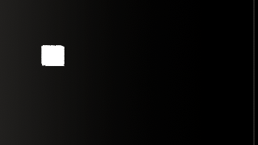
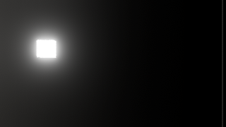
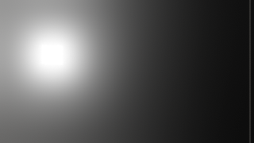
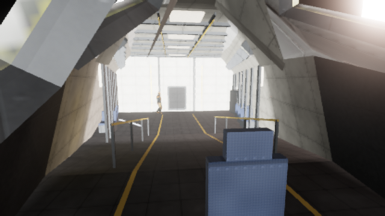
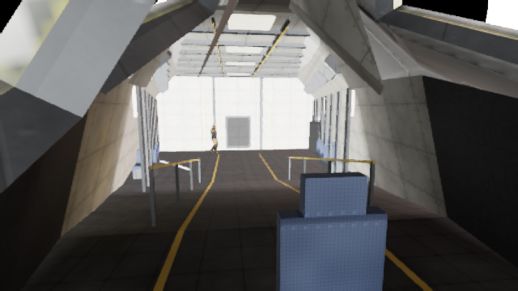

# Bloom and moving exposure

Issue [#2](https://github.com/alexispurslane/tertius/issues/2) adds a regression test. The existing renderer already isolates bloom from exposure. No engine code, shader, renderer option or runtime build configuration changes.

## The measured sequence

The test draws the same 320 × 180 view with bloom off, default bloom, and exaggerated bloom. It keeps the default screen tracer, FSR at a render scale of 2/3, automatic exposure, temporal histories, and output dither. The test enables Vulkan validation. Each renderer starts fresh.

The camera turns from +0.25 to −0.25 radians around its vertical axis. A glowing panel stands in front of an eight-stop wall reflectance ramp. At frame 30, the sunlight falls to one sixteenth of its initial irradiance. Frame 0 is the initial headless still with 32 warm-up draws. Frames 1 through 59 each advance by 1/30 second, below the 0.09-second still threshold, so they keep their histories and draw once.

The instrumented replay records the 256 histogram counts, exposure buffer, and SHA-256 digests of both HDR images after every frame. Those diagnostic reads wait for the GPU. The exposure buffer has two values: the exposure applied to the frame that just finished, and the exposure adaptation wrote for the following frame. Comparisons use the float bit patterns, not a numeric tolerance.

A separate replay draws 62 frames per bloom setting with no captures or diagnostic reads between draws. It uses the same scene, camera, times, light change and renderer options. Each delayed reading must name the expected drawn frame and match that frame's instrumented applied exposure bits. The last two draws collect the remaining readings of the 60 measured frames. Thus the capture of the instrumented last frame cannot conceal an error in normal delayed reporting.

## Results

The focused Checked run passed all 13 tests with the optional report enabled. Every measured frame has the same applied exposure bits, next exposure bits, histogram counts, metered HDR digests and upscaled HDR digests across the three bloom settings. Every histogram changes from the preceding frame, so the comparison exercises a moving view.

| Frame | Time in seconds | Applied exposure in stops, all three settings |
|---:|---:|---:|
| 0 | 0 | 1.0566953 |
| 29 | 0.9667 | 1.1504214 |
| 30, sunlight dims | 1 | 1.1570593 |
| 31 | 1.0333 | 1.2082464 |
| 59 | 1.9667 | 2.5360527 |

The meter continues to respond to actual light. From frame 30 to frame 59, applied exposure rises by 1.3789934 stops. The ramp below the lamp retains at least 10 display-code levels of contrast in every bloom setting, and its bright sample stays below code 240 out of 255.

[exposure-by-frame.csv](exposure-by-frame.csv) holds every measured frame. These final frames have matching camera, time, light and exposure:

| Bloom setting | Final frame | Mean increase in displayed luma over bloom off, codes out of 255 |
|---|---|---:|
| Off |  | 0 |
| Default |  | 15.430705479166665 |
| Exaggerated |  | 75.86539119097222 |

These images are evidence captures, not newly approved snapshot references. The mean increase measures the displayed image, not physical bloom energy. Issue #3 owns bloom calibration and brightness clipping.

## Reproduce

Run from this checkout in PowerShell 7. The report creates three final-frame PNGs and the per-frame CSV in the named directory.

```powershell
& {
    $env:TERTIUS_BLOOM_ISOLATION_REPORT = '/tmp/tertius-issue2-evidence'
    nix develop --command dotnet test --project tests/Tertius.Rendering.Tests -c Checked --filter-class '*BloomExposureIsolationTests'
}
```

The optional report test skips when the environment variable is absent. The other 12 tests still run.

## Real demo stills

Two runs of `scripts/cabin-light.json` use the converted Blue Danube art at 640 × 360, with the same simulation, cameras and defaults. One keeps default bloom and the other sets bloom off. The [default readings](demo-default-exposure.json) and [off readings](demo-off-exposure.json) have the same float bit patterns for all three captures: cabin, canopy and port window. The cabin uses −1.4052811 stops in both runs.

| Default bloom | Bloom off |
|---|---|
|  |  |

The default bloom spreads light around the bright upper-right window edge. The floor grid and seats remain visible in both captures. These stills support visual inspection. The moving automated sequence above proves temporal isolation.

With the converted art available, reproduce the stills with:

```powershell
nix develop --command dotnet run --project src/Tertius.Demo -c Checked -- --script scripts/cabin-light.json --headless --size '640x360' --out '/tmp/tertius-issue2-demo-default'
nix develop --command dotnet run --project src/Tertius.Demo -c Checked -- --script scripts/cabin-light.json --headless --size '640x360' --bloom off --out '/tmp/tertius-issue2-demo-off'
```

The actual evidence runs reused existing Checked binaries with `--no-build`. The first attempt returned the expected missing-art error. A temporary local symlink reused the converted assets from the main checkout for both successful runs. The symlink was removed afterward, and no assets were copied.

## Runtime cost and source identity

The original review base is `b0f8bbf1b3a787673f6266cfad2a4606bc0ba51c`. The tested regression commit is `9c841313daaec762d9bef59d49395d03f41fbe1f`. The cleanup hook's commit `97f52b5a7` removes an unused import and applies array declaration style.

[runtime-identities.txt](runtime-identities.txt) records the baseline and cleanup-head Git object identities. The entire `src` tree contains every runtime project and shader and keeps the object `827d8c47461945f0b599fc0e2243e41d51b755bd`. Native dependencies, analyzers, build properties, SDK selection, package versions, Nix files and editor rules also keep the same objects. Later evidence-only commits preserve those objects.

The coordinator approved omitting a Linux timing job because no runtime rendering work changes. There is no newly measured Linux A/A result. Mac runs here establish correctness only. Coverage percentages for changed production lines do not apply because there are no changed production lines. The tests require sensitivity evidence instead.

## Scripted sensitivity

[sensitivity-mutants.json](sensitivity-mutants.json) names three deliberate faults. `tools/mutate.py` applies each fault, builds and runs the tests, restores the source, then rebuilds the original assembly. The runner applies and restores every fault.

```powershell
nix develop --command python3 -I tools/mutate.py docs/research/bloom-exposure-isolation/sensitivity-mutants.json /tmp/tertius-issue2-mutants
```

The delayed fault starts after drawn frame 62, beyond the initial 32 warm-up draws and the sunlight change at moving frame 30. The other faults remove the halo or freeze exposure adaptation. 
The final scripted run killed all three mutants: 3 killed, 0 survived, 0 timeout, 0 no-coverage, 0 build-failed and 0 no-tests. [The table](sensitivity-results.md) gives one result per mutant. [The JSON](sensitivity-results.json) retains the exact replacements and reported failed tests. 
The delayed fault also fails the uninterrupted exposure comparison at moving frame 32 with default bloom, so that test independently catches bloom coupling. [The failure excerpt](uninterrupted-red.txt) records the differing exposure bits. The [full Rendering Checked run](rendering-checked.txt) passed after the runner restored and rebuilt the source: 3,609 passed, 11 skipped, 0 failed (3,620 total). The skipped tests include opt-in measurements, driver-specific checks and the known pre-existing shadow regression `LocalShadowRenderTests.AWallsSideFaceUnderARoofsEdgeTakesNoLightFromASpotLampsTile` (`t1-hdtm`). All 13 issue #2 tests ran, including the report. The three final-frame images and CSV were byte-identical to the earlier focused run.
