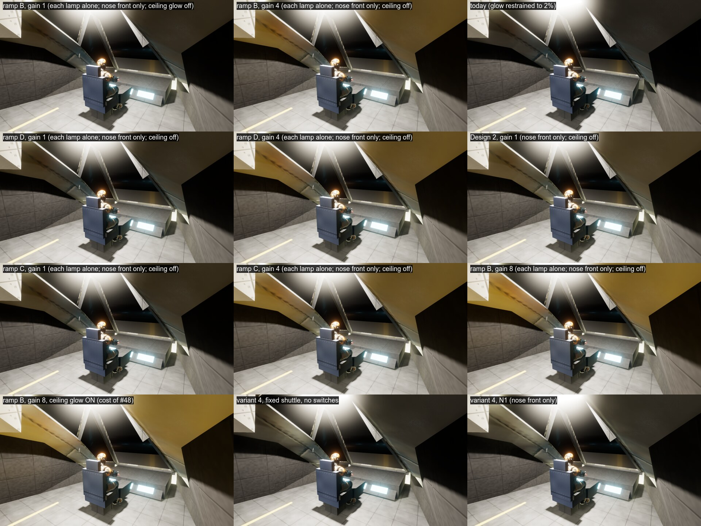
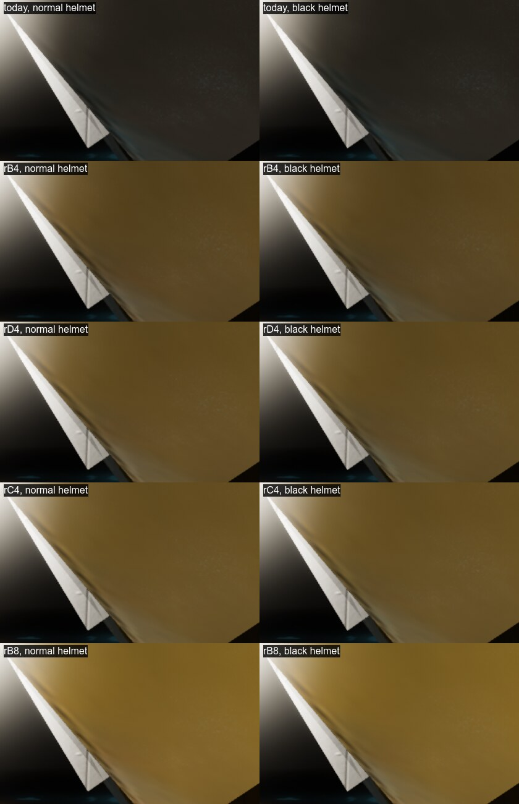

# Orange light from the pilot's helmet in the cockpit (#20)

Issue #20 asks why the 1:41 cockpit shot of the demo film lost the orange light that the pilot's helmet reflects onto
the sloped panel above it. The legacy renderer at 860685c71 showed that light. The renderer with the merged directional
light volume (main at 90a6be90d) shows less of it. This folder holds the evidence and the diagnostic tools of the
investigation. No production change for #20 came out of it.

## Result

- The helmet's light on the panel is small in both renderers. Over the panel region (`panelOrange`, a 120 × 130 px crop
  at +770+65 of the 1280 × 720 frame), the mean helmet light of 120 frames is (+1.95, +0.91, +0.31) in 8-bit sRGB levels
  in legacy and (+0.74, +0.32, +0.09) with the merged grid. Helmet light is the image with the normal helmet minus the
  image with a black helmet, at the fixed exposure 6.0043726.
- An upper bound holds the grid's possible gain to about +1.7 levels of red. The bound is the unoccluded form factor
  from the helmet to the real panel receiver sample: perfect transport of the volume's first bounce adds at most that.
- In legacy, the light comes from the panel's own reflection rays and screen trace. It does not depend on the
  specular light at the surfaces that the reflection rays hit (see "Attribution check" below).
- The grid draws the helmet's light as one narrow streak along the strut, a ray effect of its 32 discrete transport
  directions. Legacy spreads it over the lower-left half of the panel, with grain.

## Evidence

| File | What it shows |
|---|---|
| `still-frame60.jpg` | Frame 60 of the shot, legacy and merged grid. |
| `panel-means.jpg` | Top: the 120-frame mean of the canopy crop (560 × 315 px at +688+4). Bottom: helmet light × 16, where mid-gray is zero. |
| `helmet-light-by-directions.jpg` | Helmet light × 16 for legacy and for the grid with 32 current, 128 Fibonacci and 512 Fibonacci directions. |
| `hit-specular-attribution.jpg` | Helmet light × 16 for legacy and for legacy without hit-side specular light, and their difference × 64. |
| `panel-moving.mp4` | 4 s of the shot in motion: legacy, legacy with a black helmet, merged grid, merged grid with a black helmet. |

### Pixel decomposition

The composite debug modes (`tools/composite-debug-modes.patch`) split the merged grid's panel pixel at `panelOrange`.
Values are pre-exposed linear red:

| Part | Total | From the helmet |
|---|---|---|
| Direct light | 0.0359 | 0 |
| Volume diffuse light | 0.0186 | 0.00104 |
| Volume broad specular light | 0.0027 | 0.00029 |

The helmet gives about 2.3% of the pixel. The panel's roughness is 0.50, so it gets only the broad specular lobe.

### Direction count

The stored helmet light is the red diffuse lobe that the volume holds at the real panel receiver sample (position
(−0.32, +0.19, −1.11) m from the camera, normal (−0.39, −0.84, +0.38)). The share of the bound compares it with the
unoccluded form factor of 0.000065. The pass times are Mac times under load, so compare them only with each other.

| Direction set | Stored helmet light | Share of bound | Panel pixels (8-bit red) | Volume pass |
|---|---|---|---|---|
| Current 32 | 0.000030 | 46% | +0.8 | 2.15 ms |
| Fibonacci 32 | 0.000077 | 118% | +1.6 | 2.17 ms |
| Fibonacci 128 | 0.000047 | 72% | +0.8 | 3.60 ms |
| Fibonacci 512 | 0.000043 | 66% | +0.8 | 10.69 ms |

The 512-direction result converges near 66% of the bound. Fibonacci 32 overshoots the bound because one of its
directions lines up with the helmet. More directions change the stored radiance, but the panel's pixels change by less
than one level.

### Attribution check

In legacy, `leavingLightOf` in `screen_trace.glsl` gives a reflection ray the diffuse light at the hit point plus the
hit point's specular factor times its direct specular and specular history. The volume's source holds only diffuse
light and emission. The check removes the specular part (`tools/legacy-no-hit-specular.patch`, which sets
`vec3 reflection = light;`) and renders the same shot with and without the black helmet.

| Legacy variant | Helmet light at `panelOrange` (8-bit RGB) | Helmet light in the canopy-crop map at the same region, ÷ 16 |
|---|---|---|
| Unmodified | (+1.95, +0.91, +0.31) | (+1.70, +0.85, +0.33) |
| Without hit-side specular | (+1.95, +0.92, +0.31) | (+1.70, +0.86, +0.33) |

The two maps in `hit-specular-attribution.jpg` match in shape. Their difference is grain, with a mean under 0.01 levels.
So the difference between legacy and the grid does not come from the hit-side specular light. The two columns
measure the region on different images (the full frames, and the 120-frame mean crop), so they differ from each other.

Remaining uncertainty: the check removes the specular light at the hit points only. It does not test legacy's
temporal accumulation or its screen-space ray footprint, which also shape where the light lands.

## Current code after #22 (2026-11-28)

The same film on the tested #22 candidate `3b9e7c8ff`, with the same black-helmet control. `tools/helmet_map.py` takes
the difference of the two 120-frame means.

| Renderer | Panel, normal helmet (8-bit) | Helmet light on the panel (8-bit) | Pixels with helmet red > 1 / > 4 levels | Summed helmet red outside the helmet (level × pixels) |
|---|---|---|---|---|
| Previous production `860685c71` | (50.1, 49.1, 44.6) | (+1.95, +0.91, +0.31) | 90,559 / 12,893 | 358,400 |
| Merged grid `90a6be90d` | (41.4, 38.2, 31.7) | (+0.74, +0.32, +0.09) | 60,759 / 10,691 | 303,032 |
| Current `3b9e7c8ff` | (39.0, 35.9, 29.3) | (+0.90, +0.40, +0.13) | 85,670 / 28,533 | 456,812 |
| Current, restraint off (`NeutralSourceShare` = 1) | (154.1, 147.6, 130.6) | (+0.28, +0.13, +0.05) | 38,205 / 9,449 | 239,887 |

`current-three-renderers.jpg` shows the means and the helmet light × 16 of the first three rows. The current code
spreads more of the helmet's light than legacy in total. Most of it lands on the beam above the helmet and in the strip
of canopy along the strut's lower edge.

`tools/hdr_panel.py` reads the scene-linear HDR target of frame 60, before the tone map and bloom:

| Region | Light with the black helmet | Helmet light | Hue and saturation of the helmet light | Other light ÷ helmet light (red) |
|---|---|---|---|---|
| `panelOrange` | (0.00091, 0.00083, 0.00066) | (+0.000026, +0.000010, +0.000002) | 21°, 0.92 | 35 |
| `panelMid` | (0.00094, 0.00084, 0.00066) | (+0.000015, +0.000006, +0.000001) | 21°, 0.91 | 65 |

The helmet's light reaches the panel with its hue. It is about 3% of the panel's light, and the rest is mostly the
cabin lamp's direct light.

### The restraint

`tools/helmet_buckets.py` reads the volume's cell faces that hold the helmet. In the 0.25 m grid, the two upward faces
that carry most of the helmet's light hold 74% and 76% helmet reflectance. Their summed reflectance has saturation 0.88,
so `restrainNeutral` keeps all of it. The restraint removes 6% of the helmet's red light in that grid (0.0733 against
0.0781 with the restraint off). In the 0.5 m and 1 m grids the helmet shares its faces with neutral surfaces, and the
restraint keeps 2% (#42). The panel reads only the 0.25 m grid, so #42 does not explain the panel.

With the restraint off, the helmet's light on the panel rises by 12% and the panel's other light by 7.4 times
(`restraint-off-control.jpg`). The dark canopy turns beige, and the teal edge of the strut disappears.

## Related work

- #22 records a separate defect of the volume: the coarse grids shade the finer surfaces that they inherit at one
  point per tile and restrain their color after mixing. A tested prototype is on this branch as its own commit. It
  raises the helmet's stored light in the 0.5 m grid from 0.0043 to 0.0225 and in the 1 m grid from 0 to 0.0056. It does not
  visibly change the panel's pixels, so it does not fix #20.
- #21 is the hallway range study. It is independent of this work.

## Tools

The tools are diagnostic only. Paths inside them point at the scratch checkouts of the investigation.

| File | Use |
|---|---|
| `helmet-control2.py` | Patches `GlbReader.cs` to recolor one texture, chosen by its encoded size, through `TERTIUS_DEBUG_RECOLOR_BYTES=1637884` (the helmet) and `TERTIUS_DEBUG_RECOLOR_MODE` = `black`, `gray` or `blue`. The black helmet keeps its geometry and shadow. |
| `legacy-no-hit-specular.patch` | The attribution check on 860685c71, with the recolor control. |
| `composite-debug-modes.patch` | `TERTIUS_DEBUG_COMPOSITE` = 1 position, 3 geometric normal, 4 volume diffuse, 5 broad specular, 6 roughness and factors, 7 direct light. |
| `render2.sh` | Renders a script headless at the fixed exposure under the shared GPU lock. |
| `cockpit.json`, `cockpit61.json` | Scripts that reach the 1:41 shot. |
| `measure.sh`, `meanpanel.sh` | Region means and the 120-frame mean crop. |
| `helmet_at_panel.py`, `analytic.py` | The receiver sample and the form-factor bound. |
| `fib-dirs.py` | Patches the volume to use N Fibonacci directions with equal weights. |

The blue helmet is not a fair control. Under the warm cabin lamp, a mixed blue bucket reaches saturation 0.61, so the
volume's color restraint keeps about 6% of it. The black helmet has no such asymmetry.

## The cockpit cases of the #42 ramps (2026-11-28)

The 1:41 shot at the fixed exposure of 6.0043726 stops, 1280 × 720, the mean of 120 frames, with the helmet's light as
normal minus black helmet. The cases ran on #42 commit 3ce85da6d with `tools/cockpit-cases-ramp.patch`. Every ramp case
judges each lamp alone (`RESTRAINT_LAMPS 1`). Glow is unrestrained in every case except today. Two research switches
are on unless a caption says otherwise:

- `NOSE_GLOW 2`: the nose lamps glow from their front side only. It stands in for the asset fix of `shuttle_cabin.py`
  (bug #47).
- `CEILING_GLOW 0`: the two small ceiling glow0 patches send no glow, because #48 puts their light falsely on the panel.

| Case | Panel (8-bit) | Helmet's light on the panel (8-bit) | Helmet's light, linear | Hue, saturation | Other light / helmet red | Dark wall right of the strut, change | Floor, change |
|---|---|---|---|---|---|---|---|
| today | (39.0, 35.9, 29.3) | (+0.90, +0.40, +0.13) | (+0.000026, +0.000010, +0.000002) | 21°, 0.92 | 34.8 | 0 | 0 |
| Design 2, gain 1 | (71.9, 60.0, 37.4) | (+0.62, +0.26, +0.04) | (+0.000025, +0.000008, +0.000000) | 21°, 1.00 | 81.8 | (+10.2, +7.4, +2.1) | (+2.9, +2.9, +2.1) |
| ramp B, gain 1 | (46.4, 40.0, 28.0) | (+0.73, +0.29, +0.04) | (+0.000023, +0.000008, −0.000000) | 20°, 1.00 | 49.7 | (+3.0, +1.8, −0.4) | (+2.4, +2.5, +2.0) |
| ramp B, gain 4 | (86.2, 67.3, 32.8) | (+2.08, +0.92, +0.13) | (+0.000090, +0.000031, +0.000000) | 20°, 1.00 | 28.1 | (+17.8, +11.5, +0.9) | (+2.5, +2.6, +2.1) |
| ramp B, gain 8 | (124.0, 96.2, 38.7) | (+2.99, +1.47, +0.26) | (+0.000182, +0.000062, +0.000000) | 20°, 1.00 | 24.2 | (+34.0, +22.9, +3.1) | (+2.7, +2.7, +2.2) |
| ramp D, gain 1 | (49.9, 42.5, 28.7) | (+0.69, +0.28, +0.04) | (+0.000023, +0.000008, −0.000000) | 20°, 1.00 | 54.0 | (+4.1, +2.6, −0.3) | (+2.5, +2.6, +2.0) |
| ramp D, gain 4 | (95.4, 74.7, 35.2) | (+1.94, +0.88, +0.13) | (+0.000092, +0.000032, +0.000000) | 20°, 1.00 | 32.0 | (+20.5, +13.8, +1.9) | (+2.8, +2.8, +2.1) |
| ramp C, gain 1 | (52.5, 44.4, 29.2) | (+0.69, +0.27, +0.03) | (+0.000023, +0.000008, −0.000000) | 20°, 1.00 | 57.2 | (+4.8, +3.1, −0.1) | (+2.6, +2.6, +2.0) |
| ramp C, gain 4 | (102.3, 80.3, 36.9) | (+1.82, +0.83, +0.14) | (+0.000092, +0.000032, +0.000000) | 20°, 1.00 | 35.6 | (+22.9, +15.7, +2.4) | (+2.9, +2.9, +2.1) |
| ramp B, gain 8, ceiling glow on | (134.5, 108.8, 52.4) | (+2.59, +1.27, +0.27) | (+0.000183, +0.000063, +0.000000) | 21°, 1.00 | 27.8 | (+38.6, +27.8, +5.5) | (+3.5, +3.6, +2.9) |
| variant 4, N1 (no shuttle fix) | (60.2, 56.0, 43.6) | (+0.74, +0.32, +0.11) | (+0.000027, +0.000011, +0.000002) | 21°, 0.93 | 58.6 | (+4.3, +4.0, +2.5) | (+3.2, +3.2, +2.7) |
| variant 4, fixed shuttle, no switches | (55.0, 51.0, 40.0) | (+0.77, +0.34, +0.10) | (+0.000027, +0.000011, +0.000002) | 21°, 0.93 | 51.9 | (+1.0, +1.0, +0.3) | (+1.4, +1.5, +1.1) |

The changes are against today. "Dark wall right of the strut" is the region `darkCanopy` of `tools/cases_table.py`.
`captures/issue20/cases/cockpit-cases-table.md` holds the full table with the left wall and the console.

What the cases show:

- The helmet's orange does not become visible on the panel in any case. At gain 4 its light grows 3.5 times in linear
  units, and at gain 8 seven times, because the gain multiplies the colored bounce. But the whole panel turns gold at
  the same time, so the helmet's share stays near today's (other light ÷ helmet red: 24 to 36 at gains 4 and 8, against
  34.8 today). In `cockpit-ramp-panel-crops.jpg`, the panel with the normal helmet and with the black helmet look the
  same in every case.
- The gold wash at gains 4 and 8 does not come from the helmet. The black-helmet frames carry it equally.
- The dark wall right of the strut stays dark at gain 1 (+3 to +5 red) and turns gold at gain 4 (+18 to +23 red) and
  gain 8 (+34). The black of space through the canopy stays black in every case.
- No colored light on the far side of a wall or under the floor line was seen. The floor's change stays neutral and
  does not grow with the gain (+2.4 to +2.9 red from gain 1 to gain 8).
- The ceiling patches (#48) cost the gain 8 case 10 more levels of red on the panel and 3 more on the console.
- The fixed shuttle lights the cabin a little less than N1, because the ceiling patches' back sides no longer glow
  either.

