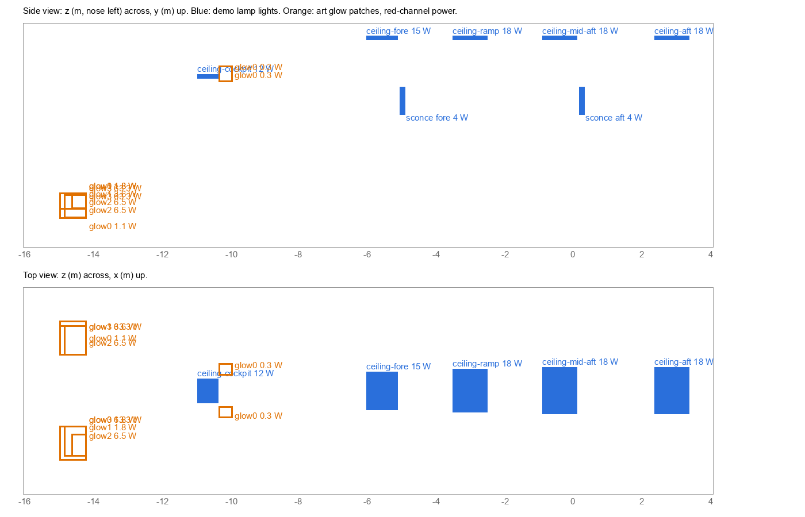

# The shuttle art's glow against the demo's lamps

With unrestrained glow (#42 variant 4) the 1:41 cockpit gets warm-gray fill: the dark canopy rises from (8.5, 7.4, 5.7)
to (28.5, 26.7, 19.3) 8-bit levels (`glow-decision-cockpit.jpg`). The cockpit's only gray self-lit surfaces without a
light are the four glow materials of the shuttle art (`self-lit-surfaces.md`). This check asks whether those glows are
the art's own lamp faces at the places of the demo's lamp lights, which would count each lamp twice.

## Result: case (b), separate self-lit surfaces with no light

No glow patch coincides with a demo lamp.

- **The nose lamps.** Eight of the ten patches sit on the nose outside the cabin: z from −14.94 to −14.15 m, y from
  −2.18 to −1.42 m (below the cockpit floor at −0.50 m), |x| from 1.03 to 2.03 m, two groups of four, one on each side.
  They face forward, outward and partly up. Their red-channel power is 73.4 W on the port side and 74.5 W on
  starboard, about 148 W in all. The two `glow3` patches give 127 W of it. The nearest demo lamp, `lamp-ceiling-cockpit` (12 W), is about
  4 m behind them and 3.7 m higher. No demo light stands at the nose.
- **Two small patches** of `glow0` sit near the cockpit ceiling: centers (±0.62, +2.03, −10.13) m, 0.023 m² each,
  0.32 W red each. `lamp-ceiling-cockpit` has its center at (0, +1.955, −10.65) m. The centers are 0.81 m apart, and the
  boxes do not overlap. Each patch gives 2.7% of that lamp's red power.

So the full glow does not count a demo lamp twice. It adds about 148 W of warm light at the nose, more than all nine
cabin lamps together (97 W). How that light reaches the cabin (through the cockpit windows, or through cells of the
coarser grids that straddle the hull) needs a render. The geometry alone does not decide it.

## The patches

Positions are in the shuttle's frame: the art's axes times `ArtScale` 1.6 plus `ArtPlace` (0, 0, 1) m
(`DemoScenes.Shuttle`). Every glow material is double-sided. Power is π × emission × area per channel, for one side.

| Material | Triangles | Area (m²) | Min (x, y, z) | Max (x, y, z) | Facing | Emission (W/(m²·sr)) | Power per channel (W) |
|---|---|---|---|---|---|---|---|
| lunarshuttle_fuselage.glow0 | 3 | 0.132 | (-2.03, -2.18, -14.94) | (-1.03, -1.42, -14.15) | (-0.64, +0.73, -0.24) | (4.45, 4.08, 2.47) | (1.84, 1.69, 1.02) |
| lunarshuttle_fuselage.glow0 | 1 | 0.023 | (+0.45, +1.80, -10.33) | (+0.79, +2.26, -9.93) | (+0.21, -0.56, -0.80) | (4.45, 4.08, 2.47) | (0.32, 0.30, 0.18) |
| lunarshuttle_fuselage.glow0 | 1 | 0.023 | (-0.79, +1.80, -10.33) | (-0.45, +2.26, -9.93) | (-0.21, -0.56, -0.80) | (4.45, 4.08, 2.47) | (0.32, 0.30, 0.18) |
| lunarshuttle_fuselage.glow0 | 2 | 0.078 | (+1.03, -2.18, -14.94) | (+2.03, -1.88, -14.15) | (-0.05, +0.94, -0.33) | (4.45, 4.08, 2.47) | (1.09, 1.00, 0.61) |
| lunarshuttle_fuselage.glow1 | 1 | 0.049 | (-1.90, -1.89, -14.59) | (-1.25, -1.42, -14.15) | (+0.21, -0.80, -0.57) | (11.28, 10.73, 6.63) | (1.75, 1.66, 1.03) |
| lunarshuttle_fuselage.glow1 | 2 | 0.103 | (+1.03, -2.18, -14.94) | (+1.90, -1.42, -14.15) | (+0.53, -0.80, -0.28) | (11.28, 10.73, 6.63) | (3.65, 3.47, 2.14) |
| lunarshuttle_fuselage.glow2 | 3 | 0.116 | (-1.90, -2.17, -14.80) | (-1.03, -1.42, -14.15) | (-0.64, +0.73, -0.24) | (17.82, 16.76, 10.99) | (6.50, 6.11, 4.01) |
| lunarshuttle_fuselage.glow2 | 3 | 0.116 | (+1.03, -2.17, -14.80) | (+1.90, -1.42, -14.15) | (+0.64, +0.73, -0.24) | (17.82, 16.76, 10.99) | (6.50, 6.11, 4.01) |
| lunarshuttle_fuselage.glow3 | 2 | 0.390 | (-1.90, -2.15, -14.80) | (-1.03, -1.48, -14.15) | (-0.57, +0.12, -0.81) | (51.65, 49.48, 34.51) | (63.30, 60.64, 42.30) |
| lunarshuttle_fuselage.glow3 | 2 | 0.390 | (+1.03, -2.15, -14.80) | (+1.90, -1.48, -14.15) | (+0.57, +0.12, -0.81) | (51.65, 49.48, 34.51) | (63.30, 60.64, 42.30) |

The demo's lamp lights (`DemoScenes.Shuttle.cs`, `CeilingLamps`, `Lamps`, `SpawnLamps`), color (1, 0.9, 0.75):

| Lamp | Box or place (m) | Power (W) |
|---|---|---|
| `lamp-ceiling-aft` | (−0.65, 3.04, 2.30) to (0.65, 3.09, 3.30) | 18 |
| `lamp-ceiling-mid-aft` | (−0.65, 3.04, −0.95) to (0.65, 3.09, 0.05) | 18 |
| `lamp-ceiling-ramp` | (−0.60, 3.04, −3.55) to (0.60, 3.09, −2.55) | 18 |
| `lamp-ceiling-fore` | (−0.52, 3.04, −6.05) to (0.52, 3.09, −5.15) | 15 |
| `lamp-ceiling-cockpit` | (−0.32, 1.93, −10.95) to (0.32, 1.98, −10.35) | 12 |
| `lamp-{port,starboard}-fore` | side walls, y 1.25, z −5.0 | 4 each |
| `lamp-{port,starboard}-aft` | side walls, y 1.25, z +0.2 | 4 each |

## Why the once-only rule does not cover the art's glow

`glowSent(emissive, holdsLight)` in `frame.glsl` returns the material's emission when `holdsLight` is 0, and zero
otherwise. `volume_surface.frag` captures that value, so it is what enters the volume. `holdsLight` is per entity:
`SceneBatcher.CollectLightHolders` puts into `lightHolders` the entity of each light in the frame's snapshot, and each
drawn instance gets `holdsLight: lightHolders.Contains(instance.Entity)`.

The demo's lamps are their own entities (`lamp-ceiling-*`, `lamp-*-*`). Each holds its `RenderData.Light` and draws its
own panel mesh with `LampPanelMaterial`, so that panel's glow is not sent. The art's glow triangles belong to the entity
`shuttle-art` (`SpawnArt`), which holds no light. So every glow material of the art is sent, wherever it sits. The rule
knows "this entity holds a light", not "this surface is the face of a light".

Tools: `tools/art_glow_patches.py` prints the patches, and `tools/art_glow_map.py` draws the views.
