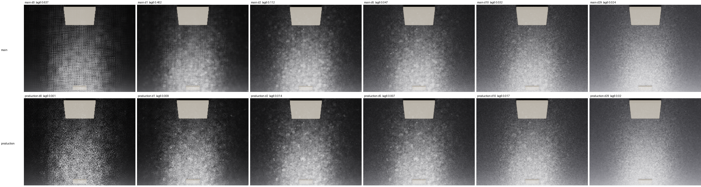

# The turned squares in production (t1-3er4), stage 2 record

## Result

The production build removes the grid after a camera cut. On the cut onto the nose, the autocorrelation at a lag of 6 output pixels falls from 0.637 to 0.001 at d0. At d1 it falls from 0.402 to 0.009. The brightness, the specks, the shimmer, the lamp edge and the glossy floor stay as on main. A cut draw costs about 0.08 to 0.10 ms more GPU time. Two runs give the same 126 frames, byte for byte.

## What production does

Step 3 of `accumulate_spatial.comp`, the short-history fix, takes the length-weighted mean of 9 taps when a history is shorter than 4 draws. Main reads an axis-aligned 3 × 3 square of taps. The taps are 4, 2 and 1 render pixels apart in the draws d0, d1 and d2 after a reset. Production changes only the specular signal at spacings 4 and 2:

- The fix turns each pixel's square. The taps are ±u, ±v, ±(u+v) and ±(u−v), with u the turned spacing vector and v the vector u turned by 90°, rounded to whole pixels.
- At spacing 4, the pixel takes one of 8 turns, from 0° to 78.75° in steps of 11.25°. The top 3 bits of the blue-noise mask's radial byte choose the turn.
- At spacing 2, the pixel takes one of 4 turns, 0°, 26.57°, 45° and −26.57°, from the top 2 bits of the same byte.
- The mask frame is `(drawIndex + 32) mod 64`, half a period ahead of the frame that the rays and the dither read.
- The diffuse signal and spacing 1 keep the axis-aligned square.

The shader packs the 12 turns into three `uvec4` constants, one signed 4-bit number per offset component. "GPU cost" says why.

## Method

The production build is this branch in Release, `prod-bin`. The main build is `e9e0dc043` in Release, `main-bin`. Its nose take matches the stage 1 main take byte for byte.

Each take used the stage 1 method (`../README.md`, "What the record measures"): `Tertius.Demo --headless --size 1920x1080 --render-scale 0.6667 --video film.mkv --fps 60`. The scripts are the committed cut scripts of ter-fe63, at −1.7507 stops for the nose and 3.83 stops for the lamps. The measures are the stage 1 tools, unchanged. `tools/take.sh` and `tools/batch.sh` here add only the variable `TAKES`, which names the folder of the takes.

## The cut onto the nose, −1.7507 stops

| Draw | Lag 6, main | Lag 6, production | Lag 12, main | Lag 12, production | ROI linear luminance, main | ROI linear luminance, production |
|---|---|---|---|---|---|---|
| d0 | 0.637 | 0.001 | 0.396 | 0.070 | 0.03475 | 0.03469 |
| d1 | 0.402 | 0.009 | 0.187 | 0.037 | 0.04144 | 0.04251 |
| d2 | 0.112 | 0.014 | 0.063 | 0.063 | 0.05600 | 0.05629 |
| d5 | 0.047 | 0.007 | 0.070 | 0.066 | 0.06698 | 0.06711 |
| d10 | 0.032 | 0.017 | 0.052 | 0.050 | 0.08836 | 0.08845 |
| d29 | 0.024 | 0.020 | 0.048 | 0.053 | 0.13567 | 0.13571 |

The ROI is the stage 1 region on the ceiling, 148 × 220 output pixels.

The other measures on the nose:

| Measure | Main | Production |
|---|---|---|
| Linear luminance of the cone box, d0 | 0.08645 | 0.08678 |
| Specks in the cone box, d0 | 18,716 | 17,034 |
| Specks, median of d0..d29 | 4,193 | 4,200 |
| Specks, median of d30..d64 | 858 | 829 |
| Shimmer, d0..d14 / d15..d29 / d30..d64 | 7.863 / 2.080 / 1.422 | 7.904 / 2.084 / 1.422 |

The lag 12 at d0 stays at 0.070. Stage 1 found the source of the lag-12 streaks outside step 3 ("Open points", item 2).

Main's d0 and d1 show the regular square groups. Production's d0 shows irregular grain with no lattice. Its d1 shows a few small ring-shaped clusters, the turned squares of single bright samples. From d2, the two builds look alike. `pics/nose-zoom-main-production-2x.png` shows d0 and d1 at twice the size.

## The cut onto rect-lamps' glossy floor, 3.83 stops

| Draw | Floor grain, main | Floor grain, production | Floor linear luminance, main | Floor linear luminance, production |
|---|---|---|---|---|
| d0 | 0.02221 | 0.01998 | 0.16608 | 0.16606 |
| d1 | 0.01387 | 0.01351 | 0.16391 | 0.16380 |
| d2 | 0.01091 | 0.01096 | 0.16366 | 0.16360 |
| d5 | 0.01446 | 0.01453 | 0.16466 | 0.16464 |
| d29 | 0.01091 | 0.01092 | 0.17060 | 0.17059 |
| d64 | 0.00968 | 0.00967 | 0.17428 | 0.17428 |

The floor's shimmer is 0.876, 0.767 and 0.751 on main and 0.877, 0.767 and 0.751 in production, over d0..d14, d15..d29 and d30..d64. `pics/lamps-strip-main-production-1x.png` shows the floor at d0, d1, d2, d5, d10 and d29. The two rows look the same.

## Edges, block seams and settled frames

The lamp edge on the nose ceiling stays the same (`tables/edge-leak.json`). At d0, the mean luma of the band 1 to 6 pixels outside the lamp is 112.47 on main and 112.53 in production. In that band, 912 and 911 pixels are above 150. `pics/edge-lamp-main-production-3x.png` shows a sharp edge in both builds.

The block seams stay the same (`tables/seam-profile.json`). The seam ratio is the luma step at the block border over the mean step of the other phases. It is 1.014 by column and 0.989 by row on main, and 1.015 and 0.980 in production.

Settled frames are not byte-identical to main, because the slow history keeps a share of d0 to d3. On the nose crop, the mean absolute luma difference to main is 0.691 at d29 (maximum 29) and 0.361 at d64 (maximum 18). On the lamps crop, it is 0.139 at d29 (maximum 3) and 0.078 at d64 (maximum 2).

## Repeatability

| Pair of runs | Frames the same, byte for byte |
|---|---|
| Production, two runs, nose cut | 126 of 126 |
| The first production shader against the final shader, nose cut | 126 of 126 |
| The first production shader against the final shader, lamps cut | 126 of 126 |

The first production shader read the turns from constant arrays. The final shader reads the packed words. Both give the same frames, so the tables and pictures above hold for the final shader. `tables/determinism.json` holds the SHA-256 of d0, d29 and d64 of each take.

## GPU cost

`tools/timing.sh` times main against production in one exclusive hold of the GPU lock. Each run waits for a 1-minute load under 8, for 60 s at most. The size is 1920 × 1080, the render scale 0.6667, with two frames in flight and pass timestamps on.

- The cut bursts (`tools/scripts/cut-burst-*.json`) repeat 8 cuts. Each films the far camera's first draw and the person camera's first 4 draws, d0 to d3. The person camera's d3 has histories of 4 draws and no fix, so the fix runs in 32 of the 40 timed draws. The order is main, production, production, main.
- The steady runs (`tools/scripts/steady-*.json`) film 40 draws from a start. Their median is a settled draw. The order is production, main.

A single pass's time is not valid on MoltenVK, because its timestamps latch late. The run of neighboring passes from `accumulate indirect specular` to `composite` is valid. The table gives medians in ms.

| Run | Main, full frame | Production, full frame | Main, accumulate specular..composite | Production, accumulate specular..composite |
|---|---|---|---|---|
| Cut, nose | 26.940, 26.848 | 26.997, 26.983 | 1.319, 1.295 | 1.156, 1.155 |
| Cut, lamps | 28.013, 27.990 | 28.097, 28.068 | 1.329, 1.328 | 1.346, 1.341 |
| Steady, nose | 16.055 | 16.065 | 1.621 | 1.653 |
| Steady, lamps | 15.988 | 16.074 | 1.616 | 1.641 |

A cut draw costs 0.096 ms more on the nose and 0.081 ms more on the lamps, as the difference of the means of the two runs. Main's two nose runs differ by 0.092 ms, so the cost is near the run-to-run spread. The span of the accumulator is shorter in production on the nose. Main's own span on the nose was 0.786 and 1.119 ms in the first hold, so this span does not resolve a difference of 0.1 ms. The steady draws differ by 0.010 and 0.086 ms. Their fix runs only at pixels with young histories.

The record took two exclusive holds, not one. The first hold, at 15:11 for 128 s, measured the first production shader. It read the turns from a constant `ivec2[32]` array and an `ivec2[4]` array with an index that the shader computes at run time. On Metal, such an array cost every invocation of the dispatch, also in the steady draws where the fix does not run:

| Run | Main, full frame | First production shader, full frame | Main, accumulate specular..composite | First production shader, accumulate specular..composite |
|---|---|---|---|---|
| Cut, nose | 26.825, 26.925 | 40.774, 40.873 | 0.786, 1.119 | 6.618, 6.613 |
| Cut, lamps | 28.019, 28.036 | 41.723, 41.832 | 1.337, 1.334 | 6.640, 6.679 |
| Steady, nose | 16.094 | 23.059 | 1.628 | 5.023 |
| Steady, lamps | 16.046 | 22.995 | 1.612 | 5.001 |

The final shader packs each turn's four offsets into one 32-bit word of a `uvec4` constant and reads the word by a vector component. The second hold, at 15:18 for 155 s with a load of 8.17 at its start, measured the final shader. Its numbers are in the first table. `tables/gpu-timing.json` holds both holds.

## Test hardening

### Behavior tests

`tests/Tertius.Rendering.Tests/ShortHistoryFixRenderTests.cs` runs the real accumulator on a wall of 256 × 128 render pixels. The wall has one bright sample in each cell of 16 × 16 pixels. The tests and the decisions that they lock in:

| Test | Decision |
|---|---|
| `ASpecularShortHistorySpreadsMostOfABrightSampleOffTheSquaresLattice` | At spacings 4 and 2, more than half of a bright sample's light lands off the axis-aligned square. |
| `TheDiffuseShortHistorySpreadsEachBrightSampleOverTheAxisAlignedSquare` | The diffuse signal keeps the square at spacings 4, 2 and 1. |
| `ASpecularBrightSampleReachesNoFartherThanTheSpacingAndAHalf` | The footprint stays within 6 pixels at spacing 4 and 3 at spacing 2. |
| `AtSpacingOneTheSpecularShortHistoryKeepsTheSquare` | Spacing 1 keeps the square. |
| `AConstantSpecularSampleStaysExactlyConstantThroughTheFix` | The weights sum to the same value for each turn. |
| `ASpecularBrightSampleSendsNoLightAcrossADepthEdge` | The turned taps keep the surface test. |
| `OverTheMasksPlacesAndPhasesASpecularBrightSampleKeepsItsLightOnAverage` | Over 8 draws and 84 cells each, the mean light of a bright sample stays 1 within 0.04. |
| `AContinuouslyShortSpecularHistoryTurnsItsSquaresFromDrawToDraw` | The turn changes with the draw index. |
| `TheSpecularFixTakesEachPixelsTurnFromTheMaskFrameHalfAPeriodAheadOfTheDraw` | A CPU reference model of the mask gives each pixel's receivers at draws 0, 31, 32 and 33. |
| `AtSpacingTwoTheSpecularFixTakesOneOfFourTurnsFromTheMask` | Spacing 2 takes the top 2 bits of the radial byte. |
| `EverySpecularHistoryTurnsTheSquareWithoutAValidationMessage` | The original, precise-capped and precise-uncapped histories, each with the screen tracer on and off, run with no validation message. |

`tests/Tertius.Rendering.Tests/AccumulatePushConstantsTests.cs` checks that the push constants carry the draw index modulo 2^32 and the ring layer. Its cases are 0, 37, `int.MaxValue + 5` and `uint.MaxValue + 3`.

### Coverage

The only C# change is the assignment of `DrawIndex` in `AccumulatePushConstants.Of`. The push-constant test runs it, and mutant C01 shows that the test checks it. Coverlet does not see GLSL, so the mutants below cover the shader's branches.

### Mutation testing

`tools/mutate.py` ran the 18 mutants of `tables/mutants.json` against `ShortHistoryFixRenderTests` and `AccumulatePushConstantsTests`. `tables/mutation-results.json` holds each result. The score is 16 killed, 2 survived.

| Id | Change | Result |
|---|---|---|
| G01 | The diffuse signal turns too. | Killed |
| G02 | Spacing 2 keeps the square. | Killed |
| G03 | Spacing 1 takes a turn of spacing 4. | Killed |
| G04 | No phase: the mask frame of the rays and the dither. | Killed |
| G05 | A phase of a quarter period. | Killed |
| G06 | Spacing 2 takes 2 turns (`>> 7u`). | Killed |
| G07 | Spacing 4 takes 4 turns (`>> 6u`). | Killed |
| G08 | The angle byte for the radial byte. | Killed |
| G09 | One packed offset changed, u.x of the 11.25° turn 5 for 4. | Killed |
| G10 | The two halves of the spacing-4 words swapped. | Killed |
| G11 | The taps u+v and u−v swapped. | Survived: equivalent |
| G12 | The v taps become the center. | Killed |
| G13 | y read as x. | Killed |
| G14 | The offsets read 2 times too big. | Killed |
| G15 | The axis-aligned square read from the all-zero word. | Killed |
| G16 | The fix ignores the surface test. | Killed, after the edge test changed |
| G17 | The fix reads outside the image. | Survived: judgment call |
| C01 | No draw index in the push constants. | Killed |

G11 is an equivalent mutant. The swap gives the pixel the same set of taps, {±(u+v), ±(u−v)}, so only the order of two additions changes.

G17 is a judgment call. Vulkan does not define a read outside the image unless the device enables robust image access. MoltenVK returns zero, the surface test then fails, and the tap drops out as before. No test on this Mac can see the difference, and the guard stays because the Vulkan spec requires it.

G16 first failed to compile, because its replacement left one closing parenthesis too many. With the corrected replacement it survived. The edge test put its bright samples 6 to 9 pixels right of the edge, and a near-wall pixel reaches at most 6 pixels. So no tap of a near-wall pixel reached a bright sample. The edge test now lights a stripe of the 4 far-wall columns next to the edge. It passed on the production shader and killed G16 at both spacings.

## Files

- `tables/`: `nose-summary.json`, `lamps-summary.json`, `edge-leak.json`, `seam-profile.json`, `determinism.json`, `gpu-timing.json`, `mutants.json` and `mutation-results.json`.
- `pics/`: the nose and lamps strips at 1x, the nose zoom at 2x, the lamp edge at 3x, and two films, `nose-film-main-production.mp4` and `lamps-film-main-production.mp4` (H.264, CRF 12, 60 fps, 65 frames from d0, main on the left).
- `tools/`: `take.sh` and `batch.sh` (the stage 1 tools with `TAKES`), `timing.sh` (the exclusive timing hold) and `scripts/` (the four timing scripts). `timing.sh` reads its scripts from `/private/tmp/t1-3er4/timing/scripts`.

To repeat the takes: build `src/Tertius.Demo` in Release on this branch and on `e9e0dc043` into `/private/tmp/t1-3er4/prod-bin` and `main-bin`. Then run, in the dev shell, `TAKES=/private/tmp/t1-3er4/takes2 tools/batch.sh real-cut-nose -1.7507 "nose-main:main-bin:" "nose-prod:prod-bin:"` and the same for `real-cut-lamps` at 3.83, then `../tools/analyze.py`, `../tools/seams.py`, `../tools/edges.py` and `../tools/zoom.py` over the takes.
