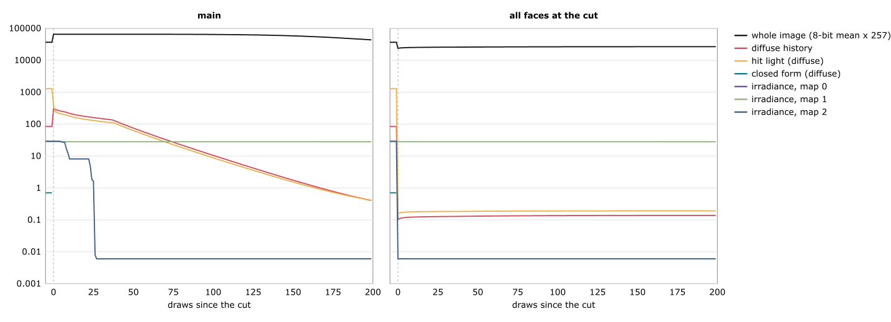
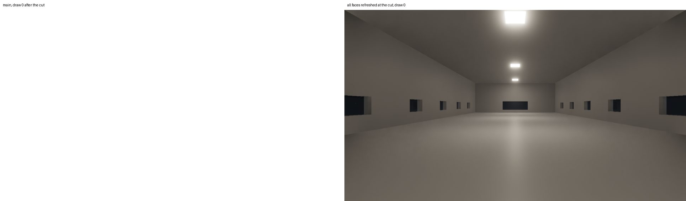
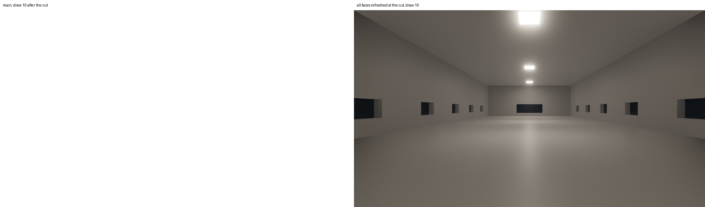
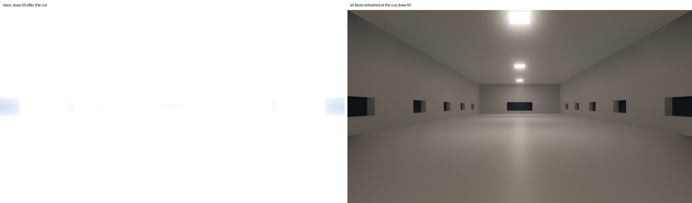

# The white room after a cut from outside (t58-rcd6)

A diagnosis record of bug t58-rcd6. A cut from the chase camera outside the ship to the person camera in the cabin keeps the cabin saturated white for over 100 draws. This record tests one hypothesis: the cabin's environment map still holds the light that it saw from outside the hull, because the cut does not refresh it. The record designs no fix.

## Result

The hypothesis holds. The cabin's map, map 2, holds the exterior's light at the cut, at about 4,800 times its true irradiance. A variant that refreshes every face of every map in the draw that resets the histories removes the white room from the first draw.

| | Main | All faces refreshed at the cut |
|---|---|---|
| Whole image, draw 0 | 65,535 (white) | 23,587 |
| Whole image, draw 199 | 43,597 | 26,701 (settled) |
| Map 2's irradiance, draw 0 | 29.14 | 0.00603 |
| Diffuse history, draw 0 | 309 | 0.103 |



## Why the map keeps the exterior's light

Every map is captured at the eye (docs/plans/environment-maps-per-frame.md, decisions 3 and 4). On both cameras the served chain is the same three frames: 4294967296, 4294967297 and 4294967299. So `EnvironmentChain.Keeps` (decision 9) keeps every map at the cut, because it compares only frames:

```csharp
    public static bool Keeps(ReadOnlySpan<long> drawnFor, ReadOnlySpan<long> served, int map)
    {
        bool sameFrame = map < drawnFor.Length && drawnFor[map] == served[map];
        ...
        return sameFrame && sameFrameBelow;
    }
```

where

- `drawnFor` = the frame of each map whose faces the maps hold, root first.
- `served` = the frame of each map that this draw serves, root first.
- `map` = the index of the map, 0 for the root.

The eye moved from outside the hull to inside the cabin, and no rule looks at the eye. So the faces stay as the chase eye drew them, and they refresh only in turn: one face per draw over the 18 faces of the three maps.

Map 2 is the map of the camera's frame, the ship's interior. It draws the ship and everything around it. From the chase eye outside the hull, its faces see the bright planet. From the cabin they see the lit cabin. Map 1 leaves out the ship's subtree, so it sees the same planet from either eye: 28.07 before and after the cut.

## How the light stays after the map is fresh

1. Draw 0: the histories reset. The diffuse history jumps from 84.6 to 309, so the rays of the reset draw read the stale exterior light.
2. Draws 5 to 10: map 2's six faces refresh in turn. Its irradiance falls from 29.14 to 8.10.
3. Draws 23 to 27: map 2's faces refresh again. Its irradiance falls to 0.00603, its true value, and stays there.
   Two rounds are needed because of the prefilter. `EnvironmentPrefilterPass` writes the irradiance and the specular levels of only the drawn faces. Its class comment says: "each face's filters are a pure function of the six faces as they were stored at its last turn". An irradiance texel gathers light over a hemisphere, and a hemisphere spans several faces. So in the first round, the face in turn is convolved while the faces after it still hold the exterior. Only the second round sees six fresh faces. The log fits this: map 2's irradiance falls face by face in draws 5 to 10 (28.03, 26.92, 26.84, 16.93, 12.75, 8.10), and again in draws 23 to 27 (4.96, 1.82, 1.65, 0.0080, 0.0060). It stays at 0.0060 when the last face, −Z, refreshes at draw 28. The variant draws all six faces and then prefilters them, so one draw gives the true irradiance.
4. Draws 27 to 199: the map is fresh, but the light stays in a loop. A diffuse ray reads the hit light of the surface that it hits. The hit light of that surface reads the diffuse history (`leavingLightOf`). The history accumulates those rays. In the closed cabin this loop loses about 3.4 % of its light per draw: the history's ratio from one draw to the next is 0.963 to 0.968 from draw 30 to draw 199. Between draws 10 and 30 the ratio is 0.981, because map 2 still holds 8.10 and feeds the loop.

At draw 199 the diffuse history is 0.405, 2.9 times its settled value of 0.138. At 0.966 per draw it needs about 30 more draws to come within 10 % of the settled value.

In the variant, the reset draw reads the fresh map, and the loop starts from the cabin's own light. The history climbs from 0.103 at draw 0 to 0.138 at draw 199. That slow climb is the same loop, filling up instead of draining.

## The one-draw cut (cut.json)

cut.json shows one chase draw (film x, one frame) between two films in the cabin. That chase draw refreshed one face, −X of map 1, from the chase eye. It refreshed no face of map 2. Map 2's irradiance stayed at 0.00603 from 5 draws before the chase draw to 30 after it, and map 1's stayed at 28.07. So nothing from outside reaches the cabin's map. The first cabin draw after the cut (b-000000) has an image mean of 23,587 against 26,606 before the cut, because its histories are young. Its means equal those of the variant's first cabin draw to every logged digit. The one-draw take agrees with the hypothesis: the white room needs a face of map 2 drawn from outside, and one chase draw draws one face of map 1 only. By the same rule, a single chase draw whose face in turn is one of map 2's would charge that one face with exterior light. This take did not test that.

## Stills

All at the fixed exposure of 4.08 stops, 1920 x 1080, render scale 2/3. Main on the left, the variant on the right.



Draw 0: main is a white frame. The variant shows the cabin: grey walls, the ceiling lamps and the dark window frames.



Draw 10: main is still white. The variant shows the same cabin as at draw 0.



Draw 50: main is nearly white, with the outermost window frames showing as a faint blue. The variant is unchanged.

## Method

- Build: a plain copy of main e7d4970fe (`git archive` into the evidence folder, not a worktree), with the probe of tools/apply-cut.py applied. Nothing of the probe enters src.
- Runs: tools/run-cut.sh, headless at 1920 x 1080, the default constant render scale of 2/3 (1280 x 720), the exposure fixed at 4.08 stops, one frame in flight, under the GPU lock's shared mode. Main: `TERTIUS_PROBE_CUT_REFRESH=0`. Variant: `=1`. Films: cut-exterior.json (100 chase draws, then 200 draws of the person camera in the cabin) and cut.json.
- The log: one line per drawn frame after `Render` returns, written by `VulkanRenderer.ProbeCutLog` (tools/apply-cut.py has the full definitions). tools/means.py joins it with each PNG's mean.

How each mean is taken:

| Mean | What it averages | Over |
|---|---|---|
| `irr<m>` | The luminance of map m's irradiance cube at its last level, after this draw's prefilter. The closed form and the CPU readings read this level. | 2 x 2 texels on each of the six faces |
| `closed` | The luminance of the closed form's diffuse light, `closedForm(...).diffuse`, as this draw's plan pass computed it, demodulated and pre-exposed. The probe stores it in the unread alpha of the hit light's diffuse layer. | The surface pixels: g-buffer distance > 0, inside the render size |
| `hit` | The luminance of the hit light's diffuse layer, the light that leaves a pixel toward a diffuse ray (`leavingLightOf`), as this draw's plan pass wrote it, pre-exposed | The surface pixels |
| `history` | The luminance of `ShownDiffuse`, the diffuse history after this draw's accumulation and filter, demodulated and pre-exposed | The surface pixels |
| `image` | The mean of the 8-bit sRGB capture over all pixels and the three channels, times 257, so that white is 65,535 | The whole image |

The image means here differ from the ticket's series (29,614 at a-000099 there, 36,757 here). The ticket's run used another build (the survey's X5 with its probe patch) and the probe's own series. Both show the same white frames after the cut.

## Open questions

- The closed form reads 0 at every draw after the cut, in both runs, and 0.70 outside. So the closed form is not what carries the stale light into the cabin's pixels. The log does not show which term reads map 2 at draw 0. The candidate is the diffuse ray that leaves the screen: it reads `environmentLobe(p.s.map, direction, 0.5)` (screen_trace.glsl, line 457), the radiance cube, not the irradiance. The fix's carrier step tested it: the misses carry about 86 of the 309, and
  the rays that hit on screen carry the rest ("The fix: the takes of t58-rcd6").
- Map 0's irradiance reads 0 at every draw in all three runs, while its faces refresh in turn. Not explained.

## The fix: the takes of t58-rcd6

The fix refreshes every face of every map in the draw of a cut that keeps the camera's frame (way C, ARCHITECTURE.md,
"The frame history"). Every take ran headless at 1920 x 1080 with the exposure fixed at 4.08 stops, on the Mac, with
Release binaries of main 8ef2812e8 and of the fix 3a8d5e9d4, each with the frame-time probe (`tools/fix-run.sh`). A
timed take starts only at a 1-minute load below 8, and its row gives that load. `tools/fixsum.py` makes the tables.

**The film** (cut-exterior.json, 2/3 render scale, the whole image's mean as above) at draws 0, 10, 50 and 199 after
the cut:

| Build | Draw 0 | Draw 10 | Draw 50 | Draw 199 |
|---|---:|---:|---:|---:|
| main | 65,535 | 65,535 | 65,481 | 43,597 |
| fix | 23,587 | 25,228 | 26,042 | 26,701 |

The fix's draws 0, 10 and 50 are 0.883, 0.945 and 0.975 of its draw 199. At most 0.45 % of a fix frame's pixels
saturate: the lamps. The film of the first build (every map at every cut) and the film of way C are identical in all
301 frames, because this cut keeps the camera's frame.

**The cut's draw** (cut-exterior.json, the cut is draw 133, GPU span in ms):

| Build | Load | Cut's draw | Faces + prefilter in it | Mean of the 10 draws after it |
|---|---|---:|---:|---:|
| main | 5.95 | 23.42 | 0.56 | 21.27 |
| main | 6.28 | 29.39 | 0.65 | 21.96 |
| main | 6.53 | 23.75 | 0.58 | 21.12 |
| fix | 7.00 | 37.00 | 5.10 | 22.57 |
| fix | 6.38 | 37.55 | 6.09 | 22.11 |
| fix | 4.76 | 37.19 | 6.05 | 22.27 |

The refresh adds about 12 ms to the cut's draw. The 10 draws after it cost the same within the spread.

**A hand-off of the camera's frame** (exit-walk.json: the exit demo with the camera on the person, whose frame hands
over from the shuttle to the station at draw 108 of the film):

| Build | Load | Hand-off draw | Its span (ms) | Its faces + prefilter (ms) | Mean span of the 5 draws before (ms) |
|---|---|---:|---:|---:|---:|
| main | 6.38 | 108 | 23.15 | 3.11 | 17.94 |
| main | 4.63 | 108 | 23.34 | 3.22 | 17.87 |
| fix | 5.60 | 108 | 23.33 | 3.23 | 17.93 |
| fix | 4.58 | 108 | 23.38 | 3.28 | 17.96 |

A hand-off costs the same on both. The doorway scene has one frame, and the orbit ship's airlock walk stays in the
ship's frame for its whole film (dumps every 10 draws), so neither hands anything over. Their takes are in the evidence
folder (doorway-r*, airlock-r*) and measure no hand-off.

**The render scale** (cut-twice.json: a still, film a, a cut to the person, film b, a cut back, film c; the dynamic
render scale FrameTimeTarget(16.7 ms, 0.5, 1), `tools/apply-scale.py`): the catch-up request at each cut's draw.

| Build | Load | Cut 1 (draw 133) | Cut 2 (draw 233) | Ordinary request at draw 232 |
|---|---|---:|---:|---:|
| main | 3.33 | 0.8834 | 0.6007 | 0.6446 |
| main | 5.52 | 0.8832 | 0.5983 | 0.6411 |
| fix | 3.61 | 0.8817 | 0.5910 | 0.6570 |
| fix | 5.67 | 0.8836 | 0.5922 | 0.6576 |

The catch-up request at cut 2 moves by 0.008, from 0.5995 to 0.5916 (means of two runs).

**The carrier** (the first open question above): in main's cut-exterior take, with the diffuse ray that leaves the
screen reading zero in place of `environmentLobe` (screen_trace.glsl, line 457, in the diagnosis copy), the diffuse
history still jumps at the cut's draw: from 3.1e-7 to 223, where main jumps from 84.6 to 309. The hit light at that
draw is 364.6 in both runs. So the rays that hit on screen carry about 223 of the 309, and the off-screen misses carry
the other 86 (`exterior-carrier.jsonl` in the evidence folder; `exterior-carrier-stale-binary` is a run whose build
had failed, and it repeats main).

## Files

- tools/CutProbe.cs, tools/apply-cut.py: the probe and the variant's switch.
- tools/run-cut.sh: one run.
- tools/means.py: the log joined with the image means. For cut.json, give the films' capture order `still,a,x,b`, because the names sort x last.
- tools/chart.py: the chart.
- tools/fix-run.sh, tools/fixsum.py, tools/apply-scale.py, cut-twice.json, exit-walk.json: the fix's takes and their tables.
- pics/: the chart (SVG and PNG) and the three stills.
- The evidence folder `t3-1f553e45-00934a8d076a004a-evidence/rcd6/` holds the fix's takes (film-main, film-fix, timing-r*, exit-r*, scale-r*) and the side-by-side video `video/cut-exterior-main-vs-fix.mp4`.
- The evidence folder `t3-1f553e45-00934a8d076a004a-evidence/cut/` holds the means of every drawn frame (exterior-main.jsonl, exterior-variant.jsonl, cabin-main.jsonl), every PNG, both films, and the copies of the pics.
