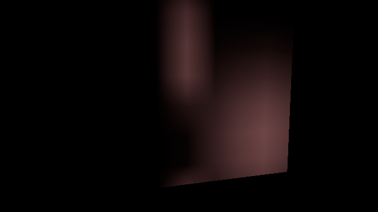
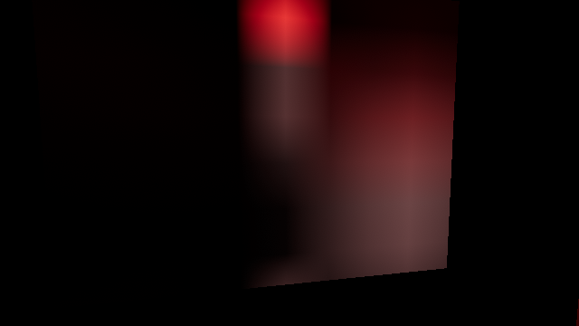
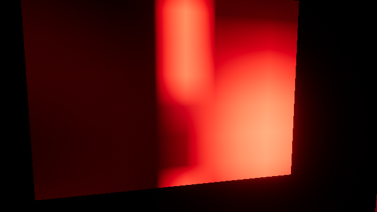
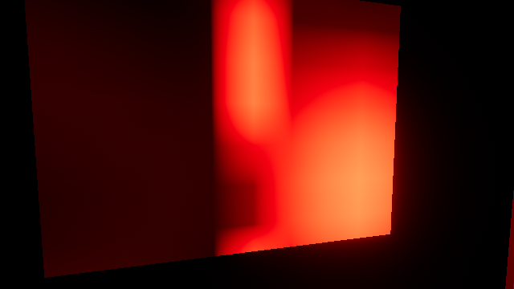
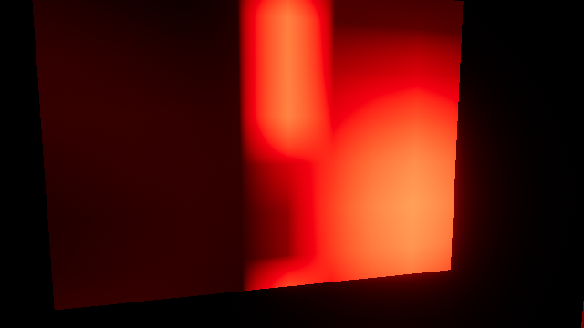
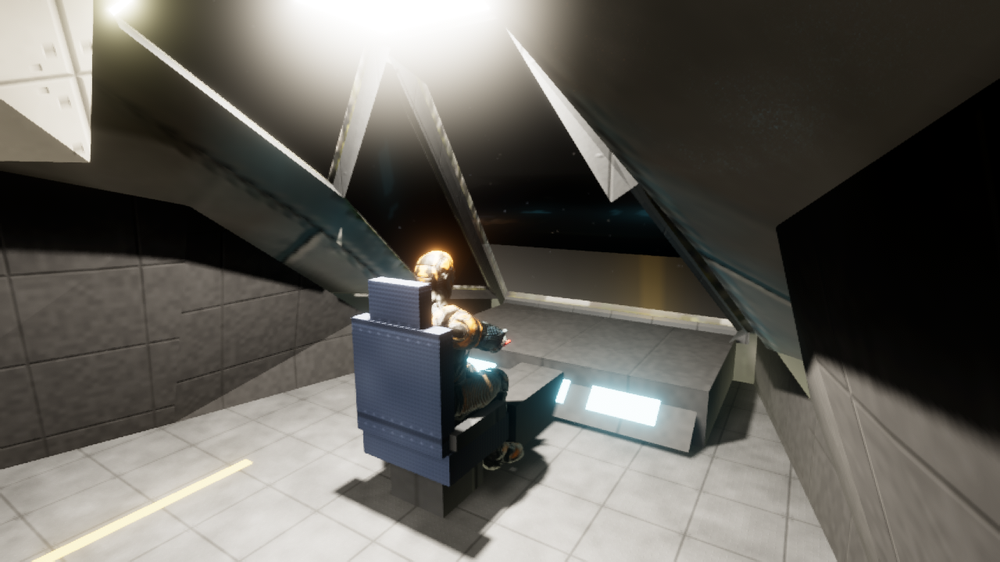
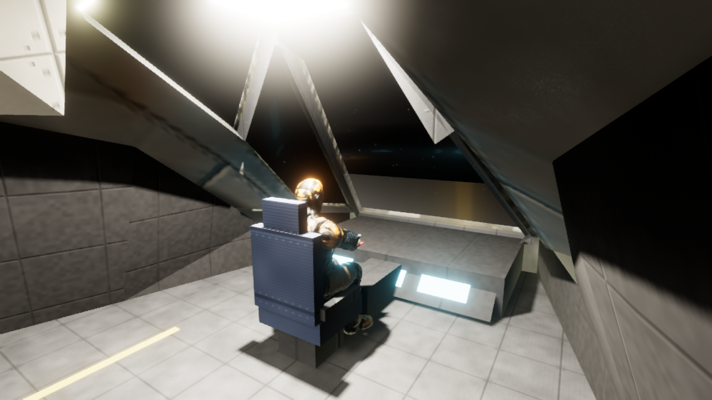
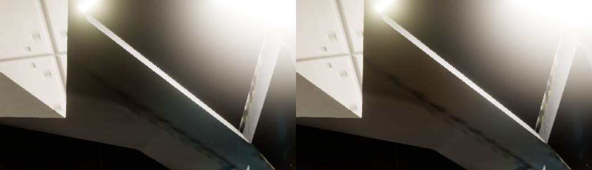

# Outgoing light across grid levels

The directional light volume stores surface data in three grids with cell widths of 0.25, 0.5 and 1 m. In the baseline for [#22](https://github.com/alexispurslane/tertius/issues/22), a cell that inherited surface data from a finer grid combined the surfaces before it sampled direct light and shadows. The combined color could lose red tint. A shadow over neighboring surfaces could darken a red reflector that remained in sunlight.

## Baseline regression cases

The receiver is a matte white panel. Its front face is 2.96 m from the camera along the view axis. The 0.25 m grid gives no light at that distance. The 0.5 m grid gives the full share. Each test reads the red minus green value at the receiver's center pixel from the scene-linear buffer, in W/(m² sr).

| Scene | Baseline red minus green | Required lower bound |
|---|---:|---:|
| Red strips beside neutral strips in the same coarse cells | 0.00155 | 0.07032 |
| A red reflector in sunlight beside shadowed geometry in the same coarse lighting group | 0.00323 | 0.04370 |

Both tests fail on `d3123fe715dea1fd141649271c315096712d72a2`. Four controls pass at that revision. A red reflector that straddles the fine grid face keeps lighting the coarse receiver. A fine-grid emitter supplies light when the scene has no direct lights. An intervening sheet blocks most red light. A red reflector lit by a yellow emitter adds red tint in the second sweep.

## The change

The fix (`3b9e7c8ff`) evaluates direct light in each grid before the grids combine. For each lighting group, the shading pass computes the light on a unit white diffuse surface, as before. Then it multiplies that light by each cell's own diffuse reflectance, applies the restraint (`restrainNeutral`), adds emission, and stores the area-weighted outgoing light in the words that held area-weighted emission after the raster. The restriction pass then adds a quarter of each child face's area, reflectance and outgoing light to its parent face, because one parent face covers four child faces. A parent cell that also holds geometry from its own shell keeps that geometry's outgoing light and adds the children's. The volume buffer no longer holds the white-light array of the lighting groups, so it shrinks by 33,024 bytes, from 15,291,200 to 15,258,176 bytes.

## Probe scene

The probe scene puts a gray receiver panel (reflectance 0.65, 4.3 × 3.2 m) 3 m ahead of the camera, outside the 0.25 m grid. So the receiver samples only the 0.5 m grid. A red slab and a white slab, each 0.23 m wide and 1.45 m tall, stand side by side 1.9 m ahead, between the camera and the receiver. One star lights the slabs' faces that look at the receiver. Ambient light, the environment map, the screen tracer and upscaling are off, and the exposure is fixed at EV 0. Two cameras 0.15 m apart look at the same point on the receiver:

- "outside", at x = 0.05 m: the 0.25 m grid ends just before the slabs, so the 0.5 m grid captures them.
- "across", at x = 0.2 m: the 0.25 m grid shifts by one cell and captures the red slab. The white slab stays in the 0.5 m grid's own shell.

Two more scenes remove one slab: "shell-only" has only the white slab, and "red-only" has only the red slab.

| Pose | Baseline | Fix |
|---|---|---|
| outside |  |  |
| across |  |  |
| red-only | |   |

- Baseline and fix, outside: identical. The red slab's light is nearly gone, so the receiver shows dim, almost neutral light.
- Baseline, across: red light reaches only the top of the receiver. The 0.5 m cell in front of the red slab lost the red when it combined the slab's color with its neighbors before shading.
- Fix, across: the red slab's light reaches the whole receiver through the 0.5 m grid.
- Red-only, outside and across, with the fix: the two images match. Without a white slab in the same 0.5 m cell, the 0.5 m capture and the 0.25 m capture give the same light.

## Measured sources

`tools/measure-volume.py` reads the volume buffer after the frame. The table gives the -Z face of the 0.5 m cell in front of the red slab, as area times outgoing radiance per parent face, in the buffer's units. The inherited part is the sum of the child faces divided by four.

| Scene, pose | Area (faces) | Inherited area | Red | Inherited red | Own shell red | Green |
|---|---:|---:|---:|---:|---:|---:|
| fix, red + white, outside | 0.996 | 0 | 3.86 | 0 | 3.86 | 1.93 |
| fix, red + white, across | 0.998 | 0.500 | 98.81 | 96.88 | 1.93 | 1.93 |
| fix, white only, across | 0.498 | 0 | 1.93 | 0 | 1.93 | 1.93 |
| fix, red only, outside | 0.498 | 0 | 96.50 | 0 | 96.50 | 0 |
| fix, red only, across | 0.500 | 0.500 | 96.88 | 96.88 | 0 | 0 |
| baseline, red + white, outside | 0.996 | 0 | 3.86 | 0 | 3.86 | 1.93 |
| baseline, red + white, across | 0.998 | 0.500 | 3.87 | (96.88) | - | 1.93 |

The baseline's inherited red, in parentheses, is what its 0.25 m cells held. Its 0.5 m cell kept 3.87 of it.

- Mixed local and inherited light, across: 98.81 = 96.88 inherited + 1.93 from the shell. The shell-only scene gives the same 1.93. So each contribution enters once.
- Continuity of the transfer: the red slab alone gives 96.50 when the 0.5 m grid captures it and 96.88 when the 0.25 m grid captures it, a difference of 0.4%. The whole-frame mean red is 0.6367 and 0.6827 W/(m² sr).

Whole-frame mean of scene-linear red, in W/(m² sr) (`tools/frame-means.py`):

| Scene, pose | Baseline | Fix |
|---|---:|---:|
| red + white, outside | 0.0254 | 0.0254 |
| red + white, across | 0.0479 | 0.6719 |
| red only, outside | - | 0.6367 |
| red only, across | - | 0.6827 |

## The restraint depends on the cell's mix of surfaces

With the red and white slabs in one 0.5 m cell ("outside"), the red slab keeps only 3.86 of its light, against 96.88 when the 0.25 m grid separates the two slabs. The restraint acts on the cell's summed diffuse color. The two slabs sum to the color (1, 0.5, 0.5), whose saturation of 0.5 is under the threshold of 0.58, so the restraint scales the whole cell to 2%. In a 0.25 m cell the red slab is alone, its saturation is 1, and it keeps full strength.

The baseline had the same rule. It lost the red in both poses, so it showed no change at the boundary. With the fix, the mixed scene's mean red rises 26 times when the camera moves 0.15 m and the slabs pass from the 0.5 m capture to the 0.25 m capture. The transfer is continuous (the red-only rows). The jump comes from the restraint, which depends on which surfaces share a cell, and so on the grid's resolution.

The line orchestrator decided, and the parent confirmed, that #22 ships the transfer as it is. The restraint's fault is issue #42. A restraint per surface leaves this transfer unchanged, so the transfer merges first.

[`evidence/crossing.mp4`](evidence/crossing.mp4) shows the cost of that order. It films the mixed scene with the baseline on the left and the fix on the right, at EV 0. The camera moves from x = 0 to 0.24 m in steps of 2.5 mm, two frames per step, and back: 388 frames at 60 frames per second. Only the 0.25 m grid shifts on the way, at x = 0.125 m. The fix's receiver turns strongly red when the slabs enter the 0.25 m grid and goes back to dim pink when they leave it. The baseline gains only a small red patch at the top of the receiver.

## The timed deck

The paired Linux benchmark uses `scripts/temporal-upscale-timing.json` with `--size 1920x1080 --video none --gray-box`, as in #18. In the last frame of that run on the Mac, with the fix:

- 233 lighting evaluations of the directional volume.
- 0.25 m to 0.5 m: 128 parent faces inherit area, and 64 inherit nonzero light.
- 0.5 m to 1 m: 184 parent faces inherit area, and 120 inherit nonzero light.
- Every lit parent face that holds only inherited geometry holds exactly the children's sum: 64 of 64 and 120 of 120. On the baseline, 0 of 64 and 0 of 120.

So the timed scene runs the changed transfer in both coarser grids.

## GPU time on Linux

One job on the RTX 2000 Ada (`12ce119a-5ddc-4f69-a89b-9b265866ade0-u1`, 238 s of execution, counted at $0.0493). Both commits ran the timed deck at 1920 × 1080 for 120 frames per run: one warm-up run of main, then five pairs in alternating order. The frame values are the sum of GPU pass times from `deformation` to `outlines`, so they exclude the headless capture and the gaps between passes. `tools/paired-summary.py` computes them from `runpod/job1/`.

| Time (ms) | main `d3123fe71` | fix `3b9e7c8ff` | Paired change, median | Range | Pairs that rise |
|---|---:|---:|---:|---:|---:|
| GPU pass sum per frame, median | 7.991 | 8.183 | +0.192 (+2.4%) | +0.188 to +0.194 | 5 of 5 |
| GPU pass sum per frame, p95 | 8.287 | 8.477 | +0.191 | +0.183 to +0.196 | 5 of 5 |
| directional light volume, median | 0.992 | 1.183 | +0.191 (+19%) | +0.190 to +0.192 | 5 of 5 |
| directional light volume, p95 | 0.996 | 1.189 | +0.192 | +0.190 to +0.194 | 5 of 5 |

The whole cost is in the volume pass. The five pairs agree within 0.006 ms, so the uncertainty is small against the change. A likely cause, not measured: each shading fragment now runs a second loop over its 64 cells to write each cell's outgoing light, one cell after another. The baseline did that multiplication in the source pass, with one invocation per cell.

## The full-art deck

The full-art deck (`deck-1080.json`, last frame, 960 × 540, EV 0) shows nothing about the fix, so it is a control only. Baseline and fix differ by less than 1e-4 W/(m² sr) in every pixel of the scene-linear frame. The exposure blows most of the frame out to white, so it is not a still in the usual sense either. The measured reason for the missing difference:

- At this pose the 0.25 m grid captures no surface at all, so nothing passes from it to the 0.5 m grid.
- 96 faces of the 1 m grid inherit light from the 0.5 m grid. That light has a saturation of at most 0.33, under the restraint's threshold of 0.58, so the restraint keeps 2% of it. Its largest change between baseline and fix is under 5e-5 per parent face.

## The cockpit

The cockpit pose of #20 (`tools/cockpit-still.json`, the 1:41 shot's frame 60, 1280 × 720, a fixed exposure of 6.0043726 stops in both `exposure.json` files) shows the fix on real art. In this shot the orange helmet and the cyan display stand 1 to 1.5 m from the camera, inside the 0.25 m grid. In the volume at this pose, 26 faces of the 0.5 m grid and 47 faces of the 1 m grid inherit light with a saturation of 0.76 to 0.89.

| Baseline | Fix |
|---|---|
|  |  |



[`evidence/cockpit-difference-x16.png`](evidence/cockpit-difference-x16.png) is the absolute difference of the two images, times 16. It is concentrated on the undersides of the two angled ceiling beams, 2.5 to 3 m from the camera, where receivers sample the 0.5 m grid. There the fix is darker and warmer: in a 260 × 120 crop of the left beam (from x = 160, y = 150), the mean display RGB falls from (95.7, 93.3, 87.6) to (59.0, 54.1, 45.6) in 8-bit levels. The baseline lit the beam with a coarse estimate of the combined cell. The fix keeps the helmet's orange light and the direct light of each 0.25 m cell.

In the scene-linear frame, pixels within 2 m of the camera change by at most 0.00036 W/(m² sr). Pixels beyond 2 m change by at most 0.00093 W/(m² sr), which is up to 2.9 times the baseline value in dark areas.

## Reproduce

The probe is a diagnostic. It stays out of the engine. `tools/prepare-render.py` writes the probe scenes into the Demo and a readback into `VulkanRenderer` that writes the volume buffer, the HDR image, the depth and the camera after each frame when `TERTIUS_ISSUE22_VOLUME_DUMP` names a file. `tools/render-evidence.sh` applies the probe, renders the fix and then the baseline (the engine change reversed), and restores the checkout on exit. It needs no change under `src/` and writes to `captures/issue22/`. `tools/crossing-video.sh` films the crossing, and `tools/art-pair.sh` renders a still of a real-art script on both versions. `tools/mutants.json` lists the mutants of the change for `tools/mutate.py`.

```powershell
nix develop --command bash docs/research/fine-grid-outgoing-light/tools/render-evidence.sh
nix develop --command bash docs/research/fine-grid-outgoing-light/tools/crossing-video.sh
nix develop --command bash docs/research/fine-grid-outgoing-light/tools/art-pair.sh docs/research/fine-grid-outgoing-light/tools/cockpit-still.json cockpit --exposure 6.0043726
nix develop --command bash docs/research/fine-grid-outgoing-light/tools/red-only.sh
python3 -I docs/research/fine-grid-outgoing-light/tools/measure-volume.py captures/issue22/candidate/across/volume.bin --camera-x 0.2
```

`evidence/measurements.txt` holds the output of every reader for the captures above.
