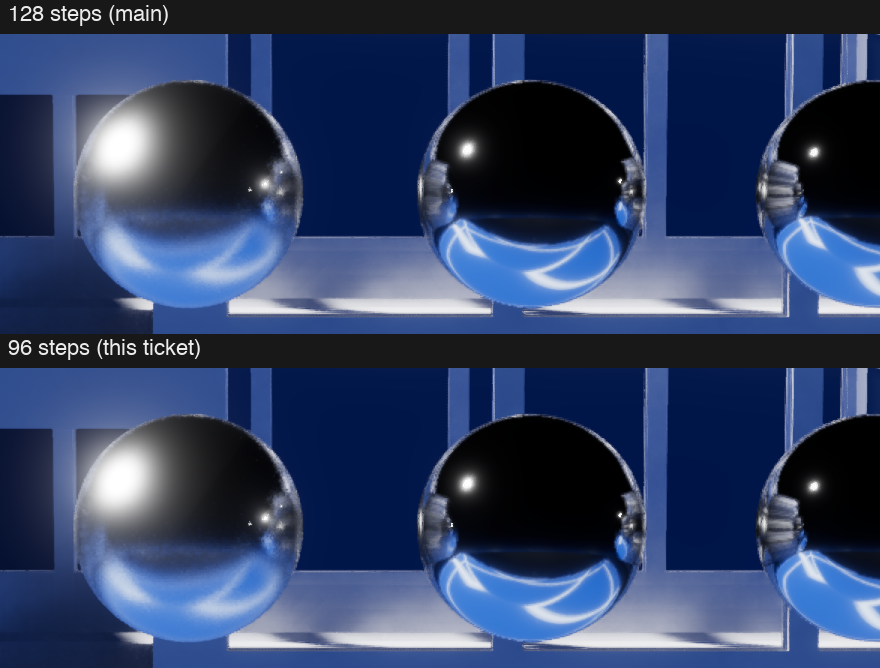
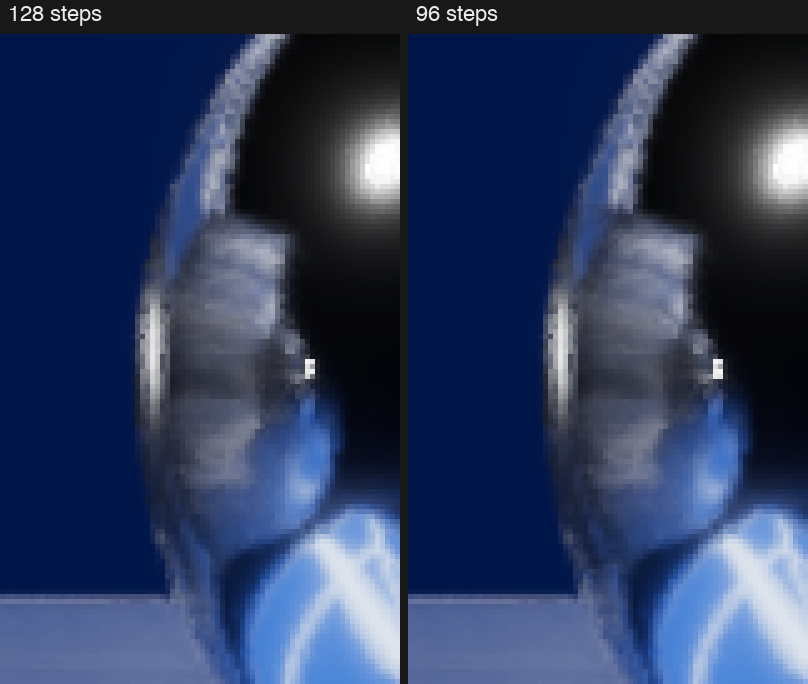

# The acceptance record of the reflection step cap of 96 (ticket t2-pw52)

A reflection ray of the screen tracer walks the depth image in steps. The step cap is the largest number of steps of one walk. `ScreenTrace.Default` now sets the reflection step cap to 96. Before, it was 128, the value of ticket `ter-w1o3` from earlier on 2026-11-12. This folder keeps the measurements behind the change. The change is decision 41 of `docs/plans/temporal-renderer.md`.

The value comes from the step cap search of section A13 of [the addendum](../addendum.md). The search ran on main at `c87eac88f`. Main then gained the blue-noise draws of the reflection rays (ticket `ter-s97m`). So every measurement of this record ran again, on main at `b93ab3570`.

## The result

| Question | Answer |
|---|---|
| GPU time of the deck's frame on an RTX 2000 Ada | 8.906 ms at 128 steps and 8.812 ms at 96 steps: 0.094 ms less, 1.1 % |
| GPU time of the deck's frame on the M1 Max | 0.09 to 0.21 ms less in five pairs of traces, with a median of 0.15 ms |
| Stills outside the hair scenes, on the M1 Max | 155 captures: the mean of a capture changes by at most 0.059 % |
| Stills of the hair scenes, on the M1 Max | 15 captures: the mean changes by at most 0.096 % |
| FLIP on the same 170 captures | 135 captures have no flagged pixel. The largest flagged share is 0.11 % of a capture |
| A film with a moving camera, on the M1 Max | 180 frames: the mean of a frame changes by at most 0.008 % |
| The mottle score of three scenes | 0.0362 to 0.0362, 0.0307 to 0.0316 and 0.0393 to 0.0392 |
| The tests | Checked: 10,819 passed. Release: 10,806 passed. No test failed |

A level is one step of the 255 steps of an 8-bit color channel. The mean of a capture is the mean of its luminance in linear light. FLIP gives each pixel a value from 0 to 1 for how much it seems to change between two images. The project's snapshot tests call a value above 0.1 visible, and this record calls such a pixel flagged.

The search on the older main measured 0.21 ms on the M1 Max. On the code that merges, the gain is smaller: a median of 0.15 ms.

## Why the choice was the user's

Three conditions let the search change a parameter without a question. One of them says that FLIP flags no visible change. The cap of 96 fails it: FLIP flags pixels along the rims of the mirror balls. The eye does not see the change in a still at its own size. An enlarged crop shows it.

Alexis saw two pictures of the search, `../pics/steps2-balls-1x.png` and `../pics/steps2-balls-rim-zoom.png`, and chose 96 on 2026-11-12. The two pictures below show the same place on the code that merges.



The first picture shows the mirror balls at 1920 × 1080, at their own size.



The second picture enlarges the rim of the second ball 5 times. There the reflected band along the rim ends a little earlier at 96 steps. A ray at a grazing angle needs the most steps. With a lower cap, more of those rays end as a miss.

## The timing on the GPU workbench

The GPU workbench is the queue of cloud GPU jobs that `tools/runpod/WORKBENCH.md` describes. One job built two trees on one RTX 2000 Ada. The tree `main` is main at `b93ab3570`. The tree `cut` is that commit with the cap of 96. The job ran the deck script `scripts/temporal-upscale-timing.json` five times per tree, with the trees in turn.

```text
GPU frame span without the capture pass, ms, per run:
  cut: median 8.812, runs 8.805, 8.810, 8.821, 8.821, 8.812, spread 0.016
  main: median 8.906, runs 8.892, 8.924, 8.906, 8.906, 8.890, spread 0.034

cut against main: -0.094 ms (-1.1%), every run differs. Estimate on the Mac: -0.23 ms.
  reflection rays: 0.703 -> 0.604 ms (-0.099)
  filter indirect diffuse: 1.135 -> 1.136 ms (+0.002)
```

Every run at 96 steps lies below every run at 128 steps. The whole gain is in the pass `reflection rays`. No other pass moves by more than 0.002 ms. The job counted $0.04.

## The timed takes on the M1 Max

Takes 13 and 14 recorded the deck with Instruments under the exclusive GPU lock. Each trace holds 119 timed frames at 1280 × 720, upscaled to 1920 × 1080. The frame span of a row is the median of the run's own record.

Two kinds of build ran. The build `par2` is main at `b93ab3570` with the scratch edit `../edits/steps.py`: the variable `SWEEP_RSTEPS` sets the reflection step cap, and the exposure has the deck's fixed value. The builds `n128` and `n96` are unedited Release builds, of main and of the ticket's commit.

| Take | Pair | Pass time stamps | 128 steps | 96 steps | Change | Counts |
|---|---|---|---:|---:|---:|---|
| 13 | `par2`, round a | off | 19.738 ms | 19.649 ms | -0.089 ms | yes |
| 13 | `par2`, round b | off | 19.763 ms | 19.615 ms | -0.148 ms | yes |
| 13 | `par2`, round c | off | 19.740 ms | 19.593 ms | -0.147 ms | yes |
| 13 | unedited | on | 20.174 ms | 20.002 ms | -0.172 ms | yes |
| 13 | unedited | off | 20.095 ms | 22.460 ms | | no |
| 14 | unedited, round a | off | 19.767 ms | 21.325 ms | | no |
| 14 | unedited, round b | off | 19.938 ms | 19.731 ms | -0.207 ms | yes |
| 14 | unedited, round c | off | 19.799 ms | 19.630 ms | -0.169 ms | no |

- The pair of take 13 without stamps ran while the load of the machine was 45 to 56. Its traces have no clock record, and its numbers measure the load.
- In round a of take 14, the trace at 96 steps took 1.6 ms more than every other trace of its build. It ran just after the test suite ended, at a load of 19.
- In round c of take 14, Instruments did not end the trace at 128 steps, so that trace has no clock record. Its number agrees with the other controls, and it does not count.

Five pairs count. Their changes are -0.089, -0.147, -0.148, -0.172 and -0.207 ms, with a median of -0.15 ms. The GPU clock of their traces stayed between 1290.7 and 1294.1 MHz. With the pass time stamps, the engine's timer of the pass `reflection rays` fell from 2.828 to 2.697 ms.

The workbench's estimate for the Mac was 0.23 ms. The measured median lies below it, and the largest pair reaches it.

## The stills on the M1 Max

The automatic exposure has several stable values in some scenes (ticket `t2-supl`). A few changed pixels can step it by 0.037 stops, and the step then hides the cap's effect. So each scene ran at one fixed exposure at both caps. The value of a scene is the one of the search.

The job list `stills/stills-wide-pn1.jobs` rendered 43 script runs of 30 scripts with the build `par2`: 24 capture scripts, a low view of the deck, 4 hair scripts, and 7 scripts at 1920 × 1080 and at 2560 × 1440. They hold 170 captures.

| Group | Captures | Largest change of the mean | Largest share of pixels that change by more than 4 levels |
|---|---:|---|---|
| Outside the hair scenes | 155 | 0.059 %, `ter-7tnv-terminal` | 0.126 %, `mirror-balls` at 1920 × 1080 |
| The hair scenes | 15 | 0.096 %, `lamp-hall-16-hair` | 0.676 %, `hair-rugs` at 2560 × 1440, the low view |

Of the 170 captures, 29 are equal byte for byte, and 7 change their mean by more than 0.04 %. `stills/capdiff-stills.txt` holds every row.

FLIP flags no pixel in 135 captures. The table gives the captures with the most flagged pixels. `stills/flip-stills.txt` holds every row.

| Capture | Size | Flagged pixels | Share of the capture |
|---|---|---:|---:|
| `mirror-balls`, balls | 2560 × 1440 | 3,225 | 0.087 % |
| `hair-rugs`, rugs | 2560 × 1440 | 2,341 | 0.064 % |
| `mirror-balls`, balls | 1920 × 1080 | 2,245 | 0.108 % |
| `hair-rugs`, low | 2560 × 1440 | 1,097 | 0.030 % |
| `hair-rugs`, rugs | 1920 × 1080 | 972 | 0.047 % |
| `mirror-balls`, balls | 1280 × 720 | 498 | 0.054 % |

All 170 captures hold 12,183 flagged pixels together. The same comparison on the older main gave 11,495. So the blue-noise draws did not change the cap's effect on the image.

## The film on the M1 Max

The script `exit-floor` follows the camera of `demo-exit` across the floor for 180 frames. Two runs at 128 steps are equal in all 180 frames. The run at 96 steps changes the mean of a frame by at most 0.008 %. At most 0.028 % of a frame's pixels change by more than 4 levels. The tables are `stills/capdiff-film.txt` and `stills/capdiff-film-control.txt`.

## The mottle score

The mottle score is the daub score of ticket `t7-3e22`: the strength of soft blotches in the bounce light of a still, against a long reference. Clouds become visible at a rise of about 0.010. The stills come from the renderer survey's still part, with a probe build of main at `b93ab3570`.

| Scene | 128 steps | 96 steps |
|---|---:|---:|
| `rect-lamps` | 0.0362 | 0.0362 |
| `bay-sunbeam` | 0.0307 | 0.0316 |
| `docking-bay` | 0.0393 | 0.0392 |

The largest rise is 0.0009. The floor of `bay-sunbeam` alone rises from 0.0390 to 0.0439. `stills/daub-scores.txt` holds the parts of each score.

## The build against the measured variant

The stills above come from the build `par2` with a variable. The merged code is the unedited build. Two scripts, `doorway` and `mirror-balls`, ran with all four builds. The 7 captures of `par2` at 128 steps equal main's byte for byte. The 7 captures of `par2` at 96 steps equal those of the ticket's commit. The tables are `stills/framecmp-main.txt` and `stills/framecmp-cut.txt`.

## The tests

The options test `TheRendererOptionsDefaultToTheDesignsTracerAndThirtyTwoWarmUpDraws` names the new default. It failed first with 128 and passed after the change. No other test names the default: `ScreenWalkBoundaryTests` and `ScreenRayTests` test the cap with explicit step counts. No snapshot test failed, so no reference image changed.

| Run | Passed | Failed | Skipped |
|---|---:|---:|---:|
| Every suite in Checked, on the staged change | 10,819 | 0 | 26 |
| Every suite in Release, on commit `a7162e9a5` | 10,806 | 0 | 26 |

Both runs took the GPU lock in shared mode. Their logs are `tests/checked9.lock.log` and `tests/release9.lock.log`.

The one changed code line is in Rendering, so the official Stryker run had no line. `tools/mutate.py` ran three listed mutants of that line, and the options test killed all three.

| Mutant | Change | Result |
|---|---|---|
| C01 | The old cap of 128 steps | killed |
| C02 | One step fewer, 95 | killed |
| C03 | The cap of 80 steps, which the search refused | killed |

## The files

| Path | Content |
|---|---|
| `workbench/` | The workbench job's report, its result and the timings of its ten runs |
| `takes/` | The job lists and lock logs of takes 13 and 14 |
| `stills/` | The job list and lock log of the stills, the pixel and FLIP tables, the film's tables, the mottle scores and the byte comparisons |
| `tests/` | The mutant list and its results, and the lock logs of the test runs |
| `pics/` | The two pictures of this record |
