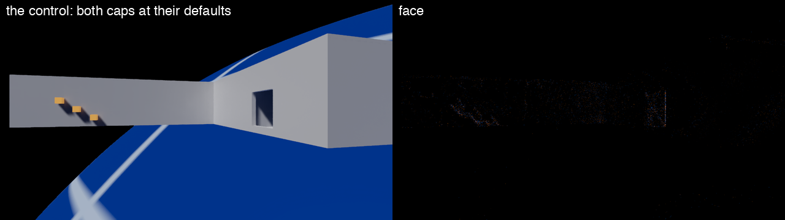
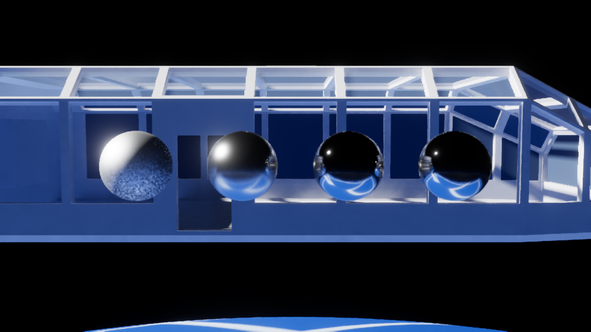
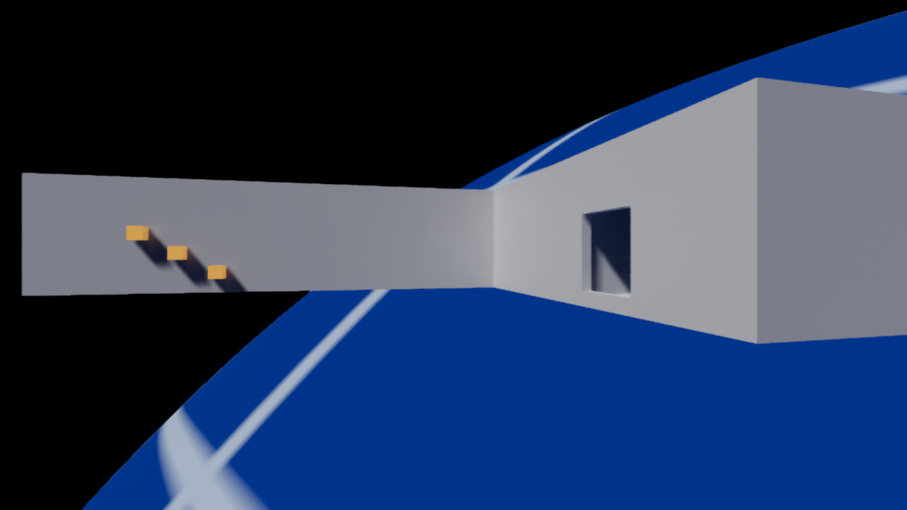
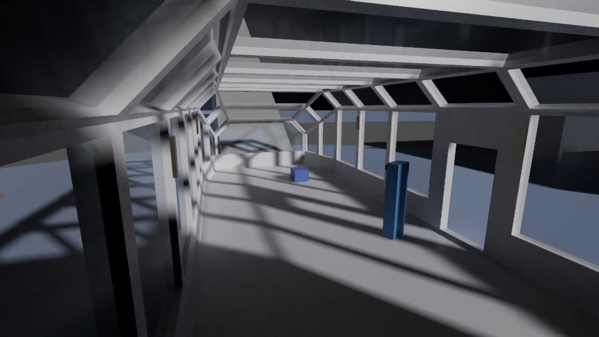

# The acceptance record of the face that lights each texel once (ticket t2-zcr4)

An environment face is one side of a cube map of the room, 128 × 128 texels, and a frame draws one face. Before this ticket, a face shaded each fragment of a surface with the loop over every light. Now the surfaces write a surface record, and one fullscreen triangle runs the light loop once per texel. ARCHITECTURE.md, "The environment map", describes the pass. This folder keeps the measurements behind the change.

Section A14 of [the addendum](../addendum.md) holds the search for the cut and the full timing tables. [../env-face-t2-zcr4/](../env-face-t2-zcr4/traces.md) holds the job lists of the timed takes and the table of every trace.

## The result

| Question | Answer |
|---|---|
| Time of the pass `environment faces` on the M1 Max, mean of a frame | 0.459 ms before and 0.350 ms after: 0.11 ms less |
| The same, median of a frame | About 0.04 ms less |
| Time of the pass on an RTX 2000 Ada | 0.085 ms before and 0.080 ms after |
| GPU time of the deck's frame on the RTX 2000 Ada | 8.560 ms and 8.556 ms: inside the noise |
| Stills on the M1 Max, against main | 79 stills: 71 are equal byte for byte, and 8 differ by rounding |
| Stills on the RTX 2000 Ada, against main | 791 files: all are equal |
| The tests on the M1 Max, on the code that merges | Checked: 10,926 passed. Release: 10,913 passed. No test failed |
| The Rendering tests in Release on the RTX 2000 Ada | 3,165 of 3,175 passed, 9 skipped, and 1 failed. The failed test is main's known one (ticket `t8-v31a`) |
| The listed mutants | 14 of 15 killed. One survives with a recorded reason |

A level is one step of the 255 steps of an 8-bit color channel.

## The timing on the M1 Max

Takes 17 to 19 recorded the deck with Instruments under the exclusive GPU lock, at the deck's fixed exposure. Each trace holds 119 timed frames at 1280 × 720, upscaled to 1920 × 1080. All times are the engine's timer of the pass `environment faces`. A trace counts only with a GPU clock of 1290 to 1294 MHz.

| Take | Build | Traces | Mean (ms) | Median (ms) |
|---|---|---:|---:|---:|
| 17 | Main at `657642432` | 2 | 0.457 and 0.461 | 0.371 and 0.382 |
| 17 | The built pass on that main | 1 | 0.338 | 0.316 |
| 18 | The built pass on main `7093f45f6` | 3 | 0.346 to 0.367 | 0.330 to 0.352 |
| 19 | The built pass on main `7093f45f6` | 3 | 0.350 to 0.356 | 0.340 to 0.347 |

The pass draws a different face in each frame, so the mean and the median differ. The frame span shows no change outside its noise of about 0.2 ms.

A proxy build of section A14 promised 0.25 ms. It shaded one made-up point for every texel, so its loop was too cheap. The section "Why the gain is smaller" of A14 gives the numbers.

## The timing on the GPU workbench

The GPU workbench is the queue of cloud GPU jobs that `tools/runpod/WORKBENCH.md` describes. One job built two trees on one RTX 2000 Ada: main at `657642432`, and the first commit of the built pass on that main as the tree `cut`. The job ran the deck script `scripts/temporal-upscale-timing.json` five times per tree, with the trees in turn.

```text
GPU frame span without the capture pass, ms, per run:
  cut: median 8.556, runs 9.100, 8.546, 8.552, 8.556, 8.563, spread 0.554
  main: median 8.560, runs 8.551, 8.559, 8.581, 8.565, 8.560, spread 0.030

cut against main: -0.004 ms (-0.0%), the runs overlap: within the noise. Estimate on the Mac: -0.01 ms.
  environment faces: 0.085 -> 0.080 ms (-0.005)
  filter indirect diffuse: 1.106 -> 1.108 ms (+0.002)
```

The card pays little for a face, so the frame does not move there. `workbench/ab-report.txt` holds the whole report.

## The stills

On the M1 Max, 13 scripts ran with main and with the built pass, at one fixed exposure per scene. They hold 79 stills.

| Group | Stills | Result |
|---|---:|---|
| Equal byte for byte | 71 | |
| Different | 8 | At most 0.018 % of a still's pixels change by more than 1 level, and at most 0.005 % by more than 4 levels. The largest change of one pixel is 13 levels |

Six of the 8 are stills of `station`. The other two are one still of `demo-surface` and one of `mirror-balls`, with a largest change of 1 and 2 levels. `stills/framecmp-main.txt` counts the files of each script, and `stills/capdiff-main.txt` holds every row.

On the RTX 2000 Ada, one workbench job rendered the stills of both trees. All 791 files are equal byte for byte (`workbench/stills-identity.txt`).



The left half shows main's still of the end view of `station`. The comparison tool calls it the control. The right half shows the pixels where the still of the built pass differs, made brighter. Of the 79 stills, this one has the largest share of pixels that change by more than 4 levels. The changed pixels lie on the lit walls.

## The final commit against the timed tree

Takes 18 and 19 timed the tree `face3`. After them, the branch merged main twice and gained its last edits: one failure path in the pass's constructor, a helper for the push range, and a new test. The build `face6` is the commit `3dae7207b` with the deck's exposure switch. Its 32 stills of 7 scripts equal those of `face3` byte for byte (`stills/framecmp-final.txt`, job list `stills/stills-final.jobs`).

One more commit followed: blank lines in `EnvironmentFacePass.RecordLight`, and main's line breaks of two statements in `DescriptorLayouts.cs`. Without white space, both files equal those of `3dae7207b`.

## The tests

Ten new tests name the behavior of the pass. They are in `EnvironmentFaceTests`, `FaceSurfaceTests`, `HairRenderTests` and `DescriptorLayoutsTests`.

| Run | Where | Passed | Failed | Skipped |
|---|---|---:|---:|---:|
| Every suite in Checked, on commit `3dae7207b` | M1 Max | 10,857 | 0 | 26 |
| The seven test projects other than Rendering, in Release, on commit `3dae7207b` | M1 Max | 7,679 | 0 | 16 |
| The Rendering tests in Release, on commit `3dae7207b` | RTX 2000 Ada | 3,165 | 1 | 9 |
| Every suite in Checked, on commit `f36329c57` | M1 Max | 10,857 | 0 | 26 |
| Every suite in Checked, on the merge `cf1385d84` | M1 Max | 10,857 | 0 | 26 |
| The Rendering tests in Debug with coverage, on the merge `cf1385d84` | M1 Max | 3,166 | 0 | 10 |
| Every suite in Release, on the merge `cf1385d84` | M1 Max | 10,844 | 0 | 26 |
| Every suite in Checked, on the merge of key and fill `a82ed9aa2` | M1 Max | 10,926 | 0 | 26 |
| Every suite in Release, on the merge of key and fill `a82ed9aa2` | M1 Max | 10,913 | 0 | 26 |

Commit `3dae7207b` is the last commit that changes the code's meaning. Commit `f36329c57` changes only white space in two files. The merge `cf1385d84` takes main at `ad1ecefb5`, which changes one test: the neighbor limiter test that failed on the card. The merge `a82ed9aa2` takes main with key and fill, and the section "After the merge of key and fill" describes it. `tests/` holds the totals of each run.

The coverage run counts the lines that the branch changed in `src/`, against main. Tests cover 187 of 189 changed lines and 22 of 24 changed branches (`tests/coverage-changed-lines.txt`). The two lines are failure paths of two constructors.

| Place | What no test reaches | Why |
|---|---|---|
| `FaceSurface.cs`, line 34 | The constructor refuses a device that cannot draw or sample the record's format | Every test device has both uses. `FaceSurfaceTests` tests the rule that decides, `FormatProblem`, with made-up feature flags |
| `EnvironmentFacePass.cs`, line 79 | The constructor disposes what it made after a pipeline fails | A pipeline fails only on a fault that a test cannot cause, such as a device out of memory |
| `FaceSurface.cs`, line 112, one branch | `Dispose` runs after a constructor that made no image | The same: only a device out of memory fails the image |

## The Rendering tests on the card

The Release run of the Rendering tests goes to the workbench's card, because the Mac's GPU lock is the bottleneck. Two runs exist.

The first run was on commit `adcd60cf4`, on 2026-11-13. Its hand-written shard lists left out the 14 nested test classes (ticket `ter-eugk`). Of its 2,968 tests, 2,958 passed, 1 failed and 9 were skipped. The failed test is one row of `TubeLightRenderTests`, which main's ticket `t8-sjli` then handled. `tests/release-card-first.txt` holds the totals.

That run had one crash. The fifth of its six test processes ended with exit 139 after 10 s and left no log. The same classes then passed with one process per class, 519 of 519. They passed again as one process with the verbose reporter. The crash did not come back, and it stays unexplained.

The second run was on commit `3dae7207b`, on 2026-11-14. Its six shards come from `tools/runpod/shards.py`, which builds them from the test assembly.

| Shard | Tests | Passed | Failed | Skipped |
|---:|---:|---:|---:|---:|
| 0 | 647 | 642 | 0 | 5 |
| 1 | 573 | 573 | 0 | 0 |
| 2 | 586 | 584 | 1 | 1 |
| 3 | 538 | 538 | 0 | 0 |
| 4 | 389 | 389 | 0 | 0 |
| 5 | 442 | 439 | 0 | 3 |
| Sum | 3,175 | 3,165 | 1 | 9 |

The run holds 205 test classes, the 14 nested classes among them. No test process crashed. `tests/release-card-final.txt` holds the totals.

The one failed test is `AccumulatorRenderTests+NeighborLimiterPrototype.AUniformBrightRegionIsUnchangedByLimiting(reflected: False)`. It failed on main too (ticket `t8-v31a`): on the card, a uniform region comes out one half-float step lower. Main changed the test while this run was in flight, and the branch then merged main.

Two smaller jobs ran before these. The 241 tests of 11 Rendering classes around the face passed in Checked on the card, on the first commit of the built pass. The Host tests passed in Release on the card, on commit `adcd60cf4`: 2,046 passed and none failed.

## The mutants

The changed code is in Rendering, so the official Stryker run had no line. `tools/mutate.py` ran 14 listed mutants. Lists a and b ran on the workbench's card, and list c ran on the M1 Max.

| Mutant | File | Change | Result |
|---|---|---|---|
| S01 | `face_surface.glsl` | A standard surface stores the mark of no surface | killed |
| S02 | `face_surface.glsl` | The model code is one too high | killed |
| S03 | `face_surface.glsl` | The roughness read as the metallic share | killed |
| S04 | `face_surface.glsl` | The metallic share read as the roughness | killed |
| S05 | `face_surface.glsl` | The base color with red and blue swapped | killed |
| S06 | `face_surface.glsl` | The strand dropped | killed |
| S07 | `face_surface.glsl` | The glow with red and blue swapped | killed |
| S08 | `face_surface.glsl` | The shading normal read as the geometric normal | survived in list b, killed in list c |
| S09 | `environment_face_light.frag` | The sky without its open-sky share | killed |
| S10 | `environment_face_light.frag` | The distance along one axis, not the radial distance | killed |
| S11 | `environment_face.frag` | The glow of an entity that holds a light stays | killed |
| C01 | `FaceSurface.cs` | A face keeps the record of the face before | killed |
| C02 | `FaceSurface.cs` | Each range clears the record of the ranges behind it | killed |
| C03 | `EnvironmentFacePass.cs` | Every face keeps only the root map's lights | killed |

S08 survived first. The new test `AWallInAFaceTakesNoSunFromBehindThoughItsNormalMapFacesTheSun` was red on the mutant and kills it. A wall has a normal map that faces the sun, and the sun stands behind the wall. The geometric normal must keep the sun's light off the wall.

The section "After the merge of key and fill" holds one more mutant, C04, which survives.

## After the merge of key and fill

Main then gained key and fill, the tile agent's ticket `t2-vsqh`. It changes the direct light of the main view. It changes no line of the face's pass or of the light loop that a face runs. The face's light shader gains one buffer that it does not read, from `gbuffer_inputs.glsl`. The branch took main at `0639b702b` by the merge `a82ed9aa2`.

The merge had one fault that git did not show. The shared descriptor pool has a count of sets, kept by hand. Key and fill and the face pass each add one set, and each raised the count from 10 to 11. Git kept 11 for two equal edits. The merge commit sets the count to 12. The count of sampled images had a real conflict of the same kind, and it is now `20 + 1 + 4`.

| Mutant | File | Change | Result |
|---|---|---|---|
| C04 | `DescriptorLayouts.cs` | The shared pool holds 11 sets of this kind, not 12 | survived |

C04 ran on the M1 Max with `EnvironmentFaceTests`, and it survives. Eleven sets exist once per renderer, and the constant is 12, so the pool holds one spare set. Main had the same spare before the merge: a constant of 10 for nine sets. So no test fails at 11. Ticket `ter-byim` derives the pool's counts from the set layouts, and its test then pins them. Until then this line is a judgment call.

The stills ran again, the merged branch against main at `0639b702b`, at one fixed exposure per scene.

| Group | Stills | Result |
|---|---:|---|
| Equal byte for byte | 24 | |
| Different | 8 | At most 0.017 % of a still's pixels change by more than 1 level, and at most 0.004 % by more than 4 levels. The largest change of one pixel is 28 levels |

The 8 are the same stills that differed before the merge: six of `station`, one of `demo-surface` and one of `mirror-balls`. `stills/framecmp-merge.txt` and `stills/capdiff-merge.txt` hold the rows.

The timed takes did not run again. They compare the pass on one main, and key and fill does not change the pass.

## Stills of the merged build

Three stills come from the unedited Release build of the branch after its merge of key and fill. Each is a headless run of a script in `scripts/`, with the automatic exposure.



`mirror-balls`: the three smoother balls reflect the frame around them. The left ball has the grain of ticket `ter-jza0`, which main has too.



`station`, the end view: the lit walls, the three crates with their shadows, and the planet behind.



`demo-surface`, inside the cabin: the frame's shadows lie on the floor.

## The cloud jobs

| Jobs | Count | Counted |
|---|---:|---:|
| The timing job | 1 | $0.05 |
| The stills of both trees | 1 | $0.09 |
| The 11 test classes in Checked | 1 | $0.10 |
| The mutant lists a and b | 3 | $0.30 |
| The first Release run: six shards and the Host tests | 7 | $0.43 |
| The fifth shard again, per class and with the verbose reporter | 2 | $0.21 |
| The second Release run: six shards | 6 | $0.51 |
| Sum | 21 | $1.69 |

List b ran twice, because its first job stopped on a fault of the list.

## The files

| Path | Content |
|---|---|
| `workbench/` | The report of the timing job and the byte comparison of the stills job |
| `stills/` | The comparisons with main and with the timed tree, the comparison after the merge of key and fill, and the job lists and lock logs |
| `tests/` | The mutant lists and their results, and the totals of the test runs |
| `pics/` | The pictures of this record |
