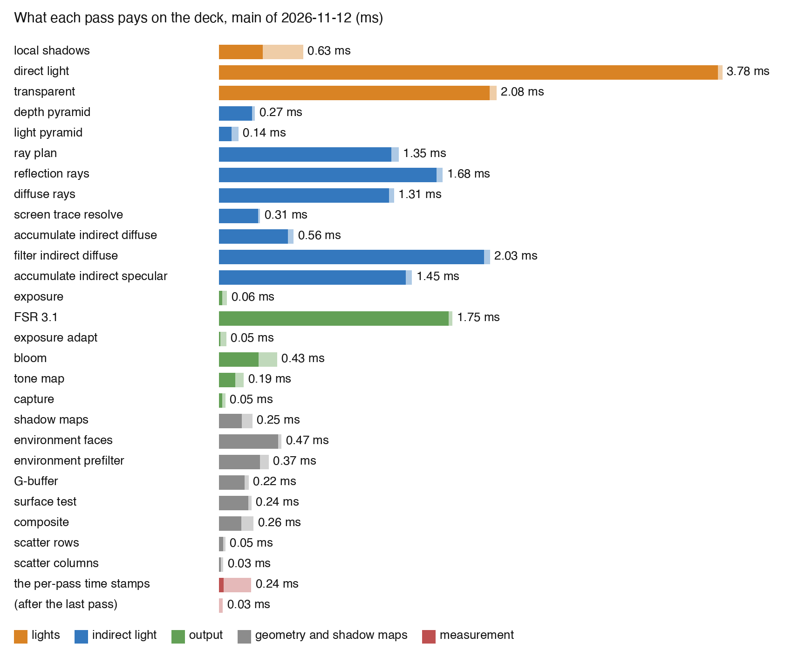

# Addendum to the frame-time sweep

This file continues `report.md` in the same folder. It holds what happened after the report: the decisions of Alexis, the tickets, the later measurements, and the work on the encoder breaks. All times are for the station deck at 1280 × 720, upscaled to 1920 × 1080, on the M1 Max.

## A1. The decisions on the ranked table

Alexis answered the ranked table of section 7 on 2026-11-11.

| Row | Change | Gain on the deck (ms) | Decision |
|---|---|---|---|
| 1 | One byte per pixel holds the same-surface answers of the 3 × 3 neighbors | 0.45 | Yes |
| 2 | One compute dispatch in place of the 13 clears of FSR | 0.15 to 0.30 | Yes |
| 3 | One image holds the light at a ray's hit | 0.2 | Yes |
| 4 | The depth pyramid and the light pyramid in fewer dispatches | 0.10 to 0.15 | Yes |
| 5 | The reflected place only below a roughness of 0.2 to 0.25 | up to 0.7 | Open. A film with a moving camera decides it. |
| 6 | One face of the environment map in every second frame | 0.45 | No |
| 7 | Bounce light accumulated and filtered once per 2 × 2 block | 1.5 to 1.9 | Yes, as a design ticket |
| 8 | Render scale 0.59 | about 3.9 | No for now |
| 9 | A reflection history at half resolution | 0.6 to 0.8 | No answer. The report advises against it. |
| 10 | The reflection resolve with the rays of four blocks, divided by the sum of the weights | costs about 0.56 | Yes. Then explore fewer rays to match. |
| | The idle time between Metal encoders | 2.32 of idle time | "A maximally important thing to fix." |

The orchestrator made these tickets under the epic `ter-8hyd`:

- `ter-nstr`: rows 2 and 4, fewer dispatches.
- `ter-67y3`: row 3, the image for the light at a ray's hit.
- `ter-yaqk`: row 1, the same-surface byte. It waits for the clamp on evidence (`ter-18hc`), which changes the same shader.
- `ter-ewua`: row 7, the design. It waits for design A of the mottle agent (`t7-3e22`), and the two must be one model.
- `ter-2x8a`: row 10. Its builder starts from the variant that section A7 picks.

## A2. The second take of traces

A full disk hit take 2. Two of its traces are valid: the resolve with the rays of four blocks, and the transparent pass without light. The machine was also disturbed during the take. The baseline read 28.2 ms, not 24.4 ms. So the numbers of take 2 compare only with each other.

- The resolve with the rays of four blocks costs about 0.56 ms in the resolve pass. The pass rose by 0.643 ms, and the disturbance of the take accounts for 0.083 ms of that.
- The transparent pass without any light is 1.97 ms cheaper. So nearly all of its 2.13 ms is light. About half is the lamps, and half is the sun and the environment. The key-and-fill design of the tile agent does not reach this pass yet.

## A3. The second round of reflection stills

The table gives the error against the long reference after 60 draws, in percent of the reference. Grain is error of 3 to 9 output pixels across. Clouds are 9 to 36 pixels across. Broad error is wider than 36 pixels.

The variants:

- `base`: main.
- `ssr4h`: the resolve with the rays of four blocks, divided by the sum of the weights.
- `ssr9h`: the same with nine blocks.
- `halfup`: the emulation of a half-resolution history.
- `ownall`: every pixel traces its own ray, which is four times the rays. It shows what more rays give.

| Place | Band | `base` | `ssr4h` | `ssr9h` | `halfup` | `ownall` |
|---|---|---:|---:|---:|---:|---:|
| Roughness 0.1, near a contact | grain | 1.67 | 0.72 | 0.61 | 1.19 | 0.66 |
| | clouds | 1.36 | 0.79 | 0.67 | 1.29 | 0.45 |
| | broad | 1.67 | 0.50 | 0.50 | 1.46 | 0.34 |
| Roughness 0.2, red paint | grain | 4.02 | 2.71 | 2.21 | 3.10 | 2.32 |
| | clouds | 2.55 | 2.52 | 2.46 | 2.53 | 1.19 |
| | broad | 1.12 | 1.64 | 2.62 | 1.67 | 0.62 |
| Roughness 0.2, plain floor | grain | 0.59 | 0.52 | 0.47 | 0.53 | 0.31 |
| | clouds | 0.31 | 0.42 | 0.52 | 0.38 | 0.16 |
| | broad | 0.40 | 0.74 | 1.10 | 0.62 | 0.22 |
| Roughness 0.3, blue paint | grain | 3.04 | 2.15 | 1.75 | 2.46 | 1.79 |
| | clouds | 1.85 | 1.78 | 1.80 | 1.87 | 0.99 |
| | broad | 0.86 | 1.69 | 2.85 | 1.44 | 0.82 |

What the table shows:

- The resolve with four blocks removes 12 to 57 % of the grain. At three of the four places, that is 71 to 95 % of what four times the rays remove. On the plain floor it is a quarter.
- It does not remove the clouds, except near a contact. On the plain floor the clouds grow by 35 %.
- Its broad error grows at three of the four places, by 46 to 97 %. More draws do not lower it, so it is a steady bias. Nine blocks make it larger.
- Only more rays remove the clouds: `ownall` cuts them by 46 to 67 %.

So the resolve with four blocks does not pay for fewer rays. With half the rays, its clouds grow by an estimated 41 %, the square root of two.

### The daub score of the mottle agent

The mottle agent scores daubs with `/private/tmp/t7-3e22/daub.py`. A daub is a blotch at the scale of a brush stroke in light that is smooth in the reference. The score is the 90th percentile of the relative error between 3 and 36 pixels, over the smooth pixels of the reference. The mottle agent calls a score above about 0.010 visible. `tools/daub.py` in this folder applies the same score to the stills of this sweep.

| Place, after 60 draws | `base` | `ssr4h` | `ssr9h` | `halfup` | `ownall` |
|---|---:|---:|---:|---:|---:|
| Whole image | 0.0174 | 0.0161 | 0.0172 | 0.0182 | 0.0079 |
| Roughness 0.1, near a contact | 0.0258 | 0.0133 | 0.0081 | 0.0289 | 0.0048 |
| Roughness 0.1, red paint | 0.0101 | 0.0064 | 0.0082 | 0.0092 | 0.0024 |
| Roughness 0.2, red paint | 0.0439 | 0.0440 | 0.0448 | 0.0441 | 0.0198 |
| Roughness 0.2, plain floor | 0.0049 | 0.0088 | 0.0118 | 0.0075 | 0.0032 |
| Roughness 0.3, glow | 0.0099 | 0.0099 | 0.0109 | 0.0106 | 0.0041 |
| Roughness 0.3, blue paint | 0.0299 | 0.0296 | 0.0318 | 0.0308 | 0.0164 |

The daub score agrees with the bands. The reflections on colored paint of roughness 0.2 and 0.3 show daubs today, at 4.4 and 3.0 times the visible level. No resolve changes that. Four times the rays halve it, and it stays above the visible level.

## A4. The Linux pod, and section 1 of the report

The Linux bring-up ran the deck on an NVIDIA RTX 2000 Ada, with the same 27 passes and a matching image. Its frame took 10.33 ms. The Mac takes 24.34 ms. So the Mac is 2.36 times slower.

The orchestrator asked whether something frame-wide on the Mac explains that factor. Four facts answer most of it.

1. The two GPUs are not equal on paper. The RTX 2000 Ada has 12.0 TFLOPS. This Mac has the 24-core GPU, not the 32-core one, with 7.96 TFLOPS. `system_profiler` confirms 24 cores. So 1.51 of the 2.36 is the arithmetic rate. The other factor is 1.56.
2. The GPU's clock is not the cause. `gpu-clock` logged a mean of 1,290 MHz over the timed span of the baseline trace. The GPU was in its top state, 1,296 MHz, for 99.2 % of that span.
3. MoltenVK's translation of shaders is a small part. The calibration spike (`docs/research/temporal-renderer/gpu-calibration.md`) ran the same kernels natively in Metal and through MoltenVK. Arithmetic reached 96.7 % of the peak natively and 95.6 % through MoltenVK. Buffer reads reached 88 % and 87 %. Cached texture samples cost about 7 % more through MoltenVK. The profiling spike found that MoltenVK costs 19 % of the ray walk.
4. Apple's shader compiler is a larger part. The same spike found that a loop of dependent arithmetic reaches only 41 % of the peak, natively and through MoltenVK alike. The ray walks and the filters are such loops.

The per-stage ratios agree with this reading. The large passes that are one dispatch each have almost no encoder breaks. They are still 1.8 to 2.5 times slower on the Mac: the direct light, the rays and the diffuse filter. The stages with many small encoders are the worst: the environment map at 4.3 times and the output group at 2.6 times.

So the encoder breaks explain a part of the factor, and not most of it. Section A5 measures that part.

Section 1 of the report stays valid in its numbers. It compared the Mac with a PlayStation 4 by the arithmetic rate, 4.3 times. The pod shows what that comparison hides: this GPU delivers less of its arithmetic rate to our kernels than a desktop GPU does. A fair reading of section 1 is that the Mac is three to four times a PlayStation 4 at best, and less on loop-heavy kernels.

One idea is closed. Arithmetic in 16-bit floats is faster on Apple GPUs in principle. Ticket `ter-7m38` measured it on FSR, and it was not measurably faster. Alexis kept the 32-bit build on 2026-11-03.

## A5. The encoder breaks: the measured bound

An encoder is Metal's unit of recorded GPU work: one render pass, or one run of compute dispatches. An encoder break is the end of one encoder and the start of the next. The GPU is idle for about 20 µs at each break. Section 3 of the report found 2.32 ms of such idle time in the deck frame.

### The patch

MoltenVK 1.4.2 ends the open encoder at every `vkCmdPipelineBarrier2` call outside a render pass. The patch `mvk-keep-dispatch-encoder.patch` in this folder changes one case. If a compute encoder of dispatches is open, the barrier does not end it. The core of the patch:

```cpp
void MVKCommandEncoder::setBarrierInDispatchEncoder(uint64_t sourceStageMask, uint64_t destStageMask) {
	auto &fenceSlots = _pEncodingContext->fenceSlots;
	for (int i = 0; i < kMVKBarrierStageCount; ++i) {
		if (!mvkIsAnyFlagEnabled(sourceStageMask, 1ull << i)) continue;

		[_mtlComputeEncoder waitForFence: _device->getFence((MVKBarrierStage)i, fenceSlots.update[i])];
		if (i == kMVKBarrierStageCompute) {
			// Settles the fence that the open encoder updates when it ends: fenceSlots.update holds it from here on.
			getBarrierStageFence(kMVKBarrierStageCompute);
		}
		for (int j = 0; j < kMVKBarrierStageCount; ++j) {
			if (!mvkIsAnyFlagEnabled(destStageMask, 1ull << j)) continue;

			fenceSlots.wait[j][i] = fenceSlots.update[i];
		}
		fenceSlots.wait[i][i] = fenceSlots.update[i];
		if (i != kMVKBarrierStageCompute) { mvkEnableFlags(fenceSlots.updateDirtyBits, 1 << i); }
	}
	...
}
```

where

- A fence is Metal's object that orders two encoders. At the end of its work, one encoder updates the fence, and another encoder waits for it.
- A barrier stage is one of MoltenVK's four groups of Vulkan pipeline stages: vertex, fragment, compute and copy.
- `sourceStageMask` and `destStageMask` = the barrier stages of the barrier's source and destination, as bits.
- `_mtlComputeEncoder` = the open Metal compute encoder.
- `fenceSlots.update[i]` = the number of the fence that each encoder of stage `i` updates at its end.
- `fenceSlots.wait[j][i]` = the number of the fence of stage `i` that a new encoder of stage `j` waits for.
- `fenceSlots.updateDirtyBits` = one bit per stage. A set bit makes the next encoder of that stage update a new fence.
- `getBarrierStageFence(stage)` = returns the fence that the open encoder updates at its end, and clears the stage's bit.
- `waitForFence:` = Metal's call that makes this encoder run after the work that updated the fence.

Three rules keep the order that Vulkan asks of the barrier:

1. The dispatches after the barrier run after the earlier work of each source stage. The open encoder waits for the latest fence of each source stage. A serial compute encoder runs its own dispatches in order, so the work before the barrier in the same encoder needs no fence.
2. Later encoders run after the compute work before the barrier. That work is in the open encoder, which updates its fence only at its end. So each destination stage waits for that fence. A later encoder then runs after the whole open encoder, which is more order than Vulkan asks, and never less.
3. A time stamp keeps its meaning. MoltenVK reads a time stamp at the end of the encoder. If a stamp is pending, the barrier ends the encoder as before, so the stamp reads the time of the work before the barrier.

The patch has four switches in the environment, for measurement only:

| Variable | Effect |
|---|---|
| none | A barrier whose destination is the compute stage alone keeps the encoder. The tables call this `keep`. |
| `MVK_SWEEP_KEEP_ANY_DEST` | A barrier with any destination stage keeps the encoder. The tables call this `any`. |
| `MVK_SWEEP_CONCURRENT_DISPATCH` | The compute encoder of dispatches is concurrent, and a kept barrier becomes a Metal memory barrier. |
| `MVK_SWEEP_END_ENCODER_AT_BARRIER` | The stock behavior, as a control of the build. |
| `MVK_SWEEP_LOG` | Prints each barrier, dispatch, clear and new encoder. |

`mvk-patched.nix` builds it from the MoltenVK of the flake's nixpkgs. A run selects it with `VK_ICD_FILENAMES`. The repository is unchanged.

### The image

The deck renders the same image with every variant. Two images of each run are identical to stock byte for byte: the still after 33 draws, and frame 26 of the film. The variants are `keep`, `any`, concurrent dispatch and the control. Three more runs had Metal's API validation on (`MTL_DEBUG_LAYER=1`), which stops a run at an illegal use of a fence. All three ended with exit code 0 and the same two images.

### The time

Take 3 ran nine traces in 399 s on a quiet machine, in two rounds. Every trace ran without the pass time stamps, as a window does. The GPU clock was 1,291 MHz in every trace.

| Driver | Frame span, median of each round (ms) | 95th percentile (ms) | Metal encoders per frame | Idle time per frame (ms) |
|---|---:|---:|---:|---:|
| Stock MoltenVK 1.4.2 | 23.99 and 24.02 | 24.58 and 24.57 | 116 | 2.24 and 2.25 |
| Patched, control | 24.00 | 24.59 | 116 | 2.24 |
| Patched, `keep` | 23.07 and 23.07 | 23.71 and 23.60 | 79 | 1.40 and 1.41 |
| Patched, `any` | 23.02 and 23.00 | 23.78 and 23.65 | 77 | 1.36 and 1.36 |
| Patched, `any` with concurrent dispatch | 23.01 and 22.93 | 23.51 and 23.57 | 77 | 1.35 |

The frame span comes from the renderer's own timer. The encoders and the idle time come from the trace (`tools/idle.py`). The trace of the second concurrent run did not export, so its row has one idle value.

What the table shows:

- The patch cuts the frame span by 0.93 ms in the form `keep` and by 0.99 ms in the form `any`. That is 3.9 % and 4.1 % of the frame.
- The two rounds agree within 0.03 ms. The control equals stock.
- Concurrent dispatch adds at most 0.04 ms. The deck's dispatches are large and depend on each other, so they have nothing to run beside.
- The compute encoders fall from 47 to 10 in the form `keep`, and to 8 in the form `any`.

The idle time by the kind of the encoder that starts after each gap:

| Idle time before | Stock (ms) | `keep` (ms) | `any` (ms) | Encoders in `any` |
|---|---:|---:|---:|---:|
| A compute encoder | 1.10 | 0.20 | 0.19 | 8 |
| A render encoder | 0.97 | 0.99 | 0.97 | 50 |
| A blit encoder (a copy or a buffer update) | 0.12 | 0.15 | 0.15 | 14 |
| A time stamp's encoder | 0.07 | 0.07 | 0.07 | 5 |
| Sum | 2.25 | 1.41 | 1.36 | 77 |

So the patch removes 0.91 ms of the 1.10 ms of idle time before compute encoders. It removes 40 % of all the idle time. The other 1.36 ms sits before render passes, copies and the compute encoders that follow them. The patch cannot reach those. Section A6 lists what can.

### Against the pod

The pod's frame takes 10.33 ms. Without the pass time stamps, the Mac's frame takes 24.00 ms on stock MoltenVK and 23.01 ms with the patch.

- The factor against the pod falls from 2.32 to 2.23.
- The patch recovers 0.99 ms of the 13.67 ms between the two machines, which is 7 %.
- After the arithmetic rate of 1.51, the other factor falls from 1.54 to 1.48.
- With all 2.25 ms of idle time gone, the factor is 2.11.

So the encoder breaks are real and worth removing, and they are not the main cause of the factor. Section A4 names the main cause: this GPU delivers less of its arithmetic rate to loop-heavy kernels.

## A6. Routes to fewer encoder breaks, as ticket proposals

The baseline of every gain below is the deck in a window-like run: 24.00 ms, 116 encoders, 2.25 ms of idle time. A removed compute encoder saved 25 µs of frame span in take 3. The estimates below use 19 to 25 µs for each removed encoder. A proposal with an estimate needs its own trace.

The frame's encoders by pass, from the patch's log of one frame of the deck (`tools/breaks.py`). This frame draws 13 local shadow tiles. The count without pass time stamps is the count in a window.

| Pass | Dispatches | Encoders on stock, with pass stamps | Encoders with the patch `keep`, without pass stamps | What the remaining encoders are |
|---|---:|---:|---:|---|
| Shadow maps | 0 | 5 | 4 | 4 render passes, one per cascade |
| Local shadows | 1 | 15 | 14 | 13 render passes, one per tile, and 1 compute encoder |
| Environment faces | 0 | 4 | 3 | 3 render passes |
| Environment prefilter | 10 | 7 | 4 | 2 compute encoders, 1 copy, 1 stamp |
| G-buffer | 0 | 4 | 3 | 3 render passes |
| Surface test | 1 | 2 | 1 | 1 compute encoder after the render passes |
| Depth pyramid | 7 | 8 | 0 | |
| Direct light | 0 | 2 | 1 | 1 render pass |
| Light pyramid | 7 | 8 | 1 | 1 compute encoder after the render pass |
| Ray plan | 1 | 4 | 3 | 2 buffer updates, 1 compute encoder |
| Reflection rays | 1 | 3 | 1 | 1 compute encoder: its barrier also names the stage of indirect draws |
| Diffuse rays, resolve, both accumulations, diffuse filter | 12 | 17 | 0 | |
| Composite | 0 | 2 | 1 | 1 render pass |
| Scatter rows and columns | 2 | 4 | 1 | 1 compute encoder after the render pass |
| Transparent | 0 | 3 | 3 | 1 copy, 1 render pass, 1 stamp |
| FSR 3.1 | 9 | 23 | 15 | 12 clears, 2 compute encoders, 1 buffer update |
| Bloom | 0 | 12 | 12 | 11 render passes, 1 stamp |
| Tone map | 0 | 2 | 1 | 1 render pass |
| Capture and the frame's end | 0 | 4 | 3 | 2 copies, 1 stamp |
| The other stamps | | 4 | 1 | |
| Sum | 51 | 132 | 72 | 38 render passes, 12 clears, 10 compute encoders, 7 copies and updates, 5 stamps |

### The proposals, ranked

| # | Proposal | Gain on the deck (ms) | From | Image | Linux | Build cost | Risk |
|---:|---|---:|---|---|---|---|---|
| 1 | Build MoltenVK in the flake with the patch, in the form `keep` | 0.93 | Measured, take 3 | Identical | Unchanged: a Mac-only build input | Small | Medium: we maintain a driver patch |
| 2 | FSR's clears as one compute dispatch (the first half of `ter-nstr`) | 0.23 to 0.30 | 12 render encoders, estimated | Identical | Neutral | Small | Low |
| 3 | The local shadow tiles of a frame in one render pass | up to 0.25 | 12 render encoders, estimated. A spike must measure the load and store of the atlas. | Identical | Neutral or a small gain | Medium | Medium: the gain is not sure on a tile-based GPU |
| 4 | Bloom in fewer encoders | 0.13 to 0.20 | 10 render encoders, estimated | Identical for a compute chain | Neutral | Medium | Low |
| 5 | Buffer updates and copies out of the middle of the frame | 0.10 to 0.20 | 4 copies and updates and 3 compute encoders after them, estimated | Identical | Neutral | Small to medium | Low |
| 6 | Offer the measurement and the patch to MoltenVK | none now | | | | Small | None. After upstream takes the change, proposal 1 costs nothing more. |
| 7 | The pyramids in fewer dispatches (the second half of `ter-nstr`) | 0.10 to 0.15 on stock, about 0 with proposal 1 | The log: the patch keeps all 13 barriers of the two pyramids | Identical | Neutral | Small | Low |
| 8 | Fewer time stamps in a window | 0.07 to 0.15 | 5 stamp encoders and the encoders after them, estimated | Identical | Neutral | Small | Low: the render scale's controller reads these stamps |
| 9 | Compute passes next to each other in the frame's order | 0.05 to 0.10 | 3 or 4 compute encoders after a render pass, estimated | Identical | Neutral | Medium | Low |

Proposals 1 to 5 together come to about 1.6 to 1.9 ms of the 2.25 ms.

### Proposal 1: MoltenVK with the patch, built in the flake

- What: `flake.nix` builds `pkgs.moltenvk` with the patch, and the dev shell's `VK_ICD_FILENAMES` names that build. The Mac build of the game ships the same library.
- The form: `keep`. The form `any` gives 0.06 ms more and orders more encoders than Vulkan asks. The smaller change is easier to defend.
- The patch for the flake drops the measurement switches, except the one for the stock behavior. That switch stays for comparisons.
- It also takes upstream's fix of 2026-09-05 for a compute encoder with mixed uses (MoltenVK issue 2805). MoltenVK 1.4.2 does not have it.
- Correct under the Vulkan spec: the three rules of section A5. The engine does not depend on the patch. On Linux, and on stock MoltenVK, the same frame renders the same image.
- Acceptance: the GPU tests pass with the patched driver, once with Metal's API validation on. A trace of the deck shows the encoders and the frame span of the table in A5.
- Risk: a wrong fence shows as a rare flicker, not as a crash. The byte-identical images and the validation runs cover the deck, not every scene. The acceptance run of the full GPU test suite lowers this risk.
- With the pass time stamps on, as the headless tools run, the patch keeps fewer encoders, because each stamp ends one. Take 4 measures that case.

### Proposal 2: the clears of FSR as one dispatch

This is row 2 of the report and the first half of `ter-nstr`. FSR 3.1 clears 12 or 13 image levels in each frame with `vkCmdClearColorImage`. MoltenVK draws each clear as a render pass of its own. One compute dispatch that writes the same zeros joins FSR's compute encoder with the patch. On stock it is one encoder in place of 12.

### Proposal 3: the local shadow tiles in one render pass

The pass draws each tile of the shadow atlas in a render pass of its own, 13 in this frame. One render pass over the atlas, with a viewport and a scissor for each tile, makes one encoder. The open question is the cost of the load and the store. A tile-based GPU loads and stores the whole render area, and the tiles that the frame does not draw must keep their contents. A spike measures both forms on the deck before any build. The pass's idle time is 0.30 ms on stock, so the bound is about 0.25 ms.

### Proposal 4: bloom in fewer encoders

Bloom runs 11 render passes: one for each level down and one for each level up. As a chain of compute dispatches it joins one compute encoder with the patch. On stock MoltenVK a compute chain gains nothing, because each barrier ends the encoder. So this proposal depends on proposal 1. Its idle time is 0.13 ms on stock, and each removed encoder also removes a little work.

### Proposal 5: buffer updates and copies out of the middle of the frame

Each `vkCmdUpdateBuffer` and each copy is a blit encoder, and the compute pass after it starts a new compute encoder. The frame has these:

- The ray plan updates two buffers, the counters of the two ray lists. A compute dispatch, or the plan's own shader, can reset them.
- FSR updates its constants with `vkCmdUpdateBuffer`. A buffer that the CPU writes directly needs no command.
- The environment prefilter copies an image to a buffer between two of its dispatches. The copy can move to the end of the pass.
- The transparent pass copies the scene's color before it draws. This copy stays.

### Proposal 6: offer the result to MoltenVK

MoltenVK has an open proposal for the same change: issue 2893 of 2026-10-26, "keep compute-to-compute barriers inside the compute encoder, and optional concurrent dispatch". It has no reply yet. Its author measured +2.8 % in a game for the kept barriers and +33 % with concurrent dispatch. Our measurement supports the first part: 3.9 % on the deck, with identical images. A comment on that issue with our numbers and our patch is an outward-facing act, so Alexis decides it. Upstream main still ends the encoder at every barrier, so a newer MoltenVK does not bring the change by itself.

### Proposal 7: the pyramids in fewer dispatches

This is row 4 of the report and the second half of `ter-nstr`. On stock MoltenVK it saves about 10 encoders. With proposal 1 it saves none, because the patch already keeps all 13 barriers of the two pyramids in one encoder. So proposal 1 comes first, and this half of `ter-nstr` then has no reason.

### What is not a route

- A MoltenVK configuration setting. MoltenVK 1.4.2 has none for this rule, and upstream main has none. `MVK_CONFIG_USE_METAL_ARGUMENT_BUFFERS=0` turns the rule off, and the renderer does not start in that mode.
- Concurrent dispatch. It gives the deck at most 0.04 ms.
- Fewer barriers in the engine. `BarrierBatch` already issues one barrier call per dispatch, and Vulkan needs each of them: each dispatch reads what the dispatch before it wrote.
- KosmicKrisp, the other Vulkan driver for Metal. `docs/research/kosmickrisp.md` measured it 2.2 ms slower on the deck.

## A7. The reflection resolve: the pixel's own weight, and fewer rays

Alexis asked for the resolve of row 10, and then for a look at fewer rays to match. The third round of stills tested both. Its reference is the mean of 120 frames of a build in which every pixel traces its own ray.

The new variants:

- `ownw1`: main's resolve of one block, but each shared ray counts with the pixel's own density. A density is how likely the pixel's own lobe is to choose the ray's direction. Main divides by the density of the pixel that traced the ray.
- `ownw4`: the same weight with the rays of four blocks, averaged by their count.
- `ssr4half`: the resolve of row 10 (`ssr4h`) with half the rays.
- `ownw4half`: `ownw4` with half the rays.

The two variants with half the rays still trace every ray and ignore half of them. So they show the image of half the rays and say nothing about time.

The daub score after 60 draws. The mottle agent calls a score above about 0.010 visible.

| Variant | Whole image | Roughness 0.1, near a contact | Roughness 0.2, red paint | Roughness 0.2, plain floor | Roughness 0.3, blue paint |
|---|---:|---:|---:|---:|---:|
| `base` | 0.0176 | 0.0261 | 0.0445 | 0.0049 | 0.0298 |
| `ownw1` | 0.0151 | 0.0104 | 0.0447 | 0.0049 | 0.0295 |
| `ssr4h` | 0.0161 | 0.0128 | 0.0446 | 0.0087 | 0.0298 |
| `ownw4` | 0.0190 | 0.0285 | 0.0515 | 0.0099 | 0.0350 |
| `ssr4half` | 0.0190 | 0.0151 | 0.0550 | 0.0068 | 0.0381 |
| `ownw4half` | 0.0236 | 0.0321 | 0.0677 | 0.0092 | 0.0482 |
| `ownall`, four times the rays | 0.0085 | 0.0064 | 0.0208 | 0.0032 | 0.0167 |

The grain after 60 draws, in percent of the reference:

| Variant | Roughness 0.1, near a contact | Roughness 0.2, red paint | Roughness 0.2, plain floor | Roughness 0.3, blue paint |
|---|---:|---:|---:|---:|
| `base` | 1.69 | 4.05 | 0.59 | 3.07 |
| `ownw1` | 1.23 | 4.05 | 0.59 | 3.05 |
| `ssr4h` | 0.71 | 2.67 | 0.52 | 2.14 |
| `ownw4` | 1.12 | 2.98 | 0.62 | 2.44 |
| `ssr4half` | 0.87 | 3.27 | 0.54 | 2.52 |
| `ownw4half` | 1.33 | 3.83 | 0.77 | 3.20 |
| `ownall`, four times the rays | 0.75 | 2.45 | 0.31 | 1.86 |

The deck's floor has no long reference. Its own noise, as the error against its own blur of 12 pixels, in percent:

| Variant | Finer than 3 pixels | 3 to 9 pixels | 9 to 36 pixels |
|---|---:|---:|---:|
| `base` | 0.48 | 0.52 | 0.45 |
| `ownw1` | 0.48 | 0.52 | 0.45 |
| `ssr4h` | 0.26 | 0.25 | 0.36 |
| `ownw4` | 0.35 | 0.39 | 0.49 |
| `ownw4half` | 0.42 | 0.52 | 0.61 |

What the tables show:

1. The pixel's own weight with one block changes nothing on a flat surface. On the deck's floor it equals main to two decimals. On a flat surface a pixel and its neighbor have the same density, so the density ratio is not the noisy part there. It helps only near a contact, where the two differ: the daub score falls from 0.0261 to 0.0104.
2. The own weight with four blocks is worse than the division by the sum of the weights at every place. Its broad error on the red paint is 3.35 %, against 1.15 % for main. It treats a neighbor's ray as the pixel's own, and the neighbor chose it from another lobe.
3. The resolve of row 10 halves the grain of the deck's floor and removes 12 to 58 % of the grain in the test view. It does not lower the daub score on paint, and it raises it on the plain floor from 0.0049 to 0.0087.
4. Fewer rays do not match. With half the rays, the resolve of row 10 keeps 18 to 19 % less grain than main on paint. Its daub score on paint rises by 24 and 28 %, where main is already at 3.0 and 4.4 times the visible level.

So the answer to "fewer rays to match" is no. The grain is a matter of the resolve, and the daubs are a matter of the ray count and of the history. The resolve cannot pay for rays.

The pick for the row 10 ticket (`ter-2x8a`): `ssr4h`, as section 5 of the report describes it. It is the only variant with a visible effect on the deck. Its builder starts from `edits/rs.py` with the arguments `4 ratio all`. The pixel's own density for one block (`ownw1`) is a separate small change for contacts, and it costs one density per shared ray.

Three facts belong in that ticket:

- It costs time. Section A9 gives the clean number.
- Its broad error grows on paint, by 46 to 97 %, and more draws do not lower it.
- It does not help the daubs, which are the visible defect on rough colored paint. The mottle agent decides the clamp rule for reflections after this resolve.

## A8. Row 5: the film with a moving camera

Row 5 limits the reflected place to smooth surfaces. The reflected place is the spot in the last frame's image where a flat mirror shows the point that a ray hit. Section 4.2 of the report describes it. Today the specular accumulation tries it for every pixel whose roughness is below 0.4. Row 5 lowers that limit to 0.2 or 0.25 and saves up to 0.7 ms on the deck. The risk was a smear of rough reflections while the camera moves.

The film tests the bound of that risk: it turns the reflected place off for every roughness, with the renderer's switch `TERTIUS_DEBUG_REFLECTED_PLACE=off`. Row 5 itself keeps the reflected place on smooth surfaces.

- The scene is `demo-exit`, the scene of the timing view. The camera is the follow camera, which moves behind the walking person along the wheel's corridor.
- The surfaces of the corridor have the usual roughness of 0.38, so today's renderer tries the reflected place on them.
- Each film has 180 frames at 1280 × 720. The two runs differ only in the switch.
- The film is `pics/row5-reflected-place.mp4`: today's renderer above, the reflected place off below. `pics/row5-frame150.png` is one frame of it.

What the two films show:

| Measure | Reflected place on | Reflected place off |
|---|---:|---:|
| Mean absolute difference of a frame, in parts of full range | | 0.0001 to 0.0007 |
| The same at frame 150 after a 7 × 7 median, which removes the specks | | 0.0005, 99th percentile 0.004 |
| Speck pixels per frame, mean of every tenth frame | 179 | 231 |
| Speck pixels at frame 150 | 402 | 618 |

A speck pixel is more than 0.08 of full range brighter than the median of its 7 × 7 neighbors.

1. No smear shows. The floor and the walls look the same in both films, and their difference stays below one gray level of 255 on average.
2. The specks grow by 29 %. Both films have single bright pixels in the air of the corridor and on its walls, from frame 90 on. They are bright reflection samples of the small ceiling lights, the defect of ticket `ter-12xp`. Without the reflected place, more of them survive.
3. My reading of the second point: the accumulation keeps the place whose history lies nearer the mean of this frame's samples. With two places to choose from, it more often finds a history without a speck. Nobody measured this reading.

The limits of the film: it has one camera path at walking speed and one roughness. It has no fast turn of the camera.

So row 5 does not smear at walking speed, and it makes a known defect worse by about a third. My advice is to hold row 5 until the specks have their fix, and then to film it again. Its gain also shrinks after row 1. The byte of row 1 already removes 30 of the 39 reads that the second place pays for.

## A9. The fourth take of traces

Take 4 ran 13 traces in 579 s on a quiet machine, with the pass time stamps on. Its two baselines read 24.24 and 24.22 ms. The table gives what each variant changes against their mean, from the count that adds up to the frame span.

| Variant | Pass that changes | Change of the pass (ms) | Change of the frame span (ms) |
|---|---|---:|---:|
| The resolve of row 10 (`ssr4h`) | Resolve, and the reflection rays | +0.53 and +0.12 | +0.63 |
| The pixel's own density, one block (`ownw1`) | Resolve | +0.07 | +0.07 |
| The own density, four blocks (`ownw4`) | Resolve, and the reflection rays | +0.58 and +0.14 | +0.75 |
| Every pixel traces its own reflection ray (`ownall`) | Reflection rays | +6.89 | +6.52 |
| The patched MoltenVK, form `any`, with pass time stamps | Many compute passes | | −0.75 |
| Reflection walk capped at 64 steps, not 256 | Reflection rays | −1.20 | −1.20 |
| Diffuse walk capped at 24 steps, not 62 | Diffuse rays | −0.64 | −0.67 |
| MoltenVK's fast math off (`MVK_CONFIG_FAST_MATH_ENABLED=0`) | Nearly every pass | | +22.2 |
| MoltenVK's fast math always on (`=1`) | None | | −0.03 |

### The patched driver with the pass time stamps

The headless tools stamp after every pass, and each stamp ends an encoder. So the patch keeps fewer encoders there: 108 in place of 139, against 77 in place of 116 in a window. The frame span falls by 0.75 ms, and the idle time from 2.37 to 1.70 ms. The form `keep` read 23.46 ms against the baseline's 24.23 ms by the renderer's timer. Its trace did not export, because `xctrace` hung after the demo ended.

### Fast math

Fast math is the Metal compiler's permission to reorder floating-point arithmetic. MoltenVK's default turns it on unless a shader forbids it, and the default already gives the full gain: forcing it on changes nothing.

With fast math off, the frame takes 46.4 ms in place of 24.2 ms. The diffuse filter rises from 4.35 to 12.43 ms, FSR from 2.17 to 7.63 ms, and the direct light from 4.05 to 7.66 ms. So the frame depends on this compiler setting more than on any single pass. Two things follow:

- No build of the game on this Mac can turn fast math off, for example to make `isnan` reliable. Ticket `ter-dbzx` is about exactly that reliance.
- The Metal compiler decides a large part of the frame time. This supports section A4: the Mac's distance from the pod is mostly a matter of how well this compiler and this GPU run our loops.

### What limits each pass

One trace recorded the GPU's performance counters. A limiter is the share of a pass's time in which one unit of the GPU was the bottleneck.

| Pass | Busy time (ms) | Top limiter | Second limiter |
|---|---:|---|---|
| Diffuse filter | 4.18 | Arithmetic units 83 % | Texture samples 52 % |
| Direct light | 4.10 | Arithmetic units 40 % | Texture samples 5 % |
| FSR 3.1 | 3.06 | Arithmetic units 47 % | Texture samples 18 % |
| Reflection rays | 3.03 | Arithmetic units 42 % | Last level cache 15 % |
| Transparent | 2.06 | Arithmetic units 26 % | Last level cache 4 % |
| Diffuse rays | 1.64 | Arithmetic units 60 % | Last level cache 21 % |
| Specular accumulation | 1.39 | Arithmetic units 39 % | Last level cache 25 % |
| Ray plan | 0.90 | Arithmetic units 30 % | Texture samples 15 % |

No pass reads or writes more than 58 GB/s, against a bandwidth of 400 GB/s. So memory does not limit the frame.

Only the diffuse filter is near a limit of the hardware. The direct light, the reflection rays and the transparent pass keep the arithmetic units busy for 26 to 42 % of their time. No other counter explains the rest. The profiling spike found the same for an earlier pass. This is the gap of section A4 in the counters: the GPU has free arithmetic units during most of the frame's largest passes.

### The step caps of the two walks

A ray walks the depth pyramid in steps. Decision 41 of the design caps a reflection walk at 256 steps and a diffuse walk at 62. A walk that reaches its cap ends as a miss.

Lower caps save time: 1.20 ms for a reflection cap of 64, and 0.64 ms for a diffuse cap of 24. They also change the image, because a ray that ends early reads the environment and not the surface it was going to hit. Alexis set the caps on 2026-11-04 from an image comparison. So this is a lead, not a proposal yet. Section A10 holds the images and the times of the caps between.

## A10. The step caps: the images and the times

Section A9 found that lower step caps save time. This section gives the times of more caps and the effect of each cap on the image.

A cap acts through waiting lanes. The GPU runs the rays in groups of 32 lanes, and a group runs until its longest walk ends. The profiling spike counted this on the deck. There, 1,614 reflection walks per frame reached the cap of 256, and the lanes spent 28 % of their time on their own steps. So a few long walks set the time of the pass, and a lower cap cuts those walks.

### The times

Take 5 timed four more caps between two baselines of 24.26 and 24.23 ms. The GPU clock was 1,291 MHz in every trace. The control is the scratch build at the default caps. It read 0.04 ms below the baselines. The rows for 64 and 24 steps come from take 4.

| Walk | Cap (steps) | Change of the walk's pass (ms) | Change of the frame span (ms) |
|---|---:|---:|---:|
| Reflection, default 256 | 128 | −0.55 | −0.55 |
| | 96 | −0.83 | −0.85 |
| | 64 | −1.20 | −1.20 |
| Bounce light, default 62 | 40 | −0.32 | −0.37 |
| | 32 | −0.45 | −0.38 |
| | 24 | −0.64 | −0.67 |

### The images in the timing view and in the low view

Each still is frame 26 of a film of the view. The stills have 8 bits per channel, and a level is one of their 255 steps. The control's stills equal those of main byte for byte. So every difference below is an effect of the cap.

| View | Cap | Change of the mean | Pixels that change by more than 1 level | By more than 4 levels | Largest change (levels) |
|---|---|---:|---:|---:|---:|
| Deck | Reflection 128 | −0.04 % | 0.19 % | 0.005 % | 12 |
| | Reflection 96 | −0.09 % | 0.24 % | 0.006 % | 13 |
| | Reflection 64 | −0.23 % | 0.35 % | 0.007 % | 38 |
| | Bounce light 40 | −2.87 % | 38.5 % | 2.8 % | 30 |
| | Bounce light 32 | −5.04 % | 53.5 % | 20.0 % | 29 |
| | Bounce light 24 | −7.32 % | 64.6 % | 30.5 % | 35 |
| Low view | Reflection 128 | 0.00 % | 0.04 % | 0.007 % | 19 |
| | Reflection 96 | 0.00 % | 0.13 % | 0.025 % | 38 |
| | Reflection 64 | 0.00 % | 0.39 % | 0.065 % | 43 |
| | Bounce light 32 | +0.40 % | 4.5 % | 0.47 % | 42 |
| | Bounce light 24 | +0.92 % | 9.6 % | 1.97 % | 37 |

`pics/steps-deck-maps.png` shows the deck's changes as maps.

A correction to an earlier message of mine: a reflection cap of 128 does not leave the deck unchanged. It changes 16.7 % of the pixels, nearly all of them by one level.

### The bounce-light cap stays

A bounce-light cap of 40 steps already darkens the deck by 2.9 %. It changes 38 % of the deck's pixels by more than one level. At 32 steps the left wall loses 12.8 % of its light.

A capped walk ends as a miss. It then reads the environment in place of the surface on its path. Inside the station the environment is darker than the walls, so the deck darkens. In the low view the environment is brighter, so that view brightens.

Decision 41 chose 62 steps from a comparison of this kind, and these numbers support it. No ticket follows.

### The reflection cap on 14 more scripts

A shared take rendered 14 more scripts at reflection caps of 256, 128, 96 and 64, with the shipped automatic exposure. They give 57 captures at 1280 × 720. The table gives the worst capture of each script: the largest change of the mean, and the largest share of pixels that change by more than 4 levels.

| Script | Captures | 128: mean | 128: over 4 levels | 96: mean | 96: over 4 levels | 64: mean | 64: over 4 levels |
|---|---:|---:|---:|---:|---:|---:|---:|
| `mirror-balls` | 3 | +0.03 % | 0.19 % | +0.04 % | 0.18 % | +0.21 % | 0.60 % |
| `pbr-spheres` | 2 | 0.00 % | 0.00 % | −0.01 % | 0.01 % | +0.02 % | 0.09 % |
| `reflections` | 3 | 0.00 % | 0.02 % | 0.00 % | 0.03 % | −0.01 % | 0.04 % |
| `demo-meshes` | 5 | 0.00 % | 0.06 % | −0.24 % | 0.14 % | +0.79 % | 0.16 % |
| `demo-shuttle` | 3 | −0.01 % | 0.06 % | +0.04 % | 0.06 % | +0.03 % | 0.07 % |
| `doorway` | 4 | 0.00 % | 0.00 % | 0.00 % | 0.00 % | +7.72 % | 0.02 % |
| `spin-station` | 10 | +0.01 % | 0.03 % | +0.04 % | 0.03 % | +0.16 % | 0.03 % |
| `station` | 6 | −0.02 % | 0.00 % | −0.05 % | 0.01 % | −0.15 % | 0.01 % |
| `airlock` | 4 | 0.00 % | 0.01 % | +0.01 % | 0.02 % | +0.01 % | 0.07 % |
| `windows` | 3 | 0.00 % | 0.00 % | 0.00 % | 0.00 % | 0.00 % | 0.00 % |
| `cabin-light` | 3 | +0.02 % | 0.06 % | +0.03 % | 0.07 % | +0.08 % | 0.13 % |
| `demo-surface` | 7 | +0.01 % | 0.05 % | +0.02 % | 0.06 % | +0.10 % | 0.55 % |
| `ter-7tnv-floor` | 2 | 0.00 % | 0.02 % | 0.00 % | 0.03 % | +0.02 % | 0.03 % |
| `walk` | 2 | 0.00 % | 0.02 % | −0.02 % | 0.03 % | +0.02 % | 0.05 % |

What the captures show:

1. A cap of 128 holds in every capture. The mean changes by at most 0.03 %. The median capture has 0.007 % of its pixels over 4 levels.
2. The mirrors are the hardest case. In `mirror-balls`, a cap of 128 changes 0.19 % of the pixels by more than 4 levels. Single pixels change by up to 106 levels. These pixels sit on the rims of two mirror balls. `pics/steps-balls-crop.png` shows the balls at each cap. The reflected shapes do not change.
3. A cap of 96 holds too. One capture changes its mean by more than 0.1 %: the first frame of `demo-meshes`, at −0.24 %.
4. A cap of 64 fails. In `doorway` the whole floor brightens by 3.3 to 7.7 %, and the automatic exposure moves by 0.07 stops. At 96 steps the same captures change by 0.00 %. So a whole class of rays needs between 64 and 96 steps there. `pics/steps-doorway-maps.png` shows it.

### Ticket proposal: a reflection cap of 128 steps

- The change: `ScreenTrace.Default` gets `ReflectionSteps: 128` in place of 256. Decision 41, the design document and ARCHITECTURE.md follow.
- The gain: 0.55 ms of the deck's frame span, measured. The reflection rays fall from 2.69 to 2.14 ms.
- The cost in the image: the walk loses the hits beyond 128 steps. The deck's mean falls by 0.04 %.
- The other choice: a cap of 96 saves 0.85 ms and holds in these captures. Its margin is thin, because the doorway breaks between 96 and 64 steps. So I propose 128.
- Portable Vulkan: the cap is a number in the walk's shader. It does not depend on a driver.

The evidence has three limits, and the ticket's builder closes them before the merge:

1. Every capture has 1280 × 720 pixels. At a higher render resolution the same ray crosses more pixels, so its walk needs more steps. The builder repeats the comparison at the game's largest render resolution.
2. Every capture is a still or one frame of a slow film. The builder films one moving camera at both caps and compares the reflections of far objects.
3. The gain is measured on this Mac only. The gain on the pod is unknown.

Decision 41 is a decision of Alexis. So this proposal waits for their answer.

## A11. A side finding: a still inside the station's cabin is black

The step-cap test of section A10 found a capture that is black on main. It has nothing to do with frame time. It belongs to the goal that every scene is clean.

The capture is `crate-at-wall` of `scripts/station.json`. Every pixel of it is 0. Its camera, `cabin`, sits inside the station's cabin, which has five ceiling lamps. `pics/station-cabin-black.png` shows the captures over time.

### What decides it

A headless capture is a still after a clock step of at least 0.09 s, which is 5.4 ticks (`FrameHistory.MeteringStepSeconds`). A still resets every history, draws 32 warm-up draws, and refreshes every face of the environment map in its first draw. A capture after a shorter step is one continued draw.

Three shared takes ran the main build on a scratch copy of the script. The copy cuts to the cabin camera and then captures after 3, 6, 10, 15, 20, 30, 45, 60, 90 and 150 ticks. The first five captures are continued draws, and the last five are stills.

| Run | The five continued draws | The five stills |
|---|---|---|
| The defaults | The cabin shows, in blue light | Black: every pixel is 0 |
| Without the crate's launch | The same | Black |
| `--screen-trace off` | The cabin shows | Black |
| `--bloom off` | The cabin shows | Black |
| `--upscaling off` | The cabin shows | Black |
| The Metal compiler's fast math off | The cabin shows | Black |
| A fixed exposure of −8.8, −7.7 or +0.5 stops | The cabin shows | Black |
| `--environment-map off` | The cabin shows, in gray light | The cabin shows |
| A fixed exposure of +0.5 stops and `--environment-map off` | The cabin shows | The cabin shows |

What the runs show:

1. Only a still is black, and only with the environment map on.
2. The exposure's value does not matter. At a fixed +0.5 stops the light of the lamps must show, and the still is black there too.
3. Under automatic exposure, the exposure rises by 0.075 stops per tick after the cut. So the meter sees no light either.
4. The crate, the screen tracer, bloom, FSR and fast math do not matter.
5. The stills of the script's other cameras are not black. The stills inside the cabins of `cabin-light`, `walk`, `airlock` and `windows` are not black either.

### My reading

Nobody measured this reading. A value that is not finite reaches every pixel of the still. MoltenVK's `clamp` turns a NaN into 0, which gives an image of zeros. A Linux driver can show another result for the same frame.

The station scene differs from the other cabins in its chain of frames. The dump gives the camera's root position in the `sun` frame, 1.5 × 10¹¹ m from the origin.

A second observation: the continued draws show the closed cabin in blue light. At the exposure of sunlight, their mean is 20 of 255 levels. With the map off the cabin is gray. So the blue light comes from the map. The map still holds faces of the outside camera, or sky light enters the closed cabin. Nobody measured which of the two it is.

### Ticket proposal: the black still in the station's cabin

- The defect: a headless still from the camera `cabin` of the scene `station` is black with the environment map on.
- To see it: run `dotnet run --project src/Tertius.Demo -- --script scripts/station.json --headless --out <folder>` in the dev shell. Then open `crate-at-wall.png`.
- A shorter script: `refl/capscripts/station-nocrate.json` in the sweep's folder. Its sixth capture is the first black one.
- The first step: in the first draw of a still, find the first image of the frame that holds a value that is not finite.
- The Linux pod: run the script there too. A NaN shows differently on a Linux driver.
- The gain: no frame time. It repairs a capture of a shipped script.

## A12. The frame on 2026-11-12, and the ranked table again

Main moved since the report: six cuts of this sweep merged, and two changes of other agents. Take 8 recorded the deck again on main at `c87eac88f`, with the patched driver that the flake builds. The machine was quiet, and the GPU clock stayed at 1,291 to 1,292 MHz.

| Quantity | The report and section A6 | Now |
|---|---:|---:|
| Frame span with the pass time stamps, mean (ms) | 24.35 | 20.29 |
| Frame span as a window, without the pass time stamps (ms) | 24.00 | 19.91 |
| Idle time inside a frame, with the pass time stamps (ms) | 2.32 | 1.57 |
| Idle time inside a frame, as a window (ms) | 2.25 | 1.27 |
| Metal encoders in a frame, as a window | 116 | 68 |

The frame span is the GPU time from the start of a frame's first encoder to the end of its last. The idle time is the part of it in which the GPU runs no encoder.



| Group | The report (ms) | Now (ms) | Passes |
|---|---:|---:|---|
| Indirect light | 12.40 | 9.10 | depth pyramid, light pyramid, ray plan, reflection rays, diffuse rays, resolve, both accumulations, diffuse filter |
| Lights | 6.84 | 6.49 | local shadows, direct light, transparent |
| Output | 2.83 | 2.53 | exposure meter and adapt step, FSR 3.1, bloom, tone map, capture |
| Geometry and shadow maps | 1.96 | 1.89 | shadow maps, environment faces and prefilter, G-buffer, surface test, composite, scatter |
| Measurement | 0.32 | 0.28 | the time stamps after each pass |
| Sum | 24.35 | 20.29 | |

`trace/deck-m13-a` holds the adding count, and `trace/deck-m13-c` holds the pass table with the limiters.

### What is done

| Change | Ticket | Its pass, before and after (ms) | Gain on the frame (ms) |
|---|---|---|---:|
| The diffuse filter with 48 taps in place of 120 | `ter-hxhl` | filter 4.40 to 2.03 | 2.0 to 2.8 |
| MoltenVK keeps the compute encoder at a barrier | `ter-2zga` | idle time 2.32 to 1.57, with row 2's share | 0.85 to 1.01 |
| A reflection walk of at most 128 steps | `ter-w1o3` | reflection rays 2.13 to 1.68 | 0.33 with the stamps, 0.49 to 0.69 as a window |
| The shadow tile's reads by driver | `t2-gfq5` | direct light 4.09 to 3.79 | 0.38 |
| Row 3: one image holds the light at a ray's hit | `ter-67y3` | rays 4.04 to 3.40, ray plan 0.89 to 1.29 | 0.17 to 0.26 |
| Row 2: FSR's clears in one dispatch | `ter-nstr` | FSR 2.19 to 1.75, with the driver's share | part of 0.43 |
| The pixel's own weight in the resolve | `ter-xo83` | resolve 0.23 to 0.31 | costs 0.04 |

Three rows of the ranked table closed without a build. Alexis dropped row 10, the resolve with the rays of four blocks (`ter-2x8a`). Row 4, the pyramids in fewer dispatches, gains nothing with the patched driver (`te-r7nt`). Row 6, the environment face in every second frame, stays declined.

### What is new in the trace

- The lights are now the second group at 6.49 ms, and the direct light is the largest pass at 3.78 ms. The key-and-fill design of the tile agent owns it.
- The ray plan pays 1.35 ms, 0.41 ms more than in the report. This is the write of the hit light image, and the rays gave back more.
- The exposure meter and its adapt step are new. They pay 0.11 ms, and 0.08 ms of it is idle time.
- MoltenVK ends each command buffer with one blit encoder per barrier stage, 4 after the first command buffer and 3 after the second. `MVKCommandEncodingContext::syncFences` makes them. The first command buffer ends after the bloom, so these encoders and one stamp lie before the tone map, about 0.1 ms.
- In a window frame, 14 blit encoders pay 0.18 to 0.20 ms of idle time before them. 11 compute encoders pay 0.25 to 0.28 ms, and 38 render encoders pay 0.84 ms.

### The bloom as compute dispatches gains nothing

Proposal 4 of section A6 estimated 0.13 to 0.20 ms for the bloom as one chain of compute dispatches (`ter-lm61`). I built it and measured it in take 9. The bloom's 11 encoder breaks went away, and the frame span as a window moved from 19.938 to 19.930 ms. [bloom-compute-ter-lm61/](bloom-compute-ter-lm61/README.md) holds the record and the patch.

Two facts explain it, and they change the price of the other encoder proposals.

- The break before a render encoder of the bloom costs about 12 µs of idle time. The mean over the 38 render encoders of the frame is 22 µs, and a break before a compute encoder costs 22 to 24 µs. So the bloom's breaks were the cheap ones.
- A small compute dispatch costs 10 to 18 µs at any size, also inside a kept encoder. A small render pass costs about the same.

So a small render pass that turns into a dispatch gains almost nothing. The price of a break differs by pass, so each encoder proposal needs a timed proxy build before its real build.

### The buffer updates at the frame's start gain little

Proposal 5 of section A6 estimated 0.10 to 0.20 ms for the buffer updates out of the middle of the frame (`ter-n8bk`). Its largest part is the ray plan. The plan resets the headers of its two ray lists with two `vkCmdUpdateBuffer` calls. Each call is a blit encoder between the light pyramid and the plan.

The proxy build `edits/hoist.py` records both resets at the frame's start, in the blit encoder of the exposure's readback copy. Take 11 timed it against main, as a window, three traces per build in turns.

| Build | Encoders in a frame | Idle time (ms) | Frame span, median (ms) |
|---|---:|---:|---:|
| Main, three traces | 68 | 1.270, 1.280, 1.294 | 19.881, 19.917, 19.941 |
| Proxy, the one clean trace | 65 | 1.222 | 19.882 |

Three encoders went away, and the idle time fell by 0.06 ms. The frame span fell by 0.00 to 0.06 ms, which is inside the spread of main's three traces. One trace of the proxy was disturbed at 20.401 ms, and `xctrace` did not export another.

So a removed blit encoder gains about 0.01 to 0.02 ms here, not the 0.04 ms that its idle time suggests. The rest of proposal 5, FSR's constants and the environment prefilter's copy, is smaller than the ray plan's part. I did not build it.

### The ranked table of 2026-11-12

The order is by gain for the risk. All gains are for the deck as a window, at 19.9 ms.

| # | Change | Gain (ms) | From | Effect on the image | State |
|---:|---|---:|---|---|---|
| 1 | Row 1: one byte per pixel holds the same-surface answers of the 3 × 3 neighbors | 0.45 | Bound 0.69, less 0.2 estimated for the write | None | `ter-yaqk` waits for Design A of the mottle agent |
| 2 | Lower step caps of the two walks, found by a binary search | section A13 | Measured | Not visible, by the three conditions of Alexis's permission | Section A13 |
| 3 | Buffer updates out of the middle of the frame | 0.00 to 0.06 | Measured with a proxy build in take 11 | None | `ter-n8bk`: not worth a build |
| 4 | The local shadow tiles of a frame in one render pass | up to 0.25 | 13 render encoder breaks of 21 µs, not measured | None | `ter-jr0f`, in the tile agent's files |
| 5 | Fewer time stamps in a window | at most 0.05 | 5 stamp encoders, at the measured price of a removed encoder | None | `ter-wp7u` |
| 6 | Compute passes next to each other in the frame's order | at most 0.05 | 2 compute encoders after a render pass, at the measured price | None | `ter-jj53` |
| 7 | Row 5: the reflected place only below a roughness of 0.2 to 0.25 | up to 0.7 | Bound 0.78 | Possible smear of rough reflections under camera motion | Alexis decides |
| 8 | Row 7: bounce light accumulated and filtered once per 2 × 2 block | about 1.0 to 1.3 | The report's estimate, scaled to the thinner filter | Loses normal-map detail in bounce light, new risk of blotches at edges | Design ticket `ter-ewua` waits for Design A |
| 9 | Row 8: render scale 0.59 in place of 0.667 | about 3.5 | The report's split, a fixed part of 3.6 ms, not measured again | Softer image, and every grain grows in output pixels | Declined for now |

The exact cuts that remain in my reach are rows 3, 5 and 6. They come to about 0.1 ms together, and no one of them shows above the noise of a trace. The bloom and the pyramids are off the list.

### The budget again

The budget is a 95th percentile of 16.7 ms, so the mean must reach about 16.1 ms. The deck as a window stands at a mean of 19.9 ms. About 3.8 ms are still to find.

| Source | Gain (ms) | Who decides or builds |
|---|---:|---|
| The exact cuts of rows 1 and 3 to 6 | 0.5 to 0.8 | Row 1 after Design A, and row 4 in the tile agent's files |
| The step caps | section A13 | This sweep, by the permission of 2026-11-12 |
| The key-and-fill design for the direct light and the transparent pass, 5.9 ms today | the tile agent's estimate | The tile agent |
| Rows 7 to 9 | up to 0.7, 1.0 to 1.3 and about 3.5 | Alexis |
| The reserve for the mottle fixes | costs up to 1.5 | The mottle agent |

No sum of exact cuts reaches the budget. The lights hold the largest part that no row of this table counts.
