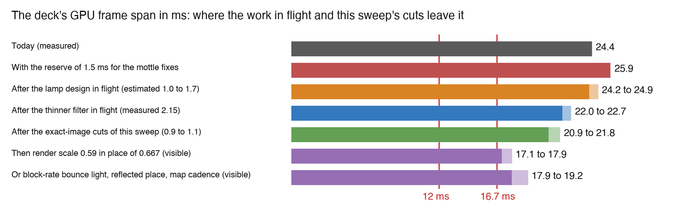
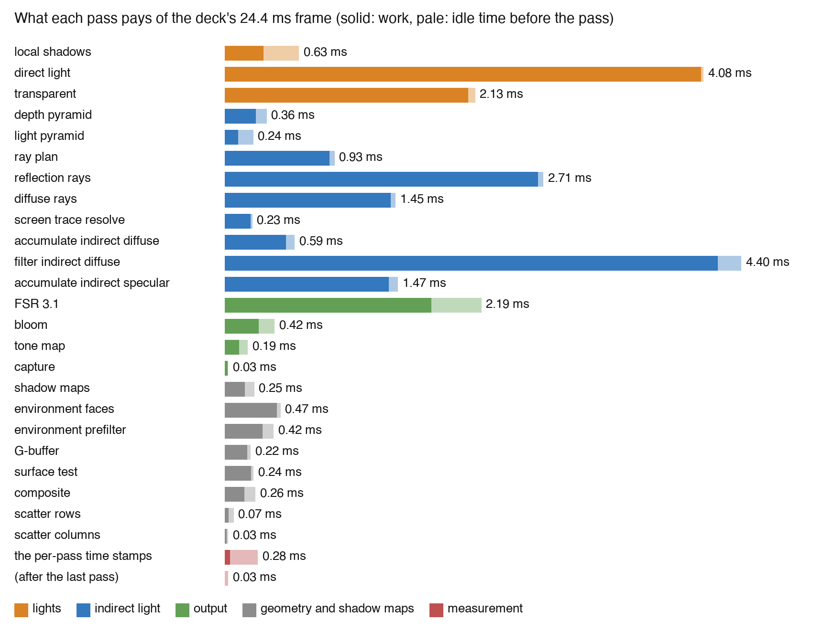
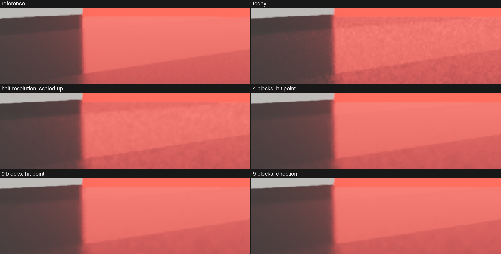
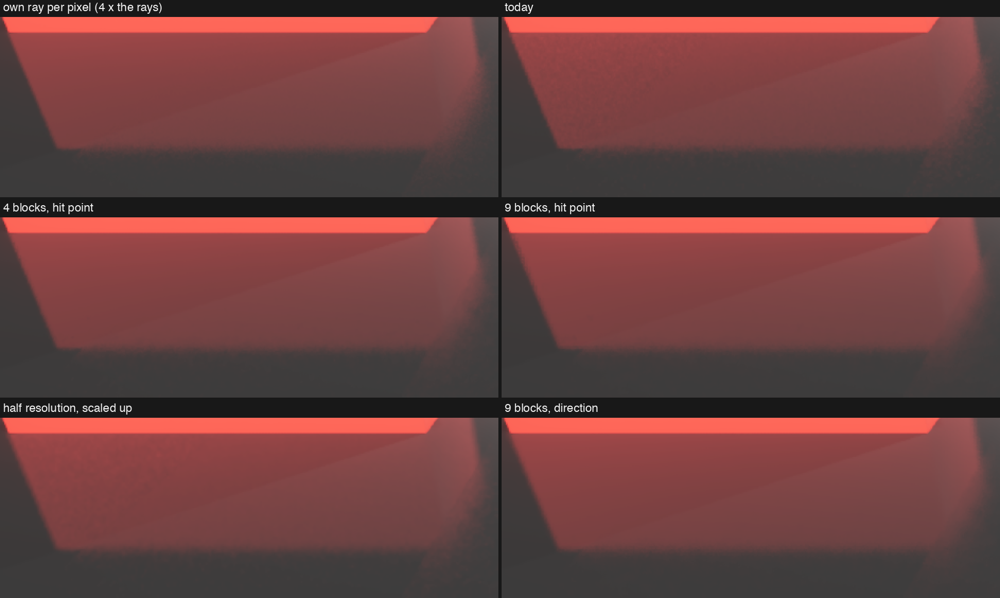
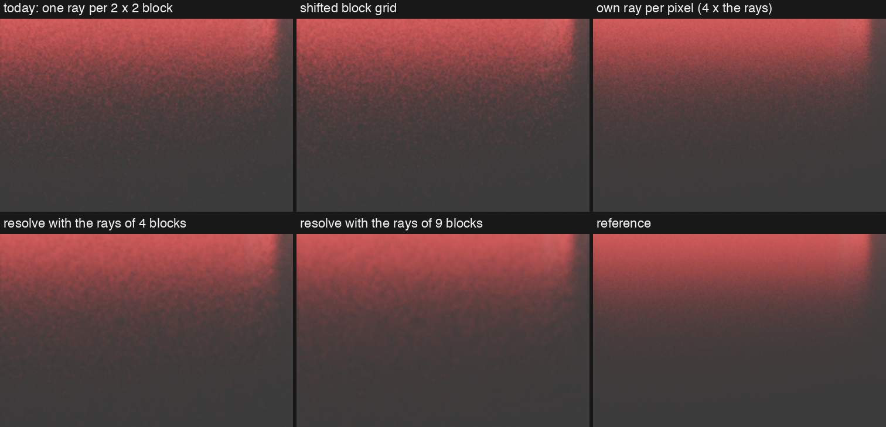
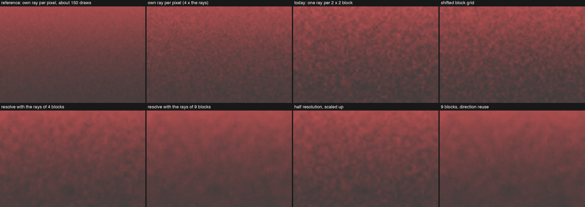

# Sweep of the renderer's frame time

Research report of the sweep agent, 2026-11-11. Nothing here is built, merged or ticketed. Every scratch build lives in `/private/tmp/tertius-sweep-20261111`.

## Summary

The view is the station deck (`scripts/temporal-upscale-timing.json`), at 1280 × 720 render size and 1920 × 1080 output. On main at `d4a2d11f9`, its GPU frame span has a mean of 24.4 ms and a 95th percentile of 25.0 ms. The budget for this view is a 95th percentile of 16.7 ms, which is a mean of about 16.1 ms. The mottle fixes take a reserve of 1.5 ms. So the mean must fall by 9.8 ms.

1. The PlayStation 4 comparison. This Mac's GPU is about 4.3 times a PlayStation 4, not equal to one. The deck frame does about seven times the work per pixel of a whole PlayStation 4 frame. No bug explains that. Three choices explain it. The frame traces and filters bounce light for every pixel in every frame. It has 13 exact area lamps with shadows near the view. And some passes process block-rate data at the pixel rate.
2. The frame has little pure waste. The cuts of this sweep that keep the image exactly are worth about 0.9 to 1.1 ms. With the lamp design and the thinner filter in flight, the deck comes to about 21 to 22 ms, with the mottle reserve counted.
3. The last 5 to 6 ms need a visible choice. The first option is a render scale of 0.55 to 0.59. FSR's balanced mode is 0.59, and today's 0.667 is its quality mode. The second is block-rate bounce light with two smaller changes. The third is the cut of reflection rays that is on hold. Section 7 sizes each.
4. The idea of half-resolution reflections. A half-resolution history saves an estimated 0.6 to 0.8 ms. In my emulation it removes 13 to 26 % of the grain and none of the clouds. The resolve of Stachowiak 2015 with the rays of four blocks does more for the grain. It removes 24 to 59 %, as much as a build with four times the rays. On the glossy strip near a contact, it also cuts the clouds by 45 %. At the other places it changes the clouds by −17 to +14 %. It costs time: an estimated 0.4 to 0.6 ms, not traced yet.



The chart shows means. Its red lines are the budgets, which are 95th percentiles. On the baseline, the 95th percentile is 0.6 ms above the mean.

## 1. The PlayStation 4 comparison

The premise has three parts. This Mac has about the computational power of a PlayStation 4. The renderer uses similar techniques: temporal accumulation and frame super resolution. So similar frame times are within reach, unless something obvious is missing.

The short answer: the hardware half of the premise is too modest, and the technique half is too generous. This Mac is about four times a PlayStation 4. The deck frame does about seven times the work per pixel of a whole PlayStation 4 frame. Three things are missing from the comparison, and none of them is a bug.

### The hardware

| | PlayStation 4 | M1 Max, 24-core GPU | Ratio |
|---|---:|---:|---:|
| Arithmetic rate, single precision (TFLOPS: 10^12 floating-point operations per second) | 1.84 | 7.8 to 8.0 | 4.3 |
| Shader arithmetic units | 1,152 at 800 MHz | 3,072 at about 1,300 MHz | |
| Memory bandwidth, shared with the CPU | 176 GB/s | 400 GB/s | 2.3 |

The PlayStation 4 Pro has 4.2 TFLOPS, so this Mac is about 1.9 times a Pro. These numbers compare different GPU designs, so they are rough. They are good enough to say that the Mac is three to four times a PlayStation 4, not equal to one.

### The budget per pixel

A PlayStation 4 game that used heavy screen effects ran at 30 frames per second: 33.3 ms per frame, for 1920 × 1080 pixels. The deck has 12 ms, for 1280 × 720 pixels, which is 0.44 of 1920 × 1080.

- Arithmetic per pixel in one frame, against a PlayStation 4 game at 30 frames per second: 4.3 × (12 / 33.3) / 0.44 = 3.5 times as much.
- The same with the budget of 16.7 ms: 4.9 times as much.
- The same by memory bandwidth, which limits passes that mostly read images: 2.3 × (12 / 33.3) / 0.44 = 1.9 times as much.

So the budget of 12 ms holds about 3.5 times the work per pixel of a complete PlayStation 4 frame. A complete PlayStation 4 frame, moved to this Mac at this render size, takes about 33.3 / 4.3 × 0.44 = 3.4 ms. The deck takes 24.4 ms. That is about seven times a PlayStation 4 frame.

### What is missing from the comparison

1. PlayStation 4 games did not compute bounce light per pixel in each frame. They computed it before the game ran and stored it in light maps and probes, and a frame paid one image read for it. The deck traces bounce light for every block of pixels in every frame, accumulates it and filters it. That chain pays about 7 ms: the diffuse rays 1.46 ms, the diffuse accumulation 0.60 ms, the diffuse filter 4.40 ms and a share of the ray plan and the pyramids. The filter is the method of Schied 2017 (SVGF: a filter that reads each pixel's neighbors in five steps of growing reach). Its paper reports about 10 ms at 1920 × 1080 on a high-end desktop GPU of 2017. A top GPU of that year has about 11 TFLOPS, 1.4 times this Mac. By that ratio, the method takes about 6 ms at our render size on this GPU. We measure 6.5 ms for both accumulations and the filter. So the filter is not wasteful. It is a technique for hardware of 2017 and later, and it has no counterpart in a PlayStation 4 frame.
2. PlayStation 4 games ran their noisy screen effects at half resolution. A screen effect at half resolution computes one value for each 2 × 2 block of pixels. Then it scales the result up along the edges of the geometry. Frostbite's reflections (Stachowiak 2015) and most ambient occlusion of that time worked so. The deck already traces one ray for each 2 × 2 block, which is the same ray count. But it then accumulates and filters that light for every pixel. Three passes read block-rate data at the pixel rate: the diffuse filter (4.40 ms), the specular accumulation (1.47 ms) and the diffuse accumulation (0.60 ms).
3. PlayStation 4 games had few exact lamps. The deck has 13 rectangle lamps near the view, and the scene's light list holds 21. The lamps cast shadows, and each gives an exact area integral (LTC, published in 2016), on opaque surfaces and on glass. The tile agent measured their cost: without the lamps, the frame span falls from 24.7 ms to 19.9 ms. A PlayStation 4 game treated most lamps as points and gave shadows to a few of them. The tile agent measured this too: with each lamp as a point, the direct light pass falls from 4.19 ms to 2.53 ms.

Two smaller facts belong here too.

- The temporal accumulation and the upscaling are already counted. The frame renders 0.44 of the output pixels and traces one ray for each four pixels. The 24.4 ms is the cost after those savings.
- About 2.3 ms of the frame is idle time between passes. Part of it comes from the way MoltenVK 1.4.2 translates Vulkan to Metal (section 3). A console does not pay that part, and a Linux driver does not pay it either.

### What the comparison implies

"Similar territory" is reachable, but not by tuning alone. The exact-image cuts of this sweep, the thinner filter and the lamp design bring the deck to about 21 to 22 ms (section 7). The last steps to 16.7 ms need the economy that the PlayStation 4 generation used: process block-rate light at block rate and scale it up along the geometry, or render fewer pixels.

One external number supports this. An unofficial Unity port of Stachowiak's method reports 4.15 ms on a GTX 1070 at 1920 × 1080: 1.4 ms for the rays, 0.55 ms for the resolve, 0.67 ms for the temporal filter and 0.73 ms for a blur. A GTX 1070 is near this Mac's GPU. At 1280 × 720 that is about 1.9 ms. Our reflections pay about 4.7 ms: the rays 2.71 ms, the accumulation 1.47 ms and shares of the plan and the resolve. The port is not Frostbite's own code, and I found no official console timing for the talk.

The sources:

- [TechPowerUp, PlayStation 4 GPU](https://techpowerup.com/gpudb/2085/playstation-4-gpu).
- [Notebookcheck, M1 Max 24-core GPU](https://www.notebookcheck.net/M1-Max-24-Core-GPU-vs-M1-Max-32-Core-GPU-vs-M1-Pro-16-Core-GPU_10967_10970_10963.247598.0.html).
- [Low End Mac, M1 Max specifications](https://lowendmac.com/1234/apple-silicon-m1-max-chip-specs/).
- [Schied 2017, SVGF](https://research.nvidia.com/publication/2017-07_spatiotemporal-variance-guided-filtering-real-time-reconstruction-path-traced).
- [Stachowiak 2015, Stochastic Screen-Space Reflections](https://www.slideshare.net/slideshow/stochastic-screenspace-reflections/51840375).
- [The Unity port's timings](https://play.unity.com/p/compute-stochastic-screen-space-reflections-for-unity-post-processing).

## 2. How the frame's time is counted here

Every number is a mean over the settled frames of a Metal System Trace of the deck, at a GPU clock of about 1,290 MHz. Every ablation build fixes the exposure at 0.7041458 stops, as the tile agent's builds do. Without that, a variant that changes the image moves the automatic exposure and with it every lamp's reach, and the times are not comparable.

Three terms have exact meanings in this report.

- The frame span is the time from the first GPU work of a frame to its last. The budget is the 95th percentile of the frame span.
- The busy time of a pass is the length of time in which at least one piece of the pass's GPU work runs. `tools/gpu-trace.py` reports it. Busy times of different passes overlap, so they do not add up to the frame span.
- What a pass pays is my own count, from `tools/pays.py` in the sweep's folder. At each instant, the time goes to the earliest pass that still has work open. An instant in which the GPU does nothing goes to the next pass that starts. The rows add up to the frame span exactly. The count splits each row into work and idle time before the pass.



| Group | Pays (ms) | Passes |
|---|---:|---|
| Indirect light | 12.40 | depth pyramid, light pyramid, ray plan, reflection rays, diffuse rays, resolve, both accumulations, diffuse filter |
| Lights | 6.84 | local shadows, direct light, transparent (the lamps on glass) |
| Output | 2.83 | FSR 3.1, bloom, tone map, capture |
| Geometry and shadow maps | 1.96 | shadow maps, environment faces and prefilter, G-buffer, surface test, composite, scatter |
| Measurement | 0.32 | the time stamps after each pass |
| Sum | 24.35 | of which 22.04 ms is work and 2.32 ms is idle time |

The count changes the picture of the output group. The busy times give FSR 3.10 ms and bloom 1.05 ms. But 1.34 ms of FSR's busy time and 0.76 ms of bloom's is work that only waits behind the transparent pass. FSR pays 2.19 ms and bloom pays 0.42 ms. The whole output group pays 2.8 ms, not 4.6 ms. The other 1.8 ms belong to the lights and to the indirect light.

Two traps cost measurements in this sweep, and both can mislead a later reader.

- The GPU clock trap. A lighter frame leaves the GPU less busy, and the GPU then lowers its clock. The trace at render scale 0.5 ran at 1,018 MHz, not 1,290 MHz. Its raw frame span of 19.4 ms understates the gain. Scaled to the full clock it is about 15.3 ms.
- The static camera. The timing view has a camera that stands still. A pixel that is new on the screen traces its own rays for 8 draws. In the first 8 draws after a cut, the reflection rays take about 9.5 ms and the diffuse rays about 5.8 ms. The frame then takes about 34.5 ms. A moving camera uncovers new pixels in every frame, so the frame in play is heavier than this view shows. Nobody measured by how much.

## 3. Idle time between passes

The deck frame holds 2.32 ms in which the GPU does nothing. That is 9.5 % of the frame span. The idle time sits at the boundaries between Metal encoders. An encoder is Metal's unit of recorded GPU work: one render pass, or one run of compute dispatches. The frame has 139 encoders, so a boundary costs about 17 µs on average.

A boundary between two render passes is Metal's own, and every API pays it on this GPU. A boundary between two compute dispatches is not. MoltenVK 1.4.2, the layer that translates Vulkan to Metal on this Mac, makes it. On macOS 15 and later, MoltenVK ends the current encoder at every pipeline barrier outside a render pass. The code is in `MVKCmdPipeline.mm`, line 160:

```cpp
if (!cmdEncoder->_mtlRenderEncoder && cmdEncoder->isUsingMetalArgumentBuffers() && cmdEncoder->getDevice()->hasResidencySet()) {
    cmdEncoder->endCurrentMetalEncoding();

    for (auto& b : _barriers) {
        uint64_t sourceStageMask = mvkBarrierStagesFromPipelineStageFlags(b.srcStageMask), destStageMask = mvkBarrierStagesFromPipelineStageFlags(b.dstStageMask);
        cmdEncoder->setBarrier(sourceStageMask, destStageMask);
    }
}
```

where

- `cmdEncoder` = MoltenVK's state for the Vulkan command buffer that it translates.
- `_mtlRenderEncoder` = the Metal encoder of the render pass in progress, or null outside a render pass.
- `isUsingMetalArgumentBuffers()` = whether MoltenVK passes descriptor sets to shaders as Metal argument buffers, its default.
- `hasResidencySet()` = whether the device has Metal residency sets, which macOS 15 added.
- `endCurrentMetalEncoding()` = ends the current Metal encoder, so that the next dispatch starts a new one.
- `_barriers` = the barriers of this one `vkCmdPipelineBarrier` call.
- `setBarrier` = records the stages, so that a Metal fence orders the next encoder after the last one.

So every `vkCmdPipelineBarrier2` call between two compute dispatches makes a new Metal encoder. The renderer's `BarrierBatch` makes one such call per flush, and each pass that reads the output of the pass before it needs one flush. This is correct Vulkan, and a Linux driver pays nothing for it.

I tried to bound the cost with `MVK_CONFIG_USE_METAL_ARGUMENT_BUFFERS=0`, which turns the rule off. The renderer does not start in that mode: `vkCreateGraphicsPipelines(shadow cascades cutout)` fails. So the bound is not measured. About 0.8 ms of the idle time sits before render passes, and about 1.1 ms before compute dispatches and time stamps. The other 0.4 ms sits inside FSR, which holds both kinds.

The portable cuts do not remove barriers that Vulkan needs. They make fewer encoders:

| Where | Encoders | Idle before the pass (ms) | Change | Estimated gain (ms) |
|---|---:|---:|---|---:|
| FSR 3.1 | 22 | 0.42 | 13 of them clear one image level each: `vkCmdClearColorImage` on `SpdMips`, `SpdAtomicCounter` and `ReconstructedPrevNearestDepth` in each frame. One compute dispatch writes the same zeros. | 0.15 to 0.30 |
| Depth pyramid and light pyramid | 7 and 7 | 0.09 and 0.13 | Build several levels in one dispatch. | 0.10 to 0.15 |
| Time stamps after each pass | 28 | 0.24 | Known: the window stamps only the cost groups (`--pass-timestamps off`). | 0.15 to 0.24, in a window only |
| Local shadows | 14 | 0.30 | One render pass per tile is Metal's own boundary. Each drawn tile pays about 0.045 ms, half of it idle. Fewer drawn tiles per frame is the lever, and the lamp design decides that. A layered pass over the atlas is not a sure gain: a tile-based GPU loads and stores every layer that the pass binds. | not counted |
| Bloom | 11 | 0.13 | One render pass per level stays. | not counted |

None of the counted changes alters the image. On Linux they are neutral: a few state changes less, and one small dispatch more.

## 4. The indirect light

The indirect light pays 12.40 ms, half of the frame. The diffuse filter (4.40 ms) belongs to ticket ter-hxhl, and the cut of reflection rays is on hold (ter-hek6). This section covers the rest. It names the places where the work repeats, and it gives the measured worth of each idea.

### 4.1 The same-surface test of the 3 × 3 neighbors runs three times per pixel

A settled pixel runs three loops over its 3 × 3 neighbors that ask whether each neighbor shows the same surface. They are the clamp of the diffuse accumulation, the clamp of the specular accumulation and the mean of the specular samples. A young pixel runs two more kinds: the fix of each accumulation and the diffuse filter's variance step. Each asks through `temporal.glsl`:

```glsl
SurfaceKey surfaceKeyAt(ivec2 pixel)
{
    SurfaceKey key;
    // The view ray's component along forward is 1, so the view depth is the distance over its length.
    key.depth = texelFetch(gbufferDistance, pixel, 0).r / length(viewRayThrough(vec2(pixel) + 0.5));
    key.normal = octDecode(texelFetch(gbufferNormal, pixel, 0).ba);
    key.model = modelOfWord(texelFetch(gbufferShading, pixel, 0).a);
    return key;
}
...
bool sameSurface(SurfaceKey pixel, SurfaceKey neighbor)
{
    return neighbor.depth > 0.0 && abs(neighbor.depth - pixel.depth) <= SameDepthShare * pixel.depth
        && dot(neighbor.normal, pixel.normal) >= SameNormalCosine && neighbor.model == pixel.model;
}
```

where

- `SurfaceKey` = what identifies a pixel's surface: its view depth, its geometric normal and its shading model.
- `sameSurface(pixel, neighbor)` = true for a neighbor that holds a surface of the same model. Its depth must lie within 10 % of the pixel's, and its normal within 25°.

One loop reads 24 G-buffer texels for its eight neighbors. The answer depends only on the G-buffer, so it is the same in every loop.

The change: the surface test pass, which already runs once per pixel, writes the eight answers as one byte per pixel. Each loop reads that byte. This is not the guide image that ticket t6-h5e3 dropped. That one replaced the filter's taps with 16-byte reads. This one replaces 24 reads with a 1-byte read, and it serves only neighbors at a distance of one pixel. The loops of a young pixel reach farther, so they keep their own test. The image is the same.

Measured bound: in the variant `keyfree`, a surface key costs no read. It lowers the specular accumulation by 0.50 ms and the diffuse accumulation by 0.19 ms. The pass that writes the byte reads the 24 texels once, for an estimated 0.2 ms. So the net gain is about 0.45 ms.

### 4.2 The reflected place costs half of the specular accumulation

The specular accumulation pays 1.47 ms. For a pixel whose roughness is below 0.4, its temporal step tries two places in the last frame's image: the place of the surface, and the place where a flat mirror shows the point that the ray hit. It reads about 60 texels more for the second place. Of these, 39 go to the mean of this frame's samples over the 3 × 3 neighbors. It keeps the place whose history lies nearer that mean. That keeps a sharp reflection sharp while the camera moves.

Measured bound: the variant `snorefl`, which never tries the reflected place, lowers the specular accumulation by 0.78 ms, to 0.69 ms. The renderer's own switch `TERTIUS_DEBUG_REFLECTED_PLACE=off` does the same without a scratch build.

Two cuts follow, and they are different in kind.

- Exact: the byte of section 4.1 replaces 30 of those 39 reads with one. That gain is inside the 0.50 ms above.
- Visible under motion only: try the reflected place only below a lower roughness, such as 0.2 or 0.25. Most of the deck has a roughness of 0.38, so this saves up to about 0.7 ms on the deck. The risk is a smear of rough reflections while the camera moves. A rough estimate says that the risk is real. At walking speed, 3 m from a surface, the two places drift apart by about 3 pixels per frame. A lobe of roughness 0.38 blurs over about 100 pixels. A history of 30 frames then lags by up to about 90 pixels, which is near the width of the blur. The clamp of the history limits the lag, and nobody measured by how much. A film with a moving camera must show it before anyone decides.

In a view with a camera that stands still, the two places are equal. A test for that skips the second place and keeps the image. I do not count it: it lowers the measured number of the timing view and nothing in play.

### 4.3 A ray's hit shades its pixel again, each time

When a ray hits a pixel `q`, the tracer computes the light that leaves `q` from its parts (`screen_trace.glsl`, line 377):

```glsl
vec3 hitLightOf(ivec2 q, uint kind)
{
    vec3 emissive = texelFetch(gbufferEmissive, q, 0).rgb;
    vec3 glow = glowSent(emissive, lightMarkOfWord(texelFetch(gbufferShading, q, 0).b));
    if (texelFetch(gbufferBaseColor, q, 0).a == 0.0)
        return glow;
    ShadingInput s = materialAt(q);
    vec3 V = -normalize(viewRayThrough(vec2(q) + 0.5));
    MaterialFactors factors = materialFactors(s, lobesOf(s, V));
    uint bits = imageLoad(surfaceTest, q).r;
    vec2 place = lastPlaceAt(q);
    Reprojection diffuse = reprojectionOf(place, bits & 0xFu);
    Reprojection specular = reprojectionOf(place, (bits >> 4) & 0xFu);
    ...
    vec3 diffuseHistory = holdsHistory(diffuse) ? lastLightOf(diffuse, KindDiffuse) : closedLight.diffuse;
    vec3 light = factors.diffuse * (imageLoad(directDiffuseLight, q).rgb + diffuseHistory) + glow;
    if (kind == KindReflection)
    {
        vec3 specularHistory = holdsHistory(specular) ? lastLightOf(specular, KindReflection) : closedLight.specular;
        light += factors.specular * (imageLoad(directSpecularLight, q).rgb + specularHistory);
    }
    return min(light, vec3(MaxRadiance));
}
```

where

- `q` = the pixel that the ray hit.
- `kind` = the ray's kind: a diffuse ray (bounce light) or a reflection ray.
- `glow` = the light that `q` sends as an emitter.
- `materialAt(q)` = the material of `q`, from six G-buffer images.
- `factors` = the diffuse and the specular material factor of `q`: the share of incoming light that `q` sends on.
- `surfaceTest` = the image of the pass bits of the last frame's four history texels around `q`'s last place.
- `lastPlaceAt(q)` = where `q` was in the last frame's image, from its motion.
- `reprojectionOf(place, bits)` = the bilinear weights of the four history texels around the place that pass their test.
- `lastLightOf(r, kind)` = the last frame's bounce light or reflection light at `q`, read through those four texels.
- `closedLight` = the environment's light at `q` from a formula, for a pixel without a history.
- `directDiffuseLight`, `directSpecularLight` = this frame's light of the lamps at `q`.

A diffuse ray's hit reads 13 texels and a reflection ray's hit reads 18, at a pixel far from the ray's start. The function uses nothing of the ray: its result depends only on `q` and `kind`. So one pass per frame can write the hit light of every pixel into an image, and a hit then reads one texel. The values are the same.

Measured: the variant `hitcache` is a timing proxy of that change. Its rays read one texel per hit, and its resolve computes the full hit light of every pixel once. The reflection rays fall by 0.56 ms and the diffuse rays by 0.14 ms. The resolve grows by 0.48 ms. The frame span falls by 0.12 ms. So the gain is about 0.2 ms, far less than the 31 reads suggest. The proxy's new work computes the light of all 921,600 pixels in every frame. A frame traces 460,800 block rays and the own rays, and only a part of them hits the screen.

A cheaper form exists, with a small change of meaning: the composite already computes nearly this light for every pixel. If it also writes it, the rays of the next frame read it through four history texels. The lamps' light at a hit is then one frame old. I estimate 0.35 ms for it, and it needs a decision.

### 4.4 What did not work

- The miss light only on a miss (`lazymiss`). A ray reads the environment map's light before its walk, and a ray that hits fully never uses it. Reading it only where needed made the reflection rays 0.24 ms slower in one trace. Rays that hit and rays that miss run in the same group of GPU threads. So the group runs both branches anyway, and the branch itself costs. Not proposed.
- The ray plan per block (`planblock`). The ray plan finds each block's chosen pixel up to eight times, once for each of its four pixels and each ray kind. My proxy let the first pixel of each block do the work of all four, inside the dispatch per pixel. The plan became 0.76 ms slower, because three threads of each four then wait for the fourth. A real test needs a dispatch per block, which is a build of its own. Its gain is unknown. Ticket t6-h5e3 measured that the plan's history read costs at most 0.12 ms.
- A grid of blocks that shifts from draw to draw (`jit`, section 5.3).

### 4.5 Which passes run at a higher rate than their data

The question was whether each pass of the indirect light needs to run at the full render size. The answer follows from the rate of the data. The tracer makes one ray of each kind for each 2 × 2 block of pixels in a draw. A pixel traces its own ray only in three cases. Its history is shorter than 8 frames. Or its block's ray does not fit its surface. Or it is mirror-like and the block's ray lies outside its lobe.

On a flat surface the four pixels of a block take the same ray with the same weight, in every draw. So their four histories hold the same numbers. A neighbor inside the block is a copy, and a neighbor across the block's border is independent.

| Pass | Runs once per | Its data exists once per | Pays today (ms) | Needs the full render size? |
|---|---|---|---:|---|
| Reflection rays, diffuse rays | block, plus the own rays | block | 2.71 and 1.46 | They already run at block rate. |
| Ray plan | pixel | block for the chosen pixel, pixel for the decision | 0.93 | The decision is per pixel, but most of the work is per block. |
| Resolve | pixel | block | 0.23 | Yes, cheaply: it applies each pixel's own weight. |
| Diffuse accumulation | pixel | block | 0.60 | No, on flat surfaces. Only a pixel's own normal makes its sample differ. |
| Diffuse filter | pixel | block | 4.40 | No. A tap at a distance of one pixel mostly reads a copy of the center's ray. |
| Specular accumulation | pixel | block for glossy pixels, pixel for mirror-like ones | 1.47 | Only for mirror-like pixels and for edges. |

So three passes process block-rate data at the pixel rate: the diffuse filter, the diffuse accumulation and the specular accumulation. This is the one structural reserve of the frame, and it is the economy that section 1 names.

The cost of a pass follows its pixel count. The trace at render scale 0.5 shows it, after the clock correction. The passes from the surface test to the composite cost 0.58 of their cost at render scale 0.667. They process 0.56 of the pixels. So a block-rate pass costs about a quarter of its pixel-rate cost, plus the scale-up.

What the full rate buys, and what a block-rate version loses, must be said plainly.

- The detail of normal maps in bounce light. Each pixel weighs the block's diffuse ray by its own normal. A block-rate accumulation loses that, unless it stores the light by direction. The usual form is four spherical-harmonic coefficients per color. In the scale-up, a pixel evaluates them with its own normal. That costs 1.5 to 3 times the data per block, and it removes half of the saving.
- Thin geometry. A railing one pixel wide has no block of its own. Today its pixels trace their own rays and keep their own history. A block-rate store needs a fallback for them.
- One store. A block-rate store beside the pixel-rate store of the own rays is a second store for one signal. The project's rule is one store for each piece of state.

The effect on the mottle is not a loss by itself. The mottle is noise at a scale that the filter does not reach. For the same number of taps, a block-rate filter reaches twice as far and reads four times as many independent rays. But the scale-up is a new place for blotches at edges, so it needs the mottle agent's daub score before anyone trusts it.

Estimated gain, after the thinner filter of ter-hxhl: the diffuse accumulation and the filter then pay about 2.8 ms. At block rate with plain colors they pay about 0.7 ms plus 0.25 ms for the scale-up, a gain of about 1.9 ms. With light stored by direction the gain is about 1.5 ms. This is a design ticket of its own, not a tune.

This also says something about the thinner filter, as an interaction and not as a proposal: its first step, with taps one pixel apart, reads at most four independent rays with its nine taps.

## 5. Reflections of rough surfaces at half resolution

The idea was: run the reflections of rough surfaces at half resolution and scale them up, instead of sharing one block ray among full-resolution pixels. The orchestrator also asked for a comparison with the resolve of Frostbite's stochastic screen-space reflections (Stachowiak 2015).

### 5.1 What happens today

A reflection pixel is a pixel whose roughness is at most 0.5. Here roughness means the square root of the GGX alpha, and the lobe is the cone of directions that such a surface reflects into. In each draw, one pixel of each 2 × 2 block traces the block's reflection ray. That pixel is the block's chosen pixel, and the choice turns through the four pixels in four draws. Each other pixel of the block decides in the ray plan whether the block's ray serves it (`screen_trace_plan.comp`):

```glsl
bool insideLobe(TracingPixel p, TracingPixel c)
{
    return distance(reflect(-p.V, p.normal), reflect(-c.V, c.normal)) <= 2.0 * LobeFitShare * atan(p.alpha);
}
```

where

- `p` = the pixel that asks, and `c` = the block's chosen pixel.
- `reflect(-p.V, p.normal)` = the pixel's mirror direction: its view direction reflected about its normal.
- `p.alpha` = the pixel's GGX alpha, its roughness squared.
- `2.0 * atan(p.alpha)` = the width of the pixel's reflected lobe, in radians.
- `LobeFitShare` = 0.5: the two mirror directions must lie within half a lobe width of each other.

On a flat floor, two neighbor pixels' mirror directions differ by about one pixel's angle, 0.0015 to 0.002 radians at this render size. So a flat surface shares from a roughness of about 0.05 up. Below that, each pixel traces its own ray in every draw.

A pixel that shares takes the block's ray and weighs it for itself in the resolve (`screen_trace_resolve.comp`):

```glsl
vec3 specularWeightOf(TracingPixel p, SurfaceLobes lobes, MaterialFactors factors, WeighedRay ray)
{
    vec3 response = p.s.model == ShadingHair ? hairResponse(p.s, lobes, p.V, ray.direction).specular
        : specularResponse(lobes, p.s.normal, p.V, ray.direction, 0.0);
    return min(response / (ray.density * max(factors.specular, vec3(LeastFactor))), vec3(MostRayWeight));
}
```

where

- `ray.direction` = the direction of the block's ray. The pixel reuses the direction, not the point that the ray hit.
- `ray.density` = the probability density with which the chosen pixel drew that direction, per steradian.
- `response` = how much light this pixel reflects toward the eye from that direction: its own BRDF times the cosine.
- `factors.specular` = the pixel's specular material factor. The stored sample is the light divided by it.
- `MostRayWeight` = 4: the cap of the weight.

The pixel's sample is the ray's light times this weight. Then each pixel accumulates its sample in its own history at the full render size. By default the history has no cap, so a still image keeps getting cleaner. A change of the light or of the view shortens it.

So the ray count is already that of a half-resolution tracer: one ray per 2 × 2 block. What stays at the pixel rate is the plan, the resolve and the accumulation.

The weight matters for the grain. A pixel one pixel away from the chosen pixel has a slightly different lobe, so its weight moves around 1 from draw to draw. On a glossy surface the lobe is narrow, and the weight moves a lot. The sample is the light times the weight, so the sample is noisy even where the reflected light is perfectly even. The reference with an own ray for every pixel has almost none of this noise.

### 5.2 The prototypes

Each prototype is a scratch build of main with one edit. All trace the same rays as today, except the reference.

| Name | What it does |
|---|---|
| today | Main: the sample is the light of the block's ray times the pixel's weight. |
| own ray per pixel | No pixel shares. Four times the reflection rays. This is the reference of ticket ter-gi1v. |
| half resolution, scaled up | An emulation in the composite. Each pixel takes the mean of the specular history over each 2 × 2 block. It blends the means of the four nearest blocks bilinearly, for blocks of the same surface and roughness. It shows the look of a half-resolution history, not its cost. |
| resolve with the rays of 4 blocks | Stachowiak's resolve: a pixel that shares takes the rays of the four nearest blocks. Each ray's weight is the pixel's own BRDF over the ray's density. The sample is the sum of the weighted lights divided by the sum of the weights. The direction to a neighbor's ray goes to the point that the ray hit. A neighbor block must show the same surface. |
| resolve with the rays of 9 blocks | The same with the 3 × 3 blocks around the pixel's block. |
| shifted block grid | The grid of the blocks shifts by one pixel in a cycle of 16 draws. |

The scene is `reflections`: floor strips of roughness 0 (mirror), 0.1, 0.2, 0.3 and 0.45, with a red box, a glowing bar and a blue sphere on them. The view is the low camera, 0.3 m above the floor, the view of ticket ter-gi1v. Each still is the headless still of 33 draws after a cut, at one fixed exposure. The long reference is the build with an own ray per pixel after about 150 draws.

### 5.3 What the pictures show

The strip of roughness 0.1 near the red box's contact, at three times the output size. This is where today's grain is worst:



Today's image shows a strong grain in the pink reflection. The half-resolution emulation softens it and keeps a blotchy texture. In its top band it also damages the mirror strip, which shows why mirror-like pixels must stay out of such a path. The resolve with the rays of four blocks is clean and keeps the reflected edge as sharp as the reference.

The red box's reflection in the front view, enlarged:



Today's image shows the grain over the whole reflection. The two resolves are as smooth as the build with four times the rays, and the reflection's edges stay in place. The half-resolution emulation keeps a part of the grain.

The strip of roughness 0.2 at the true output size, where the reflection is a wide gradient:



Here every design keeps some error. The resolves and the half-resolution emulation look smoother than today. At four times the size, the remaining error of the resolves shows as soft clouds:



The numbers split the error against the long reference by the size of its features. Each number is a root mean square in percent of the reference's light. "Fine" is features below 3 output pixels. "Grain" is features of 3 to 9 output pixels, the scale of the blocks. "Clouds" is features of 9 to 36 output pixels, the scale of the mottle. "Broad" is wider features and the change of the mean.

Roughness 0.1, near the contact:

| Design | Fine | Grain | Clouds | Broad |
|---|---:|---:|---:|---:|
| today | 1.64 | 1.88 | 1.24 | 0.89 |
| own ray per pixel (4 times the rays) | 1.09 | 0.87 | 0.58 | 0.87 |
| half resolution, scaled up | 0.97 | 1.40 | 1.23 | 1.00 |
| resolve with the rays of 4 blocks | 0.77 | 0.78 | 0.68 | 0.40 |
| resolve with the rays of 9 blocks | 0.74 | 0.67 | 0.67 | 0.36 |
| shifted block grid | 1.64 | 1.87 | 1.20 | 0.98 |

Roughness 0.2, the red reflection:

| Design | Fine | Grain | Clouds | Broad |
|---|---:|---:|---:|---:|
| today | 3.72 | 4.44 | 2.76 | 1.42 |
| own ray per pixel (4 times the rays) | 3.38 | 3.05 | 1.64 | 1.34 |
| half resolution, scaled up | 2.41 | 3.39 | 2.71 | 1.93 |
| resolve with the rays of 4 blocks | 2.44 | 2.79 | 2.48 | 1.79 |
| resolve with the rays of 9 blocks | 2.23 | 2.22 | 2.37 | 2.62 |
| shifted block grid | 3.58 | 4.38 | 2.69 | 1.23 |

Roughness 0.3, the blue reflection:

| Design | Fine | Grain | Clouds | Broad |
|---|---:|---:|---:|---:|
| today | 3.08 | 3.40 | 2.13 | 1.78 |
| own ray per pixel (4 times the rays) | 2.62 | 2.20 | 1.32 | 1.56 |
| half resolution, scaled up | 2.01 | 2.63 | 2.10 | 2.25 |
| resolve with the rays of 4 blocks | 2.06 | 2.23 | 2.01 | 2.01 |
| resolve with the rays of 9 blocks | 1.89 | 1.72 | 1.96 | 3.13 |
| shifted block grid | 2.96 | 3.31 | 2.10 | 1.58 |

The change against today at all six measured places of the low view. A negative number is a gain:

| Place | Half resolution: grain | Half resolution: clouds | 4 blocks: grain | 4 blocks: clouds | 4 blocks: broad | 4 times the rays: grain | 4 times the rays: clouds |
|---|---:|---:|---:|---:|---:|---:|---:|
| 0.1, near the contact | −26 % | −1 % | −59 % | −45 % | −55 % | −54 % | −54 % |
| 0.1, red reflection | −13 % | +21 % | −31 % | −17 % | +11 % | −36 % | −37 % |
| 0.2, red reflection | −24 % | −2 % | −37 % | −10 % | +26 % | −31 % | −40 % |
| 0.2, plain floor | −14 % | +12 % | −24 % | +14 % | +40 % | −47 % | −40 % |
| 0.3, glow | −18 % | +2 % | −34 % | −15 % | −25 % | −29 % | −36 % |
| 0.3, blue reflection | −23 % | −1 % | −34 % | −6 % | +13 % | −35 % | −38 % |

What the numbers say:

1. The resolve with four blocks cuts the grain by 24 to 59 %. The build with four times the rays cuts it by 29 to 54 %. So for the grain, the resolve is worth four times the rays.
2. Near the contact on roughness 0.1, the reflected light is even. There the resolve also cuts the clouds by 45 %. The cause is the division by the sum of the weights: where the light is even, the weights cancel, and their noise is gone.
3. At the other places, the resolve changes the clouds by −17 to +14 %. No design that reuses rays over 4 to 6 pixels can remove error that is 9 to 36 pixels wide. Only more rays or more frames do that: the build with four times the rays cuts the clouds by 36 to 54 %.
4. The resolve has a price in the image. Its broad error is larger than today's at four of the six places, by 11 to 40 %. On the plain floor its clouds grow too, from 0.39 % to 0.45 % of the light. The mean light stays within 0.3 % of today's.
5. The half-resolution emulation cuts the grain by 13 to 26 %. It leaves the clouds as they are at four places and makes them 12 to 21 % larger at two.
6. Nine blocks cut the grain by 32 to 64 %. But the broad error grows by 38 to 84 % at five places, and the mean of the reflection rises by up to 1.4 %.
7. The shifted grid changes the grain and the clouds by at most 7 %. A calculation explains it after the fact: averaged over all positions, two neighbor pixels share a block half of the time, with or without the shift. The shift only moves the pattern around.
8. No design made a speck, except the shifted grid. A speck here is a pixel above 1.5 times the reference's light. Five boxes count zero for every other design. The shifted grid counts 71 specks per 10,000 pixels in the blue reflection.

Limits of this evidence: one scene, stills of 33 draws, no motion, and a reference that still holds some noise of its own. The second round of stills in the queue adds the 60th draw, a reference of 700 draws and the deck. It also adds a variant with one ray that only divides by its weight.

### 5.4 The three questions

Question 1: does a half-resolution path save time, does it remove the grain, above which roughness is it invisible, and how to blend?

- Time. The specular accumulation pays 1.47 ms. A history at block rate for the glossy pixels costs about a quarter of that. A pixel-rate pass must stay for mirror-like pixels and for pixels with their own rays, and the composite needs a scale-up along the geometry. I estimate a gain of 0.6 to 0.8 ms. The ray plan gains nothing: it still decides for each pixel.
- Grain. It removes 13 to 26 % of the grain and none of the clouds. It does not remove the noise of the weights, which is the worst part on glossy floors.
- Roughness. The loss of sharpness shows on the mirror strip. I see none from a roughness of 0.1 up in these stills. A safe start of the path is higher, at 0.2 to 0.25. A contact reflection stays sharp on a rougher surface, and a still shows no motion.
- Blend. A band of roughness, as the hand-over band between the reflection rays and the diffuse rays works today: inside the band both paths run, and the pixel blends them by its roughness. Both estimate the same light, so the brightness has no step. Only the texture of the noise changes across the band.
- The cost that the estimate hides: the specular signal then lives in two stores. A pixel moves between them at the 8th frame of its history, and each time its block's ray stops fitting it.

Question 2: how does it compare with Stachowiak's resolve?

On a still image the two are close relatives. A bilinear scale-up of a block-rate history and a resolve over the four nearest blocks are both a weighted mean of four blocks' rays. One runs after the accumulation and one before. The resolve wins on the image for two reasons that the pictures confirm. Its weights are each pixel's own BRDF, so edges and contacts stay sharp. And it divides by the sum of the weights, which removes the weight noise. It keeps one store at the full rate.

The source's situation, as the project's rule asks. The talk targets PlayStation 4 and Xbox One at 1920 × 1080. It traces one ray per 2 × 2 block, resolves over four neighbor rays, and ends with a temporal filter. Our ray count and our hardware class match. Two things differ. Frostbite reads the hit's color from a blurred pyramid of the last frame, at a level that matches the lobe's width. It also draws its rays from a lobe without its tail. Both remove most of the noise of rough lobes before the resolve, and both are biased. We read the exact light of one pixel and draw from the whole lobe. So on rough lobes our resolve starts from noisier rays than Frostbite's, and its result is noisier than the talk's pictures suggest. The second difference is the target: Frostbite's reflections sit on busy game surfaces at 30 or 60 frames per second, and ours must be clean in a still.

Question 3: gain, effect on grain and specks, and build cost.

| Design | Time on the deck (ms) | Grain | Clouds | Specks | Build |
|---|---:|---|---|---|---|
| Half-resolution history with a bilinear scale-up | −0.6 to −0.8, estimated from the pixel count | −13 to −26 % | −2 to +21 % | none in the stills | Large: a second store, a threshold band, a scale-up, a fallback for edges |
| Resolve with the rays of 4 blocks | +0.4 to +0.6, estimated from the reads. The trace is in the queue. | −24 to −59 % | −45 % at the contact, −17 to +14 % elsewhere | One bright ray spreads over 16 pixels at a quarter of its strength. No speck appeared in any still. | Medium: the resolve only |
| Resolve with the rays of 9 blocks | +1.0 to +1.5, estimated | −32 to −64 % | −46 to +28 % | as above | The same. It brightens the reflection by up to 1.4 %. |

My reading: the half-resolution path is the wrong tool for the grain. It saves less than the exact cuts of this sweep together, and it leaves most of the grain in place. The resolve with four blocks is the right tool for the grain, and it costs time. Whether its 0.4 to 0.6 ms belong inside the mottle reserve is the orchestrator's and Alexis's call. A cheaper first step is worth one test: one ray, divided by its own weight, which costs nothing and can remove the weight noise alone.

## 6. The output group and the other passes

### FSR 3.1

FSR pays 2.19 ms: 1.77 ms of work and 0.42 ms of idle time at its 22 encoders. Its largest dispatch, the last one, takes 0.93 ms. The eight other dispatches after the transparent pass take 0.77 ms together. The clears take about 0.2 ms of wall time, nearly all of it idle. These three numbers come from one frame of the tile agent's trace `deck-t6d-1`. The one cut is the clears (section 3). The rest is AMD's shader code at its published cost.

The cost that FSR shares with other passes is not a cost of FSR. Its busy time of 3.10 ms holds 1.34 ms in which its first work waits behind the transparent pass.

### Bloom

Bloom pays 0.42 ms: 0.29 ms of work and 0.13 ms of idle time at 11 encoders, one per level of its two chains. Its busy time of 1.05 ms is mostly waiting. I see no cut above 0.1 ms that keeps the image.

### The environment map

The environment faces and their prefilter pay 0.89 ms in every frame, for one face of 128 × 128 pixels per map. Ticket t6-h5e3 already limited the prefilter to the drawn faces. One more lever exists: draw a face in every second frame. That saves about 0.45 ms. The map then follows a change of the surroundings in twice the time. For one map at 60 frames per second, that is 0.2 s in place of 0.1 s. It is a visible choice only while the surroundings change.

### The transparent pass

The transparent pass pays 2.13 ms. The tile agent measured it with every lamp skipped: 1.06 ms of 2.34 ms, on the main of that day. So nearly half of the pass is not the lamps, and nobody owns that half. Its shader samples the whole material before it tests the fragment against the opaque surfaces. It has no early depth test against them, because the hardware depth buffer holds only the nearest depth range. A trace of the pass without any light is in the queue.

## 7. The budget

All numbers are means of the deck's GPU frame span, in ms. The budget is a 95th percentile. On the baseline it is 0.6 ms above the mean, so the mean must reach about 16.1 ms. I assume that this distance stays the same as the frame gets lighter.

| Step | Change | After it |
|---|---:|---:|
| Today | | 24.4 |
| The reserve for the mottle fixes | +1.5 | 25.9 |
| The lamp design in flight (the tile agent's estimate) | −1.0 to −1.7 | 24.2 to 24.9 |
| The thinner filter in flight (measured, its image review is pending) | −2.15 | 22.0 to 22.7 |
| The exact-image cuts of this sweep | −0.9 to −1.1 | 20.9 to 21.8 |
| Still to find for a mean of 16.1 ms | | 4.8 to 5.7 |

### Ranked opportunities

The order is by gain for the risk. "Measured" means a trace of a scratch build. "Bound" means a trace of a build that removes the work outright, so the real gain is lower.

| # | Pass | Change | Gain on the deck (ms) | From | Effect on the image | Build cost | Risk | Needs a decision |
|---:|---|---|---:|---|---|---|---|---|
| 1 | Both accumulations | One byte per pixel holds the same-surface answers of the 3 × 3 neighbors (4.1) | 0.45 | Bound 0.69 from the `keyfree` trace, less 0.2 estimated for the new write | None | Medium | Low | No |
| 2 | FSR 3.1 | One compute dispatch in place of 13 clears (3) | 0.15 to 0.30 | The idle time before the clears in the trace | None | Small | Low | No |
| 3 | Ray passes | A hit light image (4.3) | 0.2 | Measured: rays −0.70, new pass +0.48 | None, up to the rounding of the stored format | Medium | Low | No |
| 4 | Depth and light pyramids | Several levels per dispatch (3) | 0.10 to 0.15 | The idle time in the trace | None | Small | Low | No |
| 5 | Specular accumulation | The reflected place only below a roughness of 0.2 to 0.25 (4.2) | up to 0.7 | Bound 0.78 from the `snorefl` trace | Possible smear of rough reflections under camera motion. A moving film must show it. | Small | Medium | Yes |
| 6 | Environment map | A face in every second frame (6) | 0.45 | Half of what the two passes pay | The map follows a change in 0.2 s, not 0.1 s | Small | Low | Yes |
| 7 | Bounce light | Accumulate and filter at block rate, scale up along the geometry (4.5) | 1.5 to 1.9 after the thinner filter | Estimated from the pixel count, which the trace at render scale 0.5 confirms | Loses normal-map detail in bounce light unless the light is stored by direction. New risk of blotches at edges. | Large: a design ticket | High | Yes |
| 8 | Whole frame | Render scale 0.59 in place of 0.667: FSR's balanced mode in place of its quality mode | about 3.9 after the cuts above, 4.5 on today's frame | Measured at 0.5: 24.4 to about 15.3 ms after the clock correction | Softer image, and every grain grows in output pixels | None: it is a setting | Low to build, visible | Yes |
| 9 | Reflections | Half-resolution history for glossy pixels (5) | 0.6 to 0.8 | Estimated from the pixel count | Grain −13 to −26 %, clouds −2 to +21 %, mirrors must stay out | Large | High | Yes, and I advise against it |
| 10 | Reflections | Resolve with the rays of 4 blocks (5) | costs 0.4 to 0.6 | Estimated. The trace is in the queue. | Grain −24 to −59 %, clouds −45 to +14 %, sharp edges kept, broad error up at four of six places | Medium | Medium | Yes: it spends time for the image |
| 11 | Ray passes in a window | The window's stamps (known) | 0.15 to 0.24 | Ticket t6-h5e3 | None | Done | None | No |

### What reaches the budget

After the work in flight and rows 1 to 4, the mean stands at 20.9 to 21.8 ms. The target for the mean is about 16.1 ms. Three ways close the rest, and each is visible.

| Way | Mean after it (ms) | What Alexis gets | What it costs |
|---|---:|---|---|
| Render scale 0.59, FSR's balanced mode | 17.1 to 17.9 | Most of the way, with one setting and no build | A softer image and coarser grain everywhere |
| Render scale 0.55 to 0.57 | about 16.1 | The budget, with one setting and no build | The same, a little more |
| Rows 5, 6 and 7 together | 17.9 to 19.2 | A part of the way, with full sharpness of the direct light and of mirrors | A large build, and a new risk for the mottle |
| The cut of reflection rays that is on hold (ter-hek6) | not sized here | | It works against the grain of section 5 |

The render scale numbers rest on one measured point, the trace at 0.5. It gives a fixed part of 3.6 ms and a part of 20.8 ms that follows the pixel count.

The budget of 12 ms is out of reach for the deck at today's render scale. With a render scale of 0.5, the work in flight and rows 1 to 4, the estimate is a mean of 13.3 to 13.8 ms. With rows 5 to 7 too, it is 11.6 to 12.3 ms, at the edge of that budget.

## 8. Interactions with the work in flight

- The lamp design of the tile agent (worktree `t3-23bcaad4`). Each drawn shadow tile pays about 0.045 ms, half of it idle time. The transparent pass has about 1 ms that is not lamps. Neither is in my totals.
- The thinner filter (ter-hxhl). Row 1 does not touch it: the filter's variance step asks the same-surface question for young pixels only, over 7 × 7 pixels. Row 7 replaces its input rate, so row 7 waits until the thinner filter lands. Its first step reads at most four independent rays with nine taps.
- The mottle and the specks (t7-3e22). Nothing in rows 1 to 4 takes samples, rays or filtering away. Row 7 changes the filter's reach and needs the daub score. Row 10 changes the clouds of the reflections by −45 to +14 %, and it removes the grain that hides them. So the reflections can look more cloudy afterwards, and row 10 needs the daub score on the deck too.
- The moving-lamp mask (t1-4hij) and the extra light after a load (ter-g3tk). The cheaper form of row 3 makes the lamps' light at a hit one frame old. Both tickets depend on the frame in which a change of light reaches the histories. So that form needs their owners' view. The exact form changes nothing.
- The reflection reconstruction campaign (tiunr-lmmx, Design B in `reflection_sharing_prototype.glsl`). It shares reflection light between pixels after the accumulation. Row 10 shares rays before it. They overlap, and one of them is enough.
- The grain of shared reflection rays (ter-gi1v). Section 5 finds its main cause on glossy floors: the noise of the weights. Its candidate, an own ray for every second pixel, pays for more rays. The resolve removes that noise without more rays.
- The one-image depth pyramid (ter-y3k4). It changes what a step of the walk reads. The traces of the walk's step caps in my queue size the walk's share of the ray passes.
- Portable Vulkan. No proposal needs a device feature beyond what the renderer uses today, and none relies on MoltenVK. The encoder boundaries of section 3 cost nothing on Linux, and the cuts there are neutral on Linux.

## 9. What I measured, and what is still in the queue

Measured, in one exclusive take of the GPU lock (traces of the deck, 119 film frames, about 1,290 MHz):

| Trace | Build | Frame span, mean (ms) | Note |
|---|---|---:|---|
| `deck-maind-1` | main with the fixed exposure | 24.35 | The baseline of every number here |
| `deck-hitcache-1` | proxy of the hit light image | 24.23 | rays −0.70, resolve +0.48 |
| `deck-keyfree-1` | surface keys cost no read | 23.93 | accumulations −0.69. The clock dipped to 1,251 MHz for part of the run. |
| `deck-snorefl-1` | no reflected place | 23.67 | specular accumulation −0.78 |
| `deck-lazymiss-1` | miss light only where needed | 25.00 | reflection rays +0.24. A disturbed run, clock 1,280 MHz. |
| `deck-planblock-1` | plan proxy | 25.9 by the renderer's timer | The trace did not export. The proxy is not valid. |
| `deck-maind-rs50` | render scale 0.5 | median 19.4 raw at 1,018 MHz, about 15.3 at the full clock | The trace did not export. The numbers are the renderer's timer. Its tail was disturbed (mean 19.7, 95th percentile 24.0), so I use the median. |
| `deck-maind-noargbuf` | MoltenVK without argument buffers | none | The renderer does not start. |

Also measured, in the same take: the stills of the reflections scene for the builds of section 5, and the long reference.

Earlier in the sweep I read the tile agent's trace `deck-t6d-1` for the frame's timeline. Its idle time agrees with my baseline: 2.35 ms against 2.32 ms.

A second exclusive take and a shared take were still in the GPU queue at the end of this report. Their results belong in an addendum. They hold:

- The traces of the two resolves and of the build with an own ray per pixel.
- The walk's step caps of 24 and 64.
- The transparent pass without light.
- The guided rays off.
- Bloom off.
- Three ablations of the filter's taps.
- The second round of stills.

Two traces left my list, because other agents have them in the queue: the tile agent's trace with the performance counters, and the mottle agent's trace of the guided share of 0.5. After the take, `finish.sh` makes the tables of the new traces.

What surprised me:

1. A tenth of the frame is idle time, and MoltenVK's rule for barriers makes a part of it.
2. The output group pays 2.8 ms, not 4.6 ms. The busy times count waiting.
3. The most obvious waste in the code, 13 to 18 texel reads at every ray hit, is worth only 0.2 ms. The lazy miss light made the frame slower. On this GPU, a coherent pass is cheap and a branch inside the rays is not.
4. Half of the specular accumulation is the reflected place.
5. The grain of shared reflection rays is mostly the noise of the weights, and dividing by the sum of the weights removes it.
6. Every design that reuses reflection rays between pixels made the clouds on the plain floor larger, by 12 to 28 %.
7. The frame has no hidden 5 ms. The cost is the sum of the chosen techniques at their chosen rates, as the PlayStation 4 comparison predicts.

The files, all under `/private/tmp/tertius-sweep-20261111`:

- `edits/` holds one python edit per variant.
- `build-variant.sh`, `measure-lib.sh`, `take1.sh` and `take2.sh` build and trace the variants.
- `tools/pays.py`, `tools/compare.py`, `tools/bands.py` and `tools/crops.py` make the tables and the crops.
- `trace/` holds the traces and their tables.
- `refl/` holds the scripts and the stills of section 5.
- `pics/` holds the pictures of this report.
