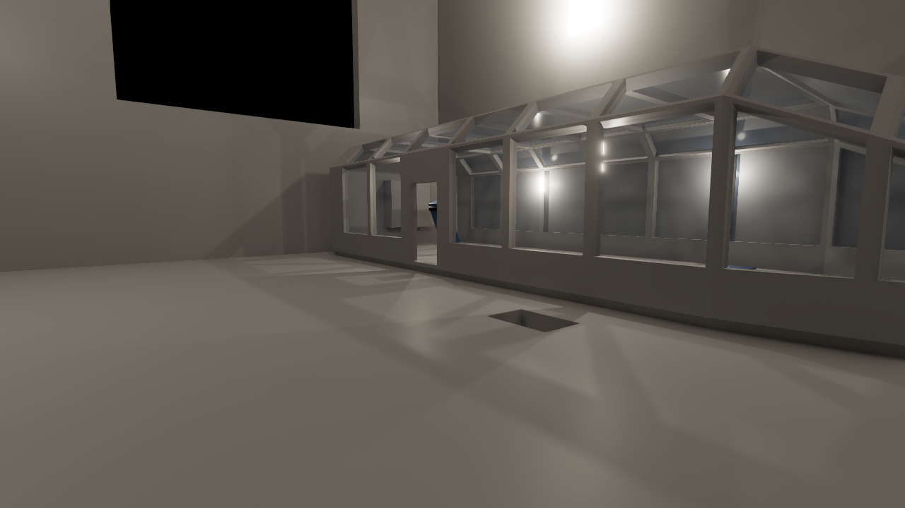
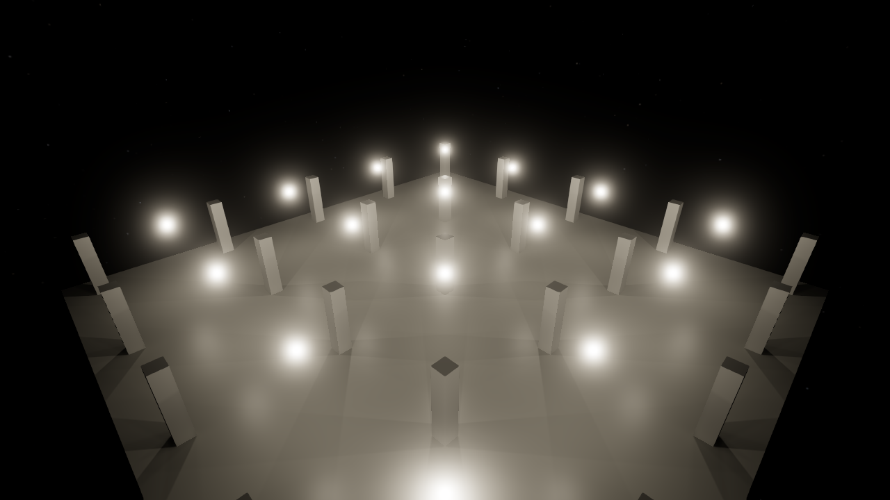

# Tertius on KosmicKrisp (ter-cikj)

KosmicKrisp is LunarG's Mesa Vulkan driver for Apple GPUs. Khronos deprecated MoltenVK and now recommends KosmicKrisp on Apple Silicon Macs. This report runs the engine's tests and the demo on KosmicKrisp from Mesa 26.2.4. It compares KosmicKrisp with MoltenVK 1.4.2 on the development Mac, an Apple M1 Max with macOS 27.0.

The recommendation is to keep MoltenVK as the dev shell's default and to keep KosmicKrisp beside it for comparison. KosmicKrisp is a stricter check of the engine's portability, and it found one defect of ours. But two of its own defects make its GPU timings invalid and its half-resolution reflections nondeterministic ("Recommendation").

## Setup

The dev shell adds `mesa` from the pinned nixpkgs on the Mac, and sets `TERTIUS_KOSMICKRISP_ICD` to its ICD manifest, `share/vulkan/icd.d/kosmickrisp_mesa_icd.aarch64.json`. MoltenVK stays the default through `VK_ICD_FILENAMES`. A command picks KosmicKrisp with `VK_ICD_FILENAMES=$TERTIUS_KOSMICKRISP_ICD` (tools/README.md, "Vulkan drivers"). `vulkaninfo --summary` then reports the driver KosmicKrisp, Mesa 26.2.4, API 1.4.354, conformance version 1.4.3.2.

KosmicKrisp reports one memory type, which is device-local, host-visible, coherent and cached. Its `timestampPeriod` is 41.667 ns, a 24 MHz clock, and its graphics queue has 64 valid timestamp bits. MoltenVK's period is 1 ns.

## The failures

Both suites ran on KosmicKrisp before any change of this ticket, with `VK_ICD_FILENAMES=$TERTIUS_KOSMICKRISP_ICD dotnet test --solution Tertius.slnx -c Checked`, then `-c Release`.

| Suite | Tests | Failed | Skipped |
|---|---:|---:|---:|
| Checked | 10,180 | 4 | 15 |
| Release | 10,167 | 4 | 15 |

The same four tests failed in both suites. After the two fixes of this ticket, the suites on KosmicKrisp gave these counts on 2026-11-04:

| Suite | Tests | Failed | Skipped | Failed tests |
|---|---:|---:|---:|---|
| Checked | 10,180 | 2 | 15 | The span test (ter-dgen) and the BGRA test (ter-gyfe) |
| Release | 10,167 | 2 | 15 | The span test (ter-dgen) and the BGRA test (ter-gyfe) |

On MoltenVK, the Release suite gave 10,167 tests, 0 failed and 16 skipped, and the Checked suite gave 10,180 tests, 0 failed and 16 skipped. MoltenVK skips one test more, because `OnADriverWhoseStampsLatchWhenTheWorkBeforeThemEndsAPassThatRecordsNothingReportsNearlyNoTimeOfItsOwn` skips on a driver whose stamps latch late.

The BGRA test fails in most runs on KosmicKrisp, not in all, because the fault of ter-gyfe varies from run to run. It passed in the first run's final Checked suite, on 2026-11-03. The table sorts each one into one of three classes: a defect of ours against the Vulkan spec, a defect of KosmicKrisp, or a legitimate difference between the drivers.

| Test | Class | Outcome |
|---|---|---|
| `EnvironmentMapPlumbingTests.AMapThatCannotGetItsDescriptorSetsReleasesTheImagesAndBuffersItMade` | Ours: the test relied on a refusal that the spec does not promise | Fixed: each pool refuses a set past its `maxSets` itself |
| `ScriptCommandCaptureTests.AHeadlessFilmWritesTheGpuSpanOfItsFramesBesideThePassesWithAMeanNoShorterThanItsLongestPass` | KosmicKrisp: its timestamps | ter-dgen, with a minimal reproduction. The test stays |
| `CaptureSinkTests.ABgraOutputHandsItsSinkThePixelsOfAnRgbaOutputInRgbaOrder` | KosmicKrisp: its indirect dispatch in the reflections | ter-gyfe. The test stays |
| `GpuTimingTests.OnMacOsWhereVulkanRunsOnMoltenVkTheRendererSaysThatItsStampsLatchLate` | Ours: the test took macOS for MoltenVK | Fixed: the test reads the driver, and its new name is `TheRendererSaysThatItsStampsLatchLateOnMoltenVkAndOnNoOtherDriver` |

### The descriptor pool test (ours)

The test fills the shared descriptor pool with prefilter sets, at most 100, until the pool refuses one. Then it expects the environment map's first set to fail, and the map to release its images and buffers. On KosmicKrisp, the pool gave all 100 sets, so the map's set did not fail.

The spec allows that. `vkAllocateDescriptorSets` says that an allocation past `maxSets` "may fail". It says the same of an allocation past a pool's size of a descriptor type. KosmicKrisp sizes a pool in bytes from both limits. It refuses a set only after the bytes run out (`kk_descriptor_pool_alloc` in `kk_descriptor_set.c`). So the test relied on a behavior that only some drivers give.

The fix gives the engine one behavior on every driver. `DescriptorLayouts` counts the sets that each of its two pools gave. It refuses a set past the pool's `maxSets` itself, with `VulkanException` and `ErrorOutOfPoolMemory` (ARCHITECTURE.md, "Descriptor pools"). No pool frees single sets, so the count only grows. The test was red on KosmicKrisp in both suites, and it is green on both drivers after the change. A set past a type's size still depends on the driver. No code of the engine reaches that case, and the shared pool's sizes hold every set that the engine makes.

### The GPU timings (KosmicKrisp, ter-dgen, which resolves ter-wwu7)

On KosmicKrisp, a headless run reports impossible pass times. On the deck view, 11 passes read 0.000 ms in every frame. The occlusion upsample and the reflection trace read about 7.686e14 ms, and the ambient light and the transparent pass about 3.40e9 ms. The Host test fails because the span is shorter than such a pass.

The cause is in KosmicKrisp. A small program, `docs/research/kosmickrisp/timestamps.c`, writes a stamp at all commands before a list of passes and after each pass, in one command buffer. It needs no engine code.

| Passes | KosmicKrisp | MoltenVK |
|---|---|---|
| C C R C C R | The stamps after the compute passes read the tick of the stamp before them. The render pass after them takes their time: +10.1 ms, +0.4 ms | Each compute pass 2.4 to 3.9 ms, each render pass 0.05 ms |
| C C C C C C C | Stamps 0 to 3 read one tick, stamps 4 to 7 read 0, marked available | Each pass 2.7 to 3.9 ms |

C is a compute dispatch that loops, and R a render pass that clears a 2048 x 2048 image. A global barrier follows each pass.

`kk_CmdWriteTimestamp2` (`kk_query_pool.c`) records a stamp outside a render pass into the command buffer's open Metal compute encoder. That encoder collects compute work and stamps until the next render pass. `mtl_compute_write_timestamp` (`mtl_encoder.m`) writes it with `MTL4TimestampGranularityRelaxed`, which lets Metal sample at an encoder boundary. The measurements agree: the stamps of one encoder read its start. From the fifth stamp in one encoder on, a stamp reads 0.

The spec forbids the 0s. Its chapter "Queries" says of `vkCmdWriteTimestamp2`: "Any timestamp write that happens-after another timestamp write in the same submission must not have a lower value unless its value overflows the maximum supported integer bit width of the query." A stamp at all commands happens after every command before it, the stamp before it too. A stamp that reads its encoder's start also reads a time before the work that its dependency orders before it. The renderer's stamps follow the spec, so the renderer does not change.

The numbers of ter-wwu7 follow. A pass that ends at a stamp of 0 wraps: 2^64 ticks of 41.667 ns are 7.686e14 ms. The pass after it reads the whole clock: 3.392e9 ms is 39.26 days, the Mac's uptime at the time of the ter-gmv8 run.

So on KosmicKrisp the per-pass times are not valid. The span starts at the start of the frame's first compute encoder. It ends at the start of the compute encoder that holds the last stamp. It leaves out the work of that last encoder, the capture, and it can take in the uploads, which share the first encoder. Both are short, so the span is close to the frame's GPU time, but it is not the same measure as on MoltenVK.

### The BGRA capture test (KosmicKrisp, ter-gyfe)

The test renders one frame of the reference scene in two renderers, one with an RGBA output and one with a BGRA output. It expects equal pixels. On KosmicKrisp, 67 to 250 pixels differ, by up to 136/255. The order of the channels is not the cause: two renderers with the RGBA output differ the same way.

- On MoltenVK, five renderers in turn give identical frames. On KosmicKrisp, they differ in 0 to 384 pixels, from run to run.
- With `NoReflections` or with `TraceResolution.Full`, KosmicKrisp gives identical frames too.
- Every pixel that differs is on the own-ray list of the half-resolution reflections. The list holds the same 502 pixels in every renderer.
- With a shader change that marks every pixel that the own-ray dispatch reaches, 0, 64, 192 or all 502 listed pixels were marked. So the indirect dispatch ran 0, 1, 3 or all 8 of its workgroups. It read the header's workgroup count while the upsample's atomic adds were still landing.
- The renderer's barrier between the two dispatches is the spec's: from the upsample's storage writes to the draw-indirect and compute stages, with the indirect command read and the storage read. The validation layer's synchronization validation reports no hazard. A barrier from all commands to all commands, added right before the dispatch, changed nothing.

A small program with the same commands ran every workgroup on KosmicKrisp. So ter-gyfe has no standalone reproduction yet, only the engine's. It is a defect of KosmicKrisp by this evidence, and the test stays.

### The test that took macOS for MoltenVK (ours)

`OnMacOsWhereVulkanRunsOnMoltenVkTheRendererSaysThatItsStampsLatchLate` expected `VulkanRenderer.StampsLatchLate` to be true exactly on macOS. The property is true exactly on MoltenVK, by the driver id. On KosmicKrisp it is false, so the test failed. The test's premise no longer held, because the Mac now has two drivers.

The property stays as it is. KosmicKrisp's stamps do not latch late in MoltenVK's sense: they read their encoder's start, or 0 (ter-dgen). A later Mesa release can fix that, so the flag stays keyed to MoltenVK's driver id. The test, now `TheRendererSaysThatItsStampsLatchLateOnMoltenVkAndOnNoOtherDriver`, reads the driver id from a device of its own. It expects the flag on MoltenVK and on no other driver. It passes on both drivers. A mutant that keys the flag to macOS fails it on KosmicKrisp (2026-11-04).

### The snapshot tests

No snapshot test failed on KosmicKrisp. Every reference image matched within its tolerance on both drivers.

## Timing

### Method

Each round ran four views on three arms, in an order of the arms that rotated by one arm per round:

- MoltenVK: the Release demo of this branch, on MoltenVK.
- KosmicKrisp: the same build, on KosmicKrisp.
- The control: a byte copy of the same build, on MoltenVK. Its difference from MoltenVK shows the spread between two runs of the same code and driver.

Every run took the GPU lock, `/tmp/tertius-gpu-measure.lock`, and recorded the load at its start. A run was `dotnet <build>/Tertius.Demo.dll --script <script> --headless --out <folder> --video none`, the same program that `dotnet run --project src/Tertius.Demo -c Release` starts. The views are those of the calibration and profiling spikes, at 1280 x 720:

| View | Script | Timed frames |
|---|---|---|
| Deck | `kosmickrisp/deck.json`: `demo-exit` with 399 ticks, then 120 frames of the deck camera | 120 |
| Floor | `kosmickrisp/floor.json`: `demo-exit` with 2,916 ticks, then 140 ticks and 120 frames of the follow camera | 120 |
| 16-lamp hall | `scripts/lamp-hall-16.json` | 301 |
| 64-lamp hall | `scripts/lamp-hall-64.json` | 301 |

The deck and floor scripts are those of `lean-trace-spike.md` and `trace-timing-spike.md`, at 1280 x 720. Nine rounds ran from 21:14 to 21:40 on 2026-11-03. In round 2, every KosmicKrisp run failed with `ErrorIncompatibleDriver`, because a garbage collection of the Nix store had removed Mesa, so round 2 has no KosmicKrisp runs. Other sessions used the machine: the 1-minute load at the start of a run was 3.2 to 31.8, with a median of 11.0, over 108 runs.

### The frame span

A run's figure is the median frame span of its timed frames. The table gives the median of the run figures over the rounds, and their range. The span on KosmicKrisp is not the same measure as on MoltenVK ("The GPU timings"), so read its rows as approximate.

| View | MoltenVK (ms) | KosmicKrisp (ms) | Control (ms) |
|---|---|---|---|
| Deck | 11.02 (10.01 to 13.07) | 13.15 (12.12 to 13.91) | 11.00 (10.02 to 13.24) |
| Floor | 11.24 (9.52 to 12.60) | 11.11 (10.47 to 13.39) | 11.66 (9.86 to 12.59) |
| 16-lamp hall | 6.55 (5.88 to 7.71) | 7.29 (5.81 to 7.89) | 6.50 (5.94 to 7.73) |
| 64-lamp hall | 9.79 (9.35 to 12.48) | 9.74 (8.88 to 11.77) | 9.64 (7.67 to 10.39) |

The paired differences compare the arms of one round, rounds 1 and 3 to 9.

| View | KosmicKrisp minus MoltenVK, per round (ms) | Median | Control minus MoltenVK, per round (ms) | Median |
|---|---|---:|---|---:|
| Deck | −0.20, +3.26, +2.20, +0.01, +2.11, +0.26, +2.62, +2.34 | +2.15 | −2.78, +3.12, −1.52, −0.50, +0.99, −0.18, −0.34, +0.47 | −0.26 |
| Floor | −1.73, +1.15, −1.75, +0.12, +0.05, −0.34, +1.79, +2.14 | +0.09 | −0.40, −0.31, −0.31, +0.85, +2.16, −1.32, −1.73, +1.62 | −0.31 |
| 16-lamp hall | +0.18, −1.51, +0.90, −0.58, +0.76, +1.13, +1.38, −0.22 | +0.47 | +0.03, −0.58, −0.08, +0.18, −0.61, −0.15, +0.09, −0.26 | −0.11 |
| 64-lamp hall | −0.70, −0.11, −0.95, −0.05, −0.07, +1.07, −0.50, −0.94 | −0.30 | −3.38, −1.33, −0.33, −2.19, −0.14, +0.39, +0.27, −0.48 | −0.41 |

The control moved by up to 3.38 ms against MoltenVK in one round, so a single round says little. By the medians, KosmicKrisp is about 2.2 ms slower on the deck, 19 % of MoltenVK's span, in 5 of 8 rounds by more than 2 ms. It is about 0.5 ms slower in the 16-lamp hall, which is inside the control's spread. On the floor and in the 64-lamp hall the two drivers are even. KosmicKrisp is not faster on any view.

Every KosmicKrisp run also took about 1 s more of wall-clock time from start to exit: 3.9 to 4.5 s against 2.7 to 2.9 s on the deck, in rounds 3 to 6. The difference is mostly the start, before the first frame. This report did not split it.

### The pass times

The brief compares pass times only where both drivers give valid ones. KosmicKrisp gives none (ter-dgen). On the deck, 11 passes read 0 and 4 read impossible values. A pass that ends with a render pass absorbs the compute passes before it: KosmicKrisp's "direct light", 4.89 ms, holds the depth pyramid, the surface test and the direct light, which take 1.08 + 0.23 + 2.29 = 3.60 ms on MoltenVK. So this report compares no pass.

### FSR's timing test

`Fsr3UpscalerTests.AnUpscaleFrom1280x720To1920x1080ReportsItsGpuTime` ran three times on each driver, in alternating order, under the lock, at a load of 8 to 10.

| Driver | Median of 300 frames, per run (ms) |
|---|---|
| MoltenVK | 2.726, 3.003, 2.951 |
| KosmicKrisp | 2.931, 2.993, 2.910 |

The test stamps before and after `Fsr3Upscaler.Record`, so on KosmicKrisp the end stamp reads the start of its encoder and leaves out the work of FSR in that encoder. The KosmicKrisp figure is therefore a lower bound, and it is already no lower than MoltenVK's.

## Screenshots

The same frame on both drivers, at 1280 x 720, from the scripts `kosmickrisp/deck-still.json` and `kosmickrisp/hall16-still.json`.

| View | MoltenVK | KosmicKrisp | Difference |
|---|---|---|---|
| Deck, frame 399 of `demo-exit` |  |  | PSNR 86.5 dB, at most 1/255 in luma |
| 16-lamp hall, tick 10 |  |  | PSNR 83.1 dB, at most 15/255 in luma, in a few pixels |

The deck shows the cabin's glass hull lit from inside, the floor's soft shadows and the black window at the upper left. The hall shows the 16 glowing lamps between the pillars, with their bloom. To the eye, each pair is the same image.

## Recommendation

Keep MoltenVK as the dev shell's default, and keep KosmicKrisp beside it for comparison.

- KosmicKrisp is not faster. It is slower on the deck by about 2.2 ms, and even or within the noise on the other views.
- Two defects of KosmicKrisp change what the engine reports or draws: the timestamps (ter-dgen) and the own-ray dispatch of the half-resolution reflections (ter-gyfe). On KosmicKrisp, the GPU timings that the performance work reads are not valid, and two renderers can draw different frames.
- KosmicKrisp is a conformant Vulkan 1.4 driver with no portability subset. It found a defect of ours that MoltenVK hid: the descriptor pool test. Like ter-gmv8's allocator bug, it relied on a behavior that the spec leaves to the driver, and such a defect can show on a Linux driver too. So a run of both suites on KosmicKrisp before a large merge is cheap and useful. It takes about 15 minutes per suite.

Switching the default is the user's decision. A switch after a Mesa release that fixes ter-dgen and ter-gyfe can be measured again with the scripts of this report.

## Forks

- Switching the dev shell's default driver. This report recommends MoltenVK as the default and KosmicKrisp beside it.
- The test that took macOS for MoltenVK is settled (2026-11-04): it is keyed to the driver ("The test that took macOS for MoltenVK").
