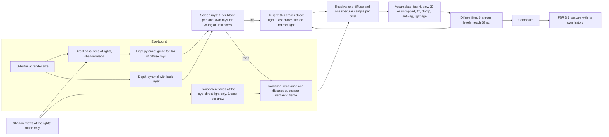
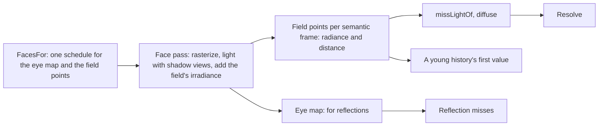
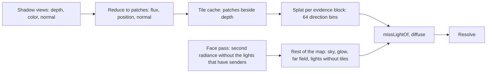

# Lighting system review, 2026-11-22

This review answers one question for the renderer lab: is the approach of the indirect light sound, and if a structural piece is missing, which one? The user wrote on 2026-11-22: "honestly with the wackamole we're playing, im worried theres some fundamental approach we're doing wrong".

The bar is the user's: stills and films look good and show no visible bug, that is no leaks, blotches, bright specks, trails, flicker or grain. Lost light is acceptable. A visible change over time is not. The targets of `ter-8hyd` are every scene clean, a change settled within about 60 draws, and a GPU frame span under 12 ms at 1280 × 720.

## 1. The answer in short

- The fault map has 66 faults in 9 classes (section 5). The largest classes are local bugs in other passes (16 faults), the trust rules of the temporal stack (15) and the noise of the sparse rays (9). Since the screen tracer merged on 2026-11-05, 8 merged fixes added or changed a rule of the temporal stack. 4 more rules wait on the Design X branch, 1 is planned, and 2 were built and removed.
- The orchestrator's hypothesis names a real gap, but it names the wrong writer for the store. A store fed only from the screen remembers what the eye saw. So the light of a surface then depends on where the camera has been, which is the same fault in a slower form. A store that removes the class must be written from views whose position does not depend on the eye: fixed capture points, or the lights' own views.
- A world store does not remove the steady mottle of the sparse rays by itself. It eases that mottle only for the part of the bounce light that arrives from far away or from off the screen. Section 6 shows that the budget of 0.25 diffuse rays per pixel per draw cannot reach the bar by tuning for rare bright sources.
- Recommendation: change one thing, the light that a diffuse ray reads when it misses the screen, and the light from which a young history starts. Its source becomes an estimate that the eye's position does not change. Section 11 gives two designs of it: capture points per semantic frame (P), and senders from the lights' shadow views (S, the user's proposal). Do not build a store that only the screen feeds.
- Before any build, run the cheapest experiments of section 12. E1 is a census of the rays in three stills, which decides how much of the noise a far-field change can remove at all. E2 is a script outside the engine that sums the senders of one lamp in the lit-block room and compares the sum with the existing path trace.
- What I could not check is in section 14. The most important gap: nobody has filmed the class "eye-bound knowledge" yet. If the light in those scenes does not change visibly when the camera turns, then by the bar that class is lost light, and the case for the step becomes much weaker.

## 2. Terms

| Term | Meaning in this document |
|---|---|
| Draw | One rendered frame. |
| Render pixel | A pixel of the render size before FSR 3.1 upscales. At 1280 × 720 there are 921,600 render pixels. |
| Block | A 2 × 2 group of render pixels. The screen tracer traces one ray of each kind per block. 1280 × 720 has 230,400 blocks. |
| Evidence block | An 8 × 8 group of render pixels. Design X keeps its evidence of change per evidence block. 1280 × 720 has 14,400 of them. The brief called the ray block 8 × 8. In the code it is 2 × 2. |
| Bounce light | The indirect diffuse light. |
| Reflections | The indirect specular light. |
| Hit | A screen ray that the depth walk stops at a pixel of the screen. |
| Miss | A screen ray that leaves the screen or reaches its step cap. |
| Near field | The light that reaches a point from surfaces that the screen shows. The screen rays estimate it. |
| Far field | The light that reaches a point from directions in which the screen shows nothing. Today the environment map supplies it. |
| Environment map | One cube map per semantic frame on the camera's chain. Each is captured at the eye. One face of all maps is redrawn per draw. |
| Temporal stack | The fast and slow histories, the fix of short histories, the clamp, the anti-lag, the light-change age, FSR's light-change mask and the diffuse filter. |
| Trust rule | A rule of the temporal stack that decides whether a difference between a sample and a history is noise or a change. |
| Eye-independent view | A rasterized view whose position does not follow the eye: a fixed capture point, or a light's shadow view. |
| Sender | A patch of a light's shadow view: its position, normal, area and the flux that it sends after one bounce (the user's candidate, section 9). |
| Daub | The survey's measure of blotches 2 to 24 render pixels across. The eye starts to see blotches at about 0.010 (handoff of 2026-11-14). |

## 3. What I verified, what I read, what I guess

I read the code of `screen_trace.glsl`, `screen_trace_plan.comp`, `accumulate_spatial.comp`, `environment.glsl`, `environment_face_light.frag`, `frame.glsl` and `SignalParameters.cs` on this branch (main at `54bf2768d`). Every quoted snippet comes from these files. I read ARCHITECTURE.md's sections on the screen tracer, the frame history, the accumulator, the environment map and the shadows. I read `docs/plans/renderer-finish.md`, `temporal-renderer.md` (sections 6 and 8), the handoff of 2026-11-14, Design X's doc on its branch (sections 1 and 2), the stage 2 reference of the back-face layer, the frame-time sweep's report, and about 70 tickets.

I built nothing, ran nothing and used no GPU. Every number with a source is a measurement by another agent, and the text names the source. A number marked "estimate" is my own arithmetic. A sentence marked "reading" is my interpretation, not a measurement.

## 4. The present light paths



Two estimators supply the indirect light, and the diagram shows where each one sits:

1. The screen rays are a Monte Carlo estimate. They are at the right position and carry many bounces, because a hit reads the hit pixel's last filtered indirect light. They are noisy and know only what the screen shows.
2. The environment map is a deterministic estimate. Its irradiance and its prefilter are integrals over a rasterized cube, so they hold no sampling noise. But the cube is captured at the eye, and its faces hold one bounce only.

A miss falls back to estimator 2. The rule is in `missLightOf`:

```glsl
vec3 missLightOf(TracingPixel p, ivec2 pixel, uint kind, vec3 direction)
{
    vec3 light;
    if (environmentMapOn)
        light = kind == KindDiffuse ? environmentLobe(p.s.map, direction, 0.5).rgb
            : environmentSpecular(p.s.map, p.s.position, direction, p.s.geometricNormal, sqrt(p.alpha),
                withAmbientFootprint(p.s, pixel).reflectionFootprint);
    ...
    return exposed(light, exposureScale());
}
```

where

- `p` = the pixel that starts the ray. `p.s.map` = the index of the environment map of the pixel's semantic frame.
- `kind` = `KindDiffuse` or `KindReflection`.
- `direction` = the ray's unit direction in world axes.
- `environmentLobe(map, d, 0.5)` = a read of the prefiltered cube at roughness 0.5 along `d`, by direction alone, with no parallax.
- `environmentSpecular(...)` = the box-projected read at the pixel's roughness, with the reflected stars.
- `exposed(...)` = the light times the frame's exposure scale.

A face of the map takes direct light only. The comment of `environment_face_light.frag` says so: "A texel with a surface takes the light of impostor_capture.frag without the ambient light". So a miss gets one bounce, seen from the eye.

A hit reads the hit pixel's light in `leavingLightAt`:

```glsl
vec3 diffuseHistory = holdsHistory(r.diffuse) ? lastLightOf(r.diffuse, KindDiffuse) : closedLight.diffuse;
vec3 light = factors.diffuse * (imageLoad(directDiffuseLight, q).rgb + diffuseHistory) + glowAt(q);
```

where

- `q` = the hit pixel.
- `r.diffuse` = q's reprojection into the last draw for the diffuse signal.
- `lastLightOf` = the last draw's filtered diffuse light at q's last place.
- `closedLight.diffuse` = the environment map's light at q with every direction open, for a q without a history.
- `factors.diffuse` = q's diffuse color.
- `directDiffuseLight` = this draw's direct diffuse light, demodulated.
- `glowAt(q)` = q's emission, or 0 where q's entity holds a light (`glowSent` in `frame.glsl`).

## 5. The fault map

Each row is one fault that shows on screen, open or closed since 2026-11-01. I left out faults of tools, tests and timing harnesses. The cause column says whether another agent measured the cause, whether a ticket reads it without a measurement, or whether it is unknown.

I made the classes from the causes:

| Class | Cause |
|---|---|
| V. Ray noise | Too few samples against rare bright sources: grain, specks, mottle. |
| T. Trust rules | A rule of the temporal stack misjudges noise against change, or removes real light. |
| E. Eye-bound knowledge | The far field is captured at the eye with one bounce, and the near field is what the screen shows. |
| S. Sampling mechanics | How the rays are chosen, shared and weighted. |
| R. Restart cost | A young history buys own rays, so a restart costs frame time. |
| G. Walk geometry | What the screen's depth says about thickness and slabs. |
| U. Upscaler and render size | FSR 3.1's history, its jitter, and the dynamic render size. |
| L. Local bugs | A local cause in another pass: shadows, numerics, drivers, exposure. |
| ? Unknown | No cause named yet. |

| Ticket | What the eye sees | Cause, and how it is known | Class |
|---|---|---|---|
| `t7-3e22` | Soft blotches along the bounce light's bright band in `rect-lamps`, fine specks near the far lamps | Split by signal: the bounce light carries it (measured). Part was false sill hits, fixed by `ter-ukw6` | V |
| `ter-12xp` | Single bright pixels on the deck's walls and the rough floor | One rare ray that hits a bright emitter stays in a long history (read) | V |
| `ter-fe63` | A sparkling cloud of specks on the lamp hall's ceiling when the sun shines in | Real rough reflection rays that reach a small sunlit floor patch: 83.4 % of the bright light (measured census) | V |
| `ter-bdoh` | `rect-lamps`' glossy floor sparkles in shown stills, not in the reference | From the shown still's reflections (measured). Mechanism not named | V |
| `ter-jza0` | Coarse grain on the mirror ball of roughness 0.5 | Diffuse rays at the hand-over and a 32-draw cap (read, untested) | V |
| `ter-gi1v` | Grain on glossy floors at a low angle | Shared reflection rays by lobe fit: plate noise 5.53 to 14.02 (measured) | V |
| `ter-9371` (closed) | Dense diffuse specks from sunlit strips | One diffuse ray per block rarely hits a strip 100 times brighter (measured) | V |
| `ter-05wb` (closed) | Moving blotches in the bay's sunbeam | 0.13 to 2.1 % of samples carry 36 to 86 % of the bounce light (measured) | V |
| `tiunr-5qf3` (closed) | White specks on rough floors | Emitters that held no light reached the rays only rarely (measured, fixed by the tube light) | V |
| `t3-5r0z` | Reflections alone fail in `docking-landing` and `bay-sunbeam`, trailing the sunbeam by 62 % | Not found. The reflection history under motion is the suspect (read) | T |
| `t7-3e22`, Design X | The cabin's bounce light settles too dark after a lamp switch | The clamp box that light evidence narrows (suspect, read in the handoff) | T |
| `ter-g3tk` part a | The reflections fall for 126 draws after the cabin's lamps go out | The age sees no change in bounce light that the reflected surfaces drain (measured) | T |
| `ter-18hc` | A small glowing shape lights its surroundings a third to a half too dimly | The slow history's clamp cuts rare bright samples: 22 to 27 % of the cabin's bounce light (measured) | T |
| `td-hjn6` (closed by decision) | A filtered region loses a few percent of its light | The clamp cuts light that the filter moved into a quiet pixel (measured) | T |
| `ter-wkvw` | Bounce light follows a lamp switch slowly: 85 and 62 draws in the cabin | Hits read the filtered slow history (measured) | T |
| `tb-4g6h` | 7.5 % of a dimmed emitter's interior never counts its change under a walk | Neighbors' pending counts start on different draws (read, not measured) | T |
| `tiunr-lzc7` | A stale ring at an emitter's border after a dimming and a brightening | The own-band rule of the light age (predicted, not measured) | T |
| `t2-hvez` | None yet. The count of 4 draws lost its reason | The light-change wait outlived the shadow filter that set it (read) | T |
| `t0-6gej` (closed) | False change evidence at thin bright edges under the jitter | The light age read a sub-pixel strip's jitter as a change: 1.95 % of block-draws (measured) | T |
| `cr-pkzd` (closed) | Reflections jump up by 72 % after a lamp goes out | The age cut took only bright samples (measured) | T |
| `tb-8zew` (closed) | A walk past still lamps counts light changes | The record's band lay around the nearest tap: 1.6 % of pixels per draw (measured) | T |
| `tiunr-okzm` (closed) | The light age finds changes in a still scene | No floor and no wait: 4,140 resets in one still (measured) | T |
| `tiunr-4b2g` (closed) | The clamp and the anti-lag cut the reflection history under the jitter | A bilinear re-read at the jitter's offset blurred the history (measured) | T |
| `tiunr-wk29` (closed) | The anti-lag cuts the rough plate's history in a pan | The box clamp's bias against rare bright light (measured) | T |
| `t2b-xeo7` | A lamp lights a face that the camera does not see: the room behind is 9 to 71 times darker than the path trace | Neither the screen nor the eye's map sees the lit face (read, not measured) | E |
| `t2b-d2m6` | A bright patch on a glossy wall that the path trace lacks | The eye's map holds the spot's lit disk, read without the right parallax (measured: gone with the map off) | E |
| `t1-mybi` | Closed rooms 2.0 to 2.5 times darker than the path trace without the sun. Pillar faces toward the camera get 24 to 50 % of their ratio | Light of several bounces that the engine does not carry (read). Material's multiple scattering not checked | E |
| `t1-tbz9` | Rooms 16 to 58 times darker than the path trace with Earth's light | Earth reaches the room only through the capture at the eye, where walls hide it (read) | E |
| `ter-jw7g` (closed) | Rough surfaces miss the reflection of bright things near them | The eye's map read by direction alone (fixed by box projection) | E |
| `ter-b1j3` (closed) | Rough reflections from the map miss the lamps | The faces drew a lamp's glow dark (fixed: each reader counts a lamp once) | E |
| `ter-8nhf` | A dark seam in reflections along roughness edges (predicted) | A smooth pixel takes a rough pixel's ray, and the weight cap darkens it (static reasoning) | S |
| `t0-8wag` | None measured yet | A block's ray pixel starts from half the block's width, following the draw's parity (read) | S |
| `t2-8foa` | None measured yet | The block ray's turn flips with the draw index, as FSR's jitter does (read) | S |
| `ter-cklj` (closed) | A rough curved mirror keeps a sharp reflection near its rim | The footprint was round where the direction turns along one axis (measured) | S |
| `ter-jz2y` (closed) | A block ray and an own ray went the same way | The randomness rule gave both one direction (read) | S |
| `ter-4iic` | About 10 ms more per draw for 8 draws after a camera cut, start or restart | Young histories trace own rays (`FullRateFrames`): measured on the deck (34.5 against 24.4 ms on the Mac, 26.3 ms at draws 0 and 1 on the RTX 2000 Ada) | R |
| `ter-ukw6` (closed) | A false glow on the ceiling from the sunlit sill | Rays past the sill's edge hit its 10 % slab: 74 % of the bright light (measured) | G |
| `t53-eyrv` (closed) | 8 of a million rays miss a slab of no depth | The walk's entry on a sheet that faces the eye (measured) | G |
| `t53-yy6p` (closed) | Grey speckle on the window reveals | Gone in the acceptance takes. Cause not named | G |
| `ter-186q` (closed) | A planet's reflection misses at a fifth of its pixels | Rounding of the ray's inverse depth near a vanishing point (measured) | G |
| `ter-eqtb`, `ter-16vv`, `ter-pywg`, `ter-cvyx` (closed) | Stair steps and missed hits at slab edges | Edge cases of the walk (measured, four tickets in one row) | G |
| `t1-kq9b` | Not yet seen | Two unexamined kinds of sheet hits in the back-face census (read) | G |
| `t0-qwx8` (closed) | The cabin's single-bounce region falls 43 % at tick 303 | A hit's light depended on whether a jittered sample hit a sub-pixel strip (measured) | U |
| `t3-5jws` | Blotches and flicker of the direct light in four films with moving lamps | FSR 3.1's own history: 0.058 against 0.000 without FSR (measured) | U |
| `t1-4hij` (closed) | Direct light trails around moving lamps | FSR's history, fixed by its light-change mask (measured) | U |
| `ter-yfb5` (closed) | A fine checker on sunlit ground and moving figures | The shadow filter's turning tap quarter under FSR (measured) | U |
| `ter-qt72` | The whole picture wobbles when the render size changes | The projection's aspect from the rounded render size (read, red tests pending) | U |
| `t1-gout` | A bright line on a window jamb at some shadow texel positions | The sun's shadow lookup at the jamb's edge (read) | L |
| `t8-rjno` (closed) | Sunlight on the outer quarter of a jamb | The cascade filter reached past the shadow edge (measured) | L |
| `ter-fu8n` | A sliver of floor lit along a thin wall's base | The slope bias of 2.5 where cascade texels are coarse (measured) | L |
| `ter-kn1d` (closed) | The room's light flipped between ceiling and floor in 0.17 s | Shadow bias in the environment faces (measured) | L |
| `ter-cept` | A headless still in the station's cabin is black with the map on | A non-finite value, suspected (read) | L |
| `ter-dbzx` | None on MoltenVK | `isnan` may fold to false on a driver (read) | L |
| `tz-na6d` | Surfaces lost on the Mac | `vkCmdClearAttachments` inside a rendering under MoltenVK (measured) | L |
| `t2-supl` | The exposure settles at one of two values in some scenes | The meter has several fixed points (measured) | L |
| `tiunr-3am9` | A still's shown draw lights with a smaller lamp reach | The reach follows the exposure between draws (read) | L |
| `t70-0pr5` | Six Rendering tests fail on lavapipe | Not found (measured on main) | L |
| `ter-qi9z` | Unshadowed lamps light through walls | No visibility for lamps without a tile (read) | L |
| `t8-69v7` (closed) | A still's bounce light depended on the history's length | The half-float store's rounding (measured) | L |
| `ter-x8bz` | A reflection shows no haze along its leg, no skin scatter | The hit reads light before the passes after the composite (read) | L |
| `ter-coy0` (closed) | A lamp drawn as an impostor counted twice | The impostor's light mark (read) | L |
| `t2-kibe` | The lamp hall 2.47 % dark | Key and fill has no specular fill (measured, accepted) | L |
| `t8-o16a` | The tube light 2 to 3 % bright near a capsule end | Not found (measured) | L |
| `ter-g3tk` | After a walk, the cabin is 13 to 47 % too bright and drains over 100 to 200 draws | The signal that carries the excess is not named | ? |
| `t1-3w9h` | Thin bright strips in the cabin every 18 draws | Not found. FSR's 18 jitter phases are one candidate | ? |
| `tiunr-1lss` | The plate's glow from rays reads 2.5 times the tube light's direct light | Not found. The ray path is the suspect | ? |

The count per class:

| Class | Faults | Open | Closed |
|---|---:|---:|---:|
| V. Ray noise | 9 | 6 | 3 |
| T. Trust rules | 15 | 8 | 7 |
| E. Eye-bound knowledge | 6 | 4 | 2 |
| S. Sampling mechanics | 5 | 3 | 2 |
| R. Restart cost | 1 | 1 | 0 |
| G. Walk geometry | 6 rows, 9 tickets | 1 | 5 |
| U. Upscaler and render size | 5 | 2 | 3 |
| L. Local bugs | 16 | 12 | 4 |
| ? Unknown | 3 | 3 | 0 |
| Sum | 66 rows | 40 | 26 |

Reading of the counts:

- Classes V and T together hold 24 of 66 rows. They are one problem seen twice. A trust rule exists because the input is noisy: with few samples, a rule cannot tell noise from a change within 60 draws. Each rule trades lag against noise, and each trade leaves a fault on one side.
- Class G had 9 tickets and is now nearly closed. The back-face layer was the structural fix that removed the class. This is evidence that a structural fix can end a class here.
- Class E is small in rows and large in effect. Its four open rows include factors of 2 to 71 in light.
- Classes L and U are ordinary bugs. They converge by fixing.

### Rules added to the temporal stack since the screen tracer merged

| Change | Date | Rule |
|---|---|---|
| `tiunr-ipmk` | 2026-11-08 | The specular slow history has no length cap |
| `tiunr-4b2g` | 2026-11-08 | The pixel history rule: jitter is not motion |
| `tiunr-py6q`, `tiunr-7haj` | 2026-11-08 | The light-change age cuts the specular history |
| `tiunr-okzm` | 2026-11-08 | The age's floor, its 4-draw wait and its own band |
| `ter-9371` | 2026-11-08 | Hits read the filtered diffuse light |
| `tb-8zew` | 2026-11-10 | The age record's band follows the footprint |
| `cr-pkzd` | 2026-11-12 | The age cut takes every sample, not only bright ones |
| `t0-6gej` | 2026-11-14 | The age counts only changes that cover an area |
| Design X, on its branch | Open | The retained deviation widens the box. Ray evidence per evidence block. The moved-object mark. The region's drift |
| `t0-70v1` | Planned | A 128-draw history where no evidence exists |
| `tiunr-nxtr`, `tiunr-5qf3` | Removed before merge | A box widened by a long-run moment. A firefly limit |

So 8 merged changes added or changed a trust rule, 4 more wait on a branch, 1 is planned and 2 were removed. In the same three weeks, 7 changes went to the sampling (`ter-05wb`, `ter-4oow`, `ter-xo83`, `ter-s97m`, `ter-hxhl`, the step caps) and 1 to the geometry (`ter-kh4g`).

## 6. The signal budget

The numbers below come from the code on this branch.

| Quantity | Value | Where |
|---|---|---|
| Diffuse rays of a settled pixel inside a surface | 1 per block per draw: 0.25 per pixel | `screen_trace_plan.comp` |
| Share of the diffuse rays guided to lit screen pixels | 1/4 | `LightPyramid.GuidedShare` |
| Own rays | 1 per pixel per draw while its history is under 8 draws, or where the block's ray does not fit | `FullRateFrames = 8.0` |
| Own diffuse rays of a settled view | About 1.2 % of the pixels | ARCHITECTURE.md, the screen tracer's cost |
| Reflection rays | 1 per block where the lobe fits, else 1 per pixel. None above roughness 0.5 | `LobeFitShare = 0.5`, `MaxRoughness` |
| Step caps | 62 diffuse, 96 reflection | `ScreenTrace.Default` |
| Diffuse history | Slow cap 32 draws, fast cap 4, clamp 2 σ, anti-lag share 0.5 | `SignalParameters.Diffuse` |
| Specular history | Slow uncapped, fast cap 4, clamp 1.5 σ, anti-lag share 0.25 | `SignalParameters.Specular` |
| Ray weight cap | 4 | `MostRayWeight` |
| Diffuse filter | 6 à-trous levels of a 3 × 3 kernel, 48 taps, reach 63 px, edge stops on plane, normal and luminance | `DiffuseFilter`, thin kernel |
| A hit returns | This draw's direct light at the hit pixel plus its last filtered indirect light | `leavingLightAt` |
| A diffuse miss returns | The eye's map at roughness 0.5 along the ray, one bounce, no parallax | `missLightOf` |

The clamp holds the slow history inside the box of the 3 × 3 fast histories:

```glsl
vec3 mean = moments / count;
vec3 sigma = sqrt(max(squares / count - mean * mean, vec3(0.0)));
vec3 low = mean - parameters.clampSigmas * sigma;
vec3 high = mean + parameters.clampSigmas * sigma;
vec3 clamped = clamp(slow, low, high);
float lag = luminance(abs(slow - clamped)) / max(luminance(mean), 1e-4);
...
historyLength = max(fastCap, historyLength * (1.0 - min(1.0, lag / parameters.antiLagShare)));
slow = clamped;
```

where

- `moments`, `squares`, `count` = the sums of the fast histories and of their squares over the pixel and its neighbors on the same surface, and how many there are.
- `mean`, `sigma` = the mean and the standard deviation of those fast histories, per channel.
- `parameters.clampSigmas` = the half width of the box in deviations: 2 for the bounce light.
- `slow` = the reprojected slow history after the blend.
- `lag` = how far the clamp moved the history, as a share of the mean's luminance.
- `parameters.antiLagShare` = the move at which the length falls to the fast cap: 0.5 for the bounce light.
- `historyLength` = the slow history's length in draws.

The 3 × 3 box holds about 4 independent rays, because 4 pixels share each ray (`ter-18hc`). So a sample that arrives in a few percent of the draws lies outside the box most of the time, and the clamp cuts it. That is the measured loss of 22 to 27 % of the cabin's bounce light.

### What the bar asks of the budget (estimate)

Take a small bright patch that carries a share f of a pixel's bounce light, and that one diffuse ray hits with a chance p. One sample's relative deviation is then about f · √((1 − p) / p). The measured range is p = 0.13 to 2.1 % and f = 36 to 86 % (`ter-05wb`). At p = 1 % and f = 60 %, one sample deviates by about 600 %.

- In 60 draws a block gets 60 rays. Its mean then deviates by about 600 % / √60 ≈ 77 %.
- To bring that to 4 %, the blotch limit, the filter must average about (0.77 / 0.04)² ≈ 370 independent blocks. To bring it to 1 %, the daub at which blotches show, it needs about 6,000.
- The filter's reach of 63 px covers about 1,000 blocks on an even surface, and fewer where edges stop it.

Reading: at 0.25 rays per pixel, a rare bright patch can reach the blotch limit only where the filter averages over most of its reach. It cannot reach the eye's threshold of daub within 60 draws at all. The guided rays raise p for patches that the screen shows and that the direct pass lights. That is why they cut the blotch score of `rect-lamps` from 0.156 to 0.052. Patches that the screen does not show get no guidance.

### Can the present design reach the bar by tuning?

Not for the steady mottle and the rare bright samples. The evidence:

- Each cheap switch against blotches lost light or gained under 12 % (renderer-finish.md, "Dead ends": no anti-lag, no clamp, more own rays, a longer history, a wider clamp box).
- On 2026-11-14 the ceiling of `rect-lamps` had a daub of 0.0567 on main, 0.0545 with Design X and 0.0454 with the 128-draw history, against about 0.010 at which the eye sees blotches. Noise falls with the square root of the samples. A factor of 5 needs about 25 times the samples. The back-face layer has removed the false sill hits since then, so today's number is lower. Nobody measured it again.
- Four times the rays costs real time. In the 8 draws after a cut, when every pixel traces own rays, the deck's diffuse rays took about 5.8 ms on the Mac against 1.46 ms settled (frame-time sweep, section 2).

The trust rules can reach the bar for single faults. Every rule is a trade between lag and noise, so the faults move between the two sides. The record of section 5 shows this: `cr-pkzd` removed a condition that `tiunr-py6q` added, Design X removed the block test that Design A added, and the cabin switch now settles too dark.

## 7. The candidates and their sources

Each technique below comes from another situation. For each I name the situation, compare it with ours, and compare its fixed cost with its gain at our sizes. Our situation: no hardware ray tracing as a requirement, desktop Linux, lavapipe and MoltenVK, tens of lights, rooms and decks with thin walls, nested moving semantic frames, determinism on one machine, 12 ms at 1280 × 720 with the Mac (M1 Max) as the slow machine.

| Candidate | Source and its situation | Against ours |
|---|---|---|
| K. Keep fixing | The present path | Converges for classes L, U, G and S. Section 6 shows that classes V and T trade faults. Class E has no information to fix. |
| M. A parallax-correct, multi-bounce miss | Lagarde and Zanuttini's local cubemaps with a proxy box (SIGGRAPH 2012), from memory, not checked again. Made for baked reflection probes in rooms | Box projection already serves the reflection misses. A diffuse miss would take the same correction, and the face pass would add the map's own irradiance at each texel, so the map holds many bounces. The eye stays the capture point. |
| H. A world store fed from the screen | GIBS, EA SEED, SIGGRAPH 2021: surfels spawned from the G-buffer, lit by hardware ray tracing, 6 to 7 ms in production (2024 update). GI-1.0, AMD 2022: screen probes on visible surfaces plus a world hash cache (Binder 2019), hardware ray tracing, 1.9 to 3.1 ms on an RX 6900 XT | Both feed positions from the screen, but the light comes from rays against the world. Without those rays, the store holds only the light that the screen saw. |
| P. Capture points per semantic frame | DDGI, Majercik et al. (JCGT 2019): probe grids with irradiance and distance moments, updated by hardware rays with hysteresis. Light field probes, McGuire et al. (I3D 2017): rasterized probes with radial distance and normals, precomputed, traced in a shader | We have no hardware rays, but the environment face pass already rasterizes a cube and its distance. A probe is the same capture at a fixed point. The cost of a face follows its geometry: 0.35 to 0.40 ms per face on the Mac's deck, 0.08 ms on the RTX 2000 Ada (ARCHITECTURE.md). |
| C. A surface cache of cards | Lumen, Wright et al. (SIGGRAPH 2022): cards captured per mesh, lit in an atlas, read at the hits of software rays against mesh and global distance fields. Fortnite gave GI and reflections 4 ms together | A card holds light, not visibility. A miss must find its hit along the ray, and Lumen finds it by tracing distance fields. That is a ray against the world, built in software. |
| F. More screen rays, a variance-guided filter, fewer rules | SVGF, Schied et al. (HPG 2017): 1 path per pixel, about 10 ms at 1080p on 2017's high end. ReBLUR (NVIDIA NRD): 0.5 to 1 ray per pixel of hardware rays, with hit distance | We trace 0.25 rays per pixel and already run SVGF's filter. 1 ray per pixel costs about 4 times the diffuse rays (5.8 against 1.46 ms on the Mac). It changes nothing in class E. |
| S. Senders from the lights' views (the user's candidate) | Reflective shadow maps, Dachsbacher and Stamminger (I3D 2005): one bounce, no visibility for the indirect light, one or a few lights. Instant radiosity, Keller (1997): virtual point lights, each with its own shadow map, offline and interactive. Imperfect shadow maps, Ritschel et al. (2008): rough visibility for about a thousand virtual lights from a point cloud | Our shadow views already rasterize exactly what each shadowed light reaches. The texels need color and normal beside depth. The leak between a sender and a receiver is the open problem (section 8). |
| L. A light propagation volume | Kaplanyan, CryEngine 3 (SIGGRAPH 2009), and the cascaded form of 2010: reflective shadow maps injected into a coarse grid of spherical harmonics, propagated, with a coarse blocker volume. Xbox 360 and PlayStation 3, plausible diffuse bounce in large spaces. Leaks are a known fault | Cheap. Our walls are thinner than any affordable cell, so the leak is structural. By the bar a leak is worse than lost light. |
| B. A ray budget per draw | No source. The orchestrator's line proposed it on 2026-11-22 | A bound on the own rays per draw, ranked by the youth of the history. |

## 8. The objection: does a world store mean rays against the world?

The user wrote: "wouldnt keeping a store of bounce light anchored in the world require effectively in world raycasting, and then rendering the fragment shader of every surface in the world that those rays hit, e.g., use way more processing, and basically be the raytracing that cp2077 does".

The objection joins three questions. They have different answers.

### Who writes light into the store, and does that need a ray or new shading?

| Writer | A ray? | New shading? | What it costs per draw at 1280 × 720 |
|---|---|---|---|
| (a) Pixels that the frame already shaded write their own light | No | No | One store write per block: 230,400. The light already exists. |
| (b) The lights write what they light, through their shadow views | No | Yes: the shadow pass must also write color and normal, and one bounce of flux follows from them | Only the stale tiles redraw. A tile is 512² texels, and a point lamp has 6. The cascades follow the camera, so they redraw in every draw (read in `ShadowCascades.cs`). |
| (c) Extra rasterized views, as the environment faces are | No | Yes: the face's light pass, about 1,000 texels for a face of 32² | Geometry dominates: 0.35 to 0.40 ms per face on the Mac's deck, 0.08 ms on the RTX 2000 Ada. |
| (d) Rays against the scene's geometry, with shading at the hit | Yes | Yes | Excluded by our constraints. This is what the user means. |

### Who reads the store, and at what cost?

- A lookup at a world position: one hash or grid read. A young pixel reads its own position, which costs about one read per pixel.
- A lookup along a direction at a position: what a miss needs. A probe answers it with one octahedral read per probe, so about 8 reads with trilinear weights. A grid without directions cannot answer it. A march through a coarse grid can, at about 16 to 64 cell reads per miss.
- A sum over senders: one evaluation per sender per reader. Section 9 gives the numbers.

### What does each writer not know?

| Writer | Surfaces nobody saw | Visibility between two stored points | Light after a change behind the eye |
|---|---|---|---|
| (a) The screen | Never knows them: the lit back face of `t2b-xeo7` stays dark until the camera looks at it | Unknown, and a march through a coarse grid leaks through thin walls | Stale until the eye looks again |
| (b) The lights' views | Knows every surface that a shadowed light reaches. Lights without a tile and the sun beyond the cascades write nothing | Unknown. This is the leak of reflective shadow maps | Known in the draw in which the light's tile is redrawn |
| (c) Capture points | Knows what some capture point sees | Known from each capture point to what it sees, through its distance | Known when the point's face is redrawn |
| (d) Rays | Knows everything that rays reach | Known | Known |

So the objection holds for candidate C, which needs software rays against distance fields, and for candidate H in any form that gives misses a hit point. It does not hold for P, S or L. These write by rasterization, which the frame already does for its shadows and its environment map. P pays for the views' geometry. S pays for color in the shadow views. L pays almost nothing and leaks. For writer (a) alone the objection does not hold either, but writer (a) does not remove class E.

### Work per draw, against today's frame

| | Shaded samples | Texels drawn | Lookups or evaluations |
|---|---|---|---|
| Today | 921,600 direct pixels and 16,384 face texels | 1 face of 128² | About 230,000 diffuse rays of up to 62 steps, and 44 million filter taps |
| K | Same | Same | Same |
| M | Same | Same | About 16,000 more irradiance reads in the face pass, one box test per diffuse miss |
| H | Same | Same | 230,400 writes, 1 read per young pixel, and 16 to 64 cell reads per miss if misses march |
| P | Plus about 1,000 per probe face | Plus F_p faces per draw | About 8 probe reads per miss |
| C | Card atlas texels | Card captures when meshes enter | A distance-field trace per miss |
| F | Same | Same | 4 times the diffuse rays |
| S | Plus the stale tiles' color | Color and normal beside depth | 14,400 evidence blocks × about 4,000 senders = about 58 million evaluations |
| L | Plus the stale tiles' color | Same as S | About 4,000 injections, a few propagation passes over a 32³ grid, 1 read per miss |
| B | Same | Same | At most N own rays per draw |

The numbers for S and P are estimates from the tile and face counts of ARCHITECTURE.md. Nothing measured them.

## 9. The user's candidate: the lights' views as the miss fallback

The user's reading, clarified: "'only' meaning in addition to screen space, when the screen space misses, we use what you're proposing instead of the env map". So the screen rays keep the near field. A diffuse miss reads the senders in place of the environment map. The map stays for reflections.

### 9.1 The partition of the light

Every piece of light must reach a pixel from exactly one supplier.

- A split by consumer is not enough. A diffuse miss that read the senders and the whole map would count the lamps' first bounce twice. The map's faces are drawn lit: the face light pass gives each texel "every light of the list with its shadows" (ARCHITECTURE.md, "The faces").
- If the diffuse miss reads no map at all, it loses everything that the senders do not hold: the sky through a window (`skyRadiance`), the glow of emitters that hold no light (a screen or an exhaust, whose emission `glowSent` passes), Earth's day side (`t1-tbz9`), lamps without a tile, and the sun's bounce beyond the cascades. Those losses depend on the view, so they would show as changes over time.
- So the split must follow the light's origin, per light: a light that has senders in this draw supplies its first bounce through them. Everything else comes from the map.

```glsl
vec3 glowSent(vec3 emissive, uint holdsLight)
{
    return holdsLight == 0u ? emissive : vec3(0.0);
}
```

where

- `emissive` = the surface's emitted radiance from its material.
- `holdsLight` = 1 where the surface's entity holds a light, whose light then stands for its glow.

This function is already a partition by origin. It keeps a lamp's power from reaching the room twice. The senders need the same kind of rule one level up.

Can the map give its part without the lamp-lit surfaces? Not today. A face writes one radiance per texel, and its alpha holds only the open-sky share. Earth and glowing screens are surfaces, not sky, so the alpha cannot separate them. The face light pass needs a second output: the radiance of the texel without the lights that have senders. That output also needs its own prefilter level at roughness 0.5. The prefilter costs 0.43 ms on the Mac today for all levels.

One more fault follows from the per-light split. The tile budget ranks lamps by their light at the eye, with a holder margin (`ShadowTiles.Update`). When a lamp gains or loses its tiles, its bounce moves from one supplier to the other. The two suppliers disagree, because the map's part is seen from the eye. So the bounce light jumps when the eye moves. This is class E again, at the edge of the tile budget.

### 9.2 Coverage

- The sun: four cascades per cascade set, fitted to the main view's frustum over the first 2 km of view depth (`ShadowCascades.Fit`, read). At a 60° field of view, cascade 0 holds every point within about 9 m of the camera in any direction. Sunlit surfaces outside the cascades are in no map.
- Local lights: 64 tiles of 512² by default. A spot lamp up to 60° takes 1 tile, a point lamp or a wider spot 6. ARCHITECTURE.md records for the deck: "All 21 lamps of the deck are point lamps. The 10 nearest hold the 60 shadow tiles of the atlas." So 11 of 21 lamps have no view and would write no senders. The frame-time sweep counted 13 rectangle lamps near the deck's view later. A rectangle lamp casts its shadow from its center through the point lamp's 6 tiles. I did not count the cabin's lamps.
- A tile redraws only when it is stale (the tile cache). So a still scene pays for the color once.

### 9.3 Visibility between a sender and the shaded point

No ray tests it. In the miss-only reading, the screen walk already tests part of it: a ray toward an on-screen wall hits the wall and never reads the fallback. So a sender behind an on-screen wall leaks nothing. The leak stays in the miss directions: behind the camera, beyond the screen's edges, and past the step cap.

| Remedy | What it costs | Which leaks stay |
|---|---|---|
| The screen walk, as above | Nothing more | Every leak through a wall that the screen does not show |
| Scope by semantic frame | One compare per sender | Leaks between rooms of one interior frame. A ship's interior is one frame, not one per room |
| Each sender's own reach | One compare per sender | Leaks within the reach, which is the room's size |
| Rooms and doorways as a graph per interior frame (`ter-qi9z`'s lead) | Authored rooms, door state, a new structure | Few, but it is a new authored store, and loose bodies need their own answer |
| The eye map's distance in the sender's direction | One cube read per sender | It tests visibility from the eye, not from the point. It removes the lit back face of `t2b-xeo7`, the case it should fix |
| Imperfect shadow maps (2008) | A point cloud of the scene and a tiny map per sender, thousands of them | Coarse visibility. Another store of the scene's surfaces |
| Probe distance (design P) | The capture points of design P | Then design S needs design P |

By the bar, a leak through a wall is worse than lost light. Without design P's capture points, no remedy that fits us removes the leak behind the camera.

### 9.4 What one missed ray reads, and the cost of the gather

Today a miss reads the map in its direction. A set of senders has no cheap "light from direction d at point x".

| Option | Evaluations per draw | Double counting with the hits |
|---|---|---|
| The block's miss share times the sum over the senders that face the point | 14,400 × 4,000 ≈ 58 million per evidence block, 230,400 × 4,000 ≈ 920 million per block, 921,600 × 4,000 ≈ 3.7 billion per pixel | Yes. The sum holds senders that the screen shows too, and the hits also bring them |
| A small octahedral map per evidence block: each sender splats into the bin of its direction | 58 million splats, 14,400 × 64 bins × 8 bytes ≈ 7.4 MB | No. A direction that hits on screen never reads its bin |
| A march along the ray through a coarse world grid that the senders fill | About 4,000 injections and 16 to 64 cell reads per miss | No. The grid leaks through thin walls, as candidate L does |

For scale: the present filter reads 44 million taps per draw. So a sum per evidence block costs about as many evaluations as the filter. On the RTX 2000 Ada the present `diffuse rays` and `filter indirect diffuse` passes take 1.3 ms or more in a settled draw (the orchestrator's timing logs, which I did not read). A sum per block or per pixel costs 20 to 80 times as many evaluations as the sum per evidence block, which is too much. Estimate: the octahedral splat per evidence block takes 0.3 to 1 ms on the Mac. Nothing measured it.

### 9.5 What it gives against the fault classes

The orchestrator's estimate was that the sum is deterministic, so this part of the bounce light has no ray noise and needs no history. That is right for the part that the senders supply. It holds with two limits:

- Only the misses read the senders. A ray that misses is still a random ray. Each miss reads a smooth value now, in place of the eye map's value, so the misses' share of the noise falls. The choice between hit and miss stays random. Where a hit is bright and a miss is dark, the noise stays.
- The near field stays noisy: rays that hit small sunlit patches on screen, and all reflections.

So the lamp switch shows in the draw in which the lamp's tile is redrawn, for the miss part. Grain, boil and slow fades ease for the miss part only. The census of experiment E1 measures that part.

### 9.6 Its own faults

- A sender close to the shaded point sends a large share of light from a small area: the singularity of virtual point lights. Engines clamp the distance, and the clamp loses light in corners. In the miss-only reading, near senders are mostly on screen and so reach the point through hits. A near sender behind the camera stays.
- One bounce only. The second bounce reaches the screen through hits that read their history. Off screen, it is lost as it is today. So `t1-mybi` does not improve. A feedback would need the senders' own indirect light, and a shadow texel has no history. It could read the eye's irradiance, which brings back the eye-bound fault.
- The shadow pass must write color and normal. Today the solid shadow runs have no fragment stage (ARCHITECTURE.md, "Shadows"). Each shadow texel would then run the material's base-color read. The cascades redraw in every draw, so their cost is paid in every draw. The tiles pay only when stale.

### 9.7 The sources' situations

| Source | Lights | Hardware | Quality target | Against ours |
|---|---|---|---|---|
| Reflective shadow maps, 2005 | One or a few | 2005 desktop GPUs | Plausible one-bounce diffuse light, no visibility | We have tens of lights, half of them without a view. The user's bar forbids leaks |
| Instant radiosity, 1997 | Hundreds of virtual lights, each with a shadow map | Offline and interactive | Converged images | Each of our thousands of senders would need a shadow view |
| Imperfect shadow maps, 2008 | About a thousand virtual lights | 2008 desktop GPUs | Plausible multi-bounce at interactive rates, coarse visibility | A point cloud of the scene is a new store |
| Light propagation volumes, 2009 | One sun and a few lights | Xbox 360 and PlayStation 3 | Plausible bounce in large spaces, leaks accepted | Thin walls of ships |

### 9.8 Is it the same design as the world store?

Partly. Senders are one writer of an eye-independent store, writer (b) of section 8. Capture points are writer (c). Both feed the same reader, a diffuse miss. They differ in what they know: capture points know visibility from their position, senders do not. So they are the two designs of section 11, not one.

## 10. Which faults each candidate removes

Each cell says "removes", "eases", "no effect" or "worsens", with one reason. Candidate H here is the store that only the screen feeds.

| Class | K. Keep fixing | M. Parallax, multi-bounce miss | H. Screen-fed store | P. Capture points | C. Cards | F. More rays, filter | S. Senders | L. Propagation volume | B. Ray budget |
|---|---|---|---|---|---|---|---|---|---|
| V. Ray noise | Eases: guided rays, more history | No effect: the hits carry it | No effect: the store holds the same noise | Eases: misses read a smooth value, near hits stay | Eases, by the same reason as P | Eases: about 2 times less noise at 4 times the rays | Eases: the miss part only | Eases: the miss part, smooth | Worsens: fewer own rays for young pixels |
| T. Trust rules | Trades faults | No effect | Eases: a young history starts from the store | Eases: young histories start from the probes | Eases | Eases: less noise means less to judge | Eases: the miss part needs no history | Eases | No effect |
| E. Eye-bound knowledge | No effect: the information is absent | Eases: `t1-mybi` gets more bounces, xeo7 and tbz9 stay | Eases slowly: what the eye saw once stays | Removes, where a capture point sees the lit surface | Removes, through rays | No effect | Eases: xeo7 fixed, but Earth, sky and glow still from the eye | Eases xeo7, with leaks | No effect |
| S. Sampling mechanics | Removes, by local fixes | No effect | No effect | No effect | No effect | Eases: less sharing | No effect | No effect | No effect |
| R. Restart cost | Eases: the restart at 8 draws | No effect | Removes, if the own rays go | Removes, if the own rays go | Removes | Worsens: more rays in every draw | Eases | Eases | Removes: a bound by construction |
| G. Walk geometry | Removes: the back-face layer | No effect | No effect | Eases: fewer far walks matter | Eases | No effect | No effect | No effect | No effect |
| U. Upscaler and render size | Removes, by local fixes | No effect | Eases: the store does not follow the render size | Eases: probes do not follow it | Eases | Worsens: cost follows the render size | Eases | Eases | Eases: the cost no longer drives the controller |
| L. Local bugs | Removes | No effect | No effect | No effect | No effect | No effect | Worsens: the shadow views gain color | Worsens: the same | No effect |
| Cost peak at a start or a light change | Eases | No effect | Removes the start's own rays | Probes refresh over many draws, a lag, not a peak | Lag | Peak stays | The tile's redraw costs color once | Small | Removes |
| Dependence on the render size | Stays | Stays | Lower | Lower | Lower | Stays | Gather per evidence block follows it | Lower | Lower |
| New risk | None | None | View history decides the light | Leaks at thin walls between probes, face cost on the Mac | Software rays: a large build | 4 ms of rays on the Mac | Leaks behind the camera, supplier switch at the tile budget | Leaks | Young grain |

The ray budget per draw (B) is a structural piece of the cost model, not one more trust rule. It turns the own-ray count from a result of events into a bound by construction, so no event can raise the cost of a draw above the bound. Its price is grain: a young history then averages fewer rays and starts noisier. A smooth supplier for a young history (P or S) removes that price. With such a supplier, a young history needs no own rays at all, and `FullRateFrames` can go. Then the own rays fall to the rays at surface edges, which follow the geometry and not the events, and the budget has nothing left to bound. So B is the right quick fix if the cost peaks must go before any store exists, and the store makes it unnecessary later.

## 11. Recommendation and two designs

### The recommendation

The next structural step changes what a diffuse ray reads when it misses the screen, and what a young history starts from. Both read an estimate of off-screen light that the eye's position does not change, kept per semantic frame. The step does not change the screen rays, the reflections, the eye's environment map for reflections, or the temporal stack's existing rules.

Conditions before the build:

1. The film that `t2b-xeo7`'s note asks for must show that the room's light changes visibly when the camera turns. If it does not, class E is lost light under the bar, and only `t2b-d2m6` remains visible. Then recommend no step, and fix `t2b-d2m6` locally.
2. Experiment E1 (section 12) must show that misses carry a real share of the bounce light's variance in the blotchy stills. If they carry little, the step does nothing for class V, and its case rests on class E alone.

Do not add more trust rules while E1 is open. Design X's retained deviation fixes the clamp's loss (`ter-18hc`), which no store touches, so it is not in question. The region's drift and later rules are.

### The one model

The environment map is already a store of far light. It is a rasterized capture at one point, per semantic frame, with radiance, irradiance and distance. Its faults come from where the point is (at the eye) and from what its faces hold (one bounce). The shadow views are rasterized captures at the lights' positions. So the model is one store of first-bounce and far light, written by rasterized views whose positions do not depend on the eye, read by a diffuse miss along a direction. The two designs differ in which views write it.

### Design P: capture points per semantic frame

- State. Each interior semantic frame owns a grid of capture points in its own axes, so the points move with the ship. Each point holds a small radiance cube at roughness 0.5 and its distance, as the environment map holds them. The camera's environment map is the capture point at the eye. One union says which kind of capture a face belongs to: the eye's map, or a field point.
- Causes. `EnvironmentMap.FacesFor` stays the one choke point. It gives each draw F faces from one schedule, a pure function of the drawn frame's number, as today. A light that switches puts the points within its reach first.
- Many bounces. A probe face's light pass adds the field's own irradiance at each texel. Each refresh then adds one bounce.
- The reader. `missLightOf` for a diffuse ray reads the 8 points around the pixel, weighted by distance and by a visibility test of the stored distance, as DDGI does. A young history starts from the same read in place of `closedForm`.
- What it lets us delete: `FullRateFrames` and the own rays of young histories, the diffuse branch of `environmentLobe` in interiors, and the ray budget. Keep the distance cube, which `t7cem-d5f9` would remove.
- Cost. A face costs 0.35 to 0.40 ms on the Mac's deck. A cabin of about 17.5 m with points 2 m apart holds about 36 points (my assumption), so 216 faces. At 4 faces per draw, about 1.5 ms on the Mac and 0.3 ms on the RTX card, a full refresh takes 54 draws. That is the risk.



### Design S: senders from the lights' views

- State. Each shadow tile and cascade gains color and normal beside depth. A reduction turns each view into patches, about 64 per tile, with position, normal, area and flux. The patches live with the tile in the tile cache, so the tile's freshness stays their one store. The face light pass writes a second radiance: the light of every light that has no senders this draw, the sky, the glow and the far field.
- Causes. A tile is redrawn when its record is stale. The patches follow the tile. A cascade redraws in every draw.
- The reader. Per evidence block, a pass splats every sender within the frame's scope and its reach into a small octahedral map of 64 bins, by direction from the block's center. `missLightOf` for a diffuse ray reads the bin of its direction plus the map's second radiance.
- What it lets us delete: little. It adds a supplier. It removes the eye-bound fault for the first bounce of shadowed lights only.
- Cost: about 58 million evaluations per draw and the color of stale tiles. The open fault: the leak behind the camera (section 9.3).



### The two designs side by side

| Point | P. Capture points | S. Senders |
|---|---|---|
| Writer | New rasterized faces at fixed points | The existing shadow views, with color |
| Visibility | From each point, by its distance | None beyond the screen walk |
| Leaks | Between points at thin walls, reduced by the distance test | Behind the camera, through any wall |
| Bounces | Many, by feedback over refreshes | One |
| Sky, glow, Earth | In the faces | From the eye's map, split by origin |
| Lag after a change | Up to one refresh: tens of draws | The draw of the tile's redraw |
| Cost on the Mac | About 1.5 ms for a refresh in 54 draws | About 0.3 to 1 ms, estimate |
| What it deletes | The own rays of young histories, the diffuse eye read in interiors | Little |

Usage of each, at the one reader:

```glsl
// P
light = kind == KindDiffuse ? fieldRadiance(p.s.frame, p.s.position, direction).rgb : ...;
// S
light = kind == KindDiffuse ? senderBin(blockOf(pixel), direction) + restOfMap(p.s.map, direction, 0.5) : ...;
```

What both share:

- One reader, `missLightOf`, and one supplier per piece of light, split by the light's origin.
- The eye's environment map for reflections.
- The screen rays as the near field, and the temporal stack as it is.
- A deterministic store: each value is a pure function of the frame's state and the drawn frame's number.

The open forks, for the orchestrator to put to the user:

1. Visibility: P pays for new faces and gets visibility, or S uses the existing shadow views and accepts the leak behind the camera.
2. Bounces: P carries many bounces with a lag over refreshes, or S carries one bounce at once.
3. The young history: should the step remove `FullRateFrames` (P makes it possible, S only for the miss part), or should the ray budget come first as a quick fix?

## 12. The cheapest experiments

### E1: the ray census (decides class V's share)

- Scenes: the stills `rect-lamps`, the cabin of `orbit` and `bay-sunbeam`, at render scale 2/3 and about 0.96, 400 draws each after 240 settling draws, with the clamps on.
- Probe: a patch of the survey's probe that records, per diffuse sample, whether it hit or missed, the hit distance, and its weighted light.
- Measure: for each region, the share of the mean light and the share of the variance from misses, from hits beyond 2 m, and from hits within 2 m.
- Reading: if misses and far hits carry less than about 10 % of the variance, no far-field store eases class V. Then classes V and T need more samples or better sampling of the near field, and the recommendation rests on class E alone.

### E2: the sender sum outside the engine (tests design S's gain and its leak)

- Scene: `lit-block-back` from `refs/scratch/t1-r9vj-lit-block` (`docs/research/back-face-depth-layer/stage-2/probe-lit-block.patch`). The geometry is boxes and one spot lamp, so a script can treat them exactly.
- Script: sample the spot lamp's lit area on the block's back face as 8 × 8 patches, each with its flux from the spot's intensity and the face's albedo. Sum the irradiance from the patches at the floor patch in the gap and at the back wall above the block, with an exact box test for visibility. Then sum again without the test.
- Compare: the path trace's one-bounce values in `fade-lit-front.md` and in `t2b-xeo7` (0.085 at the back wall, 0.064 at the floor gap, in the ticket's units).
- Reading: the sum with visibility must land near the one-bounce values. The difference between the sums with and without the test is the leak that design S would add in a closed room. Add a second closed room behind a wall to measure the leak through a wall.

### E3: the cost of a capture point's face on the Mac (tests design P's cost)

- Time the existing face pass on the deck at 32² with a cull of objects below one texel, against today's 128² face. The face cost follows the geometry, so the cull decides whether design P fits.

## 13. What would show this review wrong

| Claim | The observation that refutes it |
|---|---|
| The orchestrator's hypothesis: a screen-fed store is the missing layer | A film of `t2b-xeo7` in which the room stays the same as the camera turns. Or E1 showing that misses carry little variance and the restarts are not visible |
| Class E is a visible bug class | The same film, with no visible change |
| Tuning cannot reach the bar for class V | A take of today's main at 264 draws in which the ceiling of `rect-lamps` has a daub near 0.010 after the back-face layer |
| Design P is worth its cost | E3 showing that a face costs more than about 0.2 ms on the Mac with the cull, so a refresh within 60 draws costs over 1.5 ms per draw |
| Design S removes `t2b-xeo7` | E2's sum with visibility far from the path trace's one bounce |
| Design S's leak is acceptable | E2's leak through a wall above a few percent of the room's light |

## 14. What I did not check

- No film of class E exists, so its visibility under the bar is unknown.
- I did not read the timing logs of the RTX 2000 Ada. The 1.3 ms of the diffuse rays and the filter is the orchestrator's number.
- I did not count the cabin's lamps or the tiles that they hold.
- I did not check the multiple-scattering term of the material that `t1-mybi` names, so part of its factor of 2 to 2.5 may not be bounce light.
- I did not read the full Design X doc or its last takes, so its current state comes from the handoff of 2026-11-14 and the orchestrator's brief.
- I did not verify the parameters of DDGI, reflective shadow maps or light propagation volumes in their papers. The searches confirmed the methods and their situations, not the numbers. The cost figures of GIBS, GI-1.0 and Fortnite's Lumen come from the search results listed below.
- The estimates of sections 6, 8 and 9 come from my arithmetic on counts in ARCHITECTURE.md. Nothing measured them.

## Sources

- Majercik, Guertin, Nowrouzezahrai, McGuire, "Dynamic Diffuse Global Illumination with Ray-Traced Irradiance Fields", JCGT 2019: <https://research.nvidia.com/publication/2019-05_dynamic-diffuse-global-illumination-ray-traced-irradiance-fields>
- Majercik et al., "Scaling Probe-Based Real-Time Dynamic Global Illumination for Production", 2020: <https://arxiv.org/abs/2009.10796>
- McGuire, Mara, Nowrouzezahrai, Luebke, "Real-Time Global Illumination using Precomputed Light Field Probes", I3D 2017: <https://research.nvidia.com/publication/2017-02_real-time-global-illumination-using-precomputed-light-field-probes>
- Wright, Narkowicz, Kelly, "Lumen: Real-time Global Illumination in Unreal Engine 5", SIGGRAPH 2022 Advances: <https://advances.realtimerendering.com/s2022/SIGGRAPH2022-Advances-Lumen-Wright%20et%20al.pdf>
- Epic, "Lumen technical details": <https://dev.epicgames.com/documentation/en-us/unreal-engine/lumen-technical-details-in-unreal-engine>
- Epic, "Lumen brings real-time global illumination to Fortnite Battle Royale Chapter 4": <https://www.unrealengine.com/en-US/tech-blog/lumen-brings-real-time-global-illumination-to-fortnite-battle-royale-chapter-4>
- EA SEED, "Global Illumination Based on Surfels", SIGGRAPH 2021: <https://www.ea.com/seed/news/siggraph21-global-illumination-surfels>
- Apers, "Shipping Dynamic GI", SIGGRAPH 2024 Advances: <https://advances.realtimerendering.com/s2024/content/EA-GIBS2/Apers_Advances-s2024_Shipping-Dynamic-GI.pdf>
- Boissé et al., "GI-1.0: A Fast Scalable Two-Level Radiance Caching Scheme for Real-Time Global Illumination": <https://ar5iv.labs.arxiv.org/html/2310.19855>
- Kaplanyan, "Light Propagation Volumes in CryEngine 3", SIGGRAPH 2009: <https://advances.realtimerendering.com/s2009/Light_Propagation_Volumes.pdf>
- Kaplanyan, GI course slides, 2010: <https://cgg.mff.cuni.cz/~jaroslav/gicourse2010/giai2010-07-anton_kaplanyan-slides.pdf>
- Ritschel et al., "Imperfect Shadow Maps", 2008: <https://resources.mpi-inf.mpg.de/ImperfectShadowMaps/ISM.pdf>
- Dachsbacher and Stamminger, "Reflective Shadow Maps", I3D 2005, cited through later papers in the search, not read.
- Schied et al., "Spatiotemporal Variance-Guided Filtering", HPG 2017: <https://research.nvidia.com/publication/2017-07_spatiotemporal-variance-guided-filtering-real-time-reconstruction-path-traced>
- NVIDIA Real-Time Denoisers (ReBLUR): <https://github.com/NVIDIA-RTX/NRD>
